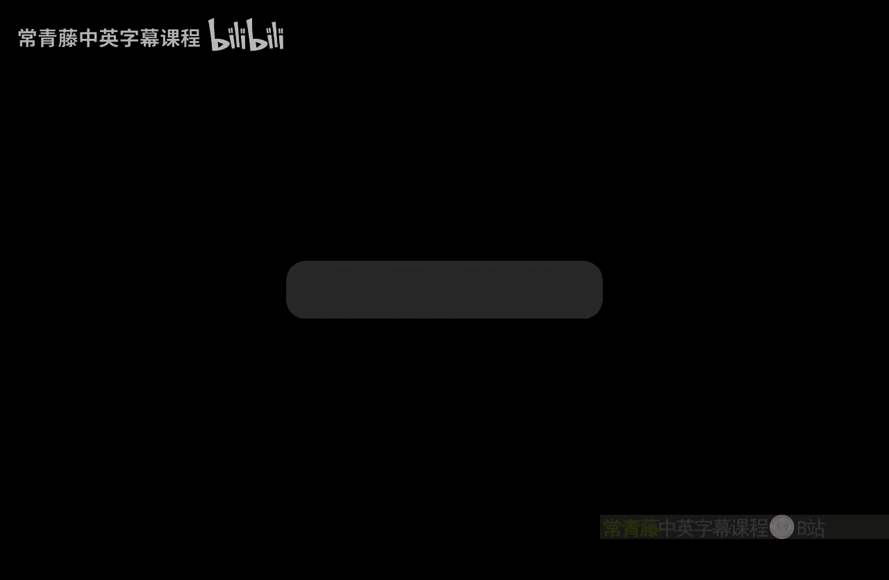
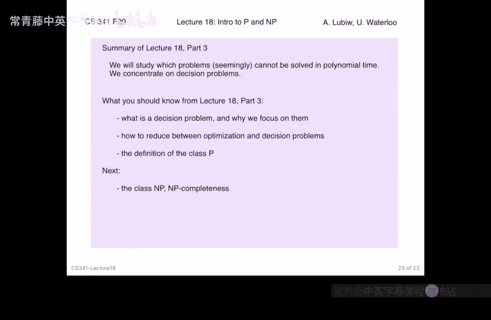

# 滑铁卢大学【中英⚡算法｜CS341 Fall 2021, Algorithms】 p20 P20 Lecture 19 -BV1DhrDBbEwR_p20-

Hello everyone， this section of the course starts the topic of NP completeness and I'm always really happy to teach NP completeness because that's the topic that brought me into computer science in the first place。

Let me start by reminding you where we've what we've done in this course so far。

 We've spent a lot of time on the design of algorithms and analysis of algorithms。

 And back in the beginning， a third thing was mentioned， which is lower bound。

 And this is the question of whether we have the best algorithm for a certain problem。

 So imagine that we've designed an algorithm A for some problem。

 We've analyzed the worst case run time， It's a function T of the input size N。 And now we say， well。

 is this algorithm the best possible， or should I spend more time and go back to the design phase and look for better algorithm。

As an example， last day， we saw branch and bound that works for problems like maximum independent set or the problem we looked at last day。

 which was subset sum。 And for both of those， it has a run time that behaves exactly as 2 to the N。

 So the big theta here means that the run time is big O of 2 to the N。

 but also that there are an infinite set of instances for the problem where the runtime really is this。

 It's not an overest。And now we might say， well， this is an exponential time algorithm。

 Is that really the best that we can do for a maximum independent set or for subset some。

In order to show what's the best possible， we would need to show that any other algorithm for maximum independent set has a worst case run time that is at least this bad。

 and such lower bounds are really hard to prove。 And for the case of subset sum and maximum independence set。

 no one has managed to prove such a thing。 And yet。

 no one has found an algorithm that is faster than that。

 So that's what this section of the course is about。Now。

 let me mention the state of the art in lower bounds in computer science， it's dismal。

Some it's known， it's been known for a very long time that some problems just simply don't have algorithms that was proved by Alan Tring back in the 1930s and we'll cover it in one lecture at the end of the course。

 But you may have seen it in first year。 You may have also seen it in CS S 245， or CS， S 360。

There are proofs also that some problems can only be solved in exponential time。

 but that does not include the problems I mentioned on the previous slide。And finally。

 there are some lower grain fine grainined lower bounds like the proof you've seen that sorting requires N log n now that was only for a restricted model of computing where we were counting the number of comparisons on the input numbers and if we go to a general purpose model of computing。

 then this lower bound in fact does not hold。So the major open question that we're exploring in this part of the course has to do with lower bounds。

 there are many known problems like the traveling salesman problem， the 01napsack problem。

 where no one knows a polynomial time algorithm， but no one can prove that there's no polynomial time algorithm。

So the best that people know how to do is to prove that a large set of problems are all equivalent in the sense that if we could do one of them in polynomial time。

 then we could do all of them in polynomial time， and conversely if we could prove that one of them cannot be done in polynomial time。

 then that would imply that none of them can。So in this part of the course。

 our focus is on polynomial time and the class of problems that have polynomial time algorithms。

 this is called the class P and our main tool in proving these kinds of equivalences are reductions Now you've seen reductions already before。

And the name for this class of equivalent problems is the NP complete problems。

 so we're going to start off by spending some time on polynomial time and reductions。

The goals of this part of the course are， first of all。

 that you should be familiar with the idea of NP completeness because anyone graduating with a computer science degree has to know about this。

 also that you should be able to recognize some NP complete problems and this will prevent you from ever trying to find really efficient algorithms for NP complete problems without being aware that you're tackling a really hard open problem。

And finally， you should be able after this section of the course to do some NP completeness proofs yourself。

 that way you will have an appreciation of what's involved and you will have the tools at your disposal to prove that a problem you're trying to solve is one of these intractable NP complete ones。

So first of all， a definition of polynomial time， an algorithm runs in polynomial time if it's runtime and we're always talking asymptotic like big O notation and we're always talking where case here if it's runtime is order n to the K where n is the input size and K is some constant so let's look at a few examples here is order n squared polynomial time well certainly the constant k here is the number two。

Is order n to the fifth polynomial time yes， order n log n well order n log n is bounded by order n squared and again that is a polynomial how about order2 to the n no。

 that is exponential and similarly order n factorial is exponential It is not bounded by polynomial。

Now how about order n to the1 million Well， the value of k is very large here， but it is a constant。

 so that counts as polynomial time。And how about n to the two to the two to the two。

 and even if I added more twos， it's still a constant up there on top as the exponent and that is polynomial time。

Now most of the algorithms we've studied so far in the course have been polynomial time。

 the exceptions are the backtracking and branch and bound algorithms we saw in the previous lecture and also the pseudoponomial time algorithm for the zero1napsack problem recall that that one had a runtime like n times W and here this was the actual value of W that entered into the runtime rather than the size of W so that did not qualify as a polynomial time。

是。Now， a little bit of history on this definition of polynomial time， it's more recent than。

 for example， Tring's result on which problems have algorithms altogether。

 the notion of solving problems efficiently arose much later than Tring's explorations。

Now polynomial time informally we can think of this as good or efficient and this notion was first introduced by Jack Edmonds who was a professor in the Cominatorics and optimization department until his retirement and in his 1963 paper he gave a polynomial time algorithm for finding a maximum matching in a graph。

 remember what a matching is is a set of edges no two incident to the same vertex。

And so if we have an edge weighted graph， we might be interested in finding the maximum matching。

For example， in a bipartite graph， we might have students on the one side and co-op jobs on the other side and we would like to match them up and the weight on an edge might be the desirability of either party。

 the company to hire the student or the student to have this job。No。Jack Edmonunds， in that paper。

 wrote that he was going to give a good algorithm for maximum matching， and he said。

 I'm claiming as a mathematical result， the existence of a good algorithm。

 There is an obvious finite algorithm。 And by that。

 he meant we could try all the possible matchings of which there are exponentially many。

 but that algorithm increases in difficulty exponentially with the size of the graph。

 It is by no means obvious whether or not there exists an algorithm whose difficulty increases only algebraically or polynomially with the size of the graph。

So Jack Edmonds was one of the first people to explore this concept there were others who did so as well。

 and I've included here a picture of Jack Edmonds back at about the time when he wrote this paper。

 often with famous researchers you see a picture of them at their current age and you rarely see the picture of them when they were at the younger age when they actually discovered their result。

 but if you follow this link to Wikipedia， you can find more current pictures of Jack Edmonds。

So in this slide I want to challenge this question of whether polynomial time is always good。

 is it really if we have an algorithm that runs in time n to the 100th。

 would that be really efficient， Well， not really a but one curious fact is that there are very few known algorithms that have run times like that。

 and the other thing is that for N very large N to the 100th is still going to be better than something like two to the n。

😊，And the other caveat is in the other direction which is to say there are some useful algorithms or some good algorithms that are not actually polynomial time in the worst case and perhaps the most famous example of that is the simplex algorithm for linear programming perhaps some of you have studied that in the comminators and optimization course on linear programming now there are more complicated polytime algorithms for linear programming but the simplex algorithm is still competitive because it works fairly well on most input。

So this is a little exception， perhaps to requiring an algorithm to be polynomial time in order to call it a really good algorithm Now。

 the downside of something like the simplex algorithm is that there are inputs that will cause a really terrible runtime and exponential run time。

Another exception is randomized algorithms where we have a good expected case runtime。

 but perhaps a bad worst case runtime， that's something that you'll study in CS466 so in spite of exceptions like this。

 which I've put in to make this a more realistic evaluation here for the most case it's fair to say that polynomial time is a good algorithm and an algorithm that is not polynomial time is pretty bad and inefficient。

So a summary of where we are so far， we are going to study in this part of the course which problems can be solved in polynomial times and which ones seemingly cannot what you should know so far is what is polynomial runtime and why it matters and next up we're going to talk about reductions and define these various classes。

Okay， so we're going to start with the definition of a reduction。

 If we have a problem X and a problem Y， we'll say that x reduces to y。

 and we're going to write this in notation as x less than or equal to y。

 If having an algorithm for problem Y， this one。Can be used to get an algorithm for X。 Now。

 in order to make sense of this notation with the lesson or equal to s。

 you should think of this as saying that x is easier than y。

 And how does that make sense with this definition， It's saying if I could solve Y。

 then I could solve X。 So x is the easier problem， right。

And we refine this definition by saying that problem X reduces in polynomial time to problem Y。

 and we write that with a subscript P on the less or equal to sign。

 if having a polynomial time algorithm for Y allows us to get a polynomial time algorithm for X So this is our basic definition of reduction and I have a little note here that says if you are at the stage where you're trying to solve one of your assignments and give an NP completeness proof。

 then please look ahead to the end of the next lecture lecture 19 because there's a slightly more specialized definition of reduction that you ought to be using for proving NP completeness so this is the concept of reduction and there's something more specialized that will come later on。

Now， an important consequence of this definition x reduces in polynomial time to y is the contrapositive of what the statement says。

 the contrapositive says if x cannot be solved in polynomial time。

 we have some proof that it cannot be solved in polynomial time。

 then y cannot be solved in polynomial time either。No。

Even if we don't have either of these two hypotheses， so we don't have an algorithm for y。

 we don't have a proof that x can't be solved in polynomial time。

 It is still worthwhile to prove a reduction and the thing a reduction will show is that two problems are equivalently hard。

 So if I show that x reduces in polynomial time to Y and y reduces in polynomial time to X。

 then I know that the two problems are equivalent solving one in polytime solves the other。

 proving one can't be solved in polytime proves it for the other one。

So that's the situation we're in with NP completeness， we are able to prove equivalence of problems。

 but we are not able to find polytime algorithms or lower bounds because the state of the art just isn't there yet。

So I'm going to do an example of one of these reductions。 It will， in fact。

 have the special form that I was referring to on the previous slide。 So that part。

 at least is is secure。 if you like， And the problems I'm going to look at are a Hamiltonian cycle and Hamiltonian path。

 Now， those are defined as a cycle or a path that visits every vertex of a graph exactly once。 So。

 for example， here's this little dolit graph。 It has a Hamiltonian path Here it is。

 It visits every vertex exactly once。 However， this graph does not have a Hamiltonian cycle。

 It's easy to see in this particular case， because here I have a vertex of degree 1。

 If I had a Hamiltonian cycle。 I would have to visit this vertex and then leave it。

 and there's no other edge I can take to leave it。 I cannot go back on this。 Otherwise。

 I'm revisiting that vertex。Now in spite of the fact that Hamiltonian cycles and paths are named for the mathematician Hamilton。

 they were considered centuries before he was looking at them in particular in the ninth century cashmre。

 people were studying whether you could get a Hamiltonian cycle of night's moves on a chessboard。

 so here's the eight by eight chessboard and they were looking at could I have a night that takes one move。

 this is a legitimate move for a night piece on a chessboard and here's the second move and third move and so on and they wanted to visit every square of the chessboard exactly once like without any repeats。

And I've given a link here， it makes a very interesting reading。

But note that it's just for enrichment， it's not required。So from an algorithmic point of view。

 the questions we're looking at are these， given a graph。

 does it have a Hamiltonian cycle or given a graph， does it have a Hamiltonian path？

So I mentioned in the previous lecture how we can do a backtracking algorithm to decide whether a graph has a Hamiltonian path or Hamiltonian cycle。

 I forget which but those were exponential time algorithms and we might be interested well it's a fact let me put it this way that no one knows how to solve either of these problems in polynomial time so the backtracking algorithms are the best that are known。

Now what I'm going to show you is that the two problems are in fact equivalent。

 I'll show one direction of that and leave the other direction as an exercise。

 we are going to show that Hamiltonian path reduces in polynomial time to Hamiltonian cycle。

What that means from the definition， what it says is if there's a polynomial time algorithm for this one。

 the hard one， the one on the right hand side of our inequality。

 If there's a polytime algorithm for this， then there's a polytime algorithm for this。

 and the contrapositive statement is or in equivalent contrapositive statement says if there's no polynomial time algorithm for Hamiltonian path。

 then there is no polytime algorithm for Hamiltonian cycle。Okay。

 so we're going to look at the proof of thislemma， we're going to prove it just going by the definition。

 so this statement here。So we are going to suppose that we have a polynomial time algorithm。

 I'll call it a subcycle for Hamiltonian cycle and we can call it like a subroutine。

 it's like a black box I can just call it and get correct answers out of it and it works in polynomial time in the size of the input and our goal now is to make a polytime algorithm for Hamiltonian path。

So we should think about this like any algorithm， any problem of designing an algorithm。

 we have some input， we have a desired output， does the graph have a Hamiltonian path， yes or no。

Now the first thing you might think of when we're trying to design this algorithm is I certainly want to make use of this algorithm and what if I just try right off the bat sending my given graph off to the cycle algorithm。

 what's going to happen so if a cycle if this algorithm returns true returns yes。

Then what does that mean， it means that my graph G has a Hamiltonian cycle。

And we get this test done in polynomial time。 So this seems like good progress， right。

And if a graph has a Hamiltonian cycle， then。It has a Hamiltonian path， right。

 I just leave out the last edge of the cycle， and I've got a path。 So this is looking good so far。

 I've answered the question I want， which is G has a Hamiltonian path。

 The problem comes when we look at the other possibility。 What if a cycle returns no。Okay。

 so what that's saying is that this graph does not have a Hamiltonian cycle。

 do we know then whether it has a Hamiltonian path or not。

 we looked in on the previous slide at this dialect graph。

 and I want to also compare with this possible graph。And to say that we really can't tell。

 we don't know。So here is an example of this graph G has no Hamiltonian cycle。

 so it's an example that might arise here where the algorithm returns no。

But it does have a Hamiltonian path。And I'm just going to write ham path， okay？And on the other hand。

 here is a graph that has no Hamiltonian cycle。 and if you look at it carefully。

 you will see that neither does it have a Hamiltonian path。Okay。

 so what what these two little examples are showing is that just because a cycle returns no。

 which it does in both these cases， doesn't mean I can tell whether the graph has a Hamiltonian path or not。

And so even though this approach was wrong， it gives us some intuition。

 it gives us the intuition that what we really need is to make out of my graph G。

We need to make a new graph G prime。G prime， such that。

I really do have the equivalence I was desiring to get here so that G has a Hamiltonian path。

 that's what we really wanted， right， if and only if G prime has a Hamiltonian cycle。

You see if only I could do this？Then I'd be home free because I would send my graph G prime off to the algorithm a cycle。

 it would tell me whether G prime has a Hamiltonian cycle。

 and that will tell me whether G has a Hamiltonian path。

So that is saying that our plan then should be to construct this graph G prime。

 such that G has a Hamiltonian path， if and only if my new graph G prime has a Hamiltonian cycle。

So let's think about how we could do that。So the first idea you might think about is that I have this graph G and if it has a Hamiltonian path。

 I want to make sure that G prime has a Hamiltonian cycle。

So what if I tried adding an edge for G prime？Well， if I knew which edge to add。

 that would be all fine and dandy。Right， but I don't know which edge to add， right。

 so we don't know which edge。So we somehow have to take care of that。Like。

 I sort of drew the path in the first place， but we don't know the path。

 That's the hard problem that we can't solve。 So here is idea 2。

 which is to overcome this difficulty。 I have my graph G。And it's got some vertices and some edges。

 And I don't know what they are。 but what I'm going to do is to make one new vertex。

 which I will call V， and I will connect V to every possible vertex over here， all of them。

And now think about it， so this will be G prime。So G prime has a new vertex V。

Adjacent to everything in a new vertex v， adjacent to every vertex in G。Okay。

 I'll say why this works in just a sec， but let me give one more example if I had my little doet graph。

 what am I doing here with my reduction， I'm making a new vertex v and I'm connecting it to all of the however many vertices I had here in G。

Okay， so now let's think about things a little bit。 If I had a Hamiltonian path over here in G。

 do I get a cycle in G prime， Sure enough， I just connect with those two edges to V and notice that it doesn't matter where this Hamiltonian path starts and stops。

 I can always connect it and in the other direction if G prime has a Hamiltonian cycle it has to go from V to something and eventually come back to V and the part of it inside here is going to be a path。

So this idea works out。So here I've written that down in more detail， the algorithm。

So remember what we're trying to do our input is a graph we are trying to answer the question does G have a Hamiltonian path and the tool at our disposal is that we have this magic algorithm a subcycle that tests for Hamiltonian cycles so here's the algorithm in complete detail I construct the graph G prime by adding one new vertex v adjacent to all the vertices of G then I run the cycle algorithm on G prime and whatever answer it gives I return that answer。

So as always， when we've designed an algorithm， we have to deal with correctness and we have to analyze the run time。

 so I'm going to look at the runtime first and then come back to the correctness issue。

 which I already outlined on the previous slide， but we'll do it more carefully。So first of all。

 the run time now step one here， which was to construct this graph by adding one new vertex and these new edges that takes linear time。

 right Linear time is order n plus M number of vertices plus number of edges， and that's just fine。

Now step two is to run this algorithm a subcycle and we assumed。

 so by hypothesis this runs in polynomial time， we have to be a little careful here。

 it runs in polynomial time in the size of its input which is G prime right so I have to be concerned with what is the size of G prime。

So if G has n vertices and M edges， how big is G prime？

So G prime has well I started with the n vertices and I added one more right so n plus one vertices and how many edges have I got。

 I have M， the original ones plus the n new ones that I added adjacent to vertex V。So a subcycle。

Runs in polytime。In。And。So I'm adding these together to n plus m plus1， and that is polynomial time。

In N plus M。Okay， in general， if I do something like double my input size， that's still polynomial。

 okay？So the algorithm runs in polynomial time， that part's good。

So next let's turn to the correctness issue now。What we need to prove here for correctness is that G has a Hamiltonian path。

 If and only if this algorithm here returns yes。And。What we're going to。

Rely on is that the algorithm returns yes， if and only if a cycle returns yes。

 right so that's our first step。A path。Returns a yes answer。If and only if a cycle returns， yes。

And this is just by the code right just looking at how the code works and a subcycle we know works correctly。

 so it returns yes， if and only if G prime has a Hamiltonian cycle。Okay。

 so this is because that algorithm is correct， A subcycle is correct。Okay。

 so what we really need to prove。Remember what we're trying to prove is that G has a Hamiltonian path if and only of this。

 and I've strung that along to say if and only if G prime has a Hamiltonian cycle。

 so I need to prove G has a Hamiltonian path， if and only if G has G prime has a Hamiltonian cycle。嗯。

Okay， now it's still an if and only if statement， so let's look at the two directions。

 first suppose that G has a Hamiltonian path。嗯。Suppose G。Has a Hamiltonian path。

Let's suppose it goes U1， U2， all the way up to U N。

 that's a path visiting every vertex exactly once。Then G prime。

I'm going to turn this into a cycle in G prime。And if you recall the picture， I had two slides back。

 the idea is just that we're taking this Hamiltonian path and adding the two edges that go to V。

So the Hamiltonian cycle is V， then U1 all the way to U and then back to V right。

 so that proves the one direction and in the other direction if G prime has a Hamiltonian cycle。

Then if I delete the vertex V from that Hamiltonian cycle。And that gives a Hamiltonian path。

In the graph。G。Okay， in terms of this picture here。

 it's just saying I throw out those two edges and what I'm left with is a Hamiltonian path here。

 Okay， so that completes the correctness proof。And here I wanted to comment about the special form of this algorithm。

 We run the algorithm a subcycle just once。 I called it only once and whatever answer it gives。

 I return that answer and this is the special kind of reduction that I referred to before it's called a many one reduction and informally I'm going to call that a one shot reduction because that's a more memorable name so the word one is common here and here。

 this is the formal term， this is our informal term and how do we remember this one shot reduction。

 it's because I call this algorithm only once Okay I get one shot at it and I have to return whatever answer it gives I'll write down a more formal definition of this of this concept later on。

So as an exercise， I would ask you， I would suggest that you find a reduction in the other direction that is proved that the Hamiltonian cycle problem reduces in polynomial time to the Hamiltonian path problem。

And。Following the same idea that we did before， the secret here is going to be。

 if I'm given a graph G that is an input to Hamiltonian cycle。

What I need to do is construct a graph G prime。As an input to the Hamiltonian Pa problem。

And do it in such a way that G， my original input has a Hamiltonian cycle。

If and only if G prime has a Hamiltonian path。Okay。

So this is giving you a hint of the main thing that you need in order to prove this lemma and to actually do this construction is the little trick that you need to make this work。

Okay， so that completes part two of the lecture and we are going to study which problems seem to not be solvable in polynomial time。

 we use reductions and what you should know from this part of the lecture is what is the definition of a reduction and to absorb that example we gave of reducing one problem to another and next we're going to give some definitions of these classes。

Now the classes P and NP are defined as classes of decision problems so we're going to start by saying what decision problems are and why it's good enough to look at those a decision problem is basically one where the output is just a yes or a no answer and the theory of NP completeness focuses on decision problems partly because it's easier to formulate that way that wouldn't be a good enough excuse all in its own but the fact is that optimization and decision problems are usually equivalent with respect to polynomial time so let's look at some examples of decision problems given a number is it prime so here we're expecting an answer yes it's prime or no it's not prime Another example is given a graph does it have a Hamiltonian cycle yes or no here's a decision version of the traveling salesman problem mostly we think of this as an optimization problem but here's the decision version we're given an edgeted graph G。

And a number K， and we want to know， does the graph have a traveling salesman of length less than or equal to K。

 yes or no？Now the corresponding in some cases optim or in some cases we're not optimizing we just want to find the thing that we're questioning its existence in the decision problem so the corresponding problem for this given a number is it prime would be when the numbers not prime tell me the prime factorization so number six is it prime no it's not but you know tell me that six is equal to two times three similarly for the Hamiltonian cycle problem we want to we would want to actually find the cycle and for the traveling salesman problem we would want to find the tour that has weight less than or equal to K and also we would like to find the minimum K and find that tour right？

So we're going to talk about why decision problems and optimization problems are usually equivalent with respect to polynomial time now there's no general proof of this。

 this is another open problem but things are usually okay let me begin by mentioning one case where they're not okay which is there is a polynomial time algorithm known for testing if a number is prime that's a somewhat recent result from 2002 on the other hand there is no known polynomial time algorithm that will factor numbers and in fact our public public key cryptography systems depend on assuming that factorization is hard。

So this is one case where it's not known if the decision version and the finding the factors version are equivalent with respect to polynomial time however。

 all these other problems which are NP complete problems there the equivalentence is known so let's look at some of those results or at least look at one example。

So we're going to look at the maximum independent set problem remember that an independent set in a graph is a set of vertices no two joined by an edge。

 so I could put this vertex and this vertex together in an independent set because there's no edge between them。

 however I could not put in this vertex and this vertex because there is an edge。Now。

 in this particular little graph， if we ask， what is the maximum size independent set？

We should not think about including vertices a very high degree because if I put this vertex into an independent set。

 it rules out all of its neighbors and that leaves only this vertex as the other one that can go with it and so that would give an independent set of size2。

However， if we pick this vertex and this one and this one。

 then we have an independent set of size three and you can check out other possibilities to see that three is really the biggest independent set that we can have in this graph。

So。For independent set， the optimization version is to find an independent set of maximum size。

 a decision version of the problem is we're given some number K and we just ask， yes or no。

 is there an independent set of size at least K。Note that i'm asking here of for size at least k because this is a maximization problem right we want as large an independent set as possible finding a small independent set is not interesting at all at size zero so let's look at the equivalentvalence between optimization and decision up to polynomial time so in one direction this is really easy if I had a polynomial time algorithm for the optimization problem here's how I would solve the decision problem I would just take the optimum independent set and look at it size and see if it's at least K right so just check。

If the max， which we found in polynomial time by assumption。

Check if the max is greater than or equal to k。And that tells us our yes， no decision。

So it's the other direction of this that is the more interesting one and that says if I have a polynomial time algorithm for the decision problem just answering yes or no。

 is there an independent set of a certain size K then we can in polynomial time solve the optimization problem and this has a little bit in common with the 20 questions gadget。

 perhaps some of you played with that when you were kids so this is a little gadget where you think of something and then the gadget starts asking yes no questions is it bigger than a bread box and you enter the yes no answers and eventually the gadget comes up with an answer of what you were thinking of you were thinking of a toenail or whatever it is that you were thinking about when you were seven years old。

So let's look at this reduction。Now the first thing is that we want to find out what is the maximum size of an independent set and we can do that by just trying different values of k right so we can find the maximum。

And I will call that k sub opt for the optimum value of k by testing different values of k。

So we're only interested in polynomial time so we could even just try k equals12 and so on up to n and or we could be more clever and use binary search and to do this we are using the decision algorithm。

Okay， we were assuming that we have a polynomial time decision algorithm。Now。

 after we have found the maximum case of opt， then we want to find an actual independent set of that size。

 and the trick to doing that is to delete vertices one by one and say you know。

 if I delete this vertex from the graph do I still have an independent set of size 3。 Well。

 the answer is yes， so then I actually remove this vertex and repeat on the smaller graph。

 When I delete this vertex and ask， is there still an independent set of size 3 Well。

 I have one triangle and another triangle， So the biggest independent set I can I can get after deleting this one is2。

 So I say， whoa， I should not delete that one So that's the idea of it and let me write that down So then。

To find。An independent set of size K opt。I'm a breathingviating independent by IND。

O sizeize K subopt， we're going to try the vertices one by one。

I'm never going to come back to a vertex after I've tested it。嗯。嗯。One by one。

So if I find that the maximum independent set。In the graph， the original graph。

 but delete a certain vertex V is the same K opt and I can test this using my decision algorithm right then I'm going to reduce my graph by taking the graph minus that vertex V。

And the claim， which I will probably leave as an exercise to prove this。

 but the claim is that at the end。G is all that we have left in the graph is an independent set of size k opt。

Okay， I only delete a vertex when it still leaves me an independent set of of that size。

 that's the heart of proving this so prove this。And then the other thing we should do with this reduction。

 so this is claim2。This algorithm takes polynomial time。

 assuming that our decision algorithm takes polynomial time。

And the main thing to check here is how many calls am I making to the decision algorithm and what size of a graph am I asking the decision algorithm to run on？

So this is assuming。The decision algorithm is poly time。Okay。

 and so to check out how many times I call it I call it n times at first。

 and then I call it another n times for each of the vertices， so two n times that's polynomial。Okay。

 so with that justification of why it's okay to restrict our attention to decision problems。

 we are now ready to define the class P it is the class of decision problems that have polynomial time algorithms。

It's also important to say which model of computing we're using。

 we are measuring bit complexity in this case。Now in the next lecture we're going to formally define the class NP it is a class that seems to be larger though no one truly knows maybe p is equal to the class NP so it's a large class of decision problems not known to be polynomial time the hardest problems in the class NP are what's called the NP complete problems and the main theory of this is that those are all equivalent in the sense that a polytime algorithm for one of them gives a polynomial time algorithm for all of them and some of the problems that lie in this class NP are the Hamiltonian path or cycle problem traveling salesman problem the independent set problem and as decision versions and just a teaser for our next lecture is that the common feature that these problems have which will be in fact our definition for the class NP is that。

The answer to one of the decision questions is yes。

 then there is an easy way to persuade someone that the answer is yes so given a graph does it have a Hamiltonian cycle if it does you can just show the cycle to someone and they'll be convinced on the other hand if if the graph does not have a Hamiltonian cycle it's not clear that there's anything you can show them that they can quickly verify that there's no Hamiltonian cycle in this graph so that's just a teaser for next day's lecture and that completes this lecture in summary we are embarked on the study of problems that seemingly cannot be solved in polynomial time we are concentrating on decision problems and what you should know from the last part of this lecture is what is a decision problem why it's legitimate to just focus on those in particular how to reduce between an optimization and a decision problem and finally the definition of the。

Clas P and coming up next， we're going to define the classes NP and define NP completeness。

That's it for this lecture。

