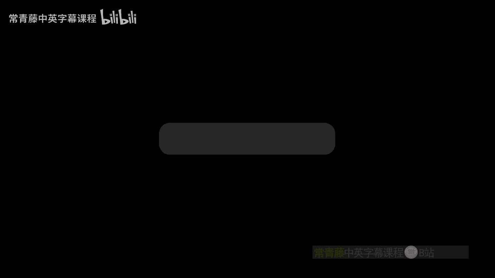
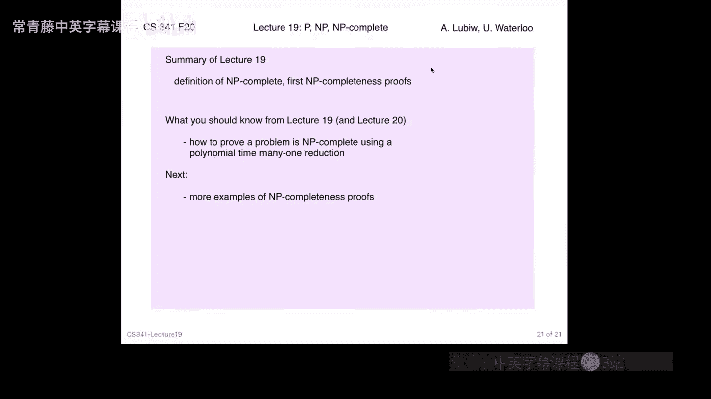

# 滑铁卢大学【中英⚡算法｜CS341 Fall 2021, Algorithms】 p21 P21 Lecture 20 -BV1DhrDBbEwR_p21-

Hello everyone， welcome to lecture 19 where we're going to define NP complete problems。

So the things you need to remember from the previous lectures are that P is the class of decision problems where the answer is always a yes or no decision problems that have polynomial time algorithms。

 and the other thing you need to remember is the idea of a reduction。

 a polynomial time reduction from X problem X to problem Y means we assume we have a polytime algorithm for y and out of that we make a polynomial time algorithm for X。

Okay， so the class NPP is a class that seems to be larger than the class P。

But it's not known if they are actually equal or not。

ThereHere's an example of a few decision problems that are in the class NP。

 one is the Hamiltonian cycle or path problem， so there werere given a graph and we want to know yes or no。

 does it have a Hamiltonian cycle or Hamiltonian path。

A second example is the decision version of the traveling salesman problem and here we are given a graph with weights on the edges and the question and we're given a number K and the question we're asking is。

 is there a traveling salesman tour where the sum of the weights is less than or equal to k？

Independent set is a third example I've got here here we're given a graph in a number K。

 and the question is。Does the graph have an independent set of size at least K。

 It's a maximization problem。 So we say at least K。

 whereas traveling salesmen is a minimization problem。 So we say at most K。Now。

 the common feature of all of these three problems。Is this If the answer is yes for some input。

 then there is some small sized or succinct information， which we call a certificate。

 that can be used to verify that the answer is yes。

 So let's look at an example and make that a little clearer。

 I'll look at independent set as the example。 So we're given a graph， a number K， We want to know。

 does G have an independent set of size at least K。So here I have an example of a graph。

 the vertices here are the red squares， the edges are drawn in black。

 and this is what's called a unit disk graph， so each red square is the center of a disk and I put an edge between two vertices。

 if those two disks intersect。So it's a graph that's defined from points actually in the plane。

So it doesn't matter for the point of this example， exactly how the graph came about。

 but just as an aside， this is what's called a unit disk graph。No。

Here I have an example of a question for K equals 5。 How could I convince you that the answer is yes。

 This graph has an independent set of size， at least 5。Well， that's pretty easy， right。

 I would just show you if you take this vertex， this vertex， this one。This one and that one。 look。

 there are five vertices， and there's， there's no edges between any two of these。

 So that is an independent set of size 5。 And by this， you are convinced that， yes。

 this graph has an independent set of size， at least 5。On the other hand， to make it clear that。

To examine the case where the answer is no， how could I convince you that no there is no independent set of size at least seven in this graph there's nothing quick and easy I could show you。

 I could enumerate like all the subsets of size seven and check that there's an edge in every one of those subsets but that's an awful lot of information and an awful lot of work for you to do to verify this information。

So there really is this asymmetry between the yes answers and the no answers for the independence set problem。

And NP is the class of problems where the yes answers have this interesting property that there's a certificate and a way to verify that the answer is yes。

So I'm first going to give a more precise definition of that and then we're going to look at more examples。

So a verification algorithm， it has an input plus a certificate。

 so in the example on the previous page it was the graph and the number K and the certificate was the actual independent set of size5 and the verification algorithm checks that this certificate really proves that the answer is yes for the input。

So a verification algorithm A for a decision problem X is an algorithm that takes two inputs x and y x is the original input。

 y is the certificate， and it outputs， yes， I verify this or no， I do not verify this。

And the condition we need is that for any input for our problem， the answer is a yes on that input。

 if and only if there is a certificate that makes the verification algorithm output a yes。

So in our example with the independent set， the certificate was the set of five vertices and then the verification algorithm。

 given that graph， the number k equals5， and given that set of five vertices， it checks。

 was that really an independent set。Now we refine this a little bit by saying the algorithm as polynomial time verification algorithm。

 if a runs in polynomial time， that would mean in the size of its input。

 but we want an extra condition， which is that the size of y is bounded in terms of the size of x。

 so in particular there's a polynomial bound on the size of this certificate。

It's not going to count if my certificate is exponentially huge and then I say， well。

 this algorithm works in time proportional to that exponentially large certificate。

 I really want everything to be polynomial。So then if we have such a verification algorithm。

 we say x can be verified in polynomial time。And here's finally our definition of the class NP。

 it's the class of decision problems， so ones with yes。

 no answers that can be verified in polynomial time。And。NP， those letters。 What do they stand for。

 They stand for non deterministic polynomial time， And the reason for this name is that the certificate is sort of like a non deterministic guess。

 So if you take C S 360 or if you've taken it already。

 then you've studied the idea of non determinism and。

The original definition of N was in terms of non determinism and a more modern way to define it is like this with the certificate and the verification algorithm。

If you like one way to think of it is that when I told the story of， you know。

 someone finds the certificate and gives it to you and you verify it。

 finding that certificate could be a huge amount of work， and that doesn't matter in this definition。

 doesn't matter how much work it takes to find the certificate。And this definition。

 instead of thinking of the work of finding the certificate。

 just thinks of it as being a lucky guess。Okay， so I promised you some more examples the first one we'll look at is subset sum。

 This is the problem that we looked at the backtracking algorithm for。

 so we're given a set of numbers and a target number capital W and the question we're asking is is there a subset of the elements that whose weights add up exactly to capital W？

So we're going to prove that this problem lies in the class NP。So what do we have to do to show that。

 We have to say what the certificate would be。And what the verification algorithm is。

So what would the certificate be？Well， if I wanted to convince you that this input should get a yes answer。

 I could just tell you the subset that works， right， It's as easy as that。

 So the certificate is the set S。And。What would we do as the verification？Well。

 we just have to check the condition that was written here， right。

 that the sum of the weights in S adds up to exactly W， capital W。So check that。

The sum of the weights of the elements in that set S that you were provided is equal to capital W。

 and this takes polynomial time。Adding up a bunch of numbers。Okay。

 so that's really all that's involved in showing that this problem lies in the class NP。

For our second example， we'll look at the decision version of traveling salesmen and prove that that lies in the class NP。

So again， the input is a graph G with weights on the edges and a number K。

 and the question we're asking is， does the graph have a TSP tour of length at most k？

So we need to say to prove that this problem is in NPP， we need to give a certificate。

We need to say what the certificate would be and in this case it would just be the TSP tour itself。

 and one way to think of that is I would give you a permutation of the vertices。

Or an ordered list of the older vertices。The idea is that you would visit those vertices in that order。

So what do you have to do to verify this one？Well， first I guess you should check that it really is a permutation。

There's no vertices missing。There's no vertices doubled up。

And then I'd better check that there really is an edge between each successive pair of vertices in this permutation and an edge going from the last one back to the first。

 so check that the edges exist。To make a cycle。And then the last thing we need to do is check that the sum of the weights is less than or equal to k。

So the sum of the weights of the edges in the cycle。

Is less than or equal to k and all of those things can be done in polynomial time。Okay。

 so on your assignments when you're asked to prove that some problem is in NP。

 you have to give these two things， what is the certificate going to be and what is the verification algorithm you might give a little bit more detail than what I've written here for the verification algorithm in particular。

 although it's really obvious most of the time that the verification answers yes。

 if and only if the the answer to the original problem is yes。Now。

 those seemed somehow puzzlingly trivial， so I thought it would be helpful if I give you some examples of problems that don't seem to be in NP。

 I'm saying don't seem to be because it's not that anyone has proved they're not in NP but just that no one has found a way to put them there So the first one we'll look at is unique subset sum so the input's the same or given these numbers。

 the target capital W but now we ask is there a unique subset such that the sum of its weights is W so if there were two different sets S。

 I would want to answer no， and if there's zero sets that add up to capital W。

 I also want to add answer no and the only time I answer yes is if there exists a set that adds up to the target but it's the only set that does this。

So if we tried to show that this problem lies in NP， we would have to try to think of a certificate。

嗯。And you could give one set S and verify that indeed its weights add up exactly to capital W so you can verify one set。

You can verify that a given S。A certificate as。Is a solution。

 But what in the world could I show you to convince you that there's no other set that adds up to W。

I mean the obvious thing would be to trial all the other sets。

 but that is not a polynomial size certificate and you would not be able to check that in polynomial time so the puzzle here is how could you。

HowCan you verify that S is the only solution？嗯。And again。

 you have to remember that we're talking about being always able to do this， for example。

 if there's always going to be easy cases， like if w is just the sum of all the little WI's。

 then of course there's a unique set， you have to take everything。So what we say。

 what we mean here by saying how can you verify that S is the only solution we mean in general。

The second example we'll look at of a problem that does not seem to be in NPp is called a Steer Steer tree problem in the plane。

 So the input here is a set of points in the plane So we've got you know x and y coordinates think of ourselves on an axis system we have x and y coordinates of these points in the plane and it's a little bit like spanning tree。

 Now spanning tree would ask for edges between these pairs of points that connect them and have minimum sum of weights。

 So here the difference is that I'm allowed to put in these new points So I'm allowed to take this blue tree which is shorter in length by the way than this one and the question is asking is there a Steer tree using these extra points possibly that has Eucliidean length less than or equal to K So the weight I'm using on every edges just the Euclidean the standard Euclidean length。

And there are two difficulties with proving that this problem lies in NP。

 like no one knows how to prove that。嗯。One of the difficulties is that you might think that the certificate would be to give these extra points。

But you would have to prove that the coordinates of these extra points are not too large。 Like。

 what if the only valid points were irrational points， How would you even give them。

So this is one issue。Is the coordinates of the extra points。And I'll just put in brackets。

 are they even rational？And the other issue that makes this problem difficult is that we would then want to add up the sum of the lengths of these edges and verify that that is less than or equal to K。

 and people don't know how to do that in polynomial time。

 So the issue is checking a sum of Euclidean lengths。

We want to check if it's less than or equal to k is it's not known how to do that in polynomial time。

And the issue is that we need to take square roots right if I say is the square root of two plus the square root of three less than or equal to something。

 you don't want to actually you can't actually compute square root of two。

 you have to approximate and how far do you have to approximate how many bits do you have to approximate to be sure of the answer people don't have a polynomial time bound for that。

So this is because of square roots。Okay， so I hope that these two examples give you at least a little bit of a flavor that even though when we ask you to prove a problem in NP。

 it's always going to be pretty easy that there really is something that you're proving。

 there are problems that don't seem to lie in the class NP。So。

Some interesting things about the class NP the first interesting thing is that P is a subset of NP so what is the saying if I have a problem that has a polynomial time algorithm then it lies in the class NP according to this definition with the certificate and the verification algorithm and how do we prove that well we take the certificate to be empty you don't need any extra information to verify the answer。

 you just run as the verification algorithm， the known polynomial time algorithm for the problem X and it will answer yes or no correctly okay。

So the next thing I'd like to tell you about is the class that's called co NPP and this is the class of decision problems where the no instances。

 the no inputs can be verified in polynomial time so it's flipping yes and no in the definition here let me give you an example the primes problem given a number n is it prime。

This problem lies in Co P。 And the reason is that if I wanted to convince you that some number is not a prime。

 I would just show you two numbers A And B that add up to the given number N， right， so to verify。

That n is not prime。The certificate is just two numbers that multiply to give you in。Numbers A and B。

Natural numbers。And with A and B greater than or equal to two。嗯。

And then what you need to do is verify。That a times B is equal to n。

 And then you know that n is not prime。Now an interesting thing about the primes problem is that in fact。

 it lies in the class P， there is a polynomial time algorithm to test if a number is prime。

 I think I mentioned that in the previous lecture and that was found in 2002 and you can read about it here。

Okay， so here is the famous question about P and NP is P equal to NP you'll get a perfect mark in the course if you answer it also you will get a million dollars from this millennium prize。

There are other open questions which aren't quite as famous as this one but seem to be equally hard。

 one is whether NP is equal to co NPP， like if I can verify the yes inputs and I can does that mean that I can verify the no inputs？

And a related question is whether。If I could verify the yes inputs and verify the no inputs。

 does that mean the problem lies in the class P。 So let me show you some of these possible containments in a like a Venn diagram here。

 So one possibility is that I have a big class in P。Another big class Co NPP。And they are different。

 And P lies inside here。And there may or may not be problems that lie in this intersection。

 but not in the class P， that's what this third open question is asking about。

But another possibility is that everything collapses， so p equals NPp equals co NPp。

And the thing is we don't know which。Okay。No。There are a few things we do know。

 as I just proved for you， P is a subset of NP P and similarly， P is a subset of co and P。

 So in both these pictures， you know P is contained in NP P and co and P。

And another interesting property。Is that if we know a problem lies in N P。

 then we know some kind of bound on how much time it's going to take for an algorithm for it， namely。

 any problem in N can be solved in this kind of exponential time，2 to some polynomial in N。

And the idea here is just that we know there is a certificate of a nice polynomial size like into the T and so if I just go brute force and try all the possible certificates。

 that is an algorithm for the problem， so we have this upper bound on the runtime of an algorithm。

Okay， so this is the end of part one of this lecture I've defined for you the classes NP and Co MP what you should be able to do from this part of the lecture is prove that some problem lies in NP by giving a certificate and describing the verification algorithm。

And next up， we're going to define NP complete problems。So here is our definition。

 a decision problem is NP complete if， first of all， it lies in the class NP and secondly。

 for every problem in NP， every problem Y Y reduces in polynomial time to X。

 So what this is saying is that x is。The hardest or one of the hardest。

 there are many equivalently hard ones， x is one of the hardest problems in NP。In terms of a picture。

 if we think of this axis as going from easier to harder than P or the class P consists of the easy problems inside NP。

 the ones that can be solved in polynomial time， and the NP complete ones are the hardest ones。

 every other problem in NP reduces to the problems here that are NP complete。

Now there's two important implications of a problem being NP complete， just from this definition。

 the first is that if X could be solved in polynomial time。

 then every problem in NP can be solved in polynomial time。So in notation， we write that this way。

And that's just coming from our definition of reduction， right。

 if x can be solved in polynomial time， then y can be solved in polynomial time。

 and that's for every Y in NP。And the second statement here is the contrapoitive one。

 which says that if I have some NP complete problem X and I manage to prove that x cannot be solved in polynomial time。

 then none of those NP complete problems can be solved in polynomial time。

Seettling the question for a single problem in the NP completete class， whether it's polytime or not。

 settles it for the whole class。And a third thing I'll mention， it needs a proof。

 so we're not going to cover it， but if an NP complete problem lies in co NP。

 then those two classes collapse。So again， settling this question for single problem in the NP settles it for all of them。

Okay， so we're going to do a bunch of and B completeness proofs and the very first one is going to be difficult because I have to essentially show that every problem Y in the class NP P。

 every single one reduces to my problem X， so this one reduces this one reduces to x。

 this one reduces to x， they all reduce to x。We must show that every problem in NP reduces to X。

 and that's a hard thing to prove。But once we do that once。

 then all of the subsequent NPP completeness proofs are easier because this relationship of reduction is transitive。

 which is to say if y reduces to X and x reduces to Z， then I get to say， okay， y reduces to Z。

The reason is。Going back to the definition， if I have a polytime algorithm for Z。

 then I have one for x， that's what this means。If I have a polytime algorithm for x。

 then I have one for y， that's what this says， and I put those two statements together and it says if I have a polytime algorithm for Z。

 then I have one for Y。So what this transitivity property implies is that if I have a problem Z that I want to prove it's NP complete。

 all I need to do is show that some other known NP complete problem reduces to Z。

So in terms of the picture。If my problem X is the one up here。

 I've already shown that everything in NP reduces to x。

And now if I just show that my problem X reduces in polynomial time to Z。Then by transitivity。

 every problem Y here reduces in polynomial time to that。So I only need to give one reduction。

So a summary of what we've said so far then is to prove a decision problem is NP complete after we've done the first one。

 first I have to prove that the problem lies in the class NP。

 and then I have to pick some known NP complete problem X and show that it reduces in polytime doest。

 and that's it。So our first NP completeness proof， the one that I said would be hard is circuit satisfiability and I'll give a definition and a proof of this later。

The second NP completeness proof we will do we will prove that satisfiability and I'll say what that is in a moment。

 that satisfiability is NP complete so I'm going to give that proof later on。

 but I'll give the definition of this problem right now because then we're going to go and use the NP completeness of satisfiability to show that other problems are NP complete。

So what is the satisfiability problem you've encountered this NCS 245 the input here is a Boolean formula。

 so it's made up of Boolean variables that means they take true false values。And。

The formula is made up with logical operas， the and， the or and the knot。

 so one example of such a formula would be not x1 and x2。Or x 3， and。X5 or not x4。Okay。

 I think I have the right number of brackets there and the question we're asking in the satisfiability problem it's a decision problem。

 the question we're asking is， is there an assignment of true and false to the variables to make the formula true？

So in this particular example。嗯。I can simply。Set x1 to be false。

And then if I look at what's happening here， x1 is false， so x1 and x2 x2 could be true even。

 but the end of the two of them is false， and when I negate that I'm getting true for this piece and true or no matter what this is。

 is going to be true。So and the others arbitrarily， that will satisfy that formula。

Makes the formula true， satisfies the formula。And I've left it as an exercise here to prove that this decision problem satisfiability lies in the class NP。

 so you should then think what certificate would you give and how would you verify that certificate？

Okay， so satisfiability， which we abbreviate by writing SAT， and I'll even describe it as satAT。

 It's an NP complete problem。 I'll prove this to you a few lectures from now。

 even in the special case of what's called conjunctive normal form。

 So what does conjunctive normal form mean。 It means that the formula looks like this。

 It consists of clauses， here's one clause， here's another clause。 Here's the third clause。

 The clauses are all joined by these ans。 and inside a clause。

 I have a bunch of or's with what are called literals。

 So a literal is either a variable or a negation of a variable。 So you see that pattern here。

 I have a clause。 It has an or of three literals。Here I have a clause。

 which is an oura of just two literals。Now， furthermore， an even simpler thing。

 an even simpler seeming version of satisfiability is still NP be complete。

 and that is when all the clauses have exactly three literals and that one is called threeD S。😊。

So to recapitulate here， what is the definition of the threeatAT problem。

 the input is a boolean formula that is an and of clauses。

 each clause is an or of exactly three literals and each literal is a variable or a negation of a variable and the yes。

 no question we ask is， is there an assignment of true and false to the variables that makes the whole formula true？

And this theorem is that this three sat problem is NP complete。

 and I'll give you a proof of that later on。Now you might wonder why is three the magic number。

 what about twosat， what about if all my clauses look like this with just two literals in them and I won't cover this algorithm here in this course but in fact there is a linear time algorithm for twoat and one way to describe that is using strong connectivity of a directed graph so the main tool that is used is something you know about strong connectivity in a directed graph and there's a pointer here so you can look it up if you're interested。

There are many problems， by the way， where the division point seems to be between two and three。

 the problem becomes NP complete for threeness， but it's poly time for twoness well we may see a few other examples of that。

So the summary of this part of the lecture is that we've given a definition of NP complete。

 and I have described for you the first NP complete problems。

 though not given the proofs that they are， so sat and the problem three set。

And what you should know from this lecture is what are the two steps to proving that a problem is NP complete do you remember them from what I said。

 you have to prove that the problem lies in the class NP and you have to prove that the problem is harder than a known NP complete problem。

And next up， we're going to do examples of NP completeness proofs。So the first one we'll look at。

Is the independent set problem so remember we're given a graph and a number k and the question is whether the graph has an independent set of size at least k here is an example where I have an independent set of size3。

In a graph of six vertices。So the theorem I'm going to prove here is that this problem is NP complete。

So two steps always to such a prove， first we need to show that this problem lies in the class NP and we already saw the idea for this at the beginning of this lecture。

And second step is that we need to prove that some known NP complete problem reduces two or is easier than。

Our current problem， independent set。And the problem we're going to use here is three satisfiability。

That's the only one we know about so far it gets harder as we learn more and more NP complete problems because then we have more choices of what to put here。

 but so far this is the only one that I've told you is NP complete。😊，All right。

This part of the slide is just a repeat of what I said and now we want to look at this proof。

 so suppose we have a polynomial time algorithm for independent set。

And what we need to build is a polynomial time algorithm for three set。

 remember that's always how we prove reductions， we assume we have an algorithm for this。

 we prove that would give an algorithm for this one。

How does that make sense in terms of NP completeness？I'm saying。

If I had an algorithm for this problem， it would give me a polytime algorithm for this problem。

 and I know that a polytime algorithm for this problem gives me polytime algorithms for everything in the class NPP。

 so it really is saying that this one is one of the hardest ones。Okay。

 so let's dig in and look at this。We need to design an algorithm。

 so it's always good to say what's my input， what's my output。

 what's the idea of my algorithm The input here is a three sat formula I'll name the clauses like this and suppose the variables are these。

And we want to know is that formula satisfiable， can I give true and false to the variables so that all the clauses are made true？

Because our formula is the end of the clauses， if you remember。Now the idea is going to be。

To construct a graph and choose a number K。Such that the graph has an independent set of size at least k。

 if and only if F the formula F is satisifiable。And then we are going to run the independent set algorithm。

 we assumed there was one。Run the In set algorithm on the graph G with the number K。

And return its answer。Now this thing written in blue probably seems mysterious。

 but whenever you're writing an NP completeness proof。

 you can at least write down what it is that you're hoping to do and then see。

 can you think of the clever technique for it？Now one thing I want to say here is that this is a many one or one shot reduction because we run this algorithm just once。

And we return its answer。And when I have a many one reduction like this。

 then to prove that this algorithm works correctly。

 I just need to prove this thing I wrote in blue here。

 that G has an independent set of the right size， if and only if F is satisfiable。

 Then when I run the algorithm， it tells me the answer I wish to know。And furthermore。

 when I have a mini one reduction like this to prove that this algorithm runs in polynomial time。

 which is really what I wanted back here to prove that this runs in polynomial time。

 I only need to prove that this construction step takes polynomial time and polynomial in the size of my formula because that's my true input for the problem right so long as I can do the construction in polynomial time then the rest of it is okay I run the independent set algorithm on this polynomial sized graph and I was assuming that this algorithm runs in polynomial time so then the whole thing runs in polynomial time。

Okay， so let's look at the idea of this reduction， what mystery trick are we going to use to transform satisfiability of a logic formula into an independent set question。

So it's a clever idea， which is that I am going to。Take one of my clauses。Let's say this one。

So this is part of my formula。And。The idea with satisfiability is that I have to choose one of these or more than one。

 but at least one， I'll sneak in at least。I have to choose at least one to be true。

And when you write it that way， I have to choose one of something。

 then that begins to feel a little bit more like independent set because that was our problem there we had a bunch of vertices and I had to choose。

Some of them， so I'm going to transform this into the following little piece of the graph。

I'm going to make a triangle in my graph， I'm going to label the vertices with those variables， x1。

 x2 and x3， and I'm going to say over here I should choose one vertex for the independent set。

That is， I'm going to want an independence at so large that I have to use at least one of these vertices and why can I only choose one well。

 because all these edges prevent me from choosing more than one， right？So that's our plan。

 each time we have claws， I'm going to make a little triangle in my graph to correspond with that clause。

So let's look what happens if I have a couple of clauses and how do things interact amongst them？

So here's my example。I have this clause and I have a second clause that says x1 or not x2 or x3。

So according to my plan， just above， I would make a triangle for this clause。

 and I would make a triangle for this clause， and I would label them x1 here， x2。

 it doesn't really matter the order rape。And x not x3 here。And I would label these ones， x1。Not x2。

And finally over here， x3。Now what's the problem with my plan so far I'm saying I would ask here in this graph I would ask for an independent set of size 2。

 so it would force me to choose one vertex over here and one vertex over here whoops。

 that's bad right I cannot choose x3 and choose not x3 I can't satisfy this clause with this literal and satisfy this one with this literal。

So there's a little fly in my in the ointment here in this plan， but it's not hard to fix this。

 I'm just going to put an edge here that says you may not choose this one and this one。

 And similarly here， I have X2 and not X2。 So I'll put an edge to make sure that I don't choose both of those。

So the blue edges。Here。Prevent。choosingooing。X I and not X I。Well。

 for I equals 2 and I equals three in this example。So that's our total plan。

So I've written it down in more detail here。Um。The construction of the graph is that for each clause。

 if it has these three literals， I'm going to make three vertices joined by three edges like making a triangle and then if two literals they're going to be from different triangles。

 but if two literals are opposite like I have X I and not X I， then I put an edge between them。

And I'm asking for an independent set how big I want one vertex from each of the triangles。

 there's one triangle for each clause， there's M clauses， so I want an independent set of size M。

 at least M and by construction I'm not going to get anything larger than M。It'll be exactly M。

 in fact。So we need anytime we give an algorithm， we need to deal with the runtime and the correctness and for these reduction algorithms same thing。

 so for the runtime all we need to prove is that G can be constructed in polynomial time a main thing to note is that G has3 m vertices and then the number of edges is all at most9 m squared right it's going to be less than that in fact。

So we can construct the graph in polynomial time。For correctness。

 we need to prove this statement in blue。That the formula is satisfiable。

 if and only if that graph I made has an independent set of size， at least K。

So we do this in two directions， so first if F is satisfiable。

Then every clause has at least one true literal Well I take the satisfying truth value assignment and in that true false assignment。

 every clause has at least one true literal， so I choose the corresponding vertex so that will choose M vertices for me and they will be independent because I'm never choosing X I and not X I and I'm only choosing one thing from each triangle so this part checks out。

In the other direction， we assume that G has an independent set of size， at least M。

 remember M is my value here and。Then if it does， there must be one vertex in each triangle because I can't pick two vertices in a single triangle。

 there'd be an edge there， right？And I'm going to set the corresponding literal to be true。

And I claim that this is a valid truth value assignment。

 like I've never tried to set X I true and not true all at the same time。 and secondly。

 it satisfies F because every clause has at least one true literal because out of every triangle I picked at least one vertex。

So this completes the proof that the independent set problem is NP complete。

If we were in a classroom， I would be asking if there are any questions， but if there are questions。

 please ask them in Piazza。So I'm going to round off this lecture by reminding you that we had a definition of reduction that said if I have an algorithm for y。

 I get one for x。And here I'm going to put a formal definition of what is a many one reduction。

 it's a special reduction where I use the algorithm for y only once and I output exactly the answer it gives me。

 I'm not allowed to switch yes to no or anything like that I have to output the answer it gives me。

So this is our definition of a many one reduction and in both cases I can qualify it by saying polynomial time。

Now the way to remember this， many one reduction， this is the formal term that is used for this。

 the way I like to remember it is that it's a one shot reduction I get to use my hypothesized algorithm for why only once one shot and the word one is here and here so many one is the standard name one shot is the name I'm making up for you that might help you to remember this。

Now we're using reductions to prevent NP P completeness。

 so the form of a polynomial time many one reduction is like this。

 we assume that we have an algorithm for y that works in polynomial time， I make an algorithm for x。

It takes an input。For the problem X， and it constructs an input for the problem Y。

Then it runs the algorithm that we assumed we had for why it runs it on this constructed input and returns the answer。

So whenever you're doing an NP completeness proof， you need to do a reduction。

 it's going to have this kind of form。And for correctness， what do you need。

 you need to prove this statement in blue here。And what do you need to prove for polynomial time。

 you just need to show that constructing that new input y takes polynomial time because the other steps of this algorithm certainly take polynomial time。

So this is sort of a roadmap for how to do NP completeness proofs。

And where do those two things fit in， they fit into step two here。

 use a mini run reduction let me start at the top here how to prove that a decision problem Z is NP complete step number one。

 prove that Z lies in NP step number two prove that Z is harder than some known NP complete problem by giving one of these reductions make sure you use a many one reduction and then as we saw on the previous page。

 your proof of correctness will become easy and your analysis analysis that its polynomial time will also become easy。

So a summary of this lecture， we've defined NP completeness。

 we've given the I've described the first NP complete problems namely satisfiability and three satisfiability。

 based on that we've given an NP completeness proof， namely for independence set。

So what you should know from this lecture， this is 19。

 and from the coming lecture where I'll do a lot more examples is how to prove a problem is NP complete using polytime mini1 reductions。

And coming up next， a lot more examples。And that's it for this lecture。

