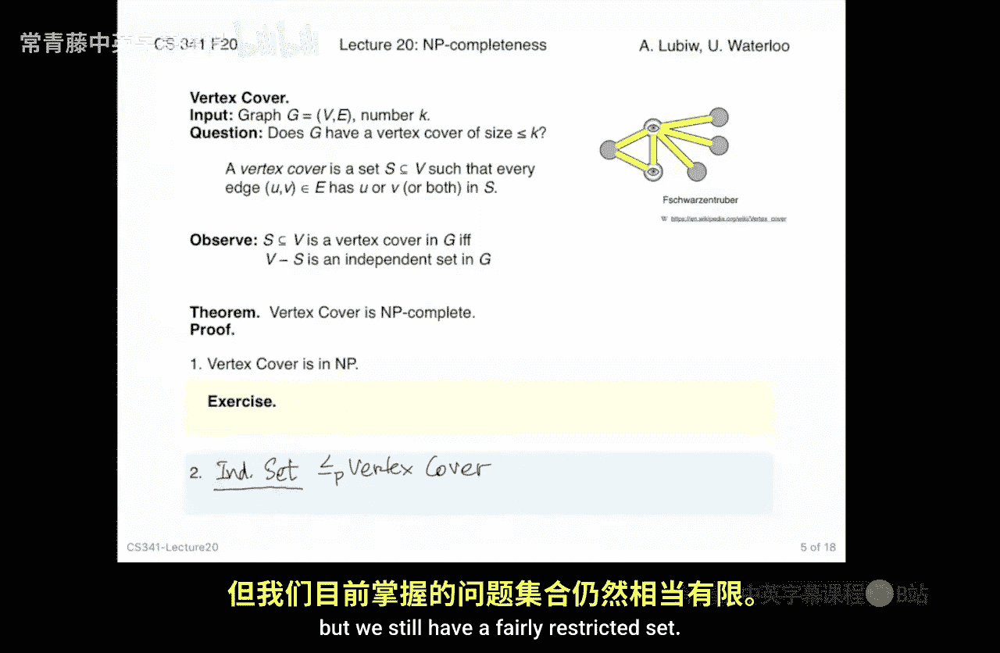
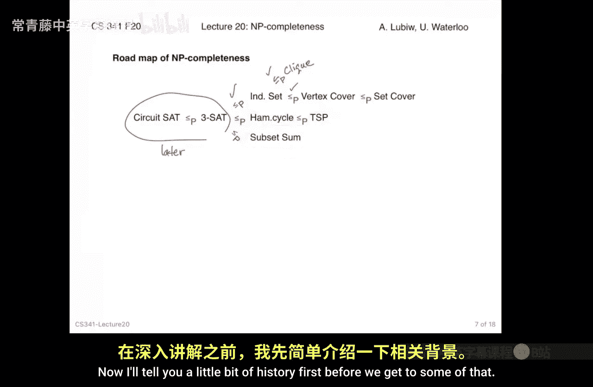
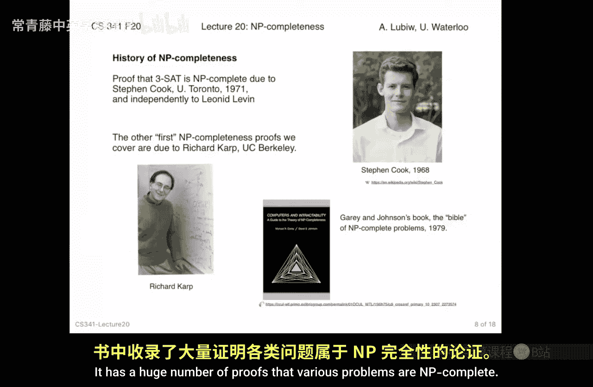
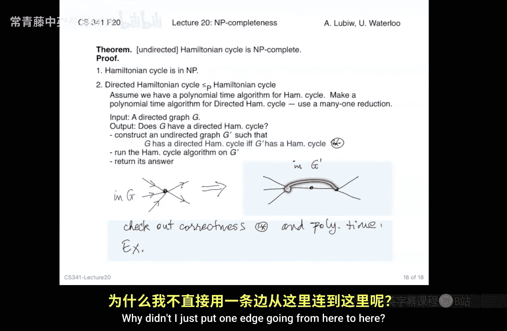
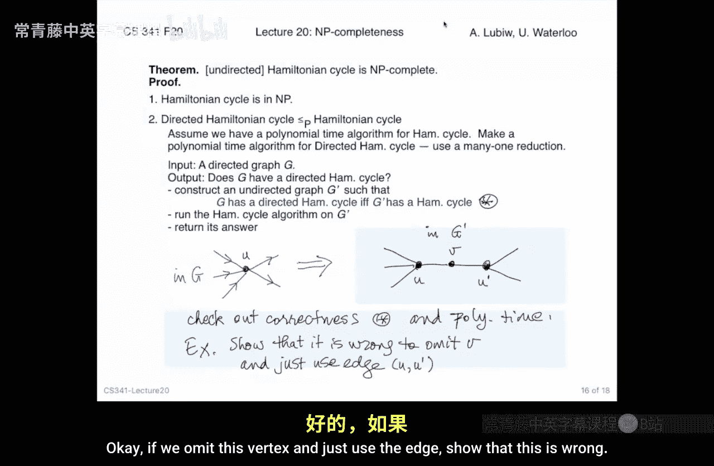
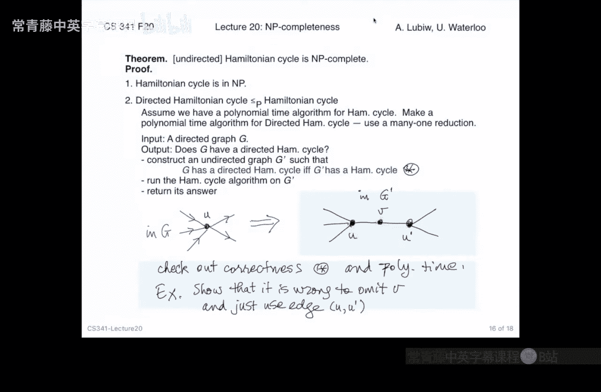
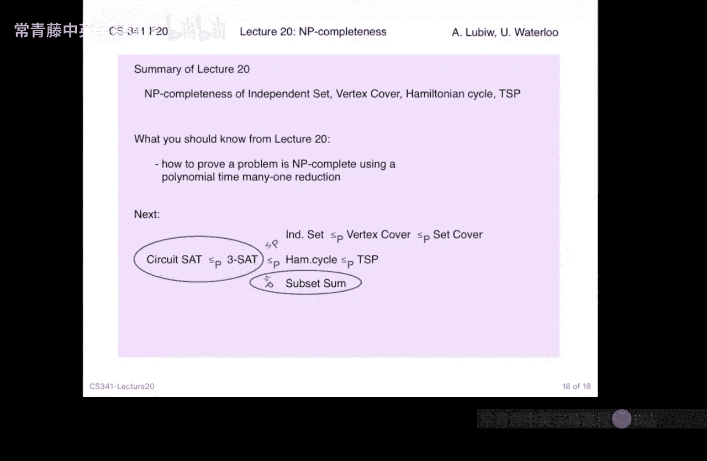

# 滑铁卢大学【中英⚡算法｜CS341 Fall 2021, Algorithms】 p22 P22 Lecture 21 -BV1DhrDBbEwR_p22-

So this is lecture 20， we're going to delve into NP completeness some more。

So if you remember from the previous lecture。We discussed how to prove that problem is NP complete。

 we have to first show that the problem lies in NP it's got to be a decision problem in particular。

 and then we have to be able to have a certificate and a verification algorithm for this step。

And then the second step is to show that our problem Z is harder than some known NP complete problem。

 and we show it's harder by giving a polynomial time many one reduction from the problem X。

 the known NP complete problem to our given problem， Z。

So we're going to look at a whole bunch more NP completeness proofs。

 and maybe before we leap into that， I would like to mention why are we using many one reductions？

So there are a few reasons。A many one reduction is a special case of a turing reduction if remember the difference is that with the Tring reduction。

 we can call our hypothesized algorithm possibly multiple times and some of those times it might answer yes and sometimes no and we do something to combine those answers。

 whereas a many one reduction， the special thing is that we call the algorithm。

 the hypothesized algorithm just once and we output whatever answer it gives us。

So a many1 reduction is a special case of a Tring reduction。

 so it's a stronger result to prove that there's a many1 reduction from your problem X to your problem Z。

So stronger results are more desirable to prove than weaker ones。

 so this is one reason another slightly more practical reason as you're trying to pass this course is that it gives more structure to the proof so it'll make it easier for you to design the reduction and easier to prove that it's correct and finally it's just convention in fact many textbooks will define a problem to be NP complete only in terms of many one reductions and they won't even mention the more general notion I think it's desirable to mention this because this justifies the idea of one problem being harder than another with respect to polynomial time。

Now a question that you might be wondering is is there always a many one reduction I mean I said here it's a special case so if I have two problems that are in the class NP so they're both decision problems and I've shown that X reduces to Z with a Tring reduction the more general kind where I can call the algorithm for Z multiple times then is it always possible to have a many one reduction where I call the algorithm for Z only once and return its answer and this is in fact an open question but it holds in every known case so it's fine for us to restrict to this until someone settles this this question in some other way。

Okay， so the first example we're going to look at of another NP completeness proof is for the clique problem。

 So the input here is a graph， an undirected graph and a number K。 And we're asking。

 does the graph have a clique of size at least K。 And let me remind you that a cleeique means a set of vertices。

 every two joined by an edge。 So if I have a little graph like this。So far。

 this is a clique of size 4， but maybe it's hiding inside some larger graph。

And if I'm asking for this graph， does it have a cleeique of size4， then the answer is yes。

 I can pick these four vertices if I ask is there a clique of size 5。

 then the answer would have to be no。All right， so the thing to observe is that a cleeique and an independent set are really strongly related。

 So for a cleeique， I need every pair of vertices to be joined by an edge。 And if you remember。

 independent set said， I want a set of vertices， no to joined by an edge。 And the。

If we switch what are edges and what are non edges。

 then we have turned cliques into independent sets。

 So let me draw for you the complement of this graph。 remember。

 complement means whenever there's an edge here， there is no edge over here。

 So where do I have edges here， let's see this vertex has two edges here。 So it should have。

Three edges over here。And similarly， this one should have degree3， and that's it。

 a vertex like like this one， it is connected to everything， so it should be an isolated vertex here。

One like this， it is connected to three things in G。

 so it should be connected to the other two in the complement。

So here it is written in notation G complement， it has the same vertex set。

 and you put an edge if and only if that edge does not exist in the primary graph。Okay。

So we're going to prove that the Cique problem is NP complete and we're going to use this strong relationship between CLique and independent set in the complement。

It sort of means the two problems are really kind of the same。Okay。

 so let's look first the first step we need is to show that the Cique problem lies in NP and so we need to say if the answer is yes。

 as in this example does G have a clique of size greater n or equal to4 the answer is yes。

 what certificate would you give you would say which vertices go in the clique and what do you do to verify that this certificate is correct。

 you would check that every pair of vertices is joined by an edge and you would check that you have the right number of vertices。

So here the certificate is the vertices of the clique。And what do we do to verify。

 we would check that there' is greater than or equal to k vertices。

And check every pair joined by an edge。Okay， and this verifies。If and only if。嗯。诶。The verte C is。

 let me call this C， if and only if C is a clique of size greater than or equal to k。Okay。

 and furthermore， the verification takes poly time。Okay。

 so that's all that we need to claim that the problem， the Cique problem is in NP。And secondly。

 we need to show that some known NP complete problem reduces in polynomial time to the clique problem。

 Remember， we always put our given problem here。 And over here on on the easy side。

 we need to put a known NP complete problem。 And that's what shows that our problem is harder than some known NP complete problem。

 So as I've been hinting， we're going to use independent set as our known NP complete problem。

So we assume that we have a polynomial time algorithm for Cique for this problem。

 and we're going to make a polynomial time algorithm for independent set we're going to use a many one reduction which means that our algorithm for independent set will have this form here's the input for independent set。

Here's the answer。 We desire。 Does G have an independent set of size at least K。

 and here's what we're going to do。 We're going to construct a graph G prime。

 chooseose some number K prime。 in such a way that my original G has an independent set of size。

 at least K。 if and only if my constructed graph G prime has a clique of size at least K prime。

 Then I run the clique algorithm on this constructed input and return its answer。

So let's look at the details here。 It's the obvious thing。

 I'm going to let G prime be the complement of G。 So I reverse edges and non edges and how big。

How big clique do I want， Well， the same size as the independent set is supposed to have the same vertices。

 right， So K prime is K。And the runtime， well， this is clearly poly time。In general。

 you have to always be aware when you're writing a proof and you're write clearly。

 you got to really double check it， but in this case it really is clear we constructing the complement of the graph takes at most n squared time and here I'm keeping k prime equal to k。

😊，And finally， for correctness， all we want to claim is what was written on the previous slide that G has an independent set。

O size， at least K。 This is the answer we want for algorithm。

If and only if what we construct G complement or G prime has a clique of size k prime。

 but k prime in this case is k。Okay， so that's all that's needed for this NP completeness proof。

 the problems are really very much the same。Now the next problem we will look at for an NP completeness proof is the vertex cover problem。

 So again， the input is a graph and a number K and a main motivation for this problem is if I have like a network and I want to somehow monitor all the edges to make sure that they are all working Okay there's no blockages along these edges and I can monitor an edge from either of its endpoint。

 let's say so how many vertices do I need to put my monitors at Well。

 I want a set of vertices I like these eyeballs in these vertices in this picture that I got from Wikipedia I want a set of vertices where I can place my monitors in such a way that for every edge。

 at least one endpoint is being monitored so in words this is saying a vertex cover is a set of the vertices such that for every edge either one end or the other end or both of them lie。

My said yes。ok。So that's what the vertex problem is and motivation is monitoring networks。Now。

 the thing to observe here， the secret for relating this problem to a known NP complete problem is that a set S is a vertex cover。

 and I want to look at the complementary set of vertices。 So this one， this one。

 this one and this one， they form an independent set， and that's true in general， right。

 because if I had an edge here， that would be an edge that's not being monitored， right？

 So a set S is a vertex cover if and only if v minus S is an independent set。

I guess I set it in only one direction that if I have a vertex cover。

 the complement is an independent set that let's look at the other direction。

 if I have a set of vertices that is an independent set and I take the complementary set of vertices then that has to touch every edge right because there's no edge that has both endpoints in the independent set Okay so that proves this observation here。

We're going to look at this theorem that says that vertex cover。

 even though we might like to solve it for applications， it's a hard problem。

 no one knows how to do it in polynomial time， it's NP complete。So two steps to that first。

 to show that vertex cover lies in the class NP P， and I will leave that for an exercise。

And the second thing is to show that vertex cover is harder than some known NP P complete problem。

 So I want to。Prove that。 vertex cover。Is harder with respect to polynomial time than some known NP complete problem and already gave you the hint here that we're going to show that independent set。

Is what we will use here。You know， as we build up a larger and larger repertoire of NP complete problems。

 you're going to have more and more choices of what problem you put here。

 but we still have a fairly restricted set。

Okay， so we need to show that In set reduces in polynomial time to vertex cover。

 and we should do this using a many one reduction。So we assume we have a polytime algorithm for vertex cover。

 we wish to make a polytime algorithm for independent set。

 we're going to use a many one reduction for this。So the input for the problem I want to solve。

 the independent set problem is a graph and a number K。The output I want is。

 does G have an independent set of size， at least K。What tool do I have available to me。

 just the hypothesized algorithm for vertex cover， So I am going to construct a graph G prime。

 choose some number K prime。And the property I need is that G has an independent set of size。

 at least K。 if and only if my constructed graph G prime has a vertex cover of size at most K prime。

 So we are turning a maximization problem into a minimization problem。

Then we're going to run the vertex cover algorithm on the constructed input and return its answer。

So let's look at how we will do this construction， so I keep the graph the same in this case。

 but I change my desired set size。And I ask for。A vertex cover。That has size at most in minus k。

The runtime again， this is easy to see， this is a polynomial time。Algorithm。

 I keep the graph the same， I do one subtraction to decide my number K prime and for correctness。

 we have to prove。This statement here。That G has an independent set of size， at least K。

 if and only if。G prime has a vertex cover of size at most K。

 So let's look at the two directions of this here。 Let's suppose that G has an independent set。

Of size， at least k。And let me call this independence said I。

Then I want to claim that if I take the vertices minus the independent set。

Then this is a vertex cover。And the size of the minus I。Is less than or equal to n minus K。 right。

 So we're done。 And in the other direction， it's really the same kind of thing。

 If I suppose that G has a vertex cover。S， where the size of S is bounded by n minus k。

Then the minus S， the complementary set of vertices， is an independent set。Of size。At least， okay。

All right， so that's all that's needed for this proof here。Now。

 a roadmap of where we're going with our NP completeness proofs is。

Recall I mentioned that we are going to do these， these are coming later， right？

We have shown that three set reduces in polynomial time to independent set。

 and we showed that independent set reduces to the Ceeique problem。We did that and we've just done。

This one。And set cover set cover， no， sorry， and in fact， I won't actually do this one。嗯。

Though we might ask it as an exercise or something。

 so what's coming next is to look at some some of the rest of these reductions here。

 the remaining ones Hamiltonian cycle to TSP and subset some。Now。

 I'll tell you a little bit of history first before we get to some of that。

 So the proof that three satisfiability was NPp complete and the formulation of what NP completeness is。

 that was due to Stephen Cook who was a professor at the University of Toronto。

 I think at the time when he did this， he maybe hadn't arrived at Toronto yet。

 but shortly after that， he did。 Here's a photo of him from roughly that kind of time he was young when he was doing this。

And these results are independently due to Leonid Levin from the Soviet Union at that time。

 and communication wasn't so swift between North America and the Soviet Union。

 so these independent results， it wasn't communicated back and forth right away。Now。

 the first NP completeness proofs， like the ones that we've been looking at and we will look more at some more of are due to Dick Carp at UC Berkeley。

 so here's a photo of him。And most of these proofs are reported in this book。

 Comps and an intractability， a guide to the theory of NP completeness。

 and this is considered to be sort of the Bible of NP completeness。

 it has a huge number of proofs that various problems are NP complete。

Okay， so a summary of what we've done in part one of this lecture is we've shown that some problems clickique and vertex cover are NP complete。

 and we're in progress showing you how to prove on your own that various problems are NP complete。

And next， we are going to look at Hamiltonian cyclecle。Okay。

 so we are starting actually with the directed Hamiltonian cycle problem。

So in this case we have a directed graph and I'm asking does this directed graph have a directed Hamiltonian cycle so if we look at this little example here。

 I'm going to look first at this vertex and you'll notice that there's only one edge that comes into this vertex。

 namely this one， so if I'm going to have a directed Hamiltonian cycle I really have to use this edge。

So let me color it red。IHave to come in this way。Now， I have two choices going out。

 but things are pretty symmetric。 Let's， let's suppose that I use this edge going out。

 And here I have two edges going out。 If I were to use this edge going out。

 I would have completed a cycle right there。 And I haven't visited this vertex。 So that's no good。

 I'd better take the other edge that leaves this vertex。And now I can come around here。

 and there is my directed Hamiltonian cycle。Okay， so that's the problem we're asking。

 does the graph have a directed Hamiltonian cycle in this particular example， the answer is yes。

Now we are going to prove that directed Hamiltonian cycle is an NP complete problem。

 then we'll use that to show that the undirected case is also NP complete。So our proof has two parts。

 first we need to show that this problem lies in the class NP again I am going to leave that as an exercise。

And next， we need to show that some known NP complete problem。

Reduces in polynomial time to directed Hamiltonian cycle。

 and we are going to go straight from three satisfiability here。

So assume we have a polytime algorithm for this problem directed Hamiltonian cycle。

 we're going to make out of that a poly time algorithm for three set using a mini1 reduction。

So our input is a three set formula。These are the clauses， let's say。

 and let's say I have n variables。 I want to know if the formula of these clauses is satisfiable。

 I'm going to do it by constructing a directed graph that has a Hamiltonian cycle。

 if and only if the formula is satisfiable。 Then I will run my hypothesized algorithm and its answer will be correct because of this。

Now this seems kind of tricky， the problem seems so very different right in one case I have a logic formula and in the other case I'm asking about directed cycles in a graph。

😊，So。Let's look at this we're going to start by thinking about one variable and trying to make a piece of the graph。

 we'll call it a variable gadget that chooses whether this variable is true or false。

So what I'm going to do is something a little bit like， Let me zip back for one second。

 a little bit like this graph here。 I showed you that we had a Hamiltonian cycle doing this。

 But I could symmetrically have done this， And I'm going to make that be my true false choice。

 Do I go left or right。So I'm going to。Have a start vertex and like an end vertex T。

I'm going to make one edge that goes from T to S， which I have to use because it'll be the only edge coming into my node S。

 And then I'm going to have this idea that I can choose either to go this way or this way。

And rather than just having a single edge from here to here， I'm going to make a long path。

Like with lots of little bubbles on it。So all these edges are directed forward。Left to right。

 and then I'm going to similarly have edges that go right to left。That allow me。To go the other way。

 so all these edges go this way。You might ask， why do I need all these little bubbles because I'm going to connect things together later on？

Okay。So， this is the。Path for my variable。X sub I。I was describing here what to do for one variable x。

And I'm going to think of。The true choice。As corresponding to。Going forward on this path here。

 So this is going to correspond to true。And on the other hand， false is going to be。

 let me choose some other color， maybe here。This path is going to be my choice for false。Okay。Yeah。

So， false。iss the pink choice that goes from right to left and in either case I am using you know。

 in one case I'm using this and following true and coming here and up to there in the other case I would come here and follow my false path and come here and come all the way back。

So that's the plan for how to translate， given one variable。

 is it true or false to translate that choice into a choice about how the Hamiltonian cycle goes through the graph。

Okay， there's our clever trick。Now， how do I put together the choices for all these different variables。

 Here's the idea。 I have variables x1 x2 up to x sub n。

 and I just repeat this gadget here for x1 and then I make a similar gadget for x2 and I have to add these edges like if I went oh。

 I'm going to take the false choice for x1， I still have to be able to connect to either the start or the end of the x2 path and similarly。

 if I took the true choice for x1 again， I have to be able to connect to the start or the end for x2 So I have all those cross edges coming into play。

All right， so this is all the variable gadgets altogether。

 but I haven't yet said anything about the clauses， you know here I have a way to say， oh。

 I would like to make x1 true and make x2 true and maybe later on make X n false right I have a way to do it my final edge I guess didn't get drawn here but it should be there。

But I haven't said anything about the clauses， so I have to tie them into the picture somehow。

And here's the way to do it for each clause， I'm going to make one vertex for it。And if that clause。

 for example， contains variable x1， not x2 and x3， then I'm going to link this node。To the X1 path。

And I'm going to think， oh， if X1 is true if I'm coming along here in this direction。

 instead of taking this edge， I could take a little detour and go to sea and visit it。

 Hamiltonian cycle has to visit it at some point， right。

 and then come back here and then continue on my merry way on my true path for X1。

And if X 3 is the thing that's true in this clause， then it's like， O。

 I'm coming along in the true direction for X 3。 And I could follow this edge to visit， C。

 come back to my path and continue。Now x2 this is negated in the clause right so it has to be that if I'm making the false choice for x2。

 I could hop up and visit C and come back and continue on the path so the thing to notice here。

Is the directions of these edges， This edge went this way and this way。

 Because x1 is a positive literal in the clauses。 On the other hand， X 2 is negated in the claws。

 So my edge coming into sea starts from the right here。And comes back to the left。

So note this and the choice of the directions here， okay。

So the idea is that we must visit vertex C in a Hamiltonian path。Directed Hamiltonian cycle， I mean。

 and we can do it in one of three ways we're hoping either by choosing x1 true and taking this little detour or by choosing x3 to be true or by choosing x2 to be false。

Now， I have to prove that this is the only way I can visit this， right？

So let's look at the proof here。So here is again， just the description of what we're doing。And oh。

 yeah， before the proof， there's one more detail about this proof about this construction that is crucial to making the proof work。

 And that is when I have various clauses that might all contain a certain variable X。

 I'm going to use one of the edges to connect to the clauses。

 but I don't want to use the other ones that are too close。 I want to space things out。

 I want to make sure I have a spare vertex in between places where I connect to one clause。

 the place where I connect to another clause， the place where I connect to a third clause。 Okay。

 I need these spare vertices。 So I need this。 This is not allowed。With that little detail。

 let's finally turn to the proof。I want to show that this graph I constructed has a directed Hamiltonian cycle if and only if the formula I started with is satisfiable。

Let's do the easy direction of this First。 Suppose the formula is satisfiable。

 That means I can choose true and false for the variables， and every clause will have a true literal。

 So what am I going to do to make my Hamiltonian cycle。

 I'm going to traverse the variable paths in the true false direction。 right， if satisfiable。

 there are some true false settings。 Use those true false settings to traverse the paths。

And then for each clause， at least one of its literals has been set true。

 And I'm going to take the detour from that path to visit the vertex C。 There might be more than one。

 more than one true literal in the clause， but I just use one of them to detour and visit the vertex corresponding to the clause。

 And that gives us a directed Hamiltonian cycle。So that's the easy direction of the proof。

For the other direction， suppose that G has a directed Hamiltonian cycle。

 I need to show that this is going to correspond to choosing true false for the variables in such a way that I satisfy all the clauses。

And the part we need to prove is that the only way to visit a clause vertex C is by making a detour off a path and coming back。

I don't want it to be that I come to see in whoops。

 I go to some other path and do some other stuff that would destroy my structure completely。

 I need to show that's not possible。So the only way to come into vertex C is on one of the three edges that are directed into it for its three literals。

 so suppose that I use an edge from A and that's how I visit C I want to show that I have to leave C coming back to the same path not going off somewhere else。

So we must show that we use the edge from C to this vertex little B。In particular。

 here's an example of something forbidden that we want to show is impossible that if I came from E to B。

嗯。Sorry， E to B to A， and then I visited C， and then I went somewhere else， right。

 That's one of the examples that I need to show is not possible。Now， I went from A to C。

Which means I cannot use the outgoing edge that goes to D。So。How did I enter vertex D， Remember。

 it's a spare vertex。 It's only got these four edges connected to it。 So how did I come and visit D。

 I must have come in this way， from the left。And。Then how do I leave vertex D。

 I can't go back where I came from。 So I have to come in here。 So I must use the edge D to a。

And that implies that I cannot come into a from B。 I cannot use the edge B to a。

 so I must leave vertex B going to E。And that means， how did I visit vertex。

 How did I come into vertex B， I cannot come this way， I must have come from C。

 So that's the end of this proof。 It's a little finicky detailed proof that says。

 if I use this edge I have to come back on this edge。

 And so my paths have to respect the structure that I wanted。

 They really are choosing true and false for every variable。

And they visit the clause of vertex off such a path。

 so it corresponds to a satisfying truth value assignment。

So that's the last part of the correctness proof， and for the runtime， we need to say， well。

 this construction takes polynomial time。And for that， we have to say， okay。

 I made one path for each vertex。 how long was that path well number of clauses。Times two， I guess。

 to put in these spare vertices， maybe times three because I need three vertices for each clause。

So three times M。And I put how many vertices， how many clauses vertices just equal to the number of clauses。

 so you have to verify that everything can be done in polynomial time。

And that will complete this proof。So。I had promised you that after the directed case。

 we would also show that undirected Hamiltonian cycle is N P complete。

That will again involve showing it's in NPP， I think we did that once in a previous lecture。

And then to show that directed Hamiltonian cycle reduces to the undirected case。

So what we need to do for that is construct given。Given a。Directed graph。Right。

 an input for this problem。 I want to transform it to an undirected graph and hand it into my supposed algorithm for this。

So。I need to construct an undirected graph G prime in such a way that the directed graph has a Hamiltonian cycle。

 if and only if my undirected graph has one。So。Here's the idea。When I have。Over vertex。

In my directed graph， it has certain edges coming in and certain edges going out。

 Now I can't just drop the directions， right， because then I could maybe make a Hamiltonian cycle that's doing stuff like this and violating the directions。

 So the trick is that I want to somehow separate the edges coming in from the edges going out and make sure that the only thing I can do is come on one of these and leave on one of those。

 And the trick to doing that is to do this construction。 Okay， so in G prime。

Every time I have a vertex in G， I turn it into three vertices in G prime， and I the incoming edges。

 I draw them over here， the outgoing edges， I make them over here， and I put this in between。

So I will leave it as an exercise to check out correctness and polytime。So for correctness。

 it's that blue statement we need to prove。So this part here。And polyly time。

And then an exercise I will leave you with is to say， why did I put this extra vertex in the middle。

 Why didn't I just put one edge going from here to here。 Check out what goes wrong。

So show。😔，That it is wrong。To omit the vertex V。And instead， just use the edge。

Let me label that as well， This is ver it text u， this one's u， this one's u prime。

 just use the edge u U prime， okay。

If we omit this vertex and just use the edge， show that this is wrong。

Okay， and going further， one can show from this that the traveling salesman problem。

 either directed or undirected is NP complete and remember that this would be a decision version of the traveling salesman problem where I'm given a graph。

 it has weights on the edges， I'm given a number K and I'm asking。

 is there a traveling salesman tour a Hamiltonia cycle of weight at most K。

So I'll leave it as an exercise to show that that problem is NP complete by showing that it is harder than the problems we just looked at Hamiltonian cycle directed or undirected。

And as a second exercise to show that Hamiltonian path is NP complete。

 and for that we need a reduction between from Hamiltonian cycle to Hamiltonian path。

 and we actually did look at that。Okay， so a summary then of this lecture。

 we've looked at a few NP completeness proofs， In at vertex cover Hamiltonian cycle and TSP as an exercise。

 and again this is preparation for assignments in which you will be showing NP completeness proofs and what comes next is to show that the subset sum problem is NP complete and then to fill in the first NP completeness proofs。

Okay， that's it for this lecture。

