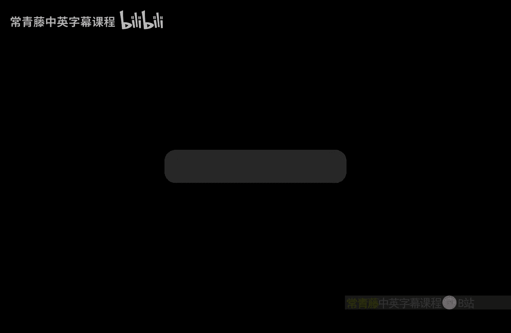
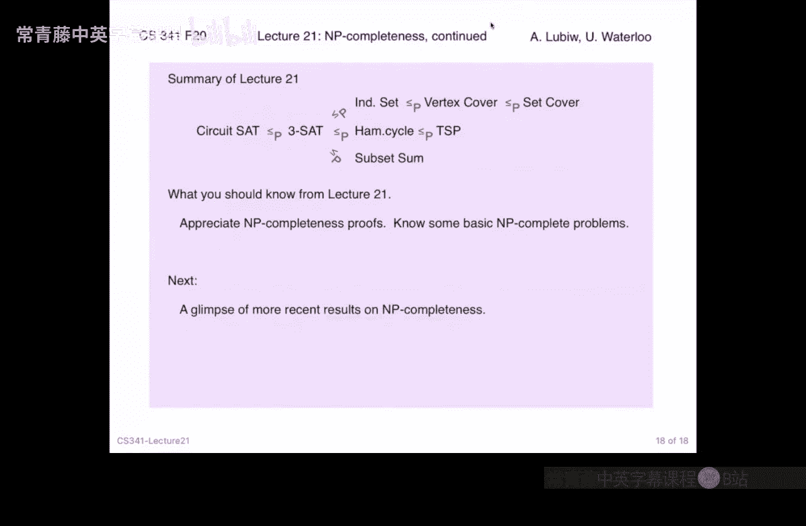

# 滑铁卢大学【中英⚡算法｜CS341 Fall 2021, Algorithms】 p23 P23 Lecture 22 -BV1DhrDBbEwR_p23-

Welcome to lecture 21 this is the last required lecture on NP completeness。

 there will be one more optional or enrichment lecture on current results on NP completeness。So。

What we're going to do in this class are some harder proofs and the goal of this is that you appreciate the last NP completeness results that sort of fill in the theory。

So if you remember from last time we looked at the NP completeness of independence at vertex cover and Hamiltonian cycle this one was a little bit trickier NP completeness proof and all of these。

Well， both independent said in Hamiltonian cycle， we proved straight from three satisfiability。

 so we reduced three satisfiability to each of these problems。

 and that showed that these problems are hard。So what you need to know from the previous thing is how to the basic idea of how to prove a problem is NP complete for that we use in polynomial time many one reductions。

And what we're going to do in this lecture is fill in the proof that subset sum is NP complete with a reduction from3atAT and then we will fill in the very first NP completeness result and show that threeat is NP complete which was our basis for claiming that all these other ones we also NP complete so we've deferred this。

 even though these results sort of come first in this chain。

 we deferred it because these are harder proofs and it's much easier for you to get handle on them after having seen some more more straightforward NP completeness proofs so the proofs that I'm presenting in this lecture are not the kind of thing we would be asking you on your assignments but it's certainly important that you appreciate that there are trickier NP hardness results and it's good for you to see the basis of this theory because you know it's a math faculty。

So let's look at the subset some problem。 We've looked at it before we are the input is a bunch of numbers in numbers and a target capital W and the decision question we're asking is whether there is a subset that adds up exactly to the target capital W。

 So we call the subset S here， we're asking does there exist a set S。

Whose numbers add up exactly to the target？So we're going to look at the theorem that this is an NP complete problem it's hard to believe a little bit isn't it that such a simple thing as just asking for a subset of numbers adding up to a target is already NP complete and no one knows how to do it in polynomial time。

😊，So the proof as always， has two parts first that subset some lies in the class NP。

 and we did that as the very first example of showing that some problem lies in the class NP。

The second step， which is what we will concentrate on。

 is to show that our problem subset sum is harder than a known NP complete problem。

 so we are going to reduce three satisfiability， reduce it using a polynomial time many one reduction to subset some。

So what does that mean exactly， we're going to assume that we have a polynomial time algorithm for subset some。

 and using that we're going to make a polynomial time algorithm for three set here。

So the input to our algorithm is a threesat formula F。 remember that means f is an n of clauses。

 I'm going to suppose there are M of them and each clause is an or of exactly three literals and the literals are either the variable a variable or negation of a variable I'm going to suppose there are n variable so that's the input the output is supposed to be yes or no is the formula satisifiable our plan for the algorithm for the reduction is we are going to start with F and from that construct an instance of the subset sum problem in such a way that it has a solution if and only if F is satisifiable so then we just run the hypothesized subset sum algorithm and return its answer so we have correctness based on this and we have to ensure that the construction takes polynomial time in order to say yes。

 I have a polynomial time reduction。Here。In terms of the big picture we've seen in the last lecture how to turn threeat into what's called a packing problem because In set was a packing problem。

 we wish to pack as many vertices into the graph but a constraint that no two of those vertices are joined by an edge。

 so packing problem we've also turned threeat into a sequencing problem which was the Hamiltonian cycle problem and now we have to turn threeat into a number problem。

 a problem about having a bunch of numbers and asking if a subset adds up to capital W。

So on the face of it， these problems seem very different， having a logic formula。

 a three sat formula that we want to know if it's satisfiable seems very different from choosing a bunch of numbers that add up to something We're going to see how to do this。

😊，So the idea is that choosing the numbers in subset some is going to correspond to choosing true or false for the variables in the three sat formula。

 We are going to construct the numbers by looking at their bit representation and the bits in the numbers are somehow going to encode the information about the clauses So sounds mysterious so far。

 but this is more concrete。 We will start by making a zero1 matrix and I'll say in a second how we make numbers out of the matrix。

 So this matrix is what's called the incidence matrix of the literals versus the clauses。

 So I make a row of this matrix for each literal。 So I have n variables。

 So there are going to be two n rows of this matrix and there's a column for every clause。

 And then I put a one when the literal is in the clause。 So for example， if clause1。

OneIs x1 or not x2 or x3 then in this matrix I put a one for x1 down this column and a1 for not x2 and a one for x3 right so there are three ones down this column every clause has exactly three literals。

 so every column will have exactly three ones in it。

So that's what this matrix is as a general rule for a variable versus a clause。

 I put a one if the variable occurs as a positive literal in the clause。

 for a negation of a variable together with a clause， I put a one if that literal is in the clause。

 and maybe I should add here that I put a zero otherwise。So most of the matrix is zeros。

 there are just three ones down every column and we do assume that no clause contains the same literal twice。

 otherwise we'd be tempted to put it to here and it would muck up our construction entirely。

Okay so the plan now is that we are going to regard the rows of this matrix as numbers so far we've just put zeros and ones along so you could think of represent this as being a binary representation of a number in fact we're going to use along a larger base for a reason that I will explain in just a second so now choosing a number is going to correspond to choosing a row of this matrix and now you have to remember the other thing about subset sum is we wanted to choose some numbers that is choose some rows here to get a target sum so the target sum is the way we are going to ensure that we choose rows to satisfy all the clauses。

So here is the idea of this what I want is for each clause， for example。

 for c1 to make sure that I choose at least one of these literals， so I want to either choose row x1。

or row not x2 or row x3 or two of them or three of them， but at least one of them。

 and I'm going to enforce that by saying that when I add up down this column the the rows that I choose。

 I want to get at least one down this column so for example， if I made。

X1 true and x2 false and x3 false， I would get a sum of two， which is fine with me。

So that's our plan we are going to make one number that。Reflects our。

 our target sums down every column。Now there are a couple of issues with this the first one is that we better make sure that we're not choosing row X and not X I cannot make x1 true and make not x1 true at the same time so I somehow have to enforce that I choose only one of each pair here and the second issue is I said that the target is that I want to have at least one as the sum down this column but in subset sum we need the target exactly so how do I manage that。

The idea for the second one is that what I want for the sum down the column is either one。

 two or three， and what I'm going to do is add some slack rows so that I can ensure that the sum is always four here。

So here is the grand plan。 This piece of the matrix is what I showed you on the previous slide。

 This is a piece that I'm adding to ensure condition one that I just mentioned and this is the piece to ensure condition two that I mentioned let's look at this part first for each column that is for each clause I'm going to add two rows one of them has a one in that column and the other one has a two So here are the two rows I add for column two and I go all the way along here so I am adding two times m。

Rose to my matrix。The point of these is that I can now insist that the target sum down a column is4 because I will be getting one。

2 or three from the upper part， and then I can use one or both of these to ensure that I get a sum of four。

The this part of the matrix is handling condition1。

 which was that I should not choose both x 1 and not x 1。

 What I'm going to do is put a column here for x1。 It has ones in the first two rows here and zeros everywhere else。

And my target sum， when I add up down this is going to be one。

 what that ensures is that I am choosing this row or this row， but not both of them。Okay。

 so this part of the matrix has n extra columns。And I fill in two ones down each column here and finally。

 this part of the matrix just has zeros everywhere， it's not really playing any role。Okay。

 so I was suggesting that we are going to interpret each row as a number in some base and we now see the reason for not using base2 because I want the target to be four here so I will choose a base 10 Why am I choosing base 10 I want some base that's larger than four and base 10 is really familiar to us so that's the reason for choosing base 10。

Now， let's look at the size of this thing that I'm constructing。 I am making。

How many numbers am I making， that's how many rows do I have in this construction and how many digits。

 how many base 10 digits are there in each number？Okay， so I have。2 n plus 2 m numbers or rows。

Right because I have two n of them here and plus 2 m here。

And how many base 10 digits there I need to count， how many columns are there？

And there are n plus M columns， so each of my numbers has n plus M based 10 digits。

Okay so that completes the construction， I make all of these2 n plus 2M numbers。

 I make a target number， which is the base 10 interpretation of this string so in other words it would be one plus 10 plus 100 and so on all the way here plus 4 times 10 to whatever power this works out。

Okay and the first claim is that we can do this in polynomial time。

 This is saying that the numbers I'm constructing are not too large and the pattern of what I'm doing in this matrix is straightforward。

 so I can do this in polynomial time。 The second claim that we need is that the formula is satisifiable if and only if there's a subset of the numbers that adds up to my target W。

 So I've said parts of that， but let's look through the proof in detail。In the forward direction。

 let's suppose the formula is satisfiable。 If variable X I is true， I am going to choose row X sub I。

 In other words， to choose the number corresponding to that row。 If X I is false。

 I pick the row corresponding to not X I。What this means is that the column X sub I。

 remember that would be these columns here。 I had two ones here。 I'm choosing one or the other。

 not both。 So I am getting the target sum at the bottom。So column X I adds up to its target 1。

 The columns corresponding to the clauses are going to add up to 1，2 or 3。 That is。

 if I look down a clause column here， I've chosen at least at least one of the literals from the clauses in order to satisfy it。

 So the sum that I have adding up here is either 1，2 or 3。

 and I'm going to fix that up to get the target of 4 in the following way。If my sum so far is one。

 I am going to add the slack。For that row， both of the slack rows。

And I will get one plus one plus two gives me four on the other hand of the column the upper part of the column adds up to two。

 I am only going to add a slack row that gives me a two and again my sum gives me a four。

And the third case， if the upper part of the column adds up to three。

 I will add the slack with value1 and again that gives me a sum of four。So。

With this rule for choosing the slack rows， I get a set of rows。 In other words。

 a set of numbers that add up to my target。The other direction of the proof。

 we suppose that there is a subset that adds up exactly to W in other words I've chosen some rows and when I add them up in B10 edition。

 my sum is exactly W。Now the first thing to note is that if I look at what I could get down a column。

 there are three， one somewhere here，4，5，6， my sum is at most six。

 and what that implies is that there are no carries when I add things based 10。

 so the column sums must have the target digits。Next we look at the column x sub I because the sum here adds up to1。

 it means I've chosen the row X1 or not X1， so I've chosen row X I or not X I， but not both of them。

 and that tells me how I can set the variables for my formula。

And then because the column for each clause adds up to four。

 but the slack rows give us at most three， if I use both of them I get a sum of three。

 that means I must have chosen a literal to satisfy that clause and that means that F is satisfiable。

So that completes the correctness proof here for this reduction。

So what should you get out of this part of the lecture， first of all。

 that NP hardness proofs can be really tricky， Secondly， that we can use numbers to encode things。

 so starting from three satisfiability， I can turn it into a subset some problem by encoding it as numbers in some sense this should not be surprising to you as a computer science student because that's all that programming is about is turning everything into bit encodings。

Next up， we are going to tackle this beginning part of the theory of NP completeness。So first。

 we are going to show the very first NP completeness result that circuit satisfiability is NP complete and let me start by telling you what is a circuit。

So a circuit is a directed acyclic graph。And it has some sources。

 a source in a directed acyclic graph means a vertex with no edge entering。

 So in this little example picture， these are my sources and those sources are labeled either with variables or with zero or one and these I will call them the inputs to my circuit。

The graph has one sink that means a vertex with no edge leaving。 that's this one。

 and we call that the output。The internal nodes of the circuit， there of three possible kinds。

 either I have a node labeled with an and it has to take two edges coming in exactly two。

And there can be any number of edges going out。The second kind of internal node is an or node。

 again it takes exactly two inputs and it can have any number of edges going out。

And the third kind is the knot gate or the knot vertex。 it takes one input and again。

 any number of output edges。Now we say that a circuit computes an output。

' sort of in the obvious way if I give values for the variables。😊。

Then it will compute something so as an example。If I set x1 equal to zero and x2 equal to1。

 or in other words， x1 is false and x2 is true， what happens in this circuit。

 so x1 is zero but and so my and of x1 and x2 is also going to be a zero。

And that doesn't tell me yet what the output is， right， because it's 0 or something。

 I have to see what this node evaluates to。 So when I negate x1。

I get one coming in here to my orar gate and for x2。I negate my one， I get a0 coming in。

 and and of one and 0 is 0。 So that's 0， and my output would be0。Okay。

 let's think a little bit what this circuit is actually computing here。

This node is computing x1 and x2。And at the top level， we have an ore。And the node here is computing。

 not x1。And not x2。So one way to write this is we're saying either x1 and x2 are both true or x1 and x2 are both false。

 in other words we have x1 is equivalent to x2。In English， this is just saying that x1 is the same。

Has the same value。As x2。Okay， so that's what this little piece of circuit is actually doing。Now。

 what is the decision question that we're asking about circuits？It's the following。

 It's called circuit satisfiability。 The input is a circuit。

 like we just saw in the previous slide as an example。 And the question we ask is。

 can I assign true false values to the inputs in such a way that the output is a1。 And we say。

 is C satisfiable， We say a circuit is satisfiable。

 if I can assign values to the input such that the output is a1 in this particular little example。

 I this circuit satisifiable， we can see it most easily here。 If I set x1 and x2 both to true。

 Then the circuit will output a1。A true。Okay， so we are going to show that circuit satisfiability is an NP complete problem。

Here's the proof first we need to show that it lies in NP I'm not going to say the details because that's an easy thing well within exercise capability for you。

The second thing is we need to show that this problem。Circuit sat。

Is harder than every problem in NP right because this is the first NP completeness proof。

 There is no known NP complete problem。 I can stick in here。

 We don't yet know that any of them are NP complete。

 so I have to show that every problem in NP reduces in polynomial time to circuit set。😊。

And we are going to again use a many one polynomial time reduction。Now this seems hard to do， right。

 how do I handle this for every why？So I'm only going to tell you the high level idea of this proof and what do we know about problem Y when I'm thinking of every y in NP the only thing I know is the definition of NP that there is a polynomial time verification algorithm let me call it A for the problem Y what does the verification algorithm mean。

 what does it do it takes two inputs the first one is the input little y to my problem capital Y and the second input that the verification algorithm takes is I'm calling it G here which is the certificate or the guess I don't want to use letter C because C is the circuit so I'm using G for a guess。

This verification algorithm outputs yes or no， and what is the condition for its output that little Y is a yes instance of my problem。

If and only if there exists some guess or some certificate of polynomial size that makes the verification algorithm output a yes。

Okay。So。We can test or we're not we can test， but the condition of a little Y getting a yes answer is that there is some input that makes this algorithm output a yes。

Now that should start to sound a little bit like saying I have a circuit and I'm asking are there some inputs to this circuit that make it output a yes here we have an algorithm and we're asking are there inputs that make it output a yes。

😊，And I would like to convert that to a question about a circuit outt a yes。

So this is just a repeat of what we had on the previous slide。

So the idea now is to convert this algorithm that has part of its input is known and part of it is like variables。

 It's unknown。 We're asking， does there exist some G， right， so I don't know the G。

 I want to convert this algorithm to a circuit。 The circuit will have some input variables that are the bits of G。

 It might also have some inputs that are just zeros and ones， and that's fine with me。

And I want to do this in such a way that the circuit is satisifiable if and only if there is some G that makes the algorithm output a yes。

So we want to convert an algorithm to a circuit and when I put it that way。

 you should all be totally familiar with this， how do we convert a program to a circuit well we compile it。

 we assemble it at the hardware level， the algorithm is implemented by and or and not gates right and those form a circuit。

😊，So lots of hand waving here I'm not telling you， you know formal definitions of a compiler and asmbler and what happens at the hardware level。

 but your intuition as computer science students is you know this it's happening all the time you program an algorithm and at the hardware level it turns into logic gates okay。

 so we get some circuit C。😊，What are the inputs to this circuit， They are the bits of y。

 which are known some 0，1 values and the bits of G， which we are going to consider as variables。

The internal nodes of the circuit correspond to memory locations after each time step of the algorithm。

Okay， so when we draw this picture of the circuit， you should think of those internal nodes as being the end or a knot gates with their inputs and their outputs。

Now， because we required as part of our definition of NP。

 that the size of G is polynomial in the input size， our little y， and a runs in polynomial time。

This guarantees that the number of memory locations is just a polynomial and the number of steps the algorithm takes is polynomial so the circuit has polynomial size again hand waving here。

 just relying on your intuition of what's happening。So。😊，And finally。

 is so this is the description of the reduction， the construction of the circuit C that I will hand off to my hypothesized algorithm for circuit set。

And here I'm asking the question， does this construction take polynomial time。

 is there an algorithm that converts a into a circuit， well yeah。

 compilers and assemmbbllerrs and all those tools， they do precisely that and they run in polynomial time。

That is all I was going to say here about correctness are。

We have managed to reduce every problem in NP with a polynomial time reduction to a circuit satisfiability question。

 so if only we could solve circuit satisfiability in polynomial time。

 we would be able to solve every problem in NP in polynomial time。

So that's the end of this high level proof， and I hope it's at least given you some intuition。

So that's the end of this part of the lecture， weve shown at least with a hand wavy argument that circuit satisfiability is NP complete。

 and next we are going to show that three satisfiability is an NP complete problem。

So you have to remember what threeS is at this point， so if you don't。

 please stop the video and go look it up， we start by saying3S lies in the class NP and again that is an easy thing。

Next， we are going to show that three set is harder than。A known NP complete problem。

 and now we're going to use circuit set as our known NP complete problem。

So this follows exactly the form of all of the NP completeness proofs we've looked at except for the one we just saw。

So we assume we have a polynomial time algorithm for3atAT。

 We are going to make a polynomial time algorithm for circuitat， the input is a circuit。

 The question is whether that circuit is satisfiable I answer it by constructing a formula out of the circuit in such a way that the circuit is satisfiable if and only if the formula is satisfiable okay then I run the formula through the threesAT algorithm which we supposed ran in polynomial time and I return the answer so this will be correct and polynomial time so long as I can do this construction in polynomial time。

Now the intuition or you know you saw this in CS245 is that circuits and formulas are equivalent。

 I can convert one to the other， so all that's really all I have to do is convert a circuit to a formula。

Now I would like to look at it in a little bit more detail because there's one thing that we need to watch out for in this proof。

 and that has to do with the size of the formula that we are constructing。

So let me first show you the obvious way to convert a circuit into a formula and that would be to go and look at each node and and say what it's computing so here I have。

Nigation， so this node is computing not x3。This node here is computing x1 or not x3。

And I'm plugging along here。I seem to be missing one edge in my picture， let me stick it in here。

Better that's better。 So this my node has to have two inputs right。

 so this one is computing x2 and x3。And this one is negating it， so not x2 and x3。Up here。

This one I have an and so x1 or not x3。And x3。And finally， at the top， I have an oe of these。

 so I have to write down this whole thing x1 or not x3。And。X3。Or because I have an or gate here。

 not x2 and x3， okay？Now， here's the caution about this whole thing。 I this polynomial size， right？

 I only went up 1，2，3，4 levels。 and already， I got something that was fairly large。

 And if you imagine that I went up one more level。 Then I'm going to have here something that is large。

 and here is something that is the same size large， and I am writing down both of them。

 So I am doubling my size at each level。 Here I had just two things in my formula。 at the next level。

 I had four things。 Well， in general， I could have four things in my formula。

 and here I could have eight things in my formula。 So no， this is not polynomial size。 no。😊。

We have to do something better because we have to construct a formula that has polynomial size compared to the size of the circuit。

 I'm not allowed to double at each level。So here is a better way to do this。And the idea is to make。

A variable for every node in the circuit。 So here is an or node。

 I'm going to make a variable corresponding it to it。

 which I will call x sub I will call the variable x sub U。

I will make a variable corresponding to this and this。

 and I will just say how these variables relate at each level of my circuit。

So let's look at this one， for example， what I would like to say is that the variable attached to the top node here is equivalent to x sub v or x subw right that's the meaning of this little piece of this circuit。

Now， the thing we need to note is that equience can be written in terms of an's or's and knots。

 and in particular， can be written in three S form where I have an and of clauses。

 each clause has or's of variables。 So this is the way I convert。

 And I'm going to plug in and do that for this one。 So as clauses。Three sat clauses。U。

My first clause here。Is the following， I say I have to have not X U。Or。X V or x W。

 so that one luckily is already in three sat form。And then the second thing。

 which is what corresponds to this part， there I have to do a tiny bit of work。

 so let me show you the intermediate steps to get this。Cutting off a little piece of my picture here。

 I want， according to the formula at the bottom there， X U or。Not。X，v。Or X W， right。

 And I'm going to distribute the n inside here。 So this is not X v。嗯。

And I should put some brackets not x W remember when we distribute a not over an or。

 it turns into an and and then I use the distributive rule here and my final thing is going to be X U。

Or not X V。And as a second clause， x U or not xw。Okay， so I hope you recall this from CS 245。

 so this here is the little piece of my three set formula that I put corresponding to this piece of my circuit。

And I'm just going to， I'm not going to write each of these down， I have them on the next slide。So。

Here we are saying basically x u is equivalent to the and of my two inputs and when I write that out as threeat。

 just using this， this is what I get work it out as an exercise This one is easy My variable for you is equivalent to not X v and just writing that out from this I get this and then what is my final formula then I have said here how to convert each little piece of the circuit into some threeat clauses right。

The final formula will be the and of all the clauses I get from all the little parts of my circuit。

And together with saying， I want the output to be one， you can't forget this little part here。

So that's the end of this construction why does this construction take polynomial time。

 we have to observe that for each node in the circuit I am making something that is small。

 it's just exactly the size I've written here and the number of nodes in the circuit is the size I'm allowed to use。

So claim one， this formula has polynomial size and we can compute it in polynomial time I won't give more details about that。

 but I hope that couple of sentences I said justify it a bit for you。Secondly。

 we need to prove that the formula we get at the end is satisfiable。

 if and only if the original circuit is satisifiable。So there's two directions of this proof。

 we first suppose that the circuit is satisfiable， that means I can assign true and false to the inputs of the circuit and the circuit will output a one。

We can then assign true and false to all those extra variables of the formula。

 the intermediate ones along the nodes， according to the way C computes。

 and that will satisfy the formula and because the output is one that satisfies the last clause of the formula。

In the other direction， if we suppose that the formula is satisfiable。

 that means we can assign true and false to all the variables。

 the original ones and also all the intermediate ones。

 and that makes the formula true for the circuit I'm going to use the same values on the inputs and because the formula exactly specifies the same computation that the circuit was doing。

 then I know that the circuit computes the value x output and the formula includes the clause that x output is one so the circuit is outputting one for those input values and that means the circuit is satisfiable so that completes the proof of correctness here。

Okay， so finished the final proof that three satisfiability is NP complete based on knowing that circuit satisfiability is NP complete and again。

 this lecture is just that you should appreciate some of these harder NP completeness proofs and also to know some basic NP complete problems。

 circuit S and3atAT。And the next lecture is an enrichment lecture。

 but it will be a glimpse at some of the more recent results on NP completeness。

That's it for this lecture。

