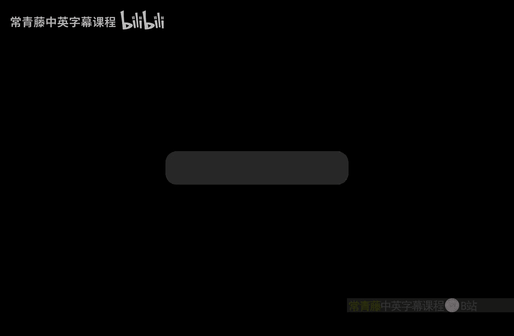
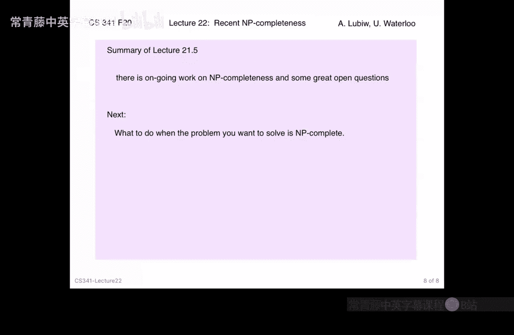

# 滑铁卢大学【中英⚡算法｜CS341 Fall 2021, Algorithms】 p24 P24 Lecture 22.5 -BV1DhrDBbEwR_p24-

This is lecture 22， it's an enrichment lecture， it's an optional one。

 None of your assignments will be based on it。Normally we would give such an enrichment lecture as lecture 24。

 but given that you can watch the videos at any time anyway。

 it makes sense to put this lecture now because it's about NP completeness still。

So the NP completeness proofs that we looked at so far。

 they're all standard and they are from decades ago， theyre from the 1970s。

 and today I thought I would tell you about some more interesting。

 more recent NP completeness results and about some open problems about NP completeness， I mean。

 besides the big open question as to whether P is equal to NP or not。

So let's start with the problems that were listed back in Gar and Johnson's famous book from 1979 that were listed there as being open that is no one knew then if they were polynomial time or NP complete so the first one was linear programming and right after the book was published that was proved it was proved that the linear programming problem is doable in polynomial time I'm not going to describe what linear programming is。

 some of you may have taken a linear programming course if you were at all interested in algorithms I strongly recommend that you take linear programming it's given in the comminatorics and optimization department。

And those of you who haven't taken such a course perhaps know the names of these polynomial time algorithms for linear programming。

 there's the ellipsoid method and there's interior point methods。

One intriguing thing is that those algorithms run in polynomial time when you count the input size in terms of its bits。

 which is a proper way to do it， but it is still an open question whether there is a polynomial time algorithm for linear programming that uses a polynomial number of steps where we mean polynomial in the number of variables and constraints in the linear program。

So an algorithm like the simplex method， but guaranteed to be polynomial time。Anyway。

 that may not have made too much sense to those of you who have not studied linear programming。

 but here are some more that will make sense to everyone。So Priity testing。

 given a number is it prime in 79， that wasn't known if it was polynomial time and it took until 2002 before a polynomial time algorithm was given for that。

The third really famous problem from that time is graphomorphism。

 I'll describe for you in a sec what it is， but it's still open whether that is doable in polynomial time or whether it's NP complete。

So what is this problem？We are given two undirected graphs and we want to know。

 are they really the same up to labeling the vertices different。 So， for example。

 these two graphs they look different。 I've drawn them kind of different。

 they're labeled differently here with ABC and so on and here with X and Y。

 So they're really the same graph right I have a clique of size 4 with one pendant edge here I have a clique of size 4 with one pendant edge。

 So if I relabeled E to x D to y and the other three in any order to these other three I would get exactly the same graph。

 So this is an incredibly useful problem for example。

 in chemistry to know if two chemical compounds are really the same and despite how many decades now of work it is there is still no known polynomial time algorithm。

This nor has the problem being improved to be NP complete。Okay， the next 1 I want to show you。

 it's neither old nor open， but it's just really intriguing。

 So it's a surprising N completeness result。 It's about coloring the edges of a graph。

 So what we would like to do here is color the edges such that incident edges have different colors。

 So， for example， If I made this edge red。 Then I have two edges touching it。

 I would need to make one a different color。 and the third one。 let's say， I'll make it green。Now。

 if I look at this vertex， I I have a green edge， so I need to make the two other edges different colors。

 I can make this one red now， and I can make。This one blue。 And finally。

 I can make the last edge green again。 And now at every vertex。

 you'll notice that the colors of the edges are different。

 the edges that hit that vertex are different。 So that's what we're asking to do。

So as a decision problem， we would say I'm given a graph and a number k。

 can I color the edges of the graph with at most k colors such that incident edges are different colors。

So。This is an NP complete problem。However。Here's the interesting thing。

 If we have a vertex that has four edges， then I'm going to need four different colors for those edges。

 right。So if I look at the maximum degree of all the vertices in the graph and call that delta。

 then I know that I need deelta colors to color the edges of that graph。

And there's an old theorem byvising that says the minimum number of colors that I need to color the edges of the graph is either delta or delta plus1。

It's one or the other of those two。In spite of it just being a question of do I have delta or delta plus one still this problem is NP complete deciding if a graph can be colored with the smaller of these two is an NP complete problem。

 I find that really interesting。Now here I'm starting a list for you of some more recent NP completeness proofs。

 the first one is that Nintendo games are NP hard， this is from 2012 of course you have to express Nintendo games as decision questions in order for this even to make sense and the reduction goes straight from three satisfiability。

Here's another example minimum weight triangulation， This is a result from 2008。

 so also this one took decades of people trying before some Mzer and Rota succeeded。

I'm not going to formally define triangulation， but the idea is that you have a bunch of points in the plane and what you're asking for is to add line segments。

 straight line segments between those points in such a way that you never put line segments crossing each other。

 and you divide the space up into triangles， okay， everything is divided up into triangles here。

 except of course the outside。So the decision question here is we're given points in the plane and we're given some number k and we want to know is there a triangulation where the sum of the edge length is at most k。

 so it has slightly the flavor like minimum spanning tree where we're asking for the sum of the edge length to be bounded。

So that's the decision question and that's what they proved is NP hard。No。This problem。

 curiousiously， it's not known to be in NP。 So we cannot say this is an NPp complete problem。

 We only say it's an Np hard problem because no one knows how to put it in the class Np。

 And the reason is that you might think， okay， I could verify that there's a triangulation with sum of the edge lengths at most K。

 I would just tell you which triangulation to use and you add up the lengths of these edges。

 The trouble is that we are talking in the Euclidean plane and the length of an edge is the square root of the square of the x distance plus the square of the Y distance。

 So because the formula involves square roots。That causes trouble。

 no one knows how to do that in polynomial time to decide if some sum of square roots is bounded by a number K。

And the issue is that square roots， we cannot compute them exactly。

 so how much accuracy do we need to be sure of this decision？

And just a picture here to tell you that triangulations are very， very useful in practice。

 if you take a graphics course， you're often dealing with surfaces described in terms of triangulations。

Okay， a third example and this is just from 2018 so previously when I taught this course this question was among the open questions rather than the recent NP completeness prooft so this is about the rubikk's cube and the question the decision question is given an N by n by n rubikk's cube so here I have one。

 two，34，5， six a seven by seven by seven rubikk's cube here。😊。

So given such a rubbiik's cube in a messed up configuration。

 can you solve it in at most k moves so the input is the messed up cube and the number K。

And what is a move， it's a standard thing you would expect that I rotate one slice here。Now we can。

We can claim this as a。Problem with an infinite set of inputs because I can make n larger and larger By contrast。

 if I fix my attention on the 3 by3 by three rubik's cube。

 then we can't really talk about having a polynomial time algorithm because there's only a finite set of possibilities for a three by three by3 rubbiik's cube like how many different mixed up configurations are there there there are this many Now this is an absolutely huge number。

 but it is a single number， so we cannot talk about asymptotic behavior of an algorithm。So yeah。

 this problem was proved for the N by N by N rubbik's cube was proved to NP complete in 2018。

Maybe I'm tempted to tell you just the tiniest bit more about the standard Rubiik's cube This number is called 43 quintillion。

 it is a vast， huge number some of the early packages of Rubiik's cube。

 it had a little flag at the bottom of the package that said billions of possibilities and to say billions of possibilities is so far off the mark compared to the size of this number that this was taken as an example of innumeracy by Douglas Hofsteadtter who said。

 you know， that is like saying that McDonald's has sold 120 hamburgers to say billions instead of 43 quintillion。

U。And the other thing I want to say here is that the maximum number of moves for the standard three by3 by3 rubbik's cube is 20。

 this is called God's number， but that was only proved in 2013 whereas the rubikks cube had been along around for decades before that so why did it take until 2013 to deal with this finite set of possibilities and show that all the mixed up3 by three by3 rubbik's cubes can be solved in 20 moves。

 why did it take so long just because they were dealing with this kind of number and saying oh for each of these configurations I want to show that it can be solved with 20 moves and there's a fascinating description of how this was done and how much computing time it took and in light of what you guys were working on for your backtracking algorithm it's really interesting。

To see how this search space was cut down。Okay， so now I'm going to turn to some open problems that is these are problems where they are not known to be NP complete and not known to be doable in polynomial time The first one is factoring factoring we normally think of as saying given a number tell me it's prime factorization we want to express that as a decision problem to talk about it being in the class NP So as a decision problem it's given two numbers n and K does the number n have a factor less than or equal to k。

So for example， if I said n is 35 and I asked， does it have a factor less than or equal to4 Well。

 you might first think well， less than or equal to four means that is it divisible by two or three now we don't。

As an algorithm， we don't want to do trial division but in this particular case。

 let me show you a reason why the answer is no here。

 the reason is that 35 is five times seven and this is the prime factorization。嗯。

And none of those factors is less than equal to four。Okay。

So what I'm showing you here is a way to see that the factoring problem lies in co NPp。

 If you want to say for a given input that the answer is no。

 you should just give as evidence the prime factorization of the number N and then just verify that none of the prime factors is less than or equal to K right。

 So this is why the problem lies in co NPp。And why does the problem lie in NP。

 the thing is that if the answer is yes， this number。

 sorry I shouldn't circle that one if the number n has a factor less than or equal to K。

 then the certificate would be the factor， you check that it divides n and you check that it's less than or equal to K so lying in NP is the obvious thing lying in coNp depends on being able to test primes in polynomial time。

So what's curious about this problem is that it lies both in NP and coNP。

 and the best guess would then be that there is a polynomial time algorithm because this is a very strong property for a problem to have。

 it's very unlikely for it to be NP complete given this。So why is this important。

 it's because public key cryptoystem， RSA， it depends on the difficulty of factoring。

And that's dangerous both because factoring seems like maybe it should be doable in polynomial time and also because it has been proved to be doable in polynomial time on a quantum computer。

 Peter Shore showed that in 1994。So because of these two things。

 there is a field of study called post quantumum cryptography。

 which you can look up here and some of the current possibilities of hard problems on which we could base cryptoytems are lattice problems。

 which I won't define， but you can look it up here。So this was our first open problem。

The second one I would like to tell you about， and this is the final one， in fact。

 is the unnot problem， so this is about not theory。

The input is a not diagram and the decision question we ask is does it represent the un not so this is these are two diagrams of the un not certainly just the loop is an un not but also this one if you imagine having string in this configuration in three space I would just untwist at the bottom here and untwist at the top and then my string would look like this so that's the question we're asking given a loop of string in three dimensionmenal space can I just do little twists until it looks like this。

Here by contrast is an example of something that is a real not， it is not the unnot。

 and the thing is if you had string that's in this configuration in three space。

 there's no way you can just untwist it and get to the single loop。As a third example。

 this one is this the un not or not I've forgot actually forgotten the answer。

 but I kind of think I took it from this Wikipedia page so you can look it up there。😊。

So that's the decision problem， we're given a diagram like this or this or this one。

 and we want to know can I just untwist my string to get make it look like this？Now。

 this problem was shown to lie in NP， that is when the answer is yes， as in this case。

 there is a way you can give a certificate and verification algorithm。And that was only in 1999。

And only in 2016 was this problem shown to lie in Co&P。Which again， means that when the answer is no。

 there's some certificate and verification that the answer is really no。

So this is another fascinating problem that lies in both NP and CONP。

 like factoring and yet no one knows a polynomial time solution。

And no one knows that if the problem is NP complete。Okay。

 so I've given you a little taste of sort of more current research on NP completeness and some great open questions。

And next in the course we will return to the required course material and talk about what to do when the problem you want to solve is NP complete we've had one lecture on that already。

 which was the exhaustive search algorithms and the other remedy we will look at is approximation algorithms so that will be the topic of lecture 23。

That's it for this lecture。

