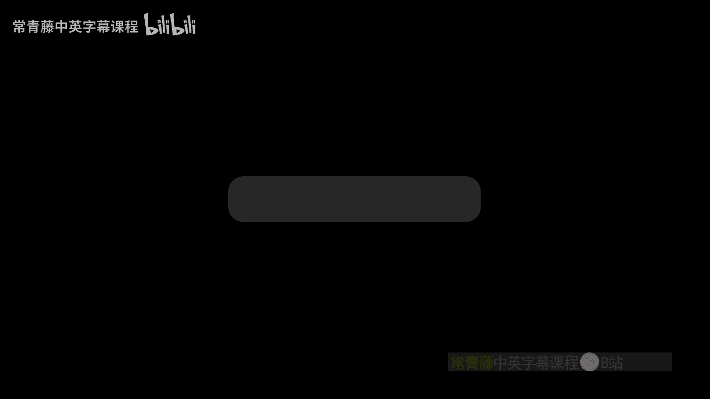
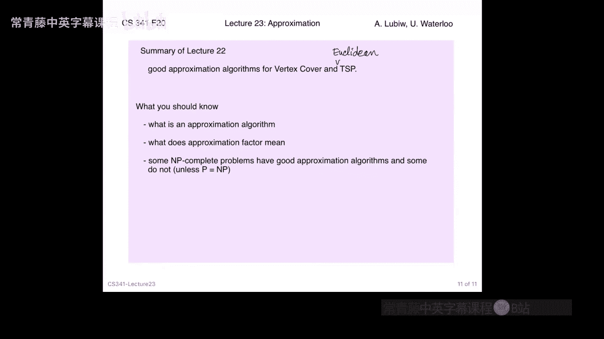

# 滑铁卢大学【中英⚡算法｜CS341 Fall 2021, Algorithms】 p25 P25 Lecture 23 -BV1DhrDBbEwR_p25-

Hello everyone and welcome to lecture 23 on App algorithms。

 this is the second last lecture of the course and the very last lecture will be about undecidability a different topic again。

So if you remember the last lectures have all been spent talking about NP completeness。

 the problems for which nobody knows a polynomial time algorithm and no one knows how to prove that such algorithms don't exist and in this lecture we'll say something about what to do with those NP hard problems or NP complete problems Now there are several main approaches。

 One is the exhaustive search that we discussed back in lecture 17 and that your programming assignment was about so backtracking and branch and bound techniques these are algorithms that are exponential time in the worst case。

 but there are occasions when we actually need them。

A second approach which we are not spending time on this in this course are heuristics these are algorithms where there might be no guarantee on the runtime nor on the quality of solutions but they might work fairly well on many inputs and they can be useful some examples are algorithms local search algorithms the idea here is to start with some solution and then try to improve it with small or local changes hill climbing is an example of this as is simulated and yielding。

Another possibility is different models of computing， for example。

 particle swarm or evolutionary algorithms， you can read something more about all of those on this Wikipedia page。

Now a third approach and this will be the topic for today is approximation algorithms。

 so what this means is we are going to have algorithms that run in polynomial time and give some provable guarantee on the quality of the solution for example。

 if we had a minimization problem we might be able to guarantee that the solution is not the true minimum but bounded by twice the true minimum and that can be pretty good in situations some situations。

So we're going to look at two examples。 The first one is vertex cover so here I have a reminder for you about what the vertex cover problem is a vertex cover is a set of vertices so here the ones marked with the eyeballs that are able to guard all the edges in other words for every edge in the graph one or the other end point or maybe both of them lie in our set s so this edge for example。

 is being guarded from both ends this edge is only being guarded from this end but there every single ver every single edge in this graph is being guarded from one end or the other or both。

And as an optimization problem， we want to find a vertex cover that has minimum size。

 we want to guard all the edges but use as few vertices as possible and back when we first discussed this problem I mentioned that there are applications to networks。

And a main thing we talked about for the vertex cover problem is that the corresponding decision version is n complete remember the decision version means that I'm given a graph in a number k and I ask is there a vertex cover of size less than or equal to k？

Now for this lecture we're going to be talking about the optimization problem。

 we want to find the minimum size of a vertex cover and we want to find the actual vertex cover。

 so this is what's useful in practice right？😊，So we're going to look at two possible algorithms。

 they both have a greedy nature。And so here's the first algorithm。

I initialize my vertex cover here I'm calling it C。

 I initialize it to be the empty set and I repeat the following step until all the edges are covered which is I choose a vertex of maximum degree in the graph and I add that to my vertex cover and I remove the edges that are covered as a result so let's look at this little example down here the vertex of maximum degree in this graph is this one because it's connected to every other vertex right so it has degree 4 This one for example only has degree 2 this one has degree 3 degree3 and degree 2 so the maximum degree vertex is unique and it's this one So my set C will contain V1 and once I put V1 in then I've covered this edge this edge。

This one and this one and what's left of the graph is actually a path。

 so it has vertices of degree2 and vertices of degree1。

 so in the next step I would choose a vertex of degree2 to put into my cover。

So let me circle this as the first thing I put in and let's choose V4 instead of V3 at the next step。

 so V4 is the next vertex I put in。And now I kick out the edges that are covered by that vertex。

 which are these two and what I'm left within my graph is a single edge。

 no neither endpoint is in the cover so far， so I can choose either endpoint of this edge and let's suppose that I choose v sub3 as my last vertex。

So now I have a vertex cover of size three。Is that the minimum in this graph I believe that it is the minimum？

Seems optimum。That is to say， oh， of minimum size。Now in general。

 this algorithm will not always find the minimum size vertex cover。

 so I'd welcome as an exercise that you try to find such an example。

 I'll write it down on the coming slide because I'm going to suggest something a little bit more general。

One thing good about this algorithm， though， is that the algorithm runs in polynomial time。So note。

The algorithm。Runs in polynomial time。I'm not going to analyze precisely。

 I mean we would care to do that in general， but i'm not going to focus on that for this lecture。

 you would have to update the degrees when you remove the edges。

 you have some notion of how to do that you've done that in some assignments。Okay。

 so this is one possible algorithm， and although it does not always produce a minimum size of vertex cover。

 we might like to know how well does it do compared to the optimum。I'm not going to jump into that。

 rather I am going to present you another algorithm， it's also a greedy algorithm。

And it works as follows， we initialize the vertex cover to be empty。

 and we initialize a set of edges to be the whole set。

 and F in general is going to be the set of edges that aren't covered yet in my algorithm。

So while that set of uncovered edges is not the empty sat， here's what the algorithm does。

 it picks some edge from the uncovered edges and it adds both the endpoints to the vertex cover it's sort of like。

 oh I'm making sure I am covering this edge from both ends。

Then we remove the edges that are covered by U and we remove the edges that are covered by V。

 and then we repeat around the loop。So let's look at an example of how this algorithm would behave。

Let's suppose that the first edge I pick is this one。

So then my vertex cover would now have V1 and V5 in it， right。

 because I put both endpoints of the edge in。Now once I've done that。

 I've covered as well the edge I choose I've covered。

 but I've also covered all the edges incident with V1 and all the edges incident with V5 and so the edges that are left are these two。

And my algorithm now says， pick another edge from this set。

 So let's suppose that I next pick this edge。 I wanted my red color。 Next suppose I choose this edge。

 Then what I would add into my vertex cover are the vertices V3 and V4。

So what we're getting here is that the size of the vertex cover is four。

 there are four vertices in it， this is not optimum because we saw a vertex cover of size3 by the previous algorithm。

And so another very good question to ask would be which is better Al one or algorithm two if we were in a classroom I'd ask you all to vote it would sort of seem that this algorithm here is kind of wasteful because when it looks at an edge it puts in both the endpoints。

 which seems sort of redundant so your first guess might be that algorithm one is better in general。

 certainly in this example that we ran Al one was better。

But I challenge you to find as an exercise an example graph where algorithm two is better。

 so first I will note that on this example graph。And I guess the behavior of the algorithm also depends on the order in which we choose。

 for example， the edges here or in the case of algorithm one。

 the order in which we choose noticetics when there's ties for the degree。

 but let me say on this example for this particular run algorithm one is better。Okay。

 and the exercise I'm suggesting is to find an example。Where algorithm2 is better。

And that in particular， we'll be finding an example where Al one does not find the optimum solution。

 right？Okay， so let's turn to some analysis of this。

 so we are going to analyze the approximation factor of algorithm2。

 which is repeated here for your convenience So let's lets C be the vertex cover that is found by algorithm2 and i'm going to use C sub opt to mean a minimum vertex cover and what I'm going to prove for you is that what the algorithm finds is at most twice the minimum So this is where we're getting an approximation factor of two it's pretty good so let's look at the proof of this。

The first thing to know is that。This algorithm。Is picking certain edges right if we look back at the example I chose this edge and this edge and what's the property of the edges that I choose。

 I claim that they are going to form a matching a matching means that no two of these edges that we choose share an end point so that's the first observation。

Not that。The edges you choose。The edges that are chosen form a matching。

Im thinking that all of you have seen matchings back in。Math 239， is it called？嗯。

And what a matching means is that no two edges are incident。None of them have an endpoint in common。

Okay， so in terms of the picture， I'm going to have something like this， the edges that I choose。

Forma matching， there's other edges in the graph， which I'm not drawing， okay？

Now the size of the cover that this algorithm is choosing。

 remember every time I pick an edge to go into my matching here。

 I'm adding both the endpoints into it， so that means that the size of the cover I'm getting is twice the size match of the matching that I choose right？

Now， the second observation is that any vertex cover。

 if I think how does it behave in terms of the matching？Any vertex cover。

 it's got to guard this edge right so I have to have one endpoint or the other of this edge。

 and similarly for this edge， I have to have one endpoint or the other or maybe both and and also for this edge。

 I have to have one endpoint or the other and no single vertex is going to work for for more than one edge of the matching right because the matching edges don't share any ver vertices。

 So any vertex cover must have。At least one end point。At least one vertex。From each matching edge。

From each edge in。In M in particular， right？So this means that if I look at the size of my optimum vertex cover C optt。

 remember that was the name we were giving to it， that has to be at least the size of M。

For every edge in M， I need at least one vertex in my optimum vertex cover。

 and then I put these two things together。 Okay， so the size of my cover is twice M and twice M is less than or equal to twice ought so。

The size of the sea that I chose。Is at most twice the size of C subopt。And that's it for this proof。

Okay。This proves our claim that this algorithm。Produces a vertex cover of size at most twice the optimum。

Now， what we say about that， the term we use to describe that behavior is that algorithm 2 has an approximation factor of two。

 that means that it produces a vertex cover of size at most twice the optimum。

Both of the examples I'm going to talk about in this lecture are minimization problems。

 and then our goal is also that the always that the approximation algorithm should produce a solution that is bounded by some constant times the optimum if we were dealing with a maximization problem。

 then instead we would want to say， oh， I have at least half the optimum or at least a third of the optimum。

 but both the examples I'll deal with today are minimization problem。

 So they have this kind of flavor here。Now you might be wondering well algorithm1。

 which sort of seemed like it was going to be a better algorithm。

 remember that was the algorithm that was greedily chose vertices by their maximum by maximum degree first algorithm one has an approximation factor that's like log n so instead of this constant factor two we have a log n factor appearing so in the sense of what can we prove about approximation Al one is worse。

 so algorithm2 is the good one to be using here。And another thing I wanted to mention about this approximation for a vertex cover。

Remember from our NP completeness proofs that vertex cover and independent set are very closely related。

 let me go back for a sec to the very first slide here about vertex cover。

 if you remember what we talked about is that if I take the vertices that are not in my vertex cover they have to form an independent set。

So finding a minimum size vertex cover is the same as finding a maximum size independent set。

 and that was at the heart of showing that vertex covers NP complete based on the fact that independent set is NP complete。

And so you might be wondering， okay， we have this good approximation algorithm for vertex cover。

 can I translate that over and get a good approximation algorithm for independent set。

 and the answer is no， and it has to do with saying that oh you know if I have a here's my optimum vertex cover。

 let's say， and I have a pretty good approximation for it， not too much bigger。

 but then when I look at the complementary sets， I may be very far off in terms of my approximation ratio。

And it's a fact which I'm not going to prove to you。

 this is much more advanced than for this course that In set has no good approximation algorithm。

 like with a constant factor。Two for independent set unless p is equal to NP。And the course。

 the more advanced course on algorithm CS 466 would cover things like that note that this is like a lower bound kind of result。

 so it's quite a difficult thing to prove。Okay。So a summary of the first part of this lecture we've seen two approximation algorithms for vertex cover。

 one of which had a very good guarantee the vertex cover it produced was less than or equal to twice the minimum size what you should know out of this part of the lecture is what does it mean to have an approximation algorithm and what does approximation factor mean。

And just to know this fact that some NP complete problems have good approximation algorithms and some like Independence said。

 do not unless P and NPP collapse and everything is doable in polynomial time。

Next up in this lecture， we're going to look at an approximation algorithm for the traveling salesman problem in the plane。

Okay， so let me remind you what is the traveling salesman problem we are given a graph an undirected graph in this case。

 we have weights on the edges and a number K and the decision version asks does this graph have a traveling salesman tour of length less than or equal to K and remember what this meant is it's a Hamiltonian cycle and the length means I add up the weights of all the edges that are used in this cycle the cycle has to visit every vertex exactly once。

Now the Euclidean traveling salesman problem is a special case of this。

 it's when I have points in the plane as my vertices so here I have all the capital cities of all the states in the United States and I have a complete graph on this set so there is every possible edge here and the weight on an edge is the Euclidean length。

 so the length between this point and this point in the plane。Um。

Now the Euclidean TSP problem is even though it's a special case， it is still NP complete。

 we're not going to look at this， I'm just stating it as a fact but we're going to look at a nice approximation algorithm for Euclidean traveling salesman problem and the key property that Euclidean traveling salesman problem has that the general case does not have so the key property we're going to use in our approximation algorithms is the triangle inequality what this says is that if I have a triangle and remember now we're talking points in the plane and Euclidean length for these edges the length of the edge from a to C is less than or equal to the length from a to B plus the length from B to C so this is just saying a straight line is the shortest distance between two points you learn that back in high school okay this is what we're going to use at the heart of our。

Approxiation algorithm。So let's look at what this algorithm does。嗯。

So the algorithm first computes a minimum spanning tree of the points。

 so remember we discussed general polynomial time algorithms to compute minimum spanning trees。

And in this particular example， let me show this minimum spanning tree in black。So I have。

I'm just making a guess at this based on the lengths we would have to run Cru skull's algorithm to be certain if this is the real minimum spanning tree right this one looks pretty good。

 so we compute the minimum spanning tree， which is polynomial time。

And the next step is that I'm going to make a sort of tour。 It's not a TSP tour yet。

 but a tour by walking around the spanning tree。 So what do I mean by this， Let me show you in。

Let's see。Color blue。What this tour would do I'm going to start up at the top vertex and start traveling in this direction。

 so i'm going to visit this point come and visit this one walk on this edge， walk over to here。

Walk down here。To hear， to hear and come back to the start。

Okay so this is my tour that walks around the tree twice and visits every vertex。

 but it visits some vertices more than once right we can actually be more specific about this I visit this vertex once here。

 once here once here， the degree number of times。嗯。Okay。

 and then the third step of the algorithm here。Is that now I'm going to take shortcuts to avoid revisiting the vertices and here's where we're going to be using the triangle inequality to say。

 oh， the shortcuts are shorter than not using them。So what does this do， I start at the same place。

 I say， okay， I'm going here， going here， I'm traveling in this direction。 I go to this vertex。

 Now the blue tour is trying to revisit this vertex at this point。 I say nope。

 but I don't want to revisit this instead I'm going to hop to the next vertex。

 And so my next red edge would be this one。And the observation is that that edge is shorter than doing this and then this。

 okay？Next I start following my blue tour again， I come to this vertex and here's another place where I would go back to this one on the blue tour and say nope。

 I don't want to do that， let me hop ahead and go to this one。So my tour would next go to here。😔。

And again， the blue tour would revisit this， revisit this。 revisit this。

 I don't want to do any of those。 I want to hop ahead to the next new vertex。And then finally。

 I will not revisit this one， I'll go directly back to the start。Okay。

 so this is the final tour in red。O。So note that this algorithm takes polynomial time we know how to compute a minimum spanning tree in polynomial time I can certainly define this blue tour and I can certainly examine you know have I seen this vertex before if not proceed to the next vertex in the blue tour so this algorithm takes polynomial time again I'm not doing a more exact analysis just because。

You all know how to do such an exact analysis and that's not our crucial point in this lecture。Okay。

 what is our point in this lecture is to look at how good the tour that we find with this algorithm is compared to the length of a minimum traveling salesman tour。

And the claim here is that we are getting the same good factor two approximation that we happen to get for vertex cover。

 so there's no relationship between the factor two we got before and the factor two we're getting now。

 but we are getting a factor of two。What this means is that in polynomial time。

We can find a traveling salesman tour for the Euclidean TSP problem that's within two times the optimum and that's a very nice and very good result it does not hold for the general traveling salesman problem if we could get a factor2 approximation for the general traveling salesman problem than we would be able to solve TSP and polynomial time that's again something more advanced that you might see in CS 466 but it's actually not that hard to prove of this one。

Okay， so let's look at the proof of the claim。😊，嗯。So。

I'm going to make use of this relationship with the minimum spanning tree。

 so I'm going to let T sub MST be the length of the minimum spanning tree of the given set of points。

And the first thing we're going to observe is that the length of the minimum spanning tree is length less than or equal to the optimum length of the TSP tour。

 And the reason for this is that because。If I think of having the TSP tour and removing one edge。

 then I do have a spanning tree， some spanning tree。

 and so the minimum spanning tree is going to be even less。So because deleting。One edge。

Of the Opimum TSP tour。So I guess I should stick this ear in here。The Opimum TSP tour。

It shortens the total edge， right total length， it decreases the length。

And it gives some minimum spanning tree。And therefore， the optimum spanning tree。

Or the minimum spanning tree， I guess I should write。Minimum spanning tree。Has even less weight。

Even less in like， let me write just to be more precise okay。All right。

 so the way our algorithm worked is it found a tour that let me step back to the previous slide。

 The blue tour， if I look at the length of the blue tour it covers every edge exactly twice right So the length of the blue tour is exactly twice the length of the minimum spanning tree。

 and then what I do to get to the red tour I took shortcut。 So I use this edge instead of those two。

 So what this justifies is that T is less than or equal to twice the length of the minimum spanning tree。

Because。The MST。The blue tour， let me write it this way， the blue tour。Has length。Twice the MST tour。

And then we take shortcuts。And shortcuts really are shortcuts。

 so here is where we are using the triangle inequality。😊，Very important that we have that。Okay。

 and I put these two together and this says that T。

 the tour that we find is less than or equal to twice the MST length。

 which is less than or equal to twice the optimum。Traveling salesman to length。Okay。

 so another short and sweet proof that we are getting approximation factor two。Okay， so。

We say that this algorithm has approximation factor two because it runs in polynomial time and finds a tour of length at most twice the optimum。

Now I'm putting as another fact here something that's more advanced than we're going to cover in this course。

 but that factor of two can be improved for this problem in particular we can get as close to one as we want so for any epsilon greater than zero there is an algorithm that finds a TSP tour of length less than or equal to one plus epsilon times the optimum。

And the one caveat with this is that as epsilon gets closer and closer to zero so as we get closer and closer to the true optimum traveling salesman tour the runtime of the algorithm grows exponentially so if I choose a fixed epsilon like let's say epsilon equals a half and I say okay I want within one and a half times the optimum tour then it runs in polynomial time but if I say let me look at that behavior as epsilon goes to zero that runtime goes to an exponential runtime。

😊，Again， this is something that you would see in more detail in CS 466。Okay。

 so a summary of this lecture we have looked at good approximation algorithms for vertex cover and for Euclidean traveling salesmen。

 I should put that in here， Euclidean。And in both cases， those algorithms ran in polynomial time。

 and in both cases， they happened to give us an approximation factor of two。

What you should know out of this lecture is what does it mean to have an approximation algorithm。

 what does it mean to say that the approximation factor of an approximation algorithm is two。

 let's say， or four or something else。And to know the fact that some NP complete problems like vertex cover or Euclidean TSP。

 they have good approximation algorithms and others， like In said， don't unless P is equal to NP。

And that's it for this lecture。

