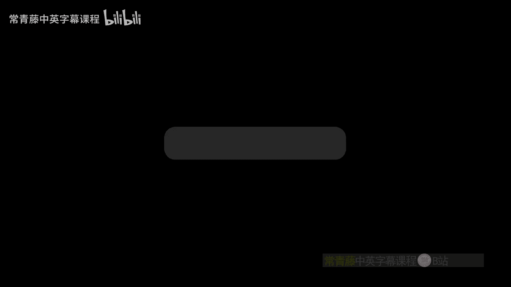
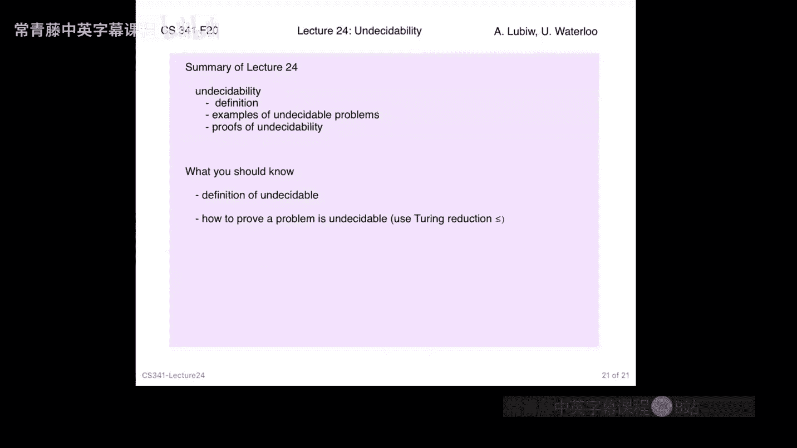

# 滑铁卢大学【中英⚡算法｜CS341 Fall 2021, Algorithms】 p26 P26 Lecture 24 -BV1DhrDBbEwR_p26-

嗯。Hello， this is lecture 24 the last lecture of the course and it's about undecidability undecidability is a topic that is in CS360 theory of computing course but when that course was made no longer required then everyone thought oh no。

 but people need to learn about undecidability when their computer science majors and the end result is that you're seeing undecidability probably several times maybe you've seen it in first yearear a little bit it's covered in CS245 I know we're covering it in CS341 and then if you take CS360 you see it again there。

Anyway， it's a fundamental concept in computer science， so it's worth seeing more than once。

 and I do hope I have something new to tell you about it。So so far in this course。

 we've been concentrating on efficiency of algorithms。

 polynomial time versus exponential time most recently in the NP completeness portion of the course and the bad news there is that there are some problems。

 the problems that are NP complete， that seem to have only exponential time algorithms and what we're talking about in this lecture is the worst news that there are some problems that have no algorithm at all。

 never mind how much time it takes to run it。So let me begin by describing a few examples of this for you the first one is program equivalents given two programs do they do the same thing that is to say do they produce the same output for the same input this is the problem that the Ts have to deal with all the time for your programming assignments they want to know if your program that you wrote does the same as the model program that does the right thing unfortunately there is no algorithm to do this and that is why your program is only being run on some set of tests inputs it's because there's no program to do in general this test。

A second example of a problem that provably has no algorithm is the following tiling problem we're given a finite set of tiles for example these three by41213 tiles and each tile has a color on its side so this one is red on this side green on the bottom side this one is yellow over here and blue on the top these tiles cannot be rotated and the question we're asking it's a decision question is can you use the tiles to tile the plane where colors have to match so I can put this tile below this one because they would match on blue however I could not put this tile up against this one because the colors here do not match。

And yeah， so here's an example of part of the tiling of the plane。

 it doesn't go on forever in this picture using these 13 tiles。Now this decision question。

 I'm saying there is no algorithm for it， and one of the intriguing things that shows a little bit wises a difficult problem is that this set of tiles does tile a plane。

 but only a periodically。You might imagine that if we had tiles that tile the plane and it essentially tiles some portion and then repeats that portion over and over。

 then you could imagine having an algorithm that would somehow check， oh。

 for this finite piece of the plane can I tile it and in such a way that you know this is allowed to join to this and this part here can join to this。

 then I would have a periodic tiling of the plane。However。

 the fact that there are tiles that can only tile a periodioically gives you a hint that this problem is really。

 really difficult。My third example is the halting problem。

 this would be one that you have heard about in previous courses。

 it's simple given a computer program does it halt？

And that is a problem for which there is no algorithm。

Now I said does it halt so you might be saying well does this mean on all the inputs on some inputs on a specific input。

 I'll clarify this later， all these versions are in fact undecidable there is no algorithm for them。

 but let's look at a little example here's a tiny little program it starts with a natural number and while the number is not equal to one we subtract two。

It's really easy to say when this halts， it halts if and only if we are given an odd number because that's when you will get down to one eventually right if you have an even number you're going to get to zero and then go off into the negative numbers。

 so this is an example of a program where it's easy to tell if this program halts。

Here is a program that's only a little bit longer。And no one knows if this program halts what is this program doing again。

' its halting condition is the same， but we look if the number is even then we divide it by2 and if the number is odd then I do3 n plus one so as a little example of what's happening if I started with n equals 12。

 that's even so I divide by 2，6 is even so I divide by 23 is not even so I have to do the three n plus1 and I get 10 10 is even so I divide by 255 is odd so I multiply by3 and add1 I get 16 aha now 16 is a power of two right so then I'm going to go8。

4，2，1 and that's where we halt。Okay。So the question we're asking here is does this program halt on all inputs and nobody knows the empirical evidence is that the program has halted on every input that has ever being tried。

 I don't know offhand what is the largest input that's been tried but you can find that on this Wikipedia page。

 and it's called the3N plus one problem or it's also attached to the names of various people。

 Paul Erdish who's a famous was a famous mathematician combinatorialist。

 what he said about this is that mathematics may not be ready for such problems。No。

More generally than this3 n plus one problem， I can convert any math statement about existence of a number to a question about a program halting and what this means is that questions about a program halting can be very deep and very hard so here's the general pattern if we want if we have this math conjecture that asks。

 does there exists a number n such that fo of n holds then I can turn that into a program I start with n equals1 and I say while not fo you know。

 continue to the next number so when will this program and it will end if it finds a number such that fo of n holds right so as a more specific example we could take gold box conjecture which is open it asks whether every even number is the sum of two primes so to turn it in this form of does。

that exist we're asking does there exist a number of the form two to the n that is not the sum of two primes so you could then turn it into a little program like this and no one knows if that program holds。

So whenever the existence question is open as it is for Goldbs conjecture。

 then no one knows whether the corresponding program halts， so that's just to justify yes。

 it's very deep and hard to ask if a program halts。Now we formalize that notion with his definition。

 we say that a decision problem is undecidable if it has no algorithm。Slightly more generally。

 if we're not just talking about decision problems， but more general problems。

 we say their problem is unsolvable if it has no algorithm。

 we will be sticking to decision questions and using the term undecidable。

Now if it has no algorithm so we have to think oh， what exactly is an algorithm and that was discussed way back in the beginning of this course。

 any of the following， these are all equivalent inde in terms of defining what is an algorithm。

 you can think of programs in whatever language you like you can think of pseudocode we're not fussing now about runtime so it doesn't matter if we're using bit models or unit cost models or whatever pseudocode random access machines is another legitimate equivalent model and finally Tring machines which you may have seen mentioned in CS245 but really they're the subject of CS360 this is a model of computing where Alan Tring back before there were electronic computers he thought well what does it mean for to compute something and his idea of it was that you have a person sitting there doing the computation。

 the word computer actually。historically meant a person doing computations so he imagined this person has an infinite supply of paper。

 a long paper tape and a pencil and an eraser and a set of instructions。

 a finite set of instructions that they are supposed to follow and it is a provable thing that this model that Tring devised called a Tring machine is equivalent to all the others in terms of which problems have algorithms and which ones don't。

So today we're going to study some undecidable problems。

Now I'm going to start by telling you a little bit about the history of undecidability。

 it's an introduction to the ideas and it's also very interesting in its own。

So Gutlub Frege back in the early 1900s was part of an effort by many mathematicians actually to try to put all of mathematics on a firm foundation。

 so what they were trying to do was to formulate a set of axioms， for example。

 the axioms of piano arithmetic， the axioms of set theory。

 those are sets of axioms that you may have heard of。

 they wanted to find a set of axioms such that every true mathematical statement could be proved from the axioms just using basic rules of logic。

And the plan that he had was foiled by Russell's paradox， so let me tell you about Russell's paradox。

Um。Russell said， let S be the set of all sets that do not contain themselves。And then the paradox is。

 he asked the question， is S a member of itself。So look at this。 If S is a member of itself。

 then this definition is saying that S should not contain itself。 whoops， that's a contradiction。

And on the other hand， if you say， okay， S is not a member of itself。

Then it satisfies this rule here， doesn't contain itself。

And so this says you ought to put it in itself and that's a contradiction as well。

 so either way this leads to a contradiction。Another way。

 if you don't like thinking about the set of all sets here are two equivalent ways to think about it。

 one is as the bibliography member of bibliography is a book that just lists other books right so the bibliography of all the bibligraphies that do not list themselves that's an equivalent way to think about it and then you ask well should this bibliography list itself or not and another way a little more modern perhaps is the web pages that link to web pages that do not link to themselves so some web pages might be like a list of sources on algorithms and you know should such a webage list itself or not well maybe it would but then you could also think of having a web page where the rule of listing something on that web page is it lists the web pages that do not list themselves or link to themselves and you get the same contradiction when you ask the question whether that web page should link to itself。

Now what does this paradox mean in some sense what it means is that once the system is powerful enough you can get self-reference talking about yourself that leads to contradictions more specifically what is the issue that's happening here。

 Russell is using the idea of a set which we all have some intuition， what a set means。

 but from a formal mathematics point of view， you have to define a set very carefully。

 so Russell's paradox arises because for that theory， you need to define a set。

 more carefully than just a collection of things， so the foundations of mathematics。

 if you take a course on foundations of mathematics。

 you will discover that a set is being defined in a very narrow and careful way in order to avoid Russell's paradox。

Now， how does Russell's paradox apply to computing。

 its the idea of it is what's going to allow us to prove that there are undecidable problems。

In other words， we will start out saying， oh， if algorithms were powerful enough to decide everything。

 like even the halting problem， then we would be able to decide something self referential and get a contradiction。

So that's slightly abstract， but we're going to come to that。

So here's a picture of Bertrand Dr Russellsel， I'm going to come back and connect this to Frega in his attempt to put all the mathematics on a firm foundation in just a second。

 but first let me mention a little bit about who was Bertrand Drel who devised this paradox that destroyed Frega's plan he lived a very long life。

 he was a very young man when he proposed this paradox that destroyed Frega's plan。

 he was a polymath， a philosopher， logician， a mathematician， a historian， a writer， a social critic。

 a political activist and a Nobel laureate for his writing。嗯m。

I have very much enjoyed reading Bertrand Russell's autobiography and also biography。

 he lived an incredibly long and very interesting life as you can guess from this list here。He。

wa raised， his parents died when he was very young and he was raised by a very strict Victorian grandmother。

 he led a very lonely life when he was young and mathematics was what rescued him from this despondency of his lonely life when he was young。

 but he also had a very interesting life in terms of his personal relationships。

 he had many marriages， many affairs， so his biography is quite an interesting read。

I also think that right now this year during coronavirus when we're all struggling with isolation。

 it's good to try to look outward to learn more about other people。

 other times in history and to take your focus away from yourself and from this moment in time which is a difficult one。

 and so I recommend， if you have time， for example。

 over the break to read something more about Btrand Russell。

 he was a pacifist during World War I and he spent six months in prison because if speaking out against the war efforts and what did he do in his time in prison。

 he wrote some math books so perhaps his life can be an inspiration to some of you。

Okay let me come back to let me go back actually to this slide where I said what Fga was trying to do。

 he was trying to put mathematics on a firm foundation and Russell's paradox destroyed his plan here's the intro he wrote to his book and it's like whoa is me hardly anything more unfortunate can be fall a scientific writer than to have one of the foundations of his edifice shaken after the work is finished and this is the position I was placed in by a letter of Mr。

 Berchnd Russell just when the printing of this volume was nearing its completion and over here is where he writes more specifically about what Russell's paradox is saying so he says the class that does not belong to itself so we called it the set set that does not the set of all sets that do not contain themselves and here he's asking the。

Question that was Russell's paradox。Now， what was the resolution to this situation that Fge was in。

 it was that mathematics has to be defined， sets have to be defined more carefully。嗯。

In that vein of mathematical exploration， it was David Hilbert in 1928 who formulated the questions that Fgo was looking at in more sort of specific way。

 he asked is mathematics complete， that is to say completeness means that every mathematical statement can either be proved or disproved。

 he would like this to be true of mathematics right？Secondly， he said is mathematics consistent。

 consistent means that no valid sequence of proof steps logic steps should give a contradiction。

 absolutelyolly we want mathematics to be consistent， otherwise everything falls apart right？

And thirdly， he asked the question， is mathematics decciable。

 is there an algorithm to determine the truth of every statement。

 and this is known by its German name， the decision problem？Now， Hilbert was a somewhat。

Older man when he formulated these， it was just a few years later when Goodel。

 who was a young man at that time destroyed the first two。

 he said every he proved every sufficiently powerful mathematical system is going to be either inconsistent or incomplete this was devastating news for mathematics and furthermore he showed that such a system cannot be proved consistent within its own axioms。

So all the mathematics is lying on a somewhat shaky foundation is what is coming out of this。

But this isn't of course on foundations of mathematics。

 it is of course about computing and so we are most interested in this third question whether mathematics is decidable。

 is there an algorithm that will determine the truth of any statement？😊。

And that Goodel did not answer that one。It took Tring to answer that one so at the same time。

 roughly Alan Tring proved that there is no algorithm that's going to decide everything there are mathematical statements that are undecidable there are programs where we cannot know if they halt equivalently。

Touring's life was also very interesting， you can read about his life here。

 you can watch the movie that was made recently about his life。

 I've chosen a picture when he was young， probably younger than this。

 I think I've chosen a picture when he was about the age that all of you taking this course are or maybe even younger than that。

嗯。Okay and here I have a picture of Tring's paper in which he proved that there are undecidable problems。

 so he referred to the issue by the German name asber Hilbert's question was formulated。

 you'll notice that his paper says it's about computable numbers whoa。

 and I've been talking about whether problems are decidable or not。

 whether mathematical statements are provable or not。

The thing you have to remember is that numbers can code everything right so if we have the question of whether a program halts or not。

 we can code that up as to whether a number is computable or not。Okay。

 so that's all I have to say about history and what you should know out of this first part is the definition of what is an undecidable decision problem。

 so it's a problem that has no algorithm。And next up。

 we're going to turn a little bit more technical and look at some proofs that some problems are undecidable。

Okay， so as with the theory of NP completeness， the first undecidability proof is hard。

 I shouldn't actually say hard， perhaps it's not actually different。It's not actually that difficult。

 but it's different。Okay， it's sort of a one off thing。And after that。

 the following undecidability proofs use reductions in the same way that we used reductions to prove that other problems are NP complete The one difference now with our reductions is that we're not going to care how much time the reductions take。

So that very first problem we will show is undecidable is the halting problem and this I know is something you've seen stated before。

 perhaps you've seen proofs of it before。So what is this problem。

 the input is an algorithm or a program and an input W for that program。

 and the question we ask the decision question is， does that algorithm A halt on the input W？

The theorem is that the halting problem is undecidable。And proof。

 the main idea of this proof is to use self reference to get a contradiction in the same sense。

 the same idea as in Russell's paradox。So we start off saying suppose for the sake of a contradiction that we're going to aim for。

 suppose there is a program H。That decides the halting problem。So to be really specific。

 the input for this program H is a program A and an input W。

You might be thinking oh can we have a program as input to another program of course we can't compilers do it all the time right you know this so the input for H is program a and an input W and the output is the answer to this question yes or no does program a halt on input W。

😊，So we're supposing。That there is an algorithm that does this。Now using this program。

 we are going to make a new program， i'll call it H prime and here's what H prime does。

 it takes us input a program， which i'll call B。And it calls this algorithm H with the input B repeated twice and this algorithm。

 which we supposed existed， is going to answer with a yes or no， right？And if it returns no。

 then we halt。And if it returns， yes， we go into an infinite loop。

You can all write an infinite loop in two lines of code， right？

And that's the definition of my program H prime。Now H prime is going to play the role of Russell's set S and Russell's question that led to the contradiction。

 does S contain S， what does that become in this situation？

So here I've just repeated what we had before。And I'm going to write in the blue box here。

 what Russell's question does S contain S becomes， it becomes the question， does H prime？

Halt on its own input。Ok。So let's look at what the answer to this might be。So each prime halts。

On input H prime。🤧Well， we're just asking a halting question right， and we said back here that we。

H is answering this question the program H decides given two possible inputs does the first one halt on the second one。

 so excuse me H prime halts on input H prime if and only if。Our halting program。

When I give it h prime as its first input and h prime as its second input returns a yes。

This is just by definition of H。And now what I'm going to do is look back at this code that we wrote for H prime and look what's happening here。

 so if I plug in H prime here。Then so here I'm saying looking at the code of each prime。

So if and only if H prime。On input。All， so I'm imagining。

Here I'm running H prime and instead of B I'm plugging in H prime right so I'm calling H of H prime H prime and if it you know we already said this it's going to return yes so this is going to loop forever so if and only if H prime on input H prime loops forever。

And that's a contradiction right here， right， we're saying。嗯。

H prime halts on input H prime if and only if H prime loops forever on input H prime。

 so we have our contradiction。And what went wrong here， What went wrong is we assumed。

That there is a program H for the halting problem。So our assumption。Our assumption that H exists。

It is wrong。是。And therefore， there is no algorithm to decide the halting problem。Okay。

So the proof is short but it's sort of tricky， you have to get your mind around it。

 might be worth looking through these steps a couple of times and examining this code more carefully to be sure of these steps。

 okay？So to show that other problems are undecidable， we're going to use reductions。

 so here is a reminder of the definition of what a reduction is。

 I don't have a subscript P anymore here because I don't care about polynomial time I'm just saying X reduces to Y if having an algorithm for y allows us to make an algorithm for X okay。

So that's just written here and what we are making use of here is the contrapoitive。

 which is an equivalent statement to this， which says that if x is undecidable。

 then y is undecidable， so if this easier problem has no whole algorithm then the harder one has no algorithm。

So we're going to look at a few proofs of undecidability and I've written here our little roadmap。

 we are not going to the tiing problem I showed you on the first or second slide。

 that is shown to be undecidable bio reduction directly from the halting problem。

 I'm not going to show you that one because it's a somewhat harder thing but we are going to follow this chain of showing that these various problems are undecidable。

So we're going to start with this problem， halt no input we call it so given a program a and it doesn't have any input and we ask the question does a halt。

And our theorem is that this is an undecidable problem。

We are going to prove it by showing that the halting problem， which we know is undecidable。

 reduces to help no input。And that will show that halt no input is undecidable。

 So we follow the same structure as with your NP P completeness proofs。

 we assume we have an algorithm Let me call it P that decides halt no input。

 So the input for this is a program A and the output is yes or no does a halt。Out of this。

 we are going to build an algorithm that decides the halting problem。

And that's what this reduction that will complete this reduction here so what do we have to build here our algorithm takes as input a program B together with an input W and what we have to decide is whether that program halts on the input W。

So the difference between this， the algorithm that we have and the algorithm we're trying to build is that in this case we have some extra input and in this case I only know how to answer the question for a program that has no input。

No。You all know how to do this you have all perhaps done this even back when you are first learning to program you may have had difficulty with input and output statements because in programming languages those are often somewhat tricky exactly how do you input something and so you may have been able to write a program and you wanted to run it on something but you hadn't mastered the read statement in your programming language what did you do then you just wrote the program and hardcoded in it。

 what input you wanted to run on right and then when you wanted to run it on something else you just hardcoded some other input to run it on that and that's the one trick we're going to use here。

So let me look at this in a little bit more detail then here is the algorithm remember we're building an algorithm here's the code of this。

This algorithm， so I'm going to modify code of B。So remember we have his input this program right and also the input W we want a hard code W inside the code of the so we are going to make。

A program。Be be prime。That has W hard coded inside it。And runs B on W， essentially。

A little picture of what we're doing is I have some program B and somewhere along the way it has a line that saysW is like read from the input right and what I want to transform that to is a different program it's everything is the same except that here I do W equals something I assign it。

嗯。So just hard coded in instead of having the read from the input statement。

And then what we are going to do is I have a program。

 I assumed I had a program P that decides if some other program B prime halts without any input。

 and that's the question we want to answer for B prime。

 and so then we are just going to output the yes or no answer。And that's it here。

 so that's my program。So the thing you observe here as far as correctness goes is that B prime halts with no input。

If and only if B halts on input W。Okay， that's justified by this little picture we had here and that's all that's needed to claim that thus our algorithm up here。

 this this algorithm we wrote down here is correct。And normally in this course。

 we've always been saying and you have to analyze the runtime in this case do we have to analyze the runtime no because we're not concerned with polynomial time。

 we're not doing a polynomial time reduction， we're only doing a reduction。

 so no need to do a runtime analysis。Okay， so that completes the proof here。

So what we've shown is that Htno input is an undecidable problem。

We're going to continue with a couple more I may not give quite as much detail of the proofs。

 but I would like you to see the flavor of them， so we're going to look at the program verification problem given a program and given some specification of what are the inputs and the corresponding outputs we want to know like a software engineering question does the program meet those specifications one thing to note here is that we do need a finite specific of inputs and outputs we need to somehow describe in a finite statements what the output should be for each input because a program a problem always needs to have a finite specification。

Now the theorem we'll look at here is that program verification is an undecidable problem despite software engineering。

Would love the fact that software engineering would love to have a way to do program verification。

 it is provably not possible。So automatic program checking is impossible。

What we're going to show is that our problem program verification is harder than halttno input in other words Htno input reduces to program verification the structure is the same we assume we have some algorithm i'll call it V for verification that decides program verification so it takes a program it takes the input output specs and it decides yes or no does the program meet those specifications。

And out of that we are going to build an algorithm that will decide halt no input。

 so the input here is a program a and the question we are trying to answer is does a halt。And。

The the idea here is that we are going to turn this question of whether a halttz into a question of whether or。

Program meets its specifications。So the idea is the following， we are going to modify。

 like in the previous proof， modify the program A。So I'm just mucking with the code of a I'm not。

I'm not running it。Okay， so we're not running it， don't run it， just edit it。Change the code。

 so I'm going to make out of it a program a prime。And what does program A prime do？It reads input。

And actually it's going to ignore its input， but it starts off by reading an input because we're trying to make something for program specification right which accepts an input and produces an output。

So， but actually we're going to ignore the input then we're going to have the code of a here。

And then we are adding one line at the end that says output one。Okay， so the code of a prime。

 mostly it's just the code of a， but we begin with one read statement and we end with one output statement。

So it has two extra lines compared with the program A。All right， so then I am going to call。

My algorithm that decides the verification problem， and I'm going to say。

 is it true that a prime meets the following specifications。

 So here are the specs that for every input。The output is one。

Okay so those are specifications that I can write down in some finite space and I'm asking the question does a prime have the property that no matter what input I give it always outputs a one when you look at this code here you say well it outputs a one so long as when I run a it halts and reaches this statement right if if a doesn't halt it gets into an infinite loop I will never get to the last line of this piece of code so that's what justifies the correctness here。

So for correctness。Actually， I should complete this。This thing here that is just。

 I'm going to call the program V and then output it's yes， no answer。

Okay I neglected that line at first， but this is my algorithm that is deciding halt no input and for correctness I need to say yes。

 this algorithm correctly decides halt no input and to do that as I said we need to show that。

That a prime outputs a1 on all inputs， if and only if。Program a halt。 So a prime。Outputs。

One on all inputs。If and only if a halt or no input， okay？So that completes this proof here。

And we will look at one more。Which is the first example I gave you of an undecidable problem back on the very first slide。

 program equivalentvalence， what the CS341 markers would love to have for your programming assignments given two programs do they do the same thing。

 do they produce the same output when they are given the same input。So theorem。

 that is an undecidable problem， there is no algorithm that will do it。

 we are going to follow the same pattern of showing that halt no input reduces to program equivalentence。

Because there is no algorithm for hope， no input， therefore there's no algorithm for this。

So the reduction is really similar wherere we're going to construct a prime the same way as on the previous slide and that will be our first program right here where our input is now going to be two programs so the first one is the a prime from the previous slide which。

We wanted to know does it output a one for every input and the program B is going to be a really simple little piece of code that just reads the input and always outputs a one and then we're just asking is a prime equivalent to this trivial program D okay so we're going to ask are a prime and be equivalent and they are equivalent if and only if a halts and I will leave it as an exercise for you to fill in the details it's one thing to listen to someone going over these arguments and is a much better thing to think through the details yourself but I think that you can do this now having seen and being able to study the previous examples。

Okay， so to wrap up， there are more interesting undecidable problems。

 but we won't discuss more about them here， you'll see many more such examples if you were to take CS360。

And finally， as a last wrap up to connect this topic on decciidability with the earlier part of the course。

 I have a picture here of sort of the whole giant picture， things that problems that are。

Decision problems that can be solved in polynomial time， the bigger class NP。

 well it seems to be bigger we don't actually know maybe it's the same and then the even larger class of decidable problems。

 no matter how much time we take， is there an algorithm that will do it。

And then the very giant class of all decision problems and what we've shown today is that the halting problem and these various other ones like program verification。

 they are decision problems that lie outside the class of decidable problems。

Writing it an insect notation， we have P is subset， we don't know if it's equal of NPp。

Which is a subset and again we don't know if it's equal of problems we can do in polynomial space。

 so now I'm filling in some more classes that I didn't draw in here and polynomial space is a subset we don't know if it's equal of the class of decision problems that we can decide in exponential runtime so the runtime is two to some polynomial in N。

Those are a subset of the decable problems， and in this case it's known that these two classes are not equal。

And decideable problems are a subset and not equal to the class of all decision problems。

 So this is what we studied today。Now with regards to this first chain here。

What's known is that P is not equal to the set of problems we can decide in exponential time。

So I said it's open whether these are equal open whether these are equal open whether these are equal。

 but it's known that this one is not equal to this one so somewhere along this chain there has to be a case where one set is not equal to the next set but it's not open it's not known where this happens so in particular it's an open question whether what we can do in polynomial time is the same as what we can do in polynomial space。

😊，Now where to learn more about undecidability and complexity classes that would be CS360 and especially CS365。

 which does the 360 material quickly and then does more complexity theory。

 so questions like this would be explored there。And I've said this before。

 but where to learn more about algorithms that would be in the next algorithms course， CS466。

 but also a combinatorial optimization course that's given in the CNO department that covers things such as matching algorithms and network flows which in computer science courses in other institutions would be part of a course such as this one。

 but because we have a whole department concentrated on those topics。

 those are separate courses given over there。O。So summary of this lecture， undecidability。

 what is the definition， some examples of undecidable problems and some proofs of undecidability。

 you should certainly have mastered this definition and you should know how to do a reduction to prove that some problem is undecidable。

Okay， and that's it for this lecture and that's it for the course。

拜 then。