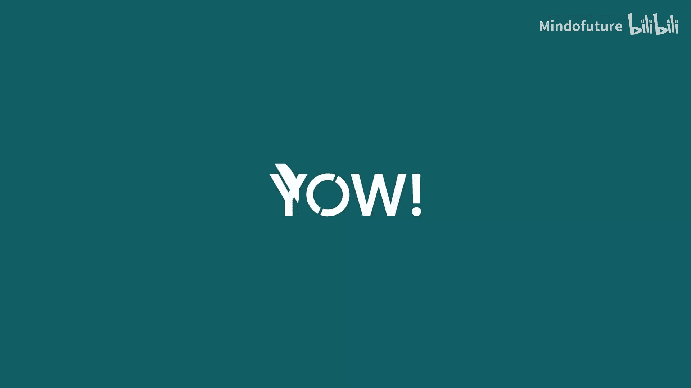
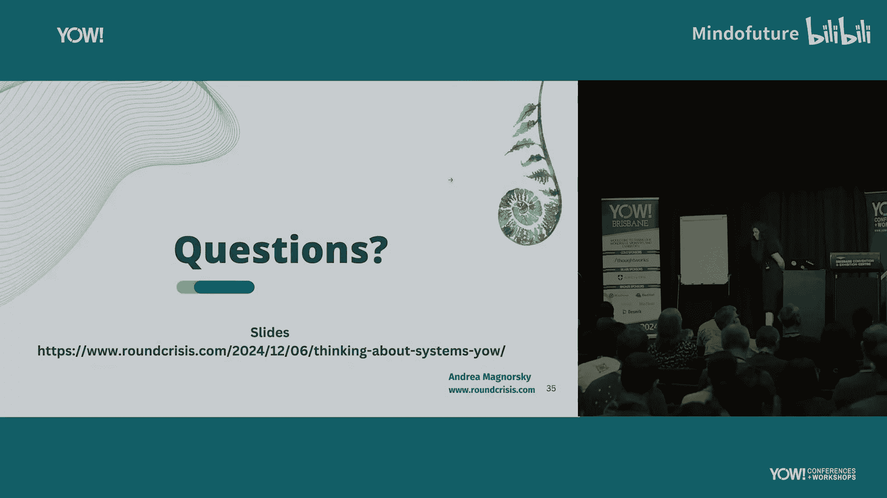

# YOWcon软件开发大会（2024）｜-架构设计-｜-分布式-｜-AI-｜-代码-｜-JAVA-｜-Github-｜-Spring-p01-P01-Thinking-About-Systems-with-Bytesize-Architecture-Sessions--BV1G9dfYTEHR_p1-

Good morning。 Wow， that was a lovely introduction。 Thank you， Sarah。 So， yeah， we are。😊。

Thinking about systems。With Po。 So my name is Andrea Mcnorsky。

 I'm a programmer and the creator of Pos architecture S。And you can see theres some of my experience。

 And the reason I'm showing that off is to tell you and to kind of share with you the fact that we share either the experience of being in a big or a small company of being in corporates or startup like environments。

And there is a common thread of what is really， really hard， what fails， really。

And many of these problems that you find everywhere can be traced back。

To the lack of a shared mental model。So today， as you're here， we're going to go through。This agenda。

 we're gonna to understand try to learn why is it that sharing knowledge is so hard。

How do we currently share that knowledge。Then we're gonna kind learn about Pi's architecture session by like an overview and a couple of industry examples。

 And then you， the people sitting here are going ask me lots of questions。

 And then we're going to answer them， which is going to give you pretty credit。

 So you might be thinking， I'm an Andrea， just have my coffee and you're telling me that everything is a problem because we don't have this shared mental model。

 How are you so sure。And I am sure about that。Because。You ship。What is in programmer's brain？

If the people that encode this， the software system don't know what the system should do。Or why。

The consequences can be grim。 And I'm sure we've all experienced this， right。

 It doesn't help that as an industry， we're kind of like obsessed with how we do things because it's a lot more fun。

 really， I mean， isn't it like' like there's a new shiny thing。 and we。😊。

wouldnn't that fix my problem that I have， And it probably does。 but also probably doesn't so。

Interestingly， I came up with this， and I'm quoting myself here， which I find hilarious。

 So I quote myself here in 2021。 and probably like what she knows she knows she said that what。

 So I said this around 2021。 But it turns out that some other guy that is actually quite smart about this stuff called Alberto Bandololii。

 who is the famous creator of event storming。😊，Parenthesis， Even storming is this thing that you。

 you do a bunch of stickies on the wall and everyone's together。 And by that。

 you discovered the domain。Obviously， go and read more about this。

 But we don't have a time to do another talk on that。 But Albert Randalolini said this。

 which is a very， very similar thing。 And I'm mentioning here for two reasons。 First。

 I thought I should kind of say， hey。This guy said first。

 they are saying that is interesting is that he also tries to address knowledge sharing。

And we both came up with the same conclusion。So， I mean， either we're both right or something else。

Anyway， I promised you that we were gonna to talk about things that， you know。

 we already know is's kind of hard to share knowledge。 right， You agree， I' gonna to make you work。

 Come on， Come on。 It hard。 There， It's hard。Anyone disagrees。Very courageous。 Very courageous。okay。

 so， but it turns out that steady state of sharing knowledge is is his hard。

 But it turns out that things never stay the same。 It this， it's really annoying right。

 You have other difficulties。 For example， you have a team and you work really good。changes。

 And that means that new person， you need to teach them stuff and， or you know。

 someone that knew all the stuff that we all ask questions to。 if they leave。 Well。

 that's really awkward。 And the other thing that's weird and hard in sharing knowledge is that let's say you have to coordinate between two teams。

Now you have this massive feedback loop to actually get answers add another team。

 the feedback loop is horrible as you add teams to trying to share knowledge this gets harder。😊。

The other thing that's difficult is that you have conflicting long term plans。 So you had some plan。

 It's like， we're gonna to do this first。 And then we're going to solve all those books that we wanted to fix。

 and we were waiting。But， you know， something changes because businesses do that all the time。

 And now that change。Like the way the， the knowledge about the。

 the change ripples through your team and other teams is like a wave。

 It doesn't get to everyone at the same time。 even if you were on a meeting hearing about it or whatever。

 right， because that's just not how it works。 So people that care out more about that change would be knowing about it quickli than you。

So。On the left hand side， you have。Everything to do with time that makes sharing knowledge difficult。

 But there risks another。Thing that makes our life harder when it comes to knowledge sharing。

Which is to do with role dependent。Varariance。And you have this nice Venn diagram there。

 The idea is that you， let's say you're a programmer and you're on the Venn diagram on the on the set。

 on the left。 If you're an engineering manager， maybe you're on the right。

 maybe if you're a designer or a Q A or whatever。The way you think about sharing knowledge depends on the role you have things that are important to you as a programmer might not be the same that if you're a designer。

 that if you're a project manager。 and by the way。Even if your team doesn't have these roles。

 these roles happen。So you might not have the title， but you might have the role。

 And that shapes your thinking。And so when you're sharing knowledge。

 you are just not sharing all the right bits。Right。Cool， so knowledge sharing is hard。Which concept。

 But how do we do it？So there is this really cool diagram I made to show kind of how we do some diagraming。

 sorry， some sharing of knowledge。 And this goes from something that is more powerful to Britain。

 writing something down tends to make you consider what is it that you're writing sometimes yeah。

We've seen the Internet。 sometimes that doesn't really happen。 But， but。

 but you also have protocol and no protocols。 So， for example， documentation。Right， documentation is。

 it always goes like super well。 You write down is perfect， right。Yeah， yeah。 it always goes super。

 Also it's always up to date and such。 So I like to kind of make a point of documentation because the whole point of doing in this graph is to try to make you think about the feedback loops that you get on all these different types of knowledge sharing methods right So with documentation。

 the problem is that it's actually pretty hard to get good feedback is in it。😊。

So if you're in a chat， it's kind of easier。 Imagine I'm talking to you。 Hi， friend。 And you're like。

 oh， hi， I can see your face。 I can see you're saying It know right feedback。 It's immediate。

 It might not be high feedback。 As in， I don't know what he's actually thinking。

But I have some signals where with the documentation， I don't。So。White size architecture sessions。

Fals here。In the workshop side of thing， because it's a workshop。No。

The the thing that I wanted to tell you about here。Is。This Pi says architecture session。If bite size。

 because it's supposed to be small。I say architecture because I want you to think about your systems。

 It's not like scary architecture or whatever。 And sessions considered the S at the end iss because you're supposed to have instead of a big thingy。

 you have many small thing。 And you will notice that it says workshop there。

 It's kind of on the workshop side of things。And。In a workshop， we work， right。

 Everyone that attends one of this is supposed to be working。 It's not an an observation thing。

 It's not like a。Nothing like that。 You are going there and you're gonna do some work。

 but it's a little bit of work。 So it's not。 So Python's architecture sessions is a workshop format。

And this generically that you see here is any modeling tool that you want to use。 So it could be C 4。

 It could be sequence diagrams。 It could be any type of modeling or diagraming thing that you want to use。

Pza is a collection of highly collaborative meetings there。

I'm repeating has a format takes 45 to 60 minutes each。It's recurrent。 And you can。

 the good thing about this is you can have a series of session to achieve some goal。

 A goal can be something like I want to， I want my。

 my team to be more cohesive in their understanding or someuel。😊，And you might be wondering。

Why is it。That I'm kind of pushing people to diagram things or to model things。

And that is because as Donald La Mes in her excellent book about system said。

Systems just happen all at once。Unfortunately， they don't happen sequentially。

 like theres this would be much nicer for all of us and easier in our brains to sequence it out。

 especially as programmers， we like things to， you know， the things nice， nice little。😊。

This this instruction， this instruction， this instruction。 But unfortunately。

 systems just do not do that。And。Unfortunately， the way we tend to share knowledge， you know。

 in the previous diagram， we took， which is a sequential thing。

 And so you want to give it some tools so that doesn't happen。Ultimately。

We want to understand the system， as it is right now。And。Keep know enough about it to keep it alive。

Basically， an essential is essential to share knowledge to build systems。So at this point。

 it might be right， okay， can I see what a session looks like。So this is the format of the session。嗯。

Before you actually run a session。 and， I did say， it was like 45 to 60 minutes。

 You need to prep and by prep。I mean， you need to。Make sure that you invite the right people。

And that they are ready to actually take part in this。 For example。

 let's say you w to use C 4 or some other modeling technique。

 and they can't do it if they don't know how to C 4。

 Why would you put people in a meeting that don't know what they're supposed to do。

 That would be unfair。 right， And you need to invite the right people。Right， so。

On the session itself， right， on the day of the session and the hour of the session， you know。

 I'm sure you've been to meetings before and you people turn anybody into a meeting。They are great。

 I don't they。 So the problem put me。The problem with meetings sometimes is that you're there in the meeting and you turn up and you were in 55 meetings before this meeting。

 you' kind of still thinking about the previous meeting because they were talking about the thing that you care about。

 But you need to be in this meeting and you need to do some work right So this work that you need to do iss about doing something quite small。

 So this is where you start off with the session goal， you do this in a couple of minutes。

 and you decide together what is it that you're doing。

 Let's say you do something like a high level diagram of the system。

 If you're starting with like we don't know what we're doing right。

The thing that you do next is go alone together and I put it in bold because of where go。

 And is this。Thing at the heart of the biteside sessions where you individually。

 you're all together in the same room。 And there's like 8 to 10 of you。 No， like loads。

 So there's 8  to 10 of you， maybe 11 or 12。 if you really want to push it。

 And you're together virtually physically。And you do the goal that you decided on。

 Let's say a high level system context diagram。 right once the timer has elapsed。For。

 for this little groin， you explain。 it's like， oh， I did this。

 And then I think it sends the message to here。 I'm not really sure about this。

 but I think we get the message from this third particle lo cuts or something。

 And then after I finished， you know， try to do not very， very long。 then the next person do it。

 the next person do it。So this might seem a little bit strange。

 but the good thing about this is that at the point we're starting to do this。

 You have multiple things happening。 The first one is， I had to draw something。

 So if I came from the previous meeting thinking about whatever it is， I had to draw something。

 I makes some sense。😊，Right， because we don't want to look like you don't know what you're doing。

 And， and also， you have to， as you do it， you realize that you don't remember certain things。

That you want to know how this other thing work。Which is good。 What happens afterwards is like。

 you hear other people。This trains your active listening skills。

 which we're not really good as programmers。Generally， and the other thing is like。

 now I know that in that room。In that room， these different people think in ways that I hadn't considered。

 The other thing that happens is they mentioned stuff I completely forgot， which is pretty cool。

 So after this happens， which is actually a really cool bit of the session。😊。

You have the biggest part of this meeting， which lasts about 30 minutes， which is called consensus。

Now， that should be a hint of what happens。 What happened next。

 So what happens here is that together， you do the same session goal that you decided。

With all need the new perspectives。And you try to put it all together。Supprisingly。

 this takes a lot longer than you on your own， which is， which is pretty good。And finally。

 you have the summary。 The summary is like a few minutes at at nearly the end of the。

 of the session where you do a mini rec。One thing I would mention here is that this session runs strict on timers。

 So you're not done。 That's okay。 Keep the questions。 You have another one a couple of weeks， right。

So you might be wondering， okay， I mean， that sounds kind of a little bit exciting。嗯。This is。

 this is how someone felt。How， how someone experienced this session。And I think it's。

I think it's really representative。 When I try to explain how this works。

 I think if you ever played a co tabletop board game， it's kind of that feeling， right。

 because you're trying to work together to address up an issue rather than you're working against each other。

 which I think is a much better way to make something to build something， right。So。

This is what is it that we went through， what is our vital session。More or less how it feels。

 Why should you do it。I'm going to drink some water because I thirsty。 So you。Rightun。You know， I。

 I kind of said a few times。 you want to have this homogeneous understanding of your system。

 And that's because it enables introspection。And also， you're building consensus together。

 Don't be fooled。By saying。That you're building consensus。 This doesn't mean rainbows and ponies。

 I mean， sometimes you do get it。But consensus means you find some common ground。Or you build it。

Right， the system needs to make sense。 And if it doesn't， it will do whatever sense it makes。 right。

 The system does what it does。 So might as well try to。Find the meanings。 Make sense of things。

The second thing here is if this is an enabling format because you had this time alone together and then the consensus building。

 you had this。You know， time to think on your own。 I've been approached by neurodivergent people multiple times after sessions to let me know that this is the most effective workshop they've ever attended。

 which I think is a really nice green flag for collaboration。Finally， this is an emergent behavior。

 And I think is an excellent sign for a systems tool。 And it creates the science tools。 And what I。

 what I mean by that is this。😊，Imagine you had five six sessions。

 and you maybe created two or three models which generate diagrams， right。So。If you need to。

 at that point， design a new feature。Sly， you have these diagrams you already all know to be correct。

 because you agreed on them。 And that means that you need to do this big work。 You lean on those。

 And then， you know， because you did this big work and you use those diagrams， guess what。

 the the design tools keep building up。 So super nice emergent behavior。Ultimately。

 what you really want with something like white size and actually many other collaborative tools。

Is to build an architectural practice in a safe way。Out of two options， option 1。

 you only do kind of diagrams and modeling when it's a high pressure。 you know。

 we need to get this right type scenario。 That's up name。 option B， you do this stuff kind of often。

 And you get to learn little by little。 how to model What's a good decision。 What's a bad decision。

Which one would you choose。When。Thank you。 I mean， some people would like to just say。

 we keep choosing a， actually。Right， so I think it's better if we choose B。

 if we choose this architectural practice in a safe way。So。Yeah， it's more stressful。 So， you know。

 that's nice， right， It's a bit more adrena Anyway。

 So we're gonna to go through an industry example of what was of the first bite I。

 I kind of just told you what the format is like， which is， which is grand。

 But maybe you want to see actually what happens。 So this is a session that ran in a broadcasting organization in the UK。

😊，And the scenario here was that， there was。Out of the whole team， kind half of them were new people。

 And they obviously didn't know the system。 They've been in the， in this team for a couple of months。

Team leadership kind of wanted to do something to get them。of more onboarded or something。So。

Before the session， what did we do， We imed。We kind of decided who needed to be invited， right？

 And we were like， oh， Khi。 And what I suggested here was that we invite people that are active during standup。

 Act being a very important word。 People that go to stand up to listen probably shouldn't be there。

At least for this。 And， you know， you can， we can fight our life。 And then you know， I remember。

 I mentioned you shouldn't put people in in a workshop to turn out the tool they're going be using。

 So the team lead took the responsibility to teach them the C4 model。So。The session starts。

 So this happened online。We used an online collaboration tool。

 It could have easily happened in person。And we decided we were going to do C 4 with a high level system context I。

 If you don't know what this is， please grab me afterwards。

 because otherwise this goes on for quite a lot much longer time。So。We had already kind of decided。

 okay， we're gonna do the context diagram of the system as。 as you can see the。The。

 these are pictures of the of the attendees。 They were feeling a little bit， you know， apprehensive。

 You know， cat especially always being a bit mysterious or whatever。 So you know。

 what you're gonna do。 But don't worry， it， it gets better。So。Then we did alone together。

 We set up a timer for three minutes。And when the time elapsed。Each of them。

 they explained their model。You might be looking at this diagram and thinking， well。

 those are kind of strange diagrams。 And those are the actual diagrams those people did。Right， so。

 I blurre them out。 And obviously， the， the avatars are not actually people right， but。I， but。

 but what I want to。Bring your attention to that。 And I know they're blurry。

 but notice how different those those are to each other， right， not just in color in shape。

 which is quite interesting。 And this happens every single time。 right。

 Imagine these people all through a slightly different system， actually， which is fun。So。Consensus。

So the， the team drew part of the system。And they were so sad。They were like， oh no。

 please let us keep going。 The timer elase。 and they were let listen。

 We just need like 5 more minutes。 And I was like， no， the timer done。And so， we're gonna to move on。

And they didn't understand why， but would gonna get slash。So。They did a summary。Right。

 this is where we went over。 How did this feel。 What did we get， So they said they learned a lot。

 And what they meant by that is by doing this whole thing， they。Figureed out all this。

Like questions that are really important and specific。

 It enable them to have the right conversations。 right This is what pie is supposed to be about and any other collaboration tool as well。

 It's all about enabling the right conversation， building your mental models to be better。No。

If you want to know more about exactly how to run this。

 you can go to Bsize architectureitect sessions do com。 I know it's a really a misleading name。

 but that is the name。So I'm going to give you a little interlude。 This is a picture of Kia。

 a really， really cool。😊，New Zealand par。Which is what you need right now， right。Right。

 so I just showed you one by session。 and you can kind of maybe at this point。

 imagine how it feels what you get， you know， But what can you do with something that is quite simple。

 which is， you know， I I did want it to be simple， but powerful。

 and what can you do with a bunch of these。Co， I also forgot how to drink water。 Very nice。

 so what if。You need to collaborate with three teams at the same time。I mean， generally。

 this takes quite a while， right， If you're trying to get three teams to kind align on not just what a problem is。

 which is actually a quite difficult problem， people can say， oh， yeah， yeah， the the thing。

 And that's the problem。 we need to improve the pipeline。 No worries。

 But when you get to the details。A learning on the problem heart。

Never mind trying to get to a line on the solution， right， because then it gets even more exciting。

 So in here， we had to。😊，Do some major improvements to the video pipeline。For。

 for a TV channel in the UK。When I was planning this， I thought。

 we'll need about maybe  five sessions to do this， right。

 And we do the first couple in trying to get where the system is right now。

 because you should never go and try to fix something if you don't know what it is。

Because that would be， you know， about it here。So first， find out where you are。Then I thought。

 well do ideal。 What would be the best solution that we could do。And finally。

 do what we should actually do。 right， That was the plan。Seems kind of simple， you know。

 two sessions， two session， maybe one session。But what happened next。Right， so。

 you know the format now， right， You've been here for like。A few minutes。

 you are experts in biteside sessions now。The point transition run as， as it does， you know， goal。

 we had the goal first when we said， we're gonna draw the system context diagram for the three teams interacting as they are。

 Then we did。They alone together bit。 Then we did the consensus， and then we did。Sorry， the retro。

Summer at the end。So。The interesting things that happen here is that， you know。

 I grouped the the systems for each team into blos so that this talk made some sense because otherwise。

 you wouldn't know who owned one or whatever。But， this is， actually。How did those systems interacted。

You can probably see even if you had to gun guess that this is quite cout。

RightMaybe more covolutive than it needs to be。An interesting thing about the sessions running is that。

For example， say I am in team 2， right。And I， when I did this B session thing， I was trying to。

 you know， I I could kind of know how to interact with team 1 and team 3。

But it got blurry when it came to everything outside what my system touched。

 And this is quite obvious when you think about it。 But this example is happened for to all of us。

 right。The other interesting thing that happened because of that， is that。

We all had really specific questions about how that bit that we didn't know about worked。

 It wasn't like， oh， tell me about everything about your system。 It was like。

 can I know exactly how team won since this strange thing。 This yellow thing to teamme3。

 It was specific questions， which is what you want。 Ssingly。

 we actually managed to grow the whole thing in one go。 We did go from a minutes though。Then。

We had a second by session。 So we already saved one one session， So we saved a little bit of time。

So we're in the second session， this happened a couple of weeks later。

This was all about trying to find an ideal solution to this problem。 right， We needed to shave off。

Some improvements。 And I know I'm not being extremely specific because we don't have so much time。

 but don't worry。So， we drew this。After doing bite size， remember。

 goal along together consensus summary。 We did all of that。And we drew this。Right。

 it looks a little bit simple but at a glance than before，la that before。After or not。In here。

 the thing that happened was really strange。 People were trying to go for ideal solution。

And in the middle of that， two of the people came up with super outlandish thing。

 But those crazy ideas they had。Gave us some kind of room to really start discussing what we were trying to do。

 And actually， it made us realize， oh， wait a minute。

 we can kind of nearly agree on something like we could， we could do this thing。

 which is not excellent， but it's not too bad。 And this actually could just work。And。

 and this all happened in consensus。 Again， this all happened because we had specific questions。

So at that point， we actually had a agreed a solution。

 What happened next is that we started doing some diagrams。 This。

 this happened offline after the session， right， we did some As。

 and we had to do some extra kind ofty of notes of the。😊，And。You know， actually。

 what happened in the actual contract to Json5s and XM L。 And it was all really cool。

If you want to know more details about this。There's a book。Actually。

 this whole case study is explained in a lot more detail in Chapter 17。

 The other really cool thing about this book is that， you know， I mentioned event storming。

 I mentioned some other techniques。 and Nick Tuune's book is super， super good about this。

 I feel quite honored to be。😊，That to， for whites sessions to， to be there。

If you're really into collaborative software design， by session is also mentioned here， so you can。

Look at that。 actually now。You might be thinking， okay， this is all good。

 I can just go home go not home because I mean， you can do this at home。 want Im not gonna。

 But you can go to work tomorrow or Monday or whatever go like， hey， let's do some my。

 And that will be great。 You can actually totally do that。

 I'm gonna give you this advice of two things you definitely need。😊，You need， you know。

If youre looking at this format， you can probably imagine you need to be able to talk to the people。

P， you need to talk to the people that you're gonna be doing this with。

 Imagine if you don't feel safe。How good is this gonna go。

 So if you have psychological safety issues。This might work。

 but it would be better if you enable that first。The other thing you need for this to be most effective is。

If you turn up somewhere to a workshop like this and you think I got nothing to learn。Guess what。

You probably won't。Right， you need to， you need to be one thing to learn something to learn。

 You need to be curious。 You need to have a growth mindset。So。In closing。

If you've never heard of Rossakov and you like systems， I invite you to watch this amazing Ted talk。

 the link is there。 I also shared slides on my website already。

 You can just go to roundcis dot com and find this link， but。😊。

One of one of the key quotes that he says there that I really like is that。

A system is not the sum of its parts。It's their interactions。

And one thing that we tend to forget is that the way us communicating is an essential part of that interactions in the system。

 right， So it's like this whole thing is about building your systems。So， good takeaways。

Knledge sharing is essential to systems building。If you use that diversity set of tool to enable。

You can use a diverse set of tools to have effective and efficient knowledge sharing。

And keep takeaway。 Try byer session。 Let me know how it went。Thank you very much。

