# YOWcon软件开发大会（2024）｜-架构设计-｜-分布式-｜-AI-｜-代码-｜-JAVA-｜-Github-｜-Spring-p02-P02-The-Beauty-of-Simplicity---Making-Your-Own-Technology--BV1G9dfYTEHR_p2-

😀Ha。😊，Alright， hellello， everyone。 Welcome to a presentation。

So I want to start this off by asking you guys a question。When you're making some technology。

 you're working away your programming。 Do you ever think to yourself， man。

 this is going really great。 But I just wish this was more complicated。Hopefully not。 Hopefully。

 we can all agree that simple is， well， perhaps not necessarily better than complex。

 but at least more preferable。 We like to keep things simple。

And that's really what we're gonna be talking about today。 The beauty of simplicity。

 making your own technology。😊，Wait， did I write simplicity， Does doesn't sound very simple。

So I want to talk today about how， you know， a lot of the times where some are pressured to pick existing solutions rather than making your own and how。

 you know， if you go that route of making your own technology， how。

 I guess simplicity is like really important to that core process。So a little bit about me。 So hi。

 everyone。 My name is Janan。 thank you all for coming to my talk。

 and thank you Yao as well for having me。 This is my first year。 I'm very happy to be here。😊。

Some of you might know me as Chno or the Chno because I have a YouTube channel where I make videos。

 mostly educational programming videos。Like I share projects that I'm working on。

 I also have like this code review series where people send me their code and I take a look at it。

 give some advice。 And then I'm perhaps best known for this C plus plus series where I teach C++。😊。

So before I became like an Internet person， I had a real job。

 I used to work as a software engineer at E A on game engines。

 So who here knows what a game engine is。Cool， so for you who don't。

 it's basically like the platform that you use to build games。

 So it's both like the tool side that the the developers use to actually make the games。

 And also the runtime。 what's called a runtime， which is what the the game actually runs on on people's devices。

😊，So I worked on this game engine called Assiris， which was like EA's primary mobile game engine。

And then later， we moved on to Ftbite and we became frosttbite Melbourne。

 So those of you who have been to Melbourne might have heard of this area in the city called the Docklands。

 It's like this ghost town not really goes there。 but that's where I worked。And then I left in 2019。

啊， and。I left because， you know， once we kind of moved on to frostbite。

 things started getting a little bit more complicated。

 And one thing you'll learn about me in this talk is I don' really like complicated things。

 And I think it's just like the consequence， of course。

 of working on such a large product and such a large organization meant that he was very process driven。

 very slow to make actual actual like real changes to the code base。

 And I started working at A when I was just 20 years old。 It was like my first job out of uni。

 And I really wanted to take some time to process everything that that I had learned by being thrown into the deep end。

 and try and maybe build my own game engine because that way I would understand everything。😊。

And YouTube was doing fairly well at the time。 So I thought I'd give it a go and leave。

 And so now I'm building this engine called Hazel and making YouTube videos full time。😊，Okay。

 so I want to talk a little bit about Hazel， because the the core of this talk really is about everything that I've learned by working on this theme。

 So Hazel is a 3D game engine。 This is what it looks like。

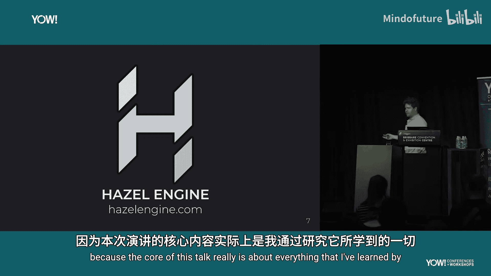

I started working on it about five years ago， initially by myself。

 But then because I was making YouTube videos about it。

 like community formed and people started volunteering to like help out on certain systems that they were interested in。

 And we grew our team to around 8， I think， including myself was like the maximum team size。

 And I ended up hiring some people。 And this is what we made。😊，And we're still working on it。

 You know， I like to say that working on a game engine is a lot like art。

 Like it's never really finished。 There's always new features you can add new technologies coming up。

 And so you just keep working on it perpetually。😊，And when I mentioned that I'm working on a game engine and I'm building my own。

 this is the number one question that I get。

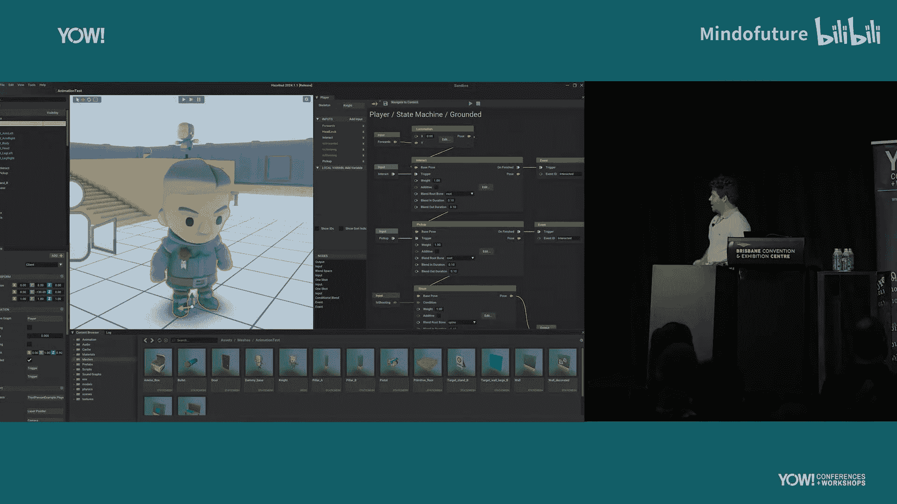

Why， why would you do that？Don't game engines already exist。 Isn't that like really hard。

 So I could talk for 40 minutes about why， but I'll try and be brief here。 So basically， the。

 the first point here is that I just really like game engines when I was growing up。

 I would play these games。 And I would be way more interested in the technology behind them than the games themselves。

 Like， how do they make that happen。 And I think theyre a really cool technical challenge as well。

 because game engines are just like this collection of all these different systems that have to work together。

 So anything you're interested in， you know， like AI rendering audio， like it's all kind of there。

 And it all has to work together inside this like massive system。😊。

That coupled with like really tight performance constraints。

 as well as like it has to run on a variety of different hardware。

 meant that it was just really cool to try and solve something like this。

 I also wanted I also wanted to use it as a prop for my educational videos。

 So like when I'm teaching C plus glasses so far， I think you can get with。

 here's a CPB file with a few lines of code to demonstrate this concept。

 It's nice to have a real world example that I can be like， okay， this is why we do things this way。

 in the real world。 And then finally， like I did want to make a game eventually with it。

 That wasn't the primary goal， but that was something I wanted to do。

 And I kind of see games like works of art。 And I guess for me。

 it was important for like the technology was part of that art。

 You know And so I wanted to make a game with my own technology because that was just。

 I guess my artistic method Like artists have various like methods and mediums that they use when they produce their art。

 And I guess mine was pain。😊，So we have made a few games。

 So this is an example of a game we made two years ago called dichotomy。

 We made this in like three days for a game jam。

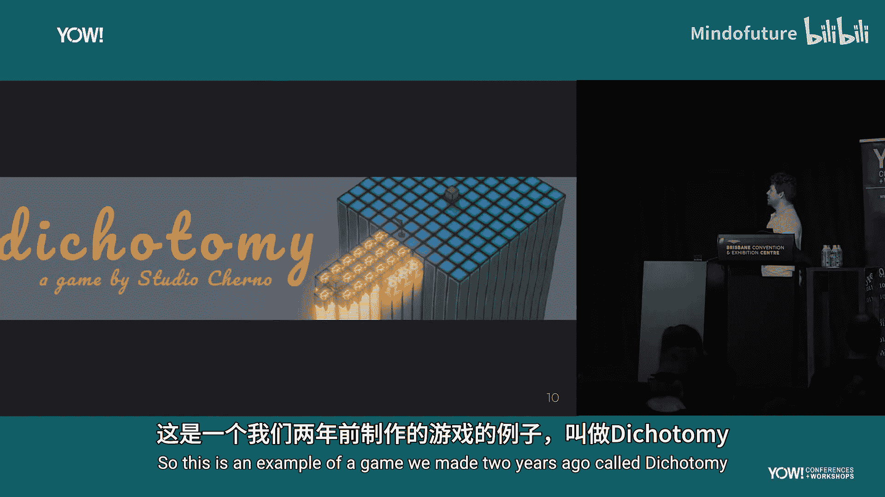

He's a gameplay。Like this little puzzle game。 You have to play out some moves in this blue sandbox。

 and then it replays what you've done in the real world。 where you can actually see what you've done。

Let me just pause that。 So it's not too distracting。So this specifically。

 why I bring this up is because this was a huge milestone for us， because up until this moment。

 we were working on this game engine with no real expectations of like finishing it or getting it to a state where we could make games because you know。

 there were no like investors that we needed to meet deadlines for。

 It was just something we were doing for fun。 And it was fulfilling its purpose in the sense that it was driving my content on YouTube。

 And I was able to use it to teach C plus+ and game engines。😊，But then one day。

 I just remember waking up in the morning and I was like， okay， we'll have to do this and that。

And that today。 And then if I do that。I can kind of use this now to make a game and ship it。

 All the pieces are just there。And that was like， literally a surprise to me。 And I think。You know。

 I compare this a little bit to running a marathon， which I've never actually done。

So we'll call this a thought experiment。 Pre you're running a marathon。 And it just seems like。

 you know， it' so daunting。' is such a large distance for you to run。

 But if you just keep moving forward， just don't look at the finish line like。

 let's just head down move forward。 As long as you're moving in the right direction。

 you're getting closer to your goal。 And then one day， hopefully， you'll look up。

 and you'll either be in the hospital。 or。😊，Or you'll see the finish line， hopefully。

And so now that I had come out of the other side and I'd made this technology that was actually capable of doing its purpose。

 I was able to reflect on that and be like， okay， well。

 was this really as hard as I thought it would be now that I've seen everything and I've gone through it。

 you know， firsthand。😊，And that， I， I want everyone to think about that as well。

 when you're working on something and you've come out the other side。 Let's reflect back on it。

 Was it really that hard。So let's talk a little bit about how we achieved this state， I guess。

 of being in a position where we can actually make what we want。 So first of all， it's simple。

 and that's not a choice， meaning like the technology has to be simple。

 You have to keep it simple because you're forced to work within pretty serious like limitations and you have to make sacrifices。

 meaning you can't just make something that does everything。 You have to stick to a particular path。

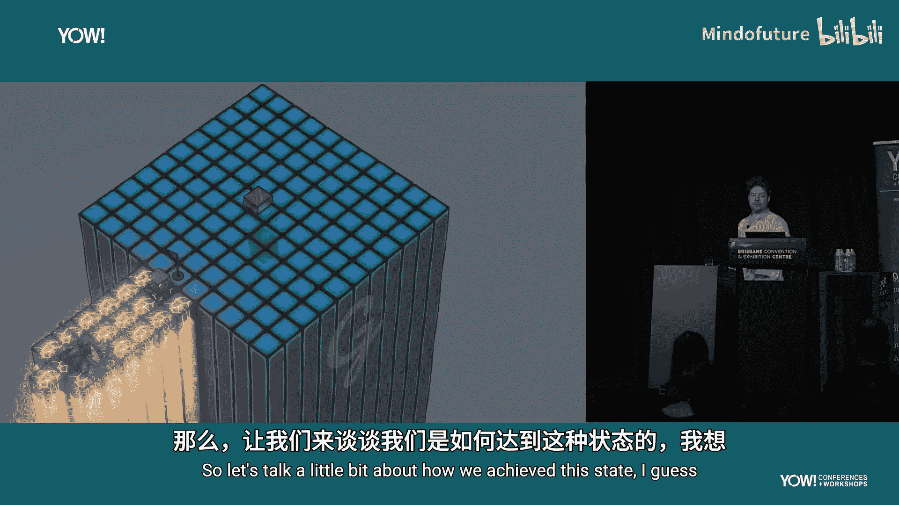

And so I like， it's a little bit like working smarter as is harder。

The reason why I wrote in a way is because really， it's both。

 You have to work smart and you have to work hard。 You can't just do one of them。

 It's like the worst of both worlds。And the reason why you can't just work hard is because you can't just brute force a solution by throwing more resources at it。

 You just don't have those resources， you know， to keep throwing at it。

Delegating and outsourcing is a huge part of this as well， which we will focus on later as well。

 And then you have to always keep asking yourself as well。 Is it really as hard as it seems。 Like。

 can I just do this a simple way， maybe that will be enough， Maybe that will just work。

 because I think humans in general just have a way of over complicating things。

And I want to explore this concept of simplicity， right， because a lot of people might see like。

 okay， it's simple as a downside。 or it doesn't do everything。

 But let's have a look at an example at where simplicity might actually be an upside。

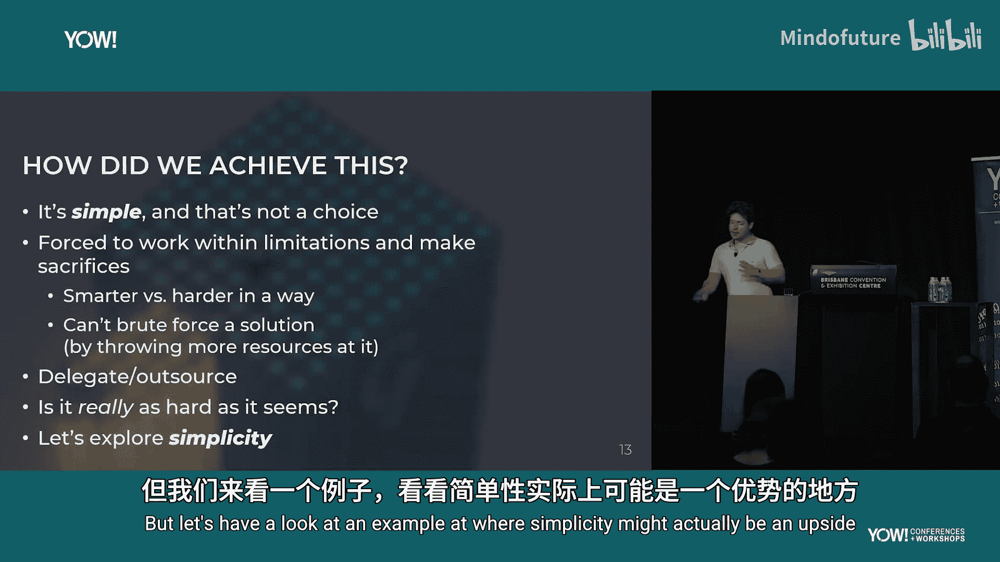

The Unity game engine。 So who here has heard of unity or used unity。 Oh， wow， lots of you。 cool。

 mother than Melbourne。😊，I like you guys。 You're going to all switch to Hazel by the end of this talk。

😊，Okay， so I've got this like really simple scene over here。Where you know。

 we've just got like a cube and it's got some physics on it。 Now。

 I want you to just pay attention to how long it takes once I hit that play button for the scene to actually start playing。

Right， so super simple scene。 let's hit play。Alright。

 And then let me just do it again so you can see it's not like a first time running thing。

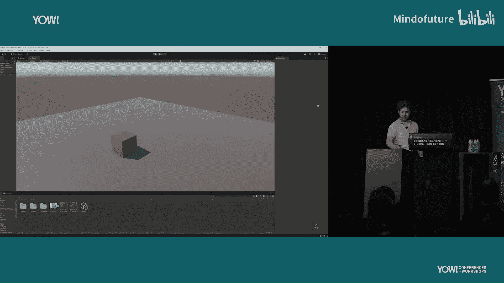

This is the latest version of unity I downloaded this， like last week。Okay。

 let's add some behavior in C sharp， right， So I'm just gonna add like this thing that happens when there's a collision added like an impulse force。

 So I got to go back。 It's got to compile and process my scripts， which takes a while。

 And then I got to hit play。 And I'm kind of just stuck in this， like。😊。

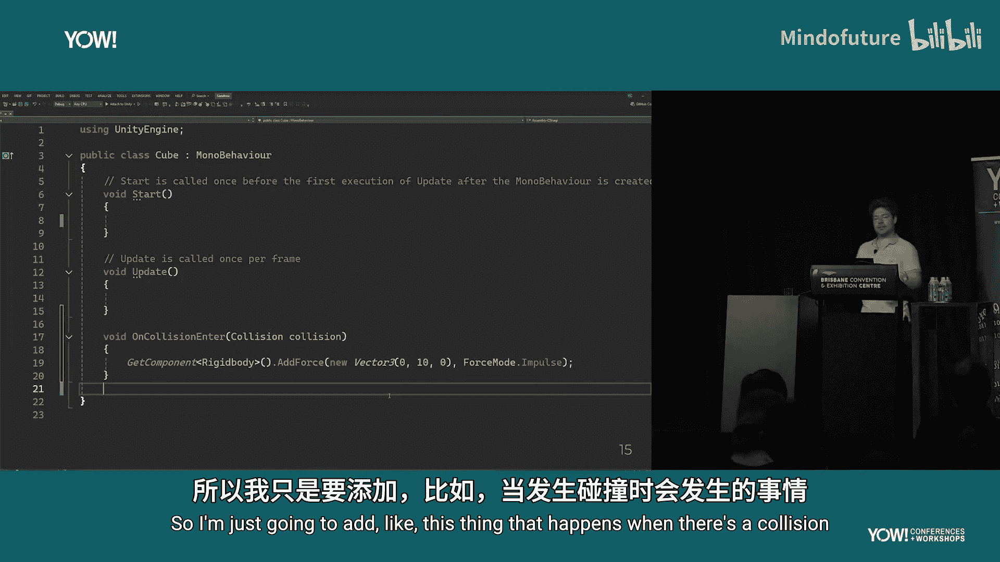

啊。I guess position of just waiting around for stuff to happen because of that extra overhead and complexity of unity。

 And so for this little solution that I'm working on， I'm kind of suffering because of unity。

 So is this a good solution， Is unity a good solution for this little problem that I have。

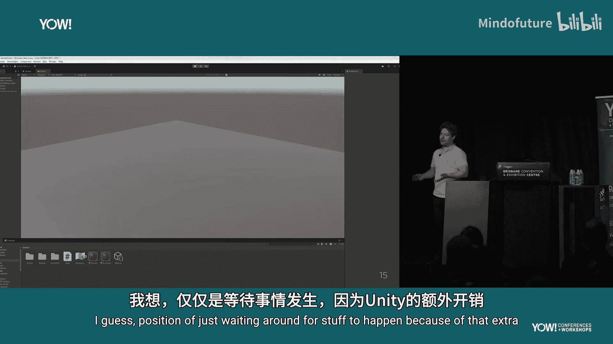

Well， let's have a look at a more simple example。 So this is Hazel， same exact scene。

Couple lights like a ground plan a camera and this。 And I want you guys to just， basically。

 when I hit plane a minute， just time how long it takes。Once I hit play for the same to stop playing。

All right， so that was pretty quick。And then if we do the same thing and we add some behavior using C sharp。

 which just add a little bit of complexity。 It's a little bit different。

 You have to add like this event action with Hazels API。 But we're still adding that impulse force。

 I'm going to first of all， compile it through visual Studio， which according to that log took 0。

7 seconds。 And then by the time I all tab back， it's just reloaded my C sharp D L L。

 and I can just run everything， right。😊。

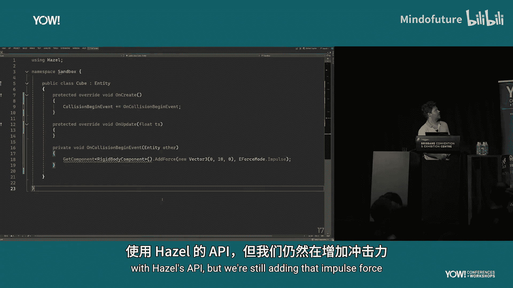

So， you can see that， you know， because Hzel is much more simple。

 we're able to have this like frictionless workflow， basically。 And， of course。

 when're not trying to compete with un， Unity is doing a lot more and it can do a lot more。

 and it can solve way more problems than Hazel can。😊。

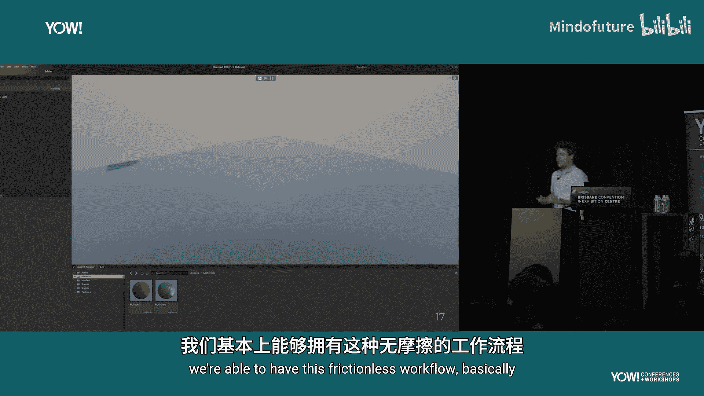

But it's just to like， think about， you know， that aspect of like， okay， well， if this is simple。

 it might actually be a benefit。

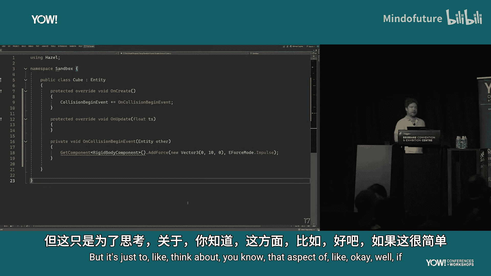

So is Hazel a better solution to this problem than unity。Well， I mean， I'd probably say yes。 However。

 of course， you have to consider the cost。 Like， if you build this thing and， for example。

 it took you  five years and $10 million， then maybe you'd be okay with waiting a few seconds for unity and paying a few thousand dollars in licensing fees。

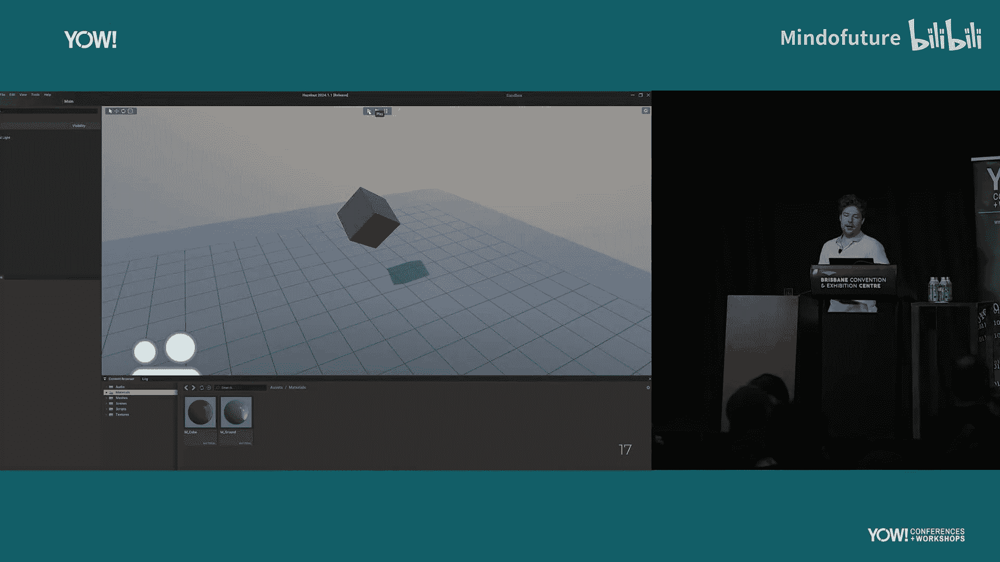

And so the overview of what we're gonna talk about for the rest of today is basically this concept of picking an existing solution versus building our own out of like these building blocks。

So the first thing I want to talk about is。Why do we even use existing solutions and what are they？

 So an existing solution is just like an exact product， I guess。

 that does what you need it to in the sense that it solves your problem。

So a game engine is an example of an existing solution for the problem of making a game。

 but it really just applies to any industry and field。 So， for example， if you're a web developer。

 maybe you need to make a website for a client and they want it to be like dynamic and they want to log in。

 make some posts。 you know， post some images。 Wordpress might be an example of an existing solution to their problem。

And for the rest of this talk as well， I'm gonna to keep drawing the example of game engines because that's my industry。

 But I want you guys to just。Kind of translate that into your industry and field。

 because it should translate pretty well。So I think it comes down a lot to business decisions。

 I think， you know， those of us who are engineers， if we were given the task of solving a problem。

 I think we'd probably be okay。 In fact， we prefer to just make our own solution because that's fine。

 We can do it better。 But， of course， we live in the real world。 So we have to be， you know。

 we have to constrain ourselves with like a budget or a time frame。

 And so picking an existing solution well make it easier in that sense。

 So let's use Unreal engine as an example for this existing solution and the benefits。 So。

 first of all， what's the cost。 So。😊，Unreal engine costs， you know，5% of your gross revenue。

 above a million dollars。Can we compete with that。Well。Unreal Engine started in 1998。

It's been worked on by thousands of people since then。It's been tried and tested in the sense that。

 you know， many games， many titles have shipped with it on all these different devices。And also。

 it comes with like this future maintenance。 it's not just like you get the product and that's it。

 The licensing cost you're paying includes further development and updates and bug fixes and everything。

There's also like this hidden cost， like you know， existing skills。

 So what I mean by that is because it's been around for like 26 years and it's public。

 there's obviously like in the job market， there's lots of people who know how to use it。

 And that means that if you need someone and you can hire someone， they're gonna be already ready。

 basically to use it。 So we have like this problem at frostbite at E A。

 that frostbite is like an internal engine。 So if we hire someone unless they worked at E A before。

 they don't know how to use it。 And so we have to train them up。

 and that might cost like six months of time。So that's another benefit of choosing an existing solution。

 And so what you're really doing is you're outsourcing that， of course， to a third party。

And then how much would it cost to do this ourselves if we didn't want to outsource this。Well。

 I'll answer that for you。 And the infinite amount of money。

Because you need a time machine to go all the way back to 1998 and build this thing。Okay。

 so it seems pretty bleak。 You know， why wouldn't you use an existing solution。

 So I think it it also comes down to business decisions， but for them， right。

 So they are also a business， Their goals are different to yours。 They're making a product。

 They want it to be successful。 So， of course， they want to draw in as many customers as possible。

 And they do that by casting this like wide net。You know， their product is great for everyone。

 But then that leads to complex and unnecessary software。 So just to paint you an example， you know。

 you might be making like a 2D PC game， but Unre Engine could make a 3D first person shooter on an Android phone。

 like it's completely different。 But yet， you've got that。

 And all the pipelines have to work together for all of that in your example that completely doesn't benefit you at all。

 And， in fact， might actually lead to slower products。😊，They are also often black box。

 these existing solutions， not in the case of unrealreal Engine， that's source available。

 which is great。 But you often don't have the source code They just provide you with binaries。

 And that means that， like， what if there's a bug。What if we need to support another platform or architecture or API。

 We're reliant on them to do that for us。 And so it creates like a strong dependency。

And to give an example of that， I'm going to use unity。

So some of you may have heard like about a year ago。

Unity tried to introduce a thing called a runtime faith。 Has anyone heard of this。Yeah。

 so they tried to charge like， I think it was I don't know the exact numbers。

 but something around 50 cents per install。 So every time someone installs a game。

 the developer would get charged like 50 cents。 And people were outraged And they were like， know。

 well， first of all， what's an install。 Like what if someone just continually running out of disk space And they keep deleting and then installing the game again。

 have to pay every time， What if they have three different devices， that like a dollar 50。

 How are you tracking this， Like what's the privacy like， And so they went back on that。

 But you don't need to look a year back to see what un has done because this was posted on Reddit like last week。

 So。Basically， this indie game studio had like released their game on steam。

 and then their unity accounts just got suspended。And the compliance team was like， sure。

 we can take a look at this in two months。And so they were basically stuck in this in this position where they couldn't actually access the product that they had made。

 which is crazy。And someone commented this， which I think is pretty accurate。

And I guess I like to sum up this situation like this。

And that's really like the problem with all of this， all of these like dependencies。And， of course。

 I don't think people choose to be dependent on a third party。 It's just。

Because of those business decisions or because of time frames。It ends up being like that。

And so I want all of us to consider this concept here。 Like。

 if you could build your own custom solution from scratch。Would that be better。

And the answer might be no。 That's totally okay， but。Let's just explore this concept。 So。

 first of all， from scratch， what do I mean by from scratch。Making your own fire。Making your own CPU。

I think people， you know， look at from scratch is like this really， really impossible task。

 And a lot of people like to joke about it as well。 Are you're building something from scratch， Like。

 what are you going make your own operating system。

But what do I mean in the context of this talk when I say， let's build something from scratch。

I'll explain and through a series of jokes。So does anyone know what this is。

I like that so many of you are actually saying it because Melbourne was dead silent。 And I'm like。

 do you guys not know what this is， So I like to call this modern software development。😊，Wai。

 this is our code。😊，And these are libraries， or frameworks。So I found this on Wikipedia。So basically。

 this little filing cabinet over here。 is like this library。 It's like a bunch of code。 basically。

 a bunch of subrouts bunched in。 Weve got these tapes here。

 What she's doing as far as I understand is she's like feeding it through this machine here in the middle that like。

 I guess lets her see it。 And then she's copying it down into her own program。😊。

So she's literally taking code from libraries and copying it。 And this is back in the 50s。

 So not much has changed。Are there any web developers here。Cool。

 so you probably would be familiar with frameworks and libraries。Al right。

 one more for the Web developers。Okay， I'm sorry。 We have developers。 I'll stop。

 This concludes our little comedy intomission。

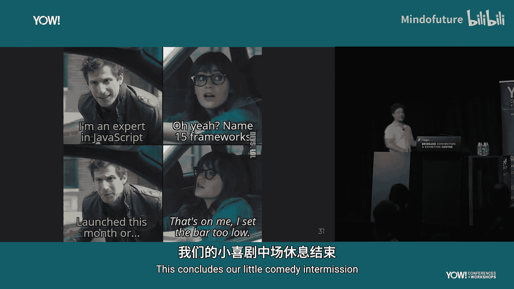

So is anyone heard of GitthHub？

So it turns out there's a lot of code on Github。 How much well。

 over 5 billion developer contributions were made to more than 500 million open source projects in 2024。

 So over half a billion open source projects。 So what does this mean for us。😊，We faced。

So from scratch， what do I mean， I mean in this context， like。

 let's not pick the exact product that we need the exact solution。 But instead。

 everything below that， everything that makes up this product that we need。

 we can be free to choose all of that。 So on real Engine， for example。

 like in this third party folder that they have in their repository。

 you can see they have lots of different directories here。

 And pretty much like most of them are third party libraries for a nonga engine example。

 here' is Google Drive on ios。 If you go to like help about。

 you can look at all the open source licenses and see， what they're using。 And， of course。

 anyone who is a developer knows that of course， we rely on so much open source software and all these libraries。

😊，But I want to also draw attention to the fact that it's not like these days。

 it's not really just like support libraries like， you know。

 compression library or data structure or like a job system。It's also entire systems。

So if we break down Unre engine， you know， it's made up of all these different systems。

I've just picked like these four randomly。And they're also made up of other systems。

 like rendering might have this rendering hardware interface layer。

They're also going to have many support libraries， as I mentioned， like， you know。

 a compression library or a data structure or something。 And so this like area here， these systems。

 why don't we just pick those because they're the building blocks that make up our application。

 So I want to focus on this layer of things。So that like most of those in， in our case。

 are going be libraries and open source because there's just so much open source code out there and also knowledge。

 right， So if you ask someone 20 years ago， how do you render 3D graphics。

 like the answer you'll get today will be much more comprehensive。

 There's much more resources out there。 And also it's not just even resources available on the Internet。

 It's also just the research that has gone into that industry has evolved so much。

 And it's just so developed。😊，And again， not just support libraries on Github。

 but entire systems and middleware。 So which a lot of them used to be paid or licensed or black box in the past。

 So an example from my industry is N video game works。 So that basically。

 they have a bunch of these SDks that can， for example， improve the graphics of your game。

 And they used to just provide this to you as like a D LL。 that's like， you know。

 you just plug this into your pipeline And your graphics will look better。😊，But now。

 N video Gameworks is just open source， M I T licensed on Github， all the C plus bus code。

 all the shaders。 They're all just there。 So times have really changed。😊。

And this allows you to delegate and outsource a lot of those systems and things that you have to build to build your own technology。

 which I think is somewhat new， It's becoming more popular。 And so， of course。

 because it is open source， it really allows you to kind of increase the resources of your team。

 as if you had actually done it yourself because in a way you get the same result。

allows you to crosssource your technology。 whether that's a good thing or a bad thing。

 you can decide。 But what I mean by that is like， if something's public on a Github。

 people are using it， they're probably contributing back to it， you know， pull requests， testing。

 of course， they might be using it in a variety of different products and doing much more than you could internally in your team。

Maintenance is well going forward。 So even if the original author disappears。

 if there's enough people using that library， then they'll have an interest to maintain it。

 and they have expertise like usually people who write these libraries or systems。

 they're probably experts in them， not necessarily， of course， there's a lot of code on Github。

 But there's just like in the case of Nvi， you know。

 that's that's like a real company who are releasing open source software。 And of course。

 lots of companies are doing that these days， E A have have libraries on Github Matt have libraries on Github。

 It's not necessarily just like you know， students pushing all of their code to Github。

 there's actually a lot of quality stuff on there， of course。 And compared to doing it yourself。

 it might be a much better option。 And so I see it a little bit as like the same thing as picking existing solution。

But， find a grain。In the sense that you can make finer grain technical decisions on what you want to use。

 and we'll take a look at a real world example later。So think about。

 instead of just picking the exact solution， just consider picking the building blocks that make up that solution because。

 of course， they won't be black box if they're open source， right， unlike some complete products。

 which means they're modifiable， andexable。But you have to also remember that， you know。

 spite of this， of course， you still have to build the actual products。

 You're not just gluing these libraries together。 The the actual product you're building just sits on top of these libraries。

 And these are like just kind of outsourcing out those lower level systems。Okay。

 so let's take a look at a real example of what I mean by using these building blocks。

So Aazel is also made up of a whole bunch of different systems。 Here are 8。As an example。

 so if we have a look at what these building blocks looked like back in 2021。

 this is what they look like， so。we had like a few systems that we had the resources to。

 and people were interested in writing them themselves。 So they were custom。

 And then you can see the green ones here。 You know， we outsourced them to third party libraries。

Networking didn't actually exist in the world back then。

And then so that changed over time as our knees changed。 And so if we fast forwarded today。

 it looks like this。 So I've highlighted the changes here in red。So animation。

 like for skeletal animation， we decided we needed something a bit more powerful than that。

 a bit more custom。 So we wrote something custom。 and we were able to focus on that scripting as well。

 We went from mono to like a custom C sharp scripting engine sitting on top of dot core networking。

 we adopted with Vals game networking Socus library and physics as well。

 We went from Nvi physics to Jolt because that just suited our needs better。😊，Right。

 so we're able to go in and be like， okay， the parts of the solution I don't like。

 but I can just change those building blocks。 It's all modular。 I can just go in there and change it。

 whereas if we had picked an existing solution like hael Engine up there that didn't suit down incident。

 of course， we'd have to pivot entirely from that。 And that could be much more disastrous and less customizable。

 So that's what I mean by this concept of we get to make finer grain technical decisions。

 And instead of picking the exact solution， we can pick the building blocks that make it up。

 And it allows us as well to focus our resources where required to produce more a more specific solution。

 right， So if we go back a little bit。 What I mean is。😊，Suppose we're building an app。

 and we don't really care about like the networking side of it or， you know， the U I or the audio。

 That's fine。 We can just outsource that to third party libraries。

 But maybe the thing that makes our app unique is that it does does something unique in terms of rendering。

😊，Right， well， we can just， again， not worry about anything else。

 but just focus all of our resources on that rendering section and build something that is exactly tailored to our needs that is going to be a lot more optimal。

 most likely than an existing solution， because it's custom。

 and it does what we want the way we want it to。And， of course。

 having all these building blocks leads to a more modular approach to software architecture in general。

 which I think is really good。😊，So the building blocks can be replaced， as we've shown。

 but the product is harder to replace。 And I think that in 2024。

 this whole concept of making stuff out of these building blocks that you've outsourced to third party libraries is a lot easier than you probably think。

Okay， so let's take a look at an example of going through the process of deciding whether or not we want to maybe outsource a building blocks。

 So this is something we're going through at the moment， actually， with Hazel。

 So Hazel used to use Opengell and Valcon， which are rendering APIs。

 But then we made the decision to drop open gel。 because we were trying to embrace like the next generation of graphics and Open gel generally fit that。

 So we went't with Valcan only。 But now we're at a point where like Direct X 11 and specifically 12 is desirable。

 Maybe we want to ship on Xbox， or we just want to have an API that's more native to Windows。

So then if we were to add this support， then you know。

 what would the engineering cost be if we did this ourselves， And what about maintenance as well。

 Because it's not just the cost of， I'm going to build this thing。 And that's it。 It's done。

 It's also like those of you who might be familiar with rendering。 know that know。

 there's always new stuff being developed。 There's always new version is being added。

 and the API just grow。 So you have to also maintain it。

 And stuff that used to be okay as well with a rendering API I might suddenly in the next version to be like。

 no， that's a validation error that you can't do that anymore。

 So you need to pay that maintenance cost as well。Basically， for the rest of your life as well。

 for the rest of the lifetime of that product。 So what are the alternatives。Well。

 for this specific problem and video have one and video is rendering hardware interface layer。

 which abstracts all of those APIs。 So it supports Baalcon Direct 11 and 12。

 And it's got lots of extras， which I'm not going get into。 if you guys are familiar with graphics。

 And those are really nice to have。😊，And I want to point out as well， this is NviDdia， right。

 Nvidia made this library， not just some random guy on Github。 So， you know， Nvidia is literally。

 they're they're the company that make the hardware that these you know。

 Vcan and directax APIs program。😊，Right， so clearly， they know what they're doing。

 And the maintenance as well， they're gonna to know the new features that they that they're adding and developing to their drivers。

 So it's just like it seems perfect， honestly。 But is it。 Well， no。😊。

Because it doesn't support metal， which is Apple's rendering API。

 And maybe we want to make a game for a PlayStation。 Well， we need Sony's rendering API。

 so they don't support everything。Right， but it is open source， and it is M I T licensed。

 So at the very least， it's just an excellent starting point。 You know。

 you can just add support for those other backends。

 And because there's already like code and an abstraction layer established。

 it makes that a lot easier than if you just SAT down and had to try and design something like this yourself from scratch。

😊，Okay， so those are the building blocks that we've talked about。

 Let's talk about the actual product。 So how do we build this actual product on top of the building blocks。

Does this mean it's easy to build this because much of the work is done？Well， no。

 because we still have to build the product。The building blocks themselves just add everything kind of around it。

 but not the actual product itself。 Now， this 90% versus 100% thing。You know。

 you might look at you know， for your specific products。

 you might be in a situation where 90% of the work is， in fact， like these third party libraries。

 And so you only have that 10% at the end to do what you want。 And that might not seem like a lot。

 But if you compare this with the 10 percent that is not yours。 if you go with an existing solution。

 that last 10% can be really significant。 It's like a bit of a balance here where it's small enough that 10% for it to be achievable within some kind of realistic time frame for you。

 But it's also large enough for you to tailor it exactly to your needs。

 and hopefully still keep it pretty optimal and lean， which is important。

So good technical decisions are crucial as well， of course， to this。

 because you need to evaluate all these things that you're outsourcing。

 You need to take a look at these libraries， run it through some tests。

 maybe talk to someone and see if they're going to be a good fit for you。

 It's not necessarily disastrous if they're not， because as you can see， we have pivoted。

 We've changed some of them through real well experience as well。 And that's also a benefit of this。

 that you can adapt these and change them if you need to。So building the actual product。

 I like to put this back to data transformation。 So there's this concept of like。

 we have data coming in in some format。 And then this like little transform block is our code that does something to it。

 And then that just makes data come out in a different format。

I like to draw this comparison just because it's， I think it's really important for us to just to remember。

 And especially if we're trying to overcomplicate things， you know。

 just to remember the fact that that's really what we're doing in the essence of it。 We're just。

 we just need some code to just transform this a little bit。That， I think。

 also helps us to clearly define like pipelines and workflows because as I mentioned。

 we can't just make something that is like super general and fits everything。 Instead。

 we should focus on， okay， this is the way that we're gonna do this thing in my solution instead of trying to fit。

 You know， maybe someone wants do it a different way。 Bad luck here。 These are the rules。

And that allows you as well to focus on solving the core problem。

 because all these adjacencies can just be delegated。

 If you don't need any specialist solution for like audio， you can just use an existing system。

And then also， yeah， building this MVP， right， So minimum viable product。

 Just always have that at the center of your mind because that， I think。

 really helps you to keep things simple。 And so to illustrate that as well。

 I have this thing that I made up like last week called V SDD。😊，Verical slice driven development。

Alright， tell your friends。 I'm trying to make it a thing。So， you know。

 vertical slice is like when you make， when you have some kind of milestone a deadline with an emphasis on demonstrating progress across all components of a project。

 So you're not just working kind of in one section， you're。

 you're making sure that everything is working across all the areas of your project。

And so it allows you really to like look at the complete pipeline of like start to finish。

 This is what it does。 Okay， and then go back and refine it as necessary。

 And you really can't afford to get too deep。 So I like to also compare this to like bread first programming instead of depth first。

 instead of going really deep into certain things。 Like let's just keep it simple。

 Let's get everything working。 And then， of course。

 we can go back and out of complexity where necessary。

 So simplicity is obviously very vital for survival when you're trying to make stuff yourself。

 And that's really important to keep it that way。😊，And what about optimization， though。

 Because a lot of people might think that， okay， well， optimization can add a lot of complexity。

 Things that otherwise would be simple might need to be more complicated because they have to be really fast。

Well， I found that turns out computer is a fast。Right， and the thing is。

 I think we're used to using existing solutions， which have so much overhead。

 and they do so much that when we actually write something ourselves that is simple and does exactly what we need。

It's just really fast。Now， of course， that you know， huge asterisk there， like not in all cases。

 And there are lot， there's lots of accommodation that's necessary。

 but it just turned out to be way less than I thought would actually be necessary for this need to run fast enough。

Okay， so what should you do then to conclude this， Should you build your own technology or should you not。

 Well， I don't know。Because I don't know what your situation is。 But I just want you to remember。

 like， this is a really important takeaway to just make simplicity central to your design。 Like。

 really think about the importance of making something simple。Definitely consider custom solutions。

 But the thing is like， you know， I worked on game engines at E A。 So therefore me。

 for me to make my own game engine kind of makes sense。 It's something I'm familiar with。 If， you。

 if you want to potentially build a custom solution on something that you've never done before。

 that road might look very different。Again， VCD， trying to make it a thing。 So just toe friends。

 But just consider that like vertical slice driven development。

 Just consider the fact that like you need to make sure that you're always looking at the big picture。

 and you're not just like hyper focused on one thing。 You know。

 I think that lots of us who work at large companies and large corporations might be so used to just working on one aspect of the product that you might not even understand how everything actually works。

 And so like I encourage some of you to just quit your jobs and try and build your entire product yourselves。

 Don't tell your bosses there。😊，And so as you're doing this VSCD。

 just try and add complexity really slowly and carefully。 Just be aware of like， okay。

 I'm adding complexity to this part。 Is that really necessary， Maybe I can do it in some other way。😊。

And finally， I'd like to leave you with a quote。A only hard things are worth doing。

 if what you are doing is not hard。Rethink what you were doing。And， thank you。

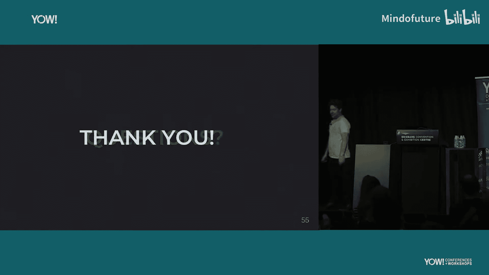

👏Questions。

