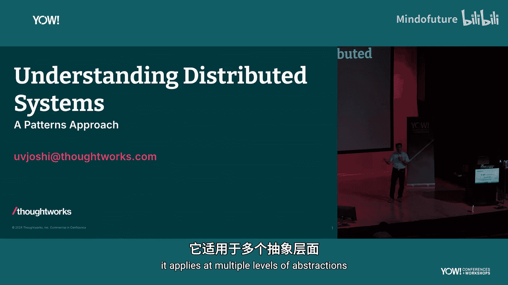
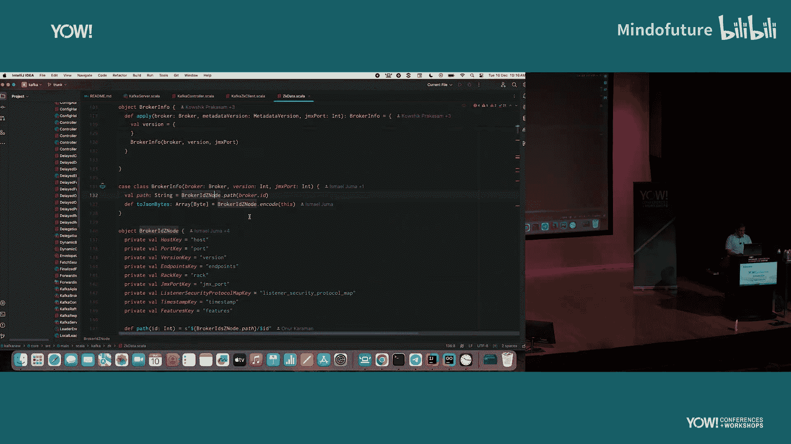
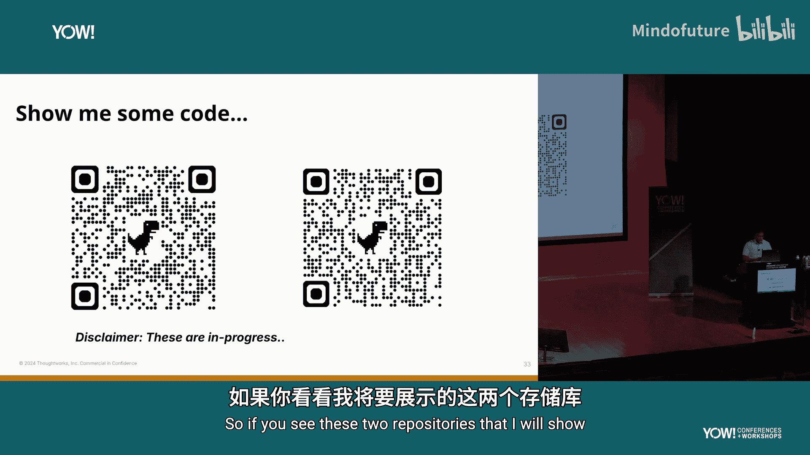
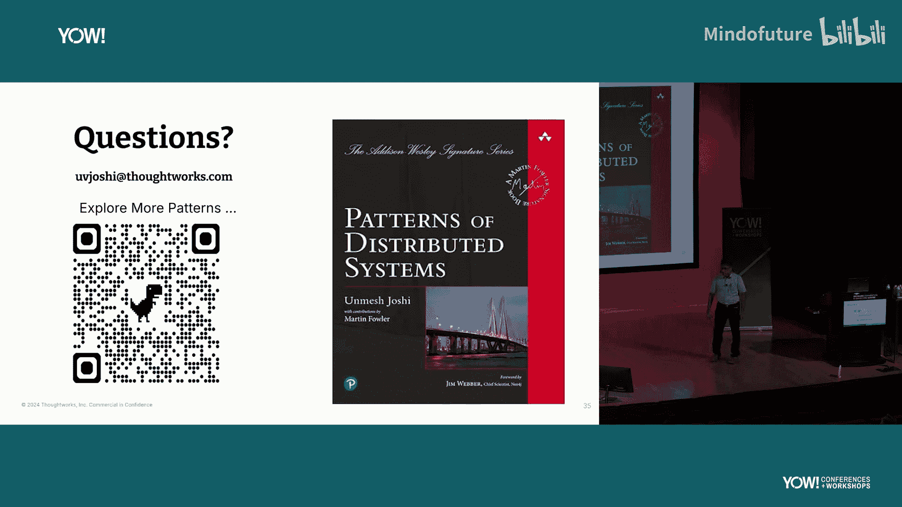

# YOWcon软件开发大会（2024）｜-架构设计-｜-分布式-｜-AI-｜-代码-｜-JAVA-｜-Github-｜-Spring-p03-P03-Understanding-Distributed-Architectures---The-Patterns-Approach--BV1G9dfYTEHR_p3-

Cool， so we will be talking about distributed systems。And that term is quite overloaded。

When people say distributed systems， so if you look at if you have a microscope and go inside your CPU。

 your CPU or a chip。Itself is a distributed system can。

Treat it that way or all the cloud services that you use or products like Kafka and Kubernetes that you use。

 they are distributed。Or if you go one level higher your overall architecture like for a system like Netflix。

It is also called a distributed architecture， so what we will be focusing on primarily is around products like Kafka and Kubernetes and all the cloud services and we will see why that is the focus。

But a lot of principles and patterns that we see there is typically this quality of self similarity when something is a pattern you will see at multiple levels of abstraction so whatever patterns we are talking about today or I have discussed in the book。

It applies at multiple levels of abstractions。

So that's the agenda for today， I' will give you some of the background of this work and why I chose patterns as a way of describing or understanding what is called as distributed systems。

And then well to take a look at some real examples of how patterns help us understand。

Some common architectural architectural architecture of common systems。So， this is the。

End product of the work that' is happening， there's the book that we published around last year。

But I consider this as an ongoing work and periodically getting published on Martinfollow。com。

The main source of information for this work is essentially going through a lot of open source core base and try to find similarities and differences and try to articulate those。

And more importantly something is not common you might be aware of this rule of three that is typically followed when patterns are documented。

 that something is not called as a pattern unless you see it in at least three different implementations。

And one other care that we have taken is unless there is a working example we actually write some code that demonstrates common pattern across different systems it is not documented as a pattern so this working code and will I will talk a little more about that later why that working code is important。

So now it as of now it is a catalog of 30 patterns and we published a book when we thought that these are good enough set of patterns to explain a full system or to understand a full system like Kafka Kubernetes and I am taking those names just as examples。

 it equally applies to any other distributed system that you might be familiar with。So。

 lets start looking into why patterns is an approach or as a method we chose for describing articulating and and trying to understand these systems。

Now， Ive just listed。Various tools and frameworks and services that。

Any any architecture today like when we when we say we are either modernizing a system going to cloud。

 hybrid cloud or your own optimize systems， you will typically have。😊，Databases， like。

Ive listed a few like Mongodi B Cassandra， if you are on AWS Aurora and there are。

Multiple others that each cloud provider has and there are so many different products out there。

Then there are message brokers Kafka is the most popular I think in last 10 years with microservices and even driven architectures。

 Kafka has become like the cornerstone。Our main building block。But there are others as well。

And then there are infrastructure orchestrators right you use things like Kubernetes for orchestrating your containers。

There are some domains where products like in memory data grids。

 particularly popular in the financial domains。And if you are in the data world。

If you are a data engineer doing big data projects。

 there are distributed file systems and products built around that。And then， there are。

Hundreds of cloud services that that we use every day and that various cloud providers offer。Now。

 when as a software professional today， if we need to architect。In its system。

Or we need to understand a new service or a product that that becomes a buzz in the market。

The challenge is。How to understand all of this。Because we can't really just understand one product and do an end to end architecture and even understanding that one product is difficult enough and we will see why I mean that is one of the challenges with distributed systems。

But。What we need to do to do our day to day work effectively is to really understand why these systems or products or services are designed the way they are。

What is the reason they are designed the way they are？What problems these designs try to solve？

What is the crux of it。And if there are any common problems because we are categorizing of all of these systems as distributed systems。

That means there is some commonality to it and if there are common problems。

 are there any recurring solutions？That will help us understand how they are built。

And then when to use these solutions in what circumstances what are the trade offs and how and when to use them。

If we can understand。嗯。Systems are this at these basic principles level and their are basic building blocks level。

 I think it is a lot easier。As a professional developer to navigate through all those names that we saw on the previous slide。

Now how to how to do that， though。And today in the in the cloud world with cloud war going on。

 there is a lot of focus on certifications， right。😊，But certifications， even if they are good。

 maybe they they teach you how to use a particular product or a service properly。

It doesn't talk much about why that service or product is built the way it is and if something changes in future。

Will there be any changes to expect and what to expect and then if you need to compare multiple services and products with each other doing certifications might not be useful if but if you know the building blocks。

That's that's always useful。There is another aspect to it。

 and I like to use this term called platform sympathy。And。I derived it， kind of from。

From the term called mechanical sympathy。And you might be aware of this if you know of Martin Thompson and his product called Lmax Lmax deor。

 it was very popular a few years ago。But， but he uses this term mechanical sympathy and says that when whenever you code。

 whenever you write code， whenever you build any system。Or whenever you use any system。

It's important to have that mechanical sympathy。When you you do that and it that the term essentially is coined by this racing car driver。

Who says that to use。and run a racing car effectively。

 you don't need to be an engineer who engineers a car but you need to have this mechanical sympathy you need to know how these various blocks which make a car work together in sync and how to use them effectively。

Now， if we translate that to the software systems in the cloud era。

That's what the mechanical parts of our。Data centers。Or what we call as cloud， it looks like。

So there are hundreds of thousands of servers。Arranged on the racks。

there will be power supply and network cables you can see I mean this photo I have taken just one random photo from Google data center photos。

 but you will file some fascinating photos on if you just Google for data center photos。嗯。

Whatever product services or architectures we we build in today's era。

 they essentially are built the way they are。Because they run on these kinds of environments。

We need to cater to the realities of these environments and that is the reason they are built the way they are so to use them effectively。

😊，If we know， what are the realities of these environments。

What are the building blocks of these products which cater to these environments？

We can use those products a lot more effectively and it is also easy to understand why they are built the way they are。

Now， how to achieve this platform sympathy。Do we read books。

That's not enough a lot of times because there is a lot of gap between theory and practice whenever you read something。

Or。Or here some someone speaking like I'm talking right now， and for that。

 I follow guidance of two quotes that I'm going to show。

And this one is from Martin Fowler and he famously said that code is like mathematics of our profession。

😊，And that's where you remove all the ambiguity。And for this reason actually a lot of earlier talks that I did while I was working on these patterns。

 I never did any PPTs， I mostly mostly showed code working code for most of the talks。

The other interesting quote is not a quote really， but a part of another Pats book older Pats book called organizational Pats。

😊，And it has this。Interesting pattern， a well known thought pattern， by the way。

 called architect also implements。And it has this。Nice comment on abstractions。

 And which is very important today when there are so many things or so many efforts done to abstract away a lot of complexity from us。

😊，And what this comment says is abstractions。A nothing but disciplined form of ignorance。

And we need to be aware of that because abstractions are are we create abstractions to ease our lives。

😊，To make our life easier to speed up the work that we do。

 but we need to be aware that they they are ignoring certain things。

 even though in a disciplined way。And a lot of times。The failure is that happen。

While using these systems or。Or using these products or even when we architect certain systems。

 they always happen on the details。That we try to hide。How would we try to ignore。So。

 we need to be aware of what those details are and as we saw on the previous slide when we write code。

😊，That is when we can actually unearth or actually see through。

What's going on behind those abstractions？So let's say。

 and I've been talking about Kafka and Kernetes just as as examples。 So just a show of fans。

 how many of you are using Kafka in your。Work okay， a few。 and any of you using Kubernetes。Okay。

 a few and people who are not using it are they indirectly using it？Indirectly， yes。Cool。

 so let's say I talked about platform emy and building blocks and。A way to understand that is。

Only to code， let's say。So， if。We are。Using Kafka and Kubernetes and we now try to use this patterns approach to。

Really understand things in details and maybe to write by writing our own Kafka and Kubernetes for learning。

 but for just not necessarily for。Production use。So that we know we saw that platform sympathy slide previously right so we know what the building blocks are。

 what is the interplay between them and maybe to make right choices and make right decisions。

Can you do that？So， that's where。This patterns approach comes in very handy。Because。

It's a good mix of description with， with some code。

And why that is useful is that patterns when you when you structure things as patterns or structure information as patterns。

 or you try to articulate your understanding as patterns。

The the structure of that patterns is pretty generic。So。

You don't describe something that applies only to Kubernetes or you don't describe that applies to only to Kafka it needs to be broad enough。

To apply to multiple systems。But on the other hand， it should be specific enough。To show real code。

And that is the beauty of patterns as an approach that I find because when something is as concrete as you can actually write code and not pseudocode actual code in Java C++ or whatever your favorite languages。

A lot of ambiguity that that you face just when you read English documentation。It goes away。

The other important aspect of patterns and you might have heard this multiple times that naming things is one of the most difficult problems in software world。

But patterns when you read or when you your structure， they have some well established names。

And well establish names。With some concrete。Cd structure that that is associated with it。

 and that's a very powerful thing to have。Because when you have a well established name with a very concrete understanding at the code level。

And you know multiple of these patterns and how they link together。You actually can think of。

The overall architecture。As a sequence of patterns and you you know because you know how patterns play together or how they work or interlink together。

it becomes easy to understand a particular architecture。So， for example。

 if we want to understand how Kafka is built and you know a set of patterns like I said there are 30 patterns。

😊，You can very well and you know how those patterns play together or link together。

It's very easy to understand Kafkas project Kafka's architecture。So。Let's take some example now。

And I have been using Kafka and Kubernetes as as examples。

 so lets say these are the we are lets say reading Kubernetes documentation and we are reading Kafka's documentation。

And。We see sentences like this that Kubernetes has something called as control plane and it uses its C as its backing store。

And Aache Kafka， it needs zookeeper or the newer version， it doesn not need zookeeper。

 but it has something called as a controller cluster。And we know。Want to make sense of out of these。

What does this mean？So let's say at high level。If you if you say Kubernetes Kubernetes is essentially used for orchestrating containers or pods。

 which is group of containers on multiple machines so you have。Multiple servers。

 which I'm calling nodes like this。And then you have。A smaller cluster。

W is HD is a product that that Kubernetes uses。And then if you read about its C。

 there is a mention of something called as a raft there。😊，If you see Apache Africaka。Again。

 you see something similar that there are multiple nodes or multiple servers。

 but now instead of containers there are topics and partitions。

And then you again see a smaller cluster。Which is zookeeper。

 zookeeper is the product that Kafka uses。And if you read about Zookeeper。

 there is this mention of something called as Zab。😊，And then， I mean， just。

To show the similarity with anything else that is called as distributed so any any other database you take or any other cloud service you take as an example。

😊，And you see how that looks。It has。These multiple nodes。Again。

 now there are because we are talking about database， there are tables and not topics or containers。

And then， there are shards。Which are splits of your tables。Or partitions of your tables。

And then again， you see something like they're smaller。Cluster。Which is called as master cluster。

And they have their own implementation for that master cluster， so don't use zookeeper or HC。

And if you read about that master cluster， there is also this mention of raft。搜。You see that。

All the three examples that we saw。And the English documentation that we that we saw。

 it has this similarity rate， there is a larger cluster。😊，And then there is a smaller cluster。

So if we understand why there is。This separate smaller cluster and why not just one cluster。

It's easier to understand what's going on。So what does this smaller cluster do？It manages met data。

Of of the cluster， so which partitions are on which nodes or which containers are running on which node。

Stuff like that。It helps implementing what is called as leader election。

So if one of the nodes that we saw needs to act as a leader or a controller to take decisions on behalf of the cluster。

But to implement all this needs。What is called as consensus implementation or consensus algorithms to be implemented。

And they don't scale well beyond a few nodes or。Beyond the cluster size of say3 to5 nodes。

And that is the reason the solution typically always is that you have this smaller cluster for managing your cluster metadata。

And have certain primitives that we will see。😊，To which then can be used by your actual data cluster。

And you can see that your actual Kubernetes， Kafka or other data cluster。

 you will have typically the size will be thousands of nodes or thousands of servers and your smaller cluster will typically always be three to5 nodes。

So to allow that cluster to scale to thousands of nodes。You pull out this smaller cluster like this。

And then if you see a pattern or what commonality you see in there you。

Describe that as a pattern and pattern is called as a consistent core。And pattern， as you know。

 typically has this problem and solution。Parts problem describing why you what is the challenge that you are trying to solve？

And solution gives you a solution structure。So managing metada with strong consistency using consensus or algorithms so that your。

Main cluster can independently scale to thousands of nodes。And for doing that。For achieving that。

 you use this smaller cluster for your metadata。So。

 once you know that there is a concept of consistent core and that is how typically your cluster coordination is managed。

😊，Practically any distributed system， cloud scale distributed system。

 you will see that it has this kind of a component and different documentations and different products will call it by different names。

And maybe have slightly different descriptions of it。

 but once you know what what this is it becomes a lot easier to understand。😊，No。

we said that there patterns are not generally used alone right there are multiple other patterns that this pattern links to to achieve a broader goal。

So how is this smaller cluster used？So we said one of the one of the use cases is。

To to do a later election or to choose a controller from from your larger cluster。

But whatever mechanism you use， like once you choose someone as a leader or someone as a controller。

 it should not be for indefinite time because。Failures can happen at any time。

 and you cannot give indefinite access of。Any responsibility or any resource to a one particular node。

And the solution to that is to。Grant time limited leases so you you grant access or grant lease something called as these。

But you keep that time bound。So， that。In case of failure and well see how。

 but whoever whoever wants to play a particular role。

 lets say like this node one can say that I want to。Have access for。This node one name。

And it can register。Police， with that name。And that's a typical interface that you will find on the products which are consistent cores。

And then the responsibility of this node is to refreshre that periodically。

And if it is not refreshed， let's say beyond。A certain time interval。It's the consistent core that。

That will consider that the lease is expired and it will remove that lease。

So this is another pattern you will always typically find。

Along with this consistent core or the the interface of that consistent core will almost always have this feature called as these。

So if you if you see zookeeper or HCD or master cluster or any other product that or any other custom implementation that is used as a consistent core。

 will have a mechanism called as leads。So are there any more uses of？This， this smaller cluster。So。

 one other。Common requirement is that。Because this smaller cluster is now managing your cluster metada。

And you have this let's say， thousands of node bigger cluster。That's out there。

Multiple nodes in that cluster now need to know if there is change in configuration or change in metadata。

And it needs to get that real time。So let's say this node one we saw it registers a lease like this。

And some other nodes， they need to know。If there are any leases registered under this prefix called server。

 so are there any servers registering leads with the consistent core？With this。There is a mechanism。

By which this consistent core can notify the。The nodes which are interested in that information。

This ability to be able to register your interest。For a particular kind of data。And to get notified。

When any change that happens in that data？呃。Is again， a common pattern。Which is called a state watch。

 I mean that that is the name so you are watching a state on a remote server。

And whenever a node needs real time update for any change that happens。

You need ability to register for interest。And then get notified。So。

You can see that this consistent core。Along with Lee。And。State watch。

Is often used together for doing cluster coordination and cluster metadata management for for practically any dis system。

So whenever you read something like Kubernetes control plane。Or Kafka using zookeeper。

You can see interplay of these three patterns together and to then to understand。

The Kubernetes or Kafka control plane。You can understand that in terms of these three patterns。Okay。

 so I talked about ability to code based on this understanding of common patterns。

So I will show you some code， but these are the repositories that I use to run a few workshops where we build。

Products like。Kubernetes or Kafka from scratch in a couple of days。But whatever we just saw。

 I will probably just show you the。

So， this is。Apaache Afka source code。From Github。And once you know that。

You have this concept of consistent core with the concept of leads。That。That in case of Kafka。

 it will be brokers that the servers are called as brokers。

You see that whatever we saw on that diagram rate， you see very similar code。Out here。 So it's。

 if you see what。Okay， it's， it's right here。So whenever whenever your broker start or a server start。

 they register with。Zookeeper， which is a consistent core。And zookeeper has this。

Concept of ephemeral nodes， so we talked about li rate。Zookeeper calls them asphmeral nodes。

 so they go away if they are not refreshed。Or the session current session expires。

And once you know know this， it becomes a lot easier for you to。

Because there is a lot of complexity in making a system production ready。

But concept level you can it is pretty simple in a way。

 So if you if you see these two repositories that that I will show。

So this is a Kafka or a miniature Kafka。And that's how we also when I documented patterns。

 that's what I did as well like created my own miniature versions of。All the products that I studied。

So this is a end to end Kafka， and you can see that。I mean， Kafka thiss my own Kafka。

But it has everything that。Your actual Kafka has。嗯。

The advantage of doing stuff like this is you have your own miniature playground where you can try out different things so this is single J unit test。

That is running a。A Kafka cluster。And you can actually simulate。Let's say， having。A larger cluster。

 or smaller cluster and introducing failures。And you also see the interplay of。

Because you actually code it yourself。You see that whenever you create a topic or whenever you produce a message。

嗯。What happens underneath？So I encourage you to try the， I mean。

 you you look at that Gi repo and maybe give it a try。And similar to Kafka， this is a Kubernetes。

A rapport that I have。And similar to that Kafka test that was out there。

This is a kernetes test essentially doing the same thing setting up。

Building a Kubernetus from scratch has same components that a typical Kubernetes implementation would have。

And you can set up a cluster yourself， and。嗯。Sa try orchestrating the containers so。Do give it a try。

So。Just to summarize， I mean that's the summary I mean the patterns a is a tool for achieving platform sympathy but platform sympathy is something that is very crucial。

😊，And one of the interesting observations that I have been having in last few months is that once you understand concepts at patterns and principles level right。

Using generative AI tools。is。Is a lot more effective because you saw like one code Kubernetes code is in Gol and Kafka code is in Java and maybe you use the rust for something else。

You can interact and instruct。A tool like Co pilot a lot more effectively and also validate。

The output code lot more effectively， if you know。Noles。Concepts at patterns level。So。

 there is another aspect of this and you might have heard this term called accidental complexity and essential complexity。

诶。Accidental complexities。 so essential complexities is the real complexity of of your system。

 just inherent complexity， just。When we say distributed systems， there are failures。

Tings need to work on say thousands of servers and that's inherently complex。

But there is this accidental complexity that。That。Is introduced just because。

The way the code is written a lot of times。And that makes it。

That makes it a lot harder to understand certain things。 So patterns help。In in this sense as well。

 that once you understand patterns well。That accidental complexity is a lot of times reduced。

But you actually see what essential complexity is。And that's very important because when when you use abstractions。

 like you use something like zookeeper and。If you read the documentation， a lot of times you will。

Probably feel that a lot of all the problems are solved for you or when you use a cloud service。

 they might say that all the problems are solved for you。

 but there is this essential complexity that we need to be aware of。

And it's a lot of time buried in documentation and other things。

 so patterns also help you with that aspect that they they clarify that essential complexity and it helps you to。

Think to clearly。So that's about it。You can explore more patterns I mean I just covered some very simple things like customer management a relatively simple thing。

 but there are a lot of other patterns that you can explore particularly patterns around distributed consensus and stuff like that。

😊，But I'm open to questions。

