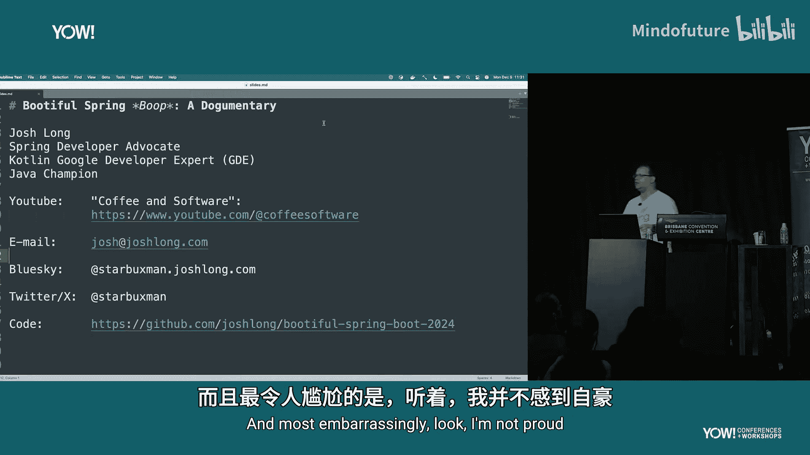
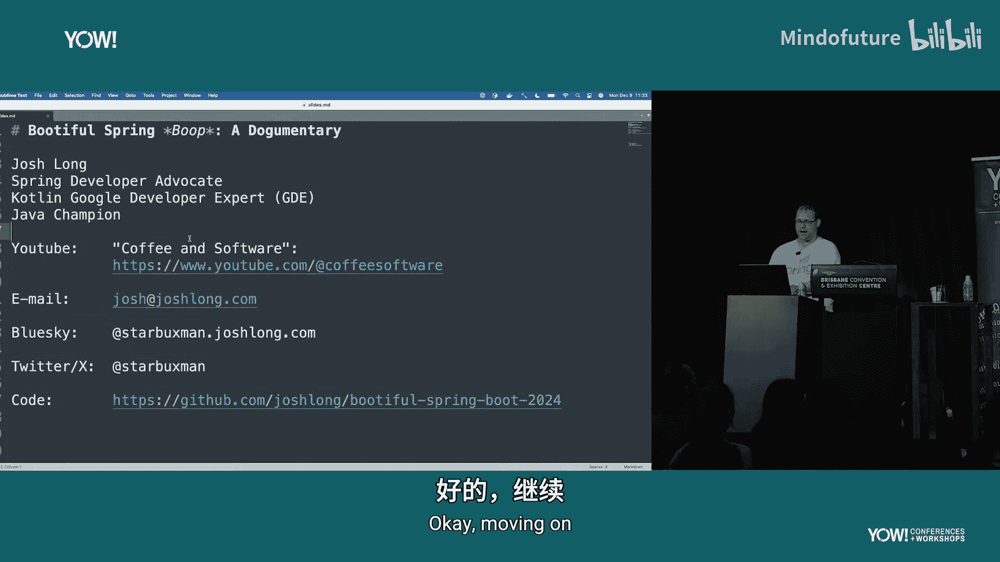
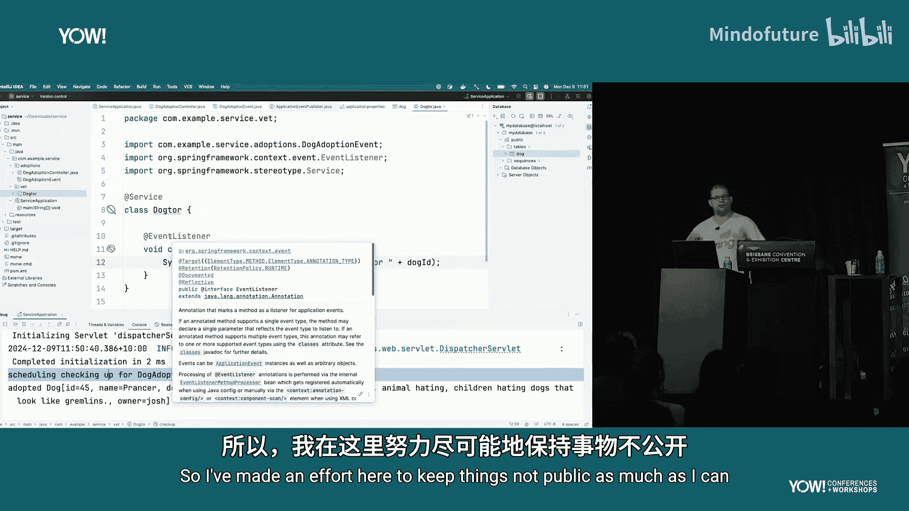
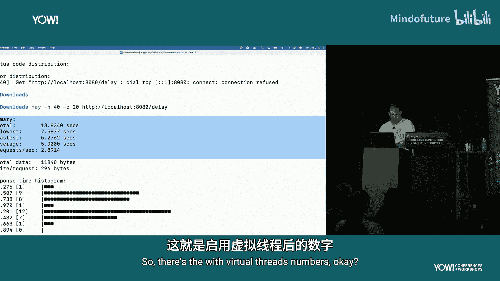
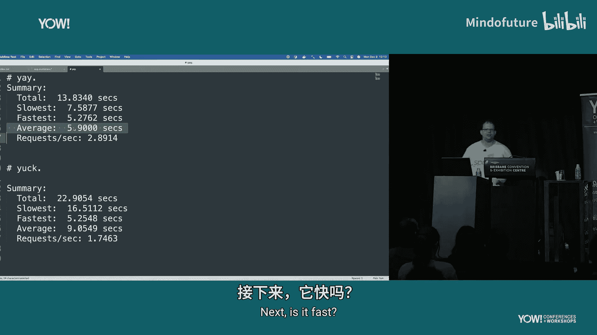
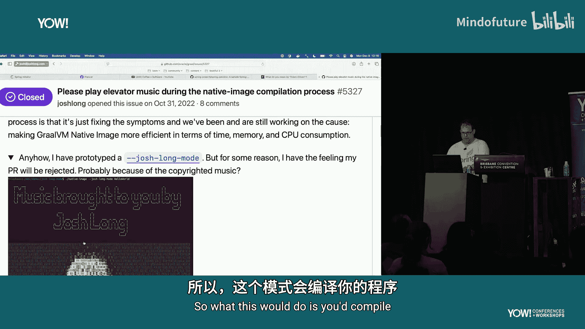
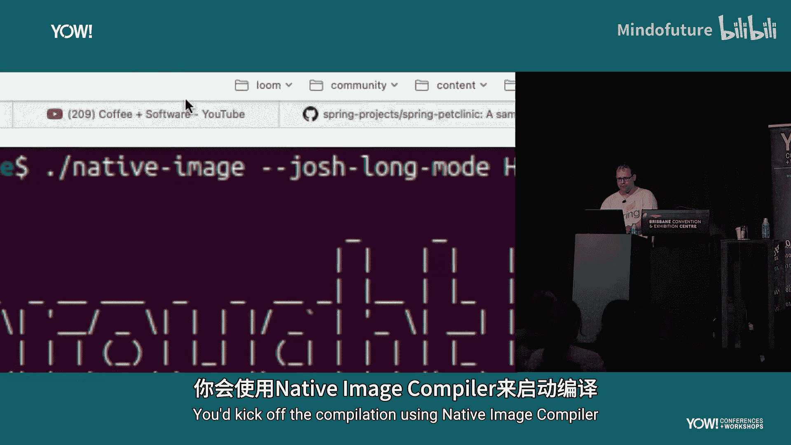
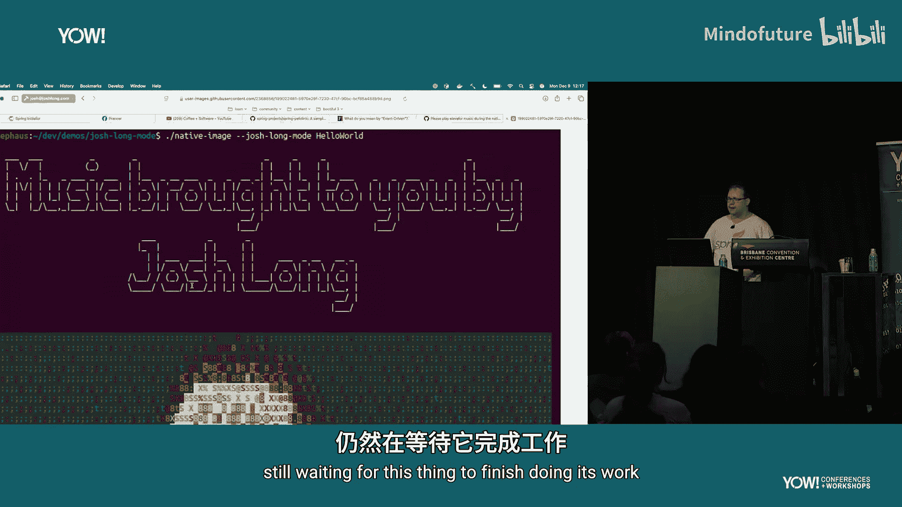
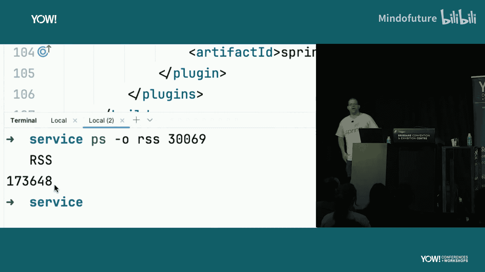

# YOWcon软件开发大会（2024）｜-架构设计-｜-分布式-｜-AI-｜-代码-｜-JAVA-｜-Github-｜-Spring-p05-P05-Bootiful-Spring-Boot---A-DOGumentary--BV1G9dfYTEHR_p5-

Thank you， Thank you。 Thank you。 Good morning， everybody。

 I'm so excited to be here with you all today。 But I'm also conscious that we have very little time in which to get done what we need to get done。

 So that said， my name is Josh， I work on the spring team。

 I'm a spring developer advocate Google developer expert and a Java champion。

 and most embarrassing look， I'm not proud we all do things。 we're not proud of for money。

 I am a YouTube。 Okay， so you can find me here on the YouTube。 It's not it's not great。 Okay。

 I was just gonna live with you。 you will make worse mistakes in your life， not many。

 but surely some like and subscribe right there。 it's an adventure。 It's an adventure。

 That's how I like to think about it。 It makes it feel more adventurous for me。

 So like like and subscribe。 Join me on the Internet。 who uses the Internet。 Any here。😊。

No， all right。 I then I expect at least as many likes and subscribers as there are people in this room。

 friendsend， look， I am， I'm， I'm， I'm really excited。

 I wanted to talk to you about all the cool stuff on which we're working today。 Oh， by the way。

 anybody using email email， I forgot about。 I forgot。 Yeah， find me there。 What about a blue sky。😊。

You don't really need to go online for that。 You've got it right outside your doors here。

 It's a beautiful city。 But what about the birdd website。Now， okay， good moving on。

 I guess I've been seeing some of the things that you locals lovingly refer to as chickens here that are definitely not in any same context chickens。

 are tiny dinosaurs。 Remember that。 They are not to be trifled with。 And of course。

 the code which we're gonna look at today is here。 So should you have questions， Common feedback。

 don't worry， our time extends long beyond our brief 45 minute window together。

 and I'll be and about outside the room answering questions。 but even there。

 if you should have questions， don't hesitate to find me on these coordinates。 Okay。

 take photos do the thing that gives you the ability to retain this information。 Okay， moving on。

 So I was really kind of one what I could show you。

 So sort better demonstrate all the cool stuff on which we were working。 And of course。

 there is the famous spring clinic example。 This example is a sample application that demonstrates a lot of the moving parts in the spring ecosystem。

 And it it's a very old project It's like 20 years old。 But know。

 don't think it's actually 20 years old。 There's been updates more recently。

But that said， you know， I thought we could show that。 And it's， it's a good idea。

 But it's a lot of moving parts。 And I don't think we have enough time to really get into all of it。

 So I wanted to show something abbreviated。 but in the same spirit。 And I thought， well。

 we could do something about animals， you know， and， I love animals。 Everybody loves animals。

 dogs and cats and， and so on。 I love， I love animals。 I do。 I just just。😊，Just not my dog。

 He's terrible。 He's a terrible， terrible dog。 He's the worst dog。 His name is peanut。

 and peanut isn。 he's not a good boy， not， not a good boy， just a terrible， terrible dog。

 and there are three reasons we keep them in my home。 Okay， I'll just be honest with you。

 there's three reasons we keep number one， first and foremost， paramount among reasons。 is。

 of course， even terrible， terrible dogs deserve loving homes。 Okay， bad dogs deserve good homes。

 That's a fact straight up。 I'm not gonna mince words there。 That's number one， number two。

 and this is， I'm just gonna I'm just gonna be real with y'all。 just gonna be real。 It's ego。 Okay。

 look， in my home。 my partner and my daughter both speak five languages。 I， but three and a half。

 So if we got rid of that stupid， stupid dog。 I would be the stupidest in the house。

 that that cannot stand。 that cannot stand。 It will not stand。 Okay。

 so we keep the dog for that reason。 and then the third reason， you know， finally， is， you know。

 just。I mean， come on。 He is pretty stin and cute， right， Hes， he's so cute。 He's so， so， so cute。

 but evil。Straight， straight evil， pure malice。 This is the best way to experience peanut。

 the dog via a photo on a screen。On a different continent。Okay， it's the safest way to do it。 Okay。

 there's no other way I would recommend in in experiencing the dog that is peanut。 And peanut。

 terrible， though he is， he reminds me of another dog about which I learned during the pandemic named Prancer。

 And this woman， she put up an advert soliciting a new home for her dog in the pandemic in 2021 right there。

 right， And this dog's name is prancer。 and she described this dog very hilariously in this addamant viral。

 She said， I have tried。 I've tried for the last several months to post this dog for adoption and make him sound palatable。

 The problem is he's just not。 There's not a very big market for neurotic man hating animal hating children hat dogs that looked like Gremlins。

She continues。 She continues。I have to believe there's someone out there for Per because I'm tired。

 and so is my family。 Every day we live in the grips of the demonic Chihuahua hellscape。

 He is created in our home。 If you own a Chihuahua， you probably know what I'm talking about。

 He's literally the Chihuahua meme that describes them as being 50% hate and 50% tremble。

 If you're intrigued and horrified， then， you know， wait， there's more。 she continues。

She says I was excited to see him come out of this shell and become a real dog。

 I'm convinced at this point that he's not a real dog。

 but more like a vessel for a traumatized Victorian child that now haunts our home。

 And she continues this dog wants to be your only child， right， So very ominous description of a dog。

 And I thought， well， wouldn't it be great if we could build a service to support adopting even this terrible。

 terrible dog。 And so let's do that as always by going to my second favorite place on the Internet。

 obviously my first favorite place is production。 I love production。 You should love production。

 You should go as early and often as possible， bring the kids bring the family the weathers amazing。

 It's a happyappies place earth， It is better than Disneyland。

 But if you've never been to production。 You can begin your journey here at start spring than I。

 And what we're gonna do is we're gonna to build a new service， my friends。

 And we have some questions that we need to fill out before we can get underway first and foremost。

 What do we want to call this service。 Well， I'm gonna call it service。

 And the reason is because I'm amazing with names。😊，Amazing with names。 I get that from my father。

 My father was amazing with names。 When I was a small boy， We had a small white dog。

 and my father named him white dog。😊，Amazing， amazing with names。 That said， my mom。

 She always tells me。 she says， you're very lucky that I named you。 And yeah， that's probably true。

 I one can only wonder what my mom， my， my father would have named。😊，Well， yeah， you know， anyway。

 auto to complete that for yourself。 So anyway， there's that。

 we've got a choice of what Java version we want to use friendsend。 There are three radio boxes。

 but only two valid choices。Okay， in no context。 should you ever choose Do 17。

 It's completely inappropriate in every single context is's not done in polite company。

So we won't be using that。Java 21 is is the long term supported version of Java。

 and it is in my estimation， the single largest release to come out of the Java team in decades。

 perhaps ever。 It's an amazing， amazing release。 So at least Java 21， right， Java 21 is amazing。

 It's technically superior in every way， it's faster， more robust， more syntax rich。

 more operations friendly， more performant。 It's technically superior in every way。

 It's also morally superior。😊，You won't like the look of sadness and shame in your children's eyes when they see that you're using Java 8。

717 in production。 Don't do this。Be the change you want to see in the world。 Do the right thing。

 Use at least Java 21 or later。 And friends， look， we're barreling down the road to Java 24。

 it'll be here in a few short months。 And when it arrives。 when it arrives， friends。

 we can say that not only is Java 24， better than say Java 8。

 which some of you I know are clinging onto。😊，It's not just better than Java 8。 It's three times。

 like the math do the talking。 It's three times better than Java 8。Okay， mathematically。

 it's approval。 So I'm happy with that。 We have to add some dependencies。 We're gonna use graph Vm。

 We're gonna use the spring web support。 I'm gonna use spring modular to support building modular applications。

 I'm gonna use the spring boot dev tools to make live reloading pretty quick。 I'm gonna use postquiz。

 but I want to postgz plus some vector store capabilities。 So I bring in that。 It's 2024。

 And the search for intelligence has gone abysmally。 So we now in turn to artificial intelligence。

 We're gonna bring in spring。😊，Open AI support。 And and I think we also need an O R M of some sorts。

 I'll bring in spring data JDBC。 Now， I'm pretty satisfied with my selections。

 Let's go ahead and hit generate and open this up in our I DE。

 It doesn't much matter which I D you use so long as it supports the build tool of your specification and the version of Java。

 all of which are possible in any of the modern tools。 Okay， friends。

 So this is a brand new application。 It's gonna talk to a database that I've already got running in my local machine。

 So I need to specify some connectivity information here， right， So spring data source。😊，Data source。

 come on， Spring Data source， URL， JDBC， Colon， Postgrez， kill， local host， my database。 Yeah。

 and I'm gonna create a username。User name。 come on。 username is my user and secret。 Now。

 don't tell anybody。 Okay， this is between us。 is is called secret。 Okay。

 I'm gonna use the little button there。 click test connection。 I'm gonna hit apply。 hit okay。

m gonna to go over here， refresh this In makes us fast。 It's really look at that。

 I have like only 20 clicks。 And I have access to my table。 There we go。

 So there's this table called dog。 Okay， and we've got the ideas。 The name， the descriptions。

 owners and other information。 Here's our boy， Praer。 His ideas is 45。 His name is prancer。

 He's described as a demonic。 neurotic man hating animal hating children hating dog that looks like a Gremlin。

😊，And of course， his owner is missing。 There's no owner yet。 That's our goal。

 We're gonna fix that today。 Okay， We're gonna adopt this terrible， terrible dog。 Now。

 what we have to do is we have to build some software。 But friends。

 I want to build software in such a way as to promote modularity。

 modularity is not a technical concern。 It's a so political concern。

 I want to write my code in such a way that I reduce the blast raius of change。

 When I make changes to my code base， there should not be lots of cascading ripple effects that affect other parts of the organization。

 It should be well containedtain well modularized right So we want to do so in such a way is to limit the blast raius of change to make it easy to move and change and refactor with impunity。

 The faster you can do that， The less you have to have those tedious conversations with other people to synchronize those changes。

 the faster you can move。 This is the rationale， by the way。

 for microservices microcroservices are forcing function that give you an API inside of which you can do whatever you want。

 So long as a stable surface area of that API stays the same This is not about tech。

 It's about moving faster as an organization。 and the same same applies。

 even when you're just building software in a monolithic modular。So we're gonna do that today。

 And we're gonna build a new module。 And we're gonna say module。

 I'm gonna use that interchangeably here with the idea of a root package。

 I'm gonna create a new package here called adoptions。 Okay， adoptions。 And in there。

 I'll create a new class called dog adoption controller。 And first things first。

 get rid of that public keyword。 It's almost never necessary。 We're gonna get rid of that。

 I'm gonna say at response body。 This is gonna be a controller。 It。

 in turn is gonna delegate to a dog adoption service。😊，And this is gonna be a spring bean。

 It's gonna be a service。 And that in turn， order for to do its work。

 It's gonna I'm gonna need to have some way of describing the entity。

 So I'll create a dog entity here， like this string name。

 string description and string owner And of course， this is gonna have a primary key。

 which Ill map to my database table And I'm using Java record。 I love， love， love， love Java records。

 I justm a huge， huge fan big fan。 huge fan big， big， big fan。 So there's that。

 I'm going create a repository to get rid of the data access concerns。

 I can move on to the business logic that matters here。 I think I'm happy with that。

 let's actually flesh out this logic here。ll have the ability given a dog I D and owner name I'll have the ability to update the dog record to reflect the fact that we update we've adopted it So this is gonna be a service。

 Itll be a transactional。 Sure down here we'll flesh this code we're gonna have a method here that will use that repository。

 Do you want to see a new feature that they added。😊。

Intelly that I just think is pretty wild Watch this。 No， dog sorry dog repository， dog repository。

 Nope， that didn't do it。 Do repository。 There you go。 Look at that。 Do you see that。Boom。

 just add the constructor out of the field。 I didn't even have to make the the field itself。

 I have to do that。 And so I'm gonna say find the dog find by I D dog I D。 if it's present。

 Then I'll have the dog。 And I'm gonna update it。 I'll create a new dog reflecting the new updated field here。

 Pass in dog I D dog dot name， dog do description。 and， of course。

 the new owner from the method that gets called there。

 And I'm gonna just save this out say dog repository save like so Pass this back。 Here we go。

 Here we go。 And I'll print out just to confirm that we've adopted this dog。 Yeah， Okay。

 so new dogvoa。And in order for in order for this to work。

 I need to actually connect that to a H TP endpoint。

 So I'll do that now I'll create an endpoint called dogs passing in the dog I D。

 And then we'll have the adapt adoptions collection there。 And you know， we'll just do avoid adopt。

 And we're gonna take in as part of our data as part of the H TP request。 the dog I D。

 And data that's gonna come in from an H T T P Json payload。 will be used to extract out the name。

 Okay so there's that map。 And I'll mark this as the request body。 And I'm gonna inject again。

 I'm still trying to get used to this feature。 right， So dog adoption service do It's so good。

 Look at that。 Did you see that。 I just added the field and it created the constructor and everything。

 knowing that it's public， though。 Okay， so I think we're good。 I think we have everything we need。

 Let's go ahead and start this application up。 Here we go。😊，Okay， and if I go to the console here。

 curl， there it is。 Cur， minus- D。 name is Josh。 Cont type application。 Jason， local host 80，80。

45 dogs。 I D is 45。 That's praer adoptions。 hit enter。 And we got looks like I've adopted the dog。

 Faoo， right， It's worked。 Now we can confirm as much by going here。

 and confirming that the owner field now says Josh e。😊，It works not all that interesting。

 but it does work。 Now， to be fair， this is a bit of a contrived example。 In most jurisdictions。

 you can't take ownership or possession of a live animal just by updating some field in some database somewhere。

 There's typically more bureaucracy involved。You might need， for example。

 to schedule a trip to the veterinarian， right， to get the the poor dog checked out。

 So I'm gonna create another module here called vet。 So we're gonna call this vet。 And in there。

 we're gonna have a class a service to represent the veterinarian。 What a veterinarian， you know。

 is a。You know what it is。 Actually， You know what it is。 I'm gonna， it's a， it's a doctor for dogs。

 So we shall call this dog tour， okay， and。At service。Public avoid checkup int dog I D。 Here we go。

 And I'm just gonna print out， you know， checking scheduling checkup for this dog I D。 Okay。

 and I'm gonna use that back here in my controller。 I'll go back here。 and I'm gonna add this to the。

 no， sorry， rather the service。 I'm gonna do that in the service。 Where's my service。 Here we go。

 I'll add private final dog tour。Dog tour， add that to the constructor， and I'll go down here。

 And now after I've scheduled it， after I've saved the updated state。

 I'm going call dogg tour do checkup passing that in and。Now I can go back here， refresh。

 And it says scheduling， checkup for 45 and adopt it。 So isn't that nice。 I've done both things。

 but actually come to think of it。 I don't really like what I just did here。

 because what I've done is I've added this collaborating object to my service。

 I've now risked muddying the concerns here。 I've got too many things going on in this one service because I need to schedule the checkup。

 But I don't depend on the outcome of that。 It's fire and forget。

 I really don't care that it gets done， it needs to happen， but it's not my concern， It's coincide。

 It's not a dependent right So so maybe this is not the best way to do it。

 Maybe I need to think about how I integrate these two concerns in the system without having direct coupling。

 You can。 if the occasion should required to have a direct injection of another thing in another module。

 But if you can reduce that coupling， it's always good to do so So let's look at a different approach to integration。

 One that is I think based on event drivenven architecture and messaging。 when I think about that。

 I'm reminded of this wonderful blog by Martin Fowler。 this blog was written come on do the thing。

 We talked about this。Okay， there you go。It says， what do you mean by event driven。

 And it was written in 2017 before the Covid pandemic or B， C。 And this blog asked the question。

 What do you mean by event driven， It talks about four different styles of architecture。

 Even notifications where you send to another system or service， the fact of the event。

 not the details associated with it， but presumably。

 the fact of the event is enough for you to do something useful with the event。 So， for example。

 if you program jascript。I'm sorry。I I just am。 I'm really sad for you。 That sucks。 But if you do。

 then you know that there's an onload listener and the onload listener tells you that the document has been loaded。

 which document， the one， you don't need any pointer to it。 You don't need it in the event itself。

 You don't need extra context。 You know which one That's all。

 It's the only one we can ignore eyeframes in this discussion。 Okay， Don't come at me with that。

 So anyway， that's a good example， right， Moving on。

Event carried state transfer is where you send an event from one system to a service to another and give actionable context in the event so that the system or service that gives a message can do something with that。

 This avoids them having to make a query to the source system。

 It makes it they're completely decoupled。 If I can take actionable behavior based on the event that I get then I'm completely decoupled from the producer。

 I don't know who in it， I don't even know how to get more information from the producer。

 I don't care。 This is quite nice。 And if you do that。

 if you realize that if you start communicating all state changes in the system via events。

 then something really wonderful happens。 The single source of truth in your architecture is the set of events that you've been given So suppose you have a multi data structure system with Redis for fast read only constant time lookups and you've got elastic search for full text search。

 and you've got a postgres for transactional sort line of business of rights and all that stuff in this system。

 I can't reconstitute each of those things from each other。

 The only thing I can use to reconstitute all of them is the events。

 And if you understand that implication， then you understand event sourcing。 It's the idea。

The events are the only source of truth in the system。

 And if you delete Postgz and Redis and Elastic searcharch and install them all brand new with empty data and then republish all the same events in the same order as which they were originally received。

 you'll get the same Redis， the same Postgz in the same elasticastic search。

 That's called event sourcing。 And this event sourcing plays really nicely with the insight that most systems。

 even monolithic systems like the when we're building right now， have multiple data sources。

 Data structures optimized for different read and write modalities。 And if you understand that。

 that's called C Q R S。😊，Congratulations， if you understand all four of those patterns。

 you're an architect collect your promotion at the door。 Okay， so we're， we're in a good place。

 We now have a good understanding of why we can use event driven programming。

 So I'm gonna use event driven programming。 I'm gonna back out this change to the dog tour。

 Remove that from the class here。 And I'm gonna inject the spring framework application event publisher。

 Okay， And this is a thing that's been in spring for 20 plus years。 If you look at this。

 this is actually from spring framework1 do1， right， So spring framework for1 one。

 Let me just go ahead and use it。 I'm gonna publish an event。 And you might be wondering what event。

 Well， friends， this is where we get to make our first public deliberately public type。

 I'm gonna create a class called the dog adoption event。 This is a public type。 Okay。

 I'm gonna export this from one module to another。 and I'm gonna publish that event here。

 I'll say new dog adoption event Here we go。 Pass in the dog I D。😊，And I'm happy with this。

 I think we did a good job there。 I'm gonna go back to my dog tour class now right over here。

 And now that I've published the event， I don't have to make the type itself public。

 I can make the event public。 and I can back out that， that stuff there。

 and I can make this a spring framework event listener while also correcting the， the spelling here。

 Okay， so let's try that out now， let's see if it still works。 So if I restart that。😊。

Where is my console here。Scheduling correctly spelled。

 checking up for checking up for dog adoption event。 So it's worked。

 I've used messaging to decompose these two things。 Okay， I'm not，'re。

 they don't know about each other now。 They just know about the event。

 That's the only thing that we've made public。 Remember， public is a problem。 You don't want public。

 whenever you can avoid it， reduce the scope of your changes in the code base。 public is bad。

 People can depend on things that are public。 You don't want that， right， So I've， I've made a good。

 I've made an effort here to keep things not public as much as I can。 And this is， you know。

 this is very much I see this anti pattern all the time。

 You see like app dot controllers dot app dot services dot app dot repositories。

Dot right， and then app dot models。Dot right， This is an empty pattern。

 I think we cargoulted this from the Ruen whales community。

 When have we ever cargoulted anything from then that we that we should have no， let's not。 This。

 especially not this。 This is a terrible pattern in order for this scheme to work。

 every class must be public。 Sa， perhaps the controller。Right， don't do this。 Instead。

 flip everything。 layer， flip the layers，90 degrees and do app dot customers。

And then just put the control of the service theyre po during the model in the same thing。 that way。

 they can all be bagd private。 This is a much better scheme because now things are packaged private and they're logically encapsulated。

 as you should do。 Remember， Java is an object oriented language。 You get information hiding。

 The goal of information hiding is to reduce the scope of changes and reduce the blastphs of change。

 If you want everything to be public。 and you want everything to exist in a flat global names face。

 just you see。😊，What's the point。 Why， Why bother write wrapping it in Java ceremony If you're gonna get none the benefits of it。

 Just you see。 So don't do that。 I'm gonna keep things nice and decoupled， So I quite like this。

 This is nice， But are we as decoupled as we think， well， not really， right。

 Because what I've got here is this event， listener annotation。

 I'm dispatching an event from one module to another And they're getting dispatched synchronously in the same thread。

 Okay， this is good if you want things to happen in the same transaction。

But it's bad if you want things to happen in a sort of decoupled asynchronous way。

 there's implications for that。 If I had thread dot sleep in here， for example。

 then that means that the dispatch would actually block waiting for this thread dot sleep to continue。

 I would hit the adopt end point。 and I would wait 5 seconds for this to actually get dispatch。

 So let's， let's go ahead and try that out here。 Okay， so start。And I go down here， stop。

 And then I'm gonna go back to my console and republish oops。 There I go。 hit enter。Oh。

Did I do the thing。Oh， I did 500， not 5000。 That wasn't very visible at all。 Okay。

 There you go 5 seconds， right， So you can see I hit enter， but I'm Im I'm published an event。

 and I'm hoping somewhere in somewhere in the world， somebody's handling that event。

 But now I'm stuck in the same time in the same thread。 And。

 hopefully in the same transaction waiting for that to finish。 Maybe I don't want that。

 There are ways to get around that， right， I could certainly make this at a sink。 That would be nice。

 But now this happens in a separate thread。 And I lose if I had one going。

 I lose the transactionality that I had before。 I could do this。 This is nice。

 This gives me transaction。 It'll start a new transaction。 But really， that's not what I want， right。

 because I could still get up， I could still end up in an invalid state。 I could publish an event。

Have it get handled in one side and then consume it in the other。 And the event will， you know。

 the machine loses power right in the middle of the dispatch。 and then I've got an invalid state。

 I've adopted the dog， but not scheduled the checkup。

 So I want some way to get the best of all the worlds。 I want decoupling through messaging。

 But I don't want to be synchronously coupled。 And also。

 I want to make sure that this gets handled eventually。

 So we're gonna use spring modulates application module listener。 Okay this is amantic semantically。

 its equivalent to the things I just showed you。 but it pairs super nicely with you know some extra configuration here quite like like avegeite and beer。

 Okay， so we're gonna use that。 We're gonna initially as a schema。

 And I'm gonna go ahead and restart the application。 hit enter。 Okay， And when I do that。

 I go back over here。😊，I refresh。There you go。 I've got this table now called event publication。

 Yeah， and this event publication table refresh that again。Refresh that。

 You can see I've got the I D。 I've got the listen I。 that's dog toward checkup。

 I've got the event type， dog adoption event， serialized representation of the data in the event。

 the publication date and of course， the completion date is noll， but it's been5 seconds。

 So if I refresh， it's now not null So what I've done is I've got a table that allows me to dispatch from one module to the other in the same code base and guarantee that it gets handled eventually。

 this is called the outbox pattern。 what you do is you use a transactional ledger like a database table to keep track and maintain the consistency of something that is not transactional like in this case。

 an asynchronous nonthread thing or maybe a file system or whatever， this is a very。

 very common pattern and we implement it for you here。

 this is great for module to module communication。 But of course。

 if you actually want to communicate to other services。 want to publish things to other services。

 What we've got covered there as well。 you can take that event and add externalized。

 And if if youve sp up if youve set up requisite integration in spring mod forom Q or Amazon S Q S or。

😊，ka or spring integration。 Then you just specify， you know， the Kafka topic。

 or you specify the destination colon routing key and raitm Q or the spring integration message channel name。

 etc cea。 right， put all that stuff here in this schema， this little string here。

 And it'll automatically also publish this thing。 In addition from one component module to another。

 But also outside externally via a messaging substrate of your choice。

 So now you have the best of both world。 You're building modular code。

 but you can also scale out to build a distributed system as well。

 without having to refactor any major parts of your code。 So I think this is quite nice。

 I think we've done a pretty good job We've got a modular system。 And remember。

 one of the benefits of that config properly that I showed you there is that it republishes outstanding event。

 So if I go here publish that again， And then I'm going stop the process kill it。 here we go goodbye。

 you can see it it's been turned off restart。😊，I've got a missing event， Sure， right， So it's。

 it's gonna reprocess the event here that I published that hasn't completed yet， right。

 So wait 5 seconds。There you go。 Stop scheduling。 right。

 It actually ran that when the application restarted。

 It made sure that I got any missed messages and handled them。 Okay。

 so now I'm guaranteed that things completed when they should have。 So I've got a modular system。

 I think we're doing good。 I keep saying the word mod。 What does that mean， Well。

 we can actually write a test to sort of suss that out。 So let's go over here。 And， you know。

 I'm gonna ask var application modules。😊，Modules。Okay， dot of。class。 I'll say verify。

 I'm gonna print out the modules。 I can even document the modules。

 Imagine that writing documentation and purpose。 Here we go。 ready， steady， go。

 So it's the test is green， neat。 And I've enumerated the logical structure of my code。

 I can see here that I've got these modules called adoptions logical adoptions package is this。

 the packages are that here the be dependencies Here's the other package。

 Here's the dependencies of the modules， etc。 And even better。 remember。

 spring mod knows the arrangement of my code。 It knows how things are strung together。

 how they're wired together。 So it can help us write a C4 context diagram a model diagram that shows us the component boundaries of the system And so this evolves with your system pretty neat Now I've got an architecture diagram that stays in sync with the code。

 is as opposed to the common thing you see where you log into a Wiiki page and there's diagram from some wellined architect from two and a half years ago that is long since diverg from the actual state of the system。

 Great， So we've got a moduleular system。 And we've adopted this dog。

' it's not the flex you think it is。 by the way， I now have two terrible dogs right。😊。

So it's not good。 But anyway， got we've done it。 We've adopted this dog。

 But how do we know about this dog。 I saw him on the news。 He went viral。

 That's not how most people adopt dogs like don't there's a conversation to be had There's questions to ask。

 you want know about the pedigree in the history and families and whatever of this dog。

 the health etc of this creature。 So normally gonna you want to be able to ask questions in order to support that。

 I want to build an assistant Okay so I'm gonna build an assistant here in a separate class in the same module package。

 and I'm gonna use spring AIs chat client。 I'm a big fan of this chat client。

 It allows me to talk to a chat model but like I said， I'm a huge， huge fan of the chat client big。

 big big fan， just a huge fan of the chat client。 I believe it's gonna do good things for you。

 so let's create that。 and I'm gonna create an assistant and I'm gonna talk to a chat model like I said。

 chat model auto configured for you by spring boot and spring AI based on the starter that you've got in the class path。

 I happen to have spring AI。AI support on the class path in order for me to use it。

 I needed to specify an open AI API key like that。 But I'm not gonna do that here live in front of you friends。

 I've already exported an environment variable before I got on the stage。

 And it's in my shells process。 So I have that key in shell scope and it'll get normalized and made into that property。

 So forgive me for not leaking my API credential。 Just trust that it's been done。 Okay， so now。😊。

I'm gonna create this assistant。 And I'm going ask this chat model who's gonna be our representative for a fictitious dog adoption agency called Pooch Palace。

 I'm gonna ask it questions about these dogs。 I'll say， do。You have any neurotic dogs， right。

 And I'll say， give me the response call and I'll get the content as a string。

 I'll sign that to a variable there。 I'm gonna say var， and I'll just print this out。

 system out contentvoila。 Okay， theres a response from the model， Wifi permitting。 Here we go。

 And you know， let's。Oh， tab that good。 Look at that good。 So if I go back to the console， what here。

 surely。Oh， I need to define a what did I do。 Oh， got two beans called assistant。

 So let's freeze runner alt tab just to force Devbtool to go start that again。

 let it talk to the Internet。 Here we go Come。 There we go。 It says I don't have any dogs。

 but I can offer some advice information if you're dealing with an neuro dog。

 So clearly well intentionten response from the model。

 which is probably thinking we're just out of our gourds asking about pets。 It doesn't have pets。

 It's a computer doesn't being as polite as it could in that situation。

 But how else would you respond。 So it doesn't know about what it's trying to do。

 It doesn't know that it's supposed to be a representative for our fictitious dog adoption agency named poo P。

 We need to give it something called a system prompt。 that will inform。

 thatll frame itss answers to us in order we have to get a system prompt。

 I happen to have a system prompt here on my local machine here。

 So theres a system prompt I can I can get the information。

 I can paste it to the clipboard and then paste it in my I D E。You know what。

 that doesn't feel right。 That's wrong。 Let me try this again。 Okay， sorry， dog， there we go。

 So that'll， that'll give me the content there。 Okay， var system。Paste that in there。voila。

 And I'll say default system， prompt， paste that in。 And now having done that， alt tab， go back here。

Com on。Okay， there you go。 it says。I'm sorry， but we currently don't have any specific information about neurootic dogs available for adoption。

 If you're interested in adopting， please check back later visit one of our pooch locations much better。

 Still not giving us our dog praer。 But at least it's acting like it should be able to。

 You might even think you're talking to someone who is behind the console that for whatever reason。

 is unable to bring up the catalog or the inventory。 The dog of dogs。 Okay。

 so what I want to do is I want to actually like connect this thing to our data。 And that。

 my friends， is the really main value proposition here。 Remember。

 AI is not about Python and building models。 AI is about integrating models。 Okay。

 and Java is second to none here。 And where is your data。

 And what are the services building and guarding that data， probably in spring。

You have a wonderful opportunity here。 We all have a wonderful opportunity here。

 Spring AI gives us the ability to enjoy and appreciate and integrate these AI engineering practices to leverage these different models and integrate them into our line of business functionality。

 so this is what I want to do is I want to get this model access to our data。

 And that data as you know， lives in our SQL database。 So I'm gonna inject the dog repository。

 and I'm going to give it access to the data。 But in order to do that。

 I want to send only a subset of the data， the data that makes sense for the query。

 not all of it because there's a complexity cost if not as and cost to sending data to these models。

 So I'm gonna take the data from the repository。 And I'm going write it out to something called a vector store。

 which is a data structure that's optimized for similarity searches。

 I can subselect only the things that are sort of pertinent and write that out to the vector store I write that out to the model after doing a subsection in the vector store。

 So'm going create a spring AI document And the document is it's just data。

 any data is just strings in this case， I'm going create Id I'm doing。😊，Sting formatting， right， I D。

 name and description。Like this。 Okay， and I'm gonna put that in the string。 There's no schema here。

 There's just any kind of string you want like that。

 And I'm gonna write that out to the vector store like this。 So this of pass that into the document。

 etc ceter。 Now， I'm also gonna tell spring AI to initialize is the P G vector store schema。

 So initial is that as well。 And you know， Ive， I've been looking at this code。 You know what。

 It doesn't feel right。 Obviously， this is a document about dogs。 So document。Dogument。Intelligent。

 I swear。Okay， very good。 Okay， so I think were， I think we did good there。

 Let's go ahead and let it run。 And it's gonna initially as the schema。

 It's gonna take a little while。 It's actually calling an embedding model on the Internet。

 It's gonna get back some responses。 And eventually。

 it'll put those responses in this table that it's got over here and the vector store functionality and postgres。

 right， It's got embeddings and all that for our data。😊，And eventually。

 it'll come back with a sub selectionction。 Here we go。 There you go。We don't have information， I D。

 name。Name， description。 What is that。 It says we don't have any information about the neurotic dogs at Pooch Palace。

How curious。Id， name， description。 I D name description。Try again。Oh， but let's first。

 let's not re initialitialize everything twice。 I don't wantan to do that。 That's costly inexpensive。

 I mean， time wiser。Okay， we start。Then restart the test。Wrong one。

 Let's restart the actual program proper。Here we go。 this time with Mogusto。嗯。That's a bummer。

What did I do wrong， So we got document， I D， call name。 We can always just print out the results。

 surely。Okay， formatted system out， formatted。And then。Actually， wait。

 what do we have in the e vectorctor store。Look at that I D name， Bailey description。I feel like we。

 I did my part。 What did， Why didn't it do its part。 Okay， let's go back here。 We move that to this。

Okay， all the data is there。Oh， oh， you know why。 we didn't give it access to the data。 I forgot。

 I want to write a retrieval augmented generation pipeline。

 I need to connect the client with our data in order to do that。 I'm gonna use an advise。

 And there are many different advisors you can use。 This is like an interceptor or a filter。

 I'm gonna create a default question answer advisor。 And I'm gonna point that to our vector store。

 Okay， so I'll just old tab。 Come back to this。Let it run again。

 And remember this is gonna support querying the vector store for information and then sending that in the response。

 So there we go。 Yes， we do have a neurotic dog available for adoption。

 Prancer is described as a demonic neurotic dog that has some specific dislikes。 All of them。

 If you're interested in learning more or meeting prancer， Boy， am I。

 Feel free to reach out to us at pooch Palace。 So this is great。 So what I did， remember， friends。

 I woke up this morning。 And I said， I want to write a retrieval augmented generation pipeline。😊。

I wrote one line of code， and I got a retrieval augment generation pipeline。

 What did you do this morning， okay。Now， I think we've done a good job。 We've got AI。

 We've got modularity。 I think we're in a good place。 It's now time to focus on production。

 And actually before we do that， I just realized I want this also to be in a format that I can use。

 I'm getting back a response。 that's a string strings are no way to build an abstraction。

 I'm I' nice typea thing。 I'm gonna build something called a dog adoption suggestion。

 I D string name string description I'm gonna ask AI and the model the client rather to send this back to us here。

 I'll say entity that andll turn it back into a typea response。

 tab and you can see if I here down here It's given us a nice typea dog adoption suggestion I D is 45 name iser description and this variable also cast to that dog adoption suggestion type there。

 Okay so now I've got a mod system with AI integration。

 I think it's time to turnize our gaze towards production。 And here， my friends。

 we have three very important questions that we need to ask first and foremost is our code efficient。

 Is it efficient。😊，Of course， it's in Java。 Of course， it's efficient， right。

 How many of you have seen this wonderful study done by some Portuguese back in 2018 B。

 C in this blog asked a question， which programming languages use the latest， the least electricity。

 right And these numbers， I think， are not all that surprising， but we'll go through them anyway。

 You've got C。 It's the most energy efficient for machines， not not for people。

 definitelyite not for people。 Okay，  moving on。 You've got rust， well done。

 zero cost abstractions very nice coming in quite high there。 Good stuff。 You've got C plus plus。😊。

Pilly， disgusting， disgusting， moving on。 Addda， nobody cares。 and then Java。

And Java is in the top  five most energy efficient languages。 Okay， top 5， nice。 And by the way。

 keep in mind， the first four are compiled。 Java is a virtual machine。 Quite good。 Well done。

 We can say that Java is twice as inefficient as C， Okay， good stuff。

 You've got a bunch of other languages。 I quite like C sharp is Pi。 I love pi， right， Deious。

 You've got go away。 You've got Javascript and Tpescript。

 How in what universe does a compiler that optimizes and foreclos upon execution possibilities result in code that is4 or five times less efficient。

😊，That should not be the possibility。 That should not be even a universe of possibilities。

 It's leave it to jascript， right， Don't apply a reasoning from the real world to jascript。

 Nothing good will come of it。Moving on。These two disgusting languages。

 the less about which the better moving on。 And then you've got J Ruby and Ruby。

 J Ruby is Ruby in Java and Ruby is Ruby in C。 And yet， J Ruby。

 by dint of having been built on the JVM， is almost a third more efficient than Ruby。

We have an amazing platform， my friends， Never let anyone tear toer。 So， yes。

 the code is quite efficient。 Moving on。 is it scalable， Is it scalable。 Well， by didn， you know。

 to the extent that scalability is a function of our ability to start something finish it and move on to the next thing。

 Yeah， of course， Java is scalable because it's fast。 But remember。

 so much of life is not about what we are doing， but the things upon which we wait。😊。

And if you're waiting for things， externalities like microservices and data and whatever。

 then you're gonna be waiting on threads statistically。

 And if you do anything on those threads that isn't actually I that isn't actually CPU bound。

 then that's a mismanagement of resources， It's not good。

 Wasting threads really a waste of of your potential of your service in your production environment。

 So what I want to do is to integrate some way to have my cake and eat too。

 I gonna be able to use regular I O and do regular I O kind of things。

 but not sit there on thread unduly wasting time。 So what Im to do is I'm gonna use Java's virtual threads。

 And it's very important to see just how good they are virtual threads are amazing。

 So I'm gonna show you an example from my friend Cora， She's super， super smart。

 And she's got this demo that I steal from her。 You can follow her online or wherever you find Twitter I think is this she's like brilliant And she get this demo。

 And basically what I'm going I'm to create an endpoint here called delay and string delay。😊。

And I'm gonna use the spring framework rest client， private final rest client。 Okay， H T P。

 add that into there。 And we'm gonna say this dot H P dot get dot U R I。

 and we're gonna say H T P S H T P bin dot org delay 5。

 and that's gonna artificially prolong the time it takes to produce a response by the number of seconds stipulated in that URL there。

 Okay， in order for this work。 I need a rest client bean。 so I'll do that here。

 I'll say rest client do builder。 come on do the thing buildervo and I'll say return builder do build。

 Okay， good。 and I'm gonna just go ahead and start this application up。

 I'm gonna do some load testing。 Okay， some benchmarking。 So I'll say hey。

 minus and that's 40 requests concurrent a 20 going to local host。😊，Okay，8080 for slash delay。

 Okay so that's it's gonna make 40 requests concurrently as many as 20 at the same time。 Sorry。

40 requests total， but as many as 20 concurrently at the same time to that local thing。 That。

 in turn， is gonna do I O contacting the service that is gonna artificially respond in5 seconds。

 I forgot to do one more thing， friends。 forgot to do one more thing。

 I need to dramatically curtail the scal video of the system。 Remember。

 my system is freaking amazing。 Okay， it really is， I have an amazing computer。 So and you know。

 this is it's just a top line machine。 It's actually freaking amazing。

 I can run both slacklack and teams。😊，At the same time， at the same time， Okay， I can do that now。

 the science， you wouldn't believe it with the scientists have done recently。 So I am I have a very。

 very fast machine。 I want to simulate something that is more akin to production where you have like。

1 VCP or something like that。 I want to like dramatically curtail my scalabilityity by forcing contention in the threads。

 Okay， so here we go。 Here's without virtual threads。 Okay， here's the bad result。 Let's do that。

 Yeah， we're gonna come back to this。 And now I need to re my code to take advantage of virtual threads And look。

 I'm a big believer that if we persevere if we put our heads together， we can do anything。 Okay。

 and it might take a little while to do it。 But okay， it's done。 So let' do， let's go back over here。

 here we go re。😊，Do that again。 Okay， with the virtual threads enabled。I'll take some water。啊。Come。

 come， come on， hurry up。 It's not like people are waiting。 Come on， hurry up。Okay， very are good。

 So there's the with virtual threads numbers。 Okay， yaea。

There， so 13 versus 22。 So almost double in terms of total time taken without virtual threads and versus with the slowest was more than 300% of the fastest in without virtual threads。

 But with virtual threads， it was like1 point is 2。5 seconds slower。 The fastest is about 5。

2 in both cases。 The average without virtual threads is almost 10。 It' almost twice。

 But the average with virtual threads is 5。9。It's free scale。You enable virtual thread。 You scale。

 save the turtles。 It's a good result。 Okay， it's an amazing result。 All you have to do is upgrade。

 upgrade the job of 21。 This is， by the way， soak this up。 B this in。 Remember， this is not。

 This is such a rare thing。😊，I didn't have to do as single weight。

 I didn't have to do suspend functions。 I didn't have to do any of that nonsense。

 This is the first time。 and probably the last， let's be real。

 The first time we've ever had something in the Java ecosystem that is not just as good but markedly better than what the other languages have。

 Enjoy it。Just breathe that in。 Just enjoy this for once。 Okay， just enjoy it。

 It's not gonna happen again。It's amazing。 Okay， so we have an amazing result here。

 Free scalability just by upgrading to Java 21 and later。 So we can say， yes， Java is scalable。 Next。

 is it fast。 Well， friends， unlike my talks， Java is very， very fast。 Okay。

 how many of you saw the1 BRC challenge。 This is a thing where my friend Guner Mororling asked people to submit a program that reads31 billion rows of weather station telemetry data。

 You know， city semicolon temperature to read that read that data and then compute and statistics and dump it down into the command line。

 Well， this program， you know， he got hundreds of submissions。 How fast do you think the fastest one。

 by the way， no frameworks， no libraries is just JDK。 How fast do you think the fastest one was。😊。

I've heard like 10 minutes。 I've heard 20 seconds。 I've heard lots of numbers。

 but the actual number is even better than that。 right， So you go here。Okay， maybe not。Canon。

The actual fastest result was 1。5 seconds。Right，1。5 seconds to run， start to finish。 You hit enter。1。

5 seconds later， it's unmapped all the memory and printed out the competitive。 The computer results。

 Java is very fast。It's very， very fast。 But bear in mind。

 the first three implementations are all using Gvim native image technology， A O T， okay。

 and the fourth one is using open JDK at 1。8。 But these first three are using G Vm。

 So I think G Vm is a pretty good idea。 in order for us to use it， though。

 we need to make sure that whenever we do sort of un configured reflection that we account for that。

 So let me take this， and I'll say register for reflection binding。

 And I'm gonna go ahead and kick off a native compilation。 Okay， do this。😊，Did I actually configure。

Nedative compilation。I'm sure I did。Grow， yeah， there it is。 I did I chose Gvim initializer。

 I'm gonna run that compilation。 I'll let it do its thing in the background there。

 And the only problem with gravim is it just takes a long， long time。

 You have to sit there waiting for the compilation。 I understand very sadly， this joke Now。

 I never thought I would be one of those people that gets this joke。

 The number one program excuse for legitimately slacking off My codes compiling。

 I thought this was for the C plus plus people。 I didn't know it applied to us。

 we have to wait a long time for these compilations because it's doing an analysis where it prunes any extraneous things。

 And I get really bored。 It kind of reminds you that interminable music。

 You hear in the elevators or lifts where it just has no start and stop called elevator music。

 It's meant to just keep you sedated as you wait endlessly for this this lift to get to where you're trying to go。

 And I thought， gosh， wouldn't it be great for everybody else could hear elevator music when they do these native image compilations。

 So I went to Oracle。😊，And I said， Oracle， please play elevator music during the native image compilation process。

 I said， Oracle， I already hear elevator music in my head when I do these sometimes longrunning compilations。

 I just like everybody else to hear it， too。 Thank you in event。 And I appreciate your amazing work。

 I got some great responses。 This person said， why don't you use this soundtrack from the Nintendo 64 adoption of Pierce first outing as James Bond called Golden brilliant idea。

 great music。 Some else said， why not have bes。 Yeah， that's a great idea。

 That's a freaking brilliant idea。 Even my stupid microwave makes a ding。

 Imagine you start compiling。 And a few minutes later， you get a ding codes done。

 Wouldn't that be great。 I love that idea。 And then finally， I got this one。

 Thank you for your feature request。 And this is from my friend Dr Fabio Ne。

 He's a doctor on the Groviium team One of my favorite doctors along with doctors who strange Se supermanium。

 sireold and Polock。 And he responds。 He says， thank you for your feature request Josh。

 The problem with playing music done the compilation。

 is that it's just fixing the symptoms we've been restore on the cause。

 making Groium native images more efficient in terms of time， memory and CB consumption。😊，Go on。

 I have prototyped the D dash Josh Long mode。 So what this would do is you'd compile。

You'd compile the program。 you kick off the compilation using native image compiler。

 which is what the spring boot plugin is doing。 You're hearing music。

 You're not sure why this is happening to you。 Who did this to you。 Where' is the music coming from。

 You're confused， But now you see music brought to you by Josh Long。 Okay。

 you're in a state of calm and in collectiveness， but you're still bored。

 Still waiting for this thing to finish doing its work。 You want something nice to look at。

 So then it would print out a picture of me in my spring This is me right I'm in my spring shirt here。

 Yeah， so I'm not sure when this will get merged into the compiler。 Sure soon。

 what were we talking about。 Oh， right， the compilation。 Yes， Oh， that is awkward。 that's awkward。

 That finished like five minutes ago。 that's embarrassing。

 That actually has been done for a long time。 moving on。 So here we are。 Do you minus S H S。

 Here's the the binary。103 meg that includes the J and everything I'm gonna run that。 port conflict。

 We'll go over here。😊。

Stop it here。Here we go。 Start。 There we go  point2 seconds to start up。 And much more importantly。

 we have this process identifier P S- O R S S。 It took divide that 100 because it's kilobyte。

 1 hundred73 megs to build an application that is scalable。 It has AI。 It has modularity。

 has a run time。 It has all the code from the Jerry that it needs and is， you know， really。

 really good。 So I think we did a good job， my friends。

 We have built a service that is worthy of production。 and。😊，You know， I have two terrible dogs。

 Thank you so much for your time。 Thank you so much。 I appreciate you。 Have a great show。😊。

