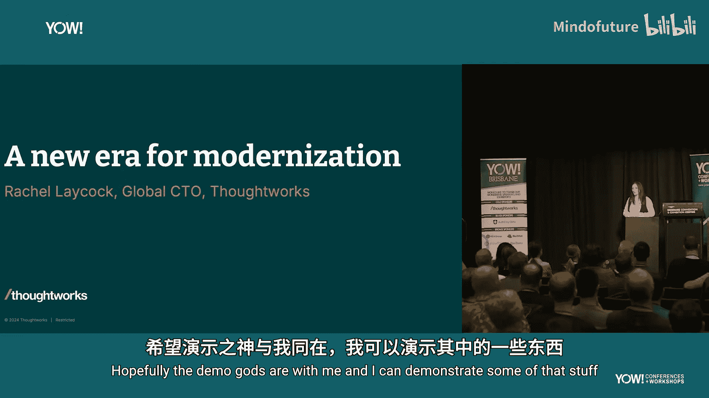
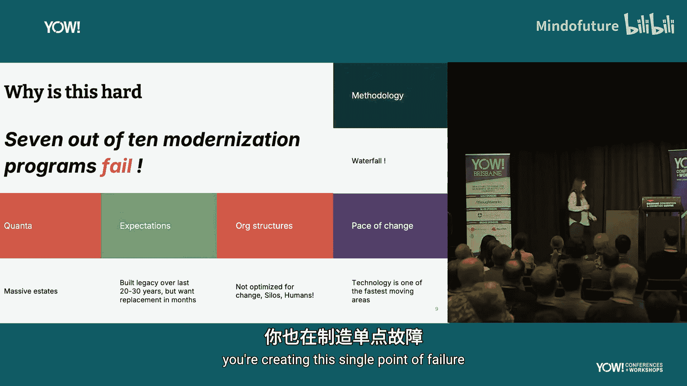
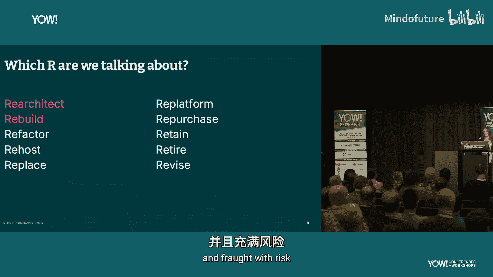
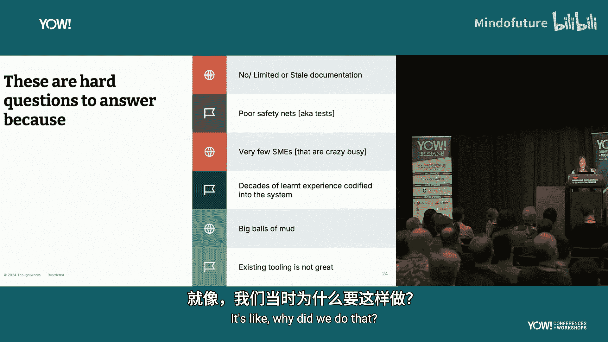
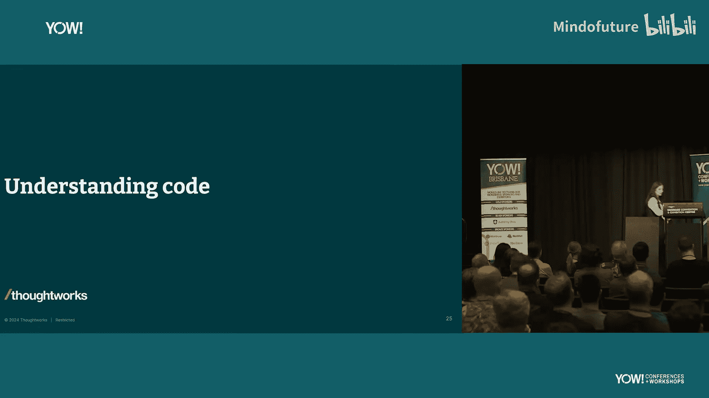
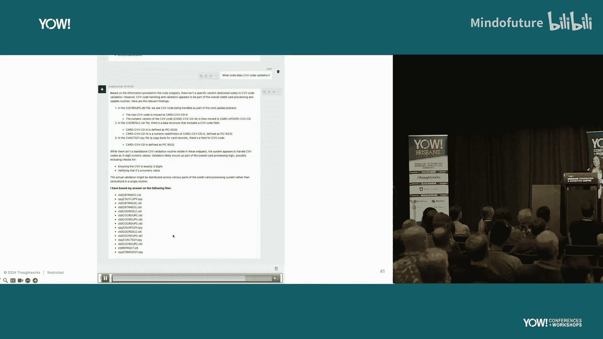
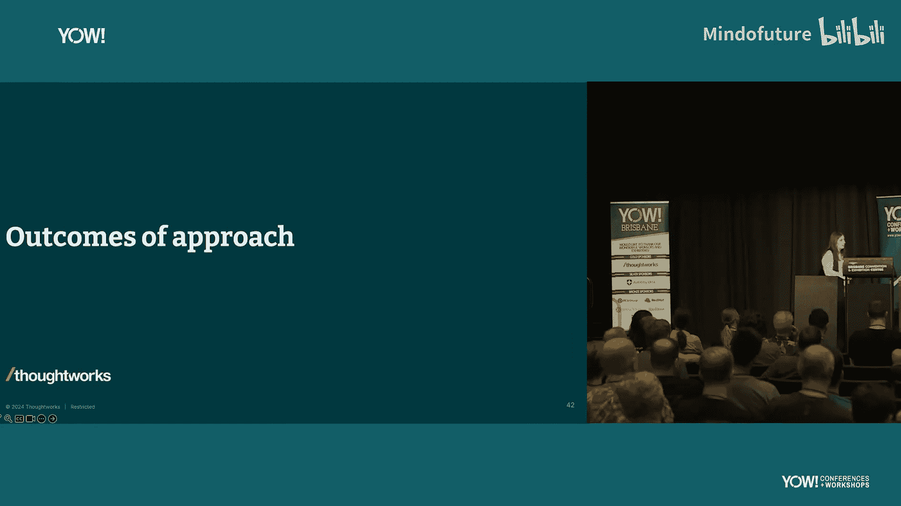
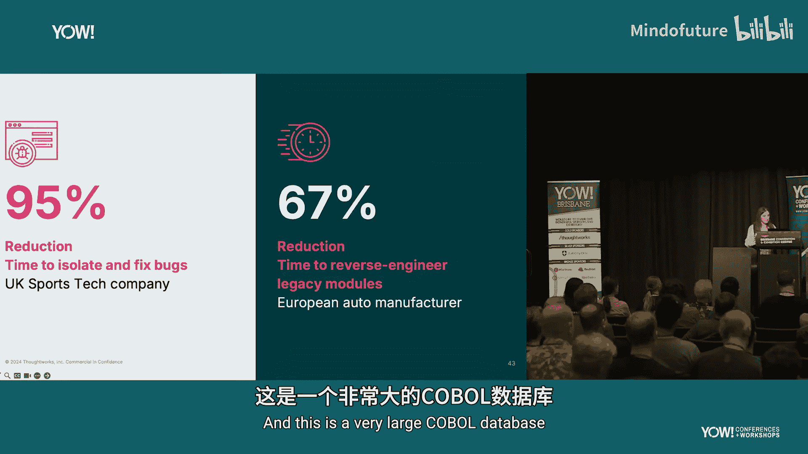
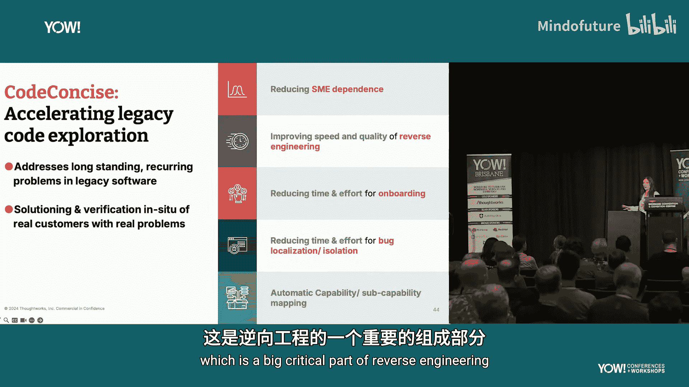
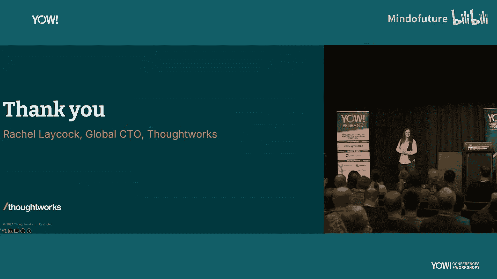

# YOWcon软件开发大会（2024）｜-架构设计-｜-分布式-｜-AI-｜-代码-｜-JAVA-｜-Github-｜-Spring-p06-P06-CodeConcise---A-New-Era-for-Legacy-Modernization--BV1G9dfYTEHR_p6-

Alright， thank you， everybody。 I'm really happy to be here。

 This is my second time in Australia after not being here for like over 10 years。

 So this is twice I've been here this year and experienced insane jet lag。

 mostly which I'll experience when I go about home to the US， my poor husband and kids。

 But on the flight over here。 I don't know about you， but when I do sleep on a flight。

 I have like the weirdest dreams。 And obviously， I was rehearsing my talk and thinking about it while I was on the flight。

 everybody love hearing about people's dreams， of course， I'm going to tell you about my dream。

 But what happened in the dream is I came in the room and I stood up。

 and there was like no one in here。 And I said， where is everybody。 And they were like。

 well nobody wants to talk about legacy code。 They just want to talk about building new code。

 that makes sense。 And I didn't have to do the talk。 But obviously。

 that's not true because you're all here。 And so people are recognizing that we tend to read code more than we write it。

 And as's exciting as what Jenny and I can do with code generation， I think there's a lot more。😊。

est things that it can do when it's helping you understand and modernize code。

 And that's really what I'm gonna talk talk about today。

 which is what we've been experimenting with Thoughtworks。 This is all very early work。

 like literally things that are being built as we speak and have been built over the last 12 to 18 months。

 hopefully the demo gods are with me。 And I can demonstrate some of that stuff。

 But I'm going to start by just kind of giving us a bit of a down on legacy modernization。

 And I thought this is a really cool picture。 This is This is Margaret Hamilton。

 who was shown standing beside listings of the software developed by her and team who were in charge of the Apollo Luna module and the command module of the onboard flight software。

 One thing that's interesting about this is somebody printed out code。

 which I guess tells you everything about how people used to think about it。 that we were like。

 you know， kind of engineers and building things that were built to last So like printing it out makes a lot of sense。

😊。

But also just the sheer volume of it， right， There's a lot there。

 And that's really what we're dealing with as an industry。

 And it's modernizing legacy code is actually really hard。

 and not really an industry solved problem per se。 So I have no silver bullets for you today。

 maybe some silver en casings， but not the actual full bullet。

 But its it's something that I've been thinking about quite deeply。

 probably since 200 actually a long time。 but in 2020。

 I took over leading the service line for Thoughworks of enterprise modernization platforms and cloud。

 And the platforms and cloud part was actually， you know， fairly simple。

 It was like we had a lot of different offerings， a lot of different ways of thinking about building different kinds of platforms for clients。

 whether it's customer platforms or business platforms or engineering platforms。

 but the legacy modernization part。 always kind of stumped everybody。 And before I jump into。😊。

Why it's hard， Do people want to throw out some of their experiences， like。

 why do you think legacy modernization is so hard。给up。Undocumented， yes。

 usually very low documentation。 Yes， Sir。Well， yeah。 And we， as engineers， software developers。

 we only like sexy stuff。 which is why I had that dream that none of you would be here。

Nobody knows how it works。 Yes， a good one。Exactly， maybe no tests or examples。 Allright。

 you're stealing all my slides。 This is great。 Allright， and we'll get into some of those reasons。

 But when I was when we first started up the service line， we did a bunch of research。

 And one of the things we found out is that 7。 And I don't know if this metric is still true。

 but it's probably not far off 77 over 70% of modernizations actually fail。😊。

So load and lots of people are working on them。 And most of them are not going very well。

 And I know from just talking to a client a few weeks ago， a very large government client。

 they have a mainframe and lots of legacy code for every agency in their organization。

 and they've just pulled together like a centralized technology team to help build out some guidelines and frameworks。

 And they're trying to tackle this legacy modernization problem。

 And every agencys modernizing everything in in a different way。😊，And so we know it's hard。

 Why is it hard。 Nobody shouted this out， But usually because it's massive。

 Another statistic I found out was that over 70%， this 70% keeps landing all the time。

 But over 70% of the world's systems are still run on mainframes。 Anyone here。

 How many of you were still learning you know， Colbal or anything like that at university。😊。

Just a couple。 All right， There's a few people left who might understand it。

But it was certainly before my time。The second thing is the expectations that the business seems to have when we talk about modernizing it。

 it's always like。We need to do it in six months。 or， you know。

 we've got to sort out this licensing problem。 So we need to do it really quickly。

 And you're talking about something that you don't understand that nobody really understands。

 It's huge and it's complex。 And so the expectation that we'll be able to get it done and that we'll do it well seems to fall short。

The next thing is our beautiful allg structures， Conway's law in action。

 We've been talking about this for a long， long time。

 But the research proves that this keeps playing out over and over。 We would build very siloed。

 specialized teams。 And then that would create lots of communication issues in the organization and very slow release cycles。

 And that's represented in the the code itself。 And it's represented in your ability to actually understand and change the code。

😊，The next one is the pace of change， right， We had like going back to that huge pile of code we saw earlier。

 things don't stay the same anymore。 know I think it's time we stopped borrowing for manufacturing engineering as an industry because we just don't build things that stay open and running for a very long time。

 or even if we do， even if a piece of software is running for a very long time。

 The ecosystem around us is constantly changing， right。

 We all just went through for the last 10 years， this huge shift to the cloud。

 Then realize we weren't saving the money that we were going to。 And now everybody's like。

 let's go back to onprem。 It's like， oh God， And then， of course， we have AI。

 which everybody's talking about， right， And we know that we don't yet know how that's going to impact our systems。

 Everybodys experimenting with that。 But that's a lot of change a legacy code base that was 5，10，50。

2030 body，5060 years old is not going be able to handle。 And then， of course。

 we've got our methodologyologies， right， the methodology of old。😊，Wful methodology of。

 of long cycles as analysis and development and deployment and testing would take a very long time。

 Lots and lots of handovers， lots and lots of risks involved。 And then， of course。

We had short lived project as well and lots and lots of outsourcing。

So short live projects means that， you know， you don't necessarily get lots of people in the organization that understand the code。

 And then even if you do have those people in the organization that understand the code。

 that's you're creating this single point of failure。

So there's lots of reasons why it's hard， so。What the hell does Gen AI have to do with it。

 to do with any of that。Well， since 2022， the Gen AI space has gone through a lot of cycles of experimentation。

 There's a lot happening。 There's a lot changing。 and everyone has been focused on how can we get developers to write code faster。

hich， of course， is what we need， right， because if we're building more and more things faster and faster。

 we're not at all creating issues for ourselves with more and more and more code。

 And that code that it generates isn't necessarily well tested or well architected。

 It doesn't do anything like that yet。 And I don't know when it will。

It's really just generating code。 And there's already some studies that show that for a senior or a very skilled engineer。

 it's actually slowing them down because they're like。

 let me review this first and then decide if it works or it not。

 which I know from experience of like taking slides from other people。 This is now my idea。

 by the way， taking slides from other people sometimes can take longer than just writing the presentation myself from scratch。

 But that can be very time consuming。 But it's helpful for maybe a more junior engineer。

 But then you get the issue potentially of that junior engineer。

 not really understanding what's going on because theyre just kind of leveraging that code。

 And again， who's to say what the quality of that is。 So that's what people have been focused on。

 But what just really well， is look at large swords as unstructured data。

 and create sums and give you the ability to interrogate it。

 which if you think about legacy code basis， Yes， it's structured data。 So that's one aspect of it。

 But there's sorts of unstructured things that are happening around it。

 if you could bring all that together。😊，You could really understand what the code base is doing。

So before I jump into where does Gen AI apply， I want to be really。

 really clear that of the many R's。 I don't know how we got so lucky that everything in software is an are these days。

 But what we really focus on it thought works is this idea of rearchitect and rebuild right and not that we don't do some of these other things。

 But when you're looking at modernizing codebase。 What you're really trying to do is understand what it currently does。

 and not necessarily have feature pary and completely rewrite the other thing in the new language。

 which we've done many times as an industry。 We've done many。

 many big bang rewrites and not necessarily got better results and sometimes actually got worse。

 And so then we end up with many systems that do the same thing。

 But we think about how do you understand the capabilities。 That these are the exercises we do。

 And I'll talk more about that。 And then how do you understand which ones are easy to modernize which ones are hard。

 Where do we begin and how do we start pulling things out。

 leveraging things like the strangle of fig pattern。😊，So that's what we're talking about。

 We're just going to focus specifically on this。 versus the big bang rewrite。

 But even with that evolutionary approach that I just kind of highlighted。

 it's still very expensive and fraught with risk。

And part of that is it's just a really complex space。

 I have the fortunate role of regularly talking to our board and and anyone that talks to boards will know that boards tend to be。

 you know， people that were in the industry a while ago。

 not necessarily actually doing the work anymore。 And so they tend to simplify things and talk about the software delivery lifecycl。

 Like it's this really simplistic thing， which it' not anymore。 As you can see from that。

 And I do not expect people to read that。 And I simply will not go through it all。

 But it gives you a taste of how complex the space is that we're dealing with when we're talking about modernizing legacy systems。

 because it's not just the technology。 You're also modernizing the processes， the structures。

 the communication structures of the team。 There's a lot involved。

 which is why it's not easy and it's not simple。😊，So we're gonna focus on the understanding of the code。

 So there are entire talks and workshops and days and days of stuff I could talk about around the people and the structure。

 But just understanding what the code is doing， understanding the business capabilities of the code so that you're not completely reliant on just a few SM Ms。

So what are the kinds of things you want to understand when you first look at a piece of。

 piece of leather as you go to system。You， you don't understand it at all。

 You don't know anything about it。 First thing you want to understand is， well， what does it do。

What is it trying to achieve， What are the features， What are the capabilities within that code。

 And that can be really hard to understand。 I personally have run many static analysis and dynamic analysis tools across code bases over the years。

 But it doesn't magically tell me what the code is doing。

 usually to find out what it's doing as a consultant。

 I spend a lot of time going and talk to people one onm one and interviewing people and circling back and making notes And every time I talk to a new person。

 especially if I meet somebody from security or compliance。

 I find out about a whole bunch of features that nobody had mentioned to me before。😊，And so really。

 you just want to understand what it's doing。 And this can be a very slow， very arduous process。

The second is， okay， once I understand what it's doing， well， how does it work。

 How are those featured implemented， which is where these dynamic tools and these static analysis tools become useful is I can map that to the conversations I'm having with people and say。

 okay， this is， this is， this is what the code's doing。

 And these is what people are telling me this is supposed to achieve。Then， of course。

 I have to care about relationships。 I have to care about dependencies。

 because this is where all the risk and the issues come in。 I want to understand， like， is it。

 is it very cohesive， Is the code spread across many different systems and highly coupled。

 I want to understand all of those kinds of things。And then finally， I want to get into the what if。

 what if I did X， What if I did Y， What's the true impact of that， What happens if I make changes。

 Because that's ultimately what you're trying to do。

 Usually when people are wanting to modernize something like a mainframe。

 It's because they want to build new features and they don't want to build them in the mainframe。

 They want to build them in a modern stack for many， many obvious reasons。

 And so they need to know if I make this change。What are the other systems impacted and what's gonna happen。

And these are these， this creates lots of fear and paralysis making all these trade off decisions about what to do。

 which is why it thought works were always like， just start small and get started because you can literally end up in serious analysis paralysis with these things。

😊，But we know these questions are quite hard to answer because even static analysis tools don't look at every type of code base。

 especially if it's proprietary and it fits a very， very specific skill set that barely exists。

 I've encountered many systems that have basically been treated like a black box。 And they're like。

 we're just going to have to put a test harness around it。

 and then we'll figure out what it's doing because it's written in something that literally nobody under the stones。

And by the way， I've actually seen organizations roll their own dependency tools to solve these kinds of problems。

 which I'm not sure if that cat falls into the category of metalwork and being actually useful。

 But anyway， that's， I've seen a lot of people fall down that。😊。

So there's a lot of reasons why these things are really hard to answer。

 And these are the things that some people threw out earlier。 Theres no documentation。

And the thing about documentation， as we know， is that， frankly。

 even if you've written it and frankly， even after you've written your allg structure down。

 it's basically out of day all straight away unless you're extremely judicious about updating these things。

 And let's face it。 Who is， especially when you get deadlines and issues around that。

The second thing is the safety nets and the tests。 So I was worked with actually worked in Australia。

 not like probably 10 years ago。 My colleague who was on that engagement is SAT right here in front of me。

 which reminded me of it。 And there was a system that we wanted to break apart。

 They wanted to do things like continuous delivery。

 And they were not able to because they had this basically this huge ball of with lots and lots of pcyclychic dependencies。

 And so we tried to put a test harness around it。 And we had this little red light that showed red and green。

 like whether the tests were passing or failing。 And they were read so often that people said。

 is this the red light districts。 And I was like， no go。😊，This is not going well。

So that can be really problematic， even trying to get something under test， because as we know。

 N to N types of testing is just so brittle and so problematic。And then there's the SE problem。

 which， you know， if you're talking about a mainframe， there's usually very few and far between。

 I've worked teams have worked on engagements recently where they had to book time with the SME。

 So they had to have all their questions prepared in advance。 And they get time with the SME。

 And then they realize they have like 10 more questions。 So they got to book more time with the SME。

 And you can imagine how long this kind， this kind of thing takes to just understand the system。

 And then ultimately， an SME is still a human being。And guess what， human beings。

 we have terrible memories， especially I speak from experience as you get older or you have kids or anything like that。

 My memory is completely shut。 Now。 If I don't write it down， I don't know about it。

And then we've got idiosyncraities of the actual code， right。

 So unless you've written very procedural code， you don't really understand it。 I know I've。

 I've basically grown up in the O world。 and I really can't get my head around procedural code。

 so it， it can be very problematic， not to mention the fact that there are just idiosyncrasities of like each developer。

 So if you think about what I talked about earlier of like， this is a time when generally。

 like a person was responsible for a part of the system。

And this is oftentimes before we had any kind of coding standards or agreements as a team。

 So you've got like one person who writes code in some really weird way。 And you're like。

 I don't understand how this person's brain works。 And I felt that myself many times。 I'm like。

 what is going on， Why would you write that like that。 So you've got that to deal with it as well。

I've talked about a little bit about the big balls of mud that are very prevalent from this project based approach and not really having a strong team ownership of improving and evolving the code。

And then， of course， we have the fact that the older the codeb， the worse the tooling is。

 So if you're looking at Java or dot net， you want to modernize。

 this turns the tools that you can run across your codeb to understand it。

 But as the codeb gets older， there's less and less of these things。

 and they become less and less useful。 And it's kind of， as I said。

 it's more becomes around interviews and conversations。

 And I consider it like an archaeological dig of the business decisions of yourre， right， It's like。

 why did we do that。 Who did it， When did they do it。

So with all of this in mind， we were like， these are the problems that we face again and again that we wonder if Jenny I can help solve us。

 Can it be the magic tool in the box， right， How can we understand the existing system and its design How can we gather knowledge without needing an expert。

 How can we understand， like there are， there are lots of tools out there， by the way。

 And I'm sure people have experienced them where you can transfer like callball into Java And then itll just look like jaw ball and the Java developers still have absolutely no idea what。

 what it's saying。😊，嗯。But like， how can you actually do it in a way where you could turn it into something that looks like it's supposed to look like。

 And then how do you understand the domains， the subdomains。

 the capabilities and build some kind of safety net around the system。 So we decided， okay。

 these are the core questions we want to answer。 We want to see if Joanak can help us with that。

How am I doing on time， Okay， good。O， and costs were're absolutely masochists and werere insane。

 We decided to start with mainframes because we figured if we can solve it with the mainframe。

 then we can solve it with other code bases as well。😊。

So how do we tackle this， Well， ultimately， what we're trying to do is reverse engineering， right。

 We're trying to draw out some of those low level requirements so that we can understand this the existing analysis and the existing requirements of the system。

And then take that to identify what do we want to do with the new system and how will we build that。

And there's a lot of different ways to do that。 But here's what， here's the approach we took。

 And we have this tool。 We called it called concise。

Thoughtless is not in the habit of building products and tools。 So my expectation is that once this。

 this， once these things become available from the actual tool and product vendors out there。

 we will retire this。 But we found that this was so useful that we just started using it with clients and more and more clients wanted to use it。

😊，So we basically took this concept of treating the code as data。

And looking at how we could pass the code and put it into a forest of abstract syntax trees。

 And then we stored that into a graph database， which really lends itself to that kind of thing。

And that allowed us to be able to zoom up to a very high level and to a very low level。

The second thing we did， which I've already mentioned is we started to leverage a graph database because obviously。

 you can traverse both structural and behavioral views。 And you。

 it's very amenable to L LM and search and rag。 it's really easy to integrate。

 So we looked at how we could leverage graphs。 And we specifically looked at Ne4j。😊。

And then we used Rag and the L LM and the graph pull it all together to try and produce a more succinct。

 more useful answer， which might sound complex。 but I'm gonna break it down a little further now。😊。

So it went through several iterations。 first of all。

 the kind of obvious thing that you would probably all've probably all already tried， which is， okay。

 I have no idea what this file is doing。 I'm just gonna dump it into the prompt window。

 See if I can interrogate it， which is fine。 But a lot of old code is usually like very。

 very large objects， very， very large files。 And then you start to have context windows。

 problems of understanding， you know， it kind of seems to forget like parts of what you've dumped into the context。

 And that becomes problematic。😊，So we then looked at how we could leverage Ra， right。

 So how we could vectorize the different code chunks and use ragg alongside the prompts to fine tune the results。

 And so it only pulls out the nodes from the graph。 that are actually relevant to the user's prompt。

 which startss to help with the context window problem。 And then。

 and that actually helped with both reducing the noise of， of information that came back。

 but also allowed us to kind of analyze more than the coldweed ingested。

 It allowed us to analyze all the relationships across that code as well。😊。

And then we traverse the graphs to gather more information across the code。 So as I said， we。

 we use Neo4j， which kind of holds this enriched knowledge draft。

 and it provides the L LM with lots more context。 leverages the graph structure。

 and you can get access to all these different kind of explanations around the code。

 which might be descriptions。 There might be requirements。 There might be capabilities。

 But it like what we built this tool。 and we built the front end for it that enabled you to interrogate it and then see what the system was doing and really fill in gaps of knowledge。

😊，So let me show how it actually works in person。 I just realized I've not been using the clicker。

 Oh， never mind。So imagine you have a client that needs to understand how authentication works。

It's a very common thing wed want to do in a system that you don't understand。And normally。

 you'd have to sit with an SME。To ask that question。But with the like legacy assistant tool。

 we created this assistant。Excuse me。 Fo this expanded rag flow using the knowledge graph as a backing store。

 and it finds the relevant nodes for the knowledge graph of the code base based on the semantics of the specific question。

 And then it pulls in related nodes to those that were originally found。😊。

And we build this knowledge graph by passing through the code and using the resulting abstract syntax tree to interlink all the related elements And these aren't just based on code。

 They're also descriptions and other things that we pull in that we have that pulls together this more comprehensive view of both the structural and the behavioral models of the code。

 And what this does when you pull it all together gets you out of the the short context window and helps you not have to deal with the semantics of the existing code and helps you pull inencies that aren't necessarily in the same file。

😊，So that's just the code side of it。 And I'm going to give you a demo at the end of how it really works。

 But one of the really， really critical things I've also talked about is the mapping of business capabilities。

 right， So even if you can understand the code and you have access to the SmeEs and you don't have access to this kind of tool。

 you still have to understand all the business capabilities。

 And so some of the types of exercises we will do with a client will be like event string and domain drivenve design to really understand the capabilities of the system。

😊，And it's really， really important to have these capability maps because if you don't。

You don't know what you're working with， and you can't decreate the target architecture of the system。

 And it's really important to catalog， detect the processes and all the people around it that support it。

 So you start to create these huge flowts and these huge capability maps。

 And if you think about before GenI before we started thinking about these tools。

 pretty much all of this is done kind of by hand with developers and analysts and SMs working hand in hand。

 doing lots and lots of manual effort， which is fine on a small code base。

 But when you're looking at like 10000 lines of code。

 it can be extremely extensive to understand the system take a lot of time。😊。

So what we realized is that Gen AI kind of changes this picture and gives you the ability to summarize lots and lots of text。

 So this is the actual I DE here where you can see that we've got given the option to access capabilities and do reverse engineering and forward engineering for the teams。

And it really， by getting access to these capability maps and understanding the code gives you the ability to make informed decisions about what you're gonna keep。

 what you're gonna kill and where the dead code is in the system。

 It's really important thing to understand。 because often there's a lot of code in the system。

 which isn't even really being used。 The other thing it allows you to do is understand which of the tech capabilities。

 So if're thinking about taking a platform approach where you want to pull out tech capabilities like authentication versus a business capability。

 It allows you to understand all of that as well。And now。

 with the map of both the code base and the business capabilities into one application。

 you have the ability to map the code to the capabilities。

 which means now you can start understanding the seas of the application。

 If you think about when you actually gonna do the modernization。 We always take this。

 evolutionary approach where you understand where the seas are。

 where you can build out you know the integration test or not the excessive end to end tests and then how you can start building out the new components and using the strangle pattern and eventually switching over from the old code to the new code。

 because when you take this approach identify a business capabilities。

 And then you identify where that business capabilities is in the code。

 And you might identify that it's very cohesive。 It's all pretty much in the same place。 A。

 You also might identify that it's not。 It's highly coupled and it's spread all over the system。

 that's going to be much harder And you know that ahead of time。

 So you think about a lot of modernization efforts。 We think about building a feature。

 and you often just think about building the feature or this feature will take。😊，M time。

 This feature will take this much time。 But when you understand what you're reverse engineering from。

 then it's a very different equation。 Or this one is spread across the system。 It's very complex。

 That's actually going to take a lot longer than something that is more or less， in one place。Now。

 when we've done these capability maps， even without these tools， the really。

 really cool thing about it is understanding getting these stakeholders aligned because some of the problems around expectation is。

 is once you actually start down this path， if you haven't understood the complexity of what you were dealing with before and you start taking a lot longer to do things。

 people kind of get a little sad。😊，And what we found is that using this kind of tool where we can show the capability and the code actually helps and resonates better with the SM Ms and the analysts versus the things that we've kind of hand drawn。

😊，So now， oh， sorry， I just clicked that。It's not clicking。

So now we have the ability to start answering these questions。 And I'm gonna give you some examples。

I'm going show you some static ones。 And then I'm gonna show you the。

 the dynamic glamor version of it。 So， first of all。Again， kind of common question。 How do。

 how do validations work for these credit card constructionions， transactionsact， Sorry。

 that's my jet lag。 I'm now just making up word。Although it is a word， it just has no。

 no relevance in this context。 So anyway， so when you ask this question， it'll tell you like。

 which program is responsible for that。😊，Which program manages the verification and which program manages handles the account limits。

And as you can see， they are in three different programs。So when you go a little bit further。

 you can ask， well， what's the account limit。And here。

 it'll show all the different data structures and the process flows and the transaction handling and all this。

 all this good stuff。 And as again， all I said， this is just using abstract syntx trees。

 knowledge graphs， Rag and L LM to pull all this data together。 And， of course。

 we kind of honed it and improved it along the way based on the results。

 And now we'll see if the demo will work。😊，Al right。Here you go。 So this is the actual ID。Says。

 hello， I'm a chatbot。Anyway， so first thing it ask is what types of users exist in the system。

 which again， very common kind of question to ask。 And then it gives you a bunch of different kind of users。

 the regular users， the admin users and how it distinguishes the two。 And then it asks。

 what are the general functions that are available。Here we have it。 We've got credit card management。

 user management， transaction reporting， customer information management。 You get the idea。

And this demo is actually probably five minutes long。 So I won't go through it all。

 But this is the kind of thing you can do with this tool， right。

 so you can look at the business capabilities， how they map the code capabilities。

 And then you can also interrogate the code base。 The first time I saw this， I was like， oh my God。

 I can just think of like millions of applications for this。

 And when I've talked to clients about this， even outside of the scope of modernizing。

 just having something that understands the system。😊。

Is like a game changer for so many people because there's so much risk in not being able to understand the system。

 So imagine you get a bug production in a system that nobody' has touched for a long， long time。

 And now you have the ability to interrogate how the system works alongside the error logs that you have that gives you a bit of context to share And we've already discovered that you can reduce the time to finding and fixing bugs because as we know when it comes to mean time to recovery。

 It's more most of the work is just finding out the hell what's going wrong。

 fixing it isn't usually the hardest thing。 Allright， So it just keeps going。

But I can't just sit here quietly and let you watch this all day。

Okay。All right。So what are the kind of outcomes that we've seen from taking this approach。

W whichch is， as I said， large language models with a rag。

 abstract syntaxries and a knowledge graph to understand the code base。 And we've。

 we've obviously had to use different tools for different code bases and made it exible to be able to do so。

And it's been kind of cool。 So we've looked at two different code。

 This is examples from two different code base。 The first one is from a Java code base。😊。

So this is like an， the first one is actually an experiment where basically they said。

 they said to some developers， hey， there's these bugs。 Can you go and find them and fix them。

 And then they gave， it's kind of like the A B testing。

 And then they gave this tool to a set of developers that that also had to find and solve the same problem。

 and they were like 95% faster。😊，Because most of the work is actually just finding the book。

 The second one is actually， I think more interesting because this is looking at a mainframe where we're trying to do the reverse engineering exercise。

 And the only way to do it traditionally is just using the S ME。😊，And so in this case。

 we were able to， instead of something taking two weeks with the SmeEs and the business analyst to understand the system。

 So instead of something taking six weeks， we were able to get that down to two weeks。

 And this is a very large Colbal database。 Sorry，10000 line system。 See， this is the gel lag。

 I'm gonna be this， this is going be a struggle。😊。

And so here's some of the things that we've seen that it helps with， right。

 reducinging that SME dependency， Very， very critical。

 improving the speed and quality of the reverse engineering。

 So one of the first things that people said was like， what about hallucinations。 Well， you know。

 we haven't had had that many issues with that。 because， as I said earlier。

 when you're leveraging SMs。 Well， they're humans and we kind of halluc in our own way or just slued completely forget things。

And at the end of the day， you， you still have to check， right， You still have to write tests。

 You still want to talk to your SM Ms。But you're now talking to your SMs with a lot more context and a lot more information。

嗯。I already mentioned this， but like the ability to understand bugs and isolate an issue。

And then being able to map and understand the capabilities of the system， which is a big。

 critical part of reverse engineering。

So。I think what Jen I is going to do for us。 And I think this is going to be an interesting space over the next few years。

 especially when it comes to understanding code and modernization。

 is give us the ability and put into the hands of the many， which was only in the hands of the few。

 The ability to understand legacy code base， which I can't stress enough is a big blocker and a big challenge。

😊，Because our industry has really evolved and changed over the last 10 years。 Never mind 203040。

 We have different practices。 We have different ways of architecting software。

 We have different methodologies。 and the systems of old， Simply don't support or fit into that。

 And going back to what somebody said earlier。 It's just not sexy。 Nobody wants to work on it。

 But suddenly， you have tools like this。 And this is just the one that we've built over the last year。

 And as I said， I'm expecting lots more to come out like this。

 To like this that give you the ability to understand the system。

 interrogate the system mapped the capabilities of the system。

 and then be able to build out the new pieces， which is where the fun stuff comes in。 because really。

 what we're trying to do is just get to the sexy fun stuff as quickly as possible。

 and not have to spend ages mired in trying to understand the existing stuff。😊。

We're already seeing how this is， like， as I said， we， we started with just two clients。

 And what's funny about this is we， we started with two clients。 And this is really unusual thoughts。

 word have mouth got out And the sales team were like， could you do this without our client。

 Could you do this and our client， Could you do this without a client。😊。

And so I'm expecting lots and lots of progress in this space。 right。

 The fact that people got excited about it and everybody wants to try and use the tool。

 even if they don't plan to kind of necessarily modernize the system just to have the ability to understand and manage some of the risks in their systems。

 I can see a lot starting to develop in this space。 And I think about， you know， recently。

 there was an article from Goldman Sachs was absolutely scathing about AI， saying like you know。

 there's only 5% of use cases in production， etc cea， etc cea。

 And then this huge article that made like one line saying with the exception of software development where there's like real things happening and changing。

 But I think we're gonna quickly switch from just thinking about generating code to how do we manage these complex large legacy systems。

😊，嗯。I'm expecting to see this in an I D E one day。 I guess I'm hoping to see it in an I D E one day。

 I just recently got a demo where somebody had built a similar kind of model。

That looks at code that's inside the I D。 So anything that you've pull in。 But eventually。

 it will go beyond that。So I could see us being inside of the idea D and like being able to interrogate and understand what's going on。

And then as I said， we didn't really see that many issues with bias or hallucinations。 So， you know。

 I think it's gonna be， it's going to change like how we think about modernization。

 And I'm excited to see what kind of tools arrive in this space。

 And I'm not necessarily saying that you should work with thoughtworks and use this one。

 But you're more than welcome to。 I just think there's going to be a lot happening or in this in the next few years。

 And as somebody who's。😊，Looked head on at the the problem of 70% of the world systems running on the mainframe and 70% of modernization failing。

 I think this is a lot more interesting and exciting than making developers 10% faster， which。

 by the way， is what the real studies are showing now。😊，So I， without further ado。

 will give you all Haha，5 minutes to ask questions。

