# YOWcon软件开发大会（2024）｜-架构设计-｜-分布式-｜-AI-｜-代码-｜-JAVA-｜-Github-｜-Spring-p07-P07-A-Code-Centric-Journey-Into-the-Gleam-Language--BV1G9dfYTEHR_p7-

Thank you。 Thank you so much for the introduction。 I mean， I'm so excited to be here。

 This is my first time at Yao， my first time in Australia。 So far。

 I've managed not to get horribly sunburnt。 So that's a win by my book。😊，Okay。

 so just a little introduction。 My name is Jamo。 If youve talked to me。 you might have noticed。

 I'm a bit of a functional programming nerd。 I never shut off about it。

 The thing I'm most proud about is I'm part of gles code team。 So I'm helping with its development。

 But what is glam。 Well if you go to its website。 You'll discover that glam is a friendly language So building typea systems that scale。

 So that's quite a bit to unpack in just a single sentence。

 It's not every day that here the objectiveject friendly， referring to a programming language。

 Also typea。 So glam is statically typed language with a strong， robust type system。 And finally。

 scaling， that's interesting gleam as some quite interesting tricks to allows us to develop systems that are ready for a distributed and concurrent world。

😊，So my job today will be to guide you through this journey。 You are going to be reading。

 and I will be writing， which is scary。 Qui a bit of glme code。

And I think that's where the most fun is for you not for me writing it。

 because you get to see what a language looks like in practice。

 what you can do with it in what half an hour or whatever much time it might take me。

 But this being a codecentric journey。 It has to start with the most classic of the examples。

 That is an yellow word。 bear with me。 So here we are defining a grid function。

 This takes in a name and prints a greeting to standard output to do that。

 It's calling the print line function coming from the I your module。

 So when you see a your dot name of a function。 We are coding a function from that module。😊。

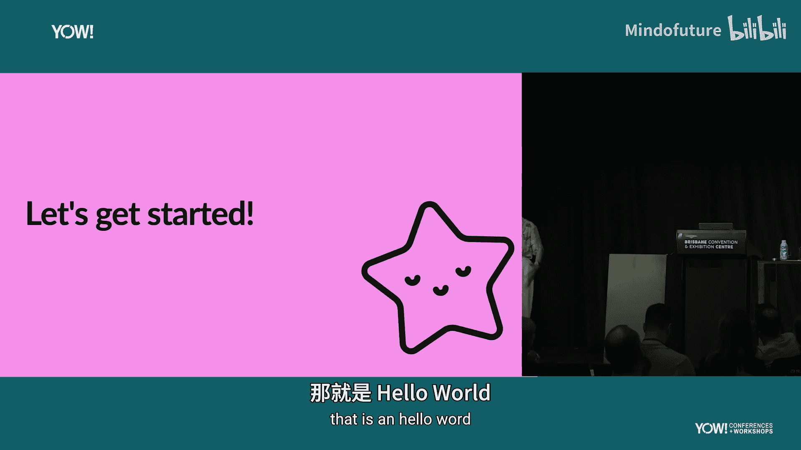

And then we have the main the entry point of our program here to do something that is just one step above seemingly printing a message。

 We are using this great function to print a greeting for each item in a list。

 And so we'll see hello Lucy and hello Ya。😊，And if you add any exposure to mainstream languages like Javascript。

 for example， the syn text might be quite reminiscent of those。And that's why design。

 gleam is designed to be a language that's easy to pick up and learn。

 And so the syntax doesn't have to work against you when you're learning something new。

 It doesn't have to get in the way of you learning。

 And so you might have a good hun of what is going on here。

 Even if these are your first lines of gl code ever。😊，But。So also so good。

 But this is not an exciting example。 We are just printing a string。

 And I promised you an exciting journey。 So what are we actually going to be doing today。 Well。

 we will be building something that I think we can all agree is on a whole different level than just printing a string。

 That is we will be building a server。 We taking client requests and produce some responses with some HM L。

 Maybe we want to template it， reading some data from a database So now we need to talk to a database。

 That's a whole based on its own。 And we maybe want logging。

 We want this server to be highly available and to sustain the highest of workloads。😊。

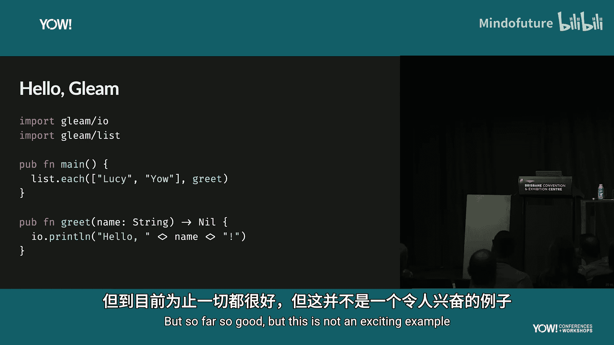

But before we get into the fun and shiny code snippets。

 I think it's better to just take a step back and be a bit far from the code。

 because when we look at a code snippet， there's actually so much more that doesn't meet the eyes。

 For example， how did we get there。 How does one even get started with a new project。

 What do I need to know to scuffle a new project。😊，How do I run my code， my tests。

 How do I do that in C I， even more importantly。How do I start with something that I can turn into an M VP that I can then put in production with confidence that are not breaking everything。

And so to get started， we'll start from the very beginning and have a look at what it looks like to create a new building project。

So once you've installed the glam binary， you'll get a lot of things out of the box。

 And that's because we think that glam has to give you the best developer experience there is。😊。

So for example， if you need to get started with a new project。

 that's as simple as running gl new Yao， and you're good to go。

 The project is taken care of automatically。And let's have a look at what's inside。okK。

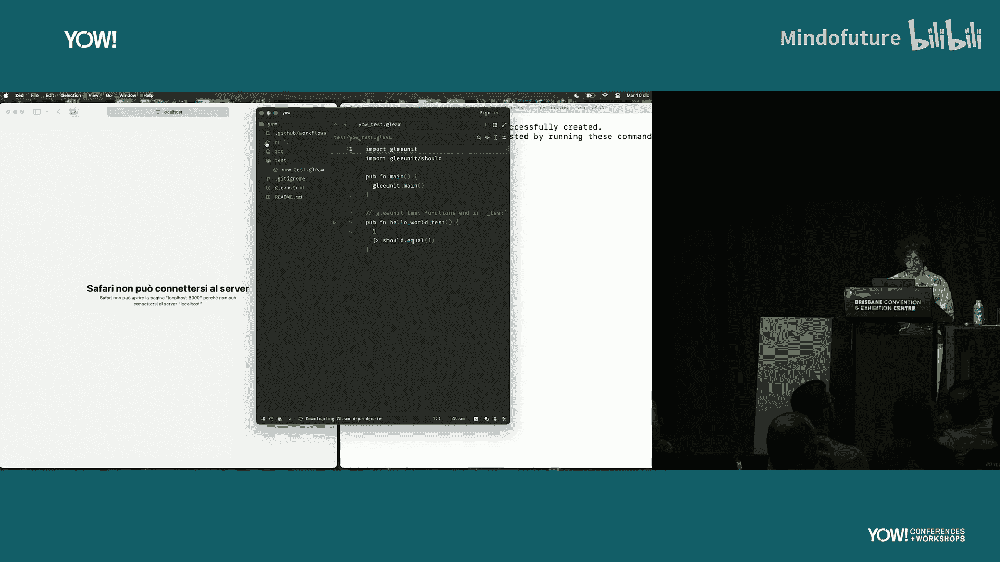

So maybe we can make this a bit bigger。 The project structure is pretty straightforward。

 We have a source folder and a test folder in the source。 we have our main。

 the entry point of the program。 What if we want to run this again。

 Gam comes with build to built in into the tool chain。 So if you want to run your code。

 That's as simple as glam run。 It's going to compile your code。

 your depend is and you're good to go What about test now， Well， say no more。 glam test。 and again。

 you're good to go。 And I hope you can appreciate how fast the compiler is。😊。

One thing I love to do is to set up a fire water to run my test every time I change something in my code。

 And the feedback is basically immediate because the compiler has been designed to do incrementalal compilation。

 And so as you change little bits and pieces in your code and you save when you rerun your tests。

 the feedback is basically immediate。 And so we can do this sort of DD or even development where we can get an immediate feedback when we are doing something when we are experimenting with an API or trying to figure out what our code is doing。

😊，And I cannot understand how good it is to not have to wait seconds or even minutes for your code to compile and get some feedback and get something running。

 building things。Okay， this is fun and maybe just a bit exciting。 But we are building a server。

 So we are going to be needing quite the advanced pieces of software。 We will need an H TT B server。

😊，Possibly， we would like to have a web framework to make things easier for us。

 We need a way to talk to a database， to debug things， to log things。

 And so I'm a mediocre developer。 I cannot possibly build that in what time I have left。

 So we' are going to be using dependencies。But that leads down a taches path。

 How do I deal with my dependencies， And sometimes that can be quite painful。

 because I need to figure out the package manager。 I need to use what kind of configuration file I need。

 Maybe I will copy that from my previous project without actually looking at it crossing my fingers that it just works。

 That's not the best developer experience we can ask more for a languages。 And so what Gam does。

 It comes with a package manager built in into the tool chain again。😊。

So if you need to add a new dependency， again， that's just as simple as doing gleam art and your dependencies here。

 I'm adding W and missed that are respectively Gam's own Web framework and H T TP server。And again。

 once you do that， you're good to go。 You can just start using it in your project。

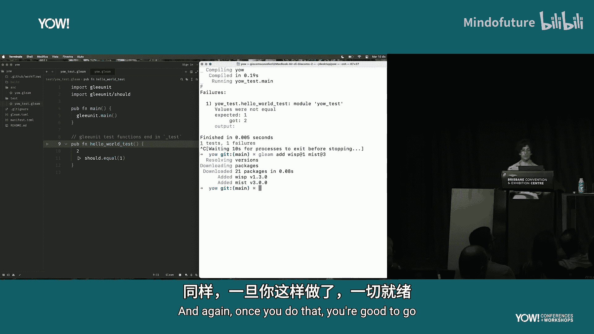

And I think Wisp， so Gleam's own web framework is a great example of Geam's philosophy。

 because that really sees into the ecosystem at large。 Geam is meant to be a language that is simple。

 that is easy to pick up。 And to do that， gleam is a language with no hidden magic。

 What do I mean by that。😊，Well， sometimes a language allows us to get really smart。

 But most of the times we can， when we can get smart。 Well， we can get too smart for our own good。

 And so it's fun trying to feed as many things as possible into a single， incredibly th line of code。

 But while the code writing feels quite empowering。 and we feel super powerful。

 When we go back to it。 even what a week later， the code reading starts getting worse and worse because it's hard to understand what is going on When the code relies on some hidden shared knowledge between me。

 the me of the past and the compiler。 In so gleam tries to go to the other side of the trade。

 Geam is an explicit language。 A language where you can read your code and what is there is what is going on。

 there's no hidden magic， No control flow。 No implicit cast， null pointers。

 unchecked exceptions and so on。😊，And this really reflects in Gs own frameworks and libraries。

 whichiz， for example， is a simple framework that doesn't rely on magic and just stays close to this idea of just using function calls。

 So let's have a look at some code。😊。

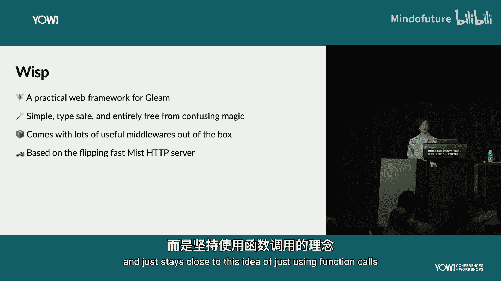

The main idea in Wi is that we have endlesss。 A handler basically is a function that takes in a request from a client and has to return a response that we then send back to the client。

 So we can just focus on that while the framework is taking care of all the other little details of H T TP communication。

😊，So here what we are doing is we are building a code coded HDM L string。

 We are turning that into a string tree。 that is a data structure used by ways to efficiently build a response that is then sent back to the client with a status code of 200。

And if you've done any jascript， you might already be familiar with this kind of code。

 But Gleam also has some really nice feature to allow for code that is easier to read and also nicer to write。

 For example， we don't really care about this variable names。

 we don't really care that that is called HMl and body and so on。

 What we care about is this pipeline of transformations。

 And so gleam as a nice pipeline operator that does exactly that。

 It takes what comes before it and passes it as the first argument to the function next。

 And so instead of having to come up with different name。

 which is the hard problem in computer science。 we can just focus on this pipeline of transformations。

 And so we see we start with a string that is turned into a string tree and finally into an HMl response。

😊，So far so good。 But what if we want logging， of course， any serious server has to do that。

 And again， we do not want to stray from this idea of just using functions。 And in Wiis。

 that is another function。 We call that middleware because it's adding some capabilities to our request and。

 In this case， we are calling the builtin log request function to the Wiis library。

 We passing the request that we want to be logged。 And then we have to pass it a callbe to tell it what to do next after logging the request。

 And so it has to build that response we are going to be sending back to the client。And again。

 a thing you might hear from time to time in G's community is all you need is data and functions。

 And I think you will see this throughout the entire talk。

 We do not stray from this idea that we can build complex and incredibly powerful software by just using these two basic building blocks。

😊，But now， what if our server has to talk to an external service。

 What if it has to talk to a database or read a file or something else entirely。

 something that could go wrong in a myriad of ways。

 And sometimes the failure might not actually be recoverable。 We don't want the Claion to be hanging。

 So we want to rescue recover from those crashes。And send automatically off 500 internal turn or a response。

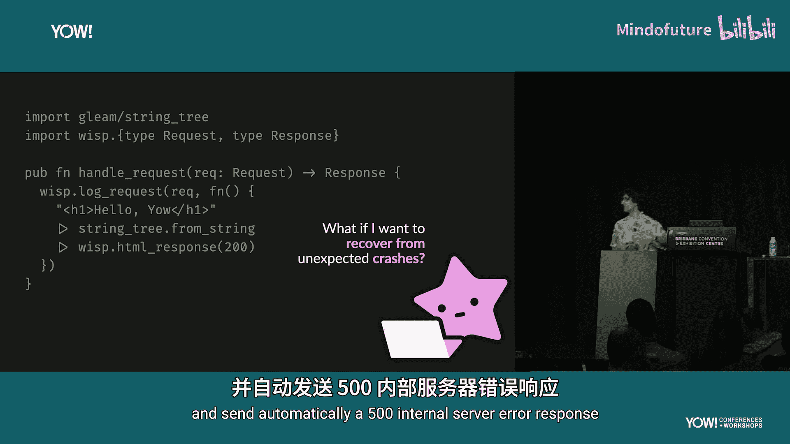

So I have a project here。This is the code I was showing you。So pretty straightforward。

 What if we want to recover from crashes， Well， we are done know the middleware， which is， again。

 just a functional goal。 And we have。Language server integration。

 that is really useful because it's telling us what we can use。

 what the functions at our disposal are， What the documentation show all the things we have synax lighting。

 of course。😊，And again， rescue crashes just takes a callbe。

 telling it what to run and what to rescue from。 So if something goes wrong inside it， Well。

 it's going to automatically take care of that。So let's try and run this。 again。

 gleam run compiler pretty fast， and we are up and running。 Hello， Ya， let go， yes。😊。

This is going to be really confusing for the people at home， but come to me later。😊，And you see。

 it's being logs on the terminal。 Great。 So we are logging things。

 We are rescuing from crashes so that clients are not left hanging。 So it's becoming quite powerful。

 and we could keep adding more meware， more stuff to make it even better。

 But those of you with a keen eye might have noticed， a kind of alarming pattern。

 as we add more colbes as we keep drawing this kind of colbe based API。

 Our code start a assuming a sort of triangle shape。

 We call it pyramid of doom for a reason that is not really nice sounding name。

 And that's fair because it makes our code harder to read。 And as we add more colbes， more mes。

 the code is getting nested and nested and nested until it is unreadable。

 So how does glam all this without string from this idea that， again， it's just data and functions。

 Well， to show you that， I let the language server help me because glam's language servers。

 it's really capable and can do some pretty powerful conducts for us。😊。

And here it's going to rewrite our code， so。Let me first rewrite this。

 And even if you have no idea what is going on here。

 I think you can appreciate how the pyramid of duits appeared。 So that is quite interesting。

 What is going on here。😊，This use keyword is what allows Gam to do this。 Basically。

 what is happening here is it's taking everything that comes after it and passing it as the body of an anonymous function to the function that is on the right hand side of the use。

So this is exactly the same thing as the code we had before。

 It's just a mere syntactic transformation。 But at the same time。

 it's getting rid of this pyramid of doom， allowing us to have powerful callback based APIs without the problem of our code becoming unreadable。

 And we we could keep adding more and more things。 And as you can see， the indentation doesn't grow。

😊，But arguably， this is Gam's most complex feature。

 And there's always that kind of feature we haven't heard of before when we are learning a new language that we might get hung up on。

 And the language server is here to help。 So if you dive into a gle code base that you've never read before。

 And you see that。 And maybe that's quite confusing because you can figure out what is going on there。

 you can just ask the language server to do the opposite and rewrite it as the。😊。

Equivalent a Kobe based version。 So you don't have to get stuck on something just because maybe the feature is not totally clear to you。

 You can just have the language server rewrite it。 And now I see it It's just a Colbe。

 I can rewrite it again， using use。Sorry for the tongue twisting。

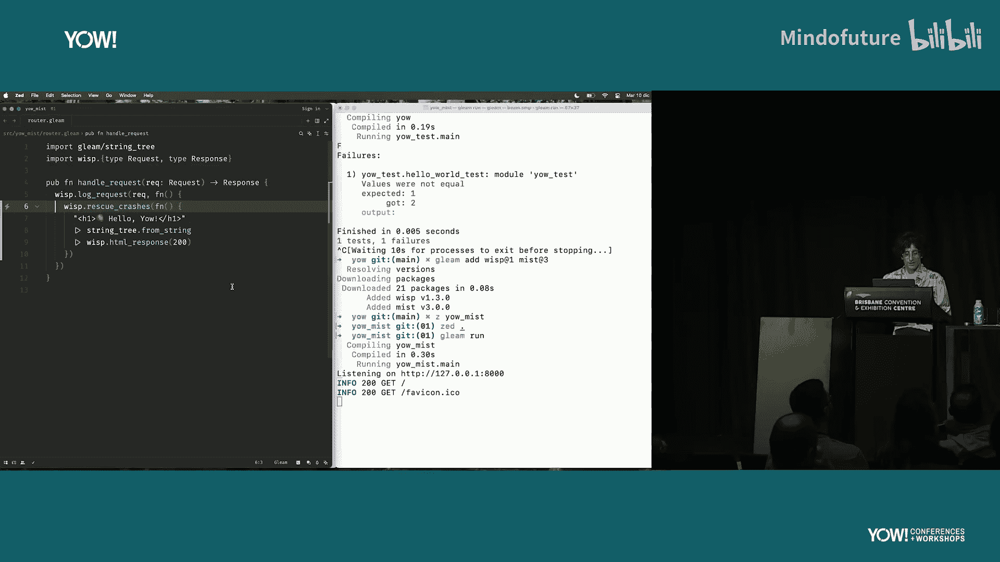

Okay。

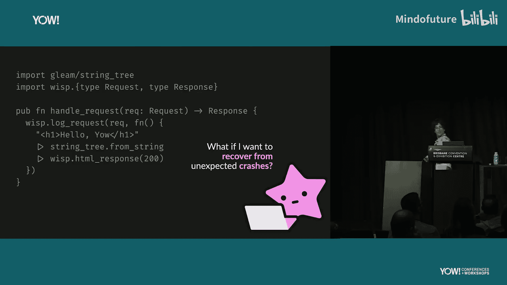

Great， now。AnHMl string are coded in the code is fun and all。

 But we usually need something quite more powerful。 And to do this in Gam， we can use Lster。

 That has another is another library that has a functional declarative API to define HM L document。

 And so we can use it here to render an HM L document on the server and then serve it to the client。

😊。

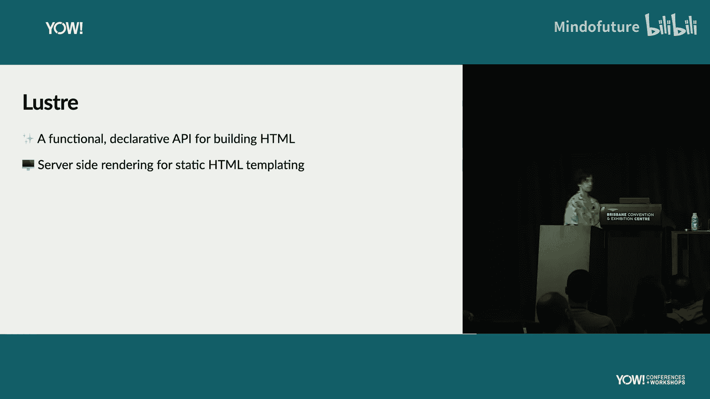

What does it look like， Well， we start with our out coded string。

 And this is how you would do it in luster。 Again， it's just a function called。

 We are calling the H1 function coming from Lusters library。 and unsurprisingly。

 that is going to produce H1 H M L element。😊，It takes two lists as input。

 a list of attributes and a list of children here。 The only children of the H1 element is the textileo Yao。

And again， this is just a functional goal。 We do not need to do this with macros。

 We do not need to do this by embedding an entirely different language inside glam with its own rules and its own inner workings。

And while if we are used to working in a different way， maybe with something like JS X。

 this might come at a surprise as a surprise at first。My recommendation is， just give it a try。

Because once it clicks， once you realize that it's just functions at the end of the day。

 it's the most exhilarating feelings。 because now all your ideas about how you should structure your code。

 how you should organize your code， how you should refactor it to make it more readable。

 more understandable and make it better， applies just as easily to your HDM L producing code。😊。

Because it's not an embedded DS SL with its own rules that you have to learn andnew every time you tried。

 and it's hard to move around。 The refactoring story here is a breed。 And so just give that a try。

 It might feel unusual at first， but it's just the best。And so， for example。

 let's say I want to show some blue sky accounts。 It's all the rage now。

 So I'm splitting this into functions because for me， this makes it more readable。

 And I have a function that displays just a single account as a list item。 So it has some text。

 It has a link again， pretty straightforward。 And then I'm reusing this function and applying it to a list of accounts to produce an ordered list。

 And so now I can reuse this little snippets of code to produce different elements。

 And the reing story is pretty simple。 I can just maybe pull things out in a function give that a name because that helps me read my code and make it better。

 comment it if I need to。 and so on。😊。

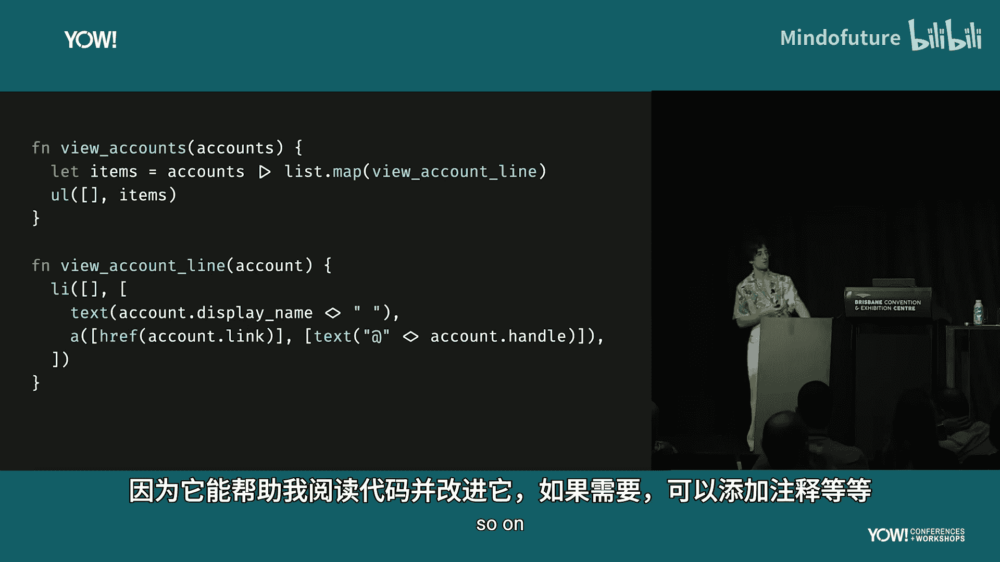

And， of course， this doesn't stop here。 Maybe server side rendering is great。

 If you're just getting started。 If you need an M VP that you want to show to your pointy heardd boss to just show something on the screen。

 But as your application grow and your needs grow， you might want something more advanced。

 you might want， for example， client side interaction。

 you want an application that doesn't have to do a round trip to the server every need you。

 every time you need to change something。😊，And lusster， as you covered it。

 because it also hass a way to have interactive， clientient side rich applications。

And so you don't have to do a round trip to the server every single time。

 You can have an application that leaves even when there's no Internet connection。

 and it has other great things that cannot possibly cover all of those in this talk。

 But do check it out。 It's an amazing project。😊，And now we get to the database that is。

 that is quite painful。 So how do we talk to a database？ Well， how many of you have used an O R M。

Oh God， I see quite， quite a good amount of hands。 So the thing is。

 the O M way of doing this is it tries to hide the SQel as much as possible。

 Shiing the developer from havingv to write any SQL at all。

 And so it will try to wrangle and figure out the best possible query to fetch your data。

 possibly not over fetching things。 We know that is quite hard。

 possibly not hitting the database too many times， we know that is quite hard as well。

 But usually that is the O M way。 But the way I like to do things。

 And the way I'm trying to push the community towards is by just embracing the SQL。

 What does that mean。😊，Well， there's no denying that SQL is an amazing query language。

 And there's no point in trying to hide it and try to shield us developers from writing SQL。

 We might just as well embrace it and embrace its full power。

 And they think a testament to this is the fact that every O M as to have sort of escape it to write rowsQL queries。

 because we need that at the end of the day。 When things starts getting complex。

 That N plus one  query problem， That overfeting problem is really hard to solve unless we are doing the thing with SQL。

😊，And so what we can do England is use a library called squirrel。 I might be a bit biased。

 I'm the author of the library。 So don't trust me on that， but it's really good。 And again。

 what's the approach here， It's just plain old SQL files。 We do not need a。

 a complex abstractstruction， a custom DSL that's limiting us in what we can do with SQL and then having a sort of escape edge because it's。

 of course， limited。😊，This sounds a bit un wavy， and I'm waving my hands a lot。

 not just because I'm Italian。 So what does this look like in practice， well。

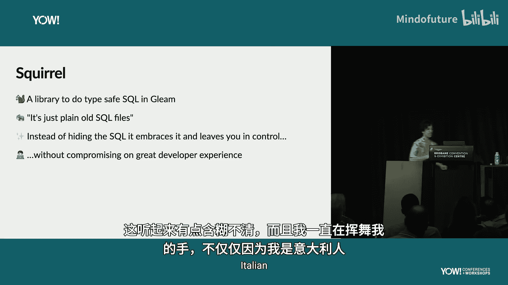

Let me stop this。Okay， here is the code I was showing you earlier。

 Maybe I could make that a bit bigger。 Is that better。Okay。Before we move to the steepel。

 just let me show you another amazing developer experience tea beating glam。😊。

Did you notice that to do keyword。 That is a keyword in the language that you can just slap everywhere to make the compiler happy to make your code compile。

 you can just move forward。 That is the best thing for developer experience。

 because when you're figuring things out。 When you need to figure stuff out。

 Maybe the API is not totally clear to you。 or maybe you're just getting a feeling for how your code should look like。

 Well it's super important not to get hung on the details on the little minutia that you need to figure out maybe to what fetch the accounts from the database。

 we don't need that now， we can just focus on the code we want to write and get to the details later。

 And the compiler here is our friend。 Again， acting as a sort of per programmer is telling us way。

 this code is incomplete。 it will crash if you try and run it。

 Get back to it before you run your code。😊，Just really nice little bit of developer experience here。

 So getting back to SQL and Squirel， what does this look like， Well。

 we are just writing SQL to you might have noticed， this is our SQL file。😊。

And sququirel decides to have a convention over configuration approach。

 So every time you dive in a different code base， you know where to look at。

 You know that the SQL files are going to be if it's using squirrel。And we are just writing SQL。

 There's nothing magical here。 So the nice thing is by embracing it。 We are just writing a SQL file。

 We get syntax highlight lightinging。 We can format our code automatically。 We can。

 if we get tired about this。 Maybe we don't want to use squrel anymore。

 Maybe we don't want to use Gam。 It would be really sad。

 but maybe you want to move to another different thing entirely。😊，You just have the files there。

 You can copy those to a new project。 You are not getting locked in into a specific O M that is limiting you。

 And now it's really hard to get the queries out of what it's doing。

Maybe let's try and make this just a that more complex。

 just to show you something that is not a simple select。

 So maybe we want all the accounts in a one month window of time so we can say where the account dot joined is between。

And here， maybe I don't know the date yet。 so I can take that as a  query parameter。

And we go one month prior to that。Wait， let me format this bit better and。The date itself。

And I think that it's impossible to deny that SQL is just an amazing query language to do this kind of data wrangling。

So we're good to go。 We've written our query。 And now what do we do with squrel。 Well。

 we can just run squirrel after adding it to our development dependencies。 And just like that。

 it has generated the gleam code that we need to run that query in our glam project。😊。

So getting back to a router here， we can call now the SQL dot list account function。

That is taking two arguments。 Let's forget about this for now。 And that's it。

 That's how were on a SQl  queryting gl。 And that is type save。 again。

 that is checked against the database， making sure that it respects your schema and it has the correct types so that it is impossible to mess up at runtime。

Now， getting back to those arguments， the first thing is， of course， we need a database connection。

 We cannot come up with that out of thin error。 And second， well， the second argument。

Do you know what that is， The date， We had a query parameter in our query。

 And sququirel is smart enough to figure that we need that as a parameter and give that the correct type。

 So here we have to build a date。 Maybe let's make it today。 I don't want to mess this up。

 It's the 10th。 Okay， and we're good to go。 So we need to feed in that query parameter。 Otherwise。

 it's not going to run。 But squirrel knows that。 And the compiler will make sure that we pass that in。

😊，Now what？ Well， we see another yellow squiggly line under our code。 And it's telling us， hey。

 buddy， this this result is unused。Well， the thing is。

 you don't want to ignore that you've made a call to a database and just throwing away all that work is quite wasteful。

 So what do we do with the results。 Why we part much on those。

So you can think of butter matching as a sort of switch statement， but way more powerful。Basically。

 that allows us to take a different action based on the shape of some data， a sort of if else。

 But again， a bit more expressive here。And what do we need to put in there。 Well， again。

 we can ask the language server。 We don't have to be slow down by not knowing something。

 So the language server knows loads about our code and can help us here。

 So we can just ask it to all the missing patterns。 And it kind of makes sense， right。

 when we' are talking to a database， two things might happen。

 things might go wrong and we get an error back。 or things might be okay， and we get a result back。

 So what do we do if we get an error。 Well， we can send back and maybe internal have a error for now。

 I don't really care about dealing with that now， But if things are okay。

 we can get a hold of that result， The thing that the database returns。

 The least of all the rows that were fetched by the query。And so we can just like that。

 view all the accounts。Don， so we can un our code here。 Finally， what is an account you might ask。

 well， that， again， was generated automatically by squrel。

 It's a row returned by the list account query， and it has exactly the data we were asking for。

 So it's impossible to over fetch things unknowingly。 You know。

 when you use an No M and you do get something and then it loads。

Gigabbytes of data and megabytes of data。 That's quite bad here。

It's just loading the thing that are in our select list。

 So it's impossible to unknowingly mess things up and over fetcht data。

And then we can uncomend this code here。And look at that。 Another red squiggle。

 What is going on here。 Well， as I've told you， And if you've been to Chris talk yesterday。

 you know it， The compiler is like having a dialogue with us。

 It's like having a pair programmer by our side who's telling us what to do next。

 What might go wrong with our code and how to fix it。 And here it's smart enough to understand that。

 well， maybe that is a typo。 There is no display nu in our account。 That is actually a display name。

😊，And so we can fix it。 And just like that， we are good to go。

What is the type of view accounts you might ask， Well， we can again。

 ask the language server to generate that for us automatically。 And so you see。

 the accounts must be a list of those rows， and it returns on HM L element。O， we're good to go。

 We have no warnings。 We have no errors。 We've had this kind of dialogue with this really helpful and thorough per programmemer。

 We've reached a solution that might work。 Let's try and run this and see what is going on here。😊。

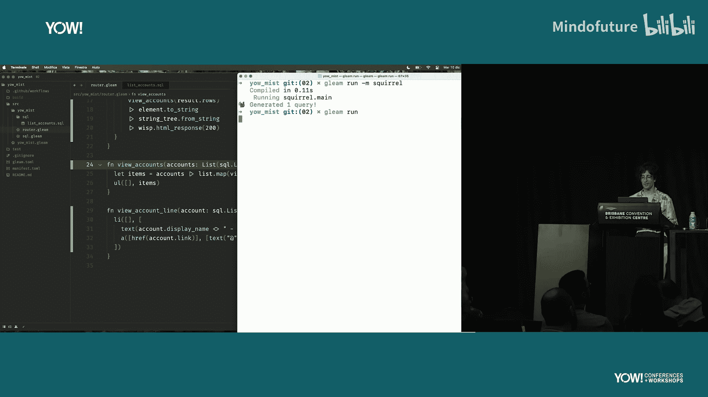

So again， we connect to the thing and look at that。 some lovely blue sky accounts。Sorry。

 I had to do the shameless plug here。Okay。And so as you can see。

 we can still embrace the sequel and not compromise on type safety and developer experience。😊。

If writing the SQL means writing a hard coded string in your code。 Well。

 that is not the best developer experience。 But if you can just use a plain old SQL file and get nice code。

 that is typea， idiomatic， and you can just reuse in your code base。 Well。

 I'd argue that that's a great developer experience。 And again。

 SQL is the best query language there is。 There's not denying it。😊，So how can Gam do all of this？

 How can we have a server that can sustain the highest workloads。

 even under the 99 percentile of workloads that can work in a concurrent， distributed setting。

 Talk to a database at the same time， having an interactive application that runs on the browser。

Well， the trick here is that glam can compile down to two amazing runtime for starters。

 It can compile to jascript。 So you can run glam everywhere Javascript runs， which is well。

 everywhere， basically。 And that's really nice because what if you need to run your gln code on the browser。

 Well， you can compile it to Javascript， bundle it and you're good to go。😊。

You need maybe a NAW worker or something compile it to Javavascript。 And again， you're good to go。

 At the same time， though， Geam comps down to Erlung， Another language that runs on the amazing beam。

 How many of you have heard of the beam。😊，Okay， quite。Few hands。 That's lovely。 So what is the beam。

 Well， the beam is an amazing runtime that has been developed since the 80s and was born to address the very specific needs of a very specific industry。

 You might have heard of Erson， the telecom industry。😊，And at the time。

 they had to make telephone switches。And they had some really strange constraints there because those had to be。

 well， first of all， fall tolerant。 You don't want a phone switch to randomly die。

 And then you have to send someone go fix the phone switch。

 And they had to work under highly distributed and concurrent settings。

 sending many phone calls at the same time。 If phone switch is only under a single phone call at a time。

 Well， I don't think phones would have really taken off。嗯。And。

So the beam has been built with these ideas baked in into the virtual machine， into their run time。

With this idea of having full tolerant systems， systems that can communicate across the net that can work in a distributed setting。

 exchanging messages。And。😊，Those might have been like niche needs at the time。

 like of only the Ericon。 But if you think about it， full tolerance， distribution， concurrency， Well。

 that's a given nowadays。 We want all our systems to have this kind of properties。

 And so by compiling down to the Erang and running on the bi。

 we can leverage this amazing runtime that has been bottle tested for the past 30 plus years and has been worked on like crazy。

😊，And so Gleam can do this really nice thing where you have your backend that's written in Gleam and compiles to Erang and runs on the Bea and talks to a front end that is compiled to jascript and can run on the browser。

😊，So we have also a really nice story of full stock web development。

 where you might have an application running on the client in Gam， a server in Gam。

 and maybe some common code that shared between the two By using the same language。

 We gained this amazing power。😊，Okay， I think it's time to start wrapping things up。

 So Gam is a language designed to be simple， designed to be easy to pick up and productive with。

 Notice， we've never told you that glam is functional。 I had really no need to tell you。

 it has two basic building blocks。 it has functions and data。

 But when we talk about functional languages。 those might be quite scary at first。

 But as you might have noticed， Gam is pretty much approachable and there's a familiar syntax that helps you learn and understand what is going on as you're learning the language。

😊，It has great error messages。 You can talk with the compiler。

 The compiler is not here to tell you that something is wrong。 If you messed up arribly。

 The compiler is here to help you build a system that just works。

 figuring out all the little mistakes that might go on and all the little things you need to take care of。

That doesn't have to stop here， though。Developer experience is so much more than just having a powerful language。

Developer experience is mainly tooling， and so glleeam comes with some amazing tools out of the box。

😊，It comes with a compiler， a build to to run your code and your tests。

 a package manager to manage your dependencies。 So you don't have to worry about what the best one is or what configuration file to use。

 It also comes with a built inform format。 You might have noticed theres a typing。

 The code was being rewritten in a nice way。 So you don't have to lose hours of bike shedding with your coworkers about where curlibrate should be。

 I don't know why。 but we developers love to， to talk about that。Horrible。And finally。

 and most importantly， Gleam comes with a built in language server and editor integration。

 So if your editor can speak the language server protocol， which is basically every editor， V S code。

 Z terminal based editors， you're pretty much good to go。

 You've installed the gleam binaries and you can start getting productive and get those amazing productions I showed you earlier。

 and so much more。😊，So I started by describing Gleam as friendly， typea and scalable。

 But if I had to use just a single word， well， that would be productive。

 Gam is a productive language， a language where you can get things done at the same time。

 with a great developer experience。😊，A quote I really love comes from a community member that's putting gleaming production。

 Aen， and she says。Looking at my gleam code makes me feel calm。

 Lstster and gleam make my heart rate go down， which I think is the best thing we can say about a programming language。

 Have you ever felt that way， developing software and putting software in production， I don't know。

 It's not a really common feeling， I get， so。😊，I think that's a pretty good compliment to receive。

 And I'm quite happy that people are liking it。😊，So our journey might end here。

 but that doesn't mean that your journey with glam has to stop you。

So if you think this is interesting， if you want to give a more in depthth look。 Well。

 the best place to get started is the language tool。 So to get started with gl。

 you do not even need to install it。 You just go to tool dot gl dot run。

 And since Sc compiles to jascript。 This will run glam in your browser as you type it。

 you can go through the entire language。 And again， being this simple。

 it will probably just take what a couple of evenings to see all there is to know to the language。

 and you can just get started doing things。😊，If you're more like the code cutter person and you like doing small exercises。

 well， we also have an official exorcism track with loads of exercises。

 And if you don't know exercism， it's this amazing platform for learning new languages。

 not just glam where you can do code cutters and get feedback from other people that haved the same problems as you。

😊，And also， we have an official discord server。 So if you feel like you get stuck and。

 you don't know how to do something。 If you have any comment。

 any suggestion to improve the language to make things better。

 or if you want to just hang around and maybe see what there is to gleam。 Well， please join。

 I always hang in there。 So if you want to have a chart。 even after the conference， I would love to。

😊，And so this is it。 This was our codecentric journey into the gleam language。 My name is Dcomma。

 The little star you see here is Lucy Gimam's own mascot。

 And I want to thank you so much for coming here and listening to this talk。😊。

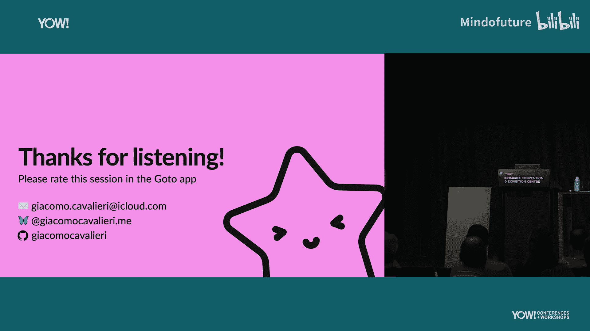