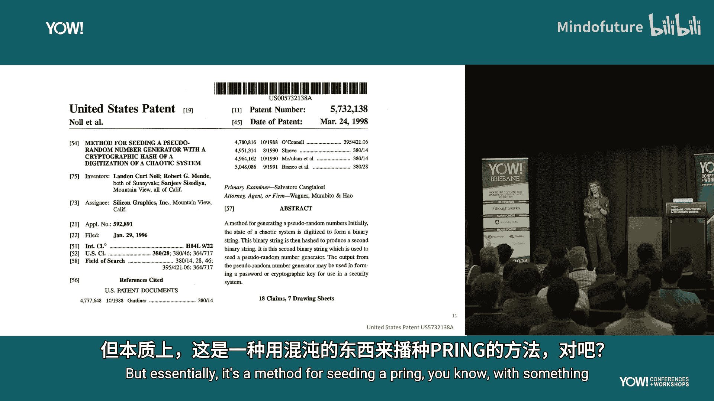
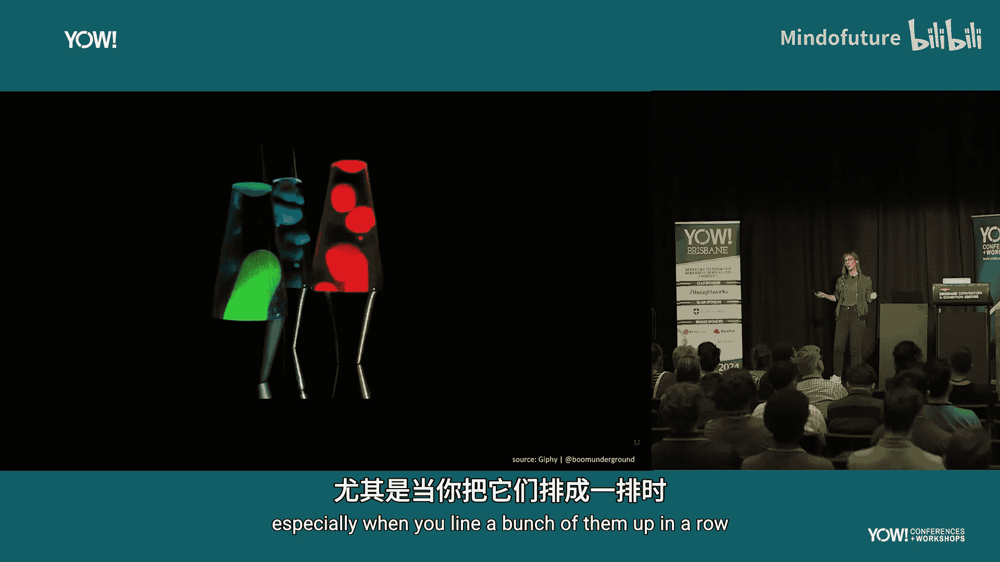
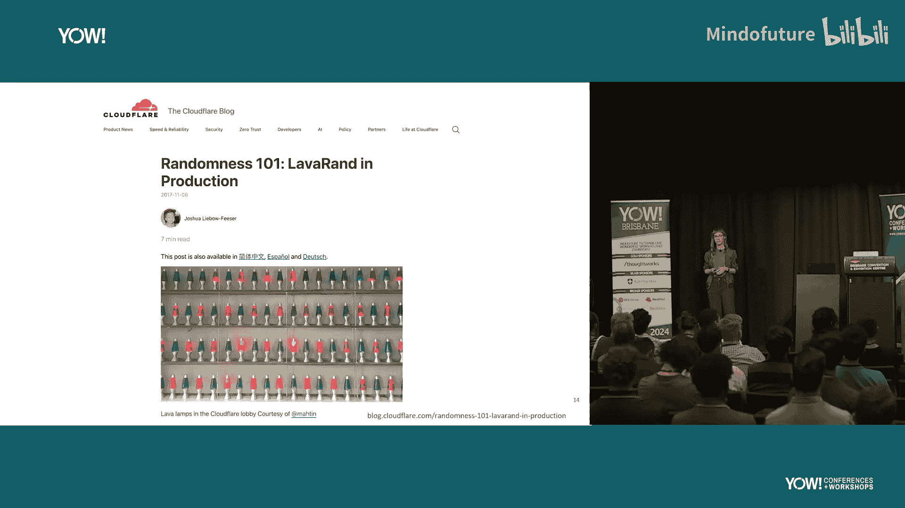
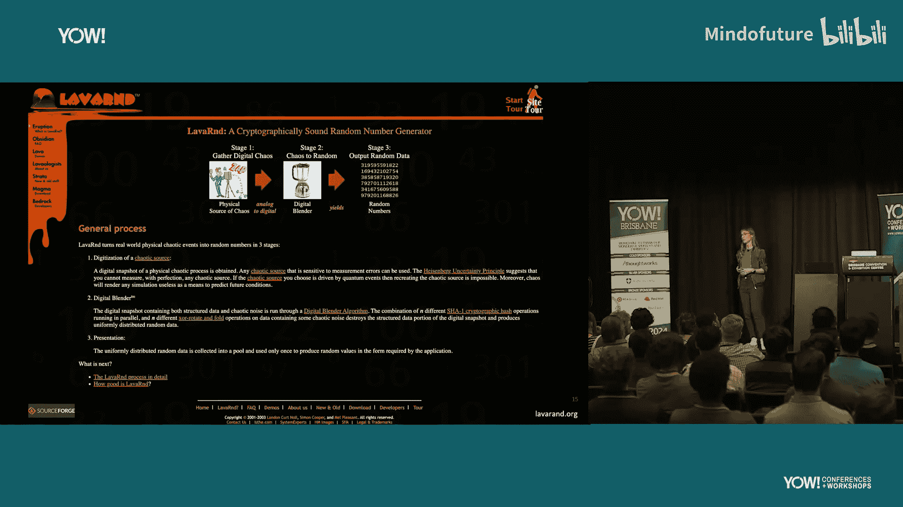
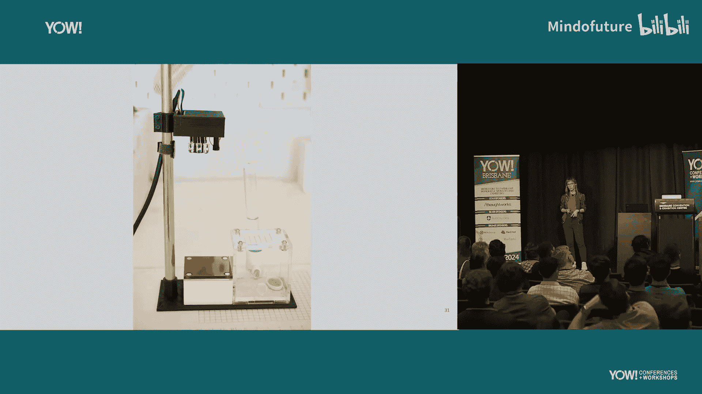
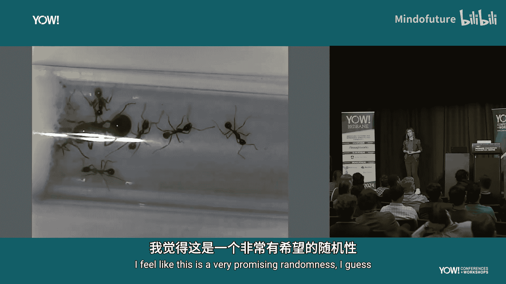
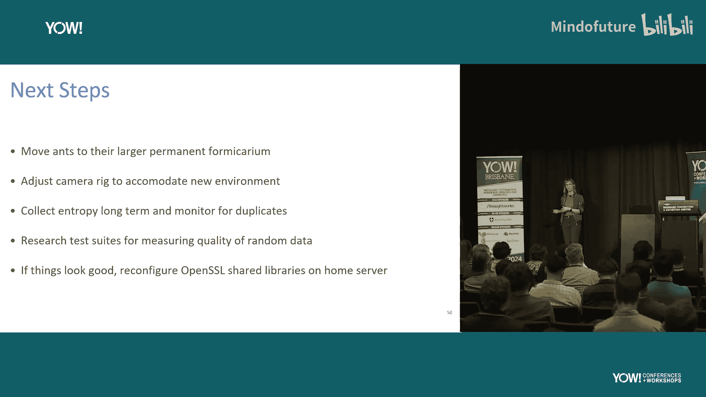
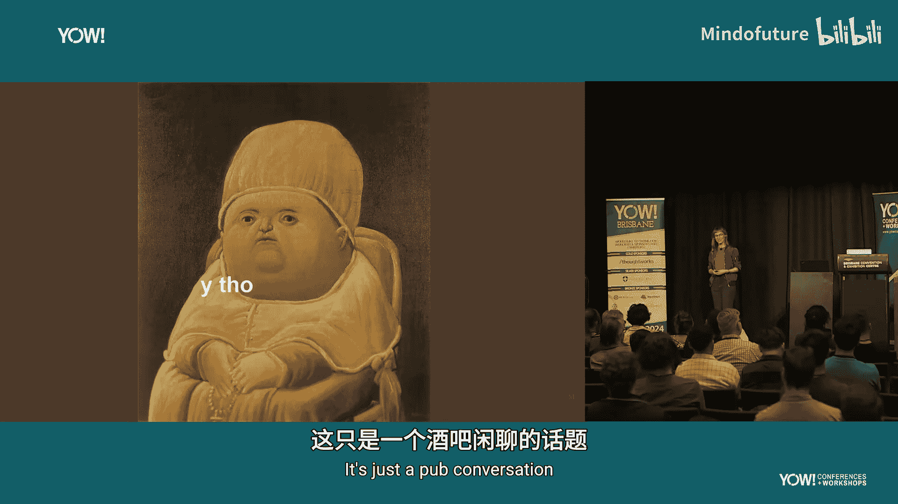
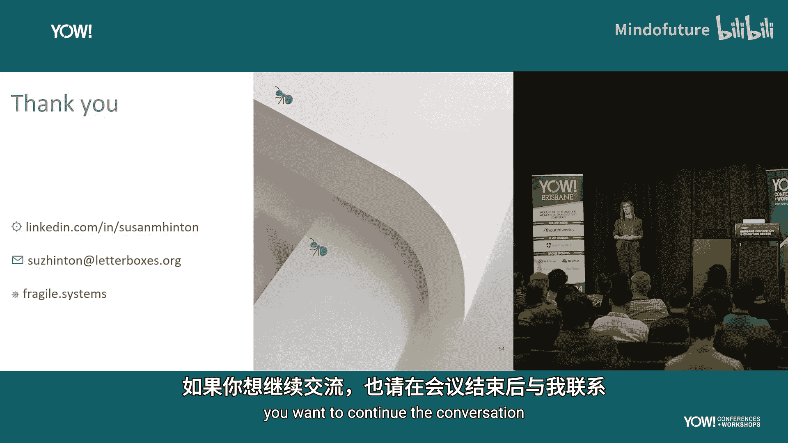

# YOWcon软件开发大会（2024）｜-架构设计-｜-分布式-｜-AI-｜-代码-｜-JAVA-｜-Github-｜-Spring-p08-P08-Ant-Farm-Entropy---Sugar-Powered-Encryption--BV1G9dfYTEHR_p8-

Thanks for coming to my talk。 I know that you have two other options during this time slot。

 So I really appreciate that a lot。 I just wanted to give you a bit of warning upfront。

 We've had a slight technical issue。 So I hope all of my slides work。

 there might be a video or two that don't work。 But guess like given that I'm talking about chaos today。

 we're just adding a little bit more extra chaos。 So it goes with the theme。 So please。

 please be patient with that if we have any dramas。😊，So again， thanks for coming to my talk。

 It's titled An Farm Entropy。 David， who gave a talk earlier this morning。

 He actually was really disappointed that I didn't call it antropy by creating a port manau of it。

 So but I wanted to shout him out。 I thought that was very clever。 And so， yeah， this。

 this talk is about exploring chaos systems for encryption。 I'm going to cover a few of them。

 But then I actually did one of my own recently。 And that's mostly what the talk is about。

So just a really quick intro。 My name is Suus Hinton， as Matt said， I'm a software developer。

 but I'm also an independent security researcher， So this research that I'm be talking about today is just part of what I've been working on this year as part of that role。

 And so if you do want to get in contact with me after this just because this talk is not covering a lot of depth。

 So you might have some more questions I have a lot more to share about it。

 So if you wanted to get in touch to talk about the integratedt details I'm very happy to do so at the conference。

 but also through these communication channels。 And so the last the last link there is just my website。

 there's only a newsletter signup link right now， but it just means that once my blog is like up and running。

 I will be blogging about this project。 And so if you sign up for that。

 you'll get the notification of that too。And then if you want to talk to me about anything that's not as tech related。

 then you can come talk to me about cycling， home， do it yourself and woodworking。

 flying aeroplanes and just general other computer stuff as well。

 I'd be very happy to talk to you about that。😊，So today we're going to be covering a lot。

 So you know I might be talking fast in some of these sections。

 but generally at a high level we'll be talking about just giving a primer on pseudo random number generators first and what they are just to make sure that all the audiences across that different sources of randomness and chaos systems that currently exist out there in the world that have taken some inspiration from research into a potentially useful chaos system because that research is ongoing like the biological software and hardware considerations of that chaos system and know actually implementing it in like a actual real world use case and also the results of that and the next steps for what willll be continuing to work on with the project because it's currently a work in progress。

😊，And then， of course， because this is a security talk。 and because we're talking about cryptography。

 I feel that I have to do this。 This is the kind of I am not a lawyer type disclaimer。

 So don't do this in production。 I mean， it's gonna to become pretty obvious。

 but I feel the need to say。 so don't roll your encrypt crypto。 I might have。 but don't。

 It's not a good idea。 It's good to do it for fun as a toy， but honestly， again。

 don't do this sort of thing in real life。 the information again。

 that I'm covering a super high level generalized。 I might be doing some oversimplifications of something。

 So forgive me there if you have the deeper knowledge and it grind your gears， but again。

 come and see me after my talk if you'd like to chat about any of the details。

 this is for educational and enjoyment purposes only this is not some academic paper that I'm gonna be submitting to a journal but I will be writing it up as a paper just in a more casual sense。

😊，Seriously， so let's move on。 Okay， so who in the audience is familiar with。

 at least or knows something about pseudo random number generators in general。😊，Okay。

 so we got a pretty good hand。 That's probably at least 30%。

So I'm gonna just go over just the super high level basics so that we have enough context。

 If you don't know about them， it's totally okay。 What I'll be describing to you today right now is enough for you to understand the rest of the talk today。

 So I call them ps for short。 That might be blasphemy。

 But it's just an easier way for me to communicate that。

 And it means that I can finish my talk on time。 So that's how Ill refer to them from now on。

So ps are commonly used for encryption related purposes。 Theyre actually like really。

 really important and fundamental to a lot of cryptographic operations。

re you know the most important uses of those are things like generating encryption keys and then subsequently when you have things like secure certificates online。

 they're also signs with keys that have been generated with the help of ps as well。

 they're also used for a bunch of other things that aren't necessarily like cryptographic specifics such as TCP sequence numbers。

 which I thought was really interesting。 but then also going back to cryptography we've also got our Tl key generation that happens。

 you know with each handshake that you do with any kind of server that you're connecting to when you're browsing the Internet。

 So they're pretty ubiquitous， and they're always being used under the surface。

 and we definitely do take them for granted because you know you're not sort of exposed to that when you're on your phone and checking your tweets or whatever。

And they're essentially through that， they're the backbone of filing email encryption as well。

 and also digital signatures， which we， we briefly mentioned with the certificates as well。

So let's talk about deterministic because， you know。

 pseudo random number generator sort of seems like a oxxymoron。 Like。

 is it actually random or not if the word pseudos in front of it。 And essentially。

 that's just because computers are deterministic， right。

 Like if you said to a computer pick a number between1 and 10， we can actually do that。

 But like by design， they architecturally can't do that by themselves without us coming up with creative ways to help them do that。

 right？ And so computers do exactly what we tell them to， but they do nothing else。

 And I think that's what leads us to this talk today。 in a lot of the use cases we looked at。

And so we need we need to actually source some form of randomness。

 But given that computers can't come up with that randomness。

 we need to be able to source that somehow。 And then we give that randomness。

 that we've been able to find。 We give that to a numbergene generating function。

 And it actually uses that as a seed to get started。

 And so pseudoran number generators actually do create predicted predictable sequences of random numbers based on a seed。

 which again， seems like that's not what you would want like what if you wanted something truly random。

 But it can be very useful right And so think about things like if you're using random number generators and you need to be able to generate the same sequences every time for testing purposes that can be incredibly useful And then also pseudoran number generators are actually much more efficient。

 And they run a lot faster than other forms of random number generators that might be truly random。

 So there are reasons and there are tradeoffs and we mostly use pseudoran number generators for a lot of common。

Encryption purposes for that reason。So in order to sort of find this randomness， like。

 what does that actually mean。 And so if I use the word entropy in this talk。

 given it has a lot of meanings， I sort of mean the noun。

 And what I mean is just random data or suitably random data。 So I just also wanted to clarify that。

 But sources of entropy on Unix， for example， the two devices that you see here。

 there's dev random and there's dev U random。 There's also the cis called get random。

 The only difference really between random and U random is one is blocking and the other is not blocking。

 So if you ask for a certain amount of entropy and it doesn't have enough。

 it will block the call until it's sort of collected more， right。

 And so that's really the only difference between the two that's useful for today。

And so what is this actual random data， though， Like what is it collecting and you know。

 how does it get there， It's generally， again， on Unix it's populated by system events。

 So when you type on your keyboard， that's pretty random， right。

 Like it's not like the computer can predict what you're about to type。 Although with AI。 You know。

 we're seeing that a lot more in your inbox when you're trying to write Nemo to someone and Gmail is helpful autocomplet。

 but just generally， it's not gonna know the cadence of when you're gonna type that key either right。

 And so it can use the randomness of user events to supply that entropy。

 but it can also do do things like hard drive hard drive access reads events and things like that。

 right， which tend to be a little bit random as well。Basically。

 any kind of system event that you can think of that is hard to predict。

 right and is happening on the machine that needs that source of randomness in the first place。

 right， So that's usually the most convenient form of randomness。

 It's not the form that we're going to talk about today。

 but that's sort of like where we actually start， right。

 And that's the most practical use of it for general everyday computing。So that leads us to Open SSL。

 It's important to cover this just because my research was sort of using this as a tool for the proof of concept。

 So Open SSL is an open source cryptography library。

 It has its own p that it uses extensively for a lot of its cryptographic operations。

 it's heavily used in many， many， many software packages。

 and we're talking everything from web servers to you know web you know web applications to even things like if you've used a command line tool such as curll。

 which I'm sure is pretty ubiquitous in this crowd that actually does use open SSL as a library under the hood to do a lot of those operations that we're talking about previously。

It also exists as a command line tool。 So you may have used it when you're using Gitthub and you want to set up。

 you know， like your key pair with it in order to pull down repositories and push them up。

 If you sort of just copy pasted all those commands off the Gitthub website on how to make a new key and how to save it and upload it to GitthHub。

 you've actually been using Open SSSL。 if you remember that as well。

 So the command line tools pretty ubiquiously used as well。Oh， and I。

 I I think that it was supposed to be mentioned on this slide。

 But open SSL actually users usually on your next it will use like that。 Those two devices。

 Deb randomand， devb U randomom or this is calls in order to get their entropy for its actual p。

But let's talk about different entropy sources for a second。

Random dot org is a website where you can just literally go and get a random number if you want。

 And under the hood， its random number generator is actually using a source of entropy in the form of atmospheric noise。

And so it has like these geographically located， you know。

 distributed radio equipment that actually just it picks an unused radio station and it it sets itself to that frequency。

 And it actually collects the kind of background noise that it receives on that frequency。

 which I thought was a really cool use of of like just yeah， like sorry。

 a really cool source of entropy in order to do it。 And so on their website。

 if you go to the statistics page， it actually shows， you know。

 sort of like how they rate the quality of the entropy that they're currently collecting at every single station around the world。

 super interesting。😊，This study was done in 2003。 It's actually trying to find an efficient an easy source of randomness。

 and it's in the form of radioactive decay。 So apparently radioactive decay is sort of a hard thing to predict when it comes to you know atom by atom and things like that。

 And so they were looking at using a meicum which is found in the iodizing type of smoke detector that have found commonly in households And so I thought that was a really interesting use。

 given that everyone has smoke alarms， And even though there's several types of them。

 there's a good chance you have the ionizing type。 And so they were trying to see if they could extract enough entropy that was like usable。

 from just like how that radioactive source decays over time。

 And yeah I thought that was super fascinating。 And so I'm interested in if that's actually being used in real life now。

 but I'm not sure。And so that brings us to love around。

 which some of you might actually have heard of in the audience。

 It's a little bit more of a famous example of it。 And so this was actually patented in 1998 after they applied in 1996。

😊，I don't know if you read patents for fun。 Sometimes I do， including this one。

 but they're obviously like super generic by design for reasons that we're probably all aware of。

 And so the abstract is truly abstract。 they understood the assignment。

 which is it's a method for generating a pseudoran number initially the state of a chaotic system is digitized to form a binary stringla So what does this actually mean。

 And you once you get through you know the front page， it's actually quite helpful。

 But essentiallys a method for seeding p you know with something chaotic right。

 And so this pattern is actually literally referring to lava lamps and the fluid dynamics and lava lamps。

 and because apparently this is quite hard to predict。

 especially when you line a bunch of them up in a row。

 And so essentially what happens is if you line up all of these lava lamps and you turn them on and you point a。

😊。

at them。 if you're capturing the state of them every， you know so interval。

 then you can actually take this as a source of randomness。 and you can convert it。

 And so we're gonna to go over the implementation of the actual pattern itself later on because I actually stole from that。

 given that it it's actually expired because it's beyond 20 years， which is great。

 But if you want to read more about this in detail that I don't get to cover today。

 This is actually in the Cloudflare lobby in their headquarters in the United States。 And again。

 some of you will be very familiar with this。 they do actually have two really great blog posts on it。

 There's randomness 101。 But then link to this blog post within it is also a link to something slightly more technical where they talk about some of the details that we covered today。

 So I'd highly encourage you to look at that。 But I found this really inspiring。

 Like I just love this kind of slightly offbeat stuff。And so also sorry。

 I would recommend if the pattern is a little bit too dense and and not fun to read。

 but actually recommend you check out lavaand dog。 You can see that this is just an excellent time capsule as well to the 2001 to 2003 days。

 which is what the copyright statement says at the bottom。

 But it actually explains the pattern in a way， nicer and fun way。

 And you've got the clip art and everything and I love the lava menu at on the left。 You know。

 that's exactly how it used to do it back in the day。 And I wish we would bring that internet back。

 So Id recommend you you try that out。😊。

But anyway， you know， I was in the pub one day and I was just having a silly technical conversation as you do。

 And， you know， when you talk about hypotheticals。I was like。

 can you think of an entropy source like lavaand or or。

 you know that that you think would be suitable。 And we' try and attack the idea， right？

 And so my idea was ant and looking at ant colonies。

 And so we sort of tore the idea apart for a while。 And usually these hypotheticals。

 They just stay at the pub， right， And you go home。

 you wake up in the morning and you forget all about it。 Unfortunately， that was not the case for me。

 And I just， it's just always been this kind of worm in my brain ever since。 So I thought， well。

Why don't。Why don't I just kind of like explore this a little bit。

 Does it have to actually stay in the hypotheticals， right， Because when you really think about it。

Like they， they sort of seem to be moving quite chaotically， right， Like a larva lamp。 It's like。

 do you know where it's going to put its feeler or its leg necks， you know， and things like this。

 And these ants are actually in space。 So like theyre even cooler。

 But I still think that if they were in actual gravity on earth。

 that they would still behave as err radically right。

This is actually on the International Space Station， which is awesome。So why not try。 Like， you know。

 it's a silly idea。 But why again， leave it as a pub conversation。

 And that's sort of something that I've always been a bit known for。

 Like like why not just try it out。 You can， you can attack the idea But you you never know if you unless you actually put it into practice。

 And so， you know， as you do when you're doing an extremely serious project that started out at the pub。

 you have a research purpose what it was helpful for me。

 at least so that I sort of know what I'm trying to find out， right？

 So the first research question I had before I started this was is an ant colony as a chaos system an adequate source of entropy。

 So that was the original question that we had， right， when we initially had this discussion。

 me and my friend。But the second thing is， like， is it even possible to replace the default source of entropy for commonly used prints。

 right？ Like， can you even like， do you have to recompile it， Like， is it even possible。

 Is this legal， You know， things like that？ And so I。

 I felt like these were the two most important questions I wanted to answer for this particular project。

So from a research purpose comes requirements， right。

 So my argument is that you know ants need to be consistently behaving unpredictably in their environment because that's randomness as a concept trait it。

 and so if they're not constantly unpredictable， then it's sort of like it's dead in the water as a concept。

We also like， there needs to be a way to visually capture this an colony 24，7。

 which is how lavaand works， right， And so I'm trying to implement that pattern as closely as possible as well in order to just see if it is a。

Re sort of feasible drop and replacement for lava lamps。

And then these visual captures that we take these photos where we capture the state of the an colony。

 like we need to somehow convert that into something that computers can use。

 that does express the randomness of that state we just captured。 And so again。

 that's covered in the pattern。 and I'm going to cover that more detail later on。

 But these are essentially the high level requirements。

 But there was one super important requirement that I needed to research before I even started this project。

 which I'll talk about in a second when we actually cover the ant。

So it's no fun if you just have this like proof of concept in a vacuum right， you know。

 in this sort of clinical environment。 So I thought。

 why not actually apply this to something and have that application as a goal。

 And so I have this home home server at home。 It's a purism， Libber mini。 I really love that company。

 I I really love their mission and everything。 So that's what I chose。

 But it's around the size of it's between the size of an old Mac mini and the newer ones， right。

 So it's relatively small。😊，I'm running like way too many things on it as you do when it's a home lab。

 but the main things that I I'm sort of concerned about for this project are media wiki。

 where I have everything from recipes to technical notes on there。 I run home assistant。

 which runs all the smart devices in my home。 I have RM cloud。

 which is just an open source version of the remarkable tablets cloud because I just want to keep all of my self private on my remarkable tablet and I also host a bunch of code that I write that I don't want to push up to to public code repositories。

 I just have my own getty instance running on there as well where I can host my code。

 including the code that I wrote for this project。And most services actually run on T。

 L S and S L locally there。 So I thought， oh， okay， so like that's using ps onto the surface。

 So what if I could take a lot of those secure connections and actually use you know。

 seed the random number generators that are working on those， those kinds of you know。

 cryptographic use， What if I could supply those processes with the entropy。

 And that would actually be applying you know， this research。And also， additionally。

 all commits on my personal projects are also digitally signed。 So again。

 there's use for keys generation all sorts of things on there as well。

 So I sort of had something there that I can just like replace keys with and， and。

 and also just start like， you know， encrypting things on demand with all of those connections。

So this is in three sections for the rest of the talk。 We'll start with the ant。

 I think this is most fun bit。 actually， So so strapff in。 let's was some ant facts。

 because I know that's exactly what you all came for。

 So the egg to adult lifecycl for a worker is 8 to 10 weeks。

 This was absolutely the showtoper of this project actually。

 And so I'm not as far long as I initially thought I would be up on stage。

 but we've still made some progress。 So I'll talk about that later。 So that's a really long time。

 all workers are actually female。 So most of the colony is actually just a ladies club。

 I didn't know that。 I'm sure that that was maybe we taught in primary school to a lot of you。

 but I certainly didn't know that。 So that's kind of cool。

 And then speaking of ladies Queens can live for up to 15 years。 apparently AI says up to 30。

 So yeah， we need to fact check Yeah So actually generated some ant facts during their talk in Melbourne。

 it was very entertaining。😊，So anyway， they can live for up to 15 years。 So， you know。

 if you keep an out colony， that's， that's， that's， you know， like buying a dog or a cat。

 It's a bit of， it's an investment commitment。Out in the world， they feed on nectar seeds， insects。

 meat， fruit， etca。 So that seems kind of plausible。 right。

 I think that I can source those things if I were to get an out colony to try this project out。

This is the most important fact that I alluded to earlier。

 If ants are going to behave err radically and I need that to be happening around the clock because you know when we need to use those random number generators on demand for you know lots of different secure connections and things on my machine。

 They need to not just stop and they need to like not stop all at the same time And so do ants sleep was like my Google sort of like you know midnight hole that you end up in when you're researching and I did come across a couple of papers that said。

 no most species they take little micronas for up to a minute at a time。

 but then they just sort of resume。 And so they're very different from us。

 they don't just kind of all tuck in at night and cut around the queen and sleep for eight hours。

 they're actually like busy all the time。 And it sounds like they basically do polyphasal but to the extreme。

 essentially So that was good。 that was actually really promising。

 but I did actually have to do a lot of this research before I even decided to commit to this project right。

 So now you're on the same page。As mayor。So I don't know if anyone remembers this from being a kid。

 I remember I had seen monkeys， biggest disappointment ever because this pictureer really set you up for disappointment。

 It's not what it ended up being。 But I thought， how do I actually buy ant。 Do I go to a pet store。

 Do I order them from a magazine。 It turns out these these。 You can just buy them off the Internet。

 And they get overnighted in you know， Australia Post Express post。 And， here they are。

 this is what I pulled out of the box。 It was a test tube。

With you can see the queen aunt is in the middle there。 She's the really big one。

 And there are other worker ants that had already hatched in the meantime。

 So this is the starter colony that you get。 They come with some water and they come with a little bit of sugar water。

 which you can see on the left there， that slight discoloration。And then they're like， good luck。

And so that was naturally terrifying to me， but also really， really interesting。

So let's talk about now that we've got the ants and we know that they sort of seem feasible。

 We want to progress。 So， you know， what kind of hardware do we need for， for this setoff， right。

So this is called a formmicarrium。 This is called a founding form aarrium。

 So it's not sort of the traditional ant farm that you see with all the little tunnels in it。

 They sort of get a bit overwhelmed if you give them too much space at the beginning。

 So you have to give them just like a little place to grow before they reach sort of a larger colony size。

 And so this is what I ended up buying as the founding form aarrium for them。

 So they live in the little red shielded dark cave on the left。

 And on the right is their outer world where their food is their water is。

 and they also they're very clean They take out all their rubbish out of their little cave and they pile it up。

 and then I need to remove it。 But yeah， they' actually a very clean and organized species is quite delighted by that。

😊，So that's where， you know， I initially sort of。Had to wait for them to decide to move in as well。

 So you attach the test tube。 and then you just kind of wait。 and you try to be sort of like。

 you try to make their test tube a bit inhospitable。 And then they finally decide to move in。

 So they they're in there right now。 And then this is more of a grown-up form aarrium when they actually reach critical mass。

 right， And so you can't quite see it because of the red filter on top。

 And that's really just because they don't like the dark。 they don't like the light very much。

 And so it helps them remain calm。 But there are the little laser cut tunnels and stuff in there。

 And that' that's where I imagine once they're established。 know。

 there'll be a lot of activity in there。 And that's kind of the area that we want to capture。

 And then they have a much larger outer world that you fill with sand so that they just have a lot more sort of to work with as well。

So hopefully this video works。 This is where I talked about technical difficulties。

 But here is just a quick video I took where I just topped up their sugar water and they're all coming out to their cave to be。

 there's more food。 What's going on And so I just wanted to show you what the ants I got looked like。

 They are funnel ants。 They're adorable。 And yeah， I just really like watching them。 I mean。

 it's way better than doom scrolling on your phone。 I reckon them any day。

 So I just thought I'd give you a Zen moment as well。😊。

But now that they're sort of in that formarrium right。

 I can actually see down into it and you can see their activity in there。

 even though they don't sort of have the tunnels yet。

 And so I had to decide like how do I actually capture these you know these sort of states And so it's actually more complicated than you think because if you want to capture this 247。

 I don't necessarily want to have a light change on them at all times because they don't like that。

 they do like to have like the night and the day sort just like we do。

 And so I needed something that could capture something with some form of like night vision And usually that means infrared。

 So after trying out a lot of different cameras， which I don't have time to cover today。

 I ended up deciding on this one， This is a audiocam， it has those infrared LEDs around the outside。

 So it was able to actually capture that really great clear footage at night time， which is great。

 and it actually does a good job of shining through that red filter on the top as well。

 It has this automatic cutting mode， which is really awesome。 And so if you see that。😊。

Blue sort of like periscope at the top。 That's actually the photo resististor。

 the light sensor that governs that switching。 And so when the light gets low enough。

 it switches into this infrared mode。 but during the day it actually just takes a normal bunch of captures it just looks like a normal webcam but it does actually actively use like an infrared filter as well just to get nicer results。

 the thing that I really liked about it is that it uses that's a bit of a toology universal universal serial bus interface。

 but it's a universal interface， essentially because I can just plug this straight into my Linux server And so I don't have to have some other embedded device taking the photos and then transfer it and introducing all this kind of latency in the project when when my server needs randomness。

 it needs it now And so being able to just maybe I was over optimizing。

 but I think it's really convenient to be able to have it all happening on that one machine that we're applying the implementation to the only downside。

 but it's not a super big downside is the focal distances a bit。It needs to be quite far away。

 but at the same time we don't need something super high resolution。

 we're not trying to win photographic contests here。

 we're just trying to capture the ants as these little black blobs you know enough that you know so that we can capture their movement and so if we have to crop the photo down a bit and reduce the resolution it's not actually the end of the world and given that we're sort of like the way that we transform that photo once we've taken it will also be obvious that it's not a super big deal breaker but yeah so that's what I settled on for the actual capturing。

This is what the rig looks like right now。 it's just a prototype because it's not their final home。

 but I 3D printed just an easy enclosure for that camera so that it can just point straight down。

 And then it just has a very simple clamping mechanism attached to it as well。

 That was 3D printed as part of it。 That's just a hobrass tube that I bought off ebay And there's like a little 3D printer platform so that you you can adjust that camera up and down based on focal range and things like that。

 So that's currently capturing the photos right now， works quite well actually And again。

 it was a pretty good first prototype。

This video doesn't work on Windows， but it was just sort of showing the erraticness when they were in the test tube and at a very low population and that it was very promising。

 And I was able to capture this with the USB microscope。 So it was just an example of their activity。

 But I sort of showed you that before。😊，Oh， it does work。Yeahay， so they kind of look very。Creepy。

 but cute， right， And sort of one of them is just like， yeah， and'm so like， how do you。

 I I feel like this is a very promising randomness， I guess。

This is actually what the rig was capturing。 And so this is six frames all captured within one second of time。

 So it's， it's quite rapid。 But if you compare， you know， the frames。

 it's a little bit hard just because of the grid。 But if you compare the frames they are quite different to each other。

 right， And so again， this seemed pretty promising。

 And this is just a video to kind of show that to actually show that all those frames stacked on top of each other。

 it is really quite different， right So this， this was a really great first test just to be like。

 should I continue with this project。 So this is what I saw。😊，And so that's just that again。

 So you can see one of them's panicking and carrying its egg around somewhere I dont know what it's doing。

Okay， so hardware self is taking care of， again， the the， the project seems promising with。

 with every stage that we get to。 Let's talk about the software， the application。

 what's going to use this entropy， and also the implementation of the pattern， right。So again。

 let's come back to openness cell。 We talked about it before。

 but it's a heavily used cryptography tool chain with its own p。

This p needs to be seeded with random data before use。

 And so this is potentially a tool chain that we can interact with with this new entropy。

 It actually also reces on interval。 And so that's based on time that that passes。

 it will recsee automatically for you when you're using it as a library。

 but it also is based on number of requests too So if it generates a certain amount of random numbers。

 it will then just automatically go back and resee just so that it's not using that same sequence you know for long periods of time。

 So I assume that is for。Security purposes。 And it's just better， better un predictability。

And open SS L does， by default， use， you know， just like the standard operating systems version of their entropy。

 right。 So it's different on Windows。 But again， we can assume that it's dev random for Unix。

So this seems kind of promising for me to use this as part of the application right。

So I went on that Linux server and I ran a bit of an audit。 and yes。

 I do have it as a command line tool， but I sort of already knew that because I'd use it to generate a bunch of keys before this project。

 But when I audit said it's actual shared libraries。

 So this isn't even covering tools that link it as a static library or compile it as part of it or is using a fork of it but we've got two versions of open SSL libraries here。

 we've got version 1。1 version 3。 There are 82 uses of Lib crypto。

 which is one of the shared objects you get when you compile open SSL。

 We've got 16 uses of just SSL generally and then Lib SSL 3 is 29。

 So this this is being heavily used on my machine。 So why don't we just start with this as a start because that's going to be quite influential over the cryptographic processes running。

So I thought， this is， this is good。 We can start with this。So let's just kind of record scratch。

 go back to the pattern for a second。 This is very patenty looking， I know。

 but we're gonna zoom in and and break this down。 So this is the implementation of the actual pattern itself。

 This is how it ends up with the entropy。So we start。

 and then we record the state of a chaotic system。 So what does that mean for the ant colony if for implementing it。

 Well， recording the state of the chaotic system is literally taking a photo of what the ants are doing at that exact moment。

 right， That's capturing a state。We didn't need to convert that state to a binary number。

 So what we can do is we can extract the RGB pixel color values from that image。

 we can just like slam all together into one long sequence， right。After that。

 it does actually say in the pattern to apply a cryptographic has or hash function。

 I think that's a typo。 apply a cryptographic hash function to that really long number。

 And so what I've decided to do is to use Sha 256， It's relatively robust gives you 32 bytes of randomness or 64 depending on if it's string format or binary。

 But that's a pretty pretty usable chunk。 And after that。

 we actually add that sh 256 hash of that photo。 We add that to the collective entropy pool。

 So we're not actually using we're not actually adding the pixel values or anything or the photo。

 We're actually just arriving a hash from that state we collected。

 and that's what we actually add to the entropy pool。

 And so you know if we had our own version of dev random。

 that's what you would sort of see in there when you request it out is a bunch of like hashes that have all been mixed together。

And then from there， you know， we apply the pseudo random number generator using seed。

 That just means that open SSSL will then whenever it wants to reseed its p。

 it will just ask for that random data。 And we will just give give it a sample from that pool。 So。

 I mean， it's not a super complicated pattern。 we， as we know， like， you know。

 those patterns are always written in that super unfriendly way。

 So that's just a breakdown of how we're sort of taking our project and modifying it slightly for use with us。

And so you can actually use open SSL you can actually supply different sources of entropy to open SSL。

 you do need to recompile it， but you can configure it before you do so。

 there's a flag called with Rand seed， and you can use all sorts of different seed sources。

 but you do have to pick from a list that it supports right。

 And so you the default is O which just means dev randomand or the equivalent on Windows。

 but there was also this option called an entropy gathering Damon。

 and I was like that sounds incredibly ominous。 but very interesting and maybe promising。

 So that was sort of where my research let me next。 an entropy gathering Damon。

 it was first sort of introduced as a concept by Brian Warner in 2000 the year 2000。

 and he produced this EGD or entropy gathering Damon。

 and it was supposed to be an alternative to dev randomand on machines where there is no dev random or on a machine where devb Random can't keep up with the demands where it constantly needs to be gathering that entropy。

And so you know from the Read me file he basically says this is a standalone Damon that sits around running various statistics collection programs。

 such as you know those different processes there it then hashees the results into an entropy pool。

 so it sounds kind of similar to the pattern right but you again。

 he's using like system events and system processes in order you know to generate that entropy for his pool and this runs in user space。

 which is very different from Deb Randon， which is you know more sort of on the kernelnal level right And so if you want to read more about that because we don't have time today I'm running out of time very rapidly you can check this out and I'll have it in my references slide as well。

So Entropy Ga Daami， that sounds pretty cool。 He actually wrote it in Pearl and again。

 it's open source。 So I was able to look at at the source code。

 and essentially it listens on a Unix domain socket for entropy request from Open SSL。 And so again。

 if you recompile open SSL to use it， it would look for certain socket socket locations on the machine。

 again， I don't have time to cover that today。 But just that's the general thing you need to know。😊。

And the full sort of configuration in order to turn that on is to enable E GD with that flag。

 And then you do with R C equal E D G。 Now， you can give it a priority comma separated list。

 You don't have to just stick with one source。 You can have such as comma O for a backup option as well。

 So， but this is sort of the simplified version of that。So I ended up implementing my own version。

 There was nothing wrong with Brian's implementation。

 It's just that because he's got this sort of statistics gather and stuff。

 I ended up changing so much of his pearl that I ended up starting over from scratch。

 So I wrote my own Damon in Golang。 It's pretty much a like for like as far as the cryptographic side of it。

 mostly because I'm pretty sure he knows more about cryptography than I too。

 So like I'm probably going to be on a better track if I'm using implementation。

 So that's just an example of the repo there and just seeing that it's in Golang。

 So let's talk about how mine sort of differ slightlyly and how it works。 So again。

 I wrote it in Gol just because that's the language I'm most comfortable with these days。

 it uses openC to do the webcam sort of stuff。 And so a lot of you will have used openC before very useful。

 So I just used a library that has gol bindings to that。

It essentially captures a photo every5 seconds。 And so again。

 that's very different to the entropy gathering damon that collects statistics。

 So every five seconds， it's an arbitrary interval that I chose for the for this research project。

 So again， I'm trying to see whether or not that's going to be a high enough frequency。

 But that's what I'm finding out right now。 But it only takes those photos if sort of you know this entropy level that's already in the pool。

 you know unless it actually needs it。 So if openness is I was requesting a lot。

 then you know it's going to have to like regenerate more entropy right because otherwise we're going to see that decay happening。

It then derives Sha 256 digest of each captured photo。 Again。

 it's just doing that in go line at runtime。 It's just like the patent。

 And it it adds each photo hash digest to the entropy pool。

 So if you are interested in sort of the high level De of that。 If you have cryptographic knowledge。

 it's simply doing an Xor of the hash with the entire pool。 then it stirs the pool up。

 And when you request the entropy， it actually stirs the pool。

 gives a sample and then restts the pool。 So that's kind of the implementation in a nutshell。

But you're probably thinking now， okay， so what happens if the an farm is not chaotic。

 what if they all do decide to all sleep at the same time for a minute and you know or what if the entire colony fails。

 which would be absolutely devastating。 So duplicate has this is sort of like my train of thought。

 But again， I would love to discuss this with everyone after the talk duplicate hass may cause these predictable sequences or patterns or something like that in the entropy。

 And so you this is something that I was also just interested in on a personal level as part of the project。

 So I thought this is probably the biggest risk the quality of the actual entropy we're collecting。

 So within my damon， each hash generator is first check for uniqueness against every single past hash generated。

 that's probably completely overkill right。 know if there was a hash that was the same a year ago。

 it's probably not super relevant。 But for the process of the research sort of you know as long as that last I am actually really interested whether I ever see a duplicate。

 So that's what I'm doing at the moment。 And then I just log。Each duplicate in a database for review。

 And I'm also saving those photos to disk。 So I actually really want a duplicate to occur and spoiler alert it hasn't yet because I want to like compare the photos。

 But you know， because the point of this research project is not will it be successful。

 it's let's find out right， And so I'm okay with failure or even just like minor failures like that。

So that's sort of something that I'm looking for right now。

 It's not just sort of doing the entropy collection and answering opennessL requests。

 It's also kind of keeping a watch in the background for this as well。So in the last five minutes。

 let's cover the results like， hass this worked， What's going on， Is it finished yet。So， you know。

 and is the ant farm entropy being used for anything on my home server at this point。Good news is。

 I was able to use the some of this entropy that I've generated to regenerate。

 which is an absolute pain in the butt。 regenerate my SS L certificate and and basically sign it with a new pair that's been generated from that entropy。

 then like reset up all my certificates again on every single service W it because that's really cool。

 So that was the first that was really a first success。

 And that's essentially using the open SL command line， right。 So it's not。

 you know sort of intervening in the shared libraries yet。

 But this was sort of like the first sort of success that I was looking for。😊，Similar success。

 I've also regenerated my key pair that I sign all of my commits with and that's using the entropy pool as well。

 And so that's really cool。 And so every time I push up a commit to the ant Damon。

 it was technically signed by the ants， which I think is like really awesome and circular。

 So that's really exciting。 And so again， baby steps and I've mostly been slowed down by the ant replication lifecycl。

 like I really thought it'd have a lot more workers by now and they'd be a lot more chaotic。

 So let's talk about the next steps。 So I want to move the ants to the larger permanent formarrium that I showed you the one with all the little tunnels in it because that's really where I want to photograph and they get super chaotic when they're sort bumping into each other and trying to do weird stuff and cleaning。

 taking out their trash and checking on the queen and all of that。 So that's sort of the next steps。

 are sort know I'm about 20 workers now。 So they're actually almost ready to move in because the formerarium I bought。

 the larger one can support from 20 to 500 ants， which is freaking awesome really。😊，Get to 500。

 I need to obviously adjust that camera rig right， because that was just a prototype for the really small founding one。

 So I need to like go back to the drawing board and go back to the Cad program and and redesign and print that。

I also need to collect the entropy long term and actually keep monitoring for duplicates and essentially like just actually sort of take this a little bit more seriously。

 do a bit more research on things like what kind of test suites can we use for measuring the quality of this random data once we've collected enough right。

 And so there's things like the diehard test and all of these different test suites again like yes。

 I have a bachelor's degree in cybersecurity but I'm not a cryptographic expert And so I'd love to talk to anybody who people can connect me to to do this specific part of it。

And then essentially， you know， if things feel pretty good， again， it's low risk。

 it's just on my local core network。 But like start reconfiguring all those open SL shared library locations on my home server to start drawing from that an entropy Damon riot。

 which I think would be awesome。 And then like live S L connections are being ced by that entropy。

 which I think would be friing awesome。 So yeah， so that's where we are。

 But this is where we're going next with it。😊。

Yeah， so， I mean， I'm sure some of you in the audience were like， I mean， just， yeah， okay。 but。

 you know， why why， it's just a public conversation。 Honestly。

 this is something that I actually have really strong beliefs about。

 So I am slightly here to convince you today。 It's fun。😊。

Like， do you go to work every day and do this？ Probably not。 You know， I get to like。

 spend my spare time doing this instead of doom scrolling or watching yet more Netflix， right。

But not every project has to be you know， practical or conventionally useful， right？

 Like I think that， you know， for those who who came to Yoki's talk earlier。

 he was talking about just being able to do things without having to get signed off without having to prove that there's going to be some kind of benefit upfront。

 right。 And I think everyone sort of dreams of being able to do those projects。 And again。

 it doesn't even have to be commercially viable。 It's just， you know。

 it's just because you want to do it。 And again， I have the luxury of enough spare time to do these kinds of things。

 But this has also been a really chill project。 it doesn't take a lot of time， right。

There have been a lot of unexpected twists and surprises。 And that's。

 I think the thing that I've loved the most。 I mean。

 I do know now that an's sleep for a minute in time。 And now， you know that。 So， you know。

 that's fun。 But also just like， I never even knew how open S L worked at all。

 And I've learned so much about that。 And I was really surprised by this entropy collecting collecting Da that I' had been around for 20 almost 25 years。

 Like， that's so cool。 So I's just like a piece of computing history as well。😊。

And you can learn a lot by trying something out like you can tell yourself at the end of the day that you know exactly what that outcome would have been after you finish that initial discussion with a friend in a joy way。

 But there's something really just very satisfying about learning when you're doing things like this。

 And again， it sort of leads into this next point， which is do you go to work every day and learn how to use a CAd program and learn how to 3D model in 3D print like some of you will be lucky enough to do that。

 but most people's jobs you learn a specific skill set and you are highly attuned to developing that skill set and you don't really get to try other things in tech unless you do projects like this。

 So I'm absolutely here to encourage you to do that because it's been just really satisfying project for me to do even though it's not even completed yet。

So that's all for me。 Again， if you want more details or if you want to chat with me， I'm very。

 very happy to answer any questions。 and please reach out after the conference， too。

 if you want to continue the conversation。 Thank you。 Thank you。😊。

