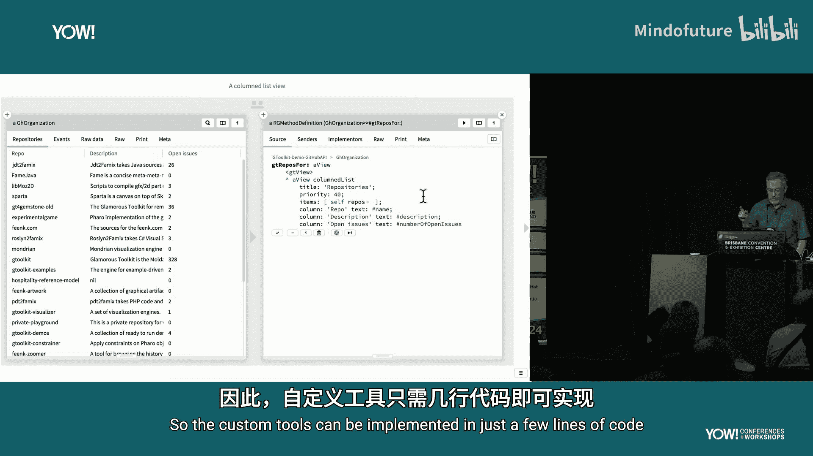
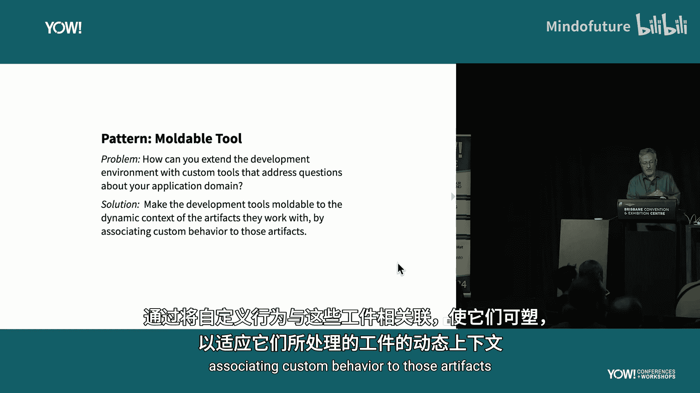
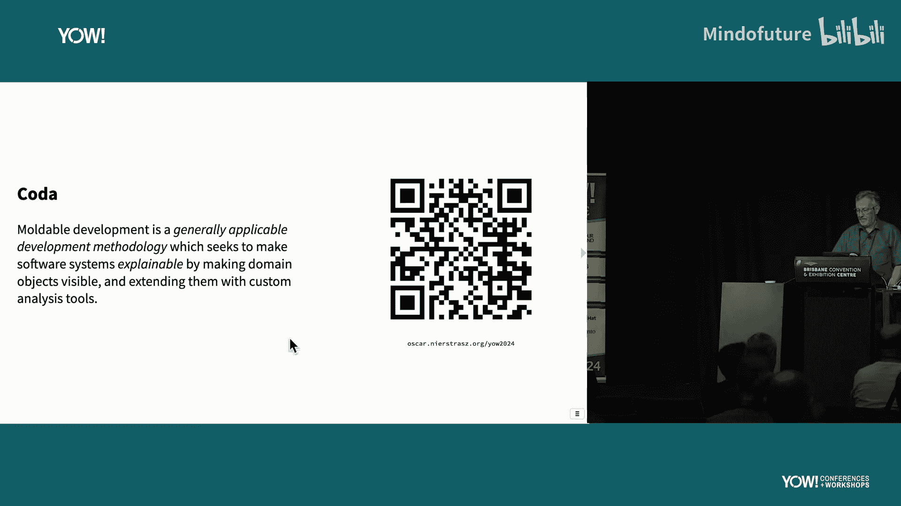

# YOWcon软件开发大会（2024）｜-架构设计-｜-分布式-｜-AI-｜-代码-｜-JAVA-｜-Github-｜-Spring-p11-P11-Moldable-Development-in-Practice-—-Patterns-for-Legacy-Modernization--BV1G9dfYTEHR_p11-

Okay， so I think now I'll really start。So the talk is about mold development in practice。 As I said。

 the idea of multiple development is we want to have answer questions about software by opening up the domain model and letting the domain。

 I will be talking about patterns， but they're going to be more at the end。

 because I think patterns are much better to understand if you see them in action first。Now。

 I'm going do two things here。 One， I'm going to be showing you lots of examples using our platform。

 which is called gllamorous toolkit。 and you may come away with the impression。

 as some people did in Melbourne， where we gave this these talks last week that I'm trying to sell you a tool。

 That's not the point at all。 We do have this open source platform called glamorous toolkit。

 But I'm basically using it to demo our ideas。 What I would like you to think about is how the ideas I'm showing you might apply to your tools and your environment。

 And that's why we have the patterns， because the patterns will abstract away from what we're doing concretely and give you hints about how to apply these same ideas in your context。

 Of course， the tool is open source。 and you can download it and play with it and be happy for that。

 But that's not the main point why we're here today。Okay， so what's the goal。

 The goal for us is to make software systems explainable。 what do we mean by that？ Well。

 what's the opposite of an explainable system， and explain not explainable system is one that's opaque。

 And I believe most software systems today are opaque。

 They're very hard to answer questions about The idea of an explainable system。

 In contrast is that they expose their inner workings so that you can have a conversation with them。

So they answer questions。Here's an example of a little game that students at the University of Bne implement in Java。

 And this is representative of any kind of application。 you can interact with its user interface。

 like here， I can double click on the die to to roll the die。 but I can't do anything else。

 I don't get any understanding or very little understanding of the application just by interacting with it。

 It's very limited interface。 There are a whole bunch of other things that we can do。

 I can go and store stare at the source code。 but it doesn't scale。 I mean。

 maybe for the little Ludo game， you can read all the source code。 but for any real software。

 it just doesn't scale。You could read the documentation。

 but the documentation may not be documenting the part that you're interested in。

 and very often documentation is out of sync with the actual system。

 You can use generic analysis tools。 There are lots of them around。

 but very often the generic tools don't answer your specific questions。 You can use other approaches。

 like you can run to online resources， but very often they don't know about your specific context。

 They may answer questions about frameworks that you're using， but they don't know your application。

 And you can use generative AI， but again， it's probably not going to be trained on your software。

 and you also have the problem that any answer you get。 How reliable is it。

 the same with online resources。 How do you know that the answer is actually correct， so。

Those are all limitations。So our point of view is that the software actually does want to talk to you so we should let it。

That's my message for you today。 You should try and let the software talk to you。

 And I'm going to show you some ways in which that can be done。 It doesn't come for free。

 But there are some simple things that you can do， and there are some more advanced things that you can do。

So the idea of mold development， I'll try and explain what this terms means。

 It's a little bit mystical because what's being molded， it's， it's very。Viionary， mysterious。

 mystical。 The ideal is simply this。 If you want to take a software system， you open it up。

 you add lots of little custom analysis tools that answer questions that you have about the inner workings of the software and make it explainable。

So in essence， there's a dialogue going on between the development tools that you have and your software application。

 Instead of having closed development tools， we want to have open development tools so that they learn about our software applications。

 So they're not showing us generic interfaces。 They're showing us these lots of little custom tools。

So we've done this in our platform and opened it up with glamorous toolkit。

 I can demonstrate it to you with existing development environment。

 It's a little bit more difficult If you've implemented any plugins for eclipse or intelligent。

 you know， it's not so easy。 The idea is to make adding lots of tiny little plugins， really。

 really easy。 And this is kind of the， the secret sauce。So， here's。

The same ludo game we saw a moment ago， except now， instead of。

Instead of looking at the user interface， I'm looking at an instance of the game in an object inspector。

If I'm in an object inspector， usually I see some view like this。

 What we've done is we've opened up the object inspector and say， oh。

 there are all sorts of questions we have about the Ludo game。 For example， we want to know well。

 what are the players of the game。 What are the squares of the game and what's their state。

 or we want to see what are the moves of the game up to the current state of execution。 So here。

 for example， we see that there been 18 moves。 and we can start scrolling through them。

 Notice on the left， we have a ludo recording game。 So game instance that we're inspecting。

 and on the right， we have an instance of a move。 So these are all different domain objects that we've lifted out。

 made explicit and what we've done in the molding is we've。😊，Molded the application。

 and we've molded the object inspector。 So instead of seeing the boring view that you usually see in a debugger。

 suddenly， the tool becomes very useful And， and is telling us things about the software。

 In this particular case， The question is， what， what moves happened in the past and what were the effect of each individual move。

😊，I'll show you a slightly different example。 There's。

Amazon Web Services wants to encourage people to play around with legacy mainframe modernization technology。

 So they've made a cobalt application available。 mainframe demo application available。

 which you can download from AW S， And when you download it， you get you get a bunch of files。

 For example， there are some， some image files showing you various。

menus that are in the Cobalt application。 There are some other random diagrams that are there。

 We're not sure where they're coming from。 We have a lot of source code。

 We have a lot of cobalt files， which are wonderfully named to tell us what they're all about and so on。

 So basically， we get a bunch of files。😊，That's all fine And Dandy。

 But reading the source code is not really effective way of understanding what's going on here。

 Of course， we can compile all this stuff and run it， too， but that also has its limitations。

 So there are all sorts of questions we might have about the software。 for example。

 what's the relationship between the menus and the cobalt programs and how can you。

 what's the reachability graph。 So what we can do is we can take exactly the same information。

 And we wrap it up in such a way that we。😊，Have here。

 So now what I'm looking at is an object inspector on the wrapped files from this demo。 And here。

 for example， we have all of the the menu files。 But theyre now wrapped to become moldable objects。

 So now they are objects， they're domain objects， not just raw files。 And to these domain objects。

 we can add the little custom tools。 So here's a little custom tool for the collection。

 This is a group of all of the menu files in the application。 and we can dive into any one of these。

 For example， this first one。If I can navigate here。And now I get an individual menu。

 and I might want to say， well， what's the reachability graph of this。

 So I write a little custom tool that answers me that。 And then I can actually visualize it。

 So now I have a graph showing me from this guy， which cobalt programs I can reach。

 and I have not only the individual nodes are then Exporable， but also the the edges。

 So now I get an overview of the whole application in a different way than I would get by trying to read the source code or or just executing the program。

 And then I can start asking all the sorts of other questions about the cobalt code， for example。

 variables in cobal they may have overlapping。😊，Memory regions。

 so I can dive in and see what these overlapping memory regions are。

 So these tiny little analyses are bits。That can be implemented in typically few lines of code。

 Well the biggest thing was we actually had to write a had to get one of our language workbench experts to write a functioning Colbal parser。

 But since our existing antler grammars， we could leverage that to get that fairly quickly。

 not something I could do。 But our language experts can。 So here。

 we're seeing exactly the same thing。 instead of the Ludo game， it's a cobal source code。

 and we can do the same thing in lots of other domains。😊，Now。

 what I'd like to do is take a few minutes。And try and demo for you live， how the。

Multiple development experience works for us using our platform。 And I want you to think， well。

 how would I do this in my platform or what are the things that would be useful for me。

So we use Github to host all of the source code of our， of the glamorous toolkit。

 So the Fink organization is。Is an organization on Github。

 and we can get information about the organization and our repositories from Github。

 and you get back， Jason。And it looks like this。So， I mean。

 reading that is about much as much fun as reading the Cobal the Cobal programs。

 but we can do something much better。😊，Now， is this too tiny here。

Let me try and increase the size here a little bit。Is that readable in the back。More。It's okay， okay。

嗯。So what I would do is I start from from starting point。

 Usually I start with a notebook page like this one and start describing what it is that I want to do。

 And then I have a little code snippet that I can start exploring here。 So I can go to this URL。

 And that's just a by string， right？ But we've。Augmented the inspector of strings to recognize when they are URL。

 So I can actually click here on this view， and it's connecting。yeah。Luckily。

 internet worked this time。 I forgot to check if my Internet was wrong。Okay。

 and we're getting from Github this， this Jason back。O， that's all fine And dandy。 But what。

What now is this， Jason， And how do I get this， So where is this coming from， Now。

 I can inspect the view code。Here we see for the first time， an example。

 a few lines of code that specify this view that we're getting here。 And it's just a method。

 and it has an annotation that says it's a view。 That's the information that the object inspector says needs to know that heres some view code that's been written。

 It's exactly the same as when you have eclipse or intelligent or， or what you will。

 And you see a class with test methods that are annotated to so that they know their tests。

 And then a test runner will pop up。 So we recognize this。

 And here I can find the actual code that's getting the。That's getting the web page back。

 So if I reuse that code here。Here's the code that will actually retrieve from Github the。呃。

The Jason， good。Well， let's take that。 So this is going be Jason。That's very nice。

I have the URL here。And it's not self， but it's URL。 That's good。And once I get this URL。

What I want is I don't want the J。 I'd actually like to get the dictionary view。

 That's much more useful。 So how do we get this dictionary， I can actually inspect that and say， oh。

 O， there's a tool that's parsing it。 That's called this class here。 And it's。

Taking the Jason and parsing it and it's going to give a dictionary back。So I see， O， that's fine。

 So notice， I'm asking questions I'm exploring。 I'm just putting to the edit some code snippets。

 but I haven't really done any， any molding or anything terribly interesting yet。

 All I've just done is I' figured out how to。How to get a diction whoa。Oh yeah， that's just。

That was just a。II'm a bit dyslexic in my typing， and I typed the wrong key combination。 So that。

Caused an exception to be raised。 And here's our。Here's the dictionary that we get back。

 So it has a bunch of views。 Let me just clear this up。And。

The problem is that the dictionary is not a domain object。

The domain object that I'm interested in is the Fink organization domain object at Github。

So I'm missing a domain concept。 So what I would do at this point is I would say， think。

Is an organization。And it's going wrap up some raw data， which is this dictionary。Now。

 I have a domain object that I can actually do something with。I forgot to do something。Yes。

One moment。I forgot to clean the demo from before。So I actually did this before。

 but I forgot to clean up。 So now we're in the state。

 I want to have this domain concept organization， but it doesn't exist yet。

 So I'm going to create now。This wrappper class， and it's called org。

 And I'll put it in a repository in a package called Yao demo。 And it's a model class。

And it's also going to need to have a place， an instance variable where I store the raw data。Good。

And I save that。 That's fine。It doesn't have the accessor yet。 I could write that my hand。

 or I could just refactor and generate those。And now。Now， I have it wrapped。Piece of raw data。

 But I have a domain object。 notice。At this point， it has no interesting views。

 but I would like to ask some questions about this organization。 I would like to see the， the。

 the dictionary data。And it's sitting over here。Here in the dictionary。

 So I'd like the view on the right。 I'd actually like it on the left。 And that's not so hard to do。

 Basically， I just have to write a method。And it's one of these view methods。

 So let's just do that by hand once Later on， we'll do it。

 Some of these view methods you can just generate。 So we usually call this G T。Or something for。

 So it's a view。Something for。 And it takes a factory view entity as an argument。

 It has an annotation， G T view。And we're going to ask。I'm gonna return then， the view。

How do I do this， I talk to the view。 I say， hey， factory， please generate me a view。 In this case。

 the view already exists。 So I say， hey， just forward to this existing view。 What's the view。

 we saw it over here。The view is this guy's called G T Item 4。 There's a whole bunch of code there。

 And we don't want to rewrite that。 What's the object。The object is the raw data。And of view。

Is this thing that we already had。 So I've just written3， four lines of code。

 And now the view is there。So now we've brought that view over because it's nice to have。

We can give it a better title， so we can call it。Raw data。And we can give it a。Priority。

 and the priority just tells us what order the views appear in。 So just give it some number。

 like a number between one and 200 doesn't really matter。 Okay， so now it's called raw data。 Good。

 We still haven't done anything terribly interesting because what we wanted to know is what are the repositories of the Fink organization。

 But now we have a way of browsing through here。 We say， oh， this guy looks interesting。

 The repositories URL。So， let's。Grab that thing from a raw data at。Reose。URL。Yeah， and。

It's a wide string again， but we can actually get the result back。 And yeah。

 So this apparently is adjacent for all of those repositories。Good。Let's， ex。

 this seems to be useful。 So let's extract this as， oh， wait a moment。

 Let me first assign this to a URL。What we'd actually like is we'd like to get the Jason back for that。

 But we actually know how to do that， right， So we can just copy and paste this code over here。

And if we evaluate it， we get back the list of dictionaries。 So this is wrong。 It's not a dictionary。

 It's。It's an array of dictionaries。 And what we want。

 what we really want is we don't want an array of dictionaries。

 What we want is a bunch of repositories。 So what we really want to do。Is。

We're going to wrap each of these guys。As so we're going to。For each of these dictionaries。

 we weren't a repo object。I hope you're starting to see a pattern here。Right， people complained。

 I didn't talk about the patterns Still the， the patterns are all here。嗯。Okay。

So let's create this class as well。And this is Yale demo again。That's a model。

And in some inside slots。This is going to be rot again。And just like before。So as you can imagine。

 you can start to accelerate these things。 You're not always going to do all of this stuff by hand。

And now I have a snippet， which will generate me a bunch of repos instead of。dictionaries。

 This looks pretty useful。So let's extract that as a method。Ca itself reos。If we look at the class。

 we'll see now that we have。The reos method。 So let's look at some of these guys。

A repo is not terribly useful or terribly interesting。 And if we dive in。

 we'll see that for a particular individual repo， it also has one of these。

Jason dictionaries underneath。So。Let's。Get this view over to the left where we want it。

 This is the raw data that we had。 And what we wanted was this view， right。

But instead of writing the code by hand， instead this time， we'll just say， create a view。

And it actually， since it's all boilerplate， it's actually doing pretty much the reasonable thing here。

 So now we've got。This information over here。Okay， it's a repository， but repository for what。

 So we browse through this。 Eventually， we find that it has a name。 say， thank goodness。

 This thing has a name， which is useful。 So let's grab that at。Name。Yeah， that looks good。

 So let's extract that as a method。Self name。Good。And it's still not printing nicely so we can implement a two string method。

Which。In our cases。Print on a stream。And we'll just say a stream。Next。不道。Self。nameame。Good。

 that looks much better。And we update this guy。Hello。Now， we got to the point， Well。

 we still don't have everything that we want。 Oh， yes， we have our raw data here。

 And now what we actually like is we like a view for that。So now we can also create a view。

 And this is not called view。 We'll call it。Reose。And。We'll give it a higher priority。You already。10。

😔，O。And now， when we inspect the fink organization， we can actually immediately see all the。

 all of the， the the reos。 So we're now exploring a domain model。

And then we can dive into an individual repository start asking questions about that and so on and so on and so on。

 So the process is pretty much always the same。Good的。Once we do this and iterate for a while。

 here we see a version that's， that's in the。In the download itself。

 here we see all of the repositories of the Fink organization。 and we can dive in， for example。

 in Jeek toolkit demos。Notice there's more information here。 We can see the events related。

 So as we ask questions above the domain， we start adding new views。 we explore。

 We find interesting information。 We extract it。 we create methods to represent this additional information。

 we create views that immediately allow us to see the answers to these questions。

 What the questions are what the answers will be what the views are， depends on you as a developer。

 So will not always be the same。 But the cool thing is once you've done it。

 It becomes part of the application。 The application is molded。

 and your development environment is going to show you that。 not just the raw source code。

 So it becomes expable。 So here we can see in the G toolkit demos repository the various contributors and what they've contributed。

 what the most recent contributions were and so on。😊，So what， we've seen。

 we've taken something that was opaque。In some cases， it's source code。

 Sometimes it's a running application in our app in our platform。 we use it as well。

 Sometimes it's data that gets wrapped。 sometimes it's source code。

 in another language or sometimes it's runtime information that's coming from some remote device or some remote application。

 It could be anything at all。 but the approach is always the same。 grab this information。

 whatever it is。 reified as domain objects if they aren't already explore make the domain entity is visible。

 So you have an Exporable model， and they are telling you what you want to know。

So now we get to the patterns。 We've seen a bunch of patterns already。

 I'll quickly show you two or three more patterns and then an overview of the bunch。 And once again。

 this is all running in our platform。 But we believe that a lot of these things should be relative。

 some more complicated， a lot。Can be a lot easier。 can be done in other platforms as well。

 But it requires opening up the development environment to some extent so that you can do these things。

 So the one big pattern we've seen over and over again is custom view。

 How do you make it easy to find interesting information that you discover while exploring a live domain model。

So the clue is to turn this interesting data into a custom view。So typically， if you're a developer。

 you're answering questions， you find the answer。 but the process of finding it and。

 and what you got in the end， you have the answer to your question。

 But then all that work is lost Here， we take that whole process and turn it into an artifact。

 a custom view。 So it stays there。So you can see it again tomorrow， and your colleagues can see it。

 It becomes part of the application。So we saw that here with the Github organization。

 And here there's a repository's view。 It's super simple。

 like the views don't need to be complicated。 So the custom tools can be implemented in just a few lines of code。

When。

嗯。When it's cheap to implement the custom tools， then this works very nicely。Of course。

 if it were expensive to implement it like it is typically in building a plugin， nobody will do it。

 But if you can do it in minutes， then it's a win all the way around。

 The idea is you should spend invest no more time in building these views than you would anyway to answer the questions you have。

Of course， some views are a little bit more complicated， but they don't have to be terribly complex。

 Here's some examples of the things that you can build pretty easily， except for the last one。

 So list columned list， column trees， text editor view， a forward to an existing view。

 a graph layout， the graph that we saw of the of the cobal menus and programs。 that's really easy to。

 to do。 But a handcrafted Gi is a little bit more complicated。

 But then maybe you can reuse Guis you already have。 So with the Ludo game， we already had a Gy。

 we could just plug that into the into one of the views in the inspector view。

Another example we have here。In a moment， here we go。

So I can talk to a nice demo is we can reify the a protocol of Blue sky。

 we can talk to Blue sky Ser and get， again， where you get Jason's back。

 But now what I'm looking at here， this looks like a blue sky client。 but it ain't。

 What it is is simply an inspector。It's an inspector on the domain objects that we're getting from Blue sky。

 And what this means is that we can we can actually talk to this object。 So I can open this up here。

 have a contextual playground， which is like a little repple。 That's what we used before。

 Were in the context of this object。 So I can say to this object， which is the blue sky user object。

 I could say， oh， what are your timeline posts。 Or I want to see the timeline posts that actually have media。

 So I can actually evaluate that live。 So instead of having a closed application。

 I've taken and molded the object inspector and turned it into a little client environment for blue sky。

 And if there are other things that pop in my mind that I'd like to see that are different from what's in a standard blue sky client。

 I can add them Willie Nilly。😊，We even have a little interface here。

 experimental interface for creating posts。 But let me move aheads since time is short。

A second pattern， which I find really interesting and is close to my heart。

 because we've been doing this for a long， long time， and nobody else does it。 I don't know why。

 So how do you create an object in a particular state to start a mold development task。😊，Well。

 what you want to do is you want to wrap examples as instance methods that optionally evaluate some tests and return the example instance。

 or， in other words， take unit tests and turn them into factories。A unit test。Is a test。

 But usually when a test is over， it's just green。What we say instead is instead of just being green。

 turn， return the object so you can do something with it。

Here's the a test for the Ludo game that we had before。

 So it looks like a unit test in in any language that you might prefer。

 You create an instance of your， your object， you perhaps perform some actions。

 and then you have a bunch of assertions。 And when you evaluate this， it's green。

The one thing that's different here is that we return the game object。

 seems like such a tiny little thing， but it has a huge impact。

 So we do this consistently and is really， really important。 because now you have the test。

 And if you say， I want to understand this test。 let's have a look at the object。 So I can dive in。

 And now I have the instance of the game。 and I can start playing with it， exploring with it。

 I can interact with it， I can do what I will。 So it really becomes much more powerful。 Now。

 once I have such an example， I can reuse it， as a starting point for another test。

 So here I have player a rolls a6。 So I start from an empty game。

 But notice this fixture isn't coming from nowhere， that thing was a test or an example if you will。

 So here I take that instance， do some more stuff， perform some assertions。 and again。

 return the object。😊，As you can imagine， this scale。 So this is the。As you can imagine。

 you can actually compose these tests in， in rather interesting ways。

 So here's the examples map for this test class。 and all of these tests。

 Each one of them is an example which is built on another one。And here we can have a test runner。

Just as before， that the only difference is that the difference is that every one of these things is actually an object that you can then dive into。

So why examples， examples can be composed。 They become a form of live documentation。 In fact。

 in the slidehow that I'm showing you， many of pretty much everything that you saw that was a live object was in instance of an example。

So it was a test method that returned an object。You can also embed these into the notebook pages。

 So we saw a notebook page earlier， which is where it was doing the the Github demo。

 And they can be a starting point for further development。

 So when you start working on a new feature instead of working in a void instead of trying to write a test without any context。

 you can actually start from an existing example and then eventually lift that into a new test case。

 which is also an example。 So you do TDD， But in a slightly different way。

 really starting from examples first。Third example。 And this is probably the toughest one。

 Think again， a lot of you are tool builders out out there。 How would you do this in practice。

 It's not that hard， but it does require a certain It does require opening up your tools。

 So the question is， how can you extend the development environment with custom tools that address questions about your application domain。

 So you have to open up the development tools， make them moldable to the dynamic context of the artifacts they work with by associating custom behavior to those artifacts。

The examples。

Eethods。Pg and pre。EWe had objects that had additional methods that were annotated methods that were views。

 That was the case for the object inspector。And the object inspector by default would show you something like this。

 So if I have the question， well， what what happened in move number 6。

 I would have to laboriously walk through the raw view of the object inspector。

 think in your environment， whatever that might be。 It's really unpleasant。

 I want to make it easier to answer that question。 So I design a tiny little custom view that allows me to really see all the moves in an easy way and dive into them。

 So it's a small extension to the object inspector to open it up。

 But you can do this for other tools as well。 So here， for example。

 I have the code browser and code editor。 And here's a view， which is an examples map。 This as well。

 is a custom view。 applied not to objects， but to classes。 So if a class has examples。

 then we pop up this view。 And it's a different annotation。 But that's all。

 So the tool sees the annotation and says， oh， here， let me plug in this tiny little plug in。

 this custom tool。😊，And recently， we've only been playing with this for bit。

 We've started to open up the debugger。 So we have a multiple debugger。

 So here I'm comparing two strings。 And if I evaluate that。

 I'm going get an exception because they're not the same。 And if I dive into it。

I get instead of a stack oriented view， I get a nice little view。

 which is showing us what the differences are。 And I even have， or maybe it's not in this version。

 I could even have a version that allows me to say， oh， well， take over。

 I want this one rather than that one。 I can always go to the stack view。

 But usually that's not as pleasant or interesting。😊，How does this work？ Well， it's exactly the same。

The inspector， the exception is an object， and that object has some views to find。

Here's the one that is addressing the object inspector。

 And here's the one that's addressing the moldable debugger。

 And there's also one that was working in the snippet that we saw a moment ago。

 So that's a dynamic embedded debugger view。So。We've seen a bunch of these patterns。

 All of these patterns are documented in the。If you download glamous toolkit。

 you'll find that there are dynamic notebook pages。 So here， for example， this is explainable system。

 which is the goal。 And it's here we see on the left， this is the gllamour stt book。

 which is in the environment。You can download that and find the documentation of all of the patterns。

 But I'll give you a link in a moment。 There's also paper。 If you prefer a P。 D F。

 which is describing all of the patterns in， in detail。

Let me just go back here for a moment so I can summarize what we've seen。

Explainable system is what we want to get。Moldable tool are these tools that have been opened up to these tiny little custom extensions。

The moldable object is the thing that we were working with to add views。

The example objects are the concrete examples， which are actually。Objects return from tests。

The contextual playground was this little reple that we saw at the bottom of the object inspector。

 We have them all over the place。 That's where you write experimental code that can then be refactored。

We had custom views that we saw， and most of our views are really simple， though you can have richer。

 more complex views。 They will require you more than a few minutes and implement。

I didn't emphasize the custom actions， but they're basically instead of views。

 these are things that you can perform， like little buttons。Custom searches， for example。

 if you have a domain with a lot of objects， you can define again。

 very easily in a few lines of code， a specialized search that will return to you the objects that match some kind of criterion。

There are other patterns here。 Some I talked about some I didn't the moldable data wrapper。

 We saw that actually a couple of times when we got the data from Github。

 we wrapped it as an object so that we can start adding views to it。

 So these are things that you end up doing over and over again。 again， as I said。

 in order to get this all to work。 at the very least。

 you need to open up some of your tools to make the moldable。

 but that's usually not it shouldn't be a huge implementation efforts。

 So there's some tooling that needs to be done。 The examples that requires taking your testing framework and modifying it so that tests can return objects。

 We did that once for Java many years ago when I was a professor at the university of Burn。

 And if you Google J example， you'll find still available an implementation of J unit where tests return objects。

 So if you're curious to see how that works for a language like Java。

 it isn't terribly complex to do。And it should be doable for other languages as well in a straightforward way。

Okay。That's pretty much everything I wanted to tell you。So in summary， multiple development。

 it's a generally applicable methodology， we believe。

 which seeks to make software systems explainable。By making domain objects visible and extending them with custom analysis tools。

 Glamorous toolkit is a concrete example of how you can do it。 You can freely download it。

 if you will。 but I'd like to encourage you to think about how you can apply these ideas in your development environments with your languages and tools。

 I'll be around today and tomorrow as well。 I'd love to talk to people。 You can grill me。

 I can show you more demos。 and we can also talk about how these ideas apply beyond what what we've done。

Thank you very much。

