# YOWcon软件开发大会（2024）｜-架构设计-｜-分布式-｜-AI-｜-代码-｜-JAVA-｜-Github-｜-Spring-p12-P12-Adaptive-Architectures---Building-API-Layers-that-Build-Themselves--BV1G9dfYTEHR_p12-

Thank you very much。 Thank you for coming。 I appreciate you attending my talk。

 I hope you're in the right room So I'm Marty， I'm a software developer。

 have been for about 20 years and these days I'm fortunate enough to work on open source projects professionally as a gig and so I get to work on a couple of projects I work on a thing called Ti for which I am the language and project lead and Ti is a language for adding semantics to our APIs and then using those semantics to automate integration and then orbital is a platform that we built around that which gives you a nice runtime and developer tooling and kind of observability they're all open source they're up on Gitthub you can go and check them out and give us a star afterwards as a way of feeding us Internet points but kind of the idea behind these technologies and I guess also the theme of my talk today is around integration and kind of how we build integration and。

😊，Some of the challenges that we have with that and kind of trying to explore an approach for integration that's kind of fundamentally different from the default way that we do it。

 which is kind of this where you have a source on one side and a sink on the other side and you have some glue that stitches it together。

 and you that's true， kind regardless of whether you're building microservices or event-based architectures and it's true whether the glue is kind of coming out from code that you write or from some yaml mapping framework or if you've got a budget and gone out and bought an enterprise integration tool it's always the same kind of thing saw on one side S on the other and someone builds some glue to stitch them together。

And so my talk kind of breaks down into like a 10 minute rant about this。

And then I'm going to start like exploring some ideas that are different and kind of some of the principles behind taxi and we'll talk about how it works and then we'll do some live coding and you know。

 pray to the gods。😊，U。So the whole kind of idea here is to explore the concept of integration。

 and integration starts when we have a producer on one side that has some data or some services or some capability。

 And on the other side， we have a consumer。 and the consumer wants the producer。

 And so they they build some integration， and that's kind of that's。

 that's the entire talk on one slide。 We're going to talk about this almost exclusively。😊。

The problem is it's not quite the simple right in a lot of enterprise organizations before you even start。

 you know， the landscape looks a little bit more like this。

 So before before the consumers can do any kind of coding。

 they have this journey of discovery that they have to go on to track down the data sources that they want to get their hands on。

 which leaves kind of consumers feeling a little bit like this。

 right There is this process of who has the API that has the data who the currency converter API。

 which team has the this seven currency converter APIs， will build an8。

 right So there is there is a massive discovery discovery problem。

 But we won't focus on that too much。 our consumer has found their producer and they sit about building some integration。

 and the producer has a risk API and so the consumer like great， It's a risk API。

 I I know what to do。 and they get they get their open API spec。😊，And that is that is。

 I'm glad that lands because I'm of an age where this is kind of aging out now。😊。

OkayAnd so the consumer gets given the open API spec and they have a bunch of work that they have to do。

 right This is where the work starts， and they have to get the API spec and they have to plummet into their framework of choice。

 their language of choice。 and they have to generate a client and they have to think about mapping like the field name coming from the producer into the consumer and map that together。

 And they have to think about failures and retries and what happens when things go wrong and keeping it fast。

 So doing some caching。 It's just like a bunch of work。😊。

But the consumer is finished and they've built their integration。Of course。

 it's not quite this simple because in actual fact， they need to connect to multiple producers。

 right， They need to pull data from multiple microservices， from multiple Kafka topics。

And so we're back here。 And so the consumers find themselves again kind of like， come on， man。

 we've been through this path。But our consumers find their producers and they get given their API specs and the work continues And now there's more clients to generate and more field mappings to produce。

 and more this thing is that thing。 And now we have to think about there's multiple services。

 So we need to think about orchestration and sequencing。

 we need to think about parallelism and concurrency。

 We need to think about cascading failures when things go wrong。

 how do we stop the whole thing from blowing up。😊，And so there is just like a lot of work that is going on in this。

I feel like my mic keeps cutting out。 Does it keep cutting out， Not good， Okay， cool。

 So there's like a bunch of work that come that happens here。

But our consumer is finished and their job is done。

Now of course it's not quite this simple because there's multiple consumers across the organization。

 so across the org this journey is going on and they are discovering their APIs and they're discovering their CAfkas and their databases and they're building their clients and they're doing their mapping and this work continues right。

 the integration work carries on over and over and over across the organization。

And kind of the point here is that when we are building integration in an organization。

 consumers do a lot of heavy lifting， a lot of work。

 which kind of sucks because there's a lot of them。Right。

 we've got this journey of discovery going on over and over and over across the organization。

 And this integration work that we're doing。 like it's， it's not reusable， right。

 One team building an integration doesn't make another team's journey easier。

 Integration code is not It's not an art that we easily reshare。

 It's generally very project specific。😊，Now you might look at this and you might think I'm kind of overeing the situation。

 and I'm afraid to say it's actually worse than this。

 when we think about kind building an integration， it kind of breaks down into three Well we think of it in three distinct phases。

 there's the design and discovery like going off and finding all the APIs。 there's the build work。

 and then then there's the run work。 And last year。

 a survey came out where a company went and talked to 1000 mid market and above to 50 million in recurring revenue and above organizations about how they build internal integrations。

😊，And this study found that the average time to build and ship integration in an organization is 3 to9 months。

Like， that's insane。3 to 9 months to build an integration。

 We've got machine readable sps coming out over the place。 and it still takes us 3 to9 months。

 and every time I see that sta， I'm like， that cannot be right。

And then we start working with a new client and it's not far off。

 one client that we work with the very start of the integration journey， before they do anything。

 they send a BA often to the wild and they send them off armed with like a pin and paper and confluent and they document all of the different APIs that they're going to need to talk to and they find the teams and they build the API mappings and they allocate three months for that before an engineer starts writing any code just to get kind of the data onto the ticket three months in an organization for every integration。

That's broken。So we're back here， right， We've got our producers and our consumers。

 and they're all kind of wired up。 and everybody's happy。😊，Now， of course。

 it's not quite this simple because the producers aren't static either。

 And so the producers inevitably， they ship a change。 And so now we have version 2 of a producer。

 And needless to say， it does not go well。And across the organization， just everything explodes。

And this is how every integration is built today in the organization。

 And that's kind of why we thought。We won't have a crack at fixing that。So let's talk about coupling。

 right， The reason these systems are blowing up is because they are tightly coupled。Now。

 the Wikipedia definition of coupling is where on one side， you have change on the other side。

 it leads to Kalawi。 If that is true， two systems are tightly coupled， right。

 where you introduce change， it breaks something。 the systems are tightly coupled。And as architects。

 we have a bunch of kind of strategies that we like to employ to loosely couple our organization。

And they have varying degrees of success。 One is microservices。 We are great。

 we're going loosely couple our organization by using microservices and we'll use open API specs and everything will be fine。

 but we've kind of just seen the result of that， right。

 You introduce change into one of your API specs and stuff blows up。😊，So then we go， well。

 I didn't mean that。 I mean， smaller， let's get rid of the servers entirely， and we'll go serverless。

 right， We'll get rid of the servers。 That was the problem。 And that doesn't really solve the issue。

 It just adds more things that we need to connect together。 And if you change any of those。

 the consumers blow up。So we got， okay， I didn't mean that。 Let's decouple them entirely。

 Let's not have them talk to each other at all。 Well， we'll put a queue in the middle。 right。

 And so with a queue， we have a producer that drops a message onto a broker。

 And now the consumer and the producer don't know about anything know about each other at all。

 There's no communication between them。Now， of course， if you change that message。

 then the consumers explode。So then we go， okay， I'm going to I'm going to use a gateway。

 I'll use something like Graphql。 Okay and this isn't a bad strategy。 This one's actually quite nice。

 because in this in this model， we have a thing that sits in the middle that is both a producer and a consumer。

 and it doesn't prevent change， but it does like kind of encapsulate the blast radius。

 So when something changes， yeah， the gateway blows up and we have to deploy someone to go and fix that。

😊，But the consumers are protected。Unless you change the gateway in which case everything is everything explodes。

 And this is problematic， because。Like， we want to change these things。

 We don't want to build architectures that prevent change。 We want to enable change， right。

So the problem is that when we build glue code， it tightly couples producers and consumers。

 the way that we are building architectures and the way that we are building integration。

 tightly couples producers and consumers。So that's the rent。Let's talk about something different。

 Let's， let's have a different crack at this。So the idea that kind of setss behind this space is we have our producers and we have our consumers。

 and we we want to decouple them。 So the idea is let's get our producers and get them to publish their API contracts。

 right， They're a good thing。😊，And get our consumers。

 instead of getting them talking directly to our producers， get them to publish their requirements。

 so we take this publication on both sides and we push it up to a thing。

RightAnd the job of that thing is to handle the integration。 It needs tos， that becomes its job。

But for this thing to be any different from all the other things that I've just shown you。

 it needs to adhere to two rules。The first is it has to be able to connect stuff on demand。

 which means when a project comes along， a brand new integration requirement。

 the thing has to be able to work out。 How do I orchestrate the different systems that I know about the different cues and how do I orchestrate that together to solve a problem。

 if it cannot be solved by deploying an engineer to go and build some stuff to solve the integration。

 It has to be able to work out how to do that on its own。And secondly。

 it has to be able to adapt to change， so inevitably when we say you can't talk directly to my database anymore。

 you have to go through an API or when like the snowflake salesman comes a calling and you go you can't go to my API anymore。

 you need to go to my database as we refactor our organization as we change field names as we do transformations。

 we have to be able to adapt to change if when things change。

 we have to deploy an engineer to fix it， it's no better than what we just had。

So the fundamental principle here is there must be no blue code。

 There cannot be a place that we go and write code。So that's that's kind of the idea here。

 We want a thing that doesn't use glue code。 and it's all kind of powered。

 The whole thing starts with API specs。 So let's talk about， let's talk about API specs。

And there is this kind of underpinning question that I alluded to alluded to a bit earlier。

 which is if we have these machine readable API specs。

 We've got these language agnostic framework agnostic， everything agnostic。

 kind of API specs that machines can read and they can understand how to integrate。

 Why is it the very first thing that we do with those machine readable API specs。

 is we get them to a human in our team to start doing some work with。

 like that feels that feels broken。 So if if we're building these machine readable API specs。

 Why aren't the machines building the glue。 Why is it that we're still writing the glue code manually。

And the answer is because our APIs aren't rich enough。

APs today talk about the address of a service where I can find it， What's its IP address。

 What's its DNA entry， right。talk about the protocol is it HTP is at TC，P， is at H TP， S。

 What verbs can I call get post。How do I sing something across the wire， Do I zip it。

 Is it protobuuff， iss it Jason。And when I desealize it， what field names can I expect。And that's it。

 that's all they tell us， right， That is transport and structure。 Where are you。

 How do I talk to you， That's all they tell us。RightThey don't tell us what any of that stuff means。

 APIs do not talk about meaning。 They talk about transport and structure。

And they don't tell us how any of that stuff relates to other stuff。And like， I get it， right。

 Like if I'm writing an API， I don't really want to be documenting how my API relates to the rest of the world。

 That's bad encapsulation。 That's a bad thing。 And that's not what I'm adcating。

But these are the semantics， what we're missing is the semantics， API's lack semantics。😊。

And semantics are the terms that we use to talk and think about data。Right。

It's the what the data means versus where to find it in a map。 So semantic， the meaning of the data。

 first name， last name， structural， What field name do I look this up in a map。

So we think and we talk about code in terms of semantics， right， given this customer's email address。

 what's their account balance when we talk about requirements when we write up Grat。

 when we talk about story pointss， and we do the whole dance， it's always semantic， right。

 We talk about it in the language of our business。But we code against structure。Right。

 given this adjacent path， what's the value at that Jason path。

So we talk we talk and think in terms of semantics， but we're coding it structure。

 And that's a good thing because semantics of our business change very rarely。

 It it's uncommon for a new term to enter the vernacular of your business。

 And it's uncommon that a business can't find agreement around a term if that term is small enough。

 So I'm not talking about a big complex concept like customer。

 I'm talking about an nice scaler concept like first name， last name， date of birth， right。

So the semantics of our business don't change very much。 But the structure changes all the time。

 Everybody in this room is in the business of shipping change to the systems that model those semantics。

 Reffactoring services and shipping shipping new cloud things。

 And like we are just constantly changing， continually integrating， deploying， testing。

 releasing to production 5000 times a day。So we think in terms of setics。

 but we code against structure。So I want to look at some kind of semantics and some structures。

 So I've got some got some data here， right And at the top， I've got some API contracts。

 And at the bottom， I've got some blobs of data。 Okay， three different three different domains。

 customer information， card data and balances and three different blobs of data。

And if you squint a little bit and look at this， some， some relationships start to appear， right。

 So these two fields， different names modeled by different teams stored in different systems。

 but the same bit of information， right， the same thing。customer has a field called ID。

 cards has a field called customer number， same thing。😊，Likewise， here between cards and balance。

 right，  different field names， different systems， different protocols to talk to them。

 but the same bit of information。Right， and so this is not a talk about field names。

 Teams should design field names。 you should design your domain， You should own your domain。

 But what's missing here is a way of expressing， hey， this thing is the same as that thing， right。

It's kind of this。 We want a way of being able to say， in our speaks。This， this is a field name。

 which is what how to look it up in a map。 But this is what the data means。 And it's。

 it's modeled using our ubiquitous language。 right， It's modeled using the language of our business。

 not a specific system concept。And that's what TI is。

Texxi is a way of capturing semantics and sticking it in your API。

 a way of saying this isn't just any old integer， but it is a customer I D。

 This isn't any old string。 It's a card number。So that's taxi。 It's a language for APIs。

 data and kind of how it all hangs together。 It's up on GitHub， You should go and check it out。😊。

So it's semantic metadata。 T is semantic metadata。 It's a way of saying this thing is the same as that thing。

 It's all it is。So where API specs talk about transport and structure， the where and the how。

Ts talks about semantics， the what。 And the idea is to bring these two things together。

 So you don't replace your API specs。 You carry on using them。 We don't care what your API specs are。

 You carry on using them as you were， but you add some additional metadata。

So taxi is designed to be embedded in API specs。 You can chuck it in your protobuuff， your open API。

 your soap， your J schema or whatever。 right， It works alongside your existing API specs。

But these aren't just random strings that we put in here， it's a full semantic type system， right。

 it's compiled， it has build tooling， it has lters。

 it has all the kind of stuff that you want to make sure that you don't accidentally make mistakes and that you're following good practice。

And you can use taxi for describing standalone objects。 right， If you've got ad hoc CV。

 you've got an ad hoc Jason that doesn't have a schema， You can use it。 You。

 we use it as an open API alternative。 You don't have to。 We just， we hate Yaml。嗯。

But you don't have to。 and you probably won't， right。

 You carry on using open API and you can embed it in there， but can。

 you can use taxi as a standalone。So here's here's our example from before， three different systems。

 three different teams right and the first team are using open API specs right And so all they've done is added a little bit of metadata to it that talks about what this field means in the broader organization。

 okay。Next team are using Protobuuff， so again they have added some metadata to their API。

And the third team is not using a spec。 They are code first， so they've got。

 they generate the specs from their code， go the other way around。 And so likewise。

 they can include some metadata inside of it。 This is Scotlandtlin。

 but you can do it with most languages。So that's taxi。 This thing is the same as that thing。

 It's a way of capturing that information in a place that's machine readable。

 that's not a confluent Wiki page and embed that data in your API speaks。

So if we look at that earlier example of given this email address。

 what's the customer's account balance， And we apply a little bit of taxi magic， right。

 We got three different systems。 We got a wrist API， Weve got a cards table， and we got a soap API。😊。

3 different systems， three different teams， three different field names。

3 different naming conventions。 But this time， we're gonna add some semantics into our API spec。

 So the first one， the email field is not just any old string。 It's an email address。

These two fields， different systems， different naming conventions。

 they're not any odd stringing they are customer ID and so on and so forth， right？

We take those schemas and we publish them to our thing。

And now what we can do is we can build this massive big graph of all of the different data and data systems that exist across our organization。

😊，And because it's a graph， we can do all kinds of cool graphy things with it。

 like we can navigate it。 So given given this question of given an email address。

 what's the customs account balance without any code， without any Graph Ql resolves。

 without any kind of mapping files that we have to maintain， we can work out that。😊。

The first thing we have to do is a wrist API call to go from an email address to a customer I D。

And then do a database query to go from a customer ID to a card number and then do a soap request to go from a card number to a account balance to find out that Jimmy's got 29 quid in his account。

We can do that without anyone writing any code， we can work that out on the fly。

So that solves the first requirement of can connect on demand and again。

 all the stuff that we didn't have to do here， we didn't have to track down which systems own that data。

 We didn't have to track down their API specs。 We didn't have to talk to the teams。

 right We can work out and connect the stuff on demand。

And so then inevitably when change happens and we come along and we say you can't talk directly to my database anymore。

 and we introduce version 2， and so we replace it with a GRPC API。

And we follow some dotnitty conventions， so everything gets an uppercase letter and this breaks the integration where we had a database before we don't anymore。

 but we have an API spec that has semantics and so we can take that and we can publish it and we can work out how data relates across the graph and so we can replace our database call with the GPC call。

And it automatically adapts。Adaptt to change。 those are two requirements， right。

 don't write any code。 And when stuff changes automatically self appear。

So the only thing that's left then is to be able to ask this question， given this email address。

 what's the customer's account balance。And that's what Ti Q L is。

 It's a query language for using semantics to ask for data。 right， Given this email address。

 find the customer's account balance。So ask for data and generate the glue。

So here's the example it's declarative， right， it doesn't talk about systems。

 it doesn't talk about which database to connect to， doesn't talk about field names。

 it talks about semantics， which means that as the implementation changes。

 we can rebuild the glue on the fly。And it's semantic。 We're not talking about field names。

 We are talking about data bys and meaning， which means we are decoupled from the producer systems。

 We're using the language of the business， the ubiquitous language。Here's a slightly nalier example。

 So given an email address of Jimmy at food dot com， find the customer。That's the same thing。

But this is where it starts to get interesting。 The consumer。

 the the consumer who's written this query is publishing their data contract。

So if you compare this with kind of a GraphQl type approach。

 where you have a single schema that consumers cherry pick from right with taxi consumers are publishing their data contracts。

 He's saying this is the data that I want。 These are the field names。 This is the structure。

 which means there isn't a single thing that you need to change。

 You We're removing that point of coupling。There's nothing here that talks about which systems to go and talk to。

 This is very declarative， right， Go and get me these fields。

Texxi has a really nice expression language where you can embed kind of。Compute in your。

 in your query layer。 So we're going to uppercase the name and concatenate them together。 right。

 Taxxi has a standard library for doing all the stuff。 But if you want your own functions。

 you can write them yourself。And these functions run on the query layer。

 So they benefit from caching and horizontal scalability and all the kind of stuff that you want by offloading your compute。

And finally， we can use constraints on our data to say， hey， I want a collection of transactions。

 but I don't just want any transactions。 Give me the last1 and order it by transaction date descending。

And by consumers adding constraints on their data， this is the type of data that I want。

 The query layer can inform the choices that the query layer makes around。 Well。

 which systems can I talk to that can satisfy those constraints。Which takes us on query execution。

 and that's where orbital comes in， it's a query execution engine， again， it's open source。

 it's up on GitHub， go and grab it， check out the code。😊。

So if we take a look at kind of what that example looks like with a query layer in the middle。

 it starts with our collection of taxi terms that we chuck into a gett repository， first name。

 last name， date of birth， right scalar terms that we commit to a git repository。

 and we pointed at orbital。😊，So it reads those， and then our producers。

 when they're building their API specs， they add that metadata into their API specs。

The consumer of data uses those same terms to ask for data。

 So they write a TaxiQL query and they push it up。 It feels a lot like GraphQl， right。

 They're sending a request for data， but they're defining their own schema contracts。

 and there's no resolves that we need to build in the middle。And now orbital has enough information。

 It knows where these systems are， and knows how to talk to them。

 it knows how they can connect so it can build the integration on the fly。We get the data。

 we return the results， we capture tracing and lineage and performance data and all the kind of stuff that you need when you want to debug what's kind of going on at runtime。

And there's no glucose， which is kind of the big upside。😊。

Then inevitably someone introduces some change， the reviews team released the next version of their API。

 not a problem， they published their API speak up to orbital， they published the change。

 the query adapts， we call the new API and the client remains unaffected。No glucose。So that's it。

 those are our kind of three parts。 TaxI is semantic data for APIs。

 this thing is the same as that thing。 TaxiQL is a query language so that you ask for data and we generate the glue and orbital is an observability platform that we build around that。

Demo time。Right。Hope everyone's feeling forgiving。

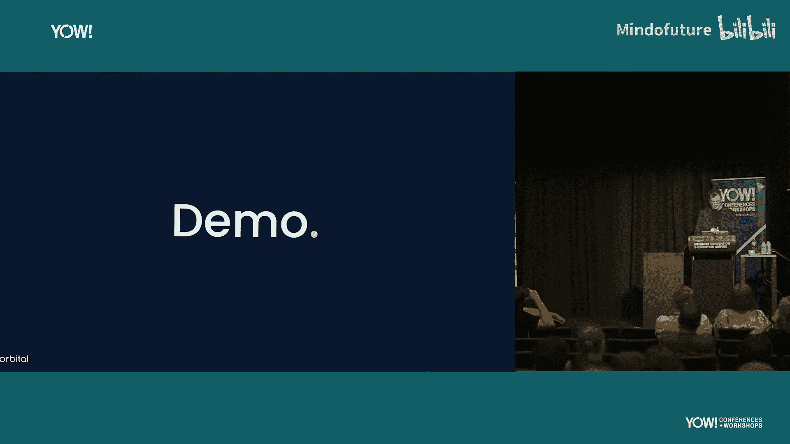

Okay， so this I'm going run through a demo that takes place in the world of films。

 so we are a film production company， congratulations。

 we have a database of films and we have a bunch of microservices that have data that we can find out about our films right where I can watch it。

 which streaming services of have， what kind of reviews are people saying about it So we have this kind of a state of data。

😊。

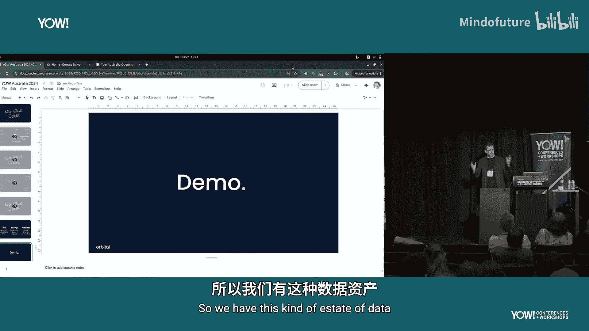

嗯。And we are built on springbo。 So orbital and taxi are framework， agnostic language， agnostic。

 everything agnostic。 This specific demo happens to be built in Spring boot。

 So I have here a spring boot microcius that is returning film data。 sorry， review data， right。

 So you send it a film I D。 And it will give you back a film review。 Okay。

 It's a very plain vanilla spring boot microcius。😊，There's nothing fancy about it。

 And what we want to do is add some semantics to this。

 So I'm going to jump into VS code into my taxii project。

 And this this is what taxixi looks like in the wild。 right， It's a collection of types。

 types that have semantic meaning。 F my D title。 There's no structure here。

 This doesn't talk about systems。 This just talked about semantics。😊，And I have inside my project。

 I have a Kotland generator wired up again， because this demo happens to be in Koland。😊。

We're going generate some Kotland code。 And so all I do is I run the build。Okay。

 and what gets produced is a Cotland project that kind of spits out there。

If we take a look at what's created， there's nothing particularly fancy here。 These。

 And because this is Scotlandland， these are a bunch of type aliases， right。

 They're just type aliaes that are adding semantics to our things。 This is a big disimal。

 We're adding some semantic data to it。😊，So I have now a library of semantic types that are built into Coland so I can jump back into my spring boot project。

And I can， I can add some semantics into my API。 So I can say， hey。

 this doesn't just take any old integer。 It takes。A film my day。Right， and。

Thanks to the power of demos here is my response that I have prepared earlier so you don't have to watch me type it out。

 but we have a film review that has three fields on it， a film ID D。

 a film review score and review text okay。And that's it。

 This demo is configured to publish its schema to orbital on startup。 So we're just gonna bounce it。

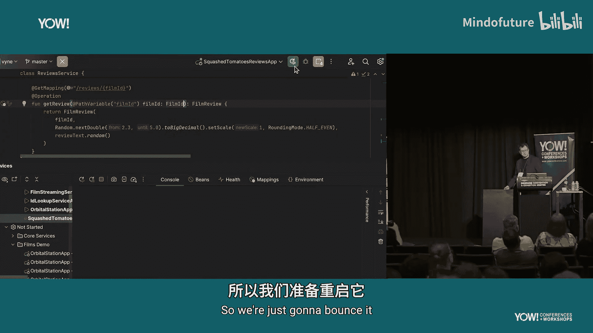

And we'll jump over into。Into the code。 So this is， this is kind of。

 this is a view of orbitals world。 So we have。We have a database that has a film films table。

 that film has a bunch of fields， right， They've got some semantics in there。

 One of them is a film I D， which we can plum into these into these microservices to find out reviews and we can find out where I can watch it。

 Is it on Netflix， I it on Hulu， Like which streaming service has it。😊。

And so now that orbital understands this， I can start asking some questions so I can write a text E QL query。

So I can say， hey， find me some film data。 Can you guys see that up the back。Yeah， okay， cool。

So I could say， finding some film data。 and we can run that。And sure enough， we get some data。

 Not particularly exciting。 This is a database query。 right。

 We have made very complex way of running a database query at this point。

But I'm going to define the consumer contract of stuff that I care about。So give me。Give me ID field。

 which is film I D， give me the title and give me the year it was released。Okay， and we run that。

 And again， all I'm doing at the stage is defining a consumer contract。

 This is the structure and naming conventions that I want in my data。

 I don't care where it's coming from。 This is the data I want。 I can tell you。

 it's all coming from a database query。 we can fact look and see there is a database query that is running here to get these fields back。

Now I'm going to ask for a little bit more information， give me the review score。

And give me the price。There we go。And if we run this。There we go。

 And so we're getting back now a list of films with some reviews and some prices。 Now。

 this one's a little bit more interesting because that data is not coming from my database。 right。

 If we take a look at the integration that's kind of run here。

 everything starts with a database query。 And then we're taking those film I dayss。

 and we're plumbing them into different systems。 a different system to go and get the film reviews and another system to go and get where I can watch it and its's price。

😊，Now， again， for me as a consumer， I didn't have to work that out。

 I don't have to know which team has the system that has pricing data。

 I don't have to know and do any of the discovery。 I don't have to get their API spec。

 I don't have to generate a client。 I don't have to think about any of that stuff。

The client has been created for me。

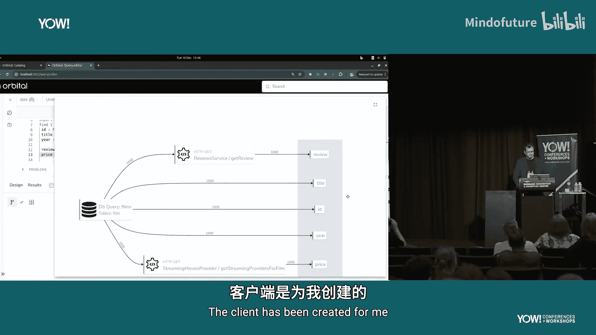

So I'm happy with that。 I like that。 I'm going to quickly save that。😊。

And we'll call it or we'll call it Brisbane。

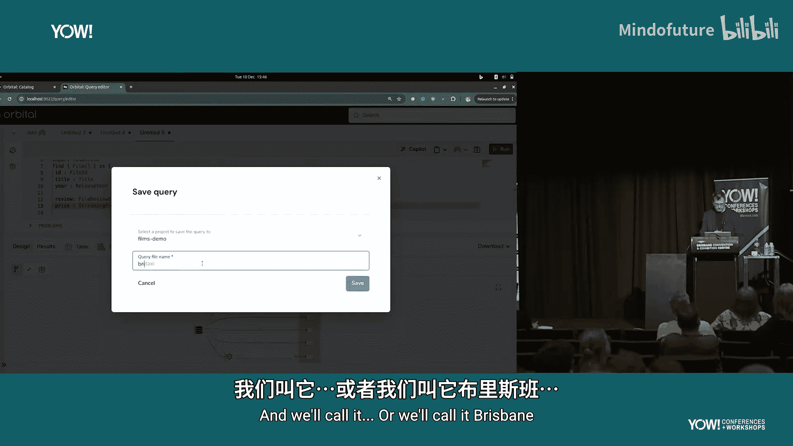

And I'm going to publish that as an HEP endpoint。

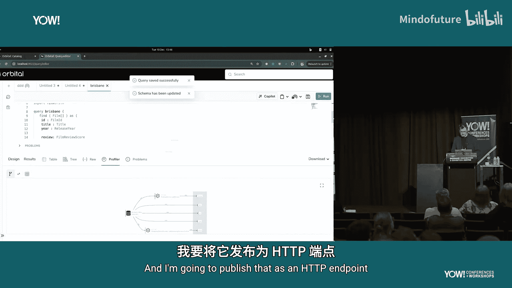

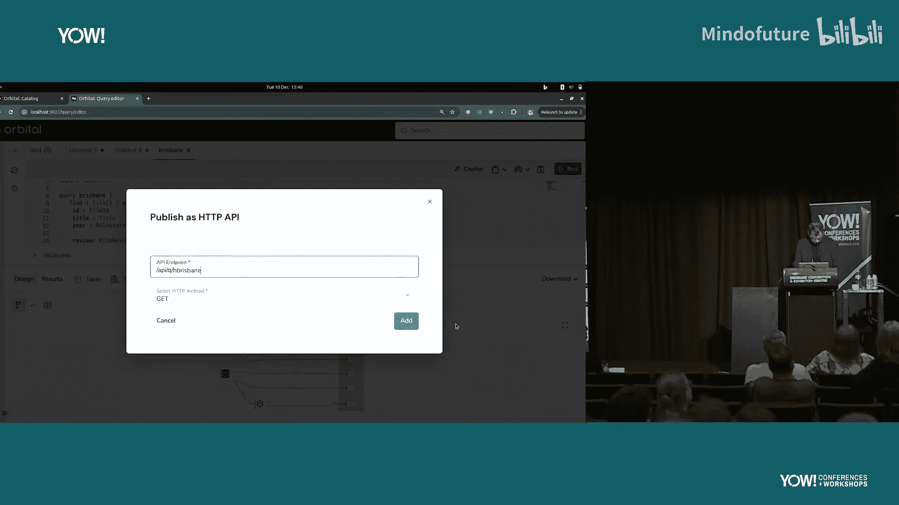

Okay， and that's it。 right， So I'm gonna quickly copy that as a cool。

 So you can see it's a real thing。

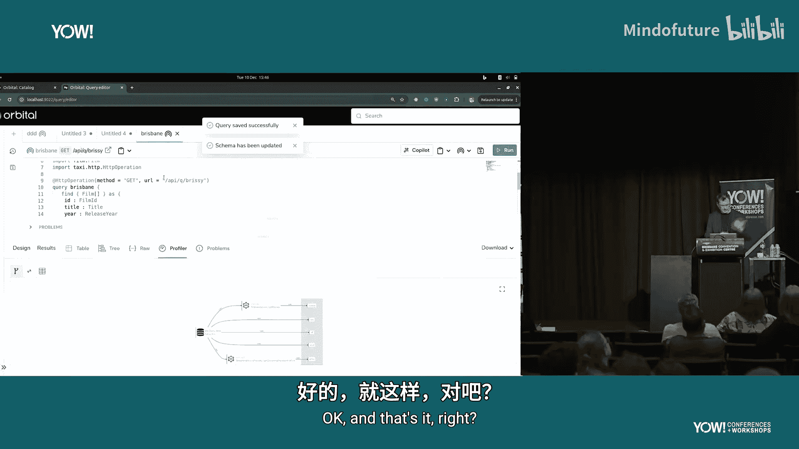

We'll jump over here， I'll curl it。Okay， and so these are our data that's that's kind of popped out。

 So we've， we've built an integration that stitches a database and a couple of microservices together。

 we' tuned it into a risk API， and we've we've killed it。So I'm happy with that。

 I am going to break it now。

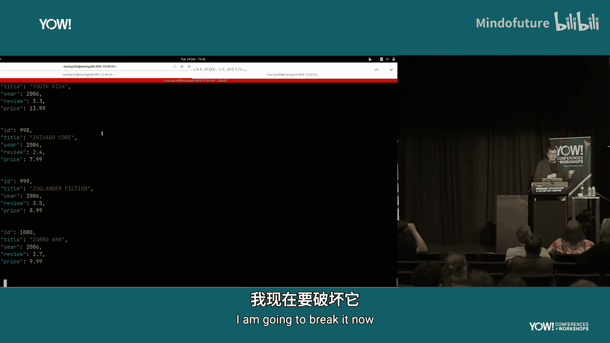

So it has come to pass in our film studio that we've been writing our own reviews and Word has gotten out and the industry has suggested that that is a bad move。

 so we now need to pull in reviews from an external service and so the API is kind of the same。

 they have an API that takes a film ID and gives back film reviews but we're buying them from an external company So we're buying them from a company called squash To and they don't take the Is that live in our film database。

 they have a different I scheme so they have squash tomatoes。

 film IDD right So we've generated semantics， the key point here is that even though they're both integers。

 even though they're both film IDD semantically they're different they're not the same thing。

 This thing is not the same as that thing。And so on my response object。

We are are our field name is called film I D because whether or not it is a film or movie is hotly contested amongst our industry as everyone in this room knows。

 but they've called it film I D。 So the field name is different and it returns a squash tomatoes。

 film I D。So I'm going to bounce my service。 And again， in doing so。

 it will generate an updated schema and publish that up to orbital， and we'll jump over into orbital。

 and you see the schema has been updated。

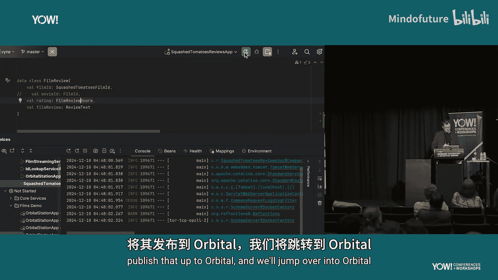

So rerun the query， and we still get our data out， right， So we're still getting our reviews。

 Everybody's happy。 The consumers haven't haven't changed。 But if we jump into our profile。

 we can see now that integration is different， right， so。😊。

Previous we were taking the ID out of our database and feeding it over to our films review service。

 we can't do that anymore because the films reviews don't speak our IDs so we've had to do this additional hop and most of us have done these kind of services we have to do entity the resolution along the way right so we have done this additional hop to go from our film Is to the squash To film Is to then call the squash Tomatoes Film service to get the film reviews back。

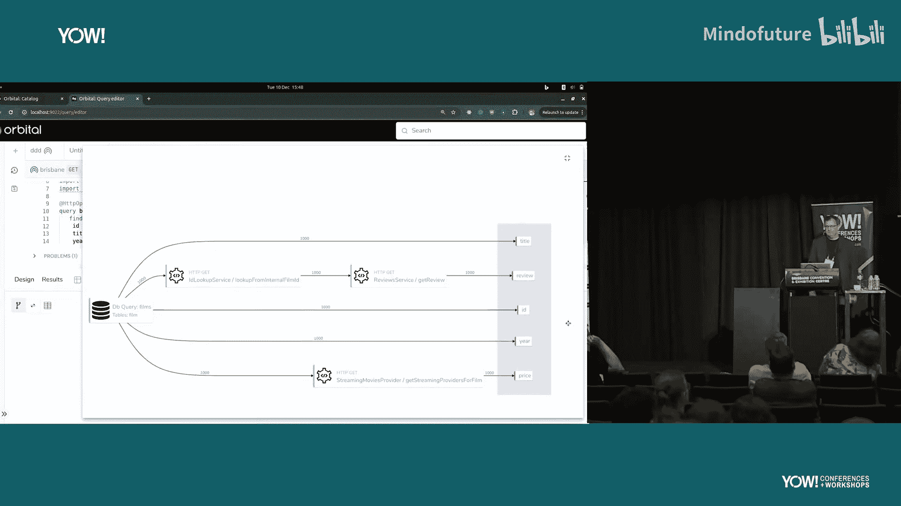

And if I jump back over in here and reco my statement， for me as a consumer。

 I don't know about any of those changes， right the producer changed， the graph changed。

 but there were no GraphQL resolvers for me to go and repair。

 there was no Yaml mapping file that I had to go and update。

 there was no drag and drop canvas that I needed to go and fix us up on the producers who describe their data changed and so the integration adapted。

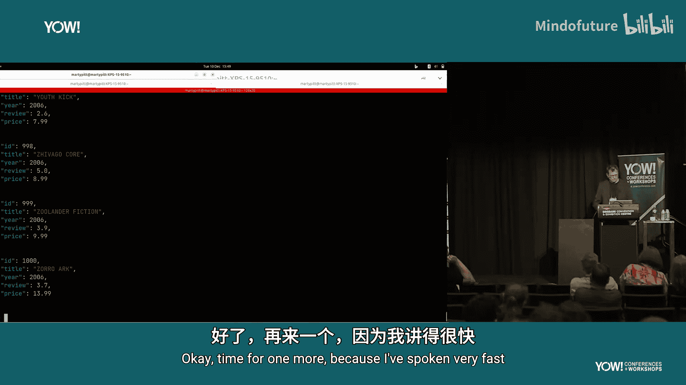

Okay， time for one more because I've spoken very fast。Okay。

 this has all been kind of request response kind of data。 So we have。

 we also have this Kafka topic that publishes protobuuff messages。

And every time Netflix announces a a new film that they're adding to the catalog， they put a topic。

 they put a message onto this Kafka topic right， and it's got a film ID D and an announcement that comes along with it。

So I want to stream this data， but again， I want to stream it on my terms。

 So I use I'm going to use exactly the same data contract before。

 so you don't have to watch me type it out。So I want to stream this data。

 but I want to stream it as kind of this consumer contract。

 this is the shape of data that I want to consume。AndSo I run that run that query。

 And here we have now a stream of data that's coming out。 Okay， and I can。

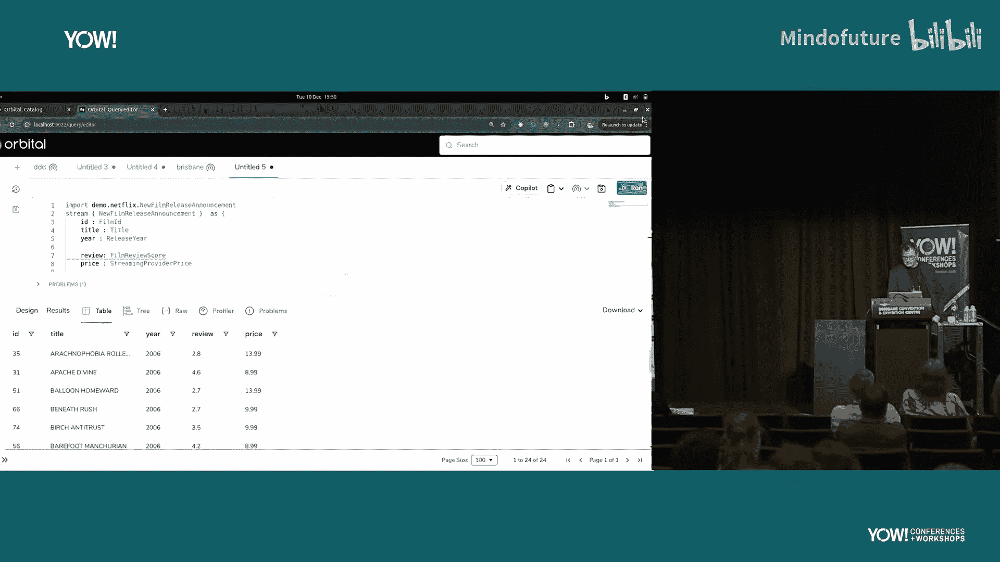

Kill that as well。Hopefully。There we go。 So we can kind we've got the stream of data that's coming out。

 But if we look at the integration that has run there。

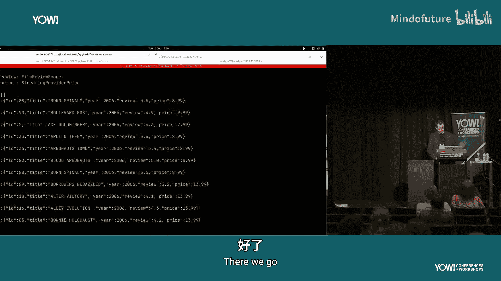

It looks very different。So it all kind of starts with this Kafka connection that we that we're connecting to right And now we have three sets of I Ds。

 We've got Netflix film Is。 We've got squash tomatoes， fill Is， and we've got our film I Ds。

 So there's a lot more entity resolution that has to go on。

 And so it's a very different integration integration graph。😊，Not that I know about that。

 Not that I care about that。 All I did was specify the data that I wanted and lift it to the machines to work it out。

SThego， that's it， that's demos。

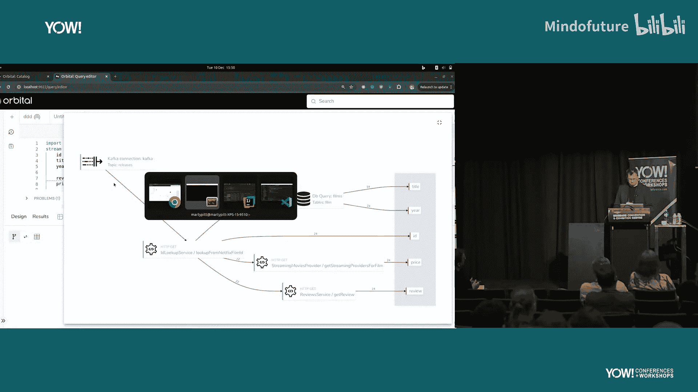

So summary， glucose code sucks， right？Let's not waste our time building it。 right。

 It's time consuming has very low reuse。And it breaks。Yeah， make the machines write it。

A PI speaks are all about transport and structure。 The where and the how taxi is all about semantics。

 The Wats。 Stick them together。 We're gonna have a good time。😊，Txi is simply semantic metadata。

 This thing is the same as that thing。 That's all it is。TaxxiQL is a semantic query language， right。

 ask for data， generate the glue。And orbital is a platform for automating the glue。 it's a runtime。

That's it。 I'm sorry。 I've clearly pushed through that at a rapid pace。

 but we've got time for questions。

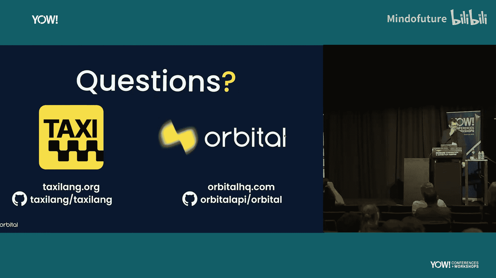

Thank you very much， Marty。

