# YOWcon软件开发大会（2024）｜-架构设计-｜-分布式-｜-AI-｜-代码-｜-JAVA-｜-Github-｜-Spring-p14-P14-GitHub-Copilot---How-It-Works,-How-We-Got-Here,-Where-Its-Going--BV1G9dfYTEHR_p14-

Hi， hi， everyone。 Yeah， like Matt said， it's pretty rare for me to be here， which is really lovely。

 It's nice to see so many familiar faces。 I work for Gitthub， previously work for Microsoft。

 Im in developer relations， and I， I like background music， too。😊。

TheSo I am gonna talk to you a bit about Github Copilot。

 but also kind of more the history and the future of what these AI dev tools are trying to do or at least what we're trying to do with those。

 So let's get a little bit of level set。 who here currently uses Github Copilot。😊，Okay。

 that's probably about 30% of the room Who here uses other AI dev tools。

 So like cursor or just chat Gput T or yeah， okay， most people use something。

 Does anyone here vehemently disagree with using any kind of AI dev tools。 Yep， Su， of course。嗯。

So what I want to do， I and I understand some of those concerns。 What I want to do。

 I want to talk about kind of where it came from to start off with and then talk about I'm gonna do a bunch of demos because that's。

 that's always fun。 I think， to do demos of what it cancurrent do and what we've been adding to it。

 But then I want to talk a little bit about what we're doing with it on what we think the future of kind of AI supported software development might look like in the future。

😊。

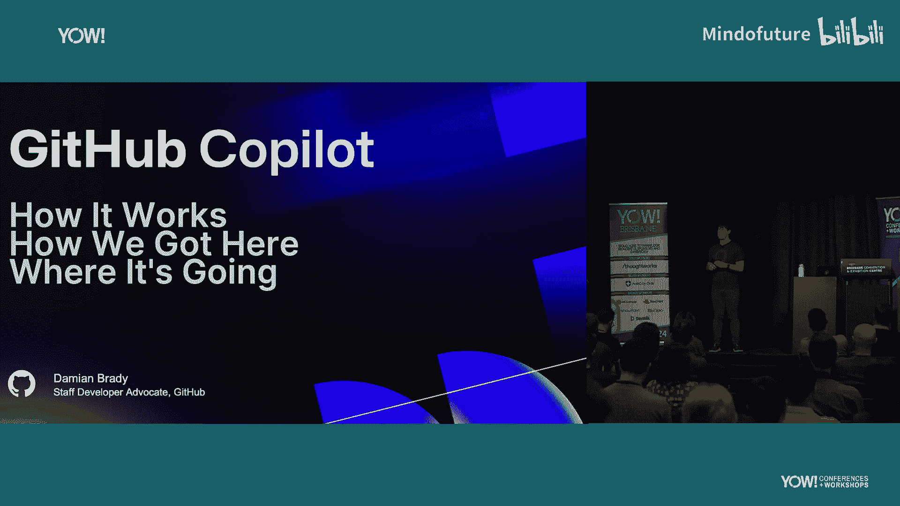

So。Gitthub Copilot came from a team inside Github called Github Next。

 It's kind of their R And D department or our R And D department。

 If you think of like an automobile manufacturer， they have their R And D departments， which。

 which look at like a self driving。I think I've lost my。 There we go。

 All of that kind of stuff as well。 So things like the airbag came out of an R And D department at at automobile manufacturers。

 cruiseise control， all of that kind of stuff came out of those departments。 And generally。

 they operate a bit like a team that is allowed to do a bunch of experiments and see what works and what doesn't。

😊，So this in this team， every six months or so， when they had， they had a meeting。

 and every six months or so， somebody would bring up the idea of like a general purpose AI based software development tool that could just do general stuff。

And every time that came up， it was just kind of abandoned as， well， the text's not there。

 It just can't do a good enough job。And then suddenly， G 3 happened。 So open AI got to this G。

 They did G， G 2 and G 3， and they gave it， gave the API to the us。

 to this Gitthub Next team and to some researchers at Microsoft just to try it out。And so they。

 they worked out a couple of experiments and， and ways of testing whether it could do this。

 And they started by giving it these self contained programming problems like， hey。

 can you write some code to do this。And GP 3 was this borderline point where suddenly。

 like out of the box， without giving it any specific instructions。

 it was solving about half of the problems successfully， like correctly。

These are self contained problems， right， But just giving the straight problem about 50% of the time。

 it would produce runnable code that would solve that problem。

They started tweaking the way they were asking the questions and the context they were giving it。

 And really soon， they were getting it up to about 90% of these self contained problems that it was solving correctly。

And that's the point where they were like， this could actually be a useful tool。

 So they experimented quite a bit with this。Now， that form of testing， where they give it like small。

 selfcontained problems， they don't do that anymore。 And。

 and basically because it got too good at those kinds of questions。 And also。

 that's not super realistic。 Like in your day to day job。

 you don't always you don't often have these like self- containedtained。

 How do I write the code to do this specific thing。You're working with a bigger purpose。

 trying to produce value and trying to implement a feature that somebody wants。 right。

 So that's not a reliable test of how， how useful these tools are going to be。Initially。

 the thought was they were just at a chatbot， right？ And so sorry， I to do that。 this。

 this was back in June 2020。 So this predates G， sorry， chat G by about a year or so。They。

 they initially thought， yeah， chatbot would be good。 You just have this tool there。

 and you ask a programming question， ask it to give you code。 and then you grab that code。

 You copy and paste it into the editor。But then somebody in that team came up with the idea of。

 well we use like Intelense or autocomplete。 Why don't we just see if we can get it to do that。

And when they started implementing it that way， they realized that that was a way better paradigm。

 and they completely dropped the chat for quite a while and just used it as like an autocomple。

 feed it the context from the file you're looking at。

 maybe some context from elsewhere and get it to give you what we now call ghost text。

 So here's the suggestion of what you want or hit tab if you want to accept it。

So this was way back in June 2020。 Since then， we've done a lot。

 So this is kind of a really vague timeline。 Don't worry， you don't have to read all of this。

 But we spent about a year in a technical preview。 So a year before we decided we were going to release it properly。

 And so even though were experimenting in June 2020 in about a year they did about technical。

 They did a technical preview。 And then a year after that， they were like。

 this seems like it's ready for， for general availability。

So if you look at these tools and this is happening a lot。

 you look at these AI tools and like they've all sprang out of nowhere。

 like they're just throwing a chat bot at whatever。

 There's about two years of research and trials and things before they actually brought this into a generally available state。

 Since then they've released different skekus they've released extensions for V SVS code and jetbrains stuff。

 And then lately， we've started experimenting with extending this idea as well。

 So we got coppit chat， So we brought the chatbot back coppit workspace。

 which is trying to kind of work from an idea or a task。

 edit multiple files at the same time to solve that problem and then let you iterate on that。

 extensions so that you can now use the copilot interface to talk to your third party services。

 And I can show you that as well。 So you don't have to really leave your editor。

 which is always handy。And then really recently， at our Github Uni event。

 we announced things like model choice。 So you can now choose what model。

 what large language model you want to use and coppit edits， which also is you。

 editing multiple places in your code base to try and solve a problem as well。

 And there's a bunch of other things we're experimenting with too。

 some of which I will show you at the end because they kind of cool。

 They're still very much experiments， and。😊，Fun and interesting。 but yeah。So以。

I want to take a little step back as well and talk about why we're doing this。

 And I apologize right now， for those of you like me who are very cynical about this kind of stuff。

 because I am， too。

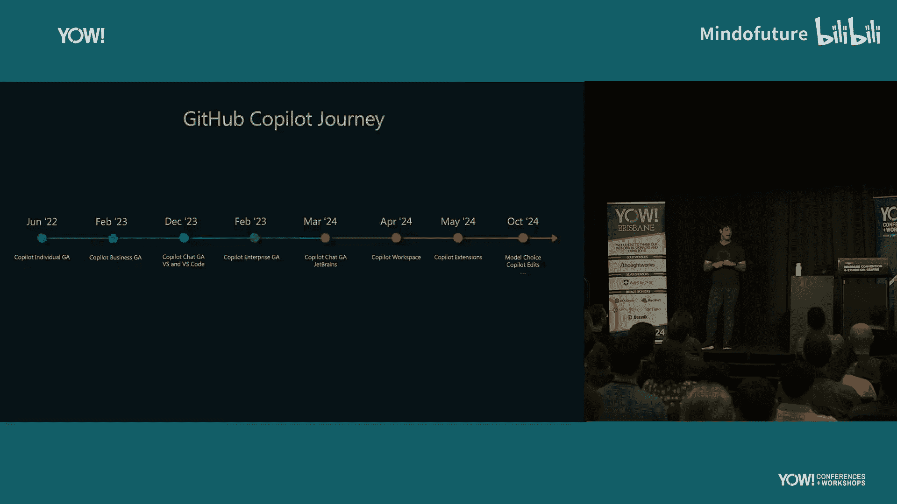

The point of doing this。 I heard some like Snott。 The point of doing this is developer happiness。

 right， And I know what some of you are probably thinking。

 That sounds like a wonderful marketing line。 And it is。

 So Ill admit when I heard this was like the selling point。

 The developer happiness is the point of doing this。 I was， I was very cynical。

 it turns out though that developer happiness is very strongly correlated with developer productivity。

 And therefore， with the company's bottom line。 So there's a bunch of research out there from people like Dr。

 Nicole Forsgren Gene Kim and a bunch of other people， I think Gene was here last year as well。😊。

That。Show that the happier your dev team is with their day to- day jobs。

 the more money your company makes or the more they， they reach their own company goals。

So improving developer happiness is an important thing。

And I want to take a slight detour here to kind of talk about that。Typically， we。

 we measure in you know， the business land。 We measure developer productivity by basically mapping how much it costs us to have a human resource and then how much output we get from that person。

 right。

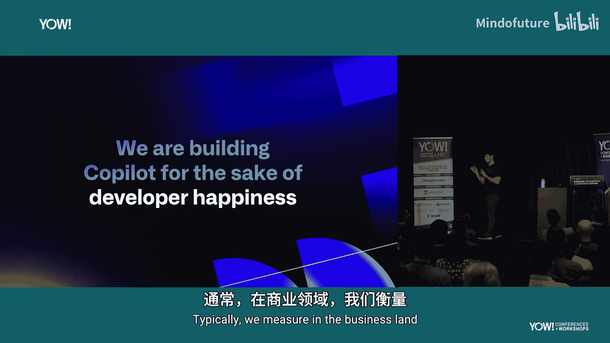

This is a pretty terrible way to measure productivity or how the organization works。 Traditionally。

 you just measure these outputs against inputs。 Like， how much does it cost us。

 How much money do they make， right。And in development。

 that often boils down to things like lines of code or number of commits or pull requests and things like that。

 So terrible metrics that are incredibly easy to game and they don't represent value。

 They represent lines of code。 and like these raw statistics。They。

 some of the most valuable stuff that happens in dev teamss is not anything that produces code。 And。

 in fact， some of the most valuable changes I've made to code bases are deleting code。

 especially my own code。 that's usually a source of value。

So if this traditional method of measuring productivity is terrible。

 then what's a good way to measure productivity。Now。

 some of you may have heard of the space framework。

 It basically measures a number of dimensions associated with productivity。

 especially in software development。 It comes out of Microsoft research。 Again。

 Dr Nicole Fsgin was leading that， that part of research。

 And I'm not gonna go into it in too much detail。 I would strongly recommend having a look at this。

 It's， it's fascinating。 It gives you a great idea about how you can measure how well your own development teams are working as well。

😊，But ultimately， in short， if you're trying to measure and track productivity across your dev team。

You can get a better measure of how productivity is changing。

 especially over time in your team by choosing metrics from several of these different areas。 So。

 for example， you might choose commits as a measure of activity and also satisfaction。

 So ask your developers， did they have a good day today。😊，more on that in a sec。

 or how long it takes for you to merge a change and get it into production as a measure of efficiency and flow。

 And if you measure several of these and then map them over time。

 you get a better idea of how productive your teams are。Now。

 some of these categories probably resonate with you as developers in terms of happiness as well。

 particularly you know， if you think about your day to day jobs， But I want to look at the first one。

 especially because it's obviously very closely attached to developer happiness， right。😊。

So satisfaction， you can think about basically just how fulfilled you feel in your job， your team。

 with your team， with the tools you're using， with the culture， with the processes。

And that well beinging is about how healthy and happy you and the rest of your team are and how your work affects that。

 So it's a little bit broader than just， am I writing code efficiently， It's more。

 am I happy with the stuff I'm doing。😊，And why should a company care if you're satisfied and happy。

 as long as you're producing stuff that gives them money。Well。

 there was another piece of research that came out of our Github next team back in 2021。 Yeah。

 called the Good Day Project。 It's a project LED by a researcher called Arei。

 and it mapped self reports from developers about whether they had a good day to Github activity。😊。

So things like commit and pull requests and stuff like that。And the findings were fascinating。

 It wasn't just Github activity， but it was other stuff that happened as well。

 It looked at their calendars and their meetings and things like that。 The findings were fascinating。

 And I love some of them。 Some of them are horrifying。 I want to highlight， too。

 that I found really interesting。😊。

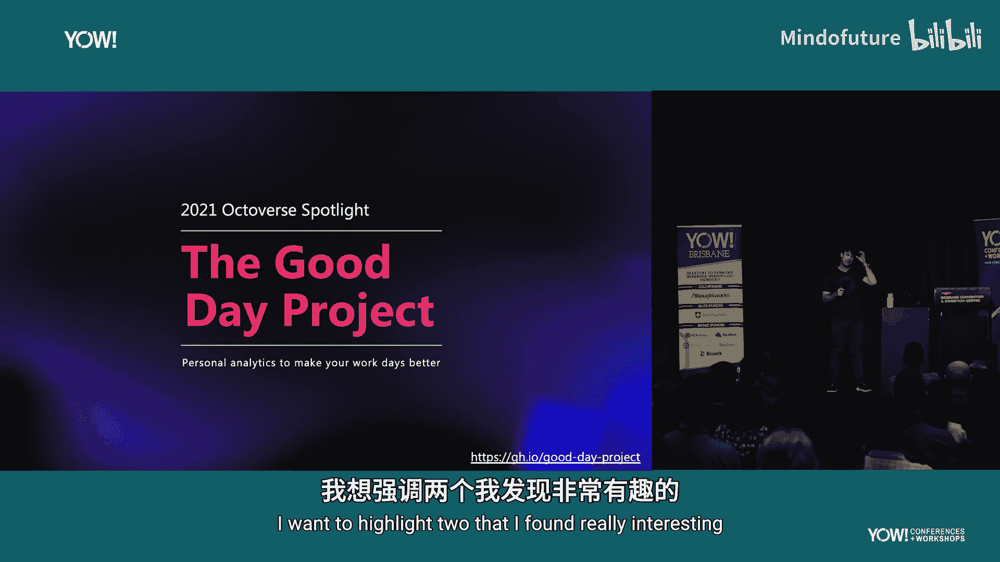

One was one key finding was that developers need deep focus time。 Now， we've all heard about flow。

 getting into a flow state。 So you can， you're concentrating on what you're doing and not getting interrupted。

 both to be productive but also to feel productive， right and to feel happy with your job。😊。

So there was an interesting measure of the likelihood that a developer will make progress towards their goals and how that might depend on how much focused time they get。

 And you can quantify this when you think about meetings。So it turns out this is in the study。

 If you have one meeting a day progress towards your goals。

 About 99% of people thought that they've made meaningful progress towards their goals。

 Anyone want to guess how much that goes down for two meetings。No， allright。

 I'm just gonna do this one。74% are still still not too bad， right， Two meetings in a day。

 And he guesses for three meetings in a day。14% of people said they made meaningful progress towards their goals。

 right。嗯。So it's really about being able to focus on the work you're doing。

 And if you have three meetings in a day， you can't do that， right。So this is interesting。

 Have a look at that research。 if you want to show it to your manager。 The other one that I liked。😊。

The other thing that they were able to quantify in the survey was whether you decide。

 whether you felt like you had a good day， which was kind of the point of the survey。

 versus the number of interruptions you had。 So if you had minimal or none。

 So they kind of grouped this minimal or no interruptions that day， about 82% of the time， you said。

 I had a good day。 It guesses for interruptions， the majority of the day。Yeah。7% so。

The effects of it are real。 like there， there， there are real effects to being interrupted and not having that flow state as well。

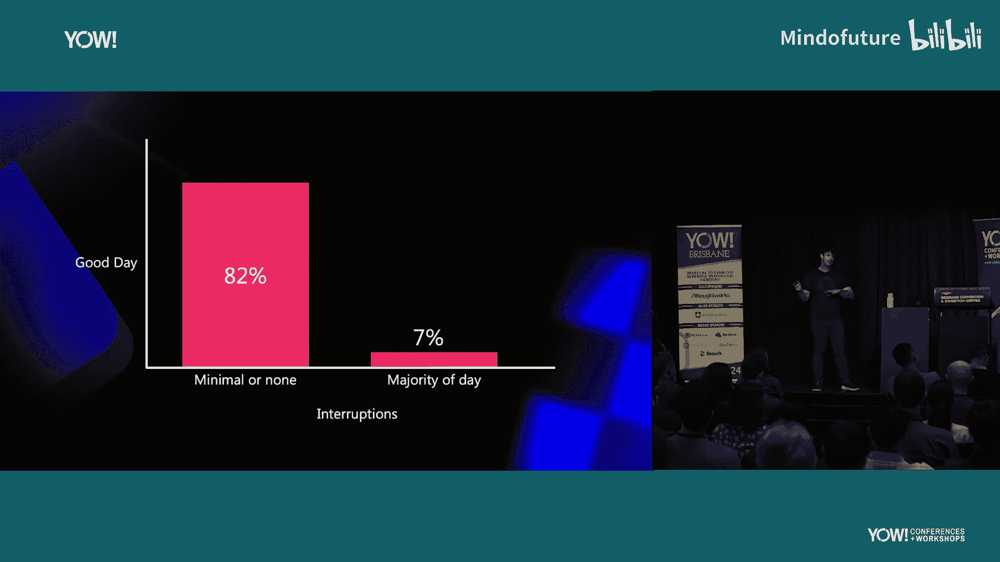

Now， the you know， summary of all this really is that if you are happy。

 if you don't have these interruptions， you get to get into this flow state， you can do your work。

 You don't have to keep context switching to something else。 Then you are happier。

 but productivity goes up as well。 So this is an actual benefit to the organization。

 if you can do this。😊，嗯。But once again， you know， it's hard to quantify that， right。

 So I'm gonna give you one more exercise that you can show your manager。 Does。

 anybody want to guess if you have tools and processes that save you 5 minutes every hour， right。

 which is not actually a lot，5 minutes every hour in an organization with 100 developers。

 anyone want to guess what that means in terms of money like an actual Australian dollars。哪位？

Nobody wants to guess this。 It's about that。 It's almost a million dollars a year。

And that's purely savings on， you know， based on salary。 This is not the real measurable， or sorry。

 the real impact of having happier developers who are more likely to want to do the work， right。

So why am I talking about this in the context of coppilot and， and those things。

And AI dev tooling Well the point of tools like Copit。

 but also the point of things like syntax highlighting and。Autocomple。

 So when you hit the dot on an object in an object oriented language。

 you get the functions and the properties and things of that。 It saves you time。

 You don't have to keep going out to the internet to look stuff up。 That's the point of these tools。

 right， Or if you want to just have a if you have a question about know， what does this library do。

 for example， being able to just ask that question directly in a chat window。

 saves you a little bit of time， And， yes， all the usual caveats about making sure that what it's giving you is actually correct。

 which is a significant problem。 They all apply。 But the point of this is to keep you in that flow and to get you more productive without the interruption。

 So you can keep doing your work。

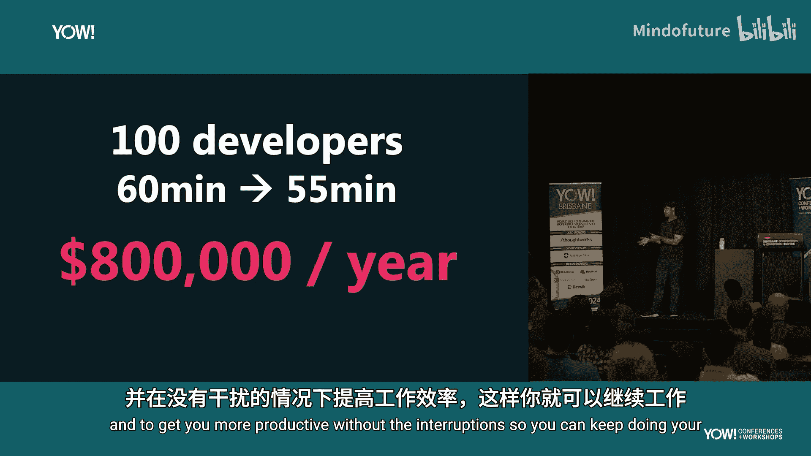

All right。I've talked enough， speaking， speaking of money。

 I think I've earned mine by doing the marketing stuff。 so we can move on to fun things。

 which Ill still need HDMI for。 Sorry， I just dropped that。 alright。

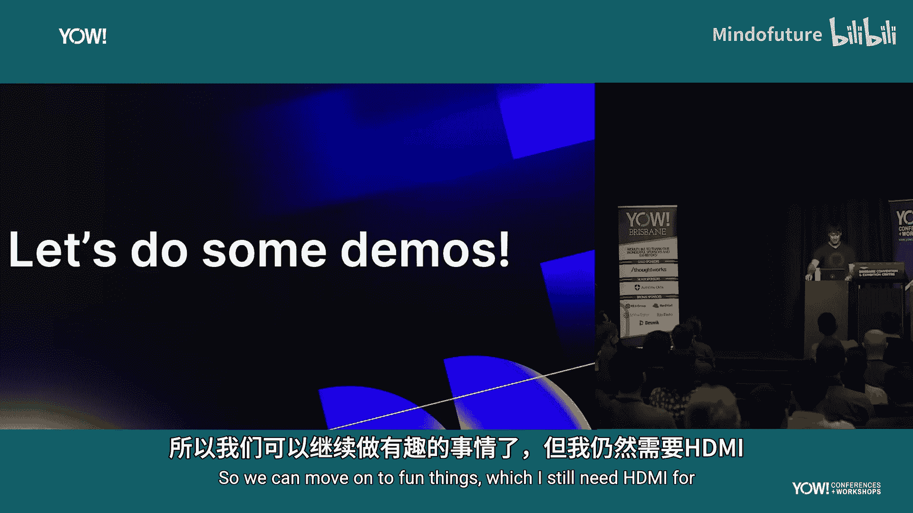

Let's open code。 How's the Zoom level， by the way。We good people in the back。Alright。

So there were a lot of people who said they had used Github Copilot before。

 And so you're probably most familiar with it if you do something like。Okay， there we go。

 Stright away。 It's given me a suggestion of what it thinks I want to do， which is not correct。

 So I can just keep typing function to test。 I don't know。 the function call。

I don't know for an Australian phone number。 I don't know。Oops。And then that's your test， right， So。

 yeah， it's also done redexx， which is， which is more than5 minutes an hour， Trust me。

But you can also， you know， an area code。 So oops。呃。Live coding。 There you go。 So there you go。

 It's got one of those。 I think I can't read redjectx。 So let's do this。 I'm gonna highlight that。

 And I'm gonna use inline Copit。 So this is the chat。 And I'm just gonna say explain。

 And it will hopefully explain what that redgexx does。

 I'm just gonna wait until it's been set up and say view it in chat because that's a little bit easier to read。

 And it's broken down the redx。 And admittedly， it's breaking down the regular expression that it wrote。

 So I'm really kind of just trusting it in two respects here。 But it breaks it down。

 you can also do something like， by the way， these are my little tips。 Sorry。😊，Azure， explain。 no。

 sorry， explain for workspace。Like， I'm5 in a short paragraph。Please， which sounds funny。

 but I do this all the time。嗯。Well， that's a smart five year old。Yeah， all right， well。

Maybe not the best example for five year olds， but at least it's cut it down to a short paragraph。

 right， So this is kind of a combination of like， it'll help me write the code with the autocomp or what what we call ghost text。

 what Id like to call O G Copit。 but also the chat。 So you can have conversations about。 you know。

 it is there a better way。😊，To do this。嗯。And it says， yeah， you can improve the readability。

 which is probably correct， I guess。Yeah， so it's a little bit more readable。 Now。

 there's a bunch of other like things that we've added to this so you can do， you know。

 you can ask it for documentation。 You can ask it to write some tests around that。 So you say tests。

And it' will generate some tests。 Let me just close this window。There you go。

 And it says we recommend installing jest。 and I can click on that， and it should do it for me。

 And then this is in a new file。 So if I accepted that。

 it should add it to another file and things like that， so。It's。

 it gets you most gets you a long way there with that with kind of doing that work。Alright， cool。

 One thing that we added fairly recently was a bunch of features to kind of make it a bit heteroclosis make it a bit easier to。

😊，Don't save。Make it a bit easier to kind of navigate existing code bases。 So this is an issue。

 especially if you're getting up to speed with a new project or if you are ideally trying to contribute to an open source project。

 if you can ask questions about that code base and get reasonable answers that can help you kind of navigate。

 that can be really handy。 So in this case， this is a react application。

 I'm not much of a react person at all。 So let's just see if this will run actually。

 done that before new。So， NPM run it。Let's see if that works。嗯。No。use yeah，20。Is that right。

N PM run they've got love live demos。嗯。O。Good， alright， local host。 good。

 Everything's working absolutely perfectly。 Local host 3000。 So this is the application。

 This is like a travel application that we built called Copit Airways。😊。

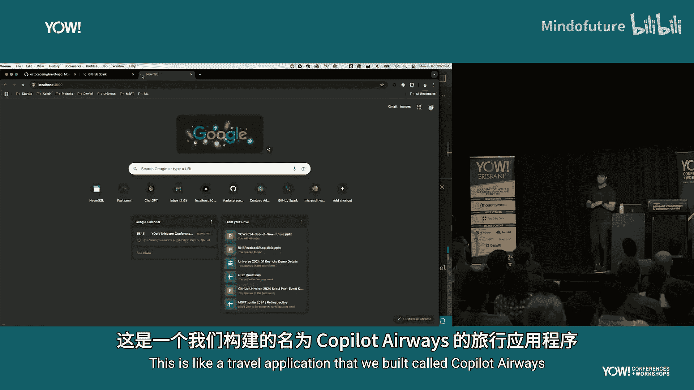

Real production code for sure。 And in our profile page， you've got this like。So I was just floating。

I think we've got this， like， recent points activity。To， yeah， some people know what that。

That's Cassidy Williams， by the way， also known as Cassiddu。Yeah anyway， so we've got this。

 we've got this， there's got this table of like points activity。

 but it'll be good if there was a graph underneath it。 But if I don't know this code base at all。

 I'm not really gonna be able to find。😊，This graph was gonna take me some。

 some time to like go through the application。 So what I'm gonna do is just open chat。

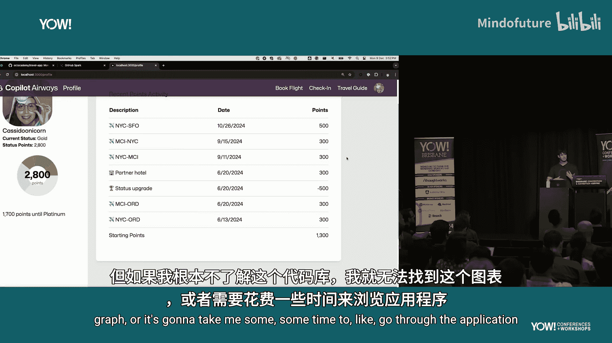

Kill that open chat。And then say， where in this code is the profile。Page。

Now what this is doing is a couple of things。 So first， it's saying， well。

 you're looking at the entire code base。 So we need to look at this entire workspace。

 and this is a what's called a participant in the application。

 and this is using a thing called intent detection。 It's saying， well。

 I think I know what kind of thing you're asking。 and you're gonna need to look across the entire codebase to do that。

 And the workspace participant knows about your codebase。 We've indexed all of the code。

 We know what files do what And so we can say rerun the question without it。

 but it's detected that we probably want this。 It's pulled in a bunch of references。

 and it's given me a really succinct answer about It's on page T X。 if I open that up。 Yeah。

 this is our app profile page TX file right So we've kind of been able to navigate that。

 I could ask questions like you know are there tests for this file and it would。

Understand the file that I'm looking at， try and find somewhere where there's tests appropriate to that file。

 I can do things like， say， do I have tests for all of the functions in this file， And it will say。

 you know， no， it looks like you've only got tests for these functions。

 Here's a test for the missing ones。 If you wanted to start there。 So again。

 I'm completely in control of this。 I'm not just handing over the reins and expecting it to do the work。

 but it's helped me out a little bit。Now， if I'm gonna add that graph， sorry， I'm a little place。

 If I'm gonna add that graph， let's just do this。

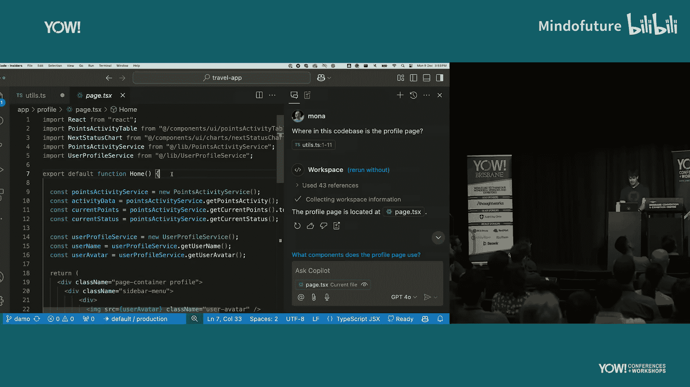

if I'm gonna add that graph， I want to be able to make it like this consistent thing across the application。

So there's probably rules or other examples of graphs in the application itself。

 So I might ask something like that。 Is there anywhere else in this。

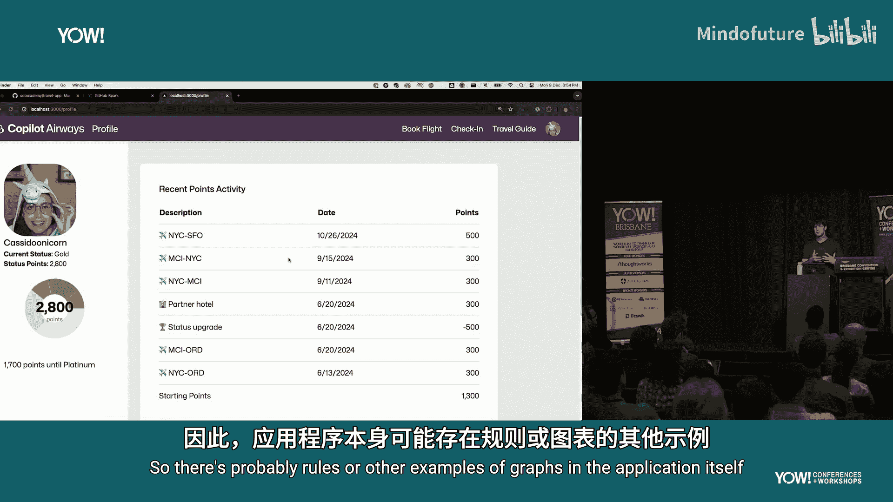

Project where I'm drawing。line graph。And it will say， yeah， well'll let you go。

 You're drawing a line graph in on time line chart。 So this is a。Yeah， cool。 This looks like a。

React component。 I think I did say I don't know anything about react。 I'm just gonna to assume。

 It is。 So if I wanted to add like that profile line chart。 I wanted to kind of look like this one。

 So I want to use that as a reference to say it should look like this。 But actually I don't know。

 an area chart for like growing the thing is probably better。 So I'm gonna ask for an area chart。

 if I have a look at that profile page again this page T profile。

 I can see that I'm pulling information from this points activity service。 And again。

 I could explore this stuff by asking the questions， but I'm just gonna save some time。

 So I want to maybe create another reusable component like the on time line chart。

 I want to edit the profile page。 I probably want to write some tests。

 I might even want to change the readme。And I could do all of that in coppit kind of one file at a time。

 But instead， I'm gonna use this， which is a new feature called Copit editits。And this kind of。

Attacks a bunch of pages， at the same time。So I'm gonna to see if I can remember what my prompt is。

 and I'm going to say， can you create a reusable area chart to show points activity。

It should look like， and then I can hit hash， and it will let me choose either things from a knowledge base or from the web or from the code base or other things like that or individual files。

 So that was on time line chart。And now we're referencing that as a piece of information。

 So it knows， oh， okay， I need to look at this as reference。 So again。

 we're kind of trying to ground it in existing code and existing behavior。

 So we get fewer hallucinations， I guess。It should look like that， and appear below the。

Table on the profile page。Now， that profile page， because we've got it open now。

 is already in this working set。 like it's already being referenced。

 So we don't need to explicitly do that。 Make sure you add tests and what else。 I yeah。

 pull the data from the。Points activity service， which is what we're pulling a Lewis on from as well。

Alright， that looks pretty good。 I'm gonna show you one more thing just before I hit go。

 And that's another thing that we added recently where you can choose which model it uses。😊。

So GP T 40 is the standard one， but you can also use 01 mini if you wanted to or01 preview。

 which is a bit slower。 They have a thing in them kind of around chain of thought behavior， so。It。

 it's abusing the word think， but it it thinks through the like the implementation。 It says。

 what do we need to do for this， And then it uses its own logic， I guess， to work through it。

 But also Gemini and Claude。 So I'm actually going to use Claude for this。Just because why not？

And so you can see， I'm just gonna zoom out slightly。 You can see that it's saying， right， well。

 it's。Going to create a new points activity chart component。Using that activity。

 it's gonna add it to the profile page。 It's gonna add tests for that component。 And as it's going。

 you should be able to see over on the page here。 it's generating these edits。

And making those changes kind of in real time。啊。So you can see it writing the code basically。

 And then because it's Github， we like showing the diff and the light changes lines change and things like that。

So we can skip through this。 So Page has changed。 Point activity chart test is there。

 And there's this points activity chart  one as well。Or actually， it's changed a bunch of things。

 So I'm just going to use this little tool to show me all of those changes in one go。

And here's the chart。Here is the profile page。 Here's the tests。Okay。

 so it ended up changing three files。 I'm going save all those files。Click， O。

 remember me how I said this is a live demo。

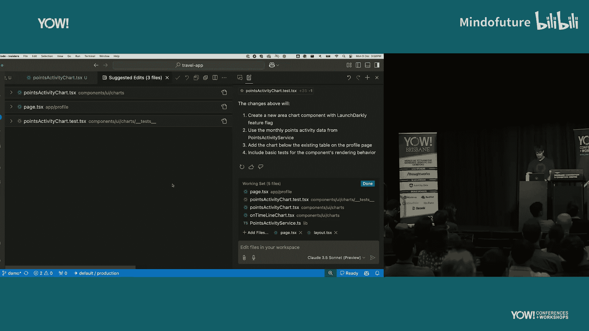

So let's just switch over。Yeah， there go。So we've got this interactive live thing。 Now。

 this is following the style of the rest of the application。

 and it's using the same components and the same libraries and things like that。

 because I referenced one that we'd already done elsewhere in the application。Now。

 I wouldn't recommend just blindly accepting what it gave you。

 I would actually look through that code， but I'm on stage， and I don't have time， so。

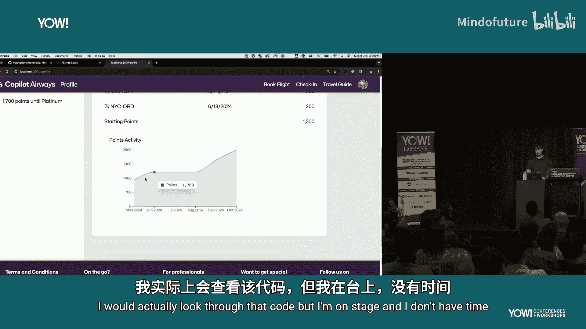

So， yeah， so that works。 So we've changed a bunch of files altogether。

 We did it by grounding it in the truth of， you know， here are the files that I care about。

 And here's what we need to need to change。One thing if you're paying a lot of attention， by the way。

 is if you have a look over here， let's just close this window。

 You might see there's this launch darkly service。That it's using。Now。

 this is obviously not a very not a standard way of writing a react component to include a feature flag。

 For those of you unaware， La darkley is a feature flag service and set of libraries and things like that。

 Edith Hub hub， I think is speaking later on at Yao as well。 She is one of the co-founders。

 I believe of launch darkley really， really good。 You should go and watch her。 she's amazing。

 So I'm using this in my application。 Now， I didn't specifically ask co-pilot to use launch darkley in my question in my prompt。

 It probably it could have copied it from the on time line chart。

 but what it actually did is used another feature called Copiot instructions。 Now。

 this is something we actually have been asked for a lot。

 Can we always tell copilot to do something the way that we want to do it。😊。

So you can now add this coppit instructions markdown file and tell it things that you want it to include every single time。

 You ask a question。So in this case， I'm saying。When you make a new reusable reactor component。

 add a launch darkly feature flag and give it some code to try to， to go from as well。

There's also another thing which I put in there for demo purposes saying use client because that broke me a couple of times and a tests and things like that as well。

 which I explicitly ask for， But it's in there， too。 Now， this is。

 this is useful for a project because we've got these copilloed instructions in the project。

 So if there's something specific for the project， you can add it to the copilloed instructions in that repository and it will apply for everyone。

😊，If it's something that's personal to you， you can actually have coppit settings， sorry。

 Copit instructions in your own user settings for visualual Studio code。

 So if I always want it to respond like I'm 5， I can ask for that。 And it will always do that。

 but just for me。 I just want to show you this as as well， though， always。Respond。To questions。

Like a pirate， because you obviously want really useful behavior like this。What does this file do。

LetScroll down。 Oh I mean edits。 Sorry， let me stop that。Need to go back to chat。

 What does this file do。This is obviously something you would definitely use。Yeah， so。

That's the most practical example I could come up with for that。

It doesnt if you'm doing this overseas， I make it speak like an Australian。 It's horrible。

 It's just so。Get right， mate。she is this looks。 Yeah， anyway。So yeah。

 So this is a few different like surfaces that we have for， for copit。I have hours of demos on this。

 but also so does the Internet。 So feel free to to look at the Internet。

 It's a great source of truth and other things。 But I want to talk about a couple of other things before I finish。

 And mainly， I want to talk about the direction that all of this is heading。😊。

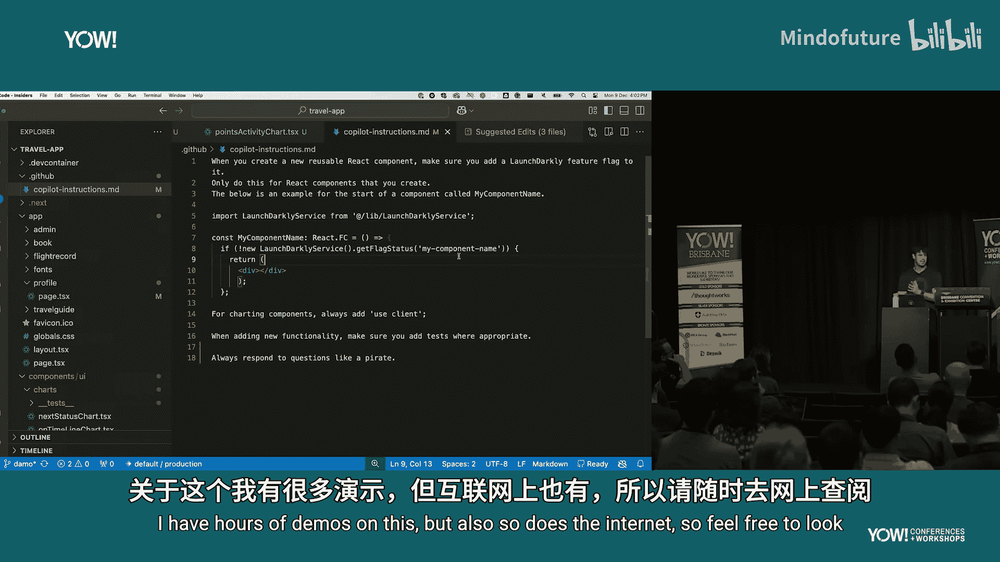

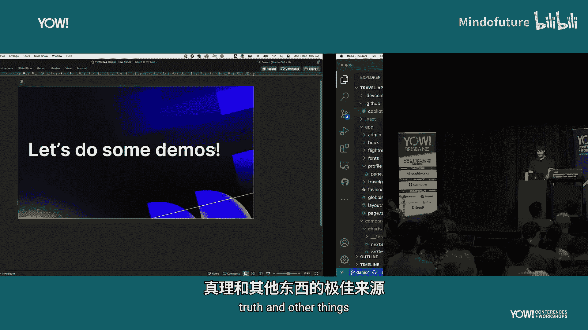

So there's， there's some legitimate concerns， I guess。

 in the industry that a lot of this stuff is replacing developers or likely to replace developers。

 The， the general talking point that we always get told and always put out there is that it's not replacing developers。

 It's a tool for， for developers to become more productive， right。And I think that's true。

 even from a purely cynical point of view。Gitthub makes their money from developers， right。

 If we were to get rid of most of the developers。I don't earn money anymore， right。

 but I can't feed my myself， so。So even if you're incredibly cynical about this stuff。

 we don't want to reduce the number of developers。 We want to kind of improve the lives of developers so they're happier so they。

 so they can use more Github services and pay us more money， right。

 So if you extremely like cynical about all of this， Just keep that in mind。 The other thing is。

 I have not met a single dev team that is not just buried under things that they would love to do if they had the time。

😊，Can anybody， is anybody， because I want to find somebody who put their hand up to this。

 Is anybody like kind of bored during the day because there's not enough stuff on their backlog。Yeah。

 cool。 I'm still at zero hands for that question。 So that's good to know。嗯。

So where's all this heading then。 we're not replacing developers。 That's not our intention。

 We're trying to make their lives easier。 So what's next is the question。

 The easiest way to find out what stuff we're experimenting with is to go to the Github next homepage。

 This is the R And D department。 remember， And there's a bunch of things in there。

 This is a recent screenshot。 Those top to a fascinating。 There's a learning sandbox。

 which you can kind of you click into these and you can read what they're experimenting with。

 But the learning sandbox is this amazing thing that works some of the time where you can say something like I'm a C sharp developer intermediate skill。

 I want to learn about react。 And it will add a bunch of suggestions of libraries。

 and you can say I do want you to include this in the information。 or I don't。

 And this is my skill level。 And then you tell it to go。

 and it will build a lesson plan to teach you from the point of view。

 like from your current position as a C sharp developer learning react with a live working sandbox of the。

😊。

that it's trying to teach you。 And I've seen this work incredibly well。 It's just it's nuts。

 It doesn't always work， though， which is why it's an experiment and why they're trying to work out whether this is something that people might want to use。

 And if you scroll down a bit， you can see a bunch of projects that they have tried。

 And they're like that actually doesn't work。 Or know， it's not good enough to actually be a product。

 but theyre continually experimenting。 Github Spark。 I want to show you right at the end。

 If I've got time。 But it's a fascinating one as well。😊。

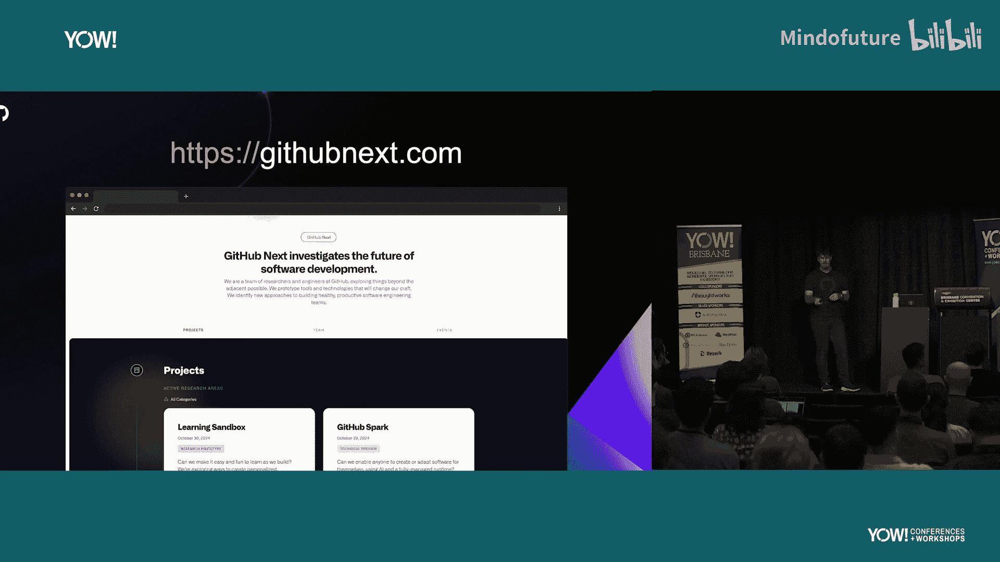

What this is kind of heading towards， and this sounds a bit gimmicky as well， is that we're moving。

 we're trying to move the AI from just like an autocomplete tool or a chat bot to a bit more of a a thought partner。

 sounds like a marketing term because it probably is。 But right now， it can help you write code。

 help you understand your code base a little bit more。

 But we're kind of moving from this purely generative tool to one that helps you navigate the code base and understand the codebase。

 And we're kind of continually moving towards that direction。😊。

So a tool that can high kind of help with discovery and understanding， but also with ideas and。

Idiation and things like that。So as， as an example， and this is a bit pie in the sky。

 But imagine you have like an AI co， right？ And they've been working in。

 it's like somebody who's been working in the codeb for decades， right， They have。

Infinitely good memory， because they have memorized the entire code base and immediate recall。

 They don't have to go and look things up。 And also， most importantly。

 they want you to succeed because they are trying to help you， unlike。😊。

The dude to microwaves fish in the break room。 that guy， right。

 So that is somebody who is actually trying to help you with your job。

 They know everything about the code base and they can respond really quickly， right。

 So we're getting close to this。Imagine， for example。

 being able to turn to your new friendly AI and say something like， alright。

 I need to add a new payment method to the， to the payment screen on our application， right。

That AI tool can pull all of the relevant parts of the relevant files to that get used to do all of the payment paid stuff。

嗯。And it will show you what probably needs to change in what parts of those files to add a new payment method。

You can go in even further and say it might suggest， well。

 you probably need to change the FAQ on the site as well。 to add this new payment method。

 And even further， it could say something like， well what， what is this payment method。

 You can give it a name and it can go and look up the implementation details and start to pull some code together to implement that as well。

嗯。And then you tell it it's crypto in it。Dete your project。 But the。

 the idea is like it's kind of working with you to solve this goal and not working in single lines of code or single functions。

 It's kind of pulling the information towards you and。

 and the relevant parts of the code that you're gonna need to change and making suggestions。

 So this idea of this kind of two way communication between。

Between the person and the tool that you're using is kind of what they're heading towards。 again。

 kind of early days， they're getting close to some of this， but it's not。

 it's not a given how that's gonna work。 Really， what we're talking about kind of is AI native development。

 At least that's what they're trying to call it。 Right now， the AI dev tools are really visible。

 Like you saw， I was opening up a chat window。 I was like pausing so it could autocomple。

 And that's because they're stuck in that paradigm of。

We've got our file tree on one side and our code on the other side。

 And it's up to me to find those files and change the right lines of code。

But if it can surface the stuff， you need it to surface the parts of the files and even describe what those files are doing or those bits of code are doing and how they link together on the other side。

Ideally， you can even get to this idea of what they call a bicameral user experience。

 So you have your natural language on one side and the formal syntax on the other side across a bunch of files。

 and you can change either of them。😊，And if you change the specification of what should happen。

 the code changes to match what should happen on the other side。Again， this is a stretch goal， right。

 They are experimenting with stuff。 This is not something we can do right now。

 but that's kind of where theyre， where they're heading。Or whether they're trying to hit。So really。

 what we're doing is just abstracting that code a little bit further。 By the way。

 Github is not far from the only only like organization who is trying to do this。

 There are a ton of different tools out there that some do it in incredibly well。

 Some do it not quite as well。 But this， this kind of requires a change to the way we think about implementing a feature。

 right。One last thing as well。 I think I've got about five minutes left。

 I want to talk really briefly about。Another direction that this is heading。

I've said before as well that we don't want to get rid of developers。 And， in fact， car。

 the opposite is true。 Github has recently made a public statement that they want to get to 1 billion developers。

 So currently， there are 100 million， slightly more than 100 million developers using Github or 100 million active user accounts。

 I believe。 And we've said that in the next few years， we want to get to a billion。Now。

 we can't get to a billion developers by just training new people to be developers。

 You kind of have to get to that by redefining what a developer is。

 which is a great way of you just change the goalpost。 And then you can meet it。

 But one way that we're doing this was a thing that we announced a Github universe called Github Spk。

 This is almost like a consumer focused tool。 And it's kind of expanding that idea of it。

 it's yet another iteration in the lowcode slash no code area， right。😊。

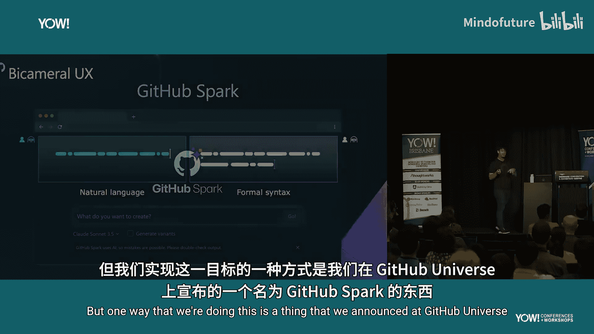

Some of you will remember silver light and。Whatever was before that and whatever was before that one as well。

 where we keep reinventing this， This is kind of the latest iteration of this that's using generative AI to kind of help out。

 I think the easiest way to to show you。 this is actually to show you。 So this is Github Spark。

 This even a bit。😊，And if I wanted to do something like， was anybody in Su's tall class。Yet。

 a few people。 All right， For those who don't know。

 she was using ants to generate randomness for entropy or something。how I go。Perfect， great。

So I could do something like create， well。Create an app。To track the number of ants in my colony。哦。

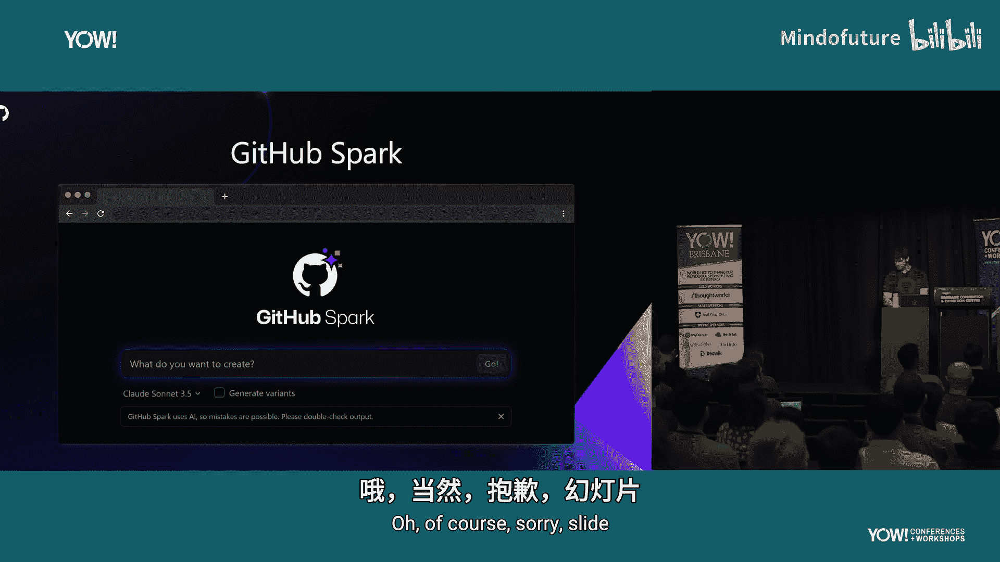

Of course， sorry， slide。Kill that。 There we go。It looks exactly the same as the slide。

 So I wasn't thinking。 granted had numberm hours of my colony。 And when they were born， for example。

 I don't know。That's a legitimate question， isn't it。

 And so the way that they're working with this is they kind of making the assumption that the U I itself can be relatively consistent。

 And there's some standard things that happen as part of an application。

 There's some data storage that happens。 There's some theming that's gonna happen。

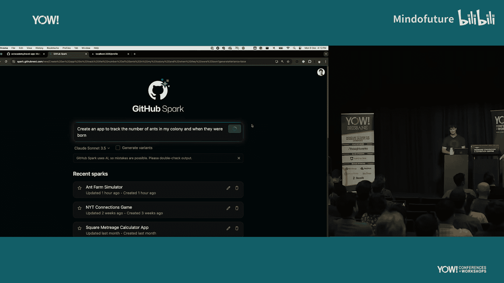

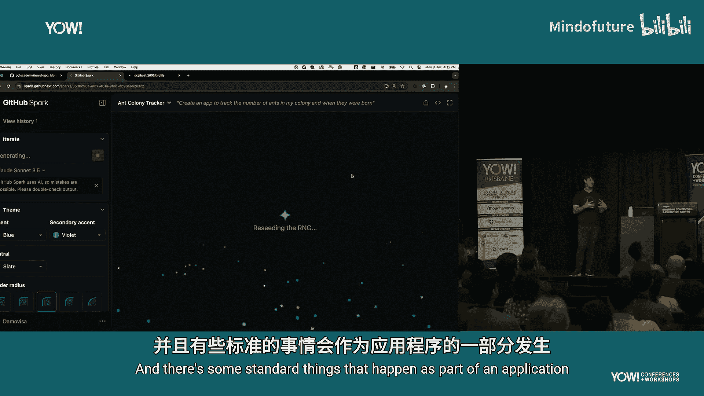

Yeah， there's a whole bunch of things that you， as， as a low code， no code developer。

 you don't really care about。And also， the problem with this as well is it's super early。

 And so I'm probably。It's probably not going to work。That'd be great。 Can， is it still going。

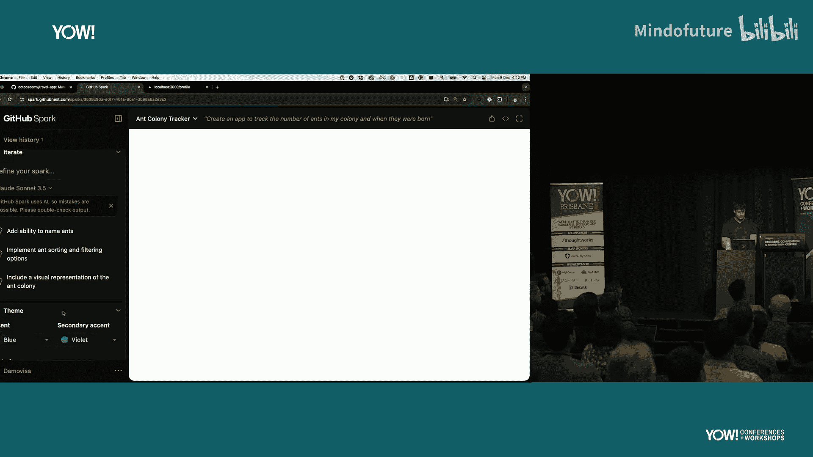

Alright， I knew that would happen。 Alright， let's go and see one that I've already done。 So good。

Let's try Spark staging。Oh。さお話はいいです。Yeah， I'll sign in。

This is one of the problems with using something that's like super not public and technical preview is that sometimes they ship stuff while you're watching。

And I think I know what the issue could be because we're relying on a lot of Azure stuff in the background。

And that could cause a problem right at the moment。 Let's just try one more time。 al right。

Do we want to try that？ How long have I got like 30 seconds。Create an app to do a drag。

There ends in my colony。 And when that's right。Born。Im show this one more time。Yeah。It is a cooly。

 They're really amazing， these ants。

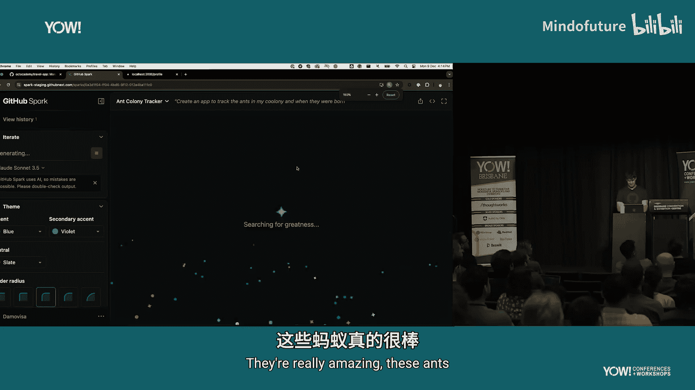

嗯。Wearing sunglasses and leather coats or something。This is me padding for time。 Well， it thinks。

 let's hope staging works。 If not， I can just tell you what the amazing stuff you would be able to see would be。

😊，It's just not working for me， cool。

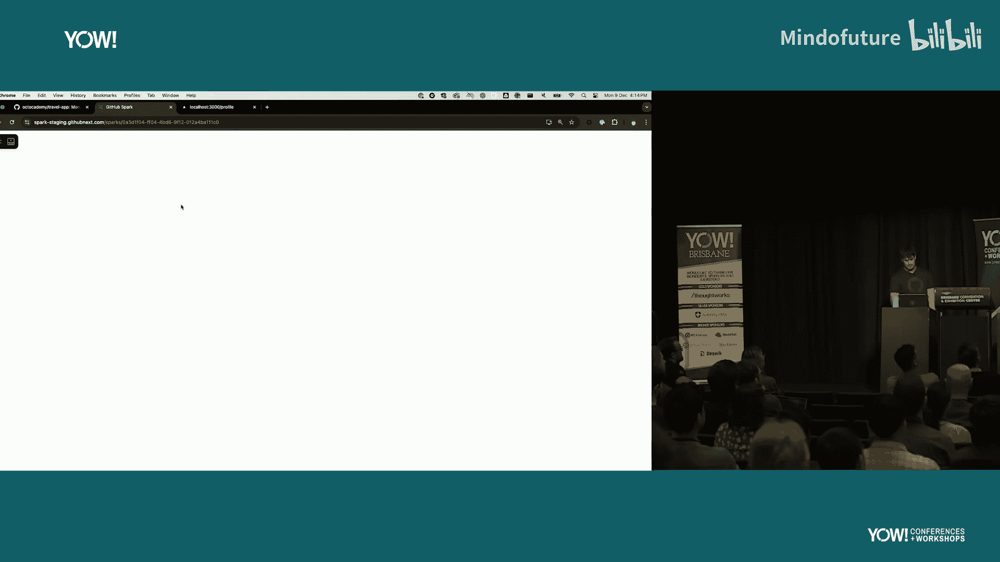

Alright， so I'm not gonna put this on camera， but there's a reason that some of the Azure resources behind the scenes are not working for me。

 come and see me another time。 And I can show you that demo。 The idea， though。

 is that we've kind of restricted the U I and everything into using reacts using standard components using standard themes。

 but also things like storing data， you don't have to worry about what database you're using underneath。

 it just uses a key value store。 You can also do things like， hey， when I， when I add a new ant。

 can you generate a name for it。 and it uses a call to Azure Open AI。

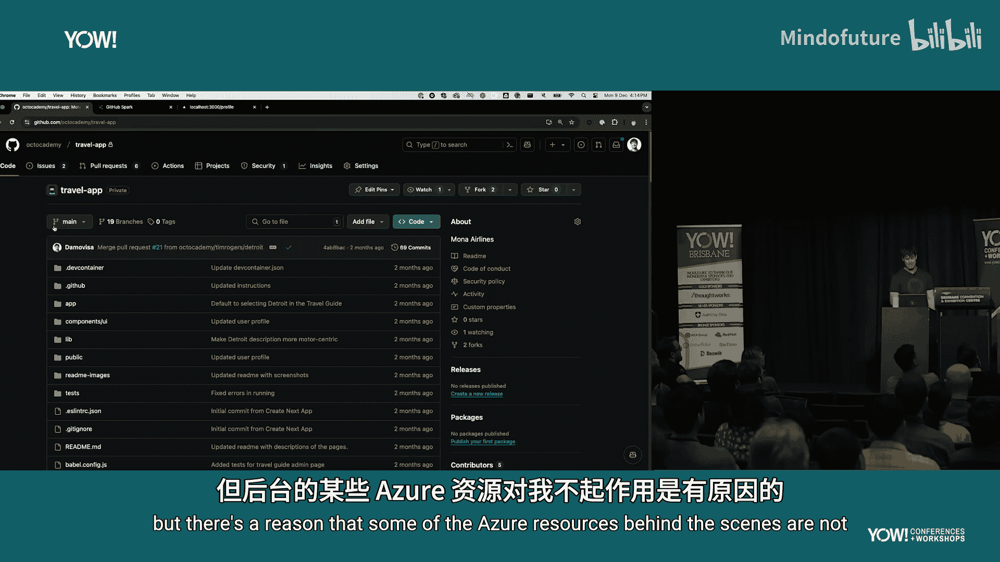

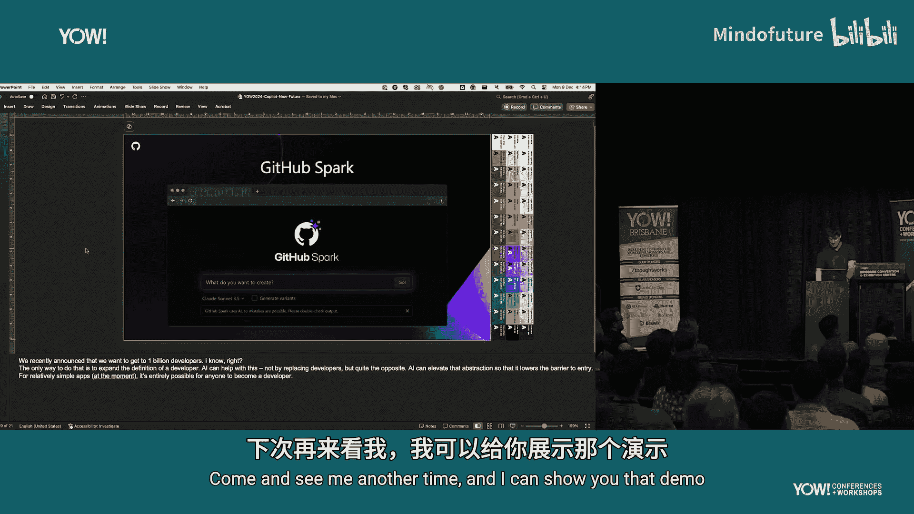

To use a large language model to pull back a name。 So you can use AI inside your own applications to do that as well。

 So it the idea is generally that somebody can describe what they want。

 iterate on it a number of times and come up with something that is kind of useful。

 people on the Github next team have used to track their kids pocket money。

 There's a really simpletict toe game that worked with one hit。 There's a whole bunch of stuff。

 You can even use webcams。 We did one where you can use the webcam to scan your badge and it will read the QR code and do that。

 And again， no code like I'm not touching code at all。 So this is how we get to a billion developers。

 And this is how we kind of start to try and use the AI tooling to solve some of these problems。

 make people's lives easier and raise that raise that floor of who can be a developer on what they can do。

 Anyway， that was the last thing I want to show you。

 Let's quickly Please make sure you feedback not just for this session。

 but for other sessions as well。😊。

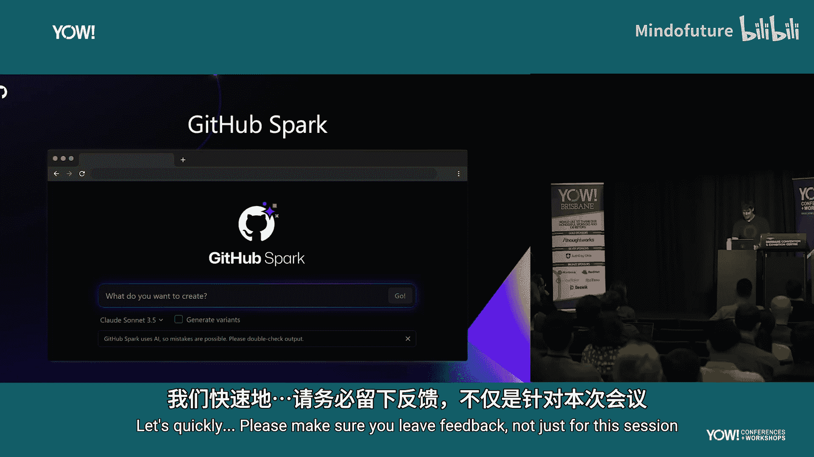

I'll be sticking around here for a little bit later。 And otherwise， thank you so much。😊，Thank you。

