# YOWcon软件开发大会（2024）｜-架构设计-｜-分布式-｜-AI-｜-代码-｜-JAVA-｜-Github-｜-Spring-p16-P16-Beyond-Chat---Bringing-Models-to-The-Canvas--BV1G9dfYTEHR_p16-

Thank you。 Thank you。Hi， can you hear me。I'm Lou， or Luke， either fine。

 You can find me on the Internet as Toadponnd。 And the name of my talk is beyond chat。

Bringing models to the canvas。 Al right， just just to introduce myself again， yeah。

 I work at T Old drawer。 I'm gonna get to that in a bit。 I Yeah， and in and switch。

 not unnamed Switch。 but， but I also am a co hostst of this podcast called the Futures of code。😊。

Oh yeah， I also do stupid videos on the Internet。Anyway， the， yeah。

 the name of my talk is it's about bringing models to the canvas。 And when I say models。

 I mean AI models， right， But what I really want to talk about。Is the canvas， right。

 That's that's really what I'm， that's really why I'm here， right so。What is the canvas， right？

 Do you， do you know what the canvas is。

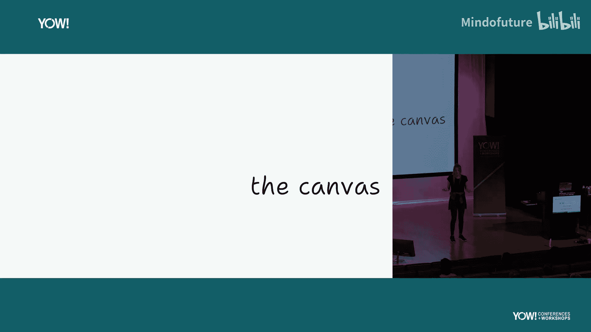

We have to， to answer this question。 We have to go。43 years ago， right，43 years ago。

 let's talk about computers43 years ago。 Does anyone， Did anyone have one of these。

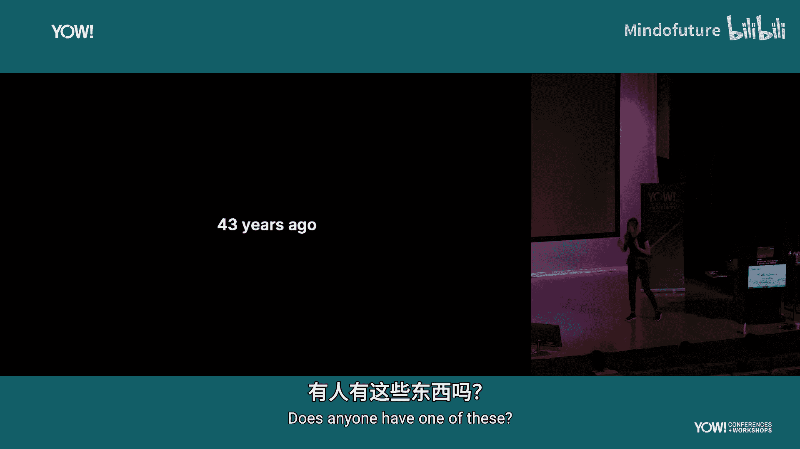

Don't look so sad about it。 right， look， So this， this is this was the most popular computer of the time。

 And how it works is you have a little chat box， right， and you type in a chat message。

 And then it sends something back to you。 It replies to you。

 And then you sort of build up this long chat over time。 And that's how you use computers back then。

 right。

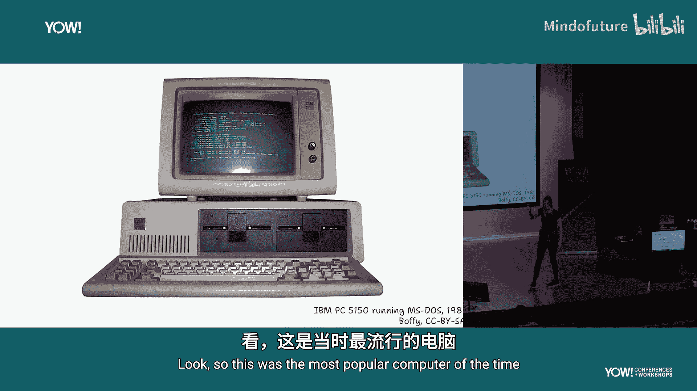

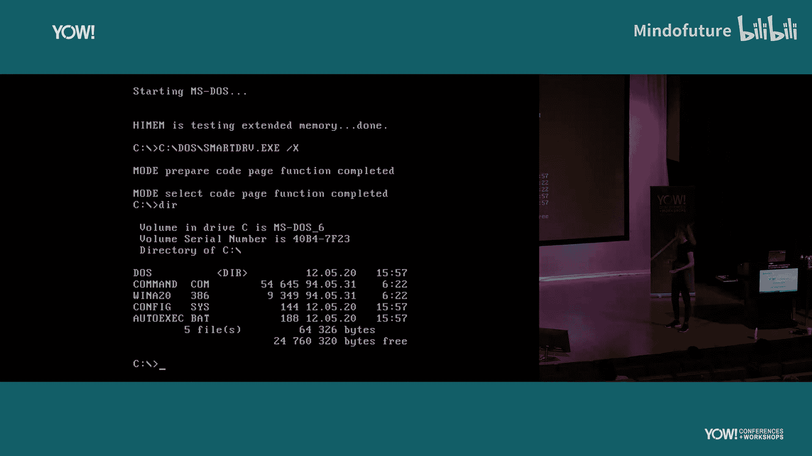

So let me recap。 You send a chat message。You get a message back。

You send another send another chat message and you get another message back， right， and。You know？

This was the way we used computers， even though there was loads of research about better ways of doing it。

 right， So this was actually from， from ages before that， right that， do you know what this is。Yeah。

 yeah， I see some' not。 That's a mouse， right， Do you know what this is。That's a cursor。

 It's a pointer。 It's，' it's being an arrow， right？ And do you know what these are。

 This was from another research paper like at a similar time。 Do you know what， those are。

You don't know。 These are overlapping windows， right。

 and we take these for granted now on every single like desktop laptop we used， right？

 But someone had to invent that。 You know， they had to say， say what a window is， right。

And it only became popular many years later when the first Macintosh。

 it was the first one that made it affordable in， in a personal computer， right， right。

 It took a long time。And you know what happened， right， It went crazy。 It changed computers。Forever。

They even named like an operating system after Windows， right， you may have heard of it。

 And so this is what happened。 You might okay， recap。 We started with text with a chat box。

 and we ended up。With a canvas。Let's talk about phones， right， mobile phones。

 Did anyone use one of these。I see， all right。 I see more hands。 me， too， right and。

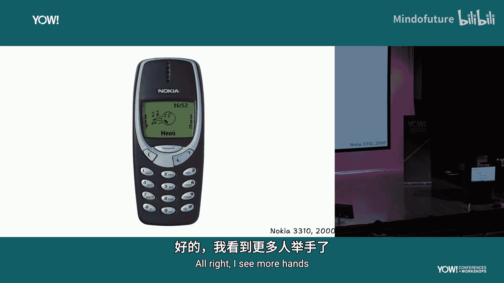

They're basically like a command line。 You just press up， up， up， up， up until you get to the。

Commands that you want， right， And then you type。

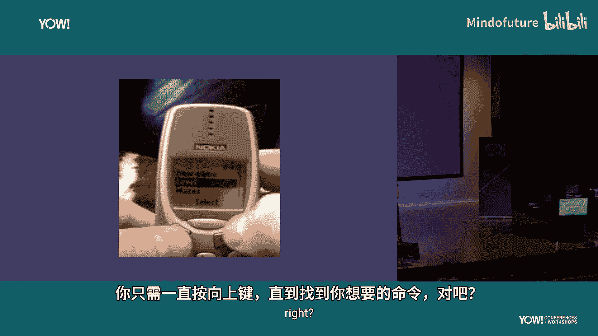

Right， you text。 Yeah， there's a reason we call it texting because you text texts， right。

And then like， what happens if you're in a world where that's the paradigm， right， where。

 where the way we use these kind of computers is text。 you end up with something like this， right。

 like text plus， right， And， you know， this is exactly。 I don't know。 It's always Apple， right。

 but this is what Steve Jobs famously pointed out。 He said， look， we don't need text。 What we need。

 is a canvas that we point with our cursor。 I mean， our finger。😊。

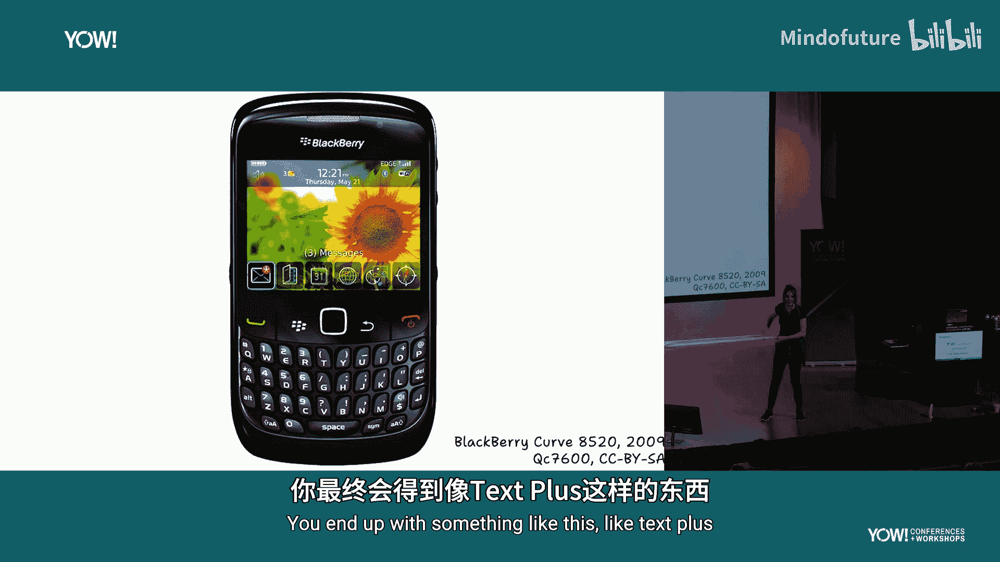

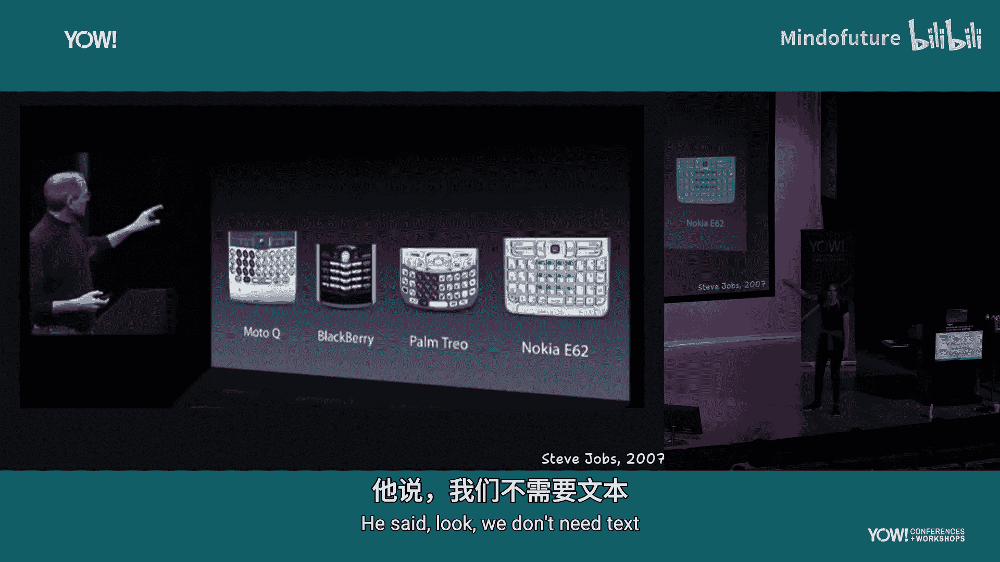

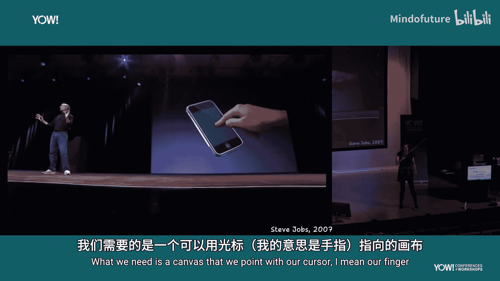

Right， and and it changed mobile phones forever， right from text to a canvas。

 Are you following so far。 Can you see where this is going， Can you see where， Okay。

 let's talk about AI， right， Who here has heard of AI。😊。

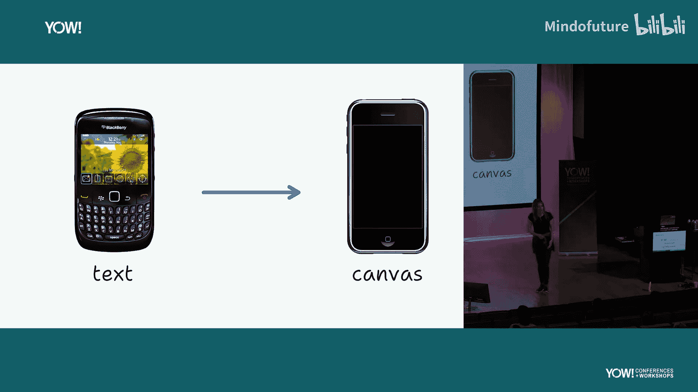

Well。The luckiest person in the room， right， So AI stands for artificial intelligence。

 And this is probably the only talk about AI at this conference， right and。😊。

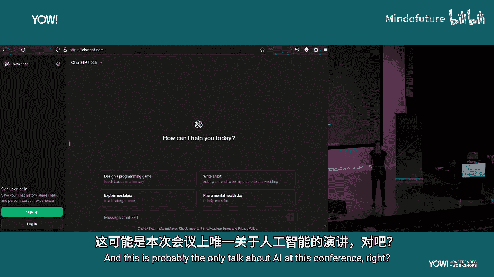

The way you use it is you have this little chat box that you type in a message and you start this chat with the computer。

 right， And so everyone's doing it。 This is the paradigm。 Yeah， this is chat G T Claude Gemini。

 You know， sometimes you can escape chat a little bit like with Claude artifacts。

 you can get like a canvas that you're both working in。

 But your way to use it is through the chat box。 you have to go through chat， right。

 And like chat EP T。 you can upload a picture of a canvas。 but that's not the same thing。

 And it' iss tiny as well。 And you have to talk about it， right。😊，So to recap。

 we send a message to the AI， a chat message。 we get a chat message back。 we send another message。

 And this time， we do get another one back， right？ And then we send another message。

 and like there's sometimes。You have to check the answers， right， So go look up if that's correct。

 right， Don't take O anyway， so。Yeah， we started with， with text， with AI and。Well， actually。

 actually， we haven't got， We haven't done this bit yet。 We haven't done this bit yet。

 Have we were still in this text。😊，Paradgramm， like， can we go beyond chat， do you think。What you。

 do you think we can。Okay， so I'm really， really lucky because I work at this company called T L Draw。

 which is like a canvas library。 So we build this SD D K for other people to build canvas apps with it。

 And I'm really lucky because I get to work on experiments with the rest of the team to try and solve problems like this。

 Like， how do we bring。😊，AI to a canvas。 And I'm now going show you a mad flurry of lots of different experiments that we've done throughout。

 throughout the years now。 And I want to give you a little glimpse of what we've been doing。

 And just a disclaimer， there are some things here that I've made some things that other people have made on the team。

 but it's all been it's all。😊，It's all been a collaborative effort。 So I just want to say that。 Okay。

 so now。Okay， here we go。 This is。This is Tel drawer。 This is running my slide software， right。

 And Tel draw， like you said， is this canvas software。

 So we've like done lots of things like figure out how to get text to be really gly， right。

 I don't know if you can see how do you sell how glopy that is， right， And you know， we。

 we' figured out how to get arrows to connect really nicely。 Like even if I go to this one here。

 this star and like rotate it around。 Then you see that like， can you see that。😊，Yeah， wait， wait。

And and I could even like curve this， right。 And then as I move it around， it's gonna do see that。

 right， O， and。And look， if I bring this text forwards， there's this little white little。Border。

 that means that it's visible， even when it's over other stuff。 And， okay， that you see this。

 when we have dashed lines， we make sure that the， the。

 the the the dots of the dashes always go to where the corners are。 So it always looks nice。 So we。

 we have a lot of fun trying to make the canvas good。

 The other thing you need to know before I show you the experiments is。😊，🎼This is all web based。

 So everything you see on the canvas is just web stuff， which means it's H T M L， right， So。

 and look， so we can even like put a YouTube video in and I can still move it around。 And。

 and that's our thing tune。 and。😊，🎼Like and it interacts with all these other things so I can even like point an arrow with it and then when I rotate this。

😊，I'll just pause that and I can really prove this to you。 Look at this。

 So like if I go to the inspector， this is an H2， right， This is， this is a paragraph。

 This is a link， right， This is all just web stuff。 and this is important foreshadowing because。😊。

On 14 March 2023， open AI released this first， like publicly or announced its first publicly available multimodal model。

 which is the hardest thing to say on stage。 But it basically means that you're not just putting in text。

You can send it images， as well， get。Well， you'd still get text back at this stage。 But look。

They showed this example where you can draw a crappy version of a website on on a napkin。

 and it gives you back this working website。 And this LED to our first experiment today。

 which is called make real。 And it was started by someone in the community using T drawer。

 And we picked it up and ran with it。 And， and I want to show you what it does。

 So what I've done here is I've drawn a little U I of a app。

 And I can select it all and hit this button in the top right that says make real。

 And now I'm praying to the demo gods。 Okay， good， it is working。

 Can you see whats what it's doing here， right， It's sort of turned my design into this。

 into this real website， right。😊，And if I， if I go and hover over these things。Then， then it's。

 it's behaving， right。Can you see that。Right， grow works， bounce works。 Rotate does not work。

 So we're gonna reject Open AI's version。 Let's see if Anthropic got it right， right， Let's see。

That crhose。That bounces。 That rotates。 interesting that it's made the grow really big， right， It's。

 it's， it's got some wise cross there。 But okay， so here， here's another example。 I want to show。

 show it to you。 If I click make real， then it's gonna。😊，Create these， create something from it。

 right。Okay。Great， great， great。 Can you see that， I， I can input something in here， and I submit it。

 and it sends it off somewhere。 But can you see the mistake。Can you see the mistake， right。

 someone said it the sub the submit button is currently right here， right。

 but it's not supposed to be there。 I drew it over here。 So what I needed to do is to move it。

Like this。 And I'm gonna select it all again and hit Mc realel， and pray。

 do you think this will work， Do you think this will work Okay， look， okay， great， It's done it。

 It's done it。 it's done it in both cases， right， But I I， I could just keep going， right。

 This is like a feedback loop Now。 I could say， actually。

 I want this to be green and actually over here on a put like a big cancel button in red。

 And let's see what happens。😊，And I think this was like the the big breakthrough with this is that when you send something off。

It's not the end， right， You're not， you're not being replaced here。 You're still part of it， right。

 O， and it' done， it's done in my changes。 I don't think this is taking my job。But it。But it。

 it's an interesting experiment， right， The other thing that we。

 we realized was that you don't just have to give it one screen， right。

 You could give it multiple different views， right of your app。 So here I've given it like， hey。

 it should look like this on mobile。 It should look like this on desktop。

 And I want to see if it can figure out what I mean by that， right， So， okay。

 it looks like it's doing this。😊，Okay， yeah， Li is doing this mobile view。 And if I stretch it out。

 Okay， so we've got a responsive design here， which is， which was very surprising。

 And and I guess we， we thought， well， well， okay， what else can we。

 what else can we give this thing。 So here's a state chart。

 And I don't know if you've seen David's talk yesterday。

 But I did make sure that all my arrows are labeled as part of this presentation。😊。

So if I just give it this stage chart， is's going try and figure out what U I to generate for it。

 Or if I just give it the U I， it's gonna try and figure out the behavior and do the opposite thing。

 And I could just say， like， hey， just make a stopwatch。 I don't care。

 And what you end up with is like different levels of fidelity， right。

 depending on how much you care。 So， okay， let's try adding some seconds and start。Okay， great。

 And it's counting down just like I specified in the state chart。 Okay， and heres。

 here's one that it， yeah， here's one that it made based on the U I。 I gave it。

 Let's see what happens。Right， and this one is counting up because I didn't specify in enough detail what I wanted。

 And here， okay， now it's just a generic stopwatch because I I said I didn't care。 Okay， Inter。

 So people in the community like really， really push this。 And we we were extremely surprised with。

 with people's creativity and figuring out what this thing can and can't do。 So I'm just gonna。

 I'm just gonna try a bunch of examples here And we'll see we'll see how good the the win rate is essentially。

 okay， a jascript terminal。 that's sort of going back to the the start of the talk。

 And here's a video game。 okay， now let's see。 how did it do。😊，So， okay， here's my。

 here's my color picker。Right， that's interesting。 It's， it's got it， it's got the wrong way round。

 So， you know， if， if I had， if I had like， if I had more time。

 maybe I would do like something like this and Id boom boom。 Alright， go on， let's do it。

 I have no idea if that will work。 Okay， next one。 there's no way this worked， right。😊，Wow， okay。

 let's see。 Did it manage to make T L raw in T L draw， Let's see。诶。So so there's an issue here。

 There's a bug， which you might think is bad， but actually is good because I still have a job， right。

 So， okay， next， we have the terminal。诶。Great， okay， that worked。 And the final one， the。

 the video game。😊，Okay。Right， so the game the gameplay， you know， could do with some work。

 But that's that's still quite surprising。 right， Okay， so we。

 we kept on experimenting to see what else we could do。 And， and we ended up with this。

 this one called Draw fast， which I can't show you today because it will kill the venue Wifi， but。😊。

Basically， this is image generation， but the not the normal kind， right。In this。

 you're not typing some words and then sending it off and letting letting the AI do it。

 I think that's really depressing in this one。Can you see what you're doing。

 You're like directly manipulating the， the image， the underlying image。处。

To craft what you want and to explore this。 And I think this has been an interesting way of like。

Like learning and figuring out like how these image models are working because look underneath。

 it's just， it's just this， right， And but the crazy thing is， is it's fast enough nowadays that。

That it can feel like you're moving the image yourself， right。

 you're clicking and dragging You're stretching and squashing， right， which was， which is amazing。

 And， and， of course， because T your drawer is just like a web canvas。 You can put anything on there。

 You can put a video feed， right， And， and that we have a lot of fun in our office。 However。

 there's a big problem。 There's a big， big problem。😊，So far。

 what we've been doing is we've been taking these canvas contents， right， whatever is on the canvas。

 sending it off to the model。 And then it gives us something back。

 this artifact or a website or an image。 And then that's the end。 game over， right。

 And if you want to make something else， then you have to start from scratch。And the。

 the thing that we really， really wanted to do was to get the model to make more tail draw， right。

 to make more canvas because then you're sort of closing the loop And， and well。

 who knows what could happen， right？ So here's the， here's the big problem。 models are really。

 really bad at canvas。 That's， that's not what they're designed to do， right。

So different canvas teams have been trying to figure out how to get around this weakness。

 So this is fig jam， right， in Fig jamm。 what they do is they have this huge list of templates。

And then they populate those templates with information。 But unfortunately。

 that's sometimes not really what you want。 So if you put in the life cycle of of a bee。

 you get this sort of flow chart， which doesn't sometimes you get a gant chart， which is。

 which is quite， which is quite fun， but。😊，I， I guess like。

 so the dream would be to allow the model to manipulate the canvas just like you would， right。

And from the start， we've been trying all these different approaches。 But， but there's its so。

 there are so many ways of doing this。 And， and we didn't know which way to go。 So here。

 it's like the model is controlling like a fake cursor， right。

 And we're just giving it the cursor and see， seeing what happens， right。

 And it's doing a pretty good job。 But it was it could only go so far， right， Okay。

 here's another one where we're， we're letting it like slowly draw ink。

 and it's like something out of a horror film。😊，Right。Like here I。

 as you can see from the E and the M， you know， there were some， there were some difficulties。

 but it， it was pretty， It was pretty good。 Like， I particularly like。

I particularly like the hat that's coming up on this person。

 I want to really want to show you the hat。And。Yeah， okay， so。嗯。

Another approach would be to sort of like make an imaginary API and let it use that and like using things like function calling and structure data。

 If you want to know more details， speak to me afterwards。 But yeah。

 like these were all pretty these were all pretty limited。 But they all showed promise， right。

 So what's the best thing to do。 They could probably all work。 But some might be harder than others。

 another completely different approach we did was， was instead of getting it to follow instructions。

 but to just continue what you were doing。 So this is autocomplete。

 but not like autocomplete in your Gmail inbox。 This is autocomple on a canvas。 And it was。

 it was quite surprising to see like what's possible when you get faster models。

 And we're gonna get faster and faster models。😊，So。

That all of that work LED us to this thing called teach。 And I wantan。

 I want to show that to you now， right， and。And this is。

 this is our current best effort at getting the the models to， to play teal draw。

 So what I have here is I have a little prompt and a work area。 And I've asked it to draw a snowman。

 And again， we pray to the demogos and hope that it's O， and I hope that it stays online， right， so。

😊，Great， this is not image generation。 This is not an image， right。

 These are shapes that I can interact with， right， even when it's even when it's still drawing it。

 right， And I can then manipulate it afterwards， I could say like add a scarf， right。

 And and it can see what's there。 It can It knows where the positions of things are。

 And it's allright， And it's going do a pretty。 Its going try its best to draw a scarf。

 But because we're in because we're in Brisbane。 I'm gonna say it's not quite。😊，Your。

 your winter is a little bit different here。So， so， yeah， it can also modify what's already there。あ。

They love it。 Don't worry。 Okay， so， you know， it， it does these very goofy drawings， right， Like it。

 its， it was I was surprised to see how， how well it can draw if you sort of give it these tools。

 But， of course， it draws some things better than others， structured things like castles。

 It does pretty well。 I really love its pigs。 things like faces， it， it's slightly more tricky。

 right。😊，That's that's a beefy penguin。But， of course。

 I guess like the real sort of potential use case in， in our， in our。

 in our sites would be something like helping us do like very boring menial tasks。

 like drawing diagrams， right， and。And I'm ready please look at this。

 It's actually labeling most of them。 If you haven't seen David's talk， you should really see it。

 And then you'll get some more of these jokes。 But yeah， the great thing is this is not the end。

 right this is something I can now manipulate。 I can， I can change and improve。 In fact。

 I'm gonna like get I'm gonna get rid of of these ones。 And you know， this is not the end， right。

 this is not replacing this is helping me。 hopefully， one of the things we do quite a lot is we do。

 we do our team meetings。 We do our retro board meetings。

 so it it was interesting to see what is version of a retro board was。 and also。😊，Also。

 what's bothering it， right， Red meeting overruns。 What's this one， better。

 Does this ring true for anyone， better estimation of story。 Okay， is this like a review。

 I this anyway， so the interesting， the other interesting thing was。

 you know what I showed you earlier， You know， the make real thing。

Like the penny dropped and we realized that it can do the， the， the reverse， right。

 It can take a website and then turn it into a wireframe。

 But it's really conservative about the font size。 So I might just say， like， increase the font size。

 please。I do find that capital letters and full stops do help to make it better for some reason。

 I think it's because it's， you， you know， it's， it knows it's in a professional context。 Okay。

 and it's increased all the fun a little bit， O。I've been using this to like draw tables and all the the things that are like quite annoying to do by hand in。

 in these sorts of tools。 So okay， here we go。 It's deciding what I'm gonna sell at my cake sale。

 And I'm gonna ask it to fill with sample data。 And let's see what it thinks I'm gonna sell。Okay。

 it's a pretty good day。 And then now I'd like to convert this into a bar chart。 Please full stop。

 right， And let's， let's see what happens。😊，Alright， okay， it's moving some of them。 And it'sha。

 Okay， so the thing I really enjoy is how it tends to color code。 It's bard。

 right it's been quite surprising Once we give it these tools， it really does， does make use of them。

 So the other thing we've been trying， which is not public， but， but I can show you it here is。

 is if you put some in your brace brackets， it's like a shortcut for searching the web。 So it's。

 if it's taking a little bit longer， it's because it's。

 it's going to search what Brisbane's current weather， weather is。 okay。😊。

And now we have a little personalized weather forecast。

 And if you want to know like what this thing can do， I guess you could ask me。

 but you could also ask it。 So I I， I put out this little template for it。

 I find that usually helps to give it some structure to work around。

 And then and then it's filling filling it with its answer。

 I I like how it it's on a stretched star there because I asked it to use the full width。😊。

Scale text， scale text size， big， right， And it's， so okay， so it's， it's using a format。

 It's using a specific X， M， L like format that I'll explain a little bit in a second，😊，I think it's。

 I think okay， I think what it's done is it's failed to write out the format because by writing out the format。

 it has it has created shapes。 annotate the shapes with the X Ml， let's let's see。

 So I've asked it to just explain what its format is to me here。 But it's go a little bit confused。

 So hopefully， yeah， like like I think a running theme here is that when it does something wrong。

 It's not the end。 hopefully， I think I think it's important when we use AI tools that there'。

 it's failed again。 let's try that later。 speak to me after the speak to me after the talk。😊。

So this format that we're using， right， I'm calling it this AI driven format。 What does that mean。

 right， so。When you ask one of these models to do something， what it， what。

 what happens is that they tend to want to do something again and again and again， right。

 It's just the sort of like the natural sum and average of， of， of everything I know， right and。

That that's not necessarily what they're good at。 And。

 and what we try and do is like find the overlap of what they want to do and。

 and what they and what they're good at， right， So some sometimes we can lean in to what it naturally does。

 sometimes we need to steer it， Ste it off a little bit。 And we call this format easy。

 not because it's easy for us， But because it's easy for， easy for the model。Lovely。

I'm going help it out here with these。 There we go。Easy， right， and heres， here's the ultimate test。

 Here's the ultimate test。 Can it draw the life cycle of a bee， Let's find out。😊，Okay， okay。

 looking good。 Looking good。 We've got arrows。Right， and I'm going to ask it illustrate each stage。

 And let's check this queen lay single egg， feded Royal jelly and honey transforms right， Okay。

 and and here here are the beautiful drawings。Two little wings there。 So we have the egg， the larva。

 the pu and the beat。 Okay， great。 here's the thing。 And I'm gonna speed up race towards the end。

 right So far， everything has just been what we call like one shot or zero shot。

 right We send a response to one of these models。 And we get something back。 And that's it。

 But in reality， in most AI tools and apps。 that's not how it works。 it's a bit more like this。

 when people use track ET like it sends off a request which then gets processed by one model。

 which then gets sent to another and another and another。

 And usually this is completely invisible to the user。 they're like out of the loop。😊，Right。

 they don't have control over it。 They can't see what's going on。 They just get shown a spinner。

 right， And so I'm really pleased to very briefly show you like our latest experiment。

 which is not even released or announced yet。 So here we go。 right， This is a node wirere。

 This is a node wire programming language， and I have these different components here。

 And if I click play， then it sends it through right， And and I can have more of these。

 And and it combines them together。 So if I have it like this。 then then it and it goes together。

 And and I can actually like create loops with this。

 And hopefully it doesn't break But let's see and it will just stop workflow。 okay。

 but the interesting thing is when you you add one of these blocks， It's called an instruction block。

😊，So I'm gonna put just a number here。 And I'm gonna say here， I'm gonna say increase by one， right？

 And now when I click play。s what it's gonna do is's going use the AI model as the computer。

 And that's why okay， and' and it's done it right and what I what I could do is actually wrap this back around over here。

 and again， like make a loop。 And now we have a number that's getting bigger and bigger and bigger。

 but I don't want to kill the wfi。 So I'm just going to stop that and and add a button instead。

 like this。 And now whenever I click this button， it's going to like increase it by one。

 you following so far。 Yeah， yeah， okay， here's the thing because it's because it's an AI being the computation here。

 I could say like I can use like a number word。 I could say like increase by3， right。And hopefully。

 hopefully that should work， right， Okay， it's done it。 But the other thing is I。

 I can be a bit more like， I can use a bit of vocabulary， right， I could say increase by it does。

 And I don't need to teach it what that means， right it's， it's gonna， it's gonna have a pretty。

 pretty good go at it。 I could say something more abstract。 But like like this， right。

 And and I don't know what what it's gonna do。 I don't know what it's gonna do。 Okay， that is loads。

 and but we could do any sort of operations we want like remove the zeros from the number number number。

😊，Right， and it's gonna try and figure out what to do。Okay， it's done it。 And I I say， like。

 convert to Roman numerals。Okay， that's this is。This is， this is nothing， right， Let's。

 let's keep going， right，The， the more fun thing is combining things together。 So look here。

 I've got like two numbers going in now。 And it's， and I've just asked it to add everything together。

 Okay， but I think like the interesting thing about the AI is that it's quite good at like merging together。

 this might not work。😊，It's this might not work。 I might need to give it some help， right。Yeah。

 it didn't work because it's， it's being very sensible。 It's saying that meaning of life。

 that's not a number。 What are you talking about。 I'm just gonna ignore it。

 So what I'm gonna do is I'm gonna add another in instruction。

 and I'm gonna say infer number from this input， okay。And I'll connect this here。

 And what we're doing here is we're making this multi step prompt chain， right。

 And this is how all AI apps are now working under the Hch， right， But currently。

 there's no way for a user。To， to interact with this。 Please work。 O， and it's worked， right。

 And so this is。Oh， thank you。 Thank you。 Allright。This is， this is。

 I think this is interesting because so far， like the only programmers can do this multi step prompting。

 right， Cha E P T， Okay， Cha E P T， it does it for you。 It's， it's inferred 8 from octopus。

 But I think it what's more interesting if you like take something like this， right。

 and then try and infer 8， okay， so now if this doesn't work， it's not the A O's fault。

 It's my drawing ability。 Okay， so so give it， okay， it's， it's， it said that's 8。

 I think an even more interesting thing is if we see this， you see this camera。😊，Right， okay。

There's no way this works， right， There's， okay， let's try， let's try it out。嗯。注意。Please。

 there's lots of people watching。😊，Yes， okay， okay， okay。 and then add something， okay， great。So， so。

Yeah， this is， this is quite interesting to see what。

 what happens when you combine things together that are not supposed to be connected together， right。

 So anyway， this is my recipe maker。 What you do is you put。

 you put different ingredients into the box， and then it， it tries its best to make， make。

 to make a recipe from it， right， But like。😊，I think it's。

 it's interesting when you try to sort of give it， give it things that don't quite make sense for chocolate and burger。

 right， Like I'm not， I'm not entirely sure what what is okay， A chocolate burger。 Here we go。 And。

 and I have here like a little shopping of things that I might want to put in， right。

 So like I I'm trying to be bit a bit more vegan。 And I'm gonna chuck in an apple。And chocolate here。

 And， and let's see。Vgan， chocolate， apple dessert。 Okay， that's pretty good。 That's pretty good。

 I like， I think， why don't we try something like。Its completely abstract， like like stars and。

 in no more chocolate， I think I've had enough toxic waste， right， okay and。Oh yeah， by the way。

 So whenever you make a procedure like this， what the model does is it breaks down some steps it needs to follow where it thinks it needs to follow。

 right， Caary star recipe。 this recipe is a metaphor inspired by the input images。

 Treat all ingredients with care。 it does give you warning if， if it's not something to be eaten。

 Yeah， so like I said， it breaks down the steps it thinks it needs to follow。

 it tries its best to follow your instruction。 I'm gonna show you two more right this is what I I call this my slop machine。

 my AI s machine。 And this is great for inventing inventions。

 So what I've done here already is I've invented this invention called sunglasses for cats。

 And I'm now willing to take suggestions on new inventions。

 so what I'd like you to do is think of of an object any object and to shout it out right。😊，Now。Wa。

 that's actually better than I thought。 So I heard roller coaster and。😊，Right。

 what we're gonna do is a roller coaster。4 jouss。 these are some of the best suggestions I've ever got。

 And now what I'm going do is I'm gonna put the whole thing into slow motion so you can see it moving around this extremely complicated thing I've made。

 So what it's gonna do is brainstorm  five names for this invention and it's going replace。 Okay。

 joust coaster Lance alo sloop。 Okay， It' it's also now writing a pitch。

 It's decided on the best name out of those workshop ones， Knights of the roll， interesting。

 and Knights of the roll。 the jousting roll， The coaster。

 we have a whole pitch here in case there are any V Cs in the room。

 It's it's going to now try and sort of create a little a few tagline to workshop and pick the best one。

 Ro into history。 Con the thrill。 Here's a little concept image。😊，That's， that's actually。

 that's awful， right， and great。 It's even made me my landing page。😊，Okay， here it is。 right。

's it's tried to use some some publicly available creative Commons image of it。

 It's got the URL wrong， but we do have some， okay， we have a little mock up for this landing page。

 including 2023 copyright。 get tickets， features， testimonials。

 This was the most amazing roller coaster experience ever。

 My kids love the Jating theme and interactive elements。 Okay so。😊。

 I just want to show you a glimpse of the kind of like， you can really go deep with this， right。

 You can go crazy， right， I， I， I have been， I have been。😊，Pushing this as much as I can。 So heres。

 here's another one。 this and my final one is called I call it fight simulator。

So what I tried earlier was I wanted to know who would win in a fight。1 trillion lions or the sun。

 right， And what we do， what we have here is a picture of the battle itself and a podcast。

 Great Sun Lion War。 a spoken word piece here now， the tale of a war untold。1 trillion lions。

 Bra and bold against the sun。 Okay， so， you know， you can listen in your own time。

 But the winner was a sun spoiler。 So。😊，What I would like is a suggestion。

 I would like a suggestion of something that could potentially beat the sun in a fight。 So I。

 I wanted you to shout out something now。What was that at the back？A black hole。 Okay， okay。

 but I'm gonna actually， I think I'm gonna， I'm gonna make this a little bit more interesting。

 I think a black hole。 And then instead instead of the sun， I think I'm going do me， right。

 So let's see， okay， this needs to go there。 And that and this is me。 So let's。😊，Let's see。

 who do you think is gonna win， Oh， I should stand here， right， And who do you think is gonna win。

 do you think。Do you think it might be me or do you think it might be the center of our galaxy。

 So and here we are， this is a very scientifically accurate in inaccurate image。

 But let's see the what it is。You're joking， You're joking。 No wait， wait wait。

 The human in a surprising tone of events， The human emerges as the victor。

 not through outright destruction， but through a demonstration， O。

Demonstration of power and a newfin understanding of cosmic forces。

The black hole for all its terrifying power retreats， weakened and in awe， right， right。

The black hole and the human。A swirling vortex of unimaginable gravity， The black hole loomed。

Its event horizon， a point of no return， pulsesed with malevolent energy。

Against it stood a lone human， small and fragile， yet radiating defiance。 This human。

 strangely empowered， felt cosmic energy coursing through her veins。 right， O， so。Let's finish。

 right？What does it look like when we try to escape chatp for AI， right。I think， I think。

We don't know yet， right， We don't know。 I hope I've given you a glimpse of how much we don't know。

 right， You know， there are so many possibilities when we use a canvas。Right， there。

 I I hope that I've shown that the examples I've shown today are so different。But。

 but interesting and and exciting and may， maybe it gives you a slightly new perspective。

 One thing I do know is that this， this always happens。 We start with text， and then we go to canvas。

 right this is this， this has happened time and time again。 And I think it will continue to happen。

 not just for AI， but for all sorts of fields and technologies， right。😊，And。Look， this is。

 and I know my time's nearly up。 all right。 like this is how we communicate as humans， right， We。

 we use canvases all the time， right。We've always done it。

Whether it's drawing a map or a sketch or annotating with arrows and comments。

This is how we convey information， right， This is， this is my favorite sign， right。

 And I know that says a lot about me as a person。😊，But this is in in， in the can goorms in Scotland。

 This is instructions for getting off a ski lift。 Imagine if that was paragraphs， right。

 you would just， you would go all the way down again， right。

 when we want to convey information to our team and others， we use canvases。 So I think。

I I think it's worth exploring， you know， like from。

 from Leonardo da Vinci or even back to like cave paintings， right， canvases is what we use。

 And I think it's depressing if， if we stay， stay with text and chat。

 And that's what we're stuck in at the moment， right。Nothing to say about that one。 O， this。

 this is from Andrea's talk。 This is from Andrea's talk。 Like。

 she's already explained to you the the importance and the value of using diagrams on your team to communicate。

This is in David's talk， right， Everything is a graph。 Everything is a graph。

 Everything can be expressed on a canvas， right， its it it。😊，It's just really hard。

 It's just really hard to build them。 It sometimes takes many years for someone to come along and say。

 yeah， this is gonna be our product。 This is gonna be what we're gonna do。

 We're gonna make it affordable。 If you want to help building canvas。

 then please talk to me or someone from my team， We love canvases。If you。

 if you want to get started like literally today， then I think， go to this website。诶。

And I really want to see what you build with Canvas。

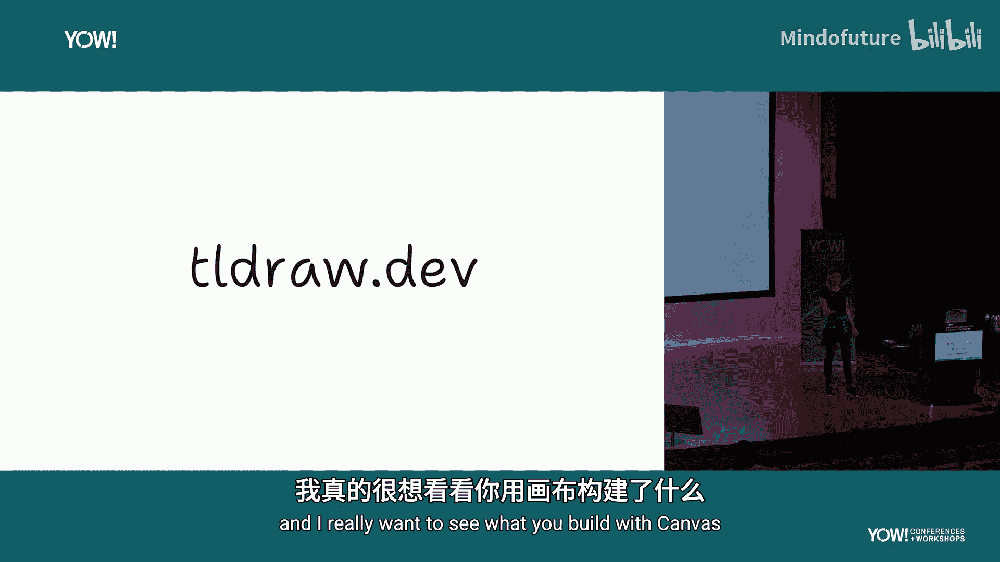

Thank you。

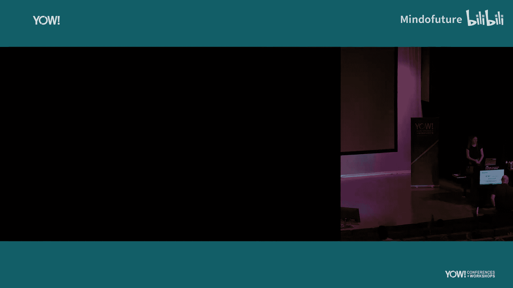