# 东南大学操作系统课件（李伟）


## 课程定位与目的

- 软件工程专业基础课程之一
- 考研内容之一——计算机专业基础（学校自主命题）
  - 数据结构（45分）
  - 操作系统（60分）
  - 计算机组成原理（45分）
- 掌握操作系统的基本概念和原理，能够熟练使用和维护常用操作系统（如Windows、Linux等），具备研发基于Linux的嵌入式操作系统的能力，为从事软件项目的研发打下扎实的基础。

## 教学内容与要求（1/2）

| 引言 | 掌握操作系统的一般概念，复习和回顾与操作系统相关的硬件知识，了解操作系统的发展和分类 |
| 操作系统结构 | 介绍操作系统的组成，树立操作系统的整体概念 |
| 进程 | 牢固掌握进程相关概念，能够编写并发程序 |
| 线程 | 掌握创建和管理线程的方法，熟练使用多线程技术编程 |
| CPU调度 | 理解相关算法，能编写一个进程调度程序 |
| 进程同步 | 理解同步概念，掌握同步的编程方法 |
| 死锁 | 理解死锁现象，掌握预防、避免、检测、解除死锁的方法 |

## 教学内容与要求（2/2）

| 内存管理 | 掌握固定分区、可变分区、段式、页式存储管理的原理与算法 |
| 虚拟内存 | 正确理解虚拟内存的概念，熟练掌握请求页式的地址转换过程以及常用的页面置换算法 |
| 文件系统 | 掌握文件系统的基本概念，熟练使用文件系统的操作方法 |
| 大容量存储结构 | 了解磁盘结构，及几种磁盘调度算法 |
| I/O系统 | 掌握I/O系统的基本概念，理解设备驱动程序。弄清从用户请求到设备完成用户请求的全过程 |

## 考核方式

- 闭卷考试（全英文试卷）
- 成绩评定：由下述三部分组成
  - 期末考试成绩（60%）
  - 实验、期中考试成绩（30%）
  - 平时成绩（作业、出勤、讨论等）（10%）

## 参考书目

- 《操作系统概念》
  （第七版 影印版）
  西尔伯莎茨 等编著
  高等教育出版社
  2007年3月

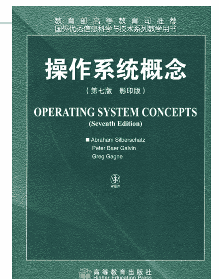

## 参考书目

- 《操作系统概念》
  （第七版 翻译版）
  郑扣根 译
  高等教育出版社
  2010年1月

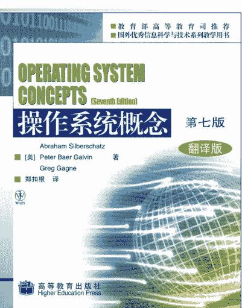


# 第1章 引言

## 大纲

- 什么是操作系统？
- 操作系统相关的硬件
- 操作系统的发展

## 计算机系统组成

- **硬件** – 提供基本的计算资源（CPU、内存、I/O设备等）。
- **操作系统** – 控制并协调各用户的各种程序对硬件的使用。
- **程序** – （编译器、数据库、视频、游戏、邮件系统、QQ等）用于解决用户问题。
- **用户**（人、机器、其他计算机）。

## 计算机系统组件的抽象视图

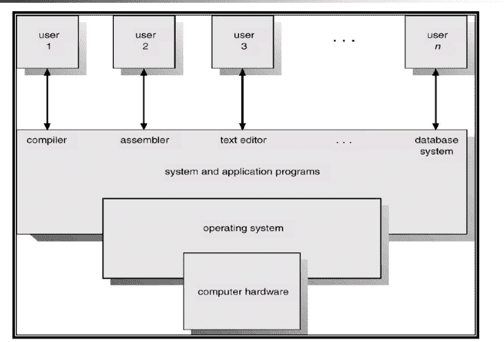

## 用户视角

- **PC用户**：操作系统是**一个程序**，为使用硬件提供易于使用的界面。
- **大型机/小型机用户**：操作系统是**一个程序**，有助于最大化系统资源利用率。
- **工作站用户**：操作系统是**一个程序**，旨在兼顾个人可用性与资源利用率。

## 系统视角

- *资源分配器*：操作系统将系统硬件资源分配给用户程序，并从用户程序处回收资源。
- *控制程序*：操作系统控制用户程序的执行，以防止错误和不当使用计算机。

## 什么是操作系统？（1/3）

- 对于什么是操作系统，*没有*普遍的定义。
- 一个常见的定义是，操作系统是计算机上始终运行的*内核程序*。所有其他程序都是系统/应用程序。

## 什么是操作系统？（2/3）

- 操作系统是一组程序，充当计算机用户与计算机硬件之间的中介。
  - 使计算机系统便于使用。
  - 执行用户程序，使解决用户问题更加容易。
  - 管理计算机硬件。

## 什么是操作系统？（3/3）

- 总体视图
  - 资源分配器、控制程序、内核程序
- 操作系统的目标
  - 主要目标：计算机系统的高效运行。

操作系统的构成问题已变得越来越重要。

## 大纲

- 什么是操作系统？
- 操作系统相关的硬件
- 操作系统的发展

## 计算机系统体系结构

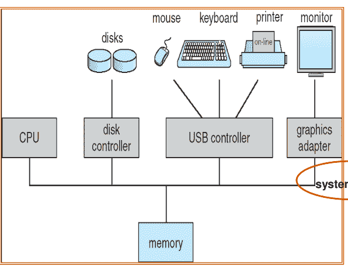

- 操作系统是如何进入系统的？
- 我们如何请求服务？
- 操作系统如何得知发生了某件事？


## 计算机启动

- **引导程序（Bootstrap Program）**
  - 在加电或重启时加载
  - 通常存储在 ROM（只读存储器）或 EPROM（可擦除可编程 ROM）中，通常称为固件（firmware）
  - 初始化系统的所有方面
  - 将操作系统内核加载到内存中，内核开始执行“init”并等待某些事件发生

## 中断

- 需要操作系统关注的事件是*中断*。这些事件包括 I/O 完成、按键、服务请求、除以零等。
- 中断可由硬件或软件生成。*陷阱*是由错误或用户请求引起的软件生成中断。
- 现代操作系统是*中断驱动*的，这意味着操作系统只有在发生中断时才会起作用。

## 单个进程执行输出时的中断时间线

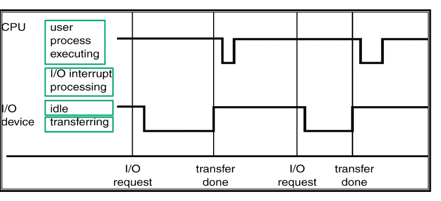

## 中断的常见功能

- 中断通常通过中断向量将控制转移到中断服务例程，中断向量包含所有服务例程的地址。
- 中断体系结构必须保存被中断指令的地址。
- 在处理另一个中断时，传入的中断会被禁用，以防止中断丢失。

## 中断处理

- 操作系统通过存储寄存器和程序计数器来保存 CPU 的状态。
- 确定发生了哪种类型的中断：
  - *轮询*
  - *向量*中断系统
- 单独的代码段确定每种类型的中断应采取什么操作。

## 存储结构

- 计算机程序必须位于主内存中才能执行。
- **主内存** —— CPU 可以直接访问的唯一大型存储介质。
  - 太小，无法永久存储所有需要的程序和数据
  - 是一种易失性存储设备
- **辅助存储** —— 主内存的扩展，提供大容量非易失性存储能力。

## 存储层次结构

存储系统按层次结构组织。

- 速度
- 成本
- 易失性

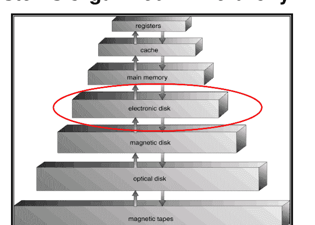

## 缓存

- 使用高速内存来保存最近访问的数据。
- 需要*缓存管理*策略。
- *缓存一致性* —— 这要求同时存储在多个层级中的数据保持*一致*。

## I/O 结构

- I/O 设备和 CPU 可以并发执行。
- 每个设备控制器负责一种特定类型的设备，并有一个本地缓冲区。
- 设备控制器通过产生*中断*来通知 CPU 它已完成操作。

*这种形式的中断驱动 I/O 适用于移动少量数据，但在用于批量数据移动（如磁盘 I/O）时可能会产生较高的开销。*

## 直接内存访问（DMA）

- 设备控制器在缓冲存储器和主内存之间直接传输数据块，**无需 CPU 干预**。
- 每个块只产生一次中断，而不是每字节产生一次中断。
- 用于能够以接近内存速度传输信息的高速 I/O 设备。

## 直接内存访问（DMA）

CPU 向控制器提供（1）磁盘地址、（2）用于存储数据块的内存地址，以及（3）字节数。然后，CPU 继续回去工作。

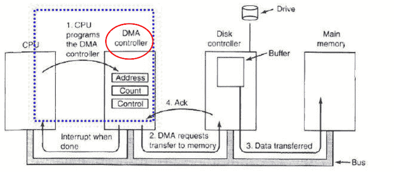

## 硬件保护

- 双模式操作
- CPU 保护
- 内存保护
- I/O 保护

## 双模式操作

- 共享系统资源要求操作系统确保错误的程序不能导致其他程序错误执行。
- 提供硬件支持以区分至少两种操作模式。
  - *用户态* —— 代表用户执行。（用户态或目态）
  - *监控模式*（也称为*内核模式*或*系统模式*）—— 代表操作系统执行。（核心态或管态）


## 双模操作

- *模式位*添加到计算机硬件中，用于指示当前模式：内核态（0）或用户态（1）。
- 当中断或故障发生时，硬件从用户态切换到内核态。
- 双模运行为我们提供了保护操作系统免受错误用户程序干扰的手段。

*特权指令* —— 某些可能*造成危害*且只能在*内核态*下执行的机器指令。

## CPU 保护

- **定时器** – 在指定时间段后中断计算机，以确保操作系统保持控制权。
    - 定时器在每个时钟滴答时递减。
    - 当定时器达到0时，发生中断。
- 定时器常用于实现分时。
- 定时器还用于计算当前时间。
- 加载定时器是一条**特权指令**。

## 内存保护

- 必须至少为中断向量和中断服务例程提供内存保护。
- 为了实现内存保护，需要添加两个寄存器来确定程序可访问的合法地址范围
    - 基址寄存器 – 保存最小的合法物理内存地址。
    - 界限寄存器 – 包含范围的大小
- 定义范围之外的内存受到保护。

## 基址寄存器和界限寄存器的使用

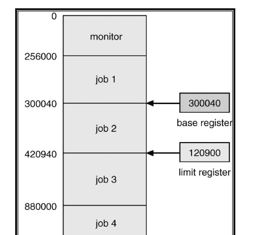

## 内存地址保护

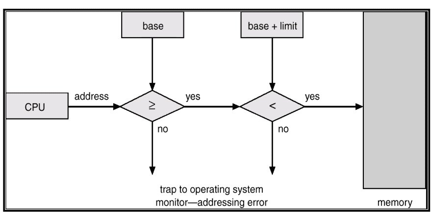

## 内存保护

- 在内核态执行时，操作系统可以无限制地访问内核内存和用户内存。
- 加载*基址*和*界限*寄存器的指令是特权指令。

## I/O 保护

- 所有I/O指令都是特权指令。
- 必须确保用户程序永远无法在内核态下获得计算机的控制权（即，用户程序在执行过程中将新地址存储到中断向量中）。

## 概述

- 什么是操作系统？
- 操作系统相关硬件
- 操作系统的发展

## 操作系统的发展

- 大型机系统
- 桌面系统
- 多处理器系统
- 分布式系统
- 集群系统
- 实时系统
- 手持系统

## 大型机系统

无操作系统→批处理系统→多道程序系统→分时系统

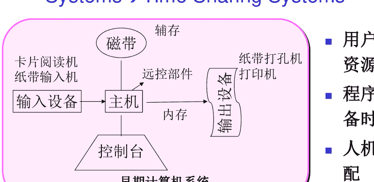

- 用户独占全机资源
- 程序运行前准备时间过长
- 人机速度不匹配

## 批处理系统 (1/2)

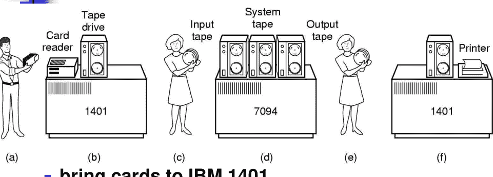

- 将卡片带到IBM 1401
- IBM 1401将卡片读入磁带
- 将磁带放入IBM 7094进行计算
- 将磁带放入IBM 1401以打印输出

## 批处理系统 (2/2)

- 通过批处理相似作业来减少设置时间
- 自动作业排序 – 自动将控制权从一个作业转移到另一个作业。
- 常驻监控程序
    - 初始控制权在监控程序中
    - 控制权转移到作业
    - 当作业完成时，控制权转移回监控程序

第一个初级的操作系统

## 简单批处理系统的内存布局

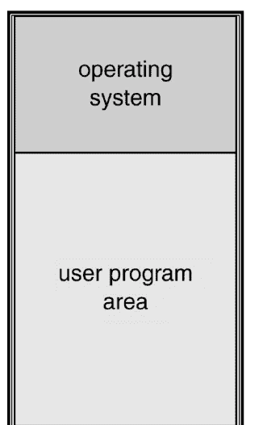

## 多道程序批处理系统

多个作业同时保存在主内存中，CPU在它们之间多路复用。

- 同时在内存中保留多个作业
- 选择一个并开始执行
- 如果该作业需要等待，CPU切换到另一个作业

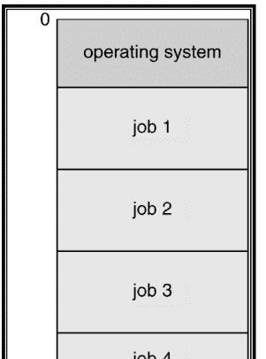

这是操作系统首次必须为用户做出决策的情况。

## 多道程序所需的操作系统功能

- **内存管理** – 系统必须将内存分配给多个作业。
- **CPU调度** – 系统必须从多个就绪作业中选择一个来运行。
- **作业调度** – 系统必须从就绪作业中选择要调入内存的作业。
- 设备分配和I/O例程由系统提供。


## 例子

有两道程序A、B，按下图以多道程序方式运行，要求在右图画出它们的运行轨迹，并计算在60min内CPU的利用率，假设起始时首先运行B，I/O_A和I/O_B不相同，并允许忽略监督程序切换A、B的时间。

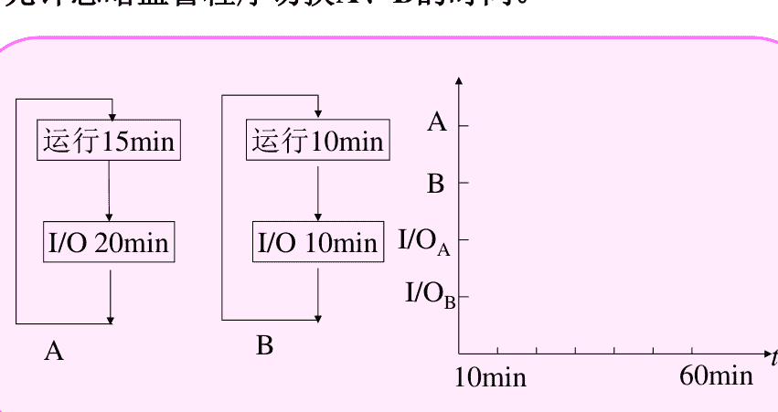

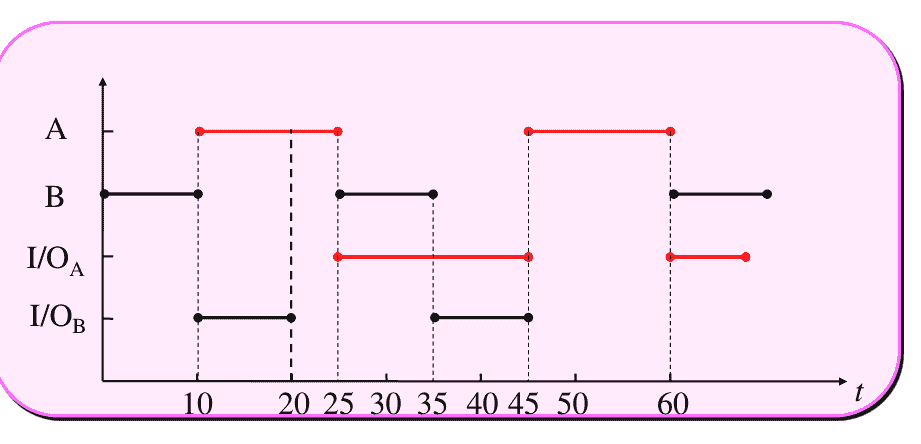

P_CPU = [60 - (45 - 35)] / 60 × 100% = 50 / 60 × 100% = 83.3%

若在单道程序系统中，CPU的利用率是多少？

## Advantages and disadvantages of multiprogramming

提高CPU的利用率，充分发挥并行性，这包括：程序之间、设备之间、设备与CPU之间均并行工作。

用户独占资源，无交互性，延迟大。

## Time-Sharing Systems–Interactive Computing

- Time-sharing operating system allows many users to share the computer simultaneously.
分时操作系统允许许多用户同时共享计算机。
- Switches rapidly from one user to the next.
快速地从一个用户切换到下一个用户。
- Gives users the impression: the entire computer system is dedicated for his use.
给用户一种印象：整个计算机系统是为他专用的。
- The CPU is multiplexed among several jobs that are kept in memory and on disk.
CPU在多个保存在内存和磁盘上的作业之间复用。
- Sophisticated CPU-scheduling schemes are required for concurrent execution.
并发执行需要复杂的CPU调度方案。
- To obtain a reasonable response time, a job needs to be swapped in and out of memory to the disk (*virtual memory*).
为了获得合理的响应时间，作业需要在内存和磁盘之间进行交换（*虚拟内存*）。
- Disk management must be provided.
必须提供磁盘管理。
- Job synchronization mechanisms are needed.
需要作业同步机制。
- It may ensure that jobs do not get stuck in a deadlock.
它可以确保作业不会陷入死锁。

## 作业1

从技术发展的角度，简要介绍批处理系统、多道程序系统和分时系统各自的技术特性。（在该技术出现以前系统存在哪些问题，该技术是如何解决这些问题的）

## Desktop Systems

- Personal Computers – computer system dedicated to a single user.
个人计算机 – 专用于单个用户的计算机系统。
- I/O devices – keyboards, mouse, display screens, small printers.
I/O设备 – 键盘、鼠标、显示屏、小型打印机。
- User convenience and responsiveness.
用户便利性和响应性。
- Can adopt technology developed for larger operating systems.
可以采用为大型操作系统开发的技术。

## Single-Processor Systems

There is one main CPU capable of executing a general-purpose instruction set.
有一个主CPU，能够执行通用指令集。

## Parallel Systems

- **Multiprocessor systems** with more than one CPU in close communication.
具有多个CPU紧密通信的**多处理器系统**。
- *Tightly coupled system* – processors share the computer bus, memory and a clock; communication usually takes place through the shared memory.
*紧密耦合系统* – 处理器共享计算机总线、内存和时钟；通信通常通过共享内存进行。

### Advantages of parallel system

- **Increased throughput:** Gets more jobs done.
**吞吐量提高：** 完成更多作业。
- **Economy of scale:** Because of resource sharing, multiprocessor systems is cheaper than multiple single processor systems.
**规模经济：** 由于资源共享，多处理器系统比多个单处理器系统更便宜。
- **Increased reliability:** the failure of one processor will not halt the whole system.
**可靠性提高：** 一个处理器的故障不会导致整个系统停机。

### Types of Parallel Systems

- **Asymmetric multiprocessing**
  - Each processor is assigned a specific task.
  每个处理器被分配特定的任务。
  - A master processor controls the system. The other processors either look to the master for instructions or have predefined tasks.
  主处理器控制系统。其他处理器要么向主处理器寻求指令，要么具有预定义任务。
  - Thus, this defines a master-slave relationship.
  因此，这定义了主从关系。
  - Master processor schedules and allocates work to slave processors.
  主处理器调度并分配工作给从处理器。
  - More common in extremely large systems.
  在极大型系统中更常见。
- **Symmetric multiprocessing (SMP)**
  - Each processor runs an identical copy of the operating system.
  每个处理器运行操作系统的相同副本。
  - Many processes can run at once without performance deterioration.
  许多进程可以同时运行而不会降低性能。
  - Must carefully control I/O to ensure that the data reach the appropriate processor.
  必须仔细控制I/O以确保数据到达适当的处理器。
  - May result in inefficiencies.
  可能导致效率低下。
  - Most modern operating systems support SMP.
  大多数现代操作系统支持SMP。

## Distributed Systems

- Distribute the computation among several physical processors.
将计算分布在多个物理处理器之间。
- *Loosely coupled system* – each processor has its own local memory; processors communicate with one another through various communications lines, such as high-speed buses or telephone lines.
*松散耦合系统* – 每个处理器都有自己的本地内存；处理器通过各种通信线路相互通信，例如高速总线或电话线。
- A distributed system is a collection of physically *separate*, possibly *heterogeneous* computer systems that are *networked* to provide the users with access to the various resources that the system maintains.
分布式系统是一组物理上*分离*、可能*异构*的计算机系统集合，它们通过网络连接为用户提供访问系统维护的各种资源的途径。
- Advantages of distributed systems:
分布式系统的优点：
  - Resources Sharing
资源共享
  - Computation speed up – load sharing
计算加速 – 负载共享
  - Reliability
可靠性
  - Communications
通信
- Requires networking infrastructure.
需要网络基础设施。
- Local area networks (LAN) or Wide area networks (WAN).
局域网（LAN）或广域网（WAN）。
- May be either **client-server** or **peer-to-peer** systems.
可以是**客户端-服务器**或**点对点**系统。


## 集群系统

- 集群系统由两个或多个独立系统通过局域网连接并**共享存储**且**紧密关联**组成。
- 集群系统的关键是**高可用性**。
- **非对称集群**
  - 一台机器处于**热备份**模式，而其他机器正在运行应用程序。
  - 热备份机器（*即*，除了监视其他机器外什么都不做）在某台服务器故障时变为活动状态。
- **对称集群**
  - 两台或多台主机正在运行应用程序并相互监视。
  - 这更高效，因为它利用了所有可用硬件

## 实时系统

- 通常用作专用应用中的控制设备，例如控制科学实验、医学成像系统、工业控制系统以及某些显示系统。
- 实时操作系统具有明确定义的、**固定的时间约束**。
- 处理*必须*在定义的时间约束内完成，否则系统将失败。
- **嵌入式系统**几乎总是运行实时操作系统
- 实时系统可能是*硬*实时或*软*实时。
  - *硬实时系统*保证关键任务按时完成。
  - *软实时系统*优先处理关键任务。即关键任务优先于其他任务，并在完成前保持该优先级。

## 手持系统

- 个人数字助理（PDA）
- Pocket-PC
- 移动电话
- 优点
  - 便利性和便携性
- 问题
  - 内存有限
  - 处理器缓慢
  - 显示屏小


# Chapter 2 Operating-System Structures

## Outline

- Operating System Functions
- Operating System Services
- Operating System Interfaces
- Operating System Structure
- Operating System Design and Implementation

## Common Functions of OS

- Process Management
- Main Memory Management
- File Management
- Secondary-Storage Management
- I/O System Management

## Process Management

- A *process* is a program in execution
- System Processes and User Processes
- Activities for process management
  - Process creation and deletion
  - process suspension and resumption
  - Provision of mechanisms for
    - process synchronization
    - process communication
    - Deadlock handling

## Main-Memory Management

- Memory is **a large array** of words or bytes, each with its own address.
- It is generally the **only large storage device** that the CPU is able to address and access directly.
- Main memory is **a volatile storage device**.
- Activities for main-memory management
  - Record the usage of Main-memory
  - Allocate and deallocate memory space as needed

## File Management

- There are different types of physical media to store information. Each of them has its own characteristics and physical organization.
  - Access speed
  - Data-transfer rate
  - Access method (sequential or random)
- Operating System provides a uniform logical view of information storage, i.e., file.
- A file is **a collection of related information** (programs and data) defined by its creator.
- Activities for file management
  - File creation and deletion
  - Directory creation and deletion
  - Support of primitives for manipulating files and directories
  - Mapping files onto secondary storage
  - File backup on stable (nonvolatile) storage media

## Secondary-Storage Management

- Since main memory (*primary storage*) is **volatile** and too small to accommodate all data and programs permanently, the computer system must provide **secondary storage** to back up main memory.
- Most modern computer systems use **disks** as the principal on-line storage medium, for both programs and data.


## 二级存储管理

- **磁盘管理活动**
  - 空闲空间管理
  - 存储分配
  - 磁盘调度

## I/O 系统管理

- 隐藏特定硬件设备的特殊性以免用户感知
- I/O 子系统包括
  - 包含缓冲、缓存、 spooling 的内存管理组件
  - 通用的设备驱动程序接口
  - 特定硬件设备的驱动程序

## 大纲

- 操作系统功能
- 操作系统服务
- 操作系统接口
- 操作系统结构
- 操作系统设计与实现

## 操作系统服务(1/2)

### 为用户提供帮助的服务

- **程序执行** – 系统能够将程序加载到内存并运行的能力。
- **I/O 操作** – 由于用户程序不能直接执行 I/O 操作，操作系统必须提供某种手段来执行 I/O。
- **文件系统操作** – 程序能够读取、写入、创建和删除文件。
- **通信** – 进程之间交换信息（*共享内存* 或 *消息传递*）
- **错误检测** – 通过检测硬件或用户程序中的错误来确保正确计算。

## 操作系统服务(2/2)

- **确保系统运行的服务**
  - **资源分配** – 将资源分配给多个用户或同时运行的多个作业。
  - **记账** – 跟踪哪些用户使用了多少以及何种类型的计算机资源。
  - **保护** – 确保对系统资源的所有访问都受控制并记录所有连接以便检测入侵。

## 大纲

- 操作系统功能
- 操作系统服务
- **操作系统接口**
- 操作系统结构
- 操作系统设计与实现

## 操作系统接口(1/3)

- **用户接口**
  - **命令行接口** – 文本命令
  - **批处理接口** – 包含一些命令的文件
  - **图形用户界面** – 窗口系统
    - 基于鼠标的窗口和菜单
  - 许多系统现在同时包含 CLI 和 GUI 接口
    - **Microsoft Windows** 是带 CLI “command” shell 的 GUI
    - **Apple Mac OS X** 作为 “Aqua” GUI 接口，底层为 UNIX 内核并提供 shell
    - **Linux** 是 CLI，可选 GUI 接口（Java Desktop、KDE）

## 操作系统接口(2/3)

- 命令行解释器（Shell）
  - 读取并解释控制语句的程序
  - DOS OS：command.com
- 实现命令的两种方式
  - 内部命令：命令解释器本身包含执行命令的代码。（dir, copy）
  - 外部命令：系统程序实现大多数命令。（fdisk, format）

## 操作系统接口(3/3)

- 程序接口
  - 系统调用
    - 通常用汇编语言指令或高级语言（C 或 C++）编写
    - 大多数情况下程序通过高级应用程序编程接口（API）访问，而不是直接使用系统调用

## 系统调用示例

将一个文件的内容复制到另一个文件的系统调用序列

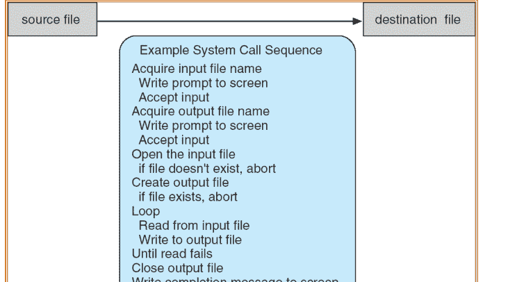

- 示例系统调用序列
- 获取输入文件名
- 向屏幕写入提示
- 接受输入
- 获取输出文件名
- 向屏幕写入提示
- 接受输入
- 打开输入文件
- 如果文件不存在，则中止
- 创建输出文件
- 如果文件存在，则中止
- 循环
- 从输入文件读取
- 写入输出文件
- 直到读取失败
- 关闭输出文件
- 向屏幕写入完成消息
- 正常终止

## 系统调用实现

- **系统调用接口 (SCI)**
  - 通常，每个系统调用关联一个编号
  - 系统调用接口维护一个按这些编号索引的表
  - 系统调用接口在 OS 内核中调用预期的系统调用并返回系统调用的状态和任何返回值


## 系统调用实现

### 应用程序编程接口 (API)

- API 函数代表应用程序程序员调用实际的系统调用
- 只需遵守 API 并理解操作系统调用后会做什么，API 将操作系统的接口细节隐藏在程序员之外
- API 由 **运行时支持库** 管理（编译器附带的库中内置的一组函数）

- 讨论：为什么用户使用 API 而不是系统调用？

- **三种最常见的 API**
  - **Win32 API** 用于 Windows
  - **POSIX API** 用于基于 POSIX 的系统（包括几乎所有版本的 UNIX、Linux 和 Mac OS X）
  - **Java API** 用于 Java 虚拟机 (JVM)

### API、SCI、OS 之间的关系

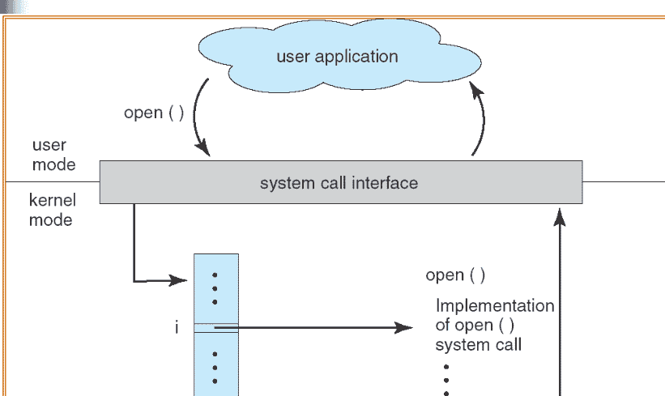

### 标准 C 库示例

C 程序调用 printf() 库调用，该调用调用 write() 系统调用

```c
#include <stdio.h>
int main ()
{
...
printf("Greetings");
...
return 0;
}
```

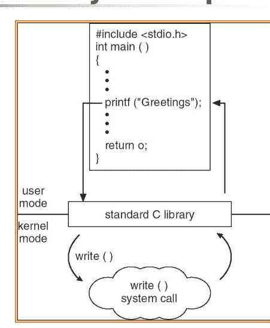

### 系统调用参数传递

- 通常，需要的信息不仅仅是所需系统调用的标识
- 向操作系统传递参数的三种通用方法
  - 最简单：通过 *寄存器* 传递参数
  - 参数存储在 *块* 或 *表* 中，位于 *内存* 中，并将块的 *地址* 作为参数传递给 *寄存器*
  - 参数由 *程序* 放置或 *压入* *堆栈*，并由操作系统 *弹出* 堆栈

**通过表进行参数传递**

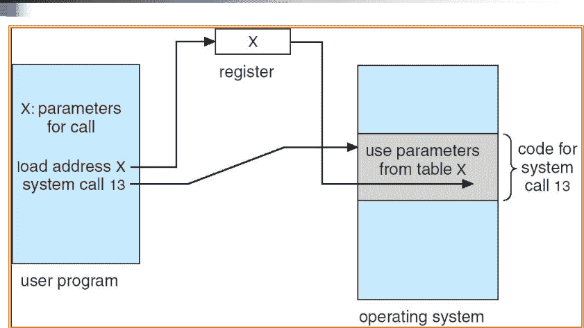

### 系统调用的类型

- 进程控制
- 文件管理
- 设备管理
- 信息维护
- 通信

- **进程控制**
  - end, abort
  - load, execute
  - create and terminate process
  - get and set process attributes
  - wait for time
  - wait event, signal event
  - allocate and free memory

- **信息维护**
  - get and set time or date
  - get and set system data
  - get and set process, file or device attributes

- **通信**
  - create and delete communication connection
  - send and receive message
  - transfer status information
  - attach or detach remote devices

### 通信模型

- 通信可以使用 **消息传递** 或 **共享内存** 进行。


## 大纲

- 操作系统功能
- 操作系统服务
- 操作系统接口
- 操作系统结构
- 操作系统设计与实现

### 操作系统结构

- 简单结构
- 分层结构
  - 虚拟机
- 微内核结构
- 模块

### 简单结构

- **MS-DOS**
  - 编写时旨在在最小空间内提供最多的功能
  - 未划分为模块
  - 尽管 MS-DOS 有一些结构，但其接口和功能级别没有很好地分离

- **原始 UNIX**
  - 两个可分离的部分
    - 系统程序
    - **内核**：由系统调用接口以下和物理硬件以上的一切组成，为一个层级提供大量功能

### UNIX 系统结构

```
(the users)

shells and commands
compilers and interpreters
system libraries

system-call interface to the kernel

Kernel

signals terminal handling
character I/O system
terminal drivers

file system
swapping block I/O system
disk and tape drivers

CPU scheduling
page replacement
demand paging
virtual memory

kernel interface to the hardware

terminal controllers
terminals

device controllers
disks and tapes

memory controllers
physical memory
```


## 分层结构

- 操作系统被划分为若干层（级别），每一层都建立在较低层之上。最底层（第 0 层）是硬件；最高层（第 N 层）是用户界面。
- 借助模块化，各层被选择为每一层仅使用较低层的功能（操作）和服务

## 分层操作系统

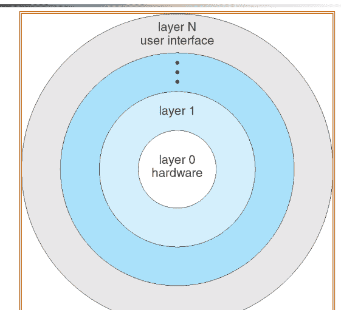

## OS/2 层结构

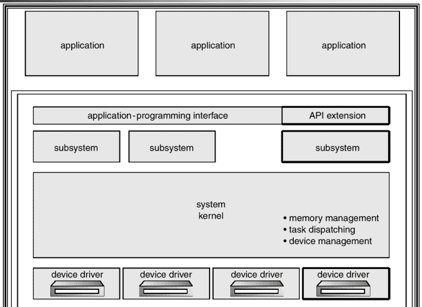

### 微内核结构

- 将尽可能多的内容从内核移至 *“用户”* 空间
- 通常，微内核提供 **最小的进程管理、内存管理** 和 **通信设施**
- 通信通过消息传递在用户模块之间进行

- **优点**
  - 更容易扩展操作系统
  - 更容易将操作系统移植到新架构
  - 更可靠（内核模式下运行的代码更少）
  - 更安全
- **缺点**
  - 用户空间到内核空间通信的性能开销

## 模块

- 大多数现代操作系统实现内核模块
  - 采用面向对象的方法
  - 每个核心组件都是独立的
  - 每个组件通过已知接口相互通信
  - 每个组件可根据需要在内核中按需加载
- 总体而言，与分层类似，但更灵活

## Solaris 模块化方法

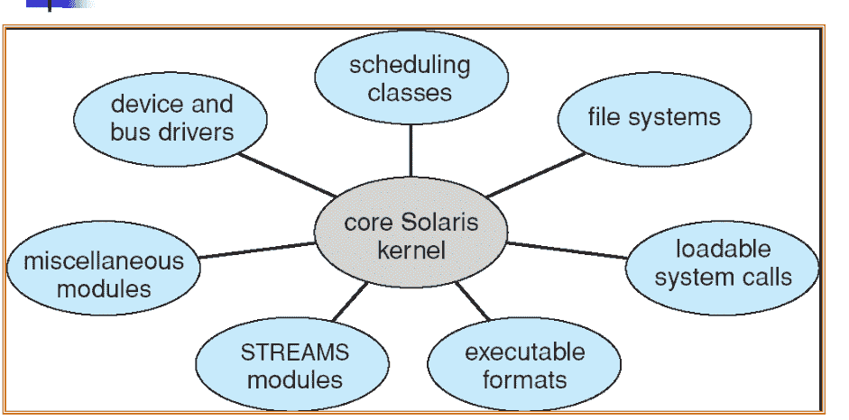

## 作业1

设计操作系统时采用的模块化内核方法和分层方法在哪些方面类似？
哪些方面不同？

## 虚拟机

- *虚拟机* 将分层方法推向了逻辑的极致。它将硬件和操作系统内核视为纯粹的硬件
- 虚拟机提供与底层裸硬件 *完全相同* 的接口
- 操作系统创建“*幻觉*”，即多个进程各自在自己的处理器上执行，并拥有自己的（虚拟）内存

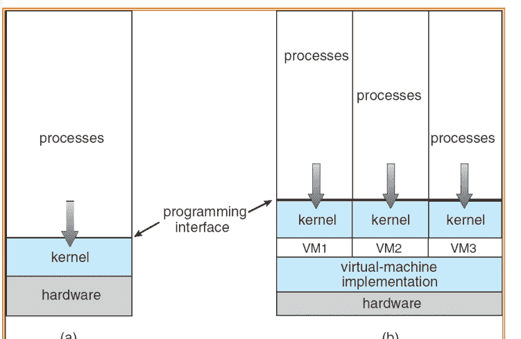

- 物理计算机的资源被共享以创建虚拟机
- CPU 调度可以制造出用户拥有自己的处理器的假象
-  spooling 和文件系统可以提供虚拟卡片阅读器和虚拟行式打印机
- 普通用户分时终端充当虚拟机操作员的控制台

- **优点**
  - **提供系统资源的完全保护**
    - 每个虚拟机都与其他所有虚拟机隔离。这种隔离 however 不允许直接共享资源。
  - **能够共享同一硬件同时并发运行不同的操作系统**
  - **是操作系统研究和开发的完美载体**
    - 系统开发在虚拟机上进行，因此不会干扰正常系统操作。

### VMware 架构

| application | application | application | application |
|---|---|---|
|  | guest operating system (FreeBSD)<br>virtual CPU<br>virtual memory<br>virtual devices | guest operating system (Windows NT)<br>virtual CPU<br>virtual memory<br>virtual devices | guest operating system (Windows XP)<br>virtual CPU<br>virtual memory<br>virtual devices |
|  | virtualization layer | virtualization layer | virtualization layer |
|  | host operating system (Linux) | host operating system (Linux) | host operating system (Linux) |
|  | hardware<br>CPU<br>memory<br>I/O devices | hardware<br>CPU<br>memory<br>I/O devices | hardware<br>CPU<br>memory<br>I/O devices |

### Java 虚拟机

- 编译后的 Java 程序是平台中立的 **字节码**，由 Java 虚拟机（JVM）执行。

- JVM 由以下部分组成
  - class loader
  - class verifier
  - runtime interpreter

- **即时编译（JIT）** 编译器可提高性能


## Java 虚拟机

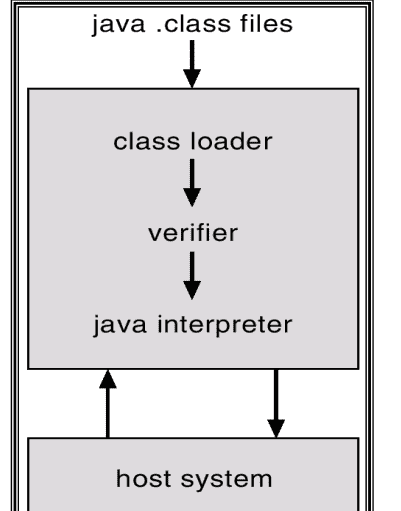

## Java 虚拟机

Java 应用程序

字节码

Java VM（解释器）

动态编译

JIT 编译器

本地代码

Win32

OS/2

Linux x86

IA-32

AIX

OS/400

Linux PPC

POWER/PowerPC

OS/390

Linux 390

S/390

Win64

Linux IA-64

IA-64

## 大纲

- 操作系统功能
- 操作系统服务
- 操作系统接口
- 操作系统结构
- 操作系统设计与实现

## 操作系统设计与实现

- 设计目标
  - 用户目标 – 操作系统应方便使用、易于学习、可靠、安全且快速
  - 系统目标 – 操作系统应易于设计、实现和维护，同时具有灵活性、可靠性、无错误和高效性

## 操作系统设计与实现

- 重要原则是分离
  - 策略：做什么？
  - 机制：怎么做？
  - 将策略与机制分离是一个非常重要的原则，如果以后要更改策略决策，它允许最大程度的灵活性

## 操作系统设计与实现

- 大部分用 C 或 C++ 编写
  - 优点 — 更易于移植
  - 缺点 — 速度降低且存储需求增加
- 一些小的汇编代码部分用于设备驱动程序以及保存和恢复寄存器状态

## Part 1 小结（1/2）

- 操作系统概念（管理各种资源、支持程序运行、方便用户使用的程序集）
- 操作系统的基本目标（方便性与高效性）
- 引导程序、中断、中断处理程序、中断向量
- 存储结构：内存（小、易失）、二级存储（大、非易失）、分层结构
- I/O结构：设备控制器（本地缓冲）、DMA
- 硬件保护：双重模式操作、特权指令、I/O保护、内存保护、CPU保护

## Part 1 小结（2/2）

- 操作系统的发展（大型机（无OS、批处理、多道程序设计（并发性、共享性、虚拟性、异步性）、分时）——桌面——并行（紧耦合）——分布式（松耦合，集群）——专用（实时、手持））
- 操作系统的功能：进程（CPU）管理、内存管理、文件管理、磁盘管理、I/O管理、用户接口
- 操作系统的服务：程序执行、I/O操作、文件系统操作、通信、错误检测与处理、资源分配、统计、保护
- 操作系统的接口：用户接口（CLI、GUI）+程序接口（系统调用（参数传递、类型）、SCI、API）
- 操作系统的结构：简单结构、分层结构（虚拟机）、微核结构（进程管理、内存管理、通信功能）、模块化

## 操作系统原理及应用

李 伟

xchlw@seu.edu.cn

计算机科学与工程学院、软件学院

江苏省网络与信息安全重点实验室

# Chapter 3 进程

## 大纲

- 进程概念
- 进程调度
- 进程操作
- 进程间通信
- 客户端-服务器系统中的通信

## 内存中的进程

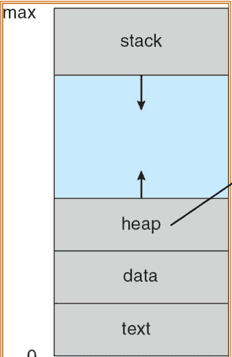

**Heap（堆）** 是进程运行期间动态分配的内存。

## 进程特征

- Dynamic (动态性)
- Independency (独立性)
- Concurrence (并发性)
- Structure (结构化)

## 进程状态

- 随着进程执行，其状态会发生变化 *state*
  - **New**: 进程正在被创建。
  - **Ready**: 进程正在等待分配处理器。
  - **Running**: 正在执行指令。
  - **Waiting**: 进程正在等待某个事件发生。
  - **Terminated**: 进程已完成执行。

## 进程状态图

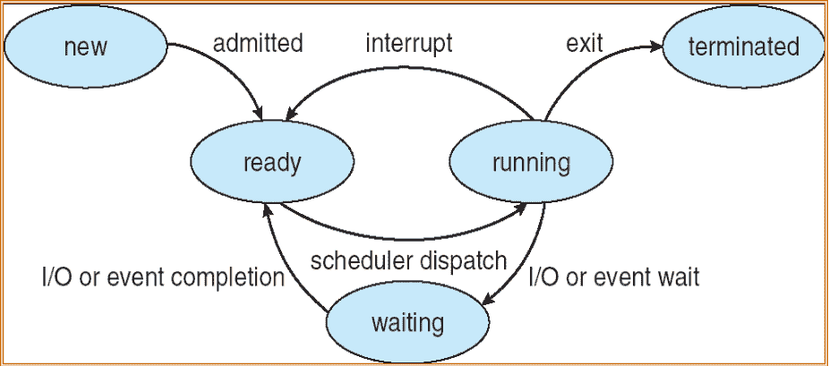

## 练习

- 在一个只有单处理机（不考虑多核）的操作系统中，进程有运行、就绪、等待三个基本状态。假如某时刻该系统中有10个用户进程并发执行，且CPU为非核心态情况下，试问：
  - 这时刻系统中处于**运行状态**的用户进程数最多有几个？最少有几个？
  - 这时刻系统中处于**就绪状态**的用户进程数最多有几个？最少有几个？
  - 这时刻系统中处于**等待状态**的用户进程数最多有几个？最少有几个？

## 作业2

画出进程在就绪、运行和等待三个基本状态之间的状态转换图，并简述发生相应状态转换的原因。

## 进程控制块 (PCB)

包含与特定进程相关联的信息

- 进程状态
- 程序计数器
- CPU 寄存器
- CPU 调度信息
- 内存管理信息
- 会计信息
- I/O 状态信息
- ... ...

中断发生时必须保存

## 进程控制块 (PCB)

| pointer | process state |
|---|---|
| process number | |
| program counter | |
| registers | |
| memory limits | |
| list of open files | |
| ... | |


## 大纲

- Process Concept
- **进程调度**
- Operations on Processes
- Interprocess Communication
- Communication in Client-Server Systems

## 进程调度队列

- **作业队列** – 系统中所有进程的集合
- **就绪队列** – 驻留在主内存中、准备好并等待执行的全部进程的集合
- **设备队列** – 等待 I/O 设备的进程集合
- 进程在各个队列之间的迁移

## 就绪队列和各种 I/O 设备队列

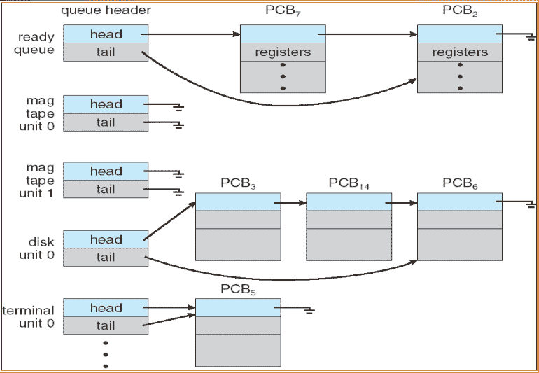

## 进程调度的表示

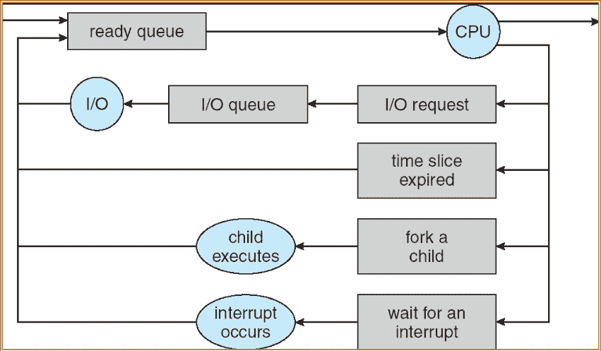

## 调度器

- **长期调度器**（或作业调度器） – 选择应加载到内存中执行的进程。
- **短期调度器**（或 CPU 调度器） – 选择下一个应执行的进程并分配 CPU。
- **中期调度器** – 将进程从内存中移除并稍后重新引入内存（**交换**）。

## 调度器

- 短期调度器被频繁调用（毫秒） ⇒（必须快速）。
- 长期调度器被很少调用（秒、分钟） ⇒（可以较慢）。
- 长期调度器控制 *多道程序设计的程度*（内存中的进程数）。

## 中期调度

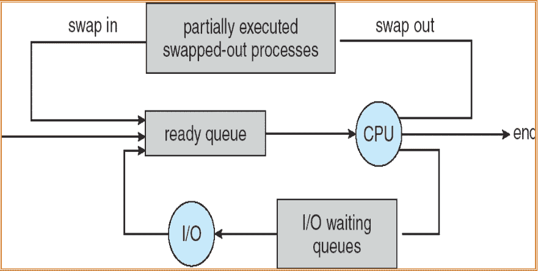

## 上下文切换

- 什么是进程上下文？
  - 进程的 *上下文* 由该进程的 PCB 表示，包括 CPU 寄存器的值、进程状态、程序计数器以及其他内存/文件管理信息。

## CPU 从进程到进程的切换

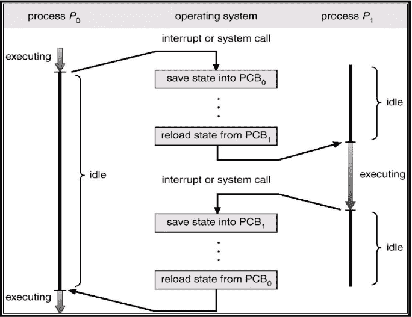

## Exercise

- 下列哪一种情况不会引起进程之间的切换？
- A. 进程调用本程序中定义的函数进行计算
- B. 进程处理I/O请求
- C. 进程创建子进程并等待子进程结束
- D. 产生中断

## 大纲

- Process Concept
- Process Scheduling
- Operations on Processes
- Interprocess Communication
- Communication in Client-Server Systems

## 进程创建

- 父进程创建子进程，而子进程又创建其他进程，形成进程树。
- 使用唯一的进程标识符（一个整数）来标识进程。

## Solaris 上的进程树

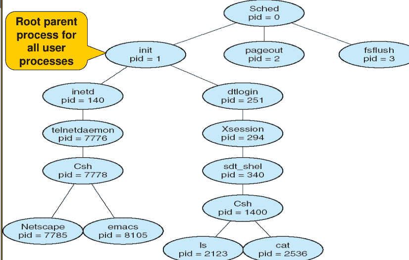

所有用户进程的根父进程

## 进程创建

- 资源共享
  - 父进程和子进程共享所有资源。
  - 子进程共享父进程资源的一个子集。
  - 父进程和子进程不共享资源。
- 执行
  - 父进程和子进程并发执行。
  - 父进程等待子进程终止。

## 进程创建

- **地址空间**
  - 子进程是父进程的副本。
  - 子进程加载有程序。

- **UNIX 示例**
  - **fork() 系统调用** 创建新进程
  - **exec() 系统调用** 在 fork 之后使用，用新程序替换进程的内存空间。

## 进程创建（UNIX）

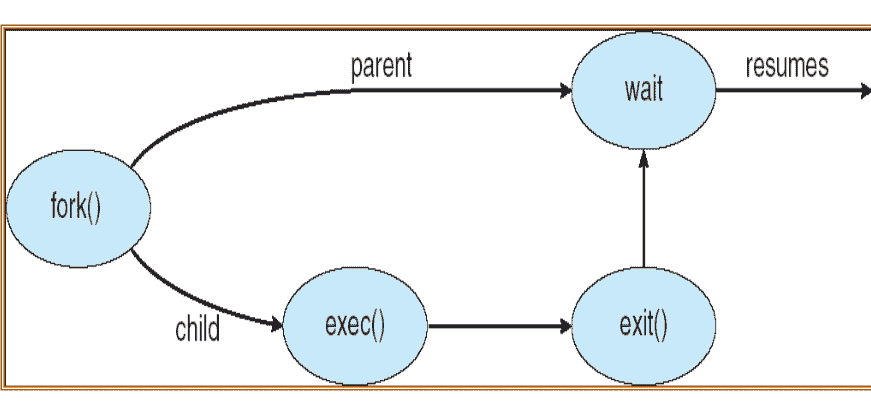

```
pid = fork();
if (pid < 0) {/*error occured*/
    fprintf(stderr, "Fork failed");
    exit(-1);}
else if(pid == 0){/*child process*/
    execlp("/bin/ls","ls",NULL);
}
else {/*parent process*/
    wait(NULL);
    printf("Child Complete");
    exit(0);
}
```

## 作业3

下列程序的输出是什么？

```
```c
#include <sys/wait.h>
#include <sys/types.h>
#include <stdio.h>
#include <unistd.h>
#include <stdlib.h>
int value = 5;
int main()
{  pid_t pid;
   pid = fork();
   if (pid == 0) {  printf("child process, value1 : %d\n", value);
                    value += 15;
                    printf("child process, value2 : %d\n", value);}

   else if (pid > 0) { printf("parent process, value3 : %d\n", value);
                       wait(NULL);
                       printf("parent process, value4 : %d\n", value);
                       exit(0);  }
}
```
```


## 进程终止

- 父进程可以终止子进程的执行（abort）。
    - 子进程已超出分配的资源。
    - 分配给子进程的任务不再需要。
    - 父进程正在退出。（并非所有OS都如此， UNIX）
        - 操作系统不允许子进程在其父进程终止后继续运行。
        - 级联终止 (级联终止).

## 大纲

- 进程概念
- 进程调度
- 进程操作
- **进程间通信**
- 客户端-服务器系统中的通信

## 进程间通信 (IPC)

- 通信可以使用 **消息传递** 或 **共享内存** 进行。

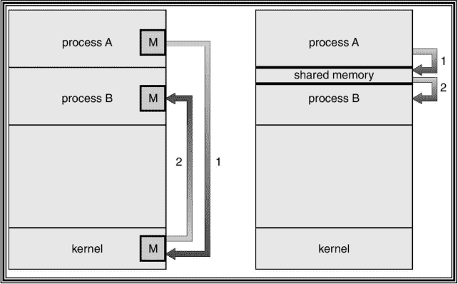

## 共享内存系统

- 要求通信进程建立一个共享内存区域。
- 共享内存区域驻留在创建共享内存段的进程的地址空间中。
- 进程有责任确保它们不会同时写入同一位置。

## 生产者-消费者问题

- 协作进程的范式，**_生产者_** 进程产生的信息被 **_消费者_** 进程消费。
    - **_无界缓冲区_** 对缓冲区的大小没有实际限制。
    - **_有界缓冲区_** 假设缓冲区大小是固定的。

## 有界缓冲区 – 共享内存解决方案

- 共享数据

```c
#define BUFFER_SIZE 10
typedef struct {
    ...
} item;
item buffer[BUFFER_SIZE];
int in = 0;
int out = 0;
```

## 有界缓冲区 – 生产者进程

```
item nextProduced;

while (1) {
    while (((in + 1) % BUFFER_SIZE) == out)
        ; /* do nothing */
    buffer[in] = nextProduced;
    in = (in + 1) % BUFFER_SIZE;
}
```

## 有界缓冲区 – 消费者进程

```
item nextConsumed;

while (1) {
    while (in == out)
        ;/* do nothing */
    nextConsumed = buffer[out];
    out = (out + 1) % BUFFER_SIZE;
}
```

## 讨论

- 该解决方案是正确的，但只能使用 BUFFER_SIZE-1 个元素


- 如何实现可使用缓冲的最大空间数为 BUFFER_SIZE？

## 消息传递系统

- **MPS 设施提供两个操作：**
    - *send(message)* – 消息大小固定或可变
    - *receive(message)*

- **如果 P 和 Q 希望通信，它们需要：**
    - 在它们之间建立一个 *通信链路*
    - 通过 send/receive 交换消息

- **通信链路的实现**
    - 物理的（例如，共享内存，硬件总线）
    - 逻辑的（例如，逻辑属性）

## 实现问题

- 链路是如何建立的？
- 一个链路能否关联到两个以上的进程？
- 通信进程的每对之间可以有多少条链路？
- 链路的容量是多少？
- 链路可以容纳的消息大小是固定的还是可变的？
- 链路是单向的还是双向的？

## 间接通信

- **操作**
    - 创建一个新的邮箱
    - 通过邮箱发送和接收消息
    - 销毁一个邮箱
- **原语定义为：**
    - send(*A, message*) – 向邮箱 A 发送消息
    - receive(*A, message*) – 从邮箱 A 接收消息

## 间接通信

- **邮箱共享**
    - *P₁, P₂, 和 P₃* 共享邮箱 A。
    - *P₁* 发送；*P₂* 和 *P₃* 接收。
    - 谁获得消息？

- **解决方案**
    - 允许一个链路最多关联两个进程。
    - 允许一次只有一个进程执行接收操作。
    - 允许系统任意选择接收者。发送者会被通知接收者是谁。

## 同步

- 消息传递可以是阻塞的或非阻塞的。
- **阻塞** 被认为是同步的
- **非阻塞** 被认为是异步的
- send 和 receive 原语可以是阻塞的或非阻塞的。


## 缓冲

- 附加到链路上的消息队列，以三种方式之一实现。
  - **零容量** – 0 条消息
    发送者必须等待接收者。
  - **有界容量** – 有限长度，*n* 条消息
    如果链路已满，发送者必须等待。
  - **无界容量** – 无限长度
    发送者从不阻塞。

## 客户端-服务器通信

- 套接字
- 远程过程调用
- 远程方法调用（Java）

### 套接字

- 套接字被定义为*通信的端点*。
- IP 地址和端口的连接
- 套接字 161.25.19.8:1625 指的是主机 161.25.19.8 上的端口 1625
- 通信存在于一对套接字之间。

### 套接字通信

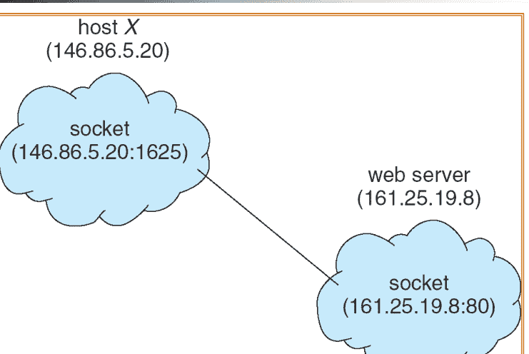

主机 X
(146.86.5.20)

套接字
(146.86.5.20:1625)

Web 服务器
(161.25.19.8)

套接字
(161.25.19.8:80)

- 所有连接必须是唯一的。
- 常见且高效
- 分布式进程之间的一种低级通信形式
- 套接字仅允许在通信进程之间交换非结构化字节流。

### 远程过程调用

- 远程过程调用（RPC）**抽象了网络系统上进程之间的过程调用。**
- RPC 通信中交换的消息是**结构良好的。**
- 每条消息包含**函数标识符**和**要传递的参数**。
- 函数被执行，任何输出都会在单独的消息中发送回请求者。
- RPC 允许客户端像在本地调用过程一样在远程主机上调用过程。
- **存根（Stubs）** – 服务器上实际过程的客户端代理。
- **客户端存根**定位服务器上的端口，并*编组（marshal）*参数。
- **服务器端存根**接收此消息，解包已编组的参数，并在服务器上执行该过程。
- 一些问题
  - 客户端和服务器机器上数据表示的差异。
    - 外部数据表示（XDR）
  - 调用的语义
    - 至多一次：为每条消息附加时间戳。
    - 恰好一次：ACK 消息

### RPC 的执行

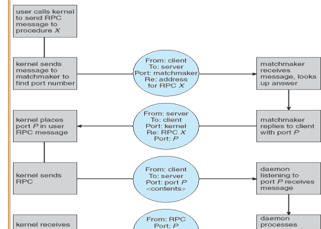

### 远程方法调用

- **远程方法调用（RMI）是一种类似于 RPC 的 Java 机制。**
- **RMI 允许一台机器上的 Java 程序调用远程对象上的方法。**

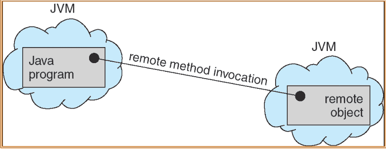

- RMI 使用**存根（stubs）**和**骨架（skeletons）**实现远程对象。
- 存根是远程对象的代理，驻留在客户端。
- 骨架驻留在服务器端，接收来自存根的消息，并在服务器上调用所需的方法。

### 编组参数

客户端

```text
val = server.someMethod(A,B)
```

存根

远程对象

```text
boolean someMethod (Object x, Object y)
{
  implementation of someMethod
  ...
}
```

骨架

A、B、someMethod

布尔返回值

## 操作系统原理及应用

李 伟

xchlw@seu.edu.cn

计算机科学与工程学院、软件学院

江苏省网络与信息安全重点实验室

## 大纲

- 概述
- 多线程模型
- 线程库
- 线程问题
- 操作系统示例

## 什么是线程？(1/2)

- 线程是进程内的控制流。
- 线程，也称为轻量级进程（LWP），是 CPU 执行的基本单元。
- 传统进程，或称为重量级进程，具有单一的控制线程。
- 多线程进程在同一地址空间内包含多个不同的控制流。

## 单线程和多线程进程

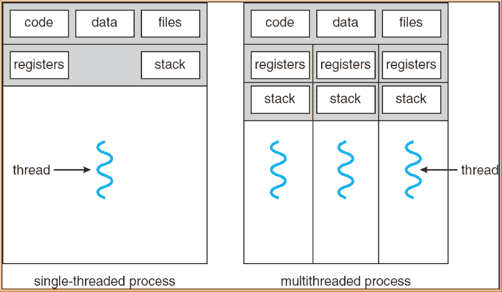


## 线程使用情况 (1/2)

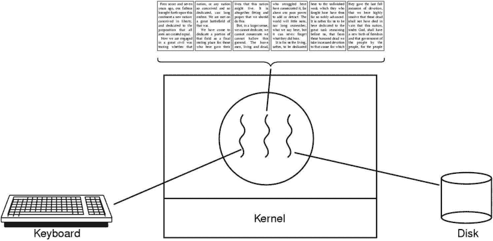

键盘

内核

磁盘

一个具有三个线程的字处理器

## 线程使用情况 (2/2)

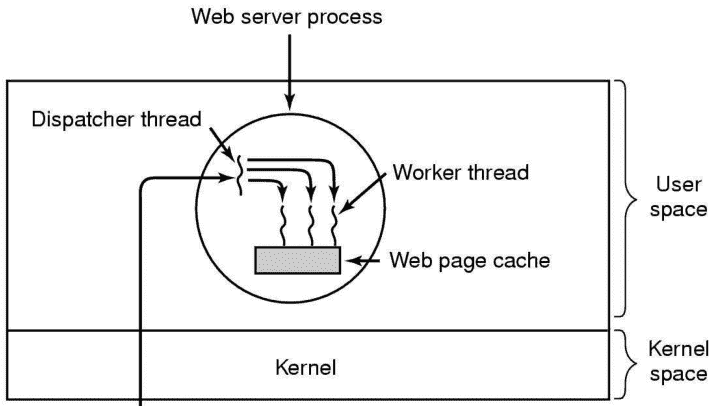

Web 服务器进程

调度线程

工作线程

网页缓存

用户空间

内核

内核空间

网络连接

一个多线程的 Web 服务器

## 优点

- 响应性
  - 例如，多线程 Web 浏览器
- 资源共享
  - 线程共享它们所属进程的内存和资源
- 经济性
  - 创建和上下文切换线程
- 多处理器架构的利用

## 用户线程

- 线程管理由用户级线程库完成
- 示例
  - POSIX Pthreads
  - Mach C-threads
  - Solaris UI-threads

## Windows OS

| 内核版本 | 发行版 |
|---|---|
| NT 3.51 | Windows NT 3.51 |
| NT 4.0 | Windows NT 4.0 |
| NT 5.0 | Windows 2000 |
| NT 5.1 | Windows XP |
| NT 5.2 | Windows Server 2003 |
| NT 6.0 | Windows Vista<br>Windows Server 2008 |
| NT 6.1 | Windows 7<br>Windows Server 2008 R2 |
| NT 6.2 | Windows 8 |
| NT 6.3 | Windows 8.1 |

## 用户线程

- 用户线程在内核之上得到支持。内核**不知道**用户线程的存在。
- 一个库提供了线程创建、终止、连接和调度的所有支持。
- 没有内核干预，因此用户线程通常**更高效**。
- 不幸的是，由于内核只识别包含线程的进程，*如果一个线程被阻塞，同一进程中的所有其他线程也会被阻塞*，因为包含进程被阻塞了。

## 在用户空间实现线程

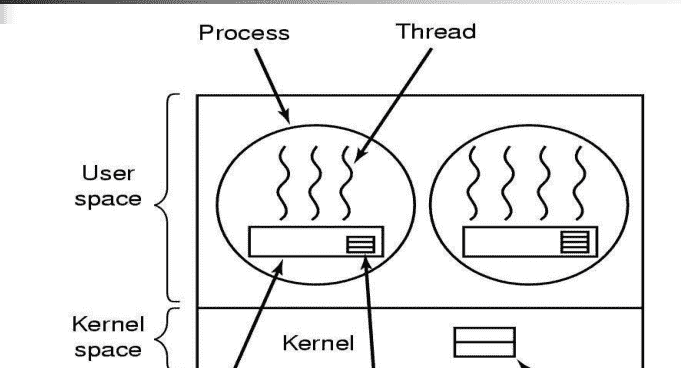

一个用户级线程包

## 内核线程

- 由内核支持和管理
- 示例
  - Windows
  - Solaris
  - Mac OS X
  - Linux

## 在内核中实现线程

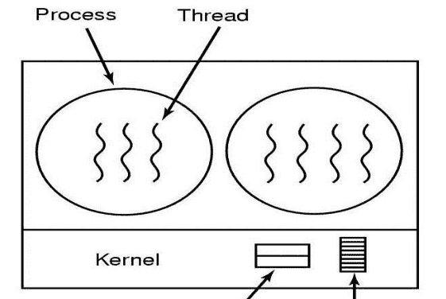

由内核管理的线程包

## 作业1

1. 请阐述进程和线程之间的区别和联系。
2. 用户级线程和内核级线程有何区别？

## 大纲

- 概述
- 多线程模型
- 线程库
- 线程问题
- 操作系统示例

## 多线程模型

- 多对一
- 一对一
- 多对多

### 多对一模型

- 多个用户级线程映射到单个内核线程。
- 用于不支持内核线程的系统。

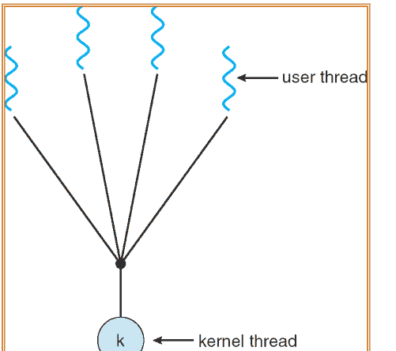

### 多对一模型

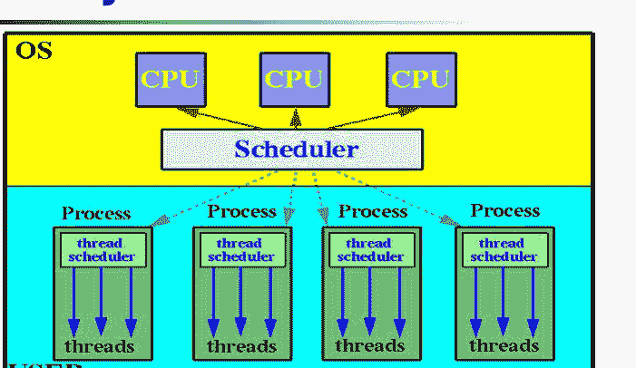

- 同时只能有一个线程访问内核。
- 并未获得真正的并发。

### 一对一模型

- 每个用户级线程映射到内核线程。
- 示例：Windows & Linux

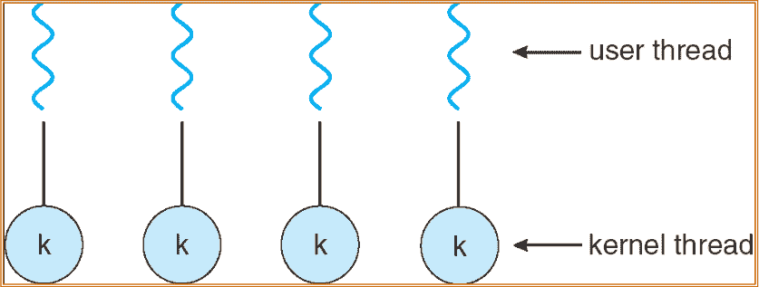

### 多对多模型

- 允许多个用户级线程映射到多个内核线程。
- Solaris 2
- Windows NT/2000 带有 *ThreadFiber* 包

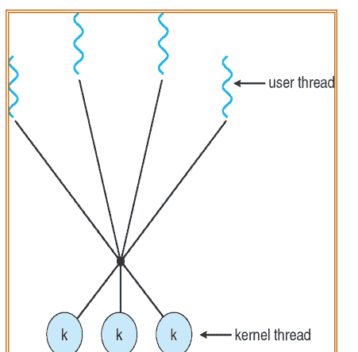

### 多对多模型

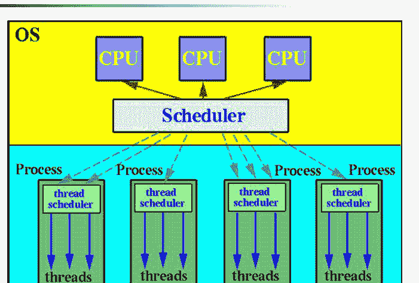

### 两级模型

- 类似于 M:M，但允许用户线程绑定到内核线程
- 示例
  - HP-UX
  - Tru64 UNIX
  - Solaris 8 及更早版本

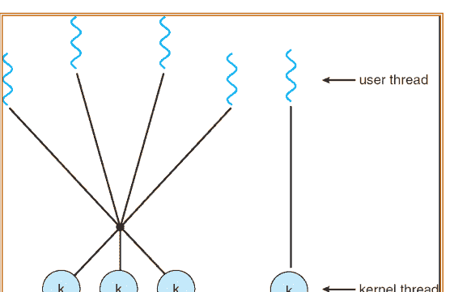

## 大纲

- 概述
- 多线程模型
- 线程库
- 线程问题
- 操作系统示例

## 线程库

线程库为程序员提供创建和管理线程的 API。

- POSIX Pthreads （用户级 & 内核级）
- Win32 （内核级）
- Java （主机操作系统）


## Pthreads

- POSIX 标准（IEEE 1003.1c）用于线程创建和同步的 API。
- API 指定线程库的行为，实现由库的开发决定。
- 在 UNIX 操作系统中很常见。

## pthread_create

```
int pthread_create(tid, attr, function, arg);
```

- `pthread_t *tid`
  - 创建的线程句柄
- `const pthread_attr_t *attr`
  - 待创建线程的属性
- `void *(*function) (void*)`
  - 映射到线程的函数
- `void *arg`
  - 传递给函数的单个参数

## pthread_create 解释

- 启动一个运行指定函数的线程
- 线程句柄通过 pthread_t 结构返回
- 指定 *NULL* 以使用默认属性
- 向函数发送单个参数
  - 如果函数不需要参数，指定 *NULL*
- 检查错误代码（返回值）！

> **EAGAIN** – 资源不足无法创建线程  
> **EINVAL** – 属性无效

## 线程状态

- pthread 线程有两种状态
  - 可连接和分离
- 线程默认是可连接的
  - 资源在 *pthread_join* 之前一直保留
  - 可通过属性或 API 调用重置
- 分离线程无法被连接
  - 资源可在终止时回收
  - 不能重置为 *可连接*

## 等待线程

```
int pthread_join(tid, val_ptr);
```

- pthread_t *tid
  - 可连接线程的句柄
- void **val_ptr
  - 被连接线程返回的退出值

## pthread_join 解释

- 调用线程等待句柄为 tid 的线程终止
- 只能连接一个线程
- 线程必须是可连接的
  - 退出值从被连接线程返回
  - 返回类型为 (void *)
  - 如果不期望返回值，使用 NULL

ESRCH – 未找到线程
EINVAL – 线程不可连接

## 示例：多个线程

```
#include <stdio.h>
#include <pthread.h>
const int numThreads = 4;

void *helloFunc(void * pArg)
{ printf("Hello Thread\n"); }

main()
{ pthread_t hThread[numThreads];
for (int i = 0; i < numThreads; i++)
    pthread_create(&hThread[i], NULL, helloFunc, NULL);
for (int i = 0; i < numThreads; i++)
    pthread_join(hThread[i], NULL);
return 0;
}
```

## 线程取消

- int pthread_setcancelstate(int state, int *oldstate);
  - PTHREAD_CANCEL_ENABLE
  - PTHREAD_CANCEL_DISABLE
- int pthread_setcanceltype(int type, int *oldtype);
  - PTHREAD_CANCEL_ASYNCHRONOUS
  - PTHREAD_CANCEL_DEFERRED
- void pthread_testcancel(void);

## Windows 线程 API

- CreateThread
- GetCurrentThreadId - 返回全局 ID
- GetCurrentThread - 返回句柄
- SuspendThread/ResumeThread
- ExitThread
- TerminateThread
- GetExitCodeThread
- GetThreadTimes

## 挂起和恢复线程

- 每个线程都有挂起计数
- 只有当挂起计数 == 0 时才能执行
- 线程可以以挂起状态创建

```
DWORD ResumeThread (HANDLE hThread)
DWORD SuspendThread(HANDLE hThread)
```

两个函数都返回挂起计数或在失败时返回 0xFFFFFFFF

## 示例：线程创建

```
#include <stdio.h>
#include <windows.h>

DWORD WINAPI helloFunc(LPVOID arg ) {
    printf("Hello Thread\n");
    return 0;
}

main() {
    HANDLE hThread =
        CreateThread(NULL, 0, helloFunc,
            NULL, 0, NULL );
}
```

有什么问题？

## 示例解释

- 主线程是进程
- 当进程结束时，所有线程都结束
- 需要一些等待线程完成的方法

## 等待 Windows 线程

```
#include <stdio.h>
#include <windows.h>
BOOL thrdDone = FALSE;
DWORD WINAPI helloFunc(LPVOID arg ) {
    printf("Hello Thread\n");
    return 0;
}
main() {
    HANDLE hTh
    CreateThread(NULL, 0, helloFunc,
    NULL, 0, NULL );
}
```

thrdDone = TRUE;

不是一个好主意！

while (!thrdDone);


## 等待多个线程

最多等待 64 个对象（线程）

```
DWORD WaitForMultipleObjects(

    DWORD nCount,

    CONST HANDLE *lpHandles, // array

    BOOL fWaitAll, // wait for one or all

    DWORD dwMilliseconds)
```

等待所有：`fWaitAll==TRUE`

等待任一：`fWaitAll==FALSE`

- 返回值是找到的第一个数组索引

## 关于 WaitFor 函数的说明

- 将句柄作为参数
- 用于不同类型的对象
- 内核对象具有两种状态
  - 有信号
  - 无信号
- 行为由句柄所引用的对象定义
  - 线程：有信号表示已终止

### 示例：Hello Threads

- 修改之前的示例代码
  以打印输出
  - 适当的“Hello Thread”消息
  - 唯一的线程编号
    - 使用 CreateThread 循环的 for 循环变量

## 讨论：哪里出了问题？

```
DWORD WINAPI threadFunc(LPVOID pArg) {
    int* p = (int*)pArg;
    int myNum = *p;
    printf("Thread number %d\n", myNum);
}

...
// from main():
for (int i = 0; i < numThreads; i++) {
    hThread[i] =
        CreateThread(NULL, 0, threadFunc, &i, 0, NULL);
}
```

myNum 会打印出什么？

### Hello Threads 时间线

| 时间 | main | 线程 0 | 线程 1 |
|---|---|---|---|
| T₀ | `i = 0` | --- | --- |
| T₁ | 创建(&i) | --- | --- |
| T₂ | `i++ (i == 1)` | 启动 | --- |
| T₃ | 创建(&i) | p = pArg | --- |
| T₄ | `i++ (i == 2)` | myNum = *p<br>myNum = 2 | 启动 |
| T₅ | 等待 | 打印(2) | p = pArg |
| T₆ | 等待 | 退出 | myNum = *p<br>myNum = 2 |

### 竞争条件

- 多个线程并发访问同一变量
  - 读/写冲突
  - 写/写冲突
- 并发程序中最常见的错误
- 可能并非总是显而易见
- 如何避免数据竞争？
  - 局部存储
  - 使用**临界区**控制共享访问

## Hello Thread：局部存储解决方案

```
DWORD WINAPI threadFunc(LPVOID pArg)
{
    int myNum = *((int*)pArg);
    printf( “Thread number %d\n”, myNum);
}
. . .

// from main():
for (int i = 0; i < numThreads; i++) {
    tNum[i] = i;
    hThread[i] =
        CreateThread(NULL, 0, threadFunc, &tNum[i],
                     0, NULL);
}
```

### Java 线程

- Java 线程可以通过以下方式创建
  - 继承 Thread 类以创建新类
  - 定义一个实现 Runnable 接口的类

- Java 线程由 JVM 管理。

## Java 线程状态

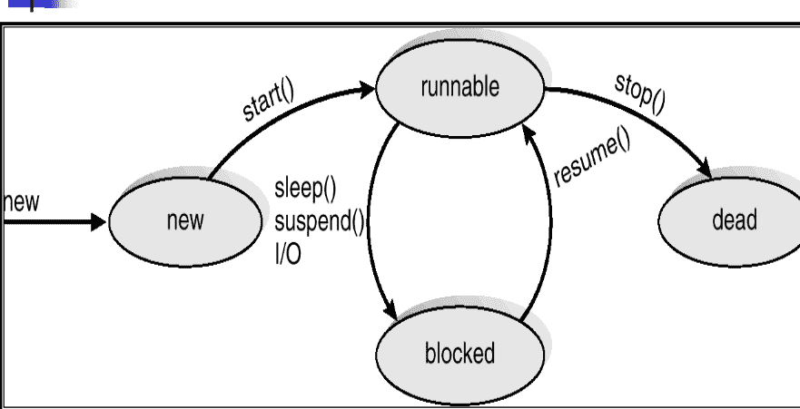

## 大纲

- 概述
- 多线程模型
- 线程库
- 线程问题
- 操作系统示例

## 线程问题

- fork() 和 exec() 系统调用的语义
- 线程取消
- 信号处理
- 线程池
- 线程特定数据
- 调度器激活

### fork() 和 exec() 的语义

- fork() 是只复制调用线程还是复制所有线程？**都可以！**
- 如果一个线程调用了 exec()，结果会是什么？

exec() 参数中指定的程序将替换整个进程——包括所有线程。

## 线程取消

- 对于异步取消，如果目标线程拥有一些系统级资源，系统可能无法回收所有资源。
- 对于延迟取消，目标线程自行决定何时终止。回收资源不是问题。
- 大多数系统为进程（例如，使用 kill 系统调用）和线程实现异步取消。
- Pthread 支持延迟取消。

## 信号处理

- 在 UNIX 系统中，**信号**用于通知进程某个特定事件已发生。
- 所有信号都遵循相同的模式：
  - 信号由特定事件生成
  - 信号被传递给进程
  - 信号被处理
- *信号处理程序*用于处理信号


## 信号处理

在多线程程序中，信号应该发送到哪里？

- 将信号发送给该信号适用的线程
- 将信号发送给进程中的每个线程
- 将信号发送给进程中的某些线程
- 指定一个特定线程接收进程的所有信号

## 作业2

试比较信号机制与中断机制的异同。

## 线程池

- 创建一定数量的线程放入池中等待工作

**优点：**

- 通常使用现有线程处理请求比创建新线程稍快
- 允许应用程序中的线程数量限制在池的大小之内

## 线程特定数据

- 属于一个进程的线程共享该进程的数据。
- 允许每个线程拥有自己数据的副本
- 使用线程池时，每个线程可以被分配一个唯一标识符

## 大纲

- 概述
- 多线程模型
- 线程库
- 线程问题
- 操作系统示例

## Windows XP 线程

- 实现一对一映射。
- 每个线程包含
  - 一个线程 id
  - 寄存器集
  - 分开的用户栈和内核栈
  - 私有数据存储区

## 操作系统原理及应用

李 伟

xchlw@seu.edu.cn

计算机科学与工程学院、软件学院
江苏省网络与信息安全重点实验室

# Chapter 5 CPU Scheduling

## CPU-I/O 突发周期

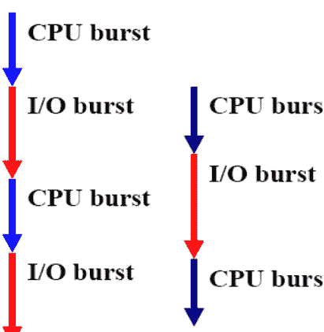

- 进程执行重复 CPU 突发和 I/O 突发周期。
- 当一个进程开始一个 I/O 突发时，另一个进程可以使用 CPU 进行其 CPU 突发。

## CPU 密集型和 I/O 密集型

- 如果一个进程很少产生 I/O 请求，使用更多时间进行计算，则该进程是 CPU 密集型的。
- 如果一个进程花费更多时间进行 I/O 而不是计算，则该进程是 I/O 密集型的。
- CPU 密集型进程可能有几个非常长的 CPU 突发。
- I/O 密集型进程通常有许多短的 CPU 突发。

## CPU 调度程序

- 当 CPU 空闲时，操作系统必须选择另一个进程运行。
- 此选择过程由 *短期调度程序*（或 *CPU 调度程序*）执行。
- CPU 调度程序从就绪队列中选择一个进程，并将 CPU 分配给它。
- 就绪队列有许多组织方式（例如 FIFO）。

## 调度可能发生的情况

- 一个进程从 **运行** 状态切换到 **终止** 状态。
- 一个进程从 **运行** 状态切换到 **等待** 状态（*例如*，进行 I/O）。
- 一个进程从 **运行** 状态切换到 **就绪** 状态（*例如*，发生 **中断**）。
- 一个进程从 **等待** 状态切换到 **就绪** 状态（*例如*，I/O 完成）。

## CPU 调度发生

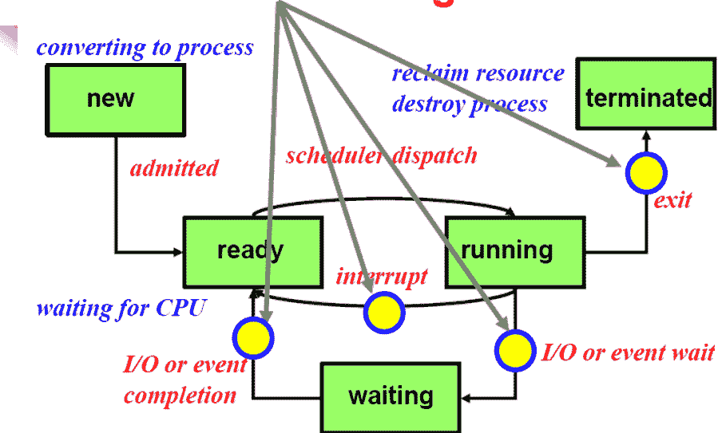

converting to process

admitted

waiting for CPU

I/O or event completion

scheduler dispatch

interrupt

waiting for I/O or event

reclaim resource

destroy process

I/O or event wait

exit

##抢占式与非抢占式

**抢占式调度**

- 调度发生在情况 3 和情况 4。
- 伴随访问共享数据相关的成本。
- 如果内核在其关键区修改某些重要数据会发生什么？
- 内核必须特别注意这种情况，因此更复杂。

## 抢占式与非抢占式

- **非抢占式调度**
  - 调度发生在进程自愿终止（情况 1）或进入等待状态（情况 2）时。
  - 一旦 CPU 被分配给一个进程，该进程将保持 CPU 直到它终止或切换到等待状态。
  - 简单，但效率非常低


## 作业1

- 说明抢占式调度与非抢占式调度的区别。对于计算中心，上述两种调度方式哪一种比较适合？

## 分派程序

- **分派程序模块**将 CPU 的控制权交给由短期调度程序选中的进程。
- 它的功能包括：
  - 切换上下文
  - 切换到用户模式
  - 跳转到用户程序中的适当位置以重新启动该程序
- **分派延迟**——分派程序停止一个进程并启动另一个进程运行所需的时间。

**分派程序应尽可能快。**

## 调度准则

- 比较不同调度算法时有许多准则。
- 以下是五个常见的准则：
  - CPU 利用率
  - 吞吐量
  - 周转时间
  - 等待时间
  - 响应时间

## CPU 利用率

- 我们希望让 CPU 尽可能保持忙碌。
- CPU 利用率的范围从 0 到 100%。
- 通常，40% 或以下为轻负载，90% 或以上为重负载。

## 吞吐量

- 每个时间单位内完成的进程数称为**_吞吐量_**。
- 更高的吞吐量意味着完成更多作业。
- 然而，对于长时间运行的进程，该速率可能是一个小时一个作业；而对于短作业，该速率可能是每分钟 10 个。

## 周转时间

- 从作业提交到完成的时间段称为**周转时间**。
- 从用户的角度来看，周转时间比 CPU 利用率和吞吐量更重要。
- 周转时间是以下各项之和：
  - 进入系统之前的等待时间
  - 在就绪队列中的等待时间
  - 在所有其他事件（如 I/O）上的等待时间
  - 进程实际在 CPU 上运行的时间

## 等待时间

- **等待时间**是进程在**就绪队列**中等待的时间段之和。
- **为什么只考虑就绪队列？**
  - CPU 调度算法不影响进程执行或进行 I/O 的时间。
  - 但是，CPU 调度算法确实会影响进程在就绪队列中停留的时间。

## 响应时间

- （在交互式系统中）从提交请求到产生首次响应的时间称为**响应时间**。它**不包括**输出响应所需的时间。
- 例如，在你的工作站前，你也许更关心按下**回车**键到获得第一个输出之间的时间，而不是按下**回车**键到程序完成的时间（如周转时间）。

## 优化准则

- 最大化 CPU 利用率
- 最大化吞吐量
- 最小化周转时间
- 最小化等待时间
- 最小化响应时间

在大多数情况下，我们优化平均值。
然而，在某些情况下，需要优化最小值或最大值而非平均值。

## 大纲

- 基本概念
- 调度准则
- **调度算法**
- 多处理器调度
- 实时调度
- 线程调度
- 算法评估
- 操作系统示例

## 调度算法

- 先来先服务调度（FCFS）
- 最短作业优先调度（SJF）
- 优先级调度
- 时间片轮转调度
- 多级队列调度
- 多级反馈队列调度

## 先来先服务（FCFS）调度

- 首先请求 CPU 的进程最先获得 CPU。
- 这可以很容易地使用队列实现。
- **FCFS 是不可抢占的。**一旦进程获得 CPU，它将占用 CPU，直到进程完成或自愿进入等待状态。

## FCFS 调度

| 进程 | CPU 突发时间 |
|---|---|
| P₁ | 24 |
| P₂ | 3 |
| P₃ | 3 |

假设进程按 P₁、P₂、P₃ 的顺序到达，该调度的甘特图如下：


平均等待时间？

每个进程的等待时间？


## FCFS 调度

- 假设进程按顺序 P₂、P₃、P₁ 到达。
- 该调度的甘特图如下：

  

- P₁ 的等待时间 = 6；P₂ = 0；P₃ = 3。
- 平均等待时间：(6 + 0 + 3)/3 = 3。
- 比之前的情况好得多。

## FCFS 的问题

- 很容易出现*护航效应*：所有进程都在等待一个大进程释放 CPU。**CPU 和设备利用率可能会很低。** *为什么？*
- 它有利于长进程，而对短进程可能不公平。如果你那只需要 1 分钟的作业排在一个需要 10 小时的作业后面，会怎样？
- 对于*分时系统*而言，它很麻烦，因为分时系统中每个用户都需要定期获得 CPU 的一部分时间。

## 最短作业优先（SJF）调度

- 将每个进程与其**下一次CPU突发的长度**关联起来。
- 当必须从就绪队列中选择一个进程时，选择下一次CPU突发最短的进程。
- 因此，就绪队列中的进程按下一次CPU突发的长度排序。
- SJF 可以是不可抢占的或可抢占的。
  - 不可抢占：一旦 CPU 分配给进程，在其完成本次 CPU 突发之前不能被抢占。
  - 可抢占：如果有新进程到达，其 CPU 突发长度小于当前执行进程的剩余时间，则进行抢占。这种方案称为最短剩余时间优先。
- SJF 是最优的——对于给定的一组进程，它能获得最小的平均等待时间。

## SJF 可证明是最优的

- 每次我们把短作业放在长作业之前，都会减少平均等待时间。
- 我们可以调换乱序的作业，直到所有作业都有序。
- 如果作业已经有序，则作业调换不可能发生。

```
A waits 0
B waits a
a
A
B
average = a/2

B waits 0
A waits b
b
a
B
A
average = b/2
```

## 可抢占 SJF 示例

| 进程 | 到达时间 | 突发时间 |
|---|---|---|
| P₁ | 0 | 7 |
| P₂ | 2 | 4 |
| P₃ | 4 | 1 |
| P₄ | 5 | 4 |

- SJF（可抢占）

  

- 平均等待时间 = (9 + 1 + 0 + 2)/4 = 3

## 我们如何知道下一次 CPU 突发？

- 如果这个问题得不到很好的回答，SJF 就无法用于 CPU 调度。
- 我们尝试预测下一次 CPU 突发！
- 可以通过使用前几次 CPU 突发的长度来完成——指数平均 (指数平均)。

## 下一次 CPU 突发长度的预测

α = 1/2  
τ₀ = 10


| 序列 | 1 | 2 | 3 | 4 | 5 | 6 | 7 | 8 | ... |
|---|---|---|---|---|---|---|---|---|---|
| CPU突发 (tᵢ) | 6 | 4 | 6 | 4 | 13 | 13 | 13 | 13 | ... |
| 预测 (τᵢ) | 10 | 8 | 6 | 6 | 5 | 9 | 11 | 12 | ... |

## 指数平均示例

- 如果我们展开公式，就得到：

  τₙ₊₁ = α tₙ + (1 - α) α tₙ₋₁ + … + (1 - α)ʲ α tₙ₋ⱼ + … + (1 - α)ⁿ⁺¹ τ₀

- 由于 α 和 (1 - α) 都小于或等于 1，所以每一项的权重都比前一项小。

## SJF 的问题

- 准确估计下一次突发时间值很困难。
- SJF 有利于短作业。因此，一些长作业可能根本没有机会运行。这就是*饥饿*。

## 优先级调度

- 优先级通常由**某一固定范围的数字**表示，例如 0~7。
- 在本文中，我们假设数字越小代表优先级越高。
- 调度器总是从就绪队列中选择**优先级最高**的进程来运行。
- FCFS 和 SJF 是否属于优先级调度的**特例**？（**为什么？**）
- 优先级调度可以是**不可抢占**的或**可抢占**的。
- 在可抢占的优先级调度中，如果新到达的进程优先级高于正在运行的进程，则后者被抢占。
- 可能会出现**无限阻塞**（或**饥饿**）：低优先级进程可能永远没有机会运行。


## Aging

- Aging 是一种克服饥饿问题的技术。
- *Aging*：逐渐提高在系统中长时间等待的进程的优先级。
- Example:
  - 如果 0 是最高（*resp.*，最低）优先级，则我们可以每隔固定周期（*e.g.*，每分钟）将等待进程的优先级值减少（*resp.*，增加）1。

## Round Robin (RR)

- RR 专门为 **分时系统** 设计。
- RR 与 FCFS 相似，只是每个进程被分配一个 **时间片/量子**。
- 就绪队列中的所有进程都在一个 **FIFO** 列表中。当 CPU 空闲时，调度程序选择 **第一个** 并让它运行 **一个时间量子**。
- 如果进程使用的 CPU 时间少于一个时间量子，它会自愿释放 CPU。
- 否则，当一个时间量子用完时，该进程会被调度程序抢占并移动到列表的尾部。

### Example of RR with Time Quantum = 20

| Process | Burst Time |
|---|---:|
| P₁ | 53 |
| P₂ | 17 |
| P₃ | 68 |
| P₄ | 24 |

The Gantt chart is:

|   | P₁ | P₂ | P₃ | P₄ | P₁ | P₃ | P₄ | P₁ | P₃ | P₃ |
|---:|---:|---:|---:|---:|---:|---:|---:|---:|---:|---:|
| 0 | 20 | 37 | 57 | 77 | 97 | 117 | 121 | 134 | 154 | 162 |

Typically, higher average turnaround time than SJF, but better response time.

### RR Scheduling Issues

- 如果时间量子过大，RR 会退化为 FCFS。
- 如果时间量子过小，RR 变成处理器共享。
- 上下文切换可能会影响 RR 的性能。
  - 时间量子越短，上下文切换越多。
- 周转时间也取决于时间量子大小。
- 通常，80% 的 CPU 突发时间应短于时间量子。

### Time Quantum and Context Switch Time

| process time | time quantum | context switches |
|---:|---:|---:|
| 10 | 12 | 0 |
| 10 | 6 | 1 |
| 10 | 1 | 9 |

### Turnaround Time Varies With the Time Quantum


| process | time |
|---|---:|
| P₁ | 6 |
| P₂ | 3 |
| P₃ | 1 |
| P₄ | 7 |

## Multilevel Queue

- 就绪队列被划分为独立的队列。
  - foreground (interactive)
  - background (batch)
- 每个进程根据进程的某些属性（例如，内存使用量、优先级、进程类型）永久分配到一个队列。
- 每个队列都有自己的调度算法。
  - foreground – RR
  - background – FCFS

### Ready Queue


- 进程 P 只有在包含 P 的队列之上的所有队列都为空时才能运行。
- 当一个进程正在运行时，如果有更高优先级队列中的进程到来，则正在运行的进程会被抢占。

- 必须在队列之间进行调度。
- 固定优先级调度；即，先服务 foreground 中的所有进程，然后再服务 background。可能导致饥饿。
- 时间片 – 每个队列获得一定的 CPU 时间，可在其进程中进行调度；即，80% 分配给 foreground 的 RR，20% 分配给 background 的 FCFS。

## Multilevel Feedback Queue

- *Multilevel queue with feedback scheduling* 与多级队列类似；然而，它允许进程在队列之间移动。
  - aging 可以通过这种方式实现。
- 如果一个进程使用更多（*resp.*，更少）CPU 时间，它会被移动到较低（*resp.*，较高）优先级的队列。
- 结果是，I/O-bound（*resp.*，CPU-bound）进程将位于较高（*resp.*，较低）优先级的队列中。

### Example of Multilevel Feedback Queue

- 三个队列：
  - Q₀ – time quantum 8 milliseconds
  - Q₁ – time quantum 16 milliseconds
  - Q₂ – FCFS
- Scheduling:
  - 一个新作业进入 Q₀，由 RR 服务。当它获得 CPU 时，作业运行 8 毫秒。如果它在 8 毫秒内未完成，作业将被移动到 Q₁。
  - 在 Q₁ 中，作业再次由 RR 服务并运行额外的 16 毫秒。如果它仍然未完成，则会被抢占并移动到队列 Q₂。


## 多级反馈队列


## 就绪队列


- 队列 *i* 中的进程具有时间片 `2^i`
- 当进程的行为发生变化时，它可能会被放置到不同的队列中，即 **提升** 或 **降级**。
- 因此，当一个 CPU 密集型进程开始使用更多 CPU 时，它可能会被降级到更低的队列

## 多级反馈队列

- **多级反馈队列调度器由以下参数定义：**
  - 队列的数量
  - 每个队列的调度算法
  - 用于确定何时提升进程的方法
  - 用于确定何时降级进程的方法
  - 用于确定进程需要服务时将进入哪个队列的方法

## 大纲

- 基本概念
- 调度准则
- 调度算法
- **多处理器调度**
- 实时调度
- 线程调度
- 算法评估
- 操作系统示例

## 多处理器调度

- 当有多个 CPU 可用时，CPU 调度变得更加复杂。
- 多处理器中的 *同构处理器*。
- *负载均衡* — 使工作负载在所有处理器之间均匀分布。
  - 推迁移
  - 拉迁移

## 多处理器调度

## 处理器亲和性

- 大多数 SMP 系统试图避免进程从一个处理器迁移到另一个处理器。
- 软亲和性 & 硬亲和性

## 实时调度

- **硬实时系统** – 必须在保证的时间内完成关键任务。
  - 调度器 **要么接收** 一个进程并保证该进程会按时完成，**要么拒绝** 该请求（*资源预留*）。
  - 如果系统具有辅助存储和虚拟内存，则几乎不可能实现这一点，因为这些子系统会造成不可避免的延迟。
  - 硬实时系统通常在专用硬件上运行专用软件。

## 实时调度

- *软实时系统* – 要求关键进程优先于较不幸的进程。
  - 在通用系统中很容易实现。
  - 它可能导致不公平的资源分配和非关键任务的更长延迟（*饥饿*）。
  - CPU 调度器必须 *防止老化* 发生。否则，关键任务可能会具有较低的优先级。
  - 调度延迟必须很小。

## 优先级反转

- 如果一个 **高优先级进程** 需要访问当前正被低优先级进程访问的数据会怎样？
- 高优先级进程被低优先级进程阻塞。
- 这就是 *优先级反转*。

## 优先级反转

- 这可以通过 *优先级继承协议* 来解决。
  - 所有进程，包括正在访问数据的进程，**继承高优先级**，直到它们完成对资源的使用。
  - 完成后，它们的优先级值 **恢复** 为原始值。

## 大纲

- 基本概念
- 调度准则
- 调度算法
- 多处理器调度
- 实时调度
- 线程调度
- 算法评估
- 操作系统示例

## 线程调度

- **用户级线程**
  - 由线程库管理
- **内核级线程**
  - 由操作系统调度
- 要在 CPU 上运行，用户级线程最终必须映射到关联的内核级线程。

## 线程调度

- **本地调度** – **用户级线程**
  - 线程库决定将哪个线程放到可用的 LWP 上
  - **进程竞争范围 PCS**

- **全局调度** – **内核级线程**
  - 内核决定下一个运行哪个内核线程
  - **系统竞争范围 SCS**


## 大纲

- 基本概念
- 调度准则
- 调度算法
- 多处理器调度
- 实时调度
- 线程调度
- 算法评价
- 操作系统示例

## Solaris 2 调度

- 使用抢占式和基于优先级的调度算法来调度线程。
- 默认调度类别为分时 —— 多级反馈队列


### Solaris 调度表

| 优先级 | 时间片 | 时间片耗尽 | 从睡眠返回 |
|---:|---:|---:|---:|
| 0 | 200 | 0 | 50 |
| 5 | 200 | 0 | 50 |
| 10 | 160 | 0 | 51 |
| 15 | 160 | 5 | 51 |
| 20 | 120 | 10 | 52 |
| 25 | 120 | 15 | 52 |
| 30 | 80 | 20 | 53 |
| 35 | 80 | 25 | 54 |
| 40 | 40 | 30 | 55 |
| 45 | 40 | 35 | 56 |
| 50 | 40 | 40 | 58 |
| 55 | 40 | 45 | 58 |
| 59 | 20 | 49 | 59 |

## Windows XP 优先级

抢占式和基于优先级的调度算法

|  | 实时 | 高 | 高于正常 | 正常 | 低于正常 | 空闲优先级 |
|---|---|---|---|---|---|---|
| 时间关键 | 31 | 15 | 15 | 15 | 15 | 15 |
| 最高 | 26 | 15 | 12 | 10 | 8 | 6 |
| 高于正常 | 25 | 14 | 11 | 9 | 7 | 5 |
| 正常 | 24 | 13 | 10 | 8 | 6 | 4 |
| 低于正常 | 23 | 12 | 9 | 7 | 5 | 3 |
| 最低 | 22 | 11 | 8 | 6 | 4 | 2 |
| 空闲 | 16 | 1 | 1 | 1 | 1 | 1 |

## Linux 调度

- **抢占式**和**基于优先级**的调度算法
- 分时
  - **基于优先级的信用（credit）机制** – 拥有最多信用（credit）的进程下一个被调度
  - 当定时器中断发生时，信用（credit）被扣除
  - 当信用（credit）为 0 时，选择另一个进程
  - 当所有可运行进程的信用（credit）都为 0 时，会根据优先级和历史等因素重新分配信用（credit）

### 优先级与时间片长度之间的关系

| 数值优先级 | 相对优先级 | 时间片 |
|---:|---|---|
| 0 | 最高 | 200 ms |
| • |  |  |
| • |  |  |
| • |  |  |
| 99 |  |  |
| 100 |  |  |
| • |  |  |
| • |  |  |
| • |  |  |
| 140 | 最低 | 10 ms |

实时任务

其他任务

## 作业2


- 课后习题5.4（P187）

## 操作系统原理及应用

李  伟

xchlw@seu.edu.cn

计算机科学与工程学院、软件学院
江苏省网络与信息安全重点实验室

# 第6章 进程同步

## 大纲

- 背景
- 临界区问题
- 同步硬件
- 信号量
- 经典同步问题
- 管程
- 同步示例

## 背景

- 并发访问共享数据可能导致数据不一致。
- 保持数据一致性需要相应的机制，以确保协作进程的有序执行。
- 针对**有界缓冲区问题**（第3章）的共享内存解决方案允许缓冲区中同时最多容纳 *n* − 1 个条目。
- 假设我们要提供一个解决方案，来解决生产者-消费者问题，并填满**所有**缓冲区。
  - 为此，可以使用一个整型变量 **count** 来记录已满缓冲区的数量。

## 有界缓冲区

- 共享数据

```
#define BUFFER_SIZE 10
typedef struct {
    ...
} item;
item buffer[BUFFER_SIZE];
int in = 0;
int out = 0;
int counter = 0;
```

- 生产者进程

```
item nextProduced;
while (1) {
    while (counter == BUFFER_SIZE);
        /* do nothing */
    buffer[in] = nextProduced;
    in = (in + 1) % BUFFER_SIZE;
    counter++;
}
```

- **消费者进程**

```
item nextConsumed;
while (1) {
    while (counter == 0);
        /* do nothing */
    nextConsumed = buffer[out];
    out = (out + 1) % BUFFER_SIZE;
    counter--;
}
```


## 有界缓冲区

- **这些语句**
  - `counter++;`
  - `counter--;`
  - 必须*原子地*执行。
- 原子操作是指一个完整执行且不被中断的操作。

- 语句 `counter++` 在机器语言中可能实现为：
  - `register1 = counter`
  - `register1 = register1 + 1`
  - `counter = register1`
- 语句 `counter--` 可能实现为：
  - `register2 = counter`
  - `register2 = register2 - 1`
  - `counter = register2`

- 如果**生产者与消费者同时尝试更新缓冲区**，汇编语言语句可能会交错执行。
- 交错取决于生产者和消费者进程是如何被调度的。

- 假设 counter 初始值为 5，它最终是多少？

### 生产者

```
register1 = counter
register1 = register1 + 1
counter = register1
```

### 消费者

```
register2 = counter
register2 = register2 - 1
counter = register2
```

## 竞态条件

- **竞态条件**发生在以下情况：
  - 两个或多个进程/线程并发地访问和操作同一数据
  - 执行的结果取决于访问发生的特定顺序。
- 为了防止竞态条件，并发进程必须被同步。

## 大纲

- 背景
- 临界区问题
- 同步硬件
- 信号量
- 经典的同步问题
- 管程
- 同步示例

## 临界区问题

- 所有 *n* 个进程都在竞争使用某些共享数据
- 每个进程都有一段**代码段**，称为*临界区*，在其中修改共享数据。
- **问题** – 确保当一个进程在其临界区中执行时，不允许其他进程执行其临界区。
- 因此，临界区的执行必须**_互斥_**（例如，任何时刻最多只有一个进程能处于其临界区）。
- **_临界区问题_** 是设计一个供进程合作使用的协议。

### 临界区协议

```
do {
  entry section
  critical section
  exit section
  remainder section
} while (1);
```

- 临界区协议由两部分组成：一个*进入区*和一个*退出区*。
- 它们之间是必须以互斥方式运行的临界区。

### 临界区问题的解决方案

- 临界区问题的任何解决方案都必须满足以下三个条件：
  - 互斥（Mutual Exclusion）
  - 空闲让进（Progress）
  - 有限等待（Bounded Waiting）
- 此外，解决方案不能依赖于进程的相对速度和调度策略。

### 互斥

- 如果一个进程 **P** 正在其临界区中执行，那么*没有*其他进程可以在它们的临界区中执行。
- **临界区协议**应该能够阻塞那些希望进入但不能进入的进程。
- 此外，当正在其临界区中执行的进程退出时，**临界区协议**必须能够知晓这一事实，并允许一个等待进程进入。

### 空闲让进

- 如果**没有**进程在其临界区中执行，并且有些进程希望进入其临界区，那么
  - 只有那些等待进入的进程可以参与竞争（进入其临界区）。
  - 没有其他进程可以影响这一决定。
  - 这一决定不能被无限期推迟。

### 有限等待

- 在一个进程请求进入其临界区之后、在它获得进入许可之前，其他进程被允许进入的次数存在一个上限。
- 因此，即使一个进程可能被其他等待进程阻塞，它也不会永远等待。
- 假设每个进程以非零速度执行。
- 对 n 个进程的相对速度不做任何假设。


## 解决问题的初始尝试

- 仅有 2 个进程，*P*₀ 和 *P*₁
- 进程 *P*ᵢ 的通用结构（另一个进程 *P*ⱼ）

```c
do {
    entry section
    critical section
    exit section
    remainder section
} while (1);
```

- 进程可能共享一些公共变量以同步其动作。

## 算法 1

- 共享变量：
  - int turn; 初始时 turn = i （或 turn = j）
- 进程 *P*ᵢ：

```c
do {
    while (turn != i) ;
    critical section
    turn = j;
    remainder section
} while (1);
```

- 进程被强制以交替方式运行。
- 满足互斥，但不满足进展。

## 算法 2

共享变量

- boolean flag[2]; 初始时 flag[0] = flag[1] = false.
- flag[i] = true ⇒ *P*ᵢ 准备进入其临界区
- 进程 *P*ᵢ：

```c
do {
    flag[i] = true;
    while (flag[j]);
    critical section
    flag[i] = false;
    remainder section
} while (1);
```

- 满足互斥，但不满足进展。

## 下列算法正确吗？

- 进程 *P*ᵢ：

```c
do {
    while (flag[j]);
    flag[i] = true;
    critical section
    flag[i] = false;
    remainder section
} while (1);
```

## 算法 3——Peterson 的解决方案

- 结合了算法 1、2 的共享变量。
- 进程 *P*ᵢ：

```c
do {
    flag[i] = true;
    turn = j;
    while (flag[j] and turn == j);
    critical section
    flag[i] = false;
    remainder section
} while (1);
```

- 满足全部三个要求；解决了 **两个进程** 的临界区问题。

## Bakery 算法

### n 个进程的临界区

- 在进入其临界区之前，进程会获得一个号码。持有最小号码的进程进入临界区。
- 如果进程 *P*ᵢ 和 *P*ⱼ 获得相同的号码，若 *i < j*，则 *P*ᵢ 先被服务；否则 *P*ⱼ 先被服务。
- 编号方案始终按枚举的递增顺序生成数字；即 1,2,3,3,3,3,4,5...

```c
do {
    choosing[i] = true;
    number[i] = max(number[0], number[1], ..., number[n - 1]) + 1;
    choosing[i] = false;
    for (j = 0; j < n; j++) {
        while (choosing[j]);
        while ((number[j] != 0) && ((number[j], j) < (number[i], i)));
    }
    critical section
    number[i] = 0;
    remainder section
} while (1);
```

讨论

## 大纲

- 背景
- 临界区问题
- 同步硬件
- 信号量
- 同步的经典问题
- 监视器
- 同步示例

## 硬件支持

- 有两种类型的硬件同步支持
  - 禁用/启用中断
    - 这在多处理器系统上实现缓慢且困难。
  - 特殊机器指令
    - TestAndSet (TS)
    - Swap

## 中断禁用

```c
do {
    disable interrupts
    critical section
    enable interrupts
} while (1);
```

- 由于中断被禁用，临界区内不会发生上下文切换。
- 在多处理器系统中不可行，因为必须通知所有 CPU。
- 依赖于中断的一些功能（例如，时钟）可能无法正常工作。

## TestAndSet

- 原子地测试并修改一个字的內容

```c
boolean TestAndSet(boolean *target)
{
    boolean rv = *target;
    *target = true;
    return rv;
}
```

## 使用 TestAndSet 实现互斥

- 共享数据：

```c
boolean lock = false;
```

- 进程 *P*ᵢ：

```c
do {
    while (TestAndSet(&lock));
    critical section
    lock = false;
    remainder section
} while (1);
```

## Swap

- 原子地交换两个变量。

```c
void Swap(boolean *a, boolean *b)
{
    boolean temp = *a;
    *a = *b;
    *b = temp;
}
```


## 使用 TestAndSet 满足三个条件

初始 Boolean waiting[i] = false; lock=false

### 进入临界区

```
waiting[i] = true;
key = true;
while (waiting[i] && key)
    key = TestAndSet(lock);
waiting[i] = false;
```

如果删除该语句，会产生什么后果？

### 离开临界区

```
j = (i+1)%n;
while ((j != i) && !waiting[j])
    j = (j+1)%n;
if (j == i)
    lock = false;
else
    waiting[j] = false;
```

## 信号量

- 同步工具
- 信号量 S – 整数变量
- 只能通过两种标准的原子操作访问
  - *wait(S): P()*
    - `while S ≤ 0;`
    - `S--;`
  - *signal(S): V()*
    - `S++;`

### 两种类型的信号量

- **计数信号量** – 整数值可以在无限制的域中取值。
- **二进制信号量** – 整数值只能在 0 和 1 之间取值；也称为 **互斥锁**。
- 可以将计数信号量 *S* 实现为二进制信号量。

### n 个进程的临界区

- **共享数据：**
  - semaphore mutex; //initially *mutex* = 1
- **进程 P_i:**
  ```
  do {
      wait(mutex);
          critical section
      signal(mutex);
          remainder section
  } while (1);
  ```


### 信号量作为通用同步工具

- 仅在 *P_i* 中执行 *A* 之后，才在 *P_j* 中执行 *B*
- 使用初始化为 0 的信号量 *flag*
- 代码：

```
Pᵢ                         Pⱼ
⋮                          ⋮
A                    wait(flag)

signal(flag)               B
```

### 信号量实现

- 上述经典信号量定义的缺点是需要 **忙等待**。 *(当一个进程在其临界区内时，任何试图进入其临界区的其他进程都必须在入口代码中不断循环)*
- 这种类型的信号量也称为 **自旋锁** 因为进程在等待锁时会自旋。
- 为了克服忙等待的需要，进程可以 **阻塞自身** 而不是进行忙等待。

- 将信号量定义为记录

  ```
  typedef struct {
    int value;
    struct process *L; // waiting queue
  } semaphore;
  ```

- 假设有两个简单操作：
  - block() 挂起调用它的进程。
  - wakeup(P) 恢复被阻塞进程 P 的执行。

### 实现

信号量操作现在定义为

```
wait(S):
    S.value--;
    if (S.value < 0) {
        add this process to S.L;
        block();
    }

signal(S):
    S.value++;
    if (S.value <= 0) {
        remove a process P from S.L;
        wakeup(P);
    }
```

- 如果信号量的值是负数，其绝对值就是等待该信号量的进程数。
- 信号量的关键方面是它们必须被 **原子地** 执行。 (*临界区问题*)
- 忙等待 **并未** 完全消除。
  - 忙等待已从应用程序的临界区入口部分移除。
  - 此外，我们已将忙等待限制在 `wait()` 和 `signal()` 操作的临界区内。

## 练习

- 5个进程共享某一临界资源，则互斥信号量的取值范围是多少？
- 有4个进程共享一程序段，而每次最多允许2个进程进入该程序段，则信号量的初值是多少？

## 死锁和饥饿

- **死锁 – 两个或多个进程** 无限期地等待 **一个事件**，该事件只能由等待进程中的一个引起。
- 设 S 和 Q 为两个初始化为 1 的信号量

```
P₀                         P₁
wait(S);                    wait(Q);
wait(Q);                    wait(S);
⋮                           ⋮
signal(S);                  signal(Q);
signal(Q);                  signal(S);
```

- **饥饿** – 无限期阻塞。 **一个进程** 可能永远不会从其被挂起的信号量队列中移除。


## 大纲

- 背景
- 临界区问题
- 同步硬件
- 信号量
- **经典的同步问题**
- 管程
- 同步示例

## 经典的同步问题

- 有界缓冲区问题
- 读者-写者问题
- 哲学家就餐问题

### 有界缓冲区问题

**生产者进程**

```
do {
    ...
    produce an item in nextp
    ...
    wait(empty);
    wait(mutex);
    ...
    add nextp to buffer
    ...
    signal(mutex);
    signal(full);
} while (1);
```

**消费者进程**

```
do {
    wait(full);
    wait(mutex);
    ...
    remove an item from buffer to nextc
    ...
    signal(mutex);
    signal(empty);
    ...
    consume the item in nextc
    ...
} while (1);
```

### 作业1

- 在生产者——消费者问题中，信号量 `mutex`、`empty`、`full` 的作用是什么？如果分别对调生产者进程中的两个 `wait` 操作和两个 `signal` 操作，则可能发生什么情况？

### 读者-写者问题

- 一个数据集在多个并发进程之间共享
  - 读者——只读数据集，不进行任何更新
  - 写者——既可以读也可以写。
- **问题**——允许多个读者同时读取。但同一时刻只允许一个写者访问共享数据。
  - 第一个读者-写者问题——**读者优先**
  - 第二个读者-写者问题——**写者优先**

### 第一个读者-写者问题

**写者进程**

```
do {
    wait(wrt);
    ...
    writing is performed
    ...
    signal(wrt);
} while (1);
```

**读者进程**

```
do {
    wait(mutex);
    readcount++;
    if (readcount == 1)
        wait(wrt);
    signal(mutex);

    ...
    reading is performed
    ...

    wait(mutex);
    readcount--;
    if (readcount == 0)
        signal(wrt);
    signal(mutex);
} while (1);
```


### 作业2

- 用信号量解决无饥饿的读者——写者问题。

### 哲学家就餐问题


- 共享数据
  - `semaphore chopstick[5];`
  - 初始所有值均为 1
- 哲学家 i：

```
do {
    wait(chopstick[i]);
    wait(chopstick[(i+1) % 5]);
    ...
    eat
    ...
    signal(chopstick[i]);
    signal(chopstick[(i+1) % 5]);
    ...
    think
    ...
} while (1);
```


### 练习

- 用信号量解决“独木桥”问题：同一方向的行人可连续过桥，当某一方向有人过桥时，另一方向的人必须等待；当某一方向无人过桥时，另一方向的行人可以过桥。

**共享数据**

- `int countA = 0; //表示A方向上已在独木桥上的行人数目`
- `int countB = 0; //表示B方向上已在独木桥上的行人数目`
- `semaphore MA = 1; //实现对countA的互斥修改`
- `semaphore MB = 1; //实现对countB的互斥修改`
- `semaphore mutex = 1; //实现两个方向的行人对独木桥的互斥使用`

A方向过桥进程：

```
do {
    wait(MA);
    countA++;
    if (countA == 1) then wait(mutex);
    signal(MA);
    过桥;
    wait(MA);
    countA--;
    if (countA == 0) then signal(mutex);
    signal(MA);
} while (1);
```

B方向过桥进程？

## 大纲

- 背景
- 临界区问题
- 同步硬件
- 信号量
- 经典的同步问题
- 管程
- 同步示例

## 信号量存在的问题

- 信号量操作的不正确使用
  - `signal(mutex) ... wait(mutex)`
  - `wait(mutex) ... wait(mutex)`
  - 省略 `wait(mutex)` 或 `signal(mutex)`（或两者）

把分散在各进程中的临界区集中起来管理

## 管程

- **高级同步构造**，允许并发进程之间安全共享抽象数据类型。

```
monitor monitor-name
{
  shared variable declarations
  procedure body P1(...) {
    ...
  }
  procedure body P2(...) {
    ...
  }
  procedure body Pn(...) {
    ...
  }
  { initialization code}
}
```

### 管程：互斥

- *最多一个进程*可以在管程*内部*执行。因此，管程内保证了*互斥*。
- 当一个进程调用管程过程并成功进入管程时，它是*唯一*在管程内执行的进程。
- 当一个进程调用管程过程而管程中已有进程在运行时，调用者将被*阻塞在管程之外*。


## 监视器的示意图


## 条件变量

- 要允许进程在管程内等待，必须声明一个 **condition** 变量，如 **condition x, y;**
- 条件变量只能与操作 **wait** 和 **signal** 一起使用。
  - **x.wait()** 表示调用此操作的进程将被挂起，直到另一个进程调用 **x.signal();**
  - **x.signal()** 操作恢复恰好一个被挂起的进程。如果没有进程被挂起，则 **signal()** 操作无效。

## 带条件变量的管程


### 条件信号

- 考虑被释放的进程和发出信号的进程
  - 有 **two** 个进程在管程中执行，互斥被违反了！
- 解决此问题的方法
  - 被释放的进程占用管程而发出信号的进程在某处等待。（唤醒并等待）
  - 被释放的进程在某处等待而发出信号的进程继续使用管程。（唤醒并继续）

## 信号量 vs. 条件

| Semaphores | Condition Variables |
|---|---|
| Can be used anywhere, but not in a monitor | Can only be used in monitors |
| `wait()` does not always block its caller | `wait()` **always** blocks its caller |
| `signal()` either releases a process, or increases the semaphore counter | `signal()` either releases a process, or the signal is **lost** as if it never occurs |
| If `signal()` releases a process, the caller and the released **both continue** | If `signal()` releases a process, either the caller or the released continues, but **not both** |

## Monitor vs. Process

- 管程定义的是公用数据结构，而进程定义的是私有数据结构
- 管程把共享变量上的同步操作集中起来，而临界区却分散在每个进程中
- 管程是为管理共享资源而建立的，进程主要是为占有系统资源和实现系统并发性而引入的
- 管程是被欲使用共享资源的进程所调用，管程和调用它的进程不能并发工作，而进程之间能并发工作
- 管程是语言或操作系统的成分，不必创建或撤销，而进程有生命周期，由创建而产生至撤销便消亡

## 哲学家进餐

```
void pickup(int i)
{
    state[i] = hungry;
    test[i];
    if (state[i] != eating)
        self[i].wait();
}
```

```
void putdown(int i)
{
    state[i] = thinking;
    // test left and right neighbors
    test((i+4) % 5);
    test((i+1) % 5);
}
```

### 哲学家进餐

```c
void test(int i)
{
    if ( (state[(i + 4) % 5] != eating) &&
         (state[i] == hungry) &&
         (state[(i + 1) % 5] != eating))
    {
        state[i] = eating;
        self[i].signal();
    }
}
```

## 哲学家进餐

- 每个哲学家 *i* 按以下顺序调用操作 **pickup()** 和 **putdown()**：
  - dp.pickup (i)
  - EAT
  - dp.putdown (i)

## 使用信号量实现的管程

- Variables

```
semaphore mutex; // (initially = 1)
semaphore next; // (initially = 0)
int next-count = 0;
```

- 每个外部过程 F 将被替换为

```
wait (mutex);
...
body of F;
...
if (next-count > 0)
  signal (next)
else signal (mutex);
```

- 管程内的互斥得到保证。

确保管程的互斥调用

管程内挂起进程的总数

防止执行 Signal操作后两个进程同时在管程中

## 管程实现

- 操作 x.signal 可以实现为

```
if (x-count > 0)
{
    next-count++;
    signal (x-sem);
    wait (next);
    next-count--;
}
```

## 管程实现

- **Conditional-wait** 构造：x.wait(c)
  - c – 在执行 wait 操作时求值的整数表达式。
  - c 的值（一个 *priority number*）与被挂起的进程的名称一起存储。
  - 当 x.signal() 执行时，关联优先级数字最小的进程将被接下来恢复。

## 管程实现

- 检查两个条件以建立  
  系统的  
  正确性
  - 用户进程必须始终以  
    正确的顺序在  
    管程上进行调用。
  - 必须确保不合作的进程不会忽略由  
    管程提供的互斥入口，  
    并尝试直接访问  
    共享资源，而不使用  
    访问协议。


## 大纲
- 背景
- 临界区问题
- 同步硬件
- 信号量
- 同步的经典问题
- 管程
- 同步示例

## Solaris 同步
- 实现了多种锁，以支持多任务、多线程（包括实时线程）和多处理。
- 在保护短代码段的数据时，使用*自适应互斥锁*以提高效率。
- 当较长的代码段需要访问数据时，使用*条件变量*、*信号量*和*读者-写者锁*。
- 使用*旋转门*来对等待获取自适应互斥锁或读者-写者锁的线程列表进行排序。

## Windows XP 同步
- 在单处理器系统上，使用**中断屏蔽**来保护对全局资源的访问。
- 在多处理器系统上使用*自旋锁*。
- 还提供*调度器对象*，它们可以充当互斥锁和信号量。
- 调度器对象还可以提供*事件*。事件的作用非常类似于条件变量。

## Linux 同步
- **Linux**
  - 通过禁用中断来实现短临界区
- **Linux 提供**
  - 信号量
  - 自旋锁

## Pthreads 同步
- Pthreads API 与操作系统无关
- 它提供
  - 互斥锁
  - 条件变量
- 不可移植的扩展包括
  - 读写锁
  - 自旋锁

## 操作系统原理及应用

李 伟

xchlw@seu.edu.cn

计算机科学与工程学院、软件学院

江苏省网络与信息安全重点实验室


# 第 7 章 死锁

## 大纲
- 系统模型
- 死锁特征
- 死锁处理方法
- 死锁预防
- 死锁避免
- 死锁检测
- 死锁恢复

## 死锁问题


## 系统模型
- **请求**
  - 如果进程请求使用某个系统资源，而该请求无法立即得到满足，那么请求进程将被阻塞，直到它能够获得该资源。
- **使用**
  - 进程可以对资源进行操作。
- **释放**
  - 进程释放该资源。

## 系统模型
- **死锁**
  - 当集合中的每个进程都在等待一个只能由该集合中另一个进程触发的事件时，该进程集合就处于死锁状态。

## 大纲
- 系统模型
- **死锁特征**
- 死锁处理方法
- 死锁预防
- 死锁避免
- 死锁检测
- 死锁恢复

## 死锁特征
- 要发生死锁，必须同时满足以下四个条件。
  - **互斥：** 任一时刻只允许一个进程使用资源。
  - **持有并等待（请求并持有）：** 进程必须持有至少一个资源，并等待获取另一个资源。
  - **不可抢占：** 资源只能被持有它的进程在完成任务后自愿释放。
  - **循环等待：** A 等待 B，B 等待 C，C 等待 A。

## 资源分配图

一组顶点 $V$ 和一组边 $E$。

- $V$ 分为两种类型：
  - $P = \{P_1, P_2, \ldots, P_n\}$，即系统中所有进程的集合。
  - $R = \{R_1, R_2, \ldots, R_m\}$，即系统中所有资源类型的集合。
- **请求边** – 有向边 $P_i \rightarrow R_j$
- **分配边** – 有向边 $R_j \rightarrow P_i$

## 资源分配图
- 进程
- 具有 4 个实例的资源类型
- *Pᵢ* 请求 *Rⱼ* 的一个实例
- *Pᵢ* 持有 *Rⱼ* 的一个实例

## 资源分配图示例


## 资源分配图
有环但无死锁


## 基本事实
- 如果图不包含环 ⇒ 不会发生死锁。
- 如果图包含一个环 ⇒
  - 如果每种资源类型只有一个实例，则发生死锁。
  - 如果每种资源类型有多个实例，则可能发生死锁。

## 大纲
- 系统模型
- 死锁特征
- 处理死锁的方法
- 死锁预防
- 死锁避免
- 死锁检测
- 死锁恢复

## 处理死锁的方法
- 确保系统永远不会进入死锁状态。
  - **预防：** 确保四个条件之一不成立。
  - **避免：** 操作系统需要更多信息以便确定当前请求是否可以满足或延迟。
- 允许系统进入死锁状态，检测它并进行恢复。
- 忽略问题并假装系统从未发生死锁

## 大纲
- 系统模型
- 死锁特征
- 处理死锁的方法
- **死锁预防**
- 死锁避免
- 死锁检测
- 死锁恢复

## 死锁预防：互斥
- 通过确保四个条件之一不成立，我们可以防止死锁的发生。
- **互斥**：某些不可共享的资源必须被独占访问（例如打印机），这意味着我们无法否定互斥条件。

## 死锁预防：占有并等待
- 任何进程都不能持有某些资源然后再请求其他资源。
- 可能的两种策略：
  - 进程必须在运行前获取*所有*资源。
  - 当进程请求资源时，它必须不持有任何资源（即在请求更多资源前先归还资源）。
- 资源利用率可能很低，因为许多资源会被长时间持有而未使用。
- 可能发生饥饿。一个需要某些热门资源的进程可能需要无限期等待。

## 死锁预防：不可剥夺
- 如果持有某些资源的进程请求另一个无法立即分配给它的资源，则当前持有的所有资源将被剥夺。
- 如果请求的资源不可用：
  - 如果它们被正在等待额外资源的进程持有，则这些资源将被剥夺并给予请求进程。（抢别人）
  - 否则，请求进程等待直到请求的资源可用。在等待期间，其资源可能被剥夺。（被抢）

## 死锁预防：循环等待
- 为打破循环等待条件，我们可以对所有资源类型进行排序（*例如*，磁带、打印机）。
- 进程只能请求比其已持有资源类型更高的资源。
- 进程必须释放某些更高顺序的资源才能请求更低顺序的资源。
- 假设磁带、磁盘和打印机的顺序为 1、4 和 8。如果一个进程持有磁盘（4），它只能请求打印机（8）而不能请求磁带（1）。要获取磁带（1），进程必须释放其磁盘（4）。
- 这样，就不可能发生死锁。为什么？

## 大纲
- 系统模型
- 死锁特征
- 处理死锁的方法
- 死锁预防
- **死锁避免**
- 死锁检测
- 死锁恢复

## 安全状态
- 当进程请求可用资源时，系统必须决定是否立即分配会使系统处于*安全状态*。
- 系统处于安全状态如果存在所有进程的一个安全序列。
- **序列 <P₁, P₂, …, Pₙ> 是安全的** 如果对于每个 Pᵢ，Pᵢ 仍可能请求的资源可以由当前可用资源 *加上* 所有 Pⱼ 持有的资源满足，其中 j<i。

## 基本事实
- 如果系统处于安全状态 ⇒ 不会发生死锁。
- 如果系统处于不安全状态 ⇒ 可能发生死锁。
- 避免 ⇒ 确保系统永远不会进入不安全状态。


## 安全状态、不安全状态、死锁状态


## 避免算法

- 单个资源类型的单个实例
  - 使用资源分配图算法
- 多个资源类型的多个实例
  - 使用银行家算法

## 资源分配图算法

- *声明边* $P_i \rightarrow R_j$ 表示进程 $P_i$ 可能请求资源 $R_j$；用虚线表示。
- **声明边转换为请求边** 当进程请求资源时。
- 当进程释放资源时，**分配边重新转换为声明边。**
- 资源必须在系统中预先声明。

## 资源分配图
用于死锁避免


## 资源分配图中的不安全状态


## 银行家算法

- 多个实例。
- 每个进程必须预先声明最大使用量。
- 当进程请求资源时可能需要等待。
- 当进程获得所有资源后必须在有限时间内归还它们。

## 银行家算法的数据结构

设 n = 进程数，m = 资源类型数。

- **Available**: 长度为 m 的向量。若 available [j] = k，则资源类型 Rj 可用 k 个实例。
- **Max**: n x m 矩阵。若 Max [i,j] = k，则进程 Pi 最多可请求资源类型 Rj 的 k 个实例。
- **Allocation**: n x m 矩阵。若 Allocation[i,j] = k 则 Pi 当前被分配了 Rj 的 k 个实例。
- **Need**: n x m 矩阵。若 Need[i,j] = k，则 Pi 为完成任务可能还需要 Rj 的 k 个实例。

## 安全算法

1. 设 *Work* 和 *Finish* 分别为长度为 *m* 和 *n* 的向量。初始化：
   
   *Work* = Available;  *Finish* [i] = false 对于 i = 0, 1, ..., n。

2. 找到一个 *i* 满足以下条件：
   
   (a) *Finish* [i] = *false*
   
   (b) *Needᵢ* ≤ *Work*
   
   如果不存在这样的 *i*，则转到步骤 4。

3. *Work* = *Work* + *Allocationᵢ*
   
   *Finish* [i] = *true*
   
   转到步骤 2。

4. 如果 *Finish* [i] == true 对于所有 *i*，则 **系统处于安全状态。**

## 进程 Pi 的资源请求算法

设 *Request*ᵢ 为进程 *P*ᵢ 的请求向量。若 *Request*ᵢ[*j*] = *k* 则进程 *P*ᵢ 想要资源类型 *R*ⱼ 的 *k* 个实例。

1. 如果 *Request*ᵢ ≤ *Need*ᵢ 则转到步骤 2。否则，引发错误条件，因为进程已超出其最大声明。
2. 如果 *Request*ᵢ ≤ *Available*，则转到步骤 3。否则 *P*ᵢ 必须等待，因为资源不可用。

## 进程 $P_i$ 的资源请求算法

3. 假装将请求的资源分配给 $P_i$，修改状态如下：

$$Available = Available - Request_i;$$

$$Allocation_i = Allocation_i + Request_i;$$

$$Need_i = Need_i - Request_i;$$

- **If safe** ⇒ 资源被分配给 $P_i$。
- **If unsafe** ⇒ $P_i$ 必须等待，并且旧的资源分配状态将被恢复。

## 银行家算法示例

- 5 个进程 $P_0$ 到 $P_4$；3 种资源类型 $A$（10 个实例）、$B$（5 个实例）和 $C$（7 个实例）。
- 时间 $T_0$ 的快照：

| Allocation | Max | Available |
|---|---|---|
| A B C | A B C | A B C |
| $P_0$ 0 1 0 | 7 5 3 | 3 3 2 |
| $P_1$ 2 0 0 | 3 2 2 |  |
| $P_2$ 3 0 2 | 9 0 2 |  |
| $P_3$ 2 1 1 | 2 2 2 |  |
| $P_4$ 0 0 2 | 4 3 3 |  |

## 银行家算法示例

矩阵的内容。Need 定义为 Max − Allocation。

**Need**

|  | A | B | C |
|---|---:|---:|---:|
| P₀ | 7 | 4 | 3 |
| P₁ | 1 | 2 | 2 |
| P₂ | 6 | 0 | 0 |
| P₃ | 0 | 1 | 1 |
| P₄ | 4 | 3 | 1 |

系统处于安全状态，因为序列 < P₁, P₃, P₄, P₂, P₀ > 满足安全条件。

## 示例 P1 请求 (1,0,2)

▪ 检查 Request ≤ Available（即 (1,0,2) ≤ (3,3,2) ⇒ **true**。）

|  | **Allocation** | **Need** | **Available** |
|---|---|---|---|
|  | A B C | A B C | A B C |
| $P_0$ | 0 1 0 | 7 4 3 | 2 3 0 |
| $P_1$ | 3 0 2 | 0 2 0 |  |
| $P_2$ | 3 0 1 | 6 0 0 |  |
| $P_3$ | 2 1 1 | 0 1 1 |  |
| $P_4$ | 0 0 2 | 4 3 1 |  |


## 示例 P1 请求 (1,0,2)

- 执行安全算法显示序列 *<P₁, P₃, P₄, P₀, P₂>* 满足安全要求。
- *P₄* 请求的 (3,3,0) 能否被授予？
- *P₀* 请求的 (0,2,0) 能否被授予？

## 大纲

- 系统模型
- 死锁特征
- 处理死锁的方法
- 死锁预防
- 死锁避免
- 死锁检测
- 死锁恢复

## 死锁检测

- 允许系统进入死锁状态
- 检测算法
- 恢复方案

## 每种资源类型仅有一个实例

- **维护** *等待图*
  - 节点是进程。
  - $P_i \rightarrow P_j$ 如果 $P_i$ 正在等待 $P_j$。
- 定期调用一个算法搜索图中的环。
- 一个检测图中环的算法需要 $n^2$ 量级的运算，其中 $n$ 是图中的顶点数。

## 资源分配图和等待图


资源分配图

对应的等待图

## 资源类型的多个实例

- **可用:** 长度为 *m* 的向量表示每种类型的可用资源数量。
- **分配:** 一个 *n* x *m* 矩阵定义当前分配给每个进程的每种类型资源的数量。
- **请求:** 一个 *n* x *m* 矩阵表示每个进程的当前请求。如果 *Request* [*i,j*] = *k*，则进程 *P_i* 请求资源类型 *R_j* 的另外 *k* 个实例。

### 检测算法

1. 设 *Work* 和 *Finish* 分别为长度为 *m* 和 *n* 的向量。初始化：
   (a) *Work* = *Available*
   (b) 对于 *i* = 1, 2, ..., *n*，如果 *Allocationᵢ* ≠ 0，则 *Finish[i]* = false；否则，*Finish[i]* = true。

2. 找到一个索引 *i* 使得同时满足：
   (a) *Finish[i]* == false
   (b) *Requestᵢ* ≤ *Work*
   
   如果不存在这样的 *i*，则转到步骤 4。

3. *Work* = *Work* + *Allocation*ᵢ  
   *Finish*[i] = true  
   转到步骤 2。

4. 如果 *Finish*[i] == false，对某个 i，1 ≤ i ≤ n，  
   则系统处于死锁状态。  
   而且，如果 *Finish*[i] == false，则 Pᵢ  
   处于死锁。

## 检测算法示例

- 五个进程 *P*₀ 到 *P*₄；三种资源类型 A（7 个实例）、B（2 个实例）和 C（6 个实例）。

- 时间 *T*₀ 的快照：

| 进程 | 分配 A B C | 请求 A B C | 可用 A B C |
|---|---|---|---|
| *P*₀ | 0 1 0 | 0 0 0 | 0 0 0 |
| *P*₁ | 2 0 0 | 2 0 2 | |
| *P*₂ | 3 0 3 | 0 0 0 | |
| *P*₃ | 2 1 1 | 1 0 0 | |
| *P*₄ | 0 0 2 | 0 0 2 | |

- 序列 ⟨*P*₀, *P*₂, *P*₃, *P*₁, *P*₄⟩ 将导致 *Finish*[*i*] = true 对所有 *i*。

- *P₂* 请求类型 *C* 的额外一个实例。

*Request*

|   | A | B | C |
|---|---|---|---|
| *P₀* | 0 | 0 | 0 |
| *P₁* | 2 | 0 | 2 |
| *P₂* | 0 | 0 | 1 |
| *P₃* | 1 | 0 | 0 |
| *P₄* | 0 | 0 | 2 |

- 系统状态？

## 检测算法使用

- 何时以及多久调用一次取决于：
  - 死锁发生的可能性有多大？
  - 发生时会有多少进程受死锁影响？
- 如果检测算法被任意调用，资源图中可能存在多个环，因此我们无法判断众多死锁进程中哪个“导致”了死锁。

## 大纲

- 系统模型
- 死锁特征
- 处理死锁的方法
- 死锁预防
- 死锁避免
- 死锁检测
- 死锁恢复

### 死锁恢复

- 进程终止
- 资源抢占

## 进程终止

- 终止所有死锁进程。
- 一次终止一个进程，直到死锁环被消除。
- 我们应该按什么顺序选择终止？
  - 进程的优先级。
  - 进程已计算的时间，以及完成还需要多长时间。
  - 进程已使用的资源。
  - 进程完成所需的资源。
  - 需要终止多少个进程。
  - 进程是交互式还是批处理？


## 资源抢占

- **选择受害者** – 最小化成本。
- **回滚** – 返回到某个安全状态，为该状态重新启动进程。
- **饥饿** – 相同的进程可能总是被选为受害者。最常见的解决方案是在成本因子中包含回滚次数。

## 作业

- 第七章课后习题7.11。（P270）

## Part 2 小结（1/2）

- 进程的概念、组成、特征（4个）、状态（转换）、PCB
- 进程调度：调度队列（3种），调度程序（3种），上下文切换
- 进程操作：创建（fork()和exec()、CreateProcess()），终止（exit()和wait()、TerminateProcess()和WaitForSingleObject()）
- 进程间通信（IPC）：消息传递（直接通信、间接通信），共享内存（生产者——消费者），同步和异步，C/S系统通信（Socket、RPC、RMI）
- 线程的概念、组成、分类（用户、内核），程序、进程和线程的异同
- 多线程模型（多对一、一对一、多对多、二级模型）
- 线程库：pthread_create()、pthread_join()、pthread_exit()、pthread_cancel()、pthread_kill()、CreateThread()
- 多线程问题：线程取消（异步取消、延迟取消），信号机制（和中断机制的区别）

## Part 2 小结（2/2）

- CPU调度：调度的可行性、发生调度的时机、抢占式调度与非抢占式调度、调度器与分派器、调度准则（5个）
- 调度算法：FCFS、SJF（指数平均）、优先级调度（Aging）、轮转法调度、多级队列调度、多级反馈队列调度
- 多处理器调度（负载均衡、处理器亲和性）、实时调度、线程调度
- 进程同步：竞争条件、临界区问题（4个部分、3个条件）、硬件同步机制（中断管理、特殊指令），软件同步机制（信号量、管程（条件变量））
- Peterson算法和Bakery算法、三大经典同步问题的解决方案
- 死锁的概念（资源分配图）、特征（4个）、处理方法（3种）
- 死锁预防（破坏三个条件之一）、死锁避免（安全状态、资源分配图算法、银行家算法）
- 死锁发现（单资源实例、多资源实例），死锁恢复（进程终止、资源抢占）

## 操作系统原理及应用

李 伟

xchlw@seu.edu.cn

计算机科学与工程学院、软件学院
江苏省网络与信息安全重点实验室

# Chapter 8 Memory Management

# 第8章 内存管理

## Outline

## 大纲

- Background
- Contiguous Allocation
- Paging
- Structure of Page Table
- Segmentation

- 背景
- 连续分配
- 分页
- 页表的结构
- 分段

## Background

## 背景

- Program must be brought into memory and placed within a process for it to be run.
- Main memory and registers are only storage CPU can access directly
  - Register access in one CPU clock (or less)
  - Main memory can take many cycles
- Cache sits between main memory and CPU registers
- Protection of memory required to ensure correct operation

- 程序必须被调入内存并放置在进程中才能运行。
- 主内存和寄存器是 CPU 唯一可以直接访问的存储器
  - 寄存器访问在一个 CPU 时钟周期内完成（或更少）
  - 主内存可能需要多个周期
- 缓存位于主内存和 CPU 寄存器之间
- 需要内存保护以确保正确操作

## Base and Limit Registers

## 基址和界限寄存器

- A pair of **base** and **limit** registers define the legal address space

- 一对 **基址** 和 **界限** 寄存器定义了合法的地址空间


## Hardware Address Protection

## 硬件地址保护


trap to operating system monitor—addressing error

转到操作系统监视器——寻址错误

## Multistep Processing of a User Program

## 用户程序的多步处理


## Representation of Addresses

## 地址的表示

- Symbolic address (Source Program)
- Relocatable address (Object Program)
- Absolute address

- 符号地址（源程序）
- 可重定位地址（目标程序）
- 绝对地址

## Binding of Instructions and Data to Memory Addresses

## 指令和数据到内存地址的绑定

- **Compile time:** If memory location known a priori, *absolute code* can be generated; code must be recompiled if starting location changes.
- **Load time:** Must generate *relocatable code* and binding delayed until load time if memory location is not known at compile time.
- **Execution time:** Binding delayed until run time if the process can be moved during its execution from one memory segment to another. Need hardware support for address maps

- **编译时：** 如果内存位置事先已知，则可以生成 *绝对代码*；如果起始位置改变，代码必须重新编译。
- **装入时：** 如果编译时不知道内存位置，则必须生成 *可重定位代码* 并将绑定推迟到装入时。
- **执行时：** 如果进程在执行期间可以从一个内存段移动到另一个内存段，则绑定推迟到运行时。需要硬件支持地址映射

## Logical vs. Physical Address Space

## 逻辑地址空间与物理地址空间

- The concept of a *logical address space* that is bound to a separate *physical address space* is central to proper memory management.
  - *Logical address* – generated by the CPU; also referred to as *virtual address*.
  - *Physical address* – address seen by the memory unit.
- Logical and physical addresses are *the same* in compile-time and load-time address-binding schemes
- logical and physical addresses *differ* in execution-time address-binding scheme.

- *逻辑地址空间* 绑定到独立的 *物理地址空间* 的概念是正确内存管理的核心。
  - *逻辑地址* – 由 CPU 生成；也称为 *虚拟地址*。
  - *物理地址* – 内存单元看到的地址。
- 在编译时和装入时地址绑定方案中，逻辑地址和物理地址是 *相同的*
- 在执行时地址绑定方案中，逻辑地址和物理地址 *不同*。

## Memory-Management Unit (MMU)

## 内存管理单元（MMU）

- Hardware device that maps virtual to physical address.
- In MMU scheme, the value in the **relocation (base) register** is added to every address generated by a user process at the time it is sent to memory.
- The user program deals with *logical* addresses; it never sees the *real physical* addresses.

- 将虚拟地址映射到物理地址的硬件设备。
- 在 MMU 方案中，**重定位（基址）寄存器** 中的值会在用户进程生成的每个地址发送到内存时被加上。
- 用户程序处理的是 *逻辑* 地址；它永远看不到 *真实物理* 地址。

## Dynamic Loading

## 动态装载

- The size of a process is limited to the size of physical memory.
- Routine is not loaded until it is called
- To use dynamic loading, all routines must be in a relocatable format.
- The main program is loaded and executes.
- When a routine A calls B, A checks to see if B is loaded. If B is not loaded, the relocatable linking loader is called to load B and updates the address table. Then, control is passed to B.

- 进程的大小受物理内存大小的限制。
- 例程在被调用前不被装入
- 要使用动态装载，所有例程必须以可重定位格式存在。
- 主程序被装入并执行。
- 当例程 A 调用 B 时，A 检查 B 是否已装入。如果 B 未装入，则调用可重定位链接装载程序装入 B 并更新地址表。然后，控制权传递给 B。


## 动态加载

- 更好的内存空间利用率；未使用的例程永远不会被加载。
- 当需要大量代码来处理不经常出现的情况时很有用。

## 动态链接

- 链接和加载都推迟到执行时。
- 每个库例程的引用中都添加了一个 *stub*。Stub 是一小段代码，用于指示如何定位和加载该例程（如果尚未加载）。
- 当例程被调用时，其 stub 会被执行。该例程被加载，该例程的地址替换 stub，并执行该例程。

## 交换

- 进程可以暂时被 *swapped* 到 **后备存储** 中，然后再被带回内存继续执行。
- **后备存储** – 足够容纳所有用户所有内存映像副本的快速磁盘；必须提供对这些内存映像的直接访问。

## 交换

- **就绪队列** 由所有位于 **后备存储或内存中** 且准备运行的进程组成
- 交换时间的主要部分是传输时间；总传输时间与交换的 *amount* 内存成正比。

## 交换的示意视图


operating system

user space

main memory

1. swap out

2. swap in

process P₁

process P₂

backing store

## 连续分配

- 主内存通常分为两个分区
  - 一个用于常驻操作系统，通常保留在低内存中并带有中断向量。
  - 一个用于用户进程，然后保留在高内存中。
- 使用重定位寄存器方案来保护用户进程彼此之间，以及防止更改操作系统代码和数据。

## 重定位和限制寄存器的硬件支持


## 连续分配

- 固定分区
- 可变分区

### 固定分区

- 内存是在启动时划分为 *n* 个分区，并且之后不再更改。
- 每个分区可能包含恰好一个进程。
- 每个分区可能有一个作业队列。或者，所有分区共享同一个作业队列。


## 可变分区

- *Hole (H)* – 可用内存块；不同大小的空洞散布在整个内存中。
- 当进程到达时，从足够容纳它的空洞中分配内存。
- 因此，分区大小不是固定的，分区的数量也各不相同。
- 操作系统维护有关以下信息
  - 已分配分区
  - 空闲分区（空洞）

## 可变分区


## 可变分区

- 如果空洞大于请求的大小，则将其切分为两部分。其中一个按请求大小分配给进程，剩余部分成为 *new* 空洞。
- 当进程归还内存块时，它会成为一个空洞，并且必须与其邻居合并。


## 动态存储分配问题的解决方案

- **First-fit(首次适配):** 分配第一个足够大的空洞。
- **Best-fit(最佳适配):** 分配足够大的 *smallest* 空洞；必须搜索整个列表，除非按大小排序。产生最小的剩余空洞。
- **Worst-fit(最差适配):** 分配 *largest* 空洞；也必须搜索整个列表。产生最大的剩余空洞。

## 动态存储分配问题的解决方案

- 模拟表明
  - 就减少时间和存储利用率而言，首次适配和最佳适配都优于最差适配
  - 就存储利用率而言，首次适配和最佳适配之间没有明显优劣，但首次适配通常更快。

## Exercise1

- 某基于动态分区存储管理的计算机，其主存容量为55MB（初始为空闲），采用最佳适配算法，分配和释放的顺序为分配15MB、分配30MB、释放15MB、分配8MB、分配6MB，此时主存中最大空闲分区大小是多少？


## 碎片化

- 进程被加载到内存中并从内存中移除，最终内存会被切割成小的空洞，这些空洞不足以运行任何传入的进程。
- 分配区域之间空闲的内存空洞称为 **_外部碎片_**。
- 由于内存管理的最低要求，不明智的做法是对进程分配恰好请求的内存量。
- 因此，分配给分区但未使用的内存称为 **_内部碎片_**。

## 碎片化


external fragmentation

allocated partition

internal fragmentation

## 外部碎片问题

- 当有足够的总空闲内存空间来满足请求，但可用空间不连续时，就会存在 **外部碎片问题**。
- **解决方案**
  - 压缩
  - 允许进程的物理地址空间 **不连续** —— 分页和分段

## 外部碎片的压缩

- 调整内存内容，将所有空闲内存集中到一个大块中。
- 压缩只有在 **仅当** 重定位是动态的，并在执行时完成时才可能。
- 压缩方案可能代价昂贵


## 大纲

- 背景
- 连续分配
- 分页
- 页表的结构
- 分段

## 分页

- 进程的物理地址空间可以 **不连续**；只要物理内存可用，就会为进程分配物理内存。
- 将物理内存划分为固定大小的块，称为 **帧(帧)**（大小为2的幂，在512字节到16M字节之间）。
- 将逻辑内存划分为相同大小的块，称为 **页(页)**。

## 分页

- 跟踪所有空闲帧。
- 要运行大小为 *n* 页的程序，需要找到 *n* 个空闲帧并加载程序。
- 设置页表以将逻辑地址翻译为物理地址。
- 仍然存在内部碎片。

## 地址转换方案

- **CPU生成的地址被分为：**
  - *页号 (p)* – 用作页表的索引，页表中包含每个页在物理内存中的基地址。
  - *页内偏移量 (d)* – 与基地址组合以定义发送到内存单元的物理内存地址。

## 地址转换方案

- 对于给定的逻辑地址空间 $2^m$ 和页大小 $2^n$

| page number | page offset |
|:---:|:---:|
| $p$ | $d$ |
| $m-n$ | $n$ |

## 分页硬件支持


## 分页示例


## 空闲帧

分配前

分配后

(a)

(b)

## 地址转换示例

32字节内存和4字节页


## Exercise2

- 如果帧大小为4KB，那么具有4B大小页表条目的系统可以访问的最大物理内存空间为多少？

如果固定页表大小为一页呢？

## 页表的实现

- 大多数为每个进程分配一个页表。
- 在最简单情况下，页表被实现为一组专用寄存器。
- 使用寄存器适合于小的页表（例如，256个条目），而不适合于大的页表（例如，100万个条目）。

## 页表的实现

- 页表保存在主内存中。
- *页表基址寄存器 (PTBR)* 指向页表。
- 在此方案中，每次数据/指令访问都需要 *两次内存访问*。一次用于页表，一次用于数据/指令。内存访问速度降低了2倍。

## 页表的实现

- 双重内存访问问题可以通过使用一种特殊的快速查找硬件缓存来解决，该缓存称为 *关联存储器* 或 *转换后备缓冲器 (TLB)*

| Page # | Frame # |
|---|---|
|  |  |
|  |  |
|  |  |
|  |  |

If page # is in associative register, get frame # out. Otherwise get frame # from page table in memory


## 带TLB的分页硬件


## 页表的实现

- 有些TLB在每个TLB条目中存储**地址空间标识符（ASID）**——唯一标识每个进程，为该进程提供地址空间保护。
- ASID允许TLB同时包含多个不同进程的条目。否则，每次上下文切换时都需要刷新TLB。

## 有效访问时间

- **命中率（Hit ratio）**——在TLB中找到页号的次数百分比。
- 命中率 = α
- TLB查找 = ε 时间单位
- 假设内存周期时间为1微秒
- 有效访问时间（EAT）

EAT = (1 + ε) α + (2 + ε)(1 − α)

= 2 + ε − α

## 练习3

考虑一个分页系统，其页表存放在内存：

- （1）如果内存读写周期为2μ s，则CPU从内存取一条指令或一个操作数需要时间为多少？

- （2）如果设立一个可存放8个页表项的TLB，70%的地址变换可通过TLB完成，内存平均存取时间为多少？（假设TLB的访问时间可以忽略不计）

## 内存保护

- 在分页环境中，通过将保护位与每个帧相关联来实现内存保护。
- *有效-无效位*附加到页表的每个条目：
  - “有效”表示关联的页位于进程的逻辑地址空间中，因此是合法页。
  - “无效”表示该页不在进程的逻辑地址空间中。

## 页表中的有效（v）或无效（i）位


| 页表项 | 帧号 | 有效-无效位 |
|---:|---:|:---:|
| 0 | 2 | v |
| 1 | 3 | v |
| 2 | 4 | v |
| 3 | 7 | v |
| 4 | 8 | v |
| 5 | 9 | v |
| 6 | 0 | i |
| 7 | 0 | i |

## 内存保护

- 可以使用*页表长度寄存器*（*PTLR*）来存储进程页表的长度。这样，进程无法访问超出其区域的存储空间。
- 还可以在页表中添加只读、读写或执行位，以强制实施 r-w-e 权限。

## 共享页

- 共享代码：**只读（可重入）**代码的单个副本在进程间共享（例如，文本编辑器、编译器、窗口系统）。
- 每个进程保留私有代码和数据的单独副本。

## 大纲

- 背景
- 连续分配
- 分页
- 页表的结构
- 分段

## 页表的结构

- 分层分页
- 哈希页表
- 反向页表

## 分层分页

- 将逻辑地址空间分解为多个页表。
- 一种简单的技术是两级页表。

## 两级分页示例

- 逻辑地址（在32位机器上，页大小为4K）被划分为：
  - 由20位组成的页号。
  - 由12位组成的页偏移量。
- 由于页表本身也是分页的，页号进一步划分为：
  - 10位页号。
  - 10位页偏移量。

## 两级分页示例

因此，逻辑地址如下：

| 页号 | 页偏移量 |
|---|---|
| p₁ | p₂ | d |

10 10 12

其中p₁是外部页表的索引，p₂是外部页表所在页内的位移。

## 两级页表方案


## 三级分页方案

| 外部页 | 内部页 | 偏移量 |
|---|---|---|
| $p_1$ | $p_2$ | $d$ |
| 42 | 10 | 12 |

| 第二级外部页 | 外部页 | 内部页 | 偏移量 |
|---|---|---|---|
| $p_1$ | $p_2$ | $p_3$ | $d$ |
| 32 | 10 | 10 | 12 |

## 练习4

- 某计算机采用二级页表的分页存储管理方式，按字节编址，页大小为 $2^{10}$B，页表项大小为2B，逻辑地址结构为（页目录号，页号，页内偏移量），逻辑地址空间大小为 $2^{16}$ 页，则表示整个逻辑地址空间的页目录表中包含表项的个数至少是多少？

## 哈希页表

- 常见于地址空间大于32位的情况。
- 虚拟页号被哈希到页表中。该页表中的每个条目包含一个哈希到同一位置的元素链。
- 在此链中比较虚拟页号以查找匹配项。如果找到匹配项，则提取相应的物理帧。


## 哈希页表


## 倒置页表

- 内存中的每个物理页框对应一个条目。
- 条目由存储在该物理内存位置中的页的虚拟地址以及拥有该页的进程信息组成。
- 减少了存储每个页表所需的内存，但增加了发生页引用时搜索表所需的时间。
- 使用哈希表将搜索限制在一个或至多几个页表条目内。

## 倒置页表架构


## 大纲

- 背景
- 连续分配
- 分页
- 页表结构
- 分段

## 分段

- 支持用户视角的内存管理方案。
- 程序是段的集合。段是一个逻辑单元，例如：
  - 主程序、过程、函数、方法、
  - 对象、局部变量、全局变量、
  - 公共块、栈、符号表、数组

## 分段的逻辑视图

用户空间

物理内存空间


## 分段架构

- 逻辑地址由一个二元组组成：
  - `<segment-number, offset>`

- *段表*——将二维逻辑地址映射到物理地址；每个表条目包含：
  - *基址*——包含段在内存中驻留的起始物理地址。
  - *限长*——指定段的长度。

## 分段硬件


CPU

s d

段表

限长 基址

陷阱：寻址错误

物理内存

## 分段架构

- **保护：** 与段表中的每个条目关联：
  - 有效位 = 0 ⇒ 非法段
  - 读/写/执行权限
- 保护位与段关联；代码共享发生在段级别。
- 由于段长度可变，内存分配是一个*动态存储分配问题*。
- 下面的示意图展示了一个分段示例。

## 分段示例

逻辑地址空间

物理内存

|  | 限长 | 基址 |
|---|---|---|
| 0 | 1000 | 1400 |
| 1 | 400 | 6300 |
| 2 | 400 | 4300 |
| 3 | 1100 | 3200 |
| 4 | 1000 | 4700 |

段表


## 示例：Intel Pentium

- 同时支持分段以及分段加分页
- CPU 生成逻辑地址
  - 交给分段单元
    - 生成线性地址
  - 线性地址交给分页单元
    - 生成主内存中的物理地址
    - 分页单元相当于 MMU

## Intel Pentium 分段


## Linux 中的三级分页


## 操作系统原理及应用

李 伟

xchlw@seu.edu.cn

计算机科学与工程学院、软件学院
江苏省网络与信息安全重点实验室

# 第9章 虚拟内存

## 大纲

- 背景
- 请求分页
- 页面置换
- 页框分配
- 抖动
- 内存映射文件
- 内核内存分配
- 其他考虑
- 操作系统示例

## 背景

- 虚拟内存——将用户逻辑内存与物理内存分离。
  - 程序只需部分驻留内存即可执行。
  - 因此逻辑地址空间可以远大于物理地址空间。
  - 更多程序可以同时运行。
  - 加载或交换所需的 I/O 更少。

## 虚拟内存大于物理内存


## 虚拟地址空间


## 使用虚拟内存的共享库


## 写时复制

- 进程创建
- 写时复制（COW）允许父进程和子进程**最初共享**内存中的相同页面。
- 如果任一进程修改了共享页面，则仅复制该页面。
- COW 允许更高效的进程创建，因为只有被修改的页面才会被复制。
- 空闲页面从**零填充页面池**中分配。

## 大纲

- 背景
- 按需分页
- 页面置换
- 帧分配
- 抖动
- 内存映射文件
- 分配内核内存
- 其他考虑
- 操作系统示例

## 按需分页

- 仅在需要时才将页面调入内存。
  - 所需 I/O 更少
  - 所需内存更少
  - 响应更快
  - 用户更多
- 需要页面 ⇒ 对其引用
  - 无效引用 ⇒ 终止
  - 不在内存中 ⇒ 调入内存
- **惰性交换器（分页器）** – 除非页面将被需要，否则永不将其交换到内存中

## 有效-无效位

- 每个页表项都关联一个有效-无效位
  - 1 ⇒ 有效且在内存中
  - 0 ⇒ 无效或不在内存中
- 最初，所有条目的有效-无效位都设置为 0。
- 在地址转换期间，如果页表项中的有效-无效位为 0 ⇒ **缺页。**

## 当某些页面不在主内存中的页表


## 处理缺页的步骤


## 按需分页的性能

- **缺页率** 0 ≤ p ≤ 1
  - 如果 p = 0 则无缺页
  - 如果 p = 1，则每次引用都是缺页

- **有效访问时间（EAT）**
  EAT = (1 − p) x 内存访问时间
  + p （缺页开销）
  缺页开销 = 服务缺页中断
  + [换出页面]
  + 换入页面
  + 重启开销

## 大纲

- 背景
- 按需分页
- **页面置换**
- 帧分配
- 抖动
- 内存映射文件
- 分配内核内存
- 其他考虑
- 操作系统示例

## 如果没有空闲帧会怎样？

- 页面置换 – 找到内存中某个页面，但实际上未使用，将其换出
  - 算法

- 同一页面可能被多次调入内存
  - 性能 – 希望算法能使缺页次数最少

## 页面置换

- 通过修改缺页服务例程以包含页面置换来防止内存过度分配。
- 页面置换完成了逻辑内存与物理内存之间的分离 – 可以在较小的物理内存上提供较大的虚拟内存。

## 页面置换的需求


## 基本页面置换

- 找到磁盘上所需页面的位置。
- 找到一个空闲帧
  - 如果有空闲帧，则使用它。
  - 如果没有空闲帧，则使用页面置换算法选择一个受害者帧。
  - 将受害者帧写入磁盘并更改页面和帧表。
- 将所需页面读入空闲帧。更新页面和帧表。
- 重新启动进程。

## 基本页面置换


使用 *修改（脏）位* 以减少页面传输的开销 – 只有被修改的页面才写入磁盘。

## 页面置换算法

- 希望**缺页率最低**。
- 通过在特定的内存引用字符串（**引用字符串**）上运行算法并计算该字符串上的缺页次数来评估算法。

## 缺页数与
帧数关系的图


## 先进先出（FIFO）算法

- **引用串**
  - 1, 2, 3, 4, 1, 2, 5, 1, 2, 3, 4, 5

- **3个帧（每个进程一次最多可以在内存中保存3个页面）**

| 1 | 4 | 5 |
|---|---|---|
| 2 | 1 | 3 |
| 3 | 2 | 4 |

**9次缺页错误**

## 先进先出（FIFO）算法

- 4个帧

| 帧 | 页 |
|---|---|
| 1 | 5  4 |
| 2 | 1  5 |
| 3 | 2 |
| 4 | 3 |

10次缺页错误

- FIFO替换 – **Belady异常**
  - 越多帧 ⇒ 越多缺页错误

## FIFO图示Belady异常


## 最优算法

- 替换将来最长时间不会被使用的页面。
- 4个帧示例 — 1, 2, 3, 4, 1, 2, 5, 1, 2, 3, 4, 5
- 你怎么知道这一点？
- 用于衡量你的算法表现如何。


## 使用栈记录最近引用的页面


引用串

4 7 0 7 1 0 1 2 1 2 7 1 2

a之前的栈：2, 1, 0, 7, 4

b之后的栈：7, 2, 1, 0, 4

a

b

## LRU近似
算法

## 引用位

- 页表中的每个条目关联一个位，初始为0。
- 当页面被引用时，该位将被置1。
- 替换位为0的页面（如果存在）。我们不知道使用的顺序，但可以确定哪些页面已被使用，哪些未被使用。

## LRU近似算法

- **附加引用位算法**
  - 为每个页面保留一个8位字节
  - 定期将位右移1位，将引用位移入最高位
  - 将这些8位字节解释为无符号整数，数字最小的页面是LRU页面

## LRU近似
算法

## ■ 第二次机会算法

- 需要引用位。
- 时钟替换（FIFO）。
- 如果要替换的页面（按时钟顺序）的引用位为1，则：
  - 将引用位设为0。
  - 将该页面保留在内存中。
  - 替换下一个页面（按时钟顺序），遵循相同规则。

## 第二次机会页面置换算法


## 计数算法

- 为每个页面记录一个被引用的次数计数器。
- **LFU算法：** 替换计数最小的页面。
- **MFU算法：** 基于以下论点：计数最小的页面可能是刚调入且尚未被使用的。

## 大纲

- 背景
- 请求分页
- 页面置换
- **帧分配**
- 抖动
- 内存映射文件
- 分配内核内存
- 其他考虑
- 操作系统示例

## 固定分配

- **平均分配** – 例如，如果有100个帧和5个进程，则每个进程分配20个页面。
- **比例分配** – 根据进程的大小进行分配。

s_i = 进程 p_i 的大小
S = Σ s_i
m = 总帧数
a_i = 为 p_i 分配的帧数 = s_i / S × m

## 优先级分配

- 使用基于优先级而不是大小的比例分配方案。
- 如果进程 *Pᵢ* 产生缺页错误，
  - 选择替换它自己的一个帧。
  - 选择替换来自优先级较低的进程的一个帧。

## 全局与局部分配

- **全局替换** – 进程从所有帧的集合中选择一个替换帧；一个进程可以从另一个进程中获取一个帧。

- **局部替换** – 每个进程仅从自己分配的帧集合中选择。

## 大纲

- 背景
- 请求分页
- 页面置换
- 帧分配
- 抖动
- 内存映射文件
- 分配内核内存
- 其他考虑
- 操作系统示例


## 抖动

- 如果进程没有“足够”的页，缺页率会非常高。
  - CPU 利用率低。
  - 操作系统认为需要提高多道程序度。
  - 于是向系统中添加另一个进程。
- **抖动** — 进程忙于在页与页之间换入换出。


- 为什么分页有效？
  - 局部性模型
    - 局部性是一组被一起活跃使用的页面。
    - 进程从一个局部性迁移到另一个局部性。
    - 局部性可能重叠。
- 为什么抖动会发生？
  - 局部性大小 > 分配的内存大小

### 工作集模型

- Δ ≡ 工作集窗口 ≡ 固定数量的页引用
- 示例：10,000 条指令
- WSSᵢ（进程 Pᵢ 的工作集）= 最近 Δ 次引用中引用的页面总数（随时间变化）
- 如果 Δ 太小，则无法涵盖整个局部性。
- 如果 Δ 太大，则会涵盖多个局部性。
- 如果 Δ = ∞ ⇒ 将涵盖整个程序。
- 工作集是程序局部性的一种近似。
- $D = \sum WSS_i \equiv$ 总需求帧数
- 如果 $D > m \Rightarrow$ 抖动 $\Rightarrow$ 挂起其中一个进程

页引用表

... 2 6 1 5 7 7 7 7 5 1 6 2 3 4 1 2 3 4 4 4 3 4 3 4 4 4 1 3 2 3 4 4 4 3 4 4 ...

WS(t₁) = {1,2,5,6,7}

WS(t₂) = {3,4}


### 缺页频率


- 建立“可接受的”缺页率。
  - 如果实际缺页率过低，进程将失去帧。
  - 如果实际缺页率过高，进程将获得帧。

## 大纲

- 背景
- 按需分页
- 页面置换
- 帧的分配
- 抖动
- 内存映射文件
- 分配内核内存
- 其他考虑因素
- 操作系统示例

## 内存映射文件


### Windows 中的内存映射共享内存


进程₁  
共享内存  
内存映射文件  
共享内存  
进程₂  
共享内存

## 大纲

- 背景
- 按需分页
- 页面置换
- 帧的分配
- 抖动
- 内存映射文件
- 分配内核内存
- 其他考虑因素
- 操作系统示例

## 分配内核内存

- 与用户内存的处理方式不同
- 通常从空闲内存池中分配
  - 内核为不同大小的结构请求内存
  - 某些内核内存需要连续

### 伙伴系统

- 从由物理上连续的页面组成的固定大小段中分配内存
- 使用 2 的幂次分配器分配内存
  - 以 2 的幂次大小的单位满足请求
  - 请求向上取整到下一个最高的 2 的幂次
  - 当需要的分配比可用的更小时，当前块被拆分为两个下一级 2 的幂次的伙伴块
    - 继续拆分，直到获得合适大小的块

### 伙伴系统分配器


### 板坯分配器

- 创建缓存时，用标记为空闲的对象填充
- 存储结构时，对象被标记为已使用
- 如果板坯充满已使用的对象，则从空板坯中分配下一个对象
  - 如果没有空板坯，则分配新的板坯
- 优点包括无碎片、快速满足内存请求

### 板坯分配


## 大纲

- 背景
- 按需调页
- 页置换
- 帧分配
- 系统颠簸
- 内存映射文件
- 分配内核内存
- 其他考虑因素
- 操作系统示例

## 其他问题 – 预调页

- 预调页
  - 用于减少进程启动时出现的大量缺页错误
  - 在页面被引用之前预先调入进程所需的全部或部分页面
  - 但如果预调的页面未被使用，则浪费了I/O和内存
  - 假设预调了s个页面，其中α比例的页面被使用
    - 节省的s × α次缺页错误的代价是大于还是小于预调s × (1 − α)个不必要页面的代价？
    - α趋近于零 ⇒ 预调页反而损失更大

## 其他问题 – 页大小

- 页大小的选择必须考虑
  - 碎片化
  - 页表大小
  - I/O开销
  - 局部性

## 其他问题 – TLB连接范围

- TLB连接范围 – 可从TLB访问的内存量
- TLB连接范围 = (TLB大小) × (页大小)
- 理想情况下，每个进程的工作集都存储在TLB中
  - 否则会导致大量缺页错误
- 增加页大小
- 提供多种页大小
  - 这使得需要更大页大小的应用程序有机会使用更大的页面，而不会增加碎片化

## 其他问题 – 程序结构

- 程序结构
  - `int A[][] = new int[1024][1024];`
  - 每一行存储在一个页面中
  - 程序1
    ```
    for (j = 0; j < A.length; j++)
        for (i = 0; i < A.length; i++)
            A[i][j] = 0;
    ```
    1024 × 1024次缺页错误
  - 程序2
    ```
    for (i = 0; i < A.length; i++)
        for (j = 0; j < A.length; j++)
            A[i][j] = 0;
    ```
    1024次缺页错误

## 其他问题 – I/O互锁

- I/O互锁 – 页面有时必须被锁定在内存中
- 考虑I/O – 用于从设备复制文件的页面必须被锁定，以防止被页置换算法选中为淘汰对象

## I/O使用的帧必须驻留在内存中的原因


## 大纲

- 背景
- 按需调页
- 页置换
- 帧分配
- 系统颠簸
- 内存映射文件
- 分配内核内存
- 其他考虑因素
- 操作系统示例

## Windows XP

- 使用带聚簇的按需调页。聚簇会将缺页页面周围的页面一并调入内存。
- 进程被分配工作集最小值和最大值
- 工作集最小值是进程在内存中保证拥有的最小页数
- 进程最多可被分配达到其工作集最大值的页面数
- 当系统中可用内存量低于阈值时，会执行自动工作集修剪以恢复可用内存量
- 工作集修剪会从页面数超过其工作集最小值的进程中移除页面

## Solaris

- 维护一个空闲页面列表以分配给缺页进程
- *Lotsfree* – **开始分页的阈值参数（可用内存量）**
- *Desfree* – **增加分页的阈值参数**
- *Minfree* – **开始交换的阈值参数**
- 分页由*pageout进程*执行
- Pageout使用改进的时钟算法扫描页面
- *Scanrate*是页面扫描的速率。其范围从*slowscan*到*fastscan*
- Pageout被调用的频率取决于可用的内存量

## Solaris 2 页面扫描器


- 8192 `fastscan`
- 扫描速率
- 100 `slowscan`
- `minfree`、`desfree`、`lotsfree`
- 可用内存量

## 第3部分 小结

- 基本概念：内存保护（基址寄存器 + 界限地址寄存器）、地址绑定、逻辑地址空间与物理地址空间、动态加载、动态链接、交换
- 连续分配：固定分区、可变分区（动态分配问题，3种方法）、碎片（内、外）
- 分页：页、帧、页表、逻辑地址结构、页表实现（寄存器、PTBR、TLB）、命中率、内存保护、共享页、页表结构（层次、哈希、反向）、分段
- 按需调页（有效访问时间）、写时复制、页置换算法（FIFO（Belady 异常）、最优、LRU、近似 LRU、计数）
- 帧分配（平均、按比例）、系统颠簸（含义、原因、解决方法）、内存映射文件、内核内存分配


## 操作系统原理及应用

李 伟

xchlw@seu.edu.cn

计算机科学与工程学院、软件学院

江苏省网络与信息安全重点实验室

# Chapter 10 File System Interface

## Outline

- **File Concept**
- Access Methods
- Directory Structure
- File System Mounting
- File Sharing
- Protection

## File Concept

- A file is a **named collection** of related information that is recorded on secondary storage.
- Contiguous logical address space
- Types
  - Data: numeric, character, binary
  - Program

## File Structure

- None - sequence of words, bytes
- Simple record structure
  - Lines
  - Fixed length
  - Variable length
- Complex Structures
  - Formatted document
  - Relocatable load file

## File Attributes

- **Name** – only information kept in human-readable form.
- **Identifier** – the non-human-readable name for the file.
- **Type** – needed for systems that support different types.
- **Location** – pointer to file location on device.
- **Size** – current file size.

## File Attributes

- **Protection** – controls who can do reading, writing, executing.
- **Time, date, and user identification** – data for protection, security, and usage monitoring.
- Information about files are kept in the directory structure, which is maintained on the disk.

## File Operations

- Create
- Write
- Read
- Reposition within file – file seek
- Delete
- Truncate（截短）— erase the contents of a file but keep its attributes.

## File Operations (Cont.)

- Open($F_i$) – search the directory structure on disk for entry $F_i$ and move the content of entry to memory.
- Close ($F_i$) – move the content of entry $F_i$ in memory to directory structure on disk.
- Two levels of internal tables
  - A per-process table
  - A system-wide table

## File Types

| file type | usual extension | function |
|---|---|---|
| executable | exe, com, bin or none | ready-to-run machine-language program |
| object | obj, o | compiled, machine language, not linked |
| source code | c, cc, java, pas, asm, a | source code in various languages |
| batch | bat, sh | commands to the command interpreter |
| text | txt, doc | textual data, documents |
| word processor | wp, tex, rtf, doc | various word-processor formats |
| library | lib, a, so, dll | libraries of routines for programmers |
| print or view | ps, pdf, jpg | ASCII or binary file in a format for printing or viewing |
| archive | arc, zip, tar | related files grouped into one file, sometimes compressed, for archiving or storage |
| multimedia | mpeg, mov, rm, mp3, avi | binary file containing audio or A/V information |

## Outline

- File Concept
- **Access Methods**
- Directory Structure
- File System Mounting
- File Sharing
- Protection

## Access Methods

- Sequential Access


- Direct Access

## Simulation of Sequential Access on a Direct-access File

| sequential access | implementation for direct access |
|---|---|
| *reset* | *cp* = 0; |
| *read next* | *read cp*;<br>*cp* = *cp* + 1; |
| *write next* | *write cp*;<br>*cp* = *cp* + 1; |

## Example of Index and Relative Files


## Outline

- File Concept
- Access Methods
- **Directory Structure**
- File System Mounting
- File Sharing
- Protection

## Directory Structure

- Disks are split into one or more partitions.
- Each partition contains information about files within it.
- The information is kept in entries in a device directory or volume table of contents

## A Typical File-system Organization


## Operations Performed on Directory

- Search for a file
- Create a file
- Delete a file
- List a directory
- Rename a file
- Traverse the file system


## 从逻辑上组织目录，可以获得

- **效率**——快速定位文件。
- **命名**——方便用户使用。
  - 两个用户可以为不同的文件使用相同的名称。
  - 同一个文件可以有多个不同的名称。
- **分组**——按属性对文件进行逻辑分组，  
  （例如，所有 Java 程序、所有游戏……）

### 单级目录

- 所有用户共用一个目录


命名问题

分组问题

### 二级目录

- 每个用户有独立的目录


- 路径名
- 不同用户可以使用相同的文件名
- 高效搜索
- 没有分组能力

### 树形结构目录

- 高效搜索
- 分组能力
- 当前目录（工作目录）
  - `cd /spell/mail/prog`
- 绝对路径名或相对路径名
- 新文件在当前目录中创建
- 删除文件
  - `rm <file-name>`
- 新子目录在当前目录中创建。

```
mkdir <dir-name>
```

示例：如果当前目录为 /mail

```
mkdir count
```


删除“mail” ⇒ 会删除以“mail”为根的整个子树。

### 无环图目录

- 拥有共享的子目录和文件。


- 两个不同的名称（别名）
- 如果 *dict* 删除了 *count* ⇒ 悬空指针。
- 解决方案：
  - 反向指针，这样我们可以删除所有指针。
  - 目录项保持计数方案。

### 通用图目录


- **如何保证没有环？**
  - 只允许链接到文件，不允许链接到子目录。
  - 垃圾回收。
  - 每次添加新链接时，使用环检测算法来确定是否可行。

## 大纲

- 文件概念
- 访问方法
- 目录结构
- 文件系统挂载
- 文件共享
- 保护


（a）已存在

（b）未挂载的分区

### 挂载点


## 大纲

- 文件概念
- 访问方法
- 目录结构
- 文件系统挂载
- 文件共享
- 保护

### 文件共享

- 多用户系统上的文件共享是可取的。
- 共享可以通过*保护*方案来实现。
- 在分布式系统中，文件可以通过网络共享。
- 网络文件系统（NFS）是一种常见的分布式文件共享方法。

## 大纲

- 文件概念
- 访问方法
- 目录结构
- 文件系统挂载
- 文件共享
- 保护

### 保护

- 文件的所有者/创建者应能够控制：
  - 谁可以执行哪些操作
- 访问类型
  - 读
  - 写
  - 执行
  - 追加
  - 删除
  - 列出

### 访问列表和组

- 访问模式：读、写、执行
- 三类用户 RWX
  - a) 所有者访问权 7 ⇒ 1 1 1
  - b) 组访问权 6 ⇒ 1 1 0
  - c) 公共访问权 1 ⇒ 0 0 1
- 请管理员创建一个组（唯一名称），例如 G，并向该组添加一些用户。
- 对于特定文件（例如 *game*）或子目录，定义适当的访问权限。

### Windows XP 访问控制列表管理

10 tex 属性

- 常规
- 安全
- 摘要

组或用户名称：

- Administrators (PBG-LAPTOP\Administrators)
- Guest (PBG-LAPTOP\Guest)
- pbg (CT\pbg)
- SYSTEM
- Users (PBG-LAPTOP\Users)

添加...

删除

Guest 的权限

|  | 允许 | 拒绝 |
|---|---|---|
| 完全控制 |  | ☑ |
| 修改 |  | ☑ |
| 读取和执行 |  | ☑ |
| 读取 |  | ☑ |
| 写入 |  | ☑ |
| 特殊权限 |  |  |

有关特殊权限或高级设置，请单击“高级”。

高级

确定

取消

应用


## UNIX 目录列表示例

|  |  |  |  |  |  |  |
|---|---|---|---|---|---|---|
| -rw-rw-r-- | 1 | pbg | staff | 31200 | Sep 3 08:30 | intro.ps |
| drwx------ | 5 | pbg | staff | 512 | Jul 8 09:33 | private/ |
| drwxrwxr-x | 2 | pbg | staff | 512 | Jul 8 09:35 | doc/ |
| drwxrwx--- | 2 | pbg | student | 512 | Aug 3 14:13 | student-proj/ |
| -rw-r--r-- | 1 | pbg | staff | 9423 | Feb 24 2003 | program.c |
| -rwxr-xr-x | 1 | pbg | staff | 20471 | Feb 24 2003 | program |
| drwx--x--x | 4 | pbg | faculty | 512 | Jul 31 10:31 | lib/ |
| drwx------ | 3 | pbg | staff | 1024 | Aug 29 06:52 | mail/ |
| drwxrwxrwx | 3 | pbg | staff | 512 | Jul 8 09:35 | test/ |

## 操作系统原理及应用

李 伟

xchlw@seu.edu.cn

计算机科学与工程学院、软件学院
江苏省网络与信息安全重点实验室


# 第 11 章 文件系统实现

## 大纲

- 文件系统结构
- 文件系统实现
- 目录实现
- 分配方法
- 空闲空间管理
- 效率与性能
- 恢复
- 日志结构文件系统
- NFS

## 文件系统结构

- 文件结构
  - 逻辑存储单元
  - 相关信息的集合
- 文件系统驻留在二级存储器上（磁盘）
- 文件系统组织成层次结构

## 分层文件系统


## 大纲

- 文件系统结构
- 文件系统实现
- 目录实现
- 分配方法
- 空闲空间管理
- 效率与性能
- 恢复
- 日志结构文件系统
- NFS

### 一个典型的文件控制块

- **文件控制块** – 由有关文件的信息构成的存储结构。

| 文件控制块中存储的信息 |
|---|
| 文件权限 |
| 文件日期（创建、访问、写入） |
| 文件所有者、组、ACL |
| 文件大小 |
| 文件数据块或指向文件数据块的指针 |

## 内存中文件系统结构


## 虚拟文件系统

- 虚拟文件系统（VFS）提供了一种面向对象的文件系统实现方式。
- VFS 允许对不同类型的文件系统使用相同的系统调用接口（API）。
- API 面向 VFS 接口，而非任何特定类型的文件系统。

## 虚拟文件系统的示意视图


## 大纲

- 文件系统结构
- 文件系统实现
- 目录实现
- 分配方法
- 空闲空间管理
- 效率与性能
- 恢复
- 日志结构文件系统
- NFS

## 目录实现

- **线性列表** 文件名及其指向数据块的指针。
  - 编程简单
  - 执行耗时
- **哈希表** – 带有哈希数据结构的线性列表。
  - 缩短目录搜索时间
  - *冲突* – 两个文件名哈希到同一位置的情况

## 大纲

- 文件系统结构
- 文件系统实现
- 目录实现
- **分配方法**
- 空闲空间管理
- 效率与性能
- 恢复
- 日志结构文件系统
- NFS

## 分配方法

- 分配方法是指磁盘块为文件分配的方式
  - 连续分配
  - 链接分配
  - 索引分配

### 连续分配

- 每个文件占据磁盘上的一组连续块。
- 简单 – 只需要起始位置（块号）和长度（块数）。
- 随机访问（顺序 + 直接）
- 空间浪费（动态存储分配问题）。
- 文件无法增长。

## 磁盘空间的连续分配


目录

| file | start | length |
|------|-------|--------|
| count | 0 | 2 |
| tr | 14 | 3 |
| mail | 19 | 6 |
| list | 28 | 4 |
| f | 6 | 2 |


## 基于区段的系统

- 许多较新的文件系统（例如，Veritas 文件系统）使用修改后的连续分配方案。
- 基于区段的文件系统以区段为单位分配磁盘块。
- 区段是一组连续的块。
  - 区段用于文件分配。
  - 一个文件由一个或多个区段组成。

## 链接分配

- 每个文件都是磁盘块的链表。
- 块可以散布在磁盘的任何位置。


- 简单 – 只需起始地址和结束地址
- 空闲空间管理系统 – 不浪费空间
- 文件可以增长
- 不支持随机访问
- 每个块包含一个指针，浪费空间
- 块散布各处，可能需要大量磁盘寻道
- 可靠性：如果指针丢失或损坏怎么办？

## 链接分配

目录

| file | start | end |
|------|-------|-----|
| jeep | 9     | 25  |


## 文件分配表


目录项

| name | start block |
|------|-------------|
| test | 217         |

FAT

0

217

618

339

磁盘块数：−1

## 索引分配

- 将所有指针集中到 *索引块* 中。
- 文件的目录项包含指向其索引的指针。因此，索引分配的索引块的作用与页表相同。
- 逻辑视图。


## 索引分配示例

目录

| file | index block |
|------|-------------|
| jeep | 19          |

索引块

| index block |
|-------------|
| 9 |
| 16 |
| 1 |
| 10 |
| 25 |
| -1 |
| -1 |
| -1 |

## 索引分配

外层索引

索引表

文件


## 组合方案：UNIX（每块 4K 字节）


## 大纲

- 文件系统结构
- 文件系统实现
- 目录实现
- 分配方法
- 空闲空间管理
- 效率和性能
- 恢复
- 日志结构文件系统
- NFS

## 空闲空间管理

- 我们如何跟踪磁盘上的空闲块？
- 维护一个空闲空间列表。当请求新块时，我们搜索此列表以找到一个。
- 常用技术如下：
  - 位向量
  - 链表
  - 链表 + 分组
  - 链表 + 地址 + 计数

## 位向量

- 位向量（n 个块）


```
bit[i] = {
    1 ⇒ block[i] free
    0 ⇒ block[i] occupied
}
```

### 块号计算

```
(number of bits per word) *
(number of 0-value words) +
offset of first 1 bit
```

## 链表

- 链表
  - 难以获得连续空间
  - 不浪费空间


## 分组

- 第一个空闲块包含其他 *n* 个空闲块的地址。
- 对于每个组，前 *n-1* 个块实际上是空闲的，最后一个（即第 *n* 个）块包含下一组的地址。
- 这样，我们可以快速定位空闲块。


## 地址计数

- 我们可以用以下技巧使列表变短：
  - 块通常成组分配和释放
  - 我们可以存储第一个空闲块的地址和其后 n 个空闲块的数量。


## 大纲

- 文件系统结构
- 文件系统实现
- 目录实现
- 分配方法
- 空闲空间管理
- 效率和性能
- 恢复
- 日志结构文件系统
- NFS

## 效率和性能

- **效率取决于：**
  - 磁盘分配和目录管理算法
  - 文件目录项中保存的数据类型
- **性能：**
  - 磁盘缓存 – 为频繁使用的块专门划分的主内存区域
  - free-behind（马上释放）和 read-ahead（预先读取） – 优化顺序访问的技术
  - 通过将内存的一部分作为虚拟磁盘或 RAM 磁盘专用，来提高 PC 性能


## 页面缓存

- 页面缓存使用虚拟内存技术缓存页面而不是磁盘块
- 内存映射 I/O 使用页面缓存
- 通过文件系统的常规 I/O 使用缓冲（磁盘）缓存
- 这导致了以下图示

## 无统一缓冲缓存的 I/O


## 统一缓冲缓存

统一缓冲缓存使用相同的页面缓存来缓存内存映射页面和普通文件系统 I/O


## 大纲

- 文件系统结构
- 文件系统实现
- 目录实现
- 分配方法
- 空闲空间管理
- 效率和性能
- 恢复
- 日志结构文件系统
- NFS

## 恢复

- **一致性检查** – 将目录结构中的数据与磁盘上的数据块进行比较，并尝试修复不一致
- 使用系统程序将数据从磁盘备份到另一存储设备（软盘、磁带、其他磁盘、光盘）
- 通过从备份中恢复数据来**恢复**丢失的文件或磁盘

## 日志结构文件系统

- **日志结构**（或**日志式**）文件系统将对文件系统的每次更新记录为**事务**
- 所有事务都写入**日志**
  - 一旦事务写入日志，即被视为**已提交**
  - 然而，文件系统可能尚未更新

## 日志结构文件系统

- 日志中的事务会异步写入文件系统
  - 当文件系统被修改时，事务会从日志中移除
- 如果文件系统崩溃，日志中剩余的所有事务仍必须执行

## 大纲

- 文件系统结构
- 文件系统实现
- 目录实现
- 分配方法
- 空闲空间管理
- 效率和性能
- 恢复
- 日志结构文件系统
- NFS

## Sun 网络文件系统（NFS）

- 一种用于在局域网（或广域网）上访问远程文件的软件系统的实现和规范
- 该实现是 Solaris 和 SunOS 操作系统的一部分，运行在 Sun 工作站上，使用不可靠的数据报协议（UDP/IP 协议和以太网）

## NFS

- 相互连接的工作站被视为一组具有独立文件系统的独立机器，这允许以透明的方式在这些文件系统之间共享
  - 远程目录挂载在本地文件系统目录之上
    - 挂载的目录看起来像是本地文件系统的一个整体子树，替换了从本地目录开始的子树

## NFS

- NFS 设计用于在不同机器、操作系统和网络架构的异构环境中运行；NFS 规范独立于这些媒介
- 这种独立性是通过在两个实现无关接口之间使用基于外部数据表示（XDR）协议的 RPC 原语来实现的
- NFS 规范区分了挂载机制提供的服务和实际的远程文件访问服务

## 三个独立的文件系统


## NFS 中的挂载


挂载

级联挂载

## NFS 挂载协议

- 在服务器和客户端之间建立初始逻辑连接
- 挂载操作包括要挂载的远程目录名称和存储它的服务器机器名称
- 挂载请求被映射为相应的 RPC 并转发到在服务器机器上运行的挂载服务器
- 导出列表 – 指定服务器导出的本地文件系统以供挂载，以及允许挂载它们的机器名称


## NFS 挂载协议
- 服务器根据符合其导出列表的挂载请求，返回一个文件句柄——用于后续访问的密钥
- 文件句柄——一个文件系统标识符，以及一个 inode 编号，用于标识导出文件系统中被挂载的目录
- 挂载操作只改变用户的视图，不影响服务器端

## NFS 协议
- 提供一组远程过程调用以支持远程文件操作
- 这些过程支持以下操作
  - 在目录中搜索文件
  - 读取一组目录条目
  - 操作链接和目录
  - 访问文件属性
  - 读写文件

## NFS 协议
- NFS 服务器是**无状态**的；每个请求必须提供完整的一组参数
  - （NFS V4 刚刚推出——差异很大，是有状态的）
- 修改后的数据必须先提交到服务器磁盘，然后再将结果返回给客户端（失去了缓存的优势）
- NFS 协议不提供并发控制机制

## NFS 架构的三个主要层次
- UNIX 文件系统接口（基于 open、read、write、close 调用以及文件描述符）
- *虚拟文件系统*（VFS）层——区分本地文件和远程文件，并根据文件系统类型进一步区分本地文件
  - VFS 根据本地请求的文件系统类型，激活特定于文件系统的操作来处理请求
  - 对远程请求调用 NFS 协议过程
- NFS 服务层——底层
  - 实现 NFS 协议

## NFS 路径名转换
- 通过将路径分解为各个组件名，并对每个组件名与目录 vnode 的组合执行单独的 NFS 查找调用来实现
- 为了加快查找速度，客户端上的目录名查找缓存保存了远程目录名的 vnode

## NFS 远程操作
- 常规 UNIX 系统调用与 NFS 协议 RPC 之间几乎一一对应（打开和关闭文件除外）
- NFS 遵循远程服务范式，但出于性能考虑采用了缓冲和缓存技术

## NFS 远程操作
- **文件块缓存**——当文件被打开时，内核与远程服务器检查是否获取或重新验证缓存的属性
  - 仅当相应的缓存属性为最新时，才使用缓存的文件块
- **文件属性缓存**——每当服务器传入新属性时，属性缓存就会更新
- 在服务器确认数据已写入磁盘之前，客户端不会释放延迟写块

## 操作系统原理及应用

李 伟

xchlw@seu.edu.cn

计算机科学与工程学院、软件学院
江苏省网络与信息安全重点实验室

# 第12章 大容量存储结构

## 大纲
- 磁盘结构
- 磁盘连接
- 磁盘调度
- 磁盘管理
- 交换空间管理
- RAID 结构
- 稳定存储实现
- 三级存储设备

## 磁盘结构


## 磁盘结构
- 磁盘提供了现代计算机的大容量辅助存储
  - 传输速率是数据在驱动器与计算机之间流动的速率
  - 定位时间（随机访问时间）是将磁盘臂移动到目标柱面的时间（寻道时间）加上目标扇区旋转到磁盘头下方的时间（旋转延迟）
  - 磁头碰撞是指磁盘头与磁盘表面接触导致的结果

| 参数 | IBM 360-KB 软盘 | WD 18300 硬盘 |
|---|---|---|
| 柱面数 | 40 | 10601 |
| 每柱面磁道数 | 2 | 12 |
| 每磁道扇区数 | 9 | 281（平均） |
| 每磁盘扇区数 | 720 | 35742000 |
| 每扇区字节数 | 512 | 512 |
| 磁盘容量 | 360 KB | 18.3 GB |
| 寻道时间（相邻柱面） | 6 毫秒 | 0.8 毫秒 |
| 寻道时间（平均情况） | 77 毫秒 | 6.9 毫秒 |
| 旋转时间 | 200 毫秒 | 8.33 毫秒 |
| 电机停止/启动时间 | 250 毫秒 | 20 秒 |
| 传输 1 个扇区的时间 | 22 毫秒 | 17 微秒 |


## 磁盘结构

- 磁盘可以是可移动的
- 驱动器通过 I/O 总线连接到计算机
  - 总线种类繁多，包括 EIDE、ATA、SATA、USB、光纤通道、SCSI
  - 计算机中的主机控制器使用总线与驱动器或存储阵列中内置的磁盘控制器通信

## 磁盘结构

- 磁盘驱动器被寻址为大型一维*逻辑块*数组，逻辑块是传输的最小单位。
- 逻辑块的一维数组按顺序映射到磁盘的扇区。
  - **扇区 0** 是最外层柱面上第一个磁道的第一个扇区。
  - 映射按顺序进行：先映射该磁道，然后是该柱面上的其余磁道，最后是从**最外层到最内层**的其余柱面。

## 磁盘连接

- 磁盘可以通过以下两种方式之一连接
  - 通过 I/O 端口**主机连接**
  - 通过网络连接**网络连接**

## 存储区域网络


## 磁盘调度

- **访问时间**有两个主要组成部分
  - *寻道时间*是磁盘臂将磁头移动到包含目标扇区的柱面所需的时间。
  - *旋转延迟*是等待磁盘将目标扇区旋转到磁头下方的额外时间。

- **磁盘带宽**
  - 传输的总字节数除以从首次请求服务到最后一次传输完成之间的总时间。

## FCFS（先来先服务）

队列 = 98, 183, 37, 122, 14, 124, 65, 67
磁头起始于 53

0 14 37 53 65 67 98 122 124 183 199

寻道距离：总磁头移动量为 640 个柱面

## SSTF（最短寻道时间优先）

队列 = 98, 183, 37, 122, 14, 124, 65, 67

磁头起始于 53

0 14 37 53 65 67 98 122 124 183 199


- 可能导致某些请求的饥饿。

- 总磁头移动量为 236 个柱面

## SCAN — 电梯算法

队列 = 98, 183, 37, 122, 14, 124, 65, 67
磁头起始于 53


总磁头移动量为 208 个柱面

## C-SCAN（循环扫描）

队列 = 98, 183, 37, 122, 14, 124, 65, 67
磁头起始于 53

0 14 37 53 65 67 98 122 124 183 199


提供比 SCAN 更均匀的等待时间。

## C-LOOK（循环查找）

队列 = 98, 183, 37, 122, 14, 124, 65, 67

磁头起始于 53


## 选择磁盘调度算法

- **SSTF** 很常见且具有天然的吸引力
- **SCAN 和 C-SCAN** 在磁盘负载较重的系统中表现更好。
- **SSTF 或 LOOK** 中的任意一个都是默认算法的合理选择。
- 性能取决于请求的数量和类型。
- 磁盘服务请求可能受到文件分配方法的影响。

## 大纲

- 磁盘结构
- 磁盘连接
- 磁盘调度
- 磁盘管理
- 交换空间管理
- RAID 结构
- 稳定存储实现
- 三级存储设备


## 磁盘格式化

- *低级格式化，或物理格式化* — 将磁盘划分为磁盘控制器能够读写扇区的过程。


## 磁盘格式化

- 要使用磁盘保存文件，操作系统仍然需要在磁盘上记录自己的数据结构。
- 将磁盘*分区*为一个或多个柱面组。
- *逻辑格式化*或“创建文件系统”。

## 引导块

- 引导块初始化系统
  - 引导程序存储在 **ROM** 中。
  - *引导*加载程序。
- 在 Windows 2000 中从磁盘引导


## 错误处理
- 一个磁盘磁道上有坏扇区
- 用备用扇区替换坏扇区
- 移动所有扇区以绕过坏扇区


## 大纲
- 磁盘结构
- 磁盘连接
- 磁盘调度
- 磁盘管理
- **交换空间管理**
- RAID 结构
- 稳定存储实现
- 三级存储设备

## 交换空间管理
- Swap-space — 虚拟内存使用磁盘空间作为主内存的扩展。
- Swap-space 可以从普通文件系统中划分出来，或者更常见的是位于单独的磁盘分区中。

## RAID 结构
- **RAID – Redundant Array of**
  **Independent Disk (磁盘冗余阵列)**
  - 多个磁盘驱动器通过冗余提高**可靠性**，通过**并行**提高**性能**。
- RAID 被划分为六个不同的级别。

- RAID – Redundant Array of Independent Disk (磁盘冗余阵列)

- 多个磁盘驱动器通过冗余提高可靠性，通过并行提高性能。

- RAID 被划分为六个不同的级别。

## RAID 级别


