# 东南大学数据结构课件（金远平）

- 提供设计和实现大规模软件系统所需的工具和技术，包括：
  - 数据抽象和封装
  - 算法规范和设计
  - 性能分析和测量
  - 递归编程

## 1.1 概述：系统生命周期

- (1) 需求
  规格说明，目的，输入，输出
  
- (2) 分析
  将问题分解为可管理的部分，自底向上，自顶向下
  
- (3) 设计
  数据对象，对其的操作，抽象数据类型，算法规范和设计

(4) 精化和编码
数据对象的表示，操作的算法，组件复用

(5) 验证和维护
测试，错误消除，更新

## 1.3 数据抽象和封装

定义：数据封装或信息隐藏是将数据对象的实现细节从外部世界隐藏起来。

定义：数据抽象是将数据对象的规范与其实现分离。

手机示例。

**定义：** **数据类型**是*对象*的集合以及作用于这些对象的*操作*集合。

预定义和用户定义：
char, int, arrays, structs, classes.

**定义：** **抽象数据类型（ADT）**是数据类型，其对象规范和对象操作规范与对象的表示和操作的实现分离。

### 数据抽象和数据封装的好处：

- (1) 软件开发的简化
  数据类型 A, B, C + 胶水
  (a) 4名程序员组成的团队
  (b) 一名程序员

### (2) 测试和调试

### 带有数据抽象的代码

### 不带数据抽象的代码

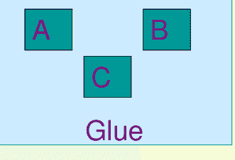


未着色区域代表需要查找 bug 的代码。

### 1.5 算法规范

#### 1.5.1 引言

定义：算法是一组有限的指令，如果遵循，则完成特定任务。

必须满足以下标准：

- (1) 输入 外部提供的零个或多个量。

- (2) 输出 至少产生一个量。

- (3) 确定性 清晰无歧义。

(4) **有限性** 在有限步后终止。

(5) **有效性** 足够基础，可行

# **比较：** 算法和程序

### 示例 1.4 递归二分查找

```
int BinarySearch (int *a, const int x, const int left, const int right)
// search the sorted array a[left:right] for x
{
    if (left <= right) {
        int middle = (left + right) / 2;
        if (x < a[middle]) return BinarySearch(a, x, left, middle - 1);
        else if (x > a[middle])
            return BinarySearch(a, x, middle + 1, right);
    }
    return middle; // x == a[middle]
```

```
} // end of if
return −1; // not found
}
```

调用方式：BinarySearch(a,x,0,n-1)


# 示例 1.5 **排列生成器**

**问题：** 对于一个包含 n ≥ 1 个元素的集合，打印它的所有可能排列。

### 解决方案：

观察 (a,b,c)，答案是通过打印以下内容得到：

+   1. a 后跟 (b,c) 的所有排列
+   2. b 后跟 (a,c) 的所有排列
+   3. c 后跟 (b,a) 的所有排列

```
else {  // a[k:m] has more than one permutation.
    // generate recursively
    for (i=k; i<=m; i++) {
        swap(a[k], a[i]); // interchange a[k] and a[i]
        Permutations(a,k+1,m); // all permutations of a[k+1:m]
        swap(a[k], a[i]); // to return to the original configuration
        // important
    }
}
```

调用方式：Permutation(a,0,n-1)

### 使用 n=3 且 a[0:2]=(a,b,c) 进行尝试

((a,b,c),0,2)

((a,b,c),1,2)

((b,a,c),1,2)

((c,b,a),1,2)

((a,b,c),2,2) → a b c

((a,c,b),2,2) → a c b

((b,a,c),2,2) → b a c

((b,c,a),2,2) → b c a

((c,b,a),2,2) → c b a

((c,a,b),2,2) → c a b

### 如果没有恢复原始配置，

((a,b,c),0,2)
((a,b,c),1,2) → ((a,b,c),2,2) → a b c
((a,c,b),2,2) → a c b
((c,a,b),1,2) → ((c,a,b),2,2) → c a b
((c,b,a),2,2) → c b a
((a,b,c),1,2) 重复！
并且 b x x 的排列将会丢失。

### 练习：P32-2, P33-14

### 1.7 性能分析与
测量

**定义：** 程序的 **空间复杂度** 是其运行完成所需的内存量。程序的 **时间复杂度** 是其运行完成所需计算机时间的量。

+   1. 事前估计 --- 性能分析
+   2. 事后测试--- 性能测量

#### 1.7.1 性能分析

##### 1.7.1.1 空间复杂度

程序 P 的空间需求：
S(P)=c+Sₚ(instance characteristics)
我们仅关注 Sₚ。

##### 示例 1.10

```
float Rsum (float *a, const int n) //compute ∑_{i=0}^{n-1} a[i] recursively
{
    if (n <=0) return 0;
    else return (Rsum(a,n-1)+a[n-1]);
}
```

实例由 n 刻画，每次调用需要 4 个字（n, a, 返回值, 返回地址），递归深度为 n+1，所以

$S_{rsum}(n)=4(n+1)$

##### 1.7.1.2 时间复杂度

程序 P 的运行时间：
 tₚ(instance characteristics)

程序步被宽松地定义为程序中在语法或语义上有意义的片段，其执行时间与实例特征无关。

在教科书的 P41-43 中，对 C++ 中语句的步数有详细的分配。

我们主要关心的是程序解决特定问题实例需要多少步？

2 种方法：

+   (1) 计数
+   (2) 表格

##### 示例 1.12

```
count=0;
float Rsum (float *a, const int n)
{
    count++; // for if
    if (n <=0) {
        count++; // for return
        return 0;
    }
    else {
        count++; // for return
        return (Rsum(a,n-1)+a[n-1]);
    }
}
```

t<sub>Rsum</sub>(0) = 2,
 t<sub>Rsum</sub>(n) = 2+ t<sub>Rsum</sub>(n-1)
    = 2+2+ t<sub>Rsum</sub>(n-2)
    .
    .
    .
    = 2n+ t<sub>Rsum</sub>(0)=2n+2

##### 示例 1.14 斐波那契数

```
1 void Fibonnaci (int n)
2 { // compute the Fibonnaci number Fₙ
3   if (n <=1) cout << n<< endl; { // F₀=0 and F₁ =1
4 else { // compute Fₙ
5   int fn; int fnm2=0; int fnm1=1;
6   for (int i=2; i<=n; i++)
7   {
8     fn=fnm1+fnm2;
9     fnm2=fnm1;
10    fnm1=fn;
11  } //end of for
```

```
12    cout <<fn<<endl;
13 } //end of else
14 }
```

让我们使用表格来计算其总步数。

| 行 | s/e | 频率 | 总步数 |
|------|-----|-----------|-------------|
| 1 | 0 | 1 | 0 |
| 2 | 0 | 1 | 0 |
| 3 | 1 (n >1) | 1 | 1 |
| 4 | 0 | 1 | 0 |
| 5 | 2 | 1 | 2 |
| 6 | 1 | n | n |
| 7 | 0 | n-1 | 0 |
| 8 | 1 | n-1 | n-1 |
| 9 | 1 | n-1 | n-1 |
| 10 | 1 | n-1 | n-1 |
| 11 | 0 | n-1 | 0 |
| 12 | 1 | 1 | 1 |
| 13 | 0 | 1 | 0 |
| 14 | 0 | 1 | 0 |

所以
对于 n>1, t_Fibonnci(n)=4n+1,
对于 n=0 或 1, t_Fibonnci(n) =2

有时，实例特征与输入数据集的内容相关。

例如，*BinarySearch*。

因此：

+   - 最佳情况
+   - 最坏情况,
+   - 平均情况。


##### 1.7.1.3 渐近记号

由于一个步骤所代表的内容并不精确，我们主要关心的是步骤数量的量级。

定义 [O]：f(n)=O(g(n)) 当且仅当存在正的常数 c 和 n₀，使得对于所有 n，n>n₀ 时 f(n) ≤ c g(n)。

例 1.13：3n+2=O(n)，6*2ⁿ+n²=O(2ⁿ)，...

注意 g(n) 是一个上界。

n=O(n²)，n= O(2ⁿ)，...，对于 f(n)=O(g(n)) 要有信息量，g(n) 应该尽可能小。

在实践中，g(n) 的系数应为 1。我们从不说 O(3n)。

O(1) --- 常数    O(log₂n) --- 对数

O(n) --- 线性      O(2ⁿ) --- 指数

O(n²) --- 二次

O(n³) --- 三次

###### 定理 1.2：若 f(n)=a_m n^m+⋯+a_1 n+a_0，则 f(n)=O(n^m)。

当算法的复杂度实际上是，比如 O(log n)，但由于我们知识的局限只能证明它是 O(n) 时，这样说是可以的。这就是 O 记号作为上界的一个好处。

###### 自学：

- Ω --- 下界
- Θ --- 等价界

##### 1.7.1.4 实际复杂度

右侧的图显示了各种函数随 n 的增长情况。

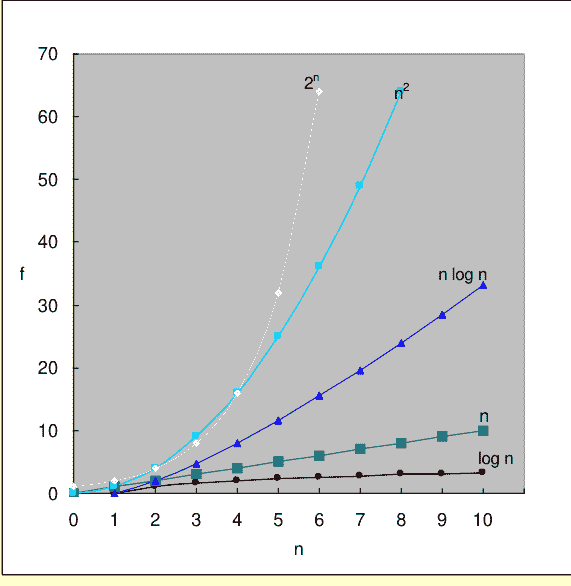

| n | f(n)=n | f(n)=n log₂ n | f(n)=n² | f(n)=n⁴ | f(n)=n¹⁰ | f(n)=2ⁿ |
|---|---|---|---|---|---|---|
| 10 | .01 µs | .03 µs | .1 µs | 10 µs | 10s | 1 µs |
| 20 | .02 µs | .09 µs | .4 µs | 160 µs | 2.84h | 1 ms |
| 30 | .03 µs | .15 µs | .9 µs | 810 µs | 6.83d | 1 s |
| 40 | .04 µs | .21 µs | 1.6 µs | 2.56ms | 121d | 18m |
| 50 | .05 µs | .28 µs | 2.5 µs | 6.25ms | 3.1y | 13 d |
| 100 | .1 µs | .66 µs | 10 µs | 100 ms | 3171y | 4*10¹³y |
| 10³ | 1 µs | 9.66 µs | 1ms | 16.67m |  |  |
| 10⁴ | 10 µs | 130 µs | 100ms | 115.7d |  |  |
| 10⁵ | 100 µs | 1.66ms | 10s | 3171y |  |  |

##### 表 1.8：每秒 10 亿步计算机上的时间

#### 1.7.2 性能测量

性能测量关注于获得程序实际的空间和时间需求。

为了计时一个短事件，有必要重复多次并将事件的总时间除以重复次数。

```
void TimeSearch()
{
    int a[1000], n[20];
    const long r[20] = {300000, 300000, 200000, 200000,
    100000, 100000, 100000, 80000, 80000, 50000, 50000,
    25000, 15000, 15000, 10000, 7500, 7000, 6000, 5000,
    5000};

    for ( int j=0; j<1000; j++ ) a[j] = j+1; //initialize a
    for ( j=0; j<10; j++ ) { //values of n
        n[j] = 10*j; n[j+10] = 100*(j+1);
    }

    cout << "n  total  runTime" << endl;
```
```cpp
for (j=0; j<20; j++) {
    long start, stop;
    time(&start);                         // start timer
    for (long b=1; b<=r[j]; b++)
        int k = seqsearch(a, n[j], 0);    // unsuccessful search
    time(&stop);                           // stop timer
    long totalTime = stop - start;
    float runTime = (float)(totalTime) / (float)(r[j]);
    cout << " " << n[j] << " " << totalTime << " " << runTime
         << endl;
}
}
```

运行 *TimeSearch* 的结果如下一页所示。

| n | total | runTime | n | total | runTime |
|---|---|---|---|---|---|
| 0 | 241 | 0.0008 | 100 | 527 | 0.0105 |
| 10 | 533 | 0.0018 | 200 | 505 | 0.0202 |
| 20 | 582 | 0.0029 | 300 | 451 | 0.0301 |
| 30 | 736 | 0.0037 | 400 | 593 | 0.0395 |
| 40 | 467 | 0.0047 | 500 | 494 | 0.0494 |
| 50 | 565 | 0.0056 | 600 | 439 | 0.0585 |
| 60 | 659 | 0.0066 | 700 | 484 | 0.0691 |
| 70 | 604 | 0.0075 | 800 | 467 | 0.0778 |
| 80 | 681 | 0.0085 | 900 | 434 | 0.0868 |
| 90 | 472 | 0.0094 | 1000 | 484 | 0.0968 |

时间以百分之一秒计，数据的图可参见图 1.7。

##### 需要解决的问题：

- (1) 时钟的准确性
- (2) 重复因子
- (3) 适合于最坏情况或平均性能的合适测试数据
- (4) 目的：比较还是预测？
- (5) 通过点拟合曲线

##### 练习：

P72-10

## 第 2 章
数组

### 2.2 数组作为抽象数据类型

### 数组：

- 一组对：<index, value>（对应或映射）
- 两个操作：检索，存储

现在我们将使用 C++ 类来定义一个 ADT。


```float Retrieve(index i);
// if (i∈IndexSet) return the float associated with i in the
// array;else throw an exception.

void Store(index i, float x);
// if (i∈IndexSet) replace the old value associated with i
// by x; else throw an exception.
}; //end of GeneralArray
```

### Note:
- Not necessarily implemented using consecutive memory
- Index can be coded any way
- GeneralArray is more general than C++ array as it is more flexible about the composition of the index set
- To be simple, we will hereafter use the C++ array

### 2.3 The Polynomial Abstract Data Type

Array can be used to implement other abstract data types. The simplest one might be:

Ordered or linear list.

###### Example:

(Sun, Mon, Tue, Wed, Thu, Fri, Sat)

(2, 3, 4, 5, 6, 7, 8, 9, 10, J, Q, K, A)

() // empty list

More generally, An ordered list is either empty or (a₀, a₁,..., aₙ₋₁). // index important

### Main operations:
- (1) Find the length, n, of the list.
- (2) Read the list from left to right ( or right to left)
- (3) Retrieve the ith element, 0≤i<n.
- (4) Store a new value into the ith position, 0≤i<n.
- (5) Insert a new element at position i, 0≤i<n, causing elements numbered i, i+1,...n-1 to become numbered i+1, i+2,...n.

(6) Delete the element at position i, 0≤i<n, causing elements numbered i+1, i+2,...n-1 to become numbered i, i+1,...n-2.

### How to represent ordered list efficiently?
- Use array:  aᵢ ↔ index i
- Sequential mapping, because using conventional array representation, we are storing aᵢ and aᵢ₊₁ into consecutive location i and i+1.
- Random access any element in O(1).
- Operations (5) and (6) need data movement.

Now let us look at a problem requiring ordered list.

### Problem: build an ADT for the representation and manipulation of symbolic polynomials.

A(x)=3x²+ 2x+4
B(x)=x⁴+ 10x³+ 3x²+1

Degree: the largest exponent

### ADT 2.3 Polynomial
```
class Polynomial {
    // p(x)=a₀x^e0+,...,+ aₙx^en ; a set of ordered pairs of <eᵢ, aᵢ>,
    // where aᵢ is a nonzero float coefficient and eᵢ is a
    // non-negative exponent
    public:
        Polynomial ();
        // Construct the polynomial p(x)=0
```

```
void AddTerm (Exponent e, Coefficient c);
// add the term <e,c> to *this, so that it can be initialized

Polynomial Add (Polynomial poly);
// return the sum of the polynomials *this and poly

Polynomial Mult (Polynomial poly);
// return the product of the polynomials *this and poly

float Eval ( float f);
// evaluate polynomial *this at f and return the result
}
```

#### 2.3.1 Polynomial Representation

##### Representation 1
private:
```
int degree; // degree ≤ MaxDegree
```
```
float coef[MaxDegree+1];
```
Let a be A(x)=aₙxⁿ + aₙ₋₁xⁿ⁻¹+,...,+ a₁x+ a₀

```
a.degree=n;
```
```
a.coef[i] = aₙ₋ᵢ, 0 ≤ i ≤ n
```
Simple algorithms for many operations.

##### Representation 2

When a.degree << MaxDegree, representation 1 is very poor in memory use. To improve, define variable sized data member as:
```
private:
    int degree;
    float *coef;
Polynomial::Polynomial(int d)
{
    int degree=d;
    coef= new float[degree+1];
}
```

```
class Polynomial; // forward declaration
class Term {
friend Polynomial;
private:
    float coef; // coefficient
    int exp;    // exponent
};

class Polynomial {
public:
    .....
private:
    Term *termArray;
    int capacity; // size of termArray
    int terms; // number of nonzero terms
}
```

For \(A(x) = 2x^{1000} + 1\)

##### A.termArray looks like:

|      | 2    | 1   |     |     |
|------|------|-----|-----|-----|
| coef | 2    | 1   |     |     |
| exp  | 1000 | 0   |     |     |

Many zero --- good

Few zero --- not very good, may use twice as much space as in presentation 2.

#### 2.3.2 Polynomial Addition

Use presentation 3 to obtain C = A +B.

###### Idea:

Because the exponents are in descending order,
we can adds A(x) and B(x) term by term to
produce C(x).

The terms of C are entered into its termArray by
calling function NewTerm.

If the space in termArray is not enough, its
capacity is doubled.


```cpp
Polynomial Polynomial::Add (Polynomial b)
{
    // return the sum of the polynomials *this and b.
    Polynomial c;
    int aPos=0, bPos=0;
    while (( aPos < terms) && (bPos < b.terms))
        if (termArray[aPos].exp==b.termArray[bPos].exp) {
            float t = termArray[aPos].coef + termArray[bPos].coef;
            if (t) c.NewTerm (t, termArray[aPos].exp);
            aPos++; bPos++;
        }
        else if (termArray[aPos].exp < b.termArray[bPos].exp) {
            c.NewTerm (b.termArray[bPos].coef, b.termArray[bPos].exp);
            bPos++;
        }
else {
    c.NewTerm (termArray[aPos].coef, termArray[aPos].exp);
    aPos++;
}
// add in the remaining terms of *this
for (; aPos < terms; aPos++)
    c.NewTerm(termArray[aPos].coef, termArray[aPos].exp);
// add in the remaining terms of b
for (; bPos < b.terms; bPos++)
    c.NewTerm(b.termArray[bPos].coef, b.termArray[bPos].exp);
return c;
}
```

```cpp
void Polynomial::NewTerm(const float theCoeff, const int theExp)
{ // add a new term to the end of termArray.
    if (terms == capacity)
    { // double capacity of termArray
        capacity *= 2;
        term *temp = new term[capacity]; // new array
        copy(termArray, termArray + terms, temp);
        delete [] termArray; // deallocate old memory
        termArray = temp;
    }
    termArray[terms].coef = theCoeff;
    termArray[terms++].exp = theExp;
}
```

##### Analysis of doubling capacity:

- the time for doubling is linear in the size of new array
- initially, c.capacity is 1
- suppose when Add terminates, c.capacity is 2^k
- the total time spent over all array doubling is

`O(∑_{i=1}^{k} 2^i) = O(2^{k+1}) = O(2^k)`

- since c.terms > 2^{k-1} and m + n ≥ c.terms, the total time for array doubling is

`O(c.terms) = O(m + n)`

- so, even consider array doubling, the total run time of Add is O(m + n).
- experiments show that array doubling is responsible for very small fraction of the total run time of Add.

Exercises: P93-2,6, P94-9

#### 2.4 Sparse Matrices

##### 2.4.1 Introduction

A general matrix consists of m rows and n columns (m × n) of numbers, as:

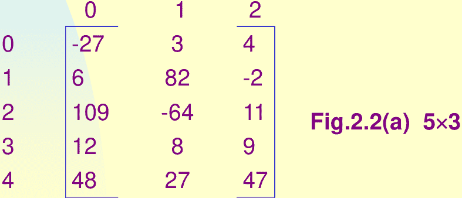

|   | 0 | 1 | 2 | 3 | 4 | 5 |
|---|----|----|----|----|----|----|
| 0 | 15 | 0 | 0 | 22 | 0 | -15 |
| 1 | 0 | 11 | 3 | 0 | 0 | 0 |
| 2 | 0 | 0 | 0 | -6 | 0 | 0 |
| 3 | 0 | 0 | 0 | 0 | 0 | 0 |
| 4 | 91 | 0 | 0 | 0 | 0 | 0 |
| 5 | 0 | 0 | 28 | 0 | 0 | 0 |

Fig. 2.2(b) 6×6

A matrix of m × m is called a square.

A matrix with many zero entries is called sparse.

Representation:

- A natural way --- a[m][n], access element by a[i][j], easy operations. But for sparse matrix, wasteful of both memory and time.
- Alternative way --- store nonzero elements explicitly. 0 as default.

## ADT 2.4  **SparseMatrix**

```
class SparseMatrix
{
  // a set of <row, column, value>, where row, column are
  // non-negative integers and form a unique combination;
  // value is also an integer.
public:
  SparseMatrix ( int r, int c, int t);
  // creates a r×c SparseMatrix with a capacity of t nonzero
  // terms
  SparseMatrix Transpose( );
  // return the SparseMatrix obtained by transposing *this
  SparseMatrix Add ( SparseMatrix b);
  SparseMatrix Multiply ( SparseMatrix b);
};
```

##### 2.4.2 Sparse Matrix Representation

Use triple <row, col, value>, sorted in ascending order by <row, col>.

We need also the number of rows and the number of columns and the number of nonzero elements. Hence,

```
class SparseMatrix;
class MatrixTerm {
friend class SparseMatrix;
private:
    int row, col, value;
};
```

##### And in class SparseMatrix:

**private:**  
&nbsp;&nbsp;&nbsp;&nbsp;`Int` rows, cols, terms, capacity;  
&nbsp;&nbsp;&nbsp;&nbsp;`MatrixTerm *smArray;`

Now we can store the matrix of Fig.2.2 (b) as Fig.2.3 (a).

|  | row | col | value |
|---|---:|---:|---:|
| sm.Array[0] | 0 | 0 | 15 |
| [1] | 0 | 3 | 22 |
| [2] | 0 | 5 | -15 |
| [3] | 1 | 1 | 11 |
| [4] | 1 | 2 | 3 |
| [5] | 2 | 3 | -6 |
| [6] | 4 | 0 | 91 |
| [7] | 5 | 2 | 28 |

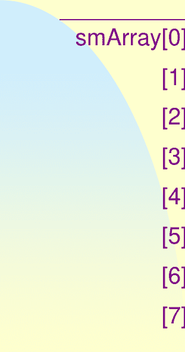


##### 2.4.3 转置矩阵

###### 转置：

如果一个元素在原矩阵中的位置是 [ i ][ j ]，那么它在转置矩阵中的位置是 [ j ][ i ]。

图2.3(b) 显示了图2.3(a) 的转置。

| smArray | row | col | value |
|---|---|---:|---:|---:|
| smArray[0] | 0 | 0 | 15 |
| [1] | 0 | 4 | 91 |
| [2] | 1 | 1 | 11 |
| [3] | 2 | 1 | 3 |
| [4] | 2 | 5 | 28 |
| [5] | 3 | 0 | 22 |
| [6] | 3 | 2 | -6 |
| [7] | 5 | 0 | -15 |


###### 图 2.3 (b)

###### 第一次尝试：

For (each row i)
	take element (i, j, value) and
	store it in (j, i, value) of the transpose;

**难度：** 在所有前面的元素都被处理之前，不知道将 (j, i, value) 放在哪里。

###### 改进：

For (all elements in column j)
store (i, j, value) of the original matrix as
(j, i, value) of the transpose;

由于行是有序的，我们将按正确的列顺序定位元素。

```
1 SparseMatrix SparseMatrix::Transpose ()
2 { // return the transpose of *this
3   SparseMatrix b(cols, rows, terms);
4   if (terms > 0)
5   {  //nonzero matrix
6   int currentB = 0;
7    for ( int c=0; c<cols; c++ ) // transpose by columns
8      for ( int i=0; i<terms; i++ )
9      // find and move terms in column c
10     if ( smArray[i].col == c )
11     {
12       b.smArray[CurrentB].row = c;
13       b.smArray[CurrentB].col = smArray[i].row;
14       b.smArray[CurrentB++].value= smArray[i].value;
15     }
16   } // end of if (terms > 0)
17   return b;
18 }
```

我们可以用一个简单的 O(cols* rows ) 算法得到：

```
for (int j=0;j < columns;j++)
    for (int i=0; i < rows; i++) B[j][i] = A[i][j];
```

###### 进一步改进：

如果我们使用一些额外的空间来存储有关矩阵的一些知识，我们可以做得更好：在 O(cols + terms) 时间内完成。

- get the number of elements in each column of *this = the number of elements in each row of b;
- obtain the starting point in b of each of its rows;
- move the elements of *this one by one into their right position in b.

现在是算法 FastTranspose。

```
1 SparseMatrix SparseMatrix::FastTranspose ()
2 { // return the transpose of *this in O(terms+cols) time.
3   SparseMatrix b(cols, rows, terms);
4   if (terms > 0)
5   { // nonzero matrix
6     int *rowSize = new int[cols];
7     int *rowStart = new int[cols];
8     // compute rowSize[i] = number of terms in row i of b
9     fill(rowSize, rowSize + cols, 0); // initialze
10   for (i=0; i<terms; i++ ) rowSize[smArray[i].col]++;
22    delete [ ] rowSize;
23    delete [ ] rowStart;
24 } // end of if
25 return b;
26 }
```

对于图2.3(a)，在第 13 行之后，我们得到：

|  | [0] | [1] | [2] | [3] | [4] | [5] |
|---|---:|---:|---:|---:|---:|---:|
| RowSize= | 2 | 1 | 2 | 2 | 0 | 1 |
| RowStart= | 0 | 2 | 3 | 5 | 7 | 7 |

注意教科书第 P101 页的错误！

### 2.6 字符串抽象数据类型

一个字符串  S = s₀, s₁, ..., sₙ₋₁\n其中  sᵢ ∈ char, 0 ≤ i < n, n 是长度。

#### ADT 2.5 String

```
class String
{
    // a finite set of zero or more characters;
public:
    String (char *init, int m);
    // initialize *this to string init of length m
```

```
bool operator == (String t );
// if *this equals t, return true else false.
bool operator ! ( );
// if *this is empty return true else false.
int Length ();
// return the number of chars in *this
String Concat (String t);
String Substr (int i, int j);
int Find (String pat);
// return i such that pat matches the substring of *this that
// begins at position i. Return −1 if pat is either empty or not
// a substring of *this.
};
```

#### 2.6.1 字符串模式匹配：一个简单算法

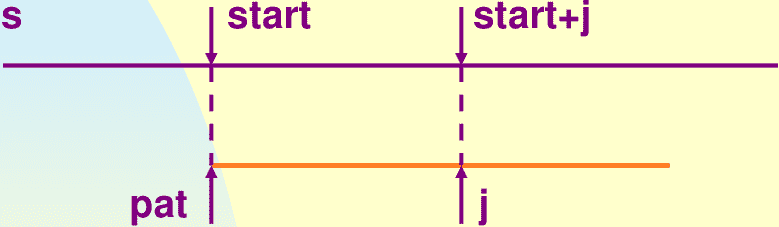

The idea is showed in the function Find .


#### 2.6.2 字符串模式匹配：Knuth-Morris-Pratt 算法

我们能否得到一种避免重新扫描字符串并在 O(LengthP + LengthS) 时间内工作的算法？

这对该问题是最优的，因为在最坏情况下，至少需要查看模式和字符串中的字符一次。

###### 基本思想：

- 为避免遗漏目标而重新扫描——过于保守。如果我们可以在不重新扫描的情况下进行，很可能能在 O(LengthP + LengthS) 时间内完成工作。

- 预处理模式，以获取其字符及其位置的一些知识，这样如果出现不匹配，我们就可以确定搜索的继续位置并避免在字符串中向后移动。

现在我们展示该想法的细节。

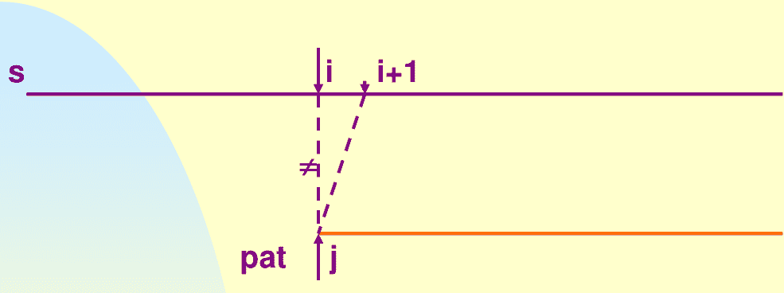

pat

case: j = 0

##### 一个具体例子：

s = . . . a b d a b d . . . . .

pat = a b d a b c a c a b

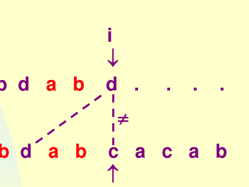

为了形式化上述思想：

##### 定义：如果 p=p₀p₁…pₙ₋₁ 是一个模式，则其失配函数 f 定义为：

f(j) = { largest k< j, such that p₀p₁…pₖ = pⱼ₋ₖpⱼ₋ₖ₊₁…pⱼ if such k ≥ 0 exists
-1 otherwise }

##### 例如，pat = a b c a b c a c a b，我们有

| j | 0 | 1 | 2 | 3 | 4 | 5 | 6 | 7 | 8 | 9 |
|---|---|---|---|---|---|---|---|---|---|---|
| pat | a | b | c | a | b | c | a | c | a | b |
| f | -1 | -1 | -1 | 0 | 1 | 2 | 3 | -1 | 0 | 1 |

注意：

- largest : 不遗漏匹配
- k < j : 避免死循环

##### 由 f 的定义，我们得到模式匹配的以下规则：

如果找到部分匹配使得 s_{i-j}...s_{i-1} = p_0 p_1...p_{j-1} 且 s_i ≠ p_j，则匹配可通过比较 s_i 和 p_{f(j-1)+1} 来恢复，如果 j ≠ 0。如果 j=0，则我们可以继续比较 s_{i+1} 和 p_0。

失配函数由整数数组 f 表示，它是 String 的私有数据成员。

现在是 FastFind 算法。

```
1 int String::FastFind (String pat)
2 { // Determine if pat is a substring of s
3   int PosP = 0, PosS = 0;
4   int LengthP= pat.Length(), LengthS= Length();
5   while ((PosP < LengthP) && (PosS < LengthS))
6     if ( pat.str[PosP] == str[PosS] ) { // characters match
7     PosP ++; PosS ++;
8     }
9     else
10     if ( PosP==0)
11       PosS++;
12     else PosP= pat.f [PosP-1] + 1;
13   if ((PosP < LengthP) || LengthP==0) return -1;
14   else return PosS - LengthP ;
15 }
```

##### FastFind 的分析：

- 第 7 行和第 11 行——最多执行 LengthS 次，因为 PosS 只增加不减少。因此 PosP 在 pat 上向右移动最多 LengthS 次（第 7 行）。

- 第 12 行使 PosP 向左移动，最多可执行 LengthS 次。注意 f(j-1)+1< j。

因此，计算时间是 O(LengthS)。

模式的 f 的计算如何？
通过类似的思路，我们可以在 O(LengthP) 时间内完成。

f(0)=-1，现在如果我们有 f(j-1)，我们可以通过以下观察从中计算 f(j)：

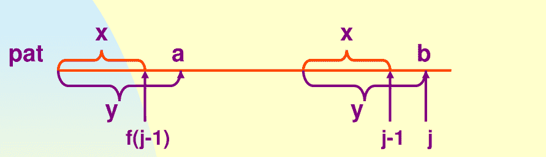

如果 a=b，则 f(j)=f(j-1)+1 否则

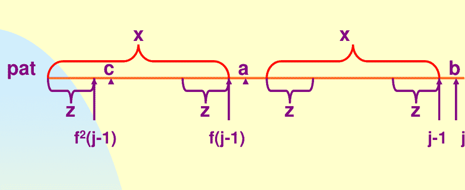

如果 c=b，f(j)=f(f(j-1))+1=f²(j-1)+1 否则 ......

一般来说，我们有失配函数的以下重述：

f(j) = { -1 if j=0
f^m(j-1)+1 where m is the least k for which p_f^k_(j-1)+1 = p_j
-1 if there is no k satisfying the above }

现在我们得到计算 f 的算法。

```
1 void String::Failurefunction()
2 { // compute the failure function of the pattern *this.
3   int LengthP= Length( );
4   f[0]= -1;
5   for (int j=1; j< LengthP; j++) // compute  f[j]
6   {
7     int i=f[j-1];
8     while ((* (str+j)!=*(str+i+1)) && (i>=0)) i=f[i]; // try for m
9     if ( *(str+j)==*(str+i+1))
10      f[j]=i+1;
11   else f[j]= -1;
12  }
13 }
```

##### fail 的分析：

- 在 while 的每次迭代中 i 都会减小（第 8 行，且 f(j)<j）
- i 会被重置（第 7 行）为 −1（当上一次迭代执行了第 11 行时），或重置为上一次迭代值的 1 加上（当执行第 10 行时）。
- 第 7 行只执行 LengthP −1 次，i 的总增量最多为 LengthP −1。
- i 不能被递减超过 LengthP −1 次，整个算法中 while 最多迭代 LengthP −1 次。


## 第3章
栈和队列

### 3.1 C++ 中的模板

C++ 提供的模板机制使类和函数更具可重用性。

#### 3.1.1 模板函数

模板（或参数化类型）可以被视为一个变量，可以实例化为任何数据类型。

```
1 template <class T>
2 void SelectionSort (T *a, int n)
//sort a[0] to a[n-1] into nondecreasing order
{  for (int i=0;i<n;i++)
  {
    int j=i;
    // find the smallest KeyType in a[i] to a[n-1]
    for (int k=i +1;k<n;k++)
      if (a[k]<a[j]) j=k;
   swap(a[i], a[j]);
 }
}
```

函数 SelectionSort 可以非常容易地用于对整数或浮点数组进行排序，如下所示：
float farray[100];
int  intarray[250];
...
//assume that the arrays are initialized at this point
sort(farray,100);
sort(intarray,250);
函数 SelectionSort 会根据传入的参数数组类型进行实例化。例如，SelectionSort(farray,100) 用于对浮点数组进行排序，因为 farray 是一个浮点数组。

对于用户定义的数据类型 T，运算符 < 应该以与其使用一致的方式重载。例如，sort 基于 < 是传递性的这一假设。

假设我们想按面积的非递减顺序对矩形数组进行排序，则运算符< 应该重载为面积比较的语义。

模板函数 ChangeSize1D 将类型为 T 的一维数组的大小从 oldSize 改为 newSize：

```
template <class T>
void ChangeSize1D(T* a, const int oldSize, const int newSize)
{
    if (newSize < 0) throw "New length must be >= 0";
    T* temp = new T[newSize];
    int number = min(oldSize, newSize);
    copy(a, a + number, temp);
    delete [] a;
    a = temp;
}
```

#### 3.1.2 使用模板表示容器类

容器类——用于容纳或存储多个数据对象的數據结构。

Bag——一种可以插入对象并且可以从中删除对象的數據结构。

Bag 可以有同一元素的多个出现，但我们不关心元素的位置，也不关心删除哪个元素。

```
```cpp
template <class T>
Bag<T>::Bag(int bagCapacity):capacity(bagCapacity) {
    if (capacity<1) throw "Capacity must be > 0";
    array = new T[capacity];
    top = -1;
}
```
```

```
```cpp
template <class T>
Bag<T>::~Bag() {delete [] array;}
```
```

```
```cpp
template <class T>
Inline T& Bag<T>::Element() const {
    if (IsEmpty()) throw "Bag is empty";
    return array[0];
}
```
```

```
```cpp
template <class T>
void Bag<T>::Push(const T& x) {
    if (capacity == top + 1)
    {
        ChangeSize1D(array, capacity, 2 * capacity);
        capacity *= 2;
    }
    array[++top] = x;
}
```
```

```
template <class T>
void Bag<T>::Pop() {
    if (isEmpty()) throw "Bag is empty, cannot delete";
    int deletePos = top/2; // note we don’t care which to delete
    copy(array+deletePos+1, array+top+1, array+deletePos);
    array[top--].~T(); // destructor for T
}
```

Bag<int> a;
Bag<Rectangle> r;

因此 a 是一个整数的 Bag，r 是矩形的 Bag。

### 3.2 栈抽象数据类型

栈——一个有序列表，其中所有插入和删除都在称为顶部的同一端进行（后进先出）。

### 在栈中插入和删除元素：

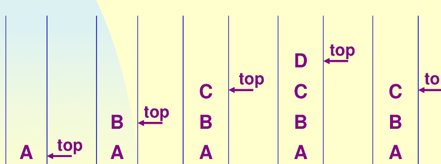

## ADT 3.  **Stack**

```
```cpp
template <class T>
class Stack
{ // A finite ordered list with zero or more elements.
public:
    Stack (int stackCapacity = 10);
    //Creates an empty stack with initial capacity of stackCapacity

    bool IsEmpty() const;
    //If number of elements in the stack is 0, true else false

    T& Top() const;
    // Return the top element of stack

    void Push(const T& item);
    // Insert item into the top of the stack
```
```

```
void Pop();
// Delete the top element of the stack.
};
```

要实现此 ADT，我们可以使用一个数组和一个变量 top。初始时 top 设置为 −1。

因此我们有以下 Stack 的数据成员：

```
private:
    T* stack;
    int top;
    int capacity;
```


```cpp
template <class T>
Stack<T>::Stack(int stackCapacity): capacity(stackCapacity)
{
    if (capacity < 1) throw "Stack capacity must be > 0";
    stack = new T[capacity];
    top = -1;
}

template <class T>
inline bool Stack<T>::IsEmpty() const { return(top == -1);}
```

```cpp
template <class T>
void Stack<T>::Pop()
{ // Delete top element of stack.
    if (IsEmpty()) throw "Stack is empty, cannot delete.";
    stack[top--].~T(); // destructor for T
}
```

### Exercises: P138-1, 2

### 3.3 The Queue Abstract Data Type

A Queue--- an ordered list in which all insertions take place at one end and all deletions take place at the opposite end (FIFO).

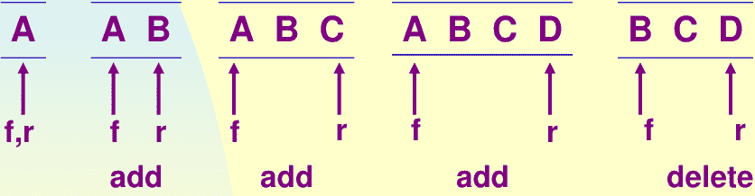

f = queue front    r = queue rear

### ADT 3.2 Queue

```cpp
template <class T>
class Queue
{ // A finite ordered list with zero or more elements.
public:
    Queue (int queueCapacity = 10);
    // Creates an empty queue with initial capacity of
    // queueCapacity

    bool IsEmpty() const;

    T& Front() const; //Return the front element of the queue.
    T& Rear() const; //Return the rear element of the queue.

    void Push(const T& item);
    //Insert item at the rear of the queue.
```

```cpp
void Pop();
// Delete the front element of the queue.
};
```

To implement this ADT, we can use an array and two variable front and rear with front being one less than the position of the first element. So we have the following data members of Queue:

```cpp
private:
    T* queue;
    int front,
        rear,
        capacity;
```

At the beginning, we can set front = rear = -1, and front == rear means that the queue is empty.

As we push and pop the queue, front may be > 0, and rear may be = capacity − 1.

In that case, we cannot add an element to the queue without shifting all elements to the left, as shown below:

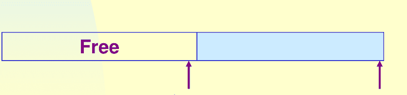

Hence, circular representation. To distinguish between queue full and queue empty, we shall increase the capacity of a queue just before it becomes full.

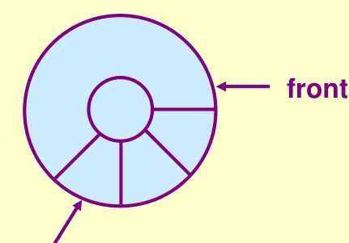

```cpp
template <class T>
Queue<T>::Queue(int queueCapacity):
                         capacity(queueCapacity)
{
    if (capacity < 1) throw "Queue capacity must > 0";
    queue = new T[capacity];
    front = rear = 0;
}
```

```cpp
template <class T>
inline bool Queue<T>::IsEmpty() const {return front==rear };

template <class T>
inline T& Queue<T>::Front() const
{
    if (IsEmpty()) throw "Queue is empty. No front element";
    return queue[(front+1)%capacity];
}

template <class T>
inline T& Queue<T>::Rear() const
{
    if (IsEmpty()) throw "Queue is empty. No rear element";
    return queue[rear];
}
```

```cpp
template <class T>
void Queue<T>::Push(const T & x)
{ // add x at rear of queue
    if ((rear+1)%capacity == front)
    { // queue full, double capacity
        // code to double queue capacity comes here
    }
    rear = (rear+1)%capacity;
    queue[rear] = x;
}
```

We can double the capacity of queue in the way as shown in the next slide:

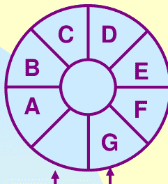

front=5

rear=4

queue 0 1 2 3 4 5 6 7

| 0 | 1 | 2 | 3 | 4 | 5 | 6 | 7 |
| C | D | E | F | G |   | A | B |

front=5, rear=4


0 1 2 3 4 5 6 7 8 9 10 11 12 13 14 15

| 0 | 1 | 2 | 3 | 4 | 5 | 6 | 7 | 8 | 9 | 10 | 11 | 12 | 13 | 14 | 15 |
| A | B | C | D | E | F | G |   |   |   |    |    |    |    |    |    |

front=15, rear=6

Let start = (front+1)%capacity

Case 1, start < 2:

start=1

capacity-1

start=0

Case2, start >= 2:

start

Thus, the previous configuration may be obtained as follows:

- 1. Create a new array `newQueue` of twice the capacity.
- 2. Copy the second segment (if any) to positions in `newQueue` beginning at 0.
- 3. Copy the first segment (if any) to positions in `newQueue` beginning at `(capacity-start)%capacity`.

The code is in the next slide:


### 3.5 迷宫问题

问题：找到从迷宫入口到出口的一条路径。

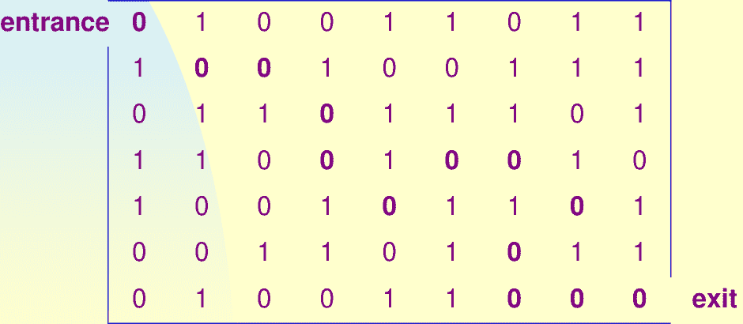

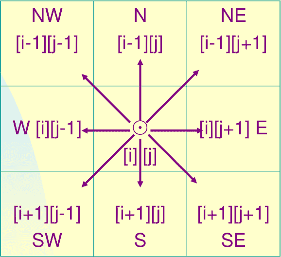

#### 预定义 8 个移动方向：

```
struct offsets
{
    int a,b;
};

enum directions {N, NE, E, SE, S, SW, W, NW};
offsets move[8];
```

| q | move[q].a | move[q].b |
|---|---|---|
| N | -1 | 0 |
| NE | -1 | 1 |
| E | 0 | 1 |
| SE | 1 | 1 |
| S | 1 | 0 |
| SW | 1 | -1 |
| W | 0 | -1 |
| NW | -1 | -1 |

移动表

因此，从 [i][j] 以 SW 方向到 [g][h]：
g=i+move[SW].a; h=j+move[SW].b;

###### 基本思想：

给定当前位置 [i][j] 和 8 个可走方向，我们选择一个方向 d，得到新的位置 [g][h]。

如果 [g][h] 是目标，则成功。

如果 [g][h] 是合法位置，则将 [i][j] 和 d+1 保存到栈中，以防我们走错路径需要尝试其他方向，并且 [g][h] 成为新的当前位置。

重复直到成功或所有可能性都被尝试。

为了防止我们两次走同一条路径，使用另一个数组 mark[m+2][p+2]，初始为 0。

一旦位置被访问，Mark[i][j] 就设为 1。

#### 第一次遍历：

```
Initialize stack to the maze entrance coordinates and direction east;
while (stack is not empty)
{
    (i, j, dir)=coordinates and direction from top of stack;
    pop the stack;
    while (there are more moves from (i, j))
    {
        (g, h)= coordinates of next move ;
        if ((g==m) && (h==p)) success;
```

```
if ((!maze[g][h]) && (!mark[g][h])) // legal and not visited
{
    mark[g][h]=1;
    dir=next direction to try;
    push (i, j, dir) to stack;
    (i, j, dir) = (g, h, N);
}
}
}
cout << "No path in maze."<< endl;
```

#### 我们需要一个栈来存放项目：

```
struct Items {
    int x, y, dir;
};
```

此外，为了避免在栈压入时数组容量翻倍，我们可以将栈的大小设为 m*p。

现在给出一个精确的迷宫算法。

```
```cpp
void path(const int m, const int p)
{
    //Output a path (if any) in the maze; maze[0][i] = maze[m+1][i]
    // = maze[j][0] = maze[j][p+1] = 1, 0 ≤ i ≤ p+1, 0 ≤ j ≤ m+1.
    // start at (1,1)
    mark[1][1]=1;
    Stack<Items> stack(m*p);
    Items temp(1, 1, E);
    stack.Push(temp);
    while (!stack.IsEmpty())
    {
        temp= stack.Top();
        Stack.Pop();
        int i=temp.x; int j=temp.y; int d=temp.dir;
    }
}
```
```

```
while (d<8)
{
    int g=i+move[d].a; int h=j+move[d].b;
    if ((g==m) && (h==p)) { // reached exit
        // output path
        cout <<stack;
        cout << i<<" "<< j<<" "<<d<< endl; // last two
        cout << m<<" "<< p<< endl;          // points
        return;
    }
}
```

```
```cpp
if ((!maze[g][h]) && (!mark[g][h])) { //new position
    mark[g][h]=1;
    temp.x=i; temp.y=j; temp.dir=d+1;
    stack.Push(temp);
    i=g ; j=h ; d=N;  // move to (g, h)
}
else d++;  // try next direction
}
}
cout << “No path in maze.” << endl;
}
```
```

```
ostream& operator<<(ostream& os,Items& item)
{
    return os<<item.x<<","<<item.y<<","<<item.dir-1;
    // note item.dir is the next direction to go so the current
    // direction is item.dir-1.
}
```

由于没有位置会被访问两次，最坏情况下的计算时间是 O(m*p)。

练习：P157-2, 3

### 3.6 表达式求值

#### 3.6.1 表达式

一个表达式由操作数、运算符和定界符组成。例如，

X = A / B − C + D * E − A * C

+   - 运算执行的顺序必须唯一确定。
+   - 为确定顺序，每个运算符都被赋予一个优先级。

| priority | operator |
|---|---|
| 1 | unary minus, ! |
| 2 | *, /, % |
| 3 | +, - |
| 4 | <, <=, >=, > |
| 5 | ==, != |
| 6 | && |
| 7 | || |

图 3.15


A B / C − D E \* + A C \* −

| operation | postfix |
|---|---|
| T₁ = A / B | T₁ C − D E \* + A C \* − |
| T₂ = T₁ − C | T₂ D E \* + A C \* − |
| T₃ = D \* E | T₂ T₃ + A C \* − |
| T₄ = T₂ + T₃ | T₄ A C \* − |
| T₅ = A \* C | T₄ T₅ − |
| T₆ = T₄ − T₅ | T₆ |

T₆ 是结果。

#### 后缀式的优点：

- 无需括号。
- 运算符的优先级不再相关。

这使得后缀式的求值变得简单：从左到右扫描，压栈操作数，并使用栈中正确数量的操作数求值运算符，然后将结果压回栈中。

```text
void Eval(Expression e)
{
    // evaluate the postfix expression e. It is assumed that the
    // last token in e is '#'. A function NextToken is used to get
    // the next token from e. Use stack.
    Stack<Token> stack;  //initialize stack
    for (Token x = NextToken(e); x != '#'; x = NextToken(e))
        if (x is an operand) stack.Push(x);
        else {  // operator
            remove the correct number of operands for operator x
            from stack; perform the operation x and store the result
            (if any) onto the stack;
        }
}
```

#### 3.6.3 中缀转后缀

思路：注意中缀和后缀中操作数的顺序相同；我们可以立即将任何操作数传递到输出，然后将运算符存储在栈中，直到恰当的时机。

例如：

A\*(B+C)\*D → ABC+\*D\*

算法的行为如下：

| 下一个 token | stack | output |
|---|---|---|
| A | empty | A |
| \* | empty | A |
| ( | \*( | A |
| B | \*( | AB |
| + | \*(+ | AB |
| C | \*(+ | ABC |
| ) | \* | ABC+ |
| \* | \* | ABC+\* |
| D | \* | ABC+\*D |
| done | empty | ABC+\*D\* |


从示例中，我们可以看到左括号在未进入栈时表现得像一个高优先级的运算符，而一旦进入栈，则表现得像一个低优先级的运算符。

- isp（栈内优先级）
- icp（入栈优先级）
- 图 3.15 中所有运算符的 isp 和 icp 保持不变。
- isp('(') = 8, icp('(') = 0, isp('#') = 8

**因此规则为：**

只要运算符的 isp 数值小于或等于新运算符的 icp，就将其从栈中取出。

```text
void Postfix(Expression e)
{ // output the postfix of the infix expression e. It is assumed
  // that the last token in e is '#'. Also, '#' is used at the bottom
  // of the stack.
  Stack<Token> stack; //initialize stack
  stack.Push('#');

  for (Token x = NextToken(e); x != '#'; x = NextToken(e))
      if (x is an operand) cout << x;
      else if (x == ')')
      { // unstack until '('
          for (; stack.Top() != '('; stack.Pop())
              cout << stack.Top();
          stack.Pop(); // unstack '('
      }
      else { // x is an operator
          for (; isp(stack.Top()) <= icp(x); stack.Pop())
              cout << stack.Top();
          stack.Push(x);
      }
  // end of expression, empty the stack
  for (; !stack.IsEmpty(); cout << stack.Top(), stack.Pop());
  cout << endl;
}
```

## 第 4 章 链表

#### 4.1 单链表或链

使用数组和顺序映射表示简单数据结构具有以下特性：

数据对象的连续节点以固定距离存储。

这使得以 O(1) 访问任意节点变得容易。

#### 顺序映射的缺点：

插入和删除代价昂贵，例如：

向...中插入 "GAT" 或从...中删除 "LAT"

(BAT, CAT, EAT, FAT, HAT, JAT, LAT, MAT, OAT, PAT, RAT, SAT, TAT, VAT, WAT)

——需要数据移动。

#### 解决方案 —— 链接表示：

- 列表的项可以放置在内存的任何位置。
- 每个项都关联一个指向下一项的指针（链接）。

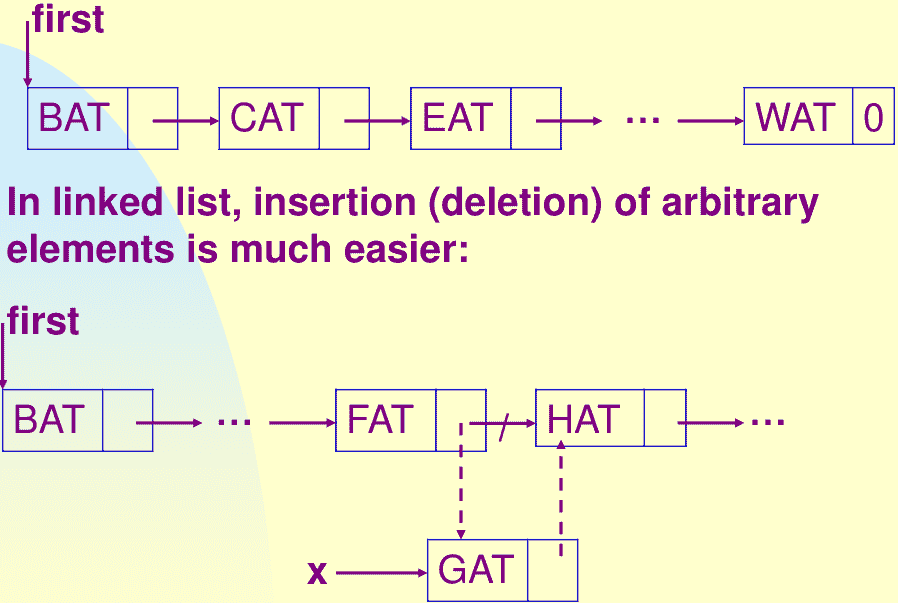

在链表中，任意元素的插入（删除）要容易得多：

上述结构称为单链表或链，其中每个节点恰好有一个指针字段。


### 4.2 在 C++ 中表示链

假设链节点定义为：

```
class ChainNode {
private:
    int data;
    ChainNode *link;
};

ChainNode *f;
f->data
```

将导致编译器错误，因为私有数据成员不能从对象外部访问。

定义：类型 A 的数据对象 HAS-A 类型 B 的数据对象，如果 A 在概念上包含 B 或 B 是 A 的一部分。

两个类的复合：ChainNode 和 Chain。

Chain HAS-A ChainNode。

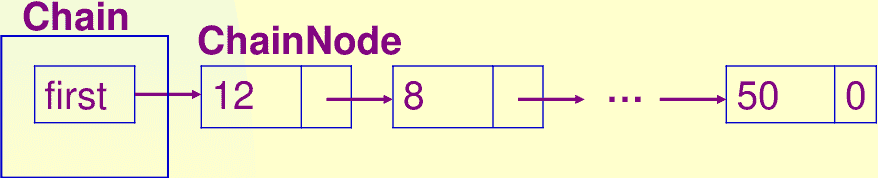

```
class Chain; // forward declaration
class ChainNode {
friend class Chain; // to make functions of Chain be able to
// access private data members of ChainNode
public:
    ChainNode(int element = 0, ChainNode* next = 0)
    {data = element; link = next;}
private:
    int data;
    ChainNode *link;
};
class Chain {
public:
    // Chain manipulation operations
    ...
private:
    ChainNode *first;
};
```

### 空指针常量 0 用于表示没有节点。

### C++ 中的指针操作：

(a)

(b) x=y

(c) *x=*y

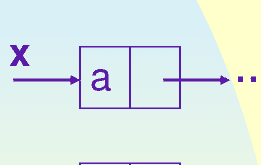

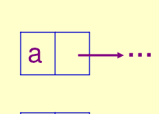

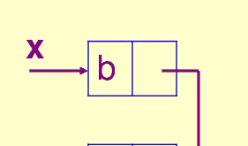

### 链操作：

例 4.3 在节点 x 之后插入一个数据域为 50 的节点。

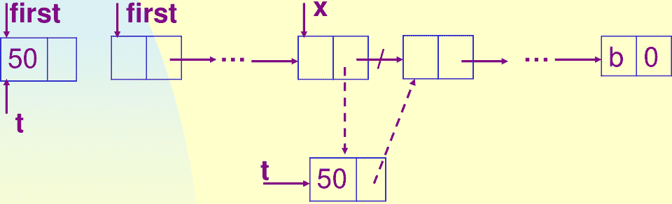

(a) first=0

(b) first !=0

```
void Chain::Insert50 (ChainNode *x)
{
    if (first)
        // insert after x
        x->link = new ChainNode(50, x->link);
    else
        // insert into empty chain
        first = new ChainNode(50);
}
```

练习：P183-1,2

#### 4.3 模板类 Chain

我们将增强上一节的链类，使其更具可重用性。

##### 4.3.1 使用模板实现链

```
```cpp
template <class T> class Chain; // forward declaration

template <class T>
class ChainNode {
friend class Chain<T>;
public:
    ChainNode(T element, ChainNode* next = 0)
        { data = element; link = next;}
private:
    T data;
    ChainNode *link;
};
```
```

```
```cpp
template <class T>
class Chain {
public:
    Chain() { first=0; }; // constructor initializing first to 0
    // Chain manipulation operations
    ...
private:
    ChainNode<T> *first;
};
```
```

###### 一个空的整数链 intchain 将定义为：

```
```cpp
Chain<int> intchain ;
```
```

##### 4.3.2 链迭代器

**容器类** 是表示包含或存储多个数据对象的數據结构的类。

**迭代器** 是用于逐个访问容器类元素的对象。

###### 为什么我们需要迭代器？

考虑可能对容器类 C 执行的以下操作，其所有元素都是整数：

- (1) 输出 C 中的所有整数。
- (2) 求 C 中所有整数的和、最大值、最小值、平均值、中位数。
- (3) 从 C 中获取整数 x，使得 f(x) 最大。
- ......

这些操作必须作为 C 的成员函数实现以访问其私有数据成员。

考虑容器类 Chain<T>，然而这样做存在一些缺点：

- (1) Chain<T> 的所有操作最好与 T 初始化为的对象类型无关。然而，对 T 的一种实例化有意义的操作可能对另一种实例化没有意义。
- (2) Chain<T> 的操作数量可能变得过大。

(3) 即使添加成员函数是可以接受的，用户也必须学习如何遍历容器类。

这表明容器类应配备迭代器，提供对对象元素的系统访问。

用户可以利用这些迭代器根据特定应用实现自己的函数。

通常，迭代器实现为容器类的嵌套类。

###### Chain 的前向迭代器

Chain 的前向迭代器类可以实现如下，并且要求 ChainIterator 是 Chain 的公共嵌套成员类。


class ChainIterator {
public:
    // typedefs required by C++ omitted

    // constructor
    ChainIterator(ChainNode<T>* startNode = 0)
    { current = startNode; }

    // dereferencing operators
    T& operator *() const { return current->data; }
    T* operator ->() const { return &current->data; }

// increment
ChainIterator& operator ++() // preincrement
{current = current->link; return *this;}
ChainIterator& operator ++(int) // postincrement
{
    ChainIterator old = *this;
    current = current->link;
    return old;
}

```cpp
// equality testing
bool operator !=(const ChainIterator right) const
    { return current != right.current; }
bool operator == (const ChainIterator right) const
    { return current == right.current; }

private:
    ChainNode<T>* current;
};
```

###### Additionally, we add the following public member functions to Chain:

ChainIterator begin() { **return** ChainIterator(first);}

ChainIterator end() { **return** ChainIterator(0);}

###### We may initialize an iterator object yi to the start of a chain of integers y using the statement:

```
Chain<int>::ChainIterator yi = y.begin();
```

###### And we may sum the elements in y using the statement:

```
sum = accumulate(y.begin(), y.end(), 0);
```

```
// note sum does not require access to private members
```

###### Exercises: P194-3, 4

##### 4.3.3 Chain Operations

Operations provided in a reusable class should be enough but not too many.

Normally, include: constructor, destructor, operator=, operator==, operator>>, operator<<, etc.

A chain class should provide functions to insert and delete elements.

Another useful function is reverse that does an “in-place’ reversal of the elements in a chain.

To be efficient, we add a private member **last** to `Chain<T>`, which points to the last node in the chain.

###### InsertBack

```
template <class T>
void Chain<T>::InsertBack(const T& e)
{
    if (first) { // nonempty chain
        last->link = new ChainNode<T>(e);
        last = last->link;
    }
    else first = last = new ChainNode<T>(e);
}
```

The complexity: O(1).

###### Concatenate

```
template <class T>
void Chain<T>::Concatenate(Chain<T>& b)
{ // b is concatenete to the end of *this
    if (first) { last->link = b.first; last = b.last;}
    else { first = b.first; last = b.last; }
    b.first = b.last = 0;
}
```

The complexity: O(1).

###### Reverse

```
template <class T>
void Chain<T>::Reverse()
{
    // make (a₁,..., aₙ) becomes (aₙ,..., a₁).
    ChainNode<T> *current = first, *previous = 0;
    while (current) {
        ChainNode<T> *r = previous; // r trails previous
        previous = current;
        current = current->link;
        previous->link = r;  //          r       previous  current
    }
    first = previous;
}
```

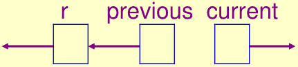

For a chain with m ≥ 1 nodes, the computing time of Reverse is O(m).

Exercises: P184-6

#### 4.4 Circular Lists

A circular list can be obtained by making the last link field point to the first node of a chain.

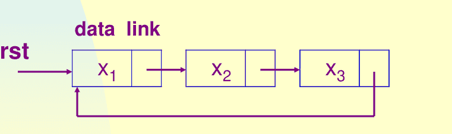

Consider inserting a new node at the front of the above list. We need to change the link field of the node containing $x_3$.

It is more convenient if the access pointer points to the last rather than the first.

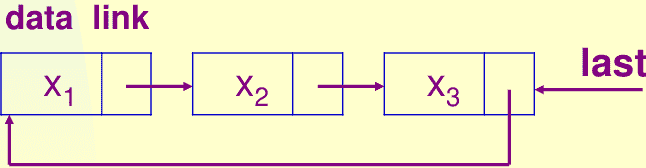

##### Now we can insert at the front in O(1):

```
template <class T>
void CircularList<T>::InsertFront(const T& e)
{ // insert the element e at the “front” of the circular list *this,
// where last points to the last node in the list.
    ChainNode<T>* newNode = new ChainNode<T>(e);
    if (last) { // nonempty list
        newNode->link = last->link;
        last->link = newNode;
    }
    else { last = newNode; newNode->link = newNode;}
}
```

To insert at the back, we only need to add the statement

```
last = newNode;
```

to the if clause of InsertFront, the complexity is still O(1).


##### 为避免将空列表作为特殊情况处理，引入哑头节点：

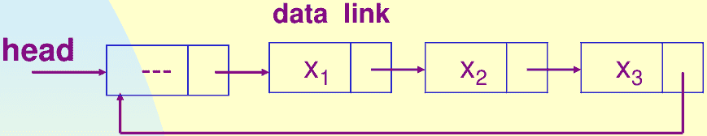

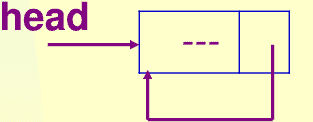

data link

empty circular list

#### 4.5 可用空间列表

-   链和循环列表的析构函数时间与链或列表的长度成线性关系。
-   如果我们维护自己的空闲节点链，则可以将其降低到 O(1)。
-   可用空间列表由 `av` 指向。
-   `av` 是 `CircularList<T>` 的静态类成员，类型为 `ChainNode<T>*`，初始时，`av = 0`。
-   只有在 av 列表为空时我们才需要使用 new。

##### 我们使用 `CircularList<T>::RetNode` 而不是使用 `delete`：

```
template <class T>
void CircularList<T>::RetNode(ChainNode<T> * x)
{
    // free the node pointed to by x
    x->link = av;
    av = x;
    x = 0;
}
```

##### 循环列表可以在 O(1) 中被删除：

```
template <class T>
void CircularList<T>::~CircularList()
{ // delete the circular list.
    if (last) { ChainNode <T> * first = last->link;
        last->link = av;  // (1)
        av = first; // (2)
        last = 0;
    }
}
```

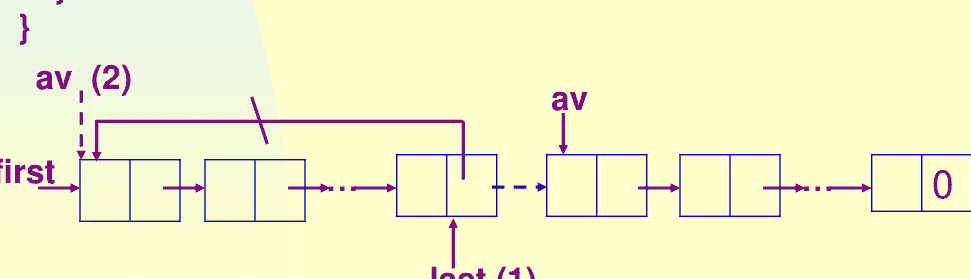

##### 如果我们知道其首尾节点，则链可以在 O(1) 中被删除：

```
template <class T>
Chain<T>::~Chain()
{ // delete the chain
    if (first) {
        last->link = av;
        av = first;
        first = 0;
    }
}
```

#### 4.6 链表栈和队列

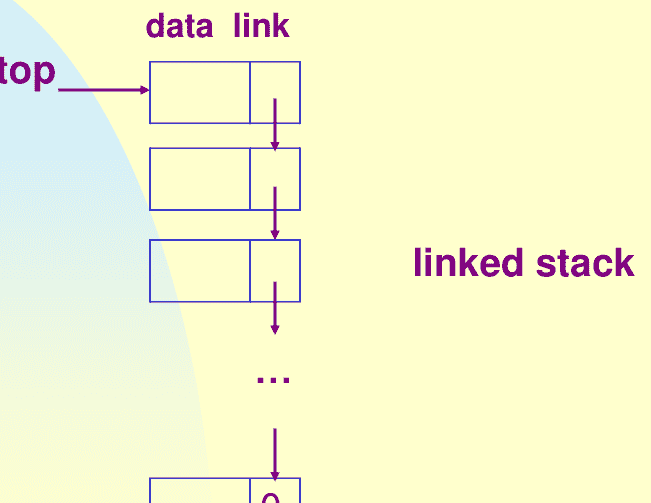

假设 LinkedStack 类已被声明为 ChainNode<T> 的友元。

```
template <class T>
class LinkedStack {
public:
    LinkedStack() { top=0;}; // constructor initializing top to 0
    // LinkedStack manipulation operations
    ...
private:
    ChainNode<T> *top;
};
```

```
template <class T>
void LinkedStack<T>::Push(const T& e) {
    top = new ChainNode<T>(e, top);
}
```

```
template <class T>
void LinkedStack<T>::Pop()
{ // delete top node from the stack.
    if (IsEmpty()) throw "Stack is empty. Cannot delete.";
    ChainNode<T> * delNode = top;
    top = top->link;
    delete delNode;
}
```

IsEmpty 和 Top 函数易于实现，且被省略。

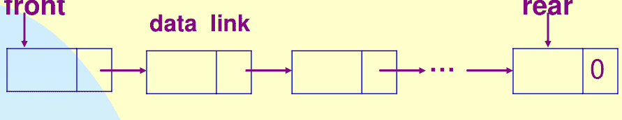

front

data link

rear

linked queue

LinkedQueue 的函数与 LinkedStack 类似，留作练习。

Exercises: P201-2

#### 4.7 多项式

##### 4.7.1 多项式表示

由于多项式将由列表表示，我们说 Polynomial 是 IS-IMPLEMENTED-IN-TERMS-OF List。

定义：类型 A 的数据对象 IS-IMPLEMENTED-IN-TERMS-OF 类型 B 的数据对象，如果类型 B 对象是类型 A 对象实现的核心。---通常通过将类型 B 对象声明为类型 A 对象的成员数据来实现。

```
```java
class Polynomial {
public:
    // public functions defined here
private:
    Chain<Term> poly;
};
```
```

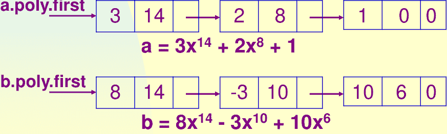

##### 4.7.2 加法多项式

要将两个多项式 a 和 b 相加，使用链迭代器 ai 和 bi 沿着 a 和 b 的项移动。

```
1 Polynomial Polynomial::operator+ (const Polynomial& b)
2 { // *this (a) and b are added and the sum returned
3   Term temp;
4   Chain<Term>::ChainIterator ai = poly.begin(),
5                         bi = b.poly.begin();
6   Polynomial c;
```

```
```cpp
while (ai != poly.end() && bi != b.poly.end()) { //not null
    if (ai->exp == bi->exp) {
        int sum = ai->coef + bi->coef;
        if (sum) c.poly.InsertBack(temp.Set(sum, bi->exp));
        ai++; bi++; // to next term
    }
    else if (ai->exp < bi->exp) {
        c.poly.InsertBack(temp.Set(bi->coef, bi->exp));
        bi++; // next term of b
    }
    else {
        c.poly.InsertBack(temp.Set(ai->coef, ai->exp));
        ai++; // next term of a
    }
}
```
```


```cpp
while (ai != poly.end()) { // copy rest of a
    c.poly.InsertBack(temp.Set(ai->coef, ai->exp));
    ai++;
}
while (bi != b.poly.end()) { // copy rest of b
    c.poly.InsertBack(temp.Set(bi->coef, bi->exp));
    bi++;
}
return c;
}
```

###### Analysis:

Assume a has m terms, b has n terms. The computing time is O(m+n).

##### 4.7.3 Circular List Representation of Polynomials

Polynomials represented by circular lists with head node are as in the next slide:

###### (a) Zero polynomial

###### (b) 3x¹⁴ + 2x⁸ + 1

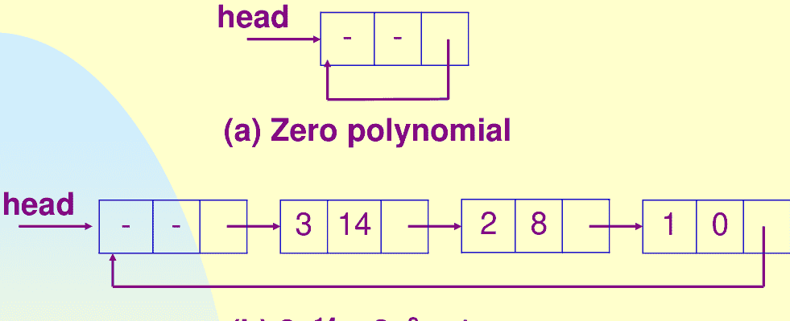

###### Adding circularly represented polynomials

- The exp of the head node is set to −1 to push the rest of a or b to the result.
- Assume the begin() function for class CircularListWithHead return an iterator with its current points to the node head→link.

```cpp
else if (ai->exp < bi->exp) {
    c.poly.InsertBack(temp.Set(bi->coef, bi->exp));
    bi++; // next term of b
}
else {
    c.poly.InsertBack(temp.Set(ai->coef, ai->exp));
    ai++; // next term of a
}
}
}
```

##### Experiment: P209-5

#### 4.8 Equivalence Classes

Definition: A relation ≡ over a set S is an equivalence relation over S iff it is symmetric, reflexive, and transitive over S.

≡ partitions the set S into equivalence classes. For example, let S={0,1,...,10,11} and

0≡4, 3≡1, 6≡10, 8≡9, 7≡4, 6≡8, 3≡5, 2≡11, 11≡0

S is partitioned into 3 equivalence classes:
{0,2,4,7,11}; {1,3,5}; {6,8,9,10}

To determine equivalence classes, begin at 0 and find all pairs of (0, j). 0 and j are in the same class. By transitivity, all (j, k) imply k is in the same class. Continue this way until the entire class containing 0 has been found, marked. Then go on for another class...

Major difficulty: find the implied k. Use a strategy similar in the maze problem.

Representation:
m---the number of related pairs.
n---the number of objects.

We could use a bool array `pairs[n][n]`, such that `pairs[i][j] = TRUE` iff `i ≡ j`.

- To save space use a linked list to represent each row.


- To access row i at random, `first[n]`.
- A bool array `out[n]` to mark objects visited.

Given the above data, the lists will be as in the next slide.

- For each (i, j), 2 nodes used.

- To determine an equivalence class containing i, 0≤i<n, and out[i]==false, each element in the list first[i] is printed.

- To process the remaining lists which , by transitivity, belong in the same class as i, a stack of their nodes is created, using inverse list skill.

Now the code for the algorithm.

```
class ENode {
friend void equivalence();
Public:
    Enode(int d, Enode* l = 0) //constructor
    {data=d; link=l;}
private:
    int data;
    ENode *link;
};
```

```
void Equivalence()
{
    // Input the equivalence pairs and output the equivalence
    // classes
    ifstream inFile("equiv.in",iso::in); // "equiv.in" is the input file
    if (!inFile) throw "Cannot open input file.";
    int i, j, n;
    inFile>>n; // read number of objects
```

```
// initialize first and out
Enode ** first = new Enode*[n];
bool *out = new bool[n];
fill(first, first + n, 0);
fill(out, out + n, false);

// Phase 1:input equivalence pairs
inFile>>i>>j;
while (inFile.good()) { // check end of file
    first[i] = new ENode(j, first[i]);
    first[j] = new Enode(i, first[j]);
    inFile >> i >> j;
}
```

```cpp
while (x) {  // process the list
    j=x->data;
    if (!out[j]) {
        cout<<", "<<j;
        out[j]=true;
        ENode *y=x->link;
        x->link=top;
        top=x;
        x=y;
    }
    else {ENode *y=x->link; delete x; x=y;}
}  // end of while (x)
```

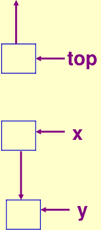

```
if (!top) break;
x=first[top->data];
ENode *y=top; top=top->link; delete y; //unstack
} // end of while (1)
} // end of if (!out[i])
delete [ ] first; delete [ ] out;
} // end of equivalence
```

##### Running process for the previous data:


| Index  | 0  | 1 | 2  | 3  | 4 | 5 | 6 | 7 | 8 | 9 | 10 | 11 |
|--------|----|---|----|----|----|---|---|---|---|---|----|----|----|
| first  | 11 | 3 | 11 | 5  | 7 | 3 | 8 | 4 | 6 | 8 | 6  | 0  |
| out    | 4  | 1 | 0  | 10 | 9 | 2 | 0 | 0 | 0 | 0 | 0  | 0  |

top x=y=0

此时一个新类：0, 11, 4

按照上述数据执行算法，我们得到：

一个新类：0, 11, 4, 7（跳过 0, 4, 0），2（跳过 11）

一个新类：1, 3, 5（跳过 1, 3）

一个新类：6, 8, 10（跳过 6, 6），9（跳过 8）

###### 等价性分析

- first 和 out 的初始化 — O(n)
- 第 1 阶段 — O(m+n)
- 在第 2 阶段，每个节点被压入栈一次，只有 2m 个节点。for 循环执行 n 次。 — O(m+n)

总体时间：O(m+n)

所需空间也是 O(m+n)

练习：P.215-1

#### 4.9 稀疏矩阵

对于稀疏矩阵中不同数量的非零项，顺序表示由于涉及的数据移动而效率低下。为克服这一点，链接表示是更好的选择。

- 每一行，以及每一列，都表示为带头节点的循环链表。

- 每个节点都有一个字段 head 用于区分头节点和典型节点：

对于具有 r 个非零项的 n × m 矩阵，需要的总节点数：
max{m,n} + r + 1（用于头节点列表的头）

```cpp
struct Triple { int row, col, value; };
class Matrix;
class MatrixNode {
friend class Matrix;
friend istream& operator>>( istream&, Matrix& );
private:
    MatrixNode *down, *right;
    bool head;
    union { MatrixNode *next; Triple triple; };
    MatrixNode ( bool, Triple* ); // constructor
};
```

```cpp
MatrixNode::MatrixNode (bool b, Triple * t) {
    head = b;
    if ( b) { right = next = this; } // row/column head node,
                                    // down will be set in program
    else triple = *t;
}

class Matrix {
friend istream& operator>>(istream&, Matrix& );
public:
    ~Matrix ( );
private:
    MatrixNode *headnode;  // points to the head of head nodes
};
```

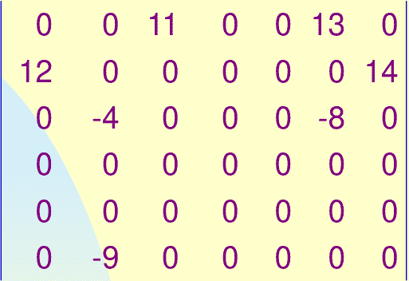

上图 6×7 矩阵的表示如下一页所示。

##### 4.9.2 稀疏矩阵输入

输入：
  n, m, r; i, j, a_ij; ...; 且 (i, j, a_ij) 按 (i, j) 排序。

辅助数组 head 大小为 max {n,m}，head[i] 指向列 i 的头，同时也指向行 i — 允许高效随机访问。

头节点 i 的 next 字段最初跟踪列 i 中的最后一个节点。

##### 方法

- 建立所有头节点；
- 建立每一行链表，同时构建列链表；
- 最后关闭最后一行链表，关闭所有列链表，建立头节点列表的头节点并将所有头节点链接在一起。

```cpp
istream& operator>>(istream& is, Matrix& matrix )
// read in a matrix and set up its linked representation
{
    Triple s;
    is >> s.row >> s.col >> s.value; // matrix dimensions
    int p = max(s.row, s.col);

    // set up head node for the head nodes list
    matrix.headnode = new MatrixNode ( false, &s );
    if ( p == 0 ) {
        matrix.headnode->right = matrix.headnode;
        return is;
    } // there is always the head of head nodes list
    // at least one row or column
    MatrixNode **head = new MatrixNode* [p];

    for (int i = 0; i < p; i++) // initialize head nodes
        head[i] = new MatrixNode(true, 0);
    int CurrentRow = 0;
    MatrixNode *last = head[0]; // last node in current row

    for (i = 0; i < s.value; i++) { // input triples
        Triple t;
        is >> t.row >> t.col >> t.value;
        if (t.row > CurrentRow) { // close current row
            last->right = head[CurrentRow];
            CurrentRow = t.row;
            last = head[CurrentRow];
        }
        last = last->right = new MatrixNode (false, &t); // into row
        head[t.col]->next = head[t.col]->next->down = last; // column
    }

    last->right = head[CurrentRow]; // close last row
    // close all column lists
    for (i = 0; i < s.col; i++) head[i]->next->down = head[i];
    // link the head nodes together
    for (i = 0; i < p - 1; i++) head[i]->next = head[i + 1];
    head[p - 1]->next = matrix.headnode; // p ≠ 0
    matrix.headnode->right = head[0];
    delete [ ] head;
    return is;
}
```

##### 计算时间

- 所有头节点 — O(max(n,m))
- 所有三元组 — O(r)

总时间：O(n+m+r)


##### 4.8.3 删除稀疏矩阵

假设 av 指向通过字段 right 链接的可用空间列表的前端。

按行删除矩阵，每行列表通过字段 right 循环链接，可以在 O(1) 中完成。
总共在 O(max {n, m})=O(n+m)

```
Matrix::~Matrix ()
// return all nodes to the av list linked through right,
// av is a static variable of type MatrixNode*
{
    if (! headnode) return; // no nodes to dispose
    MatrixNode *x = headnode->right, *y;
    headnode->right=av; av=headnode;//return the head of head
    while ( x!=headnode ) {
        y = x->right;  x->right = av;  av = y;
        x = x->next;
    }
    headnode = 0;
}
```

##### 练习：P222-1,3

#### 4.10 双向链表

单向链表的困难：

- 只能容易地向一个方向移动
- 删除任意节点并不容易---需要知道前一个节点

双向链表中的一个节点至少有 3 个字段：data、left 和 right，这使得双向移动变得容易。

| left | data | right |

##### 双向链表可能是循环的。以下是带头节点的双向循环链表：

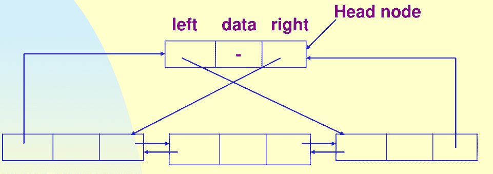

假设 p 指向任意节点，则
p == p->left->right == p->right->left

```
class DblList;

class DblListNode {
friend class DblList;
private:
    int data;
    DblListNode *left, *right;
};

class DblList {
public:
    // List manipulation operations
    ...
private:
    DblListNode *first; // points to head node
};
```

##### 删除

```
void DblList::Delete(DblListNode *x)
{
    if(x == first) throw "Deletion of head node not permitted";
    else {
        x->left->right = x->right;
        x->right->left = x->left;
        delete x;
    }
}
```

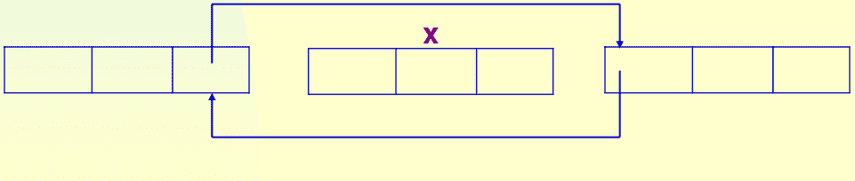

##### 练习：P225-2

##### 请注意定义是递归的。

列表 A 写成 A = (α₀, ..., αₙ₋₁)

- A --- 名称
- n --- 长度
- α₀ --- 头
- (α₁, ..., αₙ₋₁) --- 尾

##### 按惯例

- 列表名称---大写字母
- 原子---小写字母

###### 示例：

- 1. `A = ( )`
- 2. `B = (a, (b, c))`
- 3. `C = (B, B, ( ))`
- 4. `D = (a, D) = (a, (a, (a, ...)))`

##### 2 个推论：

- 1. 列表可以共享，如 (3) 中所示
- 2. 列表可以递归，如 (4) 中所示

一般来说，每个广义列表都可以使用节点结构表示：

| tag=false/true | data/down | next |
|---|---|---|

```
template <class T> class GenList;
template <class T>
class GenListNode {
friend class GenList;
private:
    GenListNode <T> *next;
    bool tag;
    union { T data; GenListNode<T> *down;};
};

template <class T>
class GenList {
public:
    // List manipulation operations;
private:
    GenListNode<T> *first;
};
```

#### 4.11.2 列表的递归算法

递归算法由两个部分组成：

- **workhorse**---递归函数本身。
- **driver**---在顶层调用递归函数的函数。

##### 4.11.2.1 复制列表

生成非递归列表 l 的精确副本，其中子列表不共享。

###### Copy

```
template <class T>
void GenList<T>::Copy(const GenList<T>& l) // Driver
{ first = Copy(l.first); }
```

```
template <class T>
GenListNode<T> *GenList<T>::Copy(GenListNode<T> * p)
// Workhorse
// copy the non-recursive list with no shared sublists
{
    GenListNode<T> *q=0;
    if (p) {
        q = new GenListNode<T>;
        q->tag = p->tag;
        if (p->tag) q->down = Copy(p->down);
        else q->data = p->data;
        q->next = Copy(p->next);
    }
    return q;
}
```

###### 正确性可以通过归纳法验证。

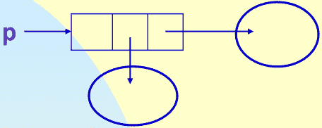

让我们对 A = ((a, b), ((c, d), e)) 运行 Copy，如下一张幻灯片所示。

###### 计算时间：

- tag==false 的节点，被访问两次。
- tag==true 的节点被访问三次。
- 如果列表有 m 个节点，则时间为 O(m)。


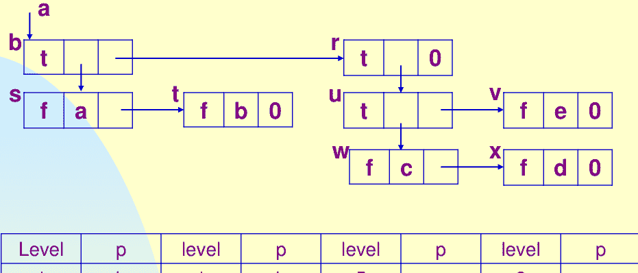

| Level | p | level | p | level | p | level | p |
|---|---|---|---|---|---|---|---|
| 1 | b | 1 | b | 5 | x | 3 | u |
| 2 | s | 2 | r | 4 | w | 2 | r |
| 3 | t | 3 | u | 3 | u | 3 | 0 |
| 4 | 0 | 4 | w | 4 | v | 2 | r |
| 3 | t | 5 | x | 5 | 0 | 1 | b |
| 2 | s | 6 | 0 | 4 | v |  |  |

##### 4.10.2.2 列表相等

两个列表在它们具有相同的结构并且对应数据成员中的数据相同时是相同的。

###### Equal

```
// Driver
template <class T>
bool GenList<T>::operator==(const GenList<T>& l) const
{ // *this and l are non-recursive lists
// returns true if the two lists are identical.
return Equal(first, l.first);
}
```

```
//Workhorse– assume to be a friend of GenListNode
template <class T>
bool Equal(GenListNode<T>* s, GenListNode<T>* t)
{
    if ((!s) && (!t)) return true;
    if ( s && t && (s->tag == t->tag) )
        if (s->tag)
            return Equal(s->down, t->down)
                && Equal(s->next, t->next);
        else return (s->data == t->data)
                && Equal(s->next, t->next);
    return false;
}
```

###### 计算时间：

在没有子列表共享时不超过线性。
注意如果子列表被共享，它可能会被访问多次。

注意算法一旦发现两个列表不相同就会终止。

##### 4.10.2.3 列表深度

Depth(s)= { 0 if s is an atom or empty list 1+max{depth(x₀),..., depth(xₙ₋₁)} if s is the list (x₀, ... , xₙ₋₁) n≥0 }

###### Depth

```
// Driver
template <class T>
int GenList::Depth()
{ // compute the depth of a non-recursive list
    return Depth(first);
}
```

##### 4.10.3 引用计数、共享和递归列表

子列表的共享：

- 节省存储。
- 一致性。

为了便于规范，将列表的定义扩展以允许对子列表进行命名。例如：A=(a, (b,c)), Z=(b,c) ➔ A=(a, Z(b, c)) 并且为了保持一致，A 写成 A(a, Z(b, c))。

###### 列表共享的问题：

- (1) 参考幻灯片 93 上的图，如果 B 的第一个节点被删除，来自 C 的指针应该被更新，但通常我们不知道所有指向特定列表的指针。--- 解决方案：头节点。
- (2) 如何确定列表节点是否可以真正释放？--- 解决方案：引用计数，使用头节点。列表的引用计数是指向它的指针的数量。

###### 我们需要在类 GenListNode 中做一些更改：

```
template <class T>
class GenListNode<T> {
friend class GenList<T>;
private:
    GenListNode<T> *next;
    int tag; // 0 for data, 1 for down, 2 for ref
    union {
        T data;
        GenListNode<T> *down;
        int ref;
    };
};
```

有了头节点，列表 A= (), B = (a, (b, c)), C = (B, B, ()) 和 D = (a, D) 将表示为在下一张幻灯片中。

a.first

A=0

b.first

B=(a, (b.c))

c.first

C=(B, B, ())

d.first

D=(a, D)

现在删除列表的思路：
将引用计数减 1，如果它变为 0，则检查顶层节点，遇到的任何子列表都被删除，最后，顶层节点被链接到 av 列表。

```
~GenList
// Driver
template <class T>
GenList::~GenList()
{ // Each head node has a reference count.
    if (first) { Delete(first); first = 0;}
}
```

```
// Workhorse
template <class T>
void GenList<T>::Delete(GenListNode<T>* x)
{
    x->ref--; // decrement reference count of the head node
    if (!x->ref)
    {
        GenListNode<T>* y=x; // y traverses top level of x.
        while (y->next) {
            y=y->next;  if (y->tag==1) Delete(y->down);
        }
        y->next = av;
        av = x;
    }
}
```

参考幻灯片 106，对 b.~GenList( ) 的调用会使：

- ref(b)→2. 之后

对 c.~GenList( ) 的调用导致：

- ref(c)→0, ref(b)→1→0.
- B(a, (b, c)) 的全部六个节点返回到 av 列表。
- C(B, B, ()) 的空列表节点返回到 av。
- c 的顶层节点返回到 av。


###### 对于递归列表，引用计数永远不会变为 0，即使它已不再可访问。

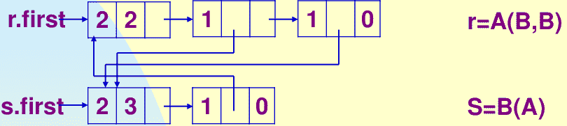

调用 r.~GenList() 和 s.~GenList() 之后，ref(r)=1，ref(s)=2，但结构已不再被使用。--- 没有简单的方法来解决它。

练习：P240-6

## 第 5 章
### 树

#### 5.1 引言

##### 5.1.1 术语

**定义：** 树是一个包含一个或多个节点的有穷集合，使得
(1) 有一个特别指定的节点称为**根**。
(2) 其余节点被划分为 n≥0 个不相交集合 T₁,..., Tₙ，其中每个集合都是一个树。T₁,..., Tₙ 称为根的**子树**。

节点的祖先是从根到该节点的路径上的所有节点。

节点的层级定义为令根为第 1 层，如果一个节点在第 l 层，则其子节点在第 l+1 层。

树的高度或深度是树中任意节点的最高层级。

#### 5.1.2 树的表示

对于一个 k 度树，我们可以使用一个树节点，该节点具有数据字段和 k 个指向子节点的指针，如下所示：

| Data | Child1 | Child2 | ... | Child k |

Fig.5.4 Possible node structure for a tree of degree k

然而，这在空间上非常浪费，如下一张幻灯片中的引理5.1所示。

##### 引理 5.1：若 T 是一个 k 元树，包含 n 个节点，每个节点大小固定如 Fig.5.4 所示，则 nk 个子字段中有 n(k-1)+1 个为 0，n ≥ 1。

##### 证明：
- 每个非零子字段指向一个节点
- 除根节点外，每个节点恰好有一个指针指向它
- n 个节点的树中非零子字段的数量为 n-1
- 零字段的数量为 nk-(n-1)=n(k-1)+1。

图5.2 的树可以写成一个列表：
(A(B(E(K, L), F), C(G), D(H(M), I, J)))
使用通用列表表示：

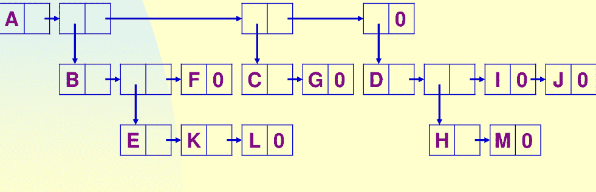

在后面的章节中，我们将看到如何使用二叉树来表示森林，从而表示树。

#### 5.2 二叉树

##### 5.2.1 抽象数据类型

定义：二叉树是一个节点的有穷集合，要么为空，要么由一个根和两个不相交的二叉树组成，称为左子树和右子树。

##### ADT 5.1

```
template <class T>
class BinaryTree
{ // A finite set of nodes either empty or consisting of
// a root node, left BinaryTree and right BinaryTree.
public:
    BinaryTree ();
    // creates an empty binary tree

    bool IsEmpty ();
    // return true iff the binary tree is empty

    BinaryTree(BinaryTree<T>& bt1, T& item, BinaryTree<T>& bt2);
    // creates a binary tree whose left subtree is bt1,
    // right subtree is bt2, and root node contain item.

    BinaryTree LeftSubtree();
    // return the left subtree of *this
```

```
T RootData();
// return the data in the root of *this

BinaryTree RightSubtree();
// return the right subtree of *this
};
```

##### 二叉树与树的区别：
- 没有树的节点数为 0，但存在空二叉树。
- 二叉树的根始终有两个子树：左子树和右子树，尽管它们可能为空。

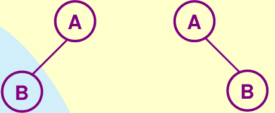

因此，上面两个二叉树是不同的：第一个具有空的右子树，而第二个具有空的左子树。但作为树，它们是相同的。

在二叉树中，节点的非空子树数量即为其度。

##### 5.2.2 二叉树的性质

**引理 5.2 [节点最大数]：**
- 1. 二叉树第 $i$ 层的最大节点数为 $2^{i-1}$，$i\ge1$。
- 2. 深度为 $k$ 的二叉树的最大节点数为 $2^k-1$，$k\ge1$。

##### 证明：

设 Mᵢ 为第 i 层的最大节点数

(1) 对层级 i 进行归纳。

i=1，仅有根，Mᵢ = 2¹⁻¹ = 2⁰ = 1。

假设 Mᵢ₋₁ = 2⁽ⁱ⁻¹⁾⁻¹ 对于 i>1。

由于每个节点的度最大为 2，Mᵢ = 2* Mᵢ₋₁ = 2*2ⁱ⁻² = 2ⁱ⁻¹。

(2) 深度为 k 的二叉树的最大节点数为

∑ᵢ₌₁ᵏ Mᵢ = ∑ᵢ₌₁ᵏ 2ⁱ⁻¹ = 2ᵏ - 1。


##### 证明：

设 n₁ 是度为 1 的结点数，n 是结点总数，则有

n = n₀ + n₁ + n₂      (5.1)

除根结点外，每个结点都有一条分支进入。若 B 是分支数，则 n = B+1。又 B = n₁ + 2n₂，因此

n = n₁ + 2n₂ + 1      (5.2)

由 (5.1) − (5.2)：0 = n₀ − n₂ −1，即 n₀ = n₂ +1。

定义：深度为 k 的满二叉树是一棵深度为 k、具有 2^k-1 个结点的二叉树，k ≥ 0。

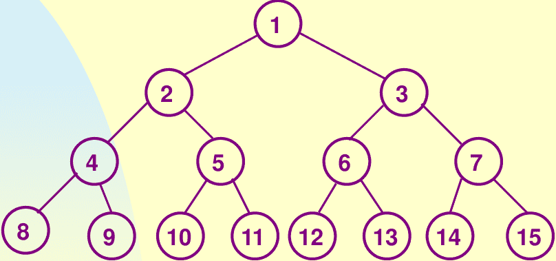

图 5.11 深度为 4 的满二叉树

满二叉树中结点的顺序编号：结点从 1 到 n 编号，从第 1 层到第 k 层，每层从左到右。

定义：具有 n 个结点、深度为 k 的二叉树，当且仅当其结点与深度为 k 的满二叉树中编号为 1 到 n 的结点一一对应时，称为完全二叉树。

由引理 5.2，具有 n 个结点的完全二叉树的高度为 ⌈log₂(n+1)⌉。

#### 5.2.3 二叉树的表示

##### 5.2.3.1 数组表示

结点可以存储在一维数组 tree 中，顺序编号为 i 的结点存储在 tree[i] 中。

引理 5.4：若一棵具有 n 个结点的完全二叉树采用顺序表示，则对于任意下标为 i（1 ≤ i ≤ n）的结点，有

(1) 若 i≠1，则 parent(i) 位于 ⌊i/2⌋ 处；若 i=1，则 i 是根结点，没有父结点。

(2) 若 2i ≤ n，则 LeftChild(i) 位于 2i 处；若 2i>n，则 i 没有左孩子。

(3) 若 2i+1 ≤ n，则 RightChild(i) 位于 2i+1 处；若 2i+1>n，则 i 没有右孩子。

证明：先证 (2)。(3) 由 (2) 以及结点从左到右编号得出；(1) 由 (2) 和 (3) 得出。

对 i 进行归纳。

当 i=1 时，显然左孩子位于 2 处，除非 2>n，此时 i 没有左孩子。

假设对所有满足 1 ≤ j ≤ i 的 j，LeftChild(j) 均位于 2j 处。

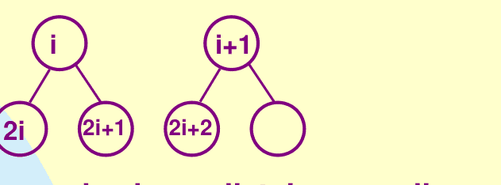

紧接在 LeftChild(i+1) 之前的两个结点分别是 i 的右孩子和左孩子，因此 LeftChild(i+1) 位于 2i+2=2(i+1) 处，除非 2(i+1)>n，此时 i+1 没有左孩子。

数组表示可用于所有二叉树。

-   对于完全二叉树——不会浪费空间。
-   对于深度为 k 的斜树，最坏情况下需要 2^k-1 个空间，其中只有 k 个会被使用，如下所示：

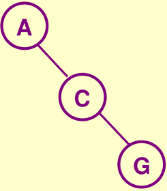

| 下标 | [0] | [1] | [2] | [3] | [4] | [5] | [6] | [7] |
|---|---|---|---|---|---|---|---|---|
| tree | --- | A | --- | C | --- | --- | --- | G |

##### 5.2.3.2 链式表示

顺序表示的普遍问题：插入和删除会引起数据移动。

通过链式表示可以轻松解决这个问题。

```cpp
template <class T> class Tree;
class TreeNode {
friend class Tree<T>;
public:
    TreeNode (T& e, TreeNode<T>* left, TreeNode<T>* right)
        {data=e; leftChild=left; rightChild=right;}
private:
    T data;
    TreeNode<T>* leftChild;
    TreeNode<T>* rightChild;
};
```

| leftChild | data | rightChild |

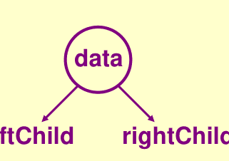

```
template <class T>
class Tree {
public:
    // Tree operations
    ...
private:
    TreeNode<T>* root;
};
```

如有必要，可以在结点中增加第 4 个字段 parent。

#### 5.3 二叉树的遍历与树迭代器

##### 5.3.1 引言

L——向左移动，V——访问结点，R——向右移动。采用先左后右的遍历约定，我们有 3 种遍历：

LVR（中序）、LRV（后序）、VLR（前序）。

这些遍历与生成表达式的中缀、后缀和前缀形式之间有着自然的对应关系。

我们用下面的表达式树来说明这些遍历。

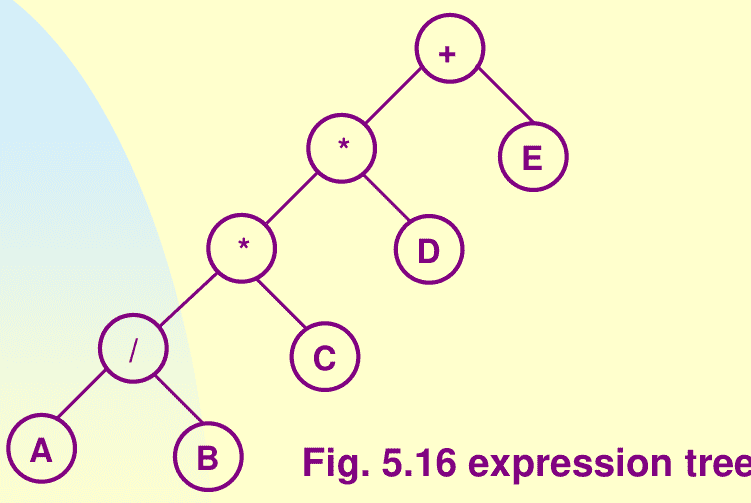

图 5.16 表达式树

##### 5.3.2 中序遍历

```cpp
template <class T>
void Tree<T>::Inorder()
{ // driver as a public member
    Inorder(root);
}
```

```cpp
template <class T>
void Tree<T>::Inorder (TreeNode<T>* currentNode)
{ // workhorse as a private member of Tree
    if (currentNode) {
        Inorder(currentNode→leftChild);
        Visit(currentNode)
        Inorder(currentNode→rightChild);
    }
}
```


假设 Visit 函数只有一行代码：

```
cout << CurrentNode->data;
```

对于图 5.16 的树，元素输出为：

A / B * C * D +E   (infix)

##### 5.3.3 先序遍历

```
template <class T>
void Tree<T>::Preorder()
{ // Driver.
    Preorder(root);
}
```

```
template <class T>
void Tree<T>::Preorder(TreeNode<T>* currentNode)
{ // workhorse.
    if (currentNode) {
        Visit(currentNode);
        Preorder(currentNode->leftChild);
        Preorder(currentNode->rightChild);
    }
}
```

对于图 5.16 的树，元素输出为：

+ * * / A B C D E  (prefix)

##### 5.3.4 后序遍历

```
template <class T>
void Tree<T>::Postorder()
{ // Driver.
    Postorder(root);
}

template <class T>
void Tree<T>::Postorder (TreeNode<T> * currentNode)
{ // Workhorse.
    if (currentNode) {
        Postorder(currentNode->leftChild);
        Postorder(currentNode->rightChild );
        Visit(currentNode);
    }
}
```

对于图 5.16 的树，元素输出为：

A B / C * D * E + (postfix)

##### 5.3.5 迭代中序遍历

要使用迭代器实现树的遍历，我们首先需要实现一个非递归的树遍历算法。

一种直接的方法是使用栈。

```
1 template <class T>
2 void Tree<T>::NonrecInorder()
3 { // Nonrecursive inorder traversal using a stack
4   Stack<TreeNode<T>*> s; // declare and initialize a stack
5   TreeNode<T>* currentNode=root;
6   while (1) {
7     while (currentNode) { // move down leftChild
8       s.Push(currentNode); // add to stack
9       currentNode=currentNode->leftChild;
10    }
11    if (s.IsEmpty()) return;
12    currentNode=s.Top();
13    s.Pop(); // delete from stack
14    Visit(currentNode);
15    currentNode=currentNode->rightChild;
16  }
}
```

###### NonrecInorder USES-A 模板栈。

**定义：** 如果类型 A 的数据对象使用类型 B 的数据对象来执行任务，则称类型 A 的数据对象 USES-A 类型 B 的数据对象。通常，类型 B 的对象在类型 A 的成员函数中被使用。

USES-A 与 IS-IMPLEMENTED-IN-TERMS-OF 类似，但使用类型 B 对象的程度较低。

###### NonrecInorder 的分析：

- n---树中节点的数量。
- 每个节点都被放置到栈中一次，第 8 行，9 行和 11 到 15 行被执行 n 次。
- currentNode 将对每个 0 链接等于 0 一次，即 2n₀+ n₁=n₀+n₁+n₂+1=n+1。

计算时间：O(n)。

栈所需的空间等于树的深度。

现在我们使用函数 NonrecInorder 来为树获得一个中序迭代器。

关键观察是，第 6-16 行的 while 循环的每次迭代都会产生树的中序遍历中的下一个元素。

```
class InorderIterator { // a public nested member class of Tree
public:
    InorderIterator() {currentNode=root;};
    T* Next();
private:
    Stack<TreeNode<T>*> s;
    TreeNode<T>* currentNode;
};
```

```
```cpp
T* InorderIterator::Next()
{
    while (currentNode) {
        s.Push(currentNode);
        currentNode=currentNode->LeftChild;
    }
    if (s.IsEmpty()) return 0;
    currentNode=s.Top();
    s.Pop();
    T& temp=currentNode->data;
    currentNode=currentNode->rightChild;
    return &temp;
}
```
```

##### 5.3.6 层次遍历

层次遍历以完全二叉树节点编号所建议的顺序访问节点。

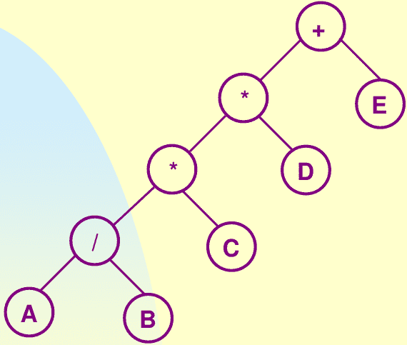

左树的层次遍历为：

+ * E * D / C A B

要实现层次遍历，我们使用队列。

```
```cpp
template <class T>
void Tree<T>::LevelOrder()
{
    // traverse the binary tree in level order
    Queue<TreeNode<T>*> q;
    TreeNode<T>* currentNode=root;
    while (currentNode) {
        Visit(currentNode);
        if (currentNode->leftChild)
            q.Push(currentNode->leftChild);
        if (currentNode->rightChild)
            q.Push(currentNode->rightChild);
        if (q.IsEmpty())return;
        currentNode=q.Front();
        q.Pop();
    }
}
```
```


Exercises: P267-4, 6

Experiment: P267-10

#### 5.4 Additional Binary Tree Operations

##### 5.4.1 Copying Binary Trees

```
template <class T>
Tree<T>::Tree(const Tree<T>& s) // driver
{ // Copy constructor
    root = Copy( s.root );
}
```

```
template <class T>
TreeNode<T>* Tree<T>::Copy(TreeNode<T>* origNode)
// workhorse
{ // Return a pointer to an exact copy of the binary
// tree rooted at origNode
if (!origNode) return 0;
return new TreeNode<T>(origNode->data,
    Copy(origNode->leftChild),
    Copy(origNode ->rightChild));
}
```

##### 5.4.2 Testing Equality

```
template <class T>
bool Tree<T>::operator==(const Tree& t) const
{
    return Equal(root, t.root);
}
```

```
template <class T>
bool Tree<T>::Equal(TreeNode<T>* a, TreeNode<T>* b)
{// Workhorse-
    if ((!a) && (!b)) return true; // both a and b are 0
    return (a && b           // both a and b are non-0
        && (a->data == b->data)             //data is the same
        && Equal(a->leftChild, b->leftChild)        //left equal
        && Equal(a->rightChild, b->rightChild));    //right equal
}
```

##### Exercises: P272-1, P273-4

#### 5.5 Threaded Binary Trees

##### 5.5.1 Threads

Note that in the linked representation of binary tree, there are n +1 0 links, which is more than actual pointers.

A clever way to make use of these 0 links is to replace them by pointers, called threads, to other nodes in the tree.

##### The threads are constructed using the following rules:

- (1) A 0 rightChild field at node p is replaced by a pointer to the inorder successor of p.
- (2) A 0 leftChild field at node p is replaced by a pointer to the inorder predecessor of p.

The following is a threaded tree, in which node E has a predecessor thread pointing to B and a successor thread to A.

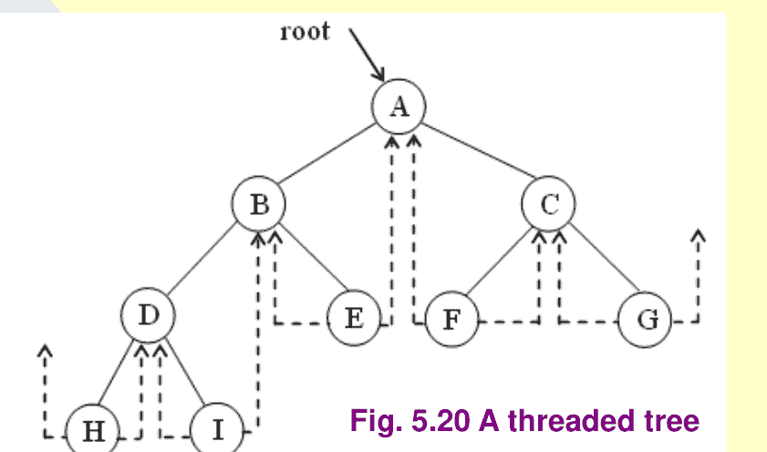

Fig. 5.20 A threaded tree

To distinguish between threads and normal pointers, add two **bool** fields:

- `leftThread`
- `rightThread`

If `t→leftThread == true`, then `t→leftChild` contains a thread, otherwise a pointer to left child. Similar for `t→rightThread`.

```
```cpp
template <class T>
class ThreadedNode {
    friend class ThreadedTree;
private:
    bool leftThread;
    ThreadedNode<T> * leftChild;
    T data;
    ThreadedNode<T> * rightChild;
    bool rightThread;
};
```
```

```
```cpp
template <class T>
class ThreadedTree {
public:
    // Tree operations

    ...

private:
    ThreadedNode<T> *root;
};
```
```

##### Let ThreadedInorderIterator be a nested class of ThreadedTree:

```
class ThreadedInorderIterator {
public:
    T* Next();
    ThreadedInorderIterator()
    { currentNode = root; }
private:
    ThreadedNode<T>* currentNode;
};
```

To make the left thread of the first node in inorder and the right thread of the last node in inorder undangle, we assume a head node for all threaded binary tree, let the two threads point to the head.

The original tree is the left subtree of the head, and the rightChild of head points to the head itself.

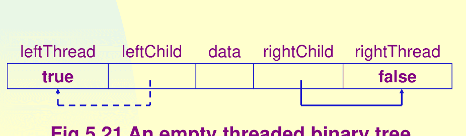

##### Fig.5.21 An empty threaded binary tree

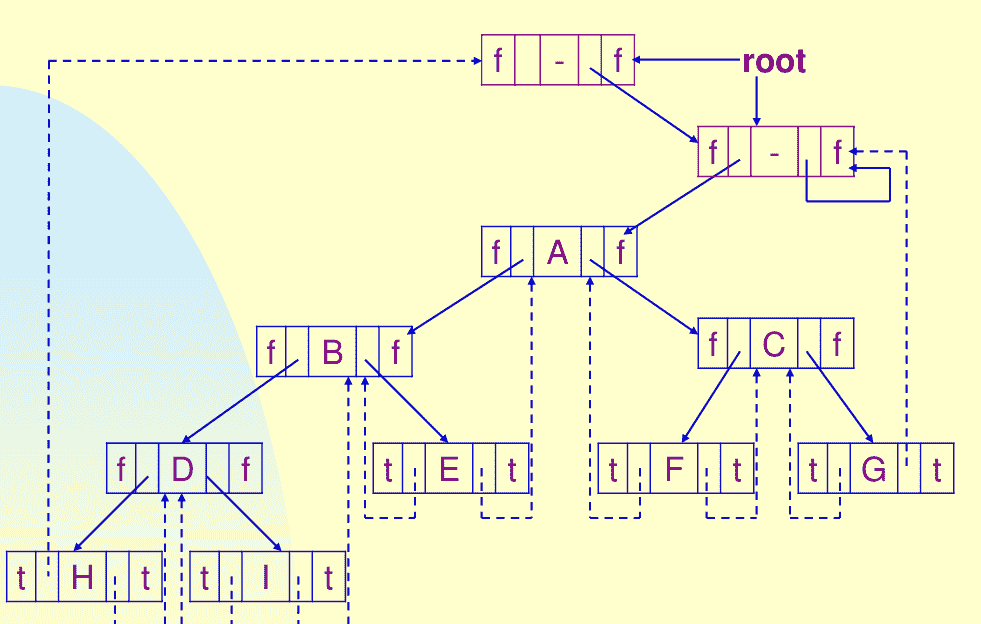

##### Fig.5.22 memory representation of threaded tree

we can see:

- 1. The inorder successor of the head node is the first node in inorder;
- 2. The inorder successor of the last node in inorder is the head node.

##### 5.5.2 Inorder Traversal of a Threaded Binary Tree

##### Observe:

- 1. If x→rightThread==true, the inorder successor of x is x→rightChild;

(2) If x→rightThread==false, the inorder successor of x is obtained by following a path of leftChild from the right child of x until a node with leftThread==true is reached.


##### Thus we have:

```
T* ThreadedInorderIterator::Next()
{ // Return the inorder successor of currentNode in a threaded
// binary tree
    ThreadedNode<T>* temp=currentNode→rightChild;
    if (! currentNode→rightThread)
        while (!temp→leftThread) temp=temp→leftChild;
    currentNode=temp;
    if (currentNode===root) return 0; //no next
    else return &currentNode→data;
}
```


请注意当 `currentNode == root` 时，`Next()` 返回中序遍历的第 1 个节点，因此我们可以使用以下函数对线索二叉树进行中序遍历：

```
template <class T>
void ThreadedTree<T>::Inorder()
{
    ThreadedInorderIterator ti;
    for (T* p = ti.Next(); p; p = ti.Next())
        Visit(*p);
}
```

由于每个节点最多被访问 2 次，计算时间很容易看出对于 n 个节点的树为 O(n)，并且遍历是在不使用栈的情况下完成的。

##### 5.5.3 向线索二叉树中插入节点

向线索树中插入提供生长线索树的功能。

我们仅研究将 r 插入为 s 的右孩子的情况。左孩子的情况类似。

###### (1) 若 s→rightThread==true，如：


###### (2) 若 s→rightThread==false，如：


在 (1) 和 (2) 两种情况下，操作 ①、②、③ 相同，④ 仅用于 (2)。

```
```cpp
template <class T>
void ThreadedTree<T>::InsertRight(ThreadedNode<T>* s,
                                  ThreadedNode<T>* r)
{ // insert r as the right child of s
    r→rightChild=s→rightChild;        // ①
    r→rightThread=s→rightThread;      // ① note s!=t.root,
    r→leftChild=s;                    // ②
    r→leftThread=true;                // ②
    s→rightChild=r;                   // ③
    s→rightThread=false;              // ③
    if (! r→rightThread) {    // case (2)
        ThreadedNode<T>* temp=InorderSucc(r); // ④
        temp→leftChild=r;                      // ④
    }
}
```
```

##### 练习：P277-1, P278-4


图 5.24 最大堆

由于最大堆是完全二叉树，我们使用数组 heap 来表示它。

因此我们有模板 **MaxHeap** 类，它派生自 MaxPQ<T>，如下一页所示：

```
template <class T>
MaxHeap<T>::MaxHeap (int theCapacity=10)
{ //constructor
    if (theCapacity < 1) throw "Capacity must be >= 1";
    capacity = theCapacity;
    heapSize = 0;
    heap = new T[capacity+1]; //heap[0] not used
}
```

```
template <class T>
Inline T& MaxHeap<T>::Top()
{
    if (IsEmpty()) throw "The heap is empty";
    return heap[1];
}
```

##### Push 的分析：

具有 n 个节点的完全二叉树的高度为 ⌈log₂(n+1)⌉，while 循环迭代 O(log n) 次，每次花费 O(1) 时间，因此复杂度为 O(log n)。

```
template <class T>
void MaxHeap<T>::Pop()
{ // delete the max element.
    if (IsEmpty()) throw "Heap is empty. Cannot delete.";
    heap[1].~T(); // delete the max

    // remove the last element from heap
    T lastE = heap[heapSize--];

    // trickle down
    int currentNode = 1; // root
    int child = 2;   // left child of currentNode
```

```
```java
while (child <= heapSize)
{
    // set child to the larger child of currentNode
    if (child<heapSize && heap[child]<heap[child+1]) child++;

    // can we put lastE in currentNode?
    if (lastE>=heap[child]) break; // yes

    // no
    heap[currentNode]=heap[child]; // move child up
    currentNode=child; child *=2; // move down a level
}
heap[currentNode]=lastE;
```
```

##### Pop 的分析：

具有 n 个节点的堆的高度为 ⌈log₂(n+1)⌉，while 循环迭代 O(log n) 次，每次花费 O(1) 时间，因此复杂度为 O(log n)。

##### 练习：P287-2, 3

#### 5.7 二叉搜索树

##### 5.7.1 定义

当需要搜索或删除任意元素时，堆是不合适的。

字典是一组对，每对有一个键和一个相关联的元素。

尽管自然字典可能有多个具有相同键的对，但我们在此假设没有两个对具有相同的键。

字典的规范如 ADT 5.3 所示。


###### ADT 5.3

```
template <class K, class E>
class Dictionary {
public:
    virtual bool IsEmpty () const = 0;
        // return true iff the dictionary is empty
    virtual pair<K,E>* Get(const K&) const = 0;
        // return pointer to the pair with specified key;
        // return 0 if no such pair
    virtual void Insert(const pair<K,E>&) = 0;
        // insert the given pair; if key is a duplicate
        // update associated element
    virtual void Delete(const K&) = 0;
        // delete pair with specified key
};
```

###### The pair can be defined as:

```
template <class K, class E>
struct pair
{
    K first;
    E second;
};
```

二叉搜索树在需要执行搜索、插入和删除操作时具有更好的性能。

**定义：** 二叉搜索树，若非空，则满足以下性质：

- 1. 根节点有一个键。
- 2. 左子树中的键（如果有）小于根节点中的键。
- 3. 右子树中的键（如果有）大于根节点中的键。
- 4. 左子树和右子树也是二叉搜索树。

注意这些性质意味着键必须是不同的。

###### 二叉搜索树


##### 5.7.2 在二叉搜索树中搜索

根据其性质，很容易搜索二叉搜索树。假设搜索键为 k 的元素：

- 如果 k==根节点中的键，则成功；
- 如果 x<根节点中的键，则搜索左子树；
- 如果 x>根节点中的键，则搜索右子树。

假设类 BST 派生自类 Tree<pair<K,E>>。

```
template <class K, class E> // Driver
pair<K,E>* BST<K,E>::Get(const K& k)
{ // Search *this for a pair with key k.
    return Get(root, k);
}

template <class K, class E> // Workhorse
pair<K,E>* BST<K,E>::Get(treeNode<pair<K,E>>* p, const K& k)
{
    if (!p) return 0;
    if (k < p->data.first) return Get(p->leftChild, k);
    if (k > p->data.first) return Get(p->rightChild, k);
    return &p->data;
}
```

###### 递归版本可以很容易地改写成
如下的迭代版本：

```
template <class K, class E> // Iterative version
pair<K,E>* BST<K,E>::Get(const K& k)
{
    TreeNode<pair<K,E>>* currentNode = root;
    while (currentNode)
        if (k < currentNode->data.first)
            currentNode = currentNode->leftChild;
        else if (k > currentNode->data.first)
            currentNode = currentNode->rightChild;
        else return &currentNode->data;

    // no matching pairs
    return 0;
}
```

可以看出，高度为 h 的二叉搜索树可以通过键在 O(h) 时间内搜索。

##### 5.7.3 向二叉搜索树中插入

要插入一个新元素，先进行搜索，如果不成功，则在搜索终止的位置插入该元素。


插入 35


当字典已包含键为 k 的配对时，我们只需将与该键关联的元素更新为 e。

```
template <class K, class E>
void BST<K,E>::Insert(const pair<K,E>& thePair)
{ // Insert thePair into the binary search tree
    // search for thePair.first, pp is parent of p
    TreeNode<pair<K,E>> *p=root, *pp=0;
    while (p) {
        pp=p;
        if (thePair.first < p->data.first) p=p->leftChild;
        else if (thePair.first > p->data.first) p=p->rightChild;
        else // duplicate, update associated element
            {p->data.second=thePair.second;return;}
    }
}
```

```
// perform insertion
p=new TreeNode<pair<K,E>>(thePair,0,0);
if (root) // tree not empty
    if (thePair.first < pp->data.first) pp->leftChild=p;
    else pp->rightChild=p;
else root=p;
}
```

时间是 O(h)。

##### 5.7.4 从二叉搜索树中删除

3 种情况：
(1) 删除一个叶子节点：很容易，将其父节点的相应子字段设为 0 并释放该节点。


(2) 删除一个有一个子节点的非叶节点：容易，该节点的子节点取而代之，节点被丢弃。


(3) 删除一个有两个子节点的非叶节点：该元素被其左子树的较大元素或右子树的最小元素替换。然后在子树中删除该节点，该节点最多有一个子节点。

delete 40


##### Exercises: P296-1,2

选择树包括胜者树和败者树都适合于此。

#### 5.8.2 胜者树

胜者树是一个完全二叉树，其中每个节点代表其子节点中较小的（胜者）。根代表最小值。

胜者树的构造可以与锦标赛的进行相比较。

叶节点---对应运行中的第一条记录。

非叶节点---包含指向锦标赛胜者的索引。


x/y
x-key
y-run

run 0
run 1
run 2
run 3
run 4
run 5
run 6
run 7

实际上，叶节点可以是 record buffer[0] 到 buffer[k-1]。Buffer[i] 在树中的节点编号为 k+i。

现在由根指向的记录（key==6）被输出，buffer[3] 为空，下一个来自 run 3 的记录（key ==15）被输入到 buffer[3]。

为了重建树，锦标赛必须沿着从节点 11 到根的路径进行。

如下一张幻灯片所示：


##### x-key  y-run

x/y

树状节点：1 为 8/4；2 为 9/1；3 为 8/4；4 为 9/1；5 为 15/3；6 为 8/4；7 为 17/7。

| 编号 | 数值 |
|---|---:|
| 8 | 10 |
| 9 | 9 |
| 10 | 20 |
| 11 | 15 |
| 12 | 8 |
| 13 | 9 |
| 14 | 90 |
| 15 | 17 |

| run 0 | run 1 | run 2 | run 3 | run 4 | run 5 | run 6 | run 7 |
|---:|---:|---:|---:|---:|---:|---:|---:|
| 15 | 20 | 20 | 25 | 15 | 11 | 95 | 18 |
| 16 | 38 | 30 | 28 | 50 | 16 | 99 | 20 |

锦标赛在兄弟节点之间进行，结果放入父节点。引理 5.4 可用于高效计算兄弟节点和父节点的地址。

重建时间：O(log₂k)

建立树的时间：O(k)

#### 5.8.3 败者树

为了简化重构，我们可以使用败者树。

每个非叶节点都保留指向失败者的指针的选择树称为败者树。

实际上，节点 p 中的失败者是 p 的子节点胜者之间的失败者。

下一张幻灯片显示了与前一个胜者树对应的败者树。

节点 0 代表总体胜者。

输出 record[3]（节点 11，key 6）后，通过从 run 3 读取下一条记录并沿着从节点 11 到节点 1 的路径进行锦标赛来重构树，如下一张幻灯片所示：


这些锦标赛要进行的记录可以很容易地从父节点获得。

Exercises: P301-1,4

#### 5.9 Forests

**定义：** 森林是一组 n≥0 个不相交的树。


Fig. 5.34: Three-tree forest

##### 5.9.1 将森林转换为二叉树

定义：如果 T₁,..., Tₙ 是树的森林，则其对应的二叉树，记为 B(T₁,..., Tₙ)，

- (1) 如果 n=0 则为空
- (2) 其根等于 root(T₁)；其左子树等于 B(T₁₁,..., T₁ₘ)，其中 T₁₁,..., T₁ₘ 是 root(T₁) 的子树；其右子树为 B(T₂,..., Tₙ)。


Fig. 5.35: Binary tree representation of forest of Fig.5.34

##### 5.9.2 森林遍历

设 T 为森林 F 的对应二叉树。

按森林先序访问 F 的节点定义为：

- (1) 如果 F 为空则返回。
- (2) 访问 F 的第一棵树的根。
- (3) 按森林先序遍历第一棵树的子树。
- (4) 按森林先序遍历 F 的剩余树。


##### 按森林后序访问 F 的节点定义如下：

- (1) 若 F 为空，则返回。
- (2) 按森林后序遍历第一棵树的各子树。
- (3) 按森林后序遍历 F 中剩余的树。
- (4) 访问 F 中第一棵树的根节点。

在对 F 进行层序遍历时，按层访问节点，从 F 中每棵树的根节点开始。每一层内，从左到右访问。

练习：P304-3。

#### 5.10 集合表示

##### 5.10.1 引言

假设：

- 集合的元素是数字 0, 1, 2, ..., n-1（可视为下标）。
- 对任意两个集合 Sᵢ、Sⱼ，i≠j，有 Sᵢ∩Sⱼ = ∅。

操作：

- (1) 不相交集合合并 Sᵢ ∪ Sⱼ。
- (2) Find(i)---查找包含 i 的集合。

##### 集合可以用树表示：

$S_1=\{0,6,7,8\}$


$S_2=\{1,4,9\}$


$S_3=\{2,3,5\}$


节点由子女指向父结点。

##### 5.10.2 合并与查找操作

要执行 S₁ ∪ S₂，只需将其中一棵树作为另一棵树的子树：


S₁ ∪ S₂

为了从集合名称找到集合的根，我们可以为每个集合名称保存一个指向根的指针。


这里我们忽略实际的集合名称，仅通过它们的根来标识集合。转换为集合名称很容易。

由于集合元素编号为 0,1,...,n−1，我们用数组 `parent[n]` 表示树节点。`parent[i]` 包含节点 i（即元素 i）的父指针。

根节点的父指针为 −1。

以下是 S₁、S₂ 和 S₃ 的数组表示：

|  | [0] | [1] | [2] | [3] | [4] | [5] | [6] | [7] | [8] | [9] |
|---|---:|---:|---:|---:|---:|---:|---:|---:|---:|---:|
| parent | -1 | 4 | -1 | 2 | -1 | 2 | 0 | 0 | 0 | 4 |

```
class Sets {
public:
    // Set operations
    ...
private:
    int *parent;
    int n; // number of set elements
};

Sets::Sets (int numberOfElements)
{
    if (numberOfElements < 2) throw "Must have at least 2 elements.";
    n=numberOfElements;
    parent=new int[n];
    fill(parent, parent+n, -1);
}
```

##### 现在我们有简单的合并和查找算法。

```
void Sets::SimpleUnion (int i, int j)
{ // Replace the disjoint sets with roots i and j, i!=j with their
  // union
  parent[i] = j;
}
```

```
int Sets::SimpleFind (int i)
{ //find the root of the tree containing element i.
  while (parent[i]>=0) i=parent[i];
  return i;
}
```

##### SimpleUnion 和 SimpleFind 的分析：

给定 $S=\{i\}$，$0 \le i < n$，执行

Union(0,1), Union(1,2), ..., Union(n-2,n-1), Find(0), Find(1), ..., Find(n-1)    得到

$n-1$ 次合并需要 $O(n)$

$n$ 次查找需要 $O\left(\sum_{i=1}^{n} i\right)=O(n^2)$。

性能不太好：
为了避免生成退化树而进行改进。


**定义 [Union(i,j) 的加权规则]：** 如果根为 i 的树中的节点数少于根为 j 的树中的节点数，则令 j 成为 i 的父结点；否则令 i 成为 j 的父结点。

例如：


初始

Union(0,1)

Union(0,2)

我们需要一个计数字段来知道每棵树中有多少节点，它可以作为根节点父字段中的负数来维护。


```
void Sets::WeightedUnion (int i, int j)
{ // Union sets with roots i and j, i≠j, using the weighting rule
// parent[i] = - count[i] and parent[j] = - count[j]
int temp = parent[i] + parent[j];
if (parent[i] > parent[j]) {  // i has fewer nodes
parent[i] = j;
parent[j] = temp;
}
else {  // j has fewer nodes or
// i and j have the same number of nodes
parent[j] = i;
parent[i] = temp;
}
}
```


##### WeightedUnion 和 SimpleFind 的分析：

WeightedUnion 的时间是 O(1)

执行 find 的最大时间由以下决定：

> 引理 5.5：假设我们从单节点树的森林开始。设 T 是一个由加权合并序列创建的具有 m 个节点的树。T 的高度不超过 ⌊log₂ m⌋ + 1。

##### 归纳证明：

m = 1，成立。

假设它对所有具有 i ≤ m-1 个节点的树都成立。

对于 i = m，设 T 是一个由 WeightedUnion 创建的具有 m 个节点的树。

考虑最后一次执行的合并，Union(k, j)。

设 j 树的节点数为 a，k 树的节点数为 m-a。 不失一般性，假设 1 ≤ a ≤ m/2。 那么 T 的高度要么与 k 相同，要么是 j 的 1 + 高度。


如果是前一种情况，T 的高度 ≤ ⌈log₂(m-a)⌉+1 ≤ ⌈log₂ m⌉+1。

如果是后一种情况，T 的高度 ≤ ⌈log₂ a⌉+2 ≤ ⌈log₂ m/2⌉+2 ≤ ⌈log₂ m⌉+1。


root(i)

i₁

i₂

i

root(i)

i₁

i₂

i

j = i, ..., i₂, i₁

```
```cpp
int Sets::CollapsingFind (int i )
{ // Find the root of tree containing element i. Use the
  // collapsing rule to collapse all nodes from i to the root.
  for (int r = i; parent[r] >= 0; r = parent[r]); // find the root
  while ( i != r) {
      int s = parent[i];
      parent[i] = r;
      i = s;
  }
  return r;
}
```
```

使用 WeightedUnion 和 CollapsingFind 处理合并和查找序列的最坏情况复杂度在引理5.6中陈述。

##### 首先，一个增长非常缓慢的函数

$\alpha(p,q)=\min\{z\ge 1\mid A(z,\lfloor p/q\rfloor)>\log_2 q\},\ p\ge q\ge 1$

而阿克曼函数 $A(i,j)$ 定义为：

+   $A(1,j)=2^j$          for $j\ge1$  
+   $A(i,1)=A(i-1,2)$          for $i\ge2$  
+   $A(i,j)=A(i-1,A(i,j-1))$          for $i,j\ge2$

A(1, 2) = 2²

A(3,1) = A(2, 2) = A(1, A(2, 1)) = A(1, A(1, 2))
    = 2²² = 16

A(4,1) = A(3, 2) = A(2, A(3, 1)) = A(2, 16)
    = A(1, A(2, 15)) = 2^{A(2, 15)}
    = 2^{2^{A(2, 14)}} = ... = 2^{2^{...^{2}}} 16   (very big !)

因此对于任何实际的 p 和 q，α(p,q) ≤ 4。

##### 引理 5.6 [Tarjan and Van Leeuwen]：假设我们从每棵树只有一个节点的森林开始。设 T(f, u) 为处理任意交错的 f 次查找和 u 次合并序列所需的最大时间。假设 u ≥ n/2，则

$$k_1(n+f\,\alpha(f+n,n)) \le T(f,u) \le k_2(n+f\,\alpha(f+n,n))$$

对于某些正常数 $k_1$ 和 $k_2$。

注意 T(f, u) 即使 $\alpha(f+n,n)$ 增长非常缓慢也不是线性的。

空间需求是每个元素一个节点。

##### 5.10.3 应用于等价类

等价类 ⇔ 不相交集合

初始时，parent[i] = -1, 0 ≤ i ≤ n-1。

处理 i ≡ j，

令 x = find(i), y = find(j) --- 2 次查找

如果 x ≠ y 则 union(x, y) --- 最多 1 次合并

因此如果我们有 n 个元素和 m 个等价对，我们需要 2m 次查找和 min {n-1, m} 次合并。总时间为 O(n+2m α(n+2m,n))。

###### 示例：

n = 12，处理等价对：
0 ≡ 4, 3 ≡ 1, 6 ≡ 10, 8 ≡ 9, 7 ≡ 4, 6 ≡ 8, 3 ≡ 5, 2 ≡ 11,
11 ≡ 0


(a) 初始树

(b) 处理 0 ≡ 4, 3 ≡ 1, 6 ≡10, 和 8 ≡ 9 之后

(c) 处理 7 ≡ 4, 6 ≡ 8, 3 ≡ 5, 和 2 ≡ 11 之后

[-5]

[-3]

[-4]

(d) 处理 11 ≡ 0 之后

##### 练习：P316-3

#### 5.12 计数二叉树

如果 n=0 或 1，只有 一棵二叉树。
如果 n=2，有两棵：


和


##### 如果 n=3，有五棵：


有多少棵具有 n 个节点的不同的二叉树？在推导出解之前，让我们先研究另一个等价问题。


子树，例如右子树，现在有其：

先序遍历：D E F G H I

中序遍历：E D G H F I

递归使用上述观察，我们得到：


继续这样，我们最终得到：

注意条件语句是必要的，否则，二叉树可能有许多先序/中序序列，如：


=> A B C / B A C


=> B C A / C B A

为了方便，令 n 个节点的二叉树的节点编号为 1,2,...,n。

由这样的二叉树定义的中序排列是其节点在中序遍历期间被访问的顺序。

先序排列类似定义。

例如，下张幻灯片中的二叉树，

其先序排列：1 2 3 4 5 6 7 8 9

其中序排列：2 3 1 5 4 7 8 6 9


如果二叉树的节点编号使得其先序排列为 1,2,...,n，则不同的二叉树定义不同的中序排列。

不同二叉树的数量 = 具有先序排列 1,2,...,n 的二叉树可得到的不同中序排列的数量。

假设对于 k<n，它也成立。

对于 k=n，令 a₁, a₂, ..., aᵣ, aᵣ₊₁, ..., aₙ 为中序排列，且 aᵣ 为树的根，即


令 b₁, ..., bᵣ₋₁ 为子树 (a₁, ..., aᵣ₋₁) 的先序排列，c₁, ..., cₙ₋ᵣ 为子树 (aᵣ₊₁, ..., aₙ) 的先序排列。

则

$a_r=i,\ (1\le r\le n)$

$b_1,\ldots,b_{r-1}=i+1,\ i+2,\ldots,\ i+r-1,$

$c_1,\ldots,c_{n-r}=i+r,\ i+r+1,\ldots,j.$

现在用 $i,i+1,\ldots,j$，我们可以通过一个栈得到中序排列。

首先，将 $a_r=i$ 放入栈中，然后根据归纳假设，用 $b_1,\ldots,b_{r-1}=i+1,\ i+2,\ldots,i+r-1$，我们可以得到 $a_1,a_2,\ldots,a_{r-1}$。弹出 $i$，我们得到 $a_1,a_2,\ldots,a_{r-1},a_r$。最后，用 $c_1,\ldots,c_{n-r}=i+r,\ i+r+1,\ldots,j$，我们可以得到 $a_{r+1},\ldots,a_n$，在 $a_1,a_2,\ldots,a_{r-1},a_r$ 之后，我们得到

$a_1,a_2,\ldots,a_r,a_{r+1},\ldots,a_n$

类似地，我们可以证明给定一个栈排列，我们可以得到一个等价的中序排列。

现在令 bₙ 为具有 n 个节点的不同二叉树的数量，则 bₙ 是以下方式形成的所有可能二叉树的总和：

一个根和两个子树，分别有 i 个节点和 n-i-1 个节点，对于 0 ≤ i ≤ n-1。


对于每个 \(i\)，我们有 \(b_i b_{n-i-1}\) 个不同的树，所以

\[b_n=\sum_{i=0}^{n-1} b_i b_{n-i-1},\quad n\ge 1,\quad \text{and } b_0=1 \tag{5.3}\]

要以 n 的形式得到 \(b_n\)，我们必须求解式 (5.3) 的递推关系。

令 \[B(x)=\sum_{i\ge 0} b_i x^i\tag{5.4}\]

它是二叉树数量的生成函数。

##### 由于

B(x)=1+∑_{i≥1} b_i x^i
=1+∑_{i≥1}∑_{j=0}^{i-1} b_j b_{i-j-1} x^i
=1+x[∑_{i≥1}∑_{j=0}^{i-1} b_j b_{i-j-1} x^{i-1}]
=1+x[∑_{i≥0}∑_{j=0}^{i} b_j b_{i-j} x^{i}]
=1+x[∑_{k,l≥0} b_k b_l x^{k+l}]
=1+x B^2(x)

xB²(x)= B(x)-1

求解此二次方程并注意到 B(0)= b₀=1，我们得到

B(x)= (1−√1−4x)/(2x)

使用二项式定理展开 (1-4x)^{1/2} 得到

B(x)= 1/(2x) (1− Σ_{n≥0} (1/2 choose n) (−4x)^n )

= 1/(2x) (1− (1/2 choose 0) (−4x)^0 − Σ_{n≥1} (1/2 choose n) (−4x)^n )

##### 令 n=m+1，我们有

B(x)= \frac{1}{2x} \left( - \sum_{m\ge0} \binom{1/2}{m+1} (-1)^{m+1} (2^2)^{m+1} x^{m+1} \right)

= \frac{1}{2x} \left( \sum_{m\ge0} \binom{1/2}{m+1} (-1)^{m} 2^{2m+2} x^{m+1} \right)

= \sum_{m\ge0} \binom{1/2}{m+1} (-1)^{m} 2^{2m+1} x^{m} \quad (5.5)

比较式 (5.4) 和 (5.5)，我们看到 bₙ，即 B(x) 中 xⁿ 的系数，是

bₙ = \binom{1/2}{n+1} (-1)ⁿ 2^{2n+1}

= \frac{\frac{1}{2}(\frac{1}{2}-1)...(\frac{1}{2}-n)}{(n+1)!} (-1)ⁿ 2^{2n+1}

= \frac{\frac{1}{2}·\frac{1}{2}·\frac{3}{2}...\frac{2n-1}{2}·2^{n+1}}{(n+1)!} 2ⁿ

= \frac{1·3·5...(2n-3)(2n-1)·2ⁿ}{(n+1)!}·\frac{n!}{n!}


= \frac{1.3.5...(2n-3)(2n-1).2.4.6...(2n-2)(2n)}{(n+1)!\,n!}

= \frac{(2n)!}{(2n-n)!\,n!} \cdot \frac{1}{n+1}

= \frac{1}{n+1} \binom{2n}{n}

= O(4^n / n^{3/2})

##### 练习 P323-4,5

## 第 6 章
图

### 6.1 图抽象数据类型

#### 6.1.1 引言

图已被广泛应用于：
- 电路分析
- 寻找最短路径
- 项目规划
- 化学化合物识别
- 统计力学
- 遗传学
- 控制论
- 语言学
- 社会科学
- ...

#### 6.1.2 定义

- 图 G = (V, E)
- 顶点 V(G) ≠ ∅
- 边 E(G)
- 无向图：(u, v) = (v, u)
- 有向图：<u, v>, u---尾, v---头, <u,v> ≠ <v,u>

三个图：

G₁：

V(G₁)={0,1,2,3}

E(G₁)={(0,1),(0,2),(0,3),(1,2),(1,3),(2,3)}

G₂：

V(G₂)={0,1,2,3,4,5,6}

E(G₂)={(0,1),(0,2),,,(1,3),(1,4),(2,5),(2,6)}

G₃：

V(G₃) = {0,1,2}

E(G₃) = {<0,1>,<1,0>,<1,2>}  (有向)

(a) G₁

(b) G₂

(c) G₃

限制：
1. $(v, v)$ 或 $\langle v, v\rangle$ 是非法的，这样的边称为自环。
2. 不允许同一边的多次出现。如果允许，则得到一个多重图。

- 任意 n 个顶点的无向图的最大边数为 $n(n-1)/2$，有向图为 $n(n-1)$。
- 具有 $n(n-1)/2$ 条边的 n 个顶点的无向图称为完全图。

- 如果 (u, v) ∈ E(G)，我们说 u 和 v 相邻且边 (u, v) 与顶点 u 和 v 相关联。如果 <u, v> 是有向边，则顶点 u 与 v 相邻，v 从 u 相邻，<u, v> 与 u 和 v 相关联。
- G 的子图是图 G` 使得 V(G`) ⊆ V(G) 且 E(G`) ⊆ E(G)。
- G 中从 u 到 v 的路径是顶点序列 u, i₁, i₂, ..., iₖ, v 使得 (u, i₁), (i₁, i₂), ..., (iₖ, v) 都是 E(G) 中的边。如果 G` 是有向的，则 <u, i₁>, <i₁, i₂>, ..., <iₖ, v> 都是 E(G`) 中的边。
- 路径的长度是其上的边数。

- **简单路径**是指除可能的首尾顶点外所有顶点都不同的路径。
- **环**是指首尾顶点相同的简单路径。
- 对于有向图，我们有有向路径和有向环。
- 在无向图 G 中，u 和 v **连通** 当且仅当 G 中存在从 u 到 v 的路径（也从 v 到 u）。
- 无向图 G **连通** 当且仅当 V(G) 中每对不同的 u 和 v 之间存在从 u 到 v 的路径。

• 连通分量是最大连通子图。


G₄ 一个具有两个连通分量的图

- **树**是连通无环图。
- 有向图 G **强连通** 当且仅当 V(G) 中每对不同的 u 和 v 之间存在从 u 到 v 的有向路径且从 v 到 u 的有向路径。
- **强连通分量**是最大强连通子图。
- 顶点的**度**是与之关联的边的数量。

##### ADT 6.1 图

```
class Graph
{ // 一个非空的顶点集合和一个无向边集合，
// 其中每条边都是一个顶点对。
public:
    virtual ~Graph(){ };
    // 虚析构函数
    bool IsEmpty() const {return n==0;};
    // 当且仅当图没有顶点时返回 true
    int NumberOfVertices() const {return n;};
    // 返回图中的顶点数
    int NumberofEdges() const {return e;};
    // 返回图中的边数
    virtual int Degree(int u) const =0;
    // 返回与顶点 u 相关联的边数
```

```
```cpp
virtual bool ExistsEdge(int u, int v) const =0;
// 当且仅当图具有边 (u, v) 时返回 true
virtual void InsertVertex (int v) =0;
// 将顶点 v 插入图，v 没有关联边
virtual void InsertEdge (int u, int v) =0;
// 将边 (u, v) 插入图
virtual void DeleteVertex (int v);
// 删除 v 及其所有关联边
virtual void DeleteEdge (int u, int v) =0;
// 从图中删除边 (u, v)
private:
    int n;    // 顶点数
    int e;    // 边数
};
```
```


#### 6.1.3 图的表示

三种最常用的表示方法：

- 1. 邻接矩阵
- 2. 邻接表
- 3. 邻接多重表

实际选择取决于应用。

##### 6.1.3.1 邻接矩阵

G 的邻接矩阵是一个 n×n 的数组，记为 a，使得：

$$a[i,j]=\begin{cases}1 & \text{iff }(i,j)\in E(G)\text{ (or }\langle i,j\rangle\in E(G)\text{)}\\0 & \text{otherwise}\end{cases}$$

下一张幻灯片展示了 G₁、G₃ 和 G₄ 的邻接矩阵。


|  | 0 | 1 | 2 | 3 | 4 | 5 | 6 | 7 |
|---|---:|---:|---:|---:|---:|---:|---:|---:|
| 0 | 0 | 1 | 1 | 0 | 0 | 0 | 0 | 0 |
| 1 | 1 | 0 | 0 | 1 | 0 | 0 | 0 | 0 |
| 2 | 1 | 0 | 0 | 1 | 0 | 0 | 0 | 0 |
| 3 | 0 | 1 | 1 | 0 | 0 | 0 | 0 | 0 |
| 4 | 0 | 0 | 0 | 0 | 0 | 1 | 0 | 0 |
| 5 | 0 | 0 | 0 | 0 | 1 | 0 | 1 | 0 |
| 6 | 0 | 0 | 0 | 0 | 0 | 1 | 0 | 1 |
| 7 | 0 | 0 | 0 | 0 | 0 | 0 | 1 | 0 |

###### $G_4$

对于一个图，a 是对称的，且

dᵢ = Σⱼ₌₀ⁿ⁻¹ a[i][j]

对于有向图，a 可能不对称，且

out-dᵢ = Σⱼ₌₀ⁿ⁻¹ a[i][j]

in-dⱼ = Σᵢ₌₀ⁿ⁻¹ a[i][j]

###### 问题：G 中有多少条边？

使用 a，我们需要 O(n²)。当 e << n² /2 时，如果我们仅显式表示 G 中的边，则可以以 O(e + n) 的时间解决上述问题。

由此得到：

##### 6.1.3.2 邻接表

- 邻接矩阵的 n 行表示为 n 条链。
- 链 i 中的节点表示从 i 相邻的顶点。


- 链节点的 **data** 字段存储相邻顶点的索引。
- 每个链中的顶点不要求有序。
- 一个数组 **adjLists** 用于以 O(1) 访问任意链。

```
class LinkedGraph
{
public:
    LinkedGraph (const int vertices): e(0)
    {
        if (vertices < 1) throw "Number of vertices must be > 0";
        n = vertices;
        adjLists = new Chain<int>[n];
        Chain<int> c; // set c.first to 0
        fill(adjLists, adjLists+n,c);
    };
private:
    Chain<int>* adjLists;
    int n;
    int e;
};
```

###### adjLists

###### data link

[0]

[1]

[2]

[3]

(a) G₁

[0]

[1]

[2]

(b) G₃

###### adjLists


(c) G₄

对于一个具有 n 个顶点和 e 条边的无向图，该表示需要一个大小为 n 的数组和 2e 个链节点。

现在可以在 O(e+n) 时间内确定 G 中边的总数。

对于有向图，顶点的入度确定起来稍复杂一些 --- 使用一个向量 c[n]，当从 i 遍历到 j 时，c[j]++。

##### 逆邻接表：

- 每个顶点一个列表
- 列表 i 中的节点表示与顶点 i 相邻的顶点。

以下是 G₃ 的逆邻接表：

| Vertex | Inverse adjacency list |
|---|---|
| [0] | 1 0 |
| [1] | 0 0 |
| [2] | 1 0 |


##### 将邻接表和逆邻接表的节点结合起来形成正交表节点：

| tail | head | column link | row link |
|---|---|---|---|

以下是 G₃ 的正交表示：


##### 6.1.3.3 邻接多重表

在无向图的邻接表中，每个 (u, v) 由 2 个条目表示。

在某些情况下，有必要能够确定特定边的第二个条目并将该边标记为已使用。

因此我们需要多重表：每个边恰好有一个节点，但它在两个列表中。

| m | vertex1 | vertex2 | path1 | path2 |

注意一条边可以从 path1 或 path2 标记。

```
class MGraph;
class MGraphEdge {
friend MGraph;
private:
    bool m;
    int vertex1, vertex2;
    MGraphEdge *path1, *path2;
};
typedef MGraphEdge *EdgePtr ;
class MGraph {
public:
    MGraph(const int);
private:
    EdgePtr *adjMultiLists;
    int n;
    int e;
};
```


```
MGraph::MGraph(const int vertices) : e(0)
{
    if (vertices < 1) throw "Number of vertices must be > 0";
    n = vertices;
    adjMultiLists = new EdgePtr[n];
    fill(adjMultiLists, adjMultiLists+n,0);
}
```

###### Here is the adjacency multilists for G₁:

adjMultiLists
[0]
[1]
[2]
[3]
N0  0  1  N1  N3  edge (0,1)
N1  0  2  N2  N3  edge (0,2)
N2  0  3  0   N4  edge (0,3)
N3  1  2  N4  N5  edge (1,2)
N4  1  3  0   N5  edge (1,3)
N5  2  3  0   0   edge (2,3)

###### If p points to an MGraphEdge representing (u, v), and given u, to get v we need the following test:

if (p→vertex1 == u) v = p→vertex2;else v = p→vertex1;

###### And we can insert an edge in O(1):

```
void MGraph::InsertEdge(int u, int v) {
    MGraphEdge *p = new MGraphEdge;
    p→m = false; p→vertex1 = u; p→vertex2 = v;
    p→path1 = adjMultiLists[u]; p→path2 = adjMultiLists[v];
    adjMultiLists[u] = adjMultiLists[v] = p;
}
```

##### 6.1.3.4 weighted Edges

Edges may have **weight**.

- In the case of adjacency matrix, A[i][j] may keep this information.
- In the case of adjacency lists, we need a **weight** field in the list node.
- A graph with weighted edges is called a **network**.

**Exercises:** P340-5, 9

#### 6.2 Elementary Graph Operations

Given G = (V, E), and v in V(G), we wish to visit all vertices in G that are reachable from v.

In the following methods, we assume the graphs are undirected, although they work on the directed as well.

##### 6.2.1 Depth-First Search

###### Idea:

Visit the start v first, next an unvisited w adjacent to v is selected and a depth-first search from w initiated. When u is reached such that all its adjacent vertices has been visited, we back up to the last vertex visited that has an unvisited vertex w adjacent to it and initiate a depth-first search from w. The search terminates when no unvisited vertex can be reached from any of the visited vertices.

##### Example 6.1


Fig. 6.17 (a) Graph G

###### adjLists


Fig 6.17 (b) Adjacency lists of G

Started from vertex 0, the vertices in G are visited in the order: 0, 1, (0), 3, (1), 7, (3), 4, (1), (7), (back to 7), 5, 2, (0), (5), 6, (2), (7), (back to 2), (back to 5), (7), (back to 7), (6), (back to 3), (back to 1), (4), (back to 0), (2).

###### Analysis of DFS:

Initiating visited needs O(n). When G is represented by its adjacency lists, DFS examines each node at most once, so the time is O(e+n).

If adjacency matrix is used, the time to determine all vertices adjacent to v is O(n), there are n vertices, the total time is O(n²).

##### 6.2.2 Breadth-First Search

In a breadth-first search, we begin from the start vertex v. Next, all unvisited vertices adjacent to v are visited. Unvisited vertices adjacent to these newly visited vertices are then visited, and so on.

```
virtual void Graph::BFS (int v)
{ // breadth-first search: begin at v, use a queue.
    visited = new bool[n];
    fill(visited, visited + n, false);
    visited[v] = true;
    Queue<int> q;
    q.Push(v);
```

```
while (!q.IsEmpty()) {
    v = q.Front();
    q.Pop();
    for (all vertices w adjacent to v)  // actual code uses an
                                         // iterator
        if (!visited[w]) {
            q.Push(w);
            visited[w] = true;
        }
    }   // end of while
delete [] visited;
}
```

###### Example 6.2:

Started from vertex 0, the vertices in G of Fig. 6.17 are visited by breadth-first search in the order:

0, 1, 2, 3, 4, 5, 6, 7.

###### Analysis of BFS:

Each visited vertex enters the queue exactly once, the while loop is iterated at most n times.

If adjacency matrix is used, the loop takes O(n) for each node visited, the total time is O(n²).

If adjacency lists are used, the loop has a total cost of d₀ + ··· + dₙ₋₁ = O(e), the total time is O(n+e).


##### 6.2.3 连通分量

要获得无向图的全部连通分量，我们可以对未访问的 v 反复调用 DFS(v) 或 BFS(v)。

这就导出了函数 Components。

函数 OutputNewComponent 输出最近一次 DFS 调用中访问到的所有顶点，以及与它们关联的所有边。

```
virtual void Graph::Components()
{ // Determine the connected components of the graph.
    visited = new bool[n];
    fill(visited, visited+n, false);
    for (int i=0; i<n; i++)
        if (!visited[i]) {
            DFS (i); // find a component
            OutputNewComponent();
        }
    delete [] visited;
}
```

###### Components 的分析：

如果使用邻接表，DFS 所花费的总时间为 O(e+n)。如果 DFS 保留所有新访问顶点的列表，则输出可在 O(e+n) 内完成。for 循环花费 O(n)。总时间为 O(e+n)。

如果使用邻接矩阵，总时间为 O(n²)。

任何仅由 G 中的边构成且包含 G 中所有顶点的树称为生成树。

- 深度优先生成树 --- 深度优先搜索得到的生成树
- 广度优先生成树 --- 广度优先搜索得到的生成树


图 6.18 一个完全图及其三个生成树


图 6.19 (a) 图 6.17 的 DFS(0) 生成树


图 6.19 (b) 图 6.17 的 BFS(0) 生成树

如果把一条非树边 (v, w) 加入到任意生成树 T 中，则会形成一个环。

###### 生成树的示例应用：

- (1) 通过一次引入一条非树边到生成树中，为电气网络获得一组独立的电路方程。
- (2) 用 n-1 条通信链路连接 n 个城市。

在实际情况下，边会被赋予权重（或成本）。生成树的成本是该树中所有边的成本之和。

练习：P352-3, 5, 6


图 6.20 (a) 一个连通图

**定义：** 二连通图是指没有割点的连通图。
图 6.20(a) 不是二连通的。
割点在通信网络中是不期望的。

**定义：** 连通图 G 的一个二连通分支是 G 的一个极大二连通子图 H。
图 6.20(a) 包含三个二连通分支，如图 6.20(b) 所示。


图 6.20 (b) 其二连通分支

对于同一个图 G：

两个二连通分支最多有一个公共顶点。

没有一条边可以同时属于两个或两个以上的二连通分支，因此二连通分支划分了 E(G)。

要找到 G 的二连通分支，我们可以使用它的任意一棵深度优先树。对于图 6.20(a)，一棵以 0 为根的深度优先树如图 6.21 所示，非树边用虚线表示。


**图 6.21 图 6.19(a) 的一棵深度优先生成树**

顶点外的数字给出深度优先搜索期间访问顶点的顺序。

该数字称为顶点的深度优先编号，dfn。例如，dfn(1)=2，dfn(7)=4，dfn(6)=8。

注意，如果 u 是深度优先树中 v 的祖先，则 dfn(u)<dfn(v)。

对于生成树 T，(u, v) 是一条非树边是回边当且仅当 u 是 v 的祖先或 v 是 u 的祖先。(1, 4) 和 (6, 7) 是回边。

一条不是回边的非树边称为 **交叉边**。没有任何图相对于其任意一棵深度优先生成树存在交叉边。

因此，深度优先生成树的根是割点当且仅当它至少有两个子节点。

此外，任何顶点 u 是割点当且仅当它至少有一个子节点 w，使得仅由 w、w 的后代以及一条回边组成的路径无法到达 u 的祖先。


为了描述这些，我们为每个 w∈V(G) 定义一个值 low，如下：

low(w)=min { dfn(w),
    min { low(x) | x 是 w 的子节点 },
    min { dfn(x) | (w, x) 是回边 }
}

因此 u 是割点当且仅当 u 是生成树的根且有两棵或更多子树，或者 u 不是根且 u 有一个子节点 w 使得 low(w)≥dfn(u)。

| vertex | 0 | 1 | 2 | 3 | 4 | 5 | 6 | 7 |
|---|---|---:|---:|---:|---:|---:|---:|---:|
| dfn | 1 | 2 | 7 | 3 | 5 | 6 | 8 | 4 |
| low | 1 | 2 | 4 | 2 | 2 | 4 | 4 | 2 |

Fig.6.22 dfn and low values for the spanning tree of Fig.6.21

现在我们准备修改 DFS 以计算 dfn 和 low，如函数 **DfnLow** 中所示：

```
```cpp
void Graph::Dfnlow (const int x)  // begin DFS at vertex x
{
    num = 1;             // num is an int data member of Graph
    dfn = new int[n];    // dfn is declared as int * in Graph
    low = new int[n];    // low is declared as int * in Graph
    fill(dfn, dfn+n,0);
    fill(low, low+n,0);
    DfnLow (x,-1);       // x as the root, its parent is dummy -1
    delete [] dfn;
    delete [] low;
}
```
```

注意在从 DfnLow(w, u) 返回后，

- low[w] 已被计算。
- 如果 low[w] ≥ dfn[u]，则 u 是割点，并且已识别出一个新的双连通分量。
- 通过使用栈在首次遇到时保存边，我们可以输出双连通分量中的所有边。

```
void Graph::Biconnected ()
{
    num = 1;
    dfn = new int[n];
    low = new int[n];
    fill(dfn, dfn+n,0);
    fill(low, low+n,0);
    Biconnected ( 0, -1 );  // start at vertex 0
    delete [] dfn;
    delete [] low;
}
```

```
void Graph::Biconnected ( int u, int v )
// compute dfn and low, and output the edges of the graph by
// its biconnected components. v is the parent of u in the
// resulting spanning tree. S is an initially empty stack declared
// as a data member of Graph. The function works only for n>1.
// when n==1, no edges, but the only vertex should be a
// biconnected component.
{
    dfn[u] = low[u] = num++;
    for ( each vertex w adjacent from u ) {
        if (v != w && dfn[w] < dfn[u])
            // w is not a direct parent of u, see comments later
            add (u,w) to stack S;
```

```
```cpp
if ( dfn[w] == 0 ) {  // w is an unvisited vertex
    Biconnected (w, u);
    low[u] = min( low[u], low[w]);
    if ( low[w] >= dfn[u] ) {
        cout<<“New Biconnected Component: ” <<endl;
        do {
            delete an edge from stack S;
            let this edge be (x, y);
            cout << x << "," << y <<endl;
        } while ( (x, y) and (u, w) are not the same edge );
    }
}
}
else if ( w != v ) low[u] = min( low[u], dfn[w]); //back edge
}
}
```
```

###### Comment:

If ( dfn[w] > dfn[u] ) the edge (u, w) must have been added to the stack S as a back edge, as shown below:


When at w, (w, u) has been added to the stack.
When back to u, (u, w) should not be added to the stack.

###### The time complexity of Biconnected is O(n+e).

Exercises: P393-10

#### 6.3 Minimum-Cost Spanning Trees

加权无向图的生成树的代价是生成树中边的代价（权重）之和。

最小代价生成树是代价最小的生成树。

一种称为贪心方法的设计策略可用于获得最小代价生成树。

在贪心方法中，

- 分阶段构造最优解；
- 在每个阶段，做出一个（使用某种准则）看似最好的决策（局部最优）；
- 由于决策之后不能更改，请确保它会产生可行解，即满足约束条件。

最后，如果局部最优等于全局最优，则算法是正确的；否则，它产生的是 **次优解**。

幸运的是，在构造最小代价生成树的情况下，该方法是正确的。


构造最小代价生成树时，我们使用最小代价准则，约束条件为：

+   1. 必须只使用 G 内的边。
+   2. 必须恰好使用 n-1 条边。
+   3. 不能使用会产生环的边。

##### 6.3.1 Kruskal 算法

+   - 最小代价生成树 T 是通过一次添加一条边的方式构建的。
+   - 边是按其代价非递减的顺序被选入 T 的。
+   - 如果一条边不会与 T 中已有的边形成环，则将其加入 T。
+   - 恰好会有 n-1 条边被选入 T。

###### Example 6.4:


(a) G

(b)

###### The cost of remaining edges: 10, 12, 14, 16, 18, 22, 24, 25, 28

(c)

(d)

Remaining edges: 18—(3,6), 22, 24—(4,6), 25, 28


(g) (3,6) discarded

(h) (4, 6) discarded

###### Given G = (V, E), we have the algorithm:

```
1 T = ∅;
2 while ((T contains less than n-1 edges) && (E not Empty)) {
3   choose an edge (v, w) from E of lowest cost;
4   delete (v, w) from E;
5   if ((v, w) does not create a cycle in T) add (v, w) to T;
6   else discard (v, w);
7 }
8 if (T contains fewer than n-1 edges)
    cout<<"no spanning tree"<<endl;
```

###### Analysis:

+   - 执行第 3 行和第 4 行时，E 可以组织为一个最小堆，因此下一步的边可以以 O(log e) 的时间被选择和删除。堆的初始化需要 O(e) 时间（ref. 7.6）。
+   - 执行第 5 行时，T 中的顶点可以使用 Union-Find 放置到一个集合中。总成本为 O(e·α(e))。

总成本：O(e log e)。

###### Correctness:

**Theorem 6.1:** Let G be any undirected, connected graph, Kruskal’s algorithm generates a minimum-cost spanning tree.

证明留作自学练习。

**Exercises:** P359-1

#### 6.4 Shortest Paths

##### 6.4.1 Single Source/All Destinations: Nonnegative Edge Cost

问题：给定有向图 G=(V, E)，长度函数 length(i, j)≥0 对于 <i, j>∈E(G)，以及源顶点 v，求从 v 到 G 中其余所有顶点的最短路径。

###### Example:


(a) G

| path | Length |
|------|--------|
| 1) 0, 3 | 10 |
| 2) 0, 3, 4 | 25 |
| 3) 0, 3, 4, 1 | 45 |
| 4) 0, 2 | 45 |

(b) Shortest paths from 0

假设路径按长度非递减的顺序生成，观察：

(1) 如果下一个最短路径是到 u，则它始于 v，终于 u，并且只经过 S 中的顶点。证明如下，假设该路径上的 w 不在 S 中，则 v 到 u 的路径包含如下所示的 v 到 w 的路径：


(3) 在 (2) 中选定顶点 u 后，u 成为 S 的成员。现在 dist[w]，w ∉S，可能发生变化。如果发生变化，必须是由于从 v 到 u 再到 w 的更短路径。


v 到 u 的路径必须是 v 到 u 的最短路径，且 u 到 w 的路径只是边 <u, w>。因此如果 dist[w] 要减小，则是因为当前 dist[w]>dist[u]+length(u, w)。

注意带有中间顶点 x∈S 的 u 到 w 路径不会影响 dist[w]。因为：
① length(v-u-x)>dist[x]
② length(v-u-x-w)>length(v-x-w)≥dist[w]
如下图所示：


###### Assume:

+   - n 个顶点编号为 0, 1, ..., n-1。
+   - s[i]=false 如果 i ∉S，s[i]=true 如果 i ∈S。
+   - length[i][j]。如果 <i, j> ∉E(G) 且 i≠j，则将 length[i][j] 设为某个很大的数。

```
class MatrixWDigraph {
private:
    double length[NMAX][NMAX]; // NMAX is a constant
    double *dist;
    bool *s;
public:
    void ShortestPath(const int, const int);
    int choose(const int);
};
```

并且我们假设构造函数会为数组 dist 和 s 分配空间。


``` 
1 void MatrixDigraph::ShortestPath(const int n, const int v)
2 {//dist[j],0≤j<n, is set to the length of the shortest path(v-j)
3 //in a digraph G with n vertices and edge lengths in length[i][j]
4   for (int i=0; i<n; i++) { s[i]=false; dist[i]=length[v][i];}
5   s[v]=true;
6   dist[v]=0;
7   for (i=0; i<n-2; i++) { //determine n-1 paths from v
8     int u=choose(n); //choose returns a value u such that
9                     //dist[u]=minimum dist[w], where s[w]=false
10    s[u]= true;
11    for ( int w=0; w<n; w++)
12      if (!s[w] && dist[u]+length[u][w]<dist[w])
13        dist[w]=dist[u]+length[u][w];
14  }
}
```

###### The running status of ShortestPath for the example:

| vertex | dist |  |  |  |  |  |
|---|---|---:|---:|---:|---:|---:|
|  | 0 | 1 | 2 | 3 | 4 | 5 |
| 0 | 0 | 50 | 45 | 10 | +∞ | +∞ |
| 3 | 0 | 50 | 45 | 10 | 25 | +∞ |
| 4 | 0 | 45 | 45 | 10 | 25 | +∞ |
| 1 | 0 | 45 | 45 | 10 | 25 | +∞ |
| 2 | 0 | 45 | 45 | 10 | 25 | +∞ |


###### Analysis of ShortestPath:

The time for loop of line 4 is O(n). The for loop of line 7 is executed n-2 times, each requires O(n) at line 8 and at line 11 to 13. So the total time is (n²).

Even if adjacency lists are used, the overall time for line 11 to 13 can be brought down to O(e), but for line 8 remains O(n²).

Note the algorithm does not work when some edges may have negative length, as shown bellow:


Using the **dynamic programming** approach, we can obtain a conceptually simpler algorithm that has complexity of O(n³) and works even when G has edges with negative length so long as G has no cycles with negative length.

A^k[i][j] --- the length of shortest path from i to j going through no intermediate vertex of index greater than k.

A^{n-1}[i][j] --- the length of the shortest i--j path in G.

A^{-1}[i][j] --- length[i][j].

(2) The shortest path does go through k. The path consists of a subpath from i to k and another one from k to j. These must be the shortest paths from i to k and from k to j going through no vertex with index greater than k-1, so their lengths are A^{k-1}[i][k] and A^{k-1}[k][j].

Note the above is true only if G has no negative cycle containing k.


From (1) and (2), we have:
A^k[i][j]=min{A^{k-1}[i][j], A^{k-1}[i][k]+ A^{k-1}[k][j]}, k≥0.

###### Assume:

- G is represented by length-adjacency matrix as for ShortestPath.
- double a[NMAX][NMAX] is data member of MatrixDigraph.

```
1 void MatrixDigraph::AllLengths (const int n)
2 { //length[n][n] is the adjacency matrix of G with n vertices.
3   //a[i][j] is the length of shortest path from i to j
4   for (int i=0; i<n; i++)
5     for (int j=0; j<n; j++)
6       a[i][j] = length[i][j]; // copy length into a
7   for ( int k=0; k<n; k++) // for a path with highest index k
8     for (i=0; i<n; i++)   //for all pairs
9       for (j=0; j<n; j++)
10        if (a[i][k]+a[k][j]<a[i][j]) a[i][j]=a[i][k]+a[k][j];
11 }
```

The computation is done in place using a, because A^k[i][k]= A^{k-1}[i][k] and A^k[k][j]= A^{k-1}[k][j].

###### The time is obviously O(n³).

###### Example 6.7:


| A⁻¹ | 0 | 1 | 2 |
|---|---|---|---|
| 0 | 0 | 4 | 11 |
| 1 | 6 | 0 | 2 |
| 2 | 3 | ∞ | 0 |

| A⁰ | 0 | 1 | 2 |
|---|---|---|---|
| 0 | 0 | 4 | 11 |
| 1 | 6 | 0 | 2 |
| 2 | 3 | 7 | 0 |

| A¹ | 0 | 1 | 2 |
|---|---|---|---|
| 0 | 0 | 4 | 6 |
| 1 | 6 | 0 | 2 |
| 2 | 3 | 7 | 0 |

| A² | 0 | 1 | 2 |
|---|---|---|---|
| 0 | 0 | 4 | 6 |
| 1 | 5 | 0 | 2 |
| 2 | 3 | 7 | 0 |

###### Exercises: P372-1, P373-2, 5, P375-17

#### 6.5 Activity Networks

##### 6.5.1 Activity-on-Vertex (AOV) Networks

**Definition:** A directed graph G in which the vertices represent tasks or activities and the edges represent precedence relations between tasks is an **activity-on-vertex network** or AOV network.

In the following, we’ll see the AOV network corresponding to the courses of the next slide.


##### 图 6.36


定义：在 AOV 网络 G 中，若从 i 到 j 存在一条有向路径，则称顶点 i 是 j 的前驱。若 <i, j> 是 G 中的一条边，则 i 是 j 的直接前驱，j 是 i 的直接后继。

定义：既是传递的又是反自反的优先关系是一个偏序。

没有环的有向图是有向无环图。

给定一个 AOV 网络 G，我们关心的是确定它是否反自反，即是否无环。

并且我们需要生成 G 中顶点的拓扑顺序。

###### 定义：拓扑顺序是图的顶点的一种线性排序，使得对于网络中任意两个顶点 i 和 j，如果 i 是 j 的前驱，则在该线性排序中 i 在 j 之前。

图 6.36 的两种可能的拓扑顺序是：

- 1. C1,C2,C4,C5,C3,C6,C8,C7,C10,C13,C12,C14,C15,C11,C9
- 2. C4,C5,C2,C1,C6,C3,C8,C15,C7,C9,C10,C11,C12,C13,C14

##### 拓扑排序算法

思路：列出一个没有前驱的顶点，然后从网络中删除该顶点以及从它引出的所有边。重复上述操作，直到所有顶点都被列出或所有剩余顶点都有前驱。

##### 形式化描述，

```
1 Input the AOV network, let n be the number of vertices;
2 for (int i=0; i<n; i++) // output the vertices
3 {
4   if (every vertex has a predecessor) return;
5   // network has a cycle and is infeasible.
6   pick a vertex v that has no predecessors;
7   cout << v;
8   delete v and all edges leading out of v from the network;
9 }
```

###### 示例：


图 6.37
(a) 初始


(b) 顶点 0 被删除

(c) 顶点 3 被删除

生成的拓扑顺序：0, 3,


(d) 顶点 2 被删除

(e) 顶点 5 被删除

(f) 顶点 1 被删除

生成的拓扑顺序：0, 3, 2, 5, 1, 4

##### 数据表示取决于：

- (1) 一个顶点是否有前驱？--- 维护每个顶点的直接前驱数量的计数。
- (2) 如何删除一个顶点及其所有关联边？--- 邻接表，并减少其邻接表上所有顶点的计数。

每当一个顶点的计数降为 0 时，该顶点就可以被放入计数为 0 的顶点列表中。

因此，我们使用邻接表表示，并假设：

- **int *count** 被定义为一个数据成员，并在构造函数中分配其空间。
- count[i]，0≤i<n，已被初始化为顶点 i 的入度。当输入 <i, j> 时，j 的计数增加 1。
- 计数为 0 的顶点列表通过 **count** 字段维护为自定义栈，因为计数变为 0 后该字段不再使用。

```
1 void LinkedGraph::TopologicalOrder()
2 { //The n vertices of a network are listed in topological order
3   int top = -1, pos = 0;
4   for (int i=0; i<n; i++) //create a linked stack of vertices with
5     if (count[i]==0) { count[i]=top;  top=i;} //no predecessors
6   for (i=0; i<n; i++)
7     if (top==-1) throw "network has a cycle.";
8     int j=top;  top=count[top]; //unstack a vertex
9     t[pos++] = j;  // store vertex j in topological order
10    Chain<int>::ChainIterator ji=adjLists[j].begin();
11    while (ji != adjLists[j].end()) { // decrease the count of
12      count[*ji]--;
13      // the successor vertices of j
14      if (count[*ji]==0) {count[*ji]=top; top=*ji;} //add to stack
15      ji++; // next successor
16    }
17 }
```

##### TopologicalOrder 的分析：

由于数据结构的明智选择，非常高效。

- 第 4-5 行循环：O(n)
- 第 6-10 行总计 O(n)
- 第 11-15 行的 while 循环对每个顶点 i 耗时 O(dᵢ)，其中 dᵢ 是 i 的出度。这部分的总时间为 O((∑ᵢ₌₀ⁿ⁻¹ dᵢ)+n)=O(e+n)。

总时间：O(e+n)。


Fig. 6.39

- **e(i)** --- 活动 aᵢ 的最早开始时间。
- **l(i)** --- 不增加项目工期的情况下活动 aᵢ 的最晚开始时间。
- 若 e(i) = l(i)，则 aᵢ 称为 **关键活动**。l(i) - e(i) 是 aᵢ 关键性的度量。

- 加快关键活动不一定会缩短项目工期，除非它位于所有关键路径上。例如，加快 a₁₁ 不会缩短项目工期，但 a₁ 会。
- 一旦我们得到 e(i) 和 l(i)，关键活动就可以很容易地识别出来。

##### 6.5.2.1 早期活动时间的计算

如何获得 e(i) 和 l(i)？首先很容易得到：

ee[j] --- 事件 j 的最早时间。

le[j] --- 事件 j 的最晚时间。

若 a_i 是边 <k, l>，则

e(i) = ee[k]      且

l(i) = le[l] – 活动 a_i 的持续时间 } (6.1)

ee[j] 和 le[j] 分为 2 个阶段计算：正向阶段和反向阶段。

###### 正向阶段：

ee[0]=0      （假设 0 为开始）
ee[j]= max {ee[i]+<i, j> 的持续时间}
      i ∈ P(j) }      (6.2)

其中 P(j) 是与 j 相邻的所有顶点的集合。


为了携带 **持续时间** 的信息，我们使用以下结构：

```
struct Pair
{
    int vertex;
    int dur;      //activity duration
};

class LlinkedGraph {
private:
    Chain<Pair> *adjLists;
    int *count, *t, *ee, *le;
    int n;
```

```
public:
LinkedGraph (const int vertices) : {
    if (vertices < 1) throw "Number of vertices must be > 0";
    n = vertices;
    adjLists = new Chain<Pair>[n];
    count = new int[n]; t = new int[n];
    ee = new int[n]; le = new int[n];
};
void TopologicalOrder();
void EarliestEventTime();
void LatestEventTime();
void CriticalActivities();
};
```

如果我们将数组 ee 初始化为 0，并在拓扑顺序中计算，那么在计算 ee[i] 之前，j 的所有前驱的早期开始时间都将被计算。

因此我们有：

```
void LinkedGraph::EarliestEventTime()
{ // assume a topological order has already been in t,
// compute ee[j] according to t
fill(ee, ee+n, 0);  // initialize ee
for (i=0; i<n-1; i++) {
    int j=t[i];
    Chain<Pair>::ChainIterator ji=adjLists[j].begin();
    while (ji!=adjLists[j].end()) {
        int k=ji->vertex; //k is successor of j
        if (ee[k]<ee[j]+ji->dur) ee[k]=ee[j]+ji->dur;
        ji++;
    }
}
```

为了说明，让我们在图 6.39 的网络上试一下。

###### count first vertex dur link

###### Fig. 6.39 的邻接表

| ee | [0] | [1] | [2] | [3] | [4] | [5] | [6] | [7] | [8] |
|---|---|---|---|---|---|---|---|---|---|
| initial | 0 | 0 | 0 | 0 | 0 | 0 | 0 | 0 | 0 |
| do 0 | 0 | 6 | 4 | 5 | 0 | 0 | 0 | 0 | 0 |
| do 3 | 0 | 6 | 4 | 5 | 0 | 7 | 0 | 0 | 0 |
| do 5 | 0 | 6 | 4 | 5 | 0 | 7 | 0 | 11 | 0 |
| do 2 | 0 | 6 | 4 | 5 | 5 | 7 | 0 | 11 | 0 |
| do 1 | 0 | 6 | 4 | 5 | 7 | 7 | 0 | 11 | 0 |
| do 4 | 0 | 6 | 4 | 5 | 7 | 7 | 16 | 14 | 0 |
| do 7 | 0 | 6 | 4 | 5 | 7 | 7 | 16 | 14 | 18 |
| do 6 | 0 | 6 | 4 | 5 | 7 | 7 | 16 | 14 | 18 |

Fig. 6.40

计算时间显然为 O(n+e)。

##### 6.5.2.2 晚期活动时间的计算

反向阶段：
le[n-1]=ee[n-1]    （假设 n-1 为结束）
le[j]= min {le[i]-<j, i> 的持续时间}
       i ∈S(j)
其中 S(j) 是从 j 出发相邻的所有顶点的集合。
(6.3)

###### 示例：

给定图 6.39 的拓扑顺序：

0, 3, 5, 2, 1, 4, 7, 6, 8

我们可以计算 le[i]，i=8, 6, 7, 4, 1, 2, 5, 3, 0。

le[8] = ee[8] = 18
le[6] = min {le[8] − 2} = 16
le[7] = min {le[8] − 4} = 14
le[4] = min {le[6] − 9, le[7] − 7} = 7
le[1] = min {le[4] − 1} = 6
le[2] = min {le[4] − 1} = 6
le[5] = min {le[7] − 4} = 10
le[3] = min {le[5] − 2} = 8
le[0] = min {le[1]−6, le[2]−4, le[3]−6} = 0


###### 现在我们可以使用 (6.1) 输出关键活动：

```cpp
void LinkedGraph::CriticalActivities()
{ // compute e[i] and l[i], output critical activities
    int i=1; // the numbering counter for activities
    int u, v, e, l; // e, l are the earliest, latest start time of <u, v>
    for (u=0; u<n; u++) { // scan the adjacency lists.
        Chain<Pair>::ChainIterator ui=adjLists[u].begin();
        while (ui!=adjLists[u].end()) {
            int v=ui->vertex; // <u, v> is an edge numbered i
            e=ee[u]; l=le[v]-ui->dur;
            if (l==e) cout<<"a"<<i<<"<"<<u<<","<<v<<">"
                      <<"is a critical activity"<<endl;
            ui++; i++;
        }
    }
}
```

###### 对于图 6.39，e(i) 和 l(i) 为：

| activity | e | l | l-e | l-e=0 |
|---|---|---|---|---|
| a₁ <0, 1> | 0 | 0 | 0 | Y |
| a₂ <0, 2> | 0 | 2 | 2 | N |
| a₃ <0, 3> | 0 | 3 | 3 | N |
| a₄ <1, 4> | 6 | 6 | 0 | Y |
| a₅ <2, 4> | 4 | 6 | 2 | N |
| a₆ <3, 5> | 5 | 8 | 3 | N |
| a₇ <4, 6> | 7 | 7 | 0 | Y |
| a₈ <4, 7> | 7 | 7 | 0 | Y |
| a₉ <5, 7> | 7 | 10 | 3 | N |
| a₁₀ <6, 8> | 16 | 16 | 0 | Y |
| a₁₁ <7, 8> | 14 | 14 | 0 | Y |

关键活动：a₁, a₄, a₇, a₈, a₁₀, 和 a₁₁。删除非关键活动后得到：


假设顶点 0 是起点，由于所有活动时间都假设 >0，如果最终 ee[i]==0 (i≠0) 则我们可以确定顶点 i 不能从起点到达。


练习：P389-2, p390-5

## 第 7 章
### 排序

#### 7.1 动机

在数据结构中，数据元素之间的顺序是一个重要关系，排序成为最频繁的计算任务。

##### 排序的两个重要用途：

- (1) 在 n 条记录的有序列表中进行二分查找，复杂度为 O(log n)，远优于在无序列表中顺序查找的 O(n)。
- (2) 比较包含本质上相同但来自不同来源的 n 条和 m 条记录的两个列表。如果已排序，我们可以在 O(n+m) 时间内完成，否则需要 O(nm) 时间。

实际上排序的应用远不止这些，例如，查询优化、作业调度等。

因此，排序问题已被广泛研究，并提出了许多方法。

我们将研究几种典型方法，指出何时一种方法优于另一种。

现在让我们正式陈述排序问题。

- 一个记录列表 (R₁, R₂, ..., Rₙ)
- 每个 Rᵢ 都有键值 Kᵢ
- 假设键上有一个排序关系 (<)，使得对于任意两个键值 x 和 y，x=y 或 x<y 或 x>y。 < 是传递的。

**排序问题** 是找到一个排列 σ，使得 K₍σ(i)₎ ≤ K₍σ(i+1)₎ ，1≤i≤n-1。期望的顺序是 (R₍σ(1)₎, R₍σ(2)₎, ..., R₍σ(n)₎)。

设 σₛ 为具有以下性质的排列：

- (1) K_{σs(i)} ≤ K_{σs(i+1)}, 1≤i≤n-1.
- (2) 如果 i<j 且输入列表中 K_i = K_j，则 R_i 在排序列表中先于 R_j。

生成排列 σₛ 的排序方法是稳定的。

Sorting
  internal
    insert
    quick
    merge
    heap
    radix
  external
    m-way merge
    run generation

在整个过程中，我们假设关系运算符已被重载，以便记录比较是通过比较它们的键来完成的。

#### 7.2 插入排序

基本步骤：将 e 插入到 i 条记录的有序序列中，使得 resulting 序列大小为 i+1 并且仍然有序。

使用 a[0] 来简化 while 循环测试。


```
template<class T>
void Insert(const T& e, T *a, int i)
{ //insert e into the ordered sequence a[1:i] such that the
// resulting sequence a[1:i+1] is also ordered. The array a
// must have space for at least i+2 elements.
a[0]=e;
while (e < a[i])  //stable
{
    a[i+1]=a[i];
    i--;  // a[i+1] is always ready for storing element
}
a[i+1]=e;
}
```

##### 插入排序：

从有序序列 a[1] 开始，然后依次将 a[2], a[3], ..., a[n] 插入到序列中。

```
template<class T>
void InsertionSort (Element *a, const int n)
{ //sort a[1:n] into nondescreasing order.
    for (int j=2; j<=n; j++) {
        T temp = a[j]; // necessary, because a[j] may change in
        // Insertion
        Insert (temp, a, j-1);
    }
}
```


###### 插入排序分析：

###### （1）最坏情况

Insert(e, a_j, i) 在插入前进行 i+1 次比较 --- O(i)。

InsertSort 对 i=j−1=1, 2,...,n−1 调用 Insert，因此总时间为

$$O\left(\sum_{i=1}^{n-1}(i+1)\right)=O(n^2).$$

###### （2）实际计算时间的估计

Rᵢ 是乱序的 iff Rᵢ < max { Rⱼ }。
　　　　　　　　　　　1≤j<i

对每个记录，至少需要 O(1)。如果 k 是乱序记录的数量，则计算时间为 O(n+kn)。

也可以证明平均时间为 O(n²)。

当 k<<n 时，该方法非常理想。对于 n ≤ 30，它是最快的。

###### 示例 7.1：n=5，关键字序列为 5, 4, 3, 2, 1

| j | [1] | [2] | [3] | [4] | [5] |
|---|---:|---:|---:|---:|---:|
| - | 5 | 4 | 3 | 2 | 1 |
| 2 | 4 | 5 | 3 | 2 | 1 |
| 3 | 3 | 4 | 5 | 2 | 1 |
| 4 | 2 | 3 | 4 | 5 | 1 |
| 5 | 1 | 2 | 3 | 4 | 5 |

###### 示例 7.2：n=5，关键字序列为 2, 3, 4, 5, 1

| j | [1] | [2] | [3] | [4] | [5] |
|---|---|---|---|---|---|
| - | 2 | 3 | 4 | 5 | 1 |
| 2 | 2 | 3 | 4 | 5 | 1 |
| 3 | 2 | 3 | 4 | 5 | 1 |
| 4 | 2 | 3 | 4 | 5 | 1 |
| 5 | 1 | 2 | 3 | 4 | 5 |

InsertSort 是稳定的。

变体：

- 1 二叉插入排序。
- 2 链表插入排序。

练习：P401-1, 3

#### 7.3 快速排序

在我们将要研究的排序方法中，快速排序具有最佳的平均行为。

**思想：** 给定一个列表 (R_left, R_left+1, ..., R_right)，从 R_i (left ≤ i ≤ right) 中选择一个枢轴记录，将枢轴放置在正确的位置 s(pivot)，使得定位后，

R_j ≤ R_s(pivot)    for j<s(pivot)
R_j ≥ R_s(pivot)    for j>s(pivot)


原始列表被划分为 2 个子列表：
(R_left, ..., R_s(pivot)-1) 和
(R_s(pivot)+1, ..., R_right)
并且它们可以独立排序。
为简单起见，我们只需选择 R[left] 作为枢轴。

R_left

Split

≤Rleft

= R_left

≥Rleft

```
template <class T>
void QuickSort (T *a, const int left, const int right)
{ // Sort a[left:right] into non-decreasing order. a[left] is
// arbitrarily chosen as the pivot. Assume a[left]≤a[right+1].
    if (left < right) {
        int i=left, j=right+1, pivot=a[left];
        do {
            do i++; while (a[i]<pivot);
            do j --; while (a[j]>pivot);
            if (i<j) swap(a[i], a[j]);
        } while (i<j);
        swap(a[left], a[j]);
        QuickSort(a, left, j-1);
        QuickSort(a, j+1, right);
    }
}
```

##### 对 a[1:n] 进行排序，调用 QuickSort(a, 1, n)。

##### 示例 7.3：

| R₁ | R₂ | R₃ | R₄ | R₅ | R₆ | R₇ | R₈ | R₉ | R₁₀ | left | right |
|---|---|---|---|---|---|---|---|---|---|---|---|
| [26 | 5 | 37 | 1 | 61 | 11 | 59 | 15 | 48 | 19] | 1 | 10 |
| [11 | 5 | 19 | 1 | 15] | 26 | [59 | 61 | 48 | 37] | 1 | 5 |
| [1 | 5] | 11 | [19 | 15] | 26 | [59 | 61 | 48 | 37] | 1 | 2 |
| 1 | 5 | 11 | [19 | 15] | 26 | [59 | 61 | 48 | 37] | 4 | 5 |
| 1 | 5 | 11 | 15 | 19 | 26 | [59 | 61 | 48 | 37] | 7 | 10 |
| 1 | 5 | 11 | 15 | 19 | 26 | [48 | 37] | 59 | [61] | 7 | 8 |
| 1 | 5 | 11 | 15 | 19 | 26 | 37 | 48 | 59 | [61] | 10 | 10 |
| 1 | 5 | 11 | 15 | 19 | 26 | 37 | 48 | 59 | 61 |  |  |

##### QuickSort 分析：

(1) 最坏情况

2 个子列表大小为 n-1 和 0。

T_worst(n) ≤ cn + T_worst(n-1)

≤ cn + c(n-1) + T_worst(n-2)

...

≤ c Σ_{i=1}^{n} i + T_worst(0) = cn(n+1)/2 + d = O(n²)。

##### (2) 最优情况

2 个子列表大小相等，大约为 n/2。

T_opt(n) ≤ cn + 2T_opt(n/2)

≤ cn + 2(cn/2 + 2T_opt(n/4)

≤ 2cn + 4T_opt(n/4)

...

≤ cn log₂ n + n T_opt(1) = O(n log n)。

##### (3) 平均时间

引理 7.1：T_avg(n) ≤ k* n logₑ n 对于 n ≥ 2。

##### 证明：

在调用 QuickSort(a, 1, n) 时，枢轴被放置在位置 j，我们需要对大小为 j-1 和 n-j 的 2 个子列表进行排序。j 可能取 1 到 n 中的任意一个且概率相等，所以

T_avg(n) ≤ cn + (1/n) Σ_{j=1}^{n} (T_avg(j-1) + T_avg(n-j))

= cn + (2/n) Σ_{j=0}^{n-1} T_avg(j), n ≥ 2 --- (7.1)

设 Tₐᵥg(0) ≤ b 且 Tₐᵥg(1) ≤ b 对于某个常数 b，k=2(b+c)，我们证明 Tₐᵥg(n) ≤ k n logₑ n 对于 n ≥ 2。

对 n 进行归纳。
n=2，由 (7.1) Tₐᵥg(2) ≤ 2c+2b ≤ k*2 logₑ 2。
假设 Tₐᵥg(n) ≤ k*n logₑ n 对于 2 ≤ n < m。
则


T_avg(m) ≤ c m + (2/m) Σ_{j=0}^{m-1} T_avg(j)
= c m + (4b)/m + (2/m) Σ_{j=2}^{m-1} T_avg(j)
≤ c m + (4b)/m + (2k/m) Σ_{j=2}^{m-1} j log_e j --- (7.2)

###### 由于 jlogₑj 是 j 的递增函数，式 (7.2) 给出

Tₐᵥg(m) ≤ cm + (4b)/m + (2k/m) ∫₂ᵐ x logₑ x dx
= cm + (4b)/m + (2k/m)[ (m² logₑ m)/2 - m²/4 ]
= cm + (4b)/m + km logₑ m - (km)/2
= km logₑ m + [ cm + (4b)/m - (km)/2 ]

###### 对于 m≥2

cm + 4b/m - km/2 = cm + 4b/m - 2(b + c)m/2
= 4b/m - b m ≤ 0

###### 因此 对于 m≥2，T_avg(m) ≤ km log_e m.

###### 栈空间需求：

- 最佳情况：均匀划分 --- O(log n)
- 最坏情况：划分为大小为 n-1 的左子表和大小为 0 的右子表 --- O(n)
- 如果我们只使用一次递归而其他部分用迭代代替，并且先排序较小的子表，设 S(n) 为大小为 n 的表的空间，则
  - S(1)=c （c 为常数）
  - S(n)≤c+S(n/2)=c log n+S(1)=O(log n)

- 更好的枢轴选择：
  pivot=median {R_left , K_(left+right)/2 , R_right}

注意快速排序是不稳定的。

练习：P405-1, 2, 5

#### 7.5 归并排序

##### 7.5.1 合并

将 2 个已排序的表合并成一个已排序的表。
↓i1
(X₁, ..., Xₘ)      ↓iResult
(Xₘ₊₁, ..., Xₙ)  → (Z₁, ..., Zₙ)
↑i2

```
template <class T>
void Merge (T *initList, T *mergedList,
            const int l, const int m, const int n)
{ // two sorted lists initList[l:m] and initList[m+1:n] are
// merged to obtain the sorted list mergedList[l:n].
    for (int i1=l, iResult=l, i2=m+1; i1<=m && i2<=n; iResult++)
        if (initList[i1] <= initList[i2])
            mergedList[iResult]=initList[i1++]; //stable
        else
            mergedList[iResult]=initList[i2++];
    // copy remaining records , if any, of the first list
    copy(initList+i1, initList+m+1, mergedList+iResult);
    // copy remaining records , if any, of the second list
    copy(initList+i2, initList+n+1, mergedList+iResult);
}
```

###### 合并分析：

在 for 循环的每次迭代中，i1++ 或 i2++，for 循环最多迭代 n-l+1 次。

最多复制 n-l+1 条记录。

总时间：O(n-l+1)。

如果每条记录的大小为 s，则总时间为 O(s(n-l+1))。

当 s>1 时，使用链表，只需要 n-l+1 个链接，合并时间变为 O(n-l+1) 且与 s 无关。

##### 7.5.2 迭代归并排序

###### 基本思想：

开始时，将输入解释为 n 个已排序的子表，每个大小为 1。这些表成对合并得到 n/2 个表，每个长度为 2（如果 n 为奇数，则有一个表长度为 1）。然后将这 n/2 个表成对合并，依此类推，直到只剩下一个表。

如下所示：


###### 归并排序包含若干遍，方便写一个函数 MergePass 来实现。

```
template <class T>
void MergePass (T *initList, T *resultList,
    const int n, const int s)
{ // adjacent pairs of sublists of size s are merged from initList
// to resultList.
    for (int i=1; i<=n-2*s+1; //are there 2*s elements?
        i+=2*s)
        Merge(initList, resultList, i, i+s-1, i+2*s-1);
    //merge remaining list of length<2*s
    if ((i+s-1)<n) Merge (initList, resultList, i, i+s-1,n);
    else copy(initList+i, initList+n+1, resultList+i);
}
```

###### 现在排序可以通过反复调用 MergePass 来完成。

```
template <class T>
void MergeSort (T *a, const int n)
{ // Sort a[1:n] into nondereasing order.
    T *tempList=new T[n+1];
    //l is the length of the sublist currently being merged
    for (int l=1; l<n; l*=2) {
        MergePass(a, tempList, n, l);
        l*=2;
        MergePass ( tempList, a, n, l);// last pass may just copy
    }
    delete [] tempList;
}
```

###### MergeSort 分析：

进行若干遍。第一次遍后，结果子表的大小为 2=2¹。经过第 i 遍后，大小为 2ⁱ。因此总共进行 ⌈log₂n⌉ 遍，每遍耗时 o(n)，总时间为 O(n log n)。

很容易验证 MergeSort 是稳定的。

###### 练习：P412-1


为了高效地创建和重建堆，我们需要一个函数 **Adjust**，它从一棵左右子树都是最大堆的二叉树开始，并将整棵二叉树调整为最大堆。


`j/2` 总是准备好用于存储记录

```cpp
template <class T>
void adjust (T *a, const int root, const int n)
{ // No node index is > n
    T e=a[root];
    // find proper place for e
    for (int j=2*root; j<=n; j*=2) {
        if (j<n && a[j]<a[j+1]) j++;  // j is the larger child of its parent
        if (e>=a[j]) break;
        a[j/2]=a[j];  //move jth record up the tree
    }
    a[j/2]=e;
}
```

###### adjust 的分析：

如果树的深度为 d，则 for 循环最多执行 d 次。因此，计算时间为 O(d)。

###### 对列表进行排序

- (1) 使用 Adjust 创建一个最大堆。
- (2) 进行 n-1 次遍历，每次遍历交换堆中第一个和最后一个记录，并减小堆大小然后重新调整它。

###### (1) 构造堆


(2) 交换并重新调整

```cpp
template <class T>
void HeapSort (T *a, const int n)
{ // Sort a[1:n] into nondecreasing order.
    for (int i=n/2; i>=1; i--)  // convert list into a heap
        Adjust(a, i, n);
    for (i=n-1; i>=1; i--)      // sort
    {
        swap(a[1], a[i+1]);  // swap first and last of current heap
        Adjust(a, 1, i);     // recreate heap
    }
}
```

###### 例 7.7：


(a) 输入列表


(c) 堆大小=9
已排序=[77]

(d) 堆大小=8
已排序=[61, 77]

(e) 堆大小=7
已排序=[59, 61, 77]

(f) 堆大小=6
已排序=[48, 59, 61, 77]

(g) 堆大小=5
[26, 48, 59, 61, 77]

(h) 堆大小=4
[19, 26, 48, 59, 61, 77]

(i) 堆大小=3
[15, 19, 26, 48, 59, 61, 77]

(j) 堆大小=2
[11, 15, 19, 26, 48, 59, 61, 77]

(j) 堆大小=1
[5, 11, 15, 19, 26, 48, 59, 61, 77]

###### HeapSort 的分析：

- 假设 2^{k-1} ≤ n < 2^{k}，树有 k 层。
- 第 i 层的节点数 ≤ 2^{i-1}。
- 在第一个循环中，Adjust 对每个有子节点的节点调用一次，因此时间不超过

∑_{1≤i≤k-1} 2^{i-1}(k−i) =

∑_{1≤i≤k-1} 2^{k-i-1} i ≤ n ∑_{1≤i≤k-1} i/2^{i} < 2n = O(n)


- 在下一个循环中，对 Adjust 进行 n-1 次应用，最大深度 k= ⌊log₂(n+1)⌋。

总时间：O(n log n)。

额外空间：O(1)。

练习：P416-1, 2

#### 7.7 多关键字排序

观察：


这是箱排序的基本思想，为了有效地利用它，我们可以将一个关键字解释为几个子关键字。

问题：按关键字 K¹, K², ..., Kᵈ 对记录进行排序
（K¹ 是最显著的关键字，Kᵈ 是最不显著的）。

记录列表 R₁, R₂, ..., Rₙ 相对于关键字 K¹, K², ..., Kᵈ 有序当且仅当

对于每对 i 和 j，i<j 且

(Kᵢ¹,...,Kᵢᵈ) ≤ (Kⱼ¹,...,Kⱼᵈ)

例如：将一副牌排序可以看作是对 2 个关键字的排序：

K¹ [花色]：

♣ < ♦ < ♥ < ♠

K² [点数]：

2<3<4<5<6<7<8<9<10<J<Q<K<A

一副已排序的牌具有以下顺序：

2♣,…, A♣,…, 2♦,…, A♦

##### LSD（最低有效位优先）排序：

- 首先按点数将牌分成 13 堆。把 K 放在 A 的上面，...，把 2 放在 3 的上面。
- 然后使用稳定方法按花色排序得到 4 堆，合并堆以得到已排序的牌。

对每个关键字 Kᶦ 进行排序，使用箱排序，即如果 0≤Kᶦ<r，设置 r 个箱，每个箱对应 Kᶦ 的一个值，记录被放入其对应的箱中。对于 n 条记录，时间为 O(n+r)

对于一个逻辑关键字，我们可以将其解释为由几个关键字组成，例如，如果 0≤K≤999，K 可以被视为 (K¹ K² K³)，0≤Kᶦ<10，i=1,2,3，这也称为基数-10 排序。


一般来说，对于 Radix-ℛ 排序，需要 r 个箱子。

###### 假设：

+   (1) 记录 R₁, R₂, …, Rₙ 及其键使用基数 r 进行分解，每个键在 [0, r-1] 范围内有 d 位。
+   
+   (2) 记录有一个链接字段。
+   
+   (3) 对于每个箱子 i，0≤ i <r


```
template <class T>
int RadixSort(T*a, int*link, const int d, const int r, const int n)
{ // Sort a[1:n] using a d-digit radix-r sort. digit(e, i, r) returns
// the ith radix-r digit (from the left, the first is the 0th digit)
// of e’s key. Each digit is in the range of [0, r).
    int e[r], f[r]; // queue end and front pointers

// create initial chain of records starting at first
if (n==0) return 0; int first=1;
for (int i=1; i<n; i++) link[i]=i+1; // linked into a chain
link[n]=0;

for (i=d-1; i>=0; i--)
{ // sort on digit i
    fill(f, f+r, 0); // initialize bins to empty queues
    for (int current=first; current; current=link[current])
    { // put records into queues
```

```
int k=digit(a[current], i, r);
if (f[k]==0) f[k]=current;
else link[e[k]]=current;
e[k]=current;
}
for (int j=0; !f[j] ; j++); // find first nonempty queue
first=f[j]; int last=e[j];
for (int k=j+1; k<r; k++) // concatenate remaining queues
    if (f[k]) {
        link[last]=f[k]; last=e[k];
    }
    link[last]=0;
}
return first;
}
```

###### RadixSort 分析：

d 次遍历数据，每次耗时 O(n+r)。因此总时间为 O(d(n+r))。

d 将取决于 r 和最大的键。

###### 示例 7.8：对 [0,999] 范围内的 10 个数进行排序，

r=10，因此 d=3。


(a) 初始输入

###### (b) 第一次遍历

e[0] e[1] e[2] e[3] e[4] e[5] e[6] e[7] e[8] e[9]

f[0] f[1] f[2] f[3] f[4] f[5] f[6] f[7] f[8] f[9]

271 93 33 984 55 306 208 179 859 9


###### (d) 第三次遍历

###### 练习：P422-1, 3, 5

#### 7.9 内部排序总结

Radix Sort 的行为取决于键的大小和 r 的选择。

下表总结了我们研究的另外 4 种方法：

| 方法 | 最坏 | 平均 | 工作存储 |
|---|---|---|---|
| 插入排序 | n² | n² | O(1) |
| 堆排序 | n log n | n log n | O(1) |
| 归并排序 | n log n | n log n | O(n) |
| 快速排序 | n² | n log n | O(n) 或 O(log n) |

下一张幻灯片给出了在配备 512M RAM 的 1.7G Intel Pentium 4 PC 上使用 Microsoft Visual.NET2003 运行的 4 种方法的平均运行时间。

对于每个 n，至少运行了 100 个随机生成的整数实例。

##### 下图为排序方法的平均时间（毫秒）：


##### 对于平均行为，我们可以看到：

+   - 快速排序在 n 足够大时优于其他排序方法。
+   - 插入排序与快速排序的平衡点接近 100，设其为 nBreak。
+   - 当 n < nBreak 时，插入排序最好；当 n > nBreak 时，快速排序最好。
+   - 通过使用插入排序对少于 nBreak 条记录的子列表进行排序来改进快速排序。

##### 实验：P435-4

#### 7.10 外部排序

##### 7.10.1 引言

+   - 列表太大，无法完全容纳在内部内存中，使得内部排序不可能。
+   - 待排序的列表驻留在磁盘上。
+   - 块：一次从磁盘读取或写入的数据单元。
+   - 磁盘 --- 提供对块的直接访问，其 I/O 时间由以下决定：

+   (1) 寻道时间
+   (2) 延迟时间
+   (3) 传输时间

注意 I/O 速率 << CPU 速率。

##### 外部排序最流行的方法是归并排序，它包含 2 个阶段：

(1) 输入列表的段在内部内存中排序，这些已排序的段称为 run，会在生成时写入磁盘。

未排序 => 内部内存 => 已排序的 run

(2) 将 run 合并在一起，直到只剩下一个 run。


因为 **Merge** 只需要在一次合并时将待合并的各个 run 的前导记录保存在内存中，因此可以合并大型的 run。

###### 示例 7.12：

- 一个包含 4500 条记录的待排序列表
- 内部内存最多只能排序 750 条记录

• 块长度 --- 250 条记录。

现在我们可以按如下方式对列表进行排序：

- (1) 每次内部排序 3 个块以获得 6 个 run R₁ 至 R₆。

run1
1-
750

run2
751-
1500

run3
1501-
2250

run4
2251-
3000

run5
3001-
3750

run6
3751-
4500

###### (2) 合并这 6 个 run。


###### 设

tₛ = 最大寻道时间

tₗ = 最大等待时间

t_rw = 读写一个包含 250 条记录的块所需的时间

t_IO = tₛ + tₗ + t_rw

t_IS = 内部排序 750 条记录所需的时间

n tₘ = 从输入缓冲区合并 n 条记录到输出缓冲区所需的时间

计算时间如下：

| 操作 | 时间 |
|---|---|
| (1) 读入 18 个块，内部排序，写出 18 个块 | 36 t_IO + 6 t_IS |
| (2) 将 run 1 至 6 两两合并 | 36 t_IO + 4500 t_m |
| (3) 合并 2 个各 1500 条记录的 run | 24 t_IO + 3000 t_m |
| (4) 将 1 个 3000 条记录的 run 与 1 个 1500 条记录的 run 合并 | 36 t_IO + 4500 t_m |
| 总时间 | 132 t_IO + 12000 t_m + 6 t_IS |

计算时间主要取决于对数据的遍历次数。

我们主要关注：

- (1) 使用高阶合并来减少遍历次数。
- (2) 适当的缓冲区处理方案以实现并行的输入、输出和合并。
- (3) 在内存限制下生成更少的 run（或等价地更长的 run）。

##### 7.10.2 k-路合并

对于具有 m 个 run 的 2-路合并，总共需要 ⌈log₂m⌉ 次遍历（不包括生成 run 的那一次）。

一般来说，对 m 个 run 进行 k-路合并最多需要 ⌈logₖm⌉ 次数据遍历。因此，I/O 时间可以减少。如以下树所示：


对于较大的 k（例如，k ≥ 6），为了从 k 个可能性中选出最小值，我们可以使用具有 k 个叶子的败者树。

合并树每层的所需总时间为 O(n log₂k)。

合并树有 O(logₖm) 层，内部合并总时间为

O(n log₂k logₖm) = O(n log₂m)

与 k 无关！

###### 关于高阶合并的评论：

- 1. 节省 I/O
- 2. 内部处理速度没有大的损失。
- 3. I/O 的减少 < 由遍历次数减少到 logₖm 所指示的减少，因为：

- 要进行 k-路合并，我们至少需要 k 个输入缓冲区和 1 个输出缓冲区（或最好总共 2k+2）。

- 在内部内存固定的情况下，
  k 增加 => 缓冲区大小变小 => 块数增多
  => 寻道和等待时间增加。

- 因此，超过某个 k 后，尽管遍历次数减少，I/O 时间仍会增加。

##### 7.10.4 Run 生成

使用败者树，我们可以生成平均长度是常规内部排序方法可获得的两倍的 run。

**背景：** 给定 k 个记录缓冲区

• 常规方法 --- 静态


在对 (R₀,..., Rₖ₋₁) 完成排序后，生成 k 条记录长的 run。

###### • 败者树方法 --- 动态


选择一个胜者后，将其输出，并从输入列表中为胜者的缓冲区获取一条新记录 → run 更长，平均为 2k 长。

###### 思路：

- • k 个记录缓冲区 r[i]，0≤i<k，作为叶节点，节点编号=k+i
- 
- • k-1 个非叶节点编号为 1 到 k-1，每个非叶节点 i 只有一个字段 I[i]，1≤i<k，表示比赛中的失败者。I[i] 包含失败者缓冲区的索引。

- • 每个 r[i] 都有一个与其关联的 run 号码字段 rn[i]，用于确定 r[i] 是否可以作为当前生成的 run 的一部分输出。
- 
- • rmax --- 当前内存中真实记录的 run 号码的最大值。
- 
- • 如果输入为空，则创建一个虚拟记录，其 rn=rmax+1，以在它之前输出真实记录。

###### 变量说明：

- • r[i]，0≤i<k --- 败者树中的 k 条记录


• `l[i]`, 1≤i<k --- 在节点 i 举行的锦标赛的失败者

• `l[0]`, q --- 锦标赛的胜者

• `rn[i]`, 0≤i<k --- r[i] 所属的运行号

• `rc` --- 当前运行号

• `rq` --- r[q] 的运行号

• `rmax` --- 将生成的运行数

• `lastRec` --- 最后输出的记录

```
template <class T>
1 void Runs (T *r)
2 {
3   r = new T[k];
4   int *rn=new int[k], *l=new int[k];
5   for (int i = 0; i < k; i++ ) { //input records
6     ReadRecord(r[i]); rn[i] = 1;
7   }
8   InitializeLoserTree();
9   int q = l[0];  // tournament winner
10  int rq=1, rc=1, rmax=1; T LastRec;
```

```
11  while (1) {          // output runs
12      if (rq != rc) {   // end of run
13          output end of run marker;
14          if (rq > rmax) break;  //meet virtual record, to line 35
15          else rc = rq;
16      }
17      WriteRecord(r[q]);  LastRec=r[q];
18      //input new record into tree
19      if (end of input) rn[q]=rmax+1; //generate virtual record
20      else {
21          ReadRecord(r[q]);
22          if (r[q]<LastRec)  //new record belongs to next run
23              rn[q] = rmax = rq+1;
24          else rn[q] = rc;
25      }
```

```
26   rq=rn[q];
27   // reconstruct the tree of losers
28   for (int t=(k+q)/2;t; t/=2) // t is initialized to be parent of q
29     if (rn[l[t]]<rq || rn[l[t]]==rq && r[l[t]]<r[q])
30     { // t is the winner
31       swap(q, l[t]);
32       rq = rn[q];
33     }
34   } // end of while
35   delete [] r; delete [] rn; delete [] l;
}
```

###### 运行分析：

当输入列表已排序时，只生成一个运行。平均而言，运行大小为 2k。生成 n 条记录列表的所有运行所需的时间为 O(n log k)。

##### 7.10.5 运行的最优合并

当运行大小不同时，对所有运行进行完整遍合并的策略不会产生最小的运行时间。

例如，假设我们有 4 个运行，长度分别为 2、4、5 和 15。

###### 合并 4 个运行的 2 个合并树：


(a)


(b)

- 内部节点 --- 圆形节点。
- 外部节点 --- 正方形节点。

给定 n 个运行，合并树中有 n 个外部节点。设外部节点编号为 1 到 n，qᵢ 为节点 i 所代表的运行的大小，dᵢ 为从根到外部节点 i 的距离，1≤i≤n。则总合并时间为

$$E_w = \sum_{1\le i\le n} q_i d_i$$

E_w 称为加权外部路径长度。

###### E<sub>w</sub>

- (a) 为  2*3 + 4*3 + 5*2 + 15*1 = 43
- (b) 为  2*2 + 4*2 + 5*2 + 15*2 = 52

k 路合并 n 个运行，长度为 q<sub>i</sub>，1≤i≤n 的成本，通过使用具有最小 E<sub>w</sub> 的度为 k 的合并树来最小化。

我们只考虑 k=2 的情况。该结果很容易推广到 k>2 的情况。

具有最小 Ew 的二叉树的另一个应用是为消息 M₁,...,Mₙ₊₁ 获得一组最优代码。

每个代码是一个二进制字符串，将用于传输相应的消息。

这些代码称为 Huffman 代码。


$q_i$--- $M_i$ 的相对频率。

$d_i$--- 从根到 $M_i$ 的外部节点的距离。

解码的成本是

$\displaystyle \sum_{1\le i\le n+1} q_i d_i$

###### Huffman 解决方案的基本思想：

- 从 n 个单节点树的最小堆开始，这是一个外部节点，其权重为 qᵢ 之一。
- 反复从最小堆中提取 2 个最小权重 a 和 b，将它们合并成一个单一的二叉树 c，并将 c 插入最小堆。
- 在 n-1 轮之后，最小堆将只剩下单一的二叉树，即所需的结果。

###### 假设：

- 函数 **Huffman** 是 TreeNode 的友元。
- 使用 TreeNode 的 **data** 字段来存储以该节点为根的 **binary** 树的权重。


```cpp
template <class T>
void Huffman(MinHeap<TreeNode<T> *> heap, int n)
{ // heap is initially a min heap of n single-node binary trees.
    for (int i=0; i<n-1; i++) {//loop n-1 times to combine n nodes
        TreeNode<T> *a=heap.Top();
        heap.Pop();
        TreeNode<T> *b=heap.Top();
        heap.Pop();
        TreeNode<T> *c=new TreeNode(a->data+b->data, a, b); // refer section 5.2.3.2
        heap.Push(c);
    }
}
```

###### Example 7.15:

Suppose we have the weights q₁=2, q₂=3, q₃=5, q₄=7, q₅=9, and q₆=13, then the sequence of trees we get is as the following:


(a) q₁+q₂

(b) (a)+q₃

(c) q₄+q₅


(d) (b)+q₆


(e) (c)+(d)

###### Analysis of huffman:

- the main loop --- n-1 times
- each call to Top is O(1), to Pop and Push is O(log n)

The total time: O(n log n).

###### Exercises: P457-2

### Chapter 8
Hashing

#### 8.1 Introduction

Let look back to the ADT Dictionary, which is used in many applications:

spelling checker, the thesaurus, the index for a database, the symbol tables generated by loaders, assemblers, and compilers, ...

```
ADT 5.3
template <class K, class E>
class Dictionary {
public:
    virtual bool IsEmpty () const = 0;
    // return true iff the dictionary is empty
    virtual pair<K,E>* Get(const K&) const = 0;
    // return pointer to the pair with specified key;
    // return 0 if no such pair
    virtual void Insert(const pair<K,E>&) = 0;
    // insert the given pair; if key is a duplicate
    // update associated element
    virtual void Delete(const K&) = 0;
    // delete pair with specified key
};
```

- The 3 basic operations on Dictionary are **Get, Insert and Delete**.
- In key comparison based search tree methods, these operations take O(h) time, where h is the height of the tree.
- If we directly use the key as an address, then we can perform these operations in O(1).
- However, the space for key definition is too big, we need to map the big space to a space of practical size.

This leads to the technique of hashing, in which a hash function is used to map a big space to a small one:


#### 8.2 Static Hashing

##### 8.2.1 Hash Tables

In static hashing the dictionary pairs are stored in a table, ht, called hash table.

- ht is partitioned into b buckets: ht[0:b-1], and maintained in sequential memory.
- each bucket holds s slots, each slot holds one pair, usually, s = 1.
- the address of a pair with key k is determined by a hash function h, h(k) is the hash or home address of k, h(k)∈{0, 1,...,b-1}.

T --- the total number of possible keys.

n --- the number of pairs in the hash table.

###### Definition:

The key density of a hash table is the ratio n/T.

The loading density (or factor) of a hash table is α=n/(sb).

Usually, n<<T, and b<<T.

- 2 keys \(k_1\) and \(k_2\) are said to be synonyms with respect to \(h\) if \(h(k_1)=h(k_2)\).
- a collision occurs when the home bucket for the new pair is not empty.
- an overflow occurs when a new pair is hashed into a full bucket.
- when \(s=1\), collisions and overflows occur simultaneously.

###### Example 8.1:

Let b=26, s=2, n=10, hence α = 10/52 = 0.19

Assume the internal representation for A to Z corresponds to 0 to 25, then

h(k) = the first character of k

Keys: GA, D, A, G, L, A2, A1, A3, A4, and E.

###### The following shows the keys GA, D, A, G, L and A2 entered into the hash table.

| ht | Slot 1 | Slot 2 |
| --- | --- | --- |
| 0 | A | A2 |
| 1 |  |  |
| 2 |  |  |
| 3 | D |  |
| 4 |  |  |
| 5 |  |  |
| 6 | GA | G |
| . | . | . |
| . | . | . |
| 25 |  |  |

Next, A1 hashes into ht[0] --- overflow.

If no overflow, the time required to insert, delete or search using hash depends only on the time for computing the hash function and searching one bucket .

--- independent of n.

Since T>>b, it is impossible to avoid overflow, a mechanism to handle overflows is necessary.


##### 8.2.2 哈希函数

哈希函数将键映射到哈希表中的桶地址。

它应易于计算并最小化冲突的数量。

如果 k 是从键空间中随机选择的键，那么我们希望 h(k)=i 的概率对所有桶 i 均为 1/b。

满足此属性的哈希函数是均匀哈希函数。

(2) 如果 D 可被 2 整除，则奇数键映射到奇数桶，偶数键映射到偶数桶。

在实践中，选择 D 使其没有小于 20 的素数因子就已足够。

##### 8.2.2.2 中间平方法

h(k) 是通过使用 k² 中间部分的适当数量的位来获得桶地址计算的。

如果使用 r 位，则 b = 2ʳ。


##### 标题/题目（模糊，无法识别）


| 栏目 | 内容 |
|------|------|
|（表格内容模糊无法完整识别）|

- 部分手写文字条目（模糊）
- 部分手写文字条目（模糊）


##### 8.2.2.4 数字分析

在静态文件的情况下很有用。

- 将每个 k 解释为使用某进制 r 的数字。
- 检查每个 k 的数字，删除分布最偏斜的数字——直到剩余的位数足够小以给出地址。

例如，考虑学生学号：

| 7 | 1 | 1 | 1 | 4 | 1 | 0 | 1 |
|---|---|---|---|---|---|---|---|
| 7 | 1 | 1 | 1 | 4 | 1 | 0 | 2 |
| 7 | 1 | 1 | 1 | 4 | 1 | 0 | 3 |
|   |   |   |   |   | · |   |   |
|   |   |   |   |   | · |   |   |
| 7 | 1 | 1 | 1 | 4 | 4 | 2 | 7 |
| 7 | 1 | 1 | 1 | 4 | 4 | 2 | 8 |
| 7 | 1 | 1 | 1 | 4 | 4 | 2 | 9 |

设 b=1000，我们使用最后 3 位数字。

##### 8.2.4 溢出处理

##### 8.2.4.1 开放定址

**假设：**

- 哈希表 ht 是一个数组，并存储指向字典对的指针。
- 为简单起见，s=1。

以下是类定义：

```
```cpp
template<class K, class E>
typedef pair<K, E> * pairPtr;
class LinearProbing {
public:
    LinearProbing (int size) {
        if (size < 3) throw “the size must be >= 3.”;
        b=size;
        ht=new pairPtr[b];
        fill(ht, ht+b,0);  // initialize the hash table to empty.
    };
private:
    int b;
    pairPtr *ht;
};
```
```

当溢出发生时，我们需要为新标识符找到另一个桶，最简单的解决方案是找到最近的桶。

这称为 **线性探测** 或 **线性开放定址**。

###### 示例 8.6：

- b=26，ht 循环使用。
- 键：GA, D, A, G, L, A2, A1, A3, A4, Z, ZA, E。
- h(x)=x 的第一个字符，例如，h(GA)=6。
- 初始时，ht 中的所有条目均为 null。

|   |   |
|---|---|
| 0 | A |
| 1 | A2 |
| 2 | A1 |
| 3 | D |
| 4 | A3 |
| 5 | A4 |
| 6 | GA |
| 7 | G |
| 8 | ZA |
| 9 | E |
| 10 |   |
| 11 | L |
| . | . |
| . | . |
| 24 |   |
| 25 | Z |

在输入
GA, D, A, G, L, A2, A1, A3, A4, Z, ZA, E,
之后，我们得到左侧所示的表。

当使用线性开放定址处理溢出时，哈希表中查找键 k 的过程如下：

- 1. 计算 h(k)
- 2. 检查 ht[h(k)], ht[(h(k)+1)%b], …, ht[(h(k)+j)%b] 直到发生以下情况之一：
  - (a) ht[(h(k)+j)%b] 具有键为 k 的对——找到。
  - (b) ht[h(x)+j%b] 为空——不在其中。
  - (c) 返回到起始位置 h(k)——表已满且 k 不在其中。

```
```cpp
template <class K, class E>
pair<K, E>* LinearProbing<K, E>::Get(const K& k)
{ // search the linear probing hash table ht (s=1) for k.
  // If found return a pointer to the pair, else return 0.
  int i=h(k); // home bucket
  int j;
  for (j=i; ht[j] && ht[j]->first != k;) {
    j = (j+1) % b;    // treat the table as circular
    if (j == i) return 0;  // back to the start point
  }
  if (ht[j]->first==k) return ht[j];
  return 0;
}


```

分析表明，查找一个键的期望平均键比较次数约为

$$(2-\alpha)/(2-2\alpha)$$

其中 $\alpha$ 是装载密度。

在示例 8.6 中，$\alpha = 12 / 26 = 0.47$ 且平均键比较次数为 1.5。

尽管平均比较次数很小，但最坏情况可能相当大。

###### 其他一些开放寻址方法包括：
- quadratic probing
- rehashing
- random probing

##### 8.2.4.2 链地址法

线性探测表现不佳，因为查找一个键需要与具有不同哈希值的键进行比较，使得局部冲突成为全局冲突。

如果我们为每个桶维护键的列表，每个列表包含该桶的所有同义词，则可以节省许多比较。

这些列表最常以链的形式维护。

当对示例 8.6 的数据使用链地址法时，我们得到下一张幻灯片中的哈希链。
```
template <class K, class E>
typedef ChainNode<pair<K, E>>* ChainNodePtr;
class Chaining { // assume Chaining is friend of ChainNode
public:
    Chaining(int size) {
        if (size <3) throw "the size must be >= 3.";
        b=size;
        ht=new ChainNodePtr[b];
        fill(ht, ht+b,0); // initialize the hash table to empty.
    };
private:
    int b;
    ChainNodePtr *ht;
};
```

```
```cpp
template <class K, class E>
Pair<K, E>* Chaining<K, E>::Get(const K& k)
{ // Search the chained hash table ht for k. If a pair with key k
  // is found return a pointer to this pair, else return 0.
  int i = h(k);  // home bucket
  // search the chain starting at ht[i]
  for (ChainNode<pair<K, E>>* current=ht[i]; current;
                                       current=current->link)
    if (current->data.first==k) return &current->data;
  return 0;
}
```


```

成功搜索的期望平均键比较次数为
≈ 1+ α/ 2
其中 α 是装载密度。

下一张幻灯片中的表格给出了经验研究的結果。每一列中的值给出平均键比较次数。

| α = n/b | 0.50 |  | 0.75 |  | 0.90 |  | 0.95 |  |
|---|---|---|---|---|---|---|---|---|
| Hash function | Chain | Open | Chain | Open | Chain | Open | Chain | Open |
| mid square | 1.26 | 1.73 | 1.40 | 9.75 | 1.45 | 37.14 | 1.47 | 37.53 |
| division | 1.19 | 4.52 | 1.31 | 7.20 | 1.38 | 22.42 | 1.41 | 25.79 |
| shift fold | 1.33 | 21.75 | 1.48 | 65.10 | 1.40 | 77.01 | 1.51 | 118.57 |
| bound fold | 1.39 | 22.97 | 1.57 | 48.70 | 1.55 | 69.63 | 1.51 | 97.56 |
| digit analysis | 1.35 | 4.55 | 1.49 | 30.62 | 1.52 | 89.20 | 1.52 | 125.59 |
| theoretical | 1.25 | 1.50 | 1.37 | 2.50 | 1.45 | 5.50 | 1.48 | 10.50 |

正如预期的那样，链地址法在溢出处理方面优于线性开放寻址，而除法法优于其他哈希函数。

练习：P475-3, 6

## 第 10 章
### 搜索结构

#### 10.1 最优二叉搜索树

在本节中，我们考虑为一组静态标识符构造二叉搜索树。也就是说，我们不对集合进行添加或删除操作。只执行搜索。

给定 n 个标识符，我们可以为它们构造一个等价于完全二叉搜索树的二叉搜索树。使用函数 search（程序 5.21），最坏搜索时间为 log₂n。如果标识符以相等概率被搜索，则它是最佳的。

例如，文件 (do, if, while) 的完全二叉搜索树为：
但当不同标识符以不同概率被搜索时，它可能不是要使用的最优二叉搜索树。

为了找到给定静态文件的最优二叉搜索树，我们必须首先为搜索树确定一个代价度量。

在二叉搜索树 *search algorithm* 中，位于第 k 层的标识符需要 k 次迭代才能找到。因此，使用节点的层数作为其代价是合理的。

考虑图 10.2 的 2 个搜索树。

##### 图 10.2 两个二叉搜索树

(a)

(b)

- 最坏情况：tree(a) 需要 4 次比较，tree(b) 需要 3 次比较，(b) 更好。
- 平均情况：
  - Tree(a): 1 次比较---for, 2---do, 2---while, 3---return, 4---if. 在等概率下，成功搜索的平均比较次数为 (1+2+2+3+4)/5=2.4 。
  - Tree(b): (1+2+2+3+3)/5=2.2
  (b) 也更好。

为了反映不成功搜索的代价，在每个空链接处添加一个特殊的“方块”节点是有用的。

对图 10.2 中的树进行此操作可得到图 10.3 中的树。

具有 n 个节点的二叉树有 n+1 个空链接，因此将有 n+1 个方块节点。
(a)

(b)

图 10.3 对应于图 10.2 的搜索树的扩展二叉树

- 外部（失败）节点---方块节点。
- 内部节点---原始节点。
- 扩展二叉树---添加了外部节点的二叉树。
- 二叉树的外部路径长度，E，是所有外部节点从根到这些节点的路径长度之和。
- 二叉树的内部路径长度，I，是所有内部节点从根到这些节点的路径长度之和。

##### 对于图 10.3(a)：

I=0+1+1+2+3=7,      E=2+2+4+4+3+2=17

一般来说，E=I+2n。

因此，具有最大 E 的二叉树也具有最大 I。

对于所有具有 n 个内部节点的二叉树：

- 最坏情况：当树的深度为 n 时。

I = Σ_{i=0}^{n-1} i = n(n−1)/2

这是最大 I。

- 最优情况：尽可能多地将内部节点靠近根---完全二叉树。
I=0+2*1+4*2+8*3+......
如果我们像以前一样对完全二叉树中的节点进行编号，则节点 i 与根的距离为 ⌊log₂i⌋
所以
I = Σ₁≤i≤n ⌊log₂i⌋ = O(n log₂n)

现在回到为一组具有不同概率的标识符寻找最优二叉搜索树的问题。

如果二叉搜索树包含标识符 $a_1, a_2, \ldots, a_n$ 且 $a_1 < a_2 < \cdots < a_n$，并且搜索每个 $a_i$ 的概率为 $p_i$，则任意二叉搜索树的总代价为

$$\sum_{1 \le i \le n} p_i \cdot \operatorname{level}(a_i)$$

当仅进行成功搜索时。

**不成功**搜索的代价也应包含在内。

不成功搜索以算法 *search* 返回一个 0 指针而终止。每个具有空子树的节点都定义了可以发生此类终止的点。用失败节点替换每个空子树。

不在二叉搜索树中的标识符可以划分为 n+1 个类，Eᵢ，0≤i≤n。

E₀={x| x<a₁}
Eᵢ={x| aᵢ<x<aᵢ₊₁}, 1≤i<n.
Eₙ={x| x>aₙ}

对于所有 x∈Eᵢ，0≤i≤n，搜索在同一个失败节点 i 处终止，并且对于不同类中的 x，搜索在不同的失败节点处终止。

如果 qᵢ 是 Eᵢ 的概率，则失败节点的代价为

∑₀≤ᵢ≤ₙ qᵢ·(level(failure node i)-1)

因此总代价为

∑₁≤ᵢ≤ₙ pᵢ·level(aᵢ) + ∑₀≤ᵢ≤ₙ qᵢ·(level(failure node i)-1)  (10.1)

对于标识符集 a₁, a₂, ……., aₙ 的最优二叉搜索树是使式 (10.1) 在该标识符集的所有可能二叉搜索树上最小化的树。

##### 注

$$\sum_{1\le i\le n} p_i + \sum_{0\le i\le n} q_i = 1$$

##### 例 10.1：

$(a_1, a_2, a_3)=(do, if, while)$。其可能的二叉搜索树如下：
- 概率相等，p_i=q_j 对所有 i 和 j 成立。
  cost(tree a )=15/7;  cost(tree b)=13/7
  cost(tree c )=15/7;  cost(tree d)=15/7
  cost(tree e )=15/7
  如预期，树 b 是最优的。

- 当 p₁=0.5, p₂=0.1, p₃=0.05, q₀=0.15, q₁=0.1, q₂=0.05, q₃=0.05
  cost(tree a )=2.65;  cost(tree b)=1.9
  cost(tree c )=1.5;  cost(tree d)=2.15
  cost(tree e )=1.6

例如，

cost(tree d) = 0.05+2*0.5+3*0.1
+2*0.15+3*0.1+3*0.05+0.05
=2.15   (注意 P557 中的错误)

树 c 是最优的。

##### 如何确定最优树？

一种方法：显式生成所有可能的二叉搜索树，以 O(n) 计算每棵树的代价，然后确定最优树---需要

$O\left(\frac{n}{n+1}C_n^{2n}\right)=O\left(C_n^{2n}\right)$ --- 不好。

相反，我们可以通过利用最优二叉搜索树(b.s.t.)的性质来获得高效算法。

设 a₁<a₂<......,<aₙ 为 b.s.t. 中的 n 个标识符，记：

- • Tᵢⱼ---aᵢ₊₁,......, aⱼ 的最优 b.s.t.，i<j 。Tᵢᵢ 是空树，0≤i≤n。Tᵢⱼ (i>j) 未定义。
- • cᵢⱼ---Tᵢⱼ 的代价。cᵢᵢ=0。
- • rᵢⱼ---Tᵢⱼ 的根。
- • wᵢⱼ---Tᵢⱼ 的权重。wᵢⱼ= qᵢ+ Σₖ₌ᵢ₊₁ʲ (qₖ+ pₖ)。

- $r_{ii}=0$，$w_{ii}=q_i$，$0 \le i \le n$。
- $a_1, \ldots, a_n$ 的最优二叉搜索树为 $T_{0n}$。其代价为 $c_{0n}$，根为 $r_{0n}$。

如果 $T_{ij}$ 是 $a_{i+1}, \ldots, a_j$ 的最优二叉搜索树，且 $r_{ij}=k$，$i < k \le j$，那么 $T_{ij}$ 有 2 棵子树 L 和 R。

- L 包含标识符 $a_{i+1}, \ldots, a_{k-1}$。
- R 包含标识符 $a_{k+1}, \ldots, a_j$。
$T_{ij}$ 的代价 $c_{ij}$ 为

$$c_{ij} = p_k + \operatorname{cost}(L) + \operatorname{cost}(R) + w_{i,k-1} + w_{kj} \quad (10.2)$$

由 (10.2) 可知，若要使 $c_{ij}$ 最小，则须有 $\operatorname{cost}(L)=c_{i,k-1}$ 且 $\operatorname{cost}(R)=c_{kj}$，否则我们可以用代价更小的子树替换 L 或 R，从而为 $a_{i+1}, \ldots, a_j$ 生成一棵代价低于 $c_{ij}$ 的二叉搜索树。这就违反了 $T_{ij}$ 是最优的假设。

因此，式 (10.2) 变为

$$c_{ij} = p_k + w_{i,k-1} + w_{kj} + c_{i,k-1} + c_{kj} = w_{ij} + c_{i,k-1} + c_{kj} \quad (10.3)$$

由于 $T_{ij}$ 是最优的，由 (10.3) 可知 $r_{ij}=k$ 满足

$$w_{ij}+c_{i,k-1}+c_{kj}=\min_{i<l\le j}\{w_{ij}+c_{i,l-1}+c_{lj}\}$$

或

$$c_{i,k-1}+c_{kj}=\min_{i<l\le j}\{c_{i,l-1}+c_{lj}\} \quad (10.4)$$

##### 另请注意

$$w_{ij}=w_{i,j-1}+p_j+q_j.$$

(10.4) 为我们提供了一种从 $r_{ii}=0$、$T_{ii}=\varnothing$ 和 $c_{ii}=0$ 出发，求得 $r_{0n}$、$T_{0n}$ 和 $c_{0n}$ 的方法。

##### 示例 10.2

设 $n=4$，$(a_1, a_2, a_3, a_4)=(do, if, return, while)$。

设 $(p_1, p_2, p_3, p_4)=(3,3,1,1)$，$(q_0, q_1, q_2, q_3, q_4)=(2,3,1,1,1)$。

为方便起见，p 和 q 均取整数。

初始时，$w_{ii}=q_i$，$r_{ii}=0$，$c_{ii}=0$，$0 \le i \le 4$。

利用 (10.3) 和 (10.4)，我们得到

$$w_{01}=p_1+w_{00}+w_{11}=p_1+q_1+w_{00}=8$$

$$c_{01}=w_{01}+\min\{c_{00}+c_{11}\}=8$$

$$r_{01}=1$$

$$w_{12}=p_2+w_{11}+w_{22}=p_2+q_2+w_{11}=7$$

$$c_{12}=w_{12}+\min\{c_{11}+c_{22}\}=7$$

$$r_{12}=2$$

$$w_{23}=p_3+w_{22}+w_{33}=p_3+q_3+w_{22}=3$$

$$c_{23}=w_{23}+\min\{c_{22}+c_{33}\}=3$$

$$r_{23}=3$$

$$w_{34}=p_4+w_{33}+w_{44}=p_4+q_4+w_{33}=3$$

$$c_{34}=w_{34}+\min\{c_{33}+c_{44}\}=3$$

$$r_{34}=4$$

| i \ j-i | 0 | 1 | 2 | 3 | 4 |
|---|---|---|---|---|---|
| 0 | w₀₀=2<br>c₀₀=0<br>r₀₀=0 | w₁₁=3<br>c₁₁=0<br>r₁₁=0 | w₂₂=1<br>c₂₂=0<br>r₂₂=0 | w₃₃=1<br>c₃₃=0<br>r₃₃=0 | w₄₄=1<br>c₄₄=0<br>r₄₄=0 |
| 1 | w₀₁=8<br>c₀₁=8<br>r₀₁=1 | w₁₂=7<br>c₁₂=7<br>r₁₂=2 | w₂₃=3<br>c₂₃=3<br>r₂₃=3 | w₃₄=3<br>c₃₄=3<br>r₃₄=4 | |
| 2 | w₀₂=12<br>c₀₂=19<br>r₀₂=1 | w₁₃=9<br>c₁₃=12<br>r₁₃=2 | w₂₄=5<br>c₂₄=8<br>r₂₄=3 | | |
| 3 | w₀₃=14<br>c₀₃=25<br>r₀₃=2 | w₁₄=11<br>c₁₄=19<br>r₁₄=2 | | | |
| 4 | w₀₄=16<br>c₀₄=32<br>r₀₄=2 | | | | |

根据表中的数据，可以按下图构造出 $T_{04}$：
示例 10.2 的最优二叉搜索树

一般地，我们需要对所有 $j-i=1,2,\ldots,n$ 计算 $c_{ij}$。

对于每个 $j-i=m$，需要计算 $n-m+1$ 个 $c_{ij}$（即 $c_{0m},\ldots,c_{n-m,n}$）。

每个 $c_{ij}$ 的计算都需要从 (10.4) 的 $m$ 个量中求出最小值——需要 $O(m)$ 时间。

所有满足 $j-i=m$ 的 $c_{ij}$ 的总时间为 $O((n-m)m)$。

总时间为

$$\sum_{1\le m\le n} (n-m)m = O(n^3)$$

事实上，Knuth 证明了 (10.4) 中的最优 $l$ 可以通过将搜索范围限制在 $r_{i,j-1} \le l \le r_{i+1,j}$ 来找到。此时计算时间变为 $O(n^2)$。算法 obst 就使用了这一结果。

第 5 章的 BST 类被扩展，增加了私有成员函数 obst，并拥有了私有数据成员 $r$、$c$ 和 $w$。

下面是算法 obst。

```cpp
template <class KeyType>
void BST<KeyType>::obst(int *p, int *q, Element<KeyType> *a, int n)
// given a1 < a2 < ... < an, and pj, 1 <= j <= n, and qi, 0 <= i <= n, compute cij
// for Tij for a_{i+1}, ..., aj. Also compute rij and wij.
{
    for (int i = 0; i < n; i++) {
        w[i][i] = q[i]; r[i][i] = c[i][i] = 0;    // initialize
        w[i][i+1] = q[i] + q[i+1] + p[i+1]; // optimal trees with one node
        r[i][i+1] = i + 1;
        c[i][i+1] = w[i][i+1];
    }
    w[n][n] = q[n]; r[n][n] = c[n][n] = 0;

    for (int m = 2; m <= n; m++) // find optimal b.s.t. with m nodes
        for (int i = 0; i <= n - m; i++) {
            int j = i + m;
            w[i][j] = w[i][j-1] + p[j] + q[j];
            int k = KnuthMin(i, j);
            // KnuthMin returns k in the range [r[i][j-1], r[i+1][j]]
            // minimizing c[i][k-1] + c[k][j]
            c[i][j] = w[i][j] + c[i][k-1] + c[k][j]; // Eq. (10.3)
            r[i][j] = k;
        }
} // end of obst


```

实际的 $T_{0n}$ 可以由 $r_{ij}$ 在 $O(n)$ 时间内构造出来。

习题：P562-3

##### 10.2 AVL 树

**动态** 元素集合也可以维护为二叉搜索树。
图 10.8 显示了通过使用函数 **Insert**（程序 5.21）将月份 JAN 到 DEC 依次插入初始为空的二叉搜索树后得到的二叉搜索树。
**比较次数：**  
**最大：** 6  
**平均：** 3.5

图 10.8

图 10.9 显示了将 JULY、FEB、MAY、AUG、DEC、MAR、OCT、APR、JAN、JUNE、SEPT、NOV 依次插入初始为空的二叉搜索树后得到的二叉搜索树。

比较次数：
最大：4
平均：3.1
平衡

图 10.9

图 10.10 显示了将月份按字典顺序插入初始为空的二叉搜索树后得到的二叉搜索树。
比较次数：
最大：12
平均：6.5

##### 图 10.10

当键的搜索概率相等时，只要二叉搜索树始终保持为完全二叉树，最大和平均搜索时间都将被最小化。

然而，由于动态情况，在不使插入键所需时间变得非常高的情况下实现这一点是困难的。

然而，可以保持树平衡，以确保具有 n 个节点的树的平均和最坏情况下检索时间为 O(log n)。

AVL 树（由 Adelson-Velskii 和 Landis 引入）是一种二叉搜索树，其平衡性是相对于子树高度而言的。

定义：空树是高度平衡的。如果 T 是一个非空二叉树，其左子树和右子树分别为 T_L 和 T_R，则 T 是高度平衡的当且仅当

+   （1）T_L 和 T_R 都是高度平衡的，并且

+   （2）| h_L - h_R | ≤ 1，其中 h_L 和 h_R 分别是 T_L 和 T_R 的高度。

图 10.8 不是高度平衡的。

图 10.9 是高度平衡的。

图 10.10 不是高度平衡的。

**定义**：二叉树中节点 T 的平衡因子 BF(T) 定义为 h_L - h_R 。对于 AVL 树中的任意节点 T，BF(T)=-1、0 或 1。

为了说明维护 AVL 树所涉及的过程，让我们将 MAR、MAY、NOV、AUG、APR、JAN、DEC、JULY 和 FEB 插入空树中。

以下显示了树随其增长而变化以及保持其平衡所涉及的重构。每个节点上方的数字表示该节点的平衡因子。
(a) 插入 MAR

(b) 插入 MAY

RR →

(c) 插入 NOV
(d) 插入 AUG
(e) 插入 APR

(f) 插入 JAN
(g) 插入 DEC

(h) 插入 JULY
(i) 插入 FEB

在前面的示例中，我们看到将节点添加到平衡二叉搜索树可能会使其失衡。

重新平衡主要使用 4 种旋转：

LL、RR、LR 和 RL。

LL 和 RR 是对称的，LR 和 RL 也是对称的。

旋转的特征是插入节点 Y 的最近祖先 A，其 BF 变为 ± 2。

LL：Y 插入到 A 的左子树的左子树中。

LR：Y 插入到 A 的左子树的右子树中。

RR：Y 插入到 A 的右子树的右子树中。

RL：Y 插入到 A 的右子树的左子树中。

如以下所示：

##### 插入后失衡

###### 旋转类型

##### 重新平衡

LL

BFs 需要修改
##### 插入后失衡

###### 旋转类型

##### 重新平衡

RR

h+2

-2
A

-1
B

A_L

B_L

B_R

0
B

0
A

A_L

B_L

B_R

##### 插入后失衡

###### 旋转类型

##### 重新平衡

LR(a)
###### 插入后不平衡
###### 旋转类型
###### 再平衡
LR(c)

LL、RR、LR 和 RL 是再平衡时可能出现的唯一 4 种情况。

LL 和 RR --- 单次旋转，

LR 和 RL --- 双次旋转。

例如，LR 可以被视为先进行 RR 旋转然后进行 LL 旋转。

请注意，参与旋转的子树的**高度**在再平衡后与插入前**相同**。

这意味着一旦对相关子树完成再平衡，就无需检查剩余的树。

唯一可能改变 BF 的节点是被旋转的子树中的节点。

要定位 A，请注意它是 Y 的最近祖先，其 BF 变为 ±2，并且它也是插入前 BF= ±1 的最近祖先。

因此，在插入之前，从 A 到新插入点的路径上所有节点的 BF 必须为 0。

因此，A 是在插入前具有 BF=±1 的新节点的最近祖先。

为完成旋转，还需要 A 的父节点 F。

无论是否需要重构，多个节点的 BF 都会发生变化。

设 A 为插入前具有 BF=±1 的新节点的最近祖先。

如果不存在这样的 A，则令 A 为根。

从 A 到新节点父节点的节点 BF 将变为 ±1。

###### AVL::Insert 给出了细节：

```
template <class K, class E> class AVL;

template <class K, class E>
class AvlNode {
friend class AVL<K, E>;
public:
    AvlNode(const K& k, const E& e)
    {key=k; element=e; bf=0; leftChild=rightChild=0;}
private:
    K key;
    E element;
    int bf;
    AvlNode<K, E> *leftChild, *rightChild;
};
```

```
```cpp
template <class K, class E>
class AVL {
public:
    AVL(): root(0) { };
    E& Search(const K&) const;
    void Insert(const K&, const E&);
    void Delete(const K&);
private:
    AvlNode<K, E> *root;
};
```
```

```
template <class K, class E>
void AVL<K, E>::Insert(const K& k, const E& e)
{
    if (!root) {  // empty tree
        root=new AvlNode<K, E>(k, e);
        return;
    }
    // phase 1: Locate insertion point for e.
    AvlNode<K, E> *a=root,  // most recent node with BF ± 1
        *pa=0,       // parent of a
        *p=root, // p move through the tree
        *pp=0;  // parent of p
```

```
while (p) { // search for insertion point for x
    if (p->bf) {a=p; pa=pp;}
    if (k<p->key) {pp=p; p=p->leftChild;}
    else if (k>p->key) {pp=p; p=p->rightChild;}
        else {p->element=e; return;} // k already in the tree
} // end of while

// phase 2: Insert and rebalance. k is not in the tree and
// may be inserted as the appropriate child of pp.
AvlNode<K, E> *y=new AvlNode<K, E>(k, e);
if (k<pp->key) pp->leftChild=y;    // as left child
else pp->rightChild=y;            // as right child
```

```
// Adjust BF's of nodes on path from a to pp. d=+1 implies k
// is inserted in the left subtree of a and d=-1 in the right.
// The BF of a will be changed later.
int d;
AvlNode<K, E> *b,   // child of a
    *c;   // child of b
if (k>a->key) { b=p=a->rightChild; d=-1;}
else { b=p=a->leftChild; d=1;}
while (p!=y)
    if (k>p->key) { // height of right increases by 1
        p->bf= -1; p=p->rightChild;
    }
    else { // height of left increases by 1
        p->bf= 1; p=p->leftChild;
    }
```

```
// Is tree unbalanced?
if (!(a->bf) || !(a->bf +d)) {   // tree still balanced
    a->bf +=d; return;
}
//tree unbalanced, determine rotation type
if (d==1) { // left imbalance
    if (b->bf==1) { // type LL
        a->leftChild=b->rightChild;
        b->rightChild=a; a->bf=0; b->bf=0;
    }
else {   // type LR
    c=b->rightChild;
    b->rightChild=c->leftChild;
    a->leftChild=c->rightChild;
    c->leftChild=b;
```

```
} // end of left imbalance
else {  // right imbalance: symmetric to left imbalance
}
// Subtree with root b has been rebalanced.
if (!pa) root=b; // A has no parent and a is the root
else if (a==pa->leftChild) pa->leftChild=b;
    else pa->rightChild=b;
    return;
} // end of AVL::Insert


```

###### 计算时间：

如果 h 是插入前树的高度，则插入一个新键的时间为 O(h)。

对于AVL树，h 最多为 O(log n)，因此插入时间为 O(log n)。

为了证明 h=O(log n)，设 Nₕ 是高度为 h 的AVL树中的最小节点数，其子树的高度分别为 h-1 和 h-2，且二者都是AVL树。因此

Nₕ = Nₕ₋₁ + Nₕ₋₂ +1（根节点）    并且
N₀ =0, N₁ =1, N₂ =2.

通过对 h 进行归纳，我们可以证明
N_h = F_{h+2} - 1（对于 h ≥ 0）。
由于斐波那契数
F_{h+2} ≥ φ^h，其中 φ = (1 + √5)/2

如果树中有 n 个节点，则其高度 h 至多为
log_φ (n+1) = O(log n)

练习表明，可以在 O(log n) 时间内从 AVL 树中查找和删除键为 *k* 的节点。

**练习：** P578-3, 5, 9

下一张幻灯片比较了有序顺序表、有序链表和 AVL 树上某些操作的最坏情况时间。

### 第11章
多路搜索树

### 11.1 m路搜索树

#### 11.1.1 m路搜索树的定义

如果使用 AVL 树来表示非常大的元素集合，它将存储在磁盘上。要在 n 个键中搜索，最坏情况下需要 h=1.44 log₂ (n+1) 次磁盘访问。

如果 n=10⁶，则 1.44log₂ (n+1)≈28 —— 太糟糕了！

回想一下，一次磁盘访问（I/O）的块远大于二叉树的一个节点。如果我们使用 AVL 树作为索引，访问一个节点实际上是在访问一个块，而块的大部分内容是无用的，如下图所示：
磁盘块中的 AVL 节点

为了打破因使用二叉搜索树而产生的树高 log₂(n+1) 障碍，我们必须使用度大于2的搜索树。

在实践中，我们使用最大的度，使得树节点能够放入一个块中。

##### 定义：一棵 m 路搜索树，要么为空，要么满足以下性质：

- (1) 根节点最多有 m 棵子树，并具有以下结构：
  
  n, A₀, (E₁, A₁), (E₂, A₂), ..., (Eₙ, Aₙ)
  
  其中 Aᵢ（0≤i≤n<m）是指向子树的指针，Eᵢ（1≤i≤n<m）是元素。每个 Eᵢ 都有一个键 Eᵢ.K。

- (2) 对于 1≤i<n，Eᵢ.K < Eᵢ₊₁.K。

- (3) 设 E₀.K = -∞，Eₙ₊₁.K = ∞。子树 Aᵢ 中的所有键值都小于 Eᵢ₊₁.K 且大于 Eᵢ.K，其中 0≤i≤n。

- (4) 子树 Aᵢ（0≤i≤n）也是 m 路搜索树。

下面是一棵 3 路搜索树：
在一棵度为 m、高度为 h 的树中，最大节点数为

∑₀≤i≤h−1 mⁱ = (mʰ − 1)/(m − 1)

每个节点最多有 m-1 个键，因此最大的键数为 mʰ-1。

- 对于 h=3 的二叉树，该值为 7。
- 对于 h=3 的 200 路树，该值为 8*10⁶-1。

为了使性能接近给定元素数量 n 下最佳 m 路搜索树的性能，搜索树必须是平衡的。

#### 11.1.2 搜索 m 路搜索树

搜索很简单，下一张幻灯片给出了搜索 m 路搜索树算法的高级描述。

// Search an m-way search tree for an element with key x.
// Return the element if found, else return NULL.
E0.K = -MAXKEY;
for ( *p=root; p; p= Aᵢ)
{
    Let node p have the format n, A₀, (E₁, A₁), ..., (Eₙ, Aₙ);
    Eₙ₊₁.K = MAXKEY;
    Determine i such that Eᵢ.K <= x < Eᵢ₊₁.K;
    if (x==Eᵢ.K) return Eᵢ;
}
// x is not in the tree
return NULL;

##### 练习：P609-3

#### 11.2 B树

##### 11.2.1 定义与性质

一种特殊的平衡 m 路搜索树就是 B 树。

为了定义它，在我们原本有空指针的地方添加一个外部（或失败）节点。

外部节点表示在搜索过程中仅当所查找的元素不在树中时才可能到达的节点。
一棵 3 阶 B 树

2 阶 B 树是满二叉树。

对于任意 n≥0 和 m>2，存在一棵包含 n 个元素的 m 阶 B 树。

##### 11.2.2 B-树中元素的个数

设 t 为阶为 m 的 B-树，其中所有外部节点都在层 l+1，且 N 为 t 中键的个数。则

- (1) N ≤ m^l-1 （上界）。
- (2) N ≥ 2⌈m/2⌉^l-1 -1 （下界）。

为证明此点，注意到：

如果 l>1，层 2 至少有 2 个节点，层 3 至少有 2 ⌈m/2⌉ 个节点，...

层 l 至少有 2 ⌈m/2⌉^{l-2} 个节点。
Level 1

2

3

⌈m/2⌉

如果树中键值为 K₁, K₂, ..., K_N, K_i < K_{i+1}, 1 ≤ i < N，则外部节点的个数为 N+1，因为在 K_i < x < K_{i+1} 时会发生失败，0 ≤ i ≤ N，

其中 K₀ = -∞ 且 K_{N+1} = +∞。

因此，

N+1 = t 中失败节点的个数
= 层 l+1 的节点数
≥ 2⌈m/2⌉^{l-1}

N ≥ 2⌈m/2⌉^{l-1} − 1.

l ≤ log_{⌈m/2⌉}((N+1)/2) + 1.

在最坏情况下搜索 B-树需要 I 次访问。

假设 m=200，且注意 I 为整数：

- (1) 对于 N ≤ 2*10^6-2，  
  I ≤ ⌊log₁₀₀(10^6-1/2)⌋+1=3.

- (2) 对于 N ≤ 2*10^8-2，  
  I ≤ ⌊log₁₀₀(10^8-1/2)⌋+1=4.

##### 11.2.3 向 B-树中插入

注意我们不能在外部节点的位置插入新节点，因为：

- 1. 一个键可能太少；
- 2. 外部节点必须在同一层。

如下一张幻灯片所示。

###### 阶为 m 的 B-树插入算法的基本思想：

- 1. 执行搜索以确定要插入新键的叶节点 p。
- 2. 如果插入导致 p 有 m 个键，则节点 p 被分裂。否则，将新的 p 写入磁盘，插入完成。

为了分裂节点，假设在插入后，p 的格式为

$m, A_0, (E_1, A_1), \ldots, (E_m, A_m)$ 且 $E_i \leq E_{i+1},\ K$, $1 \leq i \leq m$。

节点被分裂为 2 个节点 p 和 q，其格式如下：

节点 p: $\lceil m/2 \rceil - 1,\ A_0, (E_1, A_1), \ldots, (E_{\lceil m/2 \rceil - 1}, A_{\lceil m/2 \rceil - 1})$  (11.5)

节点 q: $m - \lceil m/2 \rceil,\ A_{\lceil m/2 \rceil}, (E_{\lceil m/2 \rceil + 1}, A_{\lceil m/2 \rceil + 1}), \ldots, (E_m, A_m)$

并且元组 $(E_{\lceil m/2 \rceil}, q)$ 要插入到 p 的父节点中。

向父节点插入可能需要我们分裂父节点，分裂过程可以一直传播到根。

当根分裂时，会创建一个具有单个键的新根，B-树的高度增加一。

注意当 m=2 时，⌈m/2⌉-1=0，这意味着上述方法对 m=2 不适用。

下一张幻灯片给出了磁盘驻留 B-树插入算法的高层描述。

```
// Insert element x into a disk resident B-tree.
Search the B-tree for an element E with key x.K;
if such an E is found, replace E with x and return;
else let p be the leaf into which x is to be inserted;
q = NULL;
for (e=x; p; p=p→parent())  // the parent of root is NULL
{ // (e, q) is to be inserted into p
    Insert (e, q) into appropriate position in node p;
    Let the resulting node have the form:
                    n, A₀, (E₁, A₁), ..., (Eₙ, Aₙ);
    if (n<=m-1) {  // the resulting node is not too big
        write node p to disk; return;
    }
}
```

```
//node p has to be split
Let node p and q be defined as in (11.5);
e=E⌊m/2⌋;
write nodes p and q to the disk;
}
// a new root is to be created
Create a new node r with format: 1, root, (e, q);
// when the tree is empty, root=p=0
root=r;
write root to disk;


```
###### 70 inserted
30 inserted
60 inserted

###### B-树插入的分析：

设 h 为 B-树的高度，则自顶向下搜索需要 h 次磁盘访问。

在最坏情况下，在自底向上的分裂过程中，访问的 h 个节点都可能分裂。当非根节点分裂时，写出 2 个节点。当根分裂时，写出 3 个节点。

假设在自顶向下过程中读取的 h 个节点可以保存在内存中，因此在自底向上过程中无需从磁盘中检索。

总的磁盘访问次数最多为
h+2(h-1)+3=3h+1

然而，平均磁盘访问次数对于较大的 m 来说大约为 h+1。

为证明这一点，假设我们从一棵空的 B 树开始并向其中插入 N 个元素。

设 p 为最终包含 N 个元素的 B 树中的内部节点数，则节点分裂的总次数最多为 p-2。因为
- 每次节点分裂，至少会创建一个额外节点。
- 根节点分裂会创建两个额外节点，且根是第一个分裂的节点。
- 第一个节点是在没有分裂的情况下创建的。

###### 如以下所示：

(a) p=1,s=0

(b) p=3,s=1
(c) p=4, s=2

阶为 m 的 B 树有 p 个节点，至少有

$1 + (\lceil m/2 \rceil - 1)(p-1)$ 个元素。

*(root)* *(other nodes)*

平均分裂次数 s_avg

$s_{avg} = (\text{total number of splits})/N$

$\le (p-2)/\{1 + (\lceil m/2 \rceil - 1)(p-1)\}$

$< 1/(\lceil m/2 \rceil - 1)$

对于 m=200，$s_{avg} < 1/99$。

插入操作的磁盘访问次数为 h+2s+1，其中 s 为分裂的节点数。

因此平均磁盘访问次数为

h+2 s_avg +1 < h+2/99+1≈h+1。

##### 11.2.4 从 B 树中删除

假设待删除元素的键为 x。

首先，搜索 x。如果 x 在非叶节点 z 中且 x = Eᵢ.K，则对应的元素可以被子树 Aᵢ 中键最小的元素或子树 Aᵢ₋₁ 中键最大的元素替换。两者都在叶节点中。

因此，从非叶节点的删除被转化为从叶节点的删除，如下一张幻灯片所示。
###### 从叶节点 p 删除的 4 种情况：

(1) p 是根，如果 p 至少还剩 1 个键，则将 p 写回磁盘，完成。否则删除后 B 树为空。

在剩余情况下，p 不是根。

(2) 删除后，p 至少有 ⌈m/2⌉-1 个键。将修改后的 p 写回磁盘，完成。

(3) p 有 ⌈m/2⌉-2 个键，且其最近的兄弟节点 q 至少有 ⌈m/2⌉ 个键。执行如下一张幻灯片所示的旋转（假设 q 为 p 的最近右兄弟，r 为 p 和 q 的父节点）。

将更改后的 p、q 和 r 写回磁盘，完成。

(4) p 有 ⌈m/2⌉-2 个键，且 q 有 ⌈m/2⌉-1 个键。执行如下所示的合并：
现在 p 有 (⌈m/2⌉-2)+(⌈m/2⌉-1)+1=2⌈m/2⌉-2 ≤ m-1 个键。p 被写回磁盘。

父节点 r 中的键数减少了 1。

如果 r 未变得不足（即如果它是根，则至少有 1 个元素；如果不是根，则有 ⌈m/2⌉-1 个元素），则将更改后的 r 写回磁盘，完成。

当 r 变得不足时，如果它是根，则丢弃它。否则 r 有 ⌈m/2⌉-2 个键，我们可以先尝试与其最近兄弟之一进行旋转。如果这不可行，则进行合并。此合并过程可以一直向上进行到 B 树，直到根的子节点被合并。

删除算法的高层描述在下一张幻灯片给出：

```
// Delete element with key x from a B-tree of order m
Search the B-tree for node p containing the element with key x;
if (there is no such node p) return;  // no element to delete
Let p be of the form: n, A₀, (E₁, A₁), …, (Eₙ, Aₙ) and Eᵢ.K=x;
if (p is not a leaf) {
    Replace Eᵢ with the smallest key element in subtree Aᵢ;
    write the altered p to disk;
    Let p be the leaf of Aᵢ from which the smallest was taken;
    Let p be of the form: n, A₀, (E₁, A₁), …, (Eₙ, Aₙ);
    i = 1;
}

// the following deletes Eᵢ from leaf node p
```

```
Delete (E_i, A_i) from p; n--;
**while** (n<⌈m/2⌉-1) && (p!=root)
    **if** (p has a nearest right sibling q) {
        Let q: n_q, A^q_0, (E^q_1 A^q_1), ..., (E^q_{n_q} A^q_{n_q});
        Let r: n_r, A^r_0, (E^r_1 A^r_1), ..., (E^r_{n_r} A^r_{n_r}) be parent of p and q;
        Let A^r_j=q and A^r_{j-1}=p;
        **if** (n_q >= ⌈m/2⌉) { // rotation
            (E_{n+1}, A_{n+1})=(E^r_j, A^q_0); n=n+1;   // update p
            E^r_j=E^q_1;                                 // update r
            (n_q,A^q_0,(E^q_1 A^q_1),...)=(n_q-1,A^q_1,(E^q_2 A^q_2),...); // update q
            **write** p, q, r to disk; **return**;
        }
        // combine nodes p, E^r_j, and q
        s=2*⌈m/2⌉-2;
```


将 s, A₀, (E₁ A₁),…,(Eₙ Aₙ), (Eʳ A₀ʳ), (Eᑫ₁ Aᑫ₁),
    …,(Eⁿᑫ Aⁿᑫ) 作为节点 p 写入磁盘；

// 为下一次迭代更新
free(q);
(n, A₀,…)=(nᵣ₋₁, A₀ʳ,…,(Eʳⱼ₋₁ Aʳⱼ₋₁), (Eʳⱼ₊₁ Aʳⱼ₊₁)…);
p=r;
} // 结束：p 有最近右兄弟的情况
else { // p 必有左兄弟；这与
        // p 有右兄弟的情况对称
} // 结束 if-else 和 while
if (n) 写出 p: (n, A₀, (E₁, A₁), …, (Eₙ, Aₙ));
else { root=A₀; free(p);} // 改变根节点，总是向左合并

###### 示例 11.2：


初始的 2-3 树


删除 70


###### 删除 10


A

50

B

20

C

80 90

删除 95


删除 20

###### 练习：P623-2, 4
