# 东南大学编译原理课件（翟玉庆）


## 主要参考资料

+   1. Compilers: Principles, Techniques, and Tools (2nd Edition), A.V Aho, Ravi Sethi, J.D Ullman, 人民邮电出版社, 2008
+   2. Modern Compiler Implementation in C, Andrew W Appel, 人民邮电出版社, 2005
+   3. Modern Compiler Implementation in Java, Andrew W Appel, 高等教育出版社, 2003
+   4. 编译原理及编译程序构造，秦振松，东南大学出版社, 1997
+   5. 程序设计语言编译原理，陈火旺，国防工业出版社, 2000

## 编译器在系统中的作用

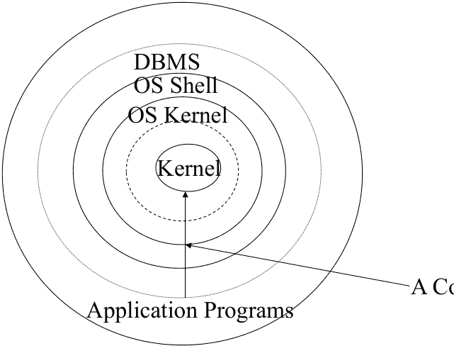

## 为什么要开设编译课程？

2、 你在编译器中使用的许多算法和模型都是基础性的，在其他地方也会有用：

- automata, regular expressions (lex’ing)
- context-free grammars, trees (parsing)
- hash tables (symbol table)
- dynamic programming

## 为什么要开设编译课程？

# dynamic programming

- Characterize the structure of an optimal solution.
- Recursively define the value of an optimal solution.
- Compute the value of an optimal solution in a bottom-up fashion.
- Construct an optimal solution from computed information.

## 为什么要开设编译课程？

3、 编写更高效的程序

Notes: Compiler writing spans programming languages, machine architecture, language theory, algorithms, and software engineering. And the ideas behind principles and techniques of a compiler writing can be used many times in the career of a computer scientist.

## 为什么要开设编译课程？

4. 编译器中使用的分析和生成技术对更广泛的一类问题也很有用，例如解析命令行或搜索查询，分析或生成标记语言。

## 如何讲授编译课程？

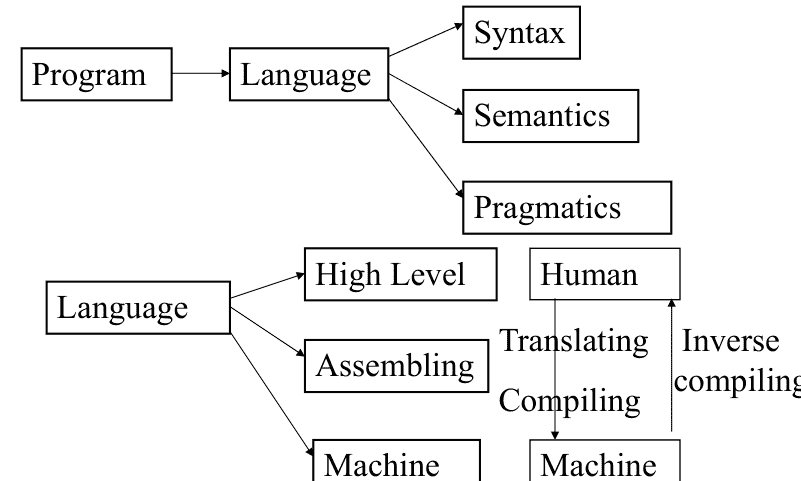

Translating: Oral Translating    Compiling: Written Translating

## 程序如何被处理和运行？

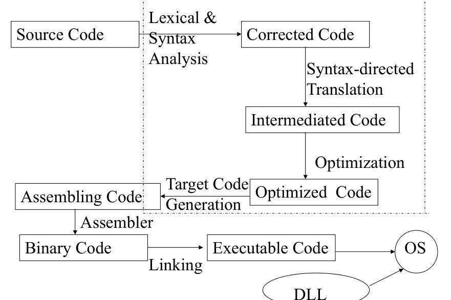

## 课程目标

+   1. 提供 **解析技术** 的知识。
+   2. 提供使用不同解析技术进行 **错误检测和恢复** 的知识。
+   3. 提供编程语言的 **语义和语法分析** 方面的概念。
+   4. 提供中间代码生成和 **优化** 方面的概念。

## 课程框架

+   1、 编译导论
+   2、 编程语言和语法定义
+   3、 词法分析
+      理论模型：正则文法和有限自动机
+      实现：词法分析程序
+      工具 : LEX
+   4、 语法分析
+      理论模型：上下文无关文法和下推自动机，LL(1) 文法，LR 文法
+      实现：递归下降分析
+         算符优先分析
+         LR 分析
+         使用含二义性文法
+      工具: YACC

## 课程框架

+   5、中间代码生成和语法制导翻译
+   6、类型检查和运行环境
+   7、代码优化：块优化，循环优化，全局优化
+   8、目标代码生成

## 如何学习本课程？

+   1、 注重深入理解原理
+   2、 注意各章节之间的关系
+   3、 多做练习，多实践并将理论与实验结合起来

## 如何评价？

+   1、 练习 – 10%
+   2、 实验 – 20% （共 2 次实验）
+   3、 期末考试 –70%

## 第 1 章 编译导论

### 1、 什么是编译器？

**非常通用的定义：** 它是一段将一种（人工）语言 Lang1 的程序翻译成另一种（人工）语言 Lang2 的程序的软件。

**更狭义的定义：** 我们主要关注的是 Lang1 是人类喜欢编程的编程语言，而 Lang2 是（或更接近于）机器语言，计算机能够“理解”并执行的情况。

**额外规定：** 即使输入不是 Lang1 的有效程序，编译器也应给出某种反馈。也就是说，它应给出错误信息，解释为什么输入不是有效程序。


## Chapter 1 Introduction to Compiling
### 2、 Why avoid compilers & program in machine language?
- 一个好的编程语言允许我们在适合感兴趣的问题域的抽象层面上思考。
- 一个好的编程语言还应促进健壮的代码开发。

## Chapter 1 Introduction to Compiling
### 3、 Structure of a compiler
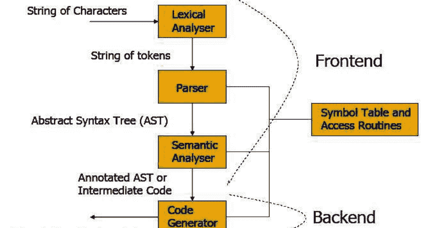

## Chapter 1 Introduction to Compiling
### 4、 More Structure of a compiler
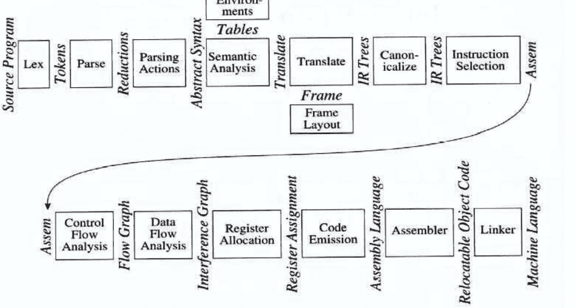

### 2. The Analysis-Synthesis Model of Compilation
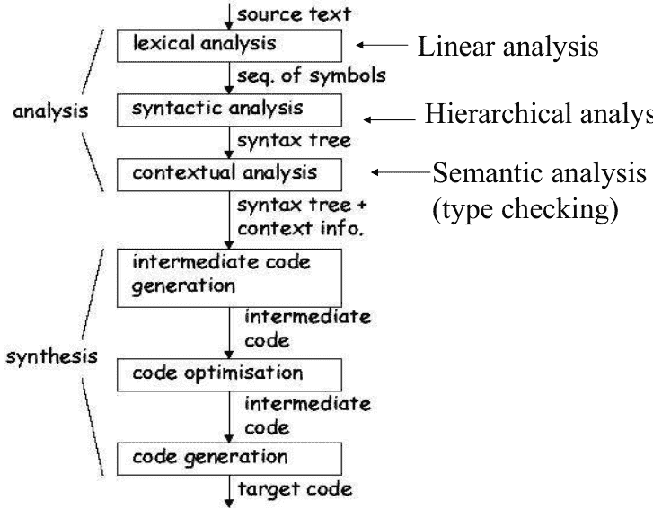

## Chapter 1 Introduction to Compiling
### 2、 The Analysis-Synthesis Model of Compilation
- Syntax Tree/Parse tree: A hierarchical structure

x=y+2*z

Syntax Tree (is a compressed representation of parse tree)

Parse Tree

Assignment statement

### 6、Symbol-Table Management
- 记录源程序中使用的标识符并收集每个标识符的各种属性信息，例如其类型、其作用域
- 符号表是一个数据结构，包含每个标识符的记录，其中包含标识符属性的字段

### 6、Symbol-Table Management
- 被后续阶段共享
- 允许快速找到每个标识符的记录并快速从表中存储或检索数据

| Identifier | Class | Description | Value / Address |
|---|---|---|---|
| pos | variable | type integer | absolute at 4000 hex |
| update | procedure | 1 integer param. | absolute at 4 hex |
| r | variable | type integer | relative at 8 hex |

## Chapter 1 Introduction to Compiling
### 7、Error Detection and Reporting
- 语法和语义分析阶段通常处理编译器可检测到的大部分错误

## Chapter 1 Introduction to Compiling
### 3、How to construct a compiler?
- 直接用目标机的机器语言编程
- 用汇编语言编程
- 用高级语言编程

Notes: The kernel of a compiler is usually programmed in an assembling language

Notes: This is an ordinary method

## Chapter 1 Introduction to Compiling
### 3、 How to construct a compiler?
- Self-Compiling
- Use compiler-construction tools
  - Lex,Yacc
- Port among different platforms

Notes: When constructing a compiler, a source language, a destination language and the compiling methods should be considered

## Chapter 1 Introduction to Compiling
### 4、 Compiler-Construction Tools
- Parser generators: Produce syntax analyzers, normally from input that is based on a context-free grammar
- Scanner generators: Automatically generate lexical analyzers, normally from a specification based on regular expression

## Chapter 1 Introduction to Compiling
### 4、Compiler-Construction Tools
- **Syntax-directed translation engine:** Produce collections of routines that walk the parse tree, generating intermediate code
- **Automatic code generators:** Take a collection of rules that define the translation of each operation of the intermediate language into the machine language for the target machine

### 4、 Compiler-Construction Tools
- Data-flow engines

## Chapter 2 Language & Syntax Description
### Section 1 Alphabet & String
#### 1、 Alphabet
Non-empty set of symbols, usually expressed in Σ、 V or Other Upper-case Greece Letter

#### 2、 Symbol(Character)
Elements in alphabet, finest elements in a language

#### 3、 String
Finite sequence of symbols in the Alphabet.

Notes: Null-string is string without any symbol, written as ε。

## Chapter 2 Language & Syntax Description
### Section 1 Alphabet & String
#### 4、 Sentence
A set of strings based on symbols in the Alphabet in certain construction rules

#### 5、 Language
Sets of sentences in the Alphabet.

Notes: By convention, a symbol is expressed as a,b,c,...; a string is expressed as α,β,γ,...; a set of strings is expressed in A,B,C,...


## Chapter 2 Language & Syntax Description

### Section 2 Grammar & Language

#### 1、Basic concepts

##### a、Grammar

Grammar is the formal production rules describing the construction of syntax elements.

**Notes:**

1. Syntax elements include sentences and words in sentences, a language is composed of sentences.
2. The form of a production rule is as following:

left-side→right-side (that can be read as "left-side is defined as right-side", "left-side derives right-side", or "left-side produces right-side", it expresses the relation between the two sides)

##### b、Non-terminal symbol

- A symbol that appears in the left of a rule, is bracketed in <> and expresses a syntax concept.
- A set of non-terminal symbols is expressed in Vₙ.

##### c、Terminal symbol

- Strings in a language that cannot be decomposed (including strings of single characters), expressed in Vₜ.

**Notes:** Terminal symbols are basic elements of a sentence.

##### f、Derivation

- The process that starts from the Start Symbol, and derives a sentence by replacing the left-side with right side in a production rule.
- Leftmost (Rightmost) Derivation: Only use a production rule every time and replace the leftmost (Rightmost) Non-terminal Symbol with the right side.

**Notes:** Leftmost (Rightmost) Derivation are called canonical derivation.

##### g、Reduction

- Reduction is the inverse process of derivation, that is, starting from a given sentence of a language, arriving at the Start Symbol by replacing the right-side with left-side of the production rules finally.
- Leftmost(Rightmost) Reduction is the inverse process of Rightmost(Leftmost) derivation.

**Notes:** Leftmost and Rightmost Reduction are called canonical reduction.

##### h、Sentential form、Sentence & Language

- Sentential form
  - String α that is produced from every derivation (including 0 derivation) from the Start Symbol. Written as S ⇒* α, α ∈ (V_N ∪ V_T)*
- Sentence
  - A sentential form that only include terminal symbol
- Language
  - The set of sentences (strings) that are produced from one or more derivation from S. Written as L(G), L(G)={α|S ⇒+ α, and α ∈ V_T*}

##### j、Extended notations of grammar rules

Use extended BNF (Backus Naur Form) notations

- () —— Extract factor
  - E.g. U→ax|ay|az Rewritten as U→a(x|y|z)
- {} —— Assignment of repeat number
  - E.g. <Identifier>→<Letter>{<Letter>|<Digit>}⁵₀.
- [] —— Optional symbol
  - E.g. <Integer>→[+|-]<Digit>{<Digit>}

##### k、Meta-language symbol

The symbols that are used in describing the relations of grammar symbol, E.g. "→" and "|" are called as meta-language symbol.

#### 2、Formal definition

##### a、Grammar definition

A grammar G is defined as a quadruple

(V_N, V_T, P, S)

##### b、Catalog of grammars

According to the limitation on the production rules in a grammar, we can classify grammars into 4 sorts, such as 0-type grammar、1-type grammar、2-type grammar and 3-type grammar.

- (1) 0-type grammar (Phrase grammar or grammar without limitation)
  - To any production α→β in P where α∈V⁺ and β∈V*, there is at least a non-terminal symbol in α.

**Notes:**

- ① The automaton that can recognize a 0-type language is called a Turing Machine;
- ② 0-type grammar is a grammar that has least limitation on its productions;
- ③ We can get other types of grammar by limiting the form of productions in a 0-type grammar.


## 第2章 语言与语法描述
### 第2节 语法与语言
#### 2、形式定义
##### 6、文法分类
###### (2) 1型文法（上下文有关文法或长度增加文法）
- 对P中任意产生式 α→β，有限制 |β|>=|α|，除 S → ε 外。若 S → ε，则 S 不能出现在任一产生式的右部。
- 或，P中任意产生式 α→β 均有形式 αAβ→αγβ（其中 α, β∈V*，A∈V_N，γ∈V_T+），除 S → ε 外。

注：①能识别1型语言的自动机称为线性有界自动机（LBA）；②在1型文法中，替换非终结符时应考虑其上下文。且非终结符不能被替换为 ε，除非开始符可以产生 ε

##### b、文法分类
###### (3) 2型文法（上下文无关文法）
- P中每个产生式均有形式 A→β，其中 A∈V_N，β∈V*。

注：①每个产生式的左部应为非终结符，右部可以是 V_N、V_T 或 ε。②识别2型语言的自动机称为下推自动机（PDA）

###### (4)3型文法（正则文法，右线性文法或左线性文法）
- P中每个产生式均有形式 A→ α B、A→ α，或 A→ Bα、A→ α，其中 A, B∈V_N，α∈V_T*。

注：①3型文法的产生式为右线性产生式或左线性产生式。不能同时存在左线性产生式和右线性产生式。若3型文法中的所有产生式均为左线性产生式，则称该文法为左线性文法。若3型文法中的所有产生式均为右线性产生式，则称该文法为右线性文法。

#### c、 i型语言
- 由 i型文法产生的语言。

记作 L(G)：L(G)={ω|ω ∈ V_T^*，且 S ⇝+ ω}

例：设 G₁=({S},{a,b},P,S)

其中 P 包含：(0) S → aS

(1) S → a

(2) S → b

L(G₁)={aⁱ(a|b)|i>=0}

例：设 G₂=({S},{a,b},P,S)

其中 P 包含：(0) S → aSb

(1) S → ab

L(G₂)={aⁿbⁿ|n>=1}

注：词法分析与语法分析所用文法的产生式限制如下，
- 不存在 P → P 这种产生式，此类产生式无用但会导致二义性
- 任意非终结符 P 应可达，且能推导出终结符串。
- 从开始符 S 出发，存在推导 S → αPβ
- P 必须能推导出一个终结符串，即 P *→ γ；γ ∈ V_T*。

## 第2章 语言与语法描述
### 第3节 文法构造与简化
#### 1、由语言构造文法

例1：设 L₁={a²ⁿbⁿ|n>=1 且 a,b ∈ Vₜ}

尝试由 L₁ 构造文法 G₁

- 令 n=1， L₁=aab
- n=2， L₁=aaaabb
- n=3， L₁=aaaaaabbb
- ……

于是我们有：

```
S → aaSb
S → aab
```

例2：设 $L_2=\{a^i b^j c^k\mid i,j,k\geq 1\text{ and }a,b,c\in V_T\}$

尝试由 $L_2$ 构造文法 $G_2$

```
S → aS　　　　　　S → aB
B → bB　　　　　　B → bC
C → cC | c
```

例3：设 L₃={ω | ω ∈(a,b)* 且 ω 中 a 的个数与 b 的个数相同}

尝试由 L₃ 构造文法 G₃

```
S → ε
S → bB,  S → aA
A → bS|b ,  A → aAA
B → aS | a | bBB
```

```
(0) S → ε
S → aSbS
S → bSaS
```


## 第2章 语言与语法描述
### 第3节 语法构造与简化
#### 1、从语言构造语法

例4：设 L₄={ω | ω ∈(0,1)* 且 ω 中出现 1 的个数为偶数}

尝试从 L₄ 构造语法 G₄

```
S → ε
```

```
S →0S,  S → 1A
```

```
A →0A , A →1S
```

#### 2、语法简化

a、由于一种语言可以用不同的语法来描述，确实应该选择产生式最少且最适合该语言属性的语法。

b、在一个语法中，可能存在一些对推导无用的冗余产生式。我们应该删除这些产生式。

- 形式为 P→P 的产生式
- 永远无法推导出终结符串的产生式
- 其左侧非终结符不出现在任何产生式右侧的产生式

#### 2、语法简化

c、简化步骤：

- 查找形式为 P→P 的产生式，并删除它们；
- 如果一个产生式永远无法在推导中使用，删除它；
- 如果一个产生式无法推导出终结符串，删除它；
- 安排剩余的产生式。

#### 2、语法简化

**示例：** 简化以下语法

```
(0)S → Be    (1)S → Ec    (2)A → Ae    (3)A → e
(4)A → A     (5)B → Ce    (6)B → Af    (7)C → Cf
(8)D → f
```

**结果：**

```
(0) S → Be       (1)A → Ae       (2)A →e
(3)B → Af
```

#### 3、构造不含 ε-产生式的上下文无关文法

a、一个不含 ε-产生式的上下文无关文法应满足以下条件

- 如果 P 中存在形式为 S → ε 的产生式，S 不应出现在任何产生式的右侧，其中 S 是文法的开始符号；
- P 中没有其他 ε-产生式。

b、构造不含 ε-产生式的上下文无关文法的算法：

- G=(V_N,V_T,P,S) ⇒ G'=(V'_N,V'_T,P',S')

(1) 找出经过若干步后能推导出 ε 的所有非终结符，并将它们放入集合 V_0；

b、 构造不含 ε-产生式的上下文无关文法的算法：

(2) 按以下步骤构造 G' 的产生式集合 P'：

- (A)如果 V₀ 中的符号出现在产生式的右侧，则将该产生式改为两个产生式：分别用 ε 和其本身替换该符号中的符号；将新的产生式放入 P'
- ( B)否则，将与该符号相关的产生式放入 P'，但排除与该符号相关的 ε-产生式
- ( C)如果 P 中存在形式为 S→ ε 的产生式，则将该产生式改为 S'→ ε | S 并将其放入 P'，令 S' 为 G' 的开始符号，令 V'ₙ=Vₙ∪{S'}，

示例：设 G₁=({S},{a,b},P,S)，其中

P: (0) S → ε   (1) S → aSbS   (2) S → bSaS

(1) V₀={S}

(2) P′

(1) S → abS|aSbS|aSb|ab

(2) S → baS|bSaS|bSa|ba

(0) S′ → ε | S

所以：G₁=({S′,S},{a,b},P′,S′)，其中

P′:

(0) S′ → ε | S

(1) S → abS|aSbS|aSb|ab

(2) S → baS|bSaS|bSa|ba

## 第2章 语言与语法描述
### 第4节 文法的语法树与二义性
#### 1、语法树
##### a、定义

- 用于表达语言中一个句子结构的树

##### b、功能

- 直观直接地呈现语法分析过程
- 易于判断文法的二义性

语法树的示例

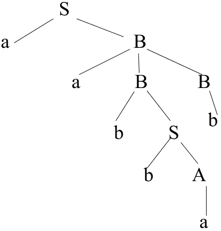

#### 1、语法树
##### c、语法树中的基本术语

- (1) 子树

由语法树中一个节点（除叶子外）及其所有后代节点组成的一棵树

- (2) 修剪子树

剪掉子树的根的所有子节点

- (3) 句型

语法树生长过程中的一个快照中出现的所有叶子的序列


## 第2章 语言与语法描述

### 第4节 语法树与文法的二义性

**1、语法树**

**c、语法树中的基本术语**

**（4）短语**

子树中从左到右的终结符序列串称为与该子树根相关的短语。

- **简单短语（直接短语）：** 如果一个短语是由子树的根经过1步推导得到的，则称该短语为与该子树根相关的简单短语。
- **句型中的短语：** 与句型相关的某棵子树所对应的短语

**（5）句柄**

句型中最左边的简单短语。

注：在规范归约（最左归约）过程中，核心工作就是寻找句柄。

**语法树的句柄**

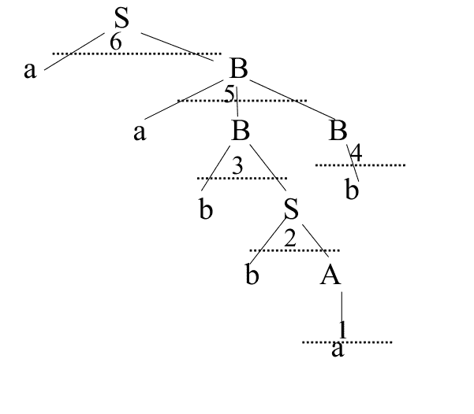

**a、句子的二义性**

如果文法中的某个句子具有两棵或两棵以上相关的语法树，则该句子是二义性的。

**b、文法的二义性**

如果文法所对应的语言中存在二义性句子，则该文法是二义性的。

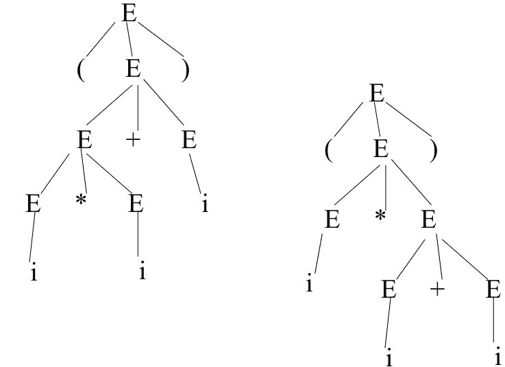

**注：**

- 二义性会给语法分析带来不确定性
- 文法的二义性是不可判定的，也就是说，不存在这样的算法，能在有限步骤内判定一个文法是否为二义性文法
- 如果要证明一个文法是二义性的，只需给出一个反例
- 如果我们能控制文法的二义性，即使用附加条件，那么二义性的存在并非那么糟糕

## 第3章 词法分析

### 第0节 实现词法分析器的方法

**1、简单方法**

- 构造一个描述源语言记号结构的图，然后手动将该图转换为用于查找记号的程序

注：以这种方式可以生成高效的词法分析器

**2、模式驱动编程方法**

- 模式匹配技术
- 指定并设计程序，使其执行由字符串中的模式触发的动作
- 引入一种称为 Lex 的模式-动作语言，用于指定词法分析器
    - 模式由正则表达式指定
    - Lex 的编译器可以为正则表达式生成高效的有穷自动机识别器

### 第1节 词法分析器的作用

编译器的第一个阶段。

**1、主要任务**

- 读取输入字符
- 产生供语法分析器进行语法分析所用的记号序列
- 作为语法分析器的辅助者

**2、词法分析器与语法分析器的交互**

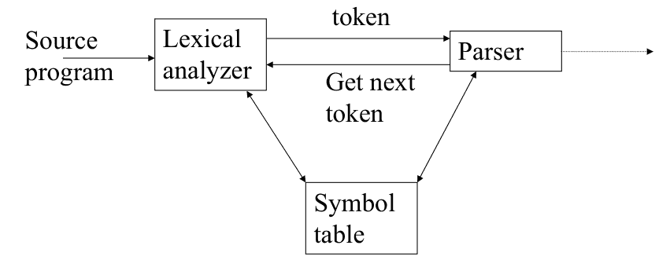

**3、词法分析器中的处理过程**

- 扫描
    - 预处理
        - 剔除注释和空白
        - 宏功能
    - 将编译器的错误信息与源程序相关联
        - 错误信息可以与行号关联
    - 词法分析

**4、词法分析器的术语**

- 记号（Token）
    - 源程序中单词的类型
    - 关键字、运算符、标识符、常量、字符串字面量、标点符号（如逗号、分号）
- 词素（Lexeme）
    - 源程序中实际的单词
- 模式（Pattern）
    - 描述源程序中能够表示某个特定记号的一组词素的规则
    - **关系运算符** {<,<=,>,>=,==,<>}


## CHAPTER 3 LEXICAL ANALYSIS

### Section 1 The role of the lexical analyzer

#### 5、Attributes for Tokens

- A pointer to the symbol-table entry in which the information about the token is kept

E.g., `E = M * C ** 2`

```
<id, pointer to symbol-table entry for E>
<assign_op,>
<id, pointer to symbol-table entry for M>
<multi_op,>
<id, pointer to symbol-table entry for C>
<exp_op,>
<num, integer value 2>
```

#### 6、Lexical Errors

- Deleting an extraneous character
- Inserting a missing character
- Replacing an incorrect character by a correct character
- Transposing two adjacent characters (such as fi => if)
- Pre-scanning

#### 7、Input Buffering

- Two-buffer input scheme to look ahead on the input and identify tokens
- Buffer pairs
- Sentinels (Guards)

### Section 2 Specification of Tokens

#### 1、Regular Definition of Tokens

- Defined in regular expression

```
Id → letter (letter | digit)*
letter → A | B | ... | Z | a | b | ... | z
digit → 0 | 1 | 2 | ... | 9
```

Notes: Regular expressions are an important notation for specifying patterns. Each pattern matches a set of strings, so regular expressions will serve as names for sets of strings.

#### 2、Regular Expression & Regular language

- Regular Expression
  - A notation that allows us to define a pattern in a high-level language.

- Regular language
  - Each regular expression r denotes a language L(r) (the set of sentences relating to the regular expression r)

Notes: Each word in a program can be expressed in a regular expression.

#### 3、The rule of regular expression over alphabet Σ

1. ε is a regular expression that denotes {ε}
   - ε is a regular expression
   - {ε} is the related regular language
2. If a is a symbol in Σ, then a is a regular expression that denotes {a}
   - a is a regular expression
   - {a} is the related regular language
3. Suppose α and β are regular expressions, then α|β, αβ, α*, β* are also regular expressions

Notes: Rules 1) and 2) form the basis of the definition; rule 3) provides the inductive step.

#### 4、Algebraic laws of regular expressions

- 1) `α|β = β|α`
- 2) `α|(β|γ) = (α|β)|γ`；`α(βγ) = (αβ)γ`
- 3) `α(β|γ) = αβ|αγ`；`(α|β)γ = αγ|βγ`
- 4) `εα = αε = α`
- 5) `(α*)* = α*`
- 6) `α* = α⁺|ε`；`α⁺ = αα* = α*α`
- 7) `(α|β)* = (α*|β*)* = (α*β*)*`
- 8) If ε ∉ L(γ), then
  - `α = β|γα ↔ α = γ*β`
  - `α = β|αγ ↔ α = βγ*`

Notes: We assume that the precedence of `*` is the highest, the precedence of `|` is the lowest and they are left associative.

#### 5、Notational Shorthands

- a) One or more instances
  - `(r)+`  `digit+`
- b) Zero or one instance
  - `r?` is a shorthand for `r|ε`；`(E(+|-)?digits)?`
- c) Character classes
  - `[a-z]` denotes `a|b|c|...|z`
  - `[A-Za-z]` `[A-Za-z0-9]`

### Section 3 Recognition of Tokens

#### 1、Task of recognition of token in a lexical analyzer

- Isolate the lexeme for the next token in the input buffer
- Produce as output a pair consisting of the appropriate token and attribute-value, such as `<id, pointer to table entry>`, using the translation table given below:

| Regular expression | Token | Attribute-value |
| --- | --- | --- |
| if | if | - |
| id | id | Pointer to table entry |
| < | relop | LT |


## 第3章 词法分析

### 第3节 记号识别

**2、记号识别的方法**

- 使用状态转换图

**3、状态转换图（示意流程图）**

- 描述当语法分析器调用词法分析器获取下一个记号时所发生的动作

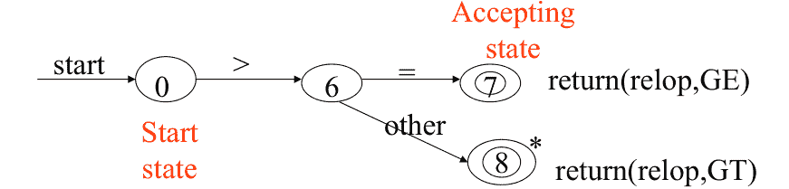

注意：这里我们用“\*”表示必须进行输入回退的状态。

**4、实现状态转换图**

- 每个状态对应一段代码
- 如果一个状态存在出边，那么其代码读取一个字符，并在可能的情况下选择一条要跟随的边
- 使用`nextchar()`从输入缓冲区读取下一个字符

```
while (1) {
    switch (state) {
        case 0:
            c = nextchar();
            if (c == blank || c == tab || c == newline) {
                state = 0;
                lexeme_beginning++;
            }
            else if (c == '<') state = 1;
            else if (c == '=') state = 5;
            else if (c == '>') state = 6;
            else state = fail();
            break;
        case 9:
            c = nextchar();
            if (isletter(c)) state = 10;
            else state = fail();
            break;
        ...
    }
}
```

**5、广义状态转换图：有限自动机**

- 确定或非确定有限自动机
- 非确定意味着在同一个输入符号上，一个状态可能有不止一条转换出边

**6、记号识别的模型**

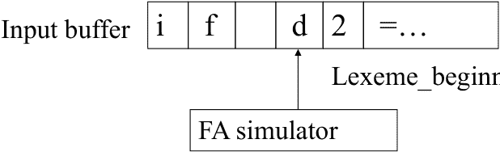

例如，标识符的有限自动机模拟器为：

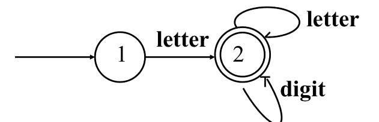

它表示如下规则：

`identifier = letter(letter|digit)*`

### 第4节 有限自动机

**1、有限自动机的用途**

- 精确识别正则集
- 正则集是与正则表达式相关的句子的集合

**2、有限自动机的种类**

- 确定有限自动机
- 非确定有限自动机

**3、确定有限自动机（DFA）**

DFA是一个五元组：M = (S, Σ, move, s₀, F)。

- S：*状态*的集合
- Σ：输入符号字母表
- move：一个转换函数，从 S × Σ 映射到 S，*move(s, a) = s′*
- s₀：*开始*状态，s₀ ∈ S
- F：被区分为*接受*状态的状态集合 F，F ⊆ S

1. 在DFA中，任何状态都没有ε转换；
2. 在DFA中，对于每个状态 *s* 和输入符号 *a*，至多有一条标号为 *a* 的边离开 *s*
3. 描述有限自动机时，我们使用转换图或转换表
4. 一个DFA接受输入串 x 当且仅当在转换图中存在一条从开始状态到某个接受状态的路径

例如，DFA M = ({0,1,2,3}, {a,b}, move, 0, {3})

转换函数：

```
move(0,a)=1   move(0,b)=2   move(1,a)=3   move(1,b)=2
move(2,a)=1   move(2,b)=3   move(3,a)=3   move(3,b)=3
```

**转换表**

| 状态 | a | b |
|---|---:|---:|
| 0 | 1 | 2 |
| 1 | 3 | 2 |
| 2 | 1 | 3 |
| 3 | 3 | 3 |

**转换图**

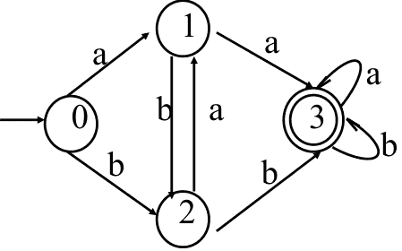

例如，构造一个DFA M，它能接受以 a 或 b 开头，或以 c 开头且最多包含一个 a 的字符串。

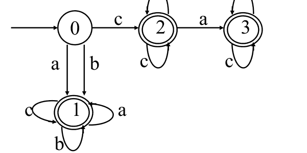

因此，该DFA为：

M = ({0,1,2,3}, {a,b,c}, move, 0, {1,2,3})

转换函数：

```
move(0,a)=1   move(0,b)=1
move(0,c)=1   move(1,a)=1
move(1,b)=1   move(1,c)=1
move(2,a)=3   move(2,b)=2
move(2,c)=2   move(3,b)=3
move(3,c)=3
```


## CHAPTER 3 LEXICAL ANALYSIS
### Section 4 Finite automata
#### 4、 Non-deterministic FA (NFA)

A NFA is a quintuple, M = (S, Σ, move, s₀, F)

- S: a set of *states*
- Σ: the input symbol alphabet
- move: a mapping from S×Σ to 2^S, *move(s,a) ∈ 2^S*, 2^S is the power set of S
- s₀: the *start* state, s₀ ∈ S
- F: a set of states F distinguished as *accepting* states, F ⊆ S

- Note:
  - 1) In a NFA, the same character can label two or more transitions out of one state;
  - 2) In a NFA, ε is a legal input symbol.
  - 3) A DFA is a special case of a NFA
  - 4) A NFA accepts an input string x if and only if there is some path in the transition graph from start state to some accepting state. A path can be represented by a sequence of state transitions called moves.
  - 5) The language defined by a NFA is the set of input strings it accepts

e.g. An NFA $M=$  
$(\{q_0,q_1\},\{0,1\},\text{move},q_0,\{q_1\})$

| State | 0 | 1 |
|---|---|---|
| $q_0$ | $q_0$ | $q_1$ |
| $q_1$ | $q_0, q_1$ | $q_0$ |

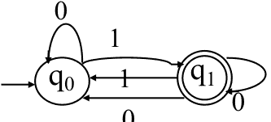

The language defined by the NFA is

$0^*10^*|0^*10^*((1|0)0^*10^*)^*$

#### 5、 Conversion of an NFA into a DFA

- a) Reasons to conversion: Avoiding ambiguity
- b) The algorithm idea: Subset construction: The following state set of a state in a NFA is thought of as a following STATE of the state in the converted DFA

**c) The pre-process -- ε-closure(T)**

Obtain ε-closure(T) for T ⊆ S

(1) ε-closure(T) definition: A set of NFA states reachable from NFA state s in T on ε-transitions alone

(2) ε-closure(T) algorithm

```
push all states in T onto stack;
initialize ε-closure(T) to T;
while stack is not empty do {
    pop the top element of the stack into t;
    for each state u with an edge from t to u labeled ε do {
        if u is not in ε-closure(T) {
            add u to ε-closure(T)
            push u into stack} } }
```

**d) Subset Construction algorithm**

- Input. An NFA N=(S, Σ, move, S₀, Z)
- Output. A DFA D=(Q, Σ, δ, I₀, F), accepting the same language

Notes:
- 1) Both DFA and NFA can recognize precisely the regular sets;
- 2) DFA can lead to faster recognizers
- 3) DFA can be much bigger than an equivalent NFA

#### 6、 Minimizing the number of States of a DFA

**a) Basic idea**

Find all groups of states that can be distinguished by some input string. At the beginning of the process, we assume two distinguished groups of states: the group of non-accepting states and the group of accepting states. Then we use the method of partition of equivalence classes on input strings to partition the existing groups into smaller groups.

**b) Algorithm**

- Input. A DFA M={S, Σ, move, s₀, F}
- Output. A DFA M’ accepting the same language as M and having as few states as possible.

(1) Construct an initial partition Π of the set of states with two groups: the accepting states F and the non-accepting states S-F. Π₀ = {I₀¹, I₀²}

(2) For each group I of Πᵢ, partition I into subgroups such that two states s and t of I are in the same subgroup if and only if for all input symbols a, states s and t have transitions on a to states in the same group of Πᵢ; replace I in Πᵢ₊₁ by the set of subgroups formed.


## CHAPTER 3 LEXICAL ANALYSIS

### Section 4 Finite automata

#### 6. Minimizing the number of States of a DFA

**b) Algorithm**

(3) If Π_{i+1} = Π_i, let Π_final = Π_{i+1} and continue with step (4). Otherwise, repeat step (2) with Π_{i+1}.

(4) Choose one state in each group of the partition Π_final as the representative for that group. The representatives will be the states of the reduced DFA M'. Let s and t be representative states for s's and t's group respectively, and suppose on input a there is a transition of M from s to t. Then M' has a transition from s to t on a.

(5) If M' has a dead state (a state that is not accepting and that has transitions to itself on all input symbols), then remove it. Also remove any states not reachable from the start state.

**Notes:** The meaning that a string w distinguishes state s from state t is that by starting with the DFA M in state s and feeding it input w, we end up in an accepting state, but starting in state t and feeding it input w, we end up in a non-accepting state, or vice versa.

- Example: Minimize the following DFA.

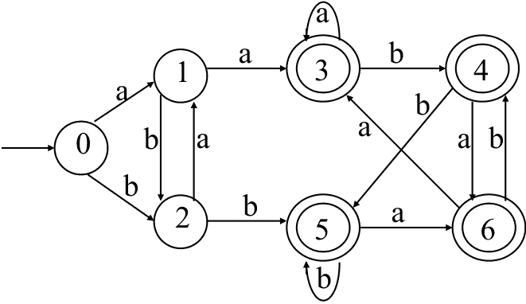

1. Initialization: Π₀ = {{0,1,2},{3,4,5,6}}

2.1 For non-accepting states in Π₀:
- a. move({0,2}, a) = {1}; move({1}, a) = {3}. 1 and 3 are not in the same subgroup of Π₀.
  So, Π₁' = {{1},{0,2},{3,4,5,6}}.
- b. move({0}, b) = {2}; move({2}, b) = {5}. 2 and 5 are not in the same subgroup of Π₁'.
  So, Π₁'' = {{1},{0},{2},{3,4,5,6}}.

2.2 For accepting states in Π₀:
- a: move({3,4,5,6}, a) = {3,6}, which is a subset of {3,4,5,6} in Π₁''.
- b: move({3,4,5,6}, b) = {4,5}, which is a subset of {3,4,5,6} in Π₁''.
- So, Π₁ = {{1},{0},{2},{3,4,5,6}}.

3. Apply step (2) again to Π₁, and get Π₂.
- Π₂ = {{1},{0},{2},{3,4,5,6}} = Π₁,
- So, Π_final = Π₁.

4. Let state 3 represent the state group {3,4,5,6}.

So, the minimized DFA is:

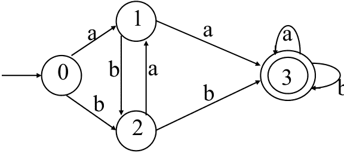

`(a|b)* a (a|b)(a|b)`

**1. NFA.**

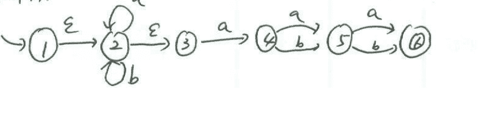

**2. NFA ⇒ DFA**

| $I_i$ | $a$ | $b$ |
|---|---|---|
| $I_0 = \epsilon(\{1\}) = \{1,2,3\}$ | $\epsilon(\{1,a\}) = \{2,3,4\} = I_1$ | $\epsilon(\{1,b\}) = \{2,3\} = I_2$ |
| $I_1 = \{2,3,4\}$ | $\epsilon(\{2,a\}) = \{2,3,4,5\} = I_3$ | $\epsilon(\{2,b\}) = \{2,3,5\} = I_4$ |
| $I_2 = \{2,3\}$ | $\epsilon(\{2,4\}) = I_1$ | $\epsilon(\{2\}) = I_2$ |
| $I_3 = \{2,3,4,5\}$ | $\epsilon(\{2,4,5,6\}) = \{2,3,4,5,6\} = I_5$ | $\epsilon(\{2,5,6\}) = \{2,5,6\} = I_6$ |
| $I_4 = \{2,3,5\}$ | $\epsilon(\{2,4,6\}) = \{2,3,4,6\} = I_7$ | $\epsilon(\{2,6\}) = \{2,3,6\} = I_8$ |
| $I_5 = \{2,3,4,5,6\}$ | $\epsilon(\{2,4,5,6\}) = I_5$ | $\epsilon(\{2,5,6\}) = I_6$ |
| $I_6 = \{2,3,5,6\}$ | $\epsilon(\{2,4,6\}) = I_7$ | $\epsilon(\{2,6\}) = I_8$ |
| $I_7 = \{2,3,4,6\}$ | $\epsilon(\{2,4,5\}) = I_3$ | $\epsilon(\{2,5\}) = I_4$ |
| $I_8 = \{2,3,6\}$ | $\epsilon(\{2,4\}) = I_1$ | $\epsilon(\{2\}) = I_2$ |

**3. DFA ⇒ DFA'**

```
Z₀, Z₁, Z₂, Z₃, Z₄, Z₅, Z₆, Z₇, Z₈

①

Z₀, Z₁, Z₂, Z₃, Z₄

Z₅, Z₆, Z₇, Z₈

②

④

Z₀, Z₁, Z₂

Z₃, Z₄

③

⑦

Z₀, Z₂

Z₁

Z₃

Z₄

Z₅, Z₆

Z₇, Z₈

⑤

⑥

Z₅

Z₆

Z₇

Z₈
```

### Section 5 Regular expression to an NFA

#### 1. The reasons about regular expression to an NFA

Strategy for building a recognizer from a regular expression is to construct an NFA from a regular expression and then to simulate the behavior of the NFA on an input string.

#### 2. Construction of an NFA from a regular expression

**a) Basic idea**

Syntax-directed in that it uses the syntactic structure of the regular expression to guide the construction process.


## 第三章 词法分析

### 第5节 正则表达式到 NFA

**2. 从正则表达式构造 NFA**

**a) 算法**

- 输入。字母表 Σ 上的正则表达式 *r*。
- 输出。接受 *L(r)* 的 NFA *N*。

**方法**

1. 将 *r* 解析为其构成的子表达式。
2. 使用下一页中的规则为 *r* 中的每个基本符号（那些是 ε 或字母表符号的符号）构造 NFA。
3. 使用下一页和下下页中的规则归纳地组合这些 NFA，并得到整个表达式的 NFA。

**规则**

1. 对于 ε，

   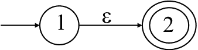

2. 对于 a in Σ，

   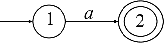

### 第6节 FA 到正则表达式

**1. 基本思想**

通过合并状态来减少状态数。

**2. 算法**

- 输入：一个 FA *M*。
- 输出：字母表 Σ 上的正则表达式 *r*，它识别与 FA *M* 相同的语言。

**方法**

- 扩展 FA 的概念，并让箭头被正则表达式标记。
- 向 FA *M* 添加两个节点 x, y，并得到识别相同正则语言的 *M′*。

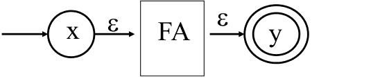

- 使用以下规则归纳地组合 FA 中的正则表达式，并得到 FA 的整个表达式。

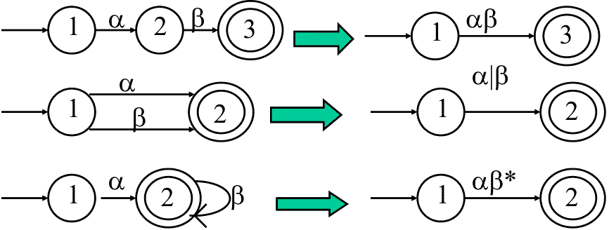

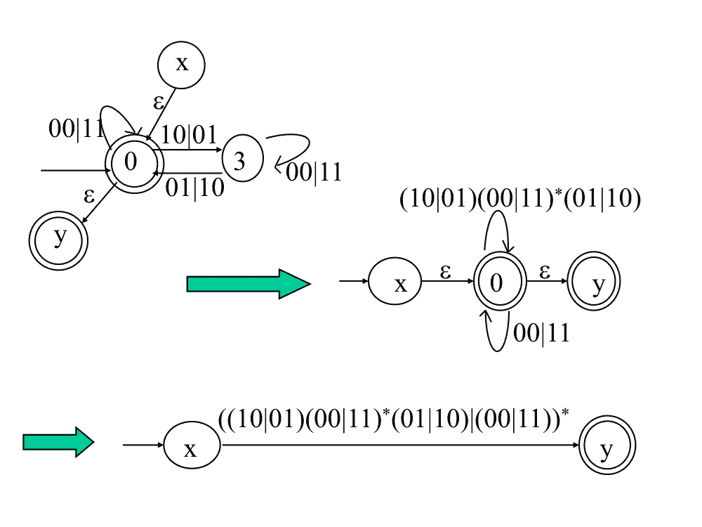

### 第7节 正则文法到 NFA

**1. 基本性质**

- 对于每个正则文法 G=(V_N, V_T, P, S)，存在一个 FA M=(Q, Σ, f, q₀, Z)，且 L(G)=L(M)。
- 对于每个 FA M，存在一个右线性文法和一个左线性文法来识别相同的语言。L(M)=L(G_R)=L(G_L)。

**2. 右线性文法到 FA**

- 输入：G=(V_N, V_T, P, S)。
- 输出：FA M=(Q, Σ, move, q₀, Z)。
- 方法：
  - 将 G 中的每个非终结符视为一个状态，并添加一个新状态 T 作为接受状态。
  - 令 Q=V_N ∪ {T}, Σ=V_T, q₀=S；如果存在产生式 S→ε，则 Z={S,T}，否则 Z={T}。
  - 对于每个产生式，构造函数 move。
    - a) 对于类似 A₁ → aA₂ 的产生式，构造 move(A₁, a)=A₂。
    - b) 对于类似 A₁ → a 的产生式，构造 move(A₁, a)=T。
    - c) 对于 Σ 中的每个 a，move(T, a)=∅；这意味着接受状态不识别任何终结符。

**例如。** 一个正则文法 G=({S,A,B},{a,b,c},P,S)

```
P: S → aS | aB
   B → bB | bA
   A → cA | c
```

为文法 G 构造一个 FA。

**答案：** 令 M=(Q, Σ, f, q₀, Z)。

1. 添加一个状态 T，所以 Q={S,B,A,T}；Σ={a,b,c}；q₀=S；Z={T}。
2. f：

|  |  |
|---|---|
| f(S,a)=S | f(S,a)=B |
| f(B,b)=B | f(B,b)=A |
| f(A,c)=A | f(A,c)=T |

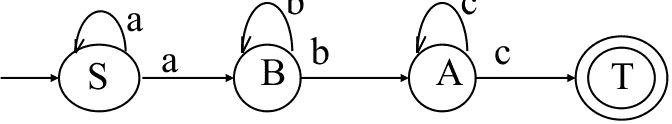

**3. FA 到右线性文法**

- 输入：M=(S, Σ, f, s₀, Z)。
- 输出：RG=(V_N, V_T, P, s₀)。
- 方法：
  - 如果 s₀ ∉ Z，则产生式为：
    - a) 对于 M 中映射 f(Aᵢ, a)=Aⱼ，存在产生式 Aᵢ → aAⱼ。
    - b) 如果 Aⱼ ∈ Z，则添加一个新的产生式 Aᵢ → a；然后我们得到 Aᵢ → a | aAⱼ。
  - 如果 s₀ ∈ Z，则除了基于前一条规则得到的产生式外，我们还会得到以下产生式：
    - 对于映射 f(s₀, ε)=s₀，构造新的产生式，s₀′ → ε | s₀，且 s₀′ 是新的起始状态。


e.g. 为以下 DFA M = ({A,B,C,D},{0,1},f,A,{B}) 构造一个右线性文法

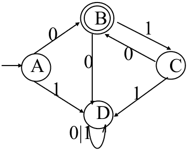

答案： RG = ({A,B,C,D},{0,1},P,A)

```
A → 0B | 1D | 0
B → 1C | 0D
C → 0B | 1D | 0
D → 0D | 1D
```

L(RG) = L(M) = 0(10)*

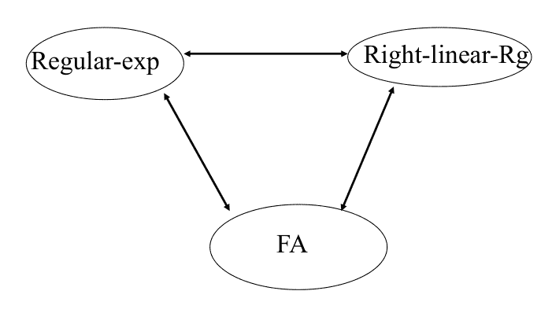

## CHAPTER 3 词法分析

### Section 8 词法分析器生成器的设计

- 1. 词法分析器生成器

  一种从相关语言规范自动构造词法分析器的软件工具。

- 2. 典型的词法分析器生成器

  Lex

- 3. Lex

  - a) 词法分析器生成工具

    Lex 编译器

  - b) 输入规范

    Lex 语言程序

  - c) 使用 Lex 创建词法分析器的过程

    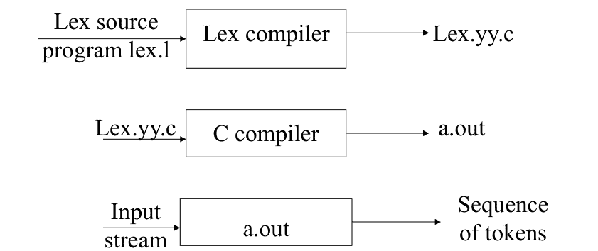

  - d) Lex 规范

    一个 Lex 程序由三部分组成：

    - declaration
    - %%
    - 翻译规则
    - %%
    - 辅助过程

    - (1) 声明

      包含变量声明、显式常量和正则定义。

      注：显式常量是一个被声明为代表常量的标识符。

    - (2) 翻译规则

      ```
      p₁ {action₁} /* p — 模式（正则表达式） */
      ...
      pₙ {actionₙ}
      ```

      e.g.

      ```
      {if} {return(IF);}
      {id} {yylval=install_id(); return(ID);}
      ```

    - (3) 辅助过程

      ```
      install_id() {
        /* procedure to install the lexeme, whose
      first character is pointed to by yytext and whose
      length is yyleng, into the symbol table and return
      a pointer thereto*/
      }
      ```

      注：辅助过程可以单独编译并与词法分析器一起加载。

    ```
    %{ /* this part is copied literally to the generated C code */
    #define IF 5
    #define ID 12
    #define INTEGER 13
    #define REAL 14
    %}
    delim    [ \t\n]+
    letter   [A-Za-z]
    digit    [0-9]
    id       {letter}({letter}|{digit})*
    integer  {digit}+
    real     {digit}+\.{(digit)+}?|({digit}+)?\.{digit}+
    %%
    {delim}  { /* no action and no return */ }
    if       {return IF;}
    {id}     {yylval = install_id(); return ID;}
    {real}   {yylval = convert_real(); return REAL;}
    {integer}{yylval = convert_int(); return INTEGER;}
    %%
    install_id() { ... procedure to enter or lookup in the symbol table the string pointed to by yytext with length yyleng ...}
    ```

    ```
    %{
    /* a lex program that adds line numbers to lines of text,
    printing the new text to the standard output */
    #include <stdio.h>
    int lineno = 1;
    %}
    line	.*\n
    %%
    {line}	{printf("%5d %s", lineno++, yytext);}
    %%
    main()
    { yylex(); return 0;}
    ```

  - e) Lex 编译器模型

    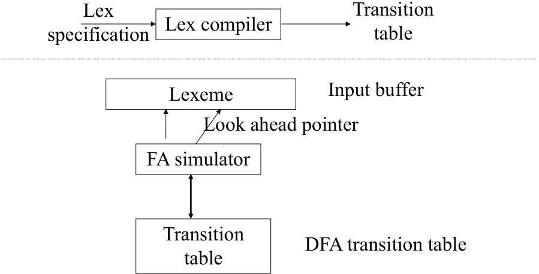

## CHAPTER 4 语法分析

### Section 0 实现语法分析器的途径

- 1. 编程语言构造的语法描述

  - 上下文无关文法
  - BNF（Backus Naur Form）记法

注：文法为语言设计者和编译器编写者都提供了显著的优势。

- 2. 为什么通常使用文法来描述编程语言的语法？

  - 文法给出了编程语言的精确且易于理解的语法规范。
  - 从某些类别的文法我们可以自动构造一个高效的分析器来判断源程序是否在语法上是良构的。


## CHAPTER 4 语法分析
### Section 0 实现语法分析器的途径

2、 为什么通常使用文法来描述编程语言的语法？
- 一个设计良好的文法为编程语言赋予了结构，这对于将源程序翻译成正确的目标代码以及检测错误非常有用
- 进化的构造可以更容易地添加到语言中

3、 实现语法分析器的途径
- 手工构造
- 由工具构造

### Section 1 分析器的作用
#### 1、 主要任务
- 从词法分析器获取一组标记
- 验证该字符串能否由相关编程语言的文法生成
- 以易于理解的方式报告任何语法错误
- 从常见错误中恢复，以便继续处理其余输入

#### 2. 分析器在编译器模型中的位置

Notes: 分析器是编译器的核心

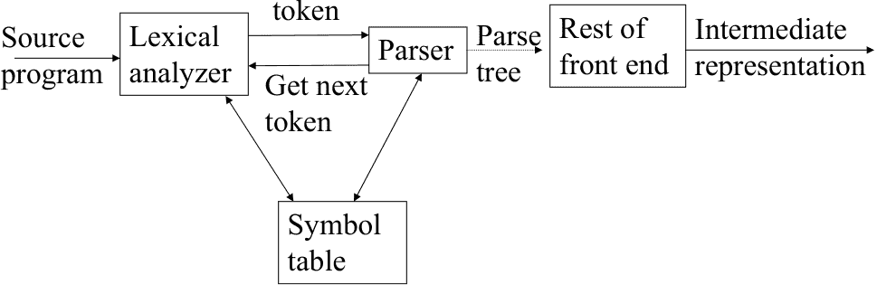

#### 3、 解析方法
- 通用解析方法
  - 在生产编译器中使用效率太低
- 自顶向下方法
  - 从顶部（根）到底部（叶子）构建分析树
  - 输入从左到右扫描
  - LL(1) 文法（通常手工实现）
- 自底向上方法
  - 从叶子开始向上工作到根
  - 输入从左到右扫描
  - LR 文法（通常由自动化工具构造）

#### 4、 语法错误处理
##### 1) 错误级别
- 词法，例如拼写错误标识符、关键字或运算符
- 语法，例如算术表达式中括号不平衡
- 语义，例如运算符应用于不兼容的操作数
- 逻辑，例如无限递归调用

##### 2) 错误处理器的简单陈述目标
- 它应清晰准确地报告错误的出现
- 它应足够快速地从每个错误中恢复，以便能够检测后续错误
- 它不应显著减慢正确程序的处理速度

##### 3) 错误恢复策略
- 错误产生式
  - 用产生式扩充所处理语言的文法，这些产生式生成错误的构造
- 全局校正

### Section 2 自顶向下解析
#### 1、 自顶向下解析的思路
- 为输入字符串找到一个最左推导
- 从根开始为输入构造分析树，并以先序方式创建分析树的节点。

#### 2、 主要方法
- 预测解析（无回溯）
- 递归下降（涉及回溯）

Notes: 回溯很少需要来解析编程语言构造，因为回溯仍然效率不高，且表驱动方法更受青睐

#### 3、 递归下降
- 一个推导过程，从 S 顶向下构造字符串的分析树。当出现不匹配时，程序返回到最近的非终结符，选择另一个产生式来构造分析树
- 如果最后产生了一个分析树，则解析成功，否则失败。

E.g. Consider the grammar

```
S → cAd
A → ab | a
```

Construct a parse tree for the string “*cad*”


## 解析示例的语法

```
Start → Expr
Expr → Expr + Term
Expr → Expr - Term
Expr → Term
Term → Term * Int
Term → Term / Int
Term → Int
```

## 解析示例

2-2*2

*Start*

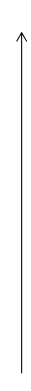

## 解析示例

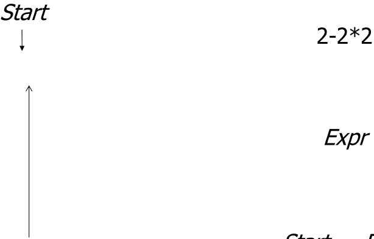

Start

2-2*2

Expr

Start → Expr

## 解析示例

Start

Expr

Expr

-

Term

2-2*2

Expr - Term

Expr → Expr + Term

Expr → Expr - Term

Expr → Term

Expr → Expr - Term

## 解析示例

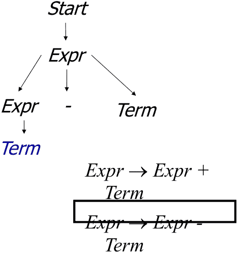

2-2*2

Term - Term

Expr → Expr + Term

Expr → Term

Expr → Expr - Term

Expr → Term

## 解析示例

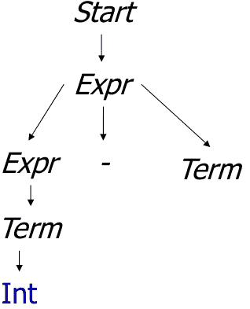

2-2*2

Int - Term

Term → Int

## 解析示例

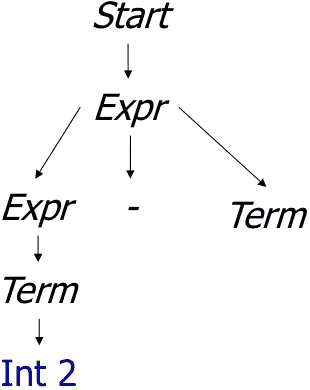

2-2*2

2 - Term

## 解析示例

Start
Expr
Expr
Term
Term
Int 2
-2*2
2 - Term

## 解析示例

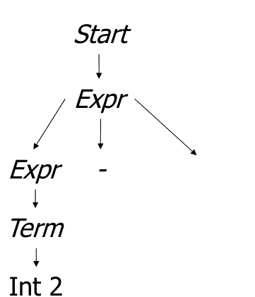

2*2

2 - Term

## 解析示例

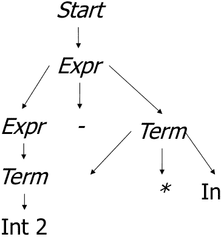

2*2

2 - Term*Int

Term → Term * Int

## 解析示例

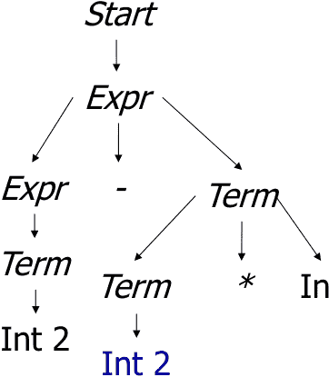

2*2

2 - 2 * Int

## 解析示例

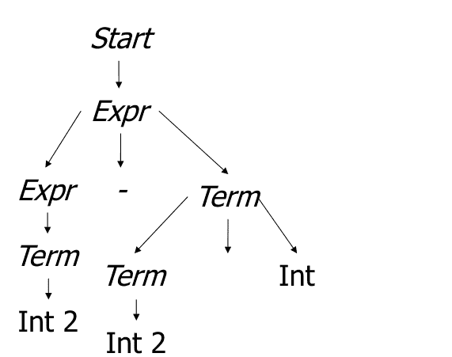

*2

2 - 2 * Int

## 解析示例

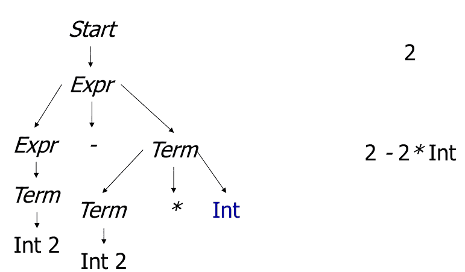

## 解析示例

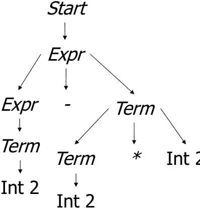

2

2 - 2 * 2

## 回溯示例

2-2*2

*Start*

## 回溯示例

*Start*

2-2*2

*Expr*

*Start* → *Expr*

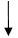

## 回溯示例

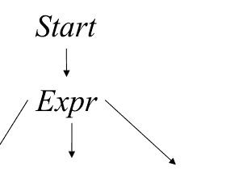

2-2*2

Expr + Term

Expr → Expr + Term

## 回溯示例

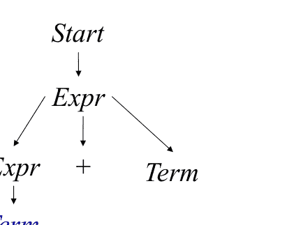

2-2*2

Term + Term

Expr → Term

## 回溯示例

Start
Expr
Expr
+
Term
Term
Int

2-2*2

Int + Term

Term → Int

## 回溯示例

Start

-2*2

Expr

Expr

+

Term

2 - Term

Term

Int 2

Term → Int

## 回溯示例

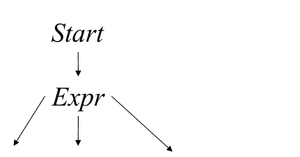

2-2*2

Expr - Term

Expr → Expr - Term

## 回溯示例

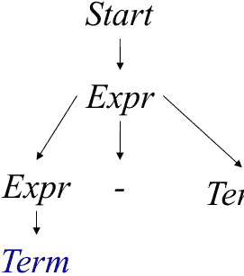

2-2*2

Term - Term

Expr → Term

## 回溯示例

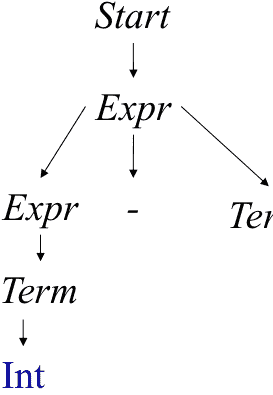

2-2*2

Int - Term

Term → Int

## 回溯示例

2*2

2 - Term

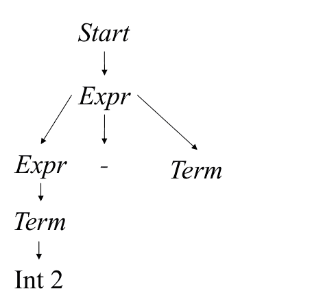

## 左递归 + 自顶向下解析 = 无限循环

- **示例产生式：** *Term* → *Term* * *Num*
- **潜在解析步骤：**

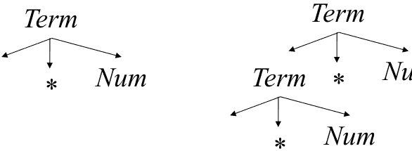

## 第4章 语法分析
第2节 自顶向下解析

### 3、递归下降

- 回溯解析器并不常见，因为：
  - 回溯效率不高。

- 为什么会发生回溯？
  - *左递归文法* 会导致递归下降解析器进入无限循环。
  - 歧义文法会导致回溯
  - 左因子也会导致回溯

## 第4章 语法分析
第2节 自顶向下解析

#### 4、消除左递归

#### 1)左递归的基本形式

左递归是指文法包含以下形式的产生式。

- P → Pα | β   直接递归

或

- P → Aa , A→Pb 间接递归

## 第4章 语法分析

### 第2节 自顶向下解析

#### 4、消除左递归

##### 2)消除左递归的策略

将左递归转换为等价的
右递归

$P \to P\alpha \mid \beta$

$\Rightarrow P \to \beta\alpha^*$

$\Rightarrow P \to \beta P'$,  $P' \to \alpha P' \mid \varepsilon$


## CHAPTER 4 Syntax ANALYSIS
### Section 2 TOP-DOWN PARSING
#### 4、 Elimination of Left Recursion
##### 3) Algorithm
###### (1) Elimination of immediate left recursion
```
P → Pα|β
⇒ P -> βα*
⇒ P → βP′  P′ → αP′|ε
```
###### (2) Elimination of indirect left recursion
Convert it into immediate left recursion first
according to specific order, then eliminate the
related immediate left recursion

## Algorithm:
- (1) Arrange the non-terminals in G in some order as P₁, P₂, ..., Pₙ, do step 2 for each of them.
- (2) for (i=1,i<=n,i++)
  {for (k=1,k<=i-1,k++)
    {replace each production of the form Pᵢ → Pₖγ
     by Pᵢ → δ₁γ | δ₂γ | ...... | δₙγ;
     where Pₖ → δ₁ | δ₂ | ...... | δₙ are all the current Pₖ-productions
    }
    change Pᵢ → Pᵢα₁ | Pᵢα₂ | .... | Pᵢαₘ | β₁ | β₂ | .... | βₙ
    into Pᵢ → β₁ Pᵢ' | β₂ Pᵢ' | ...... | βₙ Pᵢ'
           Pᵢ' → α₁ Pᵢ' | α₂ Pᵢ' | ...... | αₘ Pᵢ' | ε}
    /*eliminate the immediate left recursion*/
- (3) Simplify the grammar.

E.g. Eliminating all left recursion in the following grammar:
(1) S → Qc|c  (2)Q → Rb|b   (3) R → Sa|a
Answer: 1)Arrange the non-terminals in the order:R,Q,S
2) for R: no actions.
for Q:Q → Rb|b ⇒ Q → Sab|ab|b
for S: S → Qc|c ⇒ S → Sabc|abc|bc|c;
then get S → (abc|bc|c)S`
S` → abcS`| ε
3) Because R,Q is not reachable, so delete them
so, the grammar is :
S → (abc|bc|c)S`
S` → abcS`| ε

## CHAPTER 4 Syntax ANALYSIS
### Section 2 TOP-DOWN PARSING
### 4、Elimination of Left Recursion
### 3)Algorithm
- Note: (1) If you arrange the non-terminals in different order, the grammar you get will be different too, but they can recognize the same language.
- (2) You cannot change the starting symbol

## CHAPTER 4 Syntax ANALYSIS
Section 2 TOP-DOWN PARSING
#### 5、 Eliminating Ambiguity of a grammar
- Rewriting the grammar

stmt→if expr then stmt|if expr then stmt else stmt|other

==>

stmt →matched-stmt|unmatched-stmt

matched-stmt →if expr then matched-stmt else matched-stmt|other

unmatched-stmt →if expr then stmt|if expr then matched-stmt else unmatched-stmt

## CHAPTER 4 Syntax ANALYSIS
### Section 2 TOP-DOWN PARSING
#### 6、 Left factoring
- A grammar transformation that is useful for producing a grammar suitable for predictive parsing
- Rewrite the productions to defer the decision until we have seen enough of the input to make right choice

## CHAPTER 4 Syntax ANALYSIS
Section 2 TOP-DOWN PARSING
#### 6、 Left factoring
If the grammar contains the productions like

A→δβ₁ | δβ₂ | .... | δβₙ

Chang them into A→δA`

A`→β₁ | β₂ | .... | βₙ

## CHAPTER 4 Syntax ANALYSIS
### Section 2 TOP-DOWN PARSING
#### 7、Predictive Parsers Methods
- Transition diagram based predictive parser
- Non-recursive predictive parser

## CHAPTER 4 Syntax ANALYSIS
### Section 2 TOP-DOWN PARSING
#### 8、 Transition diagram based Predictive Parsers
##### 1) Transition diagram
- create an initial and final(return) state
- for each production A→X1X2…Xn, create a path from initial to the final state, with edges labeled X1,X2,…,Xn

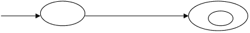

## CHAPTER 4 Syntax ANALYSIS
### Section 2 TOP-DOWN PARSING
#### 8、 Transition diagram based Predictive Parsers
##### 1) Transition diagram
- Note:
  1. There is one diagram for each non-terminal;
  2. The labels of edges are tokens or non-terminals;
  3. If the edge is labeled by a non-terminal A, the parser instead goes to the start state for A, without moving the input cursor;
  4. When an edge labeled by a non-terminal is followed, a potentially recursive procedure call is made

## CHAPTER 4 Syntax ANALYSIS
### Section 2 TOP-DOWN PARSING
#### 8、 Transition diagram based Predictive Parsers
##### 2) Transition diagram based predictive parsing
- Begins in the start state for the start symbol;
- When it is in state s with an edge labeled by terminal a to state t, and the next input symbol is a, then the parser moves the input cursor and goes to state t
- When it is in state s with an edge labeled by non-terminal A to state t, then the parser instead goes to the start state for A, without moving the input cursor. If it ever reaches the final state for A, it immediately goes to state t, in effect having read A from the input during the time it moved from state s to t.


## 第4章 语法分析

### 第2节 自顶向下分析

**9. 非递归预测分析**

**1) 预测分析中的关键问题**

- 确定要对非终结符应用的产生式。

**2) 分析器的基本思想**

- 表驱动并使用栈。

**3) 非递归预测分析器的模型**

- 输入: a+b......$
- 栈: S $
- 预测分析程序
- 分析表 M
- 输出


**4) 预测分析程序**

X: 栈顶的符号；a: 当前输入符号。

- 如果 X = a = $，分析器停止并宣布分析成功完成；
- 如果 X = a ≠ $，分析器将 X 弹出栈并将输入指针推进到下一个输入符号；
- 如果 X 是非终结符，程序查阅分析表 M 的条目 M[X,a]。该条目将是文法的 X-产生式或错误条目。

例如. 考虑以下文法，并分析字符串 `id+id*id$`：

1. E → TE'
2. E' → +TE'
3. E' → ε
4. T → FT'
5. T' → *FT'
6. T' → ε
7. F → id
8. F → (E)

**分析表 M**

|  | id | + | * | ( | ) | $ |
|---|---|---|---|---|---|---|
| E | E → TE' |  |  | E → TE' |  |  |
| E' |  | E' → +TE' |  |  | E' → ε | E' → ε |
| T | T → FT' |  |  | T → FT' |  |  |
| T' |  | T' → ε | T' → \*FT' |  | T' → ε | T' → ε |
| F | F → id |  |  | F → (E) |  |  |

**10. 预测分析器的构造**

**1) FIRST & FOLLOW**

**FIRST:**

- 如果 α 是文法符号的任意串，则令 FIRST(α) 为从 α 派生的串所开头的终结符集合。
- 如果 α ⟹* ε，则 ε 也在 FIRST(α) 中。
- 即：α ∈ V*，FIRST(α) = { a | α ⟹* a..., a ∈ V_T }

**FOLLOW:**

- 对于非终结符 A，FOLLOW(A) 是在某个句型中能紧跟在 A 右侧出现的终结符 a 的集合。
- 即：FOLLOW(A) = { a | S ⟹* ... Aa..., a ∈ V_T }
- 如果 S ⟹* ... A，则 $ ∈ FOLLOW(A)。

**2) 计算 FIRST(α)**

(1) 计算所有文法符号 X 的 FIRST(X)：

- 如果 X 是终结符，则 FIRST(X) 为 {X}。
- 如果 X → ε 是产生式，则将 ε 添加到 FIRST(X)。
- 如果 X 是非终结符，且 X → Y₁Y₂...Yₖ，Yⱼ ∈ (V_N ∪ V_T)，1 ≤ j ≤ k，则：

```pseudocode
{
  j = 1;
  FIRST(X) = {}; // initialize
  while (j < k and ε ∈ FIRST(Y_j)) {
    FIRST(X) = FIRST(X) ∪ (FIRST(Y_j) - {ε});
    j = j + 1;
  }
  if (j == k and ε ∈ FIRST(Y_k))
    FIRST(X) = FIRST(X) ∪ {ε};
}
```

(2) 计算任意串 α = X₁X₂...Xₙ 的 FIRST，Xᵢ ∈ (V_N ∪ V_T)，1 ≤ i ≤ n：

```pseudocode
{
  i = 1;
  FIRST(α) = {}; // initialize
  while (i < n and ε ∈ FIRST(X_i)) {
    FIRST(α) = FIRST(α) ∪ (FIRST(X_i) - {ε});
    i = i + 1;
  }
  if (i == n and ε ∈ FIRST(X_n))
    FIRST(α) = FIRST(α) ∪ {ε};
}
```

**3) 计算 FOLLOW(A)**

1. 将 $ 放入 FOLLOW(S)，其中 S 是开始符号且 $ 是输入右端标记。
2. 如果文法 G 中存在产生式 A → αBβ，则将 (FIRST(β) - {ε}) 添加到 FOLLOW(B)。
3. 如果存在产生式 A → αB，或 A → αBβ 且 FIRST(β) 包含 ε，则将 FOLLOW(A) 添加到 FOLLOW(B)。

例如. 考虑以下文法，构造每个非终结符的 FIRST & FOLLOW：

1. E → TE'
2. E' → +TE'
3. E' → ε
4. T → FT'
5. T' → *FT'
6. T' → ε
7. F → id
8. F → (E)


Answer:

First(E)=First(T)=First(F)={(, i}
First(E')={+, ε}
First(T')={*, ε}
Follow(E)=Follow(E')={), $}
Follow(T)=Follow(T')={+, ), $}
Follow(F)={*, +, ), $}

## CHAPTER 4 Syntax Analysis

### Section 2 TOP-DOWN PARSING

#### 10、 Construction of a predictive parser

##### 4) Construction of Predictive Parsing Tables

**Main Idea:** Suppose A → α is a production with a in FIRST(α). Then the parser will expand A by α when the current input symbol is a. If α ⇒* ε, we should again expand A by α if the current input symbol is in FOLLOW(A), or if the $ on the input has been reached and $ is in FOLLOW(A).

- Input. Grammar G.
- Output. Parsing table M.

**Method.**

- For each production A → α, do steps 2 and 3.
- For each terminal a in FIRST(α), add A → α to M[A,a].
- If ε is in FIRST(α), add A → α to M[A,b] for each terminal b in FOLLOW(A). If ε is in FIRST(α) and $ is in FOLLOW(A), add A → α to M[A,$].
- Make each undefined entry of M be error.

E.g. Consider the following Grammar, construct predictive parsing table for it.

- E → TE'
- E' → +TE'
- E' → ε
- T → FT'
- T' → *FT'
- T' → ε
- F → i
- F → (E)

Answer:

First(E)=First(T)=First(F)={(, i}
First(E')={+, ε}
First(T')={*, ε}
Follow(E)=Follow(E')={), $}
Follow(T)=Follow(T')={+, ), $}
Follow(F)={*, +, ), $}

##### Predictive Parsing table M

|   | i | + | * | ( | ) | $ |
|---|---|---|---|---|---|---|
| E | E→TE' |  |  | E→TE' |  |  |
| E' |  | E'→+TE' |  |  | E'→ε | E'→ε |
| T | T→FT' |  |  | T→FT' |  |  |
| T' |  | T'→ε | T'→*FT' |  | T'→ε | T'→ε |
| F | F→i |  |  | F→(E) |  |  |

#### 11、 LL(1) Grammars

E.g. Consider the following Grammar, construct predictive parsing table for it.

- S → iEtSS' | a
- S' → eS | ε
- E → b

##### Predictive Parsing table M

|   | a | b | e | i | t | $ |
|---|---|---|---|---|---|---|
| S | S → a |  |  | S → iEtSS' |  |  |
| S' |  |  | S' → eS<br>S' → ε |  |  | S' → ε |
| E |  | E → b |  |  |  |  |

##### 1) Definition

A grammar whose parsing table has no multiply-defined entries is said to be LL(1).

The first “L” stands for scanning the input from left to right.

The second “L” stands for producing a leftmost derivation.

“1” means using one input symbol of look-ahead at each step to make parsing action decisions.

- 1). For no terminal $a$ do both $\alpha$ and $\beta$ derive strings beginning with $a$.
- 2). At most one of $\alpha$ and $\beta$ can derive the empty string.
- 3). If $\beta \stackrel{*}{\to} \varepsilon$, then $\alpha$ does not derive any string beginning with a terminal in FOLLOW(A).

##### Two Conditions for Top-Down Parsing

- Two conditions are required to ensure that a deterministic, one symbol lookahead top-down parser can be constructed.

- **Condition 1:** If A is defined by the rule A → χ₁ | χ₂ | ... | χₙ, then the initial symbols of all sentences that can be derived from all χᵢ must be distinct, i.e.:
  first(χᵢ) ∩ first(χⱼ) = ∅  for all i ≠ j

Consider the grammar:

```text
S → A x.
A → [x].
```

When parsing the sentence x, we may proceed into a "dead alley":

```text
stack    input
S        x
Ax       x
xx       x
x
```

- **Condition 2:** For every nonterminal A from which the empty sequence can be derived, the set of initial symbols must be disjoint from the set of symbols that may follow any sequence generated from A:

  first(A) ∩ follow(A) = ∅  for all A such that A ⇒* ε

#### 12、 Transform a grammar to LL(1) Grammar

- Eliminating all left recursion
- Left factoring


## 第4章 语法分析

### 第2节 自顶向下分析

#### 13、预测分析中的错误恢复

- 恐慌模式错误恢复
- 短语级恢复

### 第3节 自底向上分析

#### 1、 自底向上分析的基本思想

- 移进-归约分析
- 运算符优先分析
  - 一种易于实现的形式
- LR 分析
  - 一种更通用的方法
  - 用于多种自动分析器生成器

#### 2、 移进-归约分析中的基本概念

- 句柄
- 句柄修剪

#### 3、 移进-归约分析的栈实现


### 第4节 运算符优先分析

#### 1、 运算符文法的定义

- 文法具有这样的性质：没有任何产生式的右部是 ε 或包含两个相邻的非终结符。
- 例如 `E→E+E|E−E|E*E|E/E|(E)|i`

#### 2、 运算符优先关系

- 三个不相交的优先关系 `<`、`≐`、`>` 存在于某些终结符对之间。

在某些终结符对 a、b 之间，具有以下形式：`...ab...`、`...aQb...`，且 Q 若为非终结符。则 a 与 b 的关系为：

1. `a ≺ b` — a 让位于 b
2. `a ≐ b` — a 与 b 具有相同优先级
3. `a ≻ b` — a 优先于 b
4. 对于某些终结符，我们可能没有这些关系中的任何一个。

注：这些优先关系可用于指导句柄的选择。

| RS \ LS | + | * | ( | ) | i | $ |
|---|---|---|---|---|---|---|
| + | > | < | < | > | < | > |
| * | > | > | < | > | < | > |
| ( | < | < | < | = | < |  |
| ) | > | > |  | > |  | > |
| i | > | > |  | > |  | > |
| $ | < | < | < |  | < |  |

相关文法：`E→E+F|F`，`F→F*G|G`，`G→(E)|i`

#### 3、 使用运算符优先关系

用 `<` 标记右句型句柄的左端，`=` 出现在句柄内部，`>` 标记句柄的右端。

对于字符串 `$i+i*i$`，如何找到句柄：

1. 从左端扫描字符串直到遇到第一个 `>`。
2. 然后向后扫描任何 `=` 直到遇到 `<`。
3. 句柄包含第一个 `>` 左侧的所有内容以及步骤 2 中遇到的 `<` 右侧的所有内容，包括其中或周围的任何非终结符。

#### 4、 运算符优先分析算法

- **输入。** 输入串 w 和一张优先关系表。
- **输出。** 如果 w 格式良好，则为一个骨架分析树，所有内部节点均用占位非终结符 E 标记；否则，给出错误指示。
- **方法。** 初始时，栈中包含 `$`，输入缓冲区包含串 `w$`。

```
Set ip to point to the first symbol of w$;
while (1) {
    if ($ is on top of the stack and ip points to $) /*success*/
        return;
    else {
        let a be the topmost terminal symbol on the stack;
        let b be the symbol pointed to by ip;
        if (a⋖b || a≐b) /*Shift*/
        {
            push b onto the stack;
            advance ip to the next input symbol;
        }
    }
}
```

#### 5、 构造运算符优先关系表

- 为文法中的每个非终结符构造 `FIRSTVT` 和 `LASTVT`。
- 找出终结符之间的关系。


## 第 4 章 语法分析
### 第 4 节 算符优先分析

5、构造算符优先关系表

FIRSTVT(P) =
$\{a\mid P\rightarrow a\cdots\text{ 或 }P\rightarrow Qa\cdots,\ a\in V_T;\ P,Q\in V_N\}$

LASTVT(P) =
$\{a\mid P\rightarrow\cdots a\text{ 或 }P\rightarrow\cdots aQ,\ a\in V_T;\ P,Q\in V_N\}$

> 注：利用这两个集合以及产生式，我们可以很容易地确定 < 和 > 关系。

5、构造算符优先关系表

构造 FIRSTVT(P)

- (1) 如果产生式形如 P → a… 或 P → Qa…，则 a ∈ FIRSTVT(P)
- (2) 如果 a ∈ FIRSTVT(Q)，并且文法中有形如 P → Q… 的产生式，则 a ∈ FIRSTVT(P)

- 如果产生式右部存在形如 ...aP... 的串，则对于 FIRSTVT(P) 中的每个终结符，关系为 a <: b；
- 如果产生式右部存在形如 ...Pb... 的串，则对于 LASTVT(P) 中的每个终结符，关系为 a >: b。

– 如果产生式右部存在形如 …aPb… 或 …ab… 的串，则 a ≐ b。

注：我们约定一元运算符的优先级总是高于二元运算符。

例如：对于以下文法，请构造非终结符的 FIRSTVT 和 LASTVT，并找出终结符之间的关系。

S → if E_b then E else E		E → E+T|T
T → T*F|F		F → i		E_b → b

答案：增加一个产生式 S’→$$$

|  |  |
|---|---|
| FIRSTVT(S)={if} | LASTVT(S)={else,+,*,i} |
| FIRSTVT(E)={+,*,i} | LASTVT(E)={+,*,i} |
| FIRSTVT(T)={*,i} | LASTVT(T)={*,i} |
| FIRSTVT(F)={i} | LASTVT(F)={i} |
| FIRSTVT(E_b)={b} | LASTVT(E_b)={b} |

|  | if | then | else | + | * | i | b | $ |
|---|---|---|---|---|---|---|---|---|
| if |  | ≡ |  |  |  |  | < |  |
| then |  |  | ≡ | < | < | < |  |  |
| else |  |  |  | < | < | < |  | > |
| + |  |  | > | > | < | < |  | > |
| * |  |  | > | > | > | < |  | > |
| i |  |  | > | > | > |  |  | > |
| b |  | > |  |  |  |  |  |  |
| $ | < |  |  |  |  |  |  |  |

### 第 4 节 算符优先分析

6、算符优先分析的优点

- 简单，易于手工构造

7、算符优先分析的缺点

- 难以处理像一元运算符这样的记号
- 由于被分析语言的文法与算符优先分析器本身之间的关系不紧密，人们不能总是确保分析器恰好接受所期望的语言。
- 只有一小类文法可以使用算符优先技术进行解析。

### 第 5 节 LR 分析器

1、LR 分析器

- 一种高效的、自底向上的语法分析技术，可用于分析一大类上下文无关文法
- LR(k)
  - L：从左到右扫描
  - R：反向构造最右推导
  - k：向前看输入符号的个数

2、LR 分析器的优点

- 它几乎能够识别所有可以用上下文无关文法描述的编程语言结构
- 它是最通用的非回溯移进-归约分析方法
- 它能分析比预测分析器更多的文法
- 在对输入进行从左到右扫描时，它能尽早检测到语法错误

4、构造 LR 分析器的三种技术

- SLR：简单 LR
- LR(1)：规范 LR
- LALR：向前看 LR


## 第4章 语法分析

### 第5节 LR 解析器

#### 5. LR 解析模型

**注意：**

1. 所有 LR 解析器的驱动程序都相同；只有解析表会因解析器不同而变化。
2. 解析程序一次从输入缓冲区读取一个字符。
3. $S_i$ 是一个状态；每个状态符号概括了其下方栈中包含的信息。
4. 每个状态符号概括了栈中包含的信息。
5. 当前输入符号用于索引解析表并确定移进-归约解析决策。
6. 在实现中，文法符号不必出现在栈上。

#### 6. 解析表

- **Action**: 一个解析动作函数。
  - $Action[S,a]$: S 表示当前栈顶的状态，a 表示当前输入符号。所以 $Action[S,a]$ 表示 S 和 a 的解析动作。
- **Shift**：
  - 下一个输入符号被移进栈顶。
  - 移进 S，其中 S 是一个状态。
- **Reduce**：
  - 解析器知道句柄的右端在栈顶，定位句柄在栈内的左端，并决定用哪个非终结符替换句柄。按文法产生式 $A \to \alpha$ 归约。
- **Accept**：
  - 解析器宣布解析成功完成。
- **Error**：
  - 解析器发现发生了语法错误并调用错误恢复例程。
- **Action conflict**：
  - **Shift/reduce conflict**
    - 无法决定是移进还是归约。
  - **Reduce/reduce conflict**
    - 无法决定执行多个归约中的哪一个。

**注意：** 一个二义性文法可能导致冲突并且永远不可能为 LR，例如 `If_stmt` 语法（`if expr then stmt [else stmt]`）。

#### 7. 算法

- 解析器的下一步移动由读取当前输入符号 $a$ 和栈顶的状态 $S$，然后查阅解析动作表项 $action[S,a]$ 来确定。
- 如果 $action[S_m,a_i]=shift\ S'$，解析器执行移进动作，将 $S'$ 压入栈中，下一个输入符号 $a_{i+1}$ 成为当前符号。
- 如果 $action[S_m,a_i]=reduce\ A\to\alpha$，则解析器执行归约动作。如果 $\alpha$ 的长度为 $\gamma$，则从栈中删除 $\gamma$ 个状态，使得栈顶的状态为 $S_{m-\gamma}$。将状态 $S'=GOTO[S_{m-\gamma},A]$ 和非终结符 A 压入栈中。输入符号不变。
- 如果 $action[S_m,a_i]=accept$，解析完成。
- 如果 $action[S_m,a_i]=error$，解析器发现了错误并调用错误恢复例程。

例如，以下文法的 LR 解析表的解析动作和 goto 函数：

$E \to E + T$  
$E \to T$  
$T \to T * F$  
$T \to F$  
$F \to (E)$  
$F \to i$

| state | i | + | * | ( | ) | $ | E | T | F |
|---|---|---|---|---|---|---|---|---|---|
| 0 | S₅ |  |  | S₄ |  |  | 1 | 2 | 3 |
| 1 |  | S₆ |  |  |  | accept |  |  |  |
| 2 |  | r₂ | S₇ |  | r₂ | r₂ |  |  |  |
| 3 |  | r₄ | r₄ |  | r₄ | r₄ |  |  |  |
| 4 | S₅ |  |  | S₄ |  |  | 8 | 2 | 3 |
| 5 |  | r₆ | r₆ |  | r₆ | r₆ |  |  |  |
| 6 | S₅ |  |  | S₄ |  |  |  | 9 | 3 |
| 7 | S₅ |  |  | S₄ |  |  |  |  | 10 |
| 8 |  | S₆ |  |  | S₁₁ |  |  |  |  |
| 9 |  | r₁ | S₇ |  | r₁ | r₁ |  |  |  |
| 10 |  | r₃ | r₃ |  | r₃ | r₃ |  |  |  |
| 11 |  | r₅ | r₅ |  | r₅ | r₅ |  |  |  |


## LR 解析器在 i*i+i 上的移动

| 状态栈 | 符号栈 | 输入 | 动作 |
|---|---|---|---|
| 0 | $ | i*i+i$ | 移进 |
| 05 | $i | *i+i$ | 按 6 归约 |
| 03 | $F | *i+i$ | 按 4 归约 |
| 02 | $T | *i+i$ | 移进 |
| 027 | $T* | i+i$ | 移进 |
| 0275 | $T*i | +i$ | 按 6 归约 |
| 02710 | $T*F | +i$ | 按 3 归约 |
| 02 | $T | +i$ | 按 2 归约 |
| 01 | $E | +i$ | 移进 |
| 016 | $E+ | i$ | 移进 |
| 0165 | $E+i | $ | 按 6 归约 |
| 0163 | $E+F | $ | 按 4 归约 |
| 0169 | $E+T | $ | 按 1 归约 |
| 01 | $E | $ | 接受 |

## CHAPTER 4 SYNTAX ANALYSIS
### Section 5 LR parsers
### 8、 LR Grammars
- 可以为其构造分析表的文法称为 LR 文法。

### 9、 LL 与 LR 文法的区别
- LR 文法能描述的语言比 LL 文法更多

## CHAPTER 4 SYNTAX ANALYSIS
### Section 5 LR parsers
#### 11、 Canonical LR(0)
- 1) LR(0) 项目
- 文法 G 的一个 LR(0) 项目是 G 的一个产生式，其右部某位置有一个点。

- 例如：A → XYZ 产生四个项目：
- A→•XYZ . 我们希望在输入上接下来看到可从 XYZ 推导出的串。
- A→X•YZ . 我们已在输入上看到可从 X 推导出的串，并且希望接下来在输入上看到可从 YZ 推导出的串。
- A→XY•Z
- A→X YZ•
- 产生式 A→ε 只生成一个项目，A→•。
- 这些项目每一个都是可行的前缀

## CHAPTER 4 SYNTAX ANALYSIS
### Section 5 LR parsers
#### 11、 Canonical LR(0)
2) 构造规范的 LR(0) 集合
(1)定义扩充文法
- 如果 G 是一个以 S 为开始符号的文法，则扩充文法 G` 是 G 加上新的开始符号 S`，以及产生式 S` → S
- 扩充文法的目的是指示分析器何时应停止分析并宣布接受输入。

## CHAPTER 4 SYNTAX ANALYSIS
### Section 5 LR parsers
#### 11、Canonical LR(0)
2)构造规范的 LR(0) 集合
(2)闭包运算
- 如果 I 是文法 G 的一组项目，则 closure(I) 是由 I 按以下两条规则构造的项目集合：
- 最初，I 中的每个项目都加入 closure(I)。
- 如果 A→α•Bβ 在 CLOSURE(I) 中，且 B→γ 是一个产生式，则将项目 B→•γ 加入 CLOSURE(I)；重复此规则直到 CLOSURE(I) 中不能再加入新项目。

## CHAPTER 4 SYNTAX ANALYSIS
### Section 5 LR parsers
#### 11、Canonical LR(0)
2) 构造规范的 LR(0) 集合
##### (3) Goto 运算
- 形式：goto(I,X)，I 是一组项目，X 是一个文法符号
- goto(I,X) 定义为 CLOSURE(J)，X ∈ (V_N ∪ V_T)，J = {所有形如 A→αX•β 的项目 | A→α•Xβ ∈ I}。

## CHAPTER 4 SYNTAX ANALYSIS
### Section 5 LR parsers
#### 11、Canonical LR(0)
##### 3)项目集构造

```
void ITEMSETS-LR0()
{
    C := { CLOSURE(S′ →•S) }    /*initial*/
    do
    {
        for (each set of items I in C and each
             grammar symbol X)
            IF (Goto(I,X) is not empty and not in C)
                { add Goto(I,X) to C }
    } while C is still extending
}
```

e.g. construct the canonical collection of sets of LR(0) items for the following augmented grammar.

S` →E   E →aA|bB   A →cA|d   B →cB|d

Answer:1、 项目为：
- 1. S` →•E
- 2. S` →E•
- 3. E →•aA
- 4. E → a•A
- 5. E → aA•
- 6. A →•cA
- 7. A → c•A
- 8. A → cA•
- 9. A →•d
- 10. A → d•
- 11. E →•bB
- 12. E → b•B
- 13. E → bB•
- 14. B →•cB
- 15. B → c•B
- 16. B → cB•
- 17. B →•d
- 18. B → d•


## CHAPTER 4 SYNTAX ANALYSIS
### Section 5 LR parsers
#### 12、 SLR(1) Parsing Table Algorithm
- Input. 一个扩充文法 G`
- Output. G` 的 SLR 分析表函数 *action* 和 *goto*
- Method.
- (1) 构造 C={I₀,I₁,…Iₙ}，即 G` 的 LR(0) 项目集集合。
- (2) 状态 i 由 Iᵢ 构造。状态 i 的分析动作确定如下：


## 第4章 语法分析

### 第5节 LR 分析器

#### 12、SLR(1) 分析表算法

**方法**

- (2)
  - (a) 如果 [A→α•aβ] 在 Iᵢ 中且 goto(Iᵢ, a) = Iⱼ，则设置 ACTION[i, a] = “Shift j”，这里 a 必须是一个终结符。
  - (b) 如果 [A→α•] ∈ Iₖ，则对 follow(A) 中的所有 a 设置 ACTION[k, a] = rⱼ；这里 A 可能不是 S′，且 j 是产生式 A→α 的编号。
- (3) 对于所有非终结符 A，使用规则构造状态 I 的 goto 转移：若 goto(Iᵢ, A) = Iⱼ，则 goto[i, A] = j。
- (4) 所有未被规则 2 和 3 定义的条目均设为 “error”。
- (5) 分析器的初始状态是从包含 [S′ → •S] 的项目集构造而来的。
- 如果上述规则生成了任何冲突的操作，我们就说该文法不是 SLR(1)。

```
I₀: S′→●E
E→●E+T
E→●T
T→●T*F
T→●F
F→●(E)
F→●i

I₂: E→T●
T→T●*F

I₁: S′→E●
E→E●+T

I₇: T→T*●F
F→●(E)
F→●i

I₁₀: T→T*F●

I₅: F→i●

I₃: T→F●

I₄: F→(●E)
E→●E+T
E→●T
T→●T*F
T→●F
F→●(E)
F→●i

I₆: E→E+●T
T→●T*F
T→●F
F→●(E)
F→●i

I₉: E→E+T●
T→T●*F

I₈: F→(E●)
E→E●+T

I₁₁: F→(E)●

I₅ I₄ I₃ I₂
```

| state | ACTION |  |  |  |  |  | GOTO |  |  |
| state | i | + | * | ( | ) | $ | E | T | F |
|---|---|---|---|---|---|---|---|---|---|
| 0 | S₅ |  |  | S₄ |  |  | 1 | 2 | 3 |
| 1 |  | S₆ |  |  |  | accept |  |  |  |
| 2 |  | r₂ | S₇ |  | r₂ | r₂ |  |  |  |
| 3 |  | r₄ | r₄ |  | r₄ | r₄ |  |  |  |
| 4 | S₅ |  |  | S₄ |  |  | 8 | 2 | 3 |
| 5 |  | r₆ | r₆ |  | r₆ | r₆ |  |  |  |
| 6 | S₅ |  |  | S₄ |  |  |  | 9 | 3 |
| 7 | S₅ |  |  | S₄ |  |  |  |  | 10 |
| 8 |  | S₆ |  |  | S₁₁ |  |  |  |  |
| 9 |  | r₁ | S₇ |  | r₁ | r₁ |  |  |  |
| 10 |  | r₃ | r₃ |  | r₃ | r₃ |  |  |  |
| 11 |  | r₅ | r₅ |  | r₅ | r₅ |  |  |  |

**注：** 每个 SLR(1) 文法都是无二义的，但存在许多无二义的文法不是 SLR(1)。

例如

1. S′ → S
2. S → L = R
3. S → R
4. L → *R
5. L → i
6. R → L


| state | ACTION |  |  |  | GOTO |  |  |
| state | = | i | * | $ | S | L | R |
|---|---|---|---|---|---|---|---|
| 0 |  | S₅ | S₄ |  | 1 | 2 | 3 |
| 1 |  |  |  | acc |  |  |  |
| 2 | S₆ / r₆ |  |  | r₆ |  |  |  |
| 3 |  |  |  | r₃ |  |  |  |
| 4 |  | S₅ | S₄ |  |  | 8 | 7 |
| 5 | r₅ |  |  | r₅ |  |  |  |
| 6 |  | S₅ | S₄ |  |  | 8 | 9 |
| 7 | r₄ |  |  | r₄ |  |  |  |
| 8 | r₆ |  |  | r₆ |  |  |  |
| 9 |  |  |  | r₂ |  |  |  |

**注：** 在上述文法中，移进/归约冲突产生的原因是 SLR 分析器构造方法不够强大，无法记住足够的左侧上下文来决定分析器在看到可归约为 L 的字符串后对输入 = 应该采取什么动作。也就是说，“R=” 可以是任何右句型的部分。因此，当 “L” 出现在栈顶且 “=” 是输入缓冲区的当前字符时，我们不能将 “L” 归约为 “R”。

G2:

1. S′ → S
2. S → AaAb | BbBa
3. A → ε
4. B → ε

#### 13、LR(1) 项目

- 如何排除无效的归约？
  - 通过在必要时拆分状态，我们可以安排分析器的每个状态都精确地指示对于存在可能归约为 A 的句柄 α，可以跟随哪些输入符号。
- 项目 (A→α•β, a) 是一个 LR(1) 项目，“1” 指的是第二分量的长度，称为该项目的向前搜索。


# 第4章 语法分析

### 第5节 LR解析器

#### 13、 LR(1)项目

注意：1）对于形如 (A→α•β,a) 的项目，其中 β 不是 ε，向前看符号没有影响；但形如 (A→α•,a) 的项目仅当下一个输入符号是 a 时才要求按 A→α 进行归约。

2）这类 a 的集合始终是 FOLLOW(A) 的真子集。

#### 14、有效的LR(1)项目

形式化地说，如果存在推导 S`→*δαω→δαβω，则称 LR(1) 项目 (A→α•β,a) 对活前缀 γ 有效，其中

- γ=δα，且
- 要么 a 是 ω 的第一个符号，要么 ω 是 ε 且 a 是 $。

#### 15、 LR(1)项目集的构造

- 输入。一个增广文法 G`
- 输出。 LR(1) 项目集，这些项目集是 G` 的一个或多个活前缀有效的项目集合。
- 方法。 用于构造项目集的过程 closure 和 goto 以及主例程 items。

```
function closure(I);
{ do { for (each item (A→α•Bβ,a) in I,
    each production B → γ in G`,
    and each terminal b in FIRST(βa)
    such that (B→•γ ,b) is not in I )
    add (B→•γ ,b) to I;
}while there is still new items add to I;
    return I
}
```

```
Void items (G');
{C={closure({ (S'→•S,$)})};
  do { for (each set of items I in C and each grammar symbol X
      such that
        goto(I,X) is not empty and not in C )
        add goto(I,X) to C
  } while there is still new items add to C;
}
```

例如，计算下列文法的项目：

- 1. S` → S
- 2. S → CC
- 3. C → cC|d

答案：初始项目集为 I₀：

I₀
S` → • S,$
S → • C C,$
C → • c C, c|d
C → • d, c|d

现在计算不同 X 值对应的 goto(I₀,X)。然后得到该文法的 goto 图。

I0: S' -> •S, $

I6: C -> c•C, $

S -> •CC, $

C -> •cC, $

C -> •cC, c/d

C -> •d, $

C -> •d, c/d

I1: S -> S•, $
d•, $

17: C ->

18: C -> cC•, c/d
cC•, $

19: C ->

12: S -> C•C, $

C -> •cC, $

C -> •d, $

13: C -> c•C, c/d
d•, c/d

14: C ->


I0:
S' -> •S, $
S -> •CC, S
C -> •cC, c/d
C -> •d, c/d

I1:
S' -> S•, $

I2:
S -> C•C, $
C -> •cC, $
C -> •d, $

I3:
C -> c•C, c/d
C -> •cC, c/d
C -> •d, c/d

I4:
C -> d•, c/d

I5:
S -> CC•, $

I6:
C -> c•C, $
C -> •cC, $
C -> •d, $

I7:
C -> d•, $

I8:
C -> cC•, c/d

I9:
C -> cC•, $


### 第5节 LR解析器

#### 16、规范LR分析表的构造

- 输入。一个增广文法 G′
- 输出。 G′ 的规范LR分析表函数 action 和 goto
- 方法。

(1) 构造 C={I₀,I₁,…Iₙ}，即 G′ 的 LR(1) 项目集族。

(2) 状态 i 由 Iᵢ 构造。状态 i 的分析动作确定如下：

### 16、 规范LR分析表的构造

- 方法

(2)

a) 如果 [A→α•aβ,b] 在 Iᵢ 中，且 goto(Iᵢ,a)= Iⱼ，则置 ACTION[i,a]=“移进 j”，这里 a 必须是终结符。

b) 如果 [A→α•,a]∈Iᵢ，A!=S`，则置 ACTION[i,a]=rⱼ；j 是产生式 A→α 的编号。

c) 如果 [S`→•S,$] 在 Iᵢ 中，则置 ACTION[i,$] 为 “接受”

### 16、 规范LR分析表的构造

- 方法

(3) 状态 i 的 goto 转移确定如下：如果 goto(Iᵢ,A)= Iⱼ，则 goto[i,A]=j。

(4) 规则 2 和 3 未定义的所有条目都置为“错误”。

(5) 分析器的初始状态是由包含 [S' → • S,$] 的项目集构造的状态。

- 如果上述规则生成了任何冲突的动作，我们就说该文法不是 LR(1) 文法。

| 状态 | 动作 |  |  | goto |  |
| --- | --- | --- | --- | --- | --- |
|  | c | d | $ | S | C |
| 0 | S₃ | S₄ |  | 1 | 2 |
| 1 |  |  | acc |  |  |
| 2 | S₆ | S₇ |  |  | 5 |
| 3 | S₃ | S₄ |  |  | 8 |
| 4 | r₃ | r₃ |  |  |  |
| 5 |  |  | r₁ |  |  |
| 6 | S₆ | S₇ |  |  | 9 |
| 7 |  |  | r₃ |  |  |
| 8 | r₂ | r₂ |  |  |  |
| 9 |  |  | r₂ |  |  |


## CHAPTER 4 SYNTAX ANALYSIS
### Section 5 LR parsers
#### 16、规范 LR 分析表的构造

- Notes:
- 1) 每个 SLR(1) 文法都是一个 LR(1) 文法
- 2) 对于同一文法，规范 LR 分析器可能比 SLR 分析器具有更多的状态。

## CHAPTER 4 SYNTAX ANALYSIS
### Section 5 LR parsers
#### 17、 LALR(lookahead-LR)

- 1) 基本思想

合并具有相同核心的 LR(1) 状态集合

Notes: (1) 合并时，GOTO 子表可以无冲突地合并，因为 GOTO 函数仅依赖于核心

(2) 合并时，ACTION 子表也可以无冲突地合并，但可能会出现错误与移/归约动作合并的情况。我们假设非错误动作

Notes: (3) 在 LR(1) 状态集合合并后，错误可能被晚些捕获，但错误最终会被捕获，事实上，它会在再移入任何输入符号之前被捕获。

Notes: (4) 合并后，可能出现归约/归约冲突。

```
S’→S
S→aBc|bCc|aCd|bBd
B→ε
C→ε
```

I0: S'→.S
S →.aBc
S →.bCc
S →.aCd
S →.bBd

I1: S'→S.

I2: S→a.Bc
S →a.Cd
B →.ε
C →.ε

I4: S→aB.c

I9: S→aBc.

I5: S→aC.d

I10: S→aCd.

I3: S→b.Bc
S→b.Cd
B→.ε
C→.ε

I6: B→ε.
C→ε.

I7: S→bB.c

I11: S→bBc.

I8: S→bC.d

I12: S→bCd.

I0: S' -> •S, $ S -> •aBc, $ S -> •bCc, $ S -> •aCd, $ S -> •bBd, $

I1: S' -> S•, $

I2: S -> a•Bc, $ S -> a•Cd, $ B -> •ε, c C -> •ε, d

I3: S -> b•Cc, $ S -> b•Bd, $ B -> •ε, d C -> •ε, c

I4: S -> aB•c, $

I5: S -> aC•d, $

I6: B -> ε•, c C -> ε•, d

I7: S -> bC•c, $

I8: S -> bB•d, $

I9: C -> ε•, c B -> ε•, d

I10: S -> aBc•, $

I11: S -> aCd•, $

I12: S -> bCc•, $

I13: S -> bBd•, $

I6-I9

{B →ε.,c C →ε.,d}

{B →ε.,d C →ε.,c}

## CHAPTER 4 SYNTAX ANALYSIS
### Section 5 LR parsers
#### 17、LALR(look-ahead-LR)

2)The sets of LR(1) states having the same core

- 具有相同项目的状态但前瞻符号不同，则这些状态具有相同的核心。

Notes: 我们可以将具有相同核心的这些集合合并为一个状态集合。

## CHAPTER 4 SYNTAX ANALYSIS
### Section 5 LR parsers
#### 18、 An easy, but space-consuming LALR table construction

- Input. 一个扩充文法 G`
- Output. G` 的 LALR 分析表函数 action 和 goto
- Method.
- (1) 构造 C={I₀,I₁,…Iₙ}，LR(1) 项目的集合。
- (2) 对于 LR(1) 项目集合中出现的每个核心，找到所有具有该核心的集合，并用它们的并集替换这些集合。

- Method.
- (3) 设 C`={J0,J1,...Jm} 为得到的 LR(1) 项目集合。状态 I 的分析动作由 Ji 构造。如果存在分析动作冲突，则算法无法生成分析器，且文法不是 LALR。
- (4) goto 表的构造如下。

## CHAPTER 4 SYNTAX ANALYSIS
### Section 5 LR parsers
#### 18、An easy, but space-consuming LALR table construction

— (4) 如果 J 是一个或多个 LR(1) 项目集合的并集，即 J = I₁ ∪ I₂ ∪ … ∪ Iₖ，则 goto(I₁, X)、goto(I₂, X)、…、goto(Iₖ, X) 的核心相同，因为 I₁、I₂、…、Iₙ 都有相同的核心。设 K 为所有具有与 goto(I₁, X) 相同核心的项目集合的并集，则 goto(J, X) = K。

## CHAPTER 4 SYNTAX ANALYSIS
### Section 6 Using ambiguous grammars
#### 1、Using Precedence and Associativity to Resolve Parsing Action Conflicts

Grammar: E→E+E|E*E|(E)|i

E→E+T|T

T→T*F|F

F→(E)|i

i+i+i*i+i


I0:  E' -> •E
E -> •E + E
E -> •E * E
E -> •(E)
E -> •id

I1:  E' -> E•
E -> E• + E
E -> E• * E

I2:  E -> (•E)
E -> •E + E
E -> •E * E
E -> •(E)
E -> •id

I3:  E -> id•

I4:  E -> E + •E
E -> •E + E
E -> •E * E
E -> •(E)
E -> •id

I5:  E -> E * •E
E -> •E + E
E -> •E * E
E -> •(E)
E -> •id

I6:  E -> (E•)
E -> E• + E
E -> E• * E

I7:  E -> E + E•
E -> E• + E
E -> E• * E

I8:  E -> E * E•
E -> E• + E
E -> E• * E

I9:  E -> (E)•


## CHAPTER 4  语法分析

### Section 6  使用二义性文法

#### 2、悬空 else 二义性

文法：

```
S’ → S
S → if expr then stmt else stmt
   | if expr then stmt
   | other
S’ → S
S → iSeS|iS|a
```


| 状态 | 项目集 |
|---|---|
| I0 | S’ → ·S,$  
S → ·iS,$  
S → ·iSeS,$  
S → ·a,$ |
| I1 | S’ → S·,$ |
| I2 | S → i·S,$  
S → i·SeS,$  
S → ·iS,e|$  
S → ·iSeS,e|$  
S → ·a,e|$ |
| I3 | S’ → a·,$ |
| I4 | S → iS·,$  
S → iS·eS,$ |
| I5 | S → i·S,e|$  
S → i·SeS,e|$  
S → ·iS,e|$  
S → ·iSeS,e|$  
S → ·a,e|$ |
| I6 | S’ → a·,e|$ |
| I7 | S → iSe·S,$  
S → ·iS,$  
S → ·iSeS,$  
S → ·a,$ |
| I8 | S → iS·,e|$  
S → iS·eS,e|$ |
| I9 | S → iSeS·,$ |
| I10 | S → iSe·S,e|$  
S → ·iS,e|$  
S → ·iSeS,e|$  
S → ·a,e|$ |
| I11 | S → iSeS·,e|$ |

I2——I5,I3——I6,I4——I8,I7——I10,I9——I11

## CHAPTER 4  语法分析

### Section 7  解析器生成器 Yacc

#### 1、利用 Yacc 创建输入/输出转换器


## CHAPTER 4 语法分析

## Section 7 解析器生成器 Yacc

2、 Yacc 源程序的三个部分 声明

%%

翻译规则

%%

支持的 C 过程

注：翻译规则的形式如下：

```
<左侧>: <备选> {语义动作}
```

```
%token INTEGER
%%

S : E    {printf("%d\n", $1);}

E : T    {$$ = $1;}
| E A T  {switch ($2) {
    case '+': $$ = $1 + $3; break;
    case '-': $$ = $1 - $3; break; }
};

T : F    {$$ = $1;}
| T M F  {switch ($2) {
    case '*': $$ = $1 * $3; break;
    case '/': $$ = $1 / $3; break; }
};

F : '(' E ')'    {$$ = $2;}
| INTEGER    {$$ = $1;}
| '-' INTEGER    {$$ = -$2;}
| '-' '(' E ')'  {$$ = -$3;};
```

```
A : '+'    {$$ = '+';}
| '-'    {$$ = '-';};

M : '*'    {$$ = '*';}
| '/'    {$$ = '/';};

%%

main()
{
    if (!yyparse())
        printf("completed parse\n");
    else
        printf("illegal expression\n");
}
```

## 语法分析

## 上下文无关文法
规范

## 下推自动机
工具

## 表驱动
技能

## 自顶向下,
自底向上
方法

## 自顶向下

推导-匹配

## 递归下降

## 预测

## First,Follow

## 自底向上

移进-归约

## 优先

## FIRSTVT
LASTVT

## LR 解析

分层自动机

## SLR(1)
LR(1)
LALR(1)

## 文法分类


LR(k) ⊆ LR(k+1)
LL(k) ⊆ LL(k+1)
LL(k) ⊆ LR(k)

LR(0) ⊆ SLR(1)

LALR(1) ⊆ LR(1)

## 递归下降分析

优点：易于编写程序
缺点：回溯，效率差

预测分析：当非终结符出现在分析栈顶时预测所使用的产生式

技能：First, Follow

缺点：更多预处理（消除左递归，提取最大公共左因子）

控制器

LL(1) 分析表

First(α)  A→α
Follow(A) A→ε

A

a

## 简单 LR 分析：基于确定的 LFA，状态栈和符号栈（两栈）
技能：LR 项目和 Follow(A)
缺点：无法解决移进-归约冲突和归约-归约冲突

LR(1) 分析

## SLR(1) 解析器：


| symbol | state |
|---|---|
| a | i |
| ⋮ | ⋮ |
| $ | 0 |

symbol    state

控制器

## SLR(1) 分析表

LR 项目（移进项目，可归约项目）
LR 项目 ε-扩展（A→α•Bβ）
➔(B→•γ)

Follow(A)  A→ η

## 规范 LR 分析(LR(1))
技能：LR(1) 项目和前瞻符号
缺点：状态更多

LALR(1)
技能：合并具有相同核心的状态
缺点：可能导致归约-归约冲突


# LR(1) 分析器：


| 符号 | 状态 |
|---|---|
| a | i |
| ⋮ | ⋮ |
| $ | 0 |

γ

LR(1) 分析表

控制器

b

LR 项目（移进项目，归约项目）
LR 项目 ε-扩展（A→α•Bβ,a）
➔(B→•γ,first(βa))

# 分析树的生成

在语法分析过程中进行归约时，
生成（顶层）归约节点

| 状态 | 动作 |  |  |  |  |  | GOTO |  |  |
|---|---|---|---|---|---|---|---|---|---|
|  | i | + | * | ( | ) | $ | E | T | F |
| 0 | S₅ |  |  | S₄ |  |  | 1 | 2 | 3 |
| 1 |  | S₆ |  |  |  | 接受 |  |  |  |
| 2 |  | r₂ | S₇ |  | r₂ | r₂ |  |  |  |
| 3 |  | r₄ | r₄ |  | r₄ | r₄ |  |  |  |
| 4 | S₅ |  |  | S₄ |  |  | 8 | 2 | 3 |
| 5 |  | r₆ | r₆ |  | r₆ | r₆ |  |  |  |
| 6 | S₅ |  |  | S₄ |  |  |  | 9 | 3 |
| 7 | S₅ |  |  | S₄ |  |  |  |  | 10 |
| 8 |  | S₆ |  |  | S₁₁ |  |  |  |  |
| 9 |  | r₁ | S₇ |  | r₁ | r₁ |  |  |  |
| 10 |  | r₃ | r₃ |  | r₃ | r₃ |  |  |  |
| 11 |  | r₅ | r₅ |  | r₅ | r₅ |  |  |  |

## 第 5 章 语法制导翻译
第 0 节 实现语法制导翻译的方法

### 1、基本思想

+   - 以上下文无关文法为指导
+   （在语法分析时进行翻译）
+   - 为表示程序结构的文法符号附加属性。
+   - 属性的值由与文法产生式相关联的“语义规则”计算。

## 第 5 章 语法制导翻译
第 0 节 实现语法制导翻译的方法

2、将语义规则与产生式相关联的两种表示法

+   - 语法制导定义
+     - 翻译的高层规格说明
+     - 隐藏实现细节
+     - 无需显式指定翻译的执行顺序

```
E→E₁+E₂ {E.val=E₁.val+E₂.val}
```

## 第 5 章 语法制导翻译

### 第 0 节 实现语法制导翻译的方法

#### 2、将语义规则与产生式相关联的两种表示法

+   - 翻译方案
+     - 指明语义规则的求值顺序。
+     - 允许展示某些实现细节。

```
S → {B.ps=10} B {S.ht=B.ht}
```

## 第 5 章 语法制导翻译

### 第 0 节 实现语法制导翻译的方法

#### 3、语法制导翻译的概念视图


注：1) 语义规则的计算可能会生成代码、在符号表中保存信息、发出错误消息，或执行任何其他活动。

## 第 5 章 语法制导翻译

### 第 0 节 实现语法制导翻译的方法

#### 3、语法制导翻译的概念视图

注：2) 语法制导定义的特殊情况可以通过在语法分析过程中计算语义规则以单遍方式实现，而无需显式构造分析树或展示属性依赖关系的图。

## 第 5 章 语法制导翻译

### 第 1 节 语法制导定义

#### 1、定义

##### 1)语法制导定义

+   - 上下文无关文法的一种推广，其中每个文法符号都具有一组相关联的属性。

## 第 5 章 语法制导翻译
第 1 节 语法制导定义

#### 1、定义

##### 2)属性

+   - 可以表示我们选择的任何内容：字符串、数字、类型、内存位置等。

注：分析树节点上属性的值由与该节点所使用的产生式相关联的语义规则定义。

## 第 5 章 语法制导翻译
第 1 节 语法制导定义

#### 1、定义

##### 3)属性的类型

+   - 综合属性
+     - 分析树中某节点上的综合属性值是由该节点的子节点上的属性值计算得到的。

+   - 继承属性
+     - 继承属性的值是由该节点的兄弟节点和父节点上的属性值计算得到的。


## 第5章 语法制导翻译

### 第1节 语法制导定义

#### 1. 定义

4. **依赖图**  
   一种表示语义规则所设立的属性之间依赖关系的图。

   **注：**
   1. 从依赖图中，我们可以推导出语义规则的一个求值顺序。
   2. 语义规则的求值定义了语法分析树中各节点处的属性值。
   3. 语义规则可能产生副作用，例如打印一个值。

5. **带注释的语法分析树**  
   一种在每个节点上显示属性值的语法分析树。

   **注：** 计算各节点属性值的过程称为对语法分析树进行注释（annotating）或修饰（decorating）。

#### 2. 语法制导定义的形式

每个文法产生式 A → α 都关联一组形如 b = f(c1, c2, …, ck) 的语义规则，其中 f 是一个函数。

1. b 是 A 的一个综合属性；c1, c2, …, ck 是产生式文法符号所具有的属性。
2. b 是产生式右侧某个文法符号的一个继承属性；c1, c2, …, ck 是产生式文法符号所具有的属性。

**注：** 无论哪种情况，我们都说属性 b 依赖于属性 c1, c2, …, ck。

#### 3. 属性文法

一种语义规则中的函数不能有副作用的语法制导定义。

**注：**
1. 语义规则中的函数通常写成表达式的形式。
2. 偶尔，语义规则也会写成过程调用或程序片段的形式（在这种情况下，我们将非终结符的属性命名为一个哑属性）。
3. 终结符的属性值通常由词法分析器提供。

**例如：**

| 产生式 | 语义规则 |
| --- | --- |
| A → E **n**（**n** 表示换行） | Print(E.val)（A 有一个哑属性） |
| E → E^(1) * E^(2) | E.val = E^(1).val * E^(2).val |
| E → E^(1) + E^(2) | E.val = E^(1).val + E^(2).val |
| E → (E^(1)) | E.val = E^(1).val |
| E → digit | E.val = digit.lexval |

#### 4. 综合属性

2. 对于 S属性定义，其语法分析树的注释方法：通过对每个节点处的属性执行语义规则来求值，顺序为*自底向上*、*从叶到根*。

**例如：`3 * 5 + 4 n` 的带注释的语法分析树**


#### 5. 继承属性

虽然我们总是可以将语法制导定义改写为只使用综合属性，但使用带有继承属性的语法制导定义往往更自然。

**例如：带有继承属性 L.in 的语法制导定义**

| 产生式 | 语义规则 |
| --- | --- |
| D → T L | L.in = T.type |
| T → int | T.type = integer |
| T → real | T.type = real |
| L → L^(1), id | L^(1).in = L.in<br>addtype(id.entry, L.in) |
| L → id | addtype(id.entry, L.in) |

**例如：每个标记为 L 的节点处具有继承属性 `in` 的语法分析树（`real id1, id2, id3`）**


#### 6. 依赖图

1. **定义**  
   一种有向图，描述语法分析树中各节点处继承属性和综合属性之间的相互依赖关系。

2. **为给定的语法分析树构造依赖图**


## 第5章 语法制导翻译

### 第1节 语法制导定义

#### 6、依赖图

**2) 为给定的语法树构造依赖图**

```pseudo
for each node n in the parse tree do
    for each attribute a of the grammar symbol at n do
        construct a node in the dependency graph for a;
for each node n in the parse tree do
    for each semantic rule b = f(c1, c2, ..., ck)
        associated with the production used at n do
        for i = 1 to k do
            construct an edge from the node for ci to the node for b;
```

- 例如，当以下产生式在语法树中使用时，构造依赖图。

| 产生式 | 语义规则 |
|---|---|
| E → E^(1) + E^(2) | E.val = E^(1).val + E^(2).val |


#### 7、求值顺序

**1) 基本思想**

在 DAG 的拓扑排序中

**2) DAG 的拓扑排序**

节点 m1, m2, ..., mk 的任意一种排序，使得边从排序中靠前的节点指向靠后的节点。

说明：从依赖图的拓扑排序中，我们得到语义规则的求值顺序。

**3) 一个例子**

从此拓扑排序，我们得到以下程序。 （ai 为依赖图中编号为 i 的节点所关联的属性。）

- a4 = real;
- a5 = a4;
- addtype(id3.entry, a5);
- a7 = a5;
- addtype(id2.entry, a7);
- a9 = a7;
- addtype(id1.entry, a9);

**4) 求值语义规则的方法**

语法树方法

为每个输入的语法树构造的依赖图进行拓扑排序，从而得到求值顺序。

说明：如果特定语法树的依赖图存在环，则会失败。

(2) 基于规则的方法

在编译器构造时，与产生式关联的语义规则会被分析。

说明：对于每个产生式，其顺序是预先确定的。

(3) 无视方法

在不考虑语义规则的情况下选择求值顺序。

说明：其顺序限制了可以实现语法制导定义的类别。

说明：基于规则的方法和无视方法无需在编译时显式构造依赖图，因此在编译时间和空间的使用上可以更高效。

#### 8、如何使用语法制导定义来指定翻译

- S-属性定义的自底向上求值
- L-属性定义自顶向下翻译

#### 10、L-属性定义

如果语法制导定义是 L-属性的，则在 A → X1X2...Xn 右侧的 Xj 的每个继承属性，1 ≤ j ≤ n，仅依赖于

1. 产生式中位于 Xj 左侧的符号 X1, X2, ..., Xj-1 的属性，以及

2. A 的继承属性。

- L-属性总能按深度优先顺序求值。
- “L” 表示“left”，因为 L-属性信息似乎从左到右流动。
- 每个 S-属性定义都是 L-属性的，因为定义中的限制仅适用于继承属性。


## 第5章 语法制导翻译
### 第2节 S-属性定义的自底向上求值
#### 1、 基本思想

- 在输入被解析时由自底向上分析器求值。
- 分析器在其栈上保存与文法符号相关联的综合属性值。
- 当进行规约时，新综合属性的值由规约产生式右侧文法符号在栈上出现的属性计算得出。

Notes:
1) S-属性定义的翻译器通常可以用 LR 分析器实现
2) 栈用于保存已解析的子树的有关信息。
3) 我们可以在分析器栈中使用额外字段来保存综合属性的值

E.g.

| State | Symbol | Val |
| --- | --- | --- |
| ... |  | ... |
|  | X | X.val |
|  | Y | Y.val |
| ... |  | ... |

#### 2、 综合属性的求值

| Production | Code fragment |
|---|---|
| L → E$ | Print(val[top]) |
| E → E⁽¹⁾ + T | Val[ntop]= val[top-2]+val[top] |
| E → T |  |
| T → T⁽¹⁾*F | Val[ntop]= val[top-2]*val[top] |
| T → F |  |
| F → (E) | Val[ntop]= val[top-1] |
| F → digit |  |

Moves made by translator on 3*5+4$

| State stack | Symbol stack | Val | input | action |
|---|---|---|---|---|
| 0 | `$` | - | `3*5+4$` | Shift |
| 05 | `$i` | 3 | `*5+4$` | Reduce by 6 |
| 03 | `$F` | 3 | `*5+4$` | Reduce by 4 |
| 02 | `$T` | 3 | `*5+4$` | Shift |
| 027 | `$T*` | 3- | `5+4$` | Shift |
| 0275 | `$T*i` | 3-5 | `+4$` | Reduce by 6 |
| 02710 | `$T*F` | 3-5 | `+4$` | Reduce by 3 |
| 02 | `$T` | 15 | `+4$` | Reduce by 2 |
| 01 | `$E` | 15 | `+4$` | Shift |
| 016 | `$E+` | 15- | `4$` | Shift |
| 0165 | `$E+i` | 15-4 | `$` | Reduce by 6 |
| 0163 | `$E+F` | 15-4 | `$` | Reduce by 4 |
| 0169 | `$E+T` | 15-4 | `$` | Reduce by 1 |
| 01 | `$E` | 19 | `$` | Accept |

- Transformed translation scheme with right-recursive grammar

```
E → T        {R.i=T.val}
  R          {E.val=R.s}
R → +
  T          {R₁.i=R.i+T.val}
  R₁         {R.s=R₁.s}
```

Notes: “s” means synthesized attribute, “i” means inherited attribute

- Transformed translation scheme with right-recursive grammar
  R →ε    {R.s=R.i}
  T →(
      E
  )    {T.val=E.val}
  T →num    {T.val=num.val}
  Notes: “s” means synthesized attribute, “i” means inherited attribute

- Evaluation of the expression 9+5+2.


## 第6章 类型检查
### 第0节 概述
#### 1.Static Checking

- 检查源程序是否遵循源语言的语法和语义约定
- 静态检查的示例
  - 类型检查（不兼容的操作数）
  - 控制流检查（break 语句）
  - 唯一性检查（唯一声明的标识符）
  - 名称相关检查

#### 2. Position of type checker


Notes:
1. 类型检查器验证构造的类型是否与其上下文期望的类型匹配。
2. 类型检查器收集的类型信息在生成代码时可能需要。
3. 一个符号在不同上下文中可以表示不同的操作，被称为“重载”。

## 第6章 类型检查
### 第1节 类型系统

1. Type Expressions
  - 表示语言构造的类型
  - 1) 基本类型是类型表达式。
  - 2) 类型名是类型表达式。
  - 3) 应用于类型表达式的类型构造器是类型表达式。构造器包括：
    - 数组、乘积、记录、指针、函数
  - 4) 类型表达式可能包含其值是类型表达式的变量。

Notes: 表示类型表达式的一种方便方法是使用图


## 第6章 类型检查

### 第1节 类型系统

#### 2. 类型系统

- 类型系统是为程序的各个不同部分分配类型表达式的一组规则。

**注意：**

1. 类型检查器实现类型系统。
2. 类型系统以语法制导的方式规定。
3. 同一语言的不同编译器或处理器可能使用不同的类型系统。

#### 3. 类型的静态与动态检查

- 静态检查（由编译器完成）
- 动态检查（运行后检查）
- 强类型语言（如果其编译器能保证所接受的程序在执行时不会出现类型错误）

#### 4. 错误恢复

### 第2节 简单类型检查器的规范

#### 1. 一个简单的语言

**1) 源语言的文法**

- P → D; E
- D → D; D | id: T
- T → char | integer | array [num] of T | ^T
- E → literal | num | id | E mod E | E[E] | E^

**2) 翻译方案中保存标识符类型的部分**

- P → D; E
- D → D; D
- D → id: T    { addtype(id.entry, T.type) }
- T → char    { T.type = char }
- T → integer    { T.type = integer }
- T → array [num] of T₁    { T.type = array(1..num, T₁.type) }
- T → ^T₁    { T.type = pointer(T₁.type) }

#### 2. 表达式的类型检查

- E → literal    { E.type = char }
- E → num    { E.type = integer }
- E → id    { E.type = lookup(id.entry) }
- E → E₁ mod E₂    { E.type = if (E₁.type == integer) && (E₂.type == integer) integer else type_error }
- E → E₁[E₂]    { E.type = if (E₂.type == integer) && (E₁.type == array(s, t)) t else type_error }
- E → E₁^    { E.type = if (E₁.type == pointer(t)) t else type_error }

#### 3. 语句的类型检查

- S → id := E    { S.type = if (id.type == E.type) void else type_error }
- S → if E then S₁    { S.type = if (E.type == boolean) S₁.type else type_error }
- S → while E do S₁    { S.type = if (E.type == boolean) S₁.type else type_error }
- S → S₁; S₂    { S.type = if (S₁.type == void) && (S₂.type == void) void else type_error }

#### 4. 函数的类型检查

- T → T₁ → T₂    { T.type = T₁.type → T₂.type }
- E → E₁(E₂)    { E.type = if (E₂.type == s) && (E₁.type == s → t) t else type_error }

### 第3节 类型表达式的等价性

#### 1. 类型表达式的结构等价性

- 相同的基本类型
- 通过对结构等价的类型应用相同的构造器而形成

#### 2. 类型表达式的名称

```
type link = ^cell
```

#### 3. 类型表示中的循环

```
type link = ^cell;
cell = record
  info: integer;
  next: link
end;
```

### 第4节 类型转换

- **强制转换**
  - 隐式类型转换
- **显式转换**
  - `Chr(55)`

## 第7章 运行时环境

### 第0节 概述

#### 1. 程序与程序执行

- 一个程序由若干过程（函数）组成
- 程序的执行被称为进程
- 程序的执行会导致相关过程的激活
- 过程中的一个名字（例如变量名）会关联到不同的数据对象

**注意：** 一次激活可能会操纵为其分配的数据对象。


## 第7章 运行时环境
### 第0节 概述

+ 2. 数据对象的分配与释放
  - 由运行时支持包管理
  - 数据对象的分配只是为与该过程中的名称相关的数据对象分配存储空间

Notes: 数据对象在运行时的表示由其类型决定。

#### 3. 激活树

一棵用于描绘控制流进入和离开过程激活的树


Enter f(4)
Enter f(3)
Enter f(2)
Enter f(1)
Leave f(1)
Enter f(0)
Leave f(0)
Leave f(2)
Enter f(1)
Leave f(1)
Leave f(3)

Enter f(2)
Enter f(1)
Leave f(1)
Enter f(0)
Leave f(0)
Leave f(2)
Leave f(4)

#### 4. 控制栈

一个用于跟踪活动过程激活的栈

#### 5. 名称的绑定

当一个环境将存储位置 s 与名称 x 关联时，我们说 x 被绑定到 s；这种关联本身被称为 x 的绑定。

Notes: 1) 即使每个名称在程序中只声明一次，同一个名称在运行时也可能表示不同的对象
2) “数据对象”对应于可以保存值的存储位置

Notes: 3) 在编程语言语义中，术语“环境”指的是将名称映射到存储位置的函数，而术语“状态”指的是将存储位置映射到其所保存的值的函数。


+ 4) 环境和状态是不同的；赋值会改变状态，但不会改变环境

+ 5) 如果 x 不是基本类型，则 x 的存储 s 可能是一组内存字

+ 6) 绑定是声明的动态对应物

## 第7章 运行时环境
### 第1节 存储组织
#### 2. 激活记录/帧

+ 1) 定义

存储单个过程执行所需信息的连续存储块

#### 2) 一个通用的激活记录

| 返回值 |
| 实际参数 |
| 可选控制链接 |
| 可选访问链接 |
| 保存的机器状态 |
| 局部数据 |
| 临时变量 |

在一个栈帧（激活记录）中我们保存以下信息：

+ 1) 动态链接：指向前一个栈帧的指针值，以便我们在退出该例程时重置栈顶。
+ 2) 静态链接：在允许嵌套例程声明的语言中（如 Pascal 但不包括 C），则一个例程可能能够访问声明它的例程的变量。在静态链接中，我们保存当前指针被声明的栈帧的指针值。
+ 3) 返回地址：执行完当前例程后返回的代码位置。
+ 4) 传递给例程的参数值以及在例程中声明的局部变量。

调用例程时发生以下情况：

+ 1) 在栈顶设置新的栈帧
+ 2) 将参数复制到新的栈帧
+ 3) 将现有的栈指针保存在新帧的动态链接中
+ 4) 根据需要设置静态链接
+ 5) 在新帧中保存返回地址
+ 6) 将栈指针设置为新栈帧的基址（这允许访问栈帧中的所有变量）
+ 7) 跳转到例程的代码

返回时我们做相反的操作：

+ 1) 从栈帧中检索返回地址
+ 2) 从动态链接恢复栈指针
+ 3) 将例程的结果保存在恢复的栈帧中
+ 4) 跳转到返回地址


## 第7章 运行时环境
### 第2节 存储分配策略

#### 1. 存储分配策略
- 静态分配
  - 在编译时为所有数据对象布局存储。
- 栈分配
  - 将运行时存储作为栈来管理。
- 堆分配
  - 在运行时根据需要从堆中分配和释放存储。

#### 2. 静态分配
- 数据对象的大小及其在内存中的位置约束必须在编译时已知。
- 递归过程受到限制。
- 不能动态创建数据结构。
- Fortran允许静态存储分配。

#### 3. 堆分配
- 运行时内存中有一个单独的区域，称为堆。
- 堆分配根据需要为活动记录或其他对象分配连续的存储块。这些块可以按任意顺序释放。

#### 4. 栈分配

##### 1) 主要思想
- 基于控制栈的思想；存储组织为栈，*活动记录*在活动开始和结束时分别压栈和弹出。
- 每次过程调用的局部变量存储在对应调用的活动记录中。
- 局部变量在每次活动中绑定到新的存储。

##### 2) 调用序列
- 调用序列分配活动记录并将信息填入其字段。
- 返回序列恢复机器状态，使调用过程可以继续执行。

例如，调用序列如下：

```
main()
{.....
    q();
}
p()
{.....}
q()
{
.....
p();
.....
}
```


步骤：(1) 调用者计算实际参数。
- (2) 调用者将返回地址和top-sp的旧值存储到被调用者的活动记录中。
- (3) 被调用者保存寄存器值和其他状态信息。
- (4) 被调用者初始化其局部数据并开始执行。

一种可能的返回序列：
- (1) 被调用者将返回值放在调用者活动记录的旁边。
- (2) 被调用者利用状态字段中的信息恢复top-sp和其他寄存器，并跳转到调用者代码中的返回地址。
- (3) 虽然top-sp已递减，但调用者可以将返回的值复制到自己的活动记录中，并用它来计算表达式。

##### 3) 非嵌套过程的栈分配
- C语言的栈分配
- 进入过程时，该过程的活动记录被设置在栈顶。
- 初始时，放置全局（静态）变量和Main函数的激活记录。


| 栈分配帧 |
|---|
| 调用者的SP |
| 调用返回地址 |
| 参数数量 |
| 形式参数 |
| 局部数据 |
| 数组数据 |
| 临时量 |
| 返回值 |

```c
#include <stdio.h>
int x,y;

int main()
{
    x=5;
    y=f(x);
}
```


## 第7章 运行时环境
### 第2节 存储分配策略
#### 4. 栈分配
##### 3) 非嵌套过程的栈分配

```
int f(int n)
{
    if (n<=1) return 1;
else {
    int t1,t2,t;
    t1=f(n-1);
    t2=f(n-2);
    t=t1+t2;
    return t} }
```

## C语言的存储组织

| 存储区域 |
|---|
| ···· |
| 主函数调用的函数的活动记录 |
| 主函数的活动记录 |
| 全局变量数据区 |

## C语言中任意函数的活动记录形式

|  | 标签 |
|---|---|
| 函数的返回值单元 | TOP |
| 内部临时工作单元 |  |
| 局部变量数据存储单元 |  |
| 形参存储单元 |  |
| 形参个数 |  |
| 返回地址 |  |
| 调用者的SP（调用者活动记录的起始地址） | SP |

## 第7章 运行时环境
### 第2节 存储分配策略
#### 4. 栈分配
##### 4) 嵌套过程的栈分配
###### (1) Pascal程序中过程定义的嵌套


###### (2) 嵌套深度


###### (3) 访问链

- P₀
- P₂
- P₁
- 调用 P₂
- 调用 P₁


###### (4) 显示表

- 与访问链接相比，使用一个指向活动记录的指针数组 d（称为显示表）可以更快地访问全局变量。

- 假设控制权位于嵌套深度为 j 的过程 pj 的一次活动中，则 pj 活动的显示表为：

|  |  |
|---|---|
| j | pj 的 Sp |
| j−1 | pj-1 的 Sp |
|  | ...... |
| 0 | p0 的 Sp |
|  | d[j+1] |

- 当为嵌套深度为 i 的过程建立一个新的活动记录时，我们需要
- A) 将 d[i] 的值保存在新的活动记录中；
- B) 设置 d[i] 指向新的活动记录。

###### (5) 非显示表

当前过程的非显示表 = 调用者的非显示表 + 当前局部活动记录的起始地址


```
Program M;
var A,B:integer
function F(N:integer):integer;
    if N<=2 then return(N)
    else return (N*F(N-1));
begin
    read(A);      /*Let A=5*/
    B:=F(A);
    write (B);
end.
```

```
(1) Program sort(input,output);
(2)   Var a:array[0..10] of integer;
(3)     x:integer;
(4) Procedure readarray;
(5)   Var i:integer;
(6)   Begin ..a.. End {readarray};
(7) Procedure exchange(i,j:integer);
(8)   begin a[i]<->a[j] end {exchange};
(9) Procedure quicksort(m,n:integer);
(10)  Var k,v:integer;
(11)  Function partition(y,z:integer):integer;
(12)    Var I,j:integer;
(13)    Begin a ; v ; exchange end {partition};
(14)  Begin ... end {quicksort}
(15) Begin .. End {sort}
```


## 第7章 运行时环境
### 第3节 参数传递
#### 1.参数传递方法
- 传值调用
- 传引用调用
- 拷贝-恢复
- 传名调用

#### 2.传值调用
1) 在 C 和 Pascal 中
2)实现
- 形式参数被当作局部名字处理，因此形式参数的存储位于被调用过程的激活记录中。
- 调用者计算实际参数并将其 r 值放入形式参数的存储中。

#### 3.传引用调用
- 1) 又称传地址调用或传位置调用。
- 2) 实现
- 如果实际参数是一个名字或具有 l 值的表达式，则该 l 值本身被传递。
- 如果实际参数是一个没有 l 值的表达式，则该表达式在新位置求值，并传递该位置的地址。

#### 5.传名调用
传统上由 Algol 的拷贝规则定义

它就像宏展开或内联展开一样

## 第7章 运行时环境
### 第4节 符号表
#### 1.符号表的功能
- 跟踪名字的作用域和绑定信息
- 允许我们高效地添加新条目并查找现有条目

Notes: 1)如果发现新名字或现有名字的新的信息，表就会发生变化
- 2)表可以是线性列表或哈希表
- 3)对于编译器来说，能够在编译时根据需要动态增长符号表是有用的

#### 2. 符号表条目
- 符号表中的每个条目都是对一个名字的声明
- 每个条目可以实现为由连续的内存字组成的记录

Notes:
1) 信息可能在不同时间进入符号表
2) 名字的属性是响应声明而输入的

## 第8章 中间代码生成
### 第0节 概述
#### 1.中间代码生成器的位置


#### 2.使用机器无关中间形式的益处
- 便于重新定位
- 机器无关的代码优化器可以应用于中间表示。

#### 3.中间代码生成器的实现
- 语法制导翻译，折入解析
- 自顶向下解析
- 自底向上解析

## 第8章 中间代码生成
### 第1节 中间语言
#### 1.中间表示
- 语法树（语句的图形表示）
- 抽象语法树
- 解析树
- 有向无环图(DAG)
- 后缀记法
- 三地址码
- 四元式

#### 2. 三地址码(TAC)
一般形式为 x= y op z 的语句序列
- Notes: 1) 这里，x,y,z 是名字、常量或编译器生成的临时变量；op 代表任意操作符
- 2) 语句右边只有一个操作符
- 3) 三地址码是语法树或 DAG 的线性化表示，其中显式名字对应于图的内部节点
- 4) 每个三地址码语句包含三个地址，两个用于操作数，一个用于结果

#### 3. TAC 的类型
- X=y op z
- X=op y
- X=y
- goto L
- If x relop y goto L
- param x
call p,n
return y


## 第8章 中间代码生成
### 第1节 中间语言

#### 3. TAC的类型
- x=y[i]
- x[i]=y
- x=&y /*x的值是y的地址*/
- x=*y
- *x=y

#### 4. 语法导向翻译到TAC
- 我们可以使用S属性定义来为赋值语句生成三地址码。
- 每次需要临时变量时，我们都会创建一个新名字。

| 产生式 | 语义规则 |
|---|---|
| S→id=E | S.code=E.code||gen(id.place ‘=’ E.place) |
| E →E₁+E₂ | E.place=newtemp();<br>E.code=E₁.code||E₂.code||<br>gen(E.place,’=’,E₁.place ‘+’ E₂.place) |
| E →id | E.place=id.place<br>E.code=‘’ |

| 产生式 | 语义规则 |
|---|---|
| S→while E do S₁ | S.begin=newlabel();<br>S.after=newlabel();<br>S.code=gen(S.begin ‘:’) || E.code ||<br>gen(‘if’ E.place ‘=‘ ‘0‘ ‘goto’ S.after) ||<br>S₁.code ||<br>gen(‘goto’ S.begin) ||<br>gen(S.after ‘:’) |

| 产生式 | 语义规则 |
|---|---|
| S→if E then S₁ | S.after=newlabel();<br>S.code=E.code ||<br>gen('if' E.place '=' '0' 'goto' S.after) ||<br>S₁.code ||<br>gen(S.after ':') |

| 产生式 | 语义规则 |
|---|---|
| S→if E then S₁ else S₂ | S.after=newlabel();<br>E.false=newlabel();<br>S.code=E.code ||<br>gen('if' E.place '=' '0' 'goto' E.false) ||<br>S₁.code ||<br>gen('goto' S.after) ||<br>gen(E.false ':') ||<br>S₂.code ||<br>gen(S.after ':') |

#### 5. 数组元素的寻址
1) 一维数组

Addr(A[i])=base+(i-low)*w=i*w+(base-low*w)

注意：
1) 这里，我们假设每个数组元素的宽度为w，数组块的起始地址为base。
2) 数组定义为 array[low..upper] of type
3) 子表达式c=base-low*w可以在看到数组声明时计算，并且我们假设c保存在该数组的符号表条目中。

2) 二维数组
(1) 行优先形式

Addr(A[i1, i2])=base+((i1-low1)*n2+i2-low2)*w
=(i1*n2+i2)*w+base-(low1*n2+low2)*w

其中 n2=upper2-low2+1

t1=low1*n2  t2=t1+low2  t3=t2*w t4=base-t3

t5=i1*n2      t6=t5+i2      t7=t6*w

t4[t7]=x  x=t4[t7]

(2) 列优先形式

3) n维数组

Array[l₁:u₁, l₂:u₂,... lₙ:uₙ]

令 dᵢ=uᵢ-lᵢ+1, i=1,2,...n，每一维的宽度为 m

D=a+((i₁-l₁)d₂d₃...dₙ + (i₂-l₂)d₃d₄...dₙ + (iₙ₋₁-lₙ₋₁)dₙ + (iₙ-lₙ))m

转化为 D=conspart+varpart

conspart=a-C

C=((...(l₁d₂+l₂)d₃+l₃)d₃...+lₙ₋₁)dₙ+lₙ)m

varpart=((...(i₁d₂+i₂)d₃+i₃)d₃...+iₙ₋₁)dₙ+iₙ)m

#### 6. 布尔表达式的短路代码
- 将布尔表达式翻译为中间代码，而不求值整个表达式。

#### 7. 短路代码中控制流语句的翻译方法
1) 为E关联两个标签
- **E.true**
  - 如果E为真，控制流转向的标签
- **E.false**
  - 如果E为假，控制流转向的标签

2) 为S关联一个标签
- **S.next**
  S.code之后是一个跳转到某个标签的指令

| 产生式 | 语义规则 |
|---|---|
| S→if E then S1 | E.true=newlabel();<br>E.false=S.next;<br>S1.next=S.next;<br>S.code=E.code || gen(E.true ‘:’)<br>|| S1.code |
| S→if E then S1 else S2 | E.true=newlabel();<br>E.false=newlabel();<br>S1.next=S.next<br>S2.next=S.next<br>S.code=E.code || gen(E.true ‘:’)<br>|| S1.code || gen(‘goto’ S.next) ||<br>gen(E.false ‘:’) || S2.code |


# 产生式

S→while E do S1

# 语义规则

S.begin=newlabel();
E.true=newlabel();
E.false=S.next;
S1.next=S.begin
S.code=gen(S.begin ‘:’)||E.code
||gen(E.true ‘:’)
||S1.code||gen(‘goto’ S.begin)

| 产生式 | 语义规则 |
|---|---|
| E→E1 or E2 | E1.true=E.true; E1.false=newlabel(); E2.true=E.true; E2.false=E.false E.code=E1.code \|\| gen(E1.false ‘:’) \|\|E2.code |
| E→E1 and E2 | E1.true=newlabel(); E1.false=E.false; E2.true=E.true; E2.false=E.false E.code=E1.code \|\| gen(E1.true ‘:’) \|\|E2.code |
| E →id1 relop id2 | E.code=gen(‘if’ id1.place relop.op id2.place ‘goto’ E.true)\|\|gen(‘goto’ E.false) |

## 第8章 中间代码生成

### 第1节 中间语言

7. 短路代码中控制流语句的翻译方法

3）示例

(1)a<b or c<d and e<f

```
if a<b goto Ltrue
goto L1
L1:if c<d goto L2
goto Lfalse
L2:if e<f goto Ltrue
goto Lfalse
```

这里，我们假设整个表达式的真出口和假出口分别为 Ltrue 和 Lfalse。

## 第8章 中间代码生成
第1节 中间语言

#### 7. 短路代码中控制流语句的翻译方法

3）示例

(2)while a<b do

if c<d then x=y+z

else x=y-z

```
L1: if a<b goto L2
goto Lnext
L2: if c<d goto L3
goto L4
L3:t1=y+z
x=t1
goto L1
L4:t2=y-z
x=t2
goto L1
Lnext:
```

## 第8章 中间代码生成
第2节 回填

### 1. 什么是回填？为什么需要回填？

- 在为布尔表达式和控制流语句生成代码时，我们可能**不知道控制流要转向的标号**。
- 我们可以通过生成一系列跳转语句来解决这个问题，这些跳转语句的目标暂时不指定。
- 每个这样的语句都会被放入一个 goto 语句列表中，当**能确定合适的标号时**，再将这些标号**填入**。
- 这种后续填入标号的过程称为回填。

## 第8章 中间代码生成
第2节 回填

2. 与回填相关的标号列表操作函数

- Makelist(i)
  - 创建一个只包含 i 的新列表，i 是 TAC 指令数组中的索引；makelist 返回指向所创建列表的指针。
- Merge(p1,p2)
  - 将 p1 和 p2 指向的列表拼接起来，并返回指向拼接后列表的指针。
- Backpatch(p,i)
  - 将 i 作为目标标号插入到 p 指向的列表中的每条语句中。

## 第8章 中间代码生成
第2节 回填

3. 布尔表达式

1) 修改文法

E → E^A E | E^0 E | not E | (E) | i | E_a rop E_a

E^A → E and

E^0 → E or

2) 语义规则

(1) E → i {E•TC=NXINSTR; E•FC=NXINSTR+1; GEN(‘if’ i.place ‘<>0’ ‘goto 0’); GEN(‘goto 0’)}

## 第8章 中间代码生成
第2节 回填

3. 布尔表达式

2) 语义规则

(2) E → Eₐ rop Eᵦ
{E•TC=NXINSTR; E•FC=NXINSTR+1;
GEN(‘if’ Eₐ.place rop.op Eᵦ.place ‘goto 0’);
GEN(‘goto 0’)}

(3) E → (E⁽¹⁾)
{E•TC= E⁽¹⁾•TC; E•FC= E⁽¹⁾•FC}

(4) E → not E⁽¹⁾
{E•TC= E⁽¹⁾•FC; E•FC= E⁽¹⁾•TC}

## 第8章 中间代码生成

### 第2节 回填

#### 3. 布尔表达式

##### 2) 语义规则

(5) E A → E<sup>(1)</sup> and
{BACKPATCH(E<sup>(1)</sup>·TC, NXINSTR);
E<sup>A</sup>·FC = E<sup>(1)</sup>·FC;}

(6) E → E<sup>A</sup> E<sup>(2)</sup>
{E·TC = E<sup>(2)</sup>·TC;
E·FC = MERGE(E<sup>A</sup>·FC, E<sup>(2)</sup>·FC)}

## 第8章 中间代码生成
第2节 回填

3. 布尔表达式

2) 语义规则

(7)E⁰ →E⁽¹⁾ or
{BACKPATCH(E⁽¹⁾•FC,NXINSTR);
E⁰•TC= E⁽¹⁾•TC;}

(8) E→E⁰E⁽²⁾
{E•FC= E⁽²⁾•FC;
E•TC=MERG(E⁰•TC,E⁽²⁾•TC}

# 翻译 A and B or not C

| 输入 | SYM | TC | FC | TAC |
|---|---|---|---|---|
| A and B or not C# | # | - | - |  |
| and B or not C# | #i | -- | -- |  |
| and B or not C# | #E | -1 | -2 | 1.(jnz,a,-,(3)) |
| B or not C# | #E and | -1- | -2- | 2.(j,-,-(5)) |
| B or not C# | # E^A | -- | -2 |  |
| or not C# | # E^A i | --- | -2- |  |


| 输入 | 符号栈 | 真链 | 假链 | 三地址码 |
|---|---|---|---|---|
| 或 非 C# | # E^A E | -- -3 | -2 4 | 3.(jnz,B,-,0) |
| 或 非 C# | #E | -3 | -4 | 4.(j,-,-(5)) |
| 或 非 C# | #E 或 | -3 - | -4 - |  |
| 非 C# | # E^0 | -3 | -- - |  |
| C# | # E^0 非 | -3 - | --- - |  |
| # | # E^0 非 i | -3 - | ----- |  |
| # | # E^0 非 E | -3 -5 | ----6 | 5.(jnz,C,-,0) |
| # | # E^0 E | -3 6 | -- -5 | 6.(j,-,-,3) |
| # | #E | -6 | -5 |  |
| 成功 |  |  |  |  |

## 第8章 中间代码生成

### 第2节 回填

**4. 控制流语句**

**1) 修改文法**

```text
S → if E then S⁽¹⁾ else S⁽²⁾   ⇒
C → if E then
T → C S⁽¹⁾ else
S → T S⁽²⁾

S → if E then S⁽¹⁾             ⇒
C → if E then
S → C S⁽¹⁾
```

**2) 语义规则**

```text
C → if E then   { BACKPATCH(E•TC, NXINSTR);
                  C•CHAIN = E•FC; }

T → C S⁽¹⁾ else { q = NXINSTR; GEN('goto 0');
                  BACKPATCH(C•CHAIN, NXINSTR);
                  T•CHAIN = MERG(S⁽¹⁾•CHAIN, q); }

S → T S⁽²⁾      { S•CHAIN = MERG(T•CHAIN, S⁽²⁾•CHAIN); }

S → C S⁽¹⁾      { S•CHAIN = MERG(C•CHAIN, S⁽¹⁾•CHAIN); }
```

```text
If a then
    if b then
        A:=2
    else A:=3
Else if c then
    A=4
Else a=5
```

```text
(1)(jnz,a,_,(3))
(2)(j,_,_,0)
(3)(jnz,b,_,(5))
(4)(j,_,_,0)
(5)(:=,2,_,A)
```

```
C_a•CHAIN -> 2
C_b•CHAIN -> 4
```

**3) While 语句**

```text
S → while E do S⁽¹⁾   ⇒
W → while
W′ → W E do
S → W′ S⁽¹⁾
```

```text
W → while        { W•LABEL = NXINSTR; }
W′ → W E do      { BACKPATCH(E•TC, NXINSTR);
                   W′•CHAIN = E•FC;
                   W′•LABEL = W•LABEL; }
S → W′ S⁽¹⁾       { BACKPATCH(S⁽¹⁾•CHAIN, W′•LABEL);
                   GEN('goto', W′•LABEL);
                   S•CHAIN = W′•CHAIN; }
```


### 第3节 四元式

**1. 三地址语句的实现**

- 四元式
  - (op, arg1, arg2, result)
- 三元式
  - (n) (op, arg1, arg2)
  - (m) (op, (n), arg)

**注意：**三地址语句是中间代码的一种抽象形式。

**2. 四元式的优点**

- 易于生成目标代码
- 有利于优化

**3. 仅含标识符的赋值语句**

**1) 函数**

```text
NEWTEMP()
GEN(OP, ARG₁, ARG₂, RESULT)
```

**2) 四元式代码生成的语义规则**

```text
(1) A → i = E   { GEN(=, E•PLACE, _, i.entry); }

(2) E → - E⁽¹⁾ { T = NEWTEMP();
                  GEN(@, E⁽¹⁾•PLACE, _, T);
                  E•PLACE = T; }

(3) E → E⁽¹⁾ * E⁽²⁾ { T = NEWTEMP();
                       GEN(*, E⁽¹⁾•PLACE, E⁽²⁾•PLACE, T);
                       E•PLACE = T; }

(4) E → E⁽¹⁾ + E⁽²⁾ { T = NEWTEMP();
                       GEN(+, E⁽¹⁾•PLACE, E⁽²⁾•PLACE, T);
                       E•PLACE = T; }

(5) E → ( E⁽¹⁾ ) { E•PLACE = E⁽¹⁾•PLACE; }

(6) E → i        { E•PLACE = i.entry; }
```

| 输入 | 符号栈 | 位置 | 四元式 |
|---|---|---|---|
| A=-B*(C+D)# |  |  |  |
| =-B*(C+D)# | i | — |  |
| -B*(C+D)# | i= | — — |  |
| B*(C+D)# | i=- | — — — |  |
| *(C+D)# | i=-i | — — — |  |
| *(C+D)# | i=-E | — — — B |  |
| *(C+D)# | i=E | — — T₁ | (@,B,—,T₁) |
| (C+D)# | i=E* | — — T₁ — |  |
| C+D)# | i=E*( | — — T₁ — — |  |
| +D)# | i=E*(i | — — T₁ — — C |  |
| +D)# | i=E*(E | — — T₁ — — C |  |

**4. 数组元素寻址的翻译方案**

**1) 文法**

```text
A → V := E
V → i [ Elist ] | i
Elist → Elist , E | E
E → E op E | ( E ) | V
```

**2) 文法的重写**

```text
A → V := E
V → Elist ] | i
Elist → Elist⁽¹⁾ , E | i [ E
E → E op E | ( E ) | V
```

**注意：**这种重写的目的是，当我们把下标表达式归并为 Elist 时，数组的各维界限 n_j 是可用的。


## 第8章 中间代码生成
### 第3节 四元式

4. 地址数组元素的翻译方案

3) 语义变量
- ARRAY
- DIM
- PLACE
- OFFSET

4) 翻译代码

```
(1) A→V=E
{if (V•OFFSET=null)
    GEN(=,E • PLACE,_,V•PLACE);
else
GEN([ ]=,E•PLACE,_,V•PLACE[V•OFFSET])}
```

(2)E →E⁽¹⁾ op E⁽²⁾    {T=NEWTEMP();
    GEN(op, E⁽¹⁾•PLACE, E⁽²⁾•PLACE,T);
    E • PLACE =T}

(3)E →(E⁽¹⁾)    {E • PLACE = E⁽¹⁾•PLACE}

(4)E → V    {if (V•OFFSET=null)
    E • PLACE = V •PLACE;
else
    {T=NEWTEMP();
    GEN(= [ ], E • PLACE[V •OFFSET],_,T);
    E • PLACE =T;}}

```
(5)V →Elist]  {if (TYPE[ARRAY]<>1)
    {T=NEWTEMP();
    GEN(*,Elist•PLACE,TYPE[ARRAY],T);
    Elist •PLACE=T;}
    V •OFFSET=Elist •PLACE;
    T=NEWTEMP();
    GEN(-,HEAD[ARRAY],CONS[ARRAY],T);
    V •PLACE=T}
```

```
(6)V →i      {V •PLACE=ENTRY[i];
    V •OFFSET=null}
```

```
(7)Elist →Elist^(1),E  {T=NEWTEMP();
 k= Elist^(1)•DIM+1;
 d_k=LIMIT(Elist^(1)•ARRAY,k);
 GEN(*,Elist^(1)•PLACE, d_k,T);
 T_1=NEWTEMP();
 GEN(+,T,E•PLACE, T_1);
 Elist•ARRAY= Elist^(1)•ARRAY;
 Elist•PLACE= T_1;
 Elist•DIM=k;
```

```
(8)Elist → i[ E
{Elist•PLACE=E•PLACE;
Elist•DIM=1;
Elist•ARRAY=ENTRY(i)}
```

E.g. Let A be an array:ARRAY[1:10,1:20];
the address of the beginning of the array is a, m=1.

We can get C by the computing:
(low1*n2+low2)*m=(1*20+1)*1=21

The quadruples for X=A[I,J] are:
- (1) (*,I,20,T₁)
- (2) (+, T₁,J, T₂)
- (3) (-,a,21, T₃)
- (4) (= [ ], T₃[T₂],_, T₄)
- (5) (=, T₄,_,X)

#### 5.布尔表达式

##### 1)布尔表达式的主要目的
- 计算逻辑值
- 用作改变控制流的语句中的条件表达式，如 if 或 while 语句。

##### 2)文法
- E → E and E | E or E | not E | (E) | i | Eₐ rop Eₐ

##### 3).数值表示

(1) E→Eₐ⁽¹⁾ rop Eₐ⁽²⁾    {T=NEWTEMP();
GEN(rop, Eₐ⁽¹⁾•PLACE, Eₐ⁽²⁾•PLACE, T);
E•PLACE=T }

(2) E →E⁽¹⁾ bop E⁽²⁾    {T=NEWTEMP();
GEN(bop, E⁽¹⁾•PLACE, E⁽²⁾•PLACE, T);
E•PLACE=T }

E.g. X+Y>Z or A and (not B or C)
- (+, X, Y, T₁)    ; E+E
- (>, T₁, Z, T₂)   ; E>E
- (not, B, __, T₃) ; not E
- (or, T₃, C, T₄)  ; E or E
- (and, A, T₄, T₅) ; E and E
- (or, T₂, T₅, T₆)  ; E or E

- E.g. if A or B<D then S₁ else S₂
- (1)(jnz,A,_,(5))    ;E.true, to S₁
- (2)(j,_,_,(3))     ;E.false, look at the right of or
- (3)(j<,B,D,(5))    ;Eₐ.true, to S₁
- (4)(j,_,_,(P+1))   ; Eₐ.false, to S₂
- (5) S₁
- ......
- (P)(j,_,_,(q))     ;jump over S₂
- (p+1) S₂
- ......
- (q)the code after S₂

#### 6. 回填

1). 与回填相关的标签列表操作函数
- MakeList(i)
  - 创建一个仅包含 i 的新列表，i 是四元式数组中的索引；makelist 返回它所创建的列表的指针。
- Merge(p1,p2)
- Backpatch(p,i)

##### 2).布尔表达式

###### (1)修改文法
E → EᴬE | E⁰E | not E | (E) | i | Eₐ rop Eₐ

Eᴬ → E and

E⁰ → E or

###### (2)语义规则
(1) E → i    {E•TC=NXQ; E•FC=NXQ+1; GEN(jnz,ENTRY(i),_,0); GEN(j,_,_,0)}


## 第8章 中间代码生成
第3节 四元式

6.回填

2).布尔表达式

(2)语义规则

(2) E → Eₐ rop Eₐ
{E•TC=NXQ; E•FC=NXQ+1;
GEN(jrop, Eₐ^(1)•PLACE, Eₐ^(2)•PLACE,0);
GEN(j,_,_,0)}

(3) E → (E^(1))
{E•TC= E^(1)•TC; E•FC= E^(1)•FC}

(4) E → not E^(1)
{E•TC= E^(1)•FC; E•FC= E^(1)•TC}

(5)Eᴬ → E⁽¹⁾ and {BACKPATCH(E⁽¹⁾•TC,NXQ);
    Eᴬ•FC = E⁽¹⁾•FC;}

(6) E → Eᴬ E⁽²⁾
    {E•TC = E⁽²⁾•TC;
     E•FC = MERG(Eᴬ•FC, E⁽²⁾•FC}

(7) E⁰ → E⁽¹⁾ or
{ BACKPATCH(E⁽¹⁾.FC,NXQ);
  E⁰.TC= E⁽¹⁾.TC; }

(8) E → E⁰E⁽²⁾
{ E•FC= E⁽²⁾•FC;
  E•TC=MERG(E⁰•TC,E⁽²⁾TC }

Translate A and B or not C

| INPUT | SYM | TC | FC | quadruple |
|---|---|---|---|---|
| A and B or not C# | # | - | - | |
| and B or not C# | #i | -- | -- | |
| and B or not C# | #E | -1 | -2 | 1.(jnz,a,-,(3)) |
| B or not C# | #E and | -1- | -2- | 2.(j,-,-(5)) |
| B or not C# | # EA | -- | -2 | |
| or not C# | # EAᵢ | --- | -2- | |
| or not C# | # E^A E | -- -3 | -2 4 | 3.(jnz,B,-,0) |
| or not C# | #E | -3 | -4 | 4.(j,-,-(5)) |
| or not C# | #E or | -3 - | -4 - |  |
| not C# | # E^0 | -3 | -- - |  |
| C# | # E^0 not | -3 - | --- - |  |
| # | # E^0 not i | -3 - | ----- - |  |
| # | # E^0 notE | =3 -5 | ----6 | 5.(jnz,C,-,0) |
| # | # E^0 E | -3 6 | -- -5 | 6.(j,-,-,3) |
| # | #E | -6 | -5 |  |
| success |  |  |  |  |

## 第8章 中间代码生成
第3节 四元式

6.回填

3) 控制流语句

(1) 修改文法

S →if E then S^(1) else S^(2)  ➔

C →if E then

T →C S^(1) else

S →T S^(2)

S →if E then S^(1) ➔

C →if E then

S →C S^(1)

#### 6. 回填

##### 3) 控制流语句

###### (2) 语义规则

C → if E then {BACKPATCH(E•TC,NXQ); C•CHAIN=E•FC;}

T → C S⁽¹⁾ else {q=NXQ; GEN(j, —, — 0); BACKPATCH(C•CHAIN,NXQ); T•CHAIN=MERG(S⁽¹⁾•CHAIN,q)}

S → T S⁽²⁾
{S•CHAIN=MERG(T•CHAIN,S⁽²⁾•CHAIN)}

S → C S⁽¹⁾ {S•CHAIN=MERG(C•CHAIN,S⁽¹⁾•CHAIN)}

e.g.
If a then
    if b then
        A:=2
    else A:=3
Else if c then
    A=4
Else a=5

(1) (jnz,a,_,0)
(2) (j,_,_,0)

If a then

if b then

A:=2

else A:=3

Else if c then

A=4

Else a=5

(1)(jnz,a,_,(3))

(2)(j,_,_,0)

(3)(jnz,b,_,0)

(4)(j,_,_,0)

Ca•CHAIN->2

If a then
    if b then
        A:=2
    else A:=3
Else if c then
    A=4
Else a=5

```
(1)(jnz,a,_,(3))
(2)(j,_,_,0)
(3)(jnz,b,_,(5))
(4)(j,_,_,0)
(5)(:=,2,_,A)
```

Ca•CHAIN->2

Cb•CHAIN->4

If a then
    if b then
        A:=2
    else A:=3
Else if c then
    A=4
Else a=5

(1)(jnz,a,_,(3))
(2)(j,_,_,0)
(3)(jnz,b,_,(5))
(4)(j,_,_,(7))
(5)(:=,2,_,A)
(6)(j,_,_,0)

Ca•CHAIN->2

Cb•CHAIN->6

# Answer

(1)(jnz,a,_,(3))

(2)(j,_,_,(9))

(3)(jnz,b,_,(5))

(4)(j,_,_,(7))

(5)(:=,2,_,A)

(6)(j,_,_,0)

(7)(:=,3,_,A)

(8)(j,_,_,6)

(9)(jnz,c,_,(11))

(10)(j,_,_,(13))

(11)(:=,4,_,A)

(12)(j,_,_,8)

(13)(:=,5,_,A)

S•CHAIN->6->8->12

## 第8章 中间代码生成
第3节 四元式

6.回填

4) While 语句

S → while E do S(1) →

W → while

Wᵈ → W E do

S → Wᵈ S(1)

## 第8章 中间代码生成
第3节 四元式

6.回填

4) While 语句


e.g.
While (A<B) do
  if (C<D) then
  X:=Y+Z;
➔ (100) (j<,A,B,0)
  (101)(j,_,_,0)

e.g.

```
While (A<B) do
    if (C<D) then
        X:=Y+Z;
```

```
➔:   (100) (j<,A,B,(102))

      (101)(j,_,_,0)

      (102)(j<,C,D,0)

      (103)(j,_,_,(100))
```

e.g.
While (A<B) do
  if (C<D) then
    X:=Y+Z;
➔:  (100) (j<,A,B,(102))
    (101)(j,_,_,0)
    (102)(j<,C,D,(104))
    (103)(j,_,_,(100))
    (104)(+,Y,Z,T₁)
    (105)(:=, T₁,_,X)


## 第9章 代码优化

### 第0节 概述

**1. 代码优化器的位置**


**2. 代码优化器的目的**

- 获得更高的效率
  - 运行更快
  - 占用更少空间

**3. 用户和编译器可进行潜在改进的位置**

- 源代码
  - 用户可以对程序进行性能分析、更改算法或转换循环。
- 中间代码
  - 编译器可以改进循环、过程调用或地址计算。
- 目标代码
  - 编译器可以使用寄存器、选择指令或进行窥孔变换。

**4. 优化编译器的组织结构**

- 1) 我们假设中间代码由三地址语句组成。
- 2) 代码优化器的组织结构：


**5. 控制流分析**

- 识别程序流程图中的基本块和循环。

**6. 数据流分析**

- 收集关于整个程序的信息，并将这些信息分发到流程图中的每个基本块。

### 第1节 基本块与流程图

**1. 流程图**

- 一种有向图，由构成程序的各个基本块集合组成。

**2. 基本块**

- 一段连续语句序列，控制流在其开头进入，并在其结尾离开，除结尾外不会停止或产生分支。

例如，以下是一个基本块：

```
T1=a*a
T2=a*b
T3=2*T2
T4=T1+T3
T5=b*b
T6=T4+T5
```

**注意：** 如果基本块中某个名字的值在程序中的该点之后（可能是在另一个基本块中）被使用，则称该名字在该点处是活跃的。

**3. 划分基本块**

- **输入**：三地址语句序列。
- **输出**：一系列基本块，每条三地址语句恰好位于一个基本块中。
- **方法**。

- 1) 我们首先确定首语句（leaders）的集合，即基本块的第一条语句。我们使用的规则如下：
  - (1) 第一条语句是首语句。
  - (2) 任何作为条件或无条件 goto 跳转目标的语句是首语句。
  - (3) 任何紧跟在 goto 或条件 goto 语句之后的语句是首语句。
- 2) 对于每个首语句，其基本块由该首语句以及直到（但不包括）下一个首语句或程序结束之前的所有语句组成。

示例：

```
begin
    read X;
    read Y;
    while (X mod Y <> 0)
    do
        begin
            T:=X mod Y;
            X:=Y;
            Y:=T
        end;
    write Y
end
```

- (1) Read X
- (2) Read Y
- (3) T1:=X mod Y
- (4) If T1<>0 goto (6)
- (5) goto (10)
- (6) T:=X mod Y
- (7) X:=Y
- (8) Y:=T
- (9) goto (3)
- (10) write Y
- (11) halt


### 第2节 基本块的优化

**1. 保持功能的变换**

**1) 方法**

- 常量折叠
  - 在编译时对操作数已知为常量的表达式进行求值。
- 公共子表达式消除
- 复制传播
- 死代码消除

**2) 常量折叠与公共子表达式消除**

- 如果表达式 E 之前已经被计算过，并且 E 中变量的值自上次计算以来没有改变，则称表达式 E 为公共子表达式。

**注意：** 如果我们能使用之前计算得到的值，就可以避免重新计算该表达式。


## 第9章 代码优化

### 第2节 基本块的优化

#### 1. 保持函数的变换

e.g. 源代码

```text
Pi:=3.14
A:=2*Pi*(R+r);
B:=A;
B:=2*Pi*(R+r)*(R-r)
```

```text
(1) Pi:=3.14
(2) T1:=2*Pi
(3) T2:=R+r
(4) A:=T1*T2
(5) B:=A
(6) T3:=2*Pi
(7) T4:=R+r
(8) T5:=T3*T4
(9) T6:=R-r
(10) B:=T5*T6
```

```text
(1) Pi:=3.14
(2) T1:=6.28
(3) T2:=R+r
(4) A:=T1*T2
(5) B:=A
(6) T3:=6.28
(7) T4:=R+r
(8) T5:=T3*T4
(9) T6:=R-r
(10) B:=T5*T6
```

```text
(1) Pi:=3.14
(2) T1:=6.28
(3) T2:=R+r
(4) A:=T1*T2
(5) B:=A
(6) T3:=T1
(7) T4:=T2
(8) T5:=T3*T4
(9) T6:=R-r
(10) B:=T5*T6
```

##### 3) 复制传播

- 我们关注形如 `f:=g` 的赋值，称为复制语句。

```text
(1) Pi:=3.14
(2) T1:=6.28
(3) T2:=R+r
(4) A:=T1*T2
(5) B:=A
(6) T3:=T1
(7) T4:=T2
(8) T5:=T3*T4
(9) T6:=R-r
(10) B:=T5*T6
```

```text
(1) Pi:=3.14
(2) T1:=6.28
(3) T2:=R+r
(4) A:=T1*T2
(5) B:=A
(6) T3:=T1
(7) T4:=T2
(8) T5:=T1*T2
(9) T6:=R-r
(10) B:=T5*T6
```

##### 4) 死代码消除

- 如果一个变量的值在程序的某一点之后可能被使用，则称该变量在该点是活跃的；否则它在该点是死的。

Notes: 一个相关的概念是死代码或无用代码，即计算从未被使用的值的语句。

```text
(1) Pi:=3.14
(2) T1:=6.28
(3) T2:=R+r
(4) A:=T1*T2
(5) B:=A
(6) T3:=T1
(7) T4:=T2
(8) T5:=T1*T2
(9) T6:=R-r
(10) B:=T5*T6
```


```text
(1) Pi:=3.14
(2) T1:=6.28
(3) T2:=R+r
(4) A:=T1*T2
(8) T5:=T1*T2
(9) T6:=R-r
(10) B:=T5*T6
```

#### 2. DAG

- DAG 中为基本块中出现的每个变量的初始值都有一个节点。
- 块内每个语句 s 都有一个关联的节点 n。
- n 的子节点是那些对应于 s 使用的操作数在 s 之前最后一次定义的语句的节点。
- 节点 n 由 s 处应用的操作符标记，并且还附带了在块内它是最后一次定义的变量的列表。


e.g.

```text
A:=B+C
B:=2*A
D:=A
```


e.g.

```text
(1) T0:=3.14    (2) T1:=2*T0    (3) T2:=R+r
(4) A:=T1*T2    (5) B:=A        (6) T3:=2*T0
(7) T4:=R+r     (8) T5:=T3*T4   (9) T6:=R-r
(10) B:=T5*T6
```

#### 3. 从 DAG 生成代码

- 重新排列顺序（启发式顺序）


```text
T1=a+b
T2=c+d
T3=e-T2
T4=T1-T3
```

```text
T2=c+d
T3=e-T2
T1=a+b
T4=T1-T3
```

- 启发式顺序

```text
while (unlisted interior nodes remain) {
    select an unlisted node n, all of whose parents
    have been listed;
    list n;

    while (the leftmost child m of n has no
          unlisted parents and is not a leaf) {
        list m; n=m
    }
}
```

### 窥孔优化

- 窥孔优化检查一条短的指令序列，即窥孔，用更高效的指令替换它们，可能使进一步的优化成为可能。

- 一些编译器生成代码而不进行代数化简，然后提供（可选的）窥孔优化。

- 窥孔优化可以删除一些冗余的加载和存储：

  ```text
  x := e;              STW Rₑ,x,0       (* assuming e is in Rₑ *)
  y := x + 2           LDW Rₓ,x,0       (* x is now in Rₓ *)
  ```

- 窥孔优化也可以用来消除跳转到跳转：

  ```text
  IF a THEN
      IF b THEN S ELSE T END
  ELSE U
  END
  ```


## 第9章 代码优化

### 第3节 流图中的循环

#### 1. 控制节点

我们说流图中的节点 d 控制节点 n，记作 d dom n，如果从流图的初始节点到 n 的每条路径都经过 d。

#### 2. 回边

- 其头部控制其尾部的边。

#### 3. 查找流图中的所有循环

- 输入。流图 G 和一条回边 n -> d。
- 输出。集合 loop，由 n -> d 的自然循环中的所有节点组成。


#### 4. 预头

- 将语句移至头部之前。
- 创建一个新的块，预头。它只有一个后继，即头部，并且所有原来从 L 外部进入 L 头部的边现在改为进入预头。

#### 5. 循环中的代码优化

- 代码外提。
- 归纳变量和强度削弱。

e.g.

```text
j := 1;
for i = 1 to 100 do
    A[i, j] := B[i, j] + 2
```

而数组为：

```text
A, B : array[1 : 100, 1 : 10]
m = 1
```

```text
(1) j := 1        (2) i := 1
(3) If i > 100 goto (15)
(4) T1 := i * 10  (5) T2 := T1 + j
(6) T3 := a - 11  (7) T4 := i * 10
(8) T5 := T4 + j  (9) T6 := b - 11
(10) T7 := T6[T5]
(11) T8 := T7 + 2
(12) T3[T2] := T8
(13) i := i + 1
(14) goto (3)
```

```text
(1) j := 1        (2) i := 1

(6) T3 := a - 11  (9) T6 := b - 11

(3) If i > 100 goto (15)

(4) T1 := i * 10  (5) T2 := T1 + j
(7) T4 := i * 10
(8) T5 := T4 + j
(10) T7 := T6[T5]
(11) T8 := T7 + 2
(12) T3[T2] := T8
(13) i := i + 1
(14) goto (3)
```

```text
(1) j := 1        (2) i := 1

(6) T3 := a - 11  (9) T6 := b - 11  (4) T1 := 0  (7) T4 := 0

(3) If i > 100 goto (15)

(4) T1 := T1 + 10  (5) T2 := T1 + j
(7) T4 := T4 + 10
(8) T5 := T4 + j
(10) T7 := T6[T5]
(11) T8 := T7 + 2
(12) T3[T2] := T8
(13) i := i + 1
(14) goto (3)
```

```text
(1) j := 1        (2) i := 1

(6) T3 := a - 11  (9) T6 := b - 11  (4) T1 := 0  (7) T4 := 0

(3) If T1 > 1000 goto (15)

(4) T1 := T1 + 10  (5) T2 := T1 + j
(7) T4 := T4 + 10
(8) T5 := T4 + j
(10) T7 := T6[T5]
(11) T8 := T7 + 2
(12) T3[T2] := T8
(14) goto (3)
```

### 第4节 数据流分析

#### 1. 数据流分析

- 分析全局数据流信息以进行代码优化并做好代码生成工作。

Notes: 数据流信息可以通过建立并求解将程序流中各点的数据流信息关联起来的方程系统来收集。

#### 2. 定义

1. 点

   程序中语句的标签。

2. 路径

   从 p1 到 pn 的路径是点序列 p1, p2, ..., pn，使得对于 1 到 n-1 之间的每个 i，要么：

   - (1) pi 是语句前面的点，pi+1 是同一块中该语句后面的点，或
   - (2) pi 是某个块的末尾，pi+1 是某个后继块的开头。

3. 到达

   Notes: (1) 直观上，如果某个变量 a 的定义 d 到达点 p，则 d 可能是 p 处使用 a 的值最后一次被定义的地方。

   (2) 如果在路径上的两个点之间存在对 a 的定义，则我们杀死对变量 a 的定义。

#### 4. 到达算法

- 输入。已为每个块 B 计算出 kill[B] 和 gen[B] 的流图。
- 输出。每个块 B 的 In[B] 和 out[B]。
- 方法。


## 第9章 代码优化

### 第4节 数据流分析

```
for each block B do {
    IN[B] = ∅;
    OUT[B] = GEN[B];
}
change = true;
while change do {
    change = false;
    for each block B do {
        IN[B] = ⋃_{P ∈ pred(B)} OUT[P];
        oldout = OUT[B];
        OUT[B] = IN[B] - KILL[B] ∪ GEN[B];
        if OUT[B] != oldout
            change = true;
    }
}
```

#### 5. 活跃变量分析

- 在活跃变量分析中，我们希望知道对于变量 x 和点 p，x 在 p 处的值是否会沿着从 p 开始的流图中的某条路径被使用。
- 如果是，则称 x 在 p 处活跃；否则称 x 在 p 处死亡。

L.IN[B] = (L.OUT[B] - L.DEF[B]) ∪ L.USE[B]

L.OUT[B] = ⋃_{S ∈ succ(B)} L.IN[S]

succ(B) 是 B 的后继基本块的集合。

#### 6. 活跃变量算法

- 输入。一个流图，其中每个基本块的 L.DEF 和 L.USE 均已计算。
- 输出。L.OUT[B]，即流图中每个基本块 B 出口处活跃的变量集合。
- 方法。

```
for each block B do {
    L.OUT[B] = ∅;
    L.IN[B] = L.USE[B];
}
change = true;
while change do {
    change = false;
    for each block B do {
        L.OUT[B] = ⋃_{S ∈ succ(B)} L.IN[S];
        oldin = L.IN[B];
        L.IN[B] = (L.OUT[B] - L.DEF[B]) ∪ L.USE[B];
        if L.IN[B] != oldin
            change = true;
    }
}
```

#### 7. 定义-使用链

- 如果在语句 s 处可能需要变量的右值，则称该变量在 s 处被使用。
- du-链问题是要计算在点 p 处某个变量（例如 x）的使用点 s 的集合，使得从 p 到 s 存在一条不重新定义 x 的路径。

## 实验说明

### 任务

Lab1: 词法分析器编程
Lab2: 语法分析器编程

注意事项:
1. 编程语言不限（最好是 C 或 Java）。
2. 你可以采用建议的可选方法中的任意一种来完成实验。
3. 词法和语法定义的复杂度由你自己决定。

### Lab1 要求

1. 输入
   - 字符流
   - REs（数量由你自己决定）
2. 输出
   - 记号序列
3. 单词类别由你自己定义
4. 可包含错误处理

### Lab1 可选实现方法

1. 模拟 2.6.5 节中的程序
2. 基于 FA 编程
   - a. 自己定义一些 REs
   - b. 将 REs 转换为 NFAs
   - c. 将这些 NFAs 合并为单个 NFA
   - d. 将 NFA 转换为具有最少状态的 DFA
   - e. 基于 DFA 编程
3. 基于你自己的 Lex 生成程序
   - a. 设计你自己的 Lex
      - i. 定义 .l 文件
      - ii. 编程实现你自己的 Lex
   - b. 基于你自己的 Lex 生成程序

### Lab2 要求

1. 输入
   - 字符流
   - CFG（某些句子类别的 CFG 的组合）
2. 输出
   - 若使用自顶向下的语法分析方法，则为推导序列。
   - 若使用自底向上的语法分析方法，则为归约序列。
3. 句子类别由你自己定义
4. 可包含错误处理

### Lab2 可选实现方法

1. 递归下降分析
   - 非终结符与一个函数/子程序相对应
2. LL(1)
   - a. 基于 CFG 构造 LL(1) 分析表
   - b. 使用 LL(1) 分析表设计程序
3. LR(1)
   - a. 基于 CFG 构造 LR(1) 分析表
   - b. 使用 LR(1) 分析表设计程序

### 实验文档要求

1. 实验报告
   - a. 动机/目标
   - b. 内容描述
   - c. 思路/方法
   - d. 假设
   - e. 相关 FA 描述
   - f. 重要数据结构的描述
   - g. 核心算法的描述
   - h. 运行用例
   - i. 出现的问题及相关解决方案
   - j. 你的感想与评论
2. 实验光盘
   - a. 每个班需要为每个实验准备一张光盘
   - b. 每个人在光盘中对应一个目录
   - c. 在每个人的目录中，需要包含以下文件：
      - 输入文件
      - 输出文件
      - 源程序文件
      - 报告文件
      - 其他相关文件


## 复习

### 1.课程结构

Grammar & Language

Lexical Analysis

RG & DFA

Syntax Analysis

Top-down LL(1) Parsing
Bottom-Up Precedence and LR
Layered Automation

Semantic Analysis

Attribute Grammar
Type Checking

Run-time Environment

Intermediate Code generation

TAC
Quadruple(Backpatching)

Stack Allocations

Code Optimization

Control-flow Analysis
Data-flow Analysis

## 复习

### 2.复习范围

- 从第2章到第9章

## 复习

### 3.复习方法

- 深入理解基本概念、原理
- 能够完成练习
- 通过绘制图表或流程图来理解过程
- 在理解的基础上记忆

## 复习

### 4.试卷中问题的形式

- 类似于你已完成的练习
- 没有选择题或判断题的形式

## 复习

### 5.考试形式

- 闭卷（不能参考任何其他材料）

## 复习

### 6.重要知识点

- 第2章
  - Chomsky Grammar 和相关自动机
  - 从语言构造一个没有 ε-产生的上下文无关文法
    - 所有包含偶数个 a 和奇数个 b 的 a 和 b 字符串
    - a 和 b 数量相等的 a 和 b 字符串
    - 嵌入文法
    - 正规文法与嵌入文法的组合

① 画出电路图


② 写出相关产生式

S→aA
A→aH|bG|cA|dB
B→aC|bF|cB|dA|b
C→aB|bD|cC|dE
D→aF|bC|cD|dE
E→aG|bH|cE|dD
F→aD|bB|cF|dG
G→aE|bA|cG|dF
H→aA|bE|cH|dC

## 复习

### 6.重要知识点

- 第3章
  - NFA 到 DFA 的转换
    - 子集法
  - DFA 的最小化
    - 等价类的自上而下划分
  - 正则表达式到 NFA 的转换及逆转换
  - 正规文法到 NFA 的转换及逆转换
  - 为正则表达式构造最小状态 DFA

请为以下正则表达式构造一个**最小状态的 DFA**。

((ab*)(a|b)*)*(a|b)(a|b)*

#### ① RE ⇒ NFA


#### ② NFA ⇒ DFA

I_i

I₀ = ε-C({i₁}) = {1,2,7}

I₁ = {2,3,4,5,6,7,8,9,10}

I₂ = {8,9,10}

I₃ = {2,4,5,6,7,8,9,10}

I₄ = {9,10}

a

ε-C(I₀ a→ {3,8}) = {3,8,4,5,6,2,7,9,10} = I₁

ε-C(I₁ a→ {3,6,8,9}) = {3,6,8,9,4,5,2,7,10} = I₁

ε-C(I₂ a→ {9}) = {9,10} = I₄

ε-C(I₃ a→ {3,6,8,9}) = I₁

ε-C(I₄ a→ {9}) = I₄

b

ε-C(I₀ b→ {8}) = {8,9,10} = I₂

ε-C(I₁ b→ {4,6,8,9}) = {4,6,8,9,5,2,7,10} = I₃

ε-C(I₂ b→ {9}) = I₄

ε-C(I₃ b→ {4,6,8,9}) = I₃

ε-C(I₄ b→ {9}) = I₄

DFA 如下


#### ③ OFA ⇒ DFA°


因此，DFA° 为


(a|b)* a (a|b)(a|b)

1). NFA.


#### 2). NFA ⇒ DFA

| $I_i$ | $a$ | $b$ |
|---|---|---|
| $I_0=\epsilon(\{1\})=\{1,2,3\}$ | $\epsilon(\{1,\alpha\})=\{2,3,4\}=I_1$ | $\epsilon(\{1,\beta\})=\{2,3\}=I_2$ |
| $I_1=\{2,3,4\}$ | $\epsilon(\{2,\alpha\})=\{2,3,4,5\}=I_3$ | $\epsilon(\{2,\beta\})=\{2,3,5\}=I_4$ |
| $I_2=\{2,3\}$ | $\epsilon(\{2,4\})=I_1$ | $\epsilon(\{2\})=I_2$ |
| $I_3=\{2,3,4,5\}$ | $\epsilon(\{2,4,5,6\})=\{2,3,4,5,6\}=I_5$ | $\epsilon(\{2,5,6\})=\{2,5,6\}=I_6$ |
| $I_4=\{2,3,5\}$ | $\epsilon(\{2,4,6\})=\{2,3,4,6\}=I_7$ | $\epsilon(\{2,6\})=\{2,3,6\}=I_8$ |
| $I_5=\{2,3,4,5,6\}$ | $\epsilon(\{2,4,5,6\})=I_5$ | $\epsilon(\{2,5,6\})=I_6$ |
| $I_6=\{2,3,5,6\}$ | $\epsilon(\{2,4,6\})=I_7$ | $\epsilon(\{2,6\})=I_8$ |
| $I_7=\{2,3,4,6\}$ | $\epsilon(\{2,4,5\})=I_3$ | $\epsilon(\{2,5\})=I_4$ |
| $I_8=\{2,3,6\}$ | $\epsilon(\{2,4\})=I_1$ | $\epsilon(\{2\})=I_2$ |


#### 3) DFA ⇒ DFA°

Z₀, Z₁, Z₂, Z₃, Z₄, Z₅, Z₆, Z₇, Z₈

①

Z₀, Z₁, Z₂, Z₃, Z₄

Z₅, Z₆, Z₇, Z₈

②

④

Z₀, Z₁, Z₂

Z₃, Z₄

③

⑦

Z₀, Z₂

Z₁

Z₃

Z₄

Z₅, Z₆

Z₇, Z₈

⑤

⑥

Z₅

Z₆

Z₇

Z₈

## Review

### 6.Important knowledge points

- Chapter 4
  - Top-down Parsing
    - Recursive descent parsing
    - Predictive parsing
      - LL(1)
    - LL(1) Parsing table construction
      - Elimination of left recursion
        - First direct, Next indirect recursion
      - Factoring
      - First & Follow
      - Show a CFG grammar is whether a LL(1) grammar by constructing the related parsing table

Please **eliminate the left recursions (if there are)** and **extract maximum common left factors (if there are)** from the following context free grammar, and then decide **the resulted grammar** is whether a LL(1) grammar by constructing the related LL(1) parsing table.

S→if E then S|if E then S else S|while E do S|a
E→E and F|F
F→F or G|G
G→(E)|b

#### Construct the related parsing table

| V_N \ V_T | while | do | a | if | then | else | and | or | ( | ) | b | $ |
|---|---|---|---|---|---|---|---|---|---|---|---|---|
| S | S -> while E do S |  | S -> a | S -> if E then S A |  |  |  |  |  |  |  |  |
| A |  |  |  |  | A -> else S<br>A -> ε |  |  |  |  |  |  | A -> ε |
| E |  |  |  |  |  |  |  |  | E -> F E' | E -> F E' |  |  |
| E' |  | E' -> ε |  |  | E' -> ε |  | E' -> and F E' |  |  | E' -> ε |  |  |
| F |  |  |  |  |  |  |  |  | F -> G F' | F -> G F' |  |  |
| F' |  | F' -> ε |  |  | F' -> ε |  | F' -> ε | F' -> or G F' |  | F' -> ε |  |  |
| G |  |  |  |  |  |  |  |  | G -> (E) |  | G -> b |  |

There is a conflict in the table.
So, G' is not a LL(1) grammar.

## Review

### 6.Important knowledge points

- Chapter 4
  - Bottom-up Parsing
  - LR parsing
    - SLR(1) -- Follow
    - LR(1) – Predictive symbol
    - LALR – Merging states with the same core
    - Show a CFG grammar is whether a LR grammar by constructing the related parsing table

## Review

### 6.Important knowledge points

- Chapter 4
  - Ambiguous Grammar parsing
- Additional conditions
  - Associated law and precedence
  - Dangle rules
  - Parsing an ambiguous grammar in LR parsing method with additional conditions

Please construct a LR(1) parsing table for the following ambiguous grammar with your own defined additional conditions (You determine the required additional conditions by yourself).

E→E and E|E or E|not E|(E)|b

#### ① Construct <RC1> DFA

I₀
S → . E , $ R
E → . E and E , $ R | and | or
E → . E or E , $ R | and | or
E → . not E , $ R | and | or
E → . (E) , $ R | and | or
E → . b , $ R | and | or

I₁
S → E . , $ R
E → E . and E , $ R | and | or
E → E . or E , $ R | and | or

I₂
E → not . E , $ R | and | or
E → . E and E , $ R | and | or
E → . E or E , $ R | and | or
E → . not E , $ R | and | or
E → . (E) , $ R | and | or
E → . b , $ R | and | or

I₃
E → ( . E ) , $ R | and | or
E → . E and E , ) | and | or
E → . E or E , ) | and | or
E → . not E , ) | and | or
E → . (E) , ) | and | or
E → . b , ) | and | or

I₄
E → b . , $ R | and | or

E

not

(

b

I₁ and
E→E and. E, $k|and/or
E→. E and E, $k|and/or
E→. E or E, $k|and/or
E→. not E, $k|and/or
E→. (E), $k|and/or
E→. b, $k|and/or
25

I₄ or
E→E or. E, $k|and/or
E→. E and E, $k|and/or
E→. E or E, $k|and/or
E→. not E, $k|and/or
E→. (E), $k|and/or
E→. b, $k|and/or
26

I₂ E→
E→not E., $k|and/or
E→E. and E, $k|and/or
E→E. or E, $k|and/or
17

I₂ not I₂
I₁ () I₃
I₂ b I₄

I₃ E →
E→(E.), $k|and|or 28
E→E. and E, $k|and|or
E→E. or E, ?|and|or

I₃ not →
E→not. E, ?|and|or 29
E→. E and E, ?|and|or
E→. E or E, ?|and|or
E→. not E, ?|and|or
E→. (E), ?|and|or
E→. b, ?|and|or

I₃ ( →
E→(.E), ?|and|or 210
E→. E and E, ?|and|or
E→. E or E, ?|and|or
E→. not E, ?|and|or
E→. (E), ?|and|or
E→. b, ?|and|or

I₃ b →
E→b., ?|and|or 24

I₅ E →
E→E and E., $k|and|or 12
E→E. and E, $k|and|or
E→E. or E, $k|and|or

I₅ not → I₂

I₅ ( → I₃

I₅ b → I₄


I6 → E → E or E ., $ | and | or 213
E → E . and E , $ | and | or
E → E . or E , $ | and | or


I7 → I5 and
I7 → I6 or

I8 → E → (E) ., $ | and | or 214

I8 and → E → E and . E , ) | and | or 215
E → . E and E , ) | and | or
E → . E or E , ) | and | or
E → . not E , ) | and | or
E → . (E) , ) | and | or
E → . b , ) | and | or

I8 or → E → E or . E , ) | and | or 216
E → . E and E , ) | and | or
E → . E or E , ) | and | or
E → . not E , ) | and | or
E → . (E) , ) | and | or
E → . b , ) | and | or


#### 构造 LR(0) 分析表

(0) S' → E
(1) E → E and E
(2) E → E or E
(3) E → not E
(4) E → ( E )
(5) E → b

| States | ACTION |  |  |  |  |  |  | GOTO |
|---|---|---|---|---|---|---|---|---|
|  | and | or | not | ( | ) | b | $ | E |
| 0 |  |  | S2 | S3 |  | S4 |  | 1 |
| 1 | S5 | S6 |  |  |  |  | accept |  |
| 2 |  |  | S2 | S3 |  | S4 |  | 7 |
| 3 |  |  | S9 | S10 |  | S11 |  | 8 |
| 4 | r5 | r5 |  |  |  |  | r5 |  |
| 5 |  |  | S2 | S3 |  | S4 |  | 12 |
| 6 |  |  | S2 | S3 |  | S4 |  | 13 |
| 7 | S?Y3 | S?Y3 |  |  |  |  | r3 |  |
| 8 | S5 | S6 |  |  | S14 |  |  |  |
| 9 |  |  | S9 | S10 |  | S11 |  | 17 |
| 10 |  |  | S9 | S10 |  | S11 |  | 18 |
| 11 | r5 | r5 |  |  | r5 |  |  |  |
| 12 | r? | r? |  |  |  |  | r? |  |
| 13 | r5 r? | r5 r? |  |  |  |  | r? |  |
| 14 | r? | r? |  |  |  |  | r? |  |
| 15 |  |  | S9 | S10 |  | S11 |  | 19 |
| 16 |  |  | S9 | S10 |  | S11 |  | 20 |
| 17 | S?Y3 | S?Y3 |  |  | r3 |  |  |  |
| 18 | S15 | S16 |  |  | S21 |  |  |  |
| 19 | S?Y1 | S?Y1 |  |  | r1 |  |  |  |
| 20 | S?R? | S?R? |  |  | r2 |  |  |  |
| 21 | r4 | r4 |  |  | r4 |  |  |  |

#### ③ 附加条件：not ← and

not > and，not > or，and > or；and、or：左结合；not：右结合

因此：S5 r3 not > and ⇒ r3，S6 r3 not > or ⇒ r3

S5 r1 and left ⇒ r1 S6 r1 and > or ⇒ r1

S5 r2 and > or ⇒ S5 S6 r2 or left ⇒ r2

S15 r3 not > and ⇒ r3 S16 r3 not > or ⇒ r3

S15 r1 and left ⇒ r1 S16 r1 and > or ⇒ r1

S15 r2 and > or ⇒ S15 S16 r2 or left ⇒ r2

## 复习

6. 重要知识点

+   - 第5章
+     - 属性
+     - 带注释的分析树
+       - 为表达式构造带注释的分析树（S-属性）
+     - 语法制导定义
+     - S-属性文法和S-属性的求值
+       - 为S-属性文法构造语义规则

请为输入串 111.0111 构造带注释的分析树，其中语法制导定义如下：

# 产生式

# 语义规则

S→L₁.L₂

{S.val=L₁.val+L₂.val/2^L2.len}

S→L

{S.val=L.val}

L→L₁B

{L.val=L₁.val*2+B.val, L.len=L₁.len+1}

L→B

{L.val=B.val,L.len=1}

B→0

{B.val=0}

B→1

{B.val=1}

1
↓
B.val=1
↓
L.val=1
L.len=1

1
↓
B.val=1

1
|
B.val=1

L.val=3
L.len=2

L.val=7
L.len=3

0
|
B.val=0
|
L.val=0
L.len=1

1
|
B.val=1

1
|
B.val=1

1
|
B.val=1

L.val=1
L.len=2

L.val=3
L.len=3

L.val=7
L.len=4

S.val=7 7/16 = 7.4375

## 复习

# 6. 重要知识点

+   - 第6章
+     - 类型
+     - 类型表达式
+   - 为声明构造类型表达式

## 复习

# 6. 重要知识点

+   - 第7章
+     - 基于栈的存储分配
+       - 活动记录形式
+       - C 语言程序
+         - 递归函数
+       - Pascal 语言程序
+         - 显示表（Display）
+       - 为 C 递归程序构造最大栈映射

我们假设 C 语言程序运行时栈存储分配所使用的存储组织和活动记录形式如上所述。请为下列 C 程序构造达到最大大小的时候的运行时栈映射。

C 程序如下：

```
#include <stdio.h>
int x,y,z;
int main()
{
x=35;
y=40;
z=f(x,y);
}
int f(int m, int n)
{
if (n>m) {
int t;
t=f(n,m);
return t }
else
if (n==0) return m;
else {
int t1,t2;
t1=m % n; //remainder of m/n
t2=f(n,t1);
return t2
}
}
```

注：1）这里我们假设 Main 函数的调用者的 sp 是全局变量数据区的起始地址，函数（包括 Main 函数）活动记录中的返回地址由操作系统自动填充，你可以不必关心它。

2）变量 X 和 Y 的初始值分别为 35 和 40，程序所用栈的起始地址为 K。


#### ① 构造活动树

main()
↓
f(35,40)
↓
f(40,35)
↓
f(35,5)
↓
f(5,0)

#### ② 构造最大尺寸的布局


#### ③ 在活动记录（AR）中进行细节设计


## 复习

## 6. 重要知识点

- 第8章
  - TAC
  - 四元式
  - 自底向上的语法制导翻译
    - 含数组的赋值语句
    - If 和 While 语句
    - 使用自底向上的语法制导翻译方法将程序片段翻译为 TAC 或四元式

```
i=1;
m=0;
loop=0;
while (loop==0 && i<=10) {
    j=1;
    while (loop ==0 && j<=i)
    if (a[i,j] <> a[j,i]) //"<>" means "not equal to"
    {
    loop=1;
    m=1;
    }
    else j=j+1;
    if (loop==0)
        i=i+1;
}

if (loop==1)
    e=1;
else
    e=0;
```

注意：这里我们假设数组 A 的声明为数组 [1..20,1..20]，数组 A 的每个数据元素只占用 4 个存储单元，且数组的起始地址为

```
(1) i = 1
(2) m = 0
(3) loop = 0
(4) if loop == 0 goto &(6)
(5) goto &(42)
(6) if (i <= 10) goto &(8)
(7) goto &(42)
(8) j = 1
(9) if (loop == 0) goto &(11)
(10) goto &(37)
(11) if (j <= i) goto &(13)
(12) goto &(37)
(13) t1 = i × 20
(14) t2 = t1 + 1
(15) t3 = t2 + 2
(16) t4 = addrA − t3
(17) t5 = i × 20
(18) t6 = t5 + j
(19) t7 = t6 × 4
(20) t8 = t4[t7]
(21) t9 = t3 × 20
(22) t10 = t9 + 1
(23) t11 = t10 × 4
(24) t12 = addrA + t11
(25) t13 = j × 20
(26) t14 = t13 + i
(27) t15 = t14 × 4
(28) t16 = t12[t15]

(29) if (t8 <> t16) goto &(31)
(30) goto &(34)
(31) loop = 1
(32) m = 1
(33) goto &(9)
(34) t17 = j + 1
(35) j = t17
(36) goto &(9)
(37) if (loop == 0) goto &(39)
(38) goto &(44)
(39) t18 = i + 1
(40) i = t18
(41) goto &(4)
(42) if (loop == 1) goto &(44)
(43) goto &(46)
(44) e = 1
(45) goto &(47)
(46) e = 0
(47)
```

## 复习

6. 重要知识点

- 第9章
  - 基本块划分
    - 从 TAC 语句序列构造流图
  - 基本块内的优化
    - 常量折叠
    - 公共子表达式
    - 复制传播
    - DAG
    - 代码重写
    - 使用 DAG 方法优化基本块并重写代码

请为以下基本块**构造 DAG**，优化该基本块，并用优化后的代码形式**重写该基本块**。注意，我们假设**只有变量 L 稍后会被使用**。

```
A=B*C
D=B/C
E=A+D
F=2*E
G=B*C
H=G*G
F=H*G
L=F
M=L
```

③ ④. 启发式排序

h9 h8 h3

④ 写出优化后的代码序列

```
A = B * C
H = A * A
L = H * A
```

## 复习

6. 重要知识点

- 第9章
  - 循环查找
    - 回边
    - 代码外提
    - 强度削减
    - 使用支配节点和回边找出流图中的循环
  - 数据流分析
    - 为什么我们要分析程序的数据流？
    - 我们应该如何分析程序的数据流？


## 实验

### 2. 语法分析器（Parser）

- 定义句子的上下文无关文法
- 构造 LL(1) 分析表/LR(1) 分析表
- 编写使用 LL(1) 分析表/LR(1) 分析表的驱动程序
- 验证程序
  - 输入文件：词法单元序列
  - 输出文件：推导序列/归约序列

## 实验

3. 实验报告

- 主题
- 动机
- 要求
- 环境
- 思路
- 数据结构与算法设计
- 运行结果
- 主要出现的问题与解决方案
- 心得体会
- ....

