# 东南大学计算机输入输出系统课件（杨全胜）


## 0.1 课程目的

-   学习如何通过 80x86 汇编语言直接控制硬件。
-   学习如何分析计算机 I/O 系统。
-   学习如何设计计算机 I/O 接口。

## 0.2 课程内容

-   80x86 汇编语言与程序设计
-   I/O 系统基础
-   中断系统
-   PC 中的基本接口
    -   8254 可编程间隔定时器
    -   82C55 可编程外设接口
    -   16550 可编程通信接口

## 0.3 参考资料

-   Barry B. Brey，《Intel 微处理器——8086/8088、80186/80188、80286、80386、80486、Pentium、Pentium Pro Processor、Pentium II、Pentium III、Pentium 4 体系结构与接口》，第7版，机械工业出版社，2006.
-   Stallings W.，《计算机组织与体系结构：面向性能的设计》，第7版，高等教育出版社，2009.
-   杨全胜 等，*现代微机原理与接口技术*，第3版，电子工业出版社，2012.
-   英特尔公司，*Intel 64 和 IA-32 架构软件开发人员手册*，英特尔公司出版社，2012.
-   英特尔公司，*Intel® 6 系列芯片组和 Intel® C200 系列芯片组数据手册*，英特尔公司出版社，2011.
-   英特尔公司，*Intel® 7 系列 / C216 芯片组家族平台控制器中枢（PCH）*，英特尔公司出版社，2012.

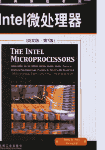

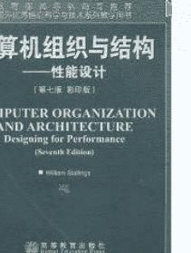

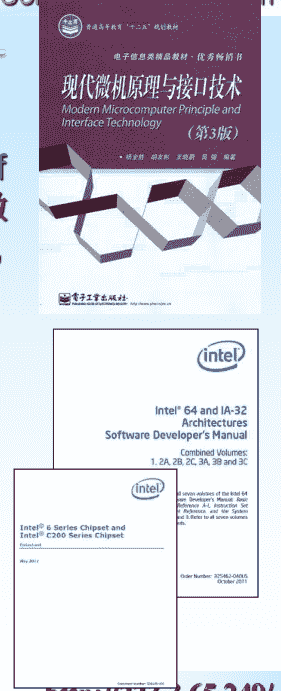


## 第 1 章：IA-32 微处理器

### 大纲

-   计算机组成部件
-   Intel X86 CPU
-   实地址模式内存模型
-   数据类型
-   基本程序执行寄存器
-   寻址方式

### 1.1 计算机组成部件

从顶层看，计算机由 CPU、存储器和 I/O 部件组成，每种类型可以有一个或多个模块。

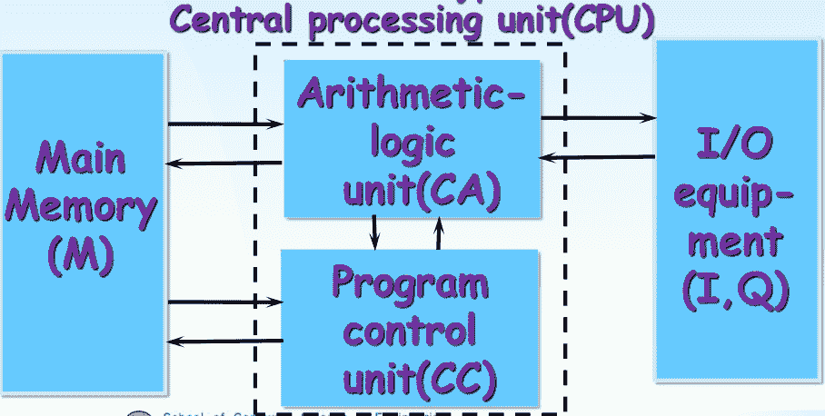

这种设计被称为*冯·诺依曼体系结构*，它基于三个关键概念：

-   数据和指令存储在同一个读写存储器中。
-   该存储器的内容按位置寻址，与其中所包含的数据类型无关。
-   执行按顺序方式逐条指令进行（除非被显式修改）。


#### 采用 Intel 7 系列芯片组的微型计算机

CPU  
存储器  
I/O  

平台控制器中枢（PCH）

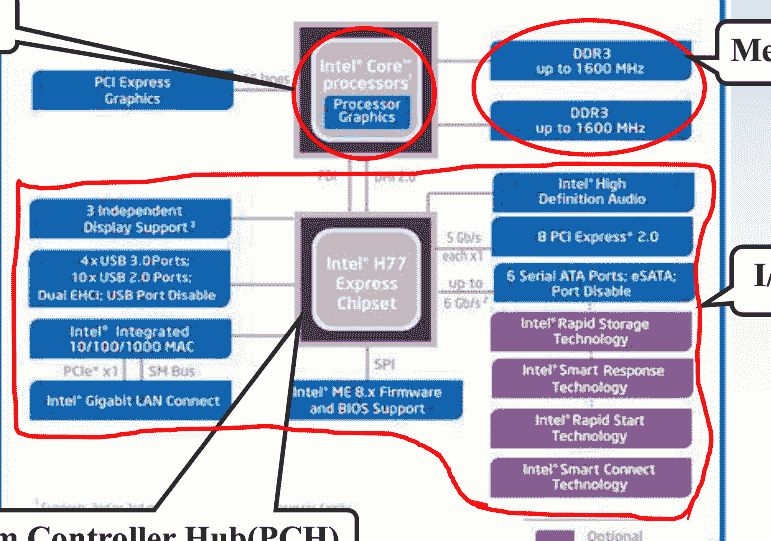

### 1.2 Intel X86 CPU

-   x86 CPU
    -   IA-16：8086、8088、80286
    -   IA-32
        -   Pentium 之前：80386、80486
        -   Pentium
            -   P5：Pentium、Pentium MMX
            -   P6：Pentium Pro、Pentium II、Pentium III、Pentium M
            -   NetBurst：Pentium 4
            -   Core Duo
        -   Core
            -   Pentium NetBurst：Pentium D、Pentium Extreme Edition
    -   Intel 64
        -   Core
            -   Core 2 Duo、Core 2 Quad、Core 2 Extreme
        -   Core i 系列
            -   Nehalem：Core i7、Core i5、Core i3
            -   Sandy Bridge：Core i7/i5/i3（第二代）
            -   Ivy Bridge：Core i7/i5/i3（第三代）
            -   Haswell：Core i7/i5/i3（第四代）

| 部件型号 | 位数 | 地址总线宽度 | 数据总线宽度 |
|---|---|---|---|
| 8086/8088* | 16 | 20 | 16/8 |
| 80286 | 16 | 24 | 16 |
| 80386 | 32 | 32 | 32 |
| 80486 | 32 | 32 | 32 |
| Pentium | 32 | 32 | 64 |
| Pentium III | 32 | 36 | 64 |
| Pentium 4 | 32 | 36 | 64 |
| Pentium D | 64 | 36/40 | 64 |
| Core 2 Duo | 64 | 36/40 | 64 |
| Core 2 Quad | 64 | 36/40 | 64 |
| Nehalem | 64 | 36/40 | 64 |
| Sandy Bridge | 64 | 36/40 | 64 |


### 1.2 Intel X86 CPU
#### 8088/8086 框图

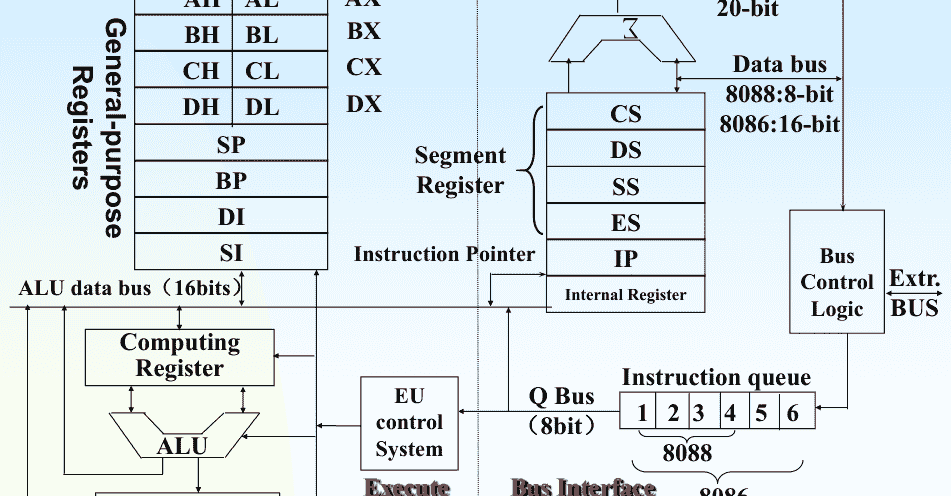

#### 工作模式
##### 实地址模式
- 在 8086/8088 中，这是唯一模式。
- 在 80286 或更高版本中，此模式实现了 Intel 8086 处理器的编程环境，并具有扩展功能（如能够切换到保护模式或系统管理模式）。
- 处理器在加电或复位后进入实地址模式。
- 允许微处理器仅寻址内存空间的前 1M 字节

##### 保护模式（80286 或以上）
- 这是处理器的原生状态。
- 支持多任务操作，并保护每个任务的数据和程序
- 此模式允许应用程序使用 PAE（物理地址扩展，80386 或以上）访问大于 4 GByte 的物理内存。
- 虚拟地址空间=64TB（2^46）
- Windows 在保护模式下运行。

##### 虚拟-8086 模式（IA-32 或以上）
保护模式的能力之一是可以直接在受保护的多任务环境中执行“实地址模式”8086 软件。

此功能称为虚拟-8086 模式，尽管它实际上不是处理器模式。虚拟-8086 模式实际上是可以为任何任务启用的保护模式属性。

##### 系统管理模式（SMM）（IA-32 或以上）
- 此模式为操作系统或执行程序提供一种透明机制，用于实现平台特定功能，例如电源管理和系统安全。
- 在 SMM 中，处理器切换到单独的地址空间，同时保存当前正在运行的程序或任务的基本上下文。然后可以透明地执行 SMM 特定代码。
- 从 SMM 返回后，处理器将被置于系统管理中断之前的状态。

##### IA-32e 模式（Intel64 或以上）
###### 兼容模式（IA-32e 模式的子模式）
- 兼容模式允许大多数传统 16 位和 32 位应用程序在 64 位操作系统下无需重新编译即可运行。
- 在虚拟 8086 模式下运行或使用硬件任务管理的传统应用程序在此模式下将无法工作。
- 应用程序只能访问前 4 GByte 的线性地址空间。兼容模式使用 16 位和 32 位地址和操作数大小。

###### 64 位模式（IA-32e 模式的子模式）
- 此模式使 64 位操作系统能够运行编写为访问 64 位线性地址空间的应用程序。
- 64 位模式将通用寄存器和 SIMD 扩展寄存器的数量从 8 扩展到 16。
- 通用寄存器扩展到 64 位。该模式还引入了新的操作码前缀（REX）以访问寄存器扩展。

### 1.3 实地址模式内存模型
#### 基础
- 内存单元按字节寻址。
- 多字节对象存储为连续的字节序列，对象的地址由所用字节的最小地址给出。
- 对于表示对象的字节排序，存在两种常见约定。
  - little endian：最低有效字节在前，存储在最小地址。
  - Big endian：最高有效字节在前，存储在最小地址。
- X86 CPU 使用 little endian。

#### 按小端模式

|  |  |  |
|---|---|---|
| 12H | 0000H | 地址 0000H 处： |
| 34H | 0001H | 一个字节是 |
| 56H | 0002H | 12H |
| 78H | 0003H | 一个字是 |
| 9AH | 0004H | 3412H |
| BCH | 0005H | 一个双字是 |
| DEH | 0006H | 78563412H |
| FFH | 0007H | 一个四字是 |
|  |  | FFDEBC9A78563412H |


### 1.3 实地址模式内存模型

#### 字、双字和四字的对齐

- 字的自然边界为偶数地址，双字的自然边界为能被四整除的地址，四字的自然边界为能被八整除的地址。
- 为了提高程序的性能，数据结构（尤其是栈）应尽可能在自然边界上对齐。
- 其原因是处理器需要两次内存访问才能完成一次未对齐的内存访问；而对齐的访问只需一次内存访问。

#### 实模式内存寻址

- 所有实模式物理内存地址均为 20 位宽。
- 所有实模式逻辑内存地址必须由段地址加上偏移地址组成。

- **段地址（16 位）：** 位于段寄存器之一中，定义任意 64K 字节内存段的起始地址。
- **偏移地址（16 位）：** 选择 64K 字节内存段内的任意位置。
- 写为 **段地址 : 偏移地址**

- physical address and Logic address

physical address = segment address ×10H + offset address

16bits segment address : 16bits offset address

(4-bits shift left) 16bits segment address 0000

+ 16bits offset address

= 20bits physical address

6417H: 0100H

6417H×10H + 0100H = 64170H + 0100H = 64270H

- 实模式内存寻址方案
  - 使用段地址加上偏移。

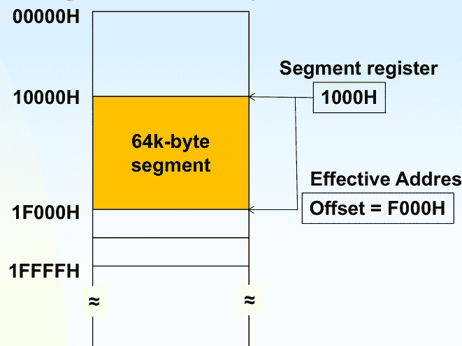

### 1.4 数据类型

- 数值数据类型
  - 整数

| Data Types | bits | Value Range |  |
|---|---|---:|---|---|
|  |  | Unsigned Integers | Signed Integers |
| bytes | 8 | 0~255 | -128~+127 |
| words | 16 | 0~65535 | -32768~+32767 |
| doublewords | 32 | 0~2³²-1 (4G-1) | -2³¹~+2³¹-1 |
| quadwords | 64 | 0~2⁶⁴-1 (16T-1) | -2⁶³~+2⁶³-1 |

#### 数值数据类型

#### 整数

#### 无符号整数

- 无符号整数是包含在字节、字、双字和四字中的无符号二进制数。
- 无符号整数有时也称为序数。

#### 有符号整数

- 有符号整数是有符号的二进制数，存储在字节、字、双字或四字中。
- 对有符号整数的所有操作都假设采用二进制补码表示。

- 符号位位于最高有效位(MSb)。

| Class | Two's Complement Encoding |  |
| --- | --- | --- |
|  | Sign |  |
| Positive | Largest | 0 | 11...11 |
|  | ... | ... | ... |
|  | Smallest | 0 | 00...01 |
| Zero |  | 0 | 00...00 |
| Negative | Largest | 1 | 11...11 |
|  | ... | ... | ... |
|  | Smallest | 1 | 00...00 |

#### 浮点数据类型

IA-32 架构定义并操作三种浮点数据类型：

- 单精度浮点
- 双精度浮点
- 双扩展精度浮点

这些数据类型的格式与 IEEE 二进制浮点算术标准 754 指定的格式直接对应。

| Data Type | Sign | Biased Exponent | Mantissa | Approximate Normalized Range |
|---|---|---|---|---|
| single-precision | 1 | 8 | 24 | 1.18×10⁻³⁸ ~ 3.40 ×10³⁸ |
| Double Precision | 1 | 11 | 53 | 2.23×10⁻³⁰⁸ ~ 1.79×10³⁰⁸ |
| Double Extended Precision | 1 | 16 | 64 | 3.37×10⁻⁴⁹³² ~ 1.18×10⁴⁹³² |

尾数包含一个隐含的（隐藏的）一位，该隐藏位是归一化实数的第一位。

#### 指针数据类型

- 指针是内存中位置的地址
- 在非 64 位模式下，架构定义了两种指针：近指针和远指针。
- 在 16 位模式下
  - 近指针是段内的 16 位偏移（也称为有效地址）。
  - 远指针是逻辑地址，由 16 位段基地址和 16 位偏移组成。
- 在 32 位模式下
  - 近指针是段内的 32 位偏移（也称为有效地址）。
  - 远指针是逻辑地址，由 16 位段选择符和 32 位偏移组成。


### 1.4 数据类型

#### 位字段数据类型

- 位字段是连续的位序列。
- 它可以开始于内存中任意字节的任意位位置，最多可包含 32 位。

#### 字符串数据类型

- 字符串是位、字节、字或双字的连续序列。
- 位字符串可以开始于任意字节的任意位位置，最多可包含 2³²-1 位。
- 字节字符串可以包含字节、字或双字，范围可以从零到 2³²-1 字节（4 GB）。

#### BCD 整数和压缩 BCD 整数

- 二进制编码的十进制整数（BCD 整数）是无符号 4 位整数，有效值范围为 0 到 9。

- 在通用寄存器中操作 BCD 整数时，BCD 值可以是未压缩的（每个字节一个 BCD 数字）或压缩的（每个字节两个 BCD 数字）。

未压缩 BCD：

| 位 7–4 | 位 3–0 |
|----------|----------|
| 0000     | BCD      |

压缩 BCD：

| 位 7–4 | 位 3–0 |
|----------|----------|
| BCD      | BCD      |

> 例如：将十进制整数 21 转换为 BCD 为 0000001000000001，压缩 BCD 为 00100001

#### ASCII 字符代码

| b₃b₂b₁b₀ \ b₆b₅b₄ | 000 | 001 | 010 | 011 | 100 | 101 | 110 | 111 |
|---|---|---|---|---|---|---|---|---|
| 0000 | NUL | DLE | SP | 0 | @ | P | ` | p |
| 0001 | SOH | DC1 | ! | 1 | A | Q | a | q |
| 0010 | STX | DC2 | " | 2 | B | R | b | r |
| 0011 | ETX | DC3 | # | 3 | C | S | c | s |
| 0100 | EOT | DC4 | $ | 4 | D | T | d | t |
| 0101 | ENQ | NAK | % | 5 | E | U | e | u |
| 0110 | ACK | SYN | & | 6 | F | V | f | v |
| 0111 | BEL | ETB | ' | 7 | G | W | g | w |
| 1000 | BS | CAN | ( | 8 | H | X | h | x |
| 1001 | HT | EM | ) | 9 | I | Y | i | y |
| 1010 | LF | SUB | * | : | J | Z | j | z |
| 1011 | VT | ESC | + | ; | K | [ | k | { |
| 1100 | FF | FS | , | < | L | \\ | l | \| |
| 1101 | CR | GS | - | = | M | ] | m | } |
| 1110 | SO | RS | . | > | N | ^ | n | ~ |
| 1111 | SI | US | / | ? | O | _ | o | DEL |

### 1.5 基本程序执行寄存器

- 16 个基本程序执行寄存器，用于通用系统和应用程序编程。
- 这些寄存器可分组如下：
  - 通用寄存器
  - 段寄存器
  - (E)FLAGS（程序状态和控制）寄存器
  - (E)IP（指令指针）寄存器。

#### 通用寄存器

- 逻辑和算术运算的操作数
- 地址计算的操作数
- 内存指针

| 32 位 | 16 位 | 高字节 | 低字节 |
|--------|--------|-----------|----------|
| EAX | AX | AH | AL |
| EBX | BX | BH | BL |
| ECX | CX | CH | CL |
| EDX | DX | DH | DL |
| ESP | SP | — | — |
| EBP | BP | — | — |
| EDI | DI | — | — |
| ESI | SI | — | — |

- **EAX** — 用于操作数和结果数据的累加器
- **EBX** — 指向 DS 段中数据的指针（**基址寄存器**）
- **ECX** — 字符串和循环操作的计数器
- **EDX** — I/O 指针

- 这 4 个寄存器的低 16 位直接映射到寄存器组，可以使用名称 AX、BX、CX 和 DX 引用。
- 这 4 个寄存器的低两个字节中的每一个都可以通过名称 AH、BH、CH 和 DH（高字节）以及 AL、BL、CL 和 DL（低字节）引用。

- **ESI** — 指向 DS 寄存器所指段中数据的指针；字符串操作的源指针（索引寄存器）
- **EDI** — 指向 ES 寄存器所指段中数据（或目标）的指针；字符串操作的目标指针（索引寄存器）
- **ESP** — 堆栈指针（在 SS 段中）
- **EBP** — 指向堆栈上数据的指针（在 SS 段中）（基址寄存器）

- 这 4 个寄存器的低 16 位直接映射到寄存器组，可以使用名称 SI、DI、SP 和 BP 引用。

#### 段寄存器

段寄存器保存 16 位段选择器。段选择器是标识内存中段的一种特殊指针。

- CS — 指向代码段
- SS — 指向堆栈段
- DS — 指向数据段
- ES — 指向数据段
- FS, GS — 指向数据段
  - FS 和 GS 在 16 位汇编器中不使用

| 段 |
|---------|
| 堆栈段 |
| 数据段 |
| 数据段 |
| 代码段 |
| ...... |


### 1.5 基本程序执行寄存器

▪ 默认段和偏移组合

| 特殊用途 | 段 | 16位偏移 | 32位偏移 |
|---|---|---|---|
| 指令地址 | CS | IP | EIP |
| 数据地址 | DS | BX, SI, DI, 一个 8- 或 16-位数字 | EAX, EBX, ECX, EDX, ESI, EDI, 一个 8- 或 32-位数字 |
| 堆栈地址 | SS | SP 或 BP | ESP 或 EBP |
| 字符串目的地址 | ES | DI | EDI 用于字符串指令 |
| 通用地址 | FS | - | 无默认值 |
|  | GS | - | 无默认值 |

#### 指令指针寄存器

+ 指令指针 ((E)IP) 寄存器包含当前代码段中下一个要执行的指令的偏移量。

| 高 16 位 | 16 位 IP |
|---|---|

32 位 EIP

+ EIP 寄存器不能由软件直接访问；它由控制转移指令（如 JMP、Jcc、CALL 和 RET）、中断和异常隐式控制。

#### EFLAG 寄存器

+ - 32 位 (E)FLAGS 寄存器包含一组状态标志、一个控制标志和一组系统标志。
+ - EFLAGS 寄存器中的某些标志可以使用专用指令直接修改。
+ - 没有指令允许直接检查或修改整个寄存器。

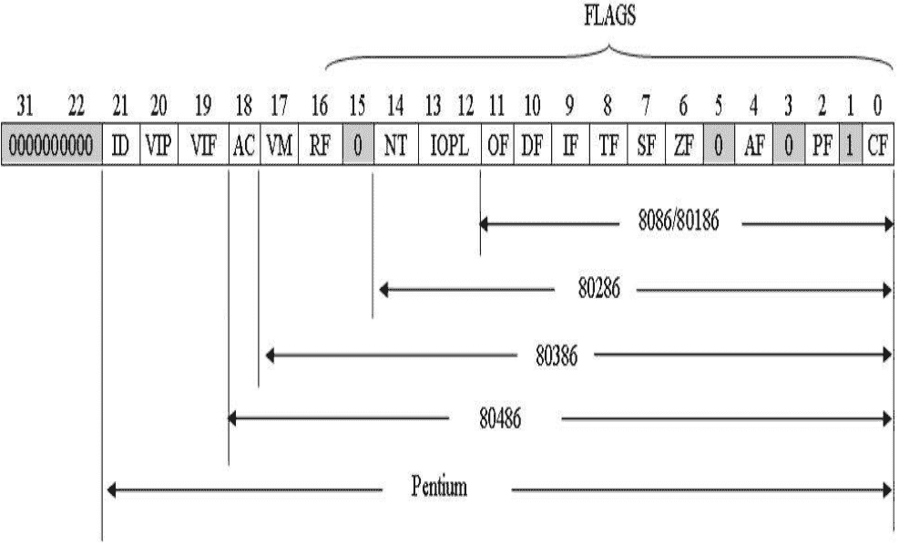

### 1.5 基本程序执行

#### EFLAG 的低 12 位

| 标志 | 名称 | 描述 |
|---|---|---|
| CF | 进位标志 | 如果算术运算在结果的最高有效位产生进位或借位，则置位；否则清零。 |
| PF | 奇偶标志 | 如果结果的最低有效字节包含偶数个 1 位，则置位；否则清零。 |
| AF | 调整标志 | 如果算术运算在结果的位 3 产生进位或借位，则置位；否则清零。 |
| ZF | 零标志 | 如果结果为零，则置位；否则清零。 |

| b15 |  |  |  | OF | DF | IF | TF | SF | ZF |  | AF |  | PF |  | CF | b0 |
|---|---|---|---|---|---|---|---|---|---|---|---|---|---|---|---|---|
| SF | 符号标志 | 置位等于结果的最高有效位，即有符号整数的符号位。 |
| TF | 陷阱标志 | 置位以启用调试的单步模式；清零以禁用单步模式。 |
| IF | 中断使能标志 | 置位以响应可屏蔽中断；清零以禁止可屏蔽中断。 |

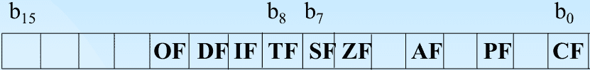

| 标志 | 名称 | 描述 |
|---|---|---|
| DF | 方向标志 | 置位 DF 标志会导致字符串指令自动递减。清零 DF 标志会导致字符串指令自动递增。 |
| OF | 溢出标志 | 如果整数结果太大为正数或太小为负数（不包括符号位）而无法放入目的操作数，则置位；否则清零。 |

| | 8000H + 8000H
0000H | C000H + C000H
8000H | 4008H + 4008H
8010H | 0808H + C000H
C808H |
|---|---|---|---|---|
| CF | 1 | 1 | 0 | 0 |
| PF | 1 | 1 | 0 | 0 |
| AF | 0 | 0 | 1 | 0 |
| ZF | 1 | 0 | 0 | 0 |
| SF | 0 | 1 | 1 | 1 |
| OF | 1 | 0 | 1 | 0 |

#### Note

+ - **进位标志** 表示无符号整数算术的溢出条件。它也用于多精度算术。
+ - **溢出标志** 表示有符号整数（二进制补码）算术的溢出条件。
+ - **调整标志** 用于二进制编码十进制（BCD）算术。

当 PC 重新启动时，CS=FFFFH，EIP，DS，ES，SS，FS 和 GS=0，EFLAGS=2。因此，重新启动时，第一条指令的地址为 (CS:EIP)FFFF:00000000。

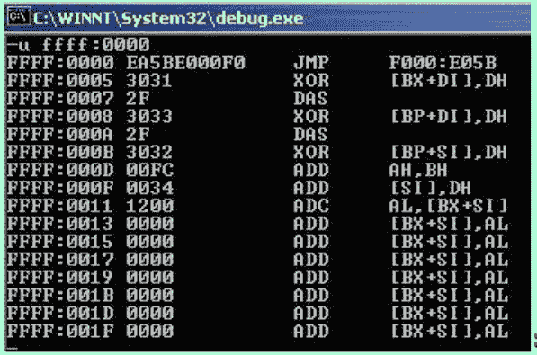


### 1.6 地址模式

+ 汇编语言中语句的组成部分

```
[name:] mnemonic [[dest][,src]][;comment]
[ ] = optional;
dest and src are Operand
```

+ 地址模式是查找每条指令中操作数的方式：

### 操作数寻址模式

我们使用 MOV 指令介绍寻址模式。

```
MOV dest , src ; src → dest
```

### 程序存储器寻址模式

### 堆栈存储器寻址模式

### 操作数寻址

+ - IA-32 机器指令作用于零个或多个操作数。某些操作数是显式指定的，其他则是隐式的。

+ - 源操作数的数据可以位于：
+ - 指令本身中（立即数操作数）
+ - 一个寄存器中
+ - 一个存储器位置中
+ - 一个 I/O 端口中

+ - 对于目的操作数，它可以返回到：
+ - 一个寄存器
+ - 一个存储器位置
+ - 一个 I/O 端口

#### 1.6.1 操作数寻址模式

#### 立即数寻址

某些指令使用编码在指令本身中的数据作为源操作数。

示例：

MOV AH, -40    ;    -40→AH
MOV AX, 34D8H   ;   34H→AH, 0D8H→AL
MOV AX, -40     ;   0FFD8H(-40)→AX
MOV EAX, 12345678H ; 12345678H→EAX

#### 寄存器寻址

源操作数和目的操作数在寄存器中，寄存器 ID 编码在指令中


示例：

+ - MOV AH, BL    ; (BL)->AH
+ - MOV DS, AX    ; (AX)->DS
+ - MOV SI, AX    ; (AX)->SI
+ - MOV ECX, EDX  ; (EDX)->ECX

#### 内存操作数字段寻址

源操作数和目的操作数在内存中，通过段地址和偏移量引用。

#### 内存操作数

+ - 直接数据寻址
+ - 寄存器间接寻址
+ - 寄存器相对寻址
+ - 基址加变址寻址
+ - 变址加变址寻址
+ - 基址加索引寻址
+ - 基址相对加索引寻址
+ - 缩放索引寻址

#### 指定段

+ - 段选择符可以隐式或显式指定。
+ - 指定段选择符最常见的方法是将其加载到段寄存器中，然后允许处理器根据正在执行的操作类型隐式选择该寄存器。

处理器自动选择段

| 引用类型 | 使用的寄存器 | 使用的段 | 默认选择规则 |
|---|---|---|---|
| 指令 | CS | 代码段 | 所有指令取指。 |
| 堆栈 | SS | 堆栈段 | 所有堆栈压栈和弹出。任何使用 ESP 或 EBP 寄存器作为基址寄存器的内存引用。 |
| 局部数据 | DS | 数据段 | 所有数据引用，除相对堆栈或字符串目的外。 |
| 目的字符串 | ES | 由 ES 寄存器指向的数据段 | 字符串指令的目的地。 |

#### 段覆盖

在向内存存储数据或从内存加载数据时，可以覆盖 DS 段默认值以允许访问其他段。在汇编器中，段覆盖通常使用冒号 “:” 操作符处理。

#### 示例：

```
MOV AX, [10H]    ; Data in DS Segment
MOV AX, ES:[10H] ; Data in ES Segment
```

+ - 以下默认段选择不能被覆盖：
+ - 指令取指必须来自代码段。
+ - 字符串指令中的目的字符串必须存储在由 ES 寄存器指向的数据段中。
+ - 压栈和弹出操作必须始终引用 SS 段。

#### 指定偏移量

内存地址的偏移部分可以直接指定为静态值（称为位移）或通过由以下一个或多个组件组成的地址计算来指定：

+ - 位移 — 一个 8 位、16 位或 32 位的值。
+ - 基址 — 通用寄存器中的值。
+ - 索引 — 通用寄存器中的值。
+ - 比例因子 — 一个 2、4 或 8 的值，将其乘以索引值。（80386 或以上）


### 1.6.1 操作数寻址方式
#### 存储器操作数寻址
+ 指定偏移量

将位移量、基址、变址和比例因子相加得到的偏移量称为有效地址（EA）。

```
EA=Base + ( Index*Scale factor ) + Displacement
```

| 组成 | 16 位偏移量 | 32 位偏移量 |
|---|---|---|
| 位移量 | 0、8、16 位 | 0、8、32 位 |
| 基址寄存器 | BX、BP | 任意 32 位通用寄存器 |
| 变址寄存器 | SI、DI | 除 ESP 外的 32 位通用寄存器 |
| 比例因子 | 不使用 | 1、2、4、8 |

### 1.6.1 操作数寻址方式
#### 存储器操作数寻址
+ 直接数据寻址

指令中操作数的 EA。

段地址
指令
EA
存储器
操作数
物理地址 = 段地址 ×16 + 偏移量

```
MOV AX, [2000H]    ; Direct Addressing
```

```
MOV AX, 2000H      ; Immediate Addressing
```

#### 直接数据寻址示例1

MOV AX, [1000H]
(DS)=10A0H

物理地址

10A00H
+ 1000H
--------
11A00H

LSB

CODE
SEGMENT

OP

00H

10H

DATA
SEGMENT

11A00H

30H

50H

50H 30H AX

#### 直接数据寻址示例2

MOV BL, ES:[0100H]

(ES)=3000H
(DS)=2000H

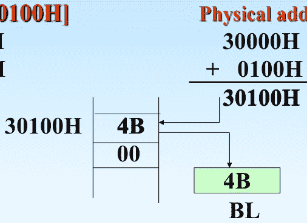

在汇编语言中，可以使用符号地址来代替数值地址，如下所示：

```
MOV AX, BUFF
or  MOV AX, [BUFF]
```

### 1.6.1 操作数寻址方式
#### 存储器操作数寻址
#### 寄存器间接寻址

操作数的 EA 在寄存器中，寄存器 ID 在指令中。

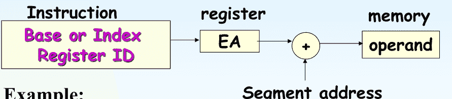

示例：
- MOV AL, [BX]
- MOV AX, CS:[SI]
- MOV [BP], AH
- MOV ECX, [EDX]

#### 计算机 I/O 系统

MOV AH, [BP]
MOV BX, [SI]
MOV CX, SI

(SS)=1000H, (DS)=2000H, (BP)=0B10H, (SI)=032AH

| 物理地址 | 物理地址 |
|---|---|
| 10000H + 0B10H = 10B10H | 20000H + 032AH = 2032AH |

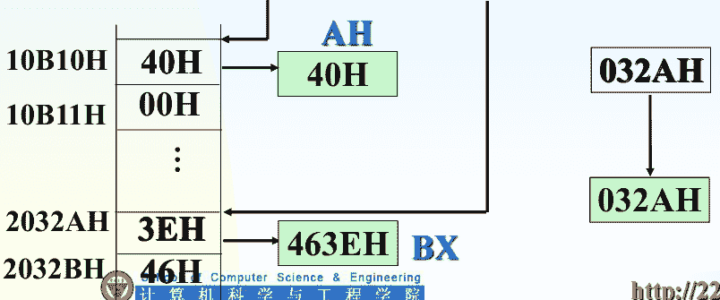

#### 示例

MOV AX, 3000H[BX] (或 [BX+3000H])

MOV AX, COUNT[BX] ; COUNT 是符号地址 (或 MOV AX, [COUNT+BX])

(DS)=3000H, (BX)=2000H, COUNT=4000H

30000H
2000H
+ 4000H
--------
36000H

36000H

34H
12H

1234H
AX

### 1.6.1 操作数寻址方式
#### 存储器操作数寻址
#### 寄存器相对寻址
#### 变址加位移量

- EA = 位移量 + 基址寄存器内容。

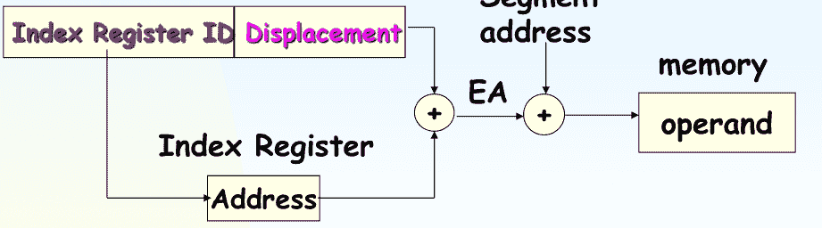

#### 示例

```
MOV CX, 6020H[SI] (or [SI+6020H])
```

```
MOV DX, COUNT[SI] ; COUNT is Symbol address
```

```
(or MOV AX, [COUNT+SI])
```

(DS)=3000H, (SI)=2000H, COUNT=1000H

30000H
2000H
+ 1000H
--------
33000H

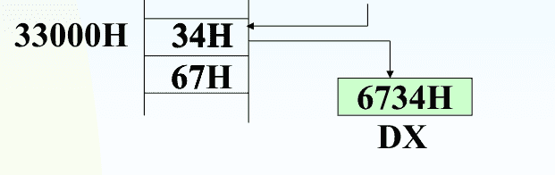

### 1.6.1 操作数寻址方式
#### 存储器操作数寻址
#### 基址加变址寻址

EA = 基址寄存器内容 + 变址寄存器内容。

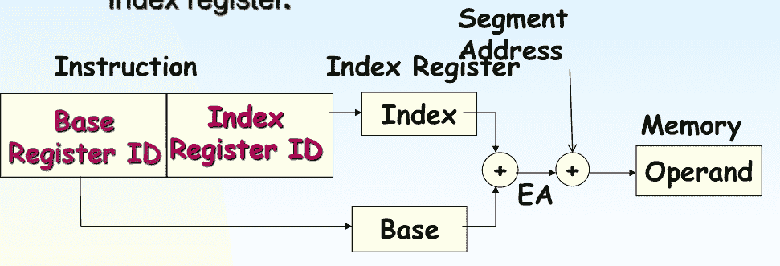

#### 示例：

```
MOV AX, [BX+DI]
MOV AX, [BX][DI]
```

(DS)=2100H, (BX)=0158H, (DI)=10A5H,

物理地址

21000H
0158H
+ 10A5H
--------
221FDH

221FDH
34H
12H

1234H
AX

### 1.6.1 操作数寻址方式
#### 存储器操作数寻址
#### 基址相对加变址寻址

EA = 基址寄存器内容 + 变址寄存器内容 + 位移量。

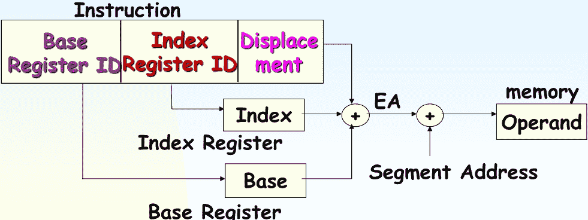

### 1.6.1 操作数寻址方式
- 存储器操作数寻址
  - 比例变址寻址

EA = 变址寄存器内容 * 比例因子 + 位移量。

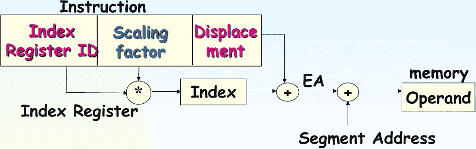

#### 示例：

MOV EAX, COUNT[ESI*4]

EA=ESI*4+COUNT
如果 (ESI)=3，(DS)=1000H
COUNT=2000H

存储器

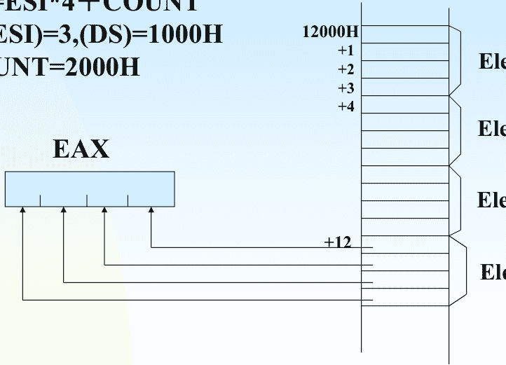

### 1.6.1 操作数寻址方式
#### 存储器操作数寻址
#### 比例变址寻址

EA = 基址寄存器内容 + 变址寄存器内容 * 比例因子 + 位移量。

指令

| 基址寄存器 ID | 变址寄存器 ID | 比例因子 | 位移量 |
|---|---|---|---|
| 基址寄存器 ID | 变址寄存器 ID | 比例因子 | 位移量 |

段地址

存储器

变址寄存器

基址寄存器

EA

操作数

示例：
MOV EAX, TABLE[EBX+EDI*4]


### 1.6.1 操作数寻址方式

#### I/O 端口寻址

#### I/O 端口直接寻址

8 位 I/O 端口地址（地址在 00 到 0FFH 之间）必须使用立即操作数寻址。

- IN AL, 20H ; 从端口 20h 输入一个字节到 AL
- OUT 63H, AL ; 从 AL 输出一个字节到端口 63h

#### I/O 端口间接寻址

16 位 I/O 端口地址（地址高于 0FFH）必须使用 DX 寄存器中的值寻址。

- MOV DX,3F8H
- IN AL, DX ; 从端口 3f8h 输入一个字节到 AL

### 1.6.2 程序存储器寻址方式

- 与 JMP 和 CALL 指令一起使用的程序存储器寻址方式
- 包含三种不同的形式：
  - 直接程序存储器寻址
  - 相对程序存储器寻址
  - 间接程序存储器寻址

#### 相对程序存储器寻址方式

- 术语 relative 指“相对于 IP”
- JMP 指令是一个字节的指令，带有一个字节或两个字节的位移，该位移加到 IP 上。两种类型都可以跳转到当前代码段内的任何位置
  - 一个字节的位移用于短跳转
  - 两个字节的位移用于近跳转或调用
- 相对 JMP 和 CALL 指令包含 8 位或 16 位有符号位移，允许向前内存引用或向后内存引用。

- 所有汇编器都会自动计算位移的距离并选择合适的一个字节或两个字节形式。
  - 8 位位移的跳转范围为从下一条指令起 +127 到 -128 字节；16 位位移的范围为 ± 32K 字节。

| offset | Machine code | program |
|---|---|---|
| 0000 | 0405 | ST: ADD AL,05H |
| 0002 | 90 | NOP |
| 0003 | EBFB | JMP SHORT ST |
| 0005 | 90 | NOP |

#### 间接程序存储器寻址方式

- 远间接

远间接跳转指令可以使用任何相对寄存器；以及带位移的任何相对寄存器作为下一条指令的地址。

如果 (DS)=2500H, (SI)=1300H, (26300H)=4500H, (26302H)=32F0H，执行后：

```
JMP DWORD PTR [SI]: CS=32F0H, IP=4500H
```

### 1.6.3 堆栈存储器寻址方式

- 什么是堆栈？
  - 堆栈临时保存数据，用于存储过程使用的返回地址。
  - 堆栈存储器是一种 LIFO（后进先出）存储器。

- 堆栈存储器寻址方式
  - 它包含在一个段中，并由 SS 寄存器中的段选择符标识。
  - SP 寄存器始终指向堆栈段内的一个内存区域。
  - 项目使用 PUSH 指令压入堆栈，使用 POP 指令从堆栈中取出。

#### PUSH 操作

- 每当一个字数据被压入堆栈时，高 8 位被放置在 SP-1 地址的存储位置；低 8 位被放置在 SP-2 地址的存储位置。

- 然后 SP 递减 2，以便下一个字数据存储在下一个可用的堆栈内存位置。

#### POP 操作

- 每当一个字数据从堆栈弹出时，低 8 位从 SP 地址的存储位置移除。高 8 位从 SP+1 地址的存储位置移除。

- 然后 SP 增加 2。

#### 注意

- 在 8086 到 80286 微处理器中，PUSH 和 POP 存储或检索字数据——从不为字节——80386 及以上允许字或双字。
- 数据可以从堆栈弹出到任何寄存器或任何段寄存器中，除了 CS。
- SP 寄存器加上 SS × 10H 形成实模式下的堆栈内存地址。

```
Example:
PUSH  AX
POP   DS
```


## 第2章：IA-32汇编语言与程序设计（1）

### 大纲

- 汇编语言程序设计
- 汇编语言语句
- 伪指令
- 汇编语言源代码
- 用户界面编程
- 指令与编程

### 2.1 汇编语言程序设计

#### 你好，汇编语言！

```asm
.8086                  ; create 16 bit code
.model small           ; 32 bit memory model
.stack                 ; reserve stack
.data                  ; reserve storage for data
    MSG BYTE "Hello, Assembly Language!",13,10 ,'$'
.code                  ; Tell MASM where the code starts
start:  mov ax,@data
        mov ds,ax
        mov dx,offset msg  ; output MSG
        mov ah,09h
        int  21h
        mov ax,4c00h       ; return to OS
        int  21h
end start              ; Tell MASM where the program ends
```

如何 ...

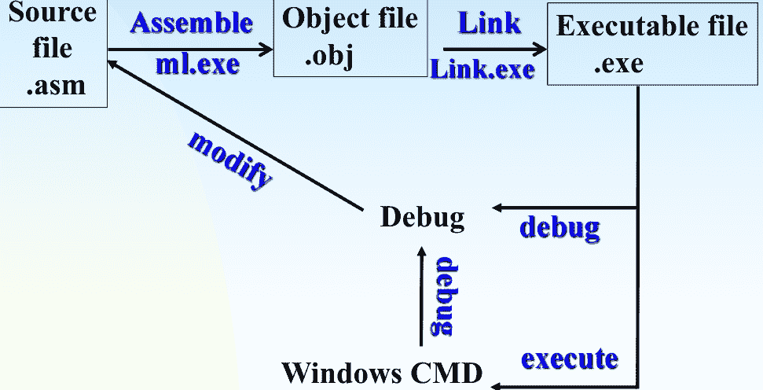

#### 文本编辑器

- 源代码文件是文本文件
  - 文本文件是 ASCII 码的集合。
  - 汇编源文件的扩展名是 .ASM
  - 示例：hello.asm
- 文本编辑器是一种用于创建或修改存储在磁盘上的文本文件的软件
  - Notepad2
  - Notepad
  - Edit

- 汇编器
  - 将汇编语言翻译成机器代码。
  - ml /c /Zd /Zi /Zm /Zf sample.asm
  - MASM sample.asm

- 链接器
  - 链接目标代码以生成可执行的程序。
  - Link /CODEVIEW /NOD /DEB /DEBUGB /STACK:1024 sample.obj

#### 调试器

允许程序员控制程序的执行，在每条指令之后或在预设断点处暂停。

- Debug.exe
- SoftIce.exe
- Ollydbg.exe
- Windbg.exe
- Vkdebug.exe

### 2.2 汇编语言语句

- 功能汇编语言语句有三种类型
  - 指令
    - 可以被翻译成机器代码（目标代码）
    
    ```asm
    [name:] mnemonic [[dest][,src]][:comment]
    [ ] = optional;
    dest and src are Operand
    ```
  - 伪指令
    - 告诉汇编器采取某种动作，不会生成机器代码
    
    ```asm
    [name] directive [[operand][,operand,...]][:comment]
    [ ] = optional;
    ```
  - 宏
    - 是其他语句序列的简写形式

#### 名称

- 用户定义的标识符，可以是标号或变量。
- 名称中可用的符号是 'a'~'z'、'A'~'Z'、'0'~'9'、'?'、'_'、'@'、'$'
- 长度不超过 31 个字符，第一个字符不能是数字。

#### 注释

- 以分号（;）开始，直到行尾结束

### 2.3 伪指令

#### 数据定义

##### 数据类型

| 类型 | 缩写 | 大小 | 整数范围 | 允许的类型 |
|---|---|---|---|---|
| [S]BYTE | DB | 1 字节 | -128~+255 | 字符、字符串 |
| [S]WORD | DW | 2 字节 | -32768~+65535 | 16位近指针、2个字符、双字节字符 |
| [S]DWORD | DD | 4 字节 | -2Gig~+4Gig-1 | 16位远指针、32位近指针、32位长字 |
| FWORD | DF | 6 字节 | -- | 32位远指针 |
| QWORD | DQ | 8 字节 | -- | 64位长字 |
| TBYTE | DT | 10 字节 | -- | BCD、10字节二进制数 |
| REAL4 | DD | 4 字节 | -- | 单精度浮点数 |
| REAL8 | DQ | 8 字节 | -- | 双精度浮点数 |
| REAL10 | DT | 10 字节 | -- | 10字节浮点数 |

##### 进制说明符

| 名称 | 基数 | 说明符 | 数字 |
|---|---|---|---|
| 二进制 | 2 | Y 或 B | 0 1 |
| 八进制 | 8 | Q 或 O | 0 1 2 3 4 5 6 7 |
| 十进制 | 10 | T 或 D | 0 1 2 3 4 5 6 7 8 9 |
| 十六进制 | 16 | H | 0 1 2 3 4 5 6 7 8 9 A B C D E F |
| 浮点数 | 10 | R | 0 1 2 3 4 5 6 7 8 9 . E + - |

- 将说明符放在数字的末尾。
- 十六进制数必须始终以十进制数字（0-9）开头。如果第一位是字母 A 到 F 之一，请在数字前面加上前导 0，以将其与符号名称区分开。


## 2.3 指令
### 数据定义
### 语法

```
[name] type initializer [, initializer]...
```

- **名称：** 分配给变量的符号名。如果未分配名称，则分配内存空间，但变量的起始地址没有符号名。
- **初始值：** 表 11 中所示的类型、常量整数表达式、`?` 或 `DUP` 表达式。用逗号分隔多个值或使用 `DUP` 运算符。

这些指令分配并可选地初始化一个或多个字节的全局数据。

缩写（如 DB、DW、DD）是数据声明指令的有限形式；它们不能用作类型。它们是为了与汇编程序的早期版本兼容而包含的（就像 MASM 5.0 一样）。

字符串初始化，可用于 BYTE 指令，为字符串的每个字符分配一个字节。字符以最左边的字符存储在最低的内存位置中

### 数据定义
### 声明整数变量

为整数变量分配内存并初始化

```
X1    BYTE    16          ; Initialize byte to 16
S2    SBYTE   -16         ; Initialize signed byte to -16
X3    WORD    4*3         ; Initialize word to 12
S4    SWORD   4*5         ; Initialize signed word to 20
X5    DWORD   ?           ; Allocate uninitialized int
LT    DWORD   4294967295  ; Initialize double word (int) to
                         ; 4,294,967,295
QX    QWORD   ?           ; Allocate uninitialized long
         BYTE 1, 2, 3, 4, 5, 6 ; Initialize 6 unnamed bytes
X7    TBYTE (120+50)/10   ; Initialize 10-byte binary
                         ; number 17
```

### 数据定义
### 声明和引用数组

- 数组元素在内存中连续占用，因此程序相对于数组的开始引用每个元素。
- 要声明一个数组，请提供标签名、元素类型以及一系列初始化值或 `?` 占位符。

```
warray WORD 1, 2, 3, 4
xarray DWORD 0FFFFFFFFh, 789ABCDEh
var1 BYTE 10, 20, 30
    BYTE 40, 50, 60
    BYTE 70, 80, 90
sarray WORD ?, 40, ?
```

### 数据定义
### 声明和引用数组
### DUP 运算符

```
count DUP (initializer [, initializer]...)
```

- 您也可以使用 DUP 运算符声明数组。
- **count** 值设置在括号内所有值的重复次数。
- 初始值可以是 *整数*、*字符常量* 或 *另一个 DUP 运算符*，并且必须始终出现在括号内。

```
VAR1 WORD 2 DUP(2, 4), 1476H
```

```
VAR2 BYTE 2 DUP(? , 2 DUP('A', 'B'))
```

| VAR1 |
|------|
| 02H |
| 00H |
| 04H |
| 00H |
| 02H |
| 00H |
| 04H |
| 00H |
| 76H |
| 14H |

| VAR2 |
|------|
| ? |
| 'A' |
| 'B' |
| 'A' |
| 'B' |
| ? |
| 'A' |
| 'B' |
| 'A' |
| 'B' |

### 数据定义
### 声明和引用数组
### 数组的 LENGTHOF、SIZEOF 和 TYPE

```
array WORD 40 DUP (5)
larray EQU LENGTHOF array ; 40 elements
sarray EQU SIZEOF array      ; 80 bytes
tarray EQU TYPE array        ; 2 bytes per element
num DWORD 4, 5, 6, 7, 8, 9, 10, 11
lnum EQU LENGTHOF num        ; 8 elements
snum EQU SIZEOF num          ; 32 bytes
t num EQU TYPE num           ; 4 bytes per element
warray WORD 40 DUP (40 DUP (5))
len EQU LENGTHOF warray      ; 1600 elements
siz EQU SIZEOF warray        ; 3200 bytes
typ EQU TYPE warray          ; 2 bytes per element
```

### 数据定义
### 声明和初始化字符串

- 字符串是字符数组。
- 初始化字符串如 "Hello, there" 为字符串中的每个字符分配并初始化 1 个字节。
- 初始化的字符串不能长于 255 个字符。
- 字符串必须用单引号 (') 或双引号 (") 括起来。


## 2.3 Directives

### Data define

### Declaring and Initializing Strings

```
char      BYTE 'a'                ; a
message   BYTE "That's good."      ; That's good.
warn      BYTE 'I don't know.'      ; I don't know.
string    BYTE "The ""key"" is found." ; The "key" is found.
str1      BYTE "This is a long string that does not ",
          "fit on one line."
```

STRING BYTE "HELLO"

| STRING1 | 'H' |
| +1 | 'E' |
| +2 | 'L' |
| +3 | 'L' |
| +4 | 'O' |

## 2.3 Directives

### OFFSET and SEG Operator

- 地址常量由偏移量或段值组成。
  - **OFFSET 操作符**
    - 返回内存位置的偏移量。
  - **SEG 操作符**
    - 返回内存位置的段地址

```
str  BYTE "Hello!", 13, 10, 0
...
mov ax, SEG str      ; Load segment address
mov es, ax
mov bx, OFFSET var ; Load offset address
```

## 2.3 Directives

### Arithmetic Operators

- expression1 + expression2
  - 返回 expression1 加上 expression2
- expression1 − expression2
  - 返回 expression1 减去 expression2
- expression1 * expression2
  - 返回 expression1 乘以 expression2
- expression1 / expression2
  - 返回 expression1 除以 expression2
- −expression
  - 反转 expression 的符号。
- expression1 MOD expression2
  - 返回 expression1 除以 expression2 时余数的整数值（模）

## 2.3 Directives

### Arithmetic Operators

- 算术运算符可用于数值表达式或地址表达式
- 对于地址表达式，结果必须是物理上有意义的。
  - 地址 + 常数 = 地址
  - 地址 - 常数 = 地址
  - 地址 − 地址 = 常数

Example1:
MOV DX, BLOCK+(6-1)*2 ;

```
example2:
ARRAYA DW 1, 2, 3, 4, 5, 6, 7
WENDA  DW ?
MOV CX, (WENDA-ARRAYA)/2 ;
```

## 2.3 Directives

### PTR Operator

```
[type|distance] PTR expression
```

- 强制 expression 被视为具有指定类型。
- type 为 BYTE, WORD, DWORD, FWORD, QWORD 或 TBYTE。

```
Mask BYTE 70H,80H,16H,55H
Task WORD 1234H,9ABCH
MOV DX, WORD PTR Mask ; (DX)← 8070H
MOV AL, BYTE PTR Task ; AL←34H
MOV BYTE PTR[BX], 10 ;
```

- distance 为 near 或 far

```
JMP FAR PTR begin
```

## 2.3 Directives

### SHORT Operator

```
SHORT label
```

- 将 *label* 的类型设为 short。所有跳转到 *short label* 必须为短跳转（从跳转指令到 *label* 的范围在 −128 到 +127 字节之间）。

### EQU and = Operator

```
name EQU expression
name = expression
```

- EQU 和 = 计算 <expression> 的数值并将 resulting 常量值赋给 <name>。
- 与 = 不同，EQU 不允许重新定义数值等式。
- 如果 <expression> 无法求值，EQU 将 <expression> 视为文本。

## 2.3 Directives

### EQU and = Operator

```
Example:
CONST EQU 100*2
ADDRS EQU [BX+10]
CHAR EQU 'COMPUTER'
COUNT = AX
...
MOV BX, CONST ; the same as MOV BX,100*2
MOV BX, COUNT ; the same as MOV BX, AX
MOV ADDRS, 20 ; the same as MOV[BX+10], 20
```

## 2.3 Directives

$ - 位置计数器的当前值

Example1
ARRAY WORD 1, 2, $+4, 3, 4, $+3

Example2
BUFFER DB 1, 2, 3, 4, 5
COUNT EQU $-BUFFER
COUNT = BUFFER 的长度

Example3
OUT 21H, AL
JMP $+2 ;jump to next statement
MOV AX, 0

| ARRAY | 01h | 0074H |
| | 00 |
| 02h | 0076H |
| | 00 |
| 7Ch | 0078H |
| | 00 |
| 03h | 007AH |
| | 00 |
| 04h | 007CH |
| | 00 |
| 81h | 007EH |
| | 00 |

## 2.4 Assembly Language Source Code

### Select Instruction Set

- .8086 使用 8086 指令集
- .286 使用 80286 指令集
- .286P 使用保护模式下的 80286 指令集
- .386 使用 80386 指令集
- .386P 使用保护模式下的 80386 指令集
- .486 使用 80486 指令集
- .486P 使用保护模式下的 80486 指令集
- .586 使用 Pentium 指令集
- .586P 使用 Pentium 指令集
- .MMX 使用 MMX 指令集
- .XMM 使用 SSE 指令集


## 2.4 汇编语言源代码
### 使用简化的段指令

- MASM 程序由段组成的模块构成。
- 仅用 MASM 编写的每个程序都有一个主模块，程序执行从此处开始。
- 主模块可以使用所有简化的段指令定义代码、数据或堆栈段。
  - `.MODEL`、`.CODE`、`.CONST`、`.DATA`、`.DATA?`、`.FARDATA`、`.FARDATA?`、`.STACK`、`.STARTUP` 和 `.EXIT`。

### 使用简化的段指令
### .MODEL

```
`.MODEL memorymodel [[, langtype]] [[, stackoption]]`
```

- 初始化程序内存模型。
- 你必须在源文件中任何其他简化段指令之前放置 `.MODEL`。
- *memorymodel* 可以是 **TINY、SMALL、COMPACT、MEDIUM、LARGE、HUGE** 或 **FLAT**。如果你为高级语言编写汇编例程，此选项应与编译器或解释器使用的内存模型相匹配。

### 使用简化的段指令
### .MODEL

```
`.MODEL memorymodel [[, langtype]] [[, stackoption]]`
```

| 内存模式 | 段最大大小 | 文件类型 | 操作系统 | 代码段 | 数据段 |
|---|---|---|---|---|---|
| Tiny | 64KB | .com | DOS | 一个段 | |
| Small | 64KB | .exe | DOS | 1 | 1 |
| Medium | 64KB | .exe | DOS | 多个 | 1 |
| Compact | 64KB | .exe | DOS | 1 | 多个 |
| Large | 64KB | .exe | DOS | 多个 | 多个 |
| Huge | >64KB | .exe | DOS | 多个 | 多个 |
| flat | 4GB | .exe(PE) | Windows | 同一段 | |

### 使用简化的段指令
### .MODEL

```
`.MODEL memorymodel [[, langtype]] [[, stackoption]]`
```

- *langtype* 可以是 **C、BASIC、FORTRAN、PASCAL、SYSCALL** 或 **STDCALL**。指示汇编器遵循所指示语言的命名、调用和返回约定。
- *stackoption* 可以是 **NEARSTACK**（如果 SS 等于 DS）或 **FARSTACK**（如果 SS 不等于 DS）。**NEARSTACK** 为默认值。

### 使用简化的段指令
### 创建数据段

```
.DATA
```

`.DATA` 指令创建一个近初始化数据段（段名为 _DATA）并结束之前的段（如果有）。`.DATA` 段应包含所有具有初始值的全局数据。

`.DATA` 段在 MS-DOS 中最多可占用 64K，在 Windows 的 flat 模型下可达 512 兆字节。

你可以使用 @data 来确定数据段的组。

### 使用简化的段指令
### 创建数据段

```
.CONST
```

开始一个常量数据段并结束之前的段（如果有）。该段应包含所有字符串、实数以及高级语言访问的其他常量数据。它具有 READONLY 属性。

```
.DATA?
```

`.DATA?` 指令开始未初始化数据段（段名为 _BSS）并结束之前的段（如果有）。将所有未初始化数据放在 `.DATA?` 段中。

### 使用简化的段指令
### 创建数据段

```
.STACK [SIZE]
```

定义一个堆栈段（段名为 STACK）。可选的 size 指定堆栈的字节数（默认 1,024）。

## 2.4 汇编语言源代码
### 简化段
### 结束源文件

```
END [ADDRESS]
```

标记源文件的结束，并可选择指示程序加载地址。可选的 <address> 是一个标签或表达式，标识程序执行开始的位置。

END 也会关闭源文件中的最后一个段。

## 2.4 汇编语言源代码
### 简化段
### 退出程序

```
MOV AH, 4CH
MOV AL, RETURN_VALUE
INT 21H
```

INT 20H

```
.MODEL SMALL
.STACK 100H
.DATA
......
.CODE
START:
    MOV AX, @DATA
    MOV DS, AX
......
    MOV AH, 4CH
    INT  21H
END START
```


## 2.5 用户界面编程

| 指令 | 操作码 | 操作 |
|---|---|---|
| interrupt | **INT N** | SP←(SP)-2<br>((SP)+1,(SP))←(FLAGS)<br>SP←(SP)-2<br>((SP)+1,(SP))←(CS)<br>SP←(SP)-2<br>((SP)+1,(SP))←(IP)<br>IP←(0000:OA)　; OA=4*N<br>CS←(0000:OA+2) |
| Return | **IRET** | IP←((SP)+1,(SP))<br>SP←(SP)+2<br>CS←((SP)+1,(SP))<br>SP←(SP)+2<br>FLAGS←((SP)+1,(SP))<br>SP←(SP)+2 |

## 2.5 用户界面编程

| n | function | n | function |
|---|---|---|---|
| 10H | Video Services | 13H | Low Level Disk Services |
| 14H | Serial port services | 15H | Miscellaneous system services |
| 16H | Keyboard services | 17H | Printer services |
| 20H | Terminate program | 21H | Main DOS API |
| 22H | Program terminate to calling program | 23H | Control-C handler address |
| 24H | Critical error handler address | 33H | Mouse services |

n - Interrupt vector number

INT n ; for example: INT 10H, INT 21H

## 2.5 用户界面编程

### 如何使用 INT 指令

- 将功能号放入 AH 寄存器
- 根据要求设置所有入口参数
- 使用 INT n 指令

例如：

设置屏幕为 640×480 16 色图形模式

```
MOV AH, 0      ; function number
MOV AL, 12H     ; entrances parameters
INT  10H        ; video services
```

## 2.5 用户界面编程

#### 示例

向打印机打印字符 ‘S’

```
MOV  AH, 1    ; initial the printer
MOV  DX, 0    ; Printer number
INT  17H      ;
MOV  AH, 0    ; print a character
MOV  DX, 0    ; printer number
MOV  AL, 'S'  ; character that will be print
INT  17H      ; print ‘S’
```

## 2.5 用户界面编程

- 从键盘输入一个字符

- 等待按键并将其代码返回到 AL

- 使用 DOS API

```
MOV  AH,1
INT  21H  ; ASCII code in AL
```

- 使用 BIOS API

```
MOV AH,0
INT  16H  ; ASCII code in AL, scan code in AH
```

- 不等待地从键盘返回字符

```
MOV AH,1
INT  16H  ; if ZF=0, ASCII code in AL, scan
; code in AH
; if ZF=1, no key be stroked
```

## 2.5 用户界面编程

- 向屏幕输出一个字符

- 将 DL 中的字符打印到屏幕

```
MOV DL, 'A'     ; char want to print
MOV AH, 02H
INT  21H
```

- 如何输入一个字符并输出它？

```
MOV AH, 01H
INT  21H
MOV DL, AL
MOV AH, 02H
INT  21H
```

## 2.5 用户界面编程

### 向屏幕输出字符串

```
```asm
.DATA
    MSG BYTE "Hello world!",0Ah,0Dh,'$'
.CODE
START:
    MOV AX, DATA
    MOV DS, AX
    MOV DX, OFFSET MSG
    MOV AH, 09H
    INT 21H
    MOV AH, 4CH
    INT 21H
END START
```
```

> **提示:**  
> 为了输出回车换行（C 语言中的 `\r\n`），你可以按如下方式定义一个字符串：  
> `CR DB 0AH,0DH,'$'`

## 2.5 用户界面编程

### 从键盘输入字符串

```
N        EQU 20
MAXLEN   DB  N          ; max length of buff
ACTLEN   DB  ?          ; the actual length
STRING   DB  N DUP(?)   ; buff to store the string
.....
MOV      AH, 0AH
MOV      DX, OFFSET MAXLEN
INT      21H
```

# 计算机输入/输出系统

2015

讲师：杨全胜

计算机科学与工程学院
软件工程学院
东南大学

# 第 2 章：

# IA-32 汇编语言与编程(2)

## 2.6 指令与编程

- 通用指令
- X87 FPU 指令
- MMX 指令
- SSE/SSE2/SSE3 指令
- 系统指令
- 64 位模式指令
- 虚拟机扩展

## 2.6 指令与编程

### 通用指令

- 数据传送指令
- 算术指令
- 逻辑指令
- 跳转指令
- 循环指令
- 字符串指令
- 过程指令

## 2.6.1 数据传送指令

- MOV 指令
- PUSH/POP 指令
- 装载有效地址指令
- 杂项数据传送指令


## 2.6.1 数据传输指令

## MOV 指令

```
MOV DST , SRC
```

DST<--(SRC) ; Copy data from SRC to DST

| 符号 | 示例 |
|---|---|
| MOV reg8/16/32, imm8/16/32 | MOV EAX, 7327FAB2H |
| MOV reg8/16/32, reg8/16/32 | MOV AH, DL |
| MOV reg8/16/32, mem8/16/32 | MOV DX, WORD PTR[BX] |
| MOV mem8/16/32, reg8/16/32 | MOV BYTE PTR[DI], AL |
| MOV mem8/16/32, imm8/16/32 | MOV BYTE PTR[DI], 30 |
| MOV seg, reg16 | MOV DS, AX |
| MOV reg16, seg | MOV AX, DS |
| MOV seg, mem16 | MOV DS, WORD PTR[BX] |
| MOV mem16, seg | MOV WORD PTR[BX], DS |

- 源操作数和目的操作数不可用的组合
  - 源和目的都在内存中
  - 立即数源到段寄存器
  - 移动到或来自标志寄存器
  - 移动到指令指针寄存器
  - 移动到 CS
  - 从一个段寄存器移动到另一个段寄存器
  - 操作数大小不同
  - 移动多个对象

## MOV 指令

# 合法或非法？

```
val1 byte 100
val2 byte 200
number equ 100
```

```
mov val1 , val2
mov number , val2
mov val2, number
mov ds, offset val1
mov ax, offset val1
mov al, -40
```

```
mov al, ds
mov ds, ax
mov es, ds
mov ax, es
mov val, al
mov al, 0D8h
```

## PUSH 指令

```
PUSH SRC
```

- 将数据保存到 LIFO 栈
- 对于 16 位
  1. SP<--(SP)-2
  2. ((SP)+1,(SP))<--(SRC)
- 对于 32 位
  1. ESP←(ESP)-4
  2. ((ESP)+3,(ESP)+2,(ESP)+1,(ESP))←(SRC)

示例：

PUSH AX

执行前

AX
3125H

Lower addr.
SP →
52500H

执行后

AX
3125H

Lower addr.
SP →
25H 524FEH
31H 524FFH
52500H

## POP 指令

```
POP DST
```

- 从 LIFO 栈中检索数据
- 对于 16 位
  1. DST<--((SP)+1,(SP))
  2. SP<--(SP)+2
- 对于 32 位
  1. DST←((ESP)+3,(ESP)+2,(ESP)+1,(ESP))
  2. (ESP)←(ESP)+4

示例：

POP BX

执行前

BX

75C1H

执行后

BX

48h 6Bh

lower addr.

SP

6Bh

51000H

48h

1H

9Ah

2H

28h

3H

SP

6Bh

51000H

lower addr.

48h

1H

9Ah

2H

28h

3H

| 符号 | 示例 |
|---|---|
| `POP reg16/32` | `POP AX, POP EBX` |
| `POP mem16/32` | `POP WORD PTR[EBX+2] , POP VAR` |
| `POP seg` | `POP DS` |
| `POPA` | `POPA; pops di, si, bp, sp, bx, dx, cx, ax` |
| `POPAD` | `POPAD; pops edi, esi, ebp, esp, ebx, edx, ecx, eax` |
| `POPF` | `Pop flags` |
| `POPFD` | `Pop EFLAGS` |

> 注意：不能弹出 CS

## 加载有效地址指令

```
LEA reg16/32, mem8/16/32
```

将 16 或 32 位寄存器加载为操作数指定的数据的偏移地址。

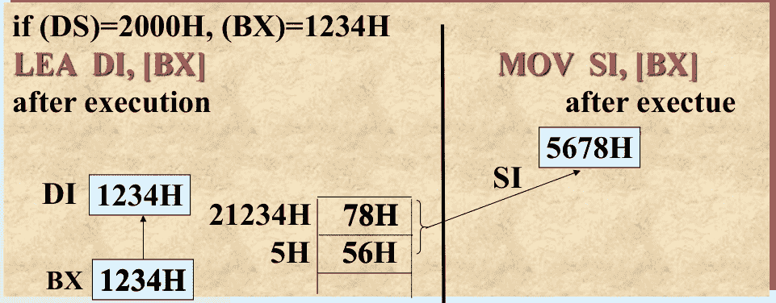

### LEA 指令

**LEA DI, BUFFER**  
; 将 BUFFER 的有效地址传输到 DI

DI `1234H`

BUFFER → 2000H:1234H

**MOV DI, BUFFER**  
; 将地址 BUFFER 的内容传输到 DI

DI `5678H`

|  | 值 |
|---|---|
| 5H | 56H |
|  | 78H |

# LEA 和 OFFSET 有什么不同？

```
LDS  reg16/32, mem32/48
LES  reg16/32, mem32/48
LFS  reg16/32, mem32/48
LGS  reg16/32, mem32/48
LSS  reg16/32, mem32/48
```

- 使用偏移地址加载任意 16 或 32 位寄存器，并使用段地址加载 DS、ES、FS、GS 或 SS 段寄存器。
- 使用任意内存寻址模式访问包含段和偏移地址的 32 或 48 位内存段。

## 杂项数据传输指令

### XCHG 指令

- 交换寄存器的内容与任何其他寄存器或内存位置的内容。
- 不能交换段寄存器或内存到内存数据

| 符号 | 示例 |
|---|---|
| XCHG *reg8/16/32*, *reg8/16/32* | XCHG AL,CL |
| XCHG *reg8/16/32*, *mem8/16/32* | XCHG AX,DATA1 |
| XCHG *mem8/16/32*, *reg8/16/32* | XCHG DATA2, EAX |


## 2.6.1 数据传输指令
### 杂项数据传输指令

- LAHF 指令
  - 将标志寄存器的最右八位传输到 AH 寄存器。
- SAHF 指令
  - 将 AH 寄存器传输到标志寄存器的最右八位。

### XLAT 指令

- 将 AL 寄存器的内容转换为内存表中存储的数字。
- 表的偏移量必须在 (E)BX 寄存器中。
- 表的类型为字节。

**示例：**

```asm
MOV BX, OFFSET TABLE
     ; EA of table to BX
MOV AL, 4
     ; index in AL
XLAT
```

| TABLE | Value |
|---|---|
| +0 | 30H |
| +1 | 31H |
| +2 | 32H |
| +3 | 33H |
| +4 | 34H |
| +5 | 35H |
| +6 | 36H |
| +7 | 37H |

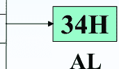

### IN 和 OUT 指令

- IN 指令将数据从外部 I/O 设备传输到 AL、AX 或 EAX。
- OUT 指令将数据从 AL、AX 或 EAX 传输到外部 I/O 设备。
- 存在两种形式的 I/O 设备（端口）寻址
- 固定端口寻址允许使用 8 位 I/O 端口地址的立即寻址（直接寻址）在 AL、AX、EAX 之间进行数据传输。
- 可变端口寻址允许使用 16 位 I/O 端口地址在 AL、AX、EAX 之间进行数据传输。I/O 端口号存储在 DX 寄存器中。

| Symbol | Example |
|---|---|
| IN AL/AX/EAX, p8 | IN AX, 52H; input a word from 52H port |
| IN AL/AX/EAX, DX | IN AL, DX; input a byte from (DX) port |
| OUT p8, AL/AX/EAX | OUT 40H, AL; output a byte to 40H port |
| OUT DX, AL/AX/EAX | OUT DX, AX; output a word to (DX) port |

```
**IN Example**
```asm
IN   AL, 20H
IN   AX, 48H
MOV  DX, 3FCH
IN   AX, DX
```
```

```
**OUT Example**
```asm
OUT  32H, AX
MOV  DX, 400H
MOV  AL, 86H
OUT  DX, AL
```
```

### MOVSX 和 MOVZX 指令

- 两者都存在于 80386-Core 指令集中。
- 这些指令移动数据，同时进行符号扩展（MOVSX）或零扩展（MOVZX）。

| Symbolic | Example |
|---|---|
| MOVSX reg16/32, reg8/16 | MOVSX CX, BL |
| MOVSX reg16/32,mem8/16 | MOVSX ECX, [EDI] |
| MOVZX reg16/32, reg8/16 | MOVZX EAX, BX |
| MOVZX reg16/32,mem8/16 | MOVZX CX, BYTE PTR[DI] |

示例：
if (CL)=0ABH,
MOVSX AX, CL
    after execution (AX)=0FFABH   ; Sign-extend
MOVZX AX, CL
    after execution (AX)=00ABH    ; Zero-extend
if (DATA) = 78ADH
MOVSX EAX, DATA
    after execution (AX)=000078ADH ; Sign-extend
MOVZX EAX, DATA
    after execution (AX)=000087ADH ; Zero-extend

## 2.6.2 算术指令

- 加法、减法和比较
- 乘法和除法
- BCD 和 ASCII 算术

### 加法、减法和比较
### 加法指令

```
ADD DST, SRC
```

- DST←(DST)+(SRC)
- 该指令会影响 CF、SF、OF、PF、ZF 和 AF

| Symbolic | Example |
|---|---|
| ADD reg8/16/32, imm8/16/32 | ADD AX,837FH |
| ADD reg8/16/32, reg8/16/32 | ADD EAX, EBX |
| ADD reg8/16/32, mem8/16/32 | ADD CX, WORD PTR[SI] |
| ADD mem8/16/32, reg8/16/32 | ADD BYTE PTR[DI],DL |
| ADD mem8/16/32, imm8/16/32 | ADD BYTE PTR[DI], 23 |

### ADD 示例

**ADD DX, BX**

if (DX)=4652H, (BX)=0F0F0H

```text
        0100 0110 0101 0010          4652H
      + 1111 0000 1111 0000        + F0F0H
      --------------------------------------
      1 0011 0111 0100 0010          1 3742H
                    ↑ Carry              ↑ Carry
```

执行后
(DX)=3742H

ZF=0
SF=0
CF=1
OF=0


## 2.6.2 算术指令
### 加法、减法和比较
### 带进位加法

```
ADC DST, SRC
```

DST ← (DST) + (SRC) + Carry

该指令会影响 CF、SF、OF、PF、ZF 和 AF

### 递增加法

```
INC DST
```

DST ← (DST) + 1

该指令会影响 SF、OF、PF、ZF 和 AF，对 CF 无影响

| 符号 | 示例 |
|---|---|
| INC reg8/16/32 | INC CX |
| INC mem8/16/32 | INC BYTE PTR[BX] |

### ADC 示例——8086 中的双字加法

假设为 8086 编写程序，将 DX 和 AX 中的 32 位数加到 BX 和 CX 中的 32 位数

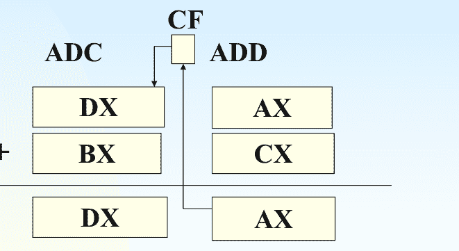

```
ADD AX, CX   ; add low word
ADC DX, BX   ; add high word
```

### INC 示例

```
LEA EBX, ARRAY
MOV AL, [BX]
......
INC BX
```

```
MOV BX, 0
MOV AL, ARRAY[BX]
......
INC BX
```

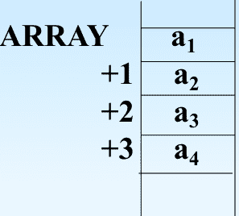

if DX:AX=37A1FFFFH, then can we use

```asm
INC AX
ADC DX,0
```

to do DX:AX+1?

### 加法、减法和比较
### 减法指令

```
SUB DST, SRC
```

DST←(DST) - (SRC)

该指令会影响 CF、SF、OF、PF、ZF 和 AF

| 符号 | 示例 |
|---|---|
| SUB reg8/16/32, imm8/16/32 | SUB AX,837FH |
| SUB reg8/16/32, reg8/16/32 | SUB EAX, EBX |
| SUB reg8/16/32, mem8/16/32 | SUB CX, WORD PTR[SI] |
| SUB mem8/16/32, reg8/16/32 | SUB BYTE PTR[DI],DL |
| SUB mem8/16/32, imm8/16/32 | SUB BYTE PTR[DI], 23 |

### SUB 示例

SUB BX, CX

执行前

(BX)=9543H    (CX)=28A7H

9543H
- 28A7H
------
6C9CH

执行后：

(BX)=6C9CH

CF=0   OF=1   ZF=0   SF=0

### 加法、减法和比较
### 带借位减法

```
SBB DST, SRC
```

DST <-- (DST) - (SRC) - Carry

该指令会影响 CF、SF、OF、PF、ZF 和 AF

### SBB 示例

```
SUB AX, CX    ; sub low word
```

```
SBB DX, BX    ; sub high word
```

7456H AX
- 9428H CX
1 E11EH

0012H DX
0010H BX
- 1H CF
0001H

CF=1

### 加法、减法和比较
### 递减减法

```
DEC DST
```

DST←(DST) - 1

该指令会影响 SF、OF、PF、ZF 和 AF，对 CF 无影响

### 二进制补码

```
NEG DST;
```

DST←0-(DST)

| 符号 | 示例 |
|---|---|
| DEC reg/mem8/16/32 | DEC CX ; DEC BYTE PTR[SI] |
| NEG reg/mem8/16/32 | NEG WORD PTR[DI] |

### NEG 示例1

NEG DX

执行前：
(DX)=6780H


执行后：
(DX)=9880H    CF=1

### NEG 示例2

NEG AL       ; 0-(AL)
ADD AL, 100   ; (AL)+100-->AL

实现：    100-(AL)

### 加法、减法和比较
### 比较指令

```
CMP DST, SRC
```

- (DST) – (SRC)
- 该指令会影响 CF、SF、OF、PF、ZF 和 AF
- DST 永不改变

| 符号 | 示例 |
|---|---|
| CMP reg8/16/32, imm8/16/32 | CMP AX,837FH |
| CMP reg8/16/32, reg8/16/32 | CMP EAX, EBX |
| CMP reg8/16/32, mem8/16/32 | CMP CX, WORD PTR[SI] |
| CMP mem8/16/32, reg8/16/32 | CMP BYTE PTR[DI],DL |
| CMP mem8/16/32, imm8/16/32 | CMP BYTE PTR[DI], 23 |

### 加法、减法和比较
### 比较指令 (CMP)

CMP 通常后跟条件跳转指令，该指令测试标志位的状态。

- 对于无符号比较
  - if ZF=1, then DST = SRC
  - if CF=0, then DST ≥ SRC
  - if CF=1, then DST < SRC

- 对于有符号比较
  - if ZF=1, then DST = SRC
  - if SF=OF, then DST ≥ SRC
  - if SF<>OF, then DST < SRC

### CMP 示例1

CMP AL, BL

(AL)=-64    (BL)=10

- 64
- 10
------
- 74

OF=0  SF=1

结果： (DST)<(SRC)

### CMP 示例2

CMP CL, [100H]

(CL)=-100    (DS:100)=-110

-100
- (-110)
------
10

OF=0  SF=0

结果： (DST)>(SRC)


## 2.6.2 算术指令
## 乘法和除法

- 无符号乘法
  - `MUL SRC`
- 有符号乘法
  - `IMUL SRC`

| 符号 | 操作 |
|---|---|
| `MUL/IMUL reg/mem8` | `AX ← AL * reg/mem8` |
| `MUL/IMUL reg/mem16` | `DX:AX ← AX * reg/mem16` |
| `MUL/IMUL reg/mem32` | `EDX:EAX ← EAX * reg/mem32` |

### 无符号乘法

```
MUL SRC
```

### 有符号乘法

```
IMUL SRC
```

乘法后的乘积始终是双倍宽度的乘积。

该指令会影响 CF 和 OF

- CF=OF=1：表示乘积的高位半部分不为零
- CF=OF=0：表示乘积的高位半部分为零
- 对其他标志的改变无意义

## MUL, IMUL 示例

### MUL BL

(AL)=0B4H=180
(BL)=11H=17

1011 0100
× 0001 0001
1011 0100
1011 0100
1011 1111 0100

(AX)=0BF4H=3060

### IMUL BL

(AL)=0B4H= -76,
(BL)=11H=17
-76补=4CH

0100 1100
× 0001 0001
0100 1100
0100 1100
0101 0000 1100

(AX)=(-050C)补
=FAF4H= -1292

## 乘法和除法

### 一种特殊的带符号乘法

```
IMUL REG, SRC
IMUL REG, SRC, IMM
```

乘积、REG 和 SRC 尺寸相同，为 16 位或 32 位

| 符号 | 操作 |
|---|---|
| IMUL *reg16/32, reg/mem16/32* | Reg16/32=reg16/32*reg/mem16/32 |
| IMUL *reg16/32, reg/mem16/32, imm8* | Reg16/32=reg/mem16/32*sign-extended imm8 |
| IMUL *reg16, reg/mem16, imm16* | Reg16=reg/mem16*sign-extended imm16 |
| IMUL *reg32, reg/mem32, imm32* | Reg32=reg/mem32*sign-extended imm32 |

- 无符号除法
  - DIV SRC
- 有符号除法
  - IDIV SRC

| 符号 | 操作 |
|---|---|
| DIV/IDIV reg/mem8 | AX 除以 reg/mem8<br>AL←商, AH←余数 |
| DIV/IDIV reg/mem16 | DX:AX 除以 reg/mem16<br>AX←商, DX←余数 |
| DIV/IDIV reg/mem32 | EDX:EAX 除以 reg/mem32<br>EAX←商, EDX←余数 |

### 无符号除法
`DIV SRC`

### 有符号除法
`IDIV SRC`

### 除法过程中发生的错误

- 尝试除以零；
- 商过大，无法放入单长度的目的地
  - 2468AH ÷ 2 = 12345H
  - 0FFFFFFFH ÷ 1 = 0FFFFFFFFH

除法指令可能会破坏先前设置的 AF、CF、OF、PF、SF 和 ZF 的值，但未定义。

### 乘法和除法

- 无符号除法

```
DIV SRC
```

- 有符号除法

```
IDIV SRC
```

- 商的符号由被除数和除数的符号按照普通的符号规则确定；
- 余数的符号始终与被除数的符号相同

### ■ 乘法和除法

- ◆ 无符号除法
  `DIV SRC`
- ◆ 有符号除法
  `IDIV SRC`

被除数始终是双倍宽度的被除数
除以操作数。

- • 对于无符号除法，
  - 在高位扩展零
- • 对于有符号除法，
  - 将符号位扩展到高位

### 符号扩展指令

|  |  |
|---|---|
| CBW | : AL 到 AX |
| CWD | : AX 到 DX:AX |
| CWDE | : AX 到 EAX |
| CDQ | : EAX 到 EDX:EAX |

```
RESILT DB ?
.....
MOV AL, -127    ; Dividend(81H)
CBW             ; Byte extend to word
MOV BL, 15      ; Divisor
IDIV BL         ; -127/15
MOV RESULT, AL  ; Quotient
```

```
N1  WORD  ?
N2  WORD  ?

......
MOV  AX, 2012      ; Dividend=2012
MOV  DX, 0         ; Zero Extend to DX:AX
MOV  BX, 1000      ; Divisor = 1000
DIV  BX            ; 10000H/100H
MOV  N1, AX        ; Quotient
MOV  N2, DX        ; Remainder
```

假设 X、Y、Z、V 为 16 位有符号数，计算 (V-(X*Y+Z))/X。商在 AX，余数在 DX

```
MOV  AX, X
IMUL Y                 ; X*Y
MOV  CX, AX
MOV  BX, DX            ; store in BX: CX
MOV  AX, Z
CWD                    ; signed extend the Z
ADD  CX, AX            ; X*Y+Z
ADC  BX, DX
MOV  AX, V
CWD                    ; signed extend the V
SUB  AX, CX            ; -
SBB  DX, BX
IDIV X                 ; Divided by X
```


## 2.6.2 算术指令

### BCD 与 ASCII 算术运算

- 十进制 BCD 算术调整指令
- **为什么必须调整？**
  - 在 BCD 中，1010B~1111B 是无意义的

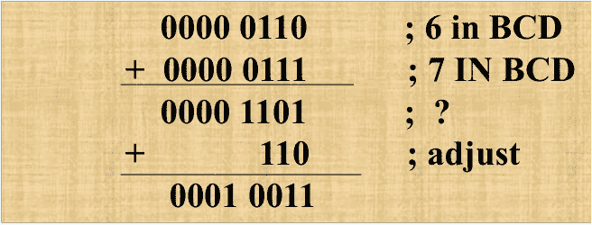

### 加法后的 ASCII 调整指令（AAA）

- 调整两个未压缩 BCD 值相加的结果，以产生一个未压缩 BCD 结果。

```
if (AL&0FH)>9 or (AF)=1
then (AL)+6-->AL
(AH)+1-->AH
1-->AF, AF-->CF
(AL)&0FH-->AL
else (AL)&0FH-->AL
0-->AF, (AF)-->CF
```

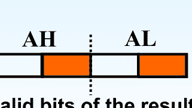

**例如**

计算十进制数 9 + 4

```
MOV AL, 9H
MOV BL, 4H
ADD AL, BL
AAA
```

```
09H
+ 04H
──────
0DH    ; >9
+ 06H  ; adjust
──────
13H
& 0FH
──────
03H
```

(AH) + 1 --> AH

**结果：**

(AH)=01H  (AL)=03H  CF=AF=1

**例如**

计算十进制数 9 + 9

```
MOV AL, 9H
MOV BL, 9H
ADD AL, BL
AAA
```

```
09H
+ 09H
──────
12H     ; AF=1
+ 06H   ; adjust
──────
18H
& 0FH
──────
08H
```

(AH)+1-->AH

**结果：**

(AH)=01H  (AL)=08H  CF=AF=1

### 减法后对 AL 的 ASCII 调整指令（AAS）

- 调整两个未压缩 BCD 值相减的结果，以产生一个未压缩 BCD 结果。

```
if (AL&0FH)>9 or (AF)=1
then (AL)-6 -->AL
    (AH)-1-->AH
    (AL)&0FH-->AL
    1-->AF, AF-->CF
else (AL)&0FH-->AL
    0-->AF, (AF)-->CF
```

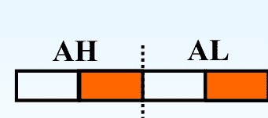

结果的有效位

**例如**

计算十进制数 16 - 7

```
MOV AX, 0106H
MOV BL, 7H
SUB AL, BL
AAS
```

```
06H
- 07H
----
FFH    ; (AL)&0FH>9
- 06H  ; adjust
----
F9H
& 0FH
----
09H
```

(AH)-1-->AH

**结果：**

(AH)=00H  (AL)=09H  CF=AF=1

### 乘法后对 AX 的 ASCII 调整指令（AAM）

调整两个未压缩 BCD 值相乘的结果，以产生一对未压缩（十进制）BCD 值。

```
tempAL ← AL;
AH ← tempAL / 10;
AL ← tempAL MOD 10;
```

```
MOV AL, 07H
MOV CL, 09H
MUL CL
AAM                  ; adjust
```

```
      0111
×     1001
──────────
      0111
      0000
      0000
      0111
──────────
   00111111
```

调整后，(AH)=6，(AL)=3

### 加法后对 AL 的十进制调整指令（DAA）

调整两个压缩 BCD 值相加的结果，以产生一个压缩 BCD 结果。

```
if (AL & 0FH)>9 or (AF)=1
then (AL)+6-->AL
1-->AF
if (AL)>9FH or (CF)=1
then (AL)+60H-->AL
1-->CF
```

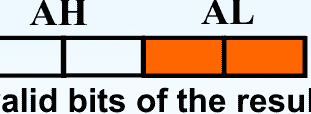

**DAA 示例1**

计算十进制数 29+18

```
MOV AL, 29H
MOV BL, 18H
ADD AL, BL
DAA
```

```
29H
+ 18H
-----
41H  ; AF=1
+ 06H ; adjust
-----
47H
```

**DAA 示例2**

计算十进制数 54+63

```
MOV AL, 54H
MOV BL, 63H
ADD AL, BL
DAA
```

```
54H
+ 63H
-----
B7H   ; >9F
+ 60H ; adjust
-----
1 17H
```

### 减法后对 AL 的十进制调整指令（DAS）

调整两个压缩 BCD 值相减的结果，以产生一个压缩 BCD 结果。

```
if (AL&0FH)>9 or (AF)=1
    then (AL)-6-->AL
         1-->AF
if (AL)>9FH or (CF)=1
    then (AL)-60H-->AL
         1-->CF
```

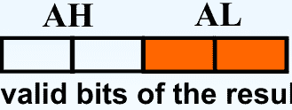

**DAS 示例**

计算十进制数 A-B   A=4612   B=3576

```
MOV AL, A
SUB AL, B
DAS
MOV D, AL
MOV AL, A+1
SBB AL, B+1
DAS
MOV D+1, AL
```

```
12H
- 76H
1 9CH ; AF,CF=1
- 66H ; -66H adjust
36H → D
CF=1
46H
35H
- 1
10H → D+1
```

结果=1036

## 2.6.3 逻辑指令

- 基本逻辑指令
- 移位与循环指令

### 基本逻辑指令

```
AND  DST, SRC  ; (DST) <-- (DST) & (SRC)
OR   DST, SRC  ; (DST) <-- (DST) | (SRC)
XOR  DST, SRC  ; (DST) <-- (DST) xor (SRC)
```

**真值表**

**与**

| A | B | T |
|---|---|---|
| 0 | 0 | 0 |
| 0 | 1 | 0 |
| 1 | 0 | 0 |
| 1 | 1 | 1 |

**或**

| A | B | T |
|---|---|---|
| 0 | 0 | 0 |
| 0 | 1 | 1 |
| 1 | 0 | 1 |
| 1 | 1 | 1 |

**异或**

| A | B | T |
|---|---|---|
| 0 | 0 | 0 |
| 0 | 1 | 1 |
| 1 | 0 | 1 |
| 1 | 1 | 0 |

| 与/或/异或 | 源操作数 |  |  |
|---|---|---|---|
| 目的操作数 | 寄存器 | 内存 | 立即数 |
| 寄存器 | √ | √ | √ |
| 内存 | √ |  | √ |


## 2.6.3 逻辑指令
### AND 示例

```
MOV AL, 32H
AND AL, 0FH        ; clear the high 4 bits in AL
```

|        | AL       |
|--------|----------|
| 执行前 | 00110010 |
| 执行后  | 00000010 |

### OR 示例

```
MOV AL, 02H
OR  AL, 0F0H       ; set the high 4 bits in AL
```

|        | AL       |
|--------|----------|
| 执行前 | 00000010 |
| 执行后  | 11110010 |

### XOR 示例

| 指令 | 值      |
|-------------|------------|
| MOV AL, 0B6H | 1011 0110 |
| XOR AL, 0FH  | 0000 1111 |
| 结果       | 1011 1001 |

无变化    取反

## 2.6.3 逻辑指令
### 基本逻辑指令

```
TEST OPR1, OPR2 ; (OPR1) & (OPR2)
```

- 与 AND 指令相同但不改变目的操作数
- AND、OR、XOR、TEST 会影响标志寄存器。
  - CF=0
  - OF=0
  - AF: 未定义
  - PF、SF、ZF: 由结果的值设置。

> **下面指令是什么意思？**
> 
> **AND AX,AX;** 清除标志寄存器中的 CF 和 OF
> 
> **XOR AX,AX;** AX=0, CF=0 且 OF=0

## 2.6.3 逻辑指令
### TEST 示例

判断 (AL) 是否为奇数，如果为真则跳转

```
TEST AL, 01H
JNZ NEXT        ; ZF=0, jump
```

### TEST 示例2

判断 (AX) 是否为正数，如果为真则跳转

```
TEST AX, 8000H
JZ THERE        ; ZF=1转
```

## 2.6.3 逻辑指令
### 基本逻辑指令

NOT DST : 非操作

- 求补，逻辑反转。
- 真值表
- NOT r/m8/16/32
- 不影响标志寄存器

| A | T |
|---|---|
| 0 | 1 |
| 1 | 0 |

### NOT 示例1

```
MOV AL, 52H
NOT AL
before  AL  01010010
after   AL  10101101
```

### NOT 示例2

```
MOV AL, 1 ; 1-->AL
NOT AL ; 求反
INC AL ;
```

## 2.6.3 逻辑指令
### 移位和循环指令

- 移位和循环指令在二进制位级别上操作二进制数，与 AND、OR、异或和 NOT 指令相同。
- 移位和循环在用于控制 I/O 设备的底层软件中最常见。
- 微处理器包含一套完整的移位和循环指令，用于移位或循环任何内存数据或寄存器。

## 2.6.3 逻辑指令
### 移位和循环指令
### 移位指令

```
OP DST, CNT; OP is SHL, SAL, SHR, SAR
```

SHL/SAL
逻辑/算术
左移

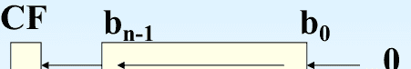

SHR
逻辑右移

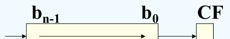

SAR
算术右移

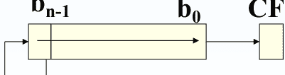

## 2.6.3 逻辑指令
### 移位和循环指令
### ◆ 移位指令

假设 (AL)=0B4H, (CF)=1，分析执行后的结果

| 指令 | CF | AL |
|---|---:|---|
| 执行前 | 1 | 10110100 |
| (1) SAL AL, 1 | 1 | 01101000 |
| (2) SHL AL, 1 | 1 | 01101000 |
| (3) SAR AL, 1 | 0 | 11011010 |
| (4) SHR AL, 1 | 0 | 01011010 |

左移的结果都相同。
两种算术右移得到不同的结果。

## 2.6.3 逻辑指令
### ■ 移位和循环指令
### ◆ 移位指令

Y 是一个字节数，如何计算 (Y)*10？
我们知道：(Y)*10=(Y)*(8+2)=(Y)*2+(Y)*8 （为什么这样做？）

```
MOV AL, Y     ; AL<--(Y)
MOV AH, 0
SHL AX, 1      ; (Y)*2
MOV BX, AX
SHL AX, 1      ; (Y)*4
SHL AX, 1      ; (Y)*8
ADD AX, BX     ; (Y)*10
```

如何使用移位指令计算 DX=3×AX+7×BX？

## 2.6.3 逻辑指令
### 移位和循环指令

- 移位指令会改变标志：
  - CF: 由移出的位改变
  - OF:
    - 多位移位：未定义
    - 单位移位
      - 0: 如果结果的符号位与原始操作数字符号位相同。
      - 1: 它们不同
  - ZF、PF: 根据结果赋值
  - AF: 未设计


## 2.6.3 逻辑指令

### 移位和旋转指令

◆ 旋转指令

```
OP DST, CNT: OP is ROL, RCL, ROR, RCR
```

- **OP is**
  - `ROL` - DST 左旋转 CNT 次
  - `RCL` - DST 通过 CF 左旋转 CNT 次
  - `ROR` - DST 右旋转 CNT 次
  - `RCR` - DST 通过 CF 右旋转 CNT 次

- **DST is** 一个寄存器或内存中的数据

- **CNT is**
  - `1`
  - `CL`
  - `Imm8 (80386 或以上仅限)`

ROL
CF
RCL
CF
ROR
CF
RCR
CF

### 移位和旋转指令

### 旋转指令

将 AL 的 LSb 发送到 BL 的 LSb，保持 AL 不变。

```
ror bl,1
ror al,1
rcl bl,1
rol al,1
```

### 仅影响 OF 和 CF

- 移出的最后一位进入 CF
- OF 标志仅对 1 位旋转有定义；如果符号改变，则 OF=1

### 移位和旋转指令

#### 示例

将 ASCII 字符串 ‘96’ 转换为压缩 BCD 96H

ASC
‘9’
‘6’ → BCD
96H

```
MOV AL, ASC        ; AL<--39H (‘9’)
MOV CL, 4
SHL AL, CL         ; 39H->90H
MOV BL, AL         ; BL<--90H
MOV AL, ASC+1      ; AL<--36H (‘6’)
AND AL, 0FH        ; AL<--06H
OR  BL, AL         ; BL<--96H
MOV BCD, BL
```

### 移位和旋转指令

◆ 示例

**将 AL 中的压缩 BCD 转换为 ASCII 码，保存到由 BX寻址的内存中**

```
MOV  DL, AL
MOV  CL, 4
SHR  AL, CL
OR   AL, 30H
MOV  [BX], AL
INC  BX
MOV  AL, DL
AND  AL, 0FH
OR   AL, 30H
MOV  [BX], AL
```

### 移位和旋转指令

+ 示例

分析以下程序的功能

```
MOV CL, 4
SHL DX, CL
MOV BL, AH
SHL AX, CL
SHR BL, CL
OR DL, BL
```

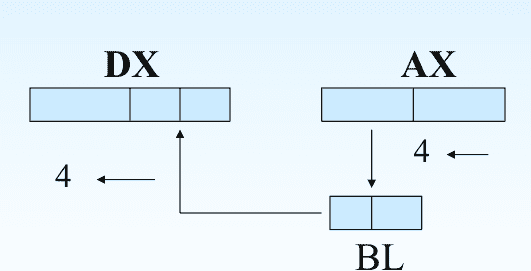

DX:AX 左移 4 位

## 计算机输入/输出系统

2015

讲师：杨全胜

计算机科学与工程学院
软件工程学院
东南大学

## 第 2 章：

## IA-32 汇编语言与编程(3)

## 2.6.4 跳转指令

- 无条件跳转
- 条件跳转
- 分支结构编程
- 机器控制指令

### 无条件跳转 (JMP)

### 短跳转

```
JMP SHORT OPR
```

- 当前段内的相对短跳转
- 新地址为
  - (E)IP=(E)IP+8 位位移
    - 位移是一个一字节有符号数，其值范围在 +127~-128 之间
- 我们可以使用标签（内存地址的符号名）与短跳转指令一起使用

### 无条件跳转 (JMP)

### 近跳转

```
JMP OPR
```

- 当前段内的相对近跳转
- 在实模式下
  - (E)IP=(E)IP+16 位位移
    - 位移是一个 2 字节有符号数，其值范围在 +32767~-32768 之间
- 在 80386 或以上处理器的保护模式下
  - EIP=EIP+32 位位移
    - 位移是一个 4 字节有符号数，其值范围在 +2G~-2G 之间
- 我们也可以使用标签。

### 无条件跳转 (JMP)

◆ 远跳转

```
JMP FAR PTR OPR
```

- 获取新的段和偏移地址以完成跳转

- 新地址为
  - (E)IP = 该 5 字节指令的第 2 和第 3 字节
  - CS = 该 5 字节指令的第 4 和第 5 字节
  - 在 80286 或以上处理器的保护模式下
    - EIP 可能为 32 位

我们也可以使用标签。

### 无条件跳转 (JMP)

- 无条件跳转 (JMP)
  - 远跳转

```
JMP FAR PTR OPR
```

示例

```
; segment C1
......
JMP FAR PTR NEXT
......
; segment C2
......
NEXT: MOV AL,10H
...
```

|  |  |
|---|---|
| C1seg |  |
| EA | OP码 |
| 50 | newIP=0250H |
| 02 |  |
| 00 | newCS=2000H |
| 20 |  |
| ...... |  |
| C2seg | 20000H |
|  |  |
| NEXT | 20250H |

### 无条件跳转 (JMP)

### 带寄存器操作数的跳转

```
JMP reg16/32
```

- 允许跳转到当前段内的任意位置。
- 新地址为
  - (E)IP = (reg16/32)

```
JMP AX
JMP EBX
```


## 2.6.4 跳转指令
### 条件跳转 (Jcc)

```
Jcc disp8
```

新地址为

- if (cc) is TRUE THEN
  (E)IP = (E)IP + 8-bit displacement
  else
  continue to execute the next instruction

- Displacement is a 1-byte signed number whose value range between +127 ~ -128

## 2.6.4 跳转指令
### 条件跳转 (Jcc)

| Assembly | Operation | Tested Condition |
|---|---|---|
| JC | Jump if Carry | CF=1 |
| JNC | Jump if no Carry | CF=0 |
| JZ/JE | Jump if equal or Zero | ZF=1 |
| JNZ/JNE | Jump if no equal or no Zero | ZF=0 |
| JS | Jump if sign (negative) | SF=1 |
| JNS | Jump if no sign (positive) | SF=0 |
| JO | Jump if overflow | OF=1 |
| JNO | Jump if no overflow | OF=0 |
| JP/JPE | Jump if parity even | PF=1 |
| JNP/JPO | Jump if parity odd | PF=0 |
| JCXZ | Jump if CX is Zero | CX=0 |
| JECXZ | Jump if ECX is Zero | ECX=0 |

## 2.6.4 跳转指令
### 条件跳转 (Jcc)

Compare A and B (A-B)

|  | Unsigned number |  | Signed number |  |
|  | Assembly | Tested Condition | Assembly | Tested Condition |
| A>B | JA JNBE | ZF=0 and CF=0 | JG JNLE | SF=OF and ZF=0 |
| A>=B | JAE JNB | ZF=1 or CF=0 | JGE JNL | SF=OF or ZF=1 |
| A<B | JB JNAE | ZF=0,CF=1 | JL JNGE | SF<>OF and ZF=0 |
| A<=B | JBE JNA | ZF=1 or CF=1 | JLE JNG | SF<>OF 或 ZF=1 |

## 2.6.4 跳转指令
### 条件跳转 (Jcc)

Example:

```
CMP AX,0FFFFH
JLE P3    ; AX≤-1
CMP AX,1
JL  P2    ; AX<1
MOV AX, 1 ;AX≥1
JMP DONE
P2: MOV AX, 0
JMP DONE
P3: MOV AX,-1
DONE:
```

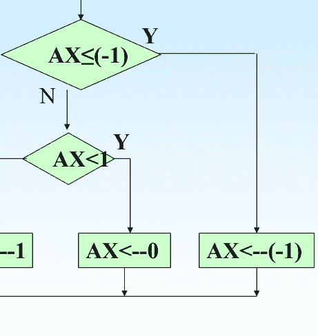

When a target address is outside the range of -128 to +127, how to do?

## 2.6.4 跳转指令
### ▪ 分支结构编程

There is a WORD array named ARRAY which has N elements, please examine the array, then put the number of positive in DI register, the number of 0 in SI register, and the number of negative in AX register

## 2.6.4 跳转指令

```
MOV CX, N
MOV BX, 0      ; initialize the pointer of array
MOV DI, BX      ; initial the number of positive
MOV SI, BX      ; initial the number of 0
AGAIN:CMP WORD PTR ARRAY[BX], 0
                ; current element compare with 0
JLE LEEQ        ; if ≤ 0
INC DI          ; number of positive +1
JMP NEXT
LEEQ: JL NEXT   ; if < 0
INC SI          ; number of 0 +1
NEXT: ADD BX, 2 ; to the next element
LOOP AGAIN
MOV AX, N       ; the number of negative=N-DI-SI
SUB AX, DI
SUB AX, SI
```

## 2.6.4 跳转指令
### 分支结构编程

Input a number, according to the number 0 ~ 9, and the jump table, jump to the correct address. If input is non-numeric, exit the program.

```
.DATA
TABLE WORD ROUTINE_0
WORD ROUTINE_1
WORD ROUTINE_2
WORD ROUTINE_3
WORD ROUTINE_4
WORD ROUTINE_5
WORD ROUTINE_6
WORD ROUTINE_7
WORD ROUTINE_8
WORD ROUTINE_9
```

```
.CODE
......
ROUTINE_1: MOV AX,0
......
ROUTINE_2: CMP AL, 3
......
......
ROUTINE_9: CLI
```

## 2.6.4 跳转指令
### ▪ 分支结构编程

```asm
.code
start:

    mov   ax,@data
    mov   ds,ax
    mov   ah,1
    int   21h
    and   al,0fh
    cmp   al,0
    jb    exit
    cmp   al,9
    ja    exit
    mov   ah,0
    shl   al,1
    shl   al,1
```

```asm
        mov   si,ax
        jmp   TABLE[si]

ROUTINE_0: mov ax,0
           ......

ROUTINE_1: add AL,3
           ......
           ......

ROUTINE_9: CLI
           ......
exit:      mov ax,4c00h
           int 21h
end start
```

## 2.6.4 跳转指令
### 机器控制指令
### 控制标志位

- CLC —— clear carry flag; CF=0
- CMC —— complement carry flag; CF=~CF
- STC —— set carry flag; CF=1
- CLD —— clear direction flag; DF=0
- STD —— set direction flag; DF=1
- CLI —— clear interrupt flag; IF=0
- STI —— set interrupt flag; IF=1

## 2.6.5 循环指令

- Loop Instructions
- Loop structure Programming


## 2.6.5 循环指令

- 循环指令

```
LOOP       LABEL     : LOOP
LOOPZ/LOOPE LABEL     : Condition LOOP
LOOPNZ/LOOPNE LABEL    : Condition LOOP
```

| Assembly | Operation | function |
|---|---|---|
| **LOOP** | (E)CX <-- (E)CX - 1<br>if ((E)CX) <> 0, then loop | loop until (E)CX=0 |
| **LOOPZ**<br>**LOOPE** | (E)CX <-- (E)CX - 1<br>if ((E)CX) <> 0 and ZF=1, then loop | loop until (E)CX=0<br>or not equal |
| **LOOPNZ**<br>**LOOPNE** | (E)CX <-- (E)CX - 1<br>if ((E)CX) <> 0 and ZF=0, then loop | loop until (E)CX=0<br>or equal |

### 循环指令

**Example1:**
计算字节数组中所有元素的和，该数组有10个元素，将结果保存到 TOTAL

```
LEA SI, ARRAY       ; base address of array → SI
MOV CX, 10          ; Length of array → CX
MOV AX, 0
AGAIN: ADD AL, [SI] ; calculate sum
      ADC AH, 0
      INC SI         ; modify the pointer
      LOOP AGAIN
      MOV TOTAL, AX   ; save the result
```

### 循环指令

Example2

查找字节字符串中的第一个非零字节

假设字符串的首地址在 DI，最后一个在 BX

```
SUB BX, DI          ; length of string →BX
INC BX
MOV CX, BX          ; length of string →CX
DEC DI
AGAIN: INC DI       ; modify pointer
CMP BYTE PTR [DI], 0 ; =0?
LOOPZ AGAIN         ; loop until found or to the
                    ; end of string
JNZ FOUND           ; found
......
FOUND:
```

- 循环结构编程

- 类似 "for(i=1 ;i<n; i++)" 的循环

计算：S=1+2+3+…+50; 将结果保存到 AX 寄存器

```
NUM      DW 1  ;
......
MOV      CX,0   ; 初始化
MOV      AX,0
ROTATE:
ADD      AX, NUM  ; 累加
INC      WORD PTR[NUM]
INC      CX
CMP      CX,50
JNZ      ROTATE
MOV      S,AX
......
```

- 循环结构编程
- 条件循环

STRN 是一个以 ‘$’ 结尾的字符串，长度小于 100。请获取字符串的长度，将其保存到 LENG。

```
.DATA
STRN  BYTE ‘XCVFATTDEQJHI…’,‘$’
LENG  BYTE 0
```

### 循环结构编程

- 条件循环

```
......
MOV AX, 0
MOV DL, AL      ; clear DL(length)
LEA DI, STRN    ; offset of string in DI
MOV CX, 100      ; why?
MOV AL, '$'
LP:
CMP AL, [DI]
JE  DONE         ; Condition
INC DX           ; length+1
INC DI           ; modify pointer
LOOP LP          ; loop why?
DONE:
MOV LENG, DL     ; save the length
......
```

## 2.6.6 字符串指令

- 字符串指令的基础
- 字符串数据传输指令
- 字符串比较指令

### 字符串指令的基础

- 以下指令允许对单个字节、字或双字进行数据处理，或在重复时对字节、字或双字的块进行处理。
- LODS, STOS, MOVS, INS, OUTS, SCAS, CMPS

- 所有指令都有 3 种带后缀 B、W 或 D 的样式，分别用于字节、字或双字操作。
- LODSB, LODSW, LODSD
- STOSB, STOSW, STOSD
- MOVSB, MOVSW, MOVSD
- INSB, INSW, INSD
- OUTSB, OUTSW, OUTSD
- SCASB, SCASW, SCASD
- CMPSB, CMPSW, CMPSD

### 字符串指令的基础

自动更改 (E)SI & (E)DI

尽管每个字符串指令每次只对一个字符串元素进行操作，但它总是准备好对下一个元素进行操作。这是通过更改寄存器 (E)SI & (E)DI 来完成的。

DF（位于标志寄存器中）决定方向

- **DF=0** （CLD 指令清除它）
  - (E)DI&(E)SI 将按 1（字节）、2（字）、4（双字）递增

- **DF=1** （STD 指令设置它）
  - (E)DI&(E)SI 将按 1（字节）、2（字）、4（双字）递减

### 字符串数据传输指令

### LODS 指令

将 AL、AX 或 EAX 加载为存储在由 (E)SI 寄存器索引的数据段偏移地址的数据。

| Assemble Language | Operation |
| LODSB | AL=DS:[SI]; if (DF=0) SI=SI+1 else SI=SI-1 |
| LODSW | AX=DS:[SI]; if (DF=0) SI=SI+2 else SI=SI-2 |
| LODSD | EAX=DS:[SI]; if (DF=0) SI=SI+4 else SI=SI-4 |


## 2.6.6 字符串指令

### 字符串数据传输指令

#### STOS 指令

将 AL、AX 或 EAX 存储到由 (E)DI 寄存器寻址的额外段内存位置。

| 汇编语言 | 操作 |
|---|---|
| STOSB | ES:[DI]=AL; if (DF=0) DI=DI+1 else DI=DI-1 |
| STOSW | ES:[DI]=AX; if (DF=0) DI=DI+2 else DI=DI-2 |
| STOSD | ES:[DI]=EAX; if (DF=0) DI=DI+4 else DI=DI-4 |

#### 带 REP 前缀的 STOS

- REP 前缀会导致每次执行字符串指令时 (E)CX 递减 1。然后字符串指令重复。如果 (E)CX 达到 0，则指令终止，程序继续执行下一条顺序指令。

#### STOS 指令示例

清除缓冲区

```asm
.DATA
BUFF DB 1000 DUP(?)  ; define the buffer
.CODE
        ......
CLD                    ; DF=0
LEA  DI, BUFF          ; address of buff-->DI
MOV  CX, 1000          ; the number of repetitions
MOV  AL, 0             ; 0-->AL
REP  STOSB             ; store 0 to clear
```

#### MOVS 指令

- 从由 (E)SI 寻址的数据段位置传输字节、字或双字到由 (E)DI 寻址的额外段位置。
- MOVS 也可以与 REP 前缀一起使用。

| 汇编语言 | 操作 |
|---|---|
| MOVSB | ES:[DI]=DS:[SI]; if (DF=0) {SI=SI+1; DI=DI+1} else {SI=SI-1; DI=DI-1} |
| MOVSW | ES:[DI]=DS:[SI]; if (DF=0) {SI=SI+2; DI=DI+2} else {SI=SI-2; DI=DI-2} |
| MOVSD | ES:[DI]=DS:[SI]; if (DF=0) {SI=SI+4; DI=DI+4} else {SI=SI-4; DI=DI-4} |

#### 16 位程序的 MOVS 指令示例

```asm
.8086                ; create 16 bit code
.model small         ; 16 bit memory model
.data
lpstring DWORD ?
buff1  BYTE "HELLO,WORLD!",13,10,'$'
buff2  BYTE 20 DUP('$')
.code
start:
    mov ax,@data
    mov ds,ax
    mov es,ax

    mov si,offset buff1
    mov di,offset buff2
    mov cx,14
    cld
    rep movsb
    mov dx,offset buff2
    mov ah,9
    int 21h   ; print string
    mov ax,4c00h
    int 21h   ; exit
end start
```

#### INS 指令

- 从 I/O 设备传输字节、字或双字数据到由 (E)DI 寄存器寻址的额外段位置。
- I/O 地址在 DX 寄存器中。
- INS 也可以与 REP 前缀一起使用。

| 汇编语言 | 操作 |
|---|---|
| INSB | ES:[DI]=[DX]; if (DF=0) DI=DI+1 else DI=DI-1 |
| INSW | ES:[DI]=[DX]; if (DF=0) DI=DI+2 else DI=DI-2 |
| INSD | ES:[DI]=[DX]; if (DF=0) DI=DI+4 else DI=DI-4 |

#### OUTS 指令

- 从由 (E)SI 寄存器寻址的 DATA 段位置传输字节、字或双字数据到 I/O 设备。
- I/O 地址在 DX 寄存器中。
- OUTS 也可以与 REP 前缀一起使用。

| 汇编语言 | 操作 |
|---|---|
| OUTSB | [DX] = DS:[SI]; if (DF=0) SI=SI+1 else SI=SI-1 |
| OUTSW | [DX] = DS:[SI]; if (DF=0) SI=SI+2 else SI=SI-2 |
| OUTSD | [DX] = DS:[SI]; if (DF=0) SI=SI+4 else SI=SI-4 |

### 字符串比较指令

#### SCAS 指令

将由 (E)DI 寻址的数据段位置的字节、字或双字与 AL、AX 或 EAX 进行比较。

| 汇编语言 | 操作 |
|---|---|
| SCASB | ES:[DI]-AL; if (DF=0) DI=DI+1 else DI=DI-1 |
| SCASW | ES:[DI]-AX; if (DF=0) DI=DI+2 else DI=DI-2 |
| SCASD | ES:[DI]-EAX; if (DF=0) DI=DI+4 else DI=DI-4 |

#### 带 REPNZ/REPNE 前缀的 SCAS

- REPNZ/REPNE 前缀会导致 SCAS 指令重复，直到 CX 每次递减 1 后达到 0，或者直到 SCAS 指令比较的结果存在相等条件。

#### 带 REPZ/REPE 前缀的 SCAS

- REPZ/REPE 前缀会导致 SCAS 指令重复，直到 CX 每次递减 1 后达到 0，或者直到 SCAS 指令比较的结果不存在相等条件。

使用任一重复前缀时，CX 的内容会被递减，但不会影响标志位。


## 2.6.6 字符串指令

### 字符串比较指令

SCAS 示例：

在字符串 "That is CAI" 中搜索 'a'，如果找到，则跳转到 FOUND

```
String BYTE "That is CAI"
......
CLD
LEA EDI, String
MOV AL, 'a'
MOV CX, 11
REPNZ SCASB
JZ FOUND
......
FOUND:
```

### 字符串比较指令

### CMPS 指令

- 比较数据段中由 (E)SI 寻址的位置与附加段中由 (E)DI 寻址的位置的字节、字或双字。
- 也可以使用 REPZ/REPE 或 REPNZ/REPNE 前缀。

| 汇编语言 | 操作 |
|---|---|
| CMPSB | DS:[SI]-ES:[DI]; if (DF=0) DI=DI+1 else DI=DI-1 |
| CMPSW | DS:[SI]-ES:[DI]; if (DF=0) DI=DI+2 else DI=DI-2 |
| CMPSD | DS:[SI]-ES:[DI]; if (DF=0) DI=DI+4 else DI=DI-4 |

### 字符串比较指令

> **CMPS 示例**  
> 比较 string1 和 string2，如果相同，则跳转到 NEXT

```
String1  DB 'HELP'
String2  DB 'HEPP'

.....
CLD
LEA  SI, String1
LEA  DI, String2
MOV  CX, 4
REPZ CMPSB
JZ   NEXT

.....
NEXT:
```

### 字符串比较指令

示例：

比较 SOURCE 和 DESTIN，如果不同，则将 SOURCE 中第一个不匹配的字符加载到 AL 寄存器中

```
...
LEA SI, SOURCE
LEA DI, DESTIN
CLD
MOV CX,100
REPZ CMPSB
JCXZ MATCH
DEC SI ; When terminal the loop, (E)SI and
; (E)DI point to the next position
LODSB
...
```

MATCH:

## 2.6.7 过程指令

- 过程基础
- 过程指令
- 过程定义
- 参数传递

### 过程基础

- 过程是一组通常执行一个任务的指令。
- 过程是软件中可重用的部分，只存储在内存中一次，但可根据需要多次使用。
- 过程可以被其他程序调用。
- CALL 指令链接到过程，RET 指令从过程返回。
  - 链接和返回会占用计算机少量时间。
  - 栈存储返回地址。

### 过程指令

- **CALL**
  - 将程序的流程转移到过程。
  - CALL 与 JMP 的不同之处在于 CALL 将返回地址压入栈。
- **RET**
  - 从栈中弹出返回地址并将控制返回到该位置（程序中 CALL 之后的指令）。

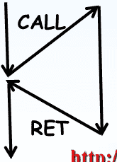

### 过程指令

远调用到不同段（8086 的 .model small）

```
CALL FAR PTR procname
```

直接调用

- 1. SP<--(SP)-2
- 2. ((SP)+1,(SP))<--(CS)
- 3. SP<--(SP)-2
- 4. ((SP)+1,(SP))<--(IP)
- 5. IP<-- offset of procname
- 6. CS<-- seg of procname

### 过程指令

远调用到不同段（8086 的 .model small）

```
CALL DWORD PTR mem32/48
```

间接调用

- 1. (E)SP<--((E)SP)-2
- 2. (((E)SP)+1,((E)SP))<--(CS)
- 3. SP<--(SP)-2/4
- 4. (((E)SP)+1/3,((E)SP))<--((E)IP)
- 5. (E)IP<--(EA)
- 6. CS<--(EA+2/4)

### 过程指令

◆ call（80386 或以上 .model flat）

```
CALL  procname
```

☞ 直接调用

- 1. ESP←(ESP)-4
- 2. ((ESP)+3,(ESP)+2,(ESP)+1,(ESP))←(EIP)
- 3. EIP←(EIP)+disp32

```
CALL  reg/mem32
```

☞ 间接调用

- 1. ESP←(ESP)-4
- 2. ((ESP)+3,(ESP)+2,(ESP)+1,(ESP))←(EIP)
- 3. EIP←reg32 or EIP←mem32

### 过程指令

- 从过程返回

```
RET [exp]
```

| 汇编 | 功能 | 操作 |
|---|---|---|
| RET | 在当前段返回 | IP<--((SP)+1,(SP)) SP<--(SP)+2 |
| RET | 从不同段返回 | IP<--((SP)+1,(SP)) SP<--(SP)+2 CS<--((SP)+1,(SP)) SP<--(SP)+2 |
| RET EXP | 带有数据的返回 | 除以上外，还执行 SP<--(SP)+EXP |


## 2.6.7 程序指令

### 程序定义

```
LABEL PROC [attributes]
...; procedure body
RET
...; procedure body
LABEL ENDP
```

- 程序体始终跟随一个 .CODE 指令。
- 程序体由两个指令 PROC 和 ENDP 括起来
- 标签给出程序的名称。
- 属性：near 或 far
- 至少有一个 RET 指令

### 程序定义

**定义一个程序向屏幕输出 CRLF。（16 位程序使用）**

```
CRLF  PROC NEAR    ; output Carriage Return and Line Feed
      PUSH AX
      PUSH DX
      MOV  DL, 0DH    ; Carriage Return
      MOV  AH, 2
      INT  21H       ; output char in DL
      MOV  DL, 0AH    ; Line Feed
      MOV  AH, 2
      INT  21H       ; output char in DL
      POP  DX
      POP  AX
      RET
CRLF  ENDP
```

### 参数传递

### 16 位程序中的参数传递

通过寄存器

定义一个过程 “PINT” 输出 AX 中的十进制数，转换缓冲区的偏移量在 DI 中。

```
PINT    PROC    NEAR
    PUSH    DX
    PUSH    DI
    PUSH    CX
    MOV     CX, 5
CLEAR_BUF:MOV BYTE PTR[DI], ' '
    INC     DI
    LOOP    CLEAR_BUF
    MOV     BYTE PTR[DI], '$'
    DEC     DI
    MOV     CX, 10
CHANGE: MOV DX, 0
    DIV     CX
```

```
ADD     DL, 30H
MOV     BYTE PTR[DI], DL
DEC     DI
CMP     AX, 0
JNZ     CHANGE
INC     DI
MOV     DX, DI
MOV     AH, 9
INT     21H
POP     CX
POP     DI
POP     DX
RET
PINT    ENDP
```

- 参数传递
  - 16 位程序中的参数传递
    - 通过寄存器

定义一个过程 “DECIBIN” 从键盘输入一个十进制数，数字通过 BX 返回。

```
DECIBIN PROC NEAR
    PUSH  AX
    PUSH  CX
    MOV   BX, 0 ; initial
NEWCHAR:MOV AH, 1
    INT   21H ; ASCII in AL
    SUB   AL, 30H
    JL    EXIT   ; < 0
    CMP   AL, 9
    JG    EXIT   ; > 9
    CBW
```

```
XCHG  AX, BX
MOV   CX, 10
MUL   CX   ; old value *10
XCHG  AX, BX
ADD   BX, AX ;add new value
JMP   NEWCHAR
EXIT: POP   CX
      POP   AX
      RET
DECIBIN ENDP
```

### 参数传递

- 16 位程序中的参数传递
  - 通过堆栈

**定义一个过程 “PROSUM” 计算 WORD 数组的和。元素数量在 COUNT 中，结果将放在 SUM 中。**

```asm
.DATA
    ARRAY  WORD 10 DUP(?)
    COUNT  WORD 10
    SUM    WORD ?
```
**主程序：**

```
LEA BX,ARRAY    ; parameter in stack
PUSH BX
LEA BX,COUNT
PUSH BX
LEA BX,SUM
PUSH BX
CALL PROSUM
......

PROSUM PROC NEAR
    PUSH BP
    MOV BP,SP
    PUSH AX
    PUSH CX
    PUSH SI
    PUSH DI
```

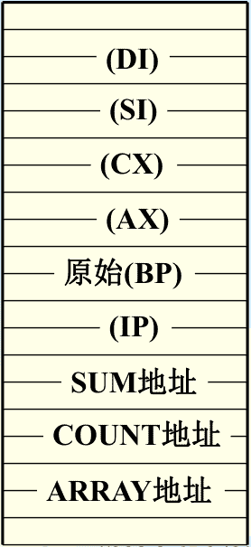

3 个参数压入堆栈，每个使用两个字节

```
MOV SI, [BP+8] ; get parameter
MOV DI, [BP+6]
MOV CX, [DI]
MOV DI, [BP+4]
MOV AX, 0
ADDT: ADD AX, [SI]
      ADD SI, 2
      LOOP ADDT
MOV [DI], AX ; save sum
POP DI
POP SI
POP CX
POP AX
POP BP
RET 6 ; adjust stack
```

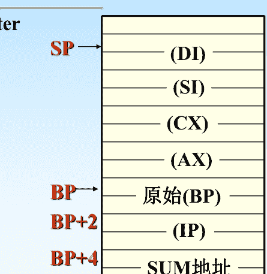

### 参数传递

### 16 位程序中的参数传递

#### 示例

**输入** 数组中的 10 个数字，然后计算其元素的和。

```asm
.8086
.MODEL SMALL
.DATA
    ARRAY  WORD 10 DUP(?)
    COUNT  WORD 10
    SUM    WORD ?
    STRING BYTE 6 DUP(?)
.STACK 1024
```

```
.8086
.MODEL SMALL
.DATA
    ARRAY  WORD 10 DUP(?)
    COUNT  WORD 10
    SUM    WORD ?
    STRING BYTE 6 DUP(?)
.STACK 1024
.CODE
START:
    MOV   AX,@DATA
    MOV   DS,AX
    LEA   DI,ARRAY
    MOV   CX,10
LP: CALL  DECIBIN
    CALL  CRLF
    MOV   [DI],BX
```

```
ADD   DI,2
LOOP  LP ;input 10 numbers
LEA   BX,ARRAY
PUSH  BX
LEA   BX,COUNT
PUSH  BX
LEA   BX,SUM
PUSH  BX
CALL  PROSUM
MOV   AX,SUM
LEA   DI,STRING
CALL  PINT
CALL  CRLF
MOV   AX,4C00H
INT   21H
......   ; subroutine
END START
```


## 计算机输入/输出系统

2015

讲师：杨泉生

计算机科学与工程学院
软件工程学院
东南大学

## 第3章：

## I/O 基础

## 大纲

- I/O 模块
- 主要 I/O 技术
- I/O 地址空间的类型。
- 8086/8088 硬件
- 个人计算机 I/O 映射
- I/O 端口地址译码

### 3.1 I/O 模块

#### 什么是 I/O 模块

- 计算机的 I/O 模块是其与外部世界的接口。
- 每个模块与系统总线或中央交换机接口并控制一个或多个外围设备。
- I/O 模块包含执行外围设备与总线之间通信功能的逻辑。

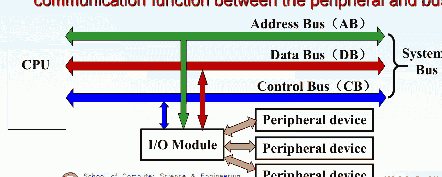

### 3.1 I/O 模块

▪ 为什么不将外围设备直接连接到系统总线？（为什么需要 I/O 模块？）

- 存在各种各样的外围设备，具有各种操作方式。
- 外围设备的数据传输速率通常远低于内存或处理器的速率。
- 另一方面，某些外围设备的数据传输速率比内存或处理器的速率更快。
- 外围设备通常使用与所连接计算机不同的数据格式和字长。

### 3.1 I/O 模块

#### I/O 模块功能

- **控制和时序**
  - 在系统总线与外围设备之间协调数据流。
- **处理器通信**
  - **命令译码。** 在控制总线上接收来自处理器的命令并对其进行译码。
  - **数据传输。** 在处理器与 I/O 模块之间交换数据。
  - **状态报告。** 将 I/O 模块和外围设备的状态传输到系统总线。
  - **地址识别。** I/O 模块必须为其控制的每个外围设备识别一个唯一地址。

### 3.1 I/O 模块

#### I/O 模块功能

- 设备通信

- 控制信号。确定设备将执行的功能，例如：

  - 向外围设备发送数据。(OUTPUT)
  - 从外围设备接收数据。(INPUT)
  - 设备报告状态，或 I/O 模块执行特定于设备的某些控制功能。

- 数据传输。以一组要发送或从外围设备接收的位的形式。

- 状态信号。指示设备状态。

- 数据缓冲

  - 数据在 I/O 模块中被缓冲（由锁存器）然后以其速率发送到设备。

- 错误检测并向处理器报告错误

### 3.1 I/O 模块

#### I/O 模块结构

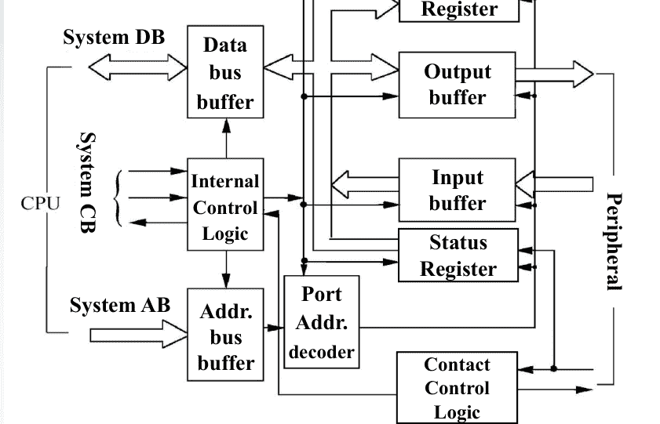

### 3.1 I/O 模块

#### 常见接口槽 1

PS2 mouse

PS2 keyboard

10/100M NIC

Gigabit Ethernet

Parallel Port

Serial Port

USB

1394

1394a

VGA Interface

MIDI/Game Port

Speaker /Line in /MIC Interface

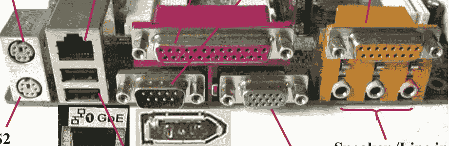

### 3.1 I/O 模块

#### 常见接口槽 2

USB 3.0接口

1394接口

USB接口

USB PLUS接口

键鼠通用的PS2接口

VGA接口

DVI接口

HDMI接口

光纤音频接口

网络接口

e-SATA接口

多声道音频接口

Center and Subwoofer

Input channel

Rear speaker output

Front speaker output

Side speaker output

MIC input

### 3.2 主要 I/O 技术

- 程序化 I/O
- 中断驱动 I/O
- 直接内存访问
- I/O 通道和处理器

### 3.2 主要 I/O 技术

- 程序化 I/O
  1. 当处理器执行程序并遇到与 I/O 相关的指令时，它通过向适当的 I/O 模块发出命令来执行该指令。
  2. 使用程序化 I/O，I/O 模块将执行请求的操作。
  3. 然后有 2 种不同方式：
     - 无条件传输
       - 我们假设设备始终准备就绪。
       - 处理器不关心 I/O 模块的状态
     - 条件传输
       - 执行操作后，I/O 模块在 I/O 状态寄存器中设置适当的位。
       - 处理器定期检查 I/O 模块中的状态，直到发现操作完成


## 3.2 主要 I/O 技术
### 程序化 I/O

处理器寻址时 I/O 模块可能接收到的 I/O 命令

- Control: 用于激活外设并告诉它做什么。
- Test: 用于测试与 I/O 模块及其外设相关的各种状态条件。
- Read: 使 I/O 模块从外设获取一个数据项并将其放入内部缓冲区。处理器随后可以通过请求 I/O 模块将其置于数据总线上来获取该数据项。
- Write: 使 I/O 模块从数据总线取出一个数据项，随后将该数据项传输到外设。

程序化 I/O 的问题是：

- 处理器必须长时间等待相关 I/O 模块准备好接收或传输数据。
- 处理器在等待期间，必须反复询问 I/O 模块的状态。
- 结果，整个系统的性能水平严重下降。

### 中断驱动 I/O

- 处理器向模块发出 I/O 命令，然后继续进行其他有用工作。
- I/O 模块在准备好与处理器交换数据时，会中断处理器以请求服务。
- 处理器随后执行数据传输，如前所述，然后恢复其先前的处理。

#### 中断驱动 I/O 如何进行输入，例如

1. 处理器向 I/O 模块发出 READ 命令，然后去做其他事情。
2. I/O 模块从设备获取数据并将其锁存在 buff 中，然后中断处理器以要求服务。
3. 处理器保存当前程序的上下文并处理中断，以从 I/O 模块读取数据字并将其存储在内存或寄存器中。
4. 处理器恢复其正在处理的程序的上下文并恢复执行。

### 直接存储器访问

- 当处理器希望读取或写入一块数据时，它向 DMA 模块发出命令。然后处理器继续进行其他工作。
- DMA 执行 I/O 操作，将整个数据块直接传输到内存或从内存传输，而无需经过处理器。
- 传输完成后，DMA 模块向处理器发送中断。
- 因此，处理器仅在传输开始和结束时或传输出现问题时才参与。

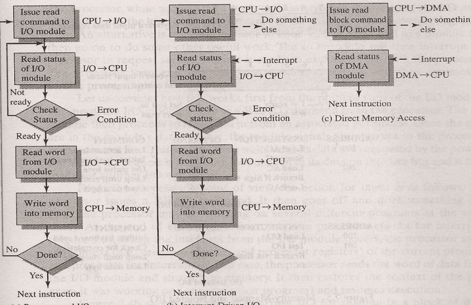

**(a) Programmed I/O**

**(b) Interrupt-Driven I/O**

**(c) Direct Memory Access**

Figure 7.4  Three Techniques for Input of a Block of Data

### I/O 通道

- I/O 模块得到增强，成为其自身的一个处理器，具有专门为 I/O 定制的指令集。这种 I/O 模块通常被称为 I/O 通道。
- I/O 通道具有执行 I/O 指令的能力，这使其完全控制 I/O 操作。
- CPU 不执行 I/O 指令，这类指令存储在主内存中，由 I/O 通道本身中的专用处理器执行。

### I/O 处理器

- I/O 模块拥有自己的本地内存，事实上是一个独立的计算机。
- 采用这种架构，可以控制大量 I/O 设备，同时 CPU 参与最少。
- 这种架构的常见用途是控制与交互式终端的通信。
- I/O 处理器负责控制终端所涉及的大多数任务。

## 3.3 I/O 地址空间的类型
### 隔离 I/O

- 隔离 I/O 设备的地址，称为端口地址，与内存地址空间分开。
- 用户可以将内存扩展到其最大容量，而无需使用任何内存空间用于 I/O 设备。
- 缺点：
  - I/O 与 CPU 之间的数据传输必须通过专用 I/O 指令访问。
  - 需要专用控制信号(M/IO,WR,RD)
- X86-based system used.

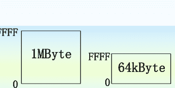


## 3.4 8086/8088 硬件
### 引脚排列和引脚功能

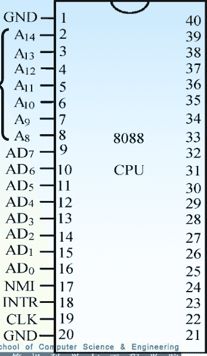

> 8086 是 AD₈~AD₁₄
> 8086 是 AD₁₅
> 8086 是 M/IO (S₂)

## 3.4 8086/8088 硬件
### 引脚排列和引脚功能
### 最小模式

- 是运行 8086/8088 的最经济方式
- 内存或 I/O 的所有控制信号均由 CPU 生成。
- 该模式运行是通过将模式选择引脚 MN/MX 连接到 +5V 获得的。
- 我们所有的实验都基于最小模式。

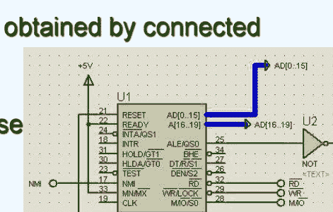

## 3.4 8086/8088 硬件
### 引脚排列和引脚功能
### 我们将使用的 8086 引脚

- CLK : I, 时钟引脚为微处理器提供基本时序信号。
- AD0~15 : O/IO, 地址/数据总线。当 ALE 为 1 时，传输内存地址或 I/O 端口号的最右 16 位；当 ALE=0 时，传输数据。在 8088 中为 AD0~7 和 A8~15
- A16~19 : O, 当 ALE 为 1 时，传输内存地址最左的 4 位。
- M/IO* : O, 当该信号为逻辑 1 时，表示地址总线包含内存地址，否则包含 I/O 端口号。

* A 或 A# 表示信号 A 在值为 0 时有效。

## 3.4 8086/8088 硬件
### 引脚排列和引脚功能
### 我们将使用的 8086 引脚

- RD̅ : O, 当读信号为逻辑 0 时，数据总线接收来自内存或 I/O 设备的數據。
- WR̅ : O, 当写信号为逻辑 0 时，数据总线包含 8086 输出到内存或 I/O 设备的有效数据。
- ALE : O, 地址锁存使能，表示 8086 AD₀-15 包含地址信息。
- INTR : I, 中断请求用于请求硬件中断。
- INTA̅ : O, 中断应答信号是对 INTR 输入引脚的响应。

## 3.4 8086/8088 硬件
### ▪ 总线时序概述(8088)

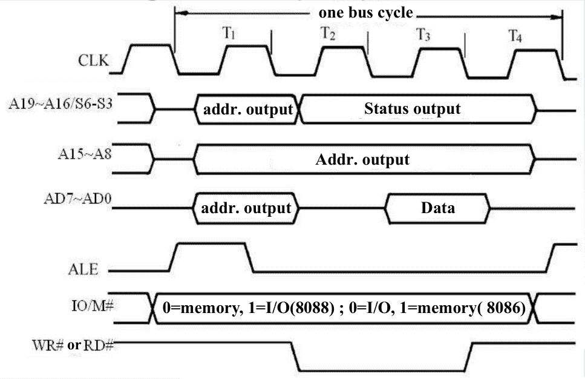

one bus cycle

CLK

A19~A16/S6~S3

addr. output

Status output

A15~A8

Addr. output

AD7~AD0

addr. output

Data

ALE

I/O/M#

0=memory, 1=I/O(8088) ; 0=I/O, 1=memory( 8086)

WR# or RD#

## 3.4 8086/8088 硬件
### 引脚排列和引脚功能
#### 计算机 I/O 系统
### 8086 基础系统(在我们的实验中)
### 8086 基础系统

Connect with Device

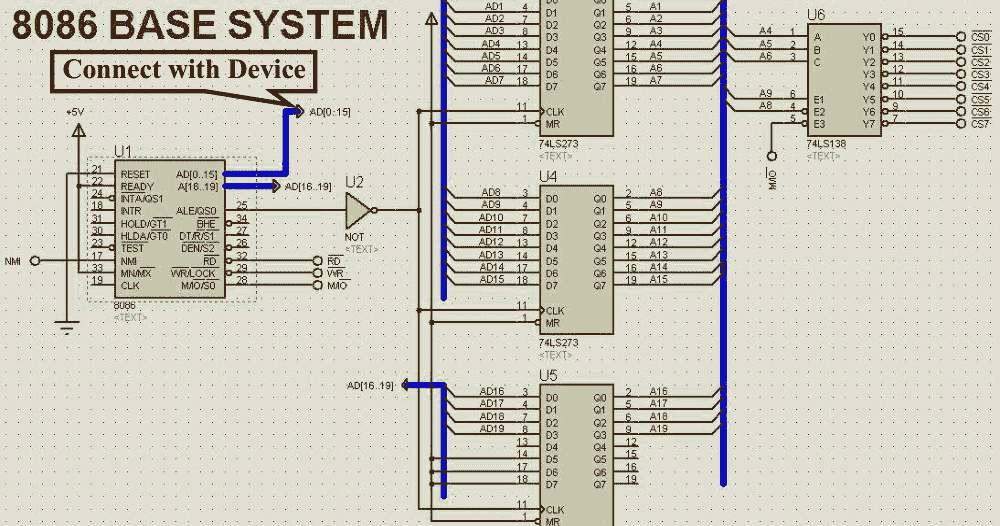

## 3.5 个人计算机 I/O 映射

- I/O 端口地址
  - I/O 端口号
    - I/O 模块中的寄存器被编号，该编号称为端口号
  - I/O 端口地址
    - I/O 端口地址 = I/O 模块(接口)的基地址 + 端口号
  - 注意：
    - 一个 I/O 模块(接口)中有多个端口
    - 一个 I/O 端口地址可以接收多种命令，对应多个寄存器。

## 3.5 个人计算机 I/O 映射
### PC 中的 I/O 地址空间

- 64k 8 位端口地址空间，或 32k 16 位端口地址空间，或 16k 32 位端口地址空间。
  - 00~0FFH 通常为主板上的计算机系统保留。
  - 100H~3FFH 通常为 ISA 总线保留。
  - 400H~0FFFH 通常可供用户应用、主板功能和 PCI 总线使用。
- 端口地址必须对齐。

## 3.5 个人计算机 I/O 映射

- PC 中的 I/O 地址空间

| I/O 芯片 | 地址空间 |
|---|---|
| DMAC1 | 0000-001FH |
| DMAC2 | 00C0-00DFH |
| DMA page register | 0080-009FH |
| PIC1 | 0020-003FH |
| PIC2 | 00A0-00BFH |
| Timer | 0040-005FH |
| PPI | 0060-006FH |
| RT/CMOS RAM | 0070-007FH |
| Coprocessor(Reserve) | 00F0-00FFH |

## 3.5 个人计算机 I/O 映射

- PC 中的 I/O 地址空间

| I/O 模块(接口) | 地址空间 |
|---|---|
| LPT1 | 0370-037FH |
| LPT2 | 0270-027FH |
| COM1 | 03F8-03FFH |
| COM2 | 02F8-02FFH |
| MDA | 03B0-03BFH |
| CGA | 03D0-03DFH |
| EGA/VGA | 03C0-03CFH |
| Floppy disk | 03F0-03FFH |
| Hard disk | 01F0-01FFH |

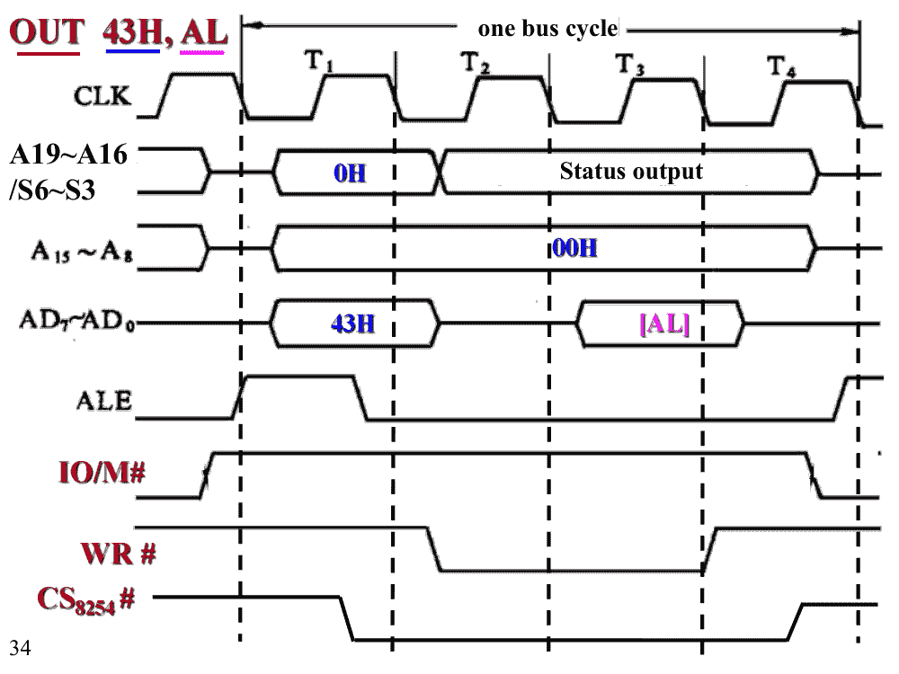


## 3.6 I/O 端口地址译码

+   74LS138 译码器

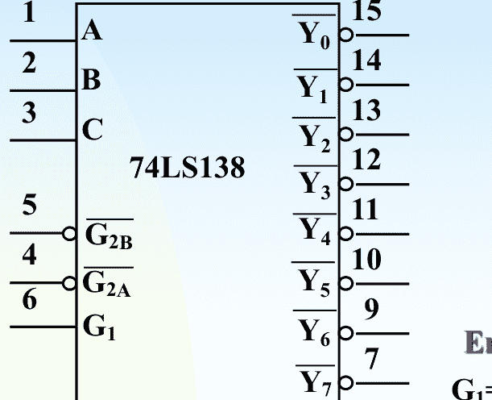

使能：
G1=1, G2A̅=G2B̅=0

## 3.6 I/O 端口地址译码

真值表

| Input | Output |
|---|---|
| G1 G2A# G2B# | C B A | Y7 Y6 Y5 Y4 Y3 Y2 Y1 Y0 |
| 1 0 0 | 0 0 0 | 1 1 1 1 1 1 1 0 |
| 1 0 0 | 0 0 1 | 1 1 1 1 1 1 0 1 |
| 1 0 0 | 0 1 0 | 1 1 1 1 1 0 1 1 |
| 1 0 0 | 0 1 1 | 1 1 1 1 0 1 1 1 |
| 1 0 0 | 1 0 0 | 1 1 1 0 1 1 1 1 |
| 1 0 0 | 1 0 1 | 1 1 0 1 1 1 1 1 |
| 1 0 0 | 1 1 0 | 1 0 1 1 1 1 1 1 |
| 1 0 0 | 1 1 1 | 0 1 1 1 1 1 1 1 |
| 0 X X | X X X | 1 1 1 1 1 1 1 1 |
| X 1 X | X X X | 1 1 1 1 1 1 1 1 |
| X X 1 | X X X | 1 1 1 1 1 1 1 1 |

## 3.6 I/O 端口地址译码

### 74LS138 在个人计算机中的应用

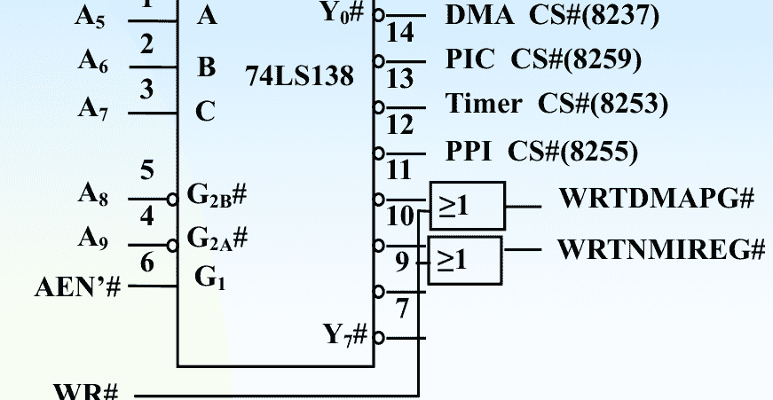

为什么 PIC 的 I/O 地址是 0020H-003FH？

## 3.6 I/O 端口地址译码

#### 计算机 I/O 系统

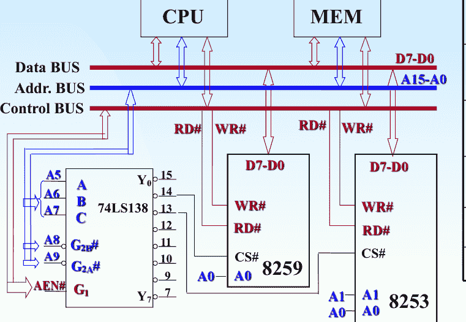

|  |  |
|---|---|
| DMA | 00H |
|  | : |
|  | 1FH |
| 8259 | 20H |
|  | : |
|  | 3FH |
| 8253 | 40H |
|  | : |
|  | 5FH |
| 8255 | 60H |
|  | : |
|  | 7FH |
| ... |  |
| ... | 3FFH |

## 3.6 I/O 端口地址译码

+   - 可调端口地址译码

+     - 使用 3 个 74LS136 XOR 门


### 逻辑：

3=1 ⊕ 2;  6=4⊕ 5;
8=9⊕ 10;  11=12⊕ 13;

### 连接：

异或门的输入分别连接到地址线和开关线。

CS#: 对所有 XOR 门输出进行 OR 操作

## 3.6 I/O 端口地址译码

### 练习 1


## 3.6 I/O 端口地址译码

### 练习 2

A9 A8 A7 A6 A5 A4 A3 A2 A1 A0

Step 1 ? ? ? ? ? × × × × ×

Step 2 0 ? ? ? 0 × × × × ×

Step 3 0 C B A 0 × × × × ×


## 3.6 I/O 端口地址译码

### 练习 3


译码 A0~A9，使接口芯片的端口地址为 260H、262H、264H、266H、268H、26AH、26CH、26EH。

### 练习 3


地址范围：260H、262H、264H、266H、268H、26AH、26CH、26EH

A₉ A₈ : A₇ A₆ A₅ A₄ : A₃ A₂ A₁ A₀
1  0  : 0  1  1  0 : ×  ×  ×  0

| 二进制 | 十六进制 |
|---|---|
| 0000 | 1000 |
| 0010 | 1010 |
| 0100 | 1100 |
| 0110 | 1110 |


## 3.6 I/O 端口地址译码

### 练习 4


接口芯片中有多少个端口？给出它们的地址。

### 练习 4

A9 A8 A7 A6 A5 A4 A3 A2 A1 A0

0 0 1 1 0 1 0 × 0 0
0 1
1 0
1 1 4 ports Address is

D0H
D1H
D2H
D3H

or

D4H
D5H
D6H
D7H


## 3.6 I/O 端口地址译码

### 练习 5

我们想要得到以下地址：

Y0# = 000~00FH/100~10FH/200~20FH/300~30FH

Y1# = 010~01FH/110~11FH/210~21FH/310~31FH

......

Y7# = 070~07FH/170~17FH/270~27FH/370~37FH

请设计译码电路。

## 计算机输入/输出系统

2015

讲师：杨全胜

计算机科学与工程学院
软件工程学院
东南大学

## 第 4 章：

## 中断

### 大纲

+   - 基本中断系统
+   - 8259A PIC(可编程中断控制器)
+   - x86 系统中的中断
+   - 现代 PC 中的中断处理

## 4.1 基本中断系统

### 什么是中断

+   - 中断是系统、处理器或当前正在执行的程序中存在需要处理器注意的状况的事件。
+   - 中断通常会导致执行被强制从当前运行的程序转移到一个称为中断处理程序的特殊软件例程。
+   - 处理器对中断的响应被称为服务或处理中断。
+   - 当处理程序执行完成后，处理器恢复被中断过程或任务的执行。


## 4.1 基本中断系统

### 中断源

中断在程序执行期间的随机时间发生，以响应来自硬件的信号。

系统硬件使用中断来处理处理器外部的事件，例如对服务外围设备的请求。

软件也可以通过执行 INT n 指令来产生中断。

### 中断处理

- 1. 设备向处理器发出中断信号。
- 2. 处理器完成当前指令的执行，然后检测中断，确定存在中断，并向发出中断的设备发送应答信号。
- 3. 应答允许设备移除其中断信号。

- 4. 处理器现在需要准备好将控制转移到中断例程。为此，首先保存中断点处恢复当前程序所需的信息（由硬件自动完成）。

  ① 处理器的状态，包含在称为程序状态字（PSW）的寄存器中。

  ② 下一条要执行的指令的位置，包含在程序计数器（PC 或 IP）中。

- 5. 处理器现在将程序计数器加载为将响应此中断的中断处理程序的入口位置。

### 到处理器的中断线

- **单中断线**
  - 处理器与 I/O 模块之间只有一条中断线。
- **多中断线**
  - 在处理器与 I/O 模块之间提供多条中断线。
  - 将多于少数几条总线线或处理器引脚专用于中断线是不切实际的。

### 设计问题

- 实现中断 I/O 中的两个设计问题
  - 有多个 I/O 模块，处理器如何确定哪个设备发出了中断？
  - 如果发生了多个中断，处理器如何决定处理哪一个？

- 三种通用类别的技术被广泛使用：
  - 软件轮询
  - 串联菊花链（硬件轮询，向量式）
  - 总线仲裁（向量式）

### 软件轮询

- 在中断处理程序中，轮询每个 I/O 模块以确定哪个模块导致了中断。
- 软件轮询的缺点是耗时。
- 轮询模块的顺序决定了它们的优先级。


◆ 软件轮询


### Daisy chain (hardware poll, vectored)

- 所有 I/O 模块共享一条公共中断请求线。
- 中断应答线通过模块串联菊花链连接。
- 来自 CPU 的应答信号通过一系列 I/O 模块传播，直到到达请求模块。
- 请求模块通常通过在数据线上放置一个字来响应。该字被称为 *向量号*，其为：
  - I/O 模块的地址。
  - 其他唯一标识符。
- 处理器使用该向量作为指向适当设备服务例程的指针。
- 这种技术称为 *向量中断*。

模块在串联菊花链上的顺序决定了它们的优先级。


### Bus arbitration (vectored)

- 需要中断仲裁或中断控制器
- 同时只能有一个模块拉高该线。
- 当处理器检测到中断时，它会在中断应答线上响应。
- 请求模块随后将其向量号放在数据线上。
- 总线仲裁可以采用优先级方案。


## 4.2 8259A PIC

## 8259A 的总体描述

PIC: 可编程中断控制器

## 功能

- 接受外部中断请求；
- 管理中断请求（排队、优先级、屏蔽、嵌套）；
- 向微处理器发送中断请求信号(INTR) 和中断向量号；
- 处理中断结束；
- 接受来自处理器的命令并返回状态。

## 4.2 8259A PIC

## 8259A 的总体描述

### 8259A 内部结构


## 4.2 8259A PIC

## 8259A 的总体描述

## 8259A 中断响应

- 当 8259 向处理器发送 INT 信号时，它会等待处理器发出的两个 INTA# 脉冲以进行应答。
- PIC 使用第一个 INTA# 脉冲来冻结中断状态以进行优先级解析。此外，该中断的 ISR 被置位，该中断的 IRR 被清除。
- 在第二个 INTA# 脉冲时，PIC 向处理器发送中断向量号。ISR 位将在以下情况下被清除：
  - 如果处于 AEOI 模式，则在第二个 INTA# 的下降沿；
  - 如果处于正常模式，则在返回服务程序之前处理器发出 EOI 命令。

## 4.2 8259A PIC

#### 工作模式

## 边沿触发和电平触发模式

### 边沿触发模式

- 中断请求将通过对应 IRQ 输入上的低到高跳变来识别。

### 电平触发模式

- 中断请求将通过对应 IRQ 输入上的高电平来识别，无需边沿检测。

在边沿触发和电平触发模式下，IRQ 输入必须保持有效直到第一个内部 INTA# 的下降沿之后。如果在此之前 IRQ 输入变为无效，则返回默认的 IRQ7 向量号。

## 4.2 8259A PIC

#### 工作模式

### 轮询模式

在此模式下，INT 输出功能与正常时相同，但微处理器应忽略此输出。通过使用轮询命令，通过软件实现对设备的服务。

### 嵌套模式

#### 完全嵌套模式

- 当 ISR 位被置位时，所有相同或更低优先级的进一步中断将被禁止。

#### 特殊完全嵌套模式

- 当 ISR 位被置位时，所有更低优先级的进一步中断将被禁止。

## 4.2 8259A PIC

#### 工作模式

### 缓冲模式

- 当 8259A 在需要数据总线上使用总线驱动缓冲器的较大系统中时，将配置 8259A 在 SP#/EN# 上发送使能信号以使能缓冲器。
- 此修改强制使用软件编程来确定 8259A 是主设备还是从设备。

### 非缓冲模式

- SP#/EN# = 1；8259A 是主控制器
- SP#/EN# = 0；8259A 是从控制器

## 4.2 8259A PIC

#### 工作模式

### 屏蔽模式

#### 正常屏蔽模式

- IMR 中的每个位如果被置位（1）则屏蔽一个中断通道。位 0 屏蔽 IR0，位 1 屏蔽 IR1，以此类推。

#### 特殊屏蔽模式

- 当 OCW1 中的屏蔽位被置位时，它会禁止该级别的进一步中断，并使能所有其他未被屏蔽的级别（较低和较高）的中断。

## 4.2 8259A PIC

#### 工作模式

### 优先级模式

#### 固定优先级

- 中断请求按 0 到 7 的顺序排列优先级（0 为最高）。

#### 轮转优先级
（IR0 ~ IR7 优先级作为循环队列。）

- 自动轮转
  - 在此模式下，设备在被服务后获得最低优先级。

- 特定轮转
  - 程序员可以通过编程底部优先级来更改优先级，从而固定所有其他优先级；即，如果 IR4 被编程为底部优先级设备，则 IR5 将具有最高

## 4.2 8259A PIC

#### 工作模式

### 中断结束

#### 正常模式

- ISR 位可以通过 EOI 命令重置，该命令必须在从服务程序返回之前发出给 8259A。
  - 当发出非特定 EOI 命令时，8259A 将自动重置已置位的最高 IS 位。
  - 特定 EOI 命令包含要重置的 IS 级别作为命令的一部分。

#### 自动中断结束（AEOI）模式

- 8259A 将在最后一个 INTA# 的下降沿自动执行非特定 EOI 操作


## 4.2 8259A PIC
### 操作和命令

- **端口地址**
  - 只有两个端口地址。
- **命令**
  - 初始化命令字
    - ICW1, ICW2, ICW3 和 ICW4
  - 操作命令字
    - OCW1, OCW2, OCW3
- **可读取的状态**
  - IRR, ISR, IMR, 状态字
- **用少量地址读写更多命令和状态的方式**
  - 数据有空闲位：特征位(CHB)
  - 数据无空闲位：时序(TS); R/W

| x86 中的 PIC1 | x86 中的 PIC2 | R/W | 内容 | CHB D4 D3 D2 | 时序 |
|---|---|---|---|---|---|
| 20H | 0A0H | 写 | ICW1 | 1 × × | - |
|  |  |  | OCW2 | 00 × |  |
|  |  |  | OCW3 | 01 × |  |
| 21H | 0A1H | 写 | ICW2~ICW4 | 无 | ICW1 之后，ICW2→ICW4 |
|  |  |  | OCW1 |  | 在正常状态下 |
| 20H | 0A0H | 读 | IRR, ISR 状态字 | 无 | 由 OCW3 决定 |
| 21H | 0A1H | 读 | IMR | - | - |

注：ICW x 仅在初始化期间使用。

### 初始化命令字 1(ICW1)

| A0 | D7 | D6 | D5 | D4 | D3 | D2 | D1 | D0 |
|---|---|---|---|---|---|---|---|---|
| 0 | 0 | 0 | 0 | 1 | LTIM | ADI | SNGL | IC4 |

无效：D7 D6 D5
CHB：D4
无效：D2
IC4：=0：不需要 ICW4
=1：需要 ICW4
SNGL：=0：级联模式
=1：单片
LTIM：=0：边沿触发模式
=1：电平触发模式

如果 SNGL = 1，则不会发出 ICW3。

### 初始化命令字 2(ICW2)

| A0 | D7 | D6 | D5 | D4 | D3 | D2 | D1 | D0 |
|---|---|---|---|---|---|---|---|---|
| 1 | T7 | T6 | T5 | T4 | T3 | 0 | 0 | 0 |

中断向量号的左起 5 位    无效

序列：ICW1 → ICW2 → [ICW3] → [ICW4]

IRi 的中断向量号 = ICW2 的 [7:3] + i

例如，如果 ICW2 = 08H 则
IR3 的中断向量号 = 08H + 03H = 0BH

如果中断向量号为 16H，ICW2 的值是多少？该中断请求线连接到哪个 IR 引脚？

### 初始化命令字 3(ICW3)

| A0 | D7 | D6 | D5 | D4 | D3 | D2 | D1 | D0 |
|---|---|---|---|---|---|---|---|---|
| 1 | S7 | S6 | S5 | S4 | S3 | S2 | S1 | S0 |

主控制器的 ICW3

| A0 | D7 | D6 | D5 | D4 | D3 | D2 | D1 | D0 |
|---|---|---|---|---|---|---|---|---|
| 1 | × | × | × | × | × | ID2 | ID1 | ID0 |

从控制器的 ICW3

对于主控制器，ICW3 用于指示哪个 IRQ 输入线用于级联从控制器。ICW3 中对应的位被置为 1。

对于从控制器，ICW3 是在中断应答周期中使用的从设备识别码。

### 初始化命令字 3(ICW3)


主控制器的 ICW3


从控制器的 ICW3

```
Master: MOV AL, 14H
        OUT 21H, AL
Slave A: MOV AL, 04H
         OUT 0A1H, AL
Slave B: MOV AL, 02H
         OUT 0C1H, AL
```


### 初始化命令字 4(ICW4)

| A0 | D7 | D6 | D5 | D4 | D3 | D2 | D1 | D0 |
|---|---|---|---|---|---|---|---|---|
| 1 | 0 | 0 | 0 | SFNM | BUF | M/S# | AEOI | µPM |

- D0：1 = 8086/8088 模式；0 = MCS-8080 模式
- D1：1 = 自动 EOI 模式；0 = 正常 EOI
- D3D2：0X = 非缓冲模式；10 = 缓冲模式/从设备；11 = 缓冲模式/主设备
- D4：1 = 特殊全嵌套模式；0 = 全嵌套模式

### 操作控制字 1 (OCW1)

| A0 | D7 | D6 | D5 | D4 | D3 | D2 | D1 | D0 |
|---|---|---|---|---|---|---|---|---|
| 1 | M7 | M6 | M5 | M4 | M3 | M2 | M1 | M0 |

1=屏蔽 0=使能

OCW1 设置和清除中断屏蔽寄存器 (IMR) 中的屏蔽位。

M7~M0 表示八个屏蔽位。

- M = 1 表示该通道被屏蔽（禁止），
- M = 0 表示该通道被使能。


## 4.2 8259A PIC

### 操作和命令

### 操作控制字 2 (OCW2)

| R | SL | EOI | 0 | 0 | L2 | L1 | L0 | 功能 |
|---|---|---|---|---|---|---|---|---|
| 0 | 0 | 0 | 0 | 0 | 0 | 0 | 0 | AEOI; 固定优先级命令 |
| 0 | 0 | 1 | 0 | 0 | 0 | 0 | 0 | 非特定 EOI; 固定优先级命令 |
| 0 | 1 | 1 | 0 | 0 | L2 | L1 | L0 | 特定 EOI; 固定优先级命令 |
| 1 | 0 | 0 | 0 | 0 | 0 | 0 | 0 | AEOI; 自动轮转优先级命令 |
| 1 | 0 | 1 | 0 | 0 | 0 | 0 | 0 | 非特定 EOI; 自动轮转优先级命令 |
| 1 | 1 | 1 | 0 | 0 | L2 | L1 | L0 | 特定 EOI; 特定轮转优先级命令 |
| 1 | 1 | 0 | 0 | 0 | L2 | L1 | L0 | AEOI; 特定轮转优先级命令 |

e.g. MOV AL, 20H
OUT 20H, AL ; in X86, What’s mean?

### 操作控制字 3 (OCW3)

| A0 | D7 | D6 | D5 | D4 | D3 | D2 | D1 | D0 |
|---|---|---|---|---|---|---|---|---|
| 0 | × | ESMM | SMM | 0 | 1 | P | RR | RIS |

OCW3: D4 D3=01

| P | RR | RIS | 下一次 RD# 脉冲中的操作 | 用法 |
|---|---|---|---|---|
| 1 | × | × | 读取查询字 | MOV AL, 0CH<br>OUT 20H, AL<br>IN AL, 20H |
| 0 | 1 | 0 | 读取 IRR | MOV AL, 0AH<br>OUT 20H, AL<br>IN AL, 20H |
| 0 | 1 | 1 | 读取 ISR | MOV AL, 0BH<br>OUT 20H, AL<br>IN AL, 20H |
| 0 | 0 | × | - |  |

### 查询字

| D7 | D6 | D5 | D4 | D3 | D2 | D1 | D0 |
|---|---|---|---|---|---|---|---|
| I | - | - | - | - | W2 | W1 | W0 |

- **W2 – W0**: 请求服务的最高优先级级的二进制编码。
- **I**: 若有中断则等于 "1"。

### SMM 操作

| A0 | D7 | D6 | D5 | D4 | D3 | D2 | D1 | D0 |
|---|---|---|---|---|---|---|---|---|
| 0 | × | ESMM | SMM | 0 | 1 | P | RR | RIS |

| ESMM | SMM | 功能 |
|---|---|---|
| 0 | × | 无操作 |
| 1 | 0 | 复位特殊屏蔽 |
| 1 | 1 | 置位特殊屏蔽 |

### 初始化 8259A

```
INTM00    EQU  020H  ;8259A port 0
INTM01    EQU  021H  ;8259A port 1
......
MOV  AL, 00010011B        ;ICW1: edge trigger,  ICW4 needed
                         ; single mode,  not need ICW3.
OUT  INTM00, AL
JMP  SHORT $+2           ; delay
MOV  AL, 00001000B        ;ICW2: interrupt vector number of IR0
                         ; is 08H
OUT  INTM01, AL
JMP  SHORT $+2
MOV  AL, 00000001B        ;ICW4: Non buffered, full nested, EOI
OUT  INTM01, AL
JMP  SHORT $+2
......
```

```
MOV AL, 12H
OUT 20H, AL
MOV AL, 08H
OUT 21H, AL
MOV AL, 02H
OUT 21H, AL
```

```
MOV AL, 13H
OUT 20H, AL
MOV AL, 08H
OUT 21H, AL
MOV AL, 02H
OUT 21H, AL
```

Q: What command do the last statements in above two programs send?

## 4.3 x86 系统中的中断

### 中断和异常分类

### 不可屏蔽中断 (NMI)

- 硬件、不可屏蔽、向量中断
- 中断请求信号发送到 NMI 引脚。
- 中断向量号: 2
- 无需中断识别。
- 当 NMI 信号从 0 跳变为 1，然后保持高电平至少四个处理器时钟周期，将识别一个 NMI 中断。
- NMI 从 1 跳变为 0 并保持低电平至少四个处理器时钟周期，可以识别新的 NMI 中断。

### 软件产生中断

- 软件、不可屏蔽、向量中断
- INT n 指令允许从软件内部通过提供操作数作为中断向量号来产生中断。
- 中断向量号: INT n 中的操作数
- 无需中断识别。
- BIOS 中断
  - INT 10H, INT 13H, INT 16H, ...
- DOS 中断
  - INT 20H, INT 21H, INT 24H,...

### 中断指令

| 功能 | 指令 | 操作 |
|---|---|---|
| 中断 | INT N | SP←(SP)-2<br>((SP)+1,(SP))←(FLAGS)<br>SP←(SP)-2<br>((SP)+1,(SP))←(CS)<br>SP←(SP)-2<br>((SP)+1,(SP))←(IP)<br>IP←(0000:OA) ; OA=4*N<br>CS←(0000:OA+2) |
| 从中断返回 | IRET | IP←((SP)+1,(SP))<br>SP←(SP)+2<br>CS←((SP)+1,(SP))<br>SP←(SP)+2<br>FLAGS←((SP)+1,(SP))<br>SP←(SP)+2 |


# 4.3 x86 系统中的中断

## 中断和异常分类

- 软件产生中断
- 常见中断指令

| 向量号 | 功能 | 向量号 | 功能 |
|---|---|---|---|
| 10H | 视频服务 | 13H | 磁盘控制 |
| 14H | COM | 15H | IO 外设 |
| 16H | 键盘 | 17H | LPT |
| 20H | 返回到 DOS | 21H | DOS 系统调用 |
| 23H | Ctrl+Break | 24H | DOS 严重错误 |
| 33H | 鼠标 | 2FH | DOS 保护模式接口 |
|  |  | 31H |  |

## 异常

### 软件产生异常

- INTO、INT 3 和 BOUND 指令允许在软件中产生异常。

### 机器检查异常

- P6 系列和 Pentium 处理器提供内部和外部机器检查机制，用于检查内部芯片硬件和总线事务的操作。

- 这些机制取决于实现。

- 当检测到机器检查错误时，处理器会发出机器检查异常（向量 18）并返回错误代码。

## PCH 中的 8259A

两个级联的 8259A 共 15 个中断


- 两个级联的 8259A 共 15 个中断

- 初始化主控制器

```
INTM00    EQU    020H    ; Master 8259A port 0
INTM01    EQU    021H    ; Master 8259A port 1
......
MOV AL, 00010001B ; ICW1: edge trigger, ICW4 needed, cascaded, need ICW3
OUT INTM00, AL
JMP SHORT $+2    ; delay
MOV AL, 00001000B ; ICW2: interrupt vector number of IR0 is 08H
OUT INTM01, AL
JMP SHORT $+2
MOV AL, 00000100B ; ICW3: INT signal of slave connect on IR2 pin in master
OUT INTM01, AL
JMP SHORT $+2
MOV AL, 00010001B ; ICW4: Non buffered, special full nested, EOI
OUT INTM01, AL
JMP SHORT $+2
```

- 两个级联的 8259A 共 15 个中断

初始化从控制器

```
INTS00      EQU    0A0H    ; Slave 8259A port 0
INTS01      EQU    0A1H    ; Slave 8259A port 1
......
MOV AL, 00010001B ;ICW1:edge trigger, ICW4 needed, cascaded, need ICW3
OUT INTS00, AL
JMP SHORT $+2
MOV AL, 01110000B ;ICW2: interrupt vector number of IR0 is 70H
OUT INTS01, AL
JMP SHORT $+2
MOV AL, 00000010B ;ICW3: INT signal of slave connect on IR2 pin in master
OUT INTS01, AL
JMP SHORT $+2
MOV AL, 00000001B ;ICW4: Non buffered, special full nested, EOI
OUT INTS01, AL
JMP SHORT $+2
```

### 中断控制器核心连接

| 8259 | 8259 典型输入 | 典型中断源 | 连接引脚 / 功能 |
|---|---|---|---|
| 主 | 0 | 内部 | 内部定时器 / 计数器 0 输出 / HPET #0 |
| 主 | 1 | 键盘 | 使用 SERIRQ 的 IRQ1 |
| 主 | 2 | 内部 | 从控制器 INTR 输出 |
| 主 | 3 | 串口 A | 使用 SERIRQ、PIRQ# 的 IRQ3 |
| 主 | 4 | 串口 B | 使用 SERIRQ、PIRQ# 的 IRQ4 |
| 主 | 5 | 并口 / 通用 | 使用 SERIRQ、PIRQ# 的 IRQ5 |
| 主 | 6 | 软盘 | 使用 SERIRQ、PIRQ# 的 IRQ6 |
| 主 | 7 | 并口 / 通用 | 使用 SERIRQ、PIRQ# 的 IRQ7 |


- PCH 中的 8259A
  - 在 Intel 芯片组中设置中断请求模式
    - 在 PCH 中，ICW1 中的 bit3 被禁用，并新增一个用于边沿和电平触发模式选择的寄存器。

ELCR1——用于主控制器（地址 4D0H）

| 7 | 6 | 5 | 4 | 3 | 2 | 1 | 0 |
|---|---|---|---|---|---|---|---|
| IRQ7 | IRQ6 | IRQ5 | IRQ4 | IRQ3 | 0 | 0 | 0 |

ELCR2——用于从控制器（地址 4D1H）

| 7 | 6 | 5 | 4 | 3 | 2 | 1 | 0 |
|---|---|---|---|---|---|---|---|
| IRQ15 | IRQ14 | 0 | IRQ12 | IRQ11 | IRQ10 | IRQ9 | 0 |

IRQx=0 : IRQx 为边沿触发模式

IRQx=1 : IRQx 为电平触发模式


## 4.4 现代 PC 中的中断过程

### 中断响应

当处理器执行完当前指令后，CPU 响应中断，（根据 EFLAGS 中的 IF 是否为 1 来响应可屏蔽中断）。

响应的步骤

- 1. 保存返回地址
  - 清除 EFLAGS 中的 IF 和 TF
  - 将 EFLAGS、CS 和 EIP 压入栈中。
- 2. 获取中断向量号
  - 对于外部硬件中断，编号在 PCH 中 8259A 的第二次 INTA# 中获得。
  - 其他类型中断不需要此步骤
- 3. **获取中断处理程序的入口位置**
  - 使用向量号查询中断向量表或中断描述符表，通过向量号获取地址。
- 4. **处理器现在将控制权转移到中断例程。**
  - 用中断处理程序的入口位置加载程序计数器
  - 处理中断
- 5. **返回断点**
  - 弹出 EIP、CS、EFLAGS

### 硬件/软件中断序列


- 4. PCH 在 PCI 上观察到自己的中断应答周期时，将其转换为内部 8259 对可以响应的两个周期。每个周期都表现为级联中断控制器内部 INTA# 引脚上的中断应答脉冲。
- 5. 在接收到第一个内部生成的 INTA# 脉冲后，最高优先级 ISR 位被置位，对应的 IRR 位被复位。在第一个脉冲的下降沿，主控制器通过专用内部三位宽总线向从控制器广播从机识别码。从控制器使用这些位来确定是否必须在第二个 INTA# 脉冲期间返回中断向量号。
- 6. 在接收到第二个内部生成的 INTA# 脉冲后，PIC 返回中断向量号。如果由于请求持续时间太短而没有中断请求，则 PIC 从主控制器返回向量号 7。
- 7. 这完成了中断周期。在 AEOI 模式下，ISR 位在第二个 INTA# 脉冲结束时被复位。否则，ISR 位保持置位，直到在中断子程序结束时发出适当的 EOI 命令。

### 实模式下的中断向量表(IVT)

- **中断向量(IV)**
  - 与向量号对应的中断处理程序的地址。
  - 每个中断向量占四个字节。
- **中断向量表(IVT)**
  - 按中断向量号顺序存储中断向量的存储区域。
  - 从地址 0000:0000 开始，1KB 范围。
- **中断向量指针(IVP)**
  - IVP = 向量 × 4

00000
IP
CS
00004
IP
CS
4*N
IP
CS
IV for vector 0
IV for vector 1
IV for vector N

### 中断处理例程编程

- 1) 直接写入 IVT。

```
CLI                     ; disable the maskable interrupt
MOV AX, 0
MOV ES, AX              ; ES= 0000H(segment address of IVT)
MOV SI, 0CH*4           ; 4 bytes for each interrupt vector
MOV AX, OFFSET SERVICE  ; EA of routine
MOV ES:[SI], AX
MOV AX, SEG SERVICE     ; segment address of routine
MOV ES:[SI+2], AX
STI                     ; enable the interrupt
......
; interrupt-handling routine
SERVICE PROC FAR
......
```

- 2) 使用 DOS 系统调用

```
MOV AX, SEG SERVICE
MOV DS, AX
MOV DX, OFFSET SERVICE
MOV AX, 250CH
INT 21H
```


## 4.4 现代 PC 中的中断过程
## 中断处理程序编程

- 保存上下文
  - 中断处理程序中会用到的寄存器必须压入栈中。

- 避免在非软件中断的中断处理程序中出现 DOS 重入
  - 你不能在中断处理程序中使用 DOS 系统调用(int 21h)。但可以使用 BIOS 调用。

- 中断处理程序必须小且执行迅速。
  - 中断处理程序的执行时间必须小于中断的最小时间间隔。
  - 你不能在中断处理程序中使用长循环和人机交互。

## 4.4 现代 PC 中的中断过程
## 中断处理程序编程

- **设置或清除 IF**
  - 中断被响应时 IF 被清除。
  - 你可以设置 IF 以允许中断嵌套，但请记住在从中断处理程序返回前清除 IF。

- **处理 EOI，并返回**
  - 如果中断来自 8259，且 8259 运行在 EOI 模式下，你必须发送 EOI 命令。
  ```asm
  MOV  AL, 20H
  OUT  20H, AL    ; sent EOI to master 8259
  OUT  0A0H, AL   ; sent EOI to slave 8259
  ```

- 恢复之前保存的寄存器。
- 执行 IRET 指令返回。

## 4.4 现代 PC 中的中断过程
## 中断处理程序编程
### ◆ 中断处理程序模板

（假设向量号为 0CH）

```asm
; main procedure
OLDDOC    DWORD     ?
......
CODE      SEGMENT

    ......
    MOV     AX, 350CH       ; Save the original 0CH interrupt vector
    INT     21H
    MOV     WORD PTR OLDDOC, BX
    MOV     WORD PTR OLDDOC+2, ES
    MOV     AX, SEG SERVICE  ; set new 0CH interrupt vector
    MOV     DS, AX
    MOV     DX, OFFSET SERVICE
    MOV     AX, 250CH
    INT     21H
    ......                    ; others
```

## 4.4 现代 PC 中的中断过程
## 中断处理程序编程
### 中断处理程序模板

（假设向量号为 0CH）

```asm
; interrupt handler
SERVICE PROC FAR
    PUSHA      ; push register
    PUSH DS
    STI        ; set IF
    .....      ; main function in handler
    CLI        ; clear IF
    MOV AL, 20H
    OUT 20H, AL ; sent EOI
    POP DS      ; resume
    POPA
    IRET
SERVICE ENDP
```

## 计算机输入/输出系统

2015

讲师：杨全胜

计算机科学与工程学院
软件工程学院
东南大学

## 第 5 章：
## 8254 可编程间隔定时器

## 大纲

- 8253/8254 基础
- 8254 的结构和引脚
- 应用
- PCH 中的 8254

## 5.2 8254 的结构和引脚
### 82C54 引脚图


**(1) 解码：** CS# 和 A₁A₀；

**(2) 读/写：** RD#, WR#；

## 5.2 8254 的结构和引脚
### 82C54 框图


## 5.2 8254 的结构和引脚
### 计数器的内部框图


CR_M 和 CR_L 是两个 8 位寄存器。两者通常被视为一个单元并称为 CR（计数寄存器）。

实际计数器标记为 CE（计数元件）。它是一个 16 位可预置的同步下

OL_M 和 OL_L 是两个 8 位锁存器。两者通常被视为一个单元称为 OL（“输出锁存器”）。

## 5.2 8254 的结构和引脚
### 操作和命令

I/O 端口地址：四个端口（地址使用 A1A0）；

命令：初始化—设置模式，写入初始计数操作—重写初始计数，读取状态的命令

状态：当前计数、模式和当前状态

初始计数 N = f_CLKi / f_OUTi

## 8254 命令

| CS# | RD# | WR# | A1 | A0 | operation | CHB D₇D₆ | 时序 |
|---|---|---|---|---|---|---|---|
| 0 | 1 | 0 | 0 | 0 | initial count → CNT0 | ** | 无 |
| 0 | 1 | 0 | 0 | 1 | initial count → CNT1 | ** | 无 |
| 0 | 1 | 0 | 1 | 0 | initial count → CNT2 | ** | 无 |
| 0 | 1 | 0 | 1 | 1 | Write control word | 00~10 | 无 |
|  |  |  |  |  | Write “read back” command | 11 | 无 |
| 0 | 0 | 1 | 0 | 0 | Read CNT0 current count | - | See the explanation behind |
|  |  |  |  |  | Read status of CNT0 | - |  |
| 0 | 0 | 1 | 0 | 1 | Read CNT1 current count | - |  |
|  |  |  |  |  | Read status of CNT1 | - |  |
| 0 | 0 | 1 | 1 | 0 | Read CNT1 current count | - |  |
|  |  |  |  |  | Read status of CNT1 | - |  |
| 0 | 0 | 1 | 1 | 1 | - |  |  |
| 1 | * | * | * | * | Prohibit access |  |  |
| 0 | 1 | 1 | * | * | - |  |  |


## 5.2 8254 的结构和引脚
### 操作和命令
### 控制字格式

| D7 | D6 | D5 | D4 | D3 | D2 | D1 | D0 |
| SC1 | SC0 | RW1 | RW0 | M2 | M1 | M0 | BCD |

SC — 选择计数器：

| SC1 | SC0 |  |
| 0 | 0 | 选择计数器 0 |
| 0 | 1 | 选择计数器 1 |
| 1 | 0 | 选择计数器 2 |
| 1 | 1 | 读回命令（参见读操作） |

RW — 读/写：

| RW1 | RW0 |  |
| 0 | 0 | 计数器锁存命令（参见读操作） |
| 0 | 1 | 仅读/写最低有效字节。 |
| 1 | 0 | 仅读/写最高有效字节。 |
| 1 | 1 | 先读/写最低有效字节，然后读/写最高有效字节。 |

M — 模式：

| M2 | M1 | M0 |  |
| 0 | 0 | 0 | 模式 0 |
| 0 | 0 | 1 | 模式 1 |
| X | 1 | 0 | 模式 2 |
| X | 1 | 1 | 模式 3 |
| 1 | 0 | 0 | 模式 4 |
| 1 | 0 | 1 | 模式 5 |

BCD：

|  |  |
| 0 | 二进制计数器 16 位 |
| 1 | 二进制编码十进制（BCD）计数器（4 位十进制） |

```
e.g.: MOV AL, 01110100B ; T/C1, least significant byte first
OUT 43H, AL ; mode 2, Binary
```

### 初始计数值

不同计数器的初始计数值必须写入不同的地址。

| A1A0 | 定时器/计数器 |
| 0 0 | T/C0 |
| 0 1 | T/C1 |
| 1 0 | T/C2 |

- 每次写入一个字节

- 初始计数值的范围是：

- 二进制：65536(0000H)、65535(FFFFH)~1(0001H)。

- BCD：10000(0000H)、9999(9999H)~1(0001H)。

### 初始化定时器/计数器

- 1) 对于每个计数器，在写入初始计数值之前必须先写入控制字。

- 2) 初始计数值必须遵循控制字中指定的计数格式

```
e.g. MOV AL, 01110101B; T/C1, least significant byte first, mode 2, BCD
OUT 43H, AL
MOV AX, 2000H ; initial count = 2000
OUT 41H, AL ;
MOV AL, AH
OUT 41H, AL ;
MOV AL, 00010110B; T/C0, least significant byte only, mode3, Binary
OUT 43H, AL
MOV AL, 50H ; ; initial count = 50H (80)
OUT 40H, AL
```

### 从 T/C 读数据的方法

计数器锁存命令（A1A0=11）

- CHB: D7D6=00~01, D5D4=00

e.g.:

```
MOV   AL, 01000101B  ; T/C1, latch, least significant
                         ; byte first, mode2, BCD
OUT   43H, AL
IN    AL, 41H
MOV   AH, AL
IN    AL, 41H
XCHG  AH, AL  ; AX is initial count for T/C1
```

- 从 T/C 读数据的方法

- 通过读回命令（A1A0=11）读取当前数据

| D7 | D6 | D5 | D4 | D3 | D2 | D1 | D0 |
|---|---|---|---|---|---|---|---|
| 1 | 1 | COUNT | STATUS | CNT 2 | CNT 1 | CNT 0 | 0 |

D5: 0 = 锁存所选计数器(s)的计数值

D4: 0 = 锁存所选计数器(s)的状态

D3: 1 = 选择计数器 2

D2: 1 = 选择计数器 1

D1: 1 = 选择计数器 0

D0: 保留供将来扩展；必须为 0

- 计数锁存命令只能锁存一个计数器

- 读回命令可以同时锁存多个计数器

```
e.g.: MOV AL, 11010100B    ; T/C1
OUT 43H, AL
IN  AL, 41H;
MOV AH, AL
IN  AL, 41H
XCHG AH, AL            ; AX is current count of CT1
MOV AL, 11011010B       ; T/C0 and T/C2
OUT 43H, AL
IN  AL, 40H;
MOV AH, AL
IN  AL, 40H
XCHG AH, AL            ; AX is current count of CT0
MOV BX, AX             ;
IN  AL, 42H;
MOV AH, AL
IN  AL, 42H
XCHG AH, AL            ; AX is current count of CT2
```

- 从 T/C 读数据的方法

- 通过读回命令(A1A0=11)读取状态

- 状态字

| D7 | D6 | D5 | D4 | D3 | D2 | D1 | D0 |
|---|---|---|---|---|---|---|---|
| OUTPUT | NULL COUNT | RW1 | RW0 | M2 | M1 | M0 | BCD |

D7 1 = 输出引脚为 1
0 = 输出引脚为 0
D6 1 = 空计数
0 = 计数值可供读取
D5-D0 计数器编程模式

```
MOV AL, 11100100B ; T/C1, latch the state
OUT 43H, AL
```

```
IN AL, 41H ; Suppose AL=00110101, means T/C1 in mode 2 ; BCD, least significant byte first, out pin = 0
```

```
MOV AL, 11100010B ; T/C0, latch the state
OUT 43H, AL
```

```
IN AL, 40 ; if AL=00010110, means T/C0 in mode 3, Binary ; least significant byte only, out pin = 0
```


## 5.2 8254 的结构和引脚

### 模式定义

#### Mode 0: Interrupt on terminal count


- **characteristic:** count only once;
- **GATE = 1** enables counting; **GATE = 0** disables counting. GATE has no effect on OUT.
- If a new count is written to the Counter, it will be loaded on the next CLK pulse and counting will continue from the new count.
- After the Control Word is written, OUT is initially low, and will remain low until the Counter reaches zero. OUT then goes high and remains high until a new count or a new Mode 0 Control Word is written into the Counter

#### Mode 1: Hardware retriggerable one-shot


characteristic : count only once ;

- GATE = 1 and 0 are no affect. Rising edge of GATE will retrigger the counter and load the initial count. GATE has no effect on OUT.
- If a new count is written to the Counter during a one-shot pulse, the current one-shot is not affected unless the Counter is retriggered by GATE.
- OUT will be initially high. OUT will go low on the CLK pulse following a trigger to begin the one-shot pulse, and will remain low until the Counter reaches zero. OUT will then go high and remain high until the CLK pulse after the next trigger.

#### Mode 2: Rate Generator


characteristic : periodic ;

- GATE = 1 enables counting; GATE = 0 disables counting. Rising edge of GATE will retrigger the counter and load the initial count.
- Writing a new count while counting does not affect the current counting sequence. The new count will be loaded at the end of the current counting cycle or the next CLK pulse when receive the rising edge of GATE.
- OUT will initially be high. When the initial count has decremented to 1, OUT goes low for one CLK pulse. OUT then goes high again, the Counter reloads the initial count and the process is repeated.

#### Mode 3: Square Wave Mode


**characteristic:** periodic;

- **Odd counts:** OUT is initially high. The initial count minus one (an even number) is loaded on one CLK pulse and then is decremented by two on succeeding CLK pulses. One CLK pulse after the count expires, OUT goes low and the Counter is reloaded with the initial count minus one. Succeeding CLK pulses decrement the count by two. When the count expires, OUT goes high again and the Counter is reloaded with the initial count minus one. The above process is repeated indefinitely. So for odd counts, OUT will be high for (N + 1)/2 counts and low for (N - 1)/2 counts.

#### Mode 4: Software Triggered Strobe


characteristic : count only once ;

- GATE = 1 enables counting; GATE = 0 disables counting. Rising edge of GATE will retrigger the counter and load the initial count.
- If a new count is written during counting, it will be loaded on the next CLK pulse and counting will continue from the new count.
- OUT will be initially high. When the initial count expires, OUT will go low for one CLK pulse and then go high again. The counting sequence is “triggered” by writing the initial count.

#### Mode 5: Hardware Triggered Strobe


characteristic : count only once ;

- GATE = 1 and 0 are no affect. Rising edge of GATE will retrigger the counter and load the initial count. GATE has no effect on OUT.
- If a new count is written during counting, the current counting sequence will not be affected. If a trigger occurs, the Counter will be loaded with the new count on the next CLK pulse and counting will continue from there.
- OUT will initially be high. Counting is triggered by a rising edge of GATE. When the initial count has expired, OUT will go low for one CLK pulse and then go high again.


## 5.2 8254 的结构和引脚
### 模式定义

| | 方式0 | 方式1 | 方式2 | 方式3 | 方式4 | 方式5 |
|---|---|---|---|---|---|---|
| OUT输出状态 | 写入控制字后变0，计数结束变1，并维持至重写控制字或计数初值 | 写入控制字后变1，GATE上升沿触发变0，开始计数，计数结束变1 | 写入控制字后变1，计数到1变0，维持一个Tclk变1 | 写入控制字后变1，装入初值且GATE=1则OUT变1，计数到0变0，重装初值继续计数，计数到则反向 | 写入控制字后变1，计数结束变0，维持一个Tclk变1 | 写入控制字后变1，GATE上升沿触发开始计数，计数结束输出一个CLK的负脉冲 |
| 初值自动重装 | 无 | 无 | 计数到0重装 | 根据初值奇偶分别重装； | 无 | 无 |
| 计数过程中改变初值 | 立即有效 | GATE触发后有效 | 计数到1或GATE触发后有效 | 计数结束或GATE触发后有效 | 立即有效 | GATE触发后有效 |
| GATE | 0 | 禁止计数 | 无影响 | 禁止计数 | 禁止计数 | 禁止计数 | 无影响 |
|  | 下降沿 | 暂停计数 | 无影响 | 停止计数 | 停止计数 | 停止计数 | 无影响 |
|  | 上升沿 | 继续计数 | 从初值开始重新计数 | 从初值开始重新计数 | 从初值开始重新计数 | 从初值开始重新计数 | 从初值开始重新计数 |
|  | 1 | 允许计数 | 无影响 | 允许计数 | 允许计数 | 允许计数 | 无影响 |

## 5.3 应用
### 频率分频器设计

使用 8254(address:40H~43H)，将 5MHz 脉冲转换为 1Hz 脉冲

Initial count =f_CLK/f_OUT=5×10⁶>65536, How to do it?


```
MOV AL, 00110111B; T/C₀
OUT 43H, AL
MOV AX, 5000H
OUT 40H, AL
MOV AL, AH
OUT 40H, AL
MOV AL, 01110101B; T/C₁
OUT 43H, AL
MOV AX, 1000H
OUT 41H, AL
MOV AL, AH
OUT 41H, AL
```

### 占空比为 4:9 的方波发生器

8254 中 CLK0 的频率为 8KHz，则

- 1) OUT0 的最大周期是多少？
- 2) 现在希望 8254 的端口地址为 90H、92H、94H 和 96H，请用 74LS138 和一些门电路设计译码电路。
- 3) 现在要产生周期为 9s 且占空比为 4:9 的方波。请完成上述电路实现译码器，并对其编程。

Answer:
1) T_CLK0=1/f_CLK0=1/8000=0.125ms
Maximum period =65536×0.125ms=8.192 second
or: f_CLK0/f_OUT=65536=>T_max=1/f_OUT=65536/ f_clk0 =65536/8000=8.192 second

### 占空比为 4 的方波发生器

D7~D0
WR#
RD#
A1
A2
A5
A4
A3
A7
A8
A9
A6
A0
C
B
A
Y2#
74LS138
G1
G2A#
G2B#
CS#
8254
CLK0
GATE0
OUT0
CLK1
A0
A1
GATE1
OUT1
CLK2
GATE2
OUT2
8KHz
1Hz
5V
square wave which period is 9s and the duty cycle is 4:9.

▪ Square Wave Generator that Duty cycle is 4:9

```
MOV AL, 00110111B; T/C₀
OUT 96H, AL
MOV AX, 8000H
OUT 90H, AL
MOV AL, AH
OUT 90H, AL
MOV AL, 01010111B; T/C₁
OUT 96H, AL
MOV AL, 9H
OUT 92H, AL
```

### 双频率方波发生器

假设 8254 中 CLK0 的频率为 1 MHz。现在使用此 8254 和一些门电路设计一个输出如下波形的方波发生器。


```
MOV AL, 00110111B; T/C0
OUT 43H, AL
MOV AX, 1000H
OUT 40H, AL
MOV AL, AH
OUT 40H, AL
```

```
MOV AL, 01110111B; T/C1
OUT 43H, AL
MOV AX, 1000H
OUT 41H, AL
MOV AL, AH
OUT 41H, AL
MOV AL, 10010111B; T/C2
OUT 43H, AL
MOV AX, 5H
OUT 42H, AL
```

## 5.4 PCH 中的 8254


### 计数器 0，系统定时器

- CLK0 的频率为 1.1931816MHz；初始计数值是 65536
- 该计数器通过控制 IRQ0 的状态充当系统定时器，通常以模式 3 操作进行编程。
- OUT0 生成频率为 18.2Hz 的方波至主 8259A 中的 IRQ0。
- 当计数值达到 0 时，计数器断言 IRQ0，重新加载初始计数值并重复该周期，交替断言和否定 IRQ0。

### 计数器 1，刷新请求信号

- CLK1 的频率为 1.1931816MHz；初始计数值是 18。
- 该计数器提供刷新请求信号，通常以模式 2 操作进行编程，并且仅影响端口 61 中 REF_TOGGLE 位的周期。
- OUT1 连接到 8237 中的 DREQ0，每 15.08µs 产生一个宽度为 838ns 的脉冲用于 RAM 刷新。

### 计数器 2，扬声器音调

- CLK1 的频率为 1.1931816MHz；初始计数值由软件发送。
- 该计数器提供扬声器音调，通常以模式 3 操作进行编程
- 计数器提供的扬声器频率等于计数器时钟频率（1.193 MHz）除以初始计数值。
  - 初始计数值 = CLK2 的频率 / 声音的频率
- 必须通过向端口 61h 写入来启用扬声器


## Counter 2, Speaker Tone

; function: issued 896Hz sound

; parameter: CX= time interval

; return: none

```
BEEP PROC FAR
    IN      AL, 61H;  read 8255 PB port
    MOV     AH, AL
    PUSH    AX
    MOV     AL, 10110110B
    OUT     43H, AL
    MOV     AX, 0533H;  =1.1931816MHz/896Hz
    OUT     42H, AL
    MOV     AL, AH
    OUT     42H, AL
    POP     AX
```

```
OR  AL, 03H    ; 61H port D0,D1= 11; enable speaker
OUT 61H, AL
NOP
L1: LOOP L1        ; delay
AND  AL, 0FDH   ; 61H port D1= 0,  disable OUT2
OUT 61H, AL
MOV  AL, AH
OUT  61H, AL
RET
BEEP ENDP
```

## 5.4 8254 in PCH

## Counter 2, Speaker Tone

## Computer Input/output System

2015

Instructors: Yang Quansheng

School of Computer Science and Engineering
College of Software Engineering
Southeast University

## Chapter 6:

## 82C55 Programmable Peripheral Interface

## Outline

- Basic of 82C55
- Structure and Pins of 82C55
- 82C55 Operation Mode
- Programming the 82C55
- Applications

## 6.1 Basic of 82C55

- Compatible with all Intel and most other microprocessors
- Completely TTL Compatible
- Three 8-bit Ports
  - Port A: One 8-bit output latch/buffer and/or one 8-bit data input latch
  - Port B: One 8-bit output latch/buffer or one 8-bit data input latch
  - Port C: One 8-bit output latch/buffer or one 8-bit data input buffer (no latch for input). This port can be divided into two 4-bits ports under the mode control. Each 4-bit port contains a 4-bit latch and it can be used for the control signal outputs and status signal inputs in conjunction with A and B

## 6.1 Basic of 82C55

- 24 programmable I/O pins which may be individually programmed in 2 groups.
  - Group A consisting of port A and upper part of port C.
  - Group B consisting of port B and lower part of port C.

- Three operation modes(Mode 0, 1, 2)
  - Mode 0: Basic Input/Output
  - Mode 1: Strobed Input/Output
  - Mode 2: Bi-Directional Bus

- Direct Bit Set/Reset Capability Easing Control Application Interface( Port C)

## 6.2 Structure and pins of 82C55

### 82C55 Pinout


## 6.2 Structure and pins of 82C55

### 82C55 Block Diagram


## 6.2 Structure and pins of 82C55

### 82C55 Port and Operation

| A1 | A0 | DR# | WR# | CS# | Operation | CHB |
|---|---|---|---|---|---|---|
| 0 | 0 | 0 | 1 | 0 | Read: Port A → Data Bus | - |
| 0 | 1 | 0 | 1 | 0 | Read: Port B → Data Bus | - |
| 1 | 0 | 0 | 1 | 0 | Read: Port C → Data Bus | - |
| 0 | 0 | 1 | 0 | 0 | Write: Data Bus → Port A | - |
| 0 | 1 | 1 | 0 | 0 | Write: Data Bus → Port B | - |
| 1 | 0 | 1 | 0 | 0 | Write: Data Bus → Port C | - |
| 1 | 1 | 1 | 0 | 0 | Write: Data Bus → Control Word | D7=1 |
| 1 | 1 | 1 | 0 | 0 | Write: Bit set/Reset to Port C | D7=0 |
| X | X | X | X | 1 | Data Bus → 3-State | - |
| 1 | 1 | 0 | 1 | 0 | Illegal Condition | - |
| X | X | 1 | 1 | 0 | Data Bus → 3-State | - |

## 6.3 82C55 Operation Mode

### Mode 0 — Basic Input/Output

- Two 8-bit ports and two 4-bit ports
- Any port can be input or output
- Outputs are latched
- Inputs are not latched
- 16 different Input/Output configurations are possible in this Mode.

| A | UPPER C | B | LOWER C |
|---|---|---|---|
| OUTPUT | OUTPUT | OUTPUT | OUTPUT |
| OUTPUT | OUTPUT | OUTPUT | INPUT |
| OUTPUT | OUTPUT | INPUT | OUTPUT |
| OUTPUT | OUTPUT | INPUT | INPUT |
| ... | ... | ... | ... |

## 6.3 82C55 Operation Mode

### Mode 0 – Basic Input/Output


### 8255A Mode 0 Input

## 6.3 82C55 Operation Mode

### Mode 0 – Basic Input/Output


### 8255A Mode 0 Output

## 6.3 82C55 Operation Mode

### Mode 1 – Strobed Input/Output


Group A Mode 1 input

Group B Mode 1 input


## 6.3 8255 工作模式
### Mode 1 – Strobed Input/Output

- STB#。该输入为“低”时将数据锁存到输入锁存器中。
- IBF。 该输出为“高”时表示数据已加载到输入锁存器中；本质上是一种应答。IBF 由 STB# 输入为低电平置位，并在 RD# 输入的上升沿复位。
- INTR。 该输出为“高”时可用于在输入设备请求服务时中断 CPU。INTR 由 STB# 为“1”、IBF 为“1”且 INTE 为“1”时置位。它由 RD# 的下降沿复位。此过程允许输入设备通过简单地将数据锁存到端口来请求 CPU 服务。
- INTE A。由 PC4 的位置位/复位控制。
- INTE B。由 PC2 的位置位/复位控制。


### ■ Mode 1 — Strobed Input/Output


Group A Mode 1 output

Group B Mode 1 output

- OBF#。OBF# 输出将变为“低”以指示 CPU 已向指定端口写出数据。OBF# 由 WR# 输入的上升沿置位，并由 ACK# 输入为低电平复位。

- ACK#。该输入为“低”时通知 8255A，来自端口 A 或端口 B 的数据已被接受。本质上是外围设备的响应，指示其已接收到 CPU 输出的数据。

- INTR。 该输出为“高”时可用于在输出设备已接受 CPU 传输的数据时中断 CPU。INTR 在 ACK# 为“1”、OBF# 为“1”且 INTE 为“1”时置位。它由 wWR# 的下降沿复位。

- INTE A。由 PC6 的位置位/复位控制。

- INTE B。由 PC2 的位置位/复位控制


### Mode 2 – Strobed Bidirectional Bus I/O

- 仅用于 Group A。
- 一个 8 位双向总线端口（端口 A）和一个 5 位控制端口（端口 C）。
- 输入和输出均被锁存。
- 5 位控制端口（端口 C）用于 8 位双向总线端口（端口 A）的控制和状态。

### Mode 2 – Strobed Bidirectional Bus I/O

- INTR。 该输出为“高”时可用于在输入或输出操作时中断 CPU。

#### Output Operations

- OBF#。OBF# 输出将变为“低”以指示 CPU 已向端口 A 写出数据。

- ACK#。该输入为“低”时使能端口 A 的三态输出缓冲器以发送数据。否则，输出缓冲器将处于高阻抗状态。

- INTE 2。由 PC6 的位置位/复位控制

#### Input Operations

- STB#。该输入为“低”时将数据锁存到输入锁存器中。

- IBF。 该输出为“高”时表示数据已加载到输入锁存器中。

## 6.4 Programming the 8255
### Control Word

- 仅写操作（A1A0=11）

| D7 | D6 | D5 | D4 | D3 | D2 | D1 | D0 |
|---|---|---|---|---|---|---|---|
| FLAG =1 | Group A Mode<br>00=Mode 0<br>01=Mode 1<br>1X=Mode 2 | Port A<br>0=output<br>1=input | Port C Upper<br>0=output<br>1=input | Group B Mode<br>0=Mode 0<br>1=Mode 1 | Port B<br>0=output<br>1=input | Port C Lower<br>0=output<br>1=input |

e.g. In one system, the Address of 8255 is 60H~63H, Port A in mode 1, input, Port B in mode 0, output, Port C upper part as input, lower as output, please write the Control word.

```
MOV AL, 0B8H ; 10111000B
OUT 63H, AL
```

### Programming the 8255

- Bit set/reset
  - 仅端口 C（A1A0=11）

| D7 | D6 | D5 | D4 | D3 | D2 | D1 | D0 |
|---|---|---|---|---|---|---|---|
| FLAG=0 | Don’t care |  |  | Port C Bit select<br>000=bit 0<br>001=bit 1<br>…<br>111=bit 7 |  |  | 1 = set<br>0 = reset |

e.g. In the example above, how to enable the interrupt for Port A? (Set PC4 = 1)

```
MOV  AL, 00001001B
OUT  63H, AL
```


## 6.5 应用

例如。某应用使用 82C55 采集开关 S7~S0 的状态，然后通过一组发光二极管(LED7~LED0) 显示开关的状态（当 Si 闭合时，IEDi 亮起）。查看下图，假设 8255 中的两个组都工作在模式 0。

- 1) 82C55 的端口地址是什么？
- 2) 控制字是什么？
- 3) 对 82C55 编程

- 1) 该 82C55 的端口地址是：
320H、321H、322H和323H。

- 2) Port A – mode 0, output, Port B – mode 0, input, so Control Word is 10000010b=82H

- 3) MOV AL, 82H ;write control word
MOV DX, 323H ;
OUT DX, AL
L1: MOV DX, 321H ;
IN AL, DX ;input switches state
NOT AL ;
MOV DX, 320H ;
OUT DX, AL ;output
JMP L1

**思考：**

如果将上一题的要求修改为：不使用查询，而是每 50ms 产生一次中断，在中断处理程序中读取端口 B 并写入端口 A。

如何修改电路和程序？

假设系统提供 2KHz 脉冲，8254 和 8259 地址与 PC 相同。

例如。现在将打印机与 82C55 的端口 A 模式 0 连接。编程打印 BUFF 中的字符

当 STB# 有效时，打印机接收数据，当 BUSY 有效时，表示打印机现在忙，不能接收数据。

## Computer I/O System


```asm
.DATA
BUFF    BYTE 'HELLO,WORLD!', 13, 10, '$'
PORTA   EQU 60H
PORTB   EQU 61H
PORTC   EQU 62H
PORTCN  EQU 63H

.CODE
START:  MOV     AX, @DATA
        MOV     DS, AX
        MOV     SI, OFFSET BUFF
```

; initial 8255, Port A mode 0, output, Port C upper is input, lower is output

```
MOV AL, 88H
OUT PORTCN, AL
MOV AL, 01H      ; set PC0, STB invalid
OUT PORTCN, AL
WAIT: IN AL, PORTC ; read status of printer
TEST AL, 80H      ; if "busy", wait
JNZ WAIT
MOV AL, [SI]
CMP AL, '$'
JZ PRINT_OVER
```

```
OUT PORTA, AL ; sent the data
MOV AL, 00H
; generate the STB#
OUT PORTCN, AL
MOV AL, 01H
OUT PORTCN, AL
INC SI
JMP WAIT
```

```
PRINT_OVER: MOV AH,4CH
             INT 21H

END START
```

## Computer Input/output System

2015

Instructors: Yang Quansheng

School of Computer Science and Engineering
College of Software Engineering
Southeast University

## Chapter 6:

## 16550 Programmable
Communications Interface

## Outline

- Serial Communication
- Asynchronous Serial Communication
- RS-232 Standard
- 16550 UART
- COM in IA-32

## 7.1 Serial Communication

## ■ Serial Communication

- 串行通信是通过通信信道或计算机总线一次发送一个比特、顺序发送数据的过程。
- 需要串行器和反串行器，或 SerDes
- 串行通信用于所有长距离通信和大多数计算机网络，在这些场景中，电缆成本和同步困难使得并行通信不切实际。

## Serial Communication

串行计算机总线即使在较短距离下也变得越来越常见，因为较新的串行技术中改进的信号完整性和传输速度开始超过并行总线在简单性方面的优势（无需串行器和反串行器，或 SerDes），并超过了其缺点（时钟偏移、互连密度）。

## Serial versus parallel

为了实现更高的数据速率，串行链路可以比并行链路时钟速度快得多，因为：

- 不同通道之间的时钟偏移不是问题。
- 串行连接需要更少的互连电缆，因此占用空间更少。额外的空间允许通道与其周围环境更好地隔离。
- 串扰问题较少，因为相邻的导体更少。

串行实现成本更低。


## 7.1 串行通信

### 波特率

每秒钟可以传输的信息位数（bit/s 或 bps），也称为数据位速率。它是衡量串行通信速率的重要指标。

### 接收器/发送器时钟

- 直接决定线路上数据传输的速率。
- 通常为波特率的 1、16、32 或 64 倍。
- 对于异步通信，为波特率的 16 倍

## 7.2 异步串行通信

### 异步串行通信

- 异步串行通信描述了一种异步串行传输协议，其中在每个字节、字符或码字之前发送起始信号，在每个码字之后发送停止信号。
- 数据在没有时钟或定时信号的情况下传输和接收。

## 7.2 异步串行通信

### ▪ 异步串行通信


帧

LSB

MSB

起始

5~8 位 数据
最低有效位
先发送

奇偶校验位

可选

停止
（1、1.5 或 2 位）

空闲

为了确保异步串行通信的传输正确：

- 1) 起始位与停止位/空闲位的极性相反，以提供精确的时间基准
- 2) 接收器使用高于波特率的频率时钟来控制采样时间，以提高采样分辨率和抗干扰能力。
- 3) 接收器在每个位的中心采样，以获得最大发送/接收时钟频率


## 7.2 异步串行通信

### 练习

异步串行数据为 7 位 ASCII 码，如果需要的数据传输率为每秒 240 个字符，使用 1 位奇偶校验和 1 位停止位，则：

- 1) 波特率是多少？
- 2) 每秒有多少有效数据位？
- 3) 传输效率如何？

- 1) 波特率为
  （7 位数据+1 位起始+1 位奇偶校验+1 位停止）×240
  =2400b/s

- 2) 每秒有效数据位为 7×240=1680 位

- 3) 传输效率为 1680/2400=70%

## 7.3 RS-232 标准

- RS-232（推荐标准 232）
  - 在电信中，RS-232 是用于在 DTE 和 DCE 之间连接串行二进制单端数据和控制信号的一系列标准的传统名称。它常用于计算机串行端口。
  - DTE-数据终端设备
  - DCE-数据通信设备
  - 一些 RS-232 设备仍然存在，尤其是在工业机器或科学仪器中。
  - 许多现代个人计算机没有 RS-232 端口，必须使用外部转换器连接到旧外设。

## 7.3 RS-232 标准

### RS-232（推荐标准 232）


### 调制解调器（调制器/解调器）

一种将串行数据的 TTL 电平转换为可以通过电话系统传输的音频音调的设备

## 7.3 RS-232 标准

### RS-232（推荐标准 232）

### 信号

| DB-25pin | 缩写 | 名称 | 方向 |
|---|---|---|---|
| 1 | PG | 保护地 | 公共 |
| 2 | TxD, SD | 发送数据 | DTE→DCE |
| 3 | RxD | 接收数据 | DCE→DTE |
| 4 | RTS, RS | 请求发送 | DTE→DCE |
| 5 | CTS, CS | 清除发送 | DCE→DTE |
| 6 | DSR, MR | 数据设备就绪 | DCE→DTE |
| 7 | GND | 信号公共地 | 公共 |
| 8 | RLSD, DCD | 数据载波检测 | DCE→DTE |
| 20 | DTR | 数据终端就绪 | DTE→DCE |
| 22 | RI | 振铃指示 | DCE→DTE |

## 7.3 RS-232 标准

### RS-232（推荐标准 232）

- “3 线” RS-232 连接


一个最小的“3 线”RS-232 连接，仅由发送数据、接收数据和地组成，在不需要 RS-232 的全部功能时常用。

## 7.3 RS-232 标准

### 电信号特性

### 电压电平

- 有效信号为 ±3 ~15 伏
- 对于数据传输线
  - 逻辑 1 定义为负电压（-3V~-15V），信号状态称为标记。
  - 逻辑 0 为正（+3V~+15V），信号状态称为间隔。
- 对于控制信号
  - 当其中一个信号有效时，线路上的电压将在 +3 到 +15 伏之间。
  - 这些信号的非活动状态为相反的电压条件，在 -3 和 -15 伏之间。


## 7.3 RS-232 标准

### 接口机械特性

### 连接器

RS-232 标准最初规定使用 25 针 D 型连接器，但许多个人电脑设计人员选择仅实现完整标准的子集，即 DE-9 连接器。

终端和计算机具有带有 DTE 引脚功能的公连接器，而调制解调器具有带有 DCE 引脚功能的母连接器。


## 7.4 16550 UART

- 16550 UART（通用异步接收器/发送器）是一种集成电路，专为实现串行通信接口而设计。
- 它经常用于实现 IBM PC 兼容个人计算机的串行端口。
- 它通常连接到 RS-232 接口，用于调制解调器、串行鼠标、打印机和类似外设。

### 16550 的主要特性

- 能够使用移位寄存器将数据从串行转换为并行，以及从并行转换为串行。
- 片上波特率发生器，用于控制发送和接收数据速率。
- 用于控制外部调制解调器的握手线，可由软件控制。
- 向主机微处理器的中断功能。
- 片上 16 字节 FIFO 缓冲区，用于接收和发送数据；这为主机系统提供了更多时间来响应 UART 产生的中断，而不会丢失数据。

### 16550 UART 引脚


### 并行数据 I/O 和控制信号

- A0, A1, A2: 寄存器选择
- CS0, CS1, CS2#: 片选
- D7~D0: 数据总线
- ADS#: 地址选通
  - 锁存寄存器选择和片选
- DDIS: 驱动器禁用
  - 禁用或控制 CPU 与 UART 之间数据总线收发器的方向。
- RD, RD#: 读
- WR, WR#: 写
- TXRDY RXRDY: 发送器和接收器 ...

### 串行数据 I/O

- SIN: 串行输入
- SOUT: 串行输出
- XIN: 外部晶振输入
- XOUT: 外部晶振输出
- RCLK: 接收时钟
- BAUDOUT#: 波特率输出
  - $f_{Baud Out}=f_{XOUT} \div Divisor\ latch = Baud\ rate \times 16$
  - BAUDOUT 也可通过将该输出连接到芯片的 RCLK 输入来用于接收器部分。

### 与 MODEM 握手

- CTS#: 清除发送，输入
- DCD#: 数据载波检测，输入
- DSR#: 数据设备就绪，输入
- RI#: 振铃指示，输入
- DTR#: 数据终端就绪，输出
- RTS#: 请求发送，输出

### 其他

- INTR: 中断
- MR, 主复位
- OUT1#, OUT2#: 用户定义输出引脚

### 基本配置


### 框图


### 寄存器

| DLAB | A₂A₁A₀ | 寄存器 |
|---|---|---|
| 0 | 000 | 接收缓冲器（R）；发送保持寄存器（W） |
| 0 | 001 | 中断使能寄存器 |
| 1 | 000 | 除数锁存器（最低有效字节） |
| 1 | 001 | 除数锁存器（最高有效字节） |
| X | 010 | 中断识别寄存器（R）；FIFO 控制（W） |
| X | 011 | 串行线路控制寄存器 |
| X | 100 | MODEM 控制寄存器 |
| X | 101 | 串行线路状态寄存器 |
| X | 110 | MODEM 状态寄存器 |
| X | 111 | 暂存寄存器 |

### 串行线路状态寄存器（LSR）

A2A1A0 = 101

| D7 | D6 | D5 | D4 | D3 | D2 | D1 | D0 |
|---|---|---|---|---|---|---|---|
|  | TSRE | THRE | BI | FE | PE | OE | DR |

- D7: FIFO 中数据错误
- D6: 发送移位寄存器空指示
- D5: 发送保持寄存器空指示
- D4: 断开中断指示
- D3: 接收字符无有效停止位
- D2: 接收奇偶校验错误
- D1: 溢出错误
- D0: 接收数据就绪


## 7.4 16550 UART

计算机 I/O 系统

- 接收缓冲器 (RBR)；发送保持寄存器 (THR) DLAB=0, A2A1A0=000

发送方

接收方

D7 D0
TSR
THR
向 SOUT 引脚移位输出，LSB 在前
8 位数据并行写入 THR

D7 D0
RSR
RBR
从 SIN 引脚移位输入，LSB 在前
8 位数据并行输出到 CPU

## 7.4 16550 UART

### 除数锁存器 (DL)

DLAB=1, A2A1A0=001(MSB) 或 000(LSB)

UART 包含一个可编程波特率发生器，能够接收从 DC 到 24 MHz 的任意时钟输入并将其除以任意除数

Value_Divisor Latch = (frequency_XOUT) ÷ (baud rate × 16)

16550 在 PC 中使用 18.432MHz 晶体作为定时源。如果将 240 编程到波特率除数中。波特率为 (18.432MHz ÷16) ×240 = 4800 波特

使用 16550 以 7 位 ASCII 码、1 位奇偶校验和 1 位停止位发送，如果数据传输率为每秒 960 个字符，除数锁存器的值是多少？

## 7.4 16550 UART

### 中断识别寄存器 (IIR)

A2A1A0=010 (读)

| D7 | D6 | D5 | D4 | D3 | D2 | D1 | D0 |
|---|---|---|---|---|---|---|---|
|  |  | 0 | 0 | ID2 | ID1 | ID0 | IP |

01-启用 FIFO 但未使用
11-启用 FIFO

识别最高优先级挂起中断。ID2 仅在 FIFO 模式下使用

0-有一个中断挂起
1-没有中断挂起

## 7.4 16550 UART

### 中断识别寄存器(IIR)

| ID2 | ID1 | ID0 | 中断源 | 优先级 |
|---|---|---|---|---|
| 0 | 1 | 1 | 接收线路状态：溢出错误或奇偶校验错误或帧错误或中断中断 | 最高 |
| 0 | 1 | 0 | 接收数据可用或触发电平达到 | 第二 |
| 1 | 1 | 0 | 在最后 4 个字符时间内没有从 RCVR FIFO 中移除或输入字符，并且在此期间至少有 1 个字符。 | 第二 |
| 0 | 0 | 1 | 发送保持寄存器空 | 第三 |
| 0 | 0 | 0 | MODEM 状态 (CTS、DSR、RI 和 RLSD) 改变 | 第四 |

## 7.4 16550 UART

### 中断使能寄存器(IER)

DLAB=0, A2A1A0=001

| D7 | D6 | D5 | D4 | D3 | D2 | D1 | D0 |
| 0 | 0 |  |  | I0E | I3E | I1E | I2E |

1=使能 MODEM 状态中断

1=使能 THR 空中断

1=使能接收线路状态中断

1=使能接收数据可用中断

## 7.4 16550 UART

### 调制解调器控制寄存器(MCR)

A2A1A0=100

| D7 | D6 | D5 | D4 | D3 | D2 | D1 | D0 |
| 0 | 0 | 0 | LOOP | OUT2 | OUT1 | RTS | DTR |

为 UART 诊断测试提供本地回环功能

控制 out1# 信号

控制 DTR# 输出

控制 out1# 信号

控制 RTS# 输出

## 7.4 16550 UART

### 调制解调器状态寄存器(MSR)

A2A1A0=110

| D7 | D6 | D5 | D4 | D3 | D2 | D1 | D0 |
|---|---|---|---|---|---|---|---|
| DCD | RI | DSR | CTS | ΔDCD | TERI | ΔDSR | ΔCTS |

获取 DCD#

获取振铃

获取 DSR#

获取 CTS#

DCD# 改变

振铃的下降沿到来

DSR# 改变

CTS# 改变

## 7.4 16550 UART

### FIFO 控制寄存器(FCR)

A2A1A0=010（写）

D7 D6 D5 D4 D3 D2 D1 D0

设置触发电平 (MSb)

保留

清除发送方 FIFO 中的所有字节

使能 FIFO

设置触发电平 (LSb)

DMA 模式选择

清除接收方 FIFO 中的所有字节

## 7.4 16550 UART

### FIFO 控制寄存器(FCR)

触发电平表示在 UART 发送之前缓冲区接收的字节数。

| D7 D6 | RCVR FIFO 触发电平 (字节) |
| --- | --- |
| 0 0 | 1 |
| 0 1 | 4 |
| 1 0 | 8 |
| 1 1 | 14 |

## 7.5 COM in IA-32

### 什么是通信中的 COM？

- COM 是 IBM PC 兼容计算机上串行端口接口的原始名称，至今仍很常见。
- 它可能不仅指物理端口，还可能指虚拟端口，例如由蓝牙或 USB 转串行适配器创建的端口。
- COM in IA-32
  - COM1: I/O 端口 0x3F8, IRQ 4
  - COM2: I/O 端口 0x2F8, IRQ 3
  - COM3: I/O 端口 0x3E8, IRQ 4
  - COM4: I/O 端口 0x2E8, IRQ 3

## 7.5 COM in IA-32

### 16550 初始化

- 1. 写入除数锁存器 DL(端口 0 和 1) 以设置波特率。
- 2. 写入线路控制寄存器 LCR(端口 3) 以设置异步数据通信交换的格式。
- 3. 写入 MODEM 控制寄存器 MCR(端口 4) 以设置 MODEM 控制字。
- 4. 写入中断使能寄存器 IER(端口 1) 以设置中断使能字。


## 7.5 IA-32 中的 COM
### 16550 初始化

```
mov     dx,3fbh    ; LCR
mov     al,80h
out     dx,al       ; DLAB=1

mov     dx,3f8h    ; Divisor latch Lsb
mov     al,78h     ; 9600 Baud rate
out     dx,al
mov     al,00      ; Divisor latch MSb
inc     dx
out     dx,al
```

```
mov     al,00011011b ; even parity,
                ; 1 stop, 8-bit data
mov     dx,3fbh   ; LCR
out     dx,al
mov     al,03h    ; DTR, RTS
mov     dx,3fch   ; MCR
out     dx,al
mov     al,0      ; Disable interrupt
mov     dx,3f9h   ; IER
out     dx,al
```

-   不使用中断发送串行数据


不使用中断接收串行数据

初始化 16550

读取 LSR

出错？

D0=1？

接收一个字符。

完成？

结束

错误处理

### 使用中断的通信编程

初始化

-   修改中断向量，根据 COM1 或 COM2 设置正确的中断向量。
-   确定 16550 的工作模式，设置 IER 并使能中断（同时将 MCR 中的 D3 置 1）。
-   设置波特率和数据格式（DL 和 LCR）。
-   使能中断，设置 8259A 的 OCW1，使能 IRQ4 或 IRQ3。在 EFLAGS 中设置 IF =1

### 中断处理程序

-   **首先读取 IIR**，判断中断源，然后跳转到相应例程。判断中断源应按照中断优先级的顺序进行。
-   当 IIR 中的 D2D1=11 时，表示**接收错误**，需要**读取 LSR** 以了解错误原因并进行处理。
-   可能有多个中断同时到达。**因此，当一个中断处理程序完成后，必须再次读取 IIR**，以检查 D0 是否为“0”，当 D0=0 时，必须再次判断中断源并处理。
-   **从中断例程返回的条件是 IIR 的 D0 为 1。**

