# 东南大学软件工程导论课件（李必信）


## 1. 课程基本情况

- ✦ 学时数：32
- ✦ 学分数：2.5
- ✦ 教材： Software Engineering: A Practitioner's Approach (sixth edition), SEPA, 6/e. 作者： R. S. Pressman
- ✦ 考核方式
  - 期末考试 （80%）
  - 平时[(随堂测试+作业)+课程作业][10%+10%]
- ✦ 课堂要求：迟到…no!手机…close!

## 2017-2018学年第一学期（短学期）

| 研究生周次 | 本科生周次 | 月份 | 星期 | 说明 |
|---|---|---|---|---|
|  |  | 八月 | 一 二 三 四 五 六 日 | 该学期共8周。本科生、研究生：8月26、27日报道注册；新生9月2日上课，9月3日-9月23日上课 |
| 1 | 1 | 28 29 30 31 1 2 3 |  |  |
| 2 | 2 | 4 5 6 7 8 9 10 |  |  |
| 1 | 3 | 九月 11 12 13 14 15 16 17 |  | 研究生：老师8月27日报道注册；新生9月6日上课，9月7日开始上课，9月11日开始上课。 |
| 2 | 4 | 18 19 20 21 22 23 24 |  |  |

## 2017-2018学年第三学期（长学期）

| 研究生周次 | 本科生周次 | 月份 | 星期 | 说明 |
|---|---|---|---|---|
|  |  |  | 一 二 三 四 五 六 日 | 该学期2月26日至7月1日共18周，其中上课16周，考试2周。 |
| 1 |  | 26 27 28 1 2 3 4 |  |  |
| 2 | 三月 | 5 6 7 8 9 10 11 |  |  |
| 3 |  | 12 13 14 15 16 17 18 |  |  |
| 4 |  | 19 20 21 22 23 24 25 |  |  |
| 5 |  | 26 27 28 29 30 31 1 |  | 4月5日，清明节放假。 |
| 6 | 四月 | 2 3 4 5 6 7 8 |  |  |
| 7 |  | 9 10 11 12 13 14 15 |  | 4月13日-14日，全校运动会，停课补课，通南... |
| 8 |  | 16 17 18 19 20 21 22 |  |  |
| 9 |  | 23 24 25 26 27 28 29 |  |  |
| 10 |  | 30 1 2 3 4 5 6 |  | 5月1日，国际劳动节放假。 |
| 11 | 五月 | 7 8 9 10 11 12 13 |  |  |
| 12 |  | 14 15 16 17 18 19 20 |  |  |
| 13 |  | 21 22 23 24 25 26 27 |  |  |
| 14 |  | 28 29 30 31 1 2 3 |  |  |
| 15 | 六月 | 4 5 6 7 8 9 10 |  | 6月18日，端午节放假。 |
| 16 |  | 11 12 13 14 15 16 17 |  |  |
| 17 |  | 18 19 20 21 22 23 24 |  |  |
| 18 |  | 25 26 27 28 29 30 1 |  |  |
|  | 暑假 | 2 3 4 5 6 7 8 |  | 暑假自7月2日至8月19日，共7周。 |
| 七月 |  | 9 10 11 12 13 14 15 |  |  |
|  |  | 16 17 18 19 20 21 22 |  |  |
|  |  | 23 24 25 26 27 28 29 |  |  |
|  |  | 30 31 1 2 3 4 5 |  |  |
| 八月 |  | 6 7 8 9 10 11 12 |  |  |
|  |  | 13 14 15 16 17 18 19 |  |  |

## 2017-2018学年第二学期（长学期）

| 研究生周次 | 本科生周次 | 月份 | 星期 | 说明 |
|---|---|---|---|---|
|  |  | 九月 | 一 二 三 四 五 六 日 | 该学期9月25日至2018年1月28日共18周，其中上课16周，考试2周。 |
| 3 | 1 | 25 26 27 28 29 30 1 |  | 10月1日-3日，国庆放假。 |
| 4 | 2 | 十月 2 3 4 5 6 7 8 |  | 10月4日中秋节放假。 |
| 5 | 3 | 9 10 11 12 13 14 15 |  |  |
| 6 | 4 | 16 17 18 19 20 21 22 |  |  |
| 7 | 5 | 23 24 25 26 27 28 29 |  |  |
| 8 | 6 | 30 31 1 2 3 4 5 |  |  |
| 9 | 7 | 十一月 6 7 8 9 10 11 12 |  |  |
| 10 | 8 | 13 14 15 16 17 18 19 |  |  |
| 11 | 9 | 20 21 22 23 24 25 26 |  |  |
| 12 | 10 | 27 28 29 30 1 2 3 |  |  |
| 13 | 11 | 十二月 4 5 6 7 8 9 10 |  |  |
| 14 | 12 | 11 12 13 14 15 16 17 |  |  |
| 15 | 13 | 18 19 20 21 22 23 24 |  |  |
| 16 | 14 | 25 26 27 28 29 30 31 |  |  |
| 17 | 15 | 1 2 3 4 5 6 7 | 1月1日，元旦放假。 |
| 18 | 16 | 一月 8 9 10 11 12 13 14 |  | 寒假自1月29日至2月25日，共4周（2月16日春节）。 |
| 19 | 17 | 15 16 17 18 19 20 21 | 学生于2月24日、25日报道注册。 |
| 20 | 18 | 22 23 24 25 26 27 28 |  |  |
|  |  | 二月 29 30 31 1 2 3 4 |  |  |
| 寒假周 |  | 5 6 7 8 9 10 11 |  |  |
|  |  | 12 13 14 15 16 17 18 |  |  |
|  |  | 19 20 21 22 23 24 25 |  |  |

## 2018-2019学年第一学期（短学期）

| 研究生周次 | 本科生周次 | 月份 | 星期 | 说明 |
|---|---|---|---|---|
|  |  | 八月 | 一 二 三 四 五 六 日 | 该学期共4周。 |
| 1 |  | 20 21 22 23 24 25 26 |  |  |
| 2 |  | 27 28 29 30 31 1 2 |  |  |
| 1 | 3 | 九月 3 4 5 6 7 8 9 |  |  |
| 2 | 4 | 10 11 12 13 14 15 16 |  |  |

## 软件工程核心关注点牵引的科学研究选题

## 李必信

东南大学计算机科学与工程学院

东南大学软件工程研究所

http://cse.seu.edu.cn/people/bx.li/


## 一、软件危机和软件工程核心关注点

## （1）软件工程发展历程概述

- - **1945 to 1968**: The origins（二进制）→ Coding（汇编语言）→ software development(1951)（Fortran）
  - Code and fix
- - **1968 to 2001**: Software development → software engineering（NATO，1968\1969）
  - Software process: 工程化、规范化
  - Black-box
- - **2001 to present**: 敏捷联盟成立→ Agile Development | No silver bullet|智能化大数据|…
  - Iteration
  - Increment
  - Continuous Integration
  - White-box

## A.第一次软件危机（1945 to 1968）

## （A.1）危机表现

- - **软件生产效率低，软件成本高**：软件开发成本和进度的估计常常很不准确。
- - **软件产品质量差**：用户对“已完成的”软件系统不满意的现象经常发生。
- - **软件产品难以维护**：软件通常没有适当的文档资料

## （A.2）危机根源

- - 人员知识结构单一
- - 手工作坊：code and fix
- - 理论体系不成熟（软件开发）：语言、工具、过程、方法、质量保证……
- - 软件开发管理不完善：规划、预算、可行性分析、风险预测与控制……
- - …… 


## （A.3）软件工程理论体系形成

1968/1969，NATO

### 软件工程理论体系

指导

指导

#### 软件开发实践
- 1. 软件工程概念
- 2. 软件开发方法
- 3. 软件过程
- 4. 软件模型
- 5. 编程语言
- 6. 开发环境与工具
- 7. ……

## 软件工程管理
- 1. 风险管理（risk）
- 2. 人员管理（people）
- 3. 项目管理（project）
- 4. 过程管理（process）
- 5. 产品管理（product）
- 6. 质量管理与控制
- 7. ……

## （B）第二次软件危机（1968 to 2001）

## （B.1）危机表现
- The project will produce the wrong product[有错的产品].
- The project will produce a product of inferior quality[低质量的产品].
- The project will be late[延迟].
- We’ll have to work 80 hour weeks[每周工作80小时].
- We’ll have to break commitments[违约].
- We won’t be having fun[没有休闲时间].

## （B.2）危机根源
- The assumption is that requirements can be fully understood prior to development
- Interaction with the customer occurs only at the beginning (requirements) and end (after delivery)
- Unfortunately the assumption almost never holds

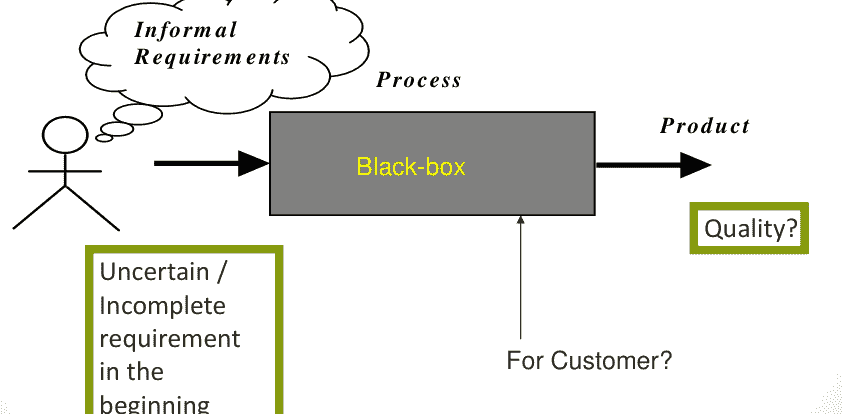

## （B.3）软件工程理论体系完善
- Reduce risks by improving visibility—**white-box**
- Allow project **changes** as the project progresses
  - based on feedback from the customer

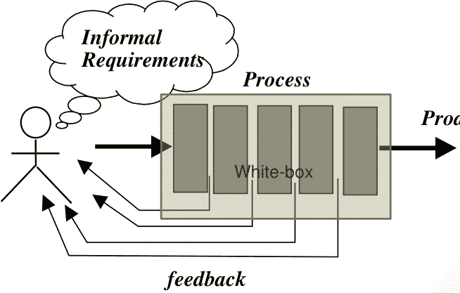

No silver bullet

## （C）第三次软件危机（2001 to present）
- （C.1）危机表现
  - 变更/演化/重用（质量、效率、成本）
  - 知识产权问题、安全问题
- （C.2）危机根源
  - 大量遗产系统的挖掘和重用
  - 大量开源软件/代码的使用
  - 普遍存在的动态/不确定需求
- （C.3）软件工程理论体系发展/重建
  - 自动化
  - 智能化/智慧化
    - 自适应、自测试、自修复、自主演化
  - 自主软件（混源软件、开源软件、闭源软件）

## （2）什么软件工程核心关注点

| 关注点 | 问题 | 手段 |
|---|---|---|
| 质量<br>效率<br>成本<br>变更<br>…… | 如何提高产品质量 | 软件质量保障技术 |
|  | 如何提高管理效率，降低成本，缩短上市时间 | 软件工程过程模型 |
|  | 如何提高开发效率，解决维护难的问题 | 软件开发方法/语言/工具 |
|  | 如何适应用户需求变更 | 演化维护技术 |

持续关注点：（质量、效率、成本）变更

## IEEE Standard 610.12-1990

## Software Engineering

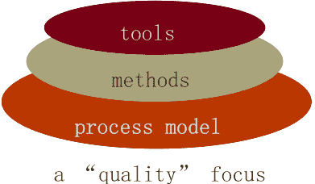

SE工具：（半）自动化支持（CASE）

SE方法：如何做；基本原则

SE基础：过程

SE根基：质量关注点

软件工程基础是过程(process)！！！

## 二、软件全生命周期质量保障问题

## （1）何谓全生命周期软件质量保障？

•If we rely on testing alone, defects created first are detected last

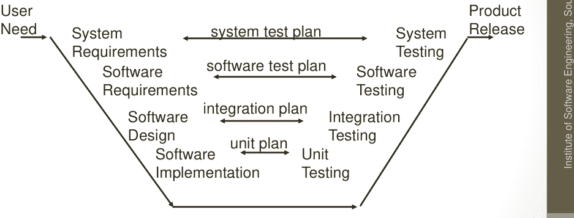

这是软件生命周期后期阶段的质量保障！

## W - Whole Life Cycle

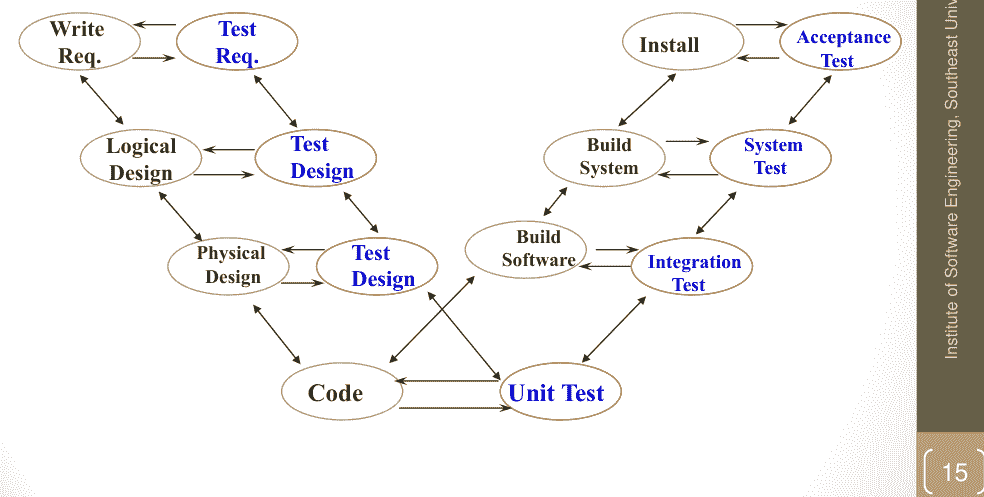

单个生命周期中每个阶段的质量保障！【传统线性开发】

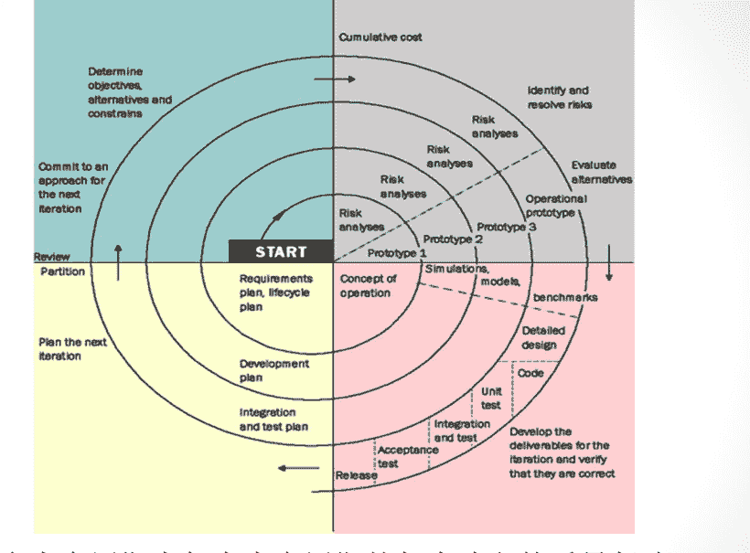

多生命周期中每个生命周期的每个阶段的质量保障！（非线性开发，敏捷开发的基础理念）

## （2）全生命周期软件质量如何保证？

## Two Legs

## Software development

## Software defect / Fault detection
- Formal Specification
- SPI
- Architecture
- CMM
- UML
- ……

- Software analysis
- Software testing
- Software measure
- Formal verification
- Dynamic monitoring
- ……

## （3）软件质量与软件缺陷的关系-root cause analysis
- analysis
- testing
- measurement
- verification
- simulation
- prediction

## 内部质量

## 外部质量

Readability, understandability

Reliability, Testability…

Find Bugs

Code/Document /Model/Data quality

Software/system quality

maintainability, controllability, dead-free, error-prone, liveness… …

Safety, security, …

run-time monitoring

## 三、关注点牵引的科研选题

## （1）关注点牵引的科学研究选题

## 领域空间

## 质量问题空间

## 方法空间

对象计算

代码

文档

数据

服务计算

云计算

产品

代码质量

数据质量

设计质量

文档质量

需求质量

模型质量

分析方法

测试方法

验证方法

恢复方法

仿真方法

监控方法

- 确定选题的一般步骤：
- 1）找到您最熟悉也是最感兴趣的领域
- 2）分析最需要、也是您最有可能解决的问题
- 3）寻找您最有把握的问题解决方法
- 4）确定最终选题

问题：1）有价值；2）未（完全）解决
问题求解：1）老方法解决老问题；2）新方法解决老问题；3）老方法解决新问题；4）新方法解决新问题

## 代码质量问题的细化——举例

| 代码质量问题 | 问题发现方法举例 | 问题解决方法 |
|---|---|---|
| 复杂性问题 | 圈复杂度、Halstead复杂度 | Modification<br>Modularize<br>Refactor<br>Re-structure<br>Re-architecture<br>Re-configuration<br>Re-compile<br>Reverse Engineering<br>Re-engineering<br>Usage of patterns<br>…… |
| 一致性问题 | Conformance testing,<br>consistency checking |  |
| 兼容性问题 | 数据一致性、接口一致性检查 |  |
| 可维护性问题 | 可修改性分析、修改影响分析 |  |
| 可理解性问题 | 编码规范性检查 |  |
| 可扩展性问题 | 接口测试、内聚性度量 |  |
| 可集成性问题 | 接口测试、兼容性测试 |  |
| 信息流安全问题 | 信息流安全测试 |  |
| 可测试性问题 |  |  |
| …… |  |  |

|  |  |
|---|---|
| Understanding the API usage in Java | IST |
| A new method to encode calling contexts with recursions | SCIENCE CHINA |
| Efficient online cycle detection technique combining with Steensgaard points-to information | SPE |
| Incremental verification of evolving BPEL-based Web composite service | CJE |
| Regression Testing of Web Service: A Systematic Mapping Study | ACM Computing Surveys |
| Profiling Selected Paths with Loops | SCIENCE CHINA |
| PHAT: A Preference and Honesty Aware Trust Model for Web Services Trust Model for Web Services | IEEE TNSM |
| Verifying the Concurrent Properties in BPEL Based Web Service Composition Process | IEEE TNSM |
| FCA-CIA: An Approach of Using FCA to Support Cross-level Change Impact Analysis for Object Oriented Java Programs | IST |
| A Survey of Code-based Change Impact Analysis Techniques | STVR |
| Using Water Wave Propagation Phenomenon to Study Software Change Impact Analysis | ADES |
| Combining Concept Lattice with Call Graph for Impact Analysis | ADES |
| Profiling All Paths: A New Profiling Technique for Both Cyclic and Acyclic Paths | JSS |
| Automatic Test Case Selection for Regression Testing of Composite Service Based on Extensible BPEL Flow Graph | JSS |
| Combining Control Structure and Composition Condition for Web Services Reliability Prediction | CJE |
| HSM-based Change Impact Analysis of Object-Oriented Java Programs | CJE |
| Generating Test Case of Composite Services Based on OWL-S and EH-CPN | IISEKE |
| A Classification and Comparison of Model Checking Software Architecture Techniques | JSS |
| Timed Property Sequence Chart | JSS |
| Static change impact analysis techniques: A comparative study | JSS |
| MSR4SM: Using topic models to effectively mining software repositories for software maintenance tasks | IST |
| SE-FCA: A Model of Software Evolution with Formal Concept Analysis | CJE |
| Analyzing Impact Rules of Different Change Types to Support Change Impact Analysis | IISEKE |
| Change impact analysis and changeability assessment for a change proposal: An empirical study | JSS |
| Model and Verification of WS-CDL Based on UML Diagrams | IISEKE |


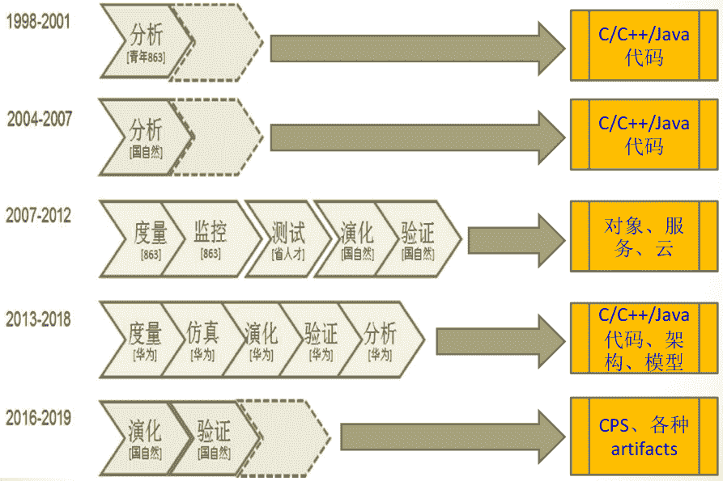

## （2）关注点驱动的项目申报


东南大学软件工程研究所（ISEU，Institute of Software Engineering, Southeast University）是一个专注于软件工程理论和实践的学术机构，由中泰信息教授于2012年1月8日发起成立。ISEU是在软件工程理论与实践研究室的基础上，融合软件分析与测试和面向服务的软件工程等研究室共同建立起来的，现有教师10名、博士后2名、博士生10名、硕士生30名，外国留学生6名。

## 研究所的任务

全面开展软件工程及其相关领域的学术研究，出高水平的研究成果；全面开展软件工程实践探索，使之直接服务于社会，造福于人民；培养软件工程领域的高级研究人才和工程技术人才，为我国软件技术研究和软件产业发展做出我们的贡献。

东南大学软件工程研究所近年来承担着20多项国家级和省部级的科研项目（包括国家863高技术计划项目、国家自然科学基金项目、江苏省自然科学基金项目、教育部博士点基金项目等），同时也承担了10多项横向合作项目的研究与开发工作。研究所近年来取得了一系列令人满意的成果：出版高水平学术专著（译）著5部，发表论文160余篇，被SCI/EI检索超过150篇次，授权发明专利30项，软件著作权登记14项；为社会输送博士毕业生10人，硕士毕业生80余人。

研究所承担了计算机科学与技术学科、软件工程学科大量的基础课和专业课的教学工作，通过教学与科研的紧密结合，促进教学质量不断提高。ISEU希望和世界范围内软件工程领域的研究者和实践者建立广泛的交流与合作。

## 主要研究方向

- （1）软件工程的基础理论和实践；（2）软件分析、测试和验证；（3）软件演化、维护和变更影响分析；（4）软件设计模式和架构模式识别；（5）软件架构演化、评估和重构；（6）软件安全性和可靠性，等等。

## 代表性原型工具简介

**1. 软件架构可演进性评估系统 v1.0**
由ISEU开发的软件架构可演进性评估原型系统，用于辅助分析当前架构的演进能力，对软件架构整体指标和组件指标进行评估。系统多层次地分析和识别软件架构，指出软件架构构成的演进能力和演进效果。具体功能：面向架构的逆向工程、从四个维度度量架构的演进能力、架构演进性度量、架构演进性度量模型、架构动态映射、架构可演进性分析、架构演进性评估、质量驱动的架构模式决策等。

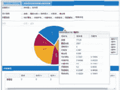

**2. 切片工具 MyJavaSlicer v1.0**
由ISEU开发的一款自动化Java程序切片工具，能够对JDK 7开发的面向对象程序进行静态和动态切片，支持多种切片标准。工具具备语句切片、有关条件切片、后向切片等功能，并支持Java故障定位、语句覆盖分析，可复用功能提供双向及API度量等。

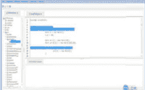

**3. 软件演化度量评估系统 v1.0**
由ISEU开发的用于软件演化度量和评估的原型系统。该系统目前具有软件架构演化度量和评估、源代码演化度量和评估两大功能。具体包括：架构演化度量设计、构件演化度量分析、引起度量结果差异的原因分析和定位；软件演化对代码复杂度、复杂度变化和复杂度变化率的影响分析；对软件可靠性、可维护性、可兼容性的影响，演化成本预测等。

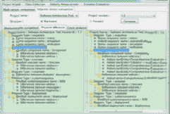

**4. 软件架构协同度、评估与验证系统 v2.0**
由ISEU开发用于软件架构构件、评估和验证的原型系统，按照自定向方式对基于UML设计模型的软件架构构件和文档进行协同、评估和验证。为架构设计提供直观可靠的评价结果，指导架构设计与演化。具体包括：架构融合性检验、架构易维护性、架构协同性、架构验证、架构可理解性、知识库构建和整合评价等。

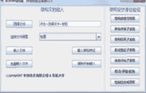

谢谢大家！

## 第一章

## 软件与软件工程


## 软件的双重角色

- **软件是一种产品**
  - *转换*信息 - 生产、管理、获取、修改、显示或传输信息；
  - 提供硬件和网络的计算潜力
- **软件是交付产品的载体**
  - 控制其他程序（操作系统）；
  - 实现通信（网络软件）；
  - 帮助构建其他软件（软件工具和环境）

## 软件应用

- 系统软件
- 应用软件
- 工程/科学软件[CAD等]
- 嵌入式软件
- 产品线软件
- Web应用
- AI软件

## 硬件 vs. 软件

## 硬件

- 制造而成
- 会磨损 [磨损]
- 由组件构建
- 相对简单

## 软件

- 开发/工程化
- 会恶化 [恶化]
- 定制构建 [根据需求定制的]
- 复杂

## 制造 vs. 开发

- 一旦硬件产品制造完成，就很难或不可能修改。相比之下，软件产品会常规地被修改和升级。
- 在硬件中，雇佣更多人可以完成更多工作，但在软件工程中则不一定如此。
- 与硬件不同，软件成本集中在设计而非生产上。

## 磨损 vs. 退化

## 软件会随时间推移而退化

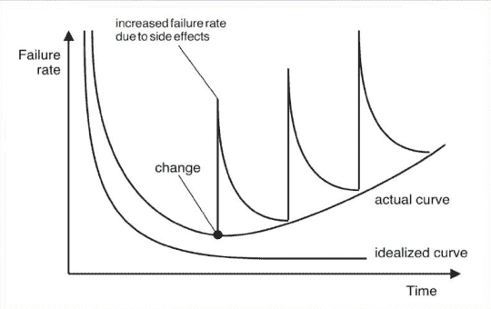

## 基于组件 vs. 定制构建

- 硬件产品通常采用许多标准化的设计组件。
- 大多数软件仍然是定制构建的。
- 软件行业似乎正在缓慢地向基于组件的构建方式转变。

## 软件复杂性

我认为构建软件的困难之处在于对这一概念构造的规范、设计和测试，而不是表示它并测试其保真度的劳动。

如果这是真的，构建软件将永远是困难的。本质上不存在银弹。

> - Fred Brooks，《没有银弹》

http://www.computer.org/computer/homepage/misc/Brooks/

No Silver Bullet: 没有仙丹 只没有一下子就能解决问题的方法


## 遗留软件

## 为什么必须改变？

## 可变性

- 必须修复以消除错误。
- 必须增强以实现新的功能和非功能需求
- 软件必须适应以满足新计算环境或技术的需求。
- 软件必须增强以实现新的业务需求。
- 软件必须扩展以使其能够与其他更现代的系统或数据库互操作。
- 软件必须重新架构以使其在网络环境中可行。

## E 型系统

- **E 型系统：**
  已在真实计算环境中实现的软件，因此会随着时间推移而演进

## 软件演化[Lehman定律]

- **持续变化规律 [The Law of Continuing Change] (1974)**: E 型系统必须不断适应，否则会逐渐变得不令人满意。
- **复杂性增长规律 [The Law of Increasing Complexity] (1974)**: 随着 E 型系统的演进，其复杂性会增加，除非进行工作以维持或降低它。
- **自我调控规律 [The Law of Self Regulation] (1974)**: E 型系统演化过程是自我调节的，产品和过程度量的分布接近正态。

## 软件演化…

- **组织稳定性守恒规律 [The Law of Conservation of Organizational Stability] (1980)**: 演进中的 E 型系统中平均有效全局活动率在其产品生命周期内保持不变。
- **保证通晓性规律 [The Law of Conservation of Familiarity] (1980)**: 随着 E 型系统的演进，与之相关的人员，例如开发人员、销售人员、用户，必须掌握其内容和行为，以实现令人满意的演进。
- **持续增长规律 [The Law of Continuing Growth] (1980)**: E 型系统的功能内容必须不断增加，以在其生命周期内保持用户满意度。

## 软件演化…

- **质量衰减规律 [The Law of Declining Quality] (1996)**: 除非严格维护并适应运行环境变化，否则 E 型系统的质量似乎会下降。
- **反馈系统规律 [The Feedback System Law] (1996)**: E 型演化过程构成多级、多环、多代理反馈系统，必须如此对待才能在任何合理基准上实现显著改进。

来源：Lehman, M., et al, “Metrics and Laws of Software Evolution—The Nineties View,” Proceedings of the 4th International Software Metrics Symposium (METRICS ’97), IEEE, 1997, 可从 http://www.ece.utexas.edu/~perry/work/papers/feast1.pdf 下载

## 软件谬论[谬论]

- 影响管理人员、客户（以及其他非技术利益相关者）和从业人员
- 因为它们通常包含部分真实，所以是可信的，
  *但 ...*
- 无一例外会导致糟糕的决策，
  *因此 ...*
- 在软件工程中导航时坚持现实

## 软件谬论

- 如果我们落后于进度，我们可以**增加更多程序员**并赶上进度。
- **关于目标的一般性陈述**足以开始构建程序。
- 项目需求的变化可以**轻松适应**，因为软件具有灵活性。

## 管理谬论

- “我们已经有一本构建软件的标准和程序手册。它为我的员工提供了**他们所需了解的一切**…”
- “如果我的项目落后于进度，我总是可以增加更多程序员来赶上进度…”
  - （又名“**蒙古部落的概念—The Mongolian Horde concept**”）
- “如果我决定将软件项目**外包**给第三方，我就可以放松：让他们构建，我只需坐收利润…”

## 客户谬论

- “关于目标的一般性陈述足以开始编写程序——我们可以稍后填补细节…”
- “项目需求不断变化，但这种变化可以轻松适应，因为软件具有灵活性…”


## 实践者的误区

- “我们**尽快开始编码**吧，因为一旦我们写出程序并让它运行起来，我们的工作就完成了……”
- “在程序运行起来之前，我**无法**评估其质量……”
- “一个成功项目唯一可交付的工作产品就是可运行的程序……”
- “软件工程是胡说八道[胡扯]。它让我们创建大量文书工作，只会拖慢我们的速度……”

## 第2章 过程：通用视图（过程综述）


## 再看软件工程

## 软件工程：IEEE 定义

软件工程：(1) 将系统的、规范的、可量化的[系统的、规范的、可量化的]方法应用于软件的开发、运行和维护；也就是说，将工程学应用于软件。(2) 对(1)中所述方法的研究。

- IEEE标准 610.12-1990

## 软件工程：分层技术

软件工程

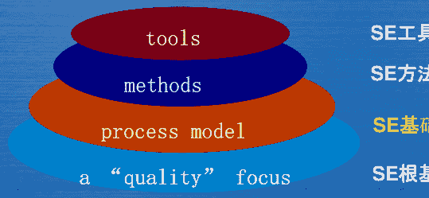

- SE工具：(半)自动化支持(CASE)
- SE方法：如何做；基本原则
- SE基础：过程
- SE根基：质量关注点

软件工程基础是过程(process)！！！

## 2.1 软件过程模型

- 试图通过以下方式组织软件生命周期：
  - 定义软件生产[软件生产]所涉及的活动
  - 定义活动的顺序及其关系
- 软件过程的目标
  - 标准化、可预测性、生产率、高质量产品、能够规划时间和预算需求

## 早期做法：编码与修复

最早的方法

- 编写代码
- 修复它(修复)以消除已检测到的任何错误，增强现有功能，或添加新特性
- 困难和缺陷的来源
  - 无法预测
  - 无法管理
- 不足的症状：软件危机
  - 计划时间和成本超支
  - 未达到用户期望
  - 质量差
- 软件应用的大小和经济价值需要适当的“过程模型”

## 2.2 过程模型目标(B. Boehm 1988)

确定软件开发和演化所涉及阶段的顺序，并建立从一个阶段进入下一个阶段的**过渡标准**。这些标准包括当前阶段的**完成标准**，以及下一阶段的**选择标准**和**进入标准**。因此，过程模型要解决以下软件项目问题：

- 我们接下来该做什么？
- 我们应该继续做多久？

## 3 怎么看软件过程？

- 3.1 黑盒观点
- 3.2 白盒观点

### 问题

- 假设是需求在开发之前可以被完全理解
- 与客户的交互只发生在开始(需求)和结束(交付后)
- 不幸的是，这个假设几乎从不成立

### 3.2 将过程视为“白盒”

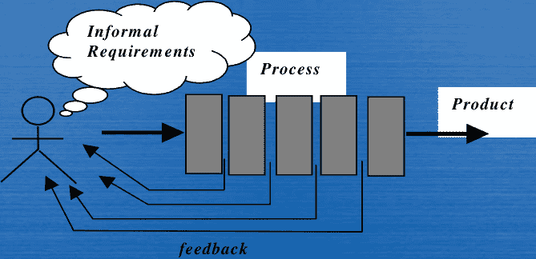

- 非正式需求
- 过程
- 产品
- 反馈

### 优势

- 通过提高可见性来降低风险
- 允许项目在推进过程中发生变化
  - 基于客户的反馈

## 4 过程框架

### 过程框架

- 软件过程
  - 过程框架
    - 伞形活动
    - 框架活动 #1
      - SE动作 #1.1
        - 任务集
          - 工作任务
          - 工作产品
          - 质量保证点
          - 里程碑
      - SE动作 #1.2
        - 任务集
          - 工作任务
          - 工作产品
          - 质量保证点
          - 里程碑
    - 框架活动 #2
      - SE动作 #2.1
        - 任务集
          - 工作任务
          - 工作产品
          - 质量保证点
          - 里程碑
      - SE动作 #2.2
        - 任务集
          - 工作任务
          - 工作产品
          - 质量保证点
          - 里程碑

## 4.1 通用框架活动[阶段]

- 沟通[沟通]
- 策划[策划]
- 建模[建模]
  - 需求分析
  - 设计
- 构建[构建]
  - 代码生成
  - 测试
- 部署[部署]

在通用的过程框架中，建模活动包括分析和设计两个动作(action)。分析包括一组任务（如需求获取、细化、协商、规格说明和确认），最终产生需求分析模型（和/或需求规格说明书）。设计也包括一组工作任务（如数据设计、体系结构设计、接口设计和构件层设计），最终产生设计（和/或设计规格说明书）。


## 4.2 普适性活动[Umbrella Activities]

- Software project management
- Formal technical reviews
- Software quality assurance
- Software configuration management
- Work product preparation and production
- Reusability management
- Measurement
- Risk management

## 通用框架的适用性(Adaptability)

- The framework activities will always be applied on every project ... BUT
- The tasks (and degree of rigor) for each activity will vary based on:
  - the type of project
  - characteristics of the project
  - common sense[常识] judgment; concurrence of the project team

## 5 能力成熟度模型集成(CMMI)

这部分自学

## CMMI简介

- CMMI全称是Capability Maturity Model Integration，即软件能力成熟度模型集成，是由美国国防部与卡内基-梅隆大学和美国国防工业协会共同开发和研制的，其目的是帮助软件企业对软件工程过程进行管理和改进，增强开发与改进能力，从而能按时地、不超预算地开发出高质量的软件。
- 其所依据的想法是：只要集中精力持续努力去建立有效的软件工程过程的基础结构，不断进行管理的实践和过程的改进，就可以克服软件开发中的困难。
- CMMI为改进一个组织的各种过程提供了一个单一的集成化框架，新的集成模型框架消除了各个模型的不一致性，减少了模型间的重复，增加透明度和理解，建立了一个自动的、可扩展的框架。因此能够从总体上改进组织的质量和效率。CMMI主要关注点就是成本效益、明确重点、过程集中和灵活性四个方面。

## The CMMI

- The CMMI defines each process area in terms of “specific goals” and the “specific practices” required to achieve these goals.
- **Specific goals** establish the characteristics that must exist if the activities implied by a process area are to be effective.
- **Specific practices** refine a goal into a set of process-related activities.

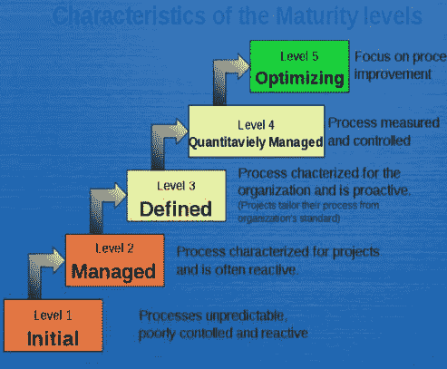

## 6 过程评估

评估软件过程以确认满足了成功软件工程所需的基本过程标准（BASIC PROCESS CRITERIA）要求。

## Process Assessment

- The process should be assessed to ensure that it meets a set of basic process criteria that have been shown to be essential for a successful software engineering.
- Many different assessment options are available:
  - SCAMPI: Standard CMMI Assessment Method for Process Improvement
  - CBA IPI: CMM-Based Appraisal for Internal Process Improvement
  - SPICE: ISO/IEC 15504 Standard
  - ISO 9001:2000 Standard

## The Primary Goal of Any Software Process: *High Quality*

Remember:

High quality ⇒ project timeliness [项目的时效性]

Why?

Less rework!

## Chapter 3
Process Models


## 本章要点

- 惯例模型
  - 瀑布模型
  - V模型
  - 增量模型
  - 演化模型
  - UP模型
  - 线性模型
  - 非线性模型

## Prescriptive Models [惯例模型]

Prescriptive process models **advocate an orderly approach** to software engineering

*That leads to a few questions …*

- If prescriptive process models strive for **structure and order**, are they **inappropriate** for a software world that **thrives on change**?
- Yet, if we reject traditional process models (and the order they imply) and replace them with something less structured, do we **make it impossible** to achieve **coordination and coherence** in software work?


## The Waterfall Model

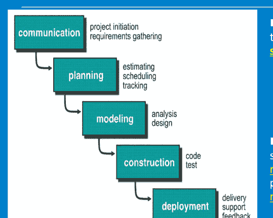

Bradac found that the linear nature of the waterfall model leads to “blocking states”.

Where some members must wait for other members of the team to complete dependent tasks.

Especially, at the beginning of the project.

Still, however, the waterfall model serve as a useful process model where requirements are fixed and work is to proceed to completion in a linear manner.

## Waterfall Model Assumptions

- 1. The requirements are **knowable** in advance of implementation.
- 2. The requirements have **no unresolved, high-risk implications**.
  - e.g., risks due to COTS choices, cost, schedule, performance, safety, security, user interfaces, organizational impacts.
- 3. The nature of the requirements will **not change very much**.
  - During development; during evolution.

## Waterfall Model Assumptions...

- 4. The requirements are **compatible with** all the key system stakeholders’ expectations.
  - e.g., users, customer, developers, maintainers, investors.
- 5. The **right architecture** for implementing the requirements is well understood.
- 6. There is **enough calendar time** to proceed sequentially.


## V 模型

> 如果我们仅依赖测试，**首先创建**的缺陷会**最后被检测**出来

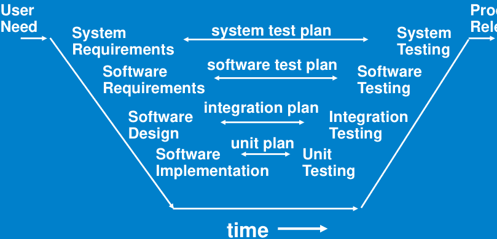

## 增量模型：增量

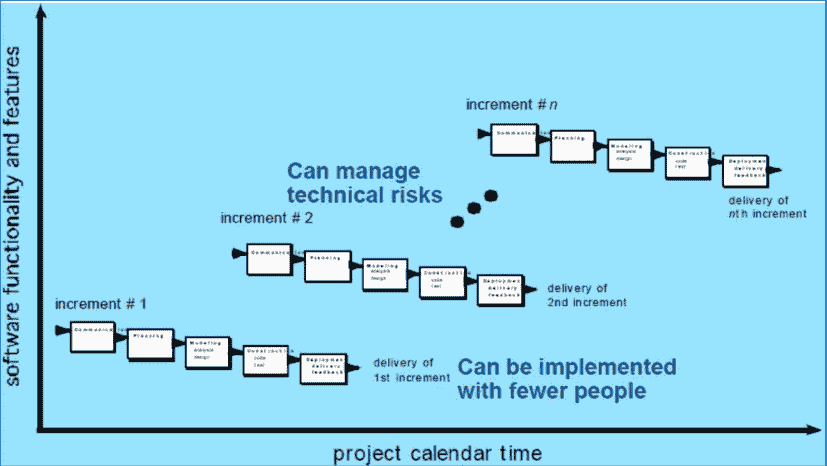

## 增量模型：RAD 模型

- 需要充足的人力资源
- 模块化是前提条件
- 无法进行全局调优

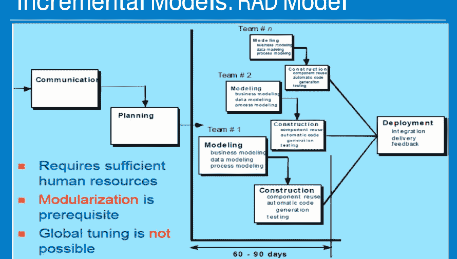

## 进化模型：原型法

- 原型法最适合以下情况。
  - 客户无法明确软件的详细需求。
  - 软件工程师不确定算法的效率、软件的可用性等。

- 换句话说，原型法有助于软件工程师和客户理解要构建的内容。

- 快速设计和实现专注于软件中对客户可见方面的表示。
  - 理想情况下，原型可作为识别软件需求的机制。

## 进化模型：原型法...

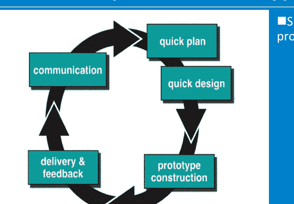

原型法中的一些问题

- 软件工程师试图修改原型以用作工作版本
- 一旦客户看到可工作的原型，他/她就会期望很快获得可工作的产品

## 进化模型：螺旋模型

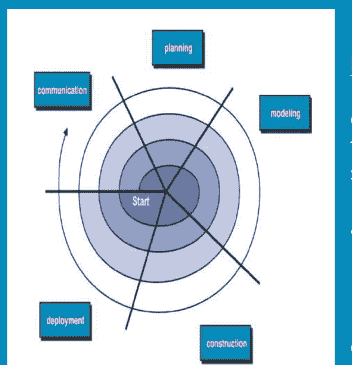

螺旋模型由 Barry Boehm 在其 1986 年的文章“A Spiral Model of Software Development and Enhancement”中定义。该模型并非第一个讨论迭代的模型，但它是第一个解释迭代为何重要的模型。最初设想时，迭代通常持续 6 个月到 2 年。螺旋模型（Boehm, 1988）旨在通过在任何阶段采取任何手段来降低风险。螺旋模型通常被称为风险驱动模型。

定义：螺旋模型，也称为螺旋生命周期模型，是一种用于信息技术（IT）中的系统开发生命周期（SDLC）模型。该开发模型结合了原型模型和瀑布模型的特点。螺旋模型适用于大型、昂贵且复杂的项目。

## 螺旋模型中的步骤

1. 新系统的需求尽可能详细地定义。这通常涉及访谈代表所有外部或内部用户以及现有系统的其他方面的多名用户。
2. 为新系统创建初步设计。
3. 根据初步设计构建新系统的第一个原型。这通常是一个规模较小的系统，代表了最终产品特征的近似。
4. 第二个原型通过四步程序演进：
   (1) 从其优势、劣势和风险方面评估第一个原型；
   (2) 定义第二个原型的需求；
   (3) 规划和设计第二个原型；
   (4) 构建和测试第二个原型。

## 螺旋模型中的步骤...

5. 根据客户的选择，如果风险被认为过大，整个**项目可以被中止**（流产）。风险因素可能涉及开发成本超支（超出限度）、运营成本误算（误算），或客户判断可能导致最终产品不令人满意的任何其他因素。
6. 现有原型以与之前原型相同的方式进行评估，如果必要，根据上面概述的四步程序从中开发**另一个原型**。
7. 前述步骤迭代进行**直到**客户满意精炼后的原型代表了期望的最终产品。
8. 最终系统基于**精炼后的原型**构建。
9. 对**最终系统**进行彻底评估和测试。常规维护持续进行，以防止大规模故障并最大限度地减少停机时间


## 完整螺旋模型

- 径向维度[按射线方向]：截至目前累计成本
- 角向维度[按螺旋方向]：螺旋过程中的进展

## 完整螺旋模型 ...

累计成本

确定目标、备选方案和约束

确定下一次迭代的方法

审查

划分

规划下一次迭代

开始

需求计划、生命周期计划

操作概念

模拟、模型、基准

识别并解决风险

风险分析

评估备选方案

操作原型

原型3

原型2

原型1

风险分析

风险分析

风险分析

详细设计

编码

单元测试

集成和测试

验收测试

发布

开发迭代的交付物并验证其正确性

开发计划

集成和测试计划

## 统一过程模型

一种软件过程，它：

- 用例驱动
- 以架构为中心
- 迭代和增量

与统一建模语言（UML）紧密对齐

## 统一过程（UP）

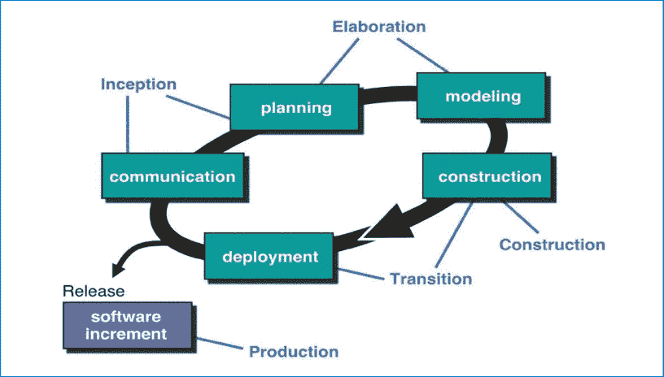

## UP 工作产品

- 初始阶段
  - 愿景文档
  - 初始用例模型
  - 初始项目术语表
  - 初始业务案例
  - 初始风险评估
  - 项目计划的阶段和迭代
  - 如有必要，业务模型
  - 一个或多个原型

- 细化阶段
  - 用例模型
  - 补充需求，包括非功能性需求
  - 分析模型
  - 软件架构描述
  - 可执行的架构原型
  - 初步设计模型
  - 修订后的风险列表
  - 项目计划，包括
    - 迭代计划
    - 调整后的工作流程
    - 里程碑
    - 技术工作产品
  - 初步用户手册

- 构建阶段
  - 设计模型
  - 软件组件
  - 集成的软件增量
  - 测试计划和规程
  - 测试用例
  - 支持文档
    - 用户手册
    - 安装手册
    - 当前增量的描述

- 移交阶段
  - 已交付的软件增量
  - Beta测试报告
  - 一般用户反馈

## 企业统一过程的生命周期

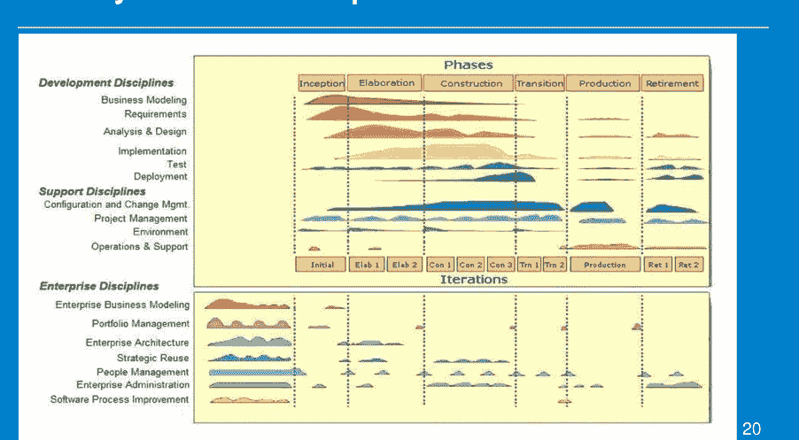

## 其他过程模型

- 基于组件的开发——当**复用**是开发目标时应用的过程
- 形式化方法——强调需求的**数学规格说明**
- AOSD——为定义、规约、设计和构造**方面**提供过程和方法论途径

## 第4章
敏捷开发

**软件工程：实践者的研究方法，第6版**
*罗杰·S. 普雷斯曼 著*

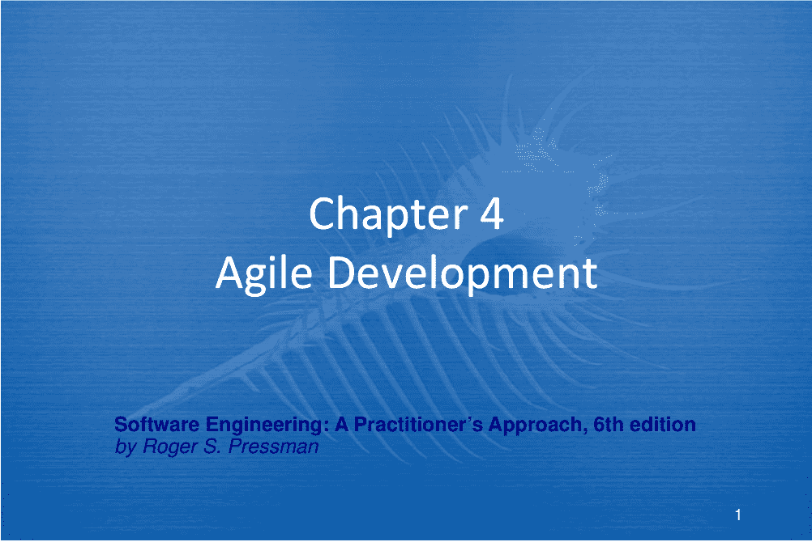

## 本章要点

- 敏捷开发
  - 极限编程（XP）
  - 自适应软件开发（ASD）
  - 动态系统开发方法（DSDM）
  - Scrum模型
  - Crystal模型
  - 特征驱动开发（FDD）

## 开发人员常见的恐惧

- 项目将产生错误的产品[有错的产品].
- 项目将产生低质量的产品[低质量的产品].
- 项目将会延迟[延迟].
- 我们将不得不每周工作80小时[每周工作80小时].
- 我们将不得不违背承诺[违约].
- 我们不会有乐趣[没有休闲时间].

## 敏捷软件开发宣言

2001年Kent Beck和其它16位知名软件开发者、软件工程专家以及软件咨询师(称为敏捷联盟)共同签署“敏捷软件开发宣言”,该宣言声明:

> “我们正在通过实践和帮助他人实践来发现更好的软件开发方式。通过这项工作，我们开始重视：

- 个体和互动 高于 流程和工具
- 可工作的软件 高于 详尽的文档
- 客户合作 高于 合同谈判
- 响应变化 高于 遵循计划

也就是说，虽然右侧的条目有其价值，但我们更重视左侧的条目。”[虽说上述右边的各项很富有价值,但我们认为左边的各项具有更大的价值]

-- Kent Beck 等（2001）。

## 敏捷开发是一场运动

- 本质上讲，敏捷方法是为了克服传统软件工程中认识和实践的弱点设计而成的。敏捷开发带来多方面的好处，但它不适用于所有的项目、所有的方面、所有的人和所有的情况，它并不独立于传统的软件工程实践，也不能作为超越一切的哲学理念而用于所有软件工作。


## What is “Agility”?

- **适应变更：** 有效（快速且适应性强）的 **response to change** 对变更做出响应
- **交流通畅：** 所有利益相关者之间的 **Effective communication** 有效沟通
- **客户参与：** 将客户 **Drawing the customer** 吸纳到团队中[吸收]
- **有效控制：** 组织团队使其对所执行的工作 **in control** 保持控制

*Yielding ...*

- 快速、增量的软件交付

## 12 Principles of Agility——敏捷联盟[2003]

1. Our **highest priority** is to satisfy the customer through early and continuous delivery of valuable software.
   [我们最先要做的是通过尽早、持续交付有价值的软件来使客户满意]
   我们的 **最高优先事项** 是通过尽早、持续交付有价值的软件来使客户满意。
   [我们最先要做的是通过尽早、持续交付有价值的软件来使客户满意]

2. Welcome **changing requirements**, even late in development. Agile processes harness change for the customer’s competitive advantage.
   [即使在开发的后期，也欢迎需求变更。敏捷过程利用变更为客户创造竞争优势]
   欢迎 **变更需求**，即使在开发后期。敏捷过程利用变更为客户创造竞争优势。
   [即使在开发的后期，也欢迎需求变更。敏捷过程利用变更为客户创造竞争优势]

3. **Deliver working software frequently**, from a couple of weeks to a couple of months, with a preference to the shorter time scale.
   [经常交付可工作软件，交付的时间间隔可以从几个星期到几个月，交付的时间间隔越短越好]
   **经常交付可工作的软件**，交付周期从几周到几个月不等，偏好较短的时间尺度。
   [经常交付可工作软件，交付的时间间隔可以从几个星期到几个月，交付的时间间隔越短越好]

4. Business people and developers must **work together** daily throughout the project.
   [在整个项目开发期间，业务人员和开发人员必须天天都在一起工作]
   业务人员和开发人员必须在整个项目期间 **共同工作**。
   [在整个项目开发期间，业务人员和开发人员必须天天都在一起工作]

## Principles of Agility...

9. Continuous attention to technical excellence and good design enhances agility. [不断地关注优秀的技能和好的设计会增强敏捷能力]
   不断关注技术卓越和良好设计会增强敏捷性。[不断地关注优秀的技能和好的设计会增强敏捷能力]

10. Simplicity - the art of maximizing the amount of work not done - is essential. [简单—使不需要的工作最大化的艺术—是必要的]
    简洁——最大化不做工作的艺术——是必不可少的。[简单—使不需要的工作最大化的艺术—是必要的]

11. The best architectures, requirements, and designs emerge from self-organizing teams. [好的架构、需求和设计出自于自组织团队]
    最佳的架构、需求和设计来自自组织团队。[好的架构、需求和设计出自于自组织团队]

12. At regular intervals, the team reflects on[反省] how to become more effective, then tunes and adjusts its behavior accordingly. [每隔一定时间，团队会反省如何才能更有效地工作，并相应调整自己的行为]
    在定期间隔，团队会反省[反省]如何变得更有效，然后相应地调整和改进其行为。[每隔一定时间，团队会反省如何才能更有效地工作，并相应调整自己的行为]

## An Agile Process

- 由客户对所需内容的描述驱动（scenarios 场景）
- 认识到计划是短期的[短期的]
- 以建设活动为重点迭代开发软件
- 交付多个“software increments[软件增量]”软件增量
- 随着变更的发生而适应

## Extreme Programming (XP)

- 最广泛使用的敏捷过程，最初由 Kent Beck 于 [1999] 提出
- XP Planning
  - 以创建 **user stories** 用户故事开始
  - 敏捷团队评估每个故事并分配 **cost** 成本
  - 故事被分组以形成 **deliverable increment** 可交付增量
  - 对交付日期做出 **commitment[承担义务]** 承诺[承担义务]
  - 在第一个增量之后，**project velocity** 项目速度 用于帮助确定其他增量的后续交付日期

## Extreme Programming (XP)...

- **XP Design**
  - 遵循 **KIS (Keep it Simple) principle** KIS（保持简单）原则
  - 鼓励使用 **CRC cards** CRC 卡片（见第 8 章）
  - 对于困难的设计问题，建议创建 **spike solutions** —— 设计原型
  - 鼓励 **refactoring** —— 对内部程序设计的迭代改进
- **XP Coding**
  - 建议在编码开始 *之前* 为故事构建 **unit test** 单元测试
  - 鼓励 **pair programming** 结对编程
- **XP Testing**
  - 所有 **unit tests are executed daily** 单元测试每日执行
  - **Acceptance tests** 验收测试 由客户定义并执行以评估客户可见的功能

立即建立这部分设计的可执行原则，实现并验证设计原则

## Extreme Programming (XP)...

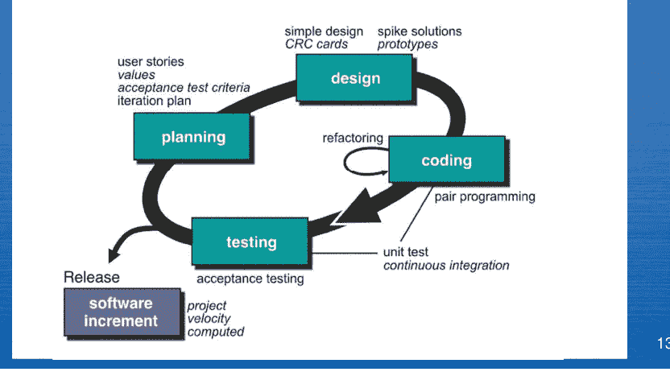

## Other Agile Processes

- Adaptive Software Development (ASD) 自适应软件开发
- Scrum
- Feature Driven Development 功能驱动开发
- ......

## Adaptive Software Development...

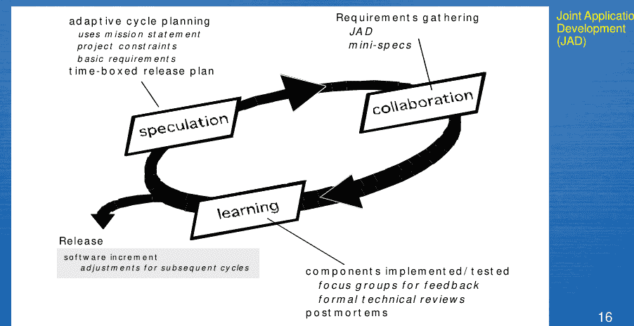

## Scrum（争球）

- 最初由 Schwaber 和 Beedle 于[2001]提出
- Scrum—区别特征
  - 开发工作被划分为“packets”包
  - 测试和文档在产品构建过程中持续进行
  - 工作以“sprints[冲刺]”进行，并源自“backlog[待定项]”现有需求的待办列表
  - 会议非常短，有时甚至不带椅子进行
  - “demos”演示在分配的时间盒内交付给客户


## Feature Driven Development

- 由 Peter Coad 等人于[1999]首次提出
- FDD—区分特征
  - 强调定义“特征”
    - 一个特征“是一个可在两周或更短时间内实现、且对客户有价值的功能。”
  - 使用特征模板
    - `<action> the <result> <by | for | of | to> a (n) <object>`
    - 例如，Add the technical-specifications of a product
  - 创建特征列表并进行“按特征规划”
  - 在 FDD 中设计与构建合并

## Feature Driven Development...

Marketing participates
MRD input

Carefully
Analyze
MRD

Prioritize and plan
Code development

Build code
in small
batches

1. Develop
an
Overall
Model

2. Build a
Feature
List

3. Plan
By
Feature

4. Design
By
Feature

5. Build
By
Feature

Wide rather
than deep

Deep rather
than wide

MRD: Market Requirement Document

## Engineering process

Engineering Lead Time

Marketing Requirements

Develop an Overall Model

Build Feature List

Plan By Feature

Design By Feature

Build By Feature

Finished Code

Weekly Integration Build

Test By Feature

Bug Reports


## Chapter 5
Practice: A Generic View

Software Engineering: A Practitioner's Approach, 6th edition
by Roger S. Pressman

## What is “Practice”?

- Practice 包括
  - concepts
  - principles
  - methods
  - tools
  在软件规划和开发时必须考虑的要素。

- 它代表了细节——软件过程的如何做。

## Core Software Engineering Principles

**David Hooker [1996] presented seven SE principles:**

- 1. Provide Value to Your Users[存在价值]
- 2. KIS (Keep It Simple)[保持简洁]
- 3. Maintain the Vision[维护视图]
- 4. What You Produce, Others Will Consume[生产者要让消费者理解]
- 5. Be Open to the Future[面向未来]
- 6. Plan Ahead for Reuse[计划复用]
- 7. Think before You Do[认真思考]

## Software Engineering Practices

- 考虑通用过程框架
  - Communication
  - Planning
  - Modeling
    - Analysis Modeling
    - Design Modeling
  - Construction
    - Coding
    - Testing
  - Deployment

## Communication Practices[沟通实践]

- **Principles**
  1. Listen effectively[倾听]
  2. Prepare before you communicate[有准备的沟通]
  3. Someone should facilitate the activity[需要有人推动]
  4. Face-to-face communication is best[最好当面沟通]
  5. Take notes and document decisions[记录所有决定]
  6. Strive for collaboration[保持通力协作]
  7. Stay focused, modularize your discussion[聚焦并协调话题]
  8. If something is unclear, draw a picture[采用图形表示]
  9. Know when to move on[继续前进原则]
  10. Negotiation works best when both parties win[谈判双赢原则]

## Planning Practices

- Principles
  1. Understand the project scope[理解项目范围]
  2. Involve the customer in planning[客户参与策划]
  3. Recognize that planning is iterative[采用迭代计划]
  4. Estimate based on what you know[基于已知估计]
  5. Consider risk as you define the plan[计划时考虑风险]
  6. Be realistic[脚踏实地]
  7. Adjust granularity as you define the plan[调整计划粒度]
  8. Define how you intend to ensure quality[制定计划确保质量]
  9. Describe how you intend to accommodate changes[描述如何适应变化]
  10. Track the plan frequently and make necessary adjustments[经常跟踪/校正计划]

## Modeling Practices

- **Analysis modeling principles**
  1. Represent the information domain[必须描述并理解问题的信息域]
  2. Represent software functions[必须确定软件所要实现的功能]
  3. Represent software behavior[必须描述软件的行为]
  4. Partition these representations[分层表示]
  5. Move from essence toward implementation[分析任务应该从本质信息转向实现细节]

## Construction Practices

- Coding Principles
- Preparation. Before you write one line of code, be sure you:
  1. Understand of the problem you’re trying to solve.[理解所要解决的问题]
  2. Understand basic design principles and concepts.[理解基本的设计原则和概念]
  3. Pick an appropriate programming language.[选择合适的编程语言]
  4. Select an appropriate programming environment and tools.[选择合适的编程环境]
  5. Create unit tests for each component you plan to create.[构件级编码完成后的单元测试]


### Construction Practices...

## Coding Principles

**Coding.** 开始编写代码时，请确保你：

- 1. 遵循结构化编程实践。 [遵循结构化编程方法约束算法]
- 2. 选择能满足设计需求的数据结构。 [选择能满足设计要求的数据结构]
- 3. 创建与软件架构一致的接口。 [理解软件架构并开发出与其相符的接口]
- 4. 尽可能保持条件逻辑尽可能简单。 [尽可能保持条件逻辑简单]
- 5. 以易于测试的方式创建嵌套循环。 [用易于测试的方法开发嵌套循环]
- 6. 选择有意义的变量名并遵循其他本地编码标准。 [选择有意义的变量名并符合相关编码标准]
- 7. 编写自文档化的代码。 [编码注释]
- 8. 创建有助于理解的视觉布局。 [增强代码的可读性]

### Construction Practices...

- Coding Principles
- Validation. 完成第一遍后，请确保你：
  1. 在适当时进行代码走查。 [适当进行代码走查]
  2. 执行单元测试并纠正发现的错误。 [进行单元测试并改正所发现的错误]
  3. 重构代码。 [重构代码]

### Construction Practices...

- Testing Principles
  1. 所有测试都应可追溯到需求 [所有的测试都应该可以追溯到用户需求]
  2. 测试应提前规划 [测试计划应该远在测试开始前就开始着手]
  3. 帕累托原则*适用于测试 [将Pareto原则应用于软件测试]
  4. 测试始于“微观”并向“宏观”推进 [测试应该从“微观”开始,逐步转向“宏观”]
  5. 穷举测试是不可能的 [穷举测试是不可能的]

- Note: 一个成功的测试是发现尚未发现的错误的测试。

*Pareto Principle (帕雷多原则 80/20原则) :80%的软件Bug集中在20%的软件模块中，体现了重点核心模块的重点开发和维护。

## Chapter 6
System Engineering

Software Engineering: A Practitioner's Approach, 6th edition
by Roger S. Pressman

## 本章要点

- 系统工程的层次性
- 产品工程的层次性
- 系统建模

## 背景

- 软件工程化之前必须了解软件所处的外部“系统”。为此，必须确定系统的整体目标，必须识别硬件、软件、人员、数据库、规程和其它系统要素的角色，而且必须对有效需求进行提取、分析、说明、建模、确认和管理，这些活动都是系统工程的基础。
- 要做到“既见树木、又见森林”

## System Engineering

- Elements of a computer-based system
  - Software
  - Hardware
  - People
  - Database
  - Documentation
  - Procedures
- Systems
  - A hierarchy of macro-elements [宏要素]

## The Hierarchy of System Engineering

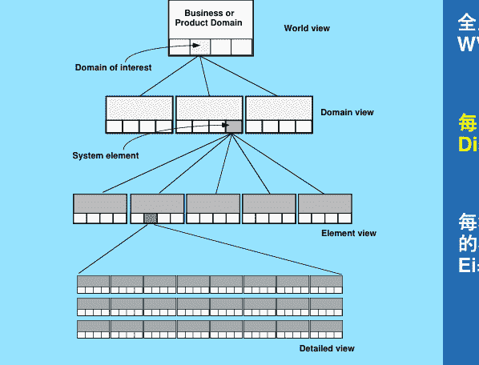

全局视图(WV)由领域集合组成：
WV=(D1,D2,D3,...,Dn)

每个领域(Di)由特定要素组成：
Di=(E1,E2,E3,...,Em)

每种特定要素(Ei)由完成特定功能的构件(Ci)来实现：
Ei=(C1,C2,C3,...,Ck)

## System Modeling

- define the processes that serve the needs of the view under consideration. [定义在所考虑视图中满足需要的过程]
- represent the behavior of the processes and the assumptions on which the behavior is based. [描述过程行为和该行为所依据的假设]
- explicitly define both exogenous and endogenous input to the model. [明确定义模型的外在和内在输入]
  - exogenous inputs link one constituent(要素) of a given view with other constituents at the same level or other levels; endogenous input links individual components of a constituent at a particular view.
- represent all linkages (including output) that will enable the engineer to better understand the view. [描述有助于工程师理解视图的全部联系(包括输出)]

## Business Process Engineering(BPE)

BPE的目标是定义一个能有效利用信息进行业务活动的体系。

- uses an integrated set of procedures, methods, and tools to identify how information systems can best meet the strategic goals of an enterprise
- focuses first on the enterprise and then on the business area
- creates enterprise models, data models and process models
- creates a framework for better information management, distribution, and control

## Product Engineering

PE的目的是将用户期望的已定义的一组能力转变成真实产品。

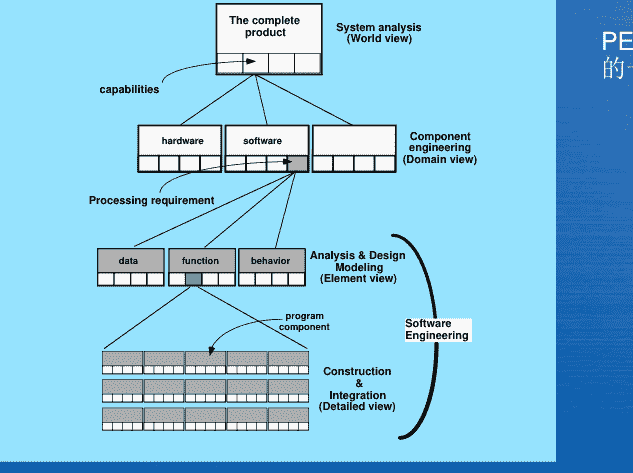

## System Modeling with UML

- UML提供了大量图表表示法, 它们用于在系统和软件层次进行分析和设计。
  - Deployment diagrams
    - Each 3-D box depicts a hardware element that is part of the physical architecture of the system
  - Activity diagrams
    - Represent procedural aspects of a system element
  - Class diagrams
    - Represent system level elements in terms of the data that describe the element and the operations that manipulate the data

*These and other UML models will be discussed later*


## 部署图

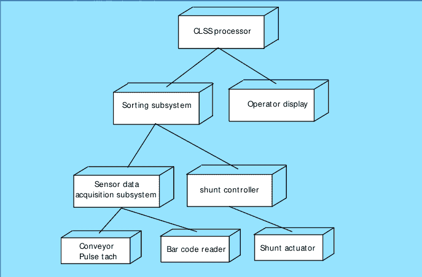

CLSS: 传送带分类系统

每个三维方盒描述了一个属于系统物理架构的硬件要素。

## 活动图

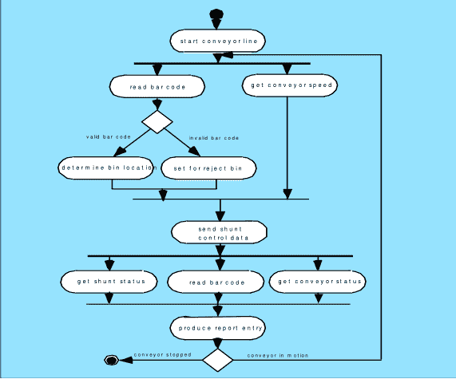

活动图表示系统实现各种功能时的具体步骤，圆角矩形表示特定的系统功能，箭头表示系统的流程，菱形表示分支（从菱形出发的箭头都需要标注），水平实线表示并发事件。

## 类图

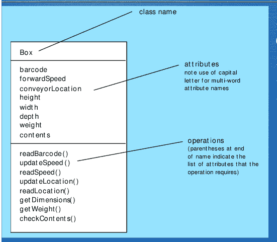

类是从问题描述中提取的。对CLSS来说，候选的类可能是：箱子、传送带、条形码阅读器、分流控制器、操作者请求、报告、产品以及其它。

## 第7章
需求工程

《软件工程：实践者的研究方法》第6版
Roger S. Pressman 著

#### 概述

- 需求工程帮助软件工程师更好地理解他们将要解决的问题。
- 具体步骤：首先定义将要解决的问题范围和性质；然后是引导、帮助客户定义需要什么；接下来是精炼需求，精确定义和修改基本需求。
- “构建一个软件系统最困难的部分是确定构建什么。其它部分工作不会像这部分工作一样，在出错之后会如此严重地影响随后实现的系统，并且在以后修补竟会如此的困难。”
  ——Fred Brooks

## 需求工程任务

- **启动**——建立对问题及解决方案性质的基本理解。
- **引导**——从利益相关者那里获取需求。
- **细化**——创建分析模型，以表示需求的信息、功能和行为方面。
- **协商**——就开发者与客户均可实现的交付系统达成一致。
- **规格说明**——正式或非正式地描述需求。
- **验证**——审查需求规格说明，检查错误、歧义、遗漏和冲突。
- **需求管理**——管理不断变化的需求。

## 1 启动

- 提出“与上下文无关”的问题
  - 这项工作的请求背后是谁？
  - 谁将使用该解决方案（产品/系统）？
  - 经济效益是什么？
  - 你如何描述系统“良好”的输出？
  - 该解决方案解决了哪些问题？
  - 产品将在什么环境中使用？
  - 你是回答这些问题的合适人选吗？
  - 这些问题相关吗？
  - 还有其他人能提供更多信息吗？
  - 我还应该问你什么？
  - ……

## 2.1 CRG会议[协同的需求收集会议]

- 所有感兴趣的利益相关者参加会议。
- 为准备和参与制定规则。
- 议程应足够正式以涵盖所有要点，但又应足够非正式以鼓励思想的自由交流。
- 由一名推动者[引导者，发起人]控制会议。
- 使用定义机制（黑板、活动挂图等）。
- 会议期间：
  - 明确问题。
  - 提出解决方案的要素。
  - 协商不同的方法。
  - 获得初步的解决方案需求集。
  - 氛围是协作式的，不具有胁迫性。

## 2.2 QFD：质量功能展开

- 将客户需求转化为技术需求。QFD的目的是最大限度地让客户从软件工程过程中感到满意。为此，QFD强调理解“什么是对客户有价值的”。
  - 功能展开确定系统所需每个功能（对客户）的“价值”。
  - 信息展开识别数据对象和事件。
  - 任务展开检查系统的行为。
  - 价值分析确定需求的优先级。

## 2.3 引导工作产品

- 必要性和可行性陈述。
- 系统或产品的范围说明。
- 参与需求引导的客户、用户和其它共同利益者的列表。
- 系统技术环境的说明。
- 需求列表，以及每个需求适用的领域限制。
- 一系列使用场景。
- 任何能够更好地定义需求的原型。

## 3 开发用例

- 用例场景是一个关于软件外部某人或某物（称为参与者）如何与系统交互的故事。
- 每个场景回答以下问题：
  - 谁是主要参与者，谁是次要参与者？
  - 参与者的目标是什么？
  - 故事开始前应存在哪些前置条件？
  - 参与者执行哪些主要任务或功能？
  - 在描述故事时可能考虑哪些异常情况？
  - 参与者的交互可能存在哪些变化？
  - 参与者将获取、产生或更改哪些系统信息？
  - 参与者是否需要告知系统外部环境的变化？
  - 参与者期望从系统中获得哪些信息？
  - 参与者是否希望被告知意外的变化？


## 4 构建分析模型

#### 4.1 分析模型的元素

- 基于场景的元素
  - 用例—外部参与者如何与系统交互（用例图；详细模板）
  - 功能—软件功能在系统中如何处理（流程图；活动图）
- 基于类的元素
  - 各种系统对象（从场景中获得）包括其属性和功能（类图）
- 行为元素
  - 系统如何响应不同事件（状态图）
- 面向流的元素
  - 信息如何在系统中流动时被转换（数据流图）

## 用例图

## SafeHome住宅安全功能的用例图

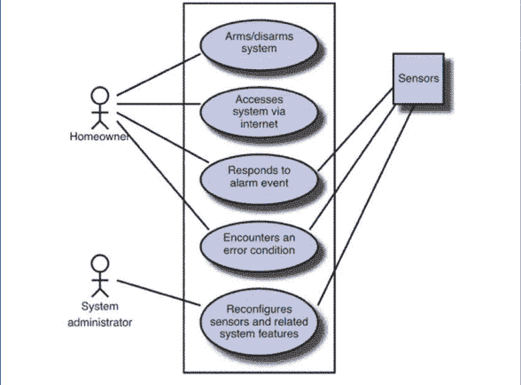

## RE 的活动图

导出需求描绘了一个UML活动图,显示了三层细节内容.

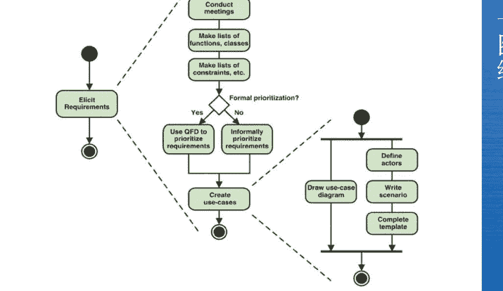

## 类图

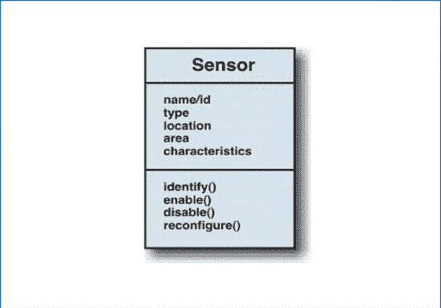

描绘SafeHome安全功能传感器类的类图。

## 状态图

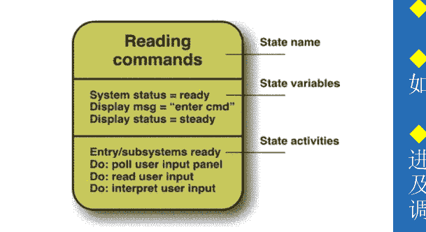

状态名：如读指令。

状态变量：指出状态如何向外界显示自己。

状态活动：指出如何进入状态(entry/)，以及当处在该状态时可以调动的动作(do:)。

## 5 协商需求

- 要让客户以成本和产品投放市场的时间为背景,平衡功能、性能和其它的产品或系统特性。协调过程的目的是保证所开发的项目计划，在满足客户需求的同时反映软件团队所处的真实世界限制（如时间、人员、预算等）
  - 确定关键利益相关者
    - 他们是参与谈判的人
  - 确定每个利益相关者的“获胜条件”
    - 获胜条件并不总是显而易见
  - 谈判
    - 努力达成一套导致“双赢”的需求

## 6 验证需求

- 每个需求是否与系统目标一致？
- 所有需求是否都已在适当的抽象级别上指定？
- 该需求真的有必要吗？
- 每个需求是否都有界限且无歧义？
- 每个需求是否有归属[归属]？
- 是否有任何需求与其它需求冲突？
- 每个需求在系统的技术环境中是否可实现？
- 每个需求在实现后是否可测试？
- 模型是否反映了系统的信息、功能和行为？
- 模型是否已得到适当的“划分”？
- 是否使用了适当的模式需求？

## 第8章
## 分析建模

## 本章要点

- 领域分析
- 数据建模
- OO概念
- 分析建模
  - 基于场景的建模
  - 面向流的建模
  - 基于类的建模
  - 行为建模

#### 概述

- 使用很多不同格式的图表为信息、功能和行为需求建模。
- 基于场景的建模从用户的角度表现系统；
- 面向流的建模在说明数据对象如何通过处理函数进行转换方面提供了指示；
- 基于类的建模定义了对象、属性和关系；行为建模描述了系统状态、类和事件在这些类上的影响。
- 一旦创建了模型的雏型，就将不断改进，并分析评估清晰性、完整性和一致性。最终的分析模型将由所有的共同利益者确认。

## 8.1 需求分析

- 需求分析
  - 指定软件的运行特性
  - 指出软件与其他系统元素的接口
  - 建立软件必须满足的约束
- 需求分析使软件工程师（在此角色中称为分析师或建模者）能够：
  - 在早期需求工程任务中建立的基本需求上进行详细说明
  - 构建描绘用户场景、功能活动、问题类及其关系、系统和类行为、以及数据流的模型，因为它被转换。

## 一座桥

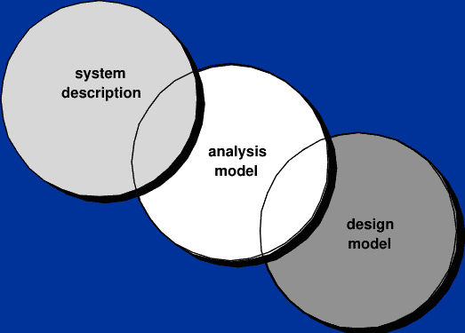

## 经验法则 [经验原则]

- 模型应关注问题或业务域中可见的需求。抽象级别应相对较高。
- 分析模型的每个元素都应增加对软件需求的整体理解，并提供对系统信息域、功能和行为的洞察。
- 将基础设施和其他非功能模型的考虑推迟到设计阶段。
- 在整个系统中最小化耦合。
- 确保分析模型为所有利益相关者提供价值。
- 保持模型尽可能简单。


## 领域分析

软件领域分析是对特定应用领域中的公共需求进行识别、分析和规格说明，通常是为了在该应用领域的多个项目中复用……

[面向对象的领域分析是] 以公共对象、类、组件和框架的形式，对特定应用领域内公共的、可复用的能力进行识别、分析和规格说明……

Donald Firesmith

## 领域分析

- 定义要研究的领域。
- 收集该领域中应用程序的**代表性样本**。
- 分析样本中的每个应用程序。
- 为对象开发分析模型。

## 8.2 数据建模

- 独立于处理过程来考察数据对象
- 将注意力集中在数据领域
- 在客户的抽象层次上创建模型
- 表示数据对象之间如何相互关联

## 什么是数据对象？

*对象* —— 由一组属性（数据项）描述，并将在软件（系统）中被操纵的事物

- 对象的每个实例（例如一本书）都可以被唯一标识（例如 ISBN #）
- 每个实例都在系统中扮演必要的角色，即，如果没有对对象实例的访问，系统将无法运行
- 每个实例都由属性描述，而属性本身也是数据项

## 典型对象

- *外部实体*（打印机、用户、传感器）
- *事物*（例如报表、显示器、信号）
- *事件*（例如中断、报警）
- *角色*（例如经理、工程师、销售人员）
- *组织单元*（例如部门、团队）
- *地点*（例如生产现场）
- *结构*（例如员工记录）

## 数据对象与属性

数据对象包含一组属性，这些属性充当对象的方面、质量、特征或描述符

| 对象：汽车 |
| 属性： |
| 品牌 |
| 型号 |
| 车身类型 |
| 价格 |
| 选装代码 |

## 什么是关系？

*关系* —— 表示“连接性”；是系统必须“记住”的一个“事实”

- 一个关系可以存在多个实例
- 对象可以通过多种不同的方式相互关联

## 类

- 面向对象思维始于类的定义，类通常被定义为：
  - 模板
  - 广义描述
  - “蓝图”……描述一组相似项的集合
- 元类（也称为超类）建立类的层次结构
- 一旦定义了某个项的类，就可以识别该类的特定实例

## 构建类

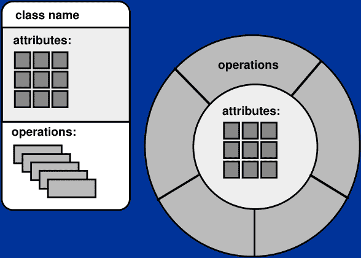

## 什么是类？

事件
事物
外部实体
角色
组织单元
地点
结构

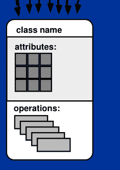

## 封装/隐藏

对象既封装了**数据**，也封装了操作数据所需的**逻辑过程**

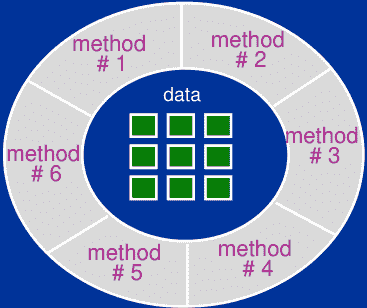

## 类层次结构

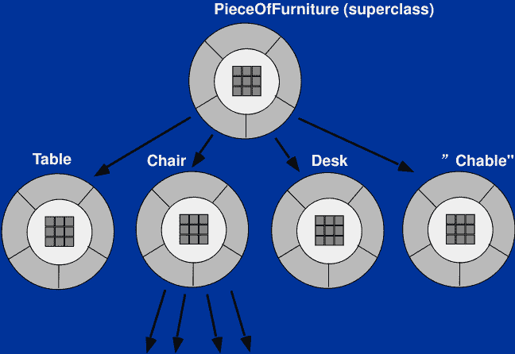

## 方法
（又称操作、服务）

一种可执行过程，封装在类中，旨在对作为类的一部分定义的一个或多个数据属性进行操作。
方法通过消息传递来调用。


## 8.4 分析模型

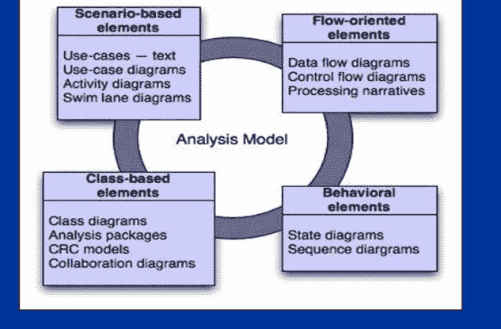

分析模型的要素

## 用例 UC1：处理销售

**主要参与者：** 收银员

**利益相关者与利益：**
- 收银员：希望准确、快速地录入，且没有付款错误，因为现金抽屉的短款会从其工资中扣除。
- 销售人员：希望销售佣金得到更新。
- 客户：希望以最少的努力完成购买和获得快速服务。希望有购买凭证以支持退货。
- 公司：希望准确记录交易并满足客户利益。希望确保支付授权服务的应收款项被记录。希望具有一定的容错能力，以便即使服务器组件（例如远程信用验证）不可用，也能进行销售记录。希望自动且快速地更新会计和库存。
- 政府税务机构：希望对每笔销售征税。可能有多个机构，例如国家级、州级和县级。
- 支付授权服务：希望以正确的格式和协议接收数字授权请求。希望准确核算应付给商店的款项。

**前置条件：** 收银员已通过身份识别和认证。

**成功保证（后置条件）：** 销售已保存。税款已正确计算。会计和库存已更新。佣金已记录。已生成收据。支付授权已记录。

### 主成功场景（或基本流程）：

- 1. 客户带着要购买的商品和/或服务到达 POS 结账处。
- 2. 收银员开始一笔新的销售。
- 3. 收银员输入商品标识符。
- 4. 系统记录销售商品，并显示商品描述、价格和累计总额。价格根据一组定价规则计算。
  *收银员重复步骤 3–4，直到所有商品录入完成。*
- 5. 系统显示包含已计算税款的总额。
- 6. 收银员告诉客户总额，并请求付款。
- 7. 客户付款，系统处理付款。
- 8. 系统记录已完成的销售，并将销售和付款信息发送到外部会计系统（用于会计和佣金）和库存系统（用于更新库存）。
- 9. 系统出示收据。
- 10. 客户带着收据和商品（如有）离开。

### 扩展（或备选流程）：

- *a. 任何时候，系统发生故障：*
  为支持恢复和正确核算，确保可以从场景的任何步骤恢复所有交易敏感状态和事件。
  1. 收银员重启系统，登录，并请求恢复先前状态。
  2. 系统重建先前状态。
     2a. 系统检测到阻止恢复的异常。
        1. 系统向收银员发出错误信号，记录错误，并进入干净状态。
        2. 收银员开始一笔新的销售。
  
- *3a. 无效标识符：*
  1. 系统发出错误信号并拒绝录入。
  
- *3b. 同一商品类别有多个，且跟踪唯一商品身份并不重要（例如 5 包素汉堡）：*
  1. 收银员可以输入商品类别标识符和数量。
  
- *3-6a. 客户要求收银员从购买中移除一件商品：*
  1. 收银员输入要从销售中移除的商品标识符。
  2. 系统显示更新后的累计总额。
  
- *3-6b. 客户告诉收银员取消销售：*
  1. 收银员在系统上取消销售。
  
- *3-6c. 收银员暂停销售：*
  1. 系统记录销售，以便可以在任何 POS 终端上检索。
  
- *4a. 系统生成的商品价格不符合要求（例如，客户对某事投诉并被提供了更低的价格）：*
  1. 收银员输入覆盖价格。
  2. 系统显示新价格。
  
- *5a. 系统检测到与外部税款计算系统服务的通信失败：*
  1. 系统在 POS 节点上重启该服务，并继续。
     1a. 系统检测到该服务未重启。
        1. 系统发出错误信号。
        2. 收银员可以手动计算并输入税款，或取消销售。
  
- *5b. 客户表示他们符合折扣条件（例如员工、优选客户）：*
  1. 收银员发出折扣请求。
  2. 收银员输入客户标识。
  3. 系统根据折扣规则显示折扣后总额。
  
- *5c. 客户表示其账户中有信用额度，可用于本次销售：*
  1. 收银员发出信用请求。
  2. 收银员输入客户标识。
  3. 系统应用信用额度，直至价格=0，并减少剩余信用。
  
- *6a. 客户表示他们打算用现金付款，但现金不够：*
  1a. 客户使用替代付款方式。
  1b. 客户告诉收银员取消销售。收银员在系统上取消销售。


## 用例图

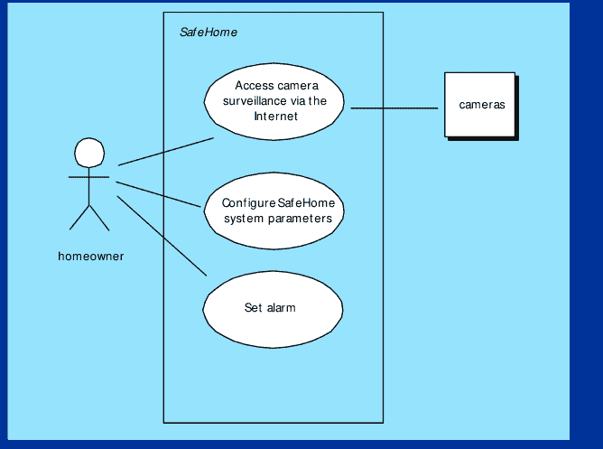

## 活动图

通过提供过程流程的图示化表示来补充用例。

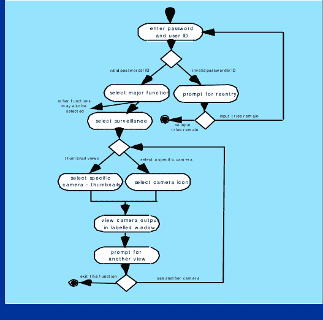

## 泳道图

允许建模者表示用例所描述的活动流程，同时指明哪个参与者（如果特定用例涉及多个参与者）或分析类负责活动矩形所描述的动作。

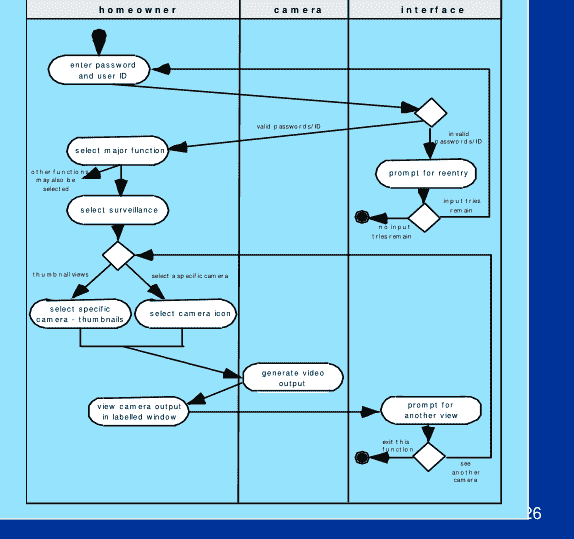

## 8.6 面向流的建模

表示数据对象在系统中移动时如何被变换。

数据流图（DFD）是所使用的图示化形式。

尽管许多人认为这是一种“老派”方法，面向流的建模仍然提供了一种独特的系统视图——它应当用于补充其他分析模型元素。

## 流模型

每个基于计算机的系统都是一个信息变换……

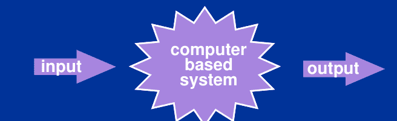

## 流建模符号

- 外部实体
- 处理
- 数据流
- 数据存储

## 外部实体

数据的生产者或消费者

示例：一个人、一个设备、一个传感器

另一个示例：基于计算机的系统

*数据必须始终来源于某处，并且必须始终发送到某处*

## 处理

数据变换器（将输入变为输出）

示例：计算税费、确定面积、格式化报表、显示图形

> *数据必须始终以某种方式被处理，以实现系统功能*


## 数据存储

数据通常被存储起来以备后用。

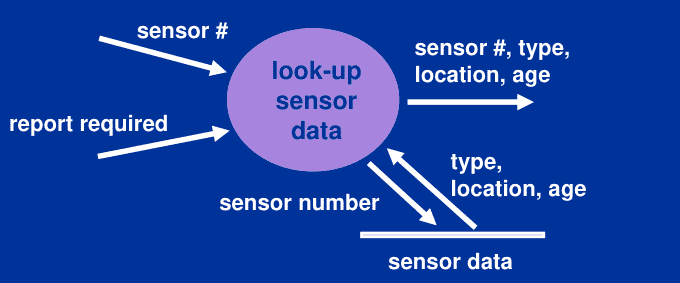

## 数据流图绘制指南

- 所有图标都必须使用有意义的名称进行标注
- DFD 通过多个*详细级别*逐步演化
- 始终从*上下文级图*（也称为 0 层）开始
- 始终在 0 层显示外部实体
- 始终为数据流箭头添加标签
- 不要表示过程逻辑

## 构建 DFD

- 检查数据模型以分离数据对象，并使用语法解析来确定“操作”
- 确定外部实体（数据生产者与消费者）
- 创建 0 层 DFD

## 0 层 DFD 示例

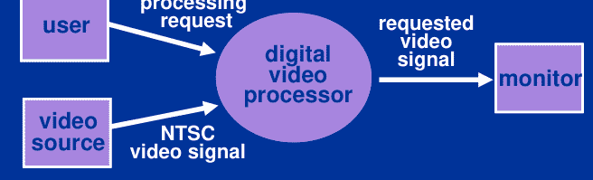

## 构建 DFD……

- 编写描述变换的叙述
- 进行解析以确定下一级变换
- “平衡”数据流以保持数据流连续性
- 开发 1 层 DFD
- 使用约 1:5 的扩展比例

## DFD：前瞻

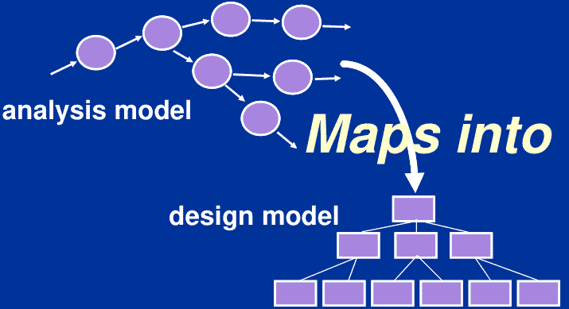

分析模型

映射到

设计模型

## 控制流图

- 表示“事件”以及管理事件的处理
- “事件”是一种布尔条件，可以通过以下方式确定：
  - 列出软件“读取”的所有传感器。
  - 列出所有中断条件。
  - 列出操作员触发的所有“开关”。
  - 列出所有数据条件。
  - 回顾应用于处理叙述的名词/动词解析，将所有“控制项”视为可能的 CSPEC 输入/输出。

## 8.7 基于类的建模

- 通过检查问题陈述来识别分析类
- 使用“语法解析”来分离潜在的类
- 识别每个类的属性
- 识别操作这些属性的操作

## 分析类

- **外部实体**（例如其他系统、设备、人员）产生或消费由基于计算机的系统使用的信息。
- **事物**（例如报表、显示、信件、信号）是问题信息域的一部分。
- **发生或事件**（例如财产转移或一系列机器人动作的完成）发生在系统运行的上下文范围内。
- **角色**（例如经理、工程师、销售人员）由与系统交互的人员扮演。
- **组织单位**（例如部门、小组、团队）与应用相关。
- **场所**（例如制造车间或装卸码头）确立了问题的上下文和系统的整体功能。
- **结构**（例如传感器、四轮车辆或计算机）定义了一类对象或相关的对象类。


## 选择类——标准

- 保留信息
- 所需服务
- 多重属性
- 公共属性
- 公共操作
- 基本需求

## 类图

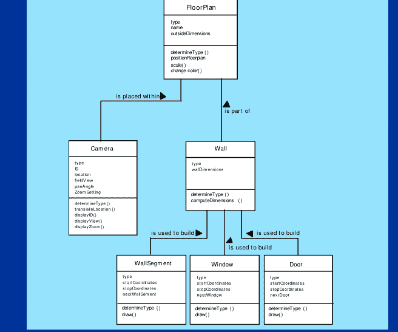

## CRC建模

| 类：FloorPlan |
|---|---|
| 描述： | |
| 职责： | 协作者： |
| 定义平面图的名称/类型 | |
| 管理平面图的定位 | |
| 缩放平面图以供显示 | |
| 缩放平面图以供显示 | |
| 包含墙壁、门窗 | Wall |
| 显示摄像机的位置 | Camera |
|  | |
|  | |

## 关联与依赖

- 两个分析类通常以某种方式相互关联
  - 在UML中，这些关系称为*关联*
  - 关联可以通过指示*多重性*来细化
  - 在许多情况下，两个分析类之间存在*客户端-服务器关系*。在这种情况下，客户端类以某种方式依赖于服务器类，从而建立了*依赖关系*

## 多重性

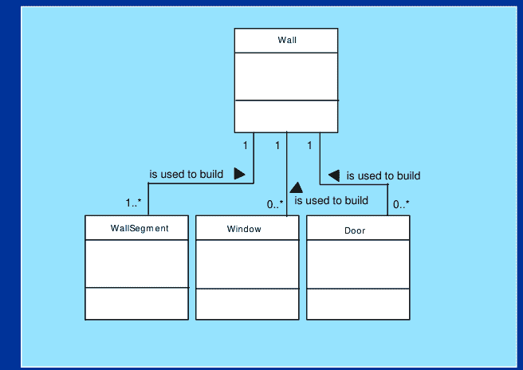

## 依赖


## 分析包

- 分析模型的各种元素（例如，用例、分析类）以一种将它们分组打包的方式进行归类。
- 每个包中分析类名称前的**加号（+）**表示这些类具有**公共可见性**，因此可被其他包访问。
- 其他符号可以位于包内元素之前。**减号**表示元素对所有其他包隐藏，而**#符号**表示元素仅对给定包所包含的包可见。

## 分析包


## 8.8 行为建模

- 行为模型表明**软件将如何响应外部事件或刺激**。为了创建该模型，分析人员必须执行以下步骤：
  - 评估所有用例，以**充分理解系统内的交互序列**。
  - 识别**驱动交互序列**的事件，并**理解这些事件如何与特定对象相关**。
  - 为每个用例创建**序列图**。
  - 为系统构建**状态图**。
  - 审查行为模型**以验证准确性和一致性**。

## 状态表示

- 在行为建模的上下文中，必须考虑两种不同的状态表征：
  - 系统执行其功能时每个类的状态；以及
  - 从外部观察系统执行其功能时系统的状态
- 类的状态同时具有被动和主动特征[CHA93]。
  - 被动状态[纯态]只是对象所有属性的当前状态。
  - 对象的主动状态[活跃态]表示对象在进行持续变换或处理时的当前状态。

## 序列图


图8.27 SafeHome安全功能的序列图（部分）

## 编写软件规格说明

> 在有人把它写下来之前，每个人都确切地知道该做什么！

## 第9章
设计工程

软件工程：实践者的研究方法（第6版）
作者：Roger S. Pressman

## 1 概述

- 与分析模型不同：设计模型提供了软件的**数据结构（data structure）**、**体系结构（architecture）**、**接口（interface）**和**构件（component）**的细节，而这些都是实现系统所必须的。
- 设计可以采用很多不同的方法描绘软件。**首先**，设计必须体现系统或产品的体系结构；**其次**，为各类接口建模；**最后**，设计用于构建系统的软件构件。
- 软件设计是**建模活动**的最后一个软件工程活动，接着便要进入构造阶段（生成代码和测试）。


## Analysis → Design


## 2 设计过程和设计质量

- 软件设计是一个迭代的过程，通过设计过程，需求被变换为用于构建软件的“蓝图”【体系结构设计/概要设计、接口设计】。
- 随着设计迭代的推进，后续的精化导致更低抽象层次的设计表示【构件级设计/详细设计、接口设计】。
- 正式的技术评审（technical review）和设计走查（walkthrough）可用于评估设计演化的质量。

## 3 Design Concepts

- **abstraction** — 数据，过程
- **architecture** — 软件的整体结构
- **patterns** — “传达”一种经过验证的设计解决方案的“精髓”
- **modularity** — 数据和功能的分区 [数据和功能划分]
- **information hiding** — 受控的接口
- **functional independence** — 高内聚和低耦合
- **refinement** — 对所有抽象进行细节的阐述
- **refactoring** — 在不影响行为的情况下改进设计

#### 3.1 Abstraction et al.

- Abstraction
  - process – 提取本质细节的过程
  - entity – 模型或聚焦的表示
- Information hiding
  - 无关信息的抑制
- Encapsulation
  - process – 将项目封闭在容器中的过程
  - entity – 容纳项目的封闭物

#### Data Abstraction

- 实数
- 对象
- 类
- 构件
- ……

数据抽象是描述数据对象的命名数据集合。

例如，“门”的数据抽象将包含一组描述门的属性：门的类型/转动方向/开门机构、重量和尺寸等


| door |
| --- |
| manufacturer |
| model number |
| type |
| swing direction |
| inserts |
| lights |
| &nbsp;&nbsp;type |
| &nbsp;&nbsp;number |
| weight |
| opening mechanism |

implemented as a data structure

#### Procedural Abstraction


open

details of enter algorithm

implemented with a "knowledge" of the object that is associated with enter

过程抽象是指具有明确和有限功能的指令序列。

例如，“开”隐含了一长串的过程性步骤：走到门前、伸手并抓住把手、转动把手并拉门、推开打开的门等

#### 3.2 Architecture

- “软件的整体结构和这种结构为系统提供概念上完整性的方式。” [软件的整体结构和这种结构为系统提供概念上完整性的方式][SHA95a]
- 简而言之，体系结构是程序构件（模块）的结构或组织、这些构件交互的形式、以及构件所用的数据的结构。

#### Architecture...

- **Structural properties.** 体系结构设计表示的这一方面定义了**系统的组件（例如，模块、对象、过滤器）**以及**这些组件的打包方式**和**彼此交互的方式**。例如，对象被打包以封装数据和处理该数据的处理，并通过方法调用进行交互。
- **Extra-functional properties.** 体系结构设计描述应解决**设计体系结构如何实现性能、容量、可靠性、安全、适应性以及其他系统特性方面的需求**。
- **Families of related systems.** 体系结构设计应利用在**类似系统族的设计中**常见可重复的模式。实质上，设计应具有重用体系结构构建模块的能力。

#### 3.3 Patterns

- 软件体系结构的模式描述了在特定设计上下文中出现的某个再现的特定设计问题 [某个再现的特定设计问题]，并提出了一种经过充分验证的通用方案来解决它。解决方案方案通过描述其构成组件、它们的职责和关系以及它们协作的方式来指定。

#### Some Kinds of Patterns

- **architectural pattern** 表达了**软件系统的基本结构组织模式**。它提供了一组预定义的子系统，指定了它们的职责，并包括组织它们之间关系的规则和指导方针。
- **design pattern** 为**细化软件系统的子系统或组件，或它们之间的关系**提供了一种方案。它描述了在特定上下文中解决通用设计问题的通信组件的常见重复结构。
- **idiom** 是一种特定于编程语言的低级模式**。**idiom** 描述了如何使用给定语言的特性来实现组件的特定方面或它们之间的关系。


### 设计模式

#### 设计模式模板

- **模式名称** — 用简短但富有表现力的名称描述模式的本质
- **意图** — 描述模式及其作用
- **别名** — 列出模式的所有同义词
- **动机** — 提供一个问题的示例
- **适用性** — 指出模式适用的特定设计情境
- **结构** — 描述实现模式所需的类
- **参与者** — 描述实现模式所需类的职责
- **协作** — 描述参与者如何协作以履行其职责
- **结果** — 描述影响模式的“设计力量”以及实现模式时必须考虑的潜在权衡
- **相关模式** — 交叉引用相关的设计模式

#### 3.4 模块化设计

*更易于构建，更易于修改，更易于修复……*


#### 模块化：权衡

对于特定的软件设计，多少模块才是“合适”的数量？


#### 3.5 信息隐藏

- 模块
- 受控接口
- 客户端
- “秘密”——一个特定的设计决策
  - 算法
  - 数据结构
  - 外部接口的细节
  - 资源分配策略

#### 为什么信息隐藏？

- 降低“副作用”的可能性
- 限制局部设计决策的全局影响
- 强调通过受控接口进行通信
- 不鼓励使用全局数据
- 导致封装——高质量设计的一个属性
- 带来更高质量的软件

#### 3.6 逐步求精


#### 3.7 功能独立

内聚性——模块执行且仅执行一个功能的程度。

耦合性——模块与系统中其他模块“连接”的程度。

#### 3.8 重构

Fowler [FOW99] 以如下方式定义重构：

> “重构是这样一种过程：以一种不改变代码[设计]外部行为、同时改进其内部结构的方式更改软件系统。”

当软件被重构时，现有设计会被检查以下方面：

- 冗余
- 未使用的设计元素
- 低效或不必要的算法
- 构造不良或不合适的数据结构，或任何其他可以通过修正以获得更好设计的设计缺陷。

#### 3.9 设计类

- 用户界面类——定义人机交互（HCI）所需的抽象。
- 业务领域类——分析类的细化。
- 过程类——管理业务领域类的较低层业务抽象。
- 持久类——在软件执行之后仍然存在的数据存储（数据库）。
- 系统类——使系统能够在计算环境内以及与外部世界进行操作和通信的管理和控制功能。

#### 良构设计类

- **完整且充分**——类应该是合理属性和方法的完整且充分的封装。
- **原始性[原始性]**——每个方法应专注于一件事。
- **高内聚性**——类应专注于一种类型的事物。
- **低耦合性**——协作应保持在可接受的最低限度。

## 4 设计模型


过程维度表示设计模型的演化，设计工作作为软件过程的一部分被执行。

抽象维度表示过程的详细级别，分析模型的每个元素转化为一个等价的设计，然后迭代精化。

- 过程维度
- 抽象维度
- 高
- 低
- 分析模型
- 设计模型
- 架构元素
- 接口元素
- 组件级元素
- 部署级元素

### 设计模型元素

- 数据元素
  - 架构层 → 数据库和文件
  - 组件层 → 数据结构
- 架构元素
  - 架构模型来源于：
    1. 应用领域[应用领域信息]
    2. 分析模型[特定分析模型元素]
    3. 可用风格和模式[体系结构风格和模式]
- 接口元素
  - 接口设计元素有三个部分：
    1. 用户界面（UI）
    2. 与外部系统的接口
    3. 与应用程序内部组件的接口
- 组件元素
- 部署元素


## Interface Elements

软件的接口设计相当于一组房屋的门、窗和外部设施的详细绘图。


## Component Elements

软件的构件级设计完全类似于某个房屋中每个房间的一组详细绘图。


## Deployment Diagram


部署级设计元素指明软件功能和子系统将如何在支持软件的物理计算环境内分布。

SafeHome  
控制面板

基于住宅的PC

CPI公司的服务器

## 5 Design Principles

- ① 设计过程**不应遭受**‘tunnel vision[视野狭隘].’
- ② 设计**应可追溯到**分析模型。
- ③ 设计**不应重新发明**轮子。
- ④ 设计**应“最小化智力距离[理解差异]”**在软件与现实世界中存在的问题之间。
- ⑤ 设计**应表现出**统一性和集成性。
- ⑥ 设计**应结构化以**适应变化。
- ⑦ 设计**应结构化以**即使遇到异常数据、事件或操作条件也能温和降级。
- ⑧ **设计不是编码，编码不是设计。**
- ⑨ 设计**应在创建过程中**进行质量评估，而不是事后。
- ⑩ 设计**应被审查以**最小化概念（语义）错误。

## 6 Design and Quality

- 设计必须实现分析模型中包含的所有明确需求，并且必须满足客户期望的所有隐含需求。
- 设计必须是可读、易懂的指南，供生成代码的人员以及测试和随后支持软件的人员使用。
- 设计应提供软件的完整图景，从实现角度解决数据、功能和行为域。

## Quality Guidelines

- 设计**应表现出**一种架构，该架构（1）使用可识别的架构风格或模式创建，（2）由表现出良好设计特征的组件组成，并且（3）可以以演进的方式实现
  - 对于较小的系统，设计有时可以线性开发。
- 设计**应为**模块化的；也就是说，软件应逻辑地划分为元素或子系统
- 设计**应包含**数据的、架构的、接口的和组件的明确表示。
- 设计**应导致**适合要实现类的适当数据结构，并且源自可识别的数据模式。
- 设计**应导致**表现出独立功能特征的组件。
- 设计**应导致**减少组件之间以及与外部环境连接复杂性的接口。
- 设计**应使用**在软件需求分析期间获得的信息驱动的可重复方法进行派生。
- 设计**应使用**能有效传达其含义的记法表示。

## Chapter 10: Architectural Design

**Software Engineering: A Practitioner’s Approach, 6th edition**
*by Roger S. Pressman*

#### 概述

人们不能在没有图纸的情况下建房子，同样也不能通过勾画出房子的管道布局而开始绘制房子的蓝图。在开始考虑细节之前，需要关注整体视图——房子本身。这就是体系结构设计需要做的事情——它为你提供整体的视图并保证得到正确的理解。

#### Software Architecture

- 程序或计算系统的软件架构**是系统的结构或结构**，其包括软件组件、这些组件的外部可见属性以及它们之间的关系。

> — Bass et al.

#### Data Design

- 架构级 → 数据库设计
  - 数据挖掘
  - 数据仓库
- 组件级 → 数据结构设计

#### Architectural Styles

- 每种风格描述一个系统类别，该类别涵盖：
  - **一组组件**（例如，数据库、计算模块）执行系统所需的功能，
  - **一组连接器**使组件之间能够“通信、协调和合作”，
  - **约束**定义组件如何集成形成系统，以及
  - **语义模型**使设计师能够理解系统的整体属性。


## 特定风格

- 数据中心架构
- 数据流架构
- 调用与返回架构
- 面向对象架构
- 分层架构

## 数据中心架构


## 调用与返回架构


## 面向对象架构


## 分层架构


## 架构模式

- **并发**
  - 操作系统进程管理
  - 任务调度器
- **持久化**
  - 数据库管理系统
  - 应用级持久化
- **分布**
  - 代理

## 架构设计

- **架构上下文图** 模型化软件如何与外部实体交互
- **原型** 是代表对系统至关重要的抽象的类或模式
- **架构组件** 源自应用领域、基础设施和接口。

## 架构上下文图


## SafeHome ACD


## SafeHome 原型


## 组件结构


## 组件细化


## 第11章

## 组件级设计

**Software Engineering: A Practitioner’s Approach, 6th edition**

*by Roger S. Pressman*


## 什么是组件？

> > “A modular, deployable, and replaceable part of a system that encapsulates implementation and exposes a set of interfaces.”
> > — OMG UML Specification

## 组件视图

- OO 视图 – 组件是一组协作的类。
- 传统视图 – 组件是程序的功能元素，包含处理逻辑、实现处理逻辑所需的内部数据结构，以及使组件能够被调用并向其传递数据的接口。

## 类细化

1 分析类

PrintJob
numberOfPages
numberOfSlides
paperType
magnification
productionFeatures
computeJobCost()
passJobToPrinter()

2 设计组件

computeJob
initiateJob
PrintJob

3 细化设计类

<<interface>>
computeJob
computePageCost()
computePaperCost()
computeProdCost()
computeTotalJobCost()

<<interface>>
initiateJob
buildWorkOrder()
checkPriority()
passJobToProduction()

PrintJob
numberOfPages
numberOfSlides
paperType
paperWeight
paperSize
paperColor
magnification
colorRequirements
productionFeatures
collationOptions
bindingOptions
coverStock
bleed
priority
totalJobCost
WONumber
computePageCost()
computePaperCost()
computeProdCost()
computeTotalJobCost()
buildWorkOrder()
checkPriority()
passJobToProduction()

## 设计原则

- 设计契约
- 开闭原则
- 子类型替换
- 依赖抽象
- 接口隔离

## 设计契约

- 类与其客户端之间的关系可以被视为正式协议，表达各方的权利和义务。
- 考虑以下列表操作：

- `public Item remove(int index)`
  - `requires` 指定的索引在范围内（ `0 ≤ index < size()` ）
  - `ensures` 此列表中指定位置的元素被移除，后续元素向左移动（其索引减 1），并且被移除的元素被返回

## 开闭原则

- 模块应对扩展开放，但对修改封闭。


## 可替换性
- 子类应当可以替换其基类


## 依赖倒置
- 依赖于抽象。
- 不要依赖于具体实现。


## 接口隔离
- 多个特定于客户的接口要好于一个通用目的的接口。


## 内聚
- 模块的“专一性”
- 内聚意味着单个组件或类只封装那些彼此紧密相关、并且与该类或组件本身紧密相关的属性和操作。
- 内聚的示例
  - 功能性
  - 层
  - 通信性

## 功能内聚
- 通常适用于操作。当一个模块只执行一个且仅一个计算，然后返回结果时，发生功能内聚。


## 层内聚
- 适用于包、组件和类。当高层可以访问低层，但低层不能访问高层时，发生层内聚。


## 耦合
- 对类或组件之间相互连接程度的一种定性度量。
- **应避免**
  - 内容耦合
- **需谨慎**
  - 公共耦合
- **需注意**
  - 常规调用耦合
  - 类型使用耦合
  - 包含或导入耦合

## 内容耦合
- 当一个组件“偷偷修改另一个组件内部的数据”时发生。
- 违反信息隐藏
- 这里有什么问题？ →

```
public class StudentRecord {
    private String name;
    private int[] quizScores;

    public String getName() {
        return name;
    }
    public int getQuizScore(int n) {
        return quizScores[n];
    }
    public int[] getAllQuizScores() {
        return quizScores;
    }
    ....
```

## 公共耦合
- 当多个组件都使用一个全局变量时发生。


## 常规耦合
- 在面向对象编程中，某些类型的耦合经常出现。

```
package myPackage;
import java.util.Collection.*;

public class MyClass {
    private Stack s;
    public void doSomething() {
        s.push(x);
        // do something
    }
    ...
```


## 组件级设计
- 1. 识别问题领域中的设计类
- 2. 识别基础设施设计类
- 3. 详细描述设计类
- 4. 描述持久化数据源
- 5. 详细描述行为表示
- 6. 详细描述部署图
- 7. 重构设计并考虑替代方案

## 步骤 1 和 2 – 识别类
- 1. 问题领域中的大多数类是作为分析模型的一部分而创建的分析类。
- 2. 基础设施设计类在架构设计期间作为组件被引入。

## 第 3 步 – 类的细化
- a) 当类或组件协作时，指定消息的详细信息。
- b) 为每个组件识别合适的接口。
- c) 细化属性并定义实现它们所需的数据结构。
- d) 详细描述每个操作内的处理流程。

#### 3a. 协作细节
- 可以通过以下方式扩展消息的语法来对其进行细化：
  - `[guard condition] sequence expression (return value) := message name (argument list)`


#### 3b. 合适的接口
- Pressman 认为，幻灯片 5 中 PrintJob 接口的“initiateJob”没有表现出足够的内聚性，因为它执行了三个不同的子功能。他建议进行这种重构。


### 3c. 细化属性

- 分析类通常只列出一般属性的名称（例如 paperType）。
- 在组件设计期间列出所有属性。
- UML 语法：
    - `name : type-expression = initial-value { property string }`
- 例如，paperType 可以分解为重量、尺寸和颜色。重量属性将是：
    - `paperType-weight: string = "A" { contains 1 of 4 values – A, B, C, or D }`

### 3d. 描述处理流程

- computePaperCost() 的活动图


## 第5步 – 细化行为

- 有时有必要对设计类的行为进行建模。
- 状态到状态的转换具有以下形式：
    - 事件名称（参数列表）[守卫条件] / 动作表达式


## 第6步 — 细化部署

- 部署图被细化以表示关键包或组件的位置。


## 第7步 — 重新设计/重新考虑

- 你创建的第一个组件级模型不会像你应用于模型的第n次迭代那样完整、一致或准确。
- 最好的设计师在确定最终设计模型之前会考虑许多备选设计方案。

## 第15章

软件产品度量

软件工程：实践者的研究方法，第6版
罗杰·S. 普莱斯曼 著

## 本章要点

- 软件质量
- 产品度量
    - 分析度量
    - 设计度量
    - 代码度量
    - 测试度量

#### 概述

- 产品度量有助于软件工程师对其设计和构造的软件获得深层次的了解。
- 产品度量为分析、设计、编码和测试能更客观地执行和更定量的评估提供基础。
- 与项目度量和过程度量不同【第22章】。

#### 15.1 软件质量

- 一般来讲，软件质量是对明确陈述的功能和性能需求、明确记录的开发标准以及对所有专业化软件开发应具备的隐含特征的符合度。
    - 软件需求是质量测量的基础，不符合需求就是没有质量。
    - 若未能遵守开发准则，则肯定质量有问题。
    - 若软件符合显式需求，但未能满足其隐式需求，则软件质量仍然值得怀疑。

##### McCall 质量三角形

Maintainability[可维护性]
Flexibility[灵活性]
Testability[可测试性]

Portability[可移植性]
Reusability[可复用性]
Interoperability[互操作性]

产品修订

产品转换

产品运行

正确性  可用性  效率
可靠性  完整性


##### 评论

McCall 的质量因素是在20世纪70年代初提出的。它们在当时有效，今天也同样有效。即使技术发生巨大变化，符合这些因素构建的软件很可能在21世纪仍将表现出高质量。

### ISO 9126质量因素

- 功能性: Functionality
- 可靠性: Reliability
- 易用性: Usability
- 效率: Efficiency
- 可维护性: Maintainability
- 可移植性: Portability

### 度量原则

- **设定度量目标**：在开始收集数据之前，应确定测量的目标；
- **定义要明确**：每个技术度量都应以明确无误的方式定义；
- **有效理论支持**：度量应基于对应用领域有效的理论推导而来（例如，设计度量应借鉴[利用]基本的设计概念和原理，并试图表明存在某种被认为理想的属性）；
- **度量指标的选择要是最合适的**：度量应针对特定的产品和过程进行定制，以最佳地适应它们。

### 典型度量过程

- **Formulation【公式化】**. 推导适用于所考虑软件表示的软件度量和度量标准。
- **Collection【收集数据】**. 用于积累推导已制定度量所需数据的机制。
- **Analysis【分析结果】**. 度量的计算和数学工具的应用。
- **Interpretation【解释评估】**. 对度量结果进行评估，以深入了解表示的质量。
- **Feedback【反馈】** 根据产品度量的解释得出的建议，传递给软件团队。


## 度量属性的有效性

- **简单的和可计算的**：学习推导该度量应当相对容易，并且其计算不应耗费过多的精力或时间。
- **在经验上和直观上有说服力**：该度量应满足工程师对所考察产品属性的直觉认知。
- **一致的和客观的**：该度量应始终产生无歧义的结果。
- **单位和量纲的使用是一致的**：度量的数学计算应使用不会导致奇怪单位组合的度量单位。
- **编程语言的独立性**：度量应基于分析模型、设计模型或程序本身的结构。
- **高质量反馈的有效机制**：也就是说，该度量应向软件工程师提供能够导向更高质量最终产品的信息。

## 软件产品度量全景

- 分析度量
- 设计度量
- 代码度量
- 测试度量

## 15.3 分析度量

- **基于功能的度量**：使用功能点作为规范化因子或作为规格说明“大小”的度量。
- **规格说明度量**：通过度量若干特征（如无歧义性、完整性、正确性、可理解性等）的数量，作为分析模型和需求规格说明质量的指示。

## 基于功能的度量

- **功能点度量（FP）**：最早由 Albrecht [ALB79] 提出，可以被有效地用作度量系统所交付功能的手段。
- **功能点** 是基于软件信息域的可计数（直接）度量和软件复杂度评估的经验关系推导得出的。
- **信息域值** 按以下方式定义：
  - 外部输入数（EIs）
  - 外部输出数（EOs）
  - 外部查询数（EQs）
  - 内部逻辑文件数（ILFs）
  - 外部接口文件数（EIFs）

## 15.4 设计度量

- 体系结构设计度量
- OO 设计度量
- 面向类的度量
- 构件级设计度量
- 面向操作度量
- 用户界面设计度量

## 体系结构设计度量

- 体系结构设计度量
  - 结构复杂度 = g(扇出)
  - 数据复杂度 = f(输入和输出变量, 扇出)
  - 系统复杂度 = h(结构复杂度与数据复杂度)
- HK 度量：体系结构复杂度是扇入和扇出的函数
- 形态度量[形态度量学]：是模块数量与模块间接口数量的函数

## 面向对象设计的度量（一）

- Whitmire [WHI97] 描述了面向对象设计的九个不同且可度量的特征：
  - **规模**
    - 规模从四个视角定义：数量、体积、长度和功能性
  - **复杂度**
    - 面向对象设计中的类如何相互关联
  - **耦合**
    - 面向对象设计各元素之间的物理连接
  - **充分性**
    - “从当前应用的角度来看，抽象拥有其所需特征的程度，或设计构件在其抽象中拥有特征的程度。”
  - **完备性**
    - 对抽象或设计构件可复用程度的一种间接暗示

## 面向对象设计的度量（二）

- **内聚性**
  - 所有操作协同工作以实现单一且明确定义目标的程度
- **原始性**
  - 同时应用于操作和类，指操作是原子的程度
- **相似性**
  - 两个或多个类在结构、功能、行为或目的上的相似程度
- **易变性**
  - 度量发生变更的可能性

## 面向类的度量（1）

- 每个类的加权方法数（WMC）
- 继承树的深度（DIT）
- 子类数量（NOC）
- 对象类之间的耦合（CBO）
- 类的响应集（RFC）
- 方法内聚缺乏度（LCOM）

由 Chidamber 和 Kemerer 提出。


## 面向类的度量（2）

- 类大小（CS）
- 子类覆盖操作的数量（NOO）
- 子类新增操作的数量（NOA）
- 特化指数（SI）

由 Lorenz 和 Kidd 提出 [LOR94]。

## 面向操作的度量

- 平均操作规模（OSavg）
- 操作复杂度（OC）
- 每个操作的平均参数数量（NPavg）

由 Lorenz 和 Kidd 提出 [LOR94]。

## 组件级设计度量

- **内聚度量：** 是数据对象及其定义位置的函数
- **耦合度量：** 是输入输出参数、全局变量以及被调用模块的函数
- **复杂度度量：** 已提出数百种（例如，圈复杂度）

## 接口设计度量

- **布局恰当性：** 是布局实体、几何位置以及实体间转换“代价”的函数

## 15.5 代码度量

- **Halstead 软件科学：** 一套全面的度量集合，全部基于组件或程序内**操作符**和**操作数**的数量（计数和出现次数）
  - “**操作符**”是语言中的固定符号或保留字，而“**操作数**”是其他一切：变量名、函数名、数字常量等。注释不计入。

**Length = n₁ log₂ n₁ + n₂ log₂ n₂**

**Volume = Length × log₂(n₁ + n₂)**

## 15.6 测试度量

- **测试工作量**也可以使用由 Halstead 度量推导出的指标进行估算 [参见15-7a, 15-7b]
- Binder [BIN94] 提出了大量对面向对象（OO）系统的“可测试性”有直接影响的设计度量。
  - 方法缺乏内聚性（LCOM）。
  - 公有和受保护成员百分比（PAP）。
  - 数据成员的公有访问（PAD）。
  - 根类数量（NOR）。
  - 扇入（FIN）。
  - 子类数量（NOC）和继承树深度（DIT）。

## 第4部分：管理软件项目（软件项目管理）

软件工程：实践者的方法，第6版  
作者：Roger S. Pressman

## 第21章：项目管理

软件工程：实践者的方法，第6版  
作者：Roger S. Pressman

## 本章要点

- 理解4P

## 1 人员

- 利益相关者
- 团队负责人
- 软件团队
- 团队协调与沟通

## 软件团队

- 如何协作？
- 如何领导？
- 如何组织？
- 如何激励？
- 如何产生好的想法？


## 团队负责人

- **MOI 模型：**
  - **激励（Motivation）。** 鼓励（通过“推或拉”）技术人员发挥其最佳能力的能力。
  - **组织（Organization）。** 塑造现有流程（或发明新流程）的能力，这些流程将使初始概念转化为最终产品。
  - **思想或创新（Ideas or innovation）。** 鼓励人们进行创造并感受创造力的能力，即使他们必须在特定软件产品或应用所设定的边界内工作。

## 软件团队：选择因素

选择软件项目团队结构时，必须考虑以下因素……

1. 待解决问题的难度
2. 最终程序的大小（以代码行或功能点计）
3. 团队在一起的时间（团队生命周期）
4. 问题可模块化的程度
5. 待构建系统所需的质量和可靠性
6. 交付日期的严格性
7. 项目所需的交际（沟通）程度

## 组织范式

- **封闭范式**——按传统的权威层级结构组织团队
- **随机范式**——松散地组织团队，并依赖于团队成员的个人主动性
- **开放范式**——尝试以某种方式组织团队，既实现封闭范式所具有的部分控制，又保留随机范式带来的大量创新
- **同步范式**——依赖问题的自然划分，组织团队成员分别处理问题的各个部分，彼此之间很少进行主动沟通

由 Constantine 提出 [CON93]。


## 团队协调与沟通

- **正式、非人际化方法**包括软件工程文档和工作产品（包括源代码）、技术备忘录、项目里程碑、进度表和项目控制工具（第23章）、变更请求及相关文档、错误跟踪报告以及仓库数据（参见第26章）。
- **正式、人际化程序**侧重于应用于软件工程工作产品的质量保证活动（第25章）。这些包括状态评审会议以及设计和代码检查。
- **非正式、人际化程序**包括用于信息传播和问题解决的团队会议以及“需求与开发人员的共址”。
- **电子通信**涵盖电子邮件、电子公告板，并由此延伸至基于视频的会议系统。
- **人际网络**包括与团队成员以及项目外部可能拥有可协助团队成员的经验或见解的人员进行的非正式讨论。

## 产品

- 软件范围
- 问题分解

### 软件范围

- **软件项目范围：**
  - **上下文。** 待构建的软件如何融入更大的系统、产品或业务环境，以及由于该环境而施加了哪些约束？
  - **信息目标。** 作为软件输出的客户可见数据对象（第8章）是什么？所需输入的数据对象是什么？
  - **功能和性能。** 软件执行什么功能来将输入数据转换为输出？是否需要解决任何特殊性能特征？

软件项目范围必须在管理层和技术层面上都无歧义且可理解。

### 问题分解

- 有时称为**划分**或**问题阐述**
- 一旦范围被定义 …
  - 它被分解为构成性功能
  - 它被分解为用户可见的数据对象
  - **或**
  - 它被分解为一组问题类
- **分解过程持续进行，直到**所有功能或问题类都被定义

## 3 过程

- 一旦建立了过程框架
  - 考虑项目特征
  - 确定所需的严谨程度
  - 为每个软件工程活动定义任务集
    - 任务集 =
      - 软件工程任务
      - 工作产品
      - 质量保证点
      - 里程碑[重要事件]

## 第22章 过程与项目度量

软件工程：实践者的途径，第六版 Roger S. Pressman 著

## 本章要点

- 过程度量
- 项目度量

### 一个优秀的管理者会进行度量

process  
product  
measurement  
process metrics  
project metrics  
product metrics  

我们以什么作为基础？

- size?
- function?

### 过程度量

- 我们间接衡量软件过程的功效[功效]。也就是说，我们基于可从过程中得出的结果导出一组度量。结果包括
  1. 软件发布前发现的错误度量
  2. 交付给最终用户并由其报告的缺陷
  3. 交付的工作产品（生产率）
  4. 耗费的人力
  5. 耗费的日历时间
  6. 进度符合度
  7. 其他度量。
- 我们还通过衡量特定软件工程任务的特征来导出过程度量。

### 软件过程改进

Process model  
Improvement goals  
Process metrics  
SPI  
Process improvement recommendations  

### 项目度量

- 用于通过做出必要的调整来最小化开发进度，以避免延误并缓解潜在问题和风险
- 用于持续评估产品质量，并在必要时修改技术方法以提高质量。
- 每个项目都应衡量：
  - **输入**——衡量完成工作所需资源（例如人员、工具）的度量。
  - **输出**——衡量在软件工程过程中创建的交付物或工作产品的度量。
  - **结果**——衡量交付物有效性的度量。


## 典型项目指标

- **工作量/时间** 每个软件工程任务
- **错误发现数** 每个评审小时
- 计划与实际的 **里程碑日期**
- **变更**（数量）及其 **特征**
- 软件工程任务上的 **工作量分布**

## 第23章

## 软件项目的估算

Software Engineering: A Practitioner’s Approach, 6th edition

by Roger S. Pressman

## 本章要点

- 项目估算

## 项目的哪些属性可以进行估算

软件项目的属性有很多，建议至少以下属性要在项目计划时对其进行估算：

- 1、项目规模
- 2、项目工作量
- 3、项目所需资源
- 4、项目各阶段工作量
- 5、项目成本

## 软件项目规划

项目规划的总体目标是为控制、跟踪和监控一个复杂的工程项目建立一个**务实的策略**[务实的策略]。

为什么？

这样最终结果就能按时、保质完成！

## 项目规划任务集-I

- 确定项目范围
- 确定可行性
- 分析风险
- 定义所需资源
  - 确定所需人力资源
  - 定义可重用的软件资源
  - 识别环境资源

## 估算基础


- 必须理解项目范围
- 需要细化（分解）
- 历史指标非常有帮助
- 至少应使用两种不同技术
- 不确定性是该过程固有的

## 估算技术

- **主观和客观方法**
- 过去（类似）项目经验
- 常规估算技术
  - 任务分解和工作量估算
  - 规模（例如，FP）估算
- 经验模型
- 自动化工具


## 经验估算模型

一般形式：

```
effort = tuning coefficient * size^exponent
```

通常推导为所需工作量的人月

要么是一个常数，要么是一个基于项目复杂性推导出的数字

通常为 LOC，但也可能是功能点

exponent
经验推导

## COCOMO-II

COCOMO，英文全称为constructive cost model，中文为构造性成本模型。它是一种精确、易于使用的、基于模型的成本估算方法，最早由勃姆（Boehm）于1981年提出。从本质上说是一种参数化的项目估算方法，参数建模是把项目的某些特征作为参数，通过建立一个数字模型预测项目成本（类似于居住面积作为参数计算的整体的住房成本）。


## 软件方程

一个动态多变量模型

**E = [LOC × B^0.333/P]^3 × (1/t^4)**

其中

- **E = 以人月或人年计的工作量**
- t = 以月或年计的项目持续时间
- B = “特殊技能因子”
- P = “生产率参数”

## 面向对象项目的估算

- 使用工作量分解、FP 分析以及适用于常规应用的任何其他方法进行估算。
- 使用面向对象分析建模（第 8 章），开发用例并确定计数。
- 从分析模型中，确定关键类的数量（第 8 章中称为分析类）。
- 对应用的接口类型进行分类并为支持类开发乘数：
  - 接口类型
  - 无 GUI
  - 基于文本的用户界面
  - GUI
  - 复杂 GUI

| 接口类型 | 乘数 |
|---|---|
| 无 GUI | 2.0 |
| 基于文本的用户界面 | 2.25 |
| GUI | 2.5 |
| 复杂 GUI | 3.0 |

## 敏捷项目的估算

- 每个用户场景（一个迷你用例）都被单独考虑用于估算目的。
- 该场景被分解为开发它所需的一组软件工程任务。
- 每个任务单独估算。注意：估算可以基于历史数据、经验模型或“经验”。
  - 或者，可以以 LOC、FP 或其他面向量的度量（例如，用例计数）估算场景的“量”。
- 每个任务的估算值相加以创建场景的估算值。
  - 或者，使用历史数据将场景的量估算转换为工作量。
- 将要为给定软件增量实现的全部场景的工作量估算值相加，以得出该增量的工作量估算。


## 第24章：项目排期与跟踪

*软件工程：实践者的研究方法，第6版*

*罗杰·S. 普莱斯曼 著*

#### 为什么项目会延期？

- 由软件开发团队之外的人设定的**不切实际的截止日期**；
- **不断变化的客户需求**未反映在排期变更中；
- 对完成工作所需的工作量和/或资源数量的**诚实的低估**；
- 项目启动时未考虑的**可预测和/或不可预测的风险**；
- 事先无法预见的**技术困难**；
- 事先无法预见的**人员困难**；
- 项目人员之间的**沟通不畅**导致延误；
- 项目管理**未能**识别项目已落后于排期，且缺乏纠正问题的行动。

#### 排期原则

- 模块化——定义明确的任务
- 相互依赖——指明任务之间的相互关联
- 工作量验证——确保资源可用
- 明确的职责——必须分配人员
- 明确的成果——每个任务必须有产出
- 明确的里程碑——进行质量审查

#### 工作量与交付时间


$E_a = m\left(\frac{t_d^4}{t_a^4}\right)$

$E_a$ = 以人月计的工作量

$t_d$ = 排期的名义交付时间

$t_o$ = 最优开发时间（就成本而言）

$t_a$ = 期望的实际交付时间

#### 工作量分配

- "前期"活动——40-50%
  - 客户沟通
  - 分析
  - 设计
  - 审查与修改
- 构建活动——15-20%
  - 编码或代码生成
- 测试与安装——30-40%
  - 单元测试、集成测试
  - 白盒、黑盒
  - 回归测试

#### 定义任务集

- **确定**项目类型
  - 概念开发、新应用开发、应用增强、应用维护和再工程项目
- **评估**所需的严谨程度
- **识别**适配标准
- **选择**合适的软件工程任务

#### 任务集细化

1.1 概念界定确定了项目的总体范围。

*细化为*

**任务定义：任务1.1 概念界定**

- 1.1.1 识别需求、收益和潜在客户；
- 1.1.2 定义驱动应用的期望输出/控制和输入事件；
  - *开始任务1.1.2*
  - 1.1.2.1 FTR：审查书面需求描述
    - *FTR 表示需要进行正式技术审查（第26章）。*
  - 1.1.2.2 推导出客户可见的输出/输入列表
  - 1.1.2.3 FTR：与客户一起审查输出/输入并根据需要进行修改；
  - *结束任务1.1.2*
- 1.1.3 为每个主要功能定义功能/行为；
  - *开始任务1.1.3*
  - 1.1.3.1 FTR：审查任务1.1.2中推导出的输出和输入数据对象；
  - 1.1.3.2 推导功能/行为模型；
  - 1.1.3.3 FTR：与客户一起审查功能/行为并根据需要进行修改；
  - *结束任务1.1.3*
- 1.1.4 分离出那些将在软件中实现的技术元素；
- 1.1.5 研究现有软件的可用性；
- 1.1.6 确定技术可行性；
- 1.1.7 快速估算规模；
- 1.1.8 创建范围定义；

*结束任务定义：任务1.1*

#### 定义任务网络


*三个1.3任务并行应用于3个不同的概念功能*

#### 排期跟踪

- 召开*定期的项目状态会议*，每位团队成员在会上汇报进展和问题。
- 评估在整个软件工程过程中所进行的*所有审查的结果*。
- 确定*正式的项目里程碑*是否已在预定日期前完成。
- 将资源表中列出的每个项目任务的*实际开始日期*与*计划开始日期*进行比较。
- 与从业人员非正式会面，获取他们对当前进展和即将出现的问题的*主观评估*。
- 使用*挣值分析*来定量评估进展。


## OO 项目进展

- **技术里程碑：OO 分析已完成**
  ① 所有类和类层次结构都已定义并审查。
  ② 与类关联的类属性和操作已定义并审查。
  ③ 类关系（第 8 章）已建立并审查。
  ④ 行为模型（第 8 章）已创建并审查。
  ⑤ 可复用类已被记录。
- **技术里程碑：OO 设计已完成**
  ① 子系统集合（第 9 章）已定义并审查。
  ② 类已分配到子系统并审查。
  ③ 任务分配已建立并审查。
  ④ 职责和协作（第 9 章）已确定。
  ⑤ 属性和操作已设计并审查。
  ⑥ 通信模型已创建并审查。

## OO 项目进展...

- **技术里程碑：OO 编程已完成**
  ① 每个新类都已根据设计模型实现为代码。
  ② 提取的类（来自复用库）已实现。
  ③ 原型或增量已构建。
- **技术里程碑：OO 测试**
  ① OO 分析和设计模型的正确性和完整性已审查。
  ② 类-职责-协作网络（第 8 章）已开发并审查。
  ③ 测试用例已设计并对每个类进行了类级测试（第 14 章）。
  ④ 测试用例已设计并完成了集群测试（第 14 章），类已集成。
  ⑤ 系统级测试已完成。

## 挣值分析（EVA）

- **挣值**
  - 是进度的一种度量
  - 使我们能够使用定量分析而非依赖直觉来评估项目的“完成百分比”
  - “从项目开始的 15% 时起即可提供准确可靠的绩效读数。” [FLE98]

## 计算挣值

- *已计划工作的预算成本*（BCWS）是为进度表中表示的每个工作任务确定的。
  - BCWSᵢ 是为工作任务 *i* 计划的 effort。
  - 为了确定项目进度表上某一点的进度，BCWS 的值是到项目进度表上该时间点应已完成的全部工作任务的 BCWSᵢ 值之和。
- 所有工作任务的 BCWS 值相加得出 *完工预算*，BAC。因此，
  - BAC = Σ (BCWSₖ) 对所有任务 *k*

## 计算挣值...

- 接下来，计算 *已执行工作的预算成本*（BCWP）的值。
  - BCWP 的值是到项目进度表上某一点实际已完成的所有工作任务的 BCWS 值之和。
- “BCWS 与 BCWP 之间的区别在于，前者代表计划完成活动的预算，而后者代表实际完成活动的预算。” [WIL99]
- 给定 BCWS、BAC 和 BCWP 的值，可以计算重要的进度指标：
  - 进度绩效指数，SPI = BCWP/BCWS
  - 进度偏差，SV = BCWP − BCWS
  - SPI 是项目利用计划资源效率的指标。

## 计算挣值...

- 计划完成百分比 = BCWS/BAC
  - 提供了到时间 t 为止应已完成的工作百分比的指示。
- 完成百分比 = BCWP/BAC
  - 提供了在给定时间点 t 项目完成程度的定量指示。
- 已执行工作的实际成本，ACWP，是到项目进度表上某一点已完成的工作任务实际花费 effort 的总和。然后可以计算
  - 成本绩效指数，CPI = BCWP/ACWP
  - 成本偏差，CV = BCWP – ACWP


## 第25章
风险管理

**软件工程：实践者的研究方法，第6版**
*罗杰·S. 普莱斯曼 著*

## 项目风险

- 什么可能出错？
- 可能性有多大？
- 损失会是什么？
- 我们能对此采取什么措施？


## 被动风险管理

- 项目团队在风险发生时对其作出反应
- 缓解——预期到问题而预先规划额外资源
- 故障修复——当风险来袭时寻找并应用资源
- 危机管理——故障对投入的资源没有响应，项目处于危险之中

## 主动风险管理

- 执行正式的风险分析
- 组织纠正风险的根源
  1. TQM 概念和统计 SQA
  2. 检查超出软件范围之外的风险源
  3. 培养管理变更的技能

## 风险管理范式


## 风险识别

- **产品规模**——与待构建或修改的软件整体规模相关的风险。
- **业务影响**——与管理层或市场施加的约束相关的风险。
- **客户特征**——与客户的成熟度以及开发人员及时与客户沟通的能力相关的风险。
- **过程定义**——与软件过程被定义的程度以及开发组织遵循该过程的程度相关的风险。
- **开发环境**——与用于构建产品的工具的可用性和质量相关的风险。
- **待构建的技术**——与待构建系统的复杂性以及系统所封装技术的“新颖性”相关的风险。
- **人员规模与经验**——与将要从事工作的软件工程师的整体技术和项目经验相关的风险。

## 评估项目风险

- 高层软件和客户管理人员是否已正式承诺支持该项目？
- 最终用户是否热情地致力于该项目以及待构建的系统/产品？
- 软件工程团队及其客户是否完全理解需求？
- 客户是否充分参与了需求的定义？
- 最终用户是否抱有现实的期望？

## 评估项目风险···

- 项目范围是否稳定？
- 软件工程团队是否具备合理的技能组合？
- 项目需求是否稳定？
- 项目团队是否具备实施该技术的经验？
- 项目团队的人数是否足以完成工作？
- 所有客户/用户群体是否就项目的重要性以及待构建系统/产品的需求达成一致？

## 风险组成

- 性能风险——产品能否满足其需求并适合其预期用途的不确定程度。
- 成本风险——项目预算能否保持的不确定程度。
- 支持风险——最终软件是否易于修正、适配和增强的不确定程度。
- 进度风险——项目进度能否维持以及产品能否按时交付的不确定程度。

## 风险缓解、监控与管理

- 缓解——我们如何避免风险？
- 监控——我们可以跟踪哪些因素来确定风险的可能性是增大还是减小？
- 管理——如果风险变为现实，我们有什么应急计划？

## 产品规模带来的风险

### 影响风险的属性：

- 以 LOC 或 FP 估算的产品规模？
- 以程序、文件、事务数量估算的产品规模？
- 产品规模与以往产品平均值的偏差百分比？
- 产品创建或使用的数据库的大小？
- 产品的用户数量？
- 对产品需求的预期变更数量？交付前？交付后？
- 复用软件的数量？


## 因业务影响而产生的风险

### 影响风险的属性：
- 该产品对公司收入的影响？
- 高层管理对该产品的关注度？
- 交付期限的合理性？
- 将使用该产品的客户数量
- 互操作性约束
- 终端用户的复杂程度？
- 必须生产并交付给客户的产品文档的数量和质量？
- 政府限制
- 交付延迟相关的成本？
- 缺陷产品相关的成本？

## 因客户而产生的风险

必须回答的问题：
- 你过去是否与该客户合作过？
- 客户是否对需求有明确的想法？
- 客户是否同意花时间与你在一起？
- 客户是否愿意参与评审？
- 客户是否技术熟练？
- 客户是否愿意让你的人做他们的工作——也就是说，在技术细节工作中，客户是否会抗拒在你身后监督？
- 客户是否理解软件工程过程？

## 因过程成熟度而产生的风险

必须回答的问题：
- 你是否建立了统一的过程框架？
- 项目团队是否遵循？
- 你是否得到软件工程的管理支持
- 你是否对 SQA 采取主动的方法？
- 你是否进行正式的技术评审？
- 是否使用 CASE 工具进行分析和设计以及测试？
- 工具之间是否集成？
- 是否已建立文档格式？

## 技术风险

### 必须回答的问题：
- 该技术对你的组织来说是新的吗？
- 是否需要新的算法、I/O 技术？
- 是否涉及新的或未经证实硬件？
- 应用程序是否与新软件接口？
- 是否需要专门的用户界面？
- 应用程序是否截然不同？
- 你是否使用新的软件工程方法？
- 你是否使用非常规的软件开发方法，例如形式化方法、基于 AI 的方法、人工神经网络？
- 是否存在重大的性能约束？
- 是否怀疑所要求的功能是“可实现的？”

## 人员/员工风险

### 必须回答的问题：
- 最优秀的人是否可用？
- 员工是否具备正确的技能？
- 是否有足够的人可用？
- 员工是否全程投入？
- 有些人是否会兼职工作？
- 员工是否具有正确的期望？
- 员工是否接受了必要的培训？
- 员工的流动率是否会很低？

## 记录风险信息

项目：XYZ 系统的嵌入式软件
风险类型：进度风险
优先级（1 低 ... 5 关键）：4
风险因素：项目完成将取决于需要正在开发的硬件组件的测试。硬件组件交付可能会延迟
概率：60 %
影响：只要硬件不可用于软件测试，项目完成就会延迟
监控方法：
与硬件组的定期里程碑评审
应急计划：
修改测试策略以适应延迟，使用软件仿真
估计资源：1996 年 7 月 1 日起额外 6 个人月

## Chapter 26
Quality Management

Software Engineering: A Practitioner’s Approach, 6th edition
by Roger S. Pressman


## 本章要点
- 质量成本
- 质量保证

## Quality
- The American Heritage Dictionary[美国传统大辞典] defines quality as
  - “a characteristic or attribute of something.”
- For software, two kinds of quality may be encountered:
  - **Quality of design** encompasses requirements, specifications, and the design of the system.
  - **Quality of conformance** is an issue focused primarily on implementation.
- user satisfaction = compliant product[合格产品] + good quality + delivery within budget and schedule


## 软件质量

符合明确陈述的功能和性能要求、明确记录的开发标准，以及所有专业开发软件所期望的隐含特征。

## 质量控制

- 质量成本
- 质量保证

## 质量成本

- **预防成本包括**
  - 质量规划
  - 正式技术评审
  - 测试设备
  - 培训
- **内部失败成本包括**
  -返工
  - 维修
  - 失效模式分析
- **外部失败成本为**
  - 投诉解决[抱怨]
  - 产品退回和更换
  - 帮助热线支持 [热线电话]
  - 质保工作 [保障工作]

## 质量代价比率变化


## “早”发现“早”收益


## 软件质量保证（SQA）


## SQA 组的角色

- **为项目准备 SQA 计划。**
  - 该计划确定
    - 要执行的评估
    - 要执行的审计和评审
    - 适用于该项目的标准
    - 错误报告和跟踪的程序
    - SQA 组应产生的文档
    - 向软件项目团队提供的反馈量
- **参与项目软件过程描述的制定。**
  - SQA 组审查过程描述是否符合【符合】组织政策、内部软件标准、外部强制标准（如 ISO-9001）以及软件项目计划的其他部分。
- **审查软件工程活动以验证是否符合定义的软件过程。**
  - 识别、记录并跟踪对流程的偏差[偏差]，并验证是否已进行纠正。
- **审计指定的软件工作产品以验证其是否符合作为软件过程一部分所定义的内容。**
  - 审查选定的工作产品；识别、记录并跟踪偏差；验证是否已进行纠正
  - 定期向项目经理报告其工作结果。
- **确保软件工作和工作产品的偏差得到记录并按照记录的程序处理。**
- **记录任何违规[违规]并向高级管理层报告。**
  - 不合规项目将跟踪至解决为止。

## SQA 各种方法

- 评审/正式技术评审[FTR]
- SQA 的格式化方法
- 基于统计的软件质量保证
- 软件可靠性和安全性评估
- ISO 9000 质量标准
- ……

## 评审与检查

> ... 并没有特别的原因说明你的朋友和同事不能同时成为你最严厉的批评家 [不苟言笑评论家]。
>
> Jerry Weinberg

## 什么是评审？

- 由技术人员为技术人员召开的会议
- 对软件工程过程中创建的工作产品进行的技术评估
- 软件质量保证机制
- 培训场所

## 评审不是什么

- 项目总结或进度评估
- 仅用于传达[传递]信息的会议
- 政治或个人报复[报复]的机制！

## 参与者


## 进行评审


1. **做好准备——在评审前评估**产品
2. **评审产品**，而非生产者
3. **保持语气温和** [适度]，提问而不是谴责[谴责]
4. **坚持**评审议程
5. **提出问题**，不要解决它们
6. **避免风格讨论**——坚持技术正确性
7. **将评审**安排为项目任务
8. **记录并报告**所有评审结果

## 评审选项矩阵

| | IPR* | WT | IN | RRR |
|---|---|---|---|---|
| 受过训练的负责人 | no | yes | yes | yes |
| 议程已确定 | maybe | yes | yes | yes |
| 评审者在会前准备 | maybe | yes | yes | yes |
| 生产者展示产品 | maybe | yes | no | no |
| “读者”展示产品 | no | no | yes | no |
| 记录员做笔记 | maybe | yes | yes | yes |
| 使用检查表查找错误 | no | no | yes | no |
| 发现错误时分类 | no | no | yes | no |
| 创建问题清单 | no | yes | yes | yes |
| 团队必须对结果签字确认 | no | yes | yes | maybe |

* IPR—informal peer review   WT—Walkthrough  
IN—Inspection   RRR—round robin review


## Metrics Derived from Reviews

基于评审得出的指标

- inspection time per page of documentation
文档每页检查时间
- inspection time per KLOC or FP
每千行代码或功能点检查时间
- inspection effort per KLOC or FP
每千行代码或功能点检查工作量
- errors uncovered per reviewer hour
每评审员小时发现的错误数
- errors uncovered per preparation hour
每准备小时发现的错误数
- errors uncovered per SE task (e.g., design)
每软件工程任务发现的错误数（例如，设计）
- number of minor errors (e.g., typos)
轻微错误的数量（例如，拼写错误）
- number of major errors (e.g., nonconformance to req.)
主要错误的数量（例如，不符合需求）
- number of errors found during preparation
准备期间发现的错误数

## Statistical SQA

### Product & Process

产品与过程

Collect information on all defects  
收集所有缺陷信息  
Find the causes of the defects  
找出缺陷的原因  
Move to provide fixes for the process

measurement

测量

... an understanding of how to improve quality ...

... 对如何改进质量的理解 ...

## 基于统计的软件质量保证

基于统计的质量保证反映了一种在产业界不断增长的趋势：质量的量化。对于软件而言，基于统计的质量保证包含以下步骤：

1. 收集和分类软件缺陷信息。
2. 追溯每个缺陷的形成原因。
3. 使用Pareto法则，将20%的原因分离出来。
4. 一旦找出这些重要的少数原因，就可以开始纠正引起缺陷的问题。


## Software Reliability

软件可靠性

- A simple measure of reliability is *mean-time-between-failure* (MTBF), where

可靠性的一种简单度量是 *平均故障间隔时间*（MTBF），其中

  **MTBF = MTTF + MTTR**

- The acronyms MTTF and MTTR are *mean-time-to-failure* and *mean-time-to-repair*, respectively.

缩写 MTTF 和 MTTR 分别指 *平均故障时间* 和 *平均修复时间*。

- *Software availability* is the probability that a program is operating according to requirements at a given point in time and is defined as

*软件可用性* 是程序在给定时间点按要求运行的概率，定义为

  **Availability = [MTTF/(MTTF + MTTR)] x 100%**

## Software Safety

软件安全性

- **Software safety** is a software quality assurance activity that focuses on the **identification and assessment** of potential **hazards** that may affect software negatively and cause an entire system to fail.
- **软件安全性** 是一种软件质量保证活动，专注于潜在 **危害** 的 **识别和评估**，这些危害可能对软件产生负面影响并导致整个系统失效。
- If hazards can be identified early in the software process, software design features can be specified that will either eliminate or control potential hazards.

如果能在软件过程中早期识别出危害，就可以指定软件设计特性来消除或控制潜在危害。

## ISO 9001:2000 Standard

ISO 9001:2000 标准

- ISO 9001:2000 is the **quality assurance standard** that applies to software engineering.
- ISO 9001:2000 是适用于软件工程的 **质量保证标准**。
- The standard contains **20 requirements** that must be present for an effective quality assurance system.
- 该标准包含 **20 项要求**，有效质量保证系统必须具备这些要求。
- The requirements delineated by ISO 9001:2000 address topics such as
- ISO 9001:2000 规定的要求涉及以下主题，例如
  - management responsibility, **quality system**, contract review, **design control**, document and data control, **product identification and traceability**, process control, **inspection and testing**, corrective and preventive action, **control of quality records**, internal quality audits, **training**, servicing, and **statistical techniques**.
  - 管理职责、**质量体系**、合同评审、**设计控制**、文件和数据控制、**产品识别和可追溯性**、过程控制、**检验和测试**、纠正和预防措施、**质量记录控制**、内部质量审核、**培训**、服务和 **统计技术**。

## Chapter 27: Change Management

第27章：变更管理

Software Engineering: A Practitioner's Approach, 6th edition  
软件工程：实践者的视角，第6版  
by Roger S. Pressman

作者 Roger S. Pressman

## 本章要点

- 软件配置管理
- 版本控制
- 变更控制

## The "First Law"

> No matter where you are in the system life cycle, the system will change, and the desire to change it will persist throughout the life cycle.
>
> 无论你在系统生命周期中的哪个阶段，系统都会发生变化，并且改变它的愿望将贯穿整个生命周期。
>
> Bersoff, et al, 1980

## The Software Configuration

软件配置

The pieces

组成部分


## Baselines

基线


- The IEEE (IEEE Std. No. 610.12-1990) defines a **baseline** as:
  - IEEE（IEEE Std. No. 610.12-1990）将 **基线** 定义为：
  - **A specification or product** that has been formally reviewed and agreed upon, that thereafter serves as the basis for further development, and that can be changed only through formal change control procedures.
  - **一份规范或产品**，经过正式评审并达成一致，此后作为进一步开发的基础，并且只能通过正式的变更控制程序进行更改。
- A baseline is a milestone in the development of software that is marked by the delivery of one or more **software configuration items (SCIs)** and the approval of these SCIs that is obtained through a formal technical review

基线是软件开发中的一个里程碑，以交付一个或多个 **软件配置项（SCIs）** 并通过正式技术评审获得这些 SCIs 的批准为标志

## Baselines…

基线…


## Software Configuration Objects

软件配置对象


## SCM Repository

SCM 仓库

- The **SCM repository** [知识库] is the set of **mechanisms** and **data structures** that allow a software team to manage change in an effective manner
- **SCM 仓库** [知识库] 是允许软件团队以有效方式管理变更的 **机制** 和 **数据结构** 的集合
- The repository performs or precipitates [沉淀] the following functions [FOR89]:
- 仓库执行或促成 [沉淀] 以下功能 [FOR89]：
  - Data integrity
  - 数据完整性
  - Information sharing
  - 信息共享
  - Tool integration
  - 工具集成
  - Data integration
  - 数据集成
  - Methodology enforcement
  - 方法论执行
  - Document standardization
  - 文档标准化


## 仓库内容


## 仓库特性

- **版本控制**：保存所有这些版本以实现产品发布的有效管理，并允许开发人员返回到以前的版本
- **依赖跟踪和变更管理**：仓库管理存储在其中的数据元素之间各种各样的关系。
- **需求追溯**：提供跟踪由特定需求规范产生的所有设计和构建组件以及交付物的能力
- **配置管理**：跟踪代表特定项目里程碑或生产发布的配置系列。版本管理提供所需的版本，链接管理跟踪相互依赖关系。
- **审计跟踪**[査勘索引]：建立关于何时、为何以及由谁进行更改的额外信息。

## SCM 元素

- **组件元素**——一组工具与文件管理系统耦合在一起（例如，数据库），能够访问和管理每个软件配置项。
- **流程元素**——一组定义了对所有参与计算机软件的管理、工程和使用的人员进行变更管理（以及相关活动）的有效方法的程序和任务。
- **构建元素**——一组工具，通过确保已组装了经过验证的组件的正确集合（即正确的版本）来自动化软件的构建。
- **人员元素**——为了实施有效的 SCM，软件团队使用一组工具和流程特性（涵盖其他 CM 元素）

## SCM 流程
*解决以下问题 ...*

- 软件团队如何识别软件配置的离散元素？
- 一个组织如何在能够高效[有效容纳]变更的方式下管理程序（及其文档）的许多现有版本？
- 一个组织如何在软件发布给客户之前和之后控制变更？
- 谁对批准和排序变更负责？
- 我们如何确保变更已正确完成？
- 使用什么机制来通知[评价]他人所做的变更？

## SCM 流程


## 版本控制

- 版本控制结合了程序和工具来管理在软件过程中创建的配置对象的不同版本
- 版本控制系统实现或直接集成四项主要功能：
  - 一个项目数据库（仓库），存储所有相关的配置对象
  - 一个版本管理功能，存储配置对象的所有版本（或使用与过去版本的差异构建任何版本）；
  - 一个 make 设施，使软件工程师能够收集所有相关的配置对象并构建软件的特定版本。
  - 一个问题跟踪（也称为错误跟踪）功能，使团队能够记录和跟踪与每个配置对象相关的所有未解决问题状态。

## 变更控制流程—I

需要变更被识别

来自用户的变更请求

开发人员评估

生成变更报告

变更控制机构决定

请求排队等待处理

变更请求被拒绝
用户被告知

变更控制流程—II

## 变更控制流程–II

指派人员负责 SCIs

签出 SCIs

进行变更

审查/审计变更

为测试建立“基线”

变更控制流程—III

## 软件工程导论复习

Liao Li

lliao@seu.edu.cn


## Part 1 : Chapter 1-4

### Chapter 1 软件工程介绍：

- 软件，软件特性，软件退化，软件危机等概念

### Chapter 2 过程综述：

- 概念：
  - 软件工程
  - 软件过程

- 软件过程模型
  - 框架活动Framework activities
  - Umbrella Activities


## Part 1 : Chapter 1- 4
## Chapter 3 过程模型：
- 软件生存周期
- 软件过程模型
  - 瀑布模型（waterfall）
  - 增量模型（incremental）
  - 原型模型（prototyping）
  - 螺旋模型（spiral）
  - 喷泉模型（fountain）
  - 统一过程（UP）

## Chapter 4 敏捷视角下的过程：
- 敏捷开发， XP

## Part 2: Chapter 6-14
## Chapter 6 系统工程：
- 系统工程中的概念
- 系统建模
- 系统模型分类

## Chapter 7 需求工程：
- 需求工程任务
- 需求工程工作产品
- 需求开发的方法

## Part 2: Chapter 6-14
## Chapter 8 构建分析模型：
- 分析模型的作用
- 分析模型的构建原则
- 方法
  - 场景建模：用况use-case, 部署图等
  - 类建模：class图，协作图等
  - 行为建模：状态转换图，活动图，顺序图等

## Chapter 9 设计工程：
- 概念
  - 抽象 abstraction
  - architecture
  - patterns
  - 逐步求精 refinement
  - 模块化 modularity
  - 信息隐藏 information hiding
  - 模块独立 functional independence
  - Refactoring（重构）

## Part 2: Chapter 6-14
- **Chapter 10 体系结构设计：**
  - 为何进行体系结构设计
  - 体系结构风格（style）

- **Chapter 11 构件级建模：**
  - 什么是构件
  - 构件的设计原则：开关，替换，依赖倒置，接口分离
  - 内聚性，耦合性
  - 构件设计方法：PDL，程序流程图，决策表

## Part 2: Chapter 6-14
## Chapter 13-14 测试：
- Validation vs Verification
- 测试策略
  - 单元测试：
  - 集成测试：big bang，top down，bottom up
  - 确认测试
  - 系统测试
- 测试用例
- 测试技术
  - 白盒、黑盒
  - 手工测试、自动化测试

## Part 4: Chapter15, 21-27
- Chapter 21 项目管理:
  - 4 P’s
  - W5HH

- Chapter 15, 22 度量:
  - McCall的质量因素
  - Measures, Metrics, Indicators
  - 度量的作用

- Chapter 23 估算:
  - 项目计划任务和内容
  - LOC & FP

## Part 4: Chapter15, 21-27
## Chapter 24 进度：
- 项目工作量分配原则40-20-40
- 任务网络、关键路径的作用
- 甘特图、里程碑的作用

## Chapter 25 风险：
- 被动和主动风险管理
- **Risk Management Paradigm**（风险管理过程）
- **RMMM**

## Part 4: Chapter15, 21-27
## Chapter 26 质量：
- 软件质量因素
- 软件质量保证活动
- 正式技术评审
- 软件质量的成本

## Chapter 27 变更：
- 软件配置项，版本，基线等概念
- 软件配置管理流程

## 试卷结构
- 1. 填空题 1×20　　　　　　　　　20%
- 2. 判断题 1×10　　　　　　　　　10%
- 3. 简答题 8×7　　　　　　　　　 56%
- 4. 大题 1　　　　　　　　　　　　14%

总评成绩＝

平时成绩(作业和考勤)+期末考试成绩

平时成绩占： 20%

期末考试成绩占： 80%

## 预祝考试成功！

## 软件测试用例生成

Bixin Li
School of Computer Science and Engineering
Southeast University

## 软件测试用例设计
- 黑盒测试（基于功能的测试用例设计）
- 白盒测试（基于结构的测试用例设计）
- 自动测试用例生成方法
- 测试用例设计综合策略

## 1 黑盒测试
- 1.1 系统功能细分
- 1.2 等价类划分
- 1.3 因果图和判定表
- 1.4 边值分析

## 1.1 系统功能细分


## 1. 2等价类划分
- 干什么——选取测试用例
- 怎么做——等价类划分的办法是把程序的输入域划分成若干部分，然后从每个部分中选取少数代表性数据当作测试用例
- 在分析需求规格说明的基础上划分等价类，列出等价类表

## 有效等价类和无效等价类
- 在考虑等价类时，应该注意区别两种不同的情况：
- **有效等价类**：有效等价类指的是对程序的规格说明是有意义的、合理的输入数据所构成的集合。在具体问题中，有效等价类可以有一个，也可以是多个。
- **无效等价类**：无效等价类指对程序的规格说明是不合理的或无意义的输入数据所构成的集合。对于具体的问题，无效等价类至少应有一个，也可能有多个。

## 确定等价类原则
1．如果输入条件规定了取值范围或值的个数，则可确定一个有效等价类和两个无效等价类。
- 输入条件：…项数可以从1到999…
  - 有效等价类为 “1 ≤ 项数 ≤ 999”
  - 无效等价类为 “项数<1” 及 “项数>999”
- 值的个数 “学生选课允许2门至4门”
  - 有效等价类：选课2至4门
  - 无效等价类：只选一门课或未选课
  - 选课超过4门

## 确定等价类原则
2．输入条件规定了输入值的集合，或是规定了“必须如何”的条件，则可确定一个有效等价类和一个无效等价类。

例：

| 条件 | 有效等价类 | 无效等价类 |
|---|---|---|
| “必须如何” |  |  |
| “标识符以字母开头” | 以字母开头的字符串 | 以非字母开头的字符串 |

3．如果确知，已划分的等价类中各元素在程序中的处理方式是不同的，则应将此等价类进一步划小。

## 确定测试用例（原则）
- 1. 设计一个测试用例，使其尽可能多地覆盖有效等价类，重复这一步，最终使得所有有效等价类均被覆盖。
- 2. 设计一个测试用例，使其只覆盖一个无效等价类，重复这一步，最终使得所有无效等价类均被覆盖。

## 一个例子
- FORTRAN编译系统的DIMENSION语句的语法规则：
- DIMENSION语句可以用来规定数组的维数，其形式为：
  DIMENSION ad[,ad]...
- 其中ad 为数组描述符，形式为n(d[,d]...)
  其中n为数组名，由1个到6个字母或数字组成，为首的必须是字母；d是维数说明符，数组维数最大为7最小为1，形式为：[lb:]ub, lb和ub分别表示数字下标的下界和上界，均为-65534 - 65535之间的整数，也可以是整型变量名(但不可以是数组元素名)。若未规定lb，则其值认为为1，且 ub>=lb。若已规定lb，则它可以为负数、零、正数。
- DIMENSION语句可写多行。

## FORTRAN语言的DIMENSION语句
AD

```
DIMENSION ALPHA(2:5, 3:10),
BETA(-4:4, 1:7), ......
```

n d d
d = [ lb: ]ub

1~6 1~7 -65534~65535
字符数 维数 界值

## [解]第一步　确定输入条件，列出等价类

| 输入条件 | 有效等价类 | 无效等价类 |
|---|---|---|
| 数组描述符个数 | 1(1), >1(2) | 无数组描述符（3） |
| 数组名字符个数 | 1－6（4） | 0(5), >6(6) |
| 数组名 | 有字母（7），有数字（8） | 有其他字符（9） |
| 数组名以字母开头 | 是（10） | 否（11） |
| 数组维数 | 1-7(12) | 0(13), >7(14) |
| 上界是 | 常数（15），整型变量（16） | 数组元素名（17），其他（18） |
| 整数变量名 | 有字母（19），有数字（20） | 其他（21） |
| 整数变量名以字母开头 | 是（22） | 否（23） |
| 上下界取值 | -65,534 － 65,535(24) | < -65534(25), > 65535(26) |
| 是否定义下界 | 是（27），否（28） |  |
| 上界对下界关系 | >(29), =(30) | <（31） |
| 下界定义为 | 负数（32），0(33)，正数（34） |  |
| 下界是 | 常数（35），整型变量（36） | 数组元素名（27），其他（38） |
| 语句多于一行 | 是（39），否（40） |  |


## 第二步 确定测试用例

先设计一个测试用例，使其覆盖一个或多个有效等价类。

如：DIMENSION A(2)

能覆盖有效等价类1，4，7，10，12，15，24，28，29和40。

为覆盖其它有效等价类，需设计另外的测试用例。如：

DIMENSION A12345(I, 9, J4XXXX, 65535, 1,KLM, 100),
BBB(-65534: 100, 0: 1000, 10: 10, I: 65535)

它可覆盖其余的有效等价类（2，8，16，19，20，22，27，30，32，33，34，35，36，39）。

再设计其它测试用例，使每个只覆盖一个无效等价类，直至覆盖完为止。这些测试用例是（下面各行左端括号内的数字为等价类号）：

- (3) DIMENSION
- (5) DIMENSION (10)
- (6) DIMENSION A234567(2)
- (9) DIMENSION A.1(2)
- (11) DIMENSION 1A(10)

## 确定测试用例（续）

- (13) DIMENSION B
- (14) DIMENSION B(4,4,4,4,4,4,4,4)
- (17) DIMENSION B(4, A(2))
- (18) DIMENSION B(4, , 7)
- (21) DIMENSION C(I. , 10)
- (23) DIMENSION C(10, 1J)
- (25) DIMENSION D(-65535:1)
- (26) DIMENSION D(65536)
- (31) DIMENSION D(4:3)
- (37) DIMENSION D(4(2): 4)
- (38) DIMENSION D(. : 4)

连同前面两个共计18个测试用例，他们覆盖了全部等价类。

## 有效等价类

- 覆盖有效等价类的测试用例：

| a | b | c | 覆盖等价类号码 |
|---|---|---|---|
| 3 | 4 | 5 | （1）--（7） |
| 4 | 4 | 5 | （1）--（7），（8） |
| 4 | 5 | 5 | （1）--（7），（9） |
| 5 | 4 | 5 | （1）--（7），（10） |
| 4 | 4 | 4 | （1）--（7），（11） |

## 无效等价类

| a | b | c | 覆盖等价类号码 | a | b | c | 覆盖等价类号码 |
|---|---|---|---|---|---|---|---|
| 2.5 | 4 | 5 | 12 | 0 | 0 | 5 | 29 |
| 3 | 4.5 | 5 | 13 | 3 | 0 | 0 | 30 |
| 3 | 4 | 5.5 | 14 | 0 | 4 | 0 | 31 |
| 3.5 | 4.5 | 5 | 15 | 0 | 0 | 0 | 32 |
| 3 | 4.5 | 5.5 | 16 | -3 | 4 | 5 | 33 |
| 3.5 | 4 | 5.5 | 17 | 3 | -4 | 5 | 34 |
| 4.5 | 4.5 | 5.5 | 18 | 3 | 4 | -5 | 35 |
| 3 |  |  | 19 | -3 | -4 | 5 | 36 |
|  | 4 |  | 20 | -3 | 4 | -5 | 37 |
|  |  | 5 | 21 | 3 | -4 | -5 | 38 |
| 3 | 4 |  | 22 | -3 | -4 | -5 | 39 |
|  | 4 | 5 | 23 | 3 | 1 | 5 | 40 |
| 3 |  | 5 | 24 | 3 | 2 | 5 | 41 |
| 3 | 4 | 5 | 25 | 3 | 1 | 1 | 42 |
| 0 | 4 | 5 | 26 | 3 | 2 | 1 | 43 |
| 3 | 0 | 5 | 27 | 1 | 4 | 2 | 44 |
| 3 | 4 | 0 | 28 | 3 | 4 | 1 | 45 |

## 问题讨论

问____题：给出下面的有效和无效等价类

- 输入条件： “标识符应以字母开头…”
- 输入条件： 长度为1-20的字符串
- 输入条件： 数据库中的值域, CHAR(20), NOT NULL

## 问题讨论

- 等价类划分与覆盖的关系？
- 覆盖到每个有效等价类和无效等价类是否意味着肯定正确？
- 100%覆盖是否意味着肯定正确？为什么？

## 1.3 因果图

- 因果图方法（Cause—Effect Graphics）：一种黑盒测试方法
- 方法的依据：
  - 需求规格说明中的因果关系
- 能够帮助我们按一定步骤，高效率地选择测试用例，同时还指出，程序规格说明描述中存在着的问题。

## 因果图介绍

恒等
c₁ ── e₁
c₁=1 ⇒ e₁=1
c₁=0 ⇒ e₁=0

非
c₁ ── e₁
c₁=1 ⇒ e₁=0
c₁=0 ⇒ e₁=1

或
c₁
c₂
c₃ ∨ e₁
c₁=1 或 c₂=1 或 c₃=1 ⇒ e₁=1
否则 ⇒ e₁=0

c₁
c₂ ∧ e₁
c₁=1 且 c₂=1 ⇒ e₁=1
否则 ⇒ e₁=0

## 输入条件的约束

E约束（异）：a,b中至多有一个可能为1
即a和b不能同时为1

I约束（或）：a,b和c中至少有一个必须是1,即a、b和c不能同时为0

O约束（唯一）：a和b中必须有一个且仅有一个为1

## 输入条件的约束...


R约束（要求）：a是1时，b必须是1
即不可能a是1时b为0

## 输出条件的约束


M
M约束（强制）：若结果a是 1 时，则结果b强制为 0

## 步骤

- ① 分析程序规格说明的描述中，哪些是原因，哪些是结果。原因常常是输入条件或是输入条件的等价类。而结果是输出条件。
- 
- ② 分析程序规格说明的描述中语义的内容，并将其表示成连接各个原因与各个结果的“因果图”。

## 步骤...

- ③由于语法或环境的限制，有些原因和结果的组合情况是不可能出现的。为表明这些特定的情况，在因果图上使用若干个特殊的符号标明约束条件。

- ④把因果图转换成判定表。

- ⑤把判定表中每一列表示的情况写成测试用例。

## 例 子

- 软件规格说明书：

> “...第一列字符必须是A或B，第二列字符必须是一个数字，在此情况下进行文件的修改。但如果第一列字符不正确，则给出信息L，如果第二列字符不是数字，则给出信息M。…”

## 原因和结果

原因：

- 1——第一列字符是A；
- 2——第一列字符是B；
- 3——第二列字符是一数字。

结果：

- 21——修改文件；
- 22——给出信息L；（第一列字符不正确）
- 23——给出信息M。（第二列字符不是数字）

## 因果图和具有约束的因果图


- 11为中间节点；
- 考虑到原因1和原因2不可能同时为1，因此在因果图上施加E约束。

## 根据因果图建立如下的判定表

| 条件/动作/测试用例 | 1 | 2 | 3 | 4 | 5 | 6 | 7 | 8 |
|---|---:|---:|---:|---:|---:|---:|---:|---:|
| 条件 1 | 1 | 1 | 1 | 1 | 0 | 0 | 0 | 0 |
| 条件 2 | 1 | 1 | 0 | 0 | 1 | 1 | 0 | 0 |
| 条件 3 | 1 | 0 | 1 | 0 | 1 | 0 | 1 | 0 |
| 动作 11 | ///// | ////// | 1 | 1 | 1 | 1 | 0 | 0 |
| 动作 22 | // | // | 0 | 0 | 0 | 0 | 1 | 1 |
| 动作 21 | // | // | 1 | 0 | 1 | 0 | 0 | 0 |
| 动作 23 | // | // | 0 | 1 | 0 | 1 | 0 | 1 |
| 测试用例 | // / ///// | ////// / ////// | A3 / A8 | AM / A? | B5 / B4 | BN / B! | C2 / X6 | DY / P; |

表中8种情况的左面两列情况中，原因①和原因②同时为1，这是不可能出现的，故应排除这两种情况。表的最下一栏给出了6种情况的测试用例，这是我们所需要的数据。


## 1.4 边值分析

- 在软件设计和程序编写中，常常对于规格说明中的输入域边界或输出域边界不够注意，以致形成一些差错。

- 实践证明，在设计测试用例时，对边界附近的处理必须给予足够的重视，为检验边界附近的处理专门设计测试用例，常常取得良好的测试效果。

## 遵循以下几条原则

②针对规格说明的每个输出条件使用前面的第①条原则。

例如，某程序的规格说明要求计算出“每月保险金扣除额为0至1165.25元”，其测试用例可取0.00及1165.2、还可取−0.01及1165.26等。如果另一程序属于情报检索系统，要求每次“最多显示1-4条情报摘要”，这时我们应考虑的测试用例包括1和4，还应包括0和5等。

## 遵循以下几条原则

③如果程序规格说明中提到的输入或输出域是个有序的集合（如顺序文件、表格等），就应注意选取有序集的第一个和最后一个元素作为测试用例。

④分析规格说明，找出其它的可能边界条件。

## 例子

某个“为学生考试试卷评分和成绩统计”的程序，其规格说明指出了对程序的要求：程序的输入文件由80个字符的一些记录组成，这些记录分为三组：

① 标题

这一组只有一个记录，其内容为输出报告的名字。

② 试卷各题标准答案记录

每个记录均在第80个字符处标以数字“2”。该组的第一個记录的第1至第3个字符为题目编号（取值为1—999）。第10至第59个字符给出第1至第50题的答案（每个合法字符表示一个答案）。该组的第2，第3个记录相应为第51至第100，第101至第150，...题的答案。

## 例子

③每个学生的答卷描述

该组中每个记录的第80个字符均为数字“3”。每个学生的答卷在若干个记录中给出。如甲的首记录第1至第9字符给出学生姓名及学号，第10至第59字符列出的是甲所做的第1至第50题的答案。若试题数超过50，则第2，第3纪录分别给出他的第51至第100，第101至第150……题的解答。然后是学生乙的答卷记录。

若学生最多为200人，输入数据的形式如图4.15所示。

## 例子

学生考卷评分和成绩统计程序输入数据的形


图4.15 学生考卷评分和成绩统计程序输入数据格式

## 例 子

该程序应给出4个输出报告，即：

① 按学生学号排序，每个学生的成绩（答对的百分比）和等级报告。
② 按学生得分排序，每个学生的成绩。
③ 平均分数，以及最高与最低分之差。
④ 按题号排序，每题学生答对的百分比

## 例子

| 输入条件 | 测试用例 |
| --- | --- |
| 输入文件 | 空输入文件 |
| 标题 | 无标题记录<br>只有1个字符的标题<br>具有80个字符的标题 |
| 出题个数 | 出了1个题<br>出了50个题<br>出了51个题<br>出了100个题<br>除了999个题<br>没有出题 |
| 答案记录 | 题目记录后没有标准答案记录<br>标准答案记录多一个<br>标准答案记录少一个 |
| 学生人数 | 学生人数为0<br>学生人数为1<br>学生人数为200<br>学生人数为201 |
| 学生答题 | 某学生只有1个答卷记录，但有两个标准答案记录<br>该学生是文件中的第一个学生<br>该学生是文件中的最后一个学生 |
| 学生答题 | 某学生有2个答卷记录，但只有一个标准答案记录<br>该学生是文件中的第个学生 |

| 输出条件 | 测试用例 |
| --- | --- |
| 学生得分 | 所有学生得分相同<br>所有学生得分不同<br>一些学生（不是全部）得分相同（用以计算等级）<br>1个学生得0分<br>1个学生得100分 |
| 输出报告(1),(2) | 1个学生编号最小（检查排序）<br>1个学生编号最大<br>学生数好使报告刚满一页（检查分页）<br>学生数使报告1页打印不够，恰好多1人 |
| 输出报告(3) | 平均值取最大值（所有学生都得满分）<br>平均值为0（所有学生都得0分）<br>标准偏差取最大值（1学生得0分，1学生得100分）<br>标准偏差相同（所有学生得分相同） |
| 输出报告(4) | 所有学生都答对第1题<br>所有学生都答错第1题<br>所有学生都答对最后1题<br>所有学生都答错最后1题<br>题目恰好使报告打印在1页上 |

## 讨论

- 边值分析是最常用的测试用例设计方法。
- 软件开发人员如何有把握地说，“我的软件好像没问题了”。（猜测各种可能出现的情况）

## 讨 论

- 工程设计或者事务处理项目中经常使用判定表。
- 判定表在软件开发和测试中的作用。

## 讨论

- 测试用例设计方法（逻辑驱动，等价类划分，因果图分析，边值分析，判定表驱动）：对需求进行分析，找到尽可能多的有代表性的测试用例；
- 不局限于一种方法，可以组合使用多种方法；
- 还可以采用其他有效的方法；

## 2 白盒测试方法

- 程序结构分析
- 逻辑覆盖
- 程序插装

## 2.1 程序结构分析

- 控制流分析
- 数据流分析
- 信息流分析

## 2.2 逻辑覆盖

- 语句覆盖
- 判定覆盖
- 条件覆盖
- 判定/条件覆盖
- 条件组合覆盖
- 路径覆盖

## 逻辑覆盖

人员使用逻辑驱动测试方法，主要想对程序模块进行如下的检查：
- 对程序模块的所有独立的执行路径至少测试一次；
- 对所有的逻辑判定，取“真”与取“假”的两种情况都至少测试一次；
- 在循环的边界和运行界限内执行循环体；
- 测试内部数据结构的有效性，等。

## 被测程序段流程图


## 2.2.1 语句覆盖

程序中每一可执行语句至少执行一次

```
A=2
B=0
X=3

a c e
```

此例仅用一个测试用例，通常需要多个

## 语句覆盖的缺陷

- 从程序中每个语句都得到执行这一点来看，语句覆盖的方法似乎能够比较全面地检验每一个语句。
- 判定条件错误检查不到
- “语句覆盖”是很不充分的一种标准,仍然很弱。

## 2.2.2 判定覆盖

程序中每个判定的取真分支和取假分支至少执行一次（也称分支覆盖）

A=2，B=0，X=3 时，a、c、e 及 A=1，B=0，X=1 时，a、b、d

或

A=3，B=0，X=3 时，a、c、d 及 A=2，B=1，X=1 时，a、b、e

## 2.2.3 条件覆盖

使程序的判定中每个条件的真假取值至少满足一次

例中设条件
A>1
B=0
A=2
X>1
取真表为
T₁
T₂
T₃
T₄
取假表为
⊥₁
⊥₂
⊥₃
⊥₄

| A B X | 经历 | 覆盖分支 | 覆盖条件 |
| 2 0 3 | a c e | c e | T₁ T₂ T₃ T₄ |
| 1 0 1 | a b d | b d | ⊥₁ T₂ ⊥₃ ⊥₄ |
| 2 1 1 | a b e | b e | T₁ ⊥₂ T₃ ⊥₄ |
|  |  | 4分支 | 4条件8取值 |

## 条件覆盖

另一例：

| ABX | 经历 | 覆盖分支 | 覆盖条件 |
| --- | --- | --- | --- |
| 1 0 3 | a b e | b e | T₁ T₂ T₃ T₄ |
| 2 1 1 | a b e | b e | T₁ T₂ T₃ T₄ |

2分支
4条件8取值

覆盖了条件的测试用例不一定覆盖分支。事实上，它只覆盖了4个分支中的两个（b和e）。为解决这一矛盾，需要兼顾条件和分支。

## 2.2.4 判定/条件覆盖

判定 / 条件覆盖要求设计足够的测试用例，使得判定中每个条件的所有可能（真 / 假）至少出现一次，并且每个判定本身的判定结果（真 / 假）也至少出现一次。

| A B X | 覆盖组号 | 经历 | 覆盖条件 |
| --- | --- | --- | --- |
| 2 0 3 | ① ⑤ | a c e | T₁ T₂ T₃ T₄ |
| 2 1 1 | ② ⑥ | a b e | T₁ ¬T₂ T₃ ¬T₄ |
| 1 0 2 | ③ ⑦ | a b e | ¬T₁ T₂ ¬T₃ T₄ |
| 1 1 1 | ④ ⑧ | a b d | ¬T₁ ¬T₂ ¬T₃ ¬T₄ |

## 条件组合覆盖

满足“条件组合覆盖”的测试用例是一定满足“判定覆盖”、“条件覆盖”和“判定/条件覆盖”的。
这一程序段共有四条路径。以上4个测试用例固然覆盖了条件组合，同时也覆盖了4个分支，但仅覆盖了3条路径，却漏掉了路径acd。
前面讨论的多种覆盖准则，有的虽提到了所走路径问题，但尚未涉及到路径的覆盖，而路径能否全面覆盖在软件测试中是个重要问题，因为程序要取得正确的结果，就必须消除遇到的各种障碍，沿着特定的路径顺利执行。
如果程序中的每一条路径都得到考验，才能说程序受到了全面检验。


## 2.2.6 路径覆盖

覆盖程序中所有可能的路径

| A | B | X | 覆盖路径 |  |
|---|---|---|----------|---|
| 2 | 0 | 3 | a c e | L₁ |
| 1 | 0 | 1 | a b d | L₂ |
| 2 | 1 | 1 | a b e | L₃ |
| 3 | 0 | 1 | a c d | L₄ |

路径覆盖

L₂

L₃

L₄

L₁

a

b

c

d

e

## 路径覆盖

这里所用的程序段非常简短，只有4条路径。但在实际问题中，一个不太复杂的程序，其路径数都是一个庞大的数字，要在测试中覆盖这样多的路径是无法实现的。为解决这一难题只得把覆盖的路径数压缩到一定限度内，例如，程序中的循环体只执行了一次。

即使对于路径数很有限的程序已经作到了路径覆盖，仍然不能保证被测程序的正确性，还必须附以其它测试方法。

## 带有循环的路径覆盖

- 路径数计算
- 基本路径测试
  - 不进入循环
  - 只进入一次循环

## 例子


## 例子（续）

| 路径表达式 | 状态序列 |
|---|---|
| abefj | 1-2-3-5-7-8 |
| acgj | 1-2-6-7-8 |

## 例子（续）

- 只进入一次循环

|  |  |
|---|---|
| `abdhbefj` | `1-2-3-4-2-3-5-7-8` |
| `abdhcgj` | `1-2-3-4-2-6-7-8` |
| `acgibefj` | `1-2-6-7-2-3-5-7-8` |
| `acgicgj` | `1-2-6-7-2-6-7-8` |
| `abdhbefibefj` | `1-2-3-4-2-3-5-7-2-3-5-7-8` |
| `abdhbeficgj` | `1-2-3-4-2-3-5-7-2-6-7-8` |
| `abdhcgibefj` | `1-2-3-4-2-6-7-2-3-5-7-8` |
| `abdhcgicgj` | `1-2-3-4-2-6-7-2-6-7-8` |
| `acgibdhbefj` | `1-2-6-7-2-3-4-2-3-5-7-8` |
| `acgibdhcgj` | `1-2-6-7-2-3-4-2-6-7-8` |

## 2.3 插装

- 插入打印/log语句打印关心的信息
- 插入记数语句看覆盖性
- 插入断言看正确性

## 实施

| 初始化   C(i) |
|------------|
| .....      |
| C(1)=C(1)+1 |
| .....      |
| C(2)=C(2)+1 |
| .....      |
| C(n)=C(n)+1 |
| .....      |
| 打印   C(i) |

插装程序中插入的语句

## 3 自动测试用例设计

- 提高工作效率
- 增强测试的准确性
- 消除人为的错误
- 提高测试的可重复性

## 怎样更快地发现bug

- 边界
- 代码重用的地方
- 刚修复bug的地方—冒烟测试
- 设计线索
- 负测试—negative test
- 用户易用性考虑
- 接口
- 逻辑上相关的地方

## 软件技术发展的过去、现在和未来

李必信

bx.li@seu.edu.cn

东南大学软件学院/计算机学院

## 软件发展的过去、现在和未来

- 1 发展简史
- 2 基本内容
- 3 存在问题
- 4 未来趋势

计算机的发展史是软件和硬件协同演化的历史

计算模型的发展史是“待解问题”和“求解问题”协同演化的历史

计算机软件的发展史是人、语言和工具协同演化的历史

......

## 1.1 计算的历史

- 1620前—计算的史前史
  （300.000BC - 1619AD）

- 计算的史前史以**简单的计数方法、数字系统的发明**以及**数学和微积分的诞生**为特征。数百年之后，0的概念才传入整个世界。


泥板
（克莱写字板）
刻有楔形文字

## 1620—1885: 古代

- 古代时期始于公元1620年。最早的计算辅助工具开始出现，但还没有类似计算机的精密机械。不过，对数和二进制逻辑（1847年）得到了发展。


## 1886–1946: 前工业时代

- 前工业时代始于1886年。在这个时代，**最早的计算机器被制造出来**，第一批功能完备的机械式计算器投放市场。计算机的概念由此诞生，但这些机器完全是**机械式**的。


## # 1.2 软件的历史

- 1.2.1 一切是如何开始的
- 1.2.2 进入信息时代

## 1.2.1 一切是如何开始的


- 编程最早的**实用形式**可能出自**雅卡尔（Jacquard，1804年，法国）**之手。他设计了一种织机，通过将**穿孔卡**（punched cards）送入读卡装置（contraption）来执行预定义的任务。这项新技术使得地毯（carpets）和纺织品（tissues）可以由技能较低的人、甚至用更少的工人来制造。过去坐在织机下面更换杆（rods）等部件的小孩消失了，现在一个人就能操作一台织机。

- 首先是**阿达·洛芙莱斯（Ada Lovelace）**，她于1843年为分析机编写了一个初级程序。该分析机由查尔斯·巴贝奇（Charles Babbage）于1827年设计，但从未投入运行。
- 然后是**乔治·布尔（George Boole）**（1815-1864），英国数学家，他于1847年用其逻辑代数（布尔代数或二进制逻辑）证明了数学与逻辑之间的关系。


- 这意味着数学的突破。布尔是第一个证明逻辑是数学的一部分而不是哲学的人。也是思维的一大进步。
- 但要等到 **一百多年** 后，这种逻辑代数才被用于计算。
- 这需要克劳德·香农（1916-2001）完成，他写了论文《贝尔系统技术期刊中的通信的数学理论 -1948》，论述了二进制逻辑如何用于计算，从而完成了现代计算的 **软件概念**。

## 也需要硬件来推动进步

- 1935-1938年：需要康拉德·楚泽（1910-1995）来创建第一台二进制可编程计算机，**Z1**（世界上第一台程序控制计算机。）。
- 1938年：**波姆巴**，最初由波兰工程师建造用于破解 **恩尼格玛** 代码（德国密码机），再次推动了边界。

- 1937-1942年：阿塔纳索夫和贝里设计了 **ABC 计算机**，一台二进制计算机，与楚泽的类似，但现在是 100% 电子的。
- 1944年：由布莱切利公园（英国伦敦附近）的人们建造的 **巨人 colossus**（巨人）。世界上第一台 _电子计算机_
- 1946年，约翰·莫奇利和 J·普雷斯珀·埃克特开发了 **ENIAC I**（电气 **N**umerical **I**ntegrator **A**nd **C**alculator）。--- **现代计算机的发明**


- 两名女性正在为 ENIAC 接线右侧以安装新程序（美国陆军照片，来自 ARL 技术图书馆档案，由 Mike Muuss 提供）
- 这种编程无非就是重新布线这些庞大机器以使用所有选项、可能性和计算。 **重新编程始终意味着重新布线。**

## 1.2.2 进入信息时代

## 机器语言

- 最初的编程是通过在不同的信息载体上输入 1 或 0 来完成的。
- 通过将这些 0 和 1 存储在载体上（最早由 [Karl Suze's X1](#) 于 [1938](#) 使用），计算机可以在任何以后的时间读取数据。但输入一个零或一的错误意味着灾难，因为所有编码（指令）必须绝对在内存中正确的位置和正确的顺序。这种技术被称为 [绝对寻址](#)。
- 一个例子：1010010101110101011

- 在 50 年代初期，程序员开始让机器做一部分工作。这被称为 **_自动编码_**，使早期程序员的生活变得轻松许多。
- 很快下一步就是让程序选择适当的内存地址，而不是使用绝对寻址。
- 下一个发展是 **_将一组指令组合成所谓的词，并想出了缩写_** 称为： **opcodes**（Hopper 1948）

## 汇编语言

- Opcode 像速记一样工作，代表如上所述一组机器指令。opcode 由另一个程序翻译成零和一，机器可以将其翻译成指令。

- 但关系仍然是一对一：一个代码对应一个单一指令。然而非常基础地，这已经是一种编程语言。它被称为：汇编语言。

```
A:=B+C
movl B, d0;  move long-word B into register d0
addl C, d0;  add
movl d0, A;  and store
```

## ■ **子程序**

- 在开发机器语言并出现第一种粗糙（粗糙的）编程语言后不久，无法解脱（无法解脱的）从而不可读的代码的危险变得明显。后来这种混乱（凌乱的）编程被称为：“意大利面条式（意大利面条式的）代码”。

- 解决或防止意大利面条式代码的一个重要步骤是 **子程序的开发**。

- 而且需要莫里斯·威尔克斯，当他意识到“他余生的很大一部分将花费在寻找……程序中的错误”时，才发展出在程序中创建可重用模块的子程序概念。与斯坦利·吉尔和大卫·惠勒一起，他出版了第一本关于“为电子数字计算机准备程序”的教科书。

- **软件开发的正式化概念**（再过十年才命名） **始于 1951 年。**

- 下面是子程序如何工作的示例


Start of program

the main "menu"

first subroutine

back to the main menu

second subroutine

with a parameter (contents of what to print)

back to procedure: main

Begin program;

Main;

Printf ("Hello World");
DoSomethingElse()
Printf ("Hello World");

(end of program)

Function DoSomethingElse;

Add two numbers;

Return OK

Function Printf(what_to_print)

Open channel to printer interface;
Initialize printer;
Send "what_to_print" to printer;
Send page feed to printer;
Close printer interface;

Return OK

## Fortran

- The next big step in programming began when an IBM team under *John W. Backus* created FORTRAN - FORmula TRANslator **1952**.
- It could only be used on their own machine, the: IBM 704. But later versions for other machines, and platforms were sold soon after.

## Programming language

- **FORTRAN** soon became called a programming language.
- So why calling a set of some predefined instructions a programming language?
- Because some characteristics of a language are met:
  - It must have a vocabulary - list of words
  - It must have a grammar - or syntax
  - It must be unique, both in words and in context

## Cobol

- And by the time when **Cobol**, Common Business Oriented Language, was published in **1960** by the CODASYL (Conference on Data System Languages) committee, (Hopper was a member) the term Computer Language was a fact.

## Enter "C"

- C came into being in the years **1969-1973** and was developed by Dennis Ritchie and David Kernighan both working at the Bell laboratories. And the magic word was **portability**

## A C example program

```
#include <stdio.h>

int main()
{
    printf( "Hello world!\n" );
}
```

## Operating Systems (OS)

Parallel at the development of computer languages, Operating Systems (OS) were developed. These were needed because to create programs and having to write all machine specific instructions over and over again was a "waste of time" job.

- So by introducing the OS 'principle' almost all input and output tasks were taken over by the OS. Such as:
  - writing data to and from memory,
  - saving data on disks,
  - writing data to screens and printers,
  - starting tapes,
  - refreshing memory,
  - scheduling specific tasks
  - etcetera.

## Interpreters and Compilers

- An **interpreter** is a computer language that execute instructions that are written in the form of a program. The trick of an interpreter is that it loads the source code and translates the instruction into executable machine language **line by line**. And it does it over and over again any time that program is run.
- In short a **COMPILER** is: the translator of the source code into computer language.

## Enter "OOP"

- This is about rewriting routines and programming functionality over and over again for each different part of a program and for each new program again and again.
- There was a need for **common shared parts** that acted on instructions like a black box. So after some years formal development of software was on its way, it was strongly felt that **portability was one thing but reusability was another.**
- And history repeats itself: what was written about the subroutines above is also true for this idea of black boxes.

- OOP was introduced by the development of Smalltalk (in 1979) and became known as the Object Oriented Programming method another significant step into the right direction.

## Which high-level languages are in popular use today?

There are more than 300 other high-level languages such as PASCAL, FORTH, PL/I, LISP, SMALLTALK, APL, C/C++ and PROLOG to name but a few. Many of these were developed for particular applications, while others are developments or improvements of existing languages.

- 1957 FORTRAN
- 1958 ALGOL
- 1960 LISP
- 1960 COBOL
- 1962 APL
- 1962 SIMULA
- 1964 BASIC
- 1964 PL/I
- 1966 ISWIM
- 1970 Prolog
- 1972 C
- 1975 Pascal
- 1975 Scheme
- 1977 OPS5
- 1978 CSP
- 1978 FP
- 1980 dBASE III
- 1983 Smalltalk-80
- 1983 Ada
- 1983 Parlog
- 1984 Standard ML
- 1986 C++
- 1986 CLP(R)
- 1986 Eiffel
- 1988 CLOS
- 1988 Mathematica
- 1988 Oberon
- 1990 Haskell
- 1994 Java
- ...


## Standardization

- 一个常见的问题是：是否存在任何高级编程语言的标准版本？答案是否定的
- 然而，高级编程语言的一个重要问题是它们很少具有可移植性。这意味着为特定计算机编写的 FORTRAN 或 BASIC 程序并不总能在不同品牌的另一台计算机上运行。即使在同一品牌内也可能出现问题。
- 造成这一切的原因是大多数制造商都在为编程语言创建自己的标准。

## 2. 软件开发的基本内容

- 2.0 基本术语回顾
- 2.1 认识软件、软件开发、软件工程
- 2.2 软件开发的文档（规约、代码）
- 2.3 软件开发的语言（程序设计语言）
- 2.4 软件开发的基本方法
- 2.5 软件开发的生命周期模型（过程模型）
- 2.6 软件开发的支撑环境和工具
- 2.7 软件开发的其他技术

### 2.0 基本术语回顾

- 计算：解决问题的手段
- 算法：解决问题的步骤
- 指令：表示算法的符号
- 程序：程序＝算法＋数据结构
- 软件：软件＝程序＋文档
- 软件开发：构造软件的过程
- 软件工程：用工程方法构造软件

### 2.1 认识软件、软件开发、软件工程

- **A program** is a sequence of instructions that can be executed by a computer (CPU) that performs a certain task intended by the programmer.
- **Software** is the set of directions that enables computer hardware to perform useful work.
- 计算观—计算的实质就是寻找一种可机械执行的算法。例如，著名的计算模型：图灵机（被公认为现代计算机的祖先）。
- 组成观—软件可以用两个简单的算式来概括：
  - （1）软件=程序+文档
  - （2）程序=算法+数据结构
- 工具观—软件是一种代替、强化和延伸人类思维能力的工具。
- 逻辑观—计算机的思考方式是形式逻辑、形式逻辑通过建立一种可机械实现的符号演算机制，模拟了人类思维中的一类精确推理过程（如形式化语言、有限状态自动机理论）。
- 模型观—从模型论的角度看，整个软件系统是客户业务实现的一个模型，特别是软件的研制过程就是一个建模和模型间的演绎过程。
- 工程观—软件工程原理
- 对象观—OOA&D理论认为，现实世界是由对象构成的，对象是具有特殊属性和行为的实体，对象间具有共性、层次性、继承性和关联性，反应了客观世界从普遍到一般、从个性到共性及相互制约的运动规律。从这个角度，软件的开发可视为“类”的抽象及其关联的建模过程，软件的运行是对象的实例化及其状态的演变过程。
- 生存期—根据ISO/IEC 12207软件生命周期标准，一个通用的软件生命周期模型：（1）定义阶段（计划、需求分析）；（2）开发阶段（概要设计、详细设计、编码、集成测试、试运行和验收）；（3）运行维护
- 质量观—一种三维软件质量衡量：（1）软件运行（正确性、可用性、强壮性、安全性、性能）；（2）软件维护（可理解性、可扩展性、易维护性、灵活性）；（3）软件移植（可移植性、可复用性、互操作性）。
- 人机工程观—好的系统应该易于学习、理解和掌握；界面应该简洁。
- 集成观—各种软件、硬件资源的集成
- 结构观—
  
- **The software essence**
  - Complexity
  - Conformity[conformance to]
  - Changeability[software evolution]
  - Invisibility
- **The software accidents**
  - Stakeholders
  - Process
  - Modeling language and tools

### Software Life Cycle

- **Coarse granularity**
  - 1 Analysis
  - 2 Design
  - 3 Implementation
  - 4 Maintenance
- **Refined granularity**
  - 1 Application Requirements determination
  - 2 Software Requirements specification
  - 3 Architectural design
  - 4 Detailed design
  - 5 Implementation
  - 6 Integration
  - 7 Maintenance

- **Software engineering** is the profession that creates and maintains software applications by applying technologies and practices from computer science, project management, engineering, application domains, and other fields.
- The term software engineering first was used in the late <u>1950s</u> and early <u>1960s</u>. Programmers have always known about civil, electrical, and computer engineering and debated what engineering might mean for software.

The **NATO Science Committee** sponsored two **conferences** on software engineering in **1968** (Garmisch, Germany) and **1969**, which gave the field its initial boost. Many believe these conferences marked the **official start of the profession**.

### History of Software Engineering

- 1945 to 1965: The origins
- 1965 to 1985: The software crisis
- 1985 to present: No silver bullet

### 2.2 软件开发的文档（规约、代码）

- 调查报告（可行性分析）
- 应用需求分析文档（SDL document）
- 软件需求规约（use case, domain model）
- 软件设计规约（UML Interaction diagrams）
- 源程序代码（Java code etc）
- 测试计划、测试数据和测试报告等

Modeling techniques

- Script programming language （Perl）
- Literate Programming language （WEB, CWEB, FWEB, MLWEB）
- Object oriented programming language （Smalltalk, C++, Java）
- Aspect oriented programming language （AspectJ）
- Concurrent programming language （Occam, Ada, CSP, CCS）
- Component-oriented programming language （ADL, CDL, IDL）
- Interactive programming language （Basic, Python, B）


## 2.4 软件开发方法

- 模块化方法：Parnas方法(1972)
- 面向数据结构的软件开发方法：Warnier方法(1974), Jackson方法(1975),
- 结构化方法：Yourdon方法 (1978)
- 自顶向下编程
- 自底向上编程
- 问题分析法PAM：是80年代末由日立公司提出的一种软件开发方法。PAM方法希望能兼顾Yourdon方法、Jackson方法和自底向上的软件开发方法的优点，而避免它们的缺陷。
- OOA/OOD/OOP (1986)
- 基于组件的软件开发 (1990)
- 极限编程 (1999)

- Problems
  - 顺序的和转换的
  - 不灵活的解决方案
  - 无复用

- 面向对象方法：The focus is on:
  - 责任和角色
  - 对象之间的合作与协作

- Modeling Techniques
  - OOD G. Booch(1991)
  - HOOD HOOD Technical Group(1993)
  - OOA S. Shlaer and S. Mellor(1988, 1992)
  - OOA/OOD T. Coad and Y. Yourdan(1991)
  - OMT J. Rumbaugh, M. Blaha, …(1991)
  - OOSE I. Jacobson, …(1992)
  - FUSION D. Coleman, …(1994)
  - UML1.0-1.5: Booch, Rumbaugh, Jacobson(1998-2003)

- 在结构化方法中，系统分解（分而治之）主要按功能或过程进行，导致过程的层次化分解，由子过程组成。这是一种面向解决方案的方法。
- 在面向对象方法中，问题空间按对象进行分解。这是一种面向问题域的方法。

## The Library
信息系统

面向对象的分析/设计
按对象或概念分解

结构化分析/设计
按功能或过程分解

- 目录
- 图书管理员
- 书籍
- 图书馆

- 系统
  - 记录借阅
  - 增加资源
  - 报告罚款

## 2.5 软件开发的过程模型

- 自顶向下模型
- 自底向上
- **瀑布模型**
- **V模型**
- **螺旋模型**
- 混沌模型
- **原型化**
- 进化式原型
- **迭代和增量开发**
- **极限编程**
- **理性统一过程**

## Process model

- 线性
  - 瀑布
  - W
- 螺旋

## The Waterfall Model (B.W. Boehm)


## Phases

- 1 应用需求确定
- 2 软件需求规格说明
- 3 体系结构设计
- 4 详细设计
- 5 实现
- 6 集成
- 7 维护

## W - Whole Life Cycle


## Characteristics and Problems of the Process

- 线性、顺序阶段
- 阶段之间无重叠
- 所有需求 ⇒所有设计 ⇒ 所有实现 ⇒ 所有维护...
- 错误发现越晚，维护成本越高。

## Spiral (I ** 3) Life Cycle

- 瀑布的对立面
- *迭代* - 多次细化
- *增量* - 逐步推进：
  - 功能、特性、质量
- *集成* - 工作产品的持续集成
- 非线性、演进的原型
- 在分析和设计上花费更多时间
- 在开发上花费更少时间


## RUP: Rational Unified Process


## Characteristics of the Process

- 迭代过程
- 以架构为中心
- 软件建模
- 用例驱动
- 支持面向对象技术
- 可扩展
- 持续的质量控制与风险管理

## 2.6 工具和环境

Software tools come in many forms:
- 版本控制：SCM, SCCS, RCS, CVS, SVN, SourceSafe, PVCS, ClearCase, Bonsai
- 编译和链接工具：GNU toolchain (Make, automake, gcc), Microsoft Visual Studio
- 搜索：grep, find
- 编辑器：emacs, vi, Utraedit
- 脚本：Shell, Perl
- 解析：Lex, Yacc
- 错误数据库：gnats, Bugzilla, Trac
- 调试器：gdb, GNU Binutils
- 集成开发环境 (IDEs)：Eclipse


## 27 其他软件工程技术

- 框架技术(framework)
- 中间件技术(middleware)
- 软件体系结构(software architecture)
- 设计模式(design pattern)
- 软件配置管理(software configuration management)（DCM）
- 软件维护(software maintenance)
- 软件测试(software testing)
- 软件工程管理(software engineering management)

## 软件工程管理

- **Leadership**（领导阶层）
  - Coaching
  - Communication, SEs easily ignore this
  - Listening
  - Motivation
  - Vision, SEs are good at this
  - Example, everyone follows a good example best

## ■ Project management

- Goal setting
- **Customer interaction** (Rethink)
- Estimation
- Risk management
- Change management

## ■ Process management

- Processes
- Software development processes
- Methodologies
- Metrics

## 4. 未来发展趋势

- 软件技术本身
- 软件生产
- 软件语言
- 软件支撑技术

## 4.1 软件技术本身

- **网络化：** 以Internet为中心的各种软件开发技术和方法将成为主流。web service, protocol engineering
- **智能化：** 人类的梦想还会继续。agent技术，语义Web，智能软件
- **本质化：** 基于Ontology开发才是本质
- **本地化：** 从国家安全和国家科学技术发展的角度。自主产权（操作系统、核心支撑软件）
- **人性化：** 以人为本
- **量子软件技术：** …

## 4.2 软件生产

- 软件生产(大系统)
  - 标准化：建模（UML）、语言（Java）、过程（RUP）、方法（OOA/OOD, AOP）
  - 智能化、自动化：形式化方法（Z， Refinement Calculus）
  - 规模化、批量化：软件重用技术、构件构架技术、SPL（Software Product Line）技术
- 软件生产(小系统)
  - 快捷化：敏捷开发（XP）

## 4.3 软件语言

- PL： 通用语言⇒专用语言
- SDL： 规约语言
- ADL/CDL/IDL： 软件体系结构、构件、接口语言
- 网络语言：
- 智能语言：

## 4.4 软件支撑技术

- 操作系统：Linux
- 软件开发环境和工具：Eclipse
- 软件过程改进：RUP的下一代
- 软件配置管理：动态重配置技术（DRCM）
- 软件分析与测试：组装测试、智能测试、演化测试和变异测试
- 软件质量提升：软件开发早期阶段的质量保证（model checking, specification testing, symbolic execution）

## 第1周作业

- 1. 说说你对软件工程的理解。
- 2. 软件工程在计算机学科的作用是什么？

