# 东南大学软件测试课件（汪鹏）


## 一、教师

- 汪鹏
- Email: [pwang@seu.edu.cn](mailto:pwang@seu.edu.cn)
- Office: 计算机楼-217

## 二、课程内容安排

### 课程地位

知识系统：
软件工程的必要环节
软件工程的专业主干课

应用意义：
工作量（40%-55%）费用（30%）
测试人员：开发人员（1~2:1）

就业意义：
相当一部分同学将从事软件测试
实习面试

## 二、课程内容安排

|  | 课程内容 | 讲课（32） | 上机（16） |
|---|---|---:|---:|
| 测试基础 | 序言、概述 | 4 | 0 |
| 测试方法 | 白盒测试 | 5 | 2 |
| 测试方法 | 测试覆盖分析 | 4 | 4 |
| 测试方法 | 黑盒测试 | 5 | 4 |
| 测试策略 | 单元测试、集成测试 | 4 | 2 |
| 测试策略 | 系统测试、确认测试 | 2 | 0 |
| 测试策略 | 性能测试、回归测试 | 3 | 4 |
| 前沿测试 | 移动应用测试 | 2 | 0 |
| 前沿测试 | BUG定位分析 | 1 | 0 |
| 前沿测试 | AI测试 | 2 | 0 |

### 课程里程碑

单元测试 集成测试 系统测试 确认测试 验收测试 性能测试

白盒测试

黑盒测试

灰盒测试

- 移动应用测试
- A测试
- BUG定位
- Web测试
- 易获得性测试
- 可用性与兼容性

兼容测试

安全性测试

即兴测试

回归测试

静态测试

动态测试

开发方测试

用户测试

第三方测试

## 二、教材和参考书

### ■ 本课程推荐教材

[1] 郑连，软件测试方法与实践
清华大学出版社（¥ 28.0）


[2] Paul Ammann and Jeff Offutt
软件测试导论

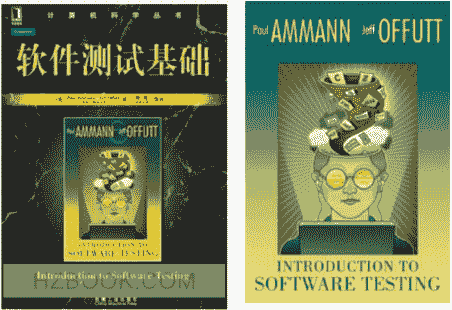

http://cs.gmu.edu/~offutt/softwaretest/

## 三、教材和参考书

### 推荐经典基础著作

[3] Glenford J. Myers. 软件测试的艺术.

[4] Ron Patton, 软件测试，机械工业出版社

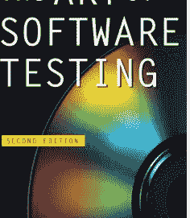

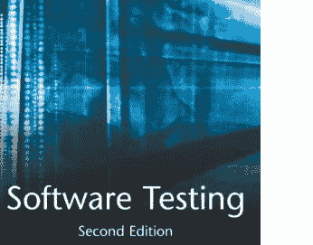

## 三、教材和参考书

### 推荐软件测试高级读物

[5] How We Test Software at Microsoft, Alan Page et al., Microsoft Press.
微软的软件测试之道，机械工业出版社
[6] 软件测试与分析. Mauro Pezze, Michal Young.

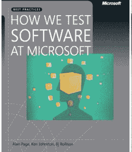

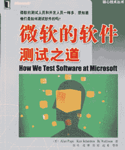

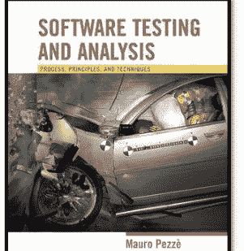

## 三、教材和参考书

### 软件测试新技术和发展趋势

- [1] 软件工程权威国际会议：ICSE, FSE, ISSTA, ICST等
- [2] 软件工程权威国际杂志：IEEE TRANS. on SE, ACM TRANS. On SEM等


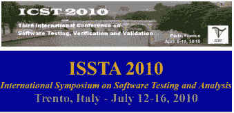


## 三、教材和参考书

### 网络资源

- [1] 论坛：
  
  51Testing、[淘宝 QA 团队](https://www.taobao.com) 等

- [2] 国外大学课程：
  
  [萨尔大学：测试与调试](https://www.uni-saarland.de/en/home.html)
  
  [乔治梅森大学：软件测试导论](https://www.gmu.edu/) 等

- [3] 开源工具：
  
  [http://www.opensourcetesting.org/](http://www.opensourcetesting.org/) 等

- [4] 知名技术专家：
  
  朱少民：[http://blog.csdn.net/KerryZhu](http://blog.csdn.net/KerryZhu)
  段念、史亮、于潇、……

……

## 软件测试

课程概述

从认识和理解软件Bug开始，介绍软件测试的基本理论，阐述软件测试设计的多样性原理。基于多样性原理，介绍面向开发者和面向用户的测试用例设计方法，具体包括随机测试、等价类测试、结
构化测试、数据流测试和逻辑测试；邀请业界专家讲解功能测试、性能测试、兼容性测试等专项测试技术。

- Subtitles available in 中文（简体）
- 2-4 hours/week

南京大学

Zhenyu Chen
副教授
软件研究所

### 1. 软件测试基础

本节主要熟悉课程体系，了解测试基本概念，重点理解Bug及其测试原理。

2 小时 12 分钟

显示 9 课内容

### 2. 软件测试方法

本节主要讲解黑盒测试方法与黑盒测试方法。白盒测试方法从程序员的角度看如何测试代码，并以Unit为基础进行实践。

可向学生提供证书

完成本课程，并通过证书展示成绩，其中由Coursera颁发，确保其安全性和权威性。
了解更多关于证书的信息


## 四、课程考核方式

总评成绩 =

平时成绩(考勤 + 上机实验) + 期末考试成绩

+上机成绩（云测试）

平时成绩占： 30%

上机实验占： 10%

期末考试成绩占： 60%

一次点名未到： 总成绩减1分

三次点名未到： 总成绩为0分

## 软件测试
软件测试

# 2017
全国大学生软件测试大赛
全国大学生软件测试大赛

http://mooctest.org

# 七大分赛区

江苏网宿科技股份有限公司
广东明源软件科技有限公司
山东浪潮软件科技有限公司
西安海恒信息技术有限公司
重庆乐客睿睿信息技术有限公司

# “上海软件中心杯”
开发测试大赛

个人赛
参赛会提供来自开源社区的Java样例代码，在赛测平台的Eclipse客户端上完成JUnit测试脚本。
比赛时间：2017年10月15日9:00-12:00

# “智测云杯”
移动应用测试大赛

个人赛
比赛会提供来自业界的移动应用测试需求，在赛测平台的Eclipse客户端上完成Appium测试脚本。
比赛时间：2017年10月14日14:00-17:00

# “安恒杯”
Web安全测试大赛

个人赛
组委会提供不同知识点的Web安全测试靶机，通过手工测试和根据项目中的flag提交文章评分解得相应分数。
比赛时间：2017年10月15日14:00-18:00

# “凯云杯”
嵌入式测试大赛

个人赛
组委会提供基于国产四核的嵌入式测试任务，对根据嵌入式应用进行基于工的自动化检查测试。
比赛时间：2017年10月14日8:30-12:50

# “环海评测杯”
移动应用测试大赛

团体赛3人
组委会提供来自业界企业的特移动应用和测试需求，全部赛平台的Eclipse客户端上完成Appium测试脚本。
比赛时间：2017年10月14日14:00-17:00

# “众蚁杯”
Web应用测试大赛

团体赛3人
组委会提供来自业界企业的特Web应用测试，在Eclipse Selenium和Jenkins上分别完成功能测试和性能测试脚本。
比赛时间：2017年10月14日8:30-12:30

五大成绩组成综合证书
36万总奖金
5万+N分赛区奖金
颁奖盛典邀请函


## 四、课程考核方式

| 姓名 | 1 (作业) | 2 (作业) | 3 (作业) | 4 (作业) | 5 (作业) | 6 (实验) | 7 (实验) | 8 (实验) | 平时 | 期末 | 实践 | 其他 | 总评 |
| --- | --- | --- | --- | --- | --- | --- | --- | --- | --- | --- | --- | --- | --- |
| 楚梦渝 | A | A | A | A | 0 | A | A | A | 76 | 93 | 95 |  | 92 |
| 尤玥 | A | A | A | A | A | A | A | A | 95 | 91 | 95 |  | 92 |
| 安贞巧 | A | A | A | A | B | B | A | A | 92 | 92 | 90 |  | 92 |
| 陈璐 | A | A | B | A | A | A | A | A | 92 | 94 | 95 |  | 94 |
| 李超仁 | A | A | A | B | B | A | A | A | 89 | 94 | 95 |  | 94 |
|  | A | C | B | B | 0 | B | D | D | 65 | 55 | 63 | -2 | 56 |
|  | C | D | B | C | 0 | C | 0 | C | 55 | 59 | 47 | -3 | 53 |
|  | 0 | 0 | 0 | 0 | 0 | 0 | 0 | 0 | 0 | 84 | 0 | -1 | 58 |
|  | B | C | C | B | B | C | B | C | 80 | 50 | 83 |  | 60 |
| 倪洁 | C | C | D | B | A | B | A | C | 74 | 53 | 82 |  | 61 |

| 习题1 | 习题2 | 实验1 | 实验2 | 实验3 | 实验4 | 实验5 | 实验6 | 实验7 | 大作业 | 平时 | 期中 | 期末 | 实践 | 其他 | 总评 |
| --- | --- | --- | --- | --- | --- | --- | --- | --- | --- | --- | --- | --- | --- | --- | --- |
| 100 | 100 | 100 | 100 | 100 | 100 | 100 | 100 | 100 | 95 | 100.0 | 100 | 89.0 | 100.0 | 5 | 97.9 |
| 95 | 100 | 100 | 100 | 100 | 100 | 100 | 100 | 95 | 95 | 97.5 | 95 | 97.0 | 99.3 |  | 97.4 |

雷同的实验报告一律负分！

谢绝索要高分成绩！

20:30

老师，实验1、3我重新上传了，麻烦您能重新批改一下。

20:31

有问题我会指出，但不可能重新给你评定成绩。

为什么不能重新给个成绩？

噢，对不起，耽搁您时间了。

## 五、课件阅读提示

- 课件特点
  - 综合了国内外多本教材和开发资源中的内容
  - 力图提炼全面和精炼的知识
- 参考文献和链接
  - 增加知识面

### 特殊标记

- 例子
- 强调
- 小提示

## 五、其它重要的提示

- **课程预备知识**
  - 软件工程基础
  - 熟悉至少一门编程语言（Java/C++）
- **课程学习技巧**
  - 系统学好基础
  - 熟悉主流工具
  - 结合实际项目
  - 阅读权威文献

### 课程学习目的

- 1. 软件测试的系统思维
- 2. 软件工程的思维提升
- 3. 基础知识和主流测试技术
- 4. 测试工具包和主流测试工具
- 5. 测试相关文档写作

### 课程准备

- 1. 复习、预习、习题
- 2. 随时的课堂练习：笔、纸

- 课程交流平台：微信群
- 课件下载和作业提交方式
  - FTP: `223.3.70.56`  user: cose  password: cose
  - 课程主页：`http://cse.seu.edu.cn/personalPage/pwang//course/st.html`
  - 课件目录：`\PPT`
  - 作业目录：`\Homework\71113X\`

### 作业命名格式

学号（XXX）+'-'+周次(##)

正确：71110129-12.doc 或 71110129-12.pdf

错误：71110129_8.doc

## 下讲预告

### 软件测试概述

- 一、软件测试背景
- 二、软件测试基本概念
- 三、软件测试现状和趋势
- 四、软件测试工具

欢迎各位老师同学批评指正！

Email: pwang@seu.edu.cn

## 软件测试基础与实践

软件测试：基础与实践

#### 第1讲 软件测试概述

**教师：汪鹏**

软件工程专业 主干课程

#### Myers的三角形问题自我测试

被测程序描述：

该程序从一个输入对话框中读取三个整数值。这三个整数值代表了三角形三边的长度。程序显示提示信息，指出该三角形究竟是不规则三角形、等腰三角形还是等边三角形。

测试要求：

设计适当的测试用例集，完成对该程序的测试。

- 1. 代表有效的不规则三角形：（2, 3, 4）、（3, 4, 5）
- 2. 代表有效的等边三角形：（2, 2, 2）
- 3. 代表有效的等腰三角形：（3, 3, 4）
- 4. 第3类的所有情况：（3, 3, 4）、（3, 4, 3）、（4, 3, 3）
- 5. 代表无效的等腰三角形：（2, 2, 4）
- 6. 代表某边长度等于0：（3, 4, 0）
- 7. 代表某边长度为负数：（3, 4, -5）
- 8. 代表两边之和等于第三边：（1, 2, 3）
- 9. 第8类的所有情况：（1, 2, 3）、（1, 3, 2）、（3, 1, 2）

#### 从“猎人打鸟”看软件测试的思维


问题：树上10只鸟，开枪打死1只，还剩几只？

学生：测试工程师        老师：开发人员

学生：是无声手枪吗？

老师：不是。

学生：枪声有多大？

老师：80-100分贝。

学生：那就是说枪声会震疼耳朵？

老师：是的。

学生：有没有翅膀断了的这种残疾的鸟？

老师：没有。

学生：有没有饿得压根飞不动的鸟？

老师：没有，都身体倍棒。

学生：算不算怀孕肚子里的鸟？

老师：都是公的。

学生：猎人的眼花没花？保证是10只？

老师：没有花，就10只。

学生：有没有傻得不怕死的？

老师：都怕死。

学生：有没有忠于爱情，情侣被打中也留下来的？

老师：都说了是公的嘛！

#### 软件测试的几个核心问题

##### 1. 测试用例生成

- 测试用例设计
- 测试方法
- 测试策略

##### 2. 测试效率

- 测试用例简约
- 自动化测试
- 测试工具

##### 3. 测试效果

- 测试覆盖率分析
- 测试报告分析


#### 一、软件测试背景

- 1. 软件测试发展史
- 2. 为什么需要软件测试？
- 3. 软件缺陷为什么会出现？
- 4. 软件缺陷如何影响我们的生活？


##### 软件测试的成长

> 我们可以通过考察测试过程模型随时间的变化以及专业化程度的提升来追溯软件测试工程的演进。当前对良好软件测试实践的定义涉及某种预防性方法。

DAVID GELPERIN and BILL HETZEL

Gelperin, D.; B. Hetzel (1988). "The Growth of Software Testing". CACM 31 (6)

在过去的四十年里，随着数字计算机的使用多样化并增加，以及软件失败成本相应增加，测试的重要性日益增长。在此期间，我们对如何使测试成为一种具有成本效益的过程的理解也在增长。这种理解的增长表现为测试过程模型的演进。随着理解的增长在大型人群中从不均匀，测试的需求和能力导致了不同的测试成功定义。未被识别的心智模型差异导致了客户、经理、分析师、程序员和测试人员之间以及内部的沟通混乱。

由于存在同时的多重模型，导致了混乱。因为测试与编码一样古老，所以与软件相关的大多数人都对测试有一个心智模型。然而，在测试范围的定义以及沟通和同化的差异化规则方面存在显著差异，今天实践中可以找到所有模型在演进中的例子。

本文描述了主要的过程模型，并描述了一些与测试成长相关的变化。基于专业标准的最新模型与最佳行业实践进行了比较，以突出差异。

### 主要模型概述

我们区分了图1中列出的四个主要测试模型。这些模型主要通过活动范围和主要目标来区分。

### 活动范围

两种阶段模型都将执行作为主要测试活动，因为执行实现了其主要目标。虽然它们承认测试计划和数据选择是有效执行的前提，但它们强烈地将“测试”一词与“测试执行”联系起来，以至于这两个术语几乎同义。这种强关联导致了测试是生命周期阶段的观点。这种在许多组织中仍然盛行的测试观点表达在“编码和测试”这一短语中。

生命周期模型将测试的重点从项目的末尾转移到其开始。这种转变导致了测试不是影响软件实现的顺序阶段，而是与软件需求和设计并行影响的观点。测试被视为从项目非常开始就与开发活动强烈互动。我们将测试在计划、设计、实现、执行中的活动与软件分析（如时序分析、数据流分析、正确性证明）和软件评审（包括走查和检查）等其他评估活动区分开来。两个生命周期


David Gelperin


Book of Bill Hetzel


##### 软件测试发展史划分

- 1. Until 1956 – 面向调试的时代
Debugging oriented
- 2. 1957–1978 – 面向可运行的时代
Demonstration oriented
- 3. 1979–1982 – 面向缺陷发现的时代
Destruction oriented
- 4. 1983–1987 – 面向评估的时代
Evaluation oriented
- 5. 1988–Now – 面向预防的时代
Prevention oriented

## 1822——Difference Engine

## 1843——Analytical Engine

## 信息简史
The Information: A History, a Theory, a Flood

第4章 将思想的力量注入齿轮机械（强，欣喜若狂的算术家们！）....................77

有那么两次，查谈这样问道：“请问，贝贝考先生，如果你往机器里递入了错误的数据值，出来的还会是正确的答案吗？”一回是在上议院，还有一回是在下议院。我至今无法找到对她解释，或是为什么她总能把这些问题避开。

## 1896——IBM Founded

Charles Babbage

Ada Lovelace

Herman Hollerith

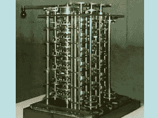


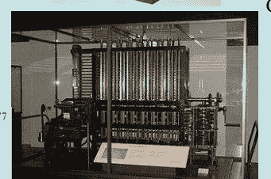


## 1944——Harvard Mark I

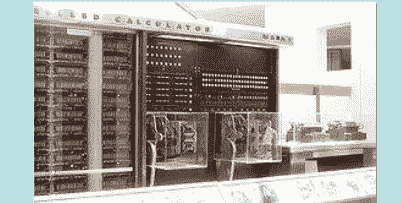

> "现代计算机时代的开端"

## 1945——Von Neumann Architecture

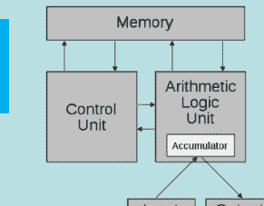


John von Neumann

## Until 1956 – 面向调试的时代
Debugging oriented

软件质量表现：

- 1. 用户需求
- 2. 开发规范
- 3. 隐含需求

软件错误/软件缺陷/Bug：

软件没有实现其最终用户合理预期的功能要求

## Some Bugs

## Dota All-Stars

Sentinel vs Scourge

## War3

This application has encountered a critical error:

FATAL ERROR!

Program: e:\warcraft iii\war3.exe
Exception: 0xC0000005 (ACCESS_VIOLATION) at 001B:6F40C230

The instruction at '0x6F40C230' referenced memory at '0x0000003C'.
The memory could not be 'read'.

Press OK to terminate the application.

确定

## 美国驻华大使馆

18分钟前 来自 微博 weibo.com

耶鲁大学校长近日宣布，将把卡尔霍恩学院（Calhoun College）改名为格蕾丝·穆雷·赫柏学院(Grace Murray Hopper College)。这所本科住宿学院为什么要改名呢？原因就在于毕业于耶鲁大学、当过美国副总统的约翰·卡尔霍恩（John C. Calhoun, 1782-1850）宣扬奴隶制的历史。耶鲁大学表示，作出改名的决定绝非易事，但卡尔霍恩在担任国家要职期间宣扬奴隶制的做法有悖于耶鲁的使命和价值观。这个学院将被重新命名为格蕾丝·穆雷·赫柏（1906-1992）学院。赫柏于1934年在耶鲁大学获得数学和数物物理学博士学位，享有“计算机程序之母”的美誉。她在二战期间加入美国海军，退役时为海军少将。

网页链接

收起全文 ^


## Until 1956 – 面向调试的时代
Debugging oriented

测试等同于“调试”；
由开发人员完成；
投入少，介入晚……

## 1957——Program Testing vs Debugging

Charles L. Baker (RAND Corporation)

## 1958——First Software Test Team (Weinberg)


Gerald M. Weinberg

## 1961——Computer Programming Fundamentals (Leeds, Weinberg)

Herbert Leeds

## 1963——Flowchart symbols standardized

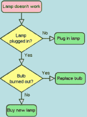

## 1964——First Basic Program run

and Thomas E. Kurtz

e (1978)

This is the original 1978 source code of Microsoft BASIC for 6502 with all original comments, documentation and easter eggs. This is currently the oldest publicly available piece of source written by Bill Gates.

Archived from a blog post by Michael Steil at PageTable.

1967——Functional Testing of Control Programs
——Software Engineering introduced

William Elmendorf


1968——Software Quality Assurance
——Structured Programming (Dijkstra)
——Intel Founded
——Software Crisis


Gordon Moore

## 1968——NATO Software Engineering Conference

## 软件工程(IEEE定义)：将系统化的、严格约束的、可量化的方法应用于软件的开发、运行和维护，即将工程化应用于软件。


## 1950s:

- 测试被视为一种发现软件缺陷的活动
- **开始与调试区分开**
- 测试始终后于开发
- 缺乏有效的测试方法

## ■ 软件危机

**危机背景：**

落后的软件生产方式无法满足日趋复杂大型软件系统的开发需求（20世纪60年代）

**危机表现：**

项目延期、经费超支、产品无法维护……


- 1.

**IBM360机操作系统**

1963-1966，Brooks，《人月神话》

## 软件危机


Frederick Phillips Brooks
(April 19, 1931-)

第三十四个图灵奖获得者(1999年)

Turing Award Citation:
For landmark contributions to computer architecture, operating systems, and software engineering.

IBM System/360贡献：
阿波罗11号登月，跨行交易系统，最大的航空票务系统，……

http://en.wikipedia.org/wiki/Fred_Brooks

http://en.wikipedia.org/wiki/OS/360


潘越_V：该出手时就出手 —— System/360的研发计划是计算机历史上最大的商业豪赌，也为日后的许多第一建立了基础，例如：协助美国太空总署建立阿波罗11号数据库，完成航天员登陆月球计划；建立银行跨行交易系统(ATM)以及航空业最大在线票务系统。

@IBM100V：集成电路的发明是电子技术的又一次重大突破。1964年4月7日，正值IBM公司创建50周年那一天，小沃森宣布IBM的360型系统电子计算机制造成功。它是第三代计算机的佼佼者，其研制开发经费高达50亿美元，远远超过美国研制第一颗原子弹的曼哈顿计划（20亿美元），堪称历史上规模最大的私人企业投资。

原文转发(7) | 原文评论(3)


## 软件危机

### 危机原因

缺乏规范化工程约束→缺陷的不断积累与放大效应

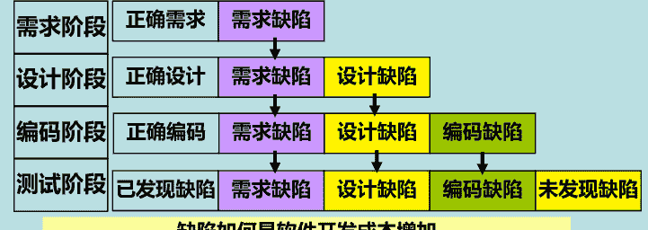

### 缺陷修复代价——随开发时间快速增加

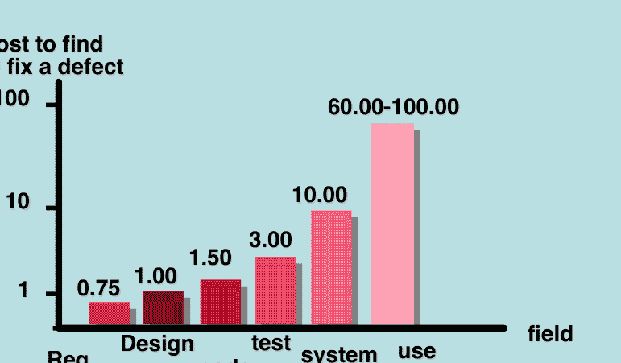

缺陷修复成本

| 发现时间 | 需求 | 架构 | 构建 | 系统测试 | 发布后 |
| --- | --- | --- | --- | --- | --- |
| 引入时间：需求 | 1× | 3× | 5–10× | 10× | 10–100× |
| 引入时间：架构 | - | 1× | 10× | 15× | 25–100× |
| 引入时间：构建 | - | - | 1× | 10× | 10–25× |

http://en.wikipedia.org/wiki/Software_testing

## 1969——测试显示的是缺陷的存在，而非不存在

Edsger Wybe Dijkstra

[A.M. 图灵奖 (1972)](https://en.wikipedia.org/wiki/Turing_Award)


## 1970——瀑布模型发表

Winston W. Royce

## 1971——变异测试 (Lipton)

- 1973——程序测试方法 (Hetzel)
- ——因果图创建
- ——Compuware 成立
- ——三角形问题 (Gruenberger)


## 1975——微软成立

- Altair 8800 推出


## 1976——设计与代码检查

- 苹果成立
- 圈复杂度


Michael Fagan

## 1977——软件质量因素

- 软件度量
- 程序测试技术
- 设计模式


Thomas J. McCabe

## 1978——功能程序测试

(Howden)


Edward F. Miller


## 1957–1978 – 面向可运行的时代

Demonstration oriented

### 1970S:

软件工程思想开始深入人心；

- 1972，Bill Hetzel组织了第一次软件测试会议
- 1973年3月，Bill Hetzel给出软件测试第一个定义：

> “测试就是建立一种信心，认为程序能够按预期设想运行”

## 1979——《软件测试的艺术》 (Myers)

引入黑盒测试

它为“现代”软件测试奠定了基础。


Glenford J. Myers

## 1981——《软件工程经济学》 (Boehm)

- Rational Software 成立


## 1982——《重新思考系统分析和设计》 (Weinberg)

- 《走出危机》 (Deming)
- 《生命周期概念是有害的》 (McCracken)

## 1983——IEEE 829 发布

## 1984——首次测试行业会议

## 1979–1982 — 面向缺陷发现的时代

Destruction oriented

Glenford J. Myers:

测试是尽可能多地发现软件错误

Myers的软件测试定义：

测试是为发现错误而执行一个程序或系统的过程


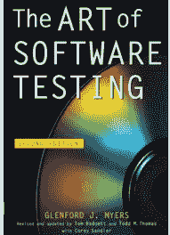

Myers的三个重要观点：

1. 测试是为了证明程序有错，而不是证明程序无错误；
2. 一个好的测试用例是在于它能发现至今未发现的错误；
3. 一个成功的测试是发现了至今未发现的错误的测试；

《The Art of Software Testing》


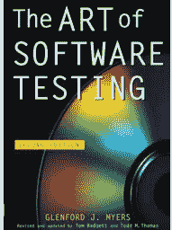

- 1985——AutoTester 发布
- ——逆向工程 (Rekoff)

第一款面向 PC 的商业测试工具

- 1986——V模型发表
- ——《没有银弹》 (Brooks)

- 1987——先测试，后编码 (Motto)
- ——用例 (Jacobson)
- ——软件设计模式 (Beck, Cunningham)

- 1988——探索性测试引入 (Kaner)
- ——CMM 发布
- ——《软件测试的成长》 (Gelperin, Hetzel)
- ——首个缺陷跟踪工具
- ——螺旋模型 (Boehm)
- ——Segue Software 成立

## 1980S:

- 软件趋向大型化、高复杂化，软件质量越来越重要
- 开发从混乱无序过渡到结构化开发
- 测试基础理论和实用技术开始形成
- 测试被作为软件质量保证的重要手段
- 1983年，IEEE给出软件测试的定义

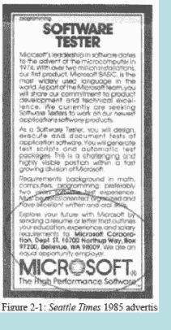


## 1988–Now – 面向预防的时代
面向预防

- 测试理论和技术进一步完善
- 测试工具发展迅速，大大提高测试的自动化程度
- 商业化软件测试工具和开源软件测试工具。
- Web测试，面向对象测试,测试脚本开发......

## Software Testing Timeline
软件测试时间线

http://www.testingreferences.com/testingtimeline/testingtimeline.jpg

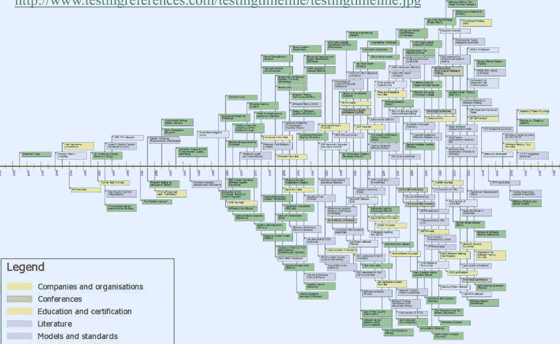

### Legend
图例

- Companies and organisations
公司和组织
- Conferences
会议
- Education and certification
教育和认证
- Literature
文献
- Models and standards
模型和标准
- Publications and ideas
出版物和思想
- Tools and applications
工具和应用

## 软件测试背景

## 软件测试的意义  软件缺陷难以避免！

## ② 火星登陆事故(Mars Polar Lander)


> Nancy G. Leveson, *The Role of Software in Spacecraft Accidents*
> Nancy G. Leveson, *《航天器事故中的软件作用》*

## 启发：集成测试的必要性

## 软件测试背景

## ■ 软件测试的意义　**软件缺陷难以避免！**

## ③ 千年虫问题(Y2K)


今天的编程课讲到rand()时，讲到可以用Unix Timestamp来做随机数发生器的种子，讲而讲到因为Unix Timestamp用32位int表示造成的「2038年」问题。所有基于Unix Timestamp的计算机程序，大到云数据库小到智能温度计，都会在2038年1月19日凌晨3点14分07秒回到1901年。也许这是计算机设计史上最大的失误。

## 软件测试背景

## 软件测试的意义  软件缺陷难以避免！

## 爱国者导弹防御系统

启发：缺陷难以发现(可靠性测试)


## 软件测试背景

## 软件测试的意义　软件缺陷难以避免！

## 5　Intel奔腾处理芯片缺陷(Pentium FDIV bug)


Thomas Nicely


(4195835/3145727) *3145727-4195835

4195835.0/3145727.0 = 1.333 820 449 136 241 002 (Correct value)
4195835.0/3145727.0 = 1.333 739 068 902 037 589 (Returned by flawed Pentium)
4195835*3145727/3145727 = 4195835 (Correct value)
4195835*3145727/3145727 = 4195579 (The flawed Pentium)

http://en.wikipedia.org/wiki/Pentium_FDIV_bug

芯片界那点破事 http://weibo.com/tarticle/p/show?id=230940399088803651075#_0

## 软件测试背景

## ■ 软件测试的意义　**软件缺陷难以避免！**

## ⑥ 北京奥运订票网站瘫痪

**事故过程：**订票系统半小时即瘫痪


## 软件测试背景

## 软件测试的意义  软件缺陷难以避免！

Michael Jackson逝世消息
事故过程：百万网友同时在线疯狂查询修改美国流行天王迈克尔杰克逊逝的信息……

启发：性能测试在互联网应用中的重要性


## 软件测试背景

为什么会出现软件缺陷

- 一、 产品说明书(需求) (主要原因)
- 随意、易变、沟通不足
- 二、 设计 (次要原因)
- 随意、易变、沟通不足
- 三、 编码
- 软件复杂度，进度压力，低级错误
- 四、 其它
- 理解错误，测试错误


## 软件测试背景

## 软件测试的意义

软件测试是保证软件质量的重要手段。
软件测试深入软件开发过程的每个阶段，在有限的开发条件下，最大程度地保证最终软件产品符合用户需要。

#### 二 软件测试基本概念

- 1. 软件测试是什么？
- 2. 软件测试活动需要遵循哪些原理？
- 3. 如何实施软件测试？
- 4. 软件测试如何分类？

##### 软件测试基本概念

## ■ 软件测试的目的

**1.确保软件质量**

找出软件错误和缺陷，降低软件发布后潜在错误和缺陷造成的损失，验证软件是否能满足用户需求，树立对软件的信心。

**2.确保软件开发过程方向的正确性**

通过测试报告提供有用的数据帮助管理者做出正确判断，修正软件开发过程。

##### 软件测试基本概念

理解Bug：Fault(失效) Error(错误) Failure(失败)

##### Bug的定义：

- **Software Fault**: A static defect in the software (i.e., defect)
**软件缺陷**：软件中的静态缺陷（即缺陷）
- **Software Error**: An incorrect internal state that is the manifestation of some faults
**软件错误**：某些缺陷表现出来的不正确内部状态
- **Software Failure**: External, incorrect behavior with respect to the requirements or other description of the expected behavior
**软件失效**：相对于需求或其他预期行为描述的外部、不正确行为

##### 软件测试基本概念

##### 理解Bug：Fault(失效) Error(错误) Failure(失败)

Programmer makes a mistake.
程序员犯了错误。

Fault (defect, bug) appears in the program.
程序中出现了缺陷（缺陷、bug）。

Fault remains undetected during testing (running test inputs).
缺陷在测试期间未被检测到（运行测试输入）。

The program fails (based on test oracles) during execution i.e., it behaves unexpectedly.
程序在执行期间失效（基于测试 oracle），即行为异常。

Error: difference between computed, observed, or measured value or condition and true, specified, or theoretically correct value or condition
错误：计算、观察或测量的值或条件与真实、指定或理论上正确的值或条件之间的差异

##### 软件测试基本概念

##### 软件测试的原理/原则/准则

**原理1：用户需求至上**

所有测试都应追溯到用户需求。最严重的错误是导致软件无法满足需求的错误。

**原理2：测试是有计划的活动**

测试计划制定先于测试的执行；测试贯穿于全部软件生命周期。

##### 软件测试基本概念

##### 软件测试的原理/原则/准则

##### 原理3：缺陷出现的集群性

软件缺陷会集中出现;80%的错误可能起源于20%的模块。

##### 原理4：测试应从 “小规模” 走向 “大规模”

##### 软件测试基本概念

## 软件测试的原理

**原理5：穷尽测试不可能**

可能对解二次方程穷尽测试吗？

```
class Roots {
    // Solve ax² + bx + c = 0
    public roots(double a, double b, double c)
    { ... }

    // Result: values for x
    double root_one, root_two;
}
```

**原理6：有效的测试应由第三方独立进行**

##### 软件测试基本概念

## 软件测试的原理

原理7：测试无法揭示所有缺陷

测试只能说明缺陷存在，而不能说明软件没有缺陷。

原理8：测试的杀虫剂悖论

潜在缺陷对已进行的测试具有免疫力


##### 软件测试基本概念

### 软件测试的原理

原理9：测试是有风险的行为


##### 软件测试的过程

**Step1：拟定测试计划**

确定测试的目标和范围、测试环境、测试策略、测试结果分析计划、测试报告计划、测试重用计划、时间表、测试结束标准。

**Step2：编制测试大纲**

软件测试活动的依据：明确测试内容、完成测试的准则、测试活动如何实施。

**Step3：设计测试用例**

每次测试的详细说明。

**Step4：实施测试**

在每个测试周期，测试工程师依据测试大纲和测试用例，通过执行被测试软件，或检查程序代码和文档，对其进行测试。

**Step5：分析测试结果（例1，例2，例3）**

收集测试结果：通过和未通过的测试用例。

生成测试报告：为软件项目进展提供重要的即时参考数据。

##### 测试用例

测试用例定义：

一个文档，详细说明输入、期望输出，和为一测试项所准备的一组执行条件。

测试用例设计准则：

- (1) 代表性：代表合理和不合理、合法和非法、边界和越界以及极限数据、各种操作环境等
- (2) 可判定性：测试执行结果的正确性是可判定的或可评估的
- (3) 可再现性：对同样的测试用例，系统执行结果应当相同

| 测试用例书写示范 |
|---|
| **ID:** LG0101002<br>**用例名称:** 验证输入错误密码后提示是否正确<br>**测试项:** 用户邮件地址和密码<br>**环境要求:** Windows XP SP3和Firefox 3.0.2<br>**参考文档:** 软件规格说明书SpecLG01.doc<br>**优先级:** 高<br>**层次:** 2（即LG0101）的子用例<br>**依赖的测试用例:** LG0101001<br>**步骤:**<br>1. 打开浏览器，进入Google页面<br>2. 单击页面右上角“登录”链接，出现登录界面<br>3. 在电子邮件的输入框中输入：test@gmail.com<br>4. 在口令输入框中输入：xxxabc<br>5. 单击“登录”按钮<br>**期望结果:**<br>登录失败，页面重新回到登录界面，并提示“用户密码错误” |


##### 测试报告

评估软件质量的依据文档之一（测试覆盖率，缺陷密度，缺陷清除率）

软件验收和交付的基础文档


**测试报告实例**

##### 软件测试工程师一天的生活！


##### 软件测试环境

测试环境 = 软件 + 硬件 + 网络

**测试环境要点：**

- 1. 真实
- 2. 干净
- 3. 无毒
- 4. 独立

**测试环境分类：**

- 1. 软件开发环境：包括开发工具和平台
- 2. 软件运行环境：最终用户使用的环境

##### 软件测试的类型

**视角1：测试技术（代码是否可见的通用划分）**

- 1. 白盒测试
- 2. 黑盒测试
- 3. 灰盒测试

白盒测试：基于软件代码的内部逻辑来设计测试用例。测试退出条件是代码覆盖率。一般由开发人员完成。

黑盒测试：基于需求和功能性，不需要了解内部的设计和代码，通过软件外部表现来发现缺陷和错误。

灰盒测试：介于白盒测试与黑盒测试之间的技术，既关注软件外部表现，又注意程序内部逻辑结构。


- 基于规格的测试
- 测试尽可能覆盖指定的行为
- 基于代码的测试
- 测试尽可能覆盖已实现的行为

**视角2：开发阶段/Test Level**

- 1. 单元测试
- 2. 集成测试
- 3. 系统测试
- 4. 性能测试
- 5. 确认测试
- 6. 验收测试
- 7. 回归测试

系统测试：测试整个系统的行为和错误属性。

性能测试：评价系统响应时间、吞吐率等系统属性，并与不同版本或竞争产品进行比较。

确认测试：验证软件是否可以按照用户合理的期望方式工作。

验收测试：保证客户对所有的需求都满意（α测试和β测试）。

回归测试：保证增强型或改正型修改使软件正常运行，不影响已有功能。

**视角3：执行状态**

- 1. 静态测试
- 2. 动态测试

静态测试：不运行程序，而通过人工对程序和文档进行分析与检查。

动态测试：通过人工或利用工具运行程序进行检查，分析程序执行状态和外部表现。

**视角4：执行主体**

- 1. 开发方测试
- 2. 用户测试
- 3. 第三方测试

开发方测试：开发方通过检测和提供证据，证实软件是否满足规定的需求。验证测试或α测试。

用户测试：用户通过运行和使用软件，检测与核实软件实现是否符合自己预期要求。β测试。

第三方测试：介于软件开发方和用户之间的测试组织进行的测试活动。

**视角5：特殊测试/Objectives of Testing**

- 1. 国际化测试
- 2. 即兴测试
- 3. 兼容性测试
- 4. 安全性测试
- 5. 可用性与易获得性测试
- 6. 面向对象系统测试
- 7. Web测试

国际化测试：保证全球化软件产品符合不同国家的语言和使用习惯。

即兴测试、随机测试、探索式测试：通过直觉和经验，不采用任何形式化的测试。

针对有经验的工程师。

## 具体例子

【中文简体、北京】

开始日期：2008年12月1日
开始时间：8:00，中国标准时间 (GMT +08:00，北京)

【英文、纽约】

开始日期：星期日，2008年11月30日
开始时间：晚上7:00，东部标准时间 (GMT -05:00，纽约)

时区：GMT -05:00, 东部标准时间 (纽约)

语言：简体中文

地区：中国大陆

确定

取消

## 示例—阿拉伯语

ويكيبيديا مساحة اللعب
من ويكيبيديا، الموسوعة الحرة
(Sandbox) صفحة الرمل

مرحباً في صفحة اللعب التي يسمح لها هذه الصفحة بتجريب تحرير، الكتابة والتعديل، استمتع

هذا لا يعني أن هذه الصفحة لا تُحذف، فهي للتجربة فقط، فلا تضع فيها معلومات حقيقية


##### 软件测试基本概念

##### 软件测试的类型

# 视角5：特殊测试/测试目标

- 1. 国际化测试
- 2. 即兴测试
- 3. 兼容性测试
- 4. 安全性测试
- 5. 可用性与易获得性测试
- 6. 面向对象系统测试
- 7. Web测试

兼容性测试：
确保软件在不同基础设施下都能够一致地发挥作用。

安全性测试：
测试软件是否存在安全漏洞和隐患。

视角5：特殊测试

- 1. 国际化测试
- 2. 即兴测试
- 3. 兼容性测试
- 4. 安全性测试
- 5. 可用性与易获得性测试
- 6. 面向对象系统测试
- 7. Web测试

可用性与易获得性测试：
确认产品的易用性、美感以及是否方便行动不便的用户。

面向对象系统测试：
针对采用面向对象技术开发的软件所的测试技术。

Web测试：
发现存在于web应用中的内容、功能、性能、安全性等方面的错误的测试活动集。

# Nokia S30

# Nokia S60

# Nokia Meego

# 信息

选择

退出

中国移动 无声 今天无日历项 设置电子邮件 打开的应用程序序： 选择 取消

周四，7月22日 下午2:30 3G 全部 收藏 信息 文本消息 联系人 浏览器 媒体 日历 可视语音信箱 电话 社交动态 地图 相机 BlackBerry Messenger

11 22 下午 广州市 周一 6月6日 29° 低:27° 提示 微博 太平洋电脑 HTC商城 信息 邮件 互联网 相机 电话

无服务 11:51 短信 日历 播种 相机 YouTube 股市 地图 天气 备忘录 实用工具 iTunes App Store 设置 iBooks Mac 电话 邮件 Safari iPod

### 课程里程碑

# 单元测试 集成测试 系统测试 确认测试 验收测试 性能测试

白盒测试

黑盒测试

灰盒测试

兼容测试

安全性测试

即兴测试

回归测试

面向对象系统测试
国际化测试
Web测试
易获得性测试
可用性与

# 静态测试

# 动态测试

开发方测试

用户测试

第三方测试

# 软件开发--软件测试 W模型

需求分析定义

系统、结构设计

详细设计

编码

测试目标

需求评审

测试计划

设计评审

测试用例

代码审查
单元测试
集成测试

功能测试
系统测试

确认测试

验收测试

缺陷修正

缺陷修正

缺陷修正

同步

同步

同步

同步

同步

同步

同步

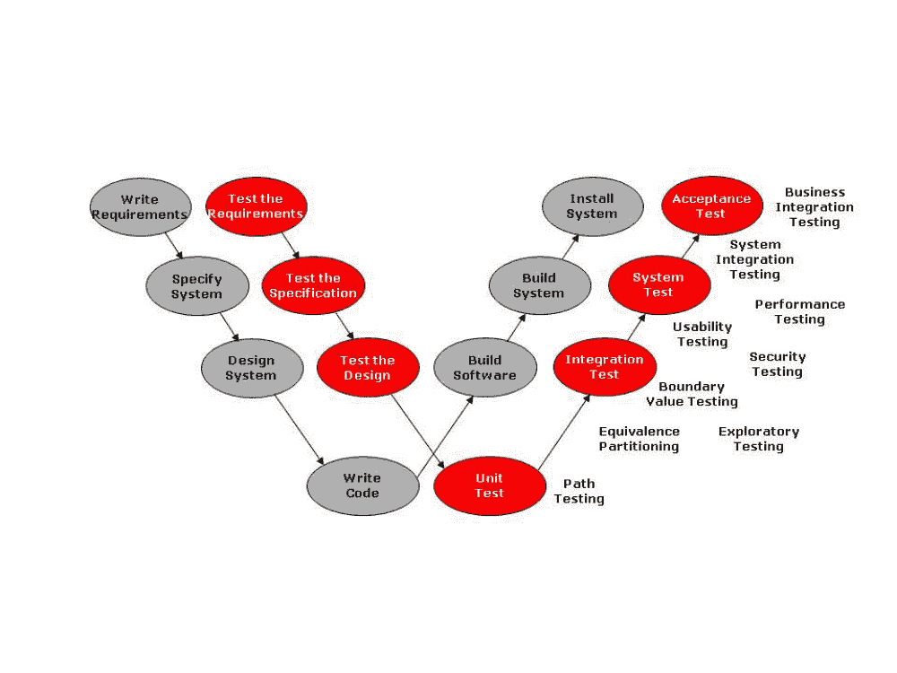

# W模型

需求

需求评审 / 测试需求

规格说明

规格评审 / 测试规格文档

架构

架构评审 / 测试架构文档

详细设计

设计评审 / 测试设计

编码

代码走查

构建软件

构建软件

构建系统

安装系统

单元测试

集成测试

系统测试

验收测试

回归测试周期

1

2

3

4

5

6

6

6

#### 三 软件测试现状和趋势


- 1. 企业重视软件测试吗？
- 2. 软件测试是怎样的职业？
- 3. 我们会成为软件测试工程师吗？

##### 软件测试现状和趋势

##### 国际现状

# 软件工程各阶段工作量

| 阶段 | 需求分析 | 设计 | 编码 | 测试 | 运行和维护 |
| 工作量 | 20% | 15% | 20% | 45% |  |

测试在软件开发中占有不可或缺的重要地位（53%-87%）.

| 阶段 | 需求分析 | 设计 | 编码 | 测试 | 投产和维护 |
| 资金量 | 3% | 8% | 7% | 15% | 67% |

##### 软件测试现状和趋势

##### 国际现状

知名IT企业中，开发人员和测试人员比例通常都为1:1,微软甚至达到1:2.

| Microsoft Project | Exchange2000 | Windows2000 |
|---|---|---|
| 经理 | 25 | 250 |
| 开发人员 | 140 | 1700 |
| 测试人员 | 350 | 3200 |
| 测试人员/开发人员 | 2.5 | 1.9 |

##### 软件测试现状和趋势

##### 国内现状　　16和18年的两次调查报告

软件测试逐渐受到重视；存在不同程度的测试人才缺口；高素质的测试人才紧缺。

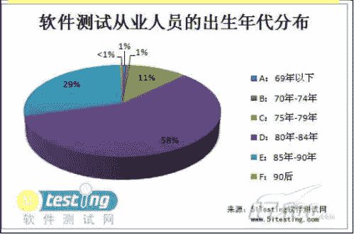

# 软件测试从业人员年龄分布

- 软件测试是一个新兴领域
- 80年代的职场新人是主力军
- 缺乏资深测试人员是不争的事实

##### 软件测试现状和趋势

# 国内现状

# 软件测试从业人员性别比例

# 测试人员性别比例


- 接近1:1的性别比例
- 传统的部分男性开发者转向测试

##### 软件测试现状和趋势

# 国内现状

# 软件测试从业人员专业和学历分布


专业集中于计算机和相关专业

学历集中于本科

##### 软件测试现状和趋势

# 国内现状

# 软件测试从业人员从业年限和职业发展分布

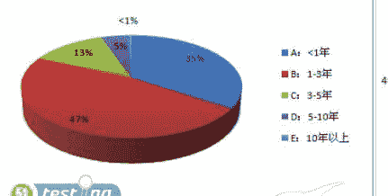


- 软件测试近年来才受到重视：3年以内工作经验占82%
- 存在金字塔人才结构：(初级)测试工程师占75%

##### 软件测试现状和趋势

##### 软件测试的挑战

1.技术发展的挑战
复杂性、协同性、变化。

2.测试工程师素质的挑战
责任心、综合素质、学习能力、解决问题能力、对行业的把握……

职业素质：“三心二意—能力”
三心：细心、耐心、信心
二意：服务意识、团队合作意识
一能力：沟通能力

##### 软件测试现状和趋势

##### 软件测试职业发展

测试工程师、高级软件测试工程师、
软件测试组负责人、软件测试项目经理。

需求集中于沿海发达城市

##### 软件测试现状和趋势

##### 东南大学软件学院07级实习情况调查

|  | 企业 | 研发 | 开发 | 测试 | 开发:测试 |
|---|---|---|---|---|---|
| 总览 | --- | 42 | 7 | 20 | 1 : 3 |
| 知名企业 | 华三 | 0 | 2 | 4 | 1 : 2 |
|  | 趋势 | 0 | 0 | 3 | ∞ |
|  | 国信朗讯 | 6 | 0 | 0 | --- |
|  | 爱立信 | 0 | 2 | 2 | 1 : 1 |
|  | SAP | 0 | 1 | 4 | 1 : 4 |
|  | 淘宝 | 3 | 0 | 0 | --- |
|  | 阿里巴巴 | 0 | 0 | 2 | ∞ |

##### 软件测试现状和趋势

东南大学软件学院08级实习情况调查

| 抽样情况：19位同学 |  |  |  |  |
|---|---|---|---|---|
| 其它 | 开发 | 测试 | 开发+测试 | 开发:测试 |
| 1 | 2 | 14 | 2 | 1：8 |

#### 四 软件测试工具

- 1. 哪些企业是测试软件提供商？
- 2. 这些企业提供什么样的测试工具？


##### 软件测试工具

### QAForums上讨论的24种测试工具

### 测试工具

- **WinRunner**：讨论Mercury Interactive的WinRunner相关主题。可以选择抄送用户邮件列表（winrunner@yahoogroups.com）。
- **LoadRunner**：讨论Mercury Interactive的LoadRunner相关主题。可以选择抄送用户邮件列表（loadrunner@yahoogroups.com）。
- **QuickTest Pro**：讨论Mercury Astra QuickTest和QuickTest Pro相关主题。
- **TestDirector**：本论坛旨在讨论与TestDirector相关的主题和问题。
- **SilkTest**：讨论Segue Software的SilkTest（原QAPartner）相关主题。可以选择抄送用户邮件列表（silktest@yahoogroups.com）。
- **SilkPerformer**：讨论Segue Software的SilkPerformer相关问题和主题。
- **Robot**：用于讨论Rational的Robot和TeamTest（SQA Suite）。可以选择抄送用户邮件列表（sqa-suite-users@lists.dundee.net）。
- **Visual Test**：讨论Rational（原MSTest）的Visual Test相关问题。可以选择抄送用户邮件列表（mt_info@eskimo.com）。
- **XDE Tester - Robot!**：本论坛讨论Rational新的Java测试工具XDE Tester，以前称为Robot!
- **TestManager**：面向Rational Software的TestManager用户。
- **QARun**：面向Compuware的QARun用户。
- **QALoad**：本论坛旨在讨论Compuware的QALoad相关主题和问题。
- **TestPartner**：专门讨论Compuware的下一代回归测试工具TestPartner。
- **QADirector**：用于讨论Compuware的QADirector相关问题和主题。
- **e-Test**：在此讨论Empirix（原RSW）的e-Test Suite相关主题。
- **e-Load**：在此讨论Empirix（原RSW）的e-Load相关主题。
- **WebLoad**：讨论RadView Software的WebLoad相关问题和主题。
- **WebFT**：本论坛讨论RadView的功能测试工具WebFT。
- **TestComplete**：涵盖AutomatedQA的TestComplete相关主题。
- **QA Wizard**：本论坛旨在讨论与QA Wizard相关的问题和主题。
- **Eggplant**：本论坛讨论Redstone Software的跨平台（Macintosh、Linux和Windows）自动化测试工具Eggplant。
- **Application Center Test**：本论坛讨论Microsoft Application Center Test（ACT）。
- **OpenSTA**：专门用于OpenSTA性能测试工具讨论。
- **Bugzilla**：专门用于Bugzilla开源缺陷跟踪工具讨论。

http://www.qaforums.com/

##### 测试工具掌握的调查

调查对象：东南大学软件学院07级

| 测试工具 | 工具类型 | 人数 | 熟悉程度 |
|---|---|---|---|
| Microsoft VS UnitTesting | 白盒测试 | 大多数 | 较好 |
| WinRunner | 功能测试 | 部分 | 初步 |
| TestDirector | 测试管理 | 少数 | 了解 |
| LoadRunner | 性能测试 | 大多数 | 中等 |
| Microsoft WAS | 性能测试 | 大多数 | 中等 |
| AutoRunner | 功能测试 | 部分 | 初步 |
| JUnit | 白盒测试 | 少数 | 初步 |
| CodeTest | 嵌入式测试 | 个别 | 了解 |

##### 测试工具在软件测试中的作用

- **速度**：自动化测试远高于手工执行测试
- **效率和成本**：
  - 推进软件开发进度
  - 降低开发和维护成本
- **准确度和精度**：工具能快速且无差错地执行测试用例或测试脚本

##### 主流测试工具相关公司

### HP（收购Mercury）

HP BTO Software

Mercury三剑客：LoadRunner, Quick Test Professional, TestDirector

QTP是早期WinRunner产品的替代品。

Mercury公司成立于1989年，逐渐成为软件质量产品提供商的领头羊。2006年被HP以45亿美元收购。

### Micro Focus（收购Compuware和Borland）

- 测试管理：Test Manager, QADirector
- 性能测试：QALoad, SilkPerformer
- 白盒测试：DevPartner
- 功能测试：SilkTest, TestPartner

Compuware是一流的软件测试工具厂商。代表产品：QARun, QALoad, QADirector, DevPartner。2009年，Compuware的测试业务被Micro Focus收购。

Segue是专注于软件测试产品的一线公司：SilkTest, SilkPerformer。Segue 2006年被Borland收购，Borland公司于2009年被Micro Focus收购。

### IBM（收购Rational）

- 功能测试：Rational Robot，Rational Functional Tester (已逐渐取代Robot)

2002年IBM收购Rational（DB2, WebSphere，Lotus等）。

### Parasoft

- 主攻白盒测试：C++ Test, DotTest, JTest, SOATest, ...
- 回归测试：WebKing

### Oracle（收购Empirix）

- E-Test Suite：E-Test, E-Load, E-Monitor

### RadView

- 专注Web性能测试：WebLoad

### Microsoft

- Visual Studio Test Edition：白盒测试、功能测试、性能测试(ACT)
- WAS：Web Application Stress Tool（早期小型性能测试工具）

##### 国内测试工具相关机构

- 泽众软件
  - 自动化测试工具：AutoRunner
  - 回归测试工具：TAR (Terminal AutoRunner)
- 领测科技
  - 单元测试工具：VCTester
- 凯乐软件
  - 单元测试工具：Visual Unit


##### 各类测试工具的主要产品矩阵

| | | HP Mercury | IBM Rational | Micro Focus | Microsoft | 开源软件 | 其他 |
|---|---|---|---|---|---|---|---|
| 白盒测试 | 一般单元测试 |  | PurifyPlus | DevPartner | VSTS | HttpUnit\nJWebUnit | Parasoft Tools |
|  | C++单元测试 |  |  |  | VSTS | CppUnit\nCppTest | C++Test\nDevPartner\nQA.C++ |
|  | Java单元测试 |  |  |  | VSTS | Junit | Jtest\nDevPartner\nQA.J |
| 功能测试 |  | QTP | Functional Tester Robot | Silk Test Test Partner | VSTS | STAF Selenium Jameleon | QARun TestComplete Verisium |
| 性能测试 |  | LoadRunner | Performance Tester | Silk Performer QALoad | VSTS | Jmeter OpenSTA | WebLoad QALoad |
| 测试管理测试辅助 | 需求管理 | Test Director | Requisite Pro | Silk Central | VSTS | Testopla |  |
|  | 测试管理 | Test Director | ClearQuest | Silk Central | VSTS | Testopla TestLink |  |
|  | 缺陷管理 | Test Director | ClearQuest | Start Team | VSTS |  | Fogbugz JIRA |
|  | 产品质量 | Quality Center | Project Console | Silk Central | VSTS | EMMA | VcTester |

#### 本讲结束语

> 软件测试者的一个基本素质就是打破砂锅问到底。他们喜欢找出那些难以捉摸的系统崩溃。他们乐于处理最复杂的问题。经常看到他们高高兴兴地来回奔忙，相互间击掌庆祝，拿到系统时手舞足蹈的样子。这就是平凡生活中的乐趣。
> 
> ——Ron Patton 《软件测试》

#### 参考文献

- 1. 路晓丽，葛伟 等, 软件测试技术, p1-p19, 机械工业出版社
- 2. 郑连, 软件测试方法与实践, p1-p15, 清华大学出版社
- 3. 宫云战 主编, 软件测试教程, p1-p18, 机械工业出版社
- 4. Srinivasan Desikan, Gopalaswamy Ramesh,（韩柳, 李娜 译）, 软件测试：原理与实践, p2-p26, 机械工业出版社
- 5. Ron Patton（张小松，王钰 译）, 软件测试, p3-p31, 机械工业出版社
- 6. 赵斌. 软件测试技术经典教程, p3-p59, 科学出版社
- 7. 朱少民. 软件测试. 人民邮电出版社
- 8. http://www.jbole.cn/architecture/奥运IT要网战瘫痪 问题出在哪里？
- 9. 软件测试的起源与发展. http://www.uml.org.cn/test/200611232.htm
- 10. 调查:中国软件测试从业人员的基本情况
    http://developer.51cto.com/art/200906/131670.htm
- 11. Software Testing http://en.wikipedia.org/wiki/Software_testing

#### 课后习题

- 大作业1
- 下载地址：ftp

习题下载地址：ftp
命名格式：71108129-12.doc OR 71108129-12.pdf


#### 本讲总结

- 测试背景
- 测试基本概念
- 现状和趋势
- 测试工具简介

#### 内容预告

- 白盒测试的基本概念
- 白盒测试的静态方法
- 白盒测试的动态方法

## 软件测试

## 软件测试基础与实践

## 软件测试：基础与实践

### 第3讲 黑盒测试

教师: 汪鹏

软件工程专业  主干课程

#### 本讲内容

| 黑盒测试基本概念 | 黑盒测试定义、特点、意义、... |
| 黑盒测试方法 | 等价类划分、边界值分析、因果法、决策表、基于模型的测试、... |
| 黑盒测试工具 | 主流黑盒测试工具 |

#### 一 黑盒测试概念


- 1. 为什么需要黑盒测试？
- 2. 黑盒测试有什么特点？
- 3. 如何实施黑盒测试活动？
- 4. 需求测试、正面/负面测试

## # 黑盒测试VS白盒测试


- 基于规格说明书
- 覆盖尽可能多的上层行为

- 基于代码的测试
- 测试尽可能覆盖*已实现的行为*

##### 为什么需要黑盒测试？


- ●无法获得程序代码

- ●尽早黑盒测试的益处
- 发现软件功能缺陷

##### 为什么需要黑盒测试？


- 弥补遗漏的逻辑缺陷

- 适用于各个测试阶段
  单元测试 集成测试 系统测试 回归测试

## # 挑战：测试用例规划

```
class Roots {
    // Solve ax² + bx + c = 0
    public roots(double a, double b, double c)
    { ... }

    // Result: values for x
    double root_one, root_two;
}
```

- **我们应该测试 _a_、_b_、_c_ 的哪些值？**
  - 假设 a、b、c 是 32 位整数，我们将有 (2³²)³ ≈ 10²⁸ 个合法输入
  - 即使每秒运行 1.000.000.000.000 个测试，仍然需要 25 亿年

##### 随机测试

- 均匀选取可能输入值
- 避免选择偏见
- 对所有用例一视同仁

##### 随机测试为什么不行

- 缺陷分布并不均匀
- 假设 Roots 应用二次方程
  $$x = \frac{-b \pm \sqrt{b^2 - 4ac}}{2a}$$
  并且当 $b^2 - 4ac = 0$ 且 $a = 0$ 时失败
- 随机测试很难取到特定值

## # 黑盒测试基本概念

## ## 定义

黑盒测试：一种基于规格说明，不要求考察代码，以用户视角进行的测试

其它称谓：

功能测试、基于规格说明的测试

## # 黑盒测试基本概念

## ## ▪意义

- 1. 检查明确需求和隐含需求
- 2. 采用有效输入/输出和无效输入/输出
- 3. 包含用户视角

## # 黑盒测试基本概念

## ## ■挑战1：测试用例规划

**问题：** 可能输入/输出量常常接近无穷

**解决：** 测试用例数尽可能少，发现缺陷尽可能多

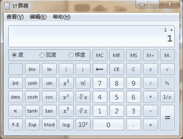


##### 黑盒测试基本概念

##### 挑战2：测试用例设计

问题：代码不可见前提下，缺陷未知

解决：需要在合适方法指导下精心设计测试用例

##### 基于需求的测试

目的
确认软件需求规格说明书列出的需求

前提
需求规格已经过仔细评审
隐含需求明确化

##### 基于需求的测试

##### 需求规格说明

| 锁和钥匙系统需求规格说明 |
|---|---|---|---|
| 序号 | 需求标识 | 需求描述 | 优先级 |
| 1 | BR-01 | 插入号码为123的钥匙并顺时针转动，应能上锁 | 高 |
| 2 | BR-02 | 插入号码为123的钥匙并逆时针转动，应能开锁 | 高 |
| 3 | BR-03 | 只有号码为123的钥匙可以用来上锁和开锁 | 高 |
| .... |  |  |  |
| 6 | BR-06 | 锁受重物撞击也不能被打开 | 中 |
| 7 | BR-07 | 锁和钥匙重量必须为150g左右 | 低 |
| 8 | BR-08 | 开锁和上锁转动方向可变，便于左手人士使用 | 低 |

##### 基于需求的测试

##### 需求跟踪矩阵（RTM）

## 需求跟踪矩阵样本

| 需求标识 | 需求描述 | 优先级 | 测试条件 | 用例标识 | 测试阶段 |
|---|---|---|---|---|---|
| BR-01 | 插入号码为123的钥匙并顺时针转动，应能上锁 | 高 | 使用号码为123的钥匙 | LOCK_001 | 单元组件 |
| BR-02 | 插入号码为123的钥匙并逆时针转动，应能开锁 | 高 | 使用号码为123的钥匙 | LOCK_002 | 单元组件 |
| BR-06 | 锁受重物撞击也不能被打开 | 中 | 使用石头砸锁 | LOCK_005
LOCK_006
LOCK_011 | 系统 |
| BR-08 | 开锁和上锁转动方向可变，便于左手人士使用 | 低 |  |  | 未实现 |

##### 基于需求的测试

##### 需求跟踪矩阵（RTM）

## 需求跟踪矩阵传达的信息

| 测试指标 | 测试数据采集指标 |
|---|---|
| 1.按优先级分类的需求数 | 1.已通过的测试用例总数 |
| 2.按需求分类的测试用例数 | 2.未通过的测试用例总数 |
| 3.已设计的测试用例数 | 3.需求中的缺陷总数 |
|  | 4.已完成的需求数 |
|  | 5.挂起的需求数 |

##### 基于需求的测试

##### 需求跟踪矩阵（RTM）

| 序号 | 需求标识 | 优先级 | 测试用例 | 用例总数 | 通过用例 | 未通过用例 | 通过率 | 缺陷数 |
|---|---|---|---|---:|---:|---:|---:|---:|
| 1 | BR-01 | 高 | Lock_001 | 1 | 1 | 0 | 100 | 1 |
| 2 | BR-02 | 高 | Lock_002 | 1 | 1 | 0 | 100 | 1 |
| 3 | BR-03 | 高 | Lock_003,004 | 2 | 1 | 1 | 50 | 3 |
| 4 | BR-04 | 中 | Lock_005,006,007 | 3 | 2 | 1 | 67 | 5 |
| … | … | … | … | … | … | … | … | … |
| 合计 | 8 |  |  | 12 | 10 | 2 | 83 | 12 |

## 黑盒测试基础
—正面和负面测试

##### 正面和负面测试用例

##### 正面测试

正面测试用例：

测试用例通过一组预期输入输出验证产品需求

目的：

证明软件对于每条规格说明和期望都能通过

注意：预期产品给出一个错误时它确实给出该错误，这也是正面测试的一部分

正面测试用于验证已知测试条件，证明软件可以完成所期望的工作

##### 正面和负面测试用例

##### 负面测试

负面测试：
展示当输入非预期输入时产品没有失败

目的：
使用产品没有设计和预想到的场景，尝试使系统堵塞

负面测试用于通过未知条件把产品搞垮

##### 正面和负面测试用例

##### 负面测试

## 负面测试用例举例

| 序号 | 输入1 | 输入2 | 当前状态 | 预期状态 |
| --- | --- | --- | --- | --- |
| 1 | 某个其它锁的钥匙 | 顺时针转动 | 上锁 | 上锁 |
| 2 | 某个其它锁的钥匙 | 逆时针转动 | 开锁 | 开锁 |
| 3 | 铁丝 | 逆时针转动 | 开锁 | 开锁 |
| 4 | 用火烧 |  | 上锁 | 上锁 |

注意：负面测试用例不能和需求映射

##### 正面和负面测试用例

## 正面测试VS负面测试

| | 正面测试 | 负面测试 |
|---|---|---|
| 测试条件 | 根据需求说明规格 | 测试条件都在需求规格说明之外 |
| 目的 | 验证需求规格说明的正确性 | 通过未知条件搞垮软件 |
| 覆盖率计算 | 覆盖需求和条件 | 没有覆盖率 |
| 挑战性 | 根据规格说明设计测试用例 | 需要高度创造性产生尽可能多的未知条件 |

#### 二 黑盒测试方法


+   1. 如何设计黑盒测试用例？
+   2. 黑盒测试方法的应用场景？
+   3. 不同黑盒测试方法的结合？

## 打印幻灯片、讲义和备注

执行以下任一操作：

## 单击一张或多张幻灯片

+   1. 在"文件"菜单上，单击"打印"。
+   2. 在"幻灯片"的旁边，单击"从"，然后在"从"和"到"框中，键入要打印的幻灯片的编号
+      注意 如果看不到此选项，请单击箭头 以展开"打印"对话框。
+   3. 单击"打印"。

## 打印所选幻灯片

+   1. 在"视图"菜单上，单击"幻灯片浏览"。
+      注意 您还可以从普通视图的导航窗格中打印多张幻灯片。
+   2. 选择要打印的幻灯片。
+      若要选择多张幻灯片，请在单击幻灯片时按住 。
+   3. 在"文件"菜单上，单击"打印"。
+   4. 在"幻灯片"下，单击"所选幻灯片"。
+      注意 如果看不到此选项，请单击箭头 以展开"打印"对话框。

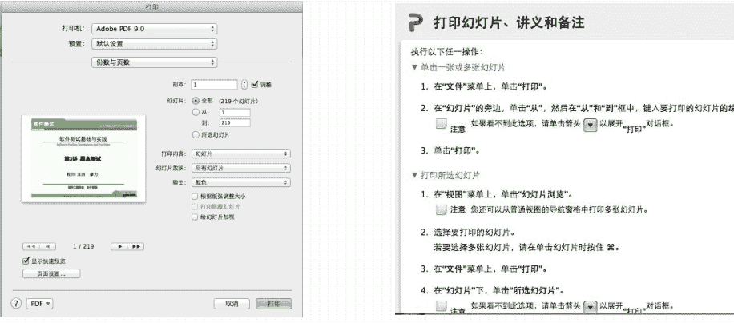

输入/参数如何充分测试？

输入/参数之间是否需要组合？

复杂的执行流程如何建模？

……

##### 黑盒测试方法：

##### 如何对特定的需求进行充分测试

##### 黑盒测试方法总览

+   - 1.等价类划分
+   - 2.边界值分析
+   - 3.因果分析法
+   - 4.决策表
+   - 5.基于模型的测试
+   - 6.正交数组测试
+   - ……

##### 黑盒测试方法
—等价类划分

##### 黑盒测试方法——等价划分

###### 等价划分原理

+   - 将软件输入和输出的值域进行划分，选择少数样本作为测试用例
+   - 实现对无穷输入量的科学规划，极大减少测试用例数目，降低测试工作量


##### 黑盒测试方法——等价划分

###### 等价类（等价划分）

如果软件行为对一组输入/输出值来说是相同的，则称这组值为等价类（或一个等价划分）


##### 黑盒测试方法——等价划分

###### 等价类（等价划分）

**有效等价类：**

有意义的输入输出数据构成的集合

特点：满足产品规格说明的数据

**无效等价类：**

无意义的输入输出数据构成的集合

特点：不满足产品规格说明的数据

##### 黑盒测试方法——等价划分

###### 等价类（等价划分）

###### 有效等价类和无效等价类

线性情况

值域

非线性情况

无效等价类

无效等价类

有效等价类


##### 黑盒测试方法——等价划分

###### 等价类划分指南

| 输入数据类型 | 划分等价类规则 |
|---|---|
| 布尔值 | 1个有效等价类： TRUE  1个无效等价类： FALSE |
| 连续取值范围 | 1个有效等价类： 正确取值范围  2个无效等价类： 大于和小于取值范围 |
| 数据个数 | 1个有效等价类： 正确数据个数  2个无效等价类： 大于和小于数据个数 |
| 集合 | 1个有效等价类： 正确的集合取值  1个或多个无效等价类 |
| 需分别处理的输入数据 | 多个有效等价类： 每个输入数据为1个等价类  1个无效等价类 |
| 符合某些规则的输入 | 多个有效等价类： 符合某个规则的输入数据为1个等价类  若干个无效等价类 |


##### 黑盒测试方法——等价划分

###### 等价类划分指南

+   1. 布尔值

数据类型：布尔值、条件

划分方法：

+   1个有效等价类
+   1个无效等价类

例: 是否学习过《软件工程》
是否双面打印

# Office自动更正选项

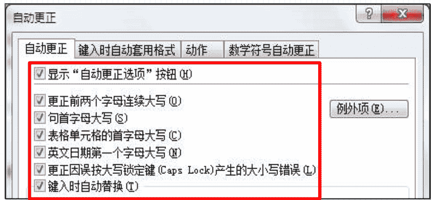

###### 等价类划分指南

+   2. 取值范围

数据类型：连续取值范围（通常是线性）

划分方法：

+   1 个有效等价类
+   2 个无效等价类

例：输入的考试成绩在0-100之间

有效等价类是：0 ≤ 成绩 ≤ 100
无效等价类是：成绩<0 和 成绩>100

# Word打印范围控制

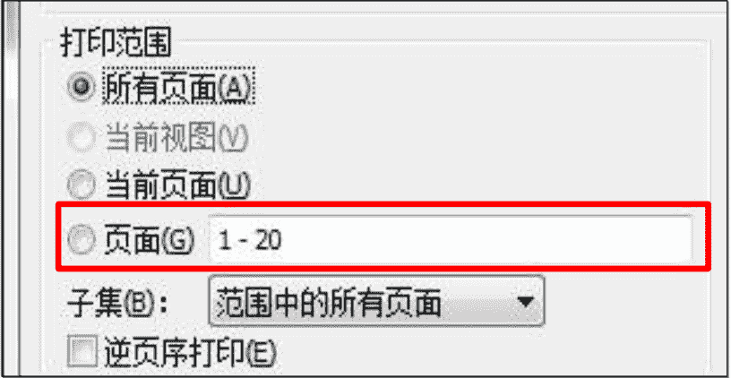

###### 等价类划分指南

+   3. 数据个数

数据类型：输入有个数约束

划分方法：

+   1个有效等价类
+   2个无效等价类

例：构成三角形的3条边

有效等价类：输入边数 = 3

无效等价类：输入边数 < 3 和 输入边数 > 3

# 国际机票预定

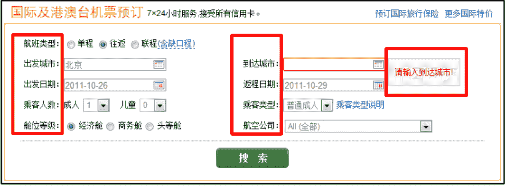

###### 等价类划分指南

+   4. 集合

数据类型：符合特定规则的子集

划分方法：

1个有效等价类

至少1个无效等价类

例：邮编由6位数字构成

有效等价类：所有6位数字

无效等价类：>6位数字 <6位数字

>6位字母 6位字母 <6位字母

# 淘宝用户注册的会员名

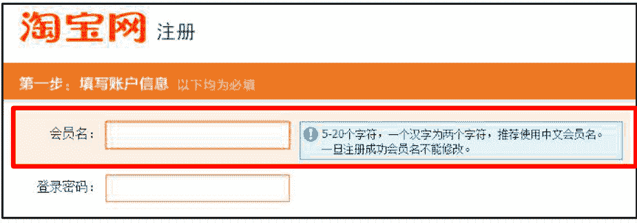

###### 等价类划分指南

+   5. 需分别处理的数据

数据类型：一组列表

划分方法：

N个有效等价类

1个无效等价类

例：中国的直辖市

有效等价类：北京、上海、天津、重庆

无效等价类：非直辖市

# Acrobat打印页面缩放

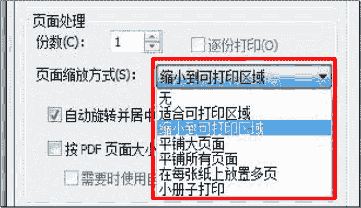

###### 等价类划分指南

+   6. 符合规则的数据

数据类型：规则

划分方法：

N个有效等价类

M个无效等价类

例：正确的电子邮件：含有@ 后跟x.y 不含#&

有效等价类：字母+@x.y 数字+@x.y

无效等价类：不含@ @后不是x.y 含#

# 淘宝用户注册的登录密码


| 输入数据类型 | 划分等价类规则 |
|---|---|
| 布尔值 | 1个有效等价类： 真 | 1个无效等价类： 假 |
| 连续取值范围 | 1个有效等价类： 正确取值范围 | 2个无效等价类： 大于和小于取值范围 |
| 数据个数 | 1个有效等价类： 正确数据个数 | 2个无效等价类： 大于和小于数据个数 |
| 集合 | 1个有效等价类： 正确的集合取值 | 1个或多个无效等价类 |
| 需分别处理的输入数据 | 多个有效等价类： 每个输入数据为1个等价类 | 1个无效等价类 |
| 符合某些规则的输入 | 多个有效等价类： 符合某个规则的输入数据为1个等价类 | 若干个无效等价类 |

## 等价类划分测试步骤

+   1. **步骤1：** 选择划分准则（范围、取值、布尔…）
+   2. **步骤2：** 根据准则确定有效和无效等价类
+   3. **步骤3：** 从等价类中选取样本数据
+   4. **步骤4：** 根据需求写预期结果
+   5. **步骤5：** 加入特殊值
+   6. **步骤6：** 执行测试

##### 等价划分测试练习——保险费率

### 人寿保险费率（基本保险费0.50）

| 年龄段 | 额外保险费 |
|---|---:|
| 35岁以下 | 1.65 |
| 35-59 | 2.87 |
| 60岁以上 | 6.00 |

划分准则：范围+分别处理数据

### 人寿保险费率对应等价类

| 序号 | 等价类 | 输入类型 | 测试数据 | 预期结果 |
| --- | --- | --- | --- | --- |
| 1 | 低于35岁 | 有效 | 26 , 12 | 月保险费=2.15 |
| 2 | 35-59岁 | 有效 | 37 | 月保险费=3.37 |
| 3 | 大于60岁 | 有效 | 65 , 90 | 月保险费=6.50 |
| 4 | 负年龄 | 无效 | -23 | 警告信息 |
| 5 | 0岁 | 无效 | 0 | 警告信息 |

全字母

字母+数字

不超过6个字符数

有效等价类

有效等价类

无效等价类

# 2个有效等价类

+   （1）用户名：{0<全字母<=6}
+   
+   John, Jerry, Kenedy

+   （2）用户名：{0<字母开头+数字<=6}
+   
+   u001, user01

# >4个无效等价类

+   （1）数字开头的字符串集合
+   
+   `101，71108`

+   （2）字母开头，并含有特殊字符
+   
+   `user@$，user_01`

+   （3）字母开头，且长度超过6
+   
+   `user0001`

+   （4）空字符串

...

##### 等价划分测试练习——电话号码

### 我国电话号码一般由两部分构成：

地区码：
以0开头的3位或4位数字

电话号码：
以非0、非1开头的7位或8位数字

划分准则：规则+集合+数据个数


| 输入数据 | 有效等价类 | 无效等价类 |
|---|---|---|
| 地区码 | 1. 以0开头的3位区码
2. 以0开头的4位区码 | 3. 以0开头的小于3位的数字串
4. 以0开头的大于4位的数字串
5. 以非0开头的数字串
6. 以0开头含有非数字的字符串 |


# 8位数

# 非0开头的数

# 非1开头的数

# 7位数

| 输入数据 | 有效等价类 | 无效等价类 |
|---|---|---|
| 电话号码 | 7. 以非0、非1开始的7位号码

8. 以非0、非1开始的8位号码 | 9. 以0开头的数字串

10. 以1开头的数字串

11. 以非0、非1开始的小于7位数字串

12. 以非0、非1开始的大于8位数字串

13. 以非0、非1开始的含有非法字符7或者8位字符串 |

| 输入数据测试用例 | 有效等价类 | 无效等价类 |
|---|---|---|
| 测试用例 | 010 6123456<br>覆盖1，7<br><br>025 81234567<br>覆盖1，8<br>0551 7123456<br>覆盖2，7<br>0571 92345678<br>覆盖2，8 | 01 81234567　覆盖3<br>05511 6123456　覆盖4<br>10 81234567　覆盖5<br>025×81234567　覆盖6<br>010 06123456　覆盖9<br>0551 1123456　覆盖10<br>0551 612345　覆盖11<br>0517 912345678　覆盖12<br>0571 912345ab　覆盖13<br><br>特殊值：空值 1234567<br>特殊值：025 空值 |


##### 黑盒测试方法——等价划分

### 等价类划分总结

- 非冗余性：尽可能使等价类间没有交叉，保证测试用例不存在冗余
- 完整性：等价类的并集等于输入/输出域
- 局限：忽略边界位置的测试用例

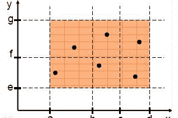

##### 黑盒测试方法——边界值分析

###### 边界值分析原理

- 软件的两个主要缺陷源
  - （1）条件
  - （2）边界

条件：变量取值决定控制流走向

边界：变量值的“极限”

- **边界值分析**：能有效捕获出现在边界处的缺陷的一种测试方法；利用了缺陷更容易出现在边界处的事实。


缺陷易出现在边界处的原因：

- （1）使用比较操作符时未仔细分析
- （2）循环和条件检查方法引起的困惑
- （3）对边界附近需求的理解不够

###### 边界值类型

- 边界值数据类型
  - 数值、速度、字符、地点
  - 位置、尺寸、数量……
- 边界特征
  - 第一个/最后一个、最小值/最大值
  - 开始/完成、空/满、最短/最长
  - 最慢/最快、最早/最迟、最大/最小

###### 次边界条件/隐性边界

- 各种数据类型的极限
- `int, unsigned int, long, char, …`——一般是2的幂次
- ASCII、Unicode 字符
- 空白，空值，零值，无输入
- 屏幕分辨率决定的光标/鼠标运动范围
- ……

特点：产品说明书中没有，外部用户看不到

###### 边界值确定

|  | 边界值附近数据 | 测试用例设计思路 |
|---|---|---|
| 字符 | Min-1, Min, Min+1<br>Max-1, Max, Max+1 | 文本框允许输入1-255个字符：0,1,2,254,255,256 |
| 数值范围 | Min-1, Min, Min+1<br>Max-1, Max, Max+1 | 输入数据允许1-999：0,1,2,998,999,1000 |
| 集合空间 | 0, Min, Min+1<br>Max-1, Max, Max+1 | 图片大小不能超过50k：0,1k,49k,50k,51k |

###### 边界值测试用例确定方法

**独立参数的单变量的边界值**

n：存在边界值的参数个数

**方法一：基本边界测试**

对每个参数取4个边界值

- Min, Min+1
- Max-1, Max

计算公式：4n+1

> Paul C. Jorgensen, Software Testing: A Craftsman’s Approach (1995)

**方法二：健壮性边界测试**

对每个参数取6个边界值

- Min-1, Min, Min+1
- Max-1, Max, Max+1

计算公式：6n+1

> Paul C. Jorgensen, Software Testing: A Craftsman’s Approach (1995)

**非独立参数的多变量的边界值**

m：边界条件的数量

**方法三：边界条件测试**

确定边界条件，对每个边界条件取 3 个边界值

BC-1, BC, BC+1

计算公式：3m

##### 边界值分析测试练习——购物折扣

**大宗购买折扣**

| 购买数量 | 单价 |
|---|---|
| 头10件（1-10件） | 5.00 |
| 第二个10件（11-20件） | 4.75 |
| 第三个10件（21-30件） | 4.50 |
| 超过30件 | 4.00 |

15件需要支付：10×5+5×4.75=73.75

| 测试用例 | 选择理由 | 预期输出 |
|---|---|---|
| 0 | 第1阶段的开始前 | 0.00 |
| 1 | 第1阶段的开始 | 5.00 |
| 2 | 第1阶段小值 | 10.00 |
| 5 | 第1阶段中的值，不考虑边界 | 25.00 |
| 9 | 正好在第1阶段的末尾 | 45.00 |
| 10 | 极限值 | 50.00 |
| 11 | 第2阶段开始 | 54.75 |
| 16 | 第2阶段中的值，不考虑边界 | 78.50 |
| 19 | 正好在第2阶段的末尾 | 92.75 |
| 20 | 极限值 | 97.50 |
| 21 | 第3阶段开始 | 102.00 |
| 27 | 第3阶段中的值，不考虑边界 | 129.00 |
| 29 | 正好在第3阶段的末尾 | 138.00 |
| ... | ... | ... |

##### 边界值分析测试练习——公历日期

### 用边界值分析方法设计合法公历日期的测试用例

日期范围：1582年1月1日—3000年12月31日

- 1582年10月5日至10月14日排除在公历外
- 2038年1月19日是BIOS提供的计时基准时间1970年1月1日的最大值（千年虫问题）
- 英国1752年才采用阳历，他们扣除9/3/1752到9/13/1752，以同步于月亮为参照的历法

### 汉典万年历（择吉老黄历）

汉典择吉黄历

公元 1582 年 10 月 确定 明·万历10年 农历壬午年【马年】

| 日 | 一 | 二 | 三 | 四 | 五 | 六 |
|---|---|---|---|---|---|---|
|  | 1<br>十五 | 2<br>十六 | 3<br>国际减轻贫困日 | 4<br>十八 | 15<br>十九 | 16<br>二十 |
| 17<br>廿一 | 18<br>廿二 | 19<br>廿三 | 20<br>廿四 | 21<br>廿五 | 22<br>霜降 | 23<br>廿七 |
| 24<br>廿八 | 25<br>廿九 | 26<br>祭祖节 | 27<br>初二 | 28<br>初三 | 29<br>初四 | 30<br>初五 |
| 31<br>初六 |  |  |  |  |  |  |


### 健壮性边界测试

**1. 参数：**

年月日  n=3

**2. 确定边界值：**

年：1582，3000

月：1，12

日：1，31

**3. 测试用例设计：**

方法二（6n+1）

18+x个测试用例

| 测试用例 | 月 | 日 | 年 | 预期输出 |
|---|---|---|---|---|
| 1 | 0 | 1-28 | 1582-3000 | 错误 |
| 2 | 1 | 1-28 | 1582-3000 | 合法日期 |
| 3 | 2 | 1-28 | 1582-3000 | 合法日期 |
| 4 | 11 | 1-28 | 1582-3000 | 错误 |
| 5 | 12 | 1-28 | 1582-3000 | 合法日期 |
| 6 | 13 | 1-28 | 1582-3000 | 错误 |
| 7 | 1-12 | 0 | 1582-3000 | 错误 |
| 8 | 1-12 | 1 | 1582-3000 | 合法日期 |
| 9 | 1-12 | 2 | 1582-3000 | 合法日期 |
| 10 | 1-12 | 30 | 1582-3000 | 合法日期 |
| 11 | 1-12 | 31 | 1582-3000 | 合法日期 |
| 12 | 1-12 | 32 | 1582-3000 | 错误 |
| 13 | 1-12 | 1-28 | 1581 | 错误 |
| 14 | 1-12 | 1-28 | 1582 | 合法日期 |
| 15 | 1-12 | 1-28 | 1583 | 合法日期 |
| 16 | 1-12 | 1-28 | 2999 | 合法日期 |
| 17 | 1-12 | 1-28 | 3000 | 合法日期 |
| 18 | 1-12 | 1-28 | 3001 | 错误 |
| 19 | 1-12 | 1-28 | 1582-3000 | 合法日期 |
| - | 10 | 5 | 1582 | 错误 |
| ... | ... | ... | ... | ... |


## 3.1 固定日、年的月份边界条件

月：1，12

日：1-28　年：1582-3000

| 边界条件 | 月 | 日 | 年 |
|---|---|---|---|
| 1 | 1 | 1-28 | 1582-3000 |
| 2 | 12 | 1-28 | 1582-3000 |

## 3.2 固定月、年的日边界条件

日：1，30，31

月：31/30天的月

年：1582-3000

| 边界条件 | 月 | 日 | 年 |
|---|---|---|---|
| 3 | 30天的月 | 1 | 1582-3000 |
| 4 | 30天的月 | 30 | 1582-3000 |
| 5 | 31天的月 | 1 | 1582-3000 |
| 6 | 31天的月 | 31 | 1582-3000 |

## 3.3 固定月、日的年边界条件

年：1582，3000，闰年，非闰年

月：1-12

日：1-28

| 边界条件 | 月 | 日 | 年 |
|---|---|---|---|
| 7 | 1-12 | 1-28 | 1582 |
| 8 | 1-12 | 1-28 | 3000 |
| 9 | 2 | 1 | 闰年 |
| 10 | 2 | 29 | 闰年 |
| 11 | 2 | 1 | 非闰年 |
| 12 | 2 | 28 | 非闰年 |

## 3.4 补充确定的关联边界条件

| 边界条件 | 月 | 日 | 年 |
|---|---|---|---|
| 13 | 1 | 1 | 1582 |
| 14 | 12 | 31 | 3000 |
| 15 | 9 | 3 | 1752 |
| 16 | 9 | 13 | 1752 |
| 17 | 10 | 5 | 1852 |
| 18 | 10 | 14 | 1852 |

m=18

总的测试用例数：18×3=54

| 测试用例 | 边界条件 | 月 | 日 | 年 | 预期输出 |
|---|---|---|---|---|---|
| 1 |  | 0 | 1-28 | 1582-3000 | 错误 |
| 2 | 1 | 1 | 1-28 | 1582-3000 | 合法日期 |
| 3 |  | 2 | 1-28 | 1582-3000 | 合法日期 |
| 4 |  | 11 | 1-28 | 1582-3000 | 合法日期 |
| 5 | 2 | 12 | 1-28 | 1582-3000 | 合法日期 |
| 6 |  | 13 | 1-28 | 1582-3000 | 错误 |
| 7 |  | 31天月 | 0 | 1582-3000 | 错误 |
| 8 | 3 | 31天月 | 1 | 1582-3000 | 合法日期 |
| 9 |  | 31天月 | 2 | 1582-3000 | 合法日期 |
| ... | ... | ... | ... | ... | ... |

## 练习深入思考：

- 1. 如何用等价类划分方法设计公历日期程序的测试用例？
- 2. 如何结合等价类划分和边界值分析设计公历日期程序的测试用例？

##### 黑盒测试方法——边界值分析

### ■ 边界值分析总结

- 1. 边界值需要彻底测试
- 2. 考虑资源极限，如有限的缓存
- 3. 需求规格中对硬件资源的限制
- 4. 输出值的边界也需要考虑

### ■ 边界值分析VS等价类划分

4个等价类

X表示等价类测试用例

*表示边界值测试用例

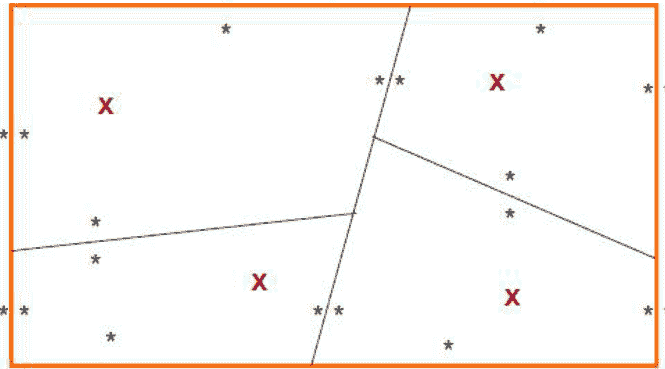

- 1. 等价类划分时，往往先要确定边界值
- 2. 边界值分析是等价类划分方法的补充
- 3. 测试中需要将两者结合起来使用

##### 黑盒测试方法——因果分析法

###### 因果分析法原理

**测试挑战：多个输入条件的关联问题**

例1：火车票价查询：终点、车次、硬座/卧铺、普通票/学生票等多个因素决定

例2：包裹费用计算：快递/EMS、重量、距离等

**组合测试：处理大量测试用例的难题**

###### 因果分析法基础

CallCenter系统分析

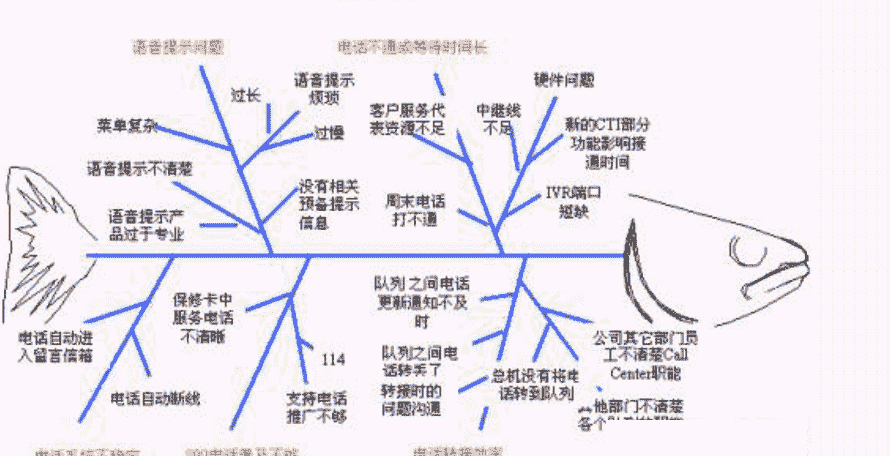

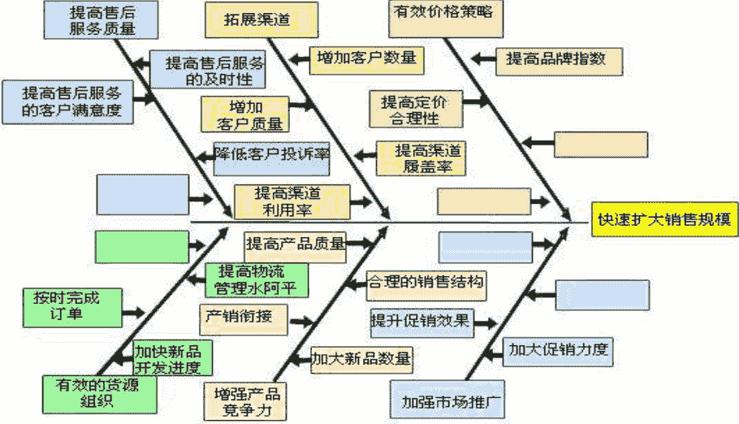

###### 因果分析法原理

- 软件输入和输出之间存在逻辑关系，即因果图
- 因果图可从规格说明书中获得

分析过程

需求规格说明书 → 生成因果列表 → 起因结果列表 → 建立决策表 → 决策表 → 生成测试用例

###### 因果图表示

符号：Cᵢ表示原因  Eᵢ表示结果

原因和结果的4种关系：

（1）恒等（—）

若Cᵢ出现，则Eᵢ出现；
若Cᵢ不出现，则Eᵢ也不出现


（2）非（~）

若C出现，则E不出现；
若C不出现，则E出现


（3）或（∨）

若几个Cᵢ 中有一个出现，则E出现；
若几个Cᵢ 都不出现，则E不出现


（4）与（∧）

若几个Cᵢ都出现，则E出现；
若其中一个Cᵢ不出现，则E不出现


4种输入约束：

（1）互斥(E): 多个原因不能同时成立，最多有一个能成立

（2）包含(I): 多个原因中至少有一个必须成立；

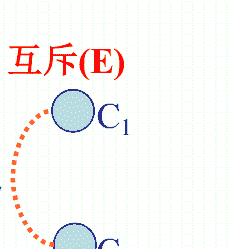

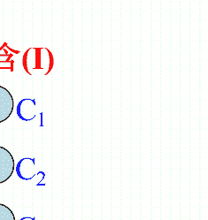

（3）唯一(O):多个原因中必须有一个且只有一个成立；

（4）要求(R):当C₁成立，C₂也必须成立；

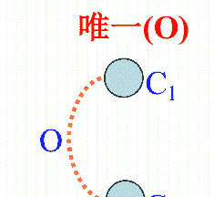

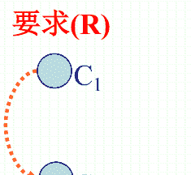

1种输出约束：

（1）屏蔽(M)：

当 E₁ 是 1 时，E₂ 必须是 0；
当 E₁ 是 0，E₂ 的值不定；


恒等（—）

C E

非（～）

C E

或（∨）

C₁ ∨ E
C₂

与（∧）

C₁ ∧ E
C₂

互斥(E)

C₁
E
C₂

包含(I)

C₁
I C₂
C₃

唯一(O)

C₁
O
C₂

要求(R)

C₁
R
C₂

屏蔽(M)

E₁
M
E₂

##### 因果图分析测试练习1——文件格式

### 文件管理系统规格说明

- (1) 文件第一列的字符必须是一个A或B，且文件第二列的字符必须是一个数字；
- (2) 在该情况下，文件被修改了；
- (3) 第一个字符不正确，则打印X12消息；
- (4) 第二个不是数字，则打印X13消息；

### 1.分析原因和结果

**原因：**

C1:第1列的字符是A

C2:第1列的字符是B

C3:第2列的字符是数字

**结果：**

E1:文件修改过

E2:打印消息X12

E3:打印消息X13


# 2.生成因果图

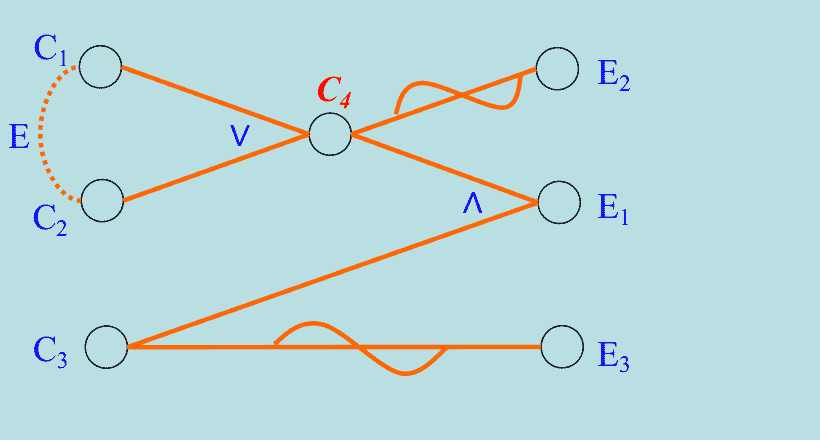

# C4:中间状态

# 3.生成因果图列表

因果图列表：原因的所有组合及相应的结果

注意：某些原因的组合不存在

组合1: C1 C2 C3 E1 E2 E3

0 0 0

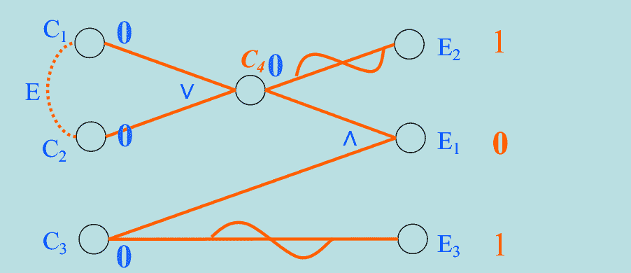

# 3.生成因果图列表

因果图列表：原因的所有组合及相应的结果

注意：某些原因的组合不存在

组合2：C1 C2 C3 E1 E2 E3

0　0　1

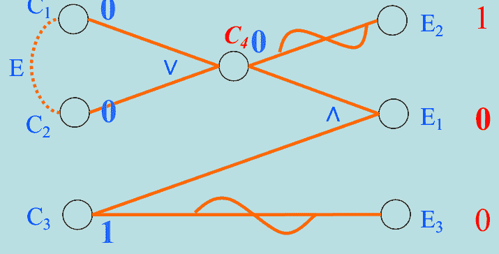

# 3.生成因果图列表

因果图列表：原因的所有组合及相应的结果

注意：某些原因的组合不存在

组合3： C1 C2 C3 E1 E2 E3
0 1 1

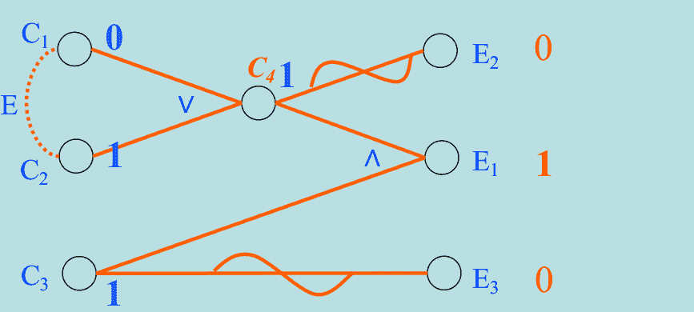

# 3.生成因果图列表

因果图列表：原因的所有组合及相应的结果

注意：某些原因的组合不存在

组合8： C1 C2 C3 E1 E2 E3
1 1 1

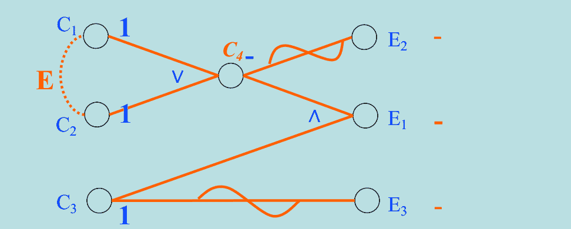

# 3.生成因果图列表

因果图列表：原因的所有组合及相应的结果组合

注意：某些原因的组合不存在

| 输入（原因） |  | 1 | 2 | 3 | 4 | 5 | 6 | 7 | 8 |
|---|---|---:|---:|---:|---:|---:|---:|---:|---:|
|  | C1 | 0 | 0 | 0 | 0 | 1 | 1 | 1 | 1 |
|  | C2 | 0 | 0 | 1 | 1 | 0 | 0 | 1 | 1 |
|  | C3 | 0 | 1 | 0 | 1 | 0 | 1 | 0 | 1 |
| 输出（结果） | E1 | 0 | 0 | 0 | 1 | 0 | 1 |  |  |
|  | E2 | 1 | 1 | 0 | 0 | 0 | 0 |  |  |
|  | E3 | 1 | 0 | 1 | 0 | 1 | 0 |  |  |

# 4.生成决策表

原因——决策表中的条件

结果——决策表中的行动

原因与结果的组合——决策规则

决策表示例

|  | 1 | 2 | 3 | 4 | 5 | 6 |
|---|---|---|---|---|---|---|
| 条件 C1 | 0 | 0 | 0 | 0 | 1 | 1 |
| 条件 C2 | 0 | 0 | 1 | 1 | 0 | 0 |
| 条件 C3 | 0 | 1 | 0 | 1 | 0 | 1 |
| 行动 A1 | 0 | 0 | 0 | 1 | 0 | 1 |
| 行动 A2 | 1 | 1 | 0 | 0 | 0 | 0 |
| 行动 A3 | 1 | 0 | 1 | 0 | 1 | 0 |

# 5.生成测试用例

+   (1)决策表中的条件——测试用例的输入条件
+   (2)决策表中的行动——测试用例的期望输出
+   (3)一条决策规则——一个测试用例

|  |  | 1 | 2 | 3 | 4 | 5 | 6 |
|---|---|---|---|---|---|---|---|
| 条件 | C1 | 0 | 0 | 0 | 0 | 1 | 1 |
|  | C2 | 0 | 0 | 1 | 1 | 0 | 0 |
|  | C3 | 0 | 1 | 0 | 1 | 0 | 1 |
| 行动 | A1 | 0 | 0 | 0 | 1 | 0 | 1 |
|  | A2 | 1 | 1 | 0 | 0 | 0 | 0 |
|  | A3 | 1 | 0 | 1 | 0 | 1 | 0 |
| 用例 | 输入 | DY | C2 | BN | B5 | AM | A3 |
|  | 输出 | ... | ... | ... | ... | ... | ... |

##### 因果图分析测试练习2——自动售货

# 饮料自动售货机规格说明


+   1. 自动售货机有两种饮料（橙汁和啤酒）供人们选择，售价均为5角。
+   2. 售货机可以接收5角钱或1元钱的硬币，需要找零钱。

例如，投入1元硬币买橙汁，如果售货机没有零钱找，则退回1元硬币，并红灯显示【零钱找完】。

# # 1.分析原因和结果

# ## 原因：

+   C1:售货机有零钱
+   
+   C2:投入1元硬币
+   
+   C3:投入5角硬币
+   
+   C4:押下橙汁按钮
+   
+   C5:押下啤酒按钮

# # 1.分析原因和结果

结果：

+   - E1:售货机【零钱找完】灯亮
+   - E2:退还1元硬币
+   - E3:退还5角硬币
+   - E4:送出橙汁饮料
+   - E5:送出啤酒饮料

# 2.生成因果图

C1:售货机有零钱

E1:【零钱找完】灯亮

C2:投入1元硬币

E2:退还1元硬币

该找5角 C11

C13可找5角

C3:投入5角硬币

E3:退还5角硬币

C12

按下按钮

C14

钱付清

C4:押下橙汁按钮

E4:送出橙汁饮料

C5:押下啤酒按钮

E5:送出啤酒饮料

# 3.生成决策表和测试用例

| 序号 | 1 2 3 4 5 6 7 8 9 10 1 2 3 4 5 6 7 8 9 20 1 2 3 4 5 6 7 8 9 30 1 2 |
|---|---|
| 条件 ① | 1 1 1 1 1 1 1 1 1 1 1 1 1 1 1 1 1 0 0 0 0 0 0 0 0 0 0 0 0 0 0 0 |
| 条件 ② | 1 1 1 1 1 1 1 1 0 0 0 0 0 0 0 0 1 1 1 1 1 1 1 0 0 0 0 0 0 0 0 0 |
| 条件 ③ | 1 1 1 1 0 0 0 0 1 1 1 1 0 0 0 0 1 1 1 1 0 0 0 0 1 1 1 1 0 0 0 0 |
| 条件 ④ | 1 1 0 0 1 1 0 0 1 1 0 0 1 1 0 0 1 1 0 0 1 1 0 0 1 1 0 0 1 1 0 0 |
| 条件 ⑤ | 1 0 1 0 1 0 1 0 1 0 1 0 1 0 1 0 1 0 1 0 1 0 1 0 1 0 1 0 1 0 1 0 |
| 中间结果 ⑪ | … 1 1 0 … 0 0 0 … 0 0 0 … 1 1 0 … 0 0 0 … 0 0 0 |
| 中间结果 ⑫ | … 1 1 0 … 1 1 0 … 1 1 0 … 1 1 0 … 1 1 0 … 1 1 0 |
| 中间结果 ⑬ | … 1 1 0 … 0 0 0 … 0 0 0 … 0 0 0 … 0 0 0 … 0 0 0 |
| 中间结果 ⑭ | … 1 1 0 … 1 1 1 … 0 0 0 … 0 0 0 … 1 1 1 … 0 0 0 |
| 结果 ㉑ | … 0 0 0 … 0 0 0 … 0 0 0 … 1 1 1 … 1 1 1 … 1 1 1 |
| 结果 ㉒ | … 0 0 0 … 0 0 0 … 0 0 0 … 1 1 0 … 0 0 0 … 0 0 0 |
| 结果 ㉓ | … 1 1 0 … 0 0 0 … 0 0 0 … 0 0 0 … 0 0 0 … 0 0 0 |
| 结果 ㉔ | … 1 0 0 … 1 0 0 … 0 0 0 … 0 0 0 … 1 0 0 … 0 0 0 |
| 结果 ㉕ | … 0 1 0 … 0 1 0 … 0 0 0 … 0 0 0 … 0 1 0 … 0 1 0 |
| 测试用例 | … Y Y Y … Y Y Y … Y Y Y … Y Y Y … Y Y Y … Y Y |

##### 因果图分析练习3——教学楼自动售货


##### 黑盒测试方法——因果分析法

# 因果分析法总结

+   1. 适用于输入输出存在因果关系的测试情形
+   2. 适用于输入输出参数取值为2值情形
+   3. 因果分析法是对输入的组合测试
+   4. 因果图保证各种组合不被遗漏
+   5. 因果图能消除违反约束的组合

##### 黑盒测试方法
——决策表


##### 黑盒测试方法——决策表

###### 决策表方法原理

# 《软件测试》阅读决策表

|  |  | 1 | 2 | 3 | 4 | 5 | 6 | 7 | 8 | 9 | 10 | 11 | 12 | 13 | 14 | 15 | 16 |
|---|---|---|---|---|---|---|---|---|---|---|---|---|---|---|---|---|---|
| 问题 | 能编写程序？ | N | N | N | N | N | N | N | N | Y | Y | Y | Y | Y | Y | Y | Y |
|  | 熟悉软件工程？ | N | N | N | N | Y | Y | Y | Y | N | N | N | N | Y | Y | Y | Y |
|  | 对软件测试感兴趣？ | N | N | Y | Y | N | N | Y | Y | N | N | Y | Y | N | N | Y | Y |
|  | 理解教材内容 | N | Y | N | Y | N | Y | N | Y | N | Y | N | Y | N | Y | N | Y |
| 建议 | 学习C++/Java语言 | √ | √ | √ |  | √ | √ | √ |  |  |  |  |  |  |  |  |  |
|  | 学习软件工程 |  | √ | √ | √ |  |  |  |  |  | √ |  | √ |  |  |  |  |
|  | 继续阅读 |  | √ |  | √ |  | √ | √ | √ | √ | √ | √ | √ |  |  | √ | √ |
|  | 放弃学习 | √ |  |  |  | √ |  |  |  |  |  |  |  | √ | √ |  |  |

##### 黑盒测试方法——决策表

###### 决策表方法原理

对功率大于100马力的机器、维修记录不全或已运行10年以上的机器，应给予优先的维修处理。

- 条件1：机器功率大小
- 条件2：维修记录
- 条件3：运行时间

动作1：机器能否得到优先维修

##### 黑盒测试方法——决策表

###### 决策表组成

4种成分

- 条件桩：列出所有可能问题（条件）
- 条件项：列出条件所有可能取值
- 动作桩：列出可能采取的操作
- 动作项：指出在条件项的各种取值情况下应采取的动作

决策规则：贯穿条件项和动作项的一列

##### 黑盒测试方法——决策表

###### 决策表构造

- Step1: 列出所有的条件桩和动作桩
- Step2: 填入条件项
- Step3: 填入动作项，得到初始决策表
- Step4：简化决策表，合并相似规则

规则可能总数：2ⁿ

##### 黑盒测试方法——决策表

###### 决策表构造

### 初始化决策表

| 条件/动作 | 1 | 2 | 3 | 4 | 5 | 6 | 7 | 8 |
|---|---|---:|---:|---:|---:|---:|---:|---:|
| 功率大于100马力 | Y | Y | Y | Y | N | N | N | N |
| 维修记录不全 | Y | Y | N | N | Y | Y | N | N |
| 运行时间超过6年 | Y | N | Y | N | Y | N | Y | N |
| **动作：优先维修** | √ | √ | √ | √ | √ | √ | √ |  |
| **动作：正常维修** |  |  |  |  |  |  |  | √ |

##### 黑盒测试方法——决策表

###### 决策表化简

化简目标：合并相似规则

相似规则判断：

- 1. 有两条或以上规则具有相同动作
- 2. 且在条件项之间存在极大相似

“__”：

表示合并后该条件项与取值无关，称“无关条件”

##### 黑盒测试方法——决策表

# ■ 决策表化简

# 相似的理解

| 5 | 6 |
|---|---|
| N | N |
| Y | Y |
| Y | N |
| √ | √ |

相同条件项

取值无关条件项

相同动作项

| 5 6 |
|---|
| N |
| Y |
| -- |
| √ |
|   |

##### 黑盒测试方法——决策表

###### 决策表化简

相似的理解

| 1 | 2 | 3 | 4 |
|---|---|---|---|
| Y | Y | Y | Y |
| Y | Y | N | N |
| Y | N | Y | N |
| ✓ | ✓ | ✓ | ✓ |

相同条件项

取值无关条件项

相同动作项

| 1 2 3 4 |
|---------|
| Y |
| -- |
| --- |
| ✓ |

##### 黑盒测试方法——决策表

###### 决策表化简

# 初始化决策表化简

|  |  | 1 2 3 4 | 5 6 | 7 | 8 |
|---|---|---|---|---|---|
| 条件 | 功率大于100马力 | Y | N | N | N |
|  | 维修记录不全 | -- | Y | N | N |
|  | 运行时间超过6年 | --- | -- | Y | N |
| 动作 | 优先维修 | √ | √ | √ |  |
|  | 正常维修 |  |  |  | √ |

##### 黑盒测试方法——决策表

###### 决策表构造

# 《软件测试》阅读决策表

|  |  | 1 | 2 | 3 | 4 | 5 | 6 | 7 | 8 | 9 | 10 | 11 | 12 | 13 | 14 | 15 | 16 |
|---|---|---|---|---|---|---|---|---|---|---|---|---|---|---|---|---|---|
| 问题 | 能编写程序？ | N | N | N | N | N | N | N | N | Y | Y | Y | Y | Y | Y | Y | Y |
|  | 熟悉软件工程？ | N | N | N | N | Y | Y | Y | Y | N | N | N | N | Y | Y | Y | Y |
|  | 对软件测试感兴趣？ | N | N | Y | Y | N | N | Y | Y | N | N | Y | Y | N | N | Y | Y |
|  | 理解教材内容 | N | Y | N | Y | N | Y | N | Y | N | Y | N | Y | N | Y | N | Y |
| 建议 | 学习C++/Java语言 |  | √ | √ | √ |  | √ | √ | √ |  |  |  |  |  |  |  |  |
|  | 学习软件工程 |  | √ | √ | √ |  |  |  |  |  | √ |  | √ |  |  |  |  |
|  | 继续阅读 |  | √ |  | √ |  | √ | √ | √ | √ | √ | √ | √ |  |  | √ | √ |
|  | 放弃学习 | √ |  |  | √ |  |  |  |  |  |  |  |  | √ | √ |  |  |

##### 黑盒测试方法——决策表

###### 决策表构造

# 《软件测试》阅读决策表化简

|  |  | 1,5 | 2,4 | 3 | 6,7,8 | 9,11 | 10,12 | 13,14 | 15,16 |
|---|---|---|---|---|---|---|---|---|---|
| 问题 | 能编写程序？ | N | N | N | N | Y | Y | Y | Y |
|  | 熟悉软件工程？ | — | N | N | Y | N | N | Y | Y |
|  | 对软件测试感兴趣？ | N | — | Y | — | — | — | N | Y |
|  | 理解教材内容 | N | Y | N | — | N | Y | — | — |
| 建议 | 学习C++/Java语言 |  | √ | √ | √ |  |  |  |  |
|  | 学习软件工程 |  | √ | √ |  |  | √ |  |  |
|  | 继续阅读 |  | √ |  | √ | √ | √ |  | √ |
|  | 放弃学习 | √ |  |  |  |  |  | √ |  |

##### 决策表方法练习1——三角形问题

根据输入3条边(a, b, c)边长的值来判断是否构成三角形，如果是三角形，判断是等腰三角形、等边三角形、不等边三角形和非三角形。

为简单起见：假定a, b, c只能输入大于0的数，不考虑输入为空或非数字的情况

# 1.分析条件和动作

# 条件：

- C1: a+b>c
- C2: a+c>b
- C3: b+c>a
- C4: a=b
- C5: a=c
- C6: b=c

# 1.分析条件和动作

动作：

- A1: 非三角形
- A2: 不等边三角形
- A3: 等腰三角形
- A4: 等边三角形


## 2.构造决策表

| 条件/动作 | 1 | 2 | 3 | 4 | 5 | 6 | 7 | 8 |
|---|---|---|---|---|---|---|---|---|
| a+b>c | N | Y | Y | Y | Y | Y | Y | Y |
| a+c>b | — | N | Y | Y | Y | Y | Y | Y |
| b+c>a | — | — | N | Y | Y | Y | Y | Y |
| a=b | — | — | — | Y | Y | N | N | N |
| a=c | — | — | — | Y | N | Y | N | N |
| b=c | — | — | — | — | — | — | Y | N |
| 非三角形 | √ | √ | √ |  |  |  |  |  |
| 不等边三角形 |  |  |  |  |  |  |  | √ |
| 等腰三角形 |  |  |  | √ | √ | √ | √ |  |
| 等边三角形 |  |  |  | √ |  |  |  |  |

## 3.设计测试用例

### 根据每一列的决策来生成测试用例

- 1. a=3 b=4 c=10　　决策规则1
- 2. a=3 b=4 c=1　　 决策规则2
- 3. ......
- 8. a=3 b=4 c=5　　 决策规则8

##### 黑盒测试方法——基于模型的测试

###### 基于模型的测试原理

**模型：**

- 1. 理解复杂系统的工作过程
  - 换档——油门
- 2. 解释没有完全理解的事物
  - 向1岁的孩子解释9-4=5
- 3. 将抽象的事物变具体

建模过程迫使我们将复杂的事物分解成许多清晰而且易理解的单元，最终让我们更好地理解整个问题

###### 基于模型的测试简介

适用领域：

- 有限状态：软件产品类似语言处理器，拥有类似语言语法的状态机或上下文无关文法
- 工作流状态：根据当前状态和输入，执行具体工作流，产生新输出和新状态
- 数据流状态：系统建模为一组数据流，并从一个状态转换到另一个状态
- 时间状态：对象间具有顺序连接，连接权值表示执行时间

原理：

- 1. 软件执行过程可分解为若干对象和连接对象间的关系
- 2. 测试序列可视为验证对象间所期望的关系是否满足

###### 模型化软件—图论

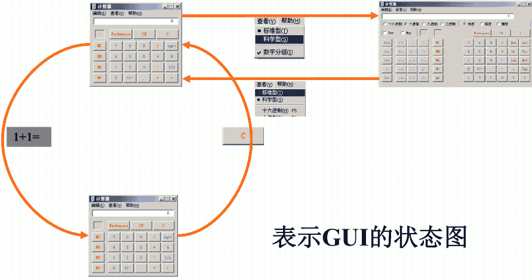

表示GUI的状态图

**测试用例**

- 0. 启动 “计算器”
- 1. 输入1+1
- 2. 显示结果2
- 3. 清除结果
- 4. 计算器归零
- 5. 停止应用程序

- 0. 启动 “计算器”
- 1. 选择 “查看” --“科学型”
- 2. 科学型界面
- 3. 选择 “查看” --“标准型”
- 4. 标准型界面
- 5. 停止应用程序

###### 模型化软件—工作流

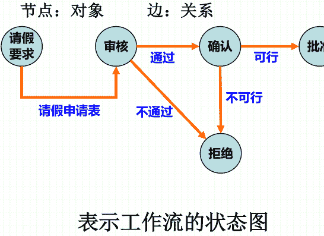

###### 模型化软件—语法模型

**电子邮件字段的语法模型**

```
<To> ::= <Valid Address | Invalid Address>
<Cc> ::= <Valid Address | Invalid Address>
<Bcc> ::= <Valid Address | Invalid Address>
<Subject> ::= <Empty | Not Empty>
<body> ::= <Empty | Not Empty>
```

### 基于模型的测试

测试用例生成：

遍历图，并覆盖图中的所有的边，就可导出测试用例

| 当前状态 | 输入 | 期待状态 |
|---|---|---|
| 1 | + | 2 |
| 2 | 3 | 2 |
| 2 | . | 3 |
| 3 | 1 | 4 |
| 4 | 4 | 5 |
| 5 | 空格 | 6 |

##### 黑盒测试方法——正交数组测试

###### 正交数组测试背景

**Word字体风格组合测试问题**

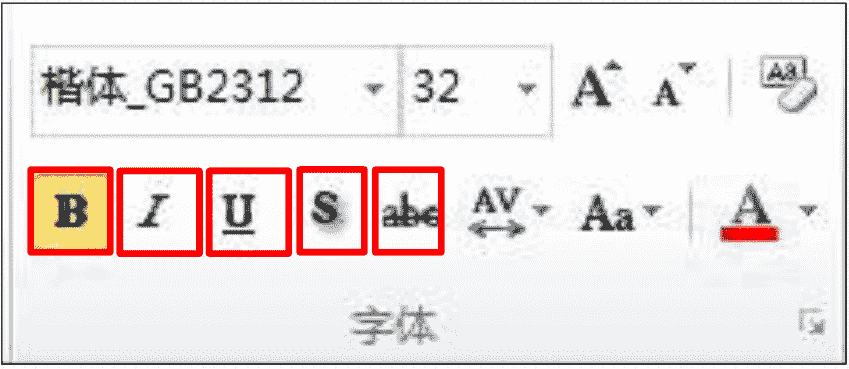

Word字体风格组合测试问题：

- 无组合：5
- 2-2组合：C₅² = 10
- 3-3组合：C₅³ = 10
- 4-4组合：C₅⁴ = 5
- 全部组合：1

4种风格的2-2组合

|  | Bold B | Italic I | Underline U | Strikethrough abc |
|---|---|---|---|---|
| Bold B | Microsoft | Microsoft | Microsoft | Microsoft |
| Italic I | Microsoft | Microsoft | Microsoft | Microsoft |
| Underline U | Microsoft | Microsoft | Microsoft | Microsoft |
| Strikethrough abc | Microsoft | Microsoft | Microsoft | Microsoft |

**组合测试问题：**

设需测试的 n 个参数分别是：A₁, A₂, …, Aₙ，每个参数对应的允许取值数分别为 x₁, x₂, …, xₙ，则对这 n 个参数进行完全测试所需的有效测试用例数为：

$f=x_1\cdot x_2\cdots x_n$

正交数组测试用于对上述普遍组合测试问题进行科学的用例约简

**拉丁方：**

古希腊，国王在检阅臣民方队时，要求每行有一个民族的代表，每列也要有一个民族的代表。

**n阶拉丁方：** 用 n 个不同的拉丁字母排成一个 n 阶方阵（n<26），如果每行的 n 个字母均不相同，每列的 n 个字母均不相同，则称这种方阵为 n×n 拉丁方或 n 阶拉丁方。每个字母在任一行、任一列中只出现一次。

| 1 | 2 | 3 |
|---|---|---|
| 2 | 3 | 1 |
| 3 | 1 | 2 |

3阶拉丁方

**Galois理论：**

在科学实验中，可以从大量实验数据中挑选适量的，有代表性的点，从而合理地安排实验的一种科学实验方法。

http://en.wikipedia.org/wiki/Galois_theory

Évariste Galois (1781-1832)


###### 正交数组测试原理

正交数组测试：

从大量测试用例中挑选适量的，有代表性的用例，从而合理地进行测试的方法。

适用领域：

输入域相对较少而详尽测试的次数又过大的问题

特点：

输入域有限，参数取值有限，需要将参数取值进行排列组合

输入：A, B, C；每个输入有三种取值可能

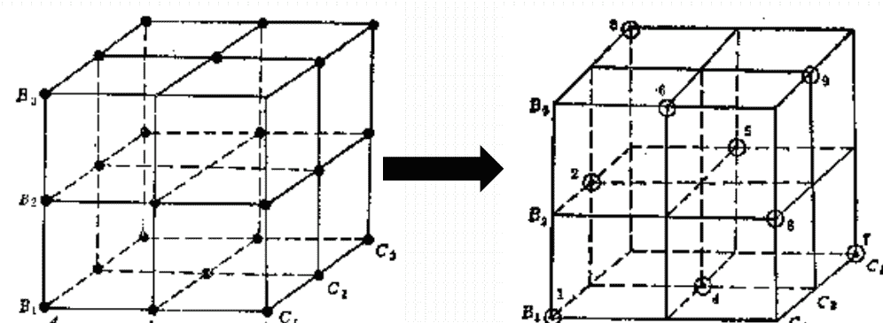

全面测试:3×3×3=27

正交测试:3×3=9

**正交测试用例：**

A₁ B₁ C₁   A₁ B₂ C₂   A₁ B₃ C₃

A₂ B₁ C₂   A₂ B₃ C₁   A₂ B₂ C₃

A₃ B₁ C₃   A₃ B₂ C₁   A₃ B₃ C₂

**A和B的取值组合**

A₁ B₁ C₁  A₁ B₂ C₂  A₁ B₃ C₃
A₂ B₁ C₂  A₂ B₃ C₁  A₂ B₂ C₃
A₃ B₁ C₃  A₃ B₂ C₁  A₃ B₃ C₂

**A和C的取值组合**

A₁ B₁ C₁  A₁ B₂ C₂  A₁ B₃ C₃
A₂ B₁ C₂  A₂ B₃ C₁  A₂ B₂ C₃
A₃ B₁ C₃  A₃ B₂ C₁  A₃ B₃ C₂

**B和C的取值组合**

A₁ B₁ C₁  A₁ B₂ C₂  A₁ B₃ C₃
A₂ B₁ C₂  A₂ B₃ C₁  A₂ B₂ C₃
A₃ B₁ C₃  A₃ B₂ C₁  A₃ B₃ C₂

**特点1：任意两个输入的所有组合均被包含**


##### 黑盒测试方法——正交数组测试

###### 正交数组测试原理

| A | B | C |
|---|---|---|
| A₁ | B₁ | C₁ |
| A₁ | B₂ | C₂ |
| A₁ | B₃ | C₃ |
| A₂ | B₁ | C₂ |
| A₂ | B₃ | C₁ |
| A₂ | B₂ | C₃ |
| A₃ | B₁ | C₃ |
| A₃ | B₂ | C₁ |
| A₃ | B₃ | C₂ |

- A₁ 取值出现次数：3
- A₂ 取值出现次数：3
- A₃ 取值出现次数：3

- B₁ 取值出现次数：3
- B₂ 取值出现次数：3
- B₃ 取值出现次数：3

- C₁ 取值出现次数：3
- C₂ 取值出现次数：3
- C₃ 取值出现次数：3

特点2：所有可能取值出现次数都相同，保证样本选择公正

###### 正交表

#### 一、正交表构成

- 因子：影响结果的条件因素（输入参数）
- 因子数（Factors）：正交表中的列数，即要测试的功能点数
- 水平：因子的取值（输入取值）
- 水平数（Levels）：单个因子的取值个数
- 行数（Runs）：正交表行数，即测试用例个数

#### 二、正交表的形式和记法

记法：L行数（水平数^因子数）

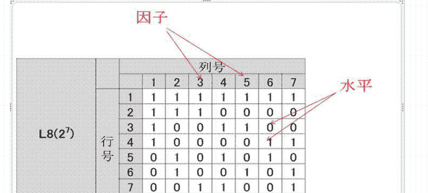

#### 三、正交表的获取

**获取途径：**

- 查表
- 软件辅助构造

http://www.york.ac.uk/depts/maths/tables/orthogonal.htm

http://support.sas.com/techsup/technote/ts723_Designs.txt

Taguchi Designs 正交表，包含行因子编号与列因子编号的设计矩阵。

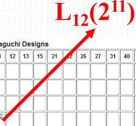

#### 四、正交表的正交性

**整齐可比性：** 在同一张正交表中，每个因子的每个水平出现的次数是完全相同的。每个因子的每个水平与其它因子的每个水平参与试验的机率是完全相同的，这就保证在各个水平中最大程度排除了其它因子水平的干扰。

| A | B | C |
|---|---|---|
| A₁ | B₁ | C₁ |
| A₁ | B₂ | C₂ |
| A₁ | B₃ | C₃ |
| A₂ | B₁ | C₂ |
| A₂ | B₃ | C₁ |
| A₂ | B₂ | C₃ |
| A₃ | B₁ | C₃ |
| A₃ | B₂ | C₁ |
| A₃ | B₃ | C₂ |

- A₁ 取值出现次数：3
- A₂ 取值出现次数：3
- A₃ 取值出现次数：3

- B₁ 取值出现次数：3
- B₂ 取值出现次数：3
- B₃ 取值出现次数：3

- C₁ 取值出现次数：3
- C₂ 取值出现次数：3
- C₃ 取值出现次数：3

**均衡分散性：** 在同一张正交表中，任意两列（两个因子）的水平搭配（横向形成的数字对）是完全相同的。这样就保证了试验条件均衡地分散在因子水平的完全组合之中，因而具有很强的代表性，容易得到好的试验条件。

**A和B的取值组合**

| A | B | C |
|---|---|---|
| A₁ | B₁ | C₁ |
| A₁ | B₂ | C₂ |
| A₁ | B₃ | C₃ |
| A₂ | B₁ | C₂ |
| A₂ | B₃ | C₁ |
| A₂ | B₂ | C₃ |
| A₃ | B₁ | C₃ |
| A₃ | B₂ | C₁ |
| A₃ | B₃ | C₂ |

**A和C的取值组合**

| A | B | C |
|---|---|---|
| A₁ | B₁ | C₁ |
| A₁ | B₂ | C₂ |
| A₁ | B₃ | C₃ |
| A₂ | B₁ | C₂ |
| A₂ | B₃ | C₁ |
| A₂ | B₂ | C₃ |
| A₃ | B₁ | C₃ |
| A₃ | B₂ | C₁ |
| A₃ | B₃ | C₂ |

**B和C的取值组合**

| A | B | C |
|---|---|---|
| A₁ | B₁ | C₁ |
| A₁ | B₂ | C₂ |
| A₁ | B₃ | C₃ |
| A₂ | B₁ | C₂ |
| A₂ | B₃ | C₁ |
| A₂ | B₂ | C₃ |
| A₃ | B₁ | C₃ |
| A₃ | B₂ | C₁ |
| A₃ | B₃ | C₂ |

###### 正交数组测试步骤

#### Step1：确定因子和水平

有哪些因子？

因子数是多少？

每个因子有哪些取值？

其水平数是多少？

#### Step2：判断是否能使用正交数组

- 因子的个数少，如只有2个（不使用）
- 因子的个数较多（不使用）

#### Step3：选择合适的正交表

根据因子数和水平数，选择测试次数最少的正交表。

#### Step4：把变量值映射到表中

填入输入变量的取值。

#### Step5：正交测试用例构造

每一行对应一个测试用例。

#### Step6：补充测试用例

根据需求规则说明书，增加一些正交表没有覆盖但需要测试的用例。

###### 正交表选择原则

- 正交表因子数 >= 实际因子数
- 正交表每个水平数 >= 实际每个水平数
- 如果出现 2 个或 2 个以上正交表符合以上条件，则选择行数最少的正交表

选取了正交表后，删除正交表中多余的因子列，原则是删除靠后的列。

**因子的水平数不同？**

采用包含和组合的方法选择合适正交表：取水平数大于最大水平数、因子数大于因子总数的正交表。

例：在 4 个因子中：1 个因子 4 水平，3 个因子 3 水平，选 L₁₆(4⁵)

###### 正交数组测试练习1——查询功能

某软件查询功能的界面如下。

查询时可根据**姓名**、**身份证**和**手机号码**。


#### 1. 确定因子和水平

**因子数和水平数：**

三个因子：

- 姓名
- 身份证号
- 手机号码

每个因子都有两个水平：

- 姓名：填、不填
- 身份证号：填、不填
- 手机号码：填、不填

#### 2. 选择正交表

- 因子数 >= 3
- 因子的水平数 >= 2
- 行数取最小的正交表

结果：L₄(2³)

#### 3. 变量值映射

| 行号 | 列号1 | 列号2 | 列号3 |
|---|---|---|---|
| 1 | 0 | 0 | 0 |
| 2 | 0 | 1 | 1 |
| 3 | 1 | 0 | 1 |
| 4 | 1 | 1 | 0 |

| 行号 | 姓名 | 身份证号 | 手机号码 |
|---|---|---|---|
| 1 | 填 | 填 | 填 |
| 2 | 填 | 不填 | 不填 |
| 3 | 不填 | 填 | 不填 |
| 4 | 不填 | 不填 | 填 |

#### 4. 正交测试用例构造和补充

**测试用例**

1. 填姓名　填身份证号　填手机号
2. 填姓名　不填身份证号　不填手机号
3. 不填姓名　填身份证号　不填手机号
4. 不填姓名　不填身份证号　填手机号

**增补测试用例**

5. 不填姓名　不填身份证号　不填手机号

测试用例从 8 降为 5。

###### 正交数组测试练习2——打印功能

#### PowerPoint 打印功能：范围、内容、颜色和效果

- 打印
- 保存并发送
- 帮助
- 加载项
- 选项
- 退出

#### 设置

- 打印全部幻灯片
- 打印整个演示文稿
- 幻灯片：
  - 整页幻灯片
  - 每页打印 1 张幻灯片
- 调整
  - 1,2,3  1,2,3  1,2,3
- 颜色
- 编辑页眉和页脚

#### 1. 确定因子和水平

**因子数和水平数：**

| 水平 | A打印范围 | B打印内容 | C打印颜色 | D打印效果 |
|---|---|---|---|---|
| 0 | 全部 | 幻灯片 | 彩色 | 幻灯片加框 |
| 1 | 当前幻灯片 | 讲义 | 灰度 | 幻灯片不加框 |
| 2 | 给定范围 | 备注页 | 黑白 |  |
| 3 |  | 大纲视图 |  |  |

| 水平 | A打印范围 | B打印内容 | C打印颜色 | D打印效果 |
|---|---|---|---|---|
| 0 | A1 | B1 | C1 | D1 |
| 1 | A2 | B2 | C2 | D2 |
| 2 | A3 | B3 | C3 |  |
| 3 |  | B4 |  |  |

#### 2. 选择正交表

- 因子数 >= 4
- 因子的水平数 >= 4
- 行数取最小的正交表
- 结果：L₁₆(4⁵)

| 行号 | 1 | 2 | 3 | 4 | 5 |
|---|---|---|---|---|---|
| 1 | 0 | 0 | 0 | 0 | 0 |
| 2 | 0 | 1 | 1 | 1 | 1 |
| 3 | 0 | 2 | 2 | 2 | 2 |
| 4 | 0 | 3 | 3 | 3 | 3 |
| 5 | 1 | 0 | 1 | 2 | 3 |
| 6 | 1 | 1 | 0 | 3 | 2 |
| 7 | 1 | 2 | 3 | 0 | 1 |
| 8 | 1 | 3 | 2 | 1 | 0 |
| 9 | 2 | 0 | 2 | 3 | 1 |
| 10 | 2 | 1 | 3 | 2 | 0 |
| 11 | 2 | 2 | 0 | 1 | 3 |
| 12 | 2 | 3 | 1 | 0 | 2 |
| 13 | 3 | 0 | 3 | 1 | 2 |
| 14 | 3 | 1 | 2 | 0 | 3 |
| 15 | 3 | 2 | 1 | 3 | 0 |
| 16 | 3 | 3 | 0 | 2 | 1 |

L₁₆(4⁵)


## 3.变量值映射

### 变量映射

—表示可取任何值

第5列去除

|   | 1  | 2  | 3  | 4  | 5 |
|---|----|----|----|----|---|
| 1 | A1 | B1 | C1 | D1 | 0 |
| 2 | A1 | B2 | C2 | D2 | 1 |
| 3 | A1 | B3 | C3 | — | 2 |
| 4 | A1 | B4 | — | — | 3 |
| 5 | A2 | B1 | C2 | — | 3 |
| 6 | A2 | B2 | C1 | — | 2 |
| 7 | A2 | B3 | — | D1 | 1 |
| 8 | A2 | B4 | C3 | D2 | 0 |
| 9 | A3 | B1 | C3 | — | 1 |
| 10 | A3 | B2 | — | — | 0 |
| 11 | A3 | B3 | C1 | D2 | 3 |
| 12 | A3 | B4 | C2 | D1 | 2 |
| 13 | — | B1 | — | D2 | 2 |
| 14 | — | B2 | C3 | D1 | 3 |
| 15 | — | B3 | C2 | — | 0 |
| 16 | — | B4 | C1 | — | 1 |

## 4.正交测试用例构造和补充

##### 测试用例

|   | 1  | 2  | 3  | 4  | 5 |
|---|----|----|----|----|---|
| 1 | A1 | B1 | C1 | D1 | 0 |
| 2 | A1 | B2 | C2 | D2 | 1 |
| 3 | A1 | B3 | C3 | — | 2 |
| 4 | A1 | B4 | — | — | 3 |
| 5 | A2 | B1 | C2 | — | 3 |
| 6 | A2 | B2 | C1 | — | 2 |
| 7 | A2 | B3 | — | D1 | 1 |
| 8 | A2 | B4 | C3 | D2 | 0 |
| 9 | A3 | B1 | C3 | — | 1 |
| 10 | A3 | B2 | — | — | 0 |
| 11 | A3 | B3 | C1 | D2 | 3 |
| 12 | A3 | B4 | C2 | D1 | 2 |
| 13 | — | B1 | — | D2 | 2 |
| 14 | — | B2 | C3 | D1 | 3 |
| 15 | — | B3 | C2 | — | 0 |
| 16 | — | B4 | C1 | — | 1 |

测试用例从72降为16。

###### 正交数组测试练习3——编辑功能

### Word字体编辑功能：

| | Bold B | Italic I | Underline U | Strikethrough |
|---|---|---|---|---|
| Bold B | Microsoft | Microsoft | Microsoft | Microsoft |
| Italic I | Microsoft | Microsoft | Microsoft | Microsoft |
| Underline U | Microsoft | Microsoft | Microsoft | Microsoft |
| Strikethrough | Microsoft | Microsoft | Microsoft | Microsoft |

## 1.确定因子和水平

### 因子数和水平数

Bold、Italic、Underline和Strikethrough

|   | A-Bold | B-Italic | C-Underline | D-Strikethrough |
|---|---|---|---|---|
| 0 | 选中 | 选中 | 选中 | 选中 |
| 1 | 不选 | 不选 | 不选 | 不选 |

|   | A-Bold | B-Italic | C-Underline | D-Strikethrough |
|---|---|---|---|---|
| 0 | A1 | B1 | C1 | D1 |
| 1 | A2 | B2 | C2 | D2 |

## 2.选择正交表

### 选择正交表

因子数>=4

因子的水平数>=2

行数取最小的正交表

$L_8(2^7)\quad L_9(3^4)\quad L_{12}(2^{11})$

结果：$L_8(2^7)$

|   | 1 | 2 | 3 | 4 | 5 | 6 | 7 |
|---|---|---|---|---|---|---|---|
| 1 | 1 | 1 | 1 | 1 | 1 | 1 | 1 |
| 2 | 1 | 1 | 1 | 2 | 2 | 2 | 2 |
| 3 | 1 | 2 | 2 | 1 | 1 | 2 | 2 |
| 4 | 1 | 2 | 2 | 2 | 2 | 1 | 1 |
| 5 | 2 | 1 | 2 | 1 | 2 | 1 | 2 |
| 6 | 2 | 1 | 2 | 2 | 1 | 2 | 1 |
| 7 | 2 | 2 | 1 | 1 | 2 | 2 | 1 |
| 8 | 2 | 2 | 1 | 2 | 1 | 1 | 2 |

## 4.正交测试用例构造和补充

##### 测试用例

| | 1 | 2 | 3 | 4 |
|---|---|---|---|---|
| 1 | A1 | B1 | C1 | D1 |
| 2 | A1 | B1 | C1 | D2 |
| 3 | A1 | B2 | C2 | D1 |
| 4 | A1 | B2 | C2 | D2 |
| 5 | A2 | B1 | C2 | D1 |
| 6 | A2 | B1 | C2 | D2 |
| 7 | A2 | B2 | C1 | D1 |
| 8 | A2 | B2 | C1 | D2 |
| 9 | A2 | B2 | C2 | D2 |

测试用例从15降为8。进一步增加遗漏的重要测试用例，如9。

##### 黑盒测试方法总结

| 特点 | 被测软件内部逻辑未知的测试方法总称 |
|---|---|
| 目的 | 功能的正确和遗漏；界面错误；数据访问；性能；初始化和终止 |
| 技术 | 基于需求的测试；正面测试和负面测试；边界值分析；因果分析法；决策表；等价类划分；基于图/状态的测试；正交数组测试 |
| 插桩 | 实现白盒测试和黑盒测试的支持技术 |

##### 灰盒测试方法

白盒+黑盒

###### 灰盒测试简介

###### 白盒-黑盒-灰盒

| | 白盒测试 | 黑盒测试 | 灰盒测试 |
|---|---|---|---|
| 代码依赖 | 需要源代码 | 不需要源代码 | 需要了解实现的有限细节 |
| 实施时机 | 单元测试 | 单元测试后 | 集成测试前期 |
| 实施者 | 开发人员 | 测试人员 | 测试人员 |
| 关注对象 | 内部实现 | 功能需求 | 二者兼有 |
| 测试方法 | 代码审查和代码分析 | 设计并执行测试用例 | 编写测试代码 |
| 是否必须 | 不能被取代 | 不能被取代 | 可被黑盒测试取代 |

#### 三 黑盒测试工具

1. 主流的黑盒测试工具？
2. 测试工具的应用场景？


##### 特点

- 黑盒测试工具=功能测试工具
- 软件测试工具中最活跃的类型
- 多用于系统测试、确认测试和回归测试
- 以自动化测试工具为主

##### 自动化测试工具原理

（以基于GUI的自动化测试工具为例）：运行被测软件的同时，捕获过程中的键盘、鼠标操作，生成脚本文件，这个脚本文件可以进行修改和回放。

##### 主流功能测试工具

1. Quick Test Professional (QTP)
2. Rational Robot
3. SilkTest
4. AutoRunner
.......

##### Quick Test Professional

- 功能：
  - 创建功能和回归测试
  - 自动捕获、验证和重放用户的交互行为
  - 为每一个重要软件应用和环境提供功能和回归测试自动化的行业最佳解决方案

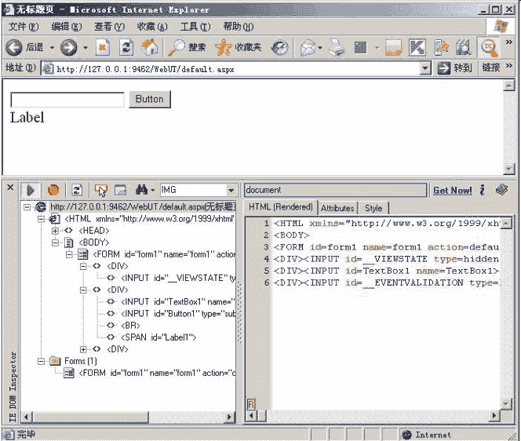


##### 黑盒测试工具

##### ■ Robot

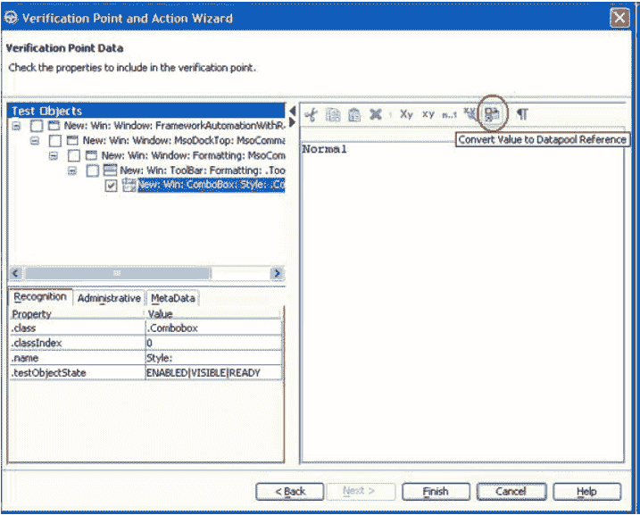

##### 黑盒测试工具

##### SilkTest

功能：是面向Web应用、Java应用和传统的C/S应用，进行自动化的功能测试和回归测试的工具

特点：

提供了用于测试的创建和定制的工作流设置、测试计划和管理、直接的数据库访问及校验等功能，使用户能够高效率地进行软件自动化测试

##### 黑盒测试工具

##### AutoRunner

功能：

+   1. Web测试——支持各种B/S应用和网站
+   2. .NET测试——对.NET类型的应用软件进行功能测试

特点：

AutoRunner是黑盒测试工具，可以用来完成功能测试、回归测试、每日构建测试与自动回归测试等工作。是具有脚本语言的、提供完善的针对脚本跟踪和调试功能的、支持IE测试和Windows 测试的自动化测试工具。

##### 黑盒测试工具

##### AutoRunner

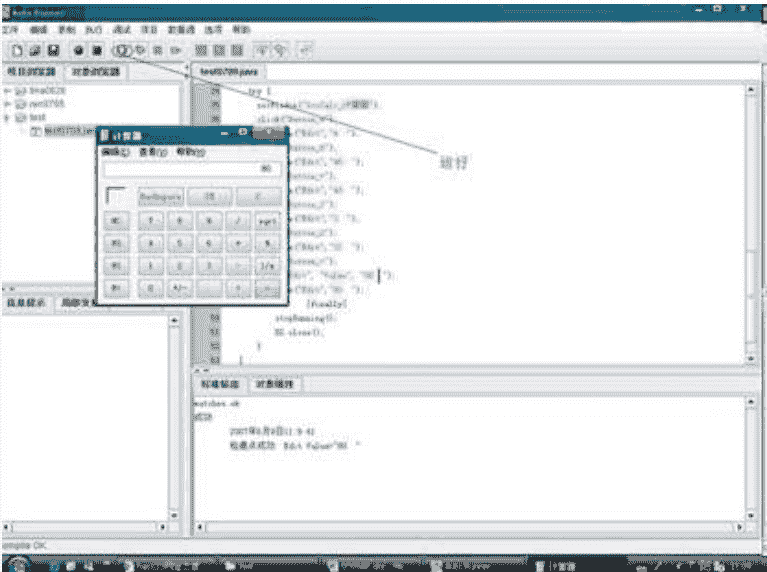

##### 黑盒测试工具

##### QTP 演示

#### 参考文献

+   1. 郁莲，软件测试方法与实践，p45-p60，清华大学出版社
+   2. 宫云战 主编，软件测试教程，p19-p48，机械工业出版社
+   3. Andreas Spillner, Tilo Linz, Hans Schaefer（刘琴 等 译），软件测试基础教程，p81-p112，人民邮电出版社
+   4. Srinivasan Desikan, Gopalaswamy Ramesh，（韩柯，李娜 译），软件测试：原理与实践，p47-p66，机械工业出版社
+   5. 路晓丽，葛玮，龚晓庆，软件测试技术，p35-p50，机械工业出版社
+   6. Grey Box Testing, http://www.geocities.com/extremetesting/GreyBox.html
+   7. http://bbs.zbitedu.com/archiver/tid-23088.html
+   8. 朱少民，软件测试，人民邮电出版社
+   9. 微软的软件测试之道
+   10. http://qa.taobao.com/?p=5874
+   11. ……

此外，本章节参考了很多网上的资源，此处没有一一列出，再次诚挚地感谢这些作者。

#### 本讲总结

+   - 黑盒测试基本概念
+   - 黑盒测试技术
+   - 黑盒测试工具

# 单元测试

+   - 单元测试
+   - 集成测试

# 软件测试

衷心感谢各位老师莅临指导！

欢迎各位老师同学批评指正！

Email: [pwang@seu.edu.cn](mailto:pwang@seu.edu.cn)

# 软件测试基础与实践

Software Testing: Foundations and Practices

### 第4讲 单元测试与集成测试

教师: 汪鹏 廖力

软件工程专业 主干课程

# 大爆炸开发模式与软件测试：

+   - 开发过程混乱
+   - 期待奇迹出现

# 测试的困难：

+   - 难以找到导致缺陷的原因
+   - 某些缺陷掩盖了其它缺陷，造成测试失败

# 解决：

+   - 代码分阶段构建
+   - 模块分阶段测试
+   - 模块组合形成更加的部分

# # 本体映射工具Lily系统架构


模块：实验数据、预处理、匹配计算、后处理、用户平台、基础工具库

#### 本讲内容

| 单元测试 | 基本概念、测试规程、特点 ... |
| 集成测试 | 基本概念、集成测试策略 ... |
| 测试插桩 | 白盒插桩:监测状态/条件/前提/常量
黑盒插桩:测试预言、 随机数据生成 |
| 测试工具 | Junit, VSUnit, CPPUnit, ... |

#### 一 单元测试

+   1. 单元测试的特点？
+   2. 单元测试的关注点？
+   3. 单元测试的实施？
+   4. 驱动器和程序桩？

# 单元测试——基本概念

##### 软件单元

软件单元(Software Unit):
一个应用程序中的最小可测部分

面向过程中的单元：
单独的程序、函数、过程、网页、菜单、...

面向对象中的单元：
类（基类、抽象类、子类）

# 单元测试——基本概念

##### 定义

单元测试(Unit Testing)/模块测试(Module Testing):
对最小的软件设计单元（模块/源程序单元）的验证工作

##### 意义

+   1. 消除软件单元本身的不确定性
+   2. 其它测试阶段的必要的基环节

##### 实施者

软件开发人员

# # 单元测试——基本概念

# ## 测试目标

+   - 单元体现了预期的**功能（黑盒 白盒）**
+   - 单元的运行能覆盖预定的各种**逻辑（白盒）**
+   - 单元工作中内部**数据**能够保持完整性（**白盒**）
+   - 可接受**正确数据**，也能处理**非法数据（黑盒）**
+   - 在数据**边界**条件上，单元能正确工作（**黑盒**）
+   - 单元的算法合理，**性能**良好（**黑盒**）
+   - 扫描单元代码未发现任何**安全性**问题（**白盒**）

……

# # 单元测试——基本概念

# ## 测试技术

**白盒测试技术：**
使用一种或多种白盒测试方法**分析模块的逻辑结构**

**黑盒测试技术：**
使用黑盒测试方法对照模块的**规格说明**以补充测试用例

# 单元测试——测试关注点

##### 模块或构件接口

目标：

选出模块/构件的数据流正确

关注点：

+   1. 接口名称、参数个数、类型、匹配顺序
+   2. 输出或返回值及其类型是否正确

# 单元测试——测试关注点

##### 局部数据结构

目标：

数据在模块执行过程中维持完整性和正确性

关注点：

+   (1) 数据结构定义和使用过程的正确性
+   (2) 局部数据结构对全局数据结构的影响

# 单元测试——测试关注点

##### 边界条件

目标：

保证模块在条件边界上能够正确执行

# 关注点：

+   1. 数据结构中的边界（例如：数组 a[n]）
+   2. 控制流中的边界（例如：循环次数、判断条件）

# 单元测试——测试关注点

##### 独立路径

目标：
保证模块中的每条独立路径(基本路径)都被覆盖，使得所有语句都被执行过一次

关注点：
对路径的选择性测试（基本路径测试+循环测试）

# 单元测试——测试关注点

##### 处理错误的路径

# 目标：

保证错误处理的正确性,软件的健壮性

好的软件设计要求错误条件是可预知的，并且当错误发生时，错误处理路径被建立，以重定向或终止处理。

Java: try、 catch、 throw、 throws、 finally

C++: try、 catch、 throw

# 单元测试——测试关注点

处理错误的路径

+   错误处理关注点:
+   (1) 异常条件的正确性
+   (2) 异常的可发生性
+   (3) 异常处理的逻辑正确性

# 足够进行单元测试了吗？


# 单元测试规程

##### 驱动器和程序框

绝大多数情况下，单个单元是不能正常工作的，而是要和其他单元一起才能正常工作。

实际测试活动中的普遍问题：其它单元不存在的情况下，如何运行单个模块？

# 单元测试规程

##### 驱动器和程序桩

+   - 单元测试通常与编码工作结合起来进行。

+   - 模块本身不是一个独立的程序，在测试模块时，必须为每个被测模块开发一个驱动器(driver) 和若干个桩程序(stub)


# 单元测试规程

##### 驱动器和程序桩

##### 驱动器（Driver）：

对底层或子层模块进行测试时所编制的调用被测模块的程序，用以模拟被测模块的上级模块。

接收测试数据，并把数据传送给被测模块，最后输出相关结果。


## 单元测试规程

##### 驱动器和程序桩

**桩程序（Stub）：** 对上层模块进行测试时，所编制的替代下层模块的程序，用以模拟被测模块工作过程中所调用的模块。

模拟未被测试模块/隶属模块的功能。


**驱动器结构一般如下：**

- 数据说明；
- 初始化；
- 输入测试数据；
- 调用被测模块；
- 输出测试结果；
- 停止

**桩程序结构一般如下：**

- 数据说明；
- 初始化；
- 输出提示信息（表示进入了哪个桩模块）；
- 验证调用参数；
- 打印验证结果；
- 将模拟结果送回被测程序；
- 返回

##### 手工和自动化测试

**手工测试：** 按照需求规格设计测试用例完成测试。

静态测试。

**自动测试：** 自动化方法的效果：有效验证较为独立单元的正确性。

单元测试驱使程序员创建松耦合、高内聚的代码体，有助于开发健壮的软件。

##### 单元测试局限性

- 只验证单元自身的功能，不能捕获系统范围的错误
  - 系统错误：集成错误、性能问题等
- 被测模块现实中可能接收的所有输入情况难以预料

#### 二 集成测试


- 1. 集成测试的概念？
- 2. 集成测试的关注点？
- 3. 集成测试的策略？

##### 集成测试基本概念

**火星登陆事故（Mars Polar Lander）**


> *Nancy G. Leveson, The Role of Software in Spacecraft Accidents*

**定义**

**集成测试（Integration Testing）：** 把单独的软件模块结合在一起作为整体接受测试。

**意义**

- 1. 验证软件单元间能否协调工作
- 2. 验证单元集合的功能、性能和可靠性需求

**实施者**

软件测试人员+软件开发人员

**测试技术和步骤**

**技术：**
- 黑盒测试技术为主
- 白盒测试技术为辅

**步骤：**
- 与集成测试策略相关

**集成测试必要性**

接口连接问题：

- 函数相互调用；
- 模块间的相互影响；
- 单个模块中的缺陷发生扩散；
- 全局数据结构；
- ...

**接口**

**内部接口：** 产品内部两模块之间通信的接口

**外部接口：** 产品之外第三方可以看到的接口

**接口提供方法：** API、SDK

**显式接口：** 写入文档的明确化的接口

**隐含接口：** 未写入文档，只有开发人员知道；如：Windows隐藏的API

##### 集成测试策略

- 瞬时集成测试
- 增量集成测试

**瞬时集成测试**

又称大爆炸测试策略。

**特点：** 当所有构件都通过单元测试，就把他们组合成一个最终系统，并观察它是否正常运转。

**缺陷：**

- 无休止的错误：
  - 错误很多；
  - 错误修复很困难；
  - 修正错误后，新的错误马上出现
- 模块一次性结合，难以找出错误原因
- 接口错误和其它错误容易混淆

**适用领域：** 小型软件开发

**增量集成测试**

**特点：** 将程序分成小的部分进行构造和测试。

**优点：**

- 1. 错误容易分离和修正
- 2. 接口容易进行彻底测试

**缺点：** 会有额外开销，但能大大减少发现和修正错误的时间。

**三种增量集成测试：**

- 自顶向下集成
- 自底向上集成
- 混合式集成

**自顶向下集成**

**集成顺序：** 先集成主模块（主程序），然后按照控制层次向下进行集成。

**集成方式：**

- 1. 深度优先
- 2. 广度优先

**广度优先集成**

A possible sequence of integration is:

- Unit test MA
- Integration test MA, MB
- Integration test MA, MB, MC
- Integration test MA, MB, MC, MD
- Integration test MA, MB, MC, MD, ME
- Integration test MA, MB, MC, MD, ME, MF
- Integration test MA, MB, MC, MD, ME, MF, MG
- Integration test all modules


**深度优先集成**


深度优先：A B D E C F H G

**集成步骤：**

- 1. **Step1.** 主程序作为测试**驱动器**
- 2. **Step2.** 根据集成顺序，**程序桩**逐渐被各模块替换
- 3. **Step3.** 每个模块集成时都需要进行测试
- 4. **Step4.** 每完成一次测试后，将**新模块替换程序桩**
- 5. **Step5.** 利用**回归测试**来保证没有引进新的错误

**优点：**

- 1. 尽早发现高层控制和决策错误
- 2. 只需要一个驱动器
- 3. 每步只增加一个模块
- 4. 支持深度优先和广度优先

**实施的主要难点：**

高层测试需要在低层测试完成后才可进行的情形。

**解决方法：**

- 1. 推迟测试，直到低层模块完成测试；
- 2. 设计程序桩，模拟低层模块；
- 3. 自底向上测试

**缺点：**

- 1. 对低层模块行为的验证比较晚
- 2. 需要编写额外程序模拟未测试的模块
- 3. 测试用例的输入和输出很难明确表示

**自底向上集成**

**集成顺序：** 从原子模块，即程序最底层模块开始进行构造并进行集成测试。

原子模块 → 构件(Build) → 应用软件系统

**集成步骤：**

- Step1. 低层模块组成实现特定子功能的构件
- Step2. 编写驱动程序协调输入输出
- Step3. 测试特定子功能的构件
- Step4. 沿层次向上对构件进行组合

A possible sequence of integration is:

- Unit test MD
- Unit test ME
- Unit test MH
- Unit test MG
- Integration test MD, MB
- Integration test MD, MB, ME
- Integration test MD, MB, ME, MA
- Integration test MH, MF
- Integration test MH, MF, MC
- Integration test MH, MF, MC, MG
- Integration test all modules


## 集成测试策略——增量集成测试

##### 自底向上集成

**优点：**
- 1. 尽早确认低层行为
- 2. 无需编写程序桩
- 3. 对实现特定功能的子树容易表示输入输出

**缺点：**
- 1. 推迟确认高层行为
- 2. 需编写驱动器
- 3. 组合子树时，有许多元素要进行集成

##### 混合式集成

**集成顺序：**
综合自顶向下和自底向上，是实际测试中的实用集成测试策略。

**特点：**
- 开发小组对各自的低层模块向上集成；
- 专门的集成小组进行自顶向下集成；

**步骤：**
- 1. **Step1:** 用程序桩独立测试上层模块；
- 2. **Step2:** 用驱动器独立测试低层模块；
- 3. **Step3:** 集成时对中间层进行测试；

##### 端到端集成测试

### 端到端集成测试简介

**目的：**
验证一组相互连接的系统形成的集成系统是否正常运行

**特点：**
- 从最终用户的角度出发，强调系统的功能测试；
- 不关注接口

**适用领域：**
大型软件系统

##### 集成测试总结

集成测试是一个必要的测试阶段：

从将两个组件集成到一起开始，到所有系统组件在一起运行为止的所有测试活动，都是集成测试阶段的一部分。

集成测试是一种测试类型：

集成测试测试组件间的接口。

集成测试不应被淡化：

集成测试能减少系统测试阶段的缺陷。

#### 三、测试插桩

- 1. 插桩在测试中的作用？
- 2. 如何在测试中插桩？


##### 测试插桩背景

测试过程中，往往需要知道某些信息：

- 语句覆盖
- 路径覆盖
- 变量的使用、定义
- …

**传统方法：**
跟踪被测程序的执行过程，人工收集信息

程序插桩技术最早是由J.C. Huang 教授提出的，它是在保证被测程序原有逻辑完整性的基础上在程序中插入一些探针（又称为“探测仪”），通过探针的执行并抛出程序运行的特征数据，通过对这些数据的分析，可以获得程序的控制流和数据流信息，进而得到逻辑覆盖等动态信息，从而实现测试目的的方法。


##### 测试插桩基础

**原理：**
在程序特定部位附加一些操作或功能，用来检验程序运行结果以及执行特性，以便支持测试

**两类插桩技术：**
- 白盒测试插桩技术
- 黑盒测试插桩技术

**白盒测试插桩**

**作用：**
- 1. 生成特定状态，检验状态的可达性；
- 2. 显示或读取内部数据或私有数据；
- 3. 监测不变数据；
- 4. 监测前提条件；
- 5. 人为触发事件；
- 6. 监测事件时间

**插桩方式一：目标代码插桩**

**优点：**
- 目标代码的格式主要和操作系统相关，和具体的编程语言及版本无关，应用范围广；
- 特别适合在需要对内存进行监控的软件中使用

**缺点：**
- 目标代码中语法、语义信息不完整

**插桩方式二：源代码插桩**

**优点：**
在词法分析和语法分析的基础上进行的，这就保证对源文件的插桩能够达到很高的准确度和针对性。

**缺点：**
工作量较大，而且随着编码语言和版本的不同需要做一定的修改

**插桩问题1：探测什么信息？**

**Answer:** 由具体需求而定

- 覆盖率？
- 中间结果？
- 测试数据生成？
- 统计信息？
- …

**插桩问题2：插桩位置？**

**Answer:** 由具体需求而定。

**原则：**
探针的植入要做到紧凑精干，才能保证做到收集的信息全面而无冗余，减少代码的膨胀率。

**探针的植入常见位置：**
- a. 程序的第一条语句；
- b. 分支语句的开始；
- c. 循环语句的开始；
- d. 下一个入口语句之前的语句；
- e. 程序的结束语句；
- f. 分支语句的结束；
- g. 循环语句的结束；

**插桩问题3：探测点数目？**

**Answer:** 个数越少越好

插桩会影响原有程序执行的效率

很多测试工具能根据需求进行自动插桩

**常用插桩策略：**

**语句覆盖插桩（基本块插桩）：** 在基本块的入口和出口处，分别植入相应的探针，以确定程序执行时该基本块是否被覆盖。

**分支覆盖插桩：** 分支由分支点确定。对于每个分支，在其开始处植入一个相应的探针，以确定程序执行时该分支是否被覆盖。

**条件覆盖插桩：** if, switch, while, do-while, for 几种语法结构都支持条件判定，在每个条件表达式的布尔表达式处植入探针，进行变量跟踪取值，以确定其被覆盖情况。

**例：分析覆盖率和测试用例有效性**

求整数X和Y的最大公约数

程序的插桩


**例：断言检测**

断言：在程序特定部位插入用以证实程序某些特性的语句

```
void *memcpy(void *pvTo, const void *pvFrom, size_t size)
{
    assert((pvTo != NULL) && (pvFrom != NULL));
    byte *pbTo = (byte *) pvTo;
    byte *pbFrom = (byte *) pvFrom;
    while(size -- > 0) *pbTo ++ = *pbFrom ++;
    return pvTo;
}
```

**黑盒测试插桩**

**作用：**
- 1. 测试预言（Test Oracle）
- 2. 随机数据生成

**测试预言插桩**

**定义：**
一种独立于被测系统的程序或机制，用于确认对于给定的输入，系统是否有一个预期输出。

**特点：**
- 不能获得源代码，但可以调用API等信息
- 不属于纯黑盒测试，而是一种灰盒测试

**作用：**
检查函数正确性、系统安全性、...

http://en.wikipedia.org/wiki/Oracle_(software_testing)

**例：喂鱼的测试预言**

**API和数据结构定义**

```
public class FeedingView {

    FeedingSchedule schedule=null;

    f.end-f.start<=30 minute;  //初始化；
    喂鱼时间不超过30分钟

    getFeedingSchedule();  //获取时间表

    updateFeedingSchedule();//更新时间表

}
```

**测试预言程序**

```
public boolean
    testUpdateFeedingSchedule(){

    FeedingSchedule fs=new
        FeedingSchedule();

    Calendar now=Calendar.getInstance();

    fs.setStart(now);

    now.add(now.MINUTE,31);

    fs.setEnd(now);

    fs.updateFeedingSchedule(fs);

    return checkInvariant();
}
```

**例：测试输入为1-100整数的输入框**

- （1）等价类划分：
  - 无效域：x<1
  - 有效域：1<=x<=100
  - 无效域：x>100
- （2）边界值：
  - {0,-1}
  - {1,2,99,100}
  - {101}
- （3）随机数据生成：
  - Java API random()


#### 四 单元/集成测试工具

## 1. 单元和集成测试中的工具？


## 单元/集成测试工具

##### C/C++语言测试工具

- 通用各种操作系统的测试工具
  C Unit Test System, CPPTest, CPPUnit, CxxTest

- Win32/Linux/Mac OS X
  UnitTest++

- Mac OS X
  ObjcUnit, OCUnit, TestKit

- UNIX
  cutee

## 单元/集成测试工具

##### C/C++语言测试工具

- Windows
  simplectest

- 嵌入式系统
  Embedded Unit

- 其它
  Cgreen, POSIX Check

## 单元/集成测试工具

- **Java语言测试工具**
  - **TestNG**
    灵活的Java测试框架

  - **JUnit**
    最著名的测试框架之一

  - **其它**
    PMD, MockRunner, jWebUnit, JSFUnit等

## 单元/集成测试工具

##### 其它语言测试工具

- **HtmlUnit**
  Junit扩展的测试框架之一
- **Nunit**
  C#, .Net
- **其它**
  PHPUnit,DUnit, SQLUnit, RSpec等

## 单元/集成测试工具

##### 商业测试工具

- DevPartner Studio
- Parasoft C++ Test
- Parasoft Jtest
- Parasoft .TEST
- …

#### 参考文献

- 1. 郁莲, 软件测试方法与实践, p84-p100, 清华大学出版社
- 2. Srinivasan Desikan, Gopalaswamy Ramesh, (韩柯, 李娜 译), 软件测试: 原理与实践, p68-p78, 机械工业出版社
- 3. 朱少民, 软件测试

#### 课后习题

## 习题将结合实验


#### 本讲总结

## 单元测试

## 集成测试

#### 内容预告

- JUnit

衷心感谢各位老师莅临指导！
欢迎各位老师同学批评指正！

Email: pwang@seu.edu.cn

## 软件测试基础与实践

Software Testing: Foundations and Practices

### 第6讲 系统测试 确认测试 回归测试

教师: 汪鹏 廖力

软件工程专业 主干课程

#### 一 系统测试

- 1. 功能测试和非功能测试
- 2. 系统测试方法


##### 系统测试概述

##### 系统测试概念

## 定义：

对完整集成后的产品和解决方案进行测试，用来评价系统对具体需求规格说明的功能和非功能 的符合性的测试

## 目的/作用：

- 1. 发现可能难以直接与模块或接口关联的缺陷
- 2. 发现产品设计、体系和代码的基础问题（产品级缺陷）

##### 系统测试概述

##### 系统测试概念

**引入时机：**

集成测试之后（基础的程序逻辑错误和缺陷已更正）

**实施人员：**

独立测试团队

（引入独立视角，有助于发现遗漏缺陷）

**特点：**

是既测试产品功能也测试产品非功能的唯一测试阶段

##### 系统测试概述

##### 系统测试的实施原因

- 1. 在测试中引入独立视角
  独立测试团队；直接向高层报告
- 2. 在测试中引入客户视角
  消除对产品的偏见
- 3. 在测试中模拟客户使用环境
  正式、完备和现实的测试环境

##### 系统测试概述

##### 系统测试的实施原因

- 4. 测试产品功能和非功能的问题
- 5. 建立对产品的信心
- 6. 分析和降低产品发布的风险
- 7. 保证满足所有需求，产品具备交付确认测试条件

##### 系统测试概述

##### 系统测试=功能测试+非功能测试

##### 功能测试VS非功能测试

| | 功能测试 | 非功能测试 |
|---|---|---|
| 作用/关注点 | 验证产品功能和特性 | 验证产品质量因素 |
| 范围 | 所有测试阶段 | 系统测试 |
| 用例失败原因 | 代码缺陷 | 体系结构、设计和代码缺陷 |
| 预备知识 | 产品和领域 | 产品、领域、设计、体系结构、分析技能 |

##### 系统测试概述

系统测试=功能测试+非功能测试

|  | 功能测试 | 非功能测试 |
|---|---|---|
| 用例可重复性 | 可重复多次 | 只在沟通过的和针对不同配置时重复 |
| 配置 | 对一组测试用例配置一次 | 每个测试用例都可能改变配置 |
| 工作量 |  | 50%:50% ~ 30%:70% |

##### 功能系统测试

## 功能系统测试方法

- 1. 设计/体系结构测试
- 2. 业务垂直测试
- 3. 部署测试
- 4. Alpha测试和Beta测试
- 5. 符合性的认证、标准和测试

##### 功能系统测试

## 设计/体系结构测试

原理：

对照设计和体系结构开发和检查测试用例，从而整理出产品级测试用例

| 测试用例特征 | 建议 |
|---|---|
| 测试用例关注代码逻辑、数据结构和产品单元 | 单元测试 |
| 测试用例关注组件接口 | 集成测试 |
| 测试用例关注的不能为客户所看到 | 单元测试/集成测试 |
| 测试用例综合了客户使用和产品实现 | 系统测试 |

##### 功能系统测试

## 业务垂直测试

**原理：**

针对不同业务纵深的产品，根据业务定制测试用例，**验证业务运作和使用**

**方法：**

模拟和复制

场景测试

##### 功能系统测试

## 部署测试

## 验证新的系统是否能有效替代老的系统

## 目的：

特定产品版本短期内是否能成功使用

## 过程：

- 1. 第1阶段：采集实际系统真实数据，建立镜像测试环境，重新执行用户操作
- 2. 第2阶段：引入新产品，进行新业务操作

##### 功能系统测试

## Alpha测试和Beta测试

Alpha测试：

定义：用户在开发环境下进行的受控测试

特点：不由程序员或测试员完成，但开发者会在现场

##### 功能系统测试

## Alpha测试和Beta测试

在Alpha测试达到一定程度后进行Beta测试

## Beta测试：

定义：用户在实际使用环境下进行测试

一种可以把待测产品交给客户收集反馈意见的机制

特点：开发者通常不在现场

挑战：客户数量；客户充分了解产品

##### 功能系统测试

## 符合性的认证、标准和测试

主流基础设施：操作系统、硬件、数据库...

约定和法律要求：质量行业标准、法规、...

##### 非功能系统测试

## ■ 非功能系统测试方法

非功能测试的最大挑战：**设置配置**

**原因：**

- 1. 难以预测客户使用的环境
- 2. 对配置进行组合测试的代价太高
- 3. 建立测试环境成本高
- 4. 很难准确预测客户使用的数据

**两种方法：** 模拟环境 和 真实客户环境

##### 非功能系统测试

## 非功能系统测试方法

- 1. 性能测试
- 2. 互操作性测试/兼容性测试
- 3. 可使用性与易获得性测试
- 4. 国际化测试
- 5. 安全性测试

##### 非功能系统测试

## 性能测试

参见下一讲内容

##### 非功能系统测试

## 互操作测试/兼容性测试

## 目的：

保证两个或多个产品可以交换和使用信息，并恰当地在一起运行

## 典型兼容目标：

操作系统、数据库、网络、浏览器、应用软件

##### 非功能系统测试

## ■ 互操作测试/兼容性测试

**后向兼容：**

老版本中的数据能否在当前版本中使用

**前向兼容：**

当前版本中的数据能否在未来版本中使用


##### 非功能系统测试

## 可使用性和易获得性测试

易获得性：
检查产品对于行动不便的用户也可使用的测试

基本以获得性：
粘贴键、声响键、多种模拟鼠标功能、朗读器、触摸...

##### 非功能系统测试

## 国际化测试

目的：
确保软件支持不同国家语言的测试手段

国际化问题：
语言的消息显示
语言和习俗的消息处理
日期格式、货币格式
对话框等文本显示区域至少0.5被宽度的扩展空间
......

## 国际化生活的体验

- 去美国旅行，最感不适应会有什么？
- 2/3/2009 代表哪一天，2月3日或3月2日？
- 乔治·布什（George Bush）属什么生肖？


## 具体例子

【中文简体，北京】
开始日期：2008年12月1日
开始时间：8:00，中国标准时间（GMT +08:00）

【英文、纽约】
Starting date: Sunday, November 30, 2008
Starting time: 7:00 pm, Eastern Standard Time (GMT -05:00)


## 示例—阿拉伯语


#### 二 确认测试/验收测试

## 1. 确认测试概念


##### 确认测试

## 概念

**定义：** 检查产品是否满足在项目的需求阶段定义的**确认准则**，或者说是否具备在真实环境中使用的条件

**实施者：** 客户或客户代表

**引入时机：** 系统测试之后


##### 确认测试

##### 确认准则

产品确认：
对现有测试用例进行分类形成确认准则

规程确认：
文档、发布介质、使用培训

服务等级约定：
例如：前三个月内发现的重要缺陷应免费修改

##### 确认测试

##### 选择确认准则的测试用例

**建议：**

- 端到端的功能验证：所有事务测试都在客户端进行
- 领域测试用例：反映业务领域知识
- 用户场景测试用例：反映真实用户场景
- 完善性测试用例：全面包含各项功能

##### 确认测试

##### 选择确认准则的测试用例

建议：

- 新功能：检验新功能
- 少量非功能测试用例：再次验证非功能特性
- 符合法规义务和服务约定的测试用例
- 确认测试数据：选择客户真实数据

##### 确认测试

##### 执行确认测试

开发组织：
辅助客户完成确认测试

确认测试团队：
产品管理层+支持团队+咨询团队
90%成员：具有产品业务过程知识
10%成员：技术测试团队

开发组织的测试团队：
与确认测试团队不断沟通，提供采集测试数据和分析测试结果的帮助

#### 三 回归测试

- 1. 回归测试概念
- 2. 波及效应


## 开发人员的一天

Rainbow Build: 2261 has been build SUCCESSFULLY and PASSED BVT tests - Message (Rich Text)
彩虹构建：2261 已成功构建并通过 BVT 测试 - 消息（富文本）

From: Rainbow Build Automation
发件人：彩虹构建自动化
To: Rainbow Project Team All Members
收件人：彩虹项目团队全体成员
Cc:
抄送：
Subject: Rainbow Build: 2261 has been build SUCCESSFULLY and PASSED BVT tests
主题：彩虹构建：2261 已成功构建并通过 BVT 测试

Rainbow Build 2261 has been build SUCCESSFULLY and PASSED the BVT tests.
彩虹构建 2261 已成功构建并通过 BVT 测试。

Build Information
构建信息
Build No. 2261
构建编号 2261
Build Started 06/29/2004 04:00 AM
构建开始时间 2004/06/29 04:00 AM
Build Finished 06/29/2004 04:20 AM
构建结束时间 2004/06/29 04:20 AM
Build Result Passed
构建结果 通过
Location \\rainbow02\build\drops\2261
位置 \\rainbow02\build\drops\2261
MSI Tested \\rainbow02\build\drops\2261\distrib\retail\RainbowInstaller.msi
已测试 MSI \\rainbow02\build\drops\2261\distrib\retail\RainbowInstaller.msi
Other Comments

其他说明

Summary of BVT Tests
BVT 测试摘要
No. of Test Cases Executed 4
执行的测试用例数 4
No. of Test Cases Passed 4
通过的测试用例数 4
No. of Test Cases Failed 0
失败的测试用例数 0

For Detailed Results, visit:
详细结果请访问：
http://rainbowteam/build/BVT/Default.aspx

Thank you,
谢谢，
Rainbow Test Team
彩虹测试团队

This is an automated Daily Build message generated from an unmonitored alias.
这是一条由无人监控别名生成的自动每日构建消息。
DO NOT REPLY to this alias.
请勿回复此别名。
For Further information on results, please contact Rainbow Test Team.
如需了解更多结果信息，请联系彩虹测试团队。
For Build Information, please contact Rainbow Build Distribution.
如需构建信息，请联系彩虹构建分发。

Build Quick Status

构建快速状态

Drop Location

投放位置

Summary Results

摘要结果

Detailed Results URL

详细结果 URL

## 接下来，开发人员会...

- 从源代码管理工具中Check out代码
- 修改代码（解决Bug或实现新功能）
- 取得源代码管理工具中最新变化，在本机Build和单元测试
- 请开发组同事作Code Review
- Check in代码
- 在Bug管理工具中修改Bug的状态
- 开发人员以一封Daily Report结束一天的工作

## 启示：软件每天都在成长变化

问题1：软件修改会对周围/之前的模块有何影响？

问题2：用什么测试手段保证软件在不断修改过程中的功能完整性和正确性？

##### 回归测试基础

## 回归测试背景

## 琢磨不定的软件

- 1. 它总是在变化：**软件不断演化**——开发、维护、升级
- 2. 对它的要求从未停止：软件**需求不断变更**
- 3. 它还要适应不断变化的环境：**技术更新和软/硬件升级**

**软件的每次改变都会引入潜在风险——缺陷**

##### 回归测试基础

## 回归测试背景

## 对软件变化的要求

- 1. 修改后的功能是否达到预期？
- 2. 原有功能是否被损害？

解决方案：回归测试是一种验证已变更系统的完整性与正确性的测试技术

##### 回归测试基础

##### 回归测试概念

回归测试(Regression Testing)：

定义1：回归测试是对之前已测试过、经过修改的程序进行的重新测试，以保证该修改没有引入新的错误或者由于更改而发现之前未发现的错误。

定义2：回归测试要保证增强型或改正型修改使软件正常进行并且不影响已有的功能。

##### 回归测试基础

##### 回归测试概念

## 回归测试意义：

- 1. 保证软件维护时未更改的代码功能不会受到影响
- 2. 保证软件模块区域和持续维护过程与回归测试的协作关系，使回归测试成为一个每月/每周/每日的常规活动
- 3. 实现软件整个生命周期的测试

##### 回归测试基础

##### 回归测试概念

## 回归测试特点：

- 1. **测试计划**
  - 常规测试：已有的带有测试用例的测试计划
  - 回归测试：更改的规格说明书、修改过的程序和需要更新的旧测试计划

- 2. **测试范围**
  - 常规测试：整个程序
  - 回归测试：被修改部分正确性以及它与原有功能的整合

- 3. **时间分配**
  - 常规测试：测试时间实现有预算
  - 回归测试：测试时间不包含在进度表中

##### 回归测试基础

##### 回归测试概念

## 回归测试特点：

- 4. 开发信息
  常规测试：随时可获得开发信息
  回归测试：需要保留开发信息保证回归测试正确

- 5. 完成时间
  常规测试：所需时间长
  回归测试：只需测试软件的一部分，所需时间短

- 6. 执行频率
  常规测试：高频率的活动
  回归测试：由系统被修改而触发的周期性活动


##### 回归测试基础

##### 回归测试概念

## 回归测试过程

- 1. 提出软件修改需求
- 2. 进行软件修改
- 3. 选择测试用例
  获取正确的测试用例集
- 4. 执行测试
  通常以自动化方式执行大量测试用例

##### 回归测试基础

##### 回归测试概念

回归测试过程

5.识别失败结果

失败原因：测试用例错误？代码错误？

6.识别错误

精确定位哪些组件和哪些修改导致测试失败

7.排除错误

错误的处理：修改、移除、忽略

##### 回归测试基础

## 识别错误——组测试技术

原理：一个模块可能单独工作正常，多个模块集成工作时却出现错误；组测试(Group Testing)是寻找此类错误的有效方法；

|   |   |   |   |   | 描述 |
|---|---|---|---|---|---|
| A | B | C | D | E | 原先版本：所有测试用例全部通过 |
| A₁ | B₁ | C₁ | D | E | 新版本：有几个测试用例失败 |
| A₁ | B | C | D | E | 运行失败测试用例，只有A是新组件 |
| A | B₁ | C | D | E | 运行失败测试用例，只有B是新组件 |
| A | B | C₁ | D | E | 运行失败测试用例，只有B是新组件 |

##### 回归测试策略

策略1：全部重新测试：重新执行之前所有测试用例

优点：不用进行测试用例选择

缺点：不灵活（对系统微小改动就要全部重新测试）

策略2：有选择地重新测试：选择和使用现有测试用例子集

优点：灵活、实用与测试用例较多的情形

缺点：需要耗费精力选择测试用例

##### 回归测试中的波及效应

波及效应是为了发现所有受影响部分和发现潜在的受影响部分，以保证软件发生改变后仍然保持一致性与完整性。

四种波及效应：

- 1. 需求的波及效应
- 2. 设计的波及效应
- 3. 代码的波及效应
- 4. 测试用例的波及效应

##### 回归测试中的波及效应

## 波及效应分析步骤：


##### 回归测试中的波及效应

两种识别技术：
- 1. 字符串匹配或交叉引用
- 2. 程序切片(Program Slice)

##### 回归测试工具

##### QTP与回归测试

QuickTest Professional是著名的自动化测试工具，被广泛应用于软件功能测试和回归测试中

QTP是早期WinRunner的替代品

##### QTP9.2基础知识

## QTP 9.2 安装

- QTP 9.2支持的环境
  - 操作系统： windows 2000, windows XP, windows server 2003, windows Vista
  - 浏览器： IE6, IE7, FireFox1.5/2.0, Netscape 8.1.2
  - Web页面
  - 标准windows应用程序

##### QTP9.2基础知识

## QTP 的运行原理

- 通过查找应用程序界面中的各个控件的属性来判断是否与测试对象匹配，还可以根据控件的类型，把其拥有的可操作方法列举出来。

##### QTP9.2基础知识

## QTP的使用

- 测试脚本录制和编辑
- 测试脚本调试和运行
- 分析测试结果

##### QTP9.2基础知识

- QTP的常用概念
- 关键字视图/专家视图
- 检查点
- 参数化
- 对象识别(Object Spy)
- 关键字驱动/数据驱动

#### 参考文献

- 1. Srinivasan Desikan, Gopalaswamy Ramesh, (韩柯, 李娜 译), 软件测试: 原理与实践, p80-p104, 机械工业出版社
- 2. 宫云战, 软件测试教程, p155-p206, 机械工业出版社
- 3. Srinivasan Desikan, Gopalaswamy Ramesh, (韩柯, 李娜 译), 软件测试: 原理与实践, p120-p130, 机械工业出版社
- 4. 郁莲, 软件测试方法与实践, p149-p158, 清华大学出版社
- 5. 陈能技, QTP自动化测试实践, 电子工业出版社

#### 课后习题

无


#### 本讲总结

- 系统测试
- 确认测试
- 回归测试

衷心感谢各位老师莅临指导！
欢迎各位老师同学批评指正！

Email: pwang@seu.edu.cn

## 软件测试基础与实践

Software Testing: Foundations and Practices

### 第7讲 性能测试

教师：汪鹏 廖力

软件工程专业 主干课程

## 大学选课


## 东南大学本科生选课系统

## 用户登录

用户名（一卡通号）
101011246

密码（统一认证密码）
••••••

验证码
2890

选课须知：
1. 选课前请务必仔细阅读选课规则和选课使用帮助。
2. 本选课系统使用统一身份认证的用户名和密码（与学工系统、信息门户相同）。
3. 选课期间，如遇用户名、密码不能登录等操作问题，请拨打电话：52090225咨询，或到教务大厅（教五101室）、网络中心咨询窗口咨询；如遇选课程序问题，请联系所在学院教务办理。

建议采用中文Windows操作系统，IE6以上及Firefox3.5以上浏览器，1024×768以上分辨率访问。

## 北京奥运订票网站瘫痪
事故过程：订票系统半小时即瘫痪

## 搜狐新闻 新闻中心 > 国内新闻 > 国内要闻 > 会场恢复

## 奥运门票首批售220万张 上午10时订票网页瘫痪

2007年04月15日 13:21 [我要纠错] [字号：大 中 小]

## 新华网 WWW.NEWS.CN

首页 时政 国际 港澳台 财经 军事 法治 社会 网络 体育 奥运 文娱 传媒 科技

您的位置：新华网主页 > 新华体育

## 奥运门票预售暂停5天 系统开工半小时即瘫痪

2007年10月31日 09:13:37 来源：新华网


## 奥运订票网站瘫痪 开发商技术能力遭质疑

作者：IT168 记者 郑超 2007-11-07

内容分类：不小于半小时出现故障


奥运项目全球合作伙伴

## Michael Jackson逝世消息

事故过程：百万网友同时在线疯狂查询修改美国流行天王迈克尔杰克逊逝的信息......
造成大量网站瘫痪!


## 李小萌

http://sina.com.cn/... 
住：北京
博客：http://blog.c... 
近来在烦躁之下，什么都是随缘就好了

不说是什么大事，说出来未免是个谎，另外我现在人中偏左。否则，“媒体人道德与权力道德”。
又有了新的标准。

今天 14:47 来自我的手机
转发(84) | 收藏 | 评论(296)

用里程碑等了零点，流着鼻涕，叠成一只在车站位置，偷偷跟着他的大车。请读出吐字来空鸣喊着再说吧。试问你能做到吗？“他们家面还是怎么着？我想要吃的是盒饭而已来么？”
噢，我知道“你毕业了吧呢”。一路上无话，到站的门开，挥毫的时内高喊，“省长辛苦了。嗨嗨嗨，期待再见，都来了家家。”

今天 14:05 来自我的手机
转发(5196) | 收藏 | 评论(2650)

## 李小萌

## 浙江某省长

## 不明真相的围观群众

## 浙江省人民政府
The People's Government of Zhejiang Province

查询

瘟疫

这微博到微博已被转发7000多次，由于李小萌拒绝透露更多细节，网民发起“人肉搜索”，先找李小萌近行微博，再找该省省长、副省长的行程，发现李小萌于本月15至16日在杭州与某省长会见，为此有“省长”即可能是浙江省省长卡斯特尔，但也可能是其他省长。事件令浙江省政府网站近日访问量激增，一度瘫痪。


#### 本讲内容

| 主题 | 内容 |
|---|---|
| 性能测试基础 | 性能测试概念<br>性能指标<br>性能测试模型 |
| LoadRunner | 基础：原理、部署、安装<br>功能1：脚本录制与开发<br>功能2：场景创建与执行<br>功能3：性能测试结果分析 |

#### 性能测试基础——概念

##### 性能测试概念

#### 狭义性能测试

通过模拟生产运行的业务压力或用户使用场景来测试系统的性能是否满足生产性能的要求。

#### 广义性能测试

压力测试、负载测试、强度测试、并发测试、大数据测试、配置测试、可靠性测试等性能相关测试的统称。

#### 性能测试基础——概念

##### 性能测试概念

压力测试：
通过对程序施加越来越大的负载，直到发现程序性能下降的拐点。
——强调压力大小变化

负载测试：
不断增加压力或增加一定压力下持续一段时间，直到系统性能指标达到极限。
——强调压力增加和持续时间

#### 性能测试基础——概念

##### 性能测试概念

强度测试：
迫使系统在异常资源下运行，检查系统对异常情况的抵抗力。
——强调极端的运行条件

并发测试：多用户同时访问或操作数据时是否存在死锁或其它性能问题。
——强调对多用户操作的承受能力

#### 性能测试基础——概念

##### 性能测试概念

**大数据量测试：**
在存储、传输、统计等业务中结合并发操作测试系统的数据处理极限。
——强调数据处理能力

**配置测试：**
通过测试找到系统各项资源的最优分配原则。
——强调资源优化配置

#### 性能测试基础——概念

##### 性能测试概念

可靠性测试：

在给系统加载一定压力的情况下，使系统运行一段时间，以此检验系统是否稳定。

——强调系统稳定性

#### 性能测试基础——应用领域

##### 性能测试应用

- 1. 系统性能瓶颈定位
  最常见的应用

- 2. 系统参数配置
  寻找让系统表现最优的软、硬件配置参数

- 3. 发现算法性能缺陷
  针对多线程、同步并发算法

#### 性能测试基础——应用领域

##### 性能测试应用

- 4. 系统验收测试
  验证预期性能指标

- 5. 系统容量规划
  测试不同硬件环境下的性能表现

- 6. 产品评估/选型
  全面评估产品，选择适合自己的产品类型

#### 性能测试基础——指标

##### 性能指标

- 1. 并发用户数量

狭义并发: 所有用户在同一时刻做同样的操作

广义并发: 多个用户同时进行操作，但这些操作可以相同，也可以不同

虚拟用户(Vuser): 模拟真实用户操作来使用软件

#### 性能测试基础——指标

##### 性能指标

- 2. 响应时间

场景(Scenario)：在一个性能测试期间依次发生并实现特定业务流程的事件总和

事务(Transaction)：用户业务流程

思考时间(Think Time)：用户操作过程中两个请求的间隔时间

- 3. 吞吐量

一次测试过程中网络上传输的数据总和

吞吐率=吞吐量/传输时间

#### 性能测试基础——指标

##### 性能指标

- 5. **TPS (Transaction Per Second)**
  每秒处理事务数

- 6. **点击率 (Hit Per Second)**
  每秒用户提交的 HTTP 请求数

- 7. **资源利用率**
  CPU、磁盘、网络、数据库利用率

#### 性能测试基础——模型

##### 性能测试模型/策略

- 1. 预期指标性能测试：
  针对需求和设计阶段提出的性能指标而进行的测试。
  （性能测试基本要求）

- 2. 独立业务性能测试：
  核心业务模块是性能测试重点

- 3. 组合业务性能测试：
  模拟多个用户，对多项业务进行组合性能测试（接近用户使用系统的真实情形）

#### 性能测试基础——模型

##### 性能测试模型/策略

- 4. 疲劳强度性能测试：
  以一定负载长时间运行系统，测试系统长时间处理大量业务的能力和稳定性

- 5. 大数据量性能测试：
  测试运行时数据量较大或历史数据量较大时的性能情况

- 6. 网络性能测试：
  确认带宽、延迟、负载和端口变化对用户响应时间影响

- 7. 服务器性能测试：
  确认数据库、Web服务器等瓶颈

#### 性能测试基础——原则

##### 性能测试原则

成本最优原则：
投入的测试成本能否使系统满足预先确定的性能目标

策略为中心原则：
测试策略决定测试用例设计和测试实施

适当裁剪原则：
对测试用例包含的内容进行合理裁剪，既满足测试需求，也节约测试成本

模型完善原则：
具体测试中对模型不断调整、补充、完善，使之满足测试目的

#### 性能测试——模型实例

##### Web MSN服务器端性能测试模型

在下列条件下，每台服务器内存消耗不超过20%，CPU平均值不超过30%：

- 1. 10万用户在线；
- 2. 10万用户中有1万在对话；
- 3. 10万用户中还有5千在改变状态或姓名
- 4. 10万用户中还有5千在添加联系人

#### 性能测试——模型实例

##### Web MSN客户端性能测试模型

在下列条件下，客户机内存消耗不超过10%，CPU平均值不超过5%：

- 1. 用户8小时在线；
- 2. 用户每半小时对话1次；
- 3. 用户每10分钟收到1个通知；
- 4. 用户每2小时改变1次状态；
- 5. 用户每4小时添加1个联系人

#### 性能测试——工具

##### ■ 主要性能测试工具

###### 商业：

- **Loadrunner**　Rational Performance Tester
- WebLoad

###### 免费：

- Web Application Stress Tool
- Application Center Test

###### 开源：

- OpenSTA　　**JMeter**
- Grinder

自行开发（针对某一个具体的软件的一部分进行测试）

#### 性能测试——测试自动化

### ## 自动化测试优点

- 1. 测试速度快
- 2. 测试结果准确
- 3. 高复用性
- 4. 永不疲劳
- 5. 可靠：
  计算机不会弄虚作假
- 6. 能力：
  有些手工测试做不到的地方，自动化测试可以做到。例如，在性能测试中模拟1000个用户同时访问网站

#### 性能测试——测试自动化

##### 正确认识自动化测试

- 自动化测试有助于**提高软件开发效率、缩短开发周期、节省人力资源**等
- 机器执行测试用例按部就班，**没有变通和创造力**
- 人具有创造力，可以举一反三，从一个测试想到其它测试情景。
- 资料显示，**良好的自动化测试只能发现30%的问题，70%的问题还是由手工发现。**
- 对于复杂的逻辑判断、界面是否友好手工测试具有优势
- 自动化测试更适合于负载测试、性能测试和回归测试

#### 性能测试——测试自动化

### ■ 不同测试阶段中的自动化测试

| 测试类型 | 自动化测试应用特点 |
|---|---|
| 单元测试 | 静态测试和动态测试均可借助工具实现一定程度的自动化 |
| 冒烟测试 | 自动化实现每日集成每日构建后的测试 |
| 功能测试 | 基本操作和数据验证可以实现自动化测试 |
| 负载测试<br>性能测试 | 一般只能由自动化测试工具完成 |
| 回归测试 | 自动化测试最能发挥作用的地方，应尽量实现自动化 |
| 验收测试<br>确认测试 | 自动化测试和手工测试协同完成 |

#### 性能测试——测试自动化

##### 自动化测试原理


#### 性能测试——测试自动化

##### 自动化测试原理

##### GUI对象识别：

获得用户界面上对象的类别、名称、属性值

常见GUI对象有：窗口、按钮、菜单、列表、编辑区域等

#### 性能测试——测试自动化

Windows对象识别：
利用Windows API: FindWindow, GetWindowRect等


#### 性能测试——测试自动化

##### 自动化测试原理

DOM对象识别：

DOM (Document Object Model) 文档对象模型

可以捕获Web页面上的各种对象

其它对象技术：

C#/Java语言中的反射机制


#### LoadRunner——基础知识

- LoadRunner的概念解析
- LoadRunner的工作原理
- LoadRunner的使用
  - 脚本录制与开发
  - 场景创建与执行
  - 测试结果分析

#### LoadRunner——支持协议
##### LoadRunner支持的协议

- **客户端/服务器：** MS SQL, ODBC, Oracle, DB2, Sybase, Sockets…
- **自定义：** C, Visual Basic, Java…
- **分布式组件：** COM/DCOM, CORBA, RMI
- **电子商务：** FTP, Palm, SOAP, Web…
- **ERP/CRM：** SAP, Oracle, PeopleSoft, Siebel…
- **邮件服务：** IMAP, MS Exchange, POP3, SMTP
- **无线：** WAP, VoiceXML…


#### LoadRunner——架构
##### LoadRunner架构

四个组成部分：

- 1. **虚拟用户发生器（Vuser Generator，VuGen）**：捕获业务流程和创建自动化测试脚本，即自动生成大部分测试脚本。
- 2. **压力调度和监控中心（Controller）**：运行和监视测试脚本
- 3. **压力产生器（Load Generator）**：产生虚拟客户端的请求，用来在服务器上创建负载。
- 4. **压力结果分析工具（Analysis）**：集成数据统计分析功能，自动生成测试报告文档

#### LoadRunner——工作原理
##### LoadRunner 工作原理
##### LoadRunner 如何工作

- 1. Controller 是一个中央控制台，用于管理和监控负载测试。
- 2. 成千上万的虚拟用户在系统上执行真实的事务，以模拟生产流量。
- 3. 实时监视器捕获跨所有层级、服务器和网络资源的性能数据，并在 Controller 上显示信息。
- 4. 结果存储在数据库仓库中，使用户能够生成报告并进行分析。


被测应用

LoadRunner 控制器

##### LoadRunner内部结构

LoadRunner 测试工作流程 1-22

详见 LoadRunner 自带说明文档

#### LoadRunner——测试步骤
##### LoadRunner测试步骤


- 1. 制定性能测试计划
- 2. 录制并修改Vuser脚本（事务、参数化、关联）
- 3. 方案场景描述测试活动中发生的各种事件（集合点）
- 4. 运行场景并实时监测
- 5. 分析数据，生成性能评估报告

#### LoadRunner——部署和安装

注意事项：

- 1. LoadRunner对浏览器的支持：
  - 8.x支持IE6，支持IE更高版本需要安装补丁FP4；
  - 9.x支持IE7-8、Firefox，但不稳定
- 2. 安装过程漫长，约20分钟
- 3. 练习中需要安装Samples
- 4. 安装目录不支持中文


Mercury LoadRunner 8.0

Mercury LoadRunner

更新 许可证 关于 支持 帮助 退出

负载测试 诊断 调优 新增功能

- 创建/编辑脚本
- 运行负载测试
- 分析负载测试

负载测试通过在新系统或升级部署之前检测瓶颈，避免生产环境中代价高昂且令人头疼的性能问题。通过在 QA 或预发布环境的 IT 系统上创建生产工作负载，您可以测量负载下关键业务流程的性能，并定位瓶颈以快速解决。Mercury Interactive 的 LoadRunner® 为最常见的协议和技术提供全面支持，包括 ERP/CRM、Web、J2EE、XML、.NET、无线和流媒体，使 IT 团队能够使用单一产品对所有企业应用进行负载和性能测试。使用 Mercury Interactive 的 LoadRunner® 实施有效的负载测试流程，有助于确保新应用或升级后的应用满足服务水平目标，并在部署到生产环境时不出现性能意外。

了解有关负载测试的更多信息

```c
vuser_init()
{
    lr_start_transaction("login");
    web_url("MercuryWebTours",
        "URL=http://localhost/MercuryWebTours/",
        "Resource=0",
        "RecContentType=text/html",
        "Referer=",
        "Snapshot=t6.inf",
        "Mode=HTML",
        LAST);
}
```

Vuser 已终止。

#### LoadRunner——脚本录制与开发

- Virtual User Generator简介
- VuGen录制功能
- 修改Vuser脚本
  - 参数化
  - 集合点
  - 检查点
  - 关联
- 配置Vuser脚本

##### Virtual User Generator简介

##### VuGen录制原理

录制过程


运行过程


#### LoadRunner——脚本录制与开发

##### Virtual User Generator简介

##### VuGen录制原理

LoadRunner通过分析协议，录制用户操作的过程，将其还原成对应协议的API组成的脚本，创建原始的Vuser脚本

## ■ Vuser Script录制流程


##### Vuser Script录制流程

- 创建脚本
- 选择协议
- 设置录制选项
- 开始录制
- 插入命令
- 停止录制


##### Vuser Script录制流程

- 创建脚本
- 选择协议
- 设置录制选项
- 开始录制
- 插入命令
- 停止录制


##### Vuser Script录制流程

### HTML-based script:

每次用户请求生成单独的函数

特点：直观、易于理解和维护

```
web_url("MercuryWebTours",
    "URL=http://localhost/MercuryWebTours/",
    "Resource=0",
    "RecContentType=text/html",
    "Referer=",
    "Snapshot=t1.inf",
    "Mode=HTML",
    LAST);

lr_think_time(90000);
web_submit_form("login.pl",
    "Snapshot=t2.inf",
    ITEMDATA,
    "Name=username", "Value=test", ENDITEM,
    "Name=password", "Value=test", ENDITEM,
    "Name=login.x", "Value=54", ENDITEM,
    "Name=login.y", "Value=9", ENDITEM,
    LAST);
```

## ■ Vuser Script录制流程

### URL-based script:

捕获所有由用户产生的HTTP请求

特点：详细、伸缩性强

```
web_url("MercuryWebTours",
        "URL=http://localhost/MercuryWebTours/",
        "Resource=0",
        "RecContentType=text/html",
        "Referer=",
        "Snapshot=t1.inf",
        "Mode=HTTP",
        LAST);

web_concurrent_start(NULL);

web_url("header.html",
        "URL=http://localhost/MercuryWebTours/header.html",
        "Resource=0",
        "RecContentType=text/html",
        "Referer=http://localhost/MercuryWebTours/",
        "Snapshot=t2.inf",
        "Mode=HTTP",
        LAST);
```

##### Vuser Script录制流程

- 创建脚本
- 选择协议
- 设置录制选项
- 开始录制
- 插入命令
- 停止录制


URL：输入被测试系统的URL

Record into Action：默认或“New...”新建Action

注：不同的协议类型此窗口不同

##### Vuser Script录制流程

- 创建脚本
- 选择协议
- 设置录制选项
- 开始录制
- 插入命令
- 停止录制

### 脚本组成：

1. vuser_init:
Vuser启动时执行一次（例：登录服务器）

2. Action:
可反复迭代执行多次；可以创建多个Action

3. vuser_end:
Vuser退出时执行一次（例：记录注销）

### 脚本语法：C语言

##### Vuser Script录制流程

- 创建脚本
- 选择协议
- 设置录制选项
- 开始录制
- 插入命令
- 停止录制


- 新建Action
- 插入事务、集合点、注释等
- 修改录制选项

##### Vuser Script录制流程

- 创建脚本
- 选择协议
- 设置录制选项
- 开始录制
- 插入命令
- 停止录制


```
include "web_api.h"

Action()
{
    web_add_cookie("PREF-ID=12006111bbde2eb6;NW=1
    web_url("www.google.com",
        "URL=http://www.google.com/",

```

VuGen自动生成的脚本

##### Vuser Script录制流程

### 实例演示：WebTours在线订票系统

##### 事务(Transaction)

事务：一个或多个用户操作步骤的集合

Vuser script中：

lr_start_transaction()和lr_end_transaction()间的代码块

LoadRunner会对事务进行计时，并反映在测试结果中


##### 事务(Transaction)

```
#include "lrv_custom_body.h"

vuser_init()
{
    lr_start_transaction("homepage");

    web_url("MercuryWebTours",
        "URL=http://localhost/MercuryWebTours/",
        "Resource=0",
        "RecContentType=text/html",
        "Referer=",
        "Snapshot=t2.inf",
        "Mode=HTML",
        LAST);

    lr_end_transaction("homepage", LR_AUTO);

    return 0;
}
```

## ■调试与回放脚本

### 调试脚本直到编译通过


### 回放脚本


##### 调试与回放脚本

- 运行选项设置
  - Runtime Settings（快捷键：F4）
  - General Options中关于脚本运行的设置
- 运行（Run）：F5
- 单步执行（Run Step By Step）：F10
- 停止（Stop）：Ctrl + F5
- 设置/取消断点（Breakpoint）：F9


#### LoadRunner——脚本录制与开发

##### 修改Vuser脚本
- 参数化
- 集合点
- 检查点
- 关联

#### LoadRunner——脚本录制与开发

##### 参数化功能

Vuser Script

不同的输入

录制

静态输入

参数化

不同的输入

参数化目的：模拟真实的用户操作和创建现实的结果


#### LoadRunner——脚本录制与开发

##### 参数化功能

录制脚本
每次运行输入同一组数据都是“软件测试”

用户操作
每次运行输入不同组数据进行参数化


#### LoadRunner——脚本录制与开发

##### 参数化功能

参数化作用总结：

1. Vuser script更接近真实用户行为
   每个用户都用不同的参数来访问服务器
2. 减少脚本大小与数量
   避免拷贝并修改多个脚本

#### LoadRunner——脚本录制与开发

##### 参数化功能

参数化步骤：

确定需要参数化的数据

选择数据，鼠标右键选择 “Replace with a parameter”

Param List中设置参数值和参数更新方式


#### LoadRunner——脚本录制与开发

##### 参数化功能

### 参数化取值来源：
- 文本文件
- 数据库
- Excel文件
- 自动生成

### 从参数文件中取数据的方式：
- Sequential
- Random
- Unique

#### LoadRunner——脚本录制与开发

##### 参数化功能

### 实例演示：在在线订票系统登录参数化

#### LoadRunner——脚本录制与开发

##### 集合点

### 实例演示：控制用户进行并发登录

#### LoadRunner——脚本录制与开发

##### 检查点

检查点的两个函数：

1. **web_find:**  
   在页面上搜索
   
2. **web_reg_find:**  
   在源文件中搜索


#### LoadRunner——脚本录制与开发

##### 检查点

实例演示：检查登录成功后页面中包含 “Welcome”

#### LoadRunner——脚本录制与开发

##### 关联

> You’ve reached this page incorrectly (probably a bad user session value). Please use this link.

```
lr_close_cursor(&csr10, 0);
lr_open_cursor(&csr11, Con1, 0);
lr_db_stmt("INSERT INTO Orders (order_number, agent_no, customer_no, flight_number, departure_date, tickets_ordered, class, send_signature with_order) VALUES (...)", -1, 1 /*Direct exec*/, 0 /*None*/, 0);
lr_close_cursor(&csr11, 0);
lr_commit(0, Con1, 0);
return 0;
```

```
vuser_init.c(78): lr_db_stmt: INSERT INTO Customers (customer_name, customer_no) VALUES ('AAA', 57)
vuser_init.c(82): lr_db_stmt: SELECT agent_no FROM Agents WHERE agent_name='Alex'
vuser_init.c(86): lr_db_fetch: 1 rows fetched
vuser_init.c(90): lr_db_stmt: SQLExecDirect, return_code=-1, native_error_code=-1605, SQLState=23000
vuser_init.c(94): lr_db_stmt: ERROR, return_code=LRD2009, INSERT INTO Orders (order_number, agent_no, customer_no, flight_number, ...)
Abort was called from an action.
```

#### LoadRunner——脚本录制与开发

##### 关联

### 关联的意义
- （1）可以将脚本中某些写死的代码数据转变为动态的每次都不一样的数据
- （2）将一条语句的结果作为另一条语句的输入

#### LoadRunner——脚本录制与开发

##### 关联

关联的作用：

1. 简化或优化代码：
   例如，简化嵌套查询的代码
2. 用于动态数据：应用程序或网站常用日期或时间来标识会话，因此会造成回放脚本失败；关联保存动态数据
3. 容纳唯一数据记录：录制期间的唯一值在脚本执行时不再唯一，需要关联来解决

#### LoadRunner——脚本录制与开发

##### 关联

理解关联：Session的例子

HTTP是单向协议

登陆

得到Session ID（SessionID@1）

继续操作

服务器返回数据

用户名密码

返回Session ID

SessionID@1

请求系统服务

SessionID@1

返回信息

服务器程序


#### LoadRunner——脚本录制与开发

##### 关联

理解关联：Session的例子

登录
得到Session ID ( SessionID@1 )
继续操作
服务器返回数据

服务器程序

用户名密码

返回Session ID

SessionID@2

请求系统信息

SessionID@1

返回信息

错误SessionID

#### LoadRunner——脚本录制与开发

##### 关联

关联的方法：
- 手工关联
- 录制后自动关联
- 录制过程自动关联

#### LoadRunner——脚本录制与开发

##### 关联

### 手工关联：
- Step1:确定要关联数据
- Step2:发现要关联的数据的文本左右边界
- Step3:脚本添加函数（`web_reg_save_param`）
- Step4:在脚本中参数化动态数据
- Step5:验证正确的执行

#### LoadRunner——脚本录制与开发

##### 关联

自动关联：


注：至少要录制两次同样操作的脚本

#### LoadRunner——脚本录制与开发

##### 配置 Vuser 脚本


#### LoadRunner——场景创建与执行

##### 场景的两种设置方式


#### LoadRunner——场景创建与执行

##### 集合点的3种释放策略


#### LoadRunner——场景创建与执行

##### 资源监控


#### LoadRunner——测试结果分析

##### 基本分析方法

查看现有系统中性能与负载间的关系，并确定出现响应时间显著延长的位置“拐点”。可以确定是否需要增加资源以支持额外的用户。


#### LoadRunner——测试结果分析

##### Summary图表

## Mercury LoadRunner 分析 - Testresult.lra

## 分析摘要

期间：02-05-2007 22:06:39 - 02-05-2007 22:07:28

场景名称：C:\Documents and Settings\admin\桌面\book1\book1\Complex\scenarios.lrs

会话中的结果：C:\Documents and Settings\admin\Local Settings\Temp\vuser.lrr

持续时间：49 秒。

## 统计摘要

最大运行虚拟用户数：20

总吞吐量（字节）：3,517,452

平均吞吐量（字节/秒）：70,349

总点击数：1,094

平均每秒点击数：21.88

查看 HTTP 响应摘要

## 事务摘要

事务：总通过：77 总失败：1 总停止：0 平均响应时间

| 事务名称 | 最小值 | 平均值 | 最大值 | 标准偏差 | 90 百分位 | 通过 | 失败 | 停止 |
|---|---|---|---|---|---|---|---|---|
| ... | 9.973 | 10.454 | 14.434 | 2.439 | 13.886 | 19 | 0 | 0 |
| ... | 0.452 | 1.37 | 4.382 | 1.27 | 3.731 | 19 | 0 | 0 |
| ... | 4.005 | 7.248 | 9.957 | 1.839 | 9.999 | 19 | 1 | 0 |
| ... | 1.296 | 2.711 | 4.195 | 0.82 | 3.596 | 20 | 0 | 0 |

## HTTP 响应摘要

| HTTP 响应 | 总计 | 每秒 |
|---|---|---|
| HTTP-200 | 1,094 | 21.88 |

- 新图表
- 摘要报告
- 运行虚拟用户
- 每秒点击数
- 吞吐量
- 事务摘要
- 平均事务响应时间
- 平均事务响应时间 - 运行虚拟用户

#### LoadRunner——测试结果分析

##### Transaction图表


#### LoadRunner——测试结果分析

##### Web BreakDown分析图

#### LoadRunner——测试结果分析

##### 合并图


| Legend | Graph Details | User Notes | Graph Data | Raw Data |
| Color | Graph | Scale | Measurement | Graph's Min | Graph's Ave | Graph's Max | Graph's Me | Graph's Std |
| Average Tra... | 1 | Action_Transaction | 2.31 | 10.902 | 25.08 | 4.746 | 9.118 |
| Running Vus... | Run | 0 | 6.077 | 20 | 4 | 7.109 |
| Average Tra... | 1 | vuser_end_Transaction | 0 | 0 | 0 | 0 | 0 |
| Average Tra... | 1 | vuser_init_Transaction | 0 | 0 | 0 | 0 | 0 |
| Average Tra... | 1 | 登出 | 0.537 | 1.06 | 2.756 | 0.671 | 0.755 |
| Average Tra... | 1 | 登录 | 1.077 | 7.699 | 9.337 | 9.162 | 2.079 |
| Average Tra... | 1 | 浏览注册学习 | 1.236 | 2.812 | 4.195 | 2.086 | 2.079 |
| Average Tra... | 1 | 业务查询 | 5.973 | 10.622 | 14.434 | 10.34 | 2.597 |

#### LoadRunner——测试结果分析

##### 内存分析方法

- 1. 首先查看可用内存（Memory\Available Mbytes）计数器指标。若值较小则可能有内存问题，需进一步分析。
- 2. 注意 Pages/sec、Pages Read/sec 和 Page Faults/sec 计数器的值。Pages/sec 和 Page Faults/sec 的值持续很高，很可能内存问题；若 Pages Read/sec 的值超过 5，则可判断存在内存问题。
- 3. 根据 Physical Disk 计数器的值分析性能瓶颈。如果磁盘的 Average Disk Queue Length 计数器增加的同时 Pages Read/sec 并未降低，则可判断内存有问题。

#### LoadRunner——测试结果分析

##### 处理器分析方法

- 1. 首先查看 System\%Total Processor Time 计数器的值。该值体现的是 CPU 的平均利用率，若超过 90%，则说明存在处理器方面的瓶颈。
- 2. 其次查看每个 CPU 的 Processor\%User Time 计数器的值。若应用服务器的 %User Time 值较大，可以考虑是否能通过算法优化等方法降低这个值。若数据库服务器的 %User Time 值较大，可考虑对数据库系统进行优化。
- 3. 查看 System\Processor Queue Length 计数器的值。当该值大于 CPU 数量的总数 +1 时，说明存在处理器方面的问题。

#### LoadRunner——测试结果分析

##### 磁盘I/O分析方法

- 1. **查看%Disk Time计数器的值。** 该值较大，则可能存在磁盘瓶颈问题。
- 2. **与Processor\Privileged Time合并进行分析。** 若%Disk Time值较大，而Processor\Privileged Time的值适中，则可判断存在磁盘问题。若Processor\Privileged Time较大，持续超过80%，则可能是内存泄漏。
- 3. **根据Disk sec/Transfer进行分析。** 该值超过60ms，则磁盘存在问题。

#### LoadRunner——测试结果分析

##### 网络分析方法

查看Network Interface\ Bytes Total/sec计数器的值。用 Bytes Total/sec计数器的值和网络的带宽进行比较，若超过50%，则说明网络存在性能瓶颈问题。

LoadRunner是一匹野马，必须要有深厚的功力才可以驾驭它！

# ——《LoadRunner性能测试实战》

#### 课后习题

#### 实验七 性能测试实验

请在FTP的实验文档中下载

两个同学为一个实验团队，共同完成实验内容并提交实验报告。


#### 本讲总结

- 性能测试
- LoadRunner

衷心感谢各位老师莅临指导！
欢迎各位老师同学批评指正！

Email: pwang@seu.edu.cn

## 软件测试基础与实践

## Software Testing: Foundations and Practices

### 课程复习

主讲: 汪鹏 廖力

软件工程专业  主干课程

#### 课程内容回顾

- 第0讲 课程序言
- 第1讲 软件测试概述
- 第2讲 白盒测试
- 第3讲 黑盒测试
- 第4讲 单元测试和集成测试
- 第5讲 JUnit
- 第6讲 系统测试-确认测试-回归测试
- 第7讲 性能测试


#### 课程内容回顾

计划
2次 习题
8次 实验
1次 大作业

实际
0次 习题
5次 实验
0次 大作业

12周，48堂课，856张Slides

#### 第1讲 软件测试概述

**软件测试背景**：软件测试史、软件危机、**缺陷累积**、**有关测试观点的正确理解**

**软件测试基本概念**：测试定义、**测试与调试**、测试目的、**测试原理**、测试过程、**测试用例（三要素）**、**软件测试类型**、**软件测试过程V模型**

**软件测试现状和趋势**：软件测试的地位（工作量百分比）

## 第2讲 白盒测试

白盒测试基本概念：定义、意义、实施者、步骤

静态白盒测试：静态白盒测试方法

桌面检查

代码走查

代码评审

动态白盒测试：

控制流测试：基本路径测试、流图、六种覆盖标准

MC/DC覆盖

循环测试

数据流测试：定义使用路径

白盒测试工具：测试工具分类、各种测试工具的作用

### 第3讲 黑盒测试

黑盒测试基本概念：定义、意义、目的、实施者、步骤、进入退出条件...

黑盒测试方法基础：基于需求的测试（RTM）、正面测试和负面测试

黑盒测试方法:等价划分、边界值分析、因果分析法、决策表、正交数组

黑盒测试工具：测试工具原理、作用

## 第5讲 JUnit测试工具

### JUnit基础：概念

JUnit使用：JUnit4.X（元数据、断言、失败与错误、测试固件等）

## 第6讲 系统测试、确认测试和回归测试

**系统测试：**

**概念**（定义、意义、目的、实施者等）、
**功能测试**（设计/体系结构测试、业务垂直测试、部署测试、Alpha/Beta测试、符合性）和**非功能测试**（互操作性测试/兼容性测试、可使用性与易获得性测试、国际化测试、性能测试、安全性测试）

**确认测试：** 概念理解

**回归测试基础：** 概念、组测试、波及效应

### 第7讲 性能测试

性能测试基础：概念、各种广义性能测试的理解，性能测试的指标、自动化测试原理

LoadRunner：架构（四个组成部分）、工作原理、测试步骤、脚本录制与开发（事务、参数化、集合点、检查点、关联）、场景创建与执行、结果分析

要掌握实验中的各个要点！

## 实验！实验！实验！

## 出题原则

- 1. 对于各类教材中矛盾的观点不考察
- 2. 对各种定义、过程、意义和概念的考察只限于理解，不作刻意死记
- 3. 课堂和实验之外的內容不考察

## 试卷结构

- 1. 选择题 1×10  10%
- 2. 填空题 1×20  20%
- 3. 简答题 5×4  20%
- 4. 设计题 10×5  50%

## 题型说明

- 1. 选择题：单选
- 2. 填空题：每空一分
- 3. 简答题：概念、步骤、原理、运算、理由、思想、分析……
- 4. 设计题：应用某些测试方法，设计出测试用例

LoadRunner不考

对知识点和实验一定要熟练掌握！

## 课程考核方式

总评成绩 =

平时成绩(作业和考勤) + 机试 + 期末考试成绩

平时成绩占： 30%-40%

机试： 10%-15%

期末考试成绩占： 60%-70%

考试时间：14周 周三3-4节（具体时间和地点再通知）

## 预祝同学们考试成功！

