# 东南大学软件系统设计课件（王璐璐）


## 设计一个狗舍


> 可由一人开发或建造，因为它需要：
> - 最少的建模
> - 简单的流程
> - 简单的工具

## 设计一栋房子


由团队建造最有效率且及时。它需要：
- 建模
- 明确定义的流程
- 电动工具

## 那摩天大楼呢？


差异
- 规模
- 流程
- 成本
- 进度
- 技能和开发团队
- 材料和技术
- 利益相关者
- 风险

## 软件开发中的软件架构

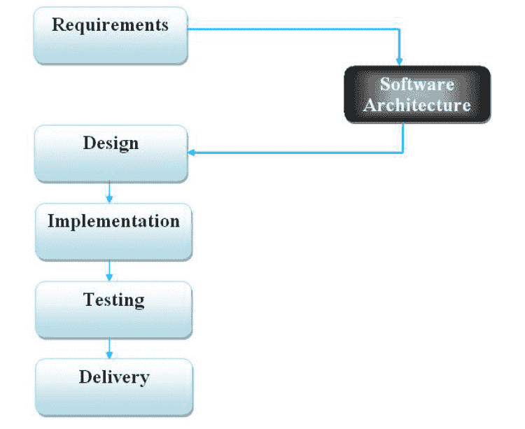

## 明确架构的优势

- **利益相关者沟通**
  - 架构可被用作系统利益相关者讨论的焦点。
- **系统分析**
  - 意味着可以分析系统是否能满足其非功能性需求。
- **大规模复用**
  - 架构可在一系列系统间复用


## 明确架构的优势

- **工具用于**
  - 理解
    - 系统
    - 理论限制
  - 规划
    - 资源
    - 人力
  - 沟通
    - 客户
    - 维护部门
  - 评估质量

## 影响因素

- 技术和组织因素
  - 目标领域的质量需求
  - 技术环境
- 业务因素
  - 整体业务目标
- 系统利益相关者
  - 管理层“低成本，保持人员就业”
  - 市场营销“精美功能，低成本，上市时间”
  - 终端用户“行为，性能，可靠”
  - 维护组织“可修改，可理解”
  - 客户“低成本，及时交付”
- 其他质量需求。

## 谁影响软件架构？

## 系统的利益相关者

开发组织的管理利益相关者

市场营销利益相关者

终端用户利益相关者

维护组织利益相关者

客户利益相关者

低成本，保持人员就业，利用现有企业资产！

精美功能，上市时间短，低成本，与竞争产品持平！

行为，性能，安全性，可靠性！

可修改性！

低成本，及时交付，很少更改！

架构师

哦……

## 架构很早

- 架构代表最早的设计决策集合
  - 最难更改
  - 最关键要做对
- 架构是系统质量属性得到解决的第一个设计产物

## 架构与设计的区别

- 架构
  - 非功能性决策被确定之处，以及功能需求被划分之处
- 设计
  - 功能需求得以实现之处

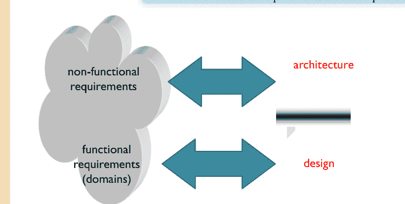

## 软件中的力量

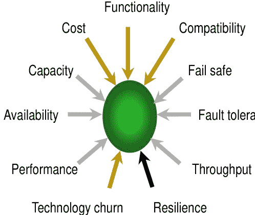

> 在未来 20 年里，挑战将不是速度或成本或性能；它将是一个复杂性的问题。
>
> — Bill Ruddell，首席战略官，Sun Microsystems

> 我们的敌人是复杂性，我们的目标是消灭它。
>
> — Jan Baan

## 架构设计的领域

## “是什么”

## “为什么”

## “谁”

## “怎么做”

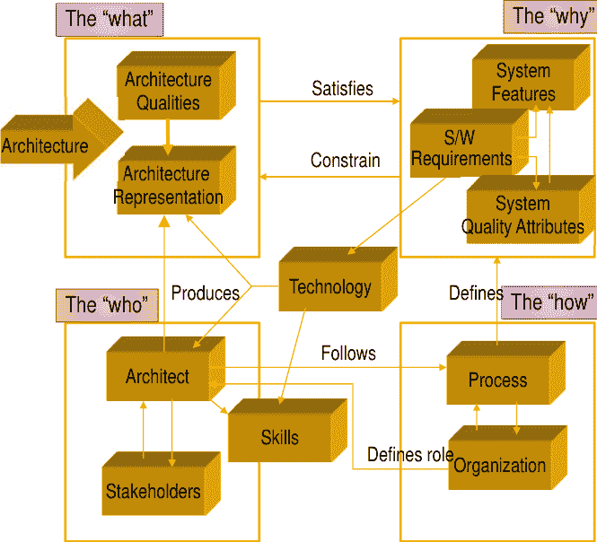

## 架构的需求

温彻斯特“神秘”大厦

- 38 年的建造 – 147 名建筑工人 0 名建筑师
- 160 个房间 – 40 间卧室，6 个厨房，2 个地下室，950 个门
- 65 个门通向空白墙，13 个楼梯被废弃，24 个天窗在地板上
- 不存在建筑蓝图


### 软件架构概述

lliao@seu.edu.cn

### 第Ⅰ章:概论

- （一）软件危机
- （二）软件架构的兴起和发展
- （三）软件重用
- （三）面向对象与重用
- （四）构件与重用

### 一、软件危机

- 第一次软件危机（1945 to 1968）
  - 危机表现
- 软件生产效率低下,软件成本高: 软件开发成本和进度的估计常常很不准确。
- 软件产品质量差: 用户对“已完成的”软件系统不满意的现象经常发生。
- 软件产品难以(不能)维护: 软件通常没有适当的文档资料

### 一、软件危机

- 第一次软件危机（1945 to 1968）
  - 危机根源
    - 人员知识结构单一
    - 手工作坊：code and fix
    - 理论体系不成熟软件开发：语言、工具、过程、方法、质量保证……
    - 软件开发管理不完善：规划、预算、可行性分析、风险预测与控制

### 一、软件危机

- 第二次软件危机（**1968 to 2001**）
  - 危机根源
    - 假设需求可以在开发前完全被理解
    - 与客户的交互仅发生在开始时（需求）和结束时（交付后）
    - 不幸的是该假设几乎从未成立

### 一、软件危机

- 第三次软件危机（2001年至今）
  - 危机表现
    - 变更/演化/重用（质量、效率、成本）
    - 知识产权问题、安全问题
  - 危机根源
    - 大量遗产系统的挖掘和重用
    - 大量开源软件/代码的使用
    - 普遍存在的动态/不确定需求

### 软件危机数据——项目拖延或取消的事例

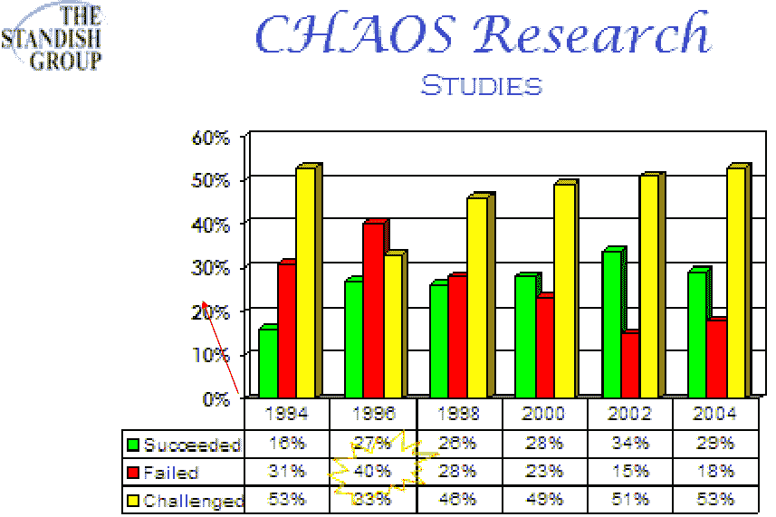

| 项目结果 | 1994 | 1996 | 1998 | 2000 | 2002 | 2004 |
|---|---:|---:|---:|---:|---:|---:|
| 成功（Succeeded） | 16% | 27% | 26% | 28% | 34% | 29% |
| 失败（Failed） | 31% | 40% | 28% | 23% | 15% | 18% |
| 受挑战（Challenged） | 53% | 33% | 46% | 49% | 51% | 53% |

### 软件危机数据

### MODERN RESOLUTION FOR ALL PROJECTS

| | 2011 | 2012 | 2013 | 2014 | 2015 |
|---|---|---|---|---|---|
| SUCCESSFUL | 29% | 27% | 31% | 28% | 29% |
| CHALLENGED | 49% | 56% | 50% | 55% | 52% |
| FAILED | 22% | 17% | 19% | 17% | 19% |

The Modern Resolution (OnTime, OnBudget, with a satisfactory result) of all software projects from FY2011-2015 within the new CHAOS database. Please note that for the rest of this report CHAOS Resolution will refer to the Modern Resolution definition not the Traditional Resolution definition.

现代解决方案（按时、按预算、取得令人满意的结果）是 FY2011-2015 年间新 CHAOS 数据库中所有软件项目的现代解决方案。请注意，在本报告的其余部分，CHAOS 解决方案将指现代解决方案定义，而非传统解决方案定义。

### CHAOS RESOLUTION BY PROJECT SIZE

|  | SUCCESSFUL | CHALLENGED | FAILED |
|---|---|---|---|
| Grand | 2% | 7% | 17% |
| Large | 6% | 17% | 24% |
| Medium | 9% | 26% | 31% |
| Moderate | 21% | 32% | 17% |
| Small | 62% | 16% | 11% |
| TOTAL | 100% | 100% | 100% |

The resolution of all software projects by size from FY2011-2015 within the new CHAOS database.

FY2011-2015 年间新 CHAOS 数据库中按规模划分的所有软件项目的解决方案。

### 二、软件架构的兴起和发展

- 1. 背景分析
- 2. 软件架构定义 - 百家之言
- 3. 软件架构的意义
- 4. 软件架构发展史

### 二、软件架构的兴起和发展

- I.背景分析
  - 小规模软件开发：算法 + 数据结构 is enough!
  - 大规模软件开发：总体的系统设计和规格说明 must be more important!
    ⇒软件架构（Software architecture）

### 二、软件架构的兴起和发展

#### ❀ 2.软件架构定义 – 百家之言

（1）Dewayne Perry和Alex Wolf的定义（1992）

软件架构是具有某种特定形式的结构化元素（即构件）的集合，包括处理构件、数据构件和连接构件。处理构件负责对数据进行加工，数据构件是被加工的信息，连接构件把架构的不同部分组合连接起来。

> (A set of architectural (or, if you will, design) elements that have a particular form. Perry and Wolf distinguish between processing elements, data elements, and connecting elements.)

> （一组具有特定形式的结构化元素（或，如果你愿意，设计元素）。Perry 和 Wolf 将其区分为处理元素、数据元素和连接元素。）

### 二、软件架构的兴起和发展

2. 软件架构定义 - 百家之言

（2）Mary Shaw 和 David Garlan 的定义（1993）

软件架构是软件设计过程中的一个层次，这一层次超越计算过程中的算法设计和数据结构设计。架构问题包括总体组织和全局控制、通信协议、同步、数据存取，给设计元素分配特定功能，设计元素的组织、规模和性能，在各设计方案间进行选择等。软件架构处理算法与数据结构关于整体系统结构设计和描述方面的一些问题，如全局组织和全局控制结构，关于通信、同步与数据存取的协议，设计构件功能定义，物理分布与合成，设计方案的选择、评估与实现等。

### 二、软件架构的兴起和发展

- 2. 软件架构定义 - 百家之言

（3）Hayes Roth的定义（1994）

软件架构是一个抽象的系统规约，主要包括用其行为来描述的功能构件和构件之间的相互连接、接口和关系。

> （...an abstract system specification consisting primarily of functional components described in terms of their behaviors and interfaces and component-component interconnections.）

> （...主要由以其行为和接口描述的功能构件以及构件与构件之间的互连构成的抽象系统规范。）

### 二、软件架构的兴起和发展

- 2. 软件架构定义 - 百家之言

（4）Booch, Rumbaugh, and Jacobson (1999)

> An architecture is the set of **significant decisions** about the organization of a software system, **the selection** of the structural elements and their interfaces by which the system is composed, **together with their behavior** as specified in the collaborations among those elements, **the composition** of these structural and behavioral elements into progressively larger subsystems, and the architectural style that guides this organization---these elements and their interfaces, their collaborations, and their composition (The UML Modeling Language User Guide, Addison-Wesley, 1999).

> 一个架构是关于软件系统组织的**重要决策**的集合，**选择**构成系统的结构元素及其接口，**连同其行为**，如这些元素之间协作中所指定的，**这些结构和行为元素的组合**形成越来越大的子系统，以及指导此组织的架构风格——这些元素及其接口、它们的协作以及它们的组合（《UML 建模语言用户指南》，Addison-Wesley，1999）。


### 二、软件架构的兴起和发展

#### 2. 软件架构定义——百家之言

（5）Bass, Clements, Kazman（from “Software Architecture in Practice”, second edition, 2003）

程序或计算系统的软件架构是系统的结构或结构集合，其包含 **软件元素**、这些元素的 **外部可见属性** 以及它们之间的 **关系**。

“Externally visible” 属性指的是其他元素可以对一个元素做出的假设，例如其提供的服务、性能特征、故障处理、共享资源使用等。

（6）综上所述，可以认为软件架构由3种基本元素组成，它们是：

- 构件（component）
- 连接件（connector）
- 配置（configuration）/规约

**构件（component）**

构件是计算或数据存储的单位，大致对应于常规编程语言的编译单元和其他用户级对象。它可以是简单型或复合型，例如一个系统就可以看成是复合型构件。构件作为一个封装的实体，只能通过其接口与外部交互，构件的接口由一组端口组成，每个端口表示了构件与外部的交互点。

**连接件（connector）**

连接件是构件之间的交互及控制这些交互的规则。它们有时是简单交互，如过程调用、共享变量访问；有的则是复杂的和语义丰富的交互，如 C/S 协议等。连接件通常不能与编译单元一一对应。它们的表现形式可以是表项、缓冲区、动态数据结构、调用、初始化参数等。

**配置（configuration）**

也可以看作是“约束/拓扑结构”。软件架构的拓扑结构反映了该结构的基本准则。

#### 3. 软件架构的意义

- （1）架构是风险承担者进行交流的手段

  ——SA 代表了系统的公共的高层次的抽象。

- （2）架构是早期设计决策的体现

  - a. 软件架构明确了对系统实现的约束条件——架构设计者不必是算法设计者或编程语言专家，只需重点考虑系统的总体权衡问题，而构件的开发人员在架构给定的约束下进行开发。
  - b. 软件架构决定了开发和维护组织的组织结构——SA 决定组织结构。
  - c. 软件架构制约着系统的质量属性——好的 SA 是必要条件。
  - d. 通过研究软件架构可能预测软件的质量——评价 SA 预测质量。
  - e. 软件架构使推理和控制更改更简单——SA 需易更改。
  - f. 软件架构有助于循序渐进的原型设计——按可执行模型来构造原型。
  - g. 软件架构可以作为培训的基础。

#### 4. 软件架构发展史

20世纪90年代以后：基于构件的软件开发阶段——以过程为核心，强调软件开发采用构件化技术和架构技术，要求开发出的软件具备很强的自适应性、互操作性、可扩展性和可重用性等。

软件架构发展的四个阶段：

- （1）“无架构”设计阶段：以汇编语言进行小规模应用程序开发为特征。
- （2）萌芽阶段：出现了程序结构设计主题，以控制流图和数据流图构成软件结构为特征。
- （3）初期阶段：出现了从不同侧面描述系统的结构模型，以 UML 为典型代表。
- （4）高级阶段：以描述系统的高层抽象为中心，不关心具体的建模细节，划分了架构模型与传统软件结构的界限，该阶段以 Kruchten 提出的“4+1”模型为标志。由于概念尚不统一，描述规范也不能达成一致认识，在软件开发实践中软件架构尚不能发挥重要作用。

### 三、软件重用

新的需求：“faster, better, and cheaper”

- 1) **Faster**: 软件必须满足市场窗口。竞争对手组织设定了该时间。
- 2) **Better**: 软件必须满足其所支持的流程的需求，并且在为其流程服务时，必须很少出现故障。
- 3) **Cheaper**: 软件的生产和维护成本必须更低。

**实现这些目标的两种途径：**

- 1) 提高生产软件的组织的效率。例如软件工程。
- 2) 软件重用（软件重用）——from “Software Reuse”，Ivar Jacobson et al.

#### 定义

软件重用是将已有的软件及其有效成分用于构造新的软件或系统。它不仅是对软件程序的重用，还包括对软件生产过程中其它劳动成果的重用，如项目计划书、可行性报告、需求分析、概要设计、详细设计、编码（源程序）、测试用例、文档与使用手册等等。因此，软件重用包括软件产品重用和软件过程重用两部分的内容。

#### 重用和移植

软件移植是指对软件进行修改和扩充，使之在保留原有功能、适应原有平台的基础上，可以运行于新的软硬件平台。而重用则指在多个系统中，尤其是在新系统中使用已有的软件成分。

#### 白盒重用与黑盒重用

黑盒重用指对已有产品或构件不需作任何修改，直接进行重用，这是理想的重用方式。它主要基于二进制代码的重用，包括可执行程序的重用和基于库（包括动态链接库和静态库）的重用。

白盒重用指根据用户需求对已有产品进行适应性修改后才可使用。白盒重用一般为源代码一级的重用，以及相应的测试用例、文档等的重用。

#### 软件重用的三个基本原则

- a. 必须有可以重用的对象。
- b. 所重用的对象必须是有用的。
- c. 重用者需要知道如何去使用被重用的对象。

### 四、面向对象技术与重用

支持软件重用是人们对面向对象方法寄托的主要希望之一，也是这种方法受到广泛重视的主要原因之一。

#### 1. 面向对象对重用的支持

与其它软件工程方法相比，面向对象方法的一个重要优点是，它可以在整个软件生命周期达到概念、原则、术语及表示法的高度一致。这种一致性使得各个系统成分尽管在不同的开发与演化阶段有不同的形态，但可具有贯穿整个软件生命周期的良好映射。

**（1）OOA 模型**

OOA 方法建立的系统模型分为基本模型（如类图）和补充模型（如交互图），强调在 OOA 基本模型中只表示最重要的系统建模信息，较为细节的信息则在详细说明中给出。这种表示策略使 OOA 基本模型体现了更高的抽象，更容易成为一个可重用的系统架构。当这个架构在不同的应用系统中重用时，在很多情况下可通过不同的详细说明体现系统之间的差异，因此对系统构件的改动较少。

#### 2. 重用对面向对象的支持


### 四、面向对象技术与重用

+   • 1. 面向对象对重用的支持

### （2）OOA与OOD分工

OOA只注重与问题域及系统责任有关的信息，OOD考虑与实现条件有关的因素。这种分工使OOA模型独立于具体的实现条件，从而使分析结果可以在问题域及系统责任相同而实现条件互异的多个系统中重用，并为从同一领域的多个系统的分析模型提炼领域模型创造了有利条件。

### （3）对象的表示

所有的对象都用类作为其抽象描述。对象的一般信息，包括对象的属性、行为及其对外关系等等都是通过对象类来表示的。类作为一种可重用构件，在运用于不同系统时，不会出现因该类对象实例不同而使系统模型有所不同的情况。

### （4）一般—特殊结构

引入一般-特殊结构中多态性的表示法，从而增强了类的可重用性。通过对多态性的表示，使一个类可以在需求相重叠而未必完全相同的系统中被重用。

### （5）整体—部分结构

把部分类作为可重用构件在整个类中使用，这种策略的原理与在特殊类中使用一般类是一致的，但在某些情况下，对问题域的映射比通过继承实现重用显得更为自然。另外还可通过整体—部分结构支持领域重用的策略---从整体对象中分离出一组可在领域范围内重用的属性与服务，定义为部分对象，使之成为领域重用构件。

### （6）实例连接

建议用简单的二元关系表示各种复杂关系和多元关系。这一策略使构成系统的基本成分（对象类）以及它们之间的关系在表示形式和实现技术上都是规范和一致的，这种规范性和一致性对于可重用构件的组织、管理和使用，都是很有益的。

### （7）类描述模板

作为OOA详细说明主要成分的类描述模板，对于对象之间关系的描述注意到使用者与被使用者的区别，仅在使用者一端给出类之间关系的描述信息。这说明可重用构件之间的依赖关系不是对等的。因此，在继承、聚合、实例连接及消息连接等关系的使用者一端描述这些关系，有利于这些关系信息和由它们指出的被依赖成份的同时重用。在被使用者一端不描述这些关系，则避免了因重用场合的不同所引起的修改。

### （8）USE CASE

由于USE CASE是对用户需求的一种规范化描述，因此它比普通形式的需求文档具有更强的可重用性。每个use case是对一个活动者使用系统的一项功能时的交互活动所进行描述，它具有完整性和一定的独立性，因此很适于作为可重用构件。

### • 2.软件重用支持面向对象方法

### （1）类库

在面向对象的软件开发中，类库是实现对象类重用的基本条件。人们已经开发了许多基于各种OOPL的编程类库，有力地支持了源程序级的软件重用，但要在更高的级别上实现软件重用，仅有编程类库是不够的。实现OOA结果和OOD结果的重用，必须有分析类库和设计类库的支持。为了更好地支持多个级别的软件重用，可以在OOA类库、OOD类库和OOP类库之间建立各个类在不同开发阶段的对应与演化关系。即建立一种线索，表明每个OOA的类对应着哪个（或哪些）OOD类，以及每个OOD类对应着各种OO编程语言类库中的哪个OOP类。

### （2）构件库

类库可以看作一种特殊的可重用构件库，它为在面向对象的软件开发中实现软件重用提供了一种基本的支持。但类库只能存储和管理以类为单位的可重用构件，不能保存其它形式的构件；但是它可以更多地保持类构件之间的结构与连接关系。构件库中的可重用构件，既可以是类，也可以是其它系统单位；其组织方式，可以不考虑对象类特有的各种关系，只按一般的构件描述、分类及检索方法进行组织。在面向对象的软件开发中，可以提炼比对象类粒度更大的可重用构件，例如把某些结构或某些主题作为可重用构件；也可以提炼其它形式的构件，例如use case或交互图。这些构件库中，构件的形式及内容比类库更丰富，可为面向对象的软件开发提供更强的支持。

### （5）OOA过程

在重用技术支持下的OOA过程中，可以按两种策略进行组织：第一种策略是，基本保持某种OOA方法所建议的OOA过程原则，在此基础上对其中的各个活动引入重用技术的支持；另一种策略是重新组织OOA过程。

第一种策略是在原有的OOA过程基础上增加重用技术的支持，应补充说明的一点是，重用技术支持下的OOA过程应增加一个提交新构件的活动。即在一个具体应用系统的开发中，如果定义了一些有希望被其它系统重用的构件，则应该把它提交到可重用构件库中。

第二种策略的前提是：在对一个系统进行面向对象的分析之前，已经用面向对象方法对该系统所属的领域进行过领域分析，得到了一个用面向对象方法表示的领域架构和一批类构件，并且具有构件/架构库、类库及相应工具的支持。在这种条件下，重新考虑OOA过程中各个活动的内容及活动之间的关系，力求以组装的方式产生OOA模型，将使OOA过程更为合理，并达到更高的开发效率。

### 五、构件与重用

+   - 1. 什么是软件构件
+   - 2. 构件模型及实现
+   - 3. 构件获取
+   - 4. 构件管理
+   - 5. 构件重用
+   - 6. 软件重用的层次

### 五、构件与重用

+   • 1、什么是软件构件

#### 1）对象与构件

构件的特征: (1) A component is a unit of independent deployment. 一个构件是独立部署的单元。 (2) A component is a unit of third-party composition. 一个构件是第三方组合的单元。 (3)A component has no persistent state. 一个构件没有持久状态。

对象的特征: (1) An object is a unit of instantiation; it has a unique identity. 一个对象是实例化的单元；它具有唯一的标识。 (2) An object has state; this state can be a persistent state. 一个对象具有状态；该状态可以是持久状态。 (3) An object encapsulates its state and behavior. 一个对象封装其状态和行为。

#### 2) 软件构件定义

A software Component is a unit of composition with contractually specified interfaces and explicit context dependencies only. 软件构件是具有合同指定接口且仅有显式上下文依赖的组合单元。 A software component can be deployed independently and is subject to composition by third parties. 软件构件可以独立部署，并可由第三方进行组合。

b. Explicit context dependencies (清晰的上下文依赖):

Besides the specification of provided interfaces, the above definition of components also requires components to specify their needs. 除了提供接口的规范外，上述构件的定义还要求构件指定其需求。 In other words, the definitions requires specification of what the deployment environment will need to provide, such that the component can function. 换句话说，定义要求说明部署环境需要提供什么，以便构件能够运行。 **These needs are called context dependencies**, referring to the context of composition and deployment. **这些需求称为上下文依赖**，指的是组合和部署的上下文。

#### 3）面向对象与构件

+   a. 面向对象技术已达到了类级重用（代码重用），它以类为封装的单位。这样的重用粒度太小，不足以解决异构互操作和效率更高的重用。

+   b. 构件将抽象的程度提高到一个更高的层次，它是对一组类的组合进行封装，并代表完成一个或多个功能的具体服务，也为用户提供了多个接口。

+   c. 整个构件隐藏了具体的实现，只用接口对外提供服务。

### 五、构件与重用

+   - 2.构件模型与实现

构件模型（Component Model）是对构件本质特征的抽象描述。

目前国际上流行的构件模型：

+   a. 参考模型，如3C模型；
+   b. 描述模型，如RESOLVE模型和REBOOT模型；
+   c. 实现模型，如CORBA，EJB，DCOM。


### 构件模型与实现...

基于构件的软件开发通常包括构件获取、构件分类和检索、构件评估、适应性修改以及将现有构件在新的语境下组装成新的系统。

### 五、构件与重用

3. 构件获取

- a. 从现有构件中获得符合要求的构件，直接使用或做适应性（flexibility）修改，得到可重用的构件。
- b. 通过遗产工程（legacy engineering），将具有潜在重用价值的构件提取出来，得到可重用的构件。
- c. 从市场上购买现成的商业Components，即COTS（Commercial Off-The-Shelf）构件。
- d. 开发新的符合要求的构件

### 五、构件与重用

#### 4.构件管理

- a. 构件描述：包括实现方式、实现体、注释、生产者、生产日期、大小、价格、版本和关联构件等信息，它们与构件模型一起组成了对构件的完整描述。

- b. 构件分类与组织：为了给使用者在查询构件时提供方便，同时也为了更好地重用构件，我们必须对收集和开发的构件进行分类并置于构件库的适当位置。

### 构件管理…

三类构件分类方法：

- （1）关键字分类法（keyword classification）

基本思想：根据领域分析的结果将应用领域的概念按照从抽象到具体的循序逐次分解为树状或有向无回路图结构。每个概念用一个描述性的关键字表示。

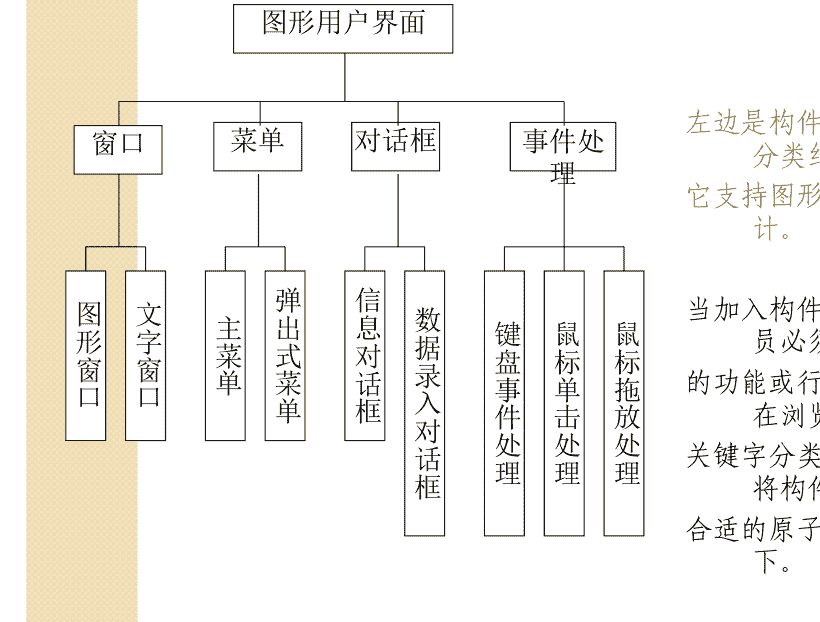

左边是构件库的关键字分类结构示例，它支持图形用户界面设计。

当加入构件时，库管理员必须对构件的功能或行为进行分析，在浏览上述关键字分类结构的同时将构件置于最合适的原子级关键字之下。

### 五、构件与重用

#### 4.构件管理
（2）刻面分类法(faceted classification)；
在刻面分类机制中，定义若干用于刻画构件特征的“刻面(facet)”，每个刻面包含若干概念，这些概念表述构件在刻面上的特征。刻面可以描述构件执行的功能、被操作的数据、构件应用的语境或其他特征。描述构件的刻面的集合称为刻面描述符（facet descriptor）。当描述符中出现空的特征值时，表示该构件没有相应的刻面。

### 五、构件与重用

4.构件管理

例如，考虑使用下列构件描述符的模式：

```
function, object type, system type}
```

刻面描述符中每个刻面含有一个或多个值，这些值一般是描述性关键词。例如，如果功能是某构件的刻面，赋给此刻面的典型值可能是：

```
function=(copy from) or (copy, replace, all)
```

青鸟构件刻面：使用环境，应用领域，功能，层次，表示方法等。

### 五、构件与重用

#### 4.构件管理

（3）超文本组织法（hypertext classification）。

**主要思想：** 所有构件必须辅以详尽的功能（function）或性能（performance）说明文档；说明中出现的重要概念或构件以网状链接方式相互连接；检查者在阅读文档的过程中可按照人类的联想思维方式任意跳转到包含相关概念或构件的文档；全文检索系统将用户给出的关键字与说明文档中进行匹配，实现构件的浏览检索。Windows环境下的联机帮助系统就是一种典型的超文本系统。

### 五、构件与重用

4.构件管理

**商业化构件分类：**

- （1）用户界面类、数据库类
- （2）商务应用类
- （3）工具类、网络通讯类
- （4）核心技术类

**从构件的外部形态分类：**

- （1）独立而成熟的构件
- （2）有限制的构件
- （3）适应性构件
- （4）装配的构件
- （5）可修改的构件

### 五、构件与重用

#### 5.构件重用

构件开发的目的是重用，为了让构件在新的软件项目中发挥作用，构件库的使用者必须完成以下工作：检索与提取构件、理解与评价构件、修改构件，最后将构件组装到新的软件产品中。

- - 检索与提取构件
  - （1）基于关键字的检索
  - （2）刻面检索法
  - （3）超文本检索法
  - （4）其他检索法

### 五、构件与重用

5.构件重用

- - **理解与评价构件**

  （1）设计信息对于理解构件的必要性和构件用户逆向发掘设计信息的困难性，必须要求构件的开发过程遵循公共软件工程规范，并且在构件库的文档中全面、准确地说明以下内容：构件的功能与性能；相关的领域知识；可适应性约束条件与例外情形；可预见的修改部分及修改方法。

  （2）对构件重用的评价，是通过收集并分析构件的用户在实际重用该构件的历史过程中的各种反馈信息来完成的。这些信息包括：重用成功的次数、对构件的修改、构件的健壮性度量、性能度量等。

### 五、构件与重用

#### 5.构件重用

- - **修改构件**

  修改构件是指对构件进行或多或少的修改，以适应新的需求。

- - **构件组装**

  构件组装是指将库中构件经过适当修改后相互连接，或者将它们与当前开发项目中的软件元素相连接，最终构成新的目标软件。

### 五、构件与重用

5.构件重用

- （1）基于功能的组装技术

基于功能的组装技术采用子程序调用和参数传递的方式将构件组装起来。它要求库中构件以子程序/过程/函数的形式出现，并且接口说明必须清晰。当使用这种组装技术进行软件开发时，开发人员首先应对目标软件系统进行功能分解，将系统分解为强内聚、松耦合的功能模块。然后根据各模块的功能需求提取构件，对它进行适应性修改后再挂接在上述功能分解框架中。

### 五、构件与重用

#### 5.构件重用

（2）基于数据的组装技术

基于数据的组装技术首先根据当前软件问题的核心数据结构设计出一个框架，然后根据框架中各节点的需求提取构件并进行适应性修改，再将构件逐个分配到框架中的适当位置。此后，构件的组装方式仍然是传统的子程序调用与参数传递。这种组装技术也要求库中构件以子程序形式出现，但它所依赖的软件设计方法不再是功能分解，而是面向数据的设计方法，例如 Jackson 系统开发方法。

### 五、构件与重用

5.构件重用

#### （3）面向对象的组装技术

由于封装和继承特性，面向对象方法比其他软件开发方法更适合支持软件重用。在OO软件开发方法中，如果从类库中检索出来的基类能够完全满足新软件项目的需求，则可以直接应用。否则，必须以类库中的基类为父类采用构造法或子类法生成子类。

```
```cpp
class Person{
public:
    Person(char *name, int age);
    ~Person();
protected:
    char *name;
    int age;
};
```
```

### 构造重用…

```
```cpp
Person::Person(char *name, int age)
{
    Person::name=new char[strlen(name)+1];
    strcpy(Person::name, name);
    Person::age=age;
    cout<<"Construct Person"<<name<<", "<<age<<"\n";
    return;
}

Person::~Person()
{
    cout<<"Destruct Person"<<name<<", "<<age<<"\n";
    delete name;
    return;
}
```
```

### 构件重用…

a. 构造法：为了在子类中使用库中基类的属性和方法，可以考虑在子类中引进基类的对象作为子类的成员变量，然后在子类中通过成员变量重用基类的属性与方法。

b. 子类法：与构造法完全不同，子类法将子类直接说明为库中基类的子类，通过继承和修改基类的属性与行为完成新子类的定义。

```
```cpp
//下面采用构造法生成 Teacher 类
class Teacher{
public:
    Teacher(char *name, int age, char *teaching);
    ~Teacher();
protected:
    Person *Person;
    char *course;
};

//Teacher 类的实现
Teacher::Teacher(char *name, int age, char *teaching)
{
    //重用基类的方法 Person()
    Person=new Person(name, age);
    strcpy(course, teaching);
    return;
}
Teacher::~Teacher()
{
    delete Person;
}
```


### 五、构件与重用

#### 6. 构件重用的层次

- **代码重用**

  包括目标代码和源代码的重用。其中目标代码的重用级别最低，历史也最久，当前大部分编程语言的运行支持系统都提供了连接（Link）、绑定（Binding）等功能来支持这种重用。源代码的重用级别略高于目标代码的重用，程序员在编程时把一些想重用的代码段复制到自己的程序中，但这样往往会产生一些新旧代码不匹配的错误。想大规模的实现源程序的重用只有依靠含有大量可重用构件的构件库。如“对象链接及嵌入”（OLE）技术，既支持在源程序级定义构件并用以构造新的系统，又使这些构件在目标代码的级别上仍然是一些独立的可重用构件，能够在运行时被灵活地组合为各种不同的应用。

- **设计重用**

  设计结果比源程序的抽象级别更高，因此它的重用受实现环境的影响较少，从而使可重用构件被重用的机会更多，并且所需的修改更少。这种重用有三种途径：（1）从现有系统的设计结果中提取一些可重用的设计构件，并把这些构件应用于新系统的设计；（2）把一个现有系统的全部设计文档在新的软硬件平台上重新实现，也就是把一个设计运用于多个具体的实现；（3）独立于任何具体的应用，有计划地开发一些可重用的设计构件。

### 软件体系结构建模方法

lliao@seu.edu.cn

### 目 录

- 软件体系结构概论
- 软件体系结构建模方法
- 软件体系结构风格
- 基于体系结构的软件开发
- 基于体系结构的评估

### 一、软件体系结构建模概述

#### I. 软件模型

- SA的首要问题是如何表示SA，即如何对SA建模。
- **模型：**一般是指对客观世界中存在事物的一种抽象。一般都需要通过某种形式表达出来。
  - 如：数学模型，自然语言或图形语言表达的模型。
- **软件模型：**是软件的一种抽象，目前一般通过非数学模型来描述。
- 根据建模的侧重点不同，可以将SA模型分为五种：
  - 结构模型
  - 框架模型
  - 动态模型
  - 过程模型
  - 功能模型

（1）结构模型：用组件、连接件和其他概念来刻画结构，力图通过结构来反映系统的重要语义内容，包括系统的配置、约束、隐含的假设条件、风格、性质等。研究结构模型的核心就是ADL。

（2）框架模型：与结构模型类似，但它侧重于整体的结构。它主要以一些特殊问题为目标建立只针对和适应该问题的结构。如应用广泛的MVC（模型-视图-控制器）框架模型解决了用户界面与业务实现相分离的问题。

（3）动态模型：是对结构模型和框架模型的补充，研究系统的“大颗粒”的行为性质。例如，描述系统的重新配置和演化。动态可以指系统总体结构的配置、建立或撤除通信通道或计算的过程。

#### DARWIN 示例

```
component DataStore{
    provide landerValues;
}

component Calculation{
    require landerValues;
    provide calculationService;
}

component UserInterface{
    require calculationService;
    require landerValues;
}

component LunarLander{
inst
    U: UserInterface;
    C: Calculation;
    D: DataStore;
bind
    C.landerValues -- D.landerValues;
    U.landerValues -- D.landerValues;
    U.calculationService -- C.calculationService;
}
```

规范文本可视化

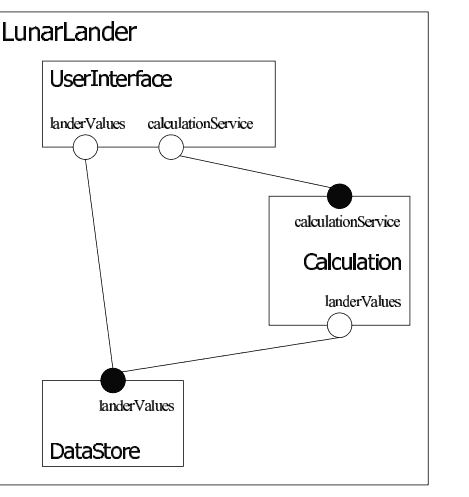

图形可视化

（4）过程模型：研究构造系统的步骤和过程，因而结构是遵循某些过程脚本的结果。

（5）功能模型：该模型认为SA是由一组功能组件按层次组成，下层向上层提供服务。

这5种模型各有所长，将5种模型有机地统一在一起，形成一个完整的模型来刻画软件体系结构更合适。

### 二、“4+1”视图模型

- Philippe Kruchten (Rational Software Corp.)于1995年在他的论文 “Architectural Blueprints—The “4+1” View Model of Software Architecture”提出了软件体系结构的“4 + 1”视图模型。
- 该模型使用以体系结构为中心、场景驱动、迭代的开发方法来设计。
- “4+1” 视图模型从5个不同视角来描述软件体系结构，每个视图只关心系统的一个侧面，5个视图结合在一起才能反映系统的软件体系结构全部内容。

**“4+1”视图模型**

| 视图 | 关注者/关注点 |
| --- | --- |
| 逻辑视图 | 最终用户：功能需求 |
| 开发视图 | 编程人员：模块管理 |
| 场景 |  |
| 进程视图 | 系统集成人员：性能、可扩展性、吞吐量等 |
| 物理视图 | 系统工程师：系统拓扑、安装、通信等 |

- **逻辑视图**，它是设计的对象模型（当使用面向对象设计方法时），
- **进程视图**，它捕获了设计的并发和同步方面，
- **物理视图**，它描述了软件到硬件的映射，并反映了其分布式方面，
- **开发视图**，它描述了软件在其开发环境中的静态组织。

#### 逻辑视图

- 逻辑视图主要支持系统功能需求，即系统提供最终用户的服务。
- 在逻辑视图中，系统分解成一系列的功能抽象，这些抽象主要来自问题领域。
- 在面向对象技术中，通过抽象、封装和继承，可以用对象模型来代表逻辑视图，用类图来描述逻辑视图。
- （1）逻辑视图的标记方法——Booch标记法

  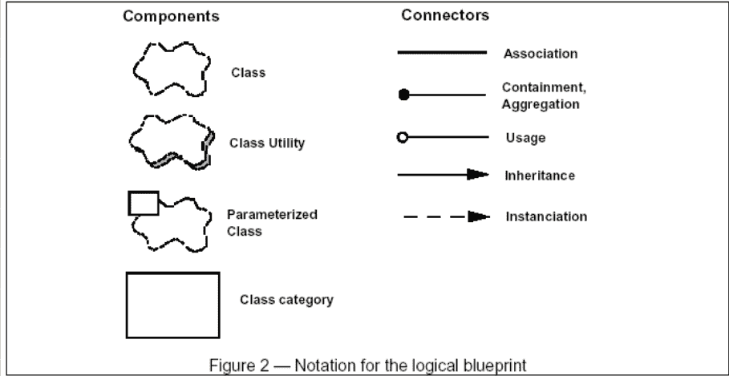

  图2 — 逻辑蓝图的标记法

#### 某通信系统ACS体系结构

- 会话对象代表一组参与会话的终端
- 会话对象使用转换服务
- 转换服务对象代表将逻辑地址转换到物理地址的服务等
- 终端
- 连接服务
- 线路控制器
- 编号计划服务

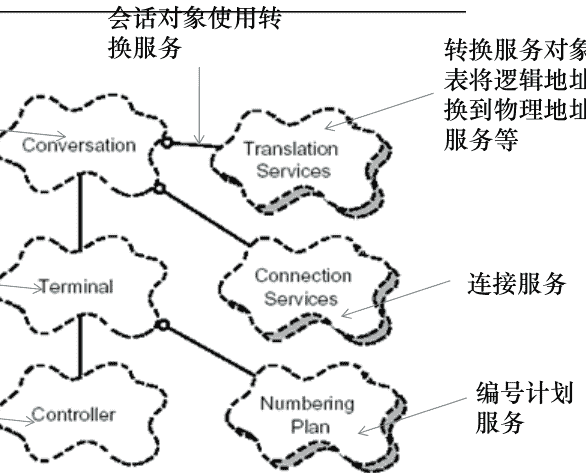

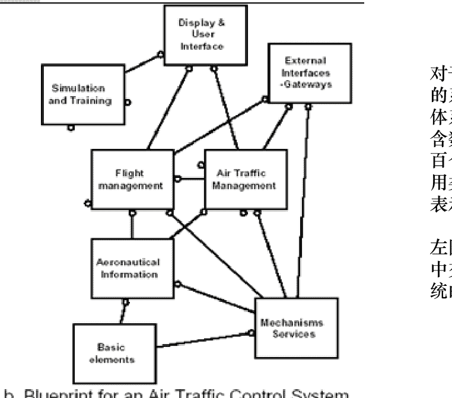

对于规模更大的系统来说，体系结构中包含数十甚至数百个类，可以用类层次图来表示。

左图描述了空中交通管理系统的顶层类图。

（b）空中交通控制系统的蓝图

#### 开发视图

- 开发视图（development view）也称为模块视图（module view），关注软件开发环境下实际模块的组织。
- 软件可以打包成小的程序块（程序库或子系统），可以由一位或几位开发人员来开发。
- 系统的开发视图可以用模块和子系统图来表达。
- 开发视图主要侧重于软件模块的组织和管理。
- 开发视图的表示：

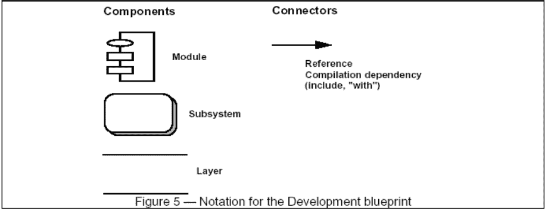


#### 开发视图...

- 开发视图的风格
  - 使用层次式风格，定义4或6层子系统。
  - 每层均有良好的职责、设计规则，即某层子系统依靠同层次的或更低层次的子系统，从而减少了具有复杂模块依赖关系的网路开发量，得到层次式的简单发布策略。
  - 各个层次，层次越低，通用性越强。以保证需求变更时，所做的改动最小。

#### 开发视图。。。

#### 空中交通管理（ATC）系统的分层开发视图

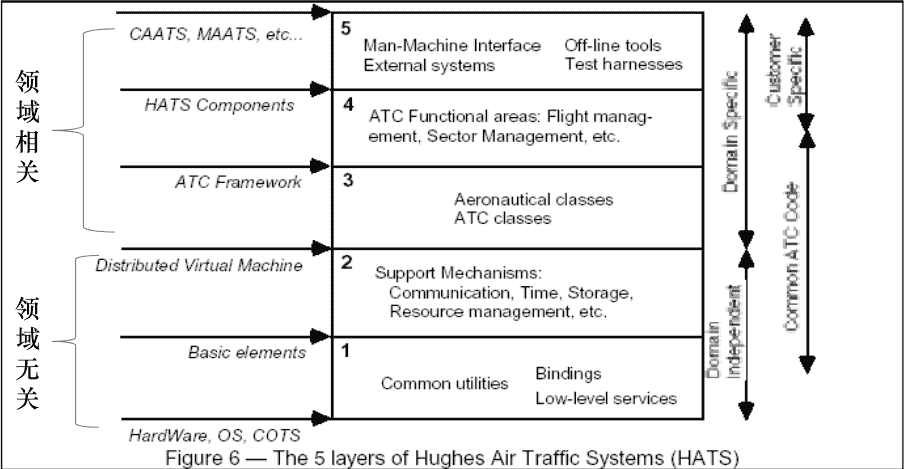

#### 开发视图...

- 开发结构示例

图-6是图-3（b）（ P18 ）的开发视图。第1层和第2层组成了一个领域无关的分布式基础设施，贯穿于整个产品线中，并且与硬件平台、操作系统或数据库管理系统等无关。第3层增加了空中交通管制系统的框架，以形成一个领域特定的软件体系结构。第4层使用该框架建立一个功能平台，第5层则依赖于具体客户和产品，包含了大部分用户接口以及与外部系统的接口。

#### 进程视图

- 进程视图（process view）也称为并发视图，侧重于系统的运行特性，主要关注一些非功能性的需求，例如系统的性能和可用性。
- 进程视图强调并发性、分布性、系统集成性和容错能力，以及从逻辑视图中的主要抽象如何适合进程结构—即在哪个控制流程上，对象的操作被真正地执行。

#### 进程视图…

#### 通信系统ACS的局部进程视图

进程蓝图示例

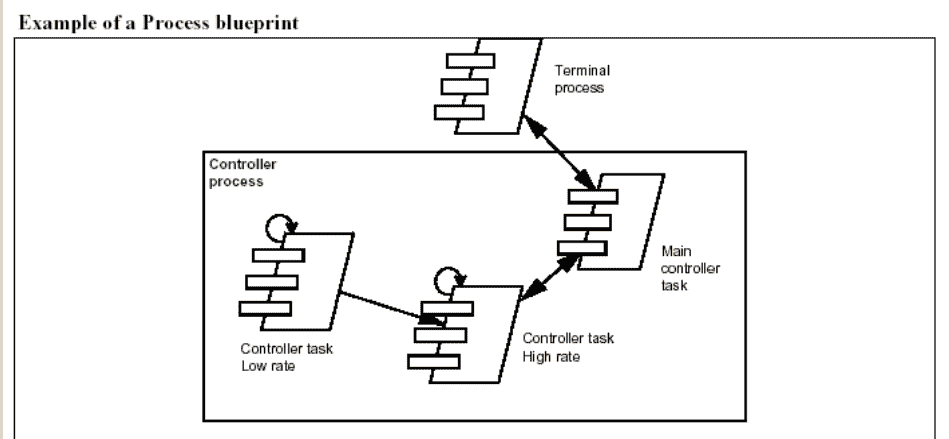

终端进程

控制器进程

主控制器任务

低速率控制器任务

高速率控制器任务

图5——Télic PABX的进程蓝图（部分）

#### 进程视图

- （2）进程视图可以描述成多层抽象，每个级别分别关注不同的方面
- （3）多种风格适用于进程视图，如：
  - 管道-过滤器、客户端-服务器（多客户端/单服务器，单客户端/多服务器）。

#### 物理视图

- 物理视图（physical view）主要考虑如何把软件映射到硬件上；
- 它通常要考虑到系统性能、规模、可靠性等；解决系统拓扑结构、系统安装、通信等问题。

#### 物理视图

- 软件在计算机网络或处理节点上运行，被识别的各种元素（网络、过程、任务和对象），需要被映射至不同的节点；
- 我们希望使用不同的物理配置：
  - 一些用于开发和测试，另外一些则用于不同地点和不同客户的部署
- 因此软件至节点的映射需要高度的灵活性及对源代码产生最小的影响。

#### 物理视图

- 物理视图的标记法

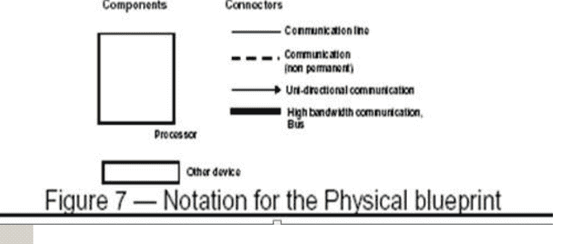

#### 物理视图

- 物理视图示例

图-8显示了大型ACS的可能硬件配置

C,F,K是三个不同容量的计算机类型，支持三个不同的可执行文件

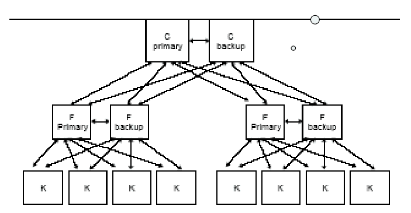

图8——PABX的物理蓝图

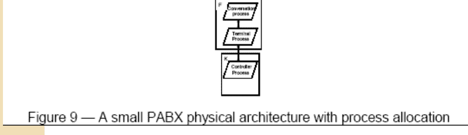

图9——带有进程分配的小型PABX物理架构

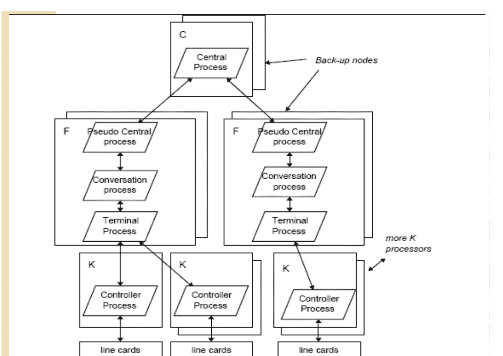

图10——显示进程分配的较大PABX物理蓝图

#### 场景

- 场景（scenarios）可以看做那些重要系统活动的抽象，它使4个视图有机联系起来。
- 四种视图的元素通过少量的重要场景（如更具普遍性的use case）来无缝地协同工作。
- 它可以帮助架构师找到体系结构的构件和它们之间的作用关系。
- 从某种意义上讲，场景是最重要的需求抽象。

#### 场景

- 场景是其它视图的冗余（因而“+1”），但它有两点作用：
  - （1）在SA设计过程中，作为一个驱动来发现SA元素；
  - （2）在SA设计结束时，从书面上作为对SA原型测试的起点。

#### 场景

- 场景的设计用对象场景图和对象交互图来表示。
- 场景蓝图的标记法
  - 对组件而言，标记法同逻辑视图类似，但使用进程视图的连接符号来表达对象之间的交互。

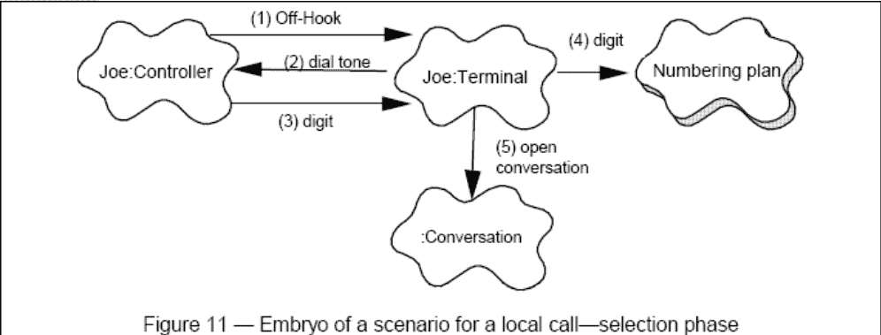

图 11——本地呼叫选择阶段场景的雏形

- 1. Joe的电话控制器检测和校验摘机状态的变换，并发送消息唤醒相应的终端对象。
- 2. 终端分配一些资源，并要求控制器发出拨号音。
- 3. 控制器接受拨号并传递给终端。
- 4. 终端使用拨号方案来分析数字流。
- 5. 有效的数字序列被键入，终端开始会话。

### 二、“4+1”视图模型

- （4）并不是所有的软件架构都需要“4+1”视图。无用的视图可以从架构描述中省略。
  - 比如：只有一个处理器，则可以省略物理视图；而如果仅有一个进程或程序，则可以省略过程视图。对于非常小型的系统，甚至可能逻辑视图与开发视图非常相似，而不需要分开的描述。
  - 但一般情况下，场景对于所有的情况均适用。

### 三、软件体系结构的核心模型

- SA核心模型由五种元素构成
  - 组件（component），
  - 连接件（connector），
  - 配置（configuration），
  - 端口（port）
  - 角色（role）。

### 三、软件体系结构核心模型…

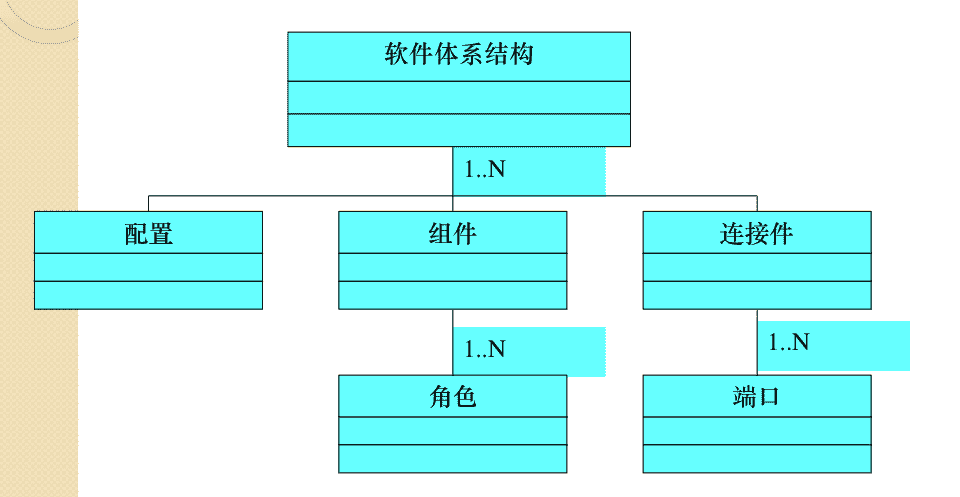

### 三、软件体系结构的核心模型

- 组件：具有某种功能的可重用的软件模块单元，表示了系统中主要的计算单元和数据存储。组件有两种：复合组件和原子组件。复合组件由其它复合组件和原子组件通过连接而成。
- 连接件：表示了组件之间的交互，简单的连接件有：管道（pipe）、过程调用（procedure-call）、事件广播（event broadcast）等。复杂的连接件有：客户-服务器（client-server）通信协议，数据库和应用之间SQL连接等。
- 配置：表示了组件和连接件的拓扑逻辑和约束。

```
Configuration GasStation
  Component Customer
    Port Pay = paylx → Pay
    Port Gas = take → pump?x → Gas
    Computation = Pay.pay?x → Gas.take → Gas.pump?x → Computation
  Component Cashier
    Port Customer1 = pay?x → Customer1
    Port Customer2 = pay?x → Customer2
    Port Topump = pump?x → Topump
    Computation = Customer1.pay?x → Topump.pump?x → Computation
      [] Customer2.pay?x → Topump.pump?x → Computation
  Component Pump
    Port Oil1 = take → pump?x → Oil1
    Port Oil2 = take → pump?x → Oil2
    Port Fromcashier = pump?x → Fromcashier
    Computation = Fromcashier.pump?x → Fromcashier
      (Oil1.take → Oil1.pump?x → Computation)
      [] (Oil2.take → Oil2.pump?x → Computation)
  Connector Customer_Cashier
    Role Givemoney = pay?x → Givemoney
    Role Getmoney = pay?x → Getmoney
    Glue = Givemoney.pay?x → Getmoney.pay?x → Glue
  Connector Customer_Pump
    Role Getoil = take → pump?x → Getoil
    Role Giveoil = take → pump?x → Giveoil
    Glue = Getoil.take → Giveoil.take → Giveoil.pump?x → Getoil.pump?x → Glue
  Connector Cashier_Pump
    Role Tell = pump?x → Tell
    Role Know = pump?x → Know
    Glue = Tell.pump?x → Know.pump?x → Glue
  Instances
    Customer1: Customer
    Customer2: Customer
    cashier: Cashier
    pump: Pump
    Customer1_cashier: Customer_Cashier
    Customer2_cashier: Customer_Cashier
    Customer1_pump: Customer_Pump
    Customer2_pump: Customer_Pump
    cashier_pump: Cashier_Pump
  Attachments
    Customer1.Pay as Customer1_cashier.Givemoney
    Customer1.Gas as Customer1_pump.Getoil
    Customer2.Pay as Customer2_cashier.Givemoney
    Customer2.Gas as Customer2_pump.Getoil
    cashier.Customer1 as Customer1_cashier.Getmoney
    cashier.Customer2 as Customer2_cashier.Getmoney
    cashier.Topump as cashier_pump.Tell
    pump.Fromcashier as cashier_pump.Know
    pump.Oil1 as Customer1_pump.Giveoil
    pump.Oil2 as Customer2_pump.Giveoil
End GasStation.
```

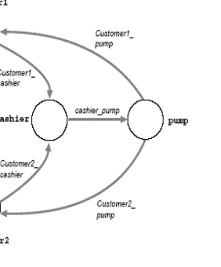

图3：加油站系统的架构。

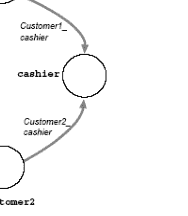

图7：图6中切片的架构表示。


### 四、软件体系结构的生命周期

基于SA的软件开发分为如下几个阶段：

- 需求分析阶段
  - 体系结构需求包括需求获取（功能需求和质量需求）、生成类图（Rational Rose）、对类分组、把类打包成组件和需求评审等。
  - 需求评审：组织一个由不同代表（如分析人员、客户、设计人员、测试人员）组成的小组，对体系结构需求及相关组件进行仔细的审查。审查内容：获取的需求是否真实反映了用户的要求，类的分组是否合理，组件合并是否合理等过程。
- 设计阶段：对系统进行模块化并决定各个组件间的详细接口、算法和数据类型的选定，对上支持建立体系结构阶段形成的框架，对下提供实现基础。
- 实现阶段：将设计阶段设计的算法及数据类型进行程序语言表示，满足设计体系结构和需求分析的要求，从而得到满足设计要求的目标系统。
- 测试：包括单个组件的功能测试和被组装应用的整体功能和性能测试。

SA在系统开发的全过程中起着基础的作用，是设计的起点和依据，同时也是装配和维护的指南。和软件本身一样，SA也有其生命周期。

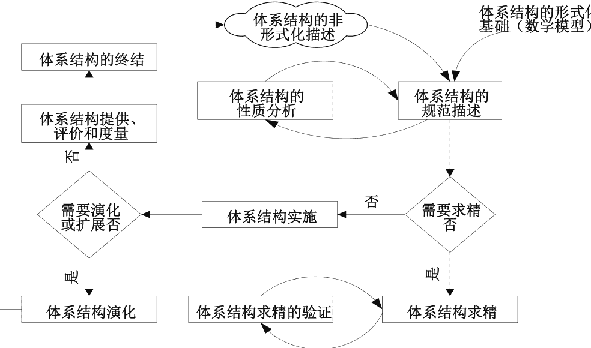

- 软件体系结构非形式化描述：自然语言描述；创造性和开拓性。
- 软件体系结构的规范化描述和分析：形式化数学理论模型描述，分析SA性质（deadlock free, safety, liveness etc）。
- 软件体系结构的求精及其验证：抽象到具体，逐步求精；验证判断具体SA与抽象SA语义一致性，并实现抽象SA。
- 软件体系结构的实施：将精化的SA实施于系统的设计中，并将SA的组件和连接件等有机地组织在一起，形成系统设计的框架，以便据此实施于软件设计和构造中。
- 软件体系结构的演化和扩展：在实施SA时，根据系统的需求（常常是非功能的需求，如性能、容错、安全性、互操作性、自适应性等非功能性质）来扩展和改动SA，这称为SA的演化。
- 软件体系结构的复用、评价和度量：定性评价和定量度量，以利于对SA的重用。
- 软件体系结构的终结：SA进行多次演化、修改变得难以理解，不能适应系统的发展。

### 五、软件体系结构的抽象模型

- **构件定义**：构件是一个数据单元或一个计算单元，它由构件的对象的集合、属性的集合、动作的集合和端口的集合组成。
  - 构件可以抽象为：C=(O,A,X,P)
  - 其中，O为组成构件的对象的集合
  - A为构件属性的集合
  - X为构件动作的集合
  - P为构件端口的集合
- **构件之间的主要关系**：顺序，选择，循环
- 连接件：通过对组件间交互规则的建模来实现组件间的连接。与组件不同，连接件不需编译。
- 定义6：连接件是组件运算的实现，它是六元组 <ID, Role, Beha, Msgs, Cons, Non-Func>，其中：
  - （1）ID是连接件的标识。
  - （2）Role为连接件和组件交互点的集合。其中Role=<Id,Action, Event, LConstraints>. Id是Role的标识；Action是Role活动的集合，每个活动由事件的连接（谓词）组成；Event是Role产生的事件集合；LConstraints是Role约束集合。
  - （3）Beha是连接件的行为集合。
  - （4）Msgs是连接件中各Role中事件产生的消息的集合。
  - （5）Cons是连接件约束的集合，它包括连接件的初始条件、前置条件和后置条件，有时为了明确表示这三个条件，可把它写成Cons(init,pre-cond,post-cond)。
  - （6）Non-Func是连接件的非功能说明，包括连接件的安全性、可靠性说明等。
- **软件体系结构**：定义7：设论域为U，（1）组件是一个软件体系结构；（2）连接件是一个软件体系结构；（3）组件经有限次连接（运算）后是软件体系结构。SA记为A=<C,O>，其中C表示组成体系结构的组件集合，O表示组件运算的集合。
- **SA的性质**：
  - （1）封闭性（envelopment）：即组件与组件、组件与体系结构、体系结构与体系结构连接后仍是一个体系结构。
  - （2）层次性（hierarchy）：即体系结构可由组件连接而成，而体系结构又可以再经过连接组成新的更大的体系结构。
  - （3）可扩充性（expansibility）：即一个满足条件的新组件可以通过连接加入到结构中。

### 软件体系结构风格

llao@seu.edu.cn

#### 一、软件体系结构风格概述

软件体系结构设计的一个核心问题是能否使用重复的体系结构模式，即能否达到体系结构级的软件重用。也就是说，能否在不同的软件系统中，使用同一体系结构。基于这个目的，学者们开始研究和实践软件体系结构风格和类型问题。

- 软件体系结构风格是描述某一特定应用领域中系统组织方式的惯用范型 (idiomatic paradigm)。
- 软件体系结构风格定义的主要内涵：
  - 定义了一个系统家族，即一个体系结构定义一个词汇表和一组约束。
  - 词汇表中包含一些构件和连接件类型。
  - 约束指出系统是如何将这些构件和连接件组合起来的。

体系结构风格反映了领域中众多系统所共有的结构和语义特性，并指导如何将各个模块和子系统有效地组织成一个完整的系统。

1. 提供一个**词汇表**；
2. 定义一套**配置规则**；
3. 定义一套**语义解释原则**；
4. 定义对基于这种风格的系统所进行的**分析**。

- Garlan和Shaw对通用体系结构风格的分类：
  - 数据流风格：批处理序列；管道/过滤器
  - 调用/返回风格：主程序/子程序；面向对象风格；层次结构
  - 独立构件风格：进程通讯；事件系统
  - 虚拟机风格：解释器；基于规则的系统
  - 仓库风格：数据库系统；超文本系统；黑板系统
- **特别注意：**体系结构风格不是对软件进行分类的标准。它仅仅是表示和描述软件的不同角度而已。
  - 例如：一个系统采用了分层风格，但这并不妨碍它用面向对象的方法来实现。同一个系统采用多种风格造成了所谓体系结构风格的异构组合。

#### 二、管道-过滤器风格

- **概述**
  - 在管道-过滤器风格下，每个功能模块都有一组输入和输出。
  - 功能模块称作过滤器（filters）；功能模块间的连接可以看作输入、输出数据流之间的通路，所以称作管道（pipes）。
  - 管道-过滤器风格的特性之一在于过滤器的相对独立性，即过滤器独立完成自身功能，相互之间无需进行状态交互。

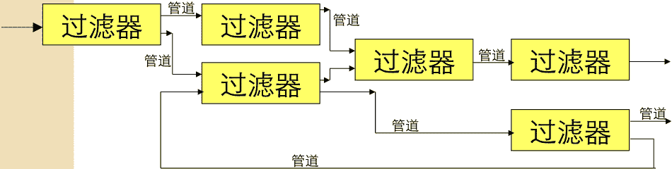

图 3-1 管道－过滤器风格的体系结构

- 过滤器是独立运行的构件
  - 非临近的过滤器之间不共享状态
  - 过滤器自身无状态
- 过滤器对与其上、下连接的过滤器“无知”
  - 对相邻的过滤器不施加任何限制
- 结果的正确性不依赖于各个过滤器运行的先后次序
  - 各过滤器在输入具备后完成自己的计算。完整的计算过程包含在过滤器之间的拓扑结构中。


### 管道-过滤器风格实例

- 实例：
  - `dir | more`
  - 传统的编译器，一个阶段的输出是另一个阶段的输入（包括词法分析、语法分析、语义分析和代码生成）

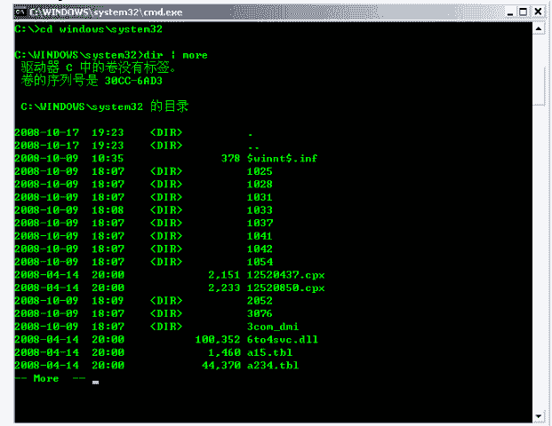

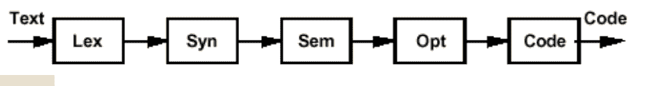

### 管道-过滤器风格优点

- 设计者可以将整个系统的输入、输出特性简单地理解为各个过滤器功能的合成。
  - 设计人员将整个系统的输入输出行为理解为单个过滤器行为的叠加与组合。这样可以将问题分解，化繁为简。将系统抽象成一个“黑箱”，其输入是系统中第一个过滤器的输入管道，输出是系统中最后一个过滤器的输出管道，而其内部各功能模块的具体实现对用户完全透明。
- **管道-过滤器风格支持功能模块的复用**
  - 任何两个过滤器，只要它们之间传送的数据遵守共同的契约，就可以相连接。每个过滤器都有自己独立的输入输出接口，如果过滤器间传输的数据遵守其契约，只要用管道将它们连接就可以正常工作。
- 基于管道-过滤器风格的系统具有较强的可维护性和可扩展性。
  - 旧的过滤器可以被替代，新的过滤器可以添加到已有的系统上。软件的易于维护和升级是衡量软件系统质量的重要指标之一，在管道-过滤器模型中，只要遵守输入输出数据规约，任何一个过滤器都可以被另一个新的过滤器代替，同时为增强程序功能，可以添加新的过滤器。这样，系统的可维护性和可升级性得到了保证。
- 支持一些特定的分析，如吞吐量计算和死锁检测等。
  - 利用管道-过滤器风格的视图，可以很容易的得到系统的资源使用和请求的状态图。然后，根据操作系统原理等相关理论中的死锁检测方法就可以分析出系统目前所处的状态，是否存在死锁可能及如何消除死锁等问题。
- **管道-过滤器风格具有并发性**
  - 每个过滤器作为一个独立的执行任务，可以与其它过滤器并发执行。过滤器的执行是独立的，不依赖于其它过滤器的执行。在实际运行时，可以将存在并发可能的多个过滤器看作多个并发的任务并行执行，从而大大提高系统的整体效率，加快处理速度。

### 管道-过滤器风格不足

- **交互式处理能力弱**

  管道-过滤器模型适于数据流的处理和变换，不适合为与用户交互频繁的系统建模。在这种模型中，每个过滤器都有自己的数据，这些数据或者是从磁盘存储器中读取出来，或者是由另一个过滤器的输出导入进来，整个系统没有一个共享的数据区。这样，当用户要操作某一项数据时，要涉及到多个过滤器对相应数据的操作，其实现较为复杂。针对以上的缺点，可以对每个过滤器增加相应的用户控制接口，使得外部可以对过滤器的执行进行控制。

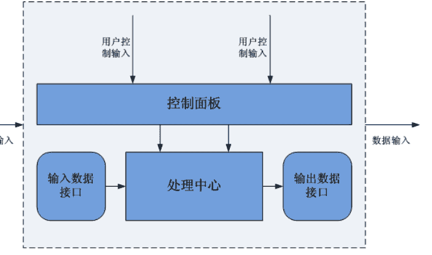

**改进的过滤器**

- 管道-过滤器风格往往导致系统处理过程的成批操作。
- 设计者也许不得不花费精力协调两个相对独立但又存在某种关系的数据流之间的关系，例如多过滤器并发执行时数据流之间的同步问题等。
- 根据实际设计的需要，设计者也需要对数据传输进行特定的处理（如为了防止数据泄漏而采取加密等手段），导致过滤器必须对输入、输出管道中的数据流进行解析或反解析，增加了过滤器具体实现的复杂性。

### 管道-过滤器风格练习

- 需求描述：假设有一批实时的二维坐标点数据需要变换（即对点的横、纵坐标进行缩放），并在屏幕上进行显示，要求外部要能设置变换规则（如缩放倍数）和显示规则（如显示模式和显示颜色）。
- 请根据此需求，进行管道-过滤器风格的体系结构建模。

#### 体系结构建模

这是一个对坐标点的数据流进行顺序处理的过程，可以应用管道-过滤器体系结构建模。将这个系统分为两个过滤器，一个为坐标点数据流变换过滤器，另一个为坐标点数据流实时显示过滤器。其中，坐标点数据流变换过滤器有一个外部控制接口对变换规则如缩放倍数进行设置，坐标点数据流实时显示过滤器有一个外部控制接口对显示规则如显示模式和显示颜色进行设置。整个系统的体系结构如图所示。

### 三、面向对象风格

#### 概述

面向对象模式集数据抽象、抽象数据类型、类继承于一体，使软件工程中公认的模块化、信息隐藏、抽象、重用性等原则在面向对象风格下得以充分实现。

#### 应用场合

面向对象的体系结构模式适用于数据和功能分离的系统中，同样也适合于问题域模型比较明显，或需要人机交互界面的系统。大多数应用事件驱动风格的系统也常常应用了面向对象风格。

#### Log in Form

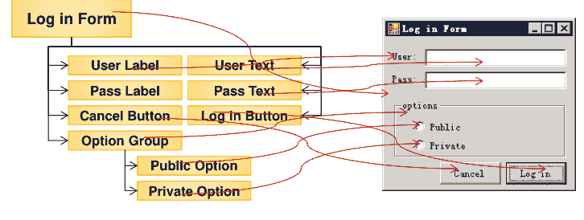

- User Label
- User Text
- Pass Label
- Pass Text
- Cancel Button
- Log in Button
- Option Group
  - Public Option
  - Private Option

#### 面向对象风格设计原则

- 面向对象风格系统设计时有下述几条基本原则：
  - 将逻辑上的实体映射为对象，实体之间的关系映射为对象之间的引用关系。
  - 对象利用引用关系来访问对方公开的接口，完成某个特定任务；一组对象之间相互协作，完成总体目标。

#### 面向对象风格（抽象描述）

**面向对象风格的抽象描述**

**一个银行系统对象之间的协作实例**

数据的表示及其相应操作封装在一个抽象数据类型或对象中。这种风格的组件是对象，或者说是抽象数据类型的实例。对象是一种被称为管理者的组件，因为它负责保持资源的完整性。对象是通过函数和过程的调用来交互的。

#### 面向对象风格优点

- **高度模块性**
  - 数据与其相关操作被组织为对象，成为模块组织的基本单位。
- **封装功能**
  - 一组功能和其实现细节被封装在一个对象中，具有功能的接口被暴露出来。
- **代码共享**
  - 对象的相对独立性可被反复重用，通过拼装形成不同的软件系统。
- **灵活性**
  - 对象在组织过程中，相互关系可以任意变化，只要接口兼容。
- **易维护性**
  - 对象接近于人对问题和解决方案模型的思维方式，易于理解和修改。


### 面向对象风格实例——人事档案管理系统

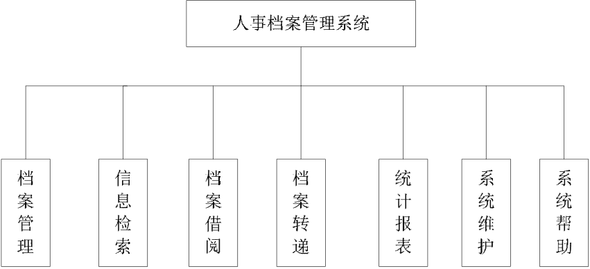

**系统功能结构**

- **系统功能介绍：**
  - 档案管理：根据高校人事档案管理的特点，本模块可通过录入各类人事档案信息，来构造档案数据库，编制各种目录索引。针对档案材料录入工作量较大，在该功能模块中设置了多种方式快速录入法，如对指定的部分内容可采用代码录入和菜单选项等输入方法。
  - 信息检索：该模块主要是检索有关的人事档案信息，其检索方式为姓氏笔画检索目录。在具体检索中又可分为精确查询和模糊查询，并可将检索内容动态输出，满足档案查询的需要。
  - 档案借阅：该模块主要是对档案的借阅情况、归还情况、利用登记等方面进行管理。它能为研究如何更有效地利用人事档案资料提供必要的信息。
  - 档案转递：该模块包括人事档案的转进和转出管理，编制清单，并能在档案转递后，对已变更档案数据库进行相应地调整，以完成相应档案的增删。
  - 统计报表：该模块主要用于统计库存的各类人事档案的实际数量，及每年归档的各类档案数量，并可完成相应的图形绘制和报表打印。其中，在报表生成中，该模块可根据管理人员对报表的自定义设置来生成相应的非范式报表。
  - 系统维护：由于高校人事档案的数据管理是一项非常重要的工作，尤其是它的安全可靠性。因此，在进入本模块操作之前，系统会提醒用户输入姓名、操作口令和权限级别。同时该功能模块还包括操作员管理、口令修改、重新登录、权限级别设置、系统日志及系统初始化六个子模块。
  - 系统帮助：本模块提供了在线联机帮助，可实现帮助主题的查询，还提供了计算器、日记/日历等系统工具和关于本系统的简介。


### 面向对象风格实例——人事档案管理系统

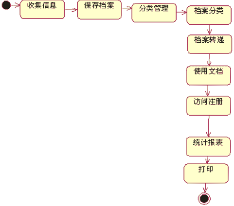

系统活动图

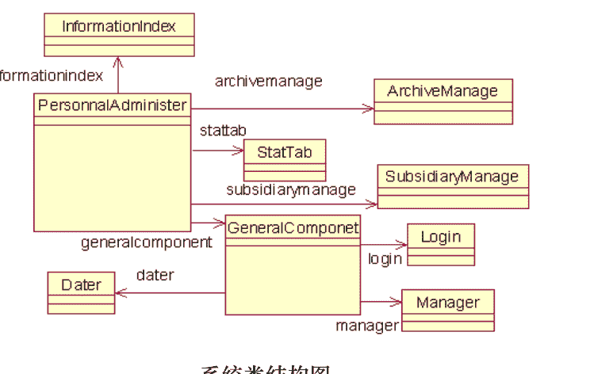

系统类结构图

### 面向对象风格实例

- 构件的描述方法：利用GUI体系结构框架自动生成工具，可以完成下述几点功能：
  - 生成构件模型，包括构件的属性、接口和实现；
  - 建立连接器模型，包括协议、属性和实现；
  - 体系结构的抽象和封装；
  - 类型和类型检查；
  - 主动规范，提供设计向导；
  - 多视图模式，对不同层次的用户显示不同的内容；
  - 生成实现，如将构件对应为面向对象技术中的类；
  - 将系统的修改动态映射到实现。

#### GUI体系结构框架自动生成工具，ArchStudio

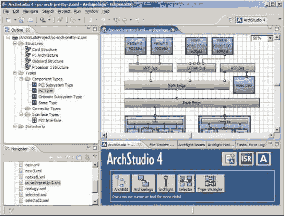

#### GUI体系结构框架自动生成工具，IBM Rational XDE

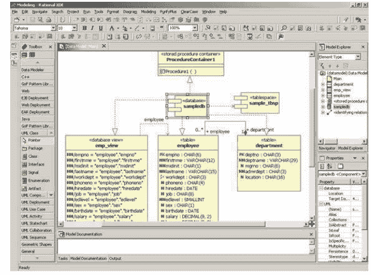

### 面向对象风格不足

面向对象风格最大的不足在于如果一个对象需要调用另一个对象，它就必须知道那个对象的标识（对象名或对象引用），这样就无形之中增强了对象之间的依赖关系。如果一个对象改变了自己的标识，就必须通知系统中所有和它有调用关系的对象，否则系统就无法正常运行。

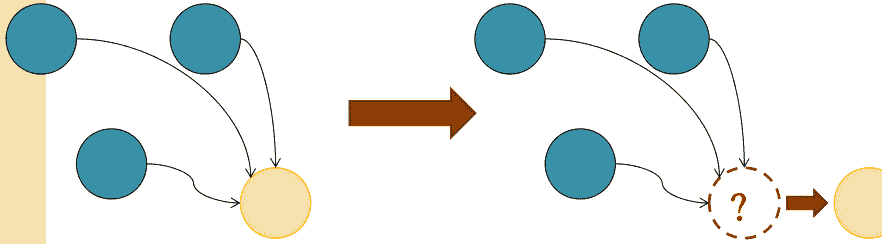

### 四、事件驱动风格

- 基于事件的系统风格的思想是组件不直接调用一个过程，而是触发或广播一个或多个事件。
- 系统中的其它组件中的过程在一个或多个事件中注册，当一个事件被触发，系统自动调用在这个事件中注册的所有过程，这样，一个事件的触发就导致了另一模块中的过程的调用。
- 从体系结构上说，这种风格的组件是一些模块，这些模块既可以是一些过程，又可以是一些事件的集合。过程可以用通用的方式调用，也可以在系统事件中注册一些过程，当发生这些事件时，过程被调用。

#### 事件驱动风格特征

- 事件驱动系统具有以下一些特点：
  - 系统是由若干子系统或元素所组成的一个整体；
  - 系统有一定的目标，各子系统在某一种消息机制的控制下，为了这个目标而协调行动；
  - 在一个系统的若干子系统中，必定有一个子系统起着主导作用，而其他子系统则处于从属地位；

#### 事件驱动风格

- 事件驱动风格的基本结构，如下图：

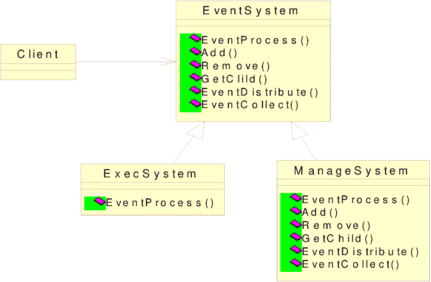

#### 事件驱动风格设计原则

- 事件驱动风格系统设计时有下述几条基本原则：
  - 从系统论的角度来看待描述的对象，合理分解子系统，保证各个子系统的独立性和社会性；
  - 无论系统多么复杂，子系统性质的差异多么大，任何子系统都可以分为2类：管理系统和执行系统。
  - 为了达到系统的目标，系统内的各个子系统通过传递消息和执行消息来协同操作。
  - 在一个完整系统中，必须有这样一个子系统，它没有上级，必须收集系统外的事件及下级发出的事件。
  - 管理类型的子系统一般不执行具体操作，它的主要功能是按照自己的职能指挥下级完成任务，功能性操作一般由执行类型的子系统完成。
  - 在一般情况下，除最高级管理子系统外，子系统一般是“有问才答”，即使在必要的情况下需要积极寻找事件时，也必须征得上级系统的许可，保证了系统的控制流不会分散。

#### 事件驱动风格实例

```
private void initialize() { //窗口初始化代码
...
//btnPress就是这次点击操作中的事件源
Button btnPress = new JButton();
//向事件源btnPress植入侦听器对象ButtonEventHandler
btnPress.addActionListener(new ButtonEventHandler(this));
...
}
class ButtonEventHandler implements ActionListener {
    //窗体对象
    private EventDemo form = null;
    //通过构造函数传入窗体对象，
    //作用在于让侦听器对象明白事件源处于
    //哪个窗体容器中
    public ButtonEventHandler(EventDemo form) {
        this.form = form;
    }
    //委托方法
    public void actionPerformed(ActionEvent e) {
        //该方法将会把事件的处理权交给窗体容器类的btnPress_Click方法处理。
        this.form.btnPress_Click(e);
    }
}

//真正的事件处理代码片断：
private void btnPress_Click(ActionEvent e) {
    String message = "你点击的按钮名叫:"
        + ((JButton) e.getSource()).getName();
    this.txtMessage.setText(message);
}
```

#### 事件驱动风格优点

- 事件驱动风格非常适合于描述系统族，在属于同一族的任何系统中，系统的高级管理子系统的描述是完全类似的，便于重用；
- 由于最高管理子系统牢牢的掌握着控制权，又因为各同级子系统一般不直接发生关系，因此容易实现并发处理和多任务操作；
- 基于事件驱动风格的系统具有良好的可扩展性，设计者只需为某个对象注册一个事件处理接口就可以将该对象引入整个系统，同时并不影响其它的系统对象。

#### 事件驱动风格不足

- 组件放弃了对系统计算的控制。一个组件触发一个事件时，不能确定其它组件是否会响应它。而且即使它知道事件注册了哪些组件，它也不能保证这些过程被调用的顺序。
- 数据交换的问题。有时数据可被一个事件传递，但另一些情况下，基于事件的系统必须依靠一个共享的仓库进行交互。在这些情况下，全局性能和资源管理便成了问题。
- 既然过程的语义必须依赖于被触发事件的上下文约束，关于正确性的推理存在问题。

#### 事件驱动风格和面向对象风格的关系

- 基于面向对象风格的系统由多个封装起来的对象构成，对象之间通过消息传递实现通信，而事件驱动正是对消息传递机制的一种实现。所以基于事件驱动风格的系统往往都是面向对象的。

### 五、层次系统风格

- 一个分层系统采用层次化的组织方式构建，系统中的每一层都要承担两个角色。
  - 首先，它要为结构中的上层提供服务；
  - 其次，它要作为结构中下面层次的客户，调用下层提供的功能函数。

#### 分层风格特征

- 一个概念上的分层模型如下图所示：

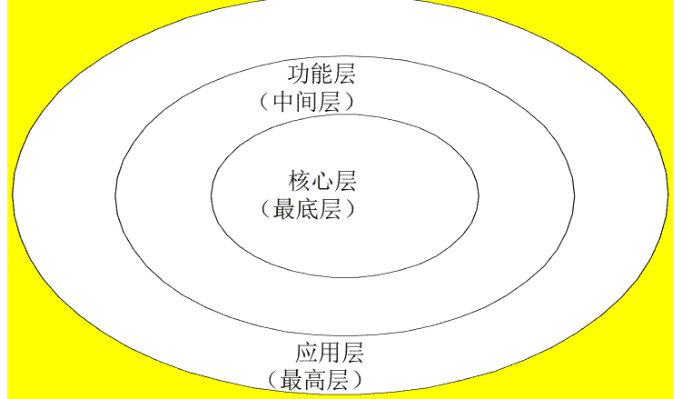

#### 分层风格实例

- 分层风格实例：计算机网络的设计

- 概述
  - 网络协议设计者将计算机网络中的各个部分按其功能划分为若干个层次（Layer），其中的每一个层次都可以看成是一个相对独立的黑箱、一个封闭的系统。用户只关心每一层的外部特性，只需要定义每一层的输入、数据处理和输出等外部特性。

- ISO/OSI网络体系结构

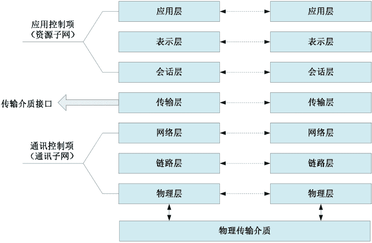

应用控制项（资源子网）

传输介质接口

通讯控制项（通讯子网）

| 左侧体系 | 右侧体系 |
| --- | --- |
| 应用层 | 应用层 |
| 表示层 | 表示层 |
| 会话层 | 会话层 |
| 传输层 | 传输层 |
| 网络层 | 网络层 |
| 链路层 | 链路层 |
| 物理层 | 物理层 |

物理传输介质位于两侧物理层下方。

| OSI 参考模型 | TCP/IP概念层 | 功能与常用协议 |
| --- | --- | --- |
| 7 应用层、6 表示层、5 会话层 | 应用层 | 各种服务及应用程序通过该层利用网络。常用协议：HTTP，FTP，SMTP（简单邮件传输协议）等 |
| 4 传输层 | 传输层 | 端到端数据传输及进行流量控制，常用协议：TCP，UDP（用户数据报协议） |
| 3 网络层 | 网际层 | 负责数据的传输，路由及地址选择。常用协议：IP，ARP（地址解析协议） |
| 2 数据链路层、1 物理层 | 网络接口 | 是针对不同物理网络的连接形式而制定的协议。例如：Ethernet，FDDI，ATM |


### 分层风格优点
- 分层风格具有一些系统设计者无法抗拒的优势：
  - 分层风格支持系统设计过程中的逐级抽象，允许将一个复杂问题分解成一个增量步骤序列的实现
  - 基于分层风格的系统具有较好的可扩展性
  - 分层风格支持软件复用

### 分层风格不足
- 并不是所有的系统都适合用分层风格来描述的，甚至即使一个系统的逻辑结构是层次化的，出于对系统性能的考虑，系统设计师不得不把一些低级或高级的功能综合起来；
- 对于抽象出来的功能具体应该放在哪个层次上也是设计者头疼的一个问题，很难找到一个合适的、正确的层次抽象方法。

### 六、仓库风格
- 在仓库风格中，有两种不同的组件：
  - 中央数据结构说明当前状态
  - 独立组件在中央数据存贮上执行

- 信息交互方式的差异导致了控制策略的不同。主要的控制策略有两种，正是依据这两种不同的控制策略，基于数据共享风格的系统被分成两个子类：

### 六、仓库风格
软件部件
- 表示当前状态的中心数据结构
- 一组相互独立的处理中心数据的部件

部件交互方式
根据输入数据流的事务处理类型决定执行哪个处理过程

根据中心数据结构的当前状态触发进行执行

传统的数据库系统

黑板系统

### 六、仓库风格
知识源

知识源

知识源

知识源

直接存取：知识源不断改变黑板的状态。

按照与应用程序相关的层次组织的问题求解数据

黑板状态驱动控制：使用特定的知识。

独立、分离的与应用程序相关的知识及其处理单元

### 六、仓库风格
黑板系统主要有三个部分组成：
- 知识源：知识源中包含独立的、与应用程序相关的知识，知识源之间不直接进行通信，它们之间的交互通过黑板来完成。
- 黑板数据结构：黑板数据是按照与应用程序相关的层次来组织的解决问题的 数据，知识源通过不断的改变黑板数据来解决问题。

### 仓库风格实例
- 专家系统（ES，Expert System）
  - 专家系统实质就是一组程序；
  - 从功能上：可定义为“一个在某领域具有专家水平解题能力的程序系统”，能像领域专家一样工作，运用专家积累的工作经验与专门知识，在很短时间内对问题得出高水平的解答。
  - 从结构上讲：可定义为“由一个专门领域的知识库，以及一个能获取和运用知识的机构构成的解题程序系统”。

ES一般结构如下图所示：

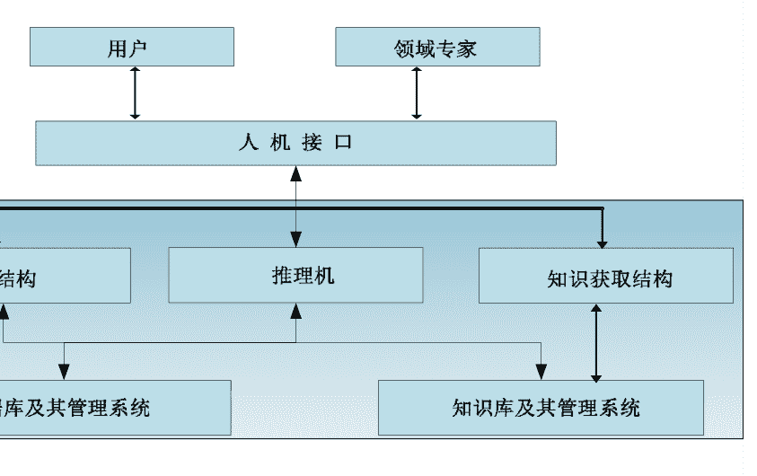

### IECRMAS知识生态系统

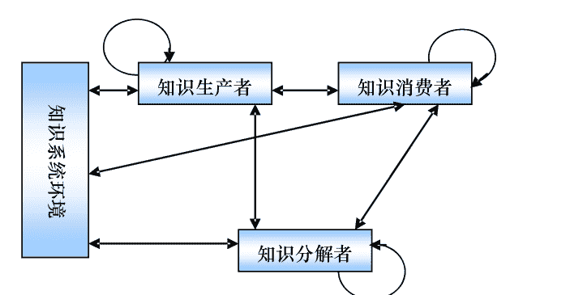

### IECRMAPS知识生态系统中知识流动

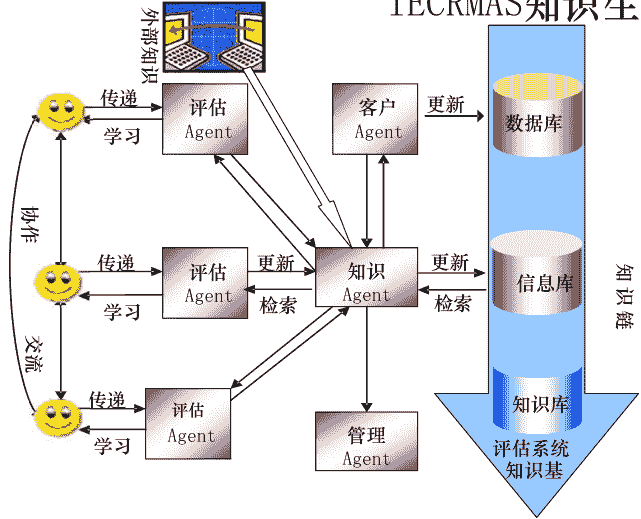

### 仓库风格优点
- **解决问题的多方法性：**
  - 对于一个专家系统，针对要解决的问题，如果在其领域中没有独立的方法存在，而且对解空间的完全搜索也是不可行的，在黑板模式中可以用多种不同的算法来进行试验，并且也允许用不同的控制方法。
- **具有可更改性和可维护性：**
  - 因为在黑板模式中每个知识源是独立的，彼此之间的通信通过黑板来完成，所以这使整个系统更具有可更改性和可维护性。

### 仓库风格优点
- 有可重用的知识源：
  - 由于每个知识源在黑板系统中都是独立的，如果知识源和所基于的黑板系统有理解相同的协议和数据，我们就可以重用知识源。

- 支持容错性和健壮性：
  - 在黑板模式中所有的结果都是假设的，并且只有那些被数据和其它假设强烈支持的才能够生存。这对于噪声数据和不确定的结论有很强的容错性。

### 仓库风格缺点
- 开发成本高：
  - 绝大部分黑板模式的系统需要用几年的时间来进化，所以开发成本较高。
- 缺少对不并行机的支持：
  - 黑板模式要求黑板上的中心数据同步并发访问，所以缺少对不并行机的支持。

### 七、C/S风格
- 在集中式计算技术时代广泛使用的是大型机/小型机计算模型。它是通过一台物理上与宿主机相连接的非智能终端来实现宿主机上的应用程序。
- 20世纪80年代以后，集中式结构逐渐被以PC机为主的微机网络所取代。个人计算机和工作站的采用，永远改变了协作计算模型，从而导致了分散的个人计算模型的产生。

### 七、C/S风格
- C/S软件体系结构是基于资源不对等，且为实现共享而提出来的，是20世纪90年代成熟起来的技术，C/S体系结构定义了工作站如何与服务器相连，以实现数据和应用分布到多个处理机上。
- C/S体系结构有三个主要组成部分：数据库服务器、客户应用程序和网络。

### C/S风格体系结构

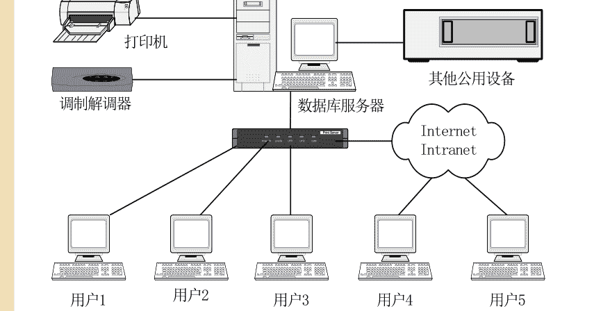

图 3-6 C/S体系结构示意图

### C/S风格任务分配
- 服务器
  1. 数据库安全性的要求；
  2. 数据库访问并发性的控制；
  3. 数据库前端的客户应用程序的全局数据完整性规则；
  4. 数据库的备份与恢复。

### C/S风格任务分配
- **客户应用程序**
  1. 提供用户与数据库交互的界面；
  2. 向数据库服务器提交用户请求并接收来自数据库服务器的信息；
  3. 利用客户应用程序对存在于客户端的数据执行应用逻辑要求。

### C/S风格处理流程

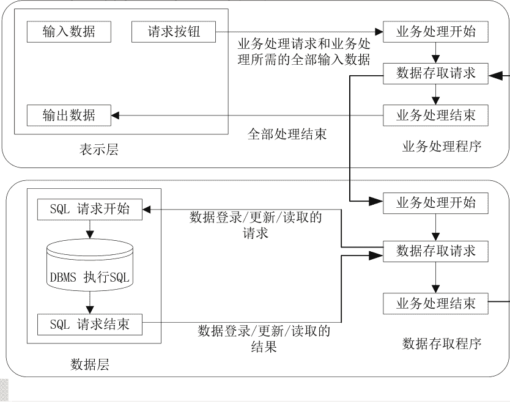

表示层

输入数据

请求按钮

输出数据

业务处理开始

业务处理请求和业务处理所需的全部输入数据

数据存取请求

业务处理结束

全部处理结束

业务处理程序

数据层

SQL 请求开始

DBMS 执行SQL

SQL 请求结束

数据登录/更新/读取的请求

数据登录/更新/读取的结果

业务处理开始

数据存取请求

业务处理结束

数据存取程序

### C/S风格优点
- C/S 体系结构具有强大的数据操作和事务处理能力，模型思想简单，易于人们理解和接受。
- 系统的客户应用程序和服务器构件分别运行在不同的计算机上，系统中每台服务器都可以适合各构件的要求，这对于硬件和软件的变化显示出极大的适应性和灵活性，而且易于对系统进行扩充和缩小。
- 在C/S体系结构中，系统中的功能构件充分隔离，客户应用程序的开发集中于数据的显示和分析，而数据库服务器的开发则集中于数据的管理，不必在每一个新的应用程序中都要对一个DBMS进行编码。将大的应用处理任务分布到许多通过网络连接的低成本计算机上，以节约大量费用。

### C/S风格缺点
- 二层C/S结构是单一服务器且以局域网为中心的，所以难以扩展至大型企业广域网或Internet；
- 软、硬件的组合及集成能力有限；
- 客户端程序设计复杂，客户机的负荷太重，难以管理大量的客户机，系统的性能容易变坏；
- 数据安全性不好。因为客户端程序可以直接访问数据库服务器，那么，在客户端计算机上的其他程序也可想办法访问数据库服务器，从而使数据库的安全性受到威胁。
- 软件维护和升级时，每个客户端都需要升级。

### 八、三层C/S风格

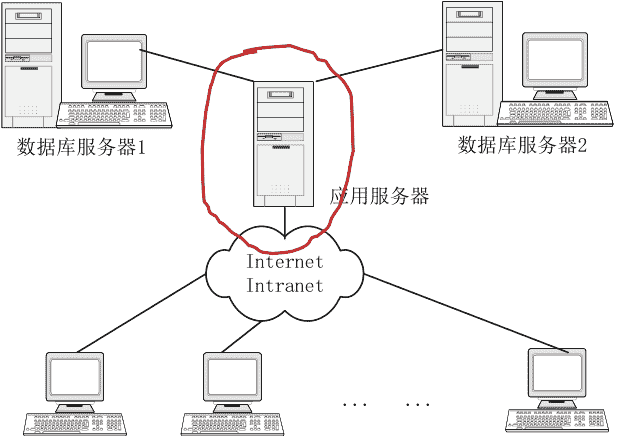

数据库服务器1

数据库服务器2

应用服务器

Internet
Intranet

用户1

用户2

用户ₙ

图 3-8 三层C/S体系结构示意图

表示层

功能层

数据层

输入数据

请求按钮

输出数据

业务处理请求和业务处理所需的全部输入数据

全部处理结束

业务处理程序

业务处理开始

数据存取请求

业务处理结束

数据存取程序

业务处理开始

数据存取请求

业务处理结束

SQL 请求开始

DBMS 执行SQL

SQL 请求结束

数据登录/更新/读取的请求

数据登录/更新/读取的结果

**表示层是应用的用户接口部分**，它担负着用户与应用间的对话功能。它用于检查用户从键盘等输入的数据，显示应用输出的数据。为使用户能直观地进行操作，一般要使用图形用户接口，操作简单、易学易用。在变更用户接口时，只需改写显示控制和数据检查程序，而不影响其他两层。检查的内容也只限于数据的形式和取值的范围，不包括有关业务本身的处理逻辑。

**功能层相当于应用的本体**，它是将具体的业务处理逻辑编入程序中。例如，在制作订购合同时要计算合同金额，按照定好的格式配置数据、打印订购合同，而处理所需的数据则要从表示层或数据层取得。表示层和功能层之间的数据交往要尽可能简洁。例如，用户检索数据时，要设法将有关检索要求的信息一次性地传送给功能层，而由功能层处理过的检索结果数据也一次性地传送给表示层。通常，在功能层中包含有确认用户对应 用和数据库存取权限的功能以及记录系统处理日志的功能。功能层的程序多半是用可视化编程工具开发的，也有使用COBOL和C语言的。

**数据层就是数据库管理系统**，负责管理对数据库数据的读写。数据库管理系统必须能迅速执行大量数据的更新和检索。因此，一般从功能层传送到数据层的要求大都使用SQL语言。


### 三层C/S风格物理结构

|  | (1) 将数据层和功能层放在同一台服务器上 | (2) 将数据层和功能层放在不同的服务器上 | (3) 将功能层放在客户机上 |
|---|---|---|---|
| 服务器2 | 数据层 |  |  |
| 服务器1 | 数据层<br>功能层 | 功能层 | 数据层 |
| 客户机 | 表示层 | 表示层 | 功能层<br>表示层 |

### 三层C/S风格优点

- ◎ 允许合理地划分三层结构的功能，使之在逻辑上保持相对独立性，能提高系统和软件的可维护性和可扩展性。
- ◎ 允许更灵活有效地选用相应的平台和硬件系统，使之在处理负荷能力上与处理特性上分别适应于结构清晰的三层；并且这些平台和各个组成部分可以具有良好的可升级性和开放性。
- ◎ 应用的各层可以并行开发，可以选择各自最适合的开发语言。
- ◎ 利用功能层有效地隔离开表示层与数据层，未授权的用户难以绕过功能层而利用数据库工具或黑客手段去非法地访问数据层，为严格的安全管理奠定了坚实的基础。

### 三层C/S风格要注意的问题

- - 三层C/S结构各层间的通信效率若不高，即使分配给各层的硬件能力很强，其作为整体来说也达不到所要求的性能。
- - 设计时必须慎重考虑三层间的通信方法、通信频度及数据量。这种提高各层的独立性一样是三层C/S结构的关键问题。

### 排水管网及污染源信息管理系统

### 温州污染源及排水管网信息管理系统

用户名:

administrator

密码:

登录(L)

退出(C)

深圳金...软件有限公司 制作所有

- - 系统建设目标
  1) 建立排水管线及污染源数据库及基础地形数据库，实现各类信息的数字化存储。
  2) 建立排水管网及污染源信息管理系统，实现各部门对这些信息的共享。系统具有数据输入、编辑、查询、统计、分析、输出、更新等管理功能。
  3) 建立数据更新机制，实现排水管网及污染源信息的动态管理，为城市的河道污染治理提供决策依据和技术服务。

### 系统功能框架图

### 排水管网及污染源信息管理系统

基本管理功能

污染源管理

管网数据管理

管网数据维护

管网综合分析

许可证管理

### 系统体系结构

系统采用三层体系结构：

- 1. **数据层**：采用关系型数据库，实现各类数据的高效存储和管理。
- 2. **逻辑层**：采用Objects组件，通过空间数据引擎，负责数据库系统业务逻辑的实现。
- 3. **表现层**：排水管网及污染源信息管理系统，满足相关部门对排水管线及污染源管理的要求。

### 系统体系结构图

### 桌面管理应用程序

### 表现层

### 逻辑层

### 基本管理功能

### 污染源管理

### 管网管理

### 管网维护

### 统计分析

### 许可证管理

### Objects组件库

### ADO.net

### 数据层

### 基础空间库

### 管网数据库

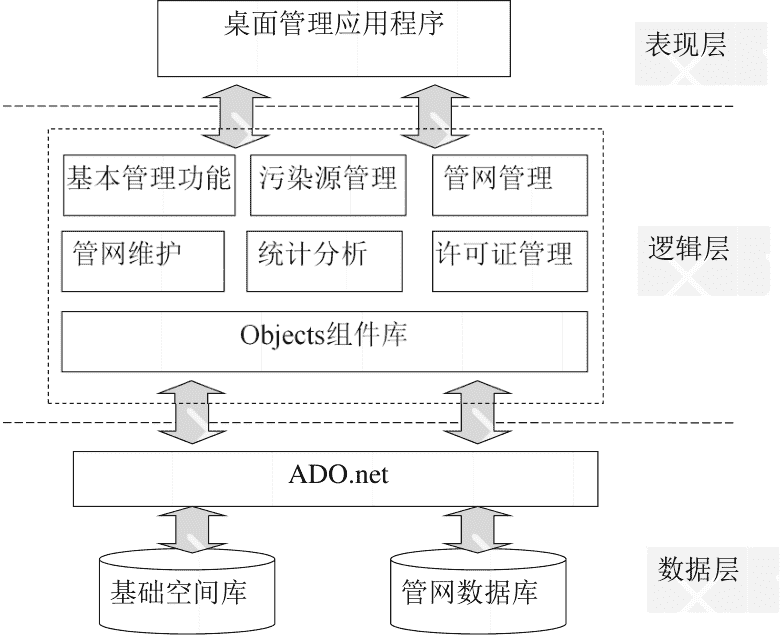

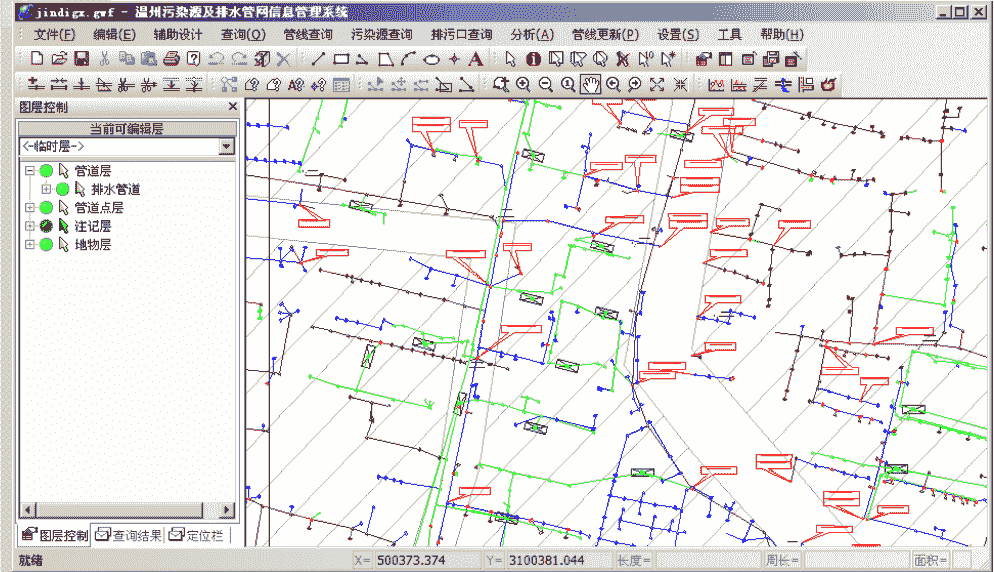

### 九、B/S风格

- ● 浏览器/服务器（B/S）风格就是上述三层应用结构的一种实现方式，其具体结构为：浏览器/Web服务器/数据库服务器。
- ● B/S体系结构主要是利用不断成熟的Web浏览器技术，结合浏览器的多种脚本语言，用通用浏览器就实现了原来需要复杂的专用软件才能实现的强大功能，并节约了开发成本。从某种程度上来说，B/S结构是一种全新的软件体系结构。

### B/S风格优点

- - 基于B/S体系结构的软件，系统安装、修改和维护全在服务器端解决。用户在使用系统时，仅仅需要一个浏览器就可运行全部的模块，真正达到了“零客户端”的功能，很容易在运行时自动升级。
- - B/S体系结构还提供了异种机、异种网、异种应用服务的联机、联网、统一服务的最现实的开放性基础。

### 十、B/S与C/S混合软件体系结构

- - 在三层C/S体系结构中，表示层负责处理用户的输入和向客户的输出。功能层负责建立数据库的链接，根据用户的请求生成访问数据库的SQL语句，并把结果返回给客户端。数据层负责实际的数据存储和检索，相应功能层的数据处理要求，并将结果返回给功能层。
- - B/S是三层应用结构的一种实现方式，其具体结构为：浏览器/WEB服务器/数据库服务器

### 十、B/S与C/S混合软件体系结构

- - B/S与C/S混合软件体系结构是一种典型的异构体系结构。
- - B/S软件体系结构，即 Browser/Server（浏览器/服务器）结构，是随着 Internet技术的兴起，对C/S体系结构的一种变化或者改进的结构。

### 十、B/S与C/S混合软件体系结构

- - 不同的结构有不同的处理能力的强项和弱点，一个系统的体系结构应该根据实际需要进行选择，以解决实际问题。
- - 关于软件包、框架、通信以及其他一些体系结构上的问题，目前存在多种标准。即使在某段时间内某一种标准占统治地位，但变动最终是绝对的。
- - 实际工作中，我们总会遇到一些遗留下来的代码，它们仍有效用，但是却与新系统有某种程度上的不协调。然而在许多场合，将技术与经济综合进行考虑时，总是决定不再重写它们。
- - 即使在某一单位中，规定了共享共同的软件包或相互关系的一些标准，仍会存在解释或表示习惯上的不同。

### C/S与B/S混合之内外有别模型

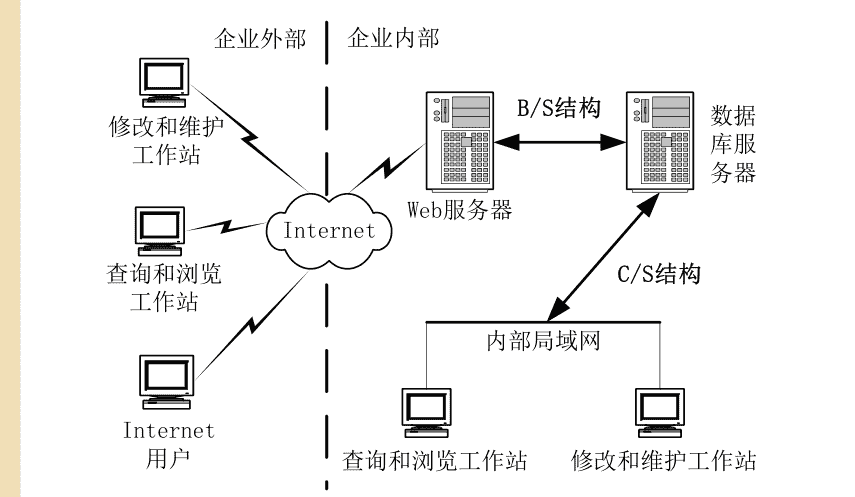

图 3-26 “内外有别” 模型

### C/S与B/S混合之内外有别模型

- - 企业内部用户通过局域网直接访问数据库服务器，软件系统采取C/S体系结构；
- - 企业外部用户通过Internet访问Web服务器，通过Web服务器再访问数据库服务器，软件系统采用B/S结构。
- - 优点在于：外部用户不直接访问数据库服务器，保证数据库安全，企业内部用户的交互性较强，数据查询和修改的响应速度较快。
- - 缺点在于：外部用户修改和维护数据，速度较慢，较繁琐。

### C/S与B/S混合之查改有别模型

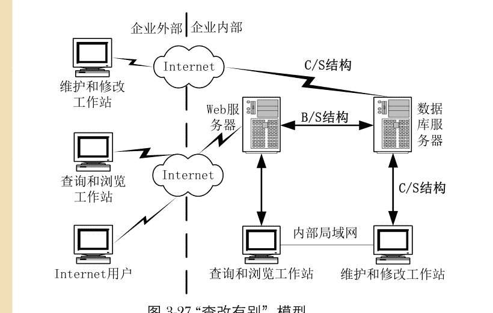

图 3-27 “查改有别” 模型

### C/S与B/S混合之查改有别模型

- - 无论用户通过局域网还是外网连接到系统，凡是需要执行维护和修改数据操作的，都使用C/S体系结构；
- - 凡是需要执行查询浏览操作的，都使用B/S体系结构。
- - 此结构可以拥有两种体系结构的共同优点；
- - 缺点在于：企业数据容易暴露给外部用户，数据安全有一定威胁。

### B/S与C/S混合软件体系结构案例

例如：
在实现某个变电站信息管理系统解决方案中，就使用了C/S与B/S混合软件体系结构的方式，其结构如图8所示。

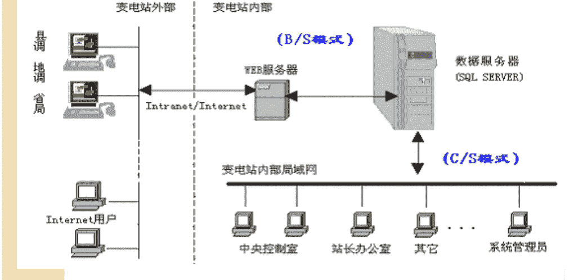

图8. C/S与B/S混合软件体系结构

变电站外部

变电站内部

（B/S模式）

WEB服务器

数据服务器
(SQL SERVER)

Intranet/Internet

（C/S模式）

变电站内部局域网

县调
省局

Internet用户

中央控制室

站长办公室

其它

系统管理员

### B/S与C/S混合软件体系结构案例

- - 变电站内部用户通过局域网直接访问数据库服务器，外部用户（包括县调、地调和省局的用户及普通Internet用户）通过Internet访问Web服务器，再通过Web服务器访问数据库服务器。
- - 该解决方案把B/S和C/S这两种软件体系结构进行了有机的结合，扬长避短，有效地发挥了各自的优势。同时，因外部用户只需一台接入Internet的计算机，就可以通过Internet查询运行生产管理情况，无须做太大的投入和复杂的设置。这样也方便所属电业局及时了解各变电站所的运行生产情况，对各变电站的运行生产进行宏观调控。

### 十一、小结

- - 软件体系结构风格为大粒度的软件重用提供了可能。然而，对于应用体系结构风格来说，由于视点的不同，系统设计师有很大的选择空间。要为系统选择或设计某一个体系结构风格，必须根据特定项目的具体特点，进行分析比较后再确定，体系结构风格的使用几乎完全是特化的。
-   
- - 从上面的介绍中，我们知道，不同的结构有不同的处理能力的强项和弱点，一个系统的体系结构应该根据实际需要进行选择，以解决实际问题。事实上，也存在一些系统，它们是由这些纯体系结构组合而成，即采用了异构软件体系结构。


### 面向服务的架构（SOA）

lliao@seu.edu.cn


### 目录

- 发展历史及背景
- SOA基本概念
- SOA核心思想
- 构建SOA
- SOA的应用

### 发展历史及背景

- 系统架构演化历程-应用服务和数据服务分离

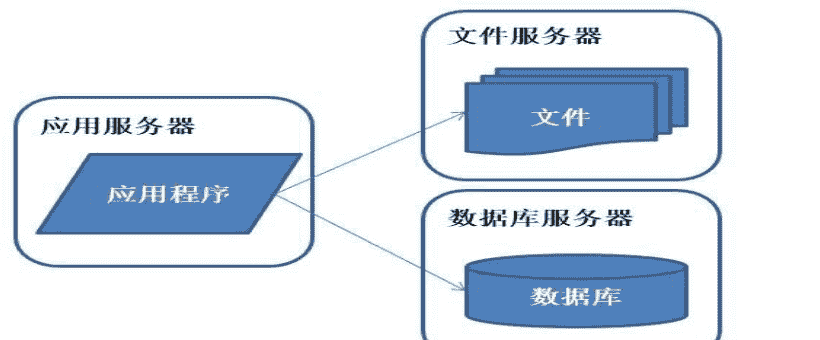

应用程序、数据库、文件分别部署在独立的资源上。
数据量增加，单台服务器性能及存储空间不足，需要将应用和数据分离，并发处理能力和数据存储空间得到了很大改善。

### 发展历史及背景

- 系统架构演化历程-使用缓存改善性能

数据库中访问较集中的一小部分数据存储在缓存服务器中，减少数据库的访问次数，降低数据库的访问压力。

系统访问特点遵循二八定律，即80%的业务访问集中在20%的数据上。缓存分为本地缓存和远程分布式缓存，本地缓存访问速度更快但缓存数据量有限，同时存在与应用程序争用内存的情况。

### 发展历史及背景

#### 系统架构演化历程-使用应用服务器集群

享受了一段时间的系统访问量高速增长的幸福后，发现系统又开始变慢了，这次又是什么状况呢，经过查找，发现数据库写入、更新的这些操作的部分数据库连接的资源竞争非常激烈，导致了系统变慢

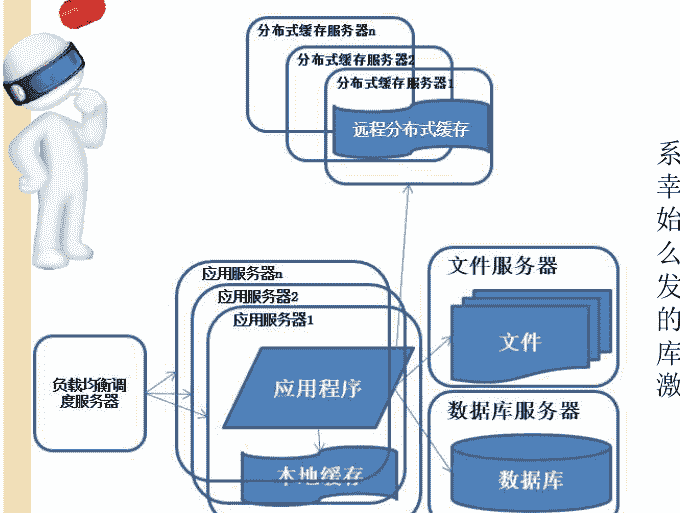

### 发展历史及背景

- 系统架构演化历程-数据库读写分离

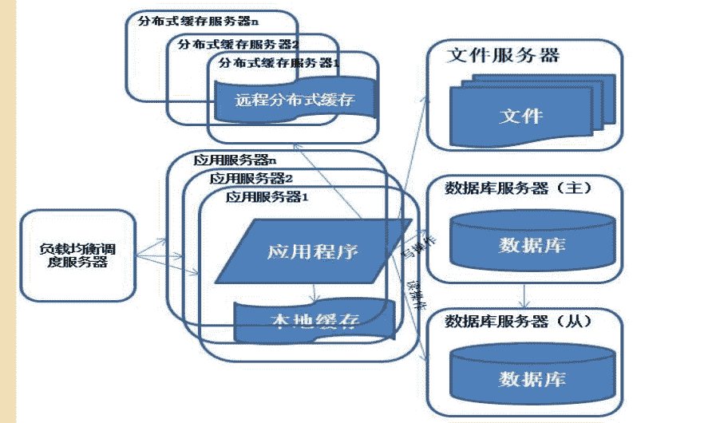

### 发展历史及背景

- 系统架构演化历程-反向代理和CDN加速


### 发展历史及背景

- 系统架构演化历程-分布式文件系统和分布式数据库

任何强大的单一服务器都满足不了大型系统持续增长的业务需求，数据库读写分离随着业务的发展最终也将无法满足需求，需要使用分布式数据库及分布式文件系统来支撑。分布式数据库是关系数据库拆分的最后方法，只有在单表数据规模非常庞大的时候才使用，更常用的数据库拆分手段是业务分库，将不同的业务数据库部署在不同的物理服务器上。

### 发展历史及背景

- 系统架构演化历程-使用 NoSQL 和搜索引擎


### 发展历史及背景

- 系统架构演化历程-业务拆分（横向拆分）


### 发展历史及背景

- 系统架构演化历程-分布式服务（横向拆分）

公共的应用模块被提取出来，部署在分布式服务器上供应用服务器调用。

### 发展历史及背景

- 为什么需要SOA？

软件应用领域越来越多，相同领域的应用系统之间许多基础功能和结构是有相似性的，每次开发系统都从零开始绝对不是一种好的方法，也是对质量和效率的很大的伤害。

尽可能多地凝练共性并复用以提高软件开发效率和质量，通过中间件通过提供简单、一致、集成的开发和运行环境，简化分布式系统的设计、编程和管理，这也是SOA发展的重要推动力。

软件技术发展内容，包括更好的程序设计语言、更好的平台和软件开发技术，如面向对象、组件开发、面向服务等等。而这方面，在技术上逐渐发展的成果大部分都凝聚在今天的SOA解决方案之中。


#### 基本概念

- 如何准确理解SOA？

OASIS（一个SOA标准组织）给出的SOA定义“SOA是一个范式，用于组织和利用可能处于不同所有权范围控制下的分布式系统。”

维基百科给出的SOA定义“面向服务的体系结构（Service-oriented architecture）是构造分布式系统的应用程序的方法。它将应用程序功能作为服务发送给最终用户或者其他服务。它采用开放标准、与软件资源进行交互并采用表示的标准方式”。

SOA是包含运行环境、编程模型、架构风格和相关方法论等在内的一整套新的分布式软件系统构造方法和环境，涵盖服务的整个生命周期：建模-开发-整合-部署-运行-管理。

#### 基本概念

#### WebService

Web Services，从字面上理解就是通过Web提供的服务。我们可以理解Web Services是自包含的、模块化的应用程序，它可以在网络(通常为Web)中被描述、发布、查找以及调用；也可以理解Web Services是基于网络的、分布式的模块化组件，它执行特定的任务，遵守具体的技术规范，这些规范使得Web Services能与其他兼容的组件进行互操作；也可以这样理解，所谓Web服务，它是指由企业发布的完成其特别商务需求的在线应用服务，其他公司或应用软件能够通过Internet来访问并使用这项应用服务Web。

service 简单来说就是一个向外界暴露出的能够通过internet进行调用的api和应用程序，是基于SOA松耦合等思想开发出来的一套技术，但是它并一定完全符合SOA的架构。

### SOA工作流程


SOA 中的不同组件及其工作流程

### SOA操作

SOA的三种操作：

- 发布操作：为了使服务可访问，需要发布服务描述以使服务使用者可以发现它。
- 查找操作：服务请求者定位服务，方法是查询服务注册中心来找到满足其标准的服务。
- 绑定操作：在检索到服务描述之后，服务使用者继续根据服务描述中的信息来调用服务。

### SOA的相关标准——WSDL、UDDI、SOAP

SOAP: 简单对象访问协议 (Simple Object Access Protocol)

WSDL: Web服务描述语言 WSDL (Web Services Description Language)

UDDI: 统一描述、发现和集成 (Universal Description, Discovery and Integration)

WSDL用来描述服务；UDDI用来注册和查找服务；

SOAP作为传输层，用来在消费者和服务提供者之间传递消息。一个消费者可以在UDDI注册表（registry）查找服务，取得服务的WSDL描述，然后通过SOAP来调用服务。


soap用来描述传递信息的格式， WSDL 用来描述如何访问具体的接口， uddi用来管理，分发，查询webService。具体实现可以搜索 Web Services简单实例

### 核心思想

- 标准化封装（满足互操作性）

在软件的互操作方面，传统中间件只是实现了访问互操作，即通过标准化的API实现了同类系统之间的调用互操作，而连接互操作还是依赖于特定的访问协议，如JAVA使用RMI等。而SOA通过标准的、支持Internet、与操作系统无关的SOAP协议实现了连接互操作。而且，服务的封装是采用XML协议，具有自解析和自定义的特性，这样，基于SOA的中间件还可以实现语义互操作。

SOA要实现互操作，就是通过一系列的标准族，来实现访问、连接和语义等各种层面的互操作。

### 核心思想

- 复用

| 复用对象 | 复用范围 |
|---|---|
| 子程序 | 一个可执行程序内复用，静态开发期复用 |
| 组件(DLL,Com 等) | 系统内复用，动态运行期复用 |
| 企业对象组件(Com+, .NET, EJB 等) | 企业网络内复用，不同系统之间复用 |
| 服务(如 WebService, SCA/SDO) | 不同企业之间，全球复用，动态可配置 |

### 如何构建SOA

一个SOA系统要具有以下六大关键要素——基础设施、已有资源、企业服务、流程模型、服务展现和系统工具（包括开发、测试和管理工具等）。因此，在基础设施和已有资源都已具备的基础上，开发和构建一个SOA系统要包括以下几方面的工作：

- 首先需要设计开发出符合标准的服务，这是整个SOA系统最核心的要素。
- 基于标准服务，借助流程编排工具和建模工具，组织构造流程，生成流程模型，更好地满足业务需求。
- 实际构建和开发SOA系统，具体包括服务和应用程序的开发，数据的访问、处理和管理，及对服务各种形式的展现等。


### 使用SOA进行服务组合实例

假设股票行业存在以下6个服务：

- **Country ()**
  输入参数：国家编码。输出项：国家名称和其他信息。
- **YellowPages ()**
  输入参数：公司名称；输出项：企业代码，所在国家等其他信息。
- **NewYorkStock ()**
  输入参数：公司代码，时间；输出项：该公司在纽约的股票价格（美元）。
- **LondonStock ()**
  输入参数：公司代码，时间；输出项：该公司在伦敦的股票价格。
- **USToRMB ()**
  输入参数：美元价格，时间；输出项：对应的人民币价格。
- **UKToRMB ()**
  输入参数：英镑价格，时间；输出项：对应的人民币价格。

### 使用SOA进行服务组合实例

- 用户想通过“跨国公司名称”和“时间”找出该跨国公司在纽约的股票折合成人民币的价格以及该公司所在国家的信息。
- 分析：
  - 输入参数：跨国公司的名称、时间
  - 输出：该公司的股票价格（RMB）以及该公司所在国家
  - 如何实现对给定服务的组合，找出满足用户的信息？


输入参数：国家名称、时间

查询分解

国家名称

时间

YellowPages（）

NewYork-Stock（）

公司 ID

国家 ID

Country（）

美元价格

USDToRMB（）

国家信息

人民币价格

结果生成

输出结果：人民币价格、所在国家信息

### SOA应用——统一认证

在石油企业内部，有许多不同的网站，进入每个网站，都需要身份验证，不仅浪费时间而且容易遗忘代码，另外，网站维护人员对各种服务需要建立相应的用户认证与信息管理系统，分布于个服务器中的用户数据不仅浪费维护人员的时间，而且过于分散的用户数据不利于统计和管理。用户的需求和管理要求促使用户趋于统一，产生了统一者认证。

统一认证的实现是基于SOA的架构。

### SOA应用——统一认证


从中可以看出使用SOA的优点：将身份验证这一功能模块发布成一种服务，其他的软件可以通过UUDI查找该服务，然后将该服务与服务的实现进行绑定。

### 基于体系结构的软件开发

liao@seu.edu.cn

### 目录

- 设计模式
- 中间件技术
- 基于体系结构的设计方法
- 体系结构的设计和演化
- 基于体系结构的软件开发模型
- 基于体系结构的软件过程
- 软件体系结构演化模型

### 设计模式概述

◎ 模式是指从某个具体的形式中得到的一种抽象，在特殊的非任意性环境中，该形式不断地重复出现。

◎ 模式是前人经验的总结，它使人们可以方便地复用成功的设计和体系结构。

◎ 当人们在特定的环境下遇到特定类型的问题，采用他人已使用过的一些成功解决方案，一方面可以降低分析、设计和实现的难度，另一方面可以使系统具有更好的可复用性和灵活性。

### 设计模式概述

- 模式是给定上下文中普遍问题的普遍解决方案，在软件开发方面分为：
  - 体系结构模式（风格）
  - 设计模式
  - 惯用法
- 前两者与程序开发语言无关。

### 设计模式概述

- 一个软件体系结构的模式描述了一个出现在特定设计语境中的特殊的再现设计问题，并为它的解决方案提供了一个经过充分验证的通用图示。
- 解决方案图示通过描述其组成构件及其责任和相互关系以及它们的协作方式来具体指定。

### 设计模式概述

◎ 软件系统的基本组成单元是模块、类等，但单个的模块或类并没有什么意义，不能提供应用的解决方案。

◎ 往往需要多个模块、类、对象、服务、进程、线程、构件等共同协作，提供应用问题的解决方案。

◎ 设计模式可以方便地重用成功的设计和结构，还提供了类和对象接口的明确的说明书和这些接口的潜在意义。

◎ 模式的实现要比解决方案复杂得多。可以使用各种语言来实现。

### 设计模式概述

◎ 以MVC为例

软件系统的重要功能之一是从数据存储（文件/数据库）中检索数据，并将其显示给用户。在用户更改数据之后，系统再将更新内容存储到数据存储中。如果将数据存储和界面显示代码放在一起，则可以减少编码量并提高应用程序性能。

但这样做也存在很多问题。

### 设计模式概述

#### ◎ MVC的背景

用户界面逻辑的更改往往比业务逻辑频繁，尤其是在基于 Web 的应用程序中。基于 Web 的瘦客户端应用程序的优点之一是可以随时更改用户界面，而不必重新分发应用程序。如果将显示代码和业务逻辑组合在一起并放在单个对象中，则每次更改用户界面时，都必须修改包含业务逻辑的对象。

### 设计模式概述

#### ◎ MVC的背景

- > 在很多情况下，应用程序需要以不同的方式显示同一数据。例如，表格显示，趋势图显示，柱状图显示，饼图显示。
- > 界面开发与业务逻辑开发所需要的技能不同，在这两方面都精通比较困难。
- > 与业务逻辑相比，用户界面代码对设备的依赖性往往更大。例如，要将应用程序从基于浏览器的应用程序迁移到个人数字助理（PDA）或支持 Web 的手机上，则必须替换很多用户界面代码，而业务逻辑可能不受影响。

### 设计模式概述

#### ◎ MVC的背景


### 设计模式概述

#### ◎ MVC的处理过程

- (1) 控制器接收用户的请求，并决定应该调用哪个模型来进行处理；
- (2) 模型用业务逻辑来处理用户的请求并返回数据；
- (3) 控制器用相应的视图格式化模型返回的数据，并通过表示层呈现给用户。

### 设计模式概述

#### MVC模式的优点

- 支持多个视图。因为视图与模型分离，而且模型与视图之间没有直接依赖性，所以用户界面可以同时显示同一数据的多个视图。
- 适应更改。用户界面要求的更改往往比业务规则快。用户可能更喜欢新设备（如手机或 PDA）采用另一颜色、字体、屏幕布局和支持级别。因为模型不依赖于视图，所以将新类型的视图添加到系统中通常不会影响模型。因此，更改的作用范围仅限于视图。

### 设计模式概述

#### MVC模式的缺点

- 复杂性。MVC 模式引入了新的间接级别，因此增加了解决方案的复杂性。还增加了用户界面代码的事件驱动特性，调试用户界面代码会变得更加困难。
- 频繁更新的成本。将模型与视图分离并不意味着模型的开发人员可以忽略视图的特性。例如，如果模型发生频繁更改，则它可能向视图发出大量更新请求。一些视图（如图形显示）的显示可能需要一定时间。

### 设计模式的基本成分

◎ 模式名称：通常用来描述一个设计问题、它的解法和后果，由一到两个词组成。

◎ 问题：告诉我们什么时候要使用设计模式、解释问题及其背景。

例如：MVC模式关心用户界面经常变化的问题。它必须易于修改用户界面，但软件的功能核心不能被这种修改影响。

### 设计模式的基本成分

◎ 解决方案：描述设计的基本要素，它们的 关系、各自的任务以及相互之间的合作。

例如：MVC模式中控制器接收输入，输入往往是鼠标移动、单击鼠标按键或键盘输入等事件。事件转换成服务请求，这些请求再发送给模型或视图。

◎ 效果：描述应用设计模式后的结果和权衡。比较与其他设计方法的异同，得到应用设计模式的代价和优点。

例如：不同方案的时间和空间权衡；方案的可重用性、灵活性、可扩展性、可移植性等。

### 设计模式的描述

◎ 如果要理解和讨论模式，就必须以适当形式描述模式。

◎ 好的描述有助于我们立即抓住模式的本质，即模式关心的问题是什么，以及提出的解决方案是什么？

◎ 模式也应该以统一方式来描述

### 设计模式的描述

Erich Gamma博士等人采用下面的固定模式来描述：

- 1. **模式名称和分类**：模式名称和一个简短的摘要。
- 2. **目的**：即设计模式的用处、基本原理和目的、它针对的是什么特殊的设计问题。
- 3. **别名**：同一个模式可能会有不同的命名。
- 4. **动机**：描述一个设计问题的方案，以及模式中类和对象的结构如何解决这个问题。

### 设计模式的描述

- (5) 应用：在什么情况下可以应用本设计模式。
- (6) 结构：用对象模型技术对本模式进行表示。
- (7) 成分：组成本设计模式的类和对象及它们的职责。
- (8) 合作：成分间如何合作实现他们的任务。
- (9) 效果：该模式如何支持它的对象；如何在在使用本模式时进行权衡。


### 模式和软件体系结构

#### 构造异构体系结构

- 单个模式不能完成一个完整的软件体系结构的详细构造，它仅仅帮助设计师设计应用程序的某一方面。
- 为了有效使用模式，需要将它们组织成模式系统。模式系统统一描述模式，对它们分类，更重要的是，说明它们之间如何交互。

#### 模式和方法

- 好的模式描述应包含实现指南，可将其看成是一种微方法，用来创建解决一个问题的方案。
- 通过提供方法的步骤来解决软件开发中的具体再现问题，这些微方法补充了通用的但与问题无关的分析和设计方法。

#### 实现模式

目前的许多软件模式具有独特的面向对象风格。因此，人们往往认为，能够有效实现模式的唯一方式是使用面向对象编程语言，其实不然。

在设计层次，大多数模式只需要适当的编程语言的抽象机制，如模块或数据抽象。因此，可以用几乎所有的编程范式，并在所有的编程语言中来实现模式。

### 设计模式方法分类

- Coad的面向对象模式
- 代码模式
- 框架应用模式
- 形式合约

#### 1、Coad的面向对象模式

1992年，美国面向对象技术大师 Peter Coad 从MVC的角度对面向对象系统进行了讨论，设计模式由最底层的构成部分（类和对象）及其关系来区分。他使用了一种通用的方式来描述一种设计模式：

1. 模式所能解决问题的简要介绍与讨论；
2. 模式的非形式文本描述以及图形表示；
3. 模式的使用方针：在何时使用以及能够与哪些模式结合使用。

将 Coad 的模式划分为以下三类：

- （1）**基本的继承和交互模式**：主要包括 OOPL 所提供的基本建模功能，继承模式声明了一个类能够在其子类中被修改或被补充，交互模式描述了在有多个类的情况下消息的传递。
- （2）**面向对象软件系统的结构化模式**：描述了在适当情况下，一组类如何支持面向对象软件系统结构的建模。主要包括条目（item）描述模式、为角色变动服务的设计模式和处理对象集合的模式。
- （3）与MVC框架相关的模式。几乎所有 Coad 提出的模式都指明如何构造面向对象软件系统，有助于设计单个的或者一小组构件，描述了 MVC 框架的各个方面。但是，他没有重视抽象类和框架，没有说明如何改造框架。

#### 2、代码模式

代码模式与具体的程序设计语言或者类库有关，它们主要从语法的角度对软件系统的结构方面提供一些基本规范。

这些模式对于类的设计不适用，同时也不支持程序员开发和应用框架，命名规范是类库中的名字标准化的基本方法，以免在使用类库时产生混淆。

#### 3、框架应用模式

- 框架是从特定域中提取出来的一组组件及其相互关系的可重用的体系结构。它定义了整体结构、类和对象的分割，各部分的主要责任，类和对象如何协作，以及控制流程。
- 框架记录了其应用领域共同的设计决策，因而框架更强调设计复用。
- 程序员将框架作为应用程序开发的基础，特定的框架适用于特定的需求。

#### 4、形式合约

- 形式合约（formal contracts）也是一种描述框架设计的方法，强调组成框架的对象间的交互关系。
- 有人认为它是面向交互的设计，对其他方法的发展有启迪作用。
- 形式化方法由于其过于抽象，而有很大的局限性，仅仅在小规模程序中使用。

### 设计模式的分类

Gamma 和他的同事已发布了可用于 OO 系统的一系列设计模式，用一种类似分类目录的形式将设计模式记载下来。我们称这些设计模式为设计模式目录。

根据模式的目标，可以将它们分成创建型模式、结构型模式和行为型模式。创建型模式处理的是对象的创建过程，结构型模式处理的是对象/类的组合，行为型模式处理类和对象间的交互方式和任务分布。

根据它们主要的应用对象，又可以分为主要应用于类的和主要应用于对象的。

#### 1. 创建型模式

- 创建型模式对类的实例化过程进行了抽象，能够使软件模块做到与对象的创建和组织无关。
- 创建型模式隐藏了对象是如何被创建和组合在一起的，以达到使整个系统独立的目的。
- 创建型模式包括：工厂方法（factory method）模式、抽象工厂（abstract factory）模式、原型（prototype）模式、单例（singleton）模式和建造者（builder）模式

#### 2. 结构型模式

- 结构型模式描述如何将类或对象结合在一起构成更大的结构。
- 根据描述事物的不同，可以分为类结构型模式和对象结构型模式。
- 结构型模式包括：适配器（adapter）模式、桥接（bridge）模式、组合（composite）模式、装饰（decorator）模式、外观（facade）模式、享元（flyweight）模式和代理（proxy）模式

#### 3. 行为型模式

- 行为型模式是对在不同的对象之间划分责任和算法的抽象化，它不仅是关于类和对象的，而且是关于它们之间的相互作用的。
- 根据描述事物的不同，可以分为类行为模式和对象行为模式。
- 行为型模式包括：职责链模式、命令模式、解释器模式、迭代器模式、中介者模式、备忘录模式、观察者模式、状态模式、策略模式、模板方法模式和访问者模式等。

### 中间件技术

- 随着信息化建设的逐步进行，一个企业可能同时运行着多个不同的业务系统，分别基于不同的操作系统、数据库和异构的网络环境。
- 对每个应用系统而言，在设计和开发时不仅要关心业务逻辑，还必须处理分布式环境中复杂的通信和异构问题，为此出现了中间件。

- 中间件是一种独立的系统软件或服务程序，分布式应用软件借助这种软件在不同的技术之间共享资源。
- 中间件位于操作系统之上，管理计算资源和网络通信，实现应用之间的互操作。
- 例如：CORBA，J2EE等

- 中间件的基本功能：
  - 负责客户机和服务器之间的连接和通信，以及客户机和应用层之间的高效率通信机制；
  - 提供应用层不同服务之间的互操作机制，以及应用层和数据库之间的连接和控制机制；
  - 提供一个多层体系结构的应用开发和运行的平台，支持模块化应用开发；
  - 屏蔽硬件、操作系统、网络和数据库差异；
  - 提供应用的负载均衡和高可用性、安全机制和管理功能；
  - 提供一组通用的服务，避免重复的工作和使应用之间可以协作。

#### 中间件的分类

采用自底向上的方式来划分，可分为底层中间件、通用型中间件和集成型中间件三个层次。

- 底层中间件主流技术：JVM（Java虚拟机）、CLR（公共语言运行库）、ACE（自适配通信环境）
- 通用型中间件主流技术：RPC（远程过程调用）、ORB（对象请求代理）
- 集成型中间件主流技术：Workflow、EAI（企业应用集成）

#### 中间件的应用

中间件提供了应用系统基本的运行环境，也为应用系统提供了更多的高级服务功能。


| 人员 | 集成对象 | 技术 |
| --- | --- | --- |
| 业务设计人员 | 业务过程 | 业务流程，工作流 |
| IT 技术人员 | 构件和服务 | EJB, CCM, COM |
| 基础架构人员 | 消息 | MQSeries, TIBCO, JMS |
| 基础架构人员 | 传输 | .NET, CORBA, Java/RMI |

不同层次的集成示意图

#### 中间件的发展趋势

- 规范化。规范化的建立极大地促进了中间件技术的发展，同时保证了系统的扩展性、开放性和互操作性。
- 构件化和松耦合。除了已经得到广泛应用的 CORBA、DCOM 等适应 Intranet 的构件技术外，随着企业业务流程整合和电子商务应用的发展，中间件技术朝着面向 Web 和松散耦合的方向发展。
- 平台化。一些大的中间件厂商在已有的中间件产品基础上，提出了完整的面向互联网的软件平台战略计划和应用解决方案。

#### 主要的中间件

- 远程过程调用：
  - RPC 是一种广泛使用的分布式应用程序处理方法。
  - 应用程序使用 RPC 来远程执行一个位于不同地址空间里的过程，并且从效果上看和执行本地调用相同。
  - 一个 RPC 应用可以分为两个部分，分别是服务器和客户（进程）。
  - 服务器和客户可以位于同一台计算机上，也可以位于不同计算机上，它们之间通过网络进行通信。


### RPC 模型

- 通信模块实现请求应答协议
- 调度程序根据请求消息中的过程标识选择服务器存根过程
- 存根过程支持数据转换和通信服务，屏蔽操作系统和网络协议
- 服务过程实现服务接口中的过程


### 中间件技术

> 主要的中间件
- 对象请求代理：
- 随着对象技术与分布式计算技术的发展，两者相互结合形成了分布对象计算。1990年底，OMG首次推出对象管理体系结构（Object Management Architecture, OMA）模型，ORB是这个模型的核心组件。
- ORB的作用：提供一个通信框架，透明地在异构的分布式环境中传递对象请求。

### 中间件技术

> 主要的中间件
- 远程方法调用：
- RMI是Java的一组用于开发分布式应用程序的API。RMI使用Java语言接口定义远程对象，它集合了序列化和Java远程方法协议。
- RMI通常也包括两个独立的部分：服务器和客户
- 服务器：创建多个远程对象，使之能够被引用。
- 客户：从服务器中得到一个或多个远程对象的引用，然后调用远程对象的方法。

- 通信模块实现请求应答协议
- 远程引用模块负责翻译本地和远程对象引用，以及创建远程对象引用。
- 代理使得远程方法调用对客户透明。
- 调度收集来自通信模块的请求，传递消息，选择骨架中的方法。骨架用于实现调用，传递信息给代理。


### 中间件技术

> 主要的中间件
- 面向消息的中间件。MOM指的是利用高效可靠的消息传递机制进行平台无关的数据交换，并基于数据通信来进行分布式系统的集成。通过提供消息传递和消息队列模型，可在分布式环境下扩展进程间的通信，并支持多种通信协议、语言、应用程序、硬件和软件平台。
- IBM的MQService、BEA的MessageQ等都属于MOM产品。

### 中间件技术

- 中间件与构件的关系

- 中间件是对分布式应用的抽象。应用在中间件提供的环境中能够更好地集中于业务逻辑，并以构件的形式存在；

- 中间件与体系结构在本质上是一致的。都是构件存在的基础。

### 基于体系结构的软件设计方法

> 基于体系结构的软件设计（architecture-based software design, ABSD）方法为软件系统的概念体系结构提供构造方法，概念体系结构描述了系统的主要设计元素及其关系。

> 概念体系结构代表了在开发过程中作出的第一个选择，它是达到系统质量和业务目标的关键，为达到预定功能提供了基础。

### 基于体系结构的软件设计方法

ABSD方法有三个基础：

- (1) 功能分解：在功能分解中，ABSD方法使用已有的基于模块的内聚和耦合技术；
- (2) 通过选择体系结构风格来实现质量和业务需求。
- (3) 软件模板的使用：利用一些软件系统的结构。

### 有关术语

#### 1. 设计元素

> ABSD方法的目的 是组织最早的设计策略，不包括形成实际的软件构件和类。但要作出有关功能划分和达到不同质量属性机制的决策。
> ABSD方法是一个递归细化的方法，软件系统的体系结构通过该方法得到细化，直到能产生软件构件和类。

### 有关术语

ABSD 方法中所使用的设计元素。


### 有关术语

#### 2. 视角和视图

- 考虑体系结构时，需要从不同的视角（perspective）来描述系统。如逻辑视图、实现视图（开发视图）、进程视图（并发视图）、部署视图（物理视图）。

### 有关术语

#### 3. 用例和质量场景

- 用例除了使功能需求具体化，还必须使质量需求具体化。
- 在使用用例捕获功能需求的同时，我们通过定义特定场景来捕获质量需求，并称这些场景为质量场景。
- 在一般的软件开发过程中，我们使用质量场景捕获变更、性能、可靠性和交互性，分别称为变更场景、性能场景、可靠性场景和交互性场景。

### ABSD方法与生命周期

ABSD方法在生命周期中的位置

商业用例
软件设计师的经验
遗留系统
需求分析
功能需求
抽象
用例
质量需求
抽象
质量因素
体系结构选项
约束
ABSD方法
抽象构件
软件模板
约束
需求
实际构件设计

### ABSD方法与生命周期

ABSD方法的输入由下列部分组成：

- 抽象功能需求：包括变化的需求和通用的需求。
- 用例：功能需求具体化，在体系结构设计阶段，重要的用例才有用。
- 抽象的质量和商业需求：质量需求尽量具体化。
- 质量因素：实际质量和商业需求。采用质量场景可以对质量需求进行特定扩充，使质量因素具体化。
- 体系结构选项：对于每个质量和业务需求，都要例举出能满足该需求的所有可能的体系结构。
- 约束：前置的设计决策。例如：必须考虑某遗留系统特征。

### ABSD方法的步骤

1、ABSD方法定义的设计元素


### ABSD方法的步骤

#### 2、设计元素的产生顺序

- 对ABSD方法的设计元素树可以进行广度遍历，也可以进行深度遍历。
- 下图描述了设计元素A分解为两个小的设计元素B和C。


### ABSD方法的步骤

3、设计元素的活动

分解设计元素的方法：根据ABSD方法，可以利用一组需求（包括功能需求和性能需求）、适合设计元素的一个模板和一组约束来开始分解每个设计元素。

分解设计元素的输出：一个子设计元素列表（需求、自身模板和约束）。

### ABSD方法的步骤

3、设计元素的活动


分解一个设计元素的步骤

### ABSD方法的步骤

#### 定义逻辑视图


功能分解

选择基本体系结构风格

为体系结构分配功能

提炼模板

用用例和变化因素进行校验

### ABSD方法的步骤

#### （1）功能分解

一个设计元素有一组功能，这些功能必须分组。分解的目的是使每个组在体系结构内代表独立的元素。分解可以进一步细化。

功能的分组可选择几个标准：

- 1）功能聚合。
- 2）数据或计算行为的类似模式。
- 3）类似的抽象级别。
- 4）功能的局部性。公共功能区分出来。

### ABSD方法的步骤

#### （2）选择体系结构风格

> 每个设计元素有一个主要的体系结构风格或模式，这是设计元素如何完成它的功能的基础。主要风格并不是唯一风格，为了达到特定目的，可以进行修改。

> 体系结构风格的选择建立在设计元素的体系结构驱动基础上。

> 在软件设计过程中，并不是总是有现成的体系结构风格可供选择为主要的体系结构风格。

### ABSD方法的步骤

#### （2）选择体系结构风格

- 一旦选定了一个主要的体系结构风格，该风格必须适应这个设计元素的质量需求，体系结构选择必须满足质量需求。

- 为设计元素选择体系结构风格是一个重要的选择，这种选择在很大程度上依赖于软件设计师的个人设计经验。

### ABSD方法的步骤

某系统的逻辑视图


### ABSD方法的步骤

#### （4）细化模板

被分解的设计元素有一组属于它的模板。在ABSD方法的初期，系统没有模板。当模板细化了以后，就要把功能增加上去。这些功能必须由实际构件在设计过程中加以实现。

最后，需要检查模板的功能，以判断是否需要增加附加功能到系统任何地方的设计元素中。也就是说，要识别在该级别上已经存在的任何横向服务。模板包括好的设计元素和那些应该共享的功能。每种类型的功能可以根据需要附加支持功能，这种附加功能一旦得到识别，就要进行分配。


### ABSD方法的步骤

#### （6）创建并发视图

> 检查并发视图的目的是判断哪些活动是可以并发执行的。这些活动必须得到识别，产生进程同步和资源竞争。

> 对并发视图的检查是通过虚拟进程来实现的。虚拟进程是通过程序、动态模块或一些其他的控制流执行的一条单独路径。


#### （7）创建配置视图

如果在一个系统中，使用了多个处理器，则需要对不同的处理器配置设计元素，这种配置通过配置视图来进行检查。

例如，我们检查网络对虚拟线程的影响，一个虚拟线程可以通过网络从一个处理器传递到另一个处理器。我们使用物理线程来描述在某个特定处理器中的线程。也就是说，一个虚拟线程是由若干个物理线程串联而成的。通过这种视图，我们可以发现一个单一的处理器上的同步的物理线程和把一个虚拟线程从一个处理器传递到其他处理器上的需求。


图注：——→ 控制线程 □ 概念子系统 ◇ 配置单元

#### （8）验证质量场景

一旦创建了三个视图，就要把质量场景应用到所创建的子设计元素上。对每个质量场景，都要考虑是否仍然满足需求，每个质量场景包括了一个质量属性刺激和所期望的响应。考虑到目前为止所作出的设计决策，看其是否能够达到质量属性的要求。

如果不能达到，则需重新考虑设计决策，或者设计师必须接受创建质量场景失败的现实。

#### （9）验证约束

最后一步就是要验证所有的约束没有互相矛盾的地方，对每一个约束，都需提问“该约束是否有可能实现？”。一个否定的回答就意味着对应的质量场景也不能满足。这时，需要把问题记录进文档，对导致约束的决策进行重新验证。

### 讨论

### 体系结构的设计和演化过程

- ◎ 以演化和增量方法为基础的迭代开发过程已经成为面向对象开发过程的标准。
- ◎ 在软件开发的初始阶段，选择合理的软件体系结构是非常重要的，但设计好系统的最终结构又是不可能的，也是 unrealistic 的。因为需求还在不断地发生变更。
- ◎ 随着需求的不断变更，对问题的进一步理解，以及对实现系统的技术方式的进一步理解，体系结构本身也是可以演化的。

### 设计和演化过程

基于体系结构的软件开发过程可以分为独立的两个阶段：

- (1) 实验原型阶段：这一阶段的重点是获得对问题域的理解。为此，需要构建一系列原型，与实际的最终用户一起进行讨论和评审，决定是否可以实现最终系统，如果可以，则进入第二个阶段。
- (2) 演化开发阶段：重点是放在最终产品的开发上，也就是要将重点转移到构件的精确化上。这时，原型既被当作系统的规格说明，又可当作系统的演示版本。

- 虽然实验原型的结果可以决定是否开始实现最终系统，但在实验原型阶段之后，并不是所有的功能需求都已经足够准确。
- 在每个阶段，都必须以一系列的开发周期为单位安排和组织工作。每一个开发周期都要有不同的着重点，要有分析、设计和实现的过程，这个过程取决于当前对系统的理解和前一个开发周期的结果。

### 实验原型阶段

#### 第一个开发周期

第一个开发周期没有具体的、明确的目标。此时，为了提高开发效率，缩短开发周期，所有开发人员可以分成两个小组，一个小组创建图形用户界面，另一个小组创建一个问题域模型。

在第一个周期结束时，形成了两个版本，一个是图形用户界面的初始设计，另一个是问题域模型。

#### 第二个开发周期：任务是设计一个正交软件体系结构

此周期又可细分为以下六个小的阶段。

- (1) 标识构件
- (2) 提出软件体系结构模型
- (3) 把已标识的构件映射到软件体系结构中
- (4) 分析构件之间的相互作用
- (5) 产生软件体系结构
- (6) 软件体系结构正交化

#### （1）标识构件

- 第一步，生成类图
- 第二步，对类进行分组
- 第三步，把类打包成构件

#### （2）提出软件体系结构模型

在建立体系结构的初期，选择一个合适的体系结构风格是首要的。在这个风格基础上，开发人员通过体系结构模型，可以获得关于体系结构属性的理解。

#### （3）把已标识的构件映射到软件体系结构中

把在第（1）阶段已标识的构件映射到体系结构中，将产生一个中间结构，这个中间结构只包含那些能明确适合体系结构模型的构件。

#### （4）分析构件之间的相互作用

为了把所有已标识的构件集成到体系结构中，必须认真分析这些构件的相互作用和关系。我们可以使用UML的顺序图来完成这个任务。

#### （5）产生软件体系结构

- 一旦决定了关键的构件之间的关系和相互作用，就可以在第（3）阶段得到的中间结构的基础上进行精化。
- 可以利用顺序图标识中间结构中的构件和剩下的构件之间的依赖关系，分析第（2）阶段模型的不一致性（例如丢失连接等）。

#### （6）软件体系结构正交化

> 在（1）-（5）阶段产生的软件体系结构不一定满足正交性（例如：同一层次的构件之间可能存在相互调用）。
> 整个正交化过程以原体系结构的线索和构件为单位，自顶向下、由左到右进行。
> 通过对构件的新增、修改或删除，调整构件之间的相互作用，把那些不满足正交性的线索进行正交化。

正交软件体系结构由组织层和线索的组件构成。层是由一组具有相同抽象级别的组件构成。线索是子系统的特例，它是由完成不同层次功能的组件组成（通过相互调用来关联），每一条线索完成整个系统中相对独立的一部分功能。每一条线索的实现与其他线索的实现无关或关联很少，在同一层中的组件之间是不存在相互调用的。

如果线索是相互独立的，即不同线索中的组件之间没有相互调用，那么这个结构就是完全正交的。从以上定义，我们可以看出，正交软件体系结构是一种以垂直线索组件族为基础的层次化结构，其基本思想是把应用系统的结构按功能的正交相关性，垂直分割为若干个线索（子系统），线索又分为几个层次，每个线索由多个具有不同层次功能和不同抽象级别的组件构成。各线索的相同层次的组件具有相同的抽象级别。因此，我们可以归纳正交软件体系结构的主要特征如下：

正文软件体系结构的特征：

- ◎ 正文软件体系结构由完成不同功能的 n（n > 1）个线索（子系统）组成；
- ◎ 系统具有 m（m > 1）个不同抽象级别的层；
- ◎ 线索之间是相互独立的（正交的）；
- ◎ 系统有一个公共驱动层（一般为最高层）和公共数据结构（一般为最低层）。

正交软件体系结构的框架：


在软件进化过程中，系统需求会不断发生变化。
在正交软件体系结构中，因线索的正交性，每一个需求变动仅影响某一条线索，而不会涉及到其他线索。这样，就把软件需求的变动局部化了，产生的影响也被限制在一定范围内，因此实现容易。

- 正交软件体系结构具有以下优点：
  （1）结构清晰，易于理解。正交软件体系结构的形式有利于理解。由于线索功能相互独立，不进行互相调用，结构简单、清晰，组件在结构图中的位置已经说明它所实现的是哪一级抽象，担负的是什么功能。
  （2）易修改，可维护性强。由于线索之间是相互独立的，所以对一个线索的修改不会影响到其他线索。因此，当软件需求发生变化时，可以将新需求分解为独立的子需求，然后以线索和其中的组件为主要对象分别对各个子需求进行处理，这样软件修改就很容易实现。系统功能的增加或减少，只需相应的增删线索组件族，而不影响整个正交体系结构，因此能方便地实现结构调整。
  （3）可移植性强，重用粒度大。因为正交结构可以为一个领域内的所有应用程序所共享，这些软件有着相同或类似的层次和线索，可以实现体系结构级的重用。

### 演化开发阶段

> 一旦确定了软件的正交体系结构，就可以开始正式的构件开发工作。
> 由于体系结构的正交性，可以将开发人员分成若干个小组进行并行开发。
> 在开发及运行阶段，需求都有可能发生变更。在这种情况下，就必须使用系统演化步骤去修改应用，以满足新的需求。主要包括以下八个步骤：


### 演化开发阶段

+   1. **需求变更归类。** 首先必须对用户的需求变更进行归类，使变更的需求与已有构件和线索对应。对找不到对应构件和线索的变更，也要做好标记，在后续工作中，将创建新的构件或线索，以满足新的需求。
+   2. **制订体系结构演化计划：** 在改变原有结构之前，开发组织必须制订一个周密的体系结构演化计划，作为后续演化开发工作的指南。
+   3. **修改、增加或删除构件。**
+   4. **更新构件的相互作用。**

（5）产生演化后的体系结构。在原来系统上所做的所有修改必须集成到原来的体系结构中。

（6）迭代：如果在第(5)步得到的体系结构还不够详细，不能实现变更的需求，可以将(3)-(5)步再迭代一次。

（7）对以上步骤进行确认，进行阶段性技术评审。

（8）对所做的标记进行处理。重新开发新线索中的所有构件，对已有构件按照标记的要求进行修改、删除或更换。

### ABSDM

基于体系结构的软件开发模型（ABSDM）将软件开发过程划分为体系结构需求、设计、文档化、复审、实现、演化等六个子过程。


### 体系结构需求

+   - 体系结构的需求过程：
+     1. 需求获取；
+     2. 标识构件；
+     3. 需求评审。


### 体系结构设计

体系结构的设计过程：

+   (1) 提出软件体系结构模型；
+   (2) 将已标识的构件映射到软件体系结构中；
+   (3) 分析构件之间的相互作用；
+   (4) 产生软件体系结构；
+   (5) 设计评审。


### 体系结构文档化

+   > 在系统演化的每一个阶段，文档是系统设计与开发人员的通讯媒介，是为验证体系结构设计和提炼或修改这些设计（必要时）所执行预先分析的基础。

+   > 体系结构文档化过程的主要输出结果是体系结构需求规格说明和测试体系结构需求的质量设计说明书这两个文档。生成需求模型构件的精确的形式化的描述，作为用户和开发者之间一个协约。

### 体系结构复审

+   - 体系结构设计、文档化和复审是一个迭代过程。
+   - 复审的目的是标识潜在的风险，及早发现体系结构设计中的缺陷和错误，包括体系结构能否满足需求、质量需求是否在设计中得到体现、层次是否清晰、构件的划分是否合理、文档表达是否明确、构件的设计是否满足功能与性能的要求等等。

### 体系结构实现

即按照体系结构所描述的结构性设计策略，分割成规定的构件，对构件进行分析设计、实现、组装（按规定方式互相交互），并进行测试。

体系结构实现过程


### 体系结构演化

体系结构演化过程


### 基于软件体系结构开发的案例

lliao@seu.edu.cn

### 票务系统架构设计案例分析

+   - 1 项目背景
+   - 2 需求分析
+   - 3 系统架构设计
+   - 4 小结

#### 1. 项目背景

由于票务种类的繁多，客户信息的量大复杂。所以在其管理上存在较大困难，特别是早期单用人力和纸张进行管理。导致信息的不全面和错误率高，加之存储介质的约束，难以长期有效的管理。

随着计算机网络的发展，电子商务的普及。一种基于 B/S模式的票务系统提出了需求。由于票务的特殊性，需要系统有很强的稳定性，要求较快的反应速度，响应多点同时请求。另外后台对票务的所有相关信息需要完全记录。完成历史信息的保存，查询；对当前信息的录入，查询，修改，删除。

#### 功能需求

| 功能 | 说明 |
|---|---|
| 客户信息管理 | 用户的创建、登录、删除和维护 |
| 票务信息管理 | 票务的添加、删除和维护 |
| 票务查询 | 查看相应的票务信息 |
| 预定购票 | 票务的预定、购买和取消 |

#### 非功能需求

| 质量属性 | 说明 |
|---|---|
| 性能 | 用户访问的系统应该能在规定的时间内做出响应，如果系统由于网络或者数据库原因不能在规定时间内做出反应，那么系统应该提出警告，不能出现用户无故长时间等待的情况。 |
| 安全性 | 在web数据库客户端，web服务器和数据库服务器之间，都应该有防火墙保护，防止网络上的非法数据请求。 |
| 易用性 | 不同的用户应该能够以不同形式访问不同的内容 |
| 可用性 | 系统提供7X24小时的服务，且很少停机 |
| 可测试性 | 系统是的各部分易于单独测试，并能方便地进行整体测试 |

#### 2.1 定义系统

根据业务的功能需求，该系统主要的涉众有系统管理人员和客户，系统管理人员又分为票务管理人员和用户管理人员。票务管理人员会对票务信息进行相关维护，用户管理人员对客户信息进行相关的维护。由此得出系统角色，分析其对系统的具体要求，并找出系统的各个用例。

| 用例 | 说明 |
|---|---|
| 票务信息查询 | 用户输入相关查询条件信息，查看到相关票务的具体信息，当查询条件不符合规定时，系统给出相应提示。 |
| 票务操作 | 用户根据查询出来的票务信息对票务信息进行预订，购买，取消等操作 |
| 票务信息维护 | 票务管理员对票务信息进行维护，如添加，删除等 |
| 用户信息维护 | 用户管理员根据用户资料，维护系统中记录的用户相关信息。 |
| ... ... | ... ... |

根据上述分析，可以得到系统用例视图：


#### 2.2 细化定义

#### （1）细化用例

细化业务用例模型，是为了更加详细地分析和描述用例。同时，将业务用例模型转换成系统的用例模型。下面，以“用户”角色进行票务购买为例。


细化用例后，还需对用例进行详细描述，直到所有涉众都认可描述的内容已经能够正确表达出他们的需求为止。在RUP方法论中指明通过阐述一个用例的名称、简要描述、事件流、特殊需求、前置条件和后置条件等六个方面可以对用例进行描述。下面以用例“用户购买票务”为例细化描述。

| 要素 | 说明 |
| --- | --- |
| 用例名称 | 用户购买票务 |
| 简要描述 | 用户根据当前票务信息购买相应票务 |
| 事件流 | 基本事件流
（1）用户在购票的名称栏中输入要购买的票务的起始地与目的地
（2）系统根据客户输入，列出相应的票务信息
（3）用户根据自己的实际情况选择符合自己相应条件的票务，如票价、时间等。
（4）系统显示购买成功，或者显示交易失败。
（5）该“用户购买票务”用例结束。 |

### “用户购买票务”用例细化描述（续）

| 要素 | 说明 |
| --- | --- |
| 备选事件流 | 系统查询不到票务相关信息，则按下一步步骤进行：
（1）提示用户票务交易无法进行，并给出交易失败原因
（2）其次，撤销此次交易的记录。 |
| 特殊需求 | 系统不可伪造数据，交易失败原因要合理并且详尽 |
| 前置条件 | 用户必须先登陆 |
| 后置条件 | 交易成功后数据库及时更新票务信息 |

上面对用例的描述仅限于文字描述，还不够形象。再以活动图的形式进行建模描述如下：


#### （2）结构化用例

结构化用例的目的是通过观察这些已经细化的用例，看能不能抽取出共有的、可选的行为，把这些共同的内容建立为新的用例。这样的好处是，可以消除冗余的需要以及改善系统整体需求内容的可维护性。像“用户信息维护”用例中，“查询用户信息”应作为一个新的用例提取出来，以提高上面所说的需求内容的可维护性。

### 3. 系统架构设计

将需求内容转换成设计模型的雏形以及用户体验模型，其目的是建立整个系统初步的解决方案，为详细设计活动打下基础，这一阶段的具体活动如下：


#### 3.1 体系结构的选择

早期的票务系统仅仅针对售票单位，只是简单的数量控制，票务记录。而新的票务系统不仅仅具有以前的所有功能，还利用网络将客户包括进来。方便客户进行操作，利用网络可以让客户在任何有网络的地方就可以直接连入系统。又由于计算机的支持，数据库中有所有客户的信息，可以方便售票方对客户进行管理，提供更好的服务。

本系统采用基于B/S的分层结构。这种结构有如下特点：节省投资、跨地域广；维护和升级方式简单，如果想对功能修改，可以方便的进行更改，大大减少维护成本。


系统的结构视图如下：


- 在J2EE开发中，搭配良好的框架可以降低开发人员解决复杂问题的难度，而如何将框架整合起来，以使每一层都向另外的层次以松散的方式来提供接口，同时让组合的三个框架在每一层都以一种松耦合的方式彼此沟通，从而与低层的技术透明无关，这就是框架分析的目的和要求。
- 根据前期对需求的分析，决定采用基于SSH框架来构建此分布式的信 息管理系统。
- SSH是 struts+spring+hibernate的一个集成框架，是目前比较流行的一种Web应用程序开源框架。
- SSH把Structs、Hibernate和Spring组合起来，目标就是希望能实现系统的“低耦合、高内聚”。也就是要求系统易于维护、易于适应变更、可重用性的特点。

SSH多层的构架模式，从上到下依次为视图层、控制器层、模型层、持久化层和数据库层，如下图所示：


视图层：职责是提供控制器，将页面的请求委派给其他层进行处理，为显示提供业务数据模型。

控制层：职责是按预定的业务逻辑处理视图层提交的请求。

- （1） 处理业务逻辑和业务校验
- （2） 事务管理
- （3） 管理业务层对象间的依赖关系
- （4） 向表示层提供具体业务服务的实现类

模型层：职责是将模型的状态转交视图层或者控制层，以提供页面给浏览器。

数据持久层：职责是建立持久化类及其属性与数据库中表及其字段的对应关系。提供简化SQL语句的机制。实现基本的数据操作（增、删、读、改）

数据库层：数据库的建立与管理。

### 规则（约束）：

- 1. 系统各层次及层内部子层次之间都不得跨层调用。
- 2. 由bean传递模型状态。
- 3. 需要在表示层绑定到列表的数据采用基于关系的数据集传递。
- 4. 对于每一个数据库表（Table）都有一个 **数据库实体类** 与之对应，由Hibernate完成映射。
- 5. 有些跨数据库或跨表的操作（如复杂的联合查询）也需要由Hibernate来提供支持。
- 6. 表示层和控制层禁止出现任何SQL语句。

### SSH框架介绍：

视图层、控制器层用Structs框架来实现，模型层的功能Spring来完成。持久化层时使用Hibernate实现，在这层使用了DAO模式。

Structs应用MVC模型使页面展现与业务逻辑分离，做到了页面展现与业务逻辑的低耦合。当充当表示层的页面需要变更时，只需要修改该具体的页面，不影响业务逻辑Bean等；同样，业务逻辑需要变更的时候，只需要修改相应的Java程序。

使用Spring能运用IoC技术来降低了业务逻辑中各个类的相互依赖：假如，类A因为需要功能F而调用类B，在通常的情况下类A需要引用类B，因而类A就依赖于类B了，也就是说当类B不存在的时候类A就无法使用了。使用了IoC，类A调用的仅仅是实现了功能F的接口的某个类，这个类可能是类B，也可能是类C，由Spring的XML配置文件来决定。这样，类A就不再依赖与类B，耦合度降低，重用性得以提高。

使用Hibernate能让业务逻辑与数据持久化分离，就是将数据存储到数据库的操作分离。在业务逻辑中只需要将数据放到值对象中，然后交给Hibernate，或者从Hibernate那里得到值对象。至于用DB2、Oracle、MySQL还是SQL Server，如何执行的操作，与具体的系统无关，只需在Hibernate的相关的XML文件里根据具体系统配置好。

#### 3.2 系统架构的分析与设计

#### 3.2.1 质量属性

现在我们通过下表来看看构架是如何来满足系统的关键质量属性需求。

| 目标 | 实现方式 | 所采用的技术 |
|---|---|---|
| 性能 | 用户访问的系统应该能在规定的时间内做出响应，如果系统由于网络或者数据库原因不能在规定时间内做出反应，那么系统应该发出警告，不能出现用户无故长时间等待的情况。 | 限制队列大小<br>缓冲池技术 |
| 易用性 | 遵从 J2EE 的系统提供了诸如 JSP 和 servlet 这样的 Java 技术，它们支持内容的渲染，以满足不同用户的需要。用户对系统的操作能得到正确及时的反馈。 | 单独的用户接口<br>支持用户主动 |
| 安全性 | 遵从 J2EE 的系统提供了由容器进行授权校验的基于角色的安全性机制，以及已经为使用做好准备的程序中进行授权检查的安全性机制，在多个用户进行并发操作时保持数据的一致性，有效性。 | 身份验证<br>授权<br>数据机密性<br>验证码<br>维护完整性 |
| 可用性 | 当系统试图超出限制范围来进行票务查询或者订购票时必须进行错误检测并且抛出异常，中止进一步的错误操作。遵从 J2EE 的系统提供了可以使用的事务服务，通过提供内建的故障恢复机制，提高了应用的可用性和可靠性。 | 异常检测<br>内建故障恢复机制<br>资源调度策略 |

1）性能场景：在系统处于高峰时期，保证登陆的每个顾客所作的选择和查询的响应时间能在5s以内，如果需要等待则给出有友好的提示。系统可以保证以最快速度同时响应500个用户的操作。


2）安全性场景：杜绝非法用户试图绕过应用服务器直接连接到数据库服务器的端口上，防止非法窃取注册用户个人信息；屏蔽某IP短时间内的大量无意义的访问，以防被挤爆，使正常用户无法使用。保证系统数据的机密性和完整性。


源：系统外部

刺激：试图非法操作信息

制品：系统

环境：在正常操作下

响应：系统维持
审核踪迹

响应度量：
半天内恢复
校正数据

3）易用性场景：在该系统中，用户希望在运行时能尽快取消某操作使错误的影响降到最低，取消在1秒内发生；要求具有基本电脑操作常识的人，可以根据良好的界面设计迅速学会使用方法，让熟手用户使用快捷键。


4) 可用性场景：在正常的工作时间内，系统必须具有极高的可用性，保证出故障几率最低。出现故障时系统有相应的处理机制。


#### 3.2.2 数据持久层的架构分析

在数据持久层，我们使用Hibernate来进行处理，通过下面我们来看看如何通过Hibernate来满足系统的质量属性需求。

### Hibernate体系结构概要图


#### 3.2.2 数据持久层的架构分析

#### Hibernate满足的质量属性需求

| 目标 | 实现方式 | 所采用的办法 |
|---|---|---|
| 性能 | 当应用程序需要在关联关系间进行导航的时候，由 Hibernate 获取关联对象。同时，Hibernate 的 Session 在事务级别进行持久化数据的缓存操作。 | 抓取策略、缓存机制 |
| 安全性 | 并发操作时，保证数据的排他性 | 使用锁机制 |
| 易用性 | 用户在进行 CRUD 操作请求时，可以得到 Hibernate 的及时处理，迅速得到反馈。 | 封装 JDBC |

#### 3.2.2 业务逻辑层的架构分析

业务逻辑层作为该系统的关键部分，对系统的灵活性实现起着决定性的作用。在本系统的业务逻辑层架构层中，采取了MVC模式，下面简单介绍一下MVC模式的好处：

- (1) 实现了客户端表示层和业务逻辑层的完全分离
- (2) 高效可靠的事务处理
- (3) 具有良好的易用性，安全性

### MVC模式访问流程：


### MVC模式在本系统中应用：

当客户利用网页浏览器，发出HTTP请求时，这通常会牵涉到送出表单数据，例如用户名和密码。Servlet收到这样的数据并解析数据。Servlet扮演控制器的角色，处理你的请求，通常会向模型（一般是数据库）发出请求。处理结果往往以JavaBean的形式打包。视图就是JSP，而JSP唯一的工作就是产生页面，表现模型的视图以及进一步动作所需要的所有控件。当页面返回浏览器作为视图显示出来，用户提出的进一步请求，也会以同样的方式处理。

由于JSP继承了J2EE良好的易用性和安全性，从而为实现系统的关键质量属性奠定了基础。在MVC模式中，视图不再是经典意义上的模型的观察者。当模型发生改变时，视图的确间接的从控制器收到了相当于通知的东西，控制器可以把bean送给视图，以使得视图取得模型的状态。所以，视图在HTTP响应返回到浏览器时只需要一个状态信息的更新。只有当页面被创建和返回时，创建视图并结合模型状态才有意义。这使得提升系统的性能成为可能。只有当相应的操作被执行，系统才会去获取关联对象，并且视图不会直接模型向注册去接受状态信息，使得系统的安全性得到大大提高。


### 业务逻辑层的框架：


### 业务逻辑层架构分析：

该业务逻辑层的架构是前面MVC模式的一种变形，继承了MVC模式的优点，同时，具体到我们的架构中，它又实现了表示层与业务层的完全分离。在业务逻辑层我们使用Spring框架作为容器，以便实现业务层与表示层和数据层的松耦合。该业务逻辑层架构具备良好的易用性、安全性和性能。

### 下表给出Spring容器如何满足系统关键质量属性

| 目标 | 实现方式 | 所采用的办法 |
|---|---|---|
| 安全性 | Spring Framework 利用 AOP 来实现权限拦截，还提供了一个成熟的，简洁清晰的安全框架，通过对 Spring bean 的封装机制来实现。 | AOP、Acegi 安全框架 |
| 可用性 | Spring 框架不再强制开发者在持久层捕获异常，通常持久层异常被包装成 DataAccessException 异常的子类，将底层数据库异常包装成业务异常，开发者可以自己决定在合适的层处理异常。 | 异常检测、统一的异常处理机制 |

#### 3.3 构架表述

##### (I) 与构架商业周期的关系


#### (2) 整体的架构如下：


因为具体持久化层数据源是多样化的，可能是XML方式或其他不同厂商的关系数据库。我们通过使用DAO模式，业务部分就不用关心具体数据层是如何实现对数据库的操作的，对数据库的操作全部由DAO类实现，如图所示：


### 科学数据共享网体系结构设计

#### 科学数据共享网


#### 科学数据共享网的系统需求

- “中国地球系统科学数据共享网”是国家科学数据共享工程的重要组成部分，同时也是科技部推动“国家科学数据共享工程”2002年试点的三个科学数据共享网之一。
- 该系统针对基于各圈层（大气圈、水圈、生物圈）相互作用的地球系统科学的整体研究，利用互联网，整合、集成各科研院所、高等院校和国际数据组织以及科学家个人手中的相关专业数据资源，瞄准地球系统科学的前沿研究，开展数据组织、加工与服务，构建物理上分布、逻辑上统一的地球系统科学数据管理与共享服务网。这一工作对于增强我国基础科学研究和前沿科学创新能力具有重要的意义。

#### 数据方面的特殊需求和特点

- 能够快捷地收集数据
  - 科学数据分散在科研院所和科学家手中，要设计开发一套收集数据的机制，使其能够快速地整合到系统中，提供数据共享服务。
  - 数据收集的途径应主要通过网络媒介，而且不能影响系统所提供的网络服务的正常运行。
- 有效存储和管理海量数据，并快速定位数据
  - 该系统能够提供目录服务，合理地管理数据。
  - 提供用户查阅、下载、使用数据的服务。
  - 当用户在系统中查找数据时，希望能够快速定位数据，提供服务，平均响应时间最长不超过20秒。
- 保护数据版权，保证数据的**安全性**
  - 科学数据是科学工作者辛勤劳动的果实，同书籍一样也存在版权的问题。所以在数据的使用上，需要版权保护。
  - 此外，由于一些数据有其时效性和保密性，所以在提供服务时需要对数据访问进行相应的安全控制。

#### 系统需求

- 希望“科学数据共享网”能通过Internet为用户提供数据服务，包含：数据目录服务、数据资源导航、数据下载功能、对数据进行稳妥地安全管理。

#### 非功能性需求

| 质量属性 | 针对质量属性的需求 |
|---|---|
| 可用性/可靠性 | 系统应能长期稳定地提供服务，近似7×24小时工作强度；在负载过重或是系统崩溃的情况下，能保证用户的请求不丢失；当系统出现故障或崩溃时，恢复时间不超过两小时； |
| 可维护性 | 修改某个子系统或服务时，不影响其他子系统或服务； |
| 性能 | 高峰时系统的平均响应时间控制在20秒以内；系统能够满足100个并发的用户查询请求；系统至少能够支持2000个用户的在线服务； |
| 安全性 | 对有保密性要求的数据实施安全控制；提供系统运行日志监控信息，供管理员了解系统的运行和安全状态； |
| 商业属性 | 2005年中期完成系统，年底前投入正式使用；能够利用现有系统的可利用资源；初期总共投资2000万，分别用于系统的集成建设和开发、共享数据标准的制定。 |

- 科学数据共享网的体系结构？

#### 科学数据共享网的体系结构

- 原型的体系结构及其分析
  - 根据需求，数据将以Internet为传输途径完成共享。在目前以Internet为前提的系统中，应用最广泛的是B/S（Browser /Server）结构。
  - 这样的结构已经相当成熟，并具有很大的灵活性。科学数据共享网也是基于这样初衷而设计的。

#### 系统的原型设计


- 对于科学数据的存储、管理、共享等诸多计算都是由“中心”服务器承担。在中心服务器中，又划分了数据收集、数据访问、平台数据管理和平台管理四个模块。
  - 数据收集负责收集用户通过Internet上载或是其它途径（光盘、磁盘）提交上来的科学数据。
  - 数据访问负责向用户提供访问科学数据的服务——查询和下载
  - 平台数据管理承担了与数据库交互，管理和存储数据的工作。它提供的接口负责将收集的科学数据先暂存在平台数据库中；然后供工作人员对数据进行有效性检查和加工，并将合法数据转移到发布数据库中；最后管理发布数据库中数据的接口提供数据的访问服务。
  - 平台管理承担了管理用户信息、管理用户和数据的安全信息，以及生成平台运行日志的任务。

- 是否合适？

#### 对原型系统的分析

- 所有的数据都由“中心”服务器负责存储，并向用户提供服务。
- 这样的结果是所有的用户请求都由中心服务器来响应。即使内部的四个模块部署到不同的服务器上，“平台数据管理”和两个数据库所承担的运算量也是可观的。
- 考虑到未来的科学数据将会越来越庞大，大量的数据都存储到服务器中，对服务器来讲必然是巨大的负担。而且，数据管理和维护的成本也随着数据量的增加而加大。
- “中心”服务器承载了众多服务，因而其运算量会很繁重；因此为了达到性能方面的要求，对“中心”服务器的要求就会比较高，比如：增加内存容量，CPU数量。这也增加了系统的投入成本。有时，仅仅通过提高服务器的性能是不能够达到性能方面要求的。
- 请求都由“中心”服务器做出响应，一旦它出现了故障，无法提供服务，则存储在系统中的科学数据就无法向外界提供共享服务。
  - 补救办法：增加备份服务器，组成集群
- 当系统升级时，也会对所提供的服务造成影响。
  - 客户要求尽量达到7×24小时服务，平均修复时间不超过2小时。实现客户要求相当难度，成本也高。
- 数据都存储在一个系统内，采用了通过Internet上载或是其它途径（光盘、磁盘等方式）提交科学数据的方式。考虑到地学领域的数据通常是较大的地图，网络提交数据的方式会影响到“中心”服务器的数据吞吐量，降低了系统性能。

#### 重新设计的面向服务的体系结构


### 体系结构说明

- 面向服务的体系结构
  - 门户（主数据中心），安全中心和分数据中心通过由Web Service构建的数据共享服务、全局服务、安全服务相互连接，组成了科学数据共享网的体系结构。
- 新的体系结构划分了主数据中心、分数据中心和安全中心；三类中心分别有各自基于B/S结构的管理系统，相对独立。
- 遵循面向服务的体系结构思想，为了实现数据的共享服务，各个中心将服务内容封装成Web Service，作为其他中心访问本中心数据的入口，并通过Internet传输数据。
  - SOAP 提供一种简单的、可扩展并且功能丰富的XML消息处理框架，用于定义高级别的应用程序协议，从而在分布式异构环境中提供更高的互操作性。
- 在该系统中，科学数据存储在各个数据中心上；各分数据中心通过数据服务的Web Service组件向主数据中心公布其元数据信息，作为实现数据共享的基础（元数据是描述数据的数据）。
- 通过在主数据中心上查找元数据信息，可以快速地获取科学数据的描述信息，定位数据访问入口——某个分数据中心的数据共享服务，然后实现数据的访问。


### 体系结构说明

- 主数据中心作为整个系统共享服务的一个入口，它提供了查询主数据中心上元数据信息的服务；负责向分数据中心转发用户访问科学数据的请求。
- 分数据中心也可以作为共享服务的入口。每个分数据中心都具有各自的管理信息系统，收集和管理某个研究领域内的科学数据，用户可以直接登录某个分数据中心上访问数据。
- 加入了安全中心。用户的基本信息，如密码、住址、所属单位等，都由安全中心保存和维护。安全中心为所有数据中心提供了用户的身份验证和安全维护服务。
- 用户访问数据的权限则由各个数据中心独立地设置和管理。

### 各中心的信息存储结构


### 数据中心的分层体系结构


- 分层体系结构：某一层功能和实现的变化只与上下层有关（低耦合，可扩展、组件复用）
- 安全管理：访问权限
- 日志管理：多种操作的记录
- 数据访问层：审查、发布数据的操作
- 应用服务层：多个共享服务组件
- 共享服务接口：访问接口、入口，重用部分应用服务组件
  - 主数据中心：全局服务
  - 分服务中心：数据收割（为主数据中心收集元信息）
  - 注意连接件设计 p133

### 体系结构分析

- 面向服务的体系结构是一种松耦合、协议和实现独立的体系结构；松耦合与随需应变是SOA的两大特点。
- 采用这种体系结构，可以重用已有系统作为分数据中心；允许异构数据的存在和访问；并且能够给系统带来良好的可维护性和可扩展性。
- 新的系统中，最主要的一点变化就是：科学数据将不再统一由“中心”服务器存储和管理，改为由数据所有者（科研工作者或是科研院所）负责存储和管理。

### 数据共享网可维护性解决策略

- 在科学数据共享网系统中，在不同的层次设计中分别采用了“间接化、封装、分离”。
  - 首先，整个系统的分布式体系结构设计，采用了SOA的体系结构设计，这种设计是将数据共享服务封装为Web Service，由特定的Web Service提供数据共享服务。Web Service的引入，将共享数据内容和共享服务实现细节分离。当实现细节发生变化或是增加新的服务时，对原有系统的运行影响很小。
  - 在数据中心和安全中心的系统设计上，采用了分层的设计。这是一种间接化的体系结构设计策略，上层的共享服务需要通过数据访问层提供的接口访问数据；当底层数据存储结构变化后，对上层的共享服务的影响较小。
- 数据中心和安全中心的Web应用系统采用的是MVC模式，将模型、控制、视图有机地分离。

- 1. 软件体系结构评估概述
- 2. ATAM评估方法
- 3. SAAM评估方法

### I. 软件体系结构评估概述

- 软件体系结构的好坏关系到软件产品的好坏，软件产品的好坏关系到软件公司的发展。
- 通过评估能了解系统的体系结构和重要属性（质量属性），能够屏蔽风险，带来诸多收益。
- 到目前为止没有很好的自动化评估系统。

### 评估的定义

质量属性：

1. 可修改性

   度量软件系统变化的成本。变化包括功能扩展、容量扩展、结构更新等。

2. 可用性

   是指软件能够正常运行的时间比例。
   可用性=平均工作时间/(平均工作时间+平均修复时间)

3. 性能

   性能表征软件系统的响应速度或者由响应速度决定的其它度量。

4. 可测试性

   可测试性表明软件系统在多大程度上容易被测试检查出缺陷。

5. 易用性

   易用性表明软件系统完成后用户的体验和效率。

6. 安全性

   安全性代表软件对未授权和非法操作的防卫能力。

### 2010年软件架构师考试题

____(62)____是实现一个特定质量属性的关键特征，该特征为一个或多个软件构件所共有。

“改变加密的级别可能会对安全性和性能都产生显著的影响”，这是一个对系统 ____(63)____ 的描述。

#### 基本概念

- 风险承担者（Stakeholders）
  - 涉众、牵涉到的人
  - 体系结构设计师
  - 开发人员
  - 维护人员
  - 集成人员
  - 测试人员
  - 标准专家
  - 性能工程师

#### 基本概念

- 场景
  - 在进行体系结构评估时，一般首先要精确地得出具体的质量目标，并以之作为判定该体系结构优劣的标准。我们把为得出这些目标而采用的机制叫做场景。
  - 场景是从风险承担者的角度对与系统的交互的简短描述。
  - 在体系结构评估中，一般采用刺激、环境和响应三方面来对场景进行描述。

#### 基本概念

- **刺激**是场景中解释或描述风险承担者怎样引发与系统的交互部分。例如，用户可能会激发某个功能，维护人员可能会做某个更改，测试人员可能会执行某种测试等，这些都属于对场景的刺激。
- **环境**描述的是刺激发生时的情况。例如，当前系统处于什么状态？有什么特殊的约束条件？系统的负载是否很大？某个网络通道是否出现了阻塞等。
- **响应**是指系统是如何通过体系结构对刺激作出反应的。例如，用户所要求的功能是否得到满足？维护人员的修改是否成功？测试人员的测试是否成功等。

### 基本概念场景图

| 刺激源 | 刺激 | 环境 | 反应 | 响应度量 |
|--------|------|------|------|----------|
| 用户（500） | 试图同时登陆系统 | 选课系统（制品）正常运行 | 请求被处理 | 平均响应时间5秒 |

### 评估的时机

- 前期
  - 又叫发现型评估
  - 找出难以实现的需求，并划分其优先级
- 后期
  - 为新系统或扩展评估老系统
  - 使用户明确是否可以通过更改老系统来满足新的质量以及功能需求

- 评估的必要性：
  1. 体系结构评估可以减少后期的测试和纠错的开销
  2. 评估是挖掘隐性需求并将其补充到设计的最后机会
  3. 体系结构是开发过程的中心，不良的体系结构会带来一塌糊涂的效果。

### 主要的评估方式

- 基于调查问卷或检查表的评估方式
- 基于场景的评估方式
- 基于度量的评估方式

- 这一评估方式比较自由灵活，可评估多种质量属性，也可以在软件体系结构设计的各个阶段进行。但是由于评估的结果很大程度上来自评估人员的主观推断，因此不同的评估人员可能会产生不同甚至截然相反的结果，而且评估人员对领域的熟悉程度、是否具有丰富的相关经验也成为评估结果是否正确的重要因素。
- 尽管基于调查问卷与检查表的评估方式相对比较主观，但由于系统相关的人员的经验和知识是评估软件体系结构的重要信息来源，因而它仍然是进行软件体系结构评估的重要途径之一。

### 基于场景的评估方式

- 基于场景的方式由SEI首先提出并应用在体系结构权衡分析方法（ATAM）和软件体系结构分析方法（SAAM）中。
- 这种软件体系结构评估方式分析软件体系结构对场景也就是对系统的使用或修改活动的支持程度，从而判断该体系结构对这一场景所代表的质量需求的满足程度。例如，用一系列对软件的修改来反映易修改性方面的需求，用一系列攻击性操作来代表安全性方面的需求等。
- 这一评估方式考虑到了包括系统的开发人员、维护人员、最终用户、管理人员、测试人员等在内的所有与系统相关的人员对质量的要求。基于场景的评估方式涉及到的基本活动包括确定应用领域的功能和软件体系结构的结构之间的映射，设计用于体现待评估质量属性的场景以及分析软件体系结构对场景的支持程度。
- 不同的应用系统对同一质量属性的理解可能不同，例如，对操作系统来说，可移植性被理解为系统可在不同的硬件平台上运行，而对于普通的应用系统而言，可移植性往往是指该系统可在不同的操作系统上运行。由于存在这种不一致性，对一个领域合适的场景设计在另一个领域内未必合适，因此基于场景的评估方式是特定于领域的。这一评估方式的实施者一方面需要有丰富的领域知识以对某一质量需求设计出合理的场景，另一方面，必须对待评估的软件体系结构有一定的了解以准确判断它是否支持场景描述的一系列活动。

### 基于度量的评估方式

- 度量是指为软件产品的某一属性所赋予的数值，如代码行数、方法调用层数、构件个数等。传统的度量研究主要针对代码，但近年来也出现了一些针对高层设计的度量，软件体系结构度量即是其中之一。代码度量和代码质量之间存在着重要的联系，类似地，软件体系结构度量应该也能够作为评判质量的重要依据。
- 赫尔辛基大学提出的基于模式挖掘的面向对象软件体系结构度量技术、Karlskrona和Ronneby提出的基于面向对象度量的软件体系结构可维护性评估、西弗吉尼亚大学提出的软件体系结构度量方法等都在这方面进行了探索，提出了一些可操作的具体方案。我们把这类评估方式称作基于度量的评估方式。


### 三种评估方式的比较

| 评估方式 | 调查问卷或检查表 |  | 场景 | 度量 |
| --- | 调查问卷 | 检查表 |  |  |
| 通用性 | 通用 | 特定领域 | 特定系统 | 通用或特定领域 |
| 评估者对体系结构的了解程度 | 粗略了解 | 无限制 | 中等了解 | 精确了解 |
| 实施阶段 | 早 | 中 | 中 | 中 |
| 客观性 | 主观 | 主观 | 较主观 | 较客观 |

#### 2.ATAM评估方法

- ATAM: Architecture Tradeoff Analysis Method（体系结构权衡分析方法）
- 目标
  - 理解SA关于软件系统的质量属性需求决策的结果。
  - 这些设计决策会一直影响软件生命周期，在软件实现后很难改变这些决策。
- 特点
  - 揭示SA对特定质量目标的满足情况，描述诸多质量目标之间的相互作用和权衡
  - 结构化的评估方法，可重复

ATAM主要部分包括4组，共9个步骤：

- I. 陈述，包括通过它进行的信息交流
- ① ATAM方法的陈述：评估负责人
- ② 商业动机的陈述：项目经理或系统客户
- ③ SA的陈述：系统设计人员

#### 2. 调查与分析，包括对照体系结构方法评估关键质量属性需求

- ④ 确定体系结构方法：系统设计人员
- ⑤ 生成质量属性效用树（utility tree）：说明构成系统“效用”的质量属性（性能、有效性、安全性、可修改性、可用性），具体到场景层次，标注刺激/反应，并区分不同的优先级
- ⑥ 分析体系结构方法：基于步骤5识别出的高优先级的场景，说明和分析针对这些场景的体系结构方法。在这一步骤中，体系结构风险、非风险、敏感点和权衡点被识别出来

#### 2. ATAM评估方法

- 3. 测试，包括对照所有相关人员的需求检验最新结果
  - ⑦ 集体讨论并确定场景优先级
  - ⑧ 分析体系结构方法：针对步骤7的高等级场景
- 4. 形成报告，包括陈述ATAM的结果
  - ⑨ 结果的表述：包括方法、场景、特定属性的问题、效用树、有风险决策、无风险决策、敏感点和权衡点

提示：上述步骤顺序并不严格，可根据需要适当调整

- 第1步：ATAM方法的陈述
  评估负责人向参加会议的相关人员介绍ATAM方法。在这一步，要对每个人解释参与的过程，使每个人都知道要收集哪些信息，如何描述信息，将向谁报告等等。
- 进行ATAM评估步骤简介
- 介绍用于获取信息和分析的技巧：效用树的生成、基于体系结构方法的获取和分析、对场景的集体讨论及优先级的划分
- 描述评估的结果：场景及其优先级、用户理解和评估体系结构的问题、描述体系结构的动机需求并给出其优先级的效用树、所确定的 一组体系结构方法、所发现的有风险决策、无风险决策、敏感点和权衡点等

- **第2步：业务动机的陈述**
  - 项目经理从业务角度，向相关人员介绍系统概况
  - 系统最重要的功能
  - 技术、管理、经济、政治方面的任何相关限制
  - 业务目标和上下文
  - 主要的相关人员
  - 体系结构的驱动因素，即促使形成该体系结构的主要质量属性目标

### 第3步：体系结构陈述

架构师在合适的细节层次上描述体系结构。这些体系结构信息直接影响可能的分析及分析的质量。在进行更实质的分析之前，评估小组通常需要询问更多的有关体系结构的信息，包括：

- 技术约束条件，诸如要求使用的操作系统、硬件、中间件等
- 该系统必须要与之交互的其他系统
- 用以满足质量属性需求的体系结构方法、风格、模式和采用的机制
- 高层体系结构视图：功能、代码、并发、物理

- 第5步：生成质量属性效用树

评估小组与项目决策者合作，共同确定出该系统的最重要的质量属性目标，并设置优先级，进行进一步的细化，该步指导其他的分析

这种方式将所有风险承担者和评估小组的精力集中到对系统的成功与否具有重要意义的体系结构的方面上

效用树为我们提供了一种直接而有效地将系统的业务驱动因素转换为具体的质量属性场景的机制，该步骤的输出结果是对具体质量属性需求（以场景形式实现）的优先级的确定。

- 效用树中质量属性细化为场景
- 确定最重要的质量属性目标，并设置优先级
- 效用树设置优先级标准
- 每个场景对系统成功与否的重要性
- 体系结构设计人员所估计的实现这种场景的难度

### 效用树样例

代表系统的整体质量

效用

性能

数据延迟

(M, L)把客户数据库的存储延迟减到最小值(200ms)

(H, M)提供实时视频图像

交易吞吐量

(M, M)使认证服务器的平均吞吐量最大化

可修改性

新产品目录

商业产品的改变

(L, H)以小于20人月的工作量添加CORBA中间件

(H, L)以小于4周的工作量更改Web用户界面

可用性

硬件故障

(L, H)若站点1断电，要求在3秒内将任务重定向到站点3

(M, M)若磁盘出现故障，要在5分钟内重新启动

(H, M)要在1.5分钟内检测并恢复网络故障

商业软件故障

安全性

数据机密性

(L, H)信用卡交易在99.999%的时间内是安全的

(L, H)客户数据库认证在99.999%的时间内能正常工作

数据完整性

### 效用树样例

效用

二级节点构成质量属性

性能

数据延迟

(M，L) 把客户数据库的存储延迟减到最小值（200ms）
(H，M) 提供实时视频图象
(M，M) 使认证服务器的平均吞吐量最大化

交易吞吐量

可修改性

新产品目录

商业产品的改变

(L，H) 以小于20人月的工作量添加CORBA中间件
(H，L) 以小于4人周的工作量更改Web用户界面

可用性

硬件故障

(L，H) 若站点1断电，要求在3秒内将任务重定向到站点3
(M，M) 若磁盘出现故障，要在5分钟内重新启动
(H，M) 要在1.5分钟内检测并恢复网络故障

商业软件故障

安全性

数据机密性

(L，H) 信用卡交易在99.999%的时间内是安全的
(L，H) 客户数据库认证在99.999%的时间内能正常工作

数据完整性

- 第6步：分析体系结构方法
  针对划分了优先级的质量需求（第5步）和采用的体系结构方法（第4步），评估它们的匹配情况
- 把效用树中每个高优先级的质量属性需求与实现它们的体系结构方法关联起来
- 为每一个效用树生成的高级场景确定构件、连接件、配置和约束。
- 体系结构设计师通过问一系列方法特定和质量属性特定的问题来实现每个体系结构方法。
- 风险决策、无风险决策、敏感点、权衡点的确认

### * 体系结构方法分析模板

| 架构方法分析 |  |
|---|---|
| 场景号:序号 | 场景:来自效用树对场景的文字表述 |
| 属性 | 该场景所关注的质量属性 |
| 环境 | 对系统所依赖的环境的相关假设,以及场景执行时的相关条件 |
| 刺激 | 对该场景所体现的质量属性刺激(如功能调用、故障、安全威胁、所做更改等)的精确叙述 |
| 响应 | 对质量属性响应(如响应时间、所做更改难度的度量等)的精确叙述 |
| 架构决策 | 敏感点 | 权衡点 | 有风险决策 | 无风险决策 |
| 与该场景相关的影响质量属性响应的架构决策 | 敏感点序号 | 权衡点序号 | 有风险决策序号 | 无风险决策序号 |
| ..... | ..... | ..... | ..... | ..... |
| ..... | ..... | ..... | ..... | ..... |
| 推理 | 定性的或量化的关于为什么这组架构决策能够满足此场景所表达的每个质量属性要求的基本原理 |
| 架构图 | 一个或多个表示架构视图的图形,其中要标注出支持上述推理的架构信息,如有必要也可带有解释性文字叙述 |

### * 举例：
体系结构方法示例

|  | 海难为险分析 |
|---|---|
| 威胁编号: A12 | 威胁: 需调主 CPU 的硬件故障并使系统从中恢复 |
| 概率 | 可用性 |
| 环境 | 正常操作 |
| 影响 | 某个 CPU 不能正常工作了 |
| 响应 | 切换可用概率是 0.999999 |
| 架构决策 | 敏感点 | 权衡点 | 有风险决策 | 无风险决策 |
| 备用 CPU | S2 |  | R8 |  |
| 无备用数据通道 | S3 | T3 | R9 |  |
| 看门狗 | S4 |  |  | N12 |
| 心跳 | S5 |  |  | N13 |
| 故障切换所需 | S6 |  |  | N14 |

- 推理由
  - 通过使用不同的硬件和操作系统保证不出现通用模式故障（参见有风险决策 R8）
  - 最坏情况下，4 秒钟（即运算状态的最长时间）之内必须恢复，
  - 根据心跳和看门狗的速度，保证在 2 秒钟内检测到故障
  - 看门狗简单可靠（已经过验证）
  - 由于缺少备用数据通道，因此可用性可能存在风险（参见有风险决策 R9）

构架图


### 第7步：集体讨论并确定场景优先级

在第7步和第8步，评估组测试所理解的体系结构，场景被用作测试的主要手段。第5步确定的场景主要是从体系结构设计人员的角度看待系统的质量属性需求，这一步是从相关人员的角度讨论场景

- 需讨论的场景：用例场景、成长场景、考察场景，这些场景可能同效用树的场景保持一致，也可能发现更多的驱动场景
- 用例场景：描述风险承担者期望使用系统的方式。
- 成长场景：体系结构在中短期的改变，包括功能和非功能性的修改。成长场景能够使评估人员看清在预期因素影响系统时，体系结构表现出来的优缺点。
- 考察场景：描述系统成长的极端情形。例如：性能中数量级的改变，任务的重大变更等。考察场景试图找出敏感点和权衡点，有助于评估系统质量属性的限制。

- 步骤：
  - 场景收集；
  - 相关人员对场景投票确定优先级；
  - 比较场景讨论结果和质量效用树，找出其中相同之处和不同之处；
  - 在高优先级的场景和效用树中的高优先级的结点之间的任何差异都要重新调整，至少要有合理解释；
  - 将场景讨论结果放到质量效用树当中，即系统体系结构设计和系统需求一致

### 集体讨论并确定场景优先级

- 一旦收集了若干个场景后，必须要设置优先级。评估人员可通过投票表决的方式来完成，每个风险承担者分配相当于总场景数的30%的选票，且此数值只入不含。例如，如果共有17个场景，则每个风险承担者将拿到6张选票，这6张选票的具体使用则取决于风险承担者，他可以把这6张票全部投给某一个场景，或者每个场景投2-3张票，还可以一个场景一张票等。
- 一旦投票结果确定，所有场景就可设置优先级。设置优先级和投票的过程既可公开也可保密。

### 对某车辆调度系统进行评估时所得到的几个场景及其得票情况

| 场景编号 | 场景描述 | 得票数量 |
|---|---|---|
| 4 | 在 10 分钟内动态地对某次任务得重新安排 | 28 |
| 27 | 把对一组车辆得管理分配给多个控制站点 | 26 |
| 10 | 在不重新启动系统的情况下，改变已开始任务的分析工具 | 23 |
| 12 | 在发出指令后 10 秒内，完成对不同车辆的重新分配，以处理紧急情况 | 13 |
| 14 | 在 6 人月内将数据分配机制从 CORBA 改变为新兴的标准 | 12 |

### 场景与质量属性

| 场景编号 | 得票数量 | 质量属性 |
|---|---|---|
| 4 | 28 | 性能 |
| 27 | 26 | 性能、可修改性、可用性 |
| 10 | 23 | 可修改性 |
| 12 | 13 | 性能 |
| 14 | 12 | 可修改性 |

### KIMI K2.7 使用手册

欢迎使用 KIMI K2.7，一个强大的智能助手。本手册将指导您如何使用所有功能。

#### 快速开始

- 步骤1：下载并安装软件
- 步骤2：注册账号
- 步骤3：登录并使用

| 版本 | 日期 | 说明 |
|------|------|------|
| 2.7.1 | 2024/01 | 新增AI功能 |
| 2.7.0 | 2023/12 | 性能优化 |

提示：建议定期备份数据，以防意外丢失。


```
```
```javascript
console.log("Hello KIMI!");
```
```

### 第8步：分析体系结构方法

在已确定了若干场景并进行了分析之后，评估小组就可以引导体系结构设计师在所描述的体系结构的基础上实现第7步中得出的最高优先级的场景，对相关的体系结构决策如何有助于该场景的实现做出解释

- 与第6步类似
- 对新增的场景，分析其体系结构方法；对不变的场景，进行检查

### 第9步：陈述结果

最后，需要把在ATAM分析中所得到的各种信息进行归纳总结，并呈现给相关人员

在这一陈述中，评估负责人概要介绍ATAM评估的各个步骤和得到的各种信息，包括商业环境、促成该体系结构的主要需求、约束条件和体系结构等，但最重要的结果如下：

- 文档化的体系结构方法
- 若干场景及其优先级
- 基于质量属性的若干问题
- 效用树
- 风险决策、无风险决策、敏感点、权衡点

- 以时间为维度，评估分为4个阶段，
  - 第0阶段：建立阶段
    - 合作关系的建立——评估客户和评估人员之间
    - 准备工作——组建评估小组，召开开工会议，进行准备
  - 第1阶段：第1~6步
    - 以体系结构为中心
    - 重点是获取体系结构信息并对其进行分析
  - 第2阶段：第7~9步
    - 以相关人员为中心
    - 重点是获知相关人员的观点，并验证第1阶段的结果
  - 第3阶段：后续阶段
    - 形成最终报告、对后续活动（如果有的话）做出规划
    - 评估小组在此阶段实现文档和经验的更新

- 第0阶段
- 合作关系的建立
- 评估人员和评估客户的交流
- 评估客户应该是所评估体系结构对应的项目有一定影响力的人，而且可以联系到很多位体系结构相关人员
- 客户应对所要采用的评估方法有基本了解，并且知道在评估过程中都要做哪些工作
- 客户应对所要评估的体系结构及其系统做出描述
- 假设评估负责人已经决定可以进行评估，则应商谈并签署关于评估工作的合同或协议
- 要解决好信息专有性问题。例如，评估小组可能需要签署不得泄露该评估信息的协议

- 第一阶段
- 完成第1~6步的工作
- 通过收集足够多的信息，以决定：
  - 之后的评估工作是否可行、能否顺利展开
    - 如果不行，就可在为第2阶段的工作召集更多的相关人员之前，在第1阶段及时终止
  - 是否需要更多的体系结构文档
    - 如果需要，则应明确需要的是哪些类型的文档，以及应以什么形式提交这些文档
  - 哪些相关人员应参与第2阶段的工作
    - 在第一阶段的最后，评估出资人要保证让合适的相关人员参与第2阶段的工作

### 第二阶段

在简要重复第1~6步工作的基础上，进行第7~9步的工作

| 步骤 | 所做工作 | 第1阶段的参与者 | 第2阶段的参与者 |
|---|---|---|---|
| 1 | ATAM方法的陈述 |  |  |
| 2 | 商业动机的陈述 |  |  |
| 3 | 体系结构的陈述 | 评估小组和项目决策者 | 评估小组、项目决策者和所有相关人员 |
| 4 | 确定体系结构方法 |  |  |
| 5 | 生成质量属性效用树 |  |  |
| 6 | 分析体系结构方法 |  |  |
| 7 | 集体讨论并确定场景优先级 | — |  |
| 8 | 分析体系结构方法 |  |  |
| 9 | 评估结果陈述 |  |  |

- 第三阶段
- 生成最终报告
  - 在ATAM评估快要结束时，必须撰写并提交最终的评估报告：做了哪些工作、有何发现、得出了什么结论等
- 收集数据
  - 针对参与者/评估小组成员的改进意见调查，询问对评估实践的看法
  - 针对评估客户/评估小组成员的成本调查
  - 针对评估客户的长期收益调查
- 更新工作产品仓库
  - 对在刚完成的评估中所用到的或所生成的工作产品进行维护，这将有助于更好地进行未来的评估工作，包括：成本/收益信息、场景、待分析的问题、参与者的意见、评估的最终报告

### ATAM方法

| 针对第1阶段 | 针对第2阶段 |
|---|---|
| 较少的相关人员(2~4人) | 许多相关人员(10~15人) |
| 以体系结构为中心 | 以相关人员为中心 |
| 面向解决方案 | 面向问题 |
| 面向分析 | 面向验证 |
| 促进对体系结构的理解 | 促进相关人员之间的交流 |
| 场景主要用于效用树的创建 | 场景主要用于效用树的验证 |
| 大信息量的、非正式的技术上的交流 | 有组织的会议 |

### 2. SAAM评估方法

- SAAM (Software Architecture Analysis Method)
- 主要分析体系结构的可修改性；也可以对系统属性及系统功能进行分析
- 评估方法
  - 描述场景、划分优先级、分析体系结构问题
- SAAM评估的输入
  - 一组场景
- SAAM评估的输出
  - 将代表了未来可能做的更改的场景与体系结构对应起来，显示出体系结构中未来可能具有较高复杂性的地方，估计预期工作量
  - 理解系统功能，比较多个体系结构支持的功能数量


### 2. SAAM评估方法

#### SAAM评估步骤


- 第1步：场景的形成
  - 集体讨论形成场景
  - 全面捕捉系统的主要用途、系统用户类型、系统将来可能的变更、系统在当前及可预见未来必须满足的质量属性
  - 场景的提出和收集过程可以重复执行
- 第2步：体系结构的表述
  - 描述系统的静态特征和动态特征
  - 场景的形成和体系结构的表述相互促进，反复迭代。
- 第3步：场景的分类和优先级的确定
  - 场景分类：直接场景 / 间接场景
  - 直接场景：这一预计的使用情况不需要对体系结构做任何修改就可以实现
  - 间接场景：所评估的体系结构不能直接支持某一场景，必须对该体系结构进行一定的修改才能实现的场景。
  - 划分优先级，考察重要场景（投票选出）
- 第4步：对场景的单个评估
  - 场景与体系结构描述对应起来
  - 对直接场景，说明体系结构如何执行
  - 对间接场景，说明更改及其代价
- 第5步：场景相互作用的评估
  - 场景相互作用：两个或者多个间接场景要求更改同一个构件
  - 体现体系结构设计中的功能分配
  - 暴露体系结构文档未充分说明结构的分解
- 第6步：形成总体评估
  - 为场景设置权值
  - 体系结构支持的直接场景数量

#### 实例：CASL编译程序软件体系结构分析

CASL语言的编译系统逻辑上分为6个功能：

- (1) 文本编辑器：一个类似于写字板的文本编辑器，用户可用来输入程序代码；还用来显示编译系统的界面元素
- (2) 词法分析器：对用户输入的程序代码进行词法分析。若有错，则进入报错程序。
- (3) 语法分析器：对用户输入的程序代码进行语法分析。若有错，则进入报错程序。
- (4) 语义分析器：对用户输入的程序代码进行语义分析。若有错，则进入报错程序。
- (5) 代码生成器：以上步骤若没有错误则生成可执行代码。
- (6) 报错程序：报告错误的行数。

##### 体系结构


- (1) 其他格式的文档，比如以前只支持本软件自定义的文档格式，不支持普通文本(*.txt)格式和Word文档(*.doc)格式，现在要求支持普通文本格式和Word文档格式等。
- (2) 增加文档结构索引的显示风格。
- (3) 格式长度发生改变，比如指令格式长度从原来的16位升为要求的32位。
- (4) 移植到其他的操作系统，比如UNIX，LINUX操作系统等。
- (5) 从对一个程序文本的编译改为对一个程序工程的编译。
- (6) 与其他的软件结合。

- (1) 支持其他不同格式的文档：间接支持，需要改动的模块是文本编辑模块。
- (2) 改变文档结构索引表的显示风格：间接支持，需要改动的模块是文本编辑模块。
- (3) 改变指令格式长度：间接支持，需要改动的模块是代码生成模块。
- (4) 移植到其他的系统之中：间接支持，所有调用WinAPI函数的模块都需要改动，包括：文本编辑模块，词法分析模块，语法分析模块，语义分析模块，代码生成模块，报错程序模块等。
- (5) 从对一个程序文本的编译改为对一个程序工程的编译：间接支持，需要改动的模块是代码生成模块。
- (6) 与一个新的开发工具结合：间接支持，需要把CASL语言编译系统改为可嵌入的服务器软件，需要改动的模块是文本编辑模块。

| 模块 | 改动数目 |
| --- | --- |
| 文本编辑 | 4 |
| 词法分析 | 1 |
| 语法分析 | 1 |
| 语义分析 | 1 |
| 代码生成 | 3 |
| 报错程序 | 1 |

应用SAAM方法对CASL语言编译系统体系结构进行分析后，可以得出如下结论：

- (1) 允许设计者将整个系统的输入/输出行为看成是多个过滤器的行为的简单合成。
- (2) 系统的各个模块抽象得比较好，具有良好的隐蔽性和高内聚、低耦合的特点。
- (3) 数据格式的改变对体系结构没有很大的影响。
- (4) 由于采用了面向对象的体系结构和基于管道过滤器的体系结构，所以各个模块的可重用性比较强，系统维护和增强系统性能简单，新的过滤器可以添加到现有系统中来；旧的可以被改进的过滤器替换掉。

总之，CASL语言编译系统的体系结构具有较好的特性，能够很好地满足用户的需求。但是也存在不足之处，如涉及到用户界面的模块只有1个，这说明没有对功能模块进行细化，面临诸多问题，如：可移植性、可修改性等方面的问题时都要改动这个模块，这是需要改进的地方。

### 票务系统架构评审案例分析

- 1. ATAM方法表述
- 2. 商业动机的表述
- 3. 架构的表述
- 4. 质量属性效用树
- 5. 质量场景的构架分析
- 6. 对系统构架的再分析
- 7. 评审结论

#### 1 ATAM方法表述

##### (1) 概述

ATAM（Architecture Tradeoff Analysis Method）：SEI提出的一种软件构架评估方法。ATAM评估方法的主要目的：

- 1) 提炼出软件质量属性需求的精确描述；
- 2) 提炼出构架设计决策的精确描述；
- 3) 评估这些构架设计决策，并判定其是否令人满意地实现了这些质量需求。

ATAM评估方法：并非把每个可以量化的质量属性都进行详尽的分析，而是使众多的风险承担者（包括经理、开发人员、测试人员、用户、客户等等）都参与进来，由此而达到上述目标的。

ATAM是一种挖掘潜在风险，降低或者缓和现有风险的软件构架评估方法。因此，以下三点是评估中要特别注重的：风险、敏感点和权衡点。

##### (2) 构架涉众

- 普通用户
- 用户管理员
- 票务管理员
- 开发人员
- 测试人员

##### (3) 评估步骤

ATAM主要分以下几个步骤：

- 1) ATAM描述；
- 2) 商业动机表述；
- 3) 软件构架表述；
- 4) 确定构架方式；
- 5) 生成效用树；
- 6) 分析构架方式；
- 7) 确定场景及其优先级；
- 8) 进一步分析构架方式；
- 9) 得出结论。


#### 2 商业动机的描述

项目经理从开发组织和客户角度，来表述票务系统的商业目标，综合如下：

- 从开发组织角度：开发一个模块性强、实时高效、界面良好、与外部其他系统兼容良好的系统，这使得开发组织能够把整个产品或某个模块卖给其他客户，同时由于良好的界面和业务处理效率而受市场欢迎。
- 从客户角度：系统容易操作，可维护性好、系统稳定、可以及时准确的处理用户的在线订票或查询业务。

根据上述目标，质量属性可以划分为两类：

高优先级质量属性：

- 1) 性能
- 2) 安全性
- 3) 易用性
- 4) 可用性

重要但优先级较低的属性：

- 1) 模块性
- 2) 可维护性
- 3) 可修改性
- 4) 可测试性

#### 3 架构表述

##### (I) 与构架商业周期的关系

| 要素 | 内容 |
| --- | --- |
| 客户 | 在线订票服务提供商 |
| 开发组织 | XXX |
| 技术环境 | Eclipse/DB2 |
| 设计师的经验 | 相关Java Web开发经验 |
| 需求 | (质量属性) |
| 设计师 | (小组) |
| 构架 | MVC模型 |
| 票务系统 |  |

##### (2) 系统的整体结构


##### （3）质量属性及采用的战术

| 目标 | 实现方式 | 所采用的战术 |
| --- | --- | --- |
| 性能 | 用户访问的系统应该能在规定的时间内做出响应，如果系统由于网络或者数据库原因不能在规定时间内做出反应，那么系统应该提出警告，不能出现用户无故长时间等待的情况。 | 限制访问队列大小；缓冲池技术 |
|  | 当应用程序需要在关联关系间进行导航的时候，由 Hibernate 获取关联对象。同时 Hibernate 的 Session 在事务级别进行持久化数据的缓存操作。 | 抓取策略；二级缓存 |
| 易用性 | 遵从 J2EE 的系统提供了诸如 JSP 和 servlet 这样的 Java 技术，它们支持内容的渲染，以满足不同用户的需要。 | 单独的用户接口 |
|  | 用户对系统的操作能得到正确及时的反馈。 | 支持用户主动 |
| 安全性 | 遵从 J2EE 的系统提供了由容器进行授权校验的基于角色的安全机制，以及保证授权校验在部署的程序中进行授权检查的安全性机制。 | 身份验证；授权；数据机密性；验证码 |
|  | 并发操作时，保证数据的排他性。 | 锁机制 |
|  | Spring Framework 利用 AOP 来实现权限拦截，还提供了一个成熟的、简洁清晰的安全框架，通过对 spring bean 的封装机制来实现。 | AOP；Acegi 安全框架 |


| 可用性 | 当系统试图超出限制范围来进行票务查询或者订购票时必须进行错误检测并且抛出异常，中止进一步的错误操作。遵从 J2EE 的系统提供了可以使用的事务服务，通过提供内建的故障恢复机制，提高了应用的可用性和可靠性 | 异常检测
内建故障恢复机制 |

| 模块性 | 根据功能将系统划分为几个模块，系统满足“松耦合高内聚”的设计原则。 | 模块划分 |

| 可维护性 | 系统运行有日志记录。 | 日志记录工具 |

|  | 系统可以扩展到新的系统。 | XML 配置 |

| 可修改性 | 在变更到达时，系统在时间和预算内所完成，测试和部署的变更。 | 局部化修改
防止连锁反应
推迟绑定时间 |

| 可测试性 | 在完成系统开发的一个增量后，较轻松的对软件进行测试。 | 输入/输出 |

### 4 质量属性效用树

| 质量属性 | 属性请求 | 场景编号 | 场景 |
|---|---|---|---|
| 性能 | 响应时间 | XN01 | 在系统处于高峰时期，保证登录的每个用户发出的买票或查询的响应时间在 5s 以内，如果需要等待则给出友好的提示。(H, H) |
|  | 吞吐量 | XN02 | 系统可以保证同时响应 5000 个用户的操作。(H, M) |
| 易用性 | 界面友好，操作简单 | YY01 | 要求具有基本电脑操作常识的人，可以根据良好的界面设计迅速学会使用方法。让熟手用户使用快捷键。(M, M) |
|  | 及时反馈性 | YY02 | 当系统发生错误或程序运行时间较长时，用户界面应该为用户提供有意义的反馈信息，并有良好的上下文感知功能。(H, M) |
|  | 界面一致性 | YY03 | 用户界面应该遵循一定的标准和常规，尽可能的在一个界面上完成，不要时常出现弹出框。(M, M) |

| 安全性 | 机密性 | AQ01 | 允许用户查看本人的订票信息，但不能查询他人的订票信息，更不能退他人已选定的票。系统管理员不能随意查看用户隐私。(H, M) |
| 安全性 | 封闭性 | AQ02 | 对局域网外的用户来说，不能直接访问数据库，更不能对其随意进行修改。(H, M) |
| 安全性 | 防止恶意攻击 | AQ03 | 杜绝非法用户试图绕过应用服务器直接连接到数据库服务器的端口上；屏蔽某 IP 短时间内的大量无意义的访问，以防被挤爆，使正常用户无法使用。(H, M) |
| 安全性 | 客户端功能无关性 | AQ04 | 客户端只包含人机交互界面功能，不包含业务功能描述，即客户端发送给服务器的是用户请求，而不是业务所代表的 SQL 语句，以防非法用户修改客户端的 SQL 语句以实现越权功能的非法行为。(M, L) |
| 安全性 | 数据的完整性 | AQ05 | 在并发用户多的情况下，系统能保证数据的完整性。(H, L) |

| 可用性 | 容错性 | KY01 | 应该容忍用户在使用过程中发生的各种操作错误，并且能够方便的从错误中恢复过来，保证系统不受或尽可能少的受到用户错误操作的影响。(M, M) |
| --- | --- | --- | --- |
|  | 备份与恢复 | KY02 | 备份时间应尽可能的短且在用户访问报少时进行。系统崩溃时能在1小时内恢复。(H, M) |
|  | 硬件更换 | KY03 | 硬件（网线、路由器、硬盘等）发生故障时，可以方便更换。(H, L) |
| 模块性 | 模块职责划分明确 | MK01 | 系统自上而下划分为：系统-子系统-模块-子模块。(H, M) |
|  | 接口清晰 | MK02 | 模块之间通过接口通信，只要是遵循同一接口完成同一功能的模块即可相应替换，由此实现了平台无关性。(H, L) |

|  |  |  |  |
|---|---|---|---|
| 可测试性 | 类的测试 | CS01 | 每个类及其函数都应该单独测试，以验证其正确性。(M, L) |
|  | 系统功能模块测试 | CS02 | 对与系统功能相对应的模块进行测试，以保证业务的完整性。(M, M) |
|  | 系统的性能测试 | CS03 | 对整个系统进行压力测试，看能否达到设计时的访问量。(H, M) |
|  | Beta 测试 | CS04 | 邀请用户代表进行 beta 测试，体验界面的友好性和相应速度。(H, L) |
| 可修改性 | 功能扩展 | XG01 | 如增加票务预定功能，能在一日内完成，并且不影响系统其他部分。(M, M) |
|  | 界面修改 | XG02 | 易于修改。(M, M) |
|  | 文档完备 | XG03 | 各个模块、系统必须提供详细可读的文档，以便于维护人员维护。(H, L) |
|  | 可配置性 | XG04 | 维护人员可以方便的配置系统参数、业务参数。(H, L) |
|  | 可升级性 | XG05 | 客户端发现缺陷后，可以自动更新，以解决。新功能产生或界面更换同样。(H, L) |
| 可移植性 |  | YZ01 | 系统在新的操作系统或者新的数据库上能够正常运行。(H, L) |

### 5 质量场景的构架分析

在质量属性效用树中，我们对场景的优先级进行了划分，而同时由于分析时间宝贵，所以我们应该把宝贵的分析时间最先用于最重要且最难实现的场景上，即标注为(H,H)的场景。在质量属性效用树的表格中，仅在性能和可用性这2个质量属性下发现标注有(H,H)的场景，下面根据系统的体系结构和实现质量属性所采用的战术分别给出这些重要场景的构架方法分析表格。

### 性能

| 场景号：XN01 | 场景：系统访问量达到高峰 |  |
|---|---|---|
| 属性 | 性能 |  |
| 环境 | 系统处于高峰访问时期 |  |
| 刺激 | 用户请求访问 |  |
| 响应 | 良好响应请求 |  |
| 架构决策 | 敏感点 | 权衡点 | 有风险决策 | 无风险决策 |
| 超出限制访问量的请求放在等待队列中 | S1 |  | R1 |  |
| 缓存 | S2 |  | R2 |  |
| 每个 IP 每次只允许同时发出一个请求 |  | T1 | R3 |  |
| 数据库连接池 | S4 |  |  | N1 |
| 推理 | 1、由于在系统部署的时候用的是单应用服务器，而一台应用服务器可同时支持的并发用户数是很小的，在几千甚至上万的用户访问系统时，由于限制最大访问量，不能保证每个用户都能随时登陆，降低了用户的满意度。
2、单服务器提供的缓存数有限。
3、避免了非法用户的恶意攻击，但有可能降低系统的可用性
4、减轻数据库的负担，提高系统的性能。 |  |  |  |

### 可用性

| 场景号: KY02 | 场景: 系统备份与恢复 |
| 属性 | 可用性 |
| 环境 | 系统发生错误 |
| 刺激 | 用户进行恢复 |
| 响应 | 尽快恢复并为用户提供有意义的反馈信息 |
| 构架决策 | 敏感点 | 权衡点 | 有风险决策 | 无风险决策 |
| 系统备份 | S5 |  | R3 |  |
| 故障恢复 | S6 |  | R4 |  |
| 推 理 | 1. 系统备份是进行故障恢复的前提，但频繁的备份会影响正常的业务处理，存在一定的风险。
2. 如果是因为系统掉电或其它的误操作，利用备份数据可以很快恢复。但由于使用的是单服务器机制，一旦这台服务器出现故障或者崩溃，硬件发生故障，系统的恢复时间会很长，存在风险。 |

### 6 对系统构架的再分析

### (1) 风险决策和敏感点

| 采用战术 | 敏感点（S） | 有风险决策（R） |
|---|---|---|
| 超出限制访问量的请求放在等待队列中 | 提高了系统的稳定性和可用性，减少了崩溃的可能 | 会降低最大并发数目，使得用户等待时间过长，可能造成用户不满 |
| 缓存 | 提高系统的访问速度和性能 | 单服务器提供的缓存数目有限，并发用户数多的情况下，系统处理缓慢。 |
| 每个 IP 每次只允许发出一个请求 | 合理的要求，避免了非法用户的恶意攻击 | 可能降低了易用性，但系统的安全性提高了。 |
| 数据库连接池 | 数据库连接池允许应用程序重复使用一个现有的数据库连接，而不是重新建立一个，提高应用系统的性能。 |  |
| 容错性 | 能够对用户出现的误操作进行检测和处理，并给出相应的处理信息，可以提高系统的可用性。 |  |
| 系统备份与恢复 | 增强系统的容错能力 | 操作系统和数据库软件发生崩溃时，恢复时间较长。 |

### （2）问题分析

在前面对系统结构的描述中，系统采用基于B/S的分层结构，系统部署在一台应用服务器上，这种结构有它独特的优点。但经过构架方法的分析，特别是对系统的关键质量属性和优先级最高的质量属性场景的分析，发现系统在上述场景下会出现如下的问题：

- （1）性能方面：在非常多的用户并发操作的情况下，单服务器系统将不能对用户的请求做出及时的响应，严重情况下服务器还会崩溃。
- （2）可用性方面：在仅有的一台应用服务器出现故障或者崩溃的情况下，用户将不能访问系统，故障恢复需要花费较长时间。

为了使系统达到集群分布式的目的，在第一套方案的基础上，我们采用Spring介入EJB容器的方式，使用EJB的无状态会话Bean来封装业务逻辑，即调用POJO中的业务逻辑操作(POJO中包含了业务逻辑处理，在原来的SSH框架中它是指业务层的JavaBean，通过持久层与数据库交互，这些POJO通过IOC容器来管理)。这相当于在Struts和业务逻辑层之间增加了EJB，重用原SSH框架的业务逻辑，即系统框架变Struts+EJB+Hibernate+Spring，这种组合可以将视图和业务逻辑以及对数据库的操作很好的分离。


（4）新的框架如下：


### 7 评审结论

总体而言，通过对质量属性场景的分析，我们发现了最先提出的构架方案的不足，由此得出改进后的构架方案。采用改进后的构架方案可以获得了良好的性能、易用性、安全性、可用性等等，达到了设计目的符合质量属性需求分析的要求！

### 试卷结构

- 1. 选择题 2×10  20%
- 2. 简答题 5×8  40%
- 4. 分析题 20×2  40%

总评成绩＝
平时成绩＋ 大作业＋期末考试成绩

平时成绩占： 10%

大作业占： 20%

期末考试成绩占： 70%

### 第1章:概论

（一）软件危机
- 什么是软件危机、软件危机的表现和根源

（二）软件体系结构的兴起和发展
- 软件体系结构的概念和意义

（三）软件重用
- 软件重用的需求、软件重用的层次、软件重用的效益

### 第2章 软件体系结构建模

（一）软件体系结构建模概述
- 了解软件模型的类型

（二）“4+1”视图模型
- 掌握5个视图的视角、特点、画法
- “4+1”视图模型的作用

（三）软件体系结构的核心模型
- SA核心模型的5种元素

（四）软件体系结构的生命周期模型
- 分为哪几个阶段、各阶段任务

### 第3章 软件体系结构风格

- （一）软件体系结构风格概述
  - 什么是软件体系结构风格
  - 软件体系结构风格定义了什么内涵
- （二）掌握经典体系结构风格（如下页）的特点，优点，缺点，适用范围。
- （三）SOA架构
  - 角色、工作流程、操作、协议、核心思想

- 管道/过滤器风格
- 数据抽象和面向对象风格
- 事件驱动的风格
- 层次系统风格
- 仓库风格
- C/S风格
- 三层C/S风格
- B/S风格
- C/S与B/S混合软件体系结构

### 第四章 基于SA的开发

- （一）设计模式
  - 设计模式的作用，设计模式vs架构风格
  - MVC模式的应用
- （二）中间件技术
  - 中间件的作用
- （三）基于体系结构的设计方法
  - 基于体系结构的设计方法的步骤
  - 软件体系结构演化过程

### 预祝考试成功！

