# 东南大学项目管理课件

## 让我们热身一下

- 1、拖地要30分钟，只有一个拖把
- 2、擦窗要30分钟，只有一块抹布
- 3、切菜要30分钟，只有一把刀

假设只有以上工具才能完成工作时，完成此三件工作需要两个人工作多长时间？

## 引言：项目管理的历史和发展

- 古代
  - 追溯到长城、埃及金字塔、都江堰、古罗马的供水渠
- 近代项目管理的萌芽
  - 20世纪40年代，“曼哈顿计划”
- 近代项目管理的成熟
  - 关键路线法（CPM）、计划评审技术（PERT）
- 现代项目管理的新发展
  - 面向市场和竞争、注重人的因素、注重顾客、注重管理工具


## 引言：项目管理的应用

- 企业的成功有赖于每个项目的成功
  - 项目管理是企业商业目标的达成和战略实现的手段
  - 跨国公司像IBM、朗讯、诺基亚、惠普等在其公司运营的核心部分都采用了项目管理模式进行运作
- 项目管理给企业带来的益处：
  - 缩短项目周期：一般都能够缩短10%以上
  - 降低成本，大约可以降低10%~20%以上
  - 减少风险、增加价值
  - 提高企业的应变能力
  - 例子：杜邦设备维修项目、北极星导弹项目

## 华为公司实施项目管理带来的好处

- 产品研发项目（中复杂度）周期持续改进

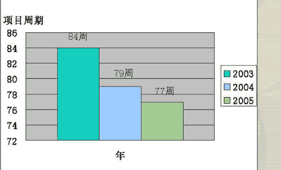

### 客户反馈产品缺陷——产品故障率

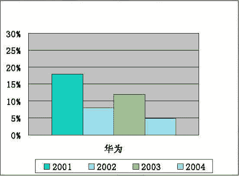

备注：2001年以来，从公司平均水平来看，我司的产品质量在提高，周期在下降，说明我们的开发能力在提升。2003年因为计算方法变化，所以出现上升。

## 为什么我们在这里

项目管理是目前企业运作中最常用的运作方式，不懂项目管理将在未来的企业中无法生存！

- 搞一次大型Party
- 举办一场婚礼
- 筹办一次校友聚会
- 组织一次旅游活动
- 装修一套房子

- 产品问题攻关
- 开发一门课程
- 组织一次国际认证
- 某产品市场调研
- 年度客户满意度调查

**工作 / 生活**

提供系统性的工具方法，帮助你更好的管理好自己的生活和工作事务，尽量一次性把事情做好，节省工作与生活中的时间和成本，提高效率和效果，获得家人与领导的认可！


## 引言：项目管理课程体系

- 高层级：高级项目管理研讨
- 应用级：销售/工程/IPD/IT项目管理
- 通用级：成功的项目管理
- PMP专业认证培训


## 各级课程对象及定位

| 级别 | 课程名称 | 培训对象 | 课程定位 |
| --- | --- | --- | --- |
| 高层级 | 高级项目管理研讨 | 公司项目管理办公室成员、高层领导 | 怎样从流程和制度层面在公司内营造良好的项目管理环境，多项目管理，重在理念流程制度。 |
| 应用级 | 销售、工程、IPD、IT等专业项目管理 | 各专业领域人员 | 怎样将项目管理理念方法和工具与专业领域特点相结合，应用到具体工作领域中，重在领域专业应用性 |
| 通用级 | 成功的项目管理 | 非项目管理专业人员 | 学习项目管理的基本方法与工具，将其应用到日常工作任务中，以提高效率和效果，重通用及实用 |

### PMP认证培训

培训对象：项目管理专业人员

课程定位：全面系统地学习项目管理九大知识领域，并做认证考试辅导，重理论知识、工具。

## 九大知识领域与项目管理阶段


**九大知识领域**

- 综合管理
- 范围管理
- 时间管理
- 费用管理
- 质量管理
- 人力资源管理
- 沟通管理
- 风险管理
- 采购管理

**项目管理阶段**

- 启动
- 计划
- 实施
- 监控
- 收尾

## 课程活动及特色

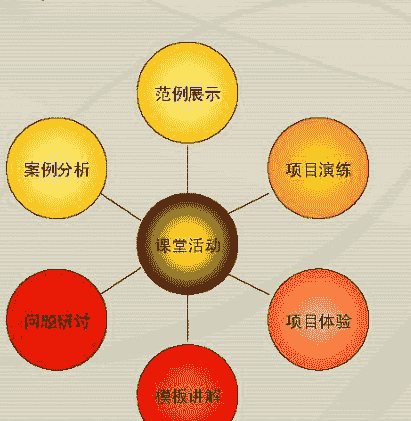

“实践、实战、实用”

提供一套理论方法、一套模板工具、一套范例演示、一份“神秘礼物”

强调在体验中和演练中学习

## 培训目的

- 了解项目管理的要素
- 掌握项目管理常用工具与方法
- 分享项目管理经验
- 提高工作效率和效果


## 项目与项目管理

### 什么是项目？

项目是：

为完成某一独特（Unique）产品或服务所做的一次性（Temporary）努力


### 项目的特征

- 临时性（Temporary）
- 独特性（Unique）
- 逐步完善（Progressive Elaboration）

明确的时间限制

明确而具体的目标

### 哪些是项目？

- 开发一个新产品
- 管理一个IT企业
- 实施一个新的信息系统
- 邀请客户考察公司
- 生产一瓶可口可乐
- 主办一场生日宴会
- 举办一次技术交流会
- 癌症研究
- APOLLO登月

### 项目与日常运作性工作

| 项目 | 日常运作性工作 |
| --- | --- |
| 临时性 | 持续性 |
| 独特性 | 重复的 |

- 由人来实施
- 受制于有限的资源
- 需要计划、执行和控制


### 什么是项目管理？


将相关的知识、技术、工具、技能等应用于项目任务，以满足项目干系人对项目的需求和期望的过程。

### 项目的三重制约

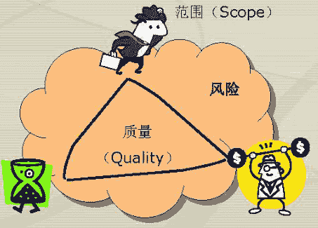

- 范围（Scope）
- 风险
- 质量（Quality）
- 时间（Time, Schedule）
- 成本（Cost, Budget）

在预算内按时提交满足要求的产品、服务或成果。

## 项目管理阶段

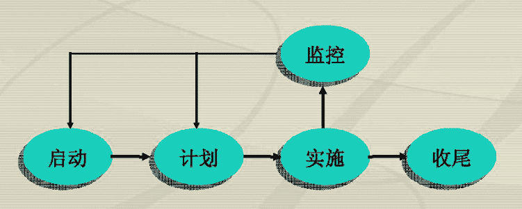

## 项目启动阶段

## 项目管理阶段

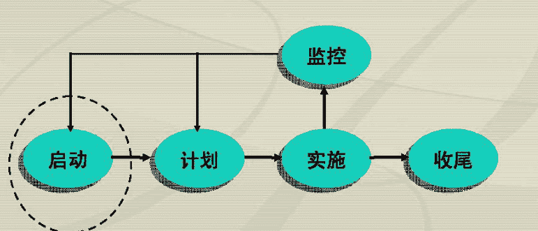

### 启动阶段

**启动阶段任务**

- 立项申请
- 组建项目组
- 项目策划/制作任务书
- 项目开工会

**启动阶段输出**

- 项目组成员表
- 策划报告/任务书

**启动阶段工具方法模板**

- 01项目组成员表（模板）
- 02策划报告/任务书（模板）
- 里程碑


### 立项申请

- 立项申请
- 组建项目组
- 策划/制作任务书
- 项目开工会

立项是项目开展前期工作的重要一环，其中可行性研究则是它的重要组成部分。

可行性研究是对拟实施项目作详尽的技术经济分析和多方案比较，提出评价，从而对项目是否合理和可行性作出结论的过程。

通过这个过程，储备一些可供选择的项目，使项目投资决策的基础工作超前；或取消一些不合理、不可行的项目，避免和减少投资决策的失误。


## 组建项目组

- 立项申请
- 组建项目组
- 策划/制作任务书
- 项目开工会

一个配置合理、团队合作的项目组是项目的核心，也是项目成功的保障。组建项目组时应该考虑：

- 建立一个结构合理的项目组（OBS）
- 寻找合适的人选，了解他们的技术、管理方面的优劣势，争取职能部门的支持。

输出：

- 项目组成员表

OBS：组织分解结构（Organizational Breakdown Structure）

## 项目赞助人的责任

项目赞助人通常对项目提供资金和支持职责：

- 挑选并任命项目经理，批准项目核心成员的组成
- 提供资金及审批重大财务事项
- 监控项目组执行情况
- 项目经理的求助对象

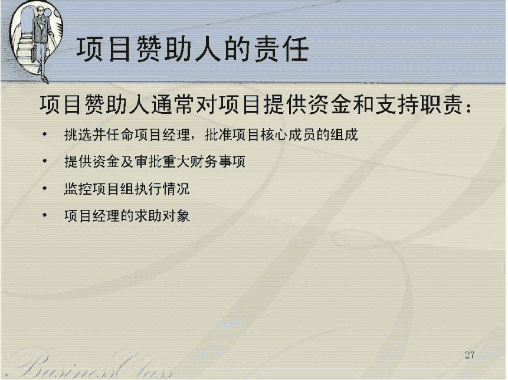

## 项目经理的责任


项目经理直接对项目赞助人负责，保证项目成功的实施。

- 与项目赞助人协商，就项目的目标（QTC）和所需的资源达成共识
- 挑选核心成员，并取得他们的支持
- 在项目的进程中不断了解客户的需求
- 在项目计划过程中领导及指导小组成员
- 保证与项目干系人的沟通并汇报项目的进程
- 监控项目的进程，保证项目按时间计划执行

## 项目成员的责任

项目核心成员对项目经理负责，保证项目的完成

- 参与项目的计划制定
- 服从项目经理的指挥，执行计划分配的任务
- 配合其他小组成员工作
- 保持与项目经理沟通

## 范例背景介绍


A国是公司的战略市场，其第二大运营商为TELECOM公司，我司于2005年4月5日正式中标一个100万线固网项目（N项目），该项目在2005年6月份开始实施，在实施过程，出现了以下三个方面的问题：

- 延迟交付；
- 发错货问题严重；
- 初验测试问题屡出不穷，客户开始质疑我司软件版本管理和质量控制能力；

这些问题引起了TELECOM高层关注，对以后与我司的合作开始持观望态度。

为此，代表处联系公司总部，准备在2005年7月31号前邀请TELECOM公司CTO带队到我司考察，并成立了客户考察工作项目组

## 项目策划/制作任务书

项目策划/任务书的基本要素：

- 描述
- 里程碑
- 项目评价标准
- 假设与约束条件
- 项目利益干系人

### 1. 项目背景与目的

- 项目需解决的商业问题：这是一个什么项目？为什么要做？

### 2. 项目目标

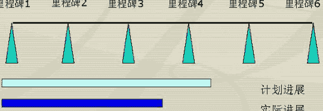

### 评价标准


说明项目成果在何种情况下将被接受，何时项目将被终止或取消，项目成功标准的度量或验收规程。

### 假设


说明项目的主要假设条件。

### 约束条件

说明项目启动和实施过程中的限制性条件。将会影响项目的风险和成本。

### 利益干系人

包括客户、高管、相关职能部门负责人、项目赞助人、项目经理，项目团队主要成员等。

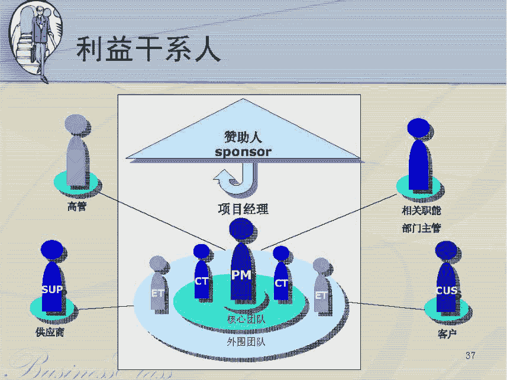

- 赞助人 Sponsor
- 项目经理
- 项目团队
- 外圈团队
- 高管
- 相关职能部门主管
- 供应商
- 客户
- SUP
- CUS
- CT
- PM
- CT
- ET
- ET

## 项目开工会

- 项目组成员的初步交流，相互了解
- 营造一种良好的团队氛围
- 就以下方面达成共识：
  - 项目目标
  - 管理方式
  - 工作方式
  - ……


## 启动阶段总结

### 启动阶段主要

- 立项申请
- 组建项目组
- 项目策划/制作任务书
- 项目开工会

### 启动阶段输出

- 项目组成员表
- 策划报告/任务书

### 启动阶段工具方法模板

- 01项目组成员表（模板）
- 02策划报告/任务书（模板）
- 里程碑

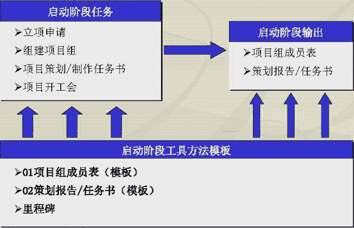


## 项目管理阶段

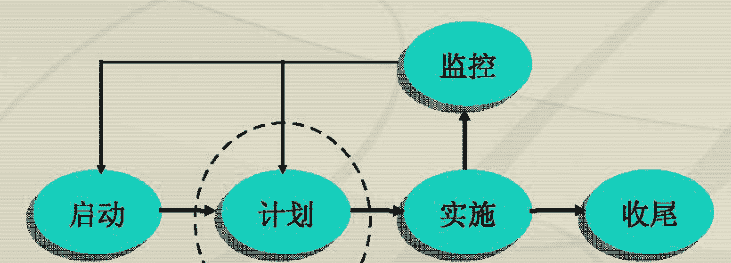

## 计划过程

启动阶段、计划阶段、实施阶段

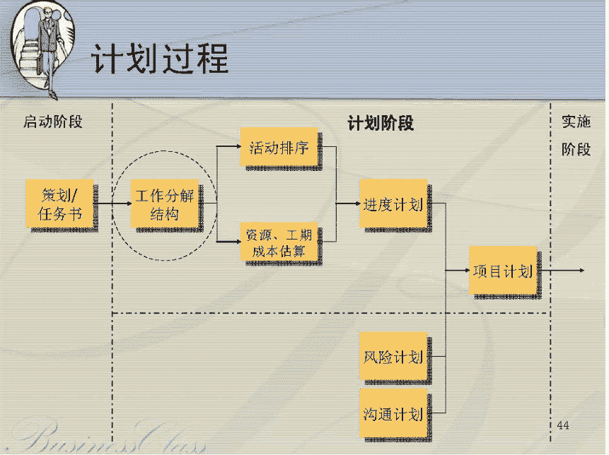

- 策划/任务书
- 工作分解结构
- 活动排序
- 资源、工期成本估算
- 进度计划
- 项目计划
- 风险计划
- 沟通计划

### 工作分解结构

- 定义项目范围的目的：把项目的逻辑范围清楚的描述出来并获得认可。范围陈述被用来定义哪些工作是包括在该项目内，而哪些工作又是在该项目之外。作为WBS分解的依据。
- 项目范围与产品范围的区别：产品范围定义了产品或服务所包含的特性和功能；项目范围定义了为交付具有规定特性和功能的产品或服务所必须完成的工作。

项目要做的事情太多了，一下想不清楚，怎么办？

“大事化小”，将项目的任务按照一定逻辑进行逐层分解，分解到可预知、可管理的单个活动为止。


### 分解的方法

- 自上而下法
- 头脑风暴法

### 表达形式：图形式或目录式

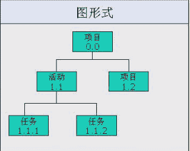

目录式：

```
0.0 项目
1.1 活动
1.1.1 任务
1.1.2 任务
1.2 活动
```

### 分解方式示例

**按项目的主要交付结果分：**

- 软件开发项目
  - 设计说明书
  - 源程序
  - 支持文档
  - 用户手册
  - 培训资料

**按职能分：**

- 手机开发项目
  - 市场调查
  - 设计
  - 采购
  - 制作样件
  - 测试
  - 生产
  - 上市


### 工作分解结构

按产品本身结构分

轿车开发项目

- 底盘
- 发动机
- 车身
- 转向系统
- 制动系统
- 电控系统
- 内饰

按项目实施顺序分

实行ISO9000质量管理体系项目

- 质量体系文件
- 培训
- 体系试运行
- 内审与管理评审
- 终审

### 将WBS与OBS相对应，设置责任矩阵RAM

- 用于项目组织分配工作任务和落实责任

| WBS | 组织责任者 | 项目经理 | 项目工程师 | 程序员 |
|---|---|---|---|---|
| 确定需求 |  | ○ | ▲ |  |
| 设计 |  | ○ | ▲ |  |
| 开发 | 修改外购软件包 | ○ | □ | ▲ |
|  | 修改内部程序 | ○ | □ | ▲ |
|  | 修改手工操作系统程序 | ○ | □ | ▲ |
| 测试 | 测试外购软件包 | □ | ● | ▲ |
|  | 测试内部程序 | □ | ● | ▲ |
|  | 测试手工操作系统流程 | □ | ● | △ |
| 安装完成 | 安装完成新软件包 | ● | ▲ |  |
|  | 培训工人 | ● | ▲ |  |

注：▲-负责，●-协助，□-知会，○-审批，△-承包

RAM: Responsibility assignment matrix

## 计划过程

启动阶段

计划阶段

实施阶段

策划/任务书

工作分解结构

活动排序

资源、工作成本估算

进度计划

项目计划

风险计划

沟通计划


## 活动排序

- 工作分解结构
- 活动排序
- 资源工期成本估算
- 进度计划
- 风险沟通计划
- 项目计划

- 方法
  - 按照工作的客观规律排序
  - 按照项目目标的要求排序
  - 按照轻重缓急排序
  - 根据项目本身的内在关系来排序

- 技巧
  - 只用工作分解结构（WBS）的最低层次的各项
  - 首先把最相关的项目排好（建一个子网），然后再合并所有子网。
  - 先不要担心资源、日期、或工期

- 工具
  - 前导图（PDM）
  - PDM: Precedence Diagramming Method

### 前导图

- 指按工作先后顺序把每项工作作为一个方块，按照先后顺序用带箭头的界限图表示。单代号工作位于节点上，也就是说每一个节点表示一个工作，用箭头表示工作的先后顺序和相互关系

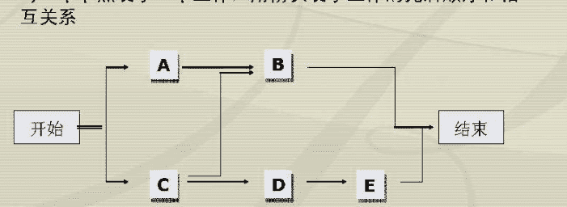

## 活动的依赖关系

结束 —— 开始

洗锅

炒菜

绿色任务必须结束

蓝色任务才能开始

开始 —— 开始

清洁地板

刷油漆

绿色任务必须开始

蓝色任务才能开始

开始 —— 结束

哨兵上岗

哨兵下岗

绿色任务必须开始

蓝色任务才能结束

结束 —— 结束

批准整个设计

制定下一步计划

绿色任务必须结束

蓝色任务才能开始

### 前导图

• 活动的依赖关系

| # | 任务 | 前置任务 | 资源 |
|---|---|---|---|
| 1 | 获取花园材料 |  | 房东 |
| 2 | 打扫地块 |  | 甲和乙 |
| 3 | 准备土壤 | 1, 2 | 甲 |
| 4 | 种草 | 3 | 甲 |
| 5 | 种花 | 3 | 甲 |

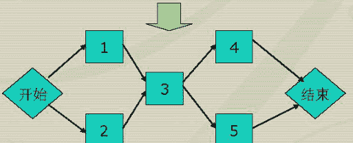

> 从开始到结束的关键事件网络图
> 
> 这个网络图有两条并列的路径

## 计划过程

启动阶段

计划阶段

实施阶段

策划/任务书

工作分解结构

活动排序

资源、工作成本估算

进度计划

项目计划

风险计划

沟通计划

## 资源、工期、成本估算

- 工作分解结构
- 活动排序
- 资源工期成本估算
- 进度计划
- 风险沟通计划
- 项目计划

- **资源类型：**
  - 人员、物资、技术……
- **资源估算考虑要素：**
  - 我需要什么资源？
  - 什么时候需要？
  - 需要多少？
  - 我获得所需资源由谁拍板？
- **估算方法**
  - 专家判断法


## 资源、工期、成本估算

### 工期估算

**定义：**
根据项目范围和资源的相关信息，确定（估计）完成所有活动所需的工期。

**估算方法：**
三点估算法：采用乐观、悲观和最可能的三点工期估算，并进行平均值、标准差值等有关计算来确定工期的方法。

工期 = (a+4b+c) / 6

专家判断法：由项目经理组织1~3名团队成员对任务消耗的工期进行估算，并确定项目日程。

**关键提示：**
任务的工期估算要以“谁来做”和“如何做”为基础。


## 资源、工期、成本估算

### 成本估算

项目费用

直接费用

人工费

材料费

设备费

分包合同费

间接费用

公司管理费

施工管理费

预备费

基本预备费

涨价预备费

项目费用的构成

### 成本估算

#### 信息来源

- 历史项目（Past Projects）
- 任务执行者（Those doing the task）
- 专业评估人员（Professional Estimators）
- 行业权威（Industry Gurus）


### 成本估算

#### 估算方法：

#### 自下而上估算方法

- 估算最详细的计划活动费用，然后将这些活动费用汇总到更高层级

#### 专家判断法

#### 类比估算法

- 利用历史信息和专家判断，只有当满足以下条件才比较可靠：
  - （a）先前的项目不仅在表面上且在实质上和当前项目是类似的；
  - （b）作估算的个人或小组具有必要经验

#### 参数成本法

- 确定项目成本与编写计算机程序代码行的关系
- `Quantity * Productivity Unit Rate`

### 成本估算

- 类比估算法：从早期项目中估算成本

| 项目阶段 | 早期项目成本 | 相对准度 | 通货膨胀因素 | 新项目的估计成本 |
|---|---|---|---|---|
| 项目说明 | $6,000 | 0.50 | 1.08 | $3,240 |
| 分析阶段 | $13,000 | 0.50 | 1.08 | $7,020 |
| 设计阶段 | $20,000 | 0.50 | 1.08 | $12,960 |
| 编程阶段 | $42,000 | 0.89 | 1.08 | $40,370 |
| 测试阶段 | $5,000 | 1.00 | 1.08 | $5,400 |
| 改进阶段 | $4,000 | 0.90 | 1.08 | $3,890 |
| 形成文件阶段 | $4,000 | 0.90 | 1.08 | $3,890 |
| 安装阶段 | $2,000 | 1.10 | 1.08 | $2,380 |
| 培训阶段 | $4,000 | 1.50 | 1.08 | $6,480 |
| 合计 | $100,000 |  |  | 85,630 |

## 计划过程

启动阶段

计划阶段

实施阶段

策划/任务书

工作分解结构

活动排序

资源、工期成本估算

进度计划

项目计划

风险计划

沟通计划


## 进度计划

- 工作分解结构
- 活动排序
- 资源工期成本估算
- 进度计划
- 风险沟通计划
- 项目计划

- 进度计划：
  根据WBS、活动排序、工期估算和所需资源的结
  果进行分析，制定出项目进度计划。

- 进度制定的工具
  - 关键路径法
  - 甘特图


## 关键路径法

- **关键路径法（CPM-Critical Path Method）**
  - 工期总和最长的一条路径称为关键路径，它是完成该项目所需的最短时间，关键路径上的每一项任务都是关键任务，这些任务的完成时间一有延迟，就会影响项目或阶段的完成时间

哪一条是关键路径？

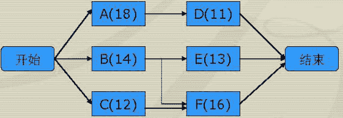


## Rules for Developing the Critical Path

## Critical Path

No time delays are allowed

## Delays

## Case Study (II): The Moon King

- **Background**
  Louis XIV has taken you prisoner and asks you to make a plan for him to add three new dungeons to his castle. The small dungeon is hard to design (at least 12 weeks) but easy to build (1 week). The medium dungeon is typical: design (5 weeks), construction (6 weeks). The large dungeon is easy to design (1 week) but very hard to build (9 weeks). You have one designer and one builder. Your designer does not know how to build, and your builder does not know how to design.

- **Question:**
  If you build three castle dungeons for Louis (one large, one medium, and one small), what is the shortest project duration?

## S, R, T Analysis

Scope

S: Three dungeons
(the least flexible factor)

Resources

R: One designer and one builder

(Personnel are fixed, but there is room to vary the order of specific work; a less flexible factor)

Time

T: Shortest time

(Depends on your design; a flexible factor)


## Different Approaches in Planning

Approach 1

Approach 2

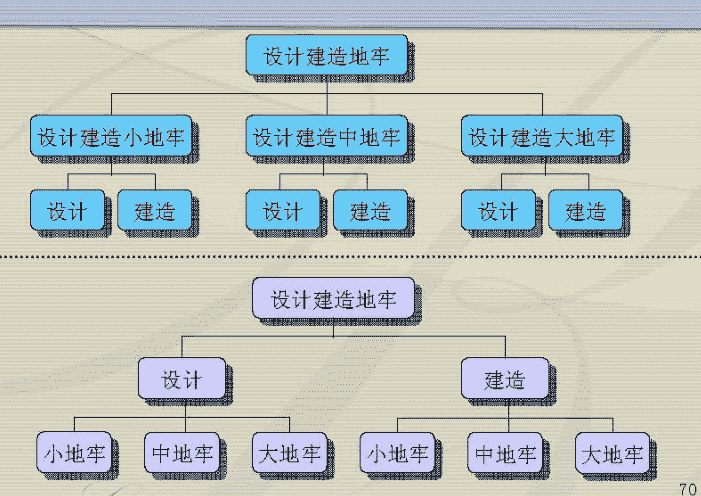

## The Rational Choice

Drawback of Approach 1:

Focusing on details such as a single product from the very beginning can easily lead to missing the forest for the trees.

Key to Approach 2:

Construction can be adjusted according to the overall arrangement of the design. To achieve the best results, the starting point and sequence of work must be arranged properly.

## Work Arrangement Guided by Approach 2

- 1. Design the small dungeon first.
- 2. Design the medium dungeon first.
- 3. Design the large dungeon first.

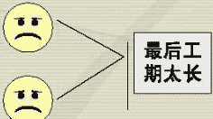


## Network Diagram — Precedence Diagram

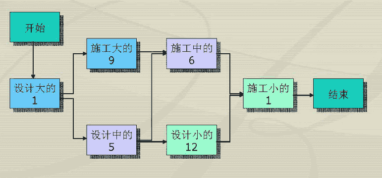

## Feasible Plan Gantt Chart

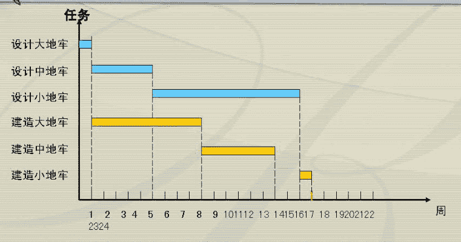

Try to build one dungeon while other dungeons are still in the design phase, in order to save time.

## What a Pity


In the dungeon design and construction task, your plan achieved the shortest duration, but for two weeks the builder had no work and spent all day sleeping or going out to have fun. Unfortunately, the king came to inspect on one of the days during those two weeks, found the builder sleeping, and thought that although your plan was short in duration, it made him waste food and wages and was not the best plan. So he ordered:

## You Are Sentenced to Life Imprisonment!

## How to Improve?

## Planning Process

Initiation Phase

Planning Phase

Execution Phase

Charter / Statement of Work

Work Breakdown Structure

Activity Sequencing

Resource, Duration, and Cost Estimating

Schedule Plan

Project Plan

Risk Plan

Communication Plan

## Risk Plan

- Work Breakdown Structure
- Activity Sequencing
- Resource, Duration, and Cost Estimating
- Schedule Plan
- Risk and Communication Plan
- Project Plan

- Identify risks
- Assess risk levels
- Develop a risk response plan

## Identify Risks

- Review the assumptions and constraints you have listed—each one represents a risk.
- Review your WBS—where could each activity or deliverable go wrong?
- Brainstorm with your team.
- Consider problems that occurred in previous projects.

### Assess Risk Levels

- Consider the likelihood of occurrence
  - High: probability greater than 60%
  - Medium: probability between 30% and 60%
  - Low: probability less than 30%
- Consider the impact on the project if the risk occurs
  High; Medium; Low

### Assess Risk Levels


- A comprehensive rating based on the risk probability and risk impact obtained from the overall assessment of a specific risk.

| Risk Probability \ Risk Impact | Low | Medium | High |
|---|---|---|---|
| High | Medium | High | High |
| Medium | Low | Medium | High |
| Low | Low | Low | Medium |

Risk Probability

Risk Impact

## Develop a Risk Response Plan

1. **Avoidance**
   Refers to changing the project plan to eliminate the risk or condition, so that the project objectives are not affected.

2. **Transference**
   Refers to transferring the consequences of a risk, along with the responsibility for responding, to a third party.

3. **Mitigation**
   Refers to reducing the probability or consequences of an adverse risk event to an acceptable threshold.

4. **Acceptance**
   This strategy can be divided into active or passive approaches.

Example - Table 05

## Planning Process

Initiation Phase

Planning Phase

Execution Phase

Charter / Statement of Work

Work Breakdown Structure

Activity Sequencing

Resource, Duration, and Cost Estimating

Schedule Plan

Project Plan

Risk Plan

Communication Plan

### Communication Plan

- Work Breakdown Structure
- Activity Sequencing
- Resource, Duration, and Cost Estimating
- Schedule Plan
- Risk and Communication Plan
- Project Plan

The "Four Rights"

In short, communication management in a project is sending the right information to the right stakeholders through the right channels at the right time, and ensuring that stakeholders understand it correctly.


### Communication Plan

- Analyze stakeholders' interest in and influence on the project, and develop a communication plan for each stakeholder.

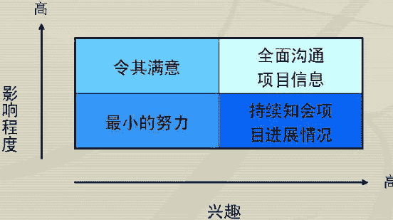

### Communication Plan

- Three principles of communication
  - Timeliness
  - Accuracy
  - Appropriate amount of information

Example - Table 06

| Stakeholder | Information Required | Frequency | Method | Responsible Person |
|---|---|---|---|---|
| Senior executive | • High-level cost, schedule, and quality performance control<br>• Issues and target behaviors | Monthly | Report<br>Meeting | Project manager |
| ... |  |  |  |  |

## Project Plan

Initiation Phase

Planning Phase

Execution Phase

Charter / Statement of Work

Work Breakdown Structure

Activity Sequencing

Resource, Duration
Cost Estimating

Schedule Plan

Project Plan

Risk Plan

Communication Plan

## Planning Phase Summary

## Planning Phase Tasks

- Work Breakdown Structure
- Activity Sequencing
- Resource, Duration, and Cost Estimating
- Risk Plan and Communication Plan
- Project Plan

## Planning Phase Outputs

- WBS
- Network diagram / Gantt chart
- Schedule plan
- Risk plan
- Communication plan

## Planning Phase Tools, Methods, and Templates

- Activity sequencing: Network diagram
- Duration estimation: Three-point estimating, expert judgment
- Cost estimation: Bottom-up estimating, expert judgment, analogous estimating, parametric cost estimation
- Schedule plan: Gantt chart, milestone chart, critical path method
- 03 WBS (Template)
- 04 Schedule Plan Form (Template)
- 05 Risk Management Form (Template)
- 06 Communication Plan Form (Template)


## Contents

- Projects and Project Management
- Project Initiation Phase
- Project Planning Phase
- Project Execution Phase
- Project Monitoring and Control Phase
- Project Closing Phase

## Execution and Monitoring Phases

## Execution and Monitoring Phase Tasks

- Communication
- Project monitoring
- Change management

## Execution and Monitoring Phase Outputs

- Project meeting minutes
- Project status report
- Project change management form

## Execution and Monitoring Phase Tools, Methods, and Templates

- Key elements of effective meetings
- Project change management process
- Project monitoring methods and tools
- 07 Project Meeting Minutes (Template)
- 08 Project Status Report (Template)
- 09 Project Change Management Form (Template)

## Communication

- Communication
- Project monitoring
- Change management


Sponsor

Senior management

Functional department heads

PM

Core team

Extended team

CT

CT

ET

ET

SUP Supplier

CUS Customer


## 沟通

| 项目组内的沟通 | 与高层、客户的沟通 |
|---|---|
| 项目组成员有四个主要的沟通需求：<br>• 职责<br>• 授权<br>• 协调<br>• 状态<br><br>会议：<br>• 项目开工会<br>• 成员进度汇报<br>• 项目进展会<br>及时、公开、恰到好处 | 有下面的一些问题要问：<br>▪ 谁、为什么需要信息？<br>▪ 他们需要什么类型的信息？何种详尽程度？频度如何？<br>▪ 当你和高层及客户沟通的时候，你的目标是什么？采用什么样的方法来完成沟通？ |

### 项目沟通要点

- 项目组全体成员对目标达成共识
- 项目沟通计划、规则
- 互相尊重
- 主动倾听
- 双赢


### 有效沟通的关键要素

**会前：**

- 事先了解为什么开会，已经预期要取得什么结果
- 考虑是否可能取消会议
- 确定需要参加的最少人数
- 选择会议地点，会议的布置与会议目的相一致
- 会前和关键与会者就会议议题的持续时间进行沟通

**会中：**

- 做好准备，按时开始，并首先点明会议的目的和议程
- 每位与会者都有发言的机会
- 对会议内容进行口头总结

**会后：**

- 会后发布会议纪要给每位与会者
- 会议必须产生明确的决定
- 所有决定必须立即付诸行动


## 项目监控

- 高风险的任务
- 与项目里程碑有关的进展
- 使用的资源和费用
- 人员的表现

### 项目监控的方法与工具

- 应用项目进度计划表
- 建立项目基线
- 召集会议
- 观察/检查
- 跟踪行动计划
- 定期反馈及报告
  - 进展报告（甘特图、里程碑趋势图）
  - 状态报告
    - 范例-07表
  - 阶段结束/月度评估报告
    - 范例-08表


### 项目进度控制

**实施监控过程中发现进度滞后，怎么办？**

选择最近的、时间估算较多的工作包实施以下措施：

- 投入更多的人
- 现有的人投入更多的时间（加班）
- 换工作效率更高的人员去做
- 改进工作方法和工具，提高效率
- 缩小项目范围或降低活动质量要求

## 变更管理


- 沟通
- 有效监控
- 变更管理

### 变更源头

- 项目委托人：不断变化的想法与欲望
- 项目团队：成员技能与团队冲突
- 项目优先级：市场变化/资源变化/其他项目影响
- 其他：法规/环境/企业变革

### 典型的变更管理过程

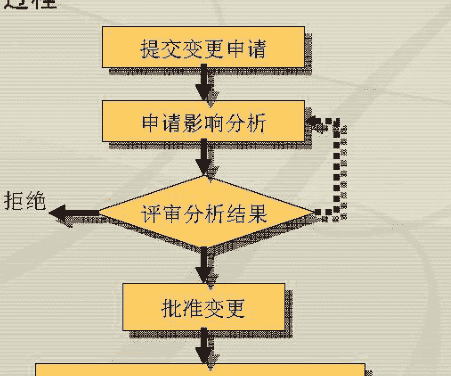

### 变更管理的注意事项

1. 变更发生时要首先确定“能做些什么，以及不能做些什么”
2. 确定全体都一致同意的方案，提出变更步骤，并就将要做出的变更进行即时评估
3. 申请/审批修改后的计划（修改部分）
4. 保持/共享计划和信息最新状态
5. 尽量做得“天衣无缝”，而且没有“痛苦”


## 实施监控阶段TOP3

- **实施监控阶段关键点**
  1. 根据沟通计划，与项目干系人进行良好的沟通
  2. 严格监控进度，及时协调解决问题
  3. 重点跟踪监控高风险任务，并采取有效的防范措施
- **实施监控阶段常见问题：**
  1. 需求变更管理不善，导致变更频繁，项目组运作混乱；
  2. 跨部门项目组成员的绩效考核与激励机制不完善；
  3. 项目组的沟通和跨部门协作难度比较大；

## 实施、监控阶段总结

### 实施、监控阶段任务

- 沟通
- 项目监控
- 变更管理

### 实施、监控阶段输出

- 项目会议纪要
- 项目状态报告
- 项目变更管理表

### 实施、监控阶段工具方法模板

- 有效会议关键要素
- 项目变更管理流程
- 项目监控方法工具
- 07 项目会议纪要（模板）
- 08 项目状态报告（模板）
- 09 项目变更管理表（模板）


## Contents


- 项目与项目管理
- 项目启动阶段
- 项目计划阶段
- 项目实施阶段
- 项目监控阶段
- 项目收尾阶段

## 项目实施与监控阶段

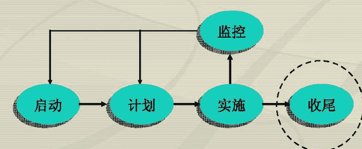

## 收尾阶段

### 收尾阶段任务

- 评估与验收
- 项目总结
- 文件归档

### 收尾阶段输出

- 项目评估报告
- 项目总结表

### 收尾阶段工具方法模板

- 项目评估验收要素
- 10 项目总结表（模板）

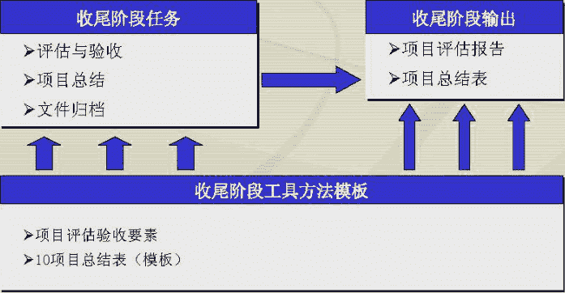

### 评估与验收

项目结束

1. **财务**：评估投资回报率，评估实际费用与计划费用的差异
2. **时间**：与计划的一致性
3. **质量**：项目输出的表现水平，投资者和客户对质量的感受
4. **人力资源**：团队精神，激励，态度调查
5. **环境**：环境因素对项目活动的影响
6. **项目计划**：计划流程的费用评估及适当的管控技术的使用
7. **项目控制**：项目的控制是否为任务重大改进提供了基础？

### 项目总结

- 评估与验收
- 项目总结会（喝酒与打屁股）
- 项目总结
- 项目总结表（模板）
- 文案包装

> 相互间的鼓励是那么的需要，没有比此时此刻美好的氛围更值得欣慰
> ——爱迪生

### 文件归档

- 收集与验收
- 项目总览
- 文件归档

| 步骤 | 归档文件 |
| --- | --- |
| 启动 | 项目组任命、项目策划报告/任务书 |
| 计划 | WBS图、甘特图、沟通风险计划书、项目综合计划 |
| 实施控制 | 阶段进展报告、项目会议纪要、变更申请表 |
| 收尾 | 项目评估验收报告、项目总结报告、项目交付件相关文档 |


## 收尾阶段总结


### 收尾阶段任务

- 评估与验收
- 项目总结
- 文件归档

### 收尾阶段输出

- 项目评估报告
- 项目总结表

### 收尾阶段工具方法模板

- 项目评估验收要素
- 10 项目总结表（模板）

## 项目成功的标准

- 范围（Scope）
- 风险
- 质量（Quality）
- 时间（Time, Schedule）
- 成本（Cost, Budget）

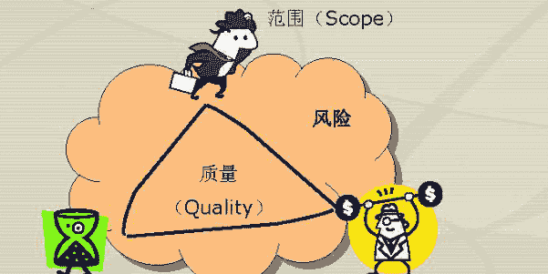

## 项目成败的统计

|  | 不成功（彻底失败） | 不成功（不太成功） | 达成目标 | 超过目标 |
| 项目总目标 | 34% | 50% | 16% | |
| 成本管理 | 17%（严重超支） | 38%（有所超支） | 27% | 12%（有所节约）；6%（大量节约） |
| 时间管理 | 25%（严重拖期） | 34%（有所拖期） | 22% | 18%（提前完成） |
| 质量管理 | 29%（未达到委托人要求） | | 51% | 20%（超过委托人要求） |

（美国Standish Group 1994年对8400多个项目的统计）


## 华为公司项目成功的因素

- 1. 组织与流程支撑下良好的项目管理与运作；
- 2. 永不言败的精神：1%的希望，100%的努力；
- 3. 经验与教训的共享；
- 4. 胜则举杯同庆，败则拼死相救的团队合作精神
- 5. 资源共享
- 6. ……

## 华为公司项目失败的原因

- 1. 项目组成员之间没有良好的沟通；
- 2. 项目组成员的技术与管理水平不足；
- 3. 项目变更管理水平有待提高；
- 4. 急功近利的进度计划；
- 5. 团队尤其是LEADER的项目管理能力不够
- 6. ……


## 业界项目成功的因素

影响项目成功的因素：

- 项目的目标、范围是否明确；
- 是否获得领导的积极支持；
- 项目的组织是否健全、稳定；
- 是否建立了有序的，有效的、良好的沟通渠道；
- 是否具有有效、全面的项目管理，严格的变更控制；
- 是否建立了良好的、积极的、团队合作的工作氛围；
- 项目经理的经验；

## 业界项目失败的因素

项目失败的主要原因：

- 缺少必须承担的义务和方向
- 没有项目策略上的一致性
- 变化中不明确的效益
- 不明确的目的/目标
- 组织与项目目标不一致
- 资源限制
- 不明确的职责
- 不断变化的要求
- 没有最终用户介入
- 不规范、低效的沟通

## 课程总结

- 启动
  - 立项申请
  - 组建项目组
  - 策划/任务书
  - 项目开工会

- 计划
  - 工作分解结构
  - 活动排序
  - 资源工期成本估算
  - 进度计划
  - 风险沟通计划
  - 项目计划

- 实施
  - 沟通
  - 项目监控
  - 变更管理

- 收尾
  - 评估与验收
  - 项目总结
  - 文件归档

- 监控

项目管理沟通

## 各阶段重要关键点TOP3

启动阶段
1. 与客户、SPONSOR、高层的沟通明确需求及获得相关支持
2. 明确项目目标和定位
3. 开工会，统一思想，明确团队运作制度
计划阶段
1. 明确项目范围
2. 全面的风险识别
3. 各关键干系人的识别与沟通计划
实施与监控阶段
1. 根据沟通计划，与项目干系人进行良好的沟通
2. 严格监控项目进度，及时协调解决问题
3. 重点跟踪监控高风险任务，并采取有效的防范措施
收尾阶段
1. 顺利完成项目评估和验收
2. 成功和失败的经验总结
3. 完整的项目信息归档

## 参考资料建议

推荐书籍:
项目经理案头手册（第2版），The Project Manager’s Desk Reference(2nd Edition)
【著者】詹姆斯.P.刘易斯 【出版社】机械工业出版社

成功的项目管理（第二版），Successful Project Management
【著者】杰克.吉多 詹姆斯.P.刘易斯 【出版社】机械工业出版社

有效的项目管理, Effective Project Management(2nd Ed)
【著者】罗伯特.K.威索基 【出版社】电子工业出版社

推荐网站:
www.pmi.org 美国项目管理协会（PMI）

## 送您一句话

掌握方法与工具，只是迈出成功项目管理的第一步，项目最后成功与否还取决于您是否有毅力，是否坚持不懈的

实践——总结——再实践！


## 谢谢！

- 您真的认真学习了这个资料了吗？
- 真的看仔细了？
- 那么——文中有一个错别字您发现了吗？吗？？

我找到了，在108页的“互相鼓励”

