# 东南大学高级数据结构课件（崇志宏）


## 平摊/竞争分析

- 1) 聚合分析
- 2) 记账法
- 3) 势能法
- 竞争分析
- 动态结构
- 二项堆，动态表，伸展树

## 哈希表应该有多大？

目标：使表尽可能小，但足够大以避免溢出（或变得低效）。

问题：如果我们事先不知道合适的大小怎么办？

解决方案：*动态表。*

思路：每当表溢出时，通过“增长”它来分配（通过 malloc 或 new）一个更大的新表。将所有项目从旧表移动到新表，并释放旧表的存储空间。


- 1. INSERT
- 2. INSERT

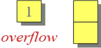

- 1. INSERT
- 2. INSERT

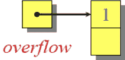

- 1. INSERT
- 2. INSERT

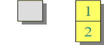

- 1. INSERT
- 2. INSERT
- 3. INSERT

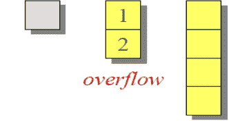

- 1. INSERT
- 2. INSERT
- 3. INSERT

- 1. INSERT
- 2. INSERT
- 3. INSERT
- 4. INSERT

- 1. INSERT
- 2. INSERT
- 3. INSERT
- 4. INSERT
- 5. INSERT

overflow

- 1. INSERT
- 2. INSERT
- 3. INSERT
- 4. INSERT
- 5. INSERT

- 1. INSERT
- 2. INSERT
- 3. INSERT
- 4. INSERT
- 5. INSERT

overflow

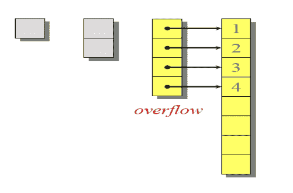

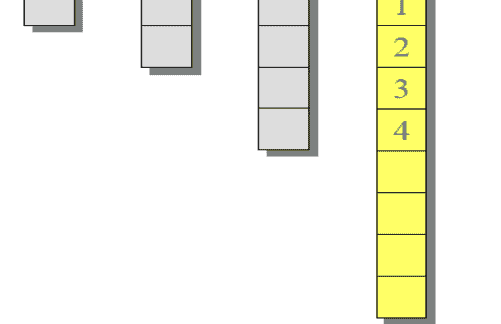

- 1. INSERT
- 2. INSERT
- 3. INSERT
- 4. INSERT
- 5. INSERT
- 6. INSERT
- 7. INSERT

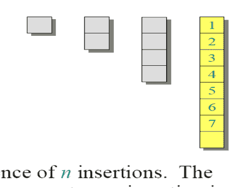

考虑一个包含 *n* 次插入的序列。执行一次插入的最坏情况时间为 Θ(*n*)。因此，*n* 次插入的最坏情况时间为 *n* · Θ(*n*) = Θ(*n*²)。

错误！事实上，*n* 次插入的最坏情况总成本仅为 Θ(*n*) ≪ Θ(*n*²)。

让我们看看原因。

## 更紧的分析

设 \(c_i\) 为第 \(i\) 次插入的成本：

\[
c_i = \begin{cases}
i & \text{if } i-1 \text{ is an exact power of 2},\\
1 & \text{otherwise.}
\end{cases}
\]

|  | 1 | 2 | 3 | 4 | 5 | 6 | 7 | 8 | 9 | 10 |
|---|---|---|---|---|---|---|---|---|---|---|
| $i$ | 1 | 2 | 3 | 4 | 5 | 6 | 7 | 8 | 9 | 10 |
| $size_i$ | 1 | 2 | 4 | 4 | 8 | 8 | 8 | 8 | 16 | 16 |
| insertion cost | 1 | 1 | 1 | 1 | 1 | 1 | 1 | 1 | 1 | 1 |
| copying cost |  | 1 | 2 |  | 4 |  |  |  | 8 |  |
| $c_i$ | 1 | 2 | 3 | 1 | 5 | 1 | 1 | 1 | 9 | 1 |

### 更紧的分析（续）

\[
\sum_{i=1}^{n} c_i \le n + \sum_{j=0}^{\lfloor \lg(n-1)\rfloor} 2^j \le 3n = \Theta(n).
\]

因此，每个动态表操作的平均成本为 Θ(*n*)/*n* = Θ(1)。

## 平摊分析特点

- 1）它是一种分析的方法，适用于分析一个彼此相关的操作序列。其分析方法不是
- 2）操作序列的总代价是序列长度的函数，而不是输入量规模的函数。
- 3）不仅是分析方法，也是设计算法和数据结构的一种思维方法。

因为设计算法与分析时间性能紧密相关，所以通过平摊分析可优化算法设计，加深对算法所操作的数据结构特性的认识，从

提出三种平摊分析的方法：

- 合计法、聚集方法（aggregate）：
- 记账法、会计法（accounting）：
- 势能法（potential）。

## 平摊分析

*平摊分析* 是分析操作序列的任何策略，以表明每个操作的平均成本很小，即使序列中的单个操作可能很昂贵。

尽管我们是在取平均值，但概率却不涉及！

- 平摊分析保证了每个操作在*最坏情况*下的平均性能。

### 平摊分析的类型

三种常见的平摊论证：

- *聚合* 方法，
- *记账* 方法，
- *势能* 方法。

我们刚刚看到一个聚合分析。

聚合方法虽然简单，但缺乏其他两种方法的精确性。特别是，记账法和势能法允许为每个操作分配特定的*平摊成本*。

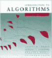

### 记账法

- 为第 *i* 个操作收取虚构的 **平摊成本** \(\hat{c}_i\)，其中 \$1 支付 1 个单位的工作（*即*，时间）。
- 该费用用于执行操作。
- 任何未立即消耗的金额都存入 *银行*，供后续操作使用。
- 银行余额不得为负！我们必须确保

\[
\sum_{i=1}^{n} c_i \le \sum_{i=1}^{n} \hat{c}_i
\]

对所有 \(n\) 成立。

- 因此，总平摊成本提供了总真实成本的上界。


## 动态表的会计分析

对第 \(i\) 次插入收取摊还成本 \(\hat{c}_i = \$3\)。

- \(\$1\) 支付即时插入。
- \(\$2\) 存储起来以备表加倍时使用。

当表加倍时，\(\$1\) 支付移动一个近期项目，\(\$1\) 支付移动一个旧项目。

## 示例：


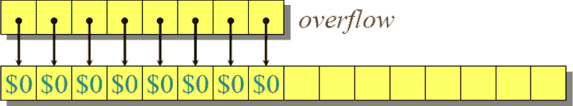

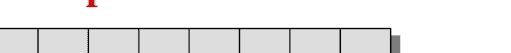

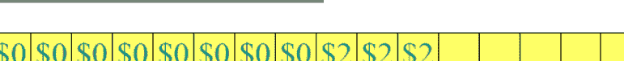

## 会计分析（续）

**关键不变量：** 银行余额永不低于 0。因此，摊还成本之和提供了真实成本之和的上界。

| 操作 | 1 | 2 | 3 | 4 | 5 | 6 | 7 | 8 | 9 | 10 |
|---|---:|---:|---:|---:|---:|---:|---:|---:|---:|---:|
| \(size_i\) | 1 | 2 | 4 | 4 | 8 | 8 | 8 | 8 | 16 | 16 |
| \(c_i\) | 1 | 2 | 3 | 1 | 5 | 1 | 1 | 1 | 9 | 1 |
| \(\hat{c}_i\) | \(2^*\) | 3 | 3 | 3 | 3 | 3 | 3 | 3 | 3 | 3 |
| \(bank_i\) | 1 | 2 | 2 | 4 | 2 | 4 | 6 | 8 | 2 | 4 |

\* 好吧，我撒谎了。第一次操作只花费 \$2，而不是 \$3。

## 理解势能


\[
\hat{c}_i = c_i + \Phi(D_i) - \Phi(D_{i-1})
\]

**势能差** \(\Delta\Phi_i\)

- 如果 \(\Delta\Phi_i > 0\)，则 \(\hat{c}_i > c_i\)。操作 \(i\) 将工作存储在数据结构中以备后用。
- 如果 \(\Delta\Phi_i < 0\)，则 \(\hat{c}_i < c_i\)。数据结构提供存储的工作来帮助支付操作 \(i\)。

## 摊还成本限制真实成本

\(n\) 个操作的摊还总成本为

\[
\sum_{i=1}^{n}\hat{c}_i = \sum_{i=1}^{n}\left(c_i + \Phi(D_i) - \Phi(D_{i-1})\right)
\]

对两边求和。

\[
= \sum_{i=1}^{n}c_i + \Phi(D_n) - \Phi(D_0)
\]

级数 telescoping。

\[
\geq \sum_{i=1}^{n}c_i \qquad \text{since } \Phi(D_n)\geq 0 \text{ and } \Phi(D_0)=0.
\]


## 表加倍的势能分析

定义第 \(i\) 次插入后表的势能为

\[
\Phi(D_i) = 2i - 2^{\lceil\lg i\rceil}.
\]

（假设 \(2^{\lceil\lg 0\rceil}=0\)。）

### 注：

- \(\Phi(D_0)=0\)，
- \(\Phi(D_i)\geq 0\) 对所有 \(i\) 成立。

## 示例：

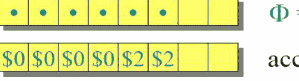

\[
\Phi = 2\cdot 6 - 2^3 = 4
\]

（会计方法）

## 摊还成本的计算

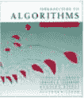

第 \(i\) 次插入的摊还成本为

\[
\hat{c}_i = c_i + \Phi(D_i) - \Phi(D_{i-1})
\]

\[
= \begin{cases}
i & \text{if } i-1 \text{ is an exact power of 2,}\\
1 & \text{otherwise;}
\end{cases}
+ \left(2i - 2^{\lceil\lg i\rceil}\right) - \left(2(i-1) - 2^{\lceil\lg(i-1)\rceil}\right)
\]

\[
= \begin{cases}
i & \text{if } i-1 \text{ is an exact power of 2,}\\
1 & \text{otherwise;}
\end{cases}
+ 2 - 2^{\lceil\lg i\rceil} + 2^{\lceil\lg(i-1)\rceil}.
\]

### 计算

### 情况 1：\(i-1\) 是 2 的精确幂。

\[
\hat{c}_i = i + 2 - 2^{\lceil\lg i\rceil} + 2^{\lceil\lg(i-1)\rceil}
\]

\[
= i + 2 - 2(i-1) + (i-1)
\]

\[
= i + 2 - 2i + 2 + i - 1
\]

\[
= 3
\]

### 情况 2：\(i-1\) 不是 2 的精确幂。

\[
\hat{c}_i = 1 + 2 - 2^{\lceil\lg i\rceil} + 2^{\lceil\lg(i-1)\rceil}
\]

\[
= 3
\]

因此，\(n\) 次插入在最坏情况下花费 \(\Theta(n)\)。

### 练习：

修复此分析中的错误以表明第一次插入的摊还成本仅为 2。


## 结论

- 摊还成本可以为数据结构性能提供一个清晰的抽象。
- 任何分析方法都可以在需要摊还分析时使用，但每种方法在某些情况下可以说是更简单或更精确。
- 在会计方法中分配摊还成本，或在势能方法中分配势能，可能有不同的方案，有时会导致截然不同的界限。

## 竞争分析

- 自组织列表
- 移至前端启发式
- MTF 的竞争分析

## 自组织列表

List $L$ of $n$ elements

- 操作 Access($x$) 的成本为 rank$_L(x)$ = $x$ 与 $L$ 头部的距离。
- $L$ 可以通过交换相邻元素来重新排序，成本为 1。

## 示例：

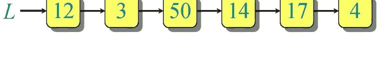

## 自组织列表

List *L* of *n* elements

- 操作 Access(*x*) 的成本为 rank_L(*x*) = $x$ 与 $L$ 头部的距离。
- *L* 可以通过交换相邻元素来重新排序，成本为 1。

## 示例：

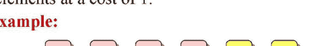

访问键为 14 的元素成本为 4。

## 在线和离线问题

**定义。** 操作序列 $S$ 逐个提供。对于每个操作，在线算法 $A$ 必须立即执行该操作，而没有任何关于未来操作的知识（例如，*Tetris*）。离线算法可以提前看到整个序列 $S$。

**目标：** 最小化总成本 $C_A(S)$。

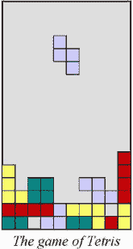

## 自组织列表的最坏情况分析

对手总是访问 $L$ 的尾部（第 *n* 个）元素。然后，对于任何在线算法 *A*，我们有

$$C_A(S) = \Omega(|S| \cdot n)$$

在最坏情况下。

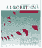

## 自组织列表的平均情况分析

假设元素 $x$ 被访问的概率为 $p(x)$。那么，我们有

E[$C_A(S)$] = $\sum_{x \in L} p(x) \cdot \text{rank}_L(x)$

当 $L$ 按 $p$ 的递减顺序排序时，该值最小。

**启发式：** 统计每个元素被访问的次数，并按访问次数递减的顺序维护 $L$。


## 移至前端启发式

**实践：** 实现者发现 *移至前端 (MTF)* 启发式在经验上能产生良好的结果。

**思想：** 访问 *x* 后，使用交换将 *x* 移至 $L$ 的头部：

cost = 2 · rank_L(x).

MTF 启发式对访问序列 *S* 中的局部性反应良好。


## MTF 是 O(1)-竞争的

定理。MTF 对自组织列表是 4-竞争的。

## MTF 是 O(1)-竞争的

**定理。** MTF 对自组织列表是 4-竞争的。

*证明。* 设 $L_i$ 为第 $i$ 次访问后 MTF 的列表，$L_i^*$ 为第 $i$ 次访问后 OPT 的列表。

设 $c_i$ = MTF 第 $i$ 次操作的成本
$= 2 \cdot \operatorname{rank}_{L_{i-1}}(x)$ 如果它访问 $x$；
$c_i^*$ = MTF 第 $i$ 次操作的成本
$= \operatorname{rank}_{L_{i-1}^*}(x) + t_i$,

其中 $t_i$ 是 OPT 执行的交换次数。

## 势能函数

定义势能函数 $\Phi: \{L_i\} \to \mathbb{R}$ 为

\[\Phi(L_i) = 2 \cdot |\{(x,y): x \prec_{L_i} y \text{ and } y \prec_{L_i^*} x\}|\]
\[= 2 \cdot \#\ \textit{inversions}.\]

## 势能函数

定义势能函数 Φ:{L_i} → ℝ 为

Φ(L_i) = 2 · |{(x, y) : x ≺_{L_i} y and y ≺_{L_i*} x}| = 2 · # inversions.

## 示例。

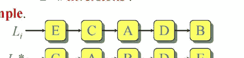

## 势能函数

定义势能函数 Φ:{L_i} → ℝ 为

```
Φ(L_i) = 2 · |{(x, y) : x ≺_{L_i} y and y ≺_{L_i*} x}| = 2 · # inversions.
```

## 示例。

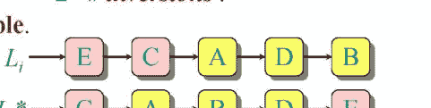

```
Φ(L_i) = 2 · |{(E,C), ...}|
```


## 势函数

定义势函数 \(\Phi:\{L_i\}\to\mathbb{R}\) 如下：

\[
\Phi(L_i)=2\cdot |\{(x,y): x\prec_{L_i} y \text{ 且 } y\prec_{L_i^*} x\}|=2\cdot \#\text{ 逆序对}.
\]

### 示例

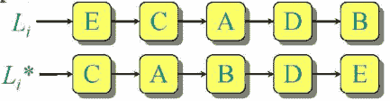

\[
\Phi(L_i)=2\cdot |\{(E,C),(E,A),(E,D),(E,B),(D,B)\}|=10.
\]

注意：

- 对于 \(i=0,1,\dots\)，有 \(\Phi(L_i)\ge 0\)。
- 如果 MTF 和 OPT 以相同的列表开始，则 \(\Phi(L_0)=0\)。

### 一次转置会使 \(\Phi\) 改变多少？

- 一次转置会引入/消除 1 个逆序对。
- \(\Delta\Phi=\pm 2\)。

## 访问时会发生什么？

假设第 \(i\) 次操作访问元素 \(x\)，并定义

\[
A=\{y\in L_{i-1}: y\prec_{L_{i-1}} x \text{ 且 } y\prec_{L_{i-1}^*} x\},
\]

\[
B=\{y\in L_{i-1}: y\prec_{L_{i-1}} x \text{ 且 } y\succ_{L_{i-1}^*} x\},
\]

\[
C=\{y\in L_{i-1}: y\succ_{L_{i-1}} x \text{ 且 } y\prec_{L_{i-1}^*} x\},
\]

\[
D=\{y\in L_{i-1}: y\succ_{L_{i-1}} x \text{ 且 } y\succ_{L_{i-1}^*} x\}.
\]

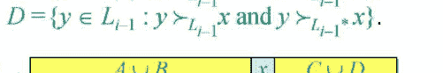

| 列表 | 围绕 \(x\) 的顺序 | 排名 |
|---|---|---|
| \(L_{i-1}\) | \(A \cup B,\; x,\; C \cup D\) | \(r=\operatorname{rank}_{L_{i-1}}(x)\) |
| \(L_{i-1}^*\) | \(A \cup C,\; x,\; B \cup D\) | \(r^*=\operatorname{rank}_{L_{i-1}^*}(x)\) |

我们有 \(r=|A|+|B|+1\) 且 \(r^*=|A|+|C|+1\)。

当 MTF 将 \(x\) 移到前端时，会引入 \(|A|\) 个逆序对并消除 \(|B|\) 个逆序对。OPT 的每次转置最多引入 1 个逆序对。因此，

\[
\Phi(L_i)-\Phi(L_{i-1})\le 2(|A|-|B|+t_i).
\]

## 摊还成本

对于势函数 \(\Phi\)，MTF 第 \(i\) 次操作的摊还成本为

\[
\hat{c}_i=c_i+\Phi(L_i)-\Phi(L_{i-1}).
\]

那么

\[
\begin{aligned}
\hat{c}_i
&\le 2r+2(|A|-|B|+t_i)\\
&=2r+2(|A|-(r-1-|A|)+t_i) && \text{(因为 } r=|A|+|B|+1\text{)}\\
&=2r+4|A|-2r+2+2t_i\\
&=4|A|+2+2t_i\\
&\le 4(r^*+t_i) && \text{(因为 } r^*=|A|+|C|+1\ge |A|+1\text{)}.
\end{aligned}
\]


## 摊还成本

MTF 相对于 Φ 的第 *i* 次操作的摊还成本为

ĉᵢ = cᵢ + Φ(Lᵢ) − Φ(Lᵢ₋₁)
≤ 2r + 2(|A| − |B| + tᵢ)
= 2r + 2(|A| − (r − 1 − |A|) + tᵢ)
= 2r + 4|A| − 2r + 2 + 2tᵢ
= 4|A| + 2 + 2tᵢ
≤ 4(r* + tᵢ)
= 4cᵢ*.


## 压轴大戏

因此，我们有

$C_{\text{MTF}}(S) = \sum_{i=1}^{|S|} c_i$


因此，我们有

C_{MTF}(S) = \sum_{i=1}^{|S|} c_i
= \sum_{i=1}^{|S|} (\hat{c}_i + \Phi(L_{i-1}) - \Phi(L_i))

# # 压轴大戏

因此，我们有

$$C_{\mathrm{MTF}}(S)=\sum_{i=1}^{|S|} c_i$$

$$=\sum_{i=1}^{|S|}\left(\hat{c}_i+\Phi(L_{i-1})-\Phi(L_i)\right)$$

$$\leq\left(\sum_{i=1}^{|S|}4c_i^*\right)+\Phi(L_0)-\Phi(L_{|S|})$$

因此，我们有

$C_{\text{MTF}}(S) = \sum_{i=1}^{|S|} c_i$

$= \sum_{i=1}^{|S|} (\hat{c}_i + \Phi(L_{i-1}) - \Phi(L_i))$

$\le \left(\sum_{i=1}^{|S|} 4c_i^*\right) + \Phi(L_0) - \Phi(L_{|S|})$

$\le 4 \cdot C_{\text{OPT}}(S),$

由于 $\Phi(L_0) = 0$ 且 $\Phi(L_{|S|}) \ge 0$。□

## 附录

如果我们将把 *x* 移向前面的换位计为“免费”的话（模拟以常数时间将 *x* 插入和移出 *L*），那么 MTF 是 *z*-竞争的。

## 附录

如果我们将把 x 移向前面的换位计为“免费”的话（模拟以常数时间将 x 插入和移出 L），那么 MTF 是 2-竞争的。

如果 L₀ ≠ L₀* 呢？

- 那么，Φ(L₀) 在最坏情况下可能是 Θ(n²)。
- 因此，C_MTF(S) ≤ 4 · C_OPT(S) + Θ(n²)，这仍然是 4-竞争的，因为当 |S| → ∞ 时 n² 是常数。

## 再进一步！

- 不是列表而是树
- **伸展树**

## BST 的问题

- 因为 BST 的形状由数据的插入顺序决定，所以我们有风险得到本质上是列表的树

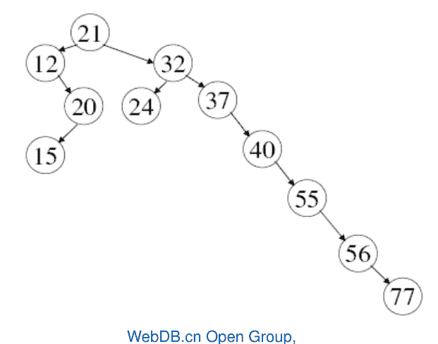

## BST 操作序列

- 单个 BST 操作的最坏情况可以是 O(N)
- 如果这种情况只偶尔发生，还不算太糟
- 但是……整个“坏”操作序列并不少见。在这种情况下，M 个操作的序列需要 O(M*N) 时间，操作序列的时间变得明显。

## 伸展树操作序列

- 伸展树保证 M 个操作的序列最多需要 $O(\text{M * lg N})$ 时间。
- 我们说伸展树具有摊还运行时间为 $O(\text{lg N})$ 的每操作成本。在长操作序列中，有些可能花费超过 lg N 时间，有些会花费更少。

## 伸展操作

- 要“伸展节点 x”，从节点 x 开始沿树向上遍历到根，在途中进行旋转直到 x 成为根。对于每次旋转：
- 如果 x 是根，则不做任何操作。
- 如果 x 没有祖父节点，则围绕其父节点旋转 x。
- 如果 x 有祖父节点，
  - 如果 x 及其父节点都是左孩子或都是右孩子，则先围绕祖父节点旋转父节点，然后围绕其父节点旋转 x。
  - 如果 x 及其父节点是相反类型的孩子（一个左一个右），则先围绕其父节点旋转 x，然后围绕其新父节点（前祖父节点）旋转 x。

## 节点没有祖父节点

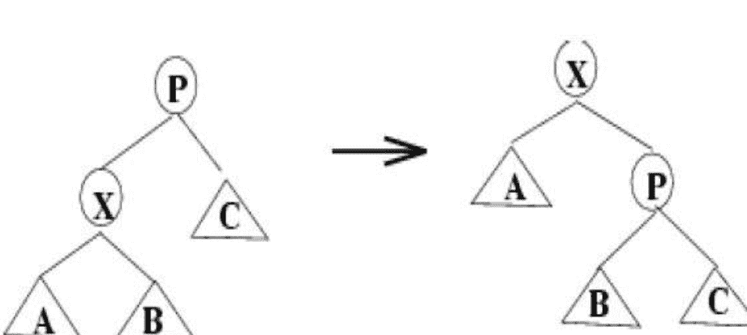

## Zig-Zig

## Zig-Zag

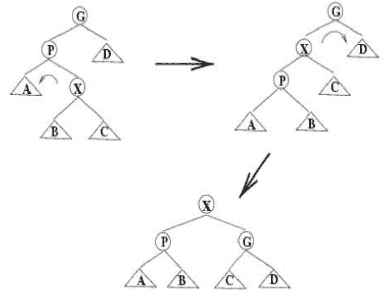

## 伸展树上的操作（续）

- remove
- 将要删除的元素伸展
  - 如果要删除的元素不在树中，则搜索路径上最后访问的节点将被伸展
- 将左右子树与根断开
- 执行以下一项或两项：
  - 伸展 T_L 中的最大项（然后 T_L 没有右孩子）
  - 伸展 T_R 中的最小项（然后 T_R 没有左孩子）
- 将另一棵子树连接到根的空孩子上


## 按顺序插入伸展树

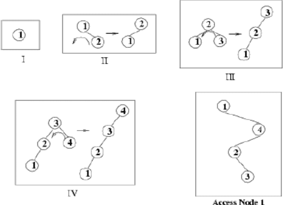

在BST中，用N个有序元素构建树的时间复杂度为O(N²)。那么用N个有序元素构建伸展树的性能如何？

## 伸展操作的一个极端示例

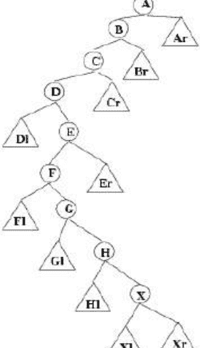

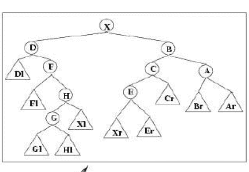

在节点“X”处进行伸展操作后

原始树

## 伸展树代码

- 伸展操作从节点开始“沿树向上”执行，直到根节点。
- 如何沿树“向上”遍历？
- 如何判断X和P是否同为左/右孩子，还是属于不同类型的孩子？
- 如何判断X是否存在祖父节点？
- 这种技术有什么缺点？

- 恒定的权重 \(w(v)>0\)（用于分析时，可为任意值）
- \(weight\ sum\ s(x)=\sum_{y\in subtree(x)}w(y)\)（其中subtree(x)是以\(x\)为根的子树，包含\(x\)）
- \(rank\ r(x)=\log s(x)\)

我们用\(r(x)\)作为节点的势。经过\(i\)次操作后的势函数为\(\Phi_i=\sum_{x\in tree(T)}r(x)\)。

## 引理1 对节点x执行一次伸展步骤的摊还代价≤ 3(r′(x) − r(x)) + 1，其中r为伸展步骤前的秩，r′为伸展步骤后的秩。此外，rr、ll、lr和rl伸展步骤的摊还代价≤ 3(r′(x) − r(x))。

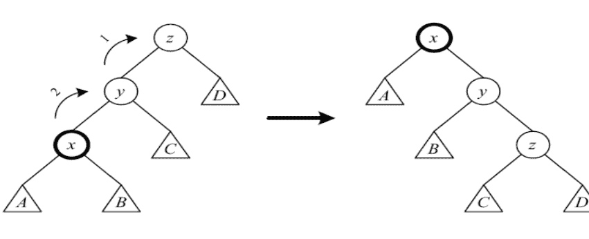

我们仅考虑rr伸展步骤（参见图3.1）。该伸展步骤的实际代价为2（对应2次旋转）。伸展步骤只影响节点x、y、z的势/秩；我们观察到r′(x) = r(z)，r(y) ≥ r(x)，且r′(y) ≤ r′(x)。

\[
\begin{aligned}
\text{摊还代价} &= 2+\phi(i+1)-\phi(i)\\
&=2+\bigl(r'(x)+r'(y)+r'(z)\bigr)-\bigl(r(x)+r(y)-r(z)\bigr)\\
&=2+\bigl(r'(x)-r(z)\bigr)+r'(y)+r'(z)-r(x)-r(y)\\
&\le 2+0+r'(x)+r'(z)-r(x)-r(x)\\
&=2+r'(x)+r'(z)-2r'(x)
\end{aligned}
\]

对数函数是凹函数，即\(\frac{\log a+\log b}{2}\le \log\left(\frac{a+b}{2}\right)\)。因此我们还有（\(s\)为伸展步骤前的权重和，\(s'\)为伸展步骤后的权重和）：

\[
\frac{\log(s(x))+\log(s'(z))}{2}\le \log\left(\frac{s(x)+s'(z)}{2}\right)
\]

\[
\frac{r(x)+r'(z)}{2}\le \log\left(\frac{s(x)+s'(z)}{2}\right)\qquad\text{（注意 }s(x)+s'(z)\le s'(x)\text{）}
\]

\[
\begin{aligned}
&\le \log\left(\frac{s'(x)}{2}\right)\\
&=r'(x)-1\\
r'(z)&\le 2r'(x)-r(x)-2
\end{aligned}
\]

## **推论1**  *对节点x执行一次伸展操作的摊还代价为O(log n)。*

## **证明：**

对*x*执行一次伸展操作的摊还代价等于对*x*执行的所有相关伸展步骤的摊还代价之和：

```
$$\begin{aligned}
\text{摊还代价} &= \sum_i \text{代价}(\text{伸展步骤}_i) \\
&\leq \sum_i \left(3(r^{i+1}(x)-r^i(x))+1\right) \\
&= 3(r(\text{根})-r(x))+1
\end{aligned}$$
```

+1来自最后的*r*或*r*伸展步骤（如有必要）。如果对树中所有节点设置*w(v) = 1*，则*r(root) = log n*，于是有：

```
$$\text{摊还代价} \leq 3\log n + 1 = O(\log n)$$
```

## 路漫漫其修远兮！

## 为什么学习高级数据结构？
- 内容
- 第1周：数据结构与计算机科学、算法、数据库、万维网……
- 数据结构原理——如何实现？
- 第2周：为什么以及如何实现O(log n)访问时间？
- 第3周：动态数据结构与分析
- 第4周：随机化数据结构
- 第5周：增强数据结构
- 第6周：分布式环境中的数据结构
- 新问题——应用
- 第7周：研究前沿中的数据结构
- 第8周：考试

## 哈夫曼编码

- FP-Tree
- 草图（Sketches）

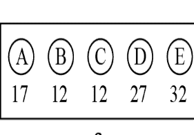

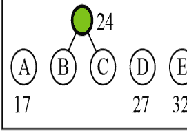

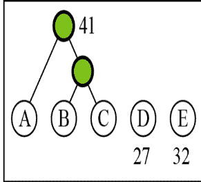

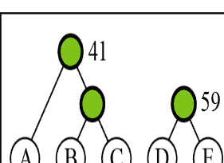

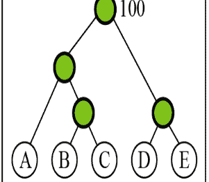

a.

b.

c.

d.

e.


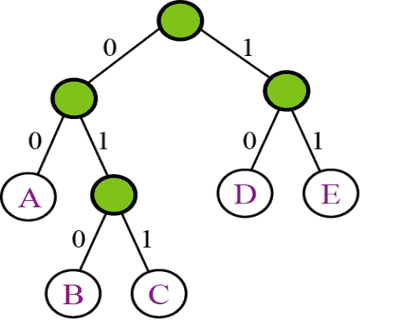

| 字符 | 编码 | 字符 | 编码 |
|---|---|---|---|
| A | 00 | D | 10 |
| B | 010 | E | 11 |
| C | 011 |  |  |

• 一个字符的编码是通过从根开始并沿着通向该字符的分支查找得到的。编码本身就是路径上每个分支的位值，按顺序取。

## Text

EAEB A ECDEA

## Encoder

A → 00    D → 10
B → 010   E → 11
C → 011

```
1100110100011011101100
```

## Huffman code

Discover the power of custom layouts

## Huffman code

1100110100011011101100


| Code | Character | Code | Character |
|---|---|---|---|
| 00 | A | 010 | B |
| 10 | D | 011 | C |
| 11 | E |  |  |

Decoder


EAEBAECDEA

Text

## Outline

+   - Frequent Pattern Mining: Problem statement and an example
+   - Review of Apriori-like Approaches
+   - FP-Growth:
+     - Overview
+     - FP-tree:
+       - structure, construction and advantages
+     - FP-growth:
+       - FP-tree → conditional pattern bases → conditional FP-tree → frequent patterns
+   - Experiments
+   - Discussion:
+     - Improvement of FP-growth
+   - Conclusion Remarks

## Frequent Pattern Mining: An Example

Given a transaction database DB and a minimum support threshold ξ, find all frequent patterns (item sets) with support no less than ξ.

**Input:**  DB:

| TID | Items bought |
|---|---|
| 100 | {f, a, c, d, g, i, m, p} |
| 200 | {a, b, c, f, l, m, o} |
| 300 | {b, f, h, j, o} |
| 400 | {b, c, k, s, p} |
| 500 | {a, f, c, e, l, p, m, n} |

Minimum support: ξ = 3

**Output:** all frequent patterns, i.e., *f, a, …, fa, fac, fam, fm, am…*

Problem Statement: How to **efficiently** find all frequent patterns?

## Review of Apriori-like Approaches for finding complete frequent item-sets

## Apriori

+   - **Main Steps of Apriori Algorithm:**
+     - Use frequent $(k-1)$-itemsets ($L_{k-1}$) to generate candidates of frequent $k$-itemsets $C_k$.
+     - Scan database and count each pattern in $C_k$, get frequent $k$-itemsets ($L_k$).
+   - **E.g.,**

| TID | Items bought |
|---|---|
| 100 | {f, a, c, d, g, i, m, p} |
| 200 | {a, b, c, f, l, m, o} |
| 300 | {b, f, h, j, o} |
| 400 | {b, c, k, s, p} |
| 500 | {a, f, c, e, l, p, m, n} |

| Apriori iteration | |
|---|---|
| C1 | f, a, c, d, g, i, m, p, l, o, h, j, k, s, b, e, n |
| L1 | f, a, c, m, b, p |
| C2 | fa, fc, fm, fp, ac, am, ...bp |
| L2 | fa, fc, fm, ... |
| ... | |


## Disadvantages of Apriori-like Approach

## Performance Bottlenecks of Apriori

+   - Bottlenecks of *Apriori*: **candidate generation**
+     - Generate huge candidate sets:
+       - $10^4$ frequent 1-itemset will generate $10^7$ candidate 2-itemsets
+       - To discover a frequent pattern of size 100, e.g., {$a_1, a_2, ..., a_{100}$}, one needs to generate $2^{100} \approx 10^{30}$ candidates.

❖ **Candidate Test** incur multiple scans of database: each candidate

## Overview of FP-Growth: Ideas

+   - Compress a large database into a compact, *Frequent-Pattern tree* (**FP-tree**) structure
+     - highly compacted, but complete for frequent pattern mining
+     - avoid costly repeated database scans

+   - Develop an efficient, FP-tree-based frequent pattern mining method (**FP-growth**)
+     - A divide-and-conquer methodology: decompose mining tasks into smaller ones
+     - Avoid candidate generation: sub-database test only.

## FP-tree:
Construction and Design

## Construct FP-tree

**Two Steps:**

+   1. Scan the transaction DB for the first time, find frequent items (single item patterns) and order them into a list *L* in frequency descending order.
+   
+      e.g., *L*={f:4, c:4, a:3, b:3, m:3, p:3}
+   
+      In the format of (item-name, support)

+   2. For each transaction, order its frequent items according to the order in *L*; Scan DB the second time, construct FP-tree by putting each frequency ordered transaction onto it.


## FP-tree 示例：步骤 1
### 步骤 1：第一次扫描数据库以生成 L

| TID | 购买的商品 |
| --- | --- |
| 100 | {f, a, c, d, g, i, m, p} |
| 200 | {a, b, c, f, l, m, o} |
| 300 | {b, f, h, j, o} |
| 400 | {b, c, k, s, p} |
| 500 | {a, f, c, e, l, p, m, n} |

| 商品 | 频率 |
| --- | --- |
| f | 4 |
| c | 4 |
| a | 3 |
| b | 3 |
| m | 3 |
| p | 3 |

数据库首次扫描的副产品

## FP-tree 示例：步骤 2
### 步骤 2：第二次扫描数据库，按每个事务对频繁项排序

| TID | 购买的商品 | （排序后）频繁项 |
| --- | --- | --- |
| 100 | {f, a, c, d, g, i, m, p} | {f, c, a, m, p} |
| 200 | {a, b, c, f, l, m, o} | {f, c, a, b, m} |
| 300 | {b, f, h, j, o} | {f, b} |
| 400 | {b, c, k, s, p} | {c, b, p} |
| 500 | {a, f, c, e, l, p, m, n} | {f, c, a, m, p} |

## FP-tree
## FP-tree 示例：步骤 2
### 步骤 2：构建 FP-tree

注意：每个事务在 FP-tree 中对应一条路径

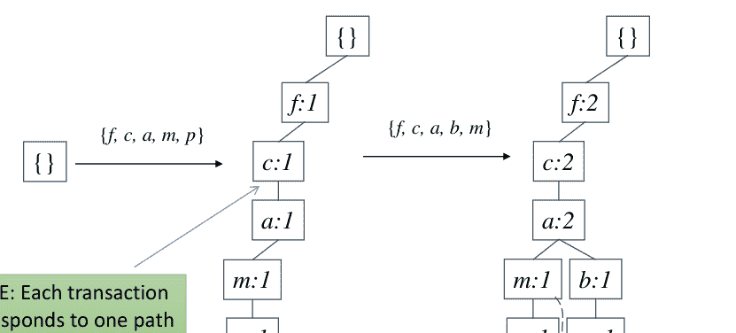

## FP-tree 示例：步骤 2
### 步骤 2：构建 FP-tree

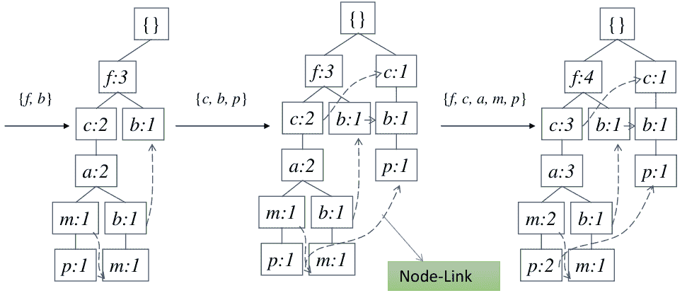

## FP-tree
## 构建示例
## 最终 FP-tree

| 头部表 |
|---| 
| 项目头 |
| f |
| c |
| a |
| b |
| m |
| p |

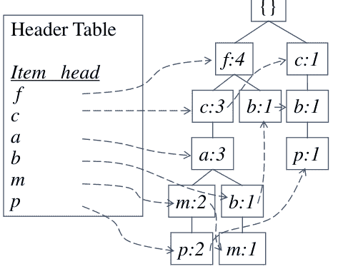

## FP-Tree 定义

FP-tree 是一个频繁模式树。形式上，FP-tree 是如下定义的一种树结构：

+ 1. 一个根节点标记为“null”，一组作为根的子项前缀子树，以及一个频繁项头部表。

+ 2. 项前缀子树中的每个节点有三个字段：
+ - item-name：注册该节点代表的项目，
+ - count，表示到达该节点的路径部分所代表的交易数量，
+ - node-link 链接到 FP-tree 中携带相同 item-name 的下一个节点，如果没有则为 null。

+ 3. 频繁项头部表中的每个条目有两个字段，
+ - item-name，以及
+ - head of node-link 指向 FP-tree 中携带该 item-name 的第一个节点。

## FP-tree 结构的优点

+ - FP-tree 最显著的优点
+ - 只扫描数据库两次且仅两次。

+ - 完整性：
+ - FP-tree 包含与挖掘频繁模式相关的所有信息（给定最小支持度阈值）。为什么？

+ - 紧凑性：
+ - 树的规模受频繁项出现次数的限制
+ - 树的高度受事务中最大项目数的限制

## 问题？

+ - 为什么是降序？
+ - 示例 1：

| TID | （未排序）频繁项 |
| --- | --- |
| 100 | {f, a, c, m, p} |
| 500 | {a, f, c, p, m} |

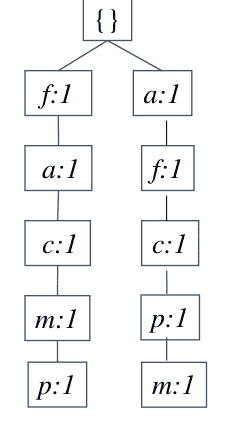

## 问题？

+ - 示例 2：

| TID | （升序）频繁项 |
|---|---|
| 100 | {p, m, a, c, f} |
| 200 | {m, b, a, c, f} |
| 300 | {b, f} |
| 400 | {p, b, c} |
| 500 | {p, m, a, c, f} |

这棵树比 FP-tree 更大，因为在 FP-tree 中，更频繁的项目具有更高的位置，这使得分支更少

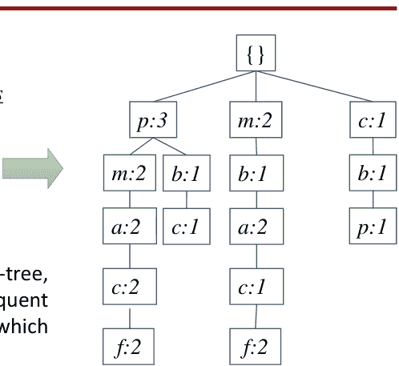

## 使用 FP-tree 挖掘频繁模式

+ - 总体思路（分而治之）

递归地使用 FP-tree 增长频繁模式：递归地寻找更短的模式，然后连接后缀：

+ - 对于每个频繁项，构建其条件模式基，然后构建其条件 FP-tree；

+ - 在每个新创建的条件 FP-tree 上重复该过程，直到生成的 FP-tree 为空，或仅包含一条路径（单路径将生成其子路径的所有组合，每一个都是频繁模式）

## 3 个主要步骤

从列表 **L** 的末尾开始处理：

+ 1. **步骤 1：** 为头部表中的每个项目构建 **条件模式基**
+ 2. **步骤 2：** 从每个条件模式基构建 **条件 FP-tree**
+ 3. **步骤 3：** **递归挖掘** 条件 FP-tree 并扩展迄今为止获得的频繁模式。如果条件 FP-tree 包含 _单条路径_，只需枚举所有模式


## FP-Growth：一个示例

## 第 1 步：构造条件模式基

- 从 FP 树中频繁项头表中底部开始
- 通过跟随每个频繁项的链接遍历 FP 树
- 累积该项的所有 **转换后的前缀路径** 以形成 **条件模式基**

| Item | head |
|---|---|
| f |  |
| c |  |
| a |  |
| b |  |
| m |  |
| p |  |

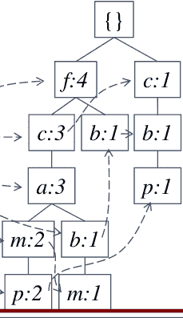


### Conditional pattern bases

| item | cond. pattern base |
|---|---|
| p | fcam:2, cb:1 |
| m | fca:2, fcab:1 |
| b | fca:1, f:1, c:1 |
| a | fc:3 |
| c | f:3 |
| f | {} |

## Properties of FP-Tree

- Node-link property
  - 对于任何频繁项 $a_i$，包含 $a_i$ 的所有可能频繁模式都可以通过从 FP 树头表中 $a_i$ 的头开始，沿着 $a_i$ 的节点链接跟随而获得。
- Prefix path property
  - 为了计算路径 $P$ 中节点 $a_i$ 的频繁模式，只需累积 $a_i$ 在 $P$ 中的前缀子路径，并且其频率计数应与节点 $a_i$ 相同。

## 第 2 步：构造条件 FP 树

- 对于每个模式基
  - 累积基中每个项的计数
  - 为模式基的频繁项构造条件 FP 树

| Header Table |
| Item | head |
| f | 4 |
| c | 4 |
| a | 3 |
| b | 3 |
| m | 3 |
| p | 3 |

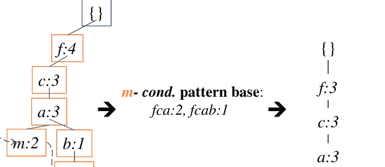

## FP-Growth

## 第 3 步：递归挖掘条件 FP 树

conditional FP-tree of "m": (fca:3)

Frequent Pattern

f:3
c:3
a:3

add "a"

add "c"

add "f"

conditional FP-tree of "am": (fc:3)

Frequent Pattern

f:3
c:3

conditional FP-tree of "cm": (f:3)

Frequent Pattern

f:3

add "f"

conditional FP-tree of "fm": 3

Frequent Pattern

conditional FP-tree of "fam": 3

Frequent Pattern

conditional FP-tree of "fcm": 3

Frequent Pattern

Frequent Pattern

fcam

add "f"

add "c"

conditional FP-tree of "cam": (f:3)

f:3

add "f"

## Principles of FP-Growth

- Pattern growth property
  - 设 α 是 DB 中的频繁项集，B 是 α 的条件模式基，β 是 B 中的一个项集。则 α ∪ β 是 DB 中的频繁项集当且仅当 β 在 B 中频繁。
- “fcabm” 是一个频繁模式吗？
  - “fcab” 是 m 的条件模式基的一个分支
  - “b” 在包含 “fcab” 的事务中不是频繁的
  - “bm” 不是一个频繁项集。

## Conditional Pattern Bases and
Conditional FP-Tree

| Item | Conditional pattern base | Conditional FP-tree |
|---|---|---|
| p | `{(fcam:2), (cb:1)}` | `{(c:3)}\|p` |
| m | `{(fca:2), (fcab:1)}` | `{(f:3, c:3, a:3)}\|m` |
| b | `{(fca:1), (f:1), (c:1)}` | `Empty` |
| a | `{(fc:3)}` | `{(f:3, c:3)}\|a` |
| c | `{(f:3)}` | `{(f:3)}\|c` |
| f | `Empty` | `Empty` |

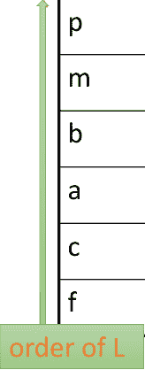

## Single FP-tree Path Generation

- 假设 FP 树 T 有一条单一路径 P。T 的完整频繁模式集合可以通过枚举 P 的子路径的所有组合来生成

{}
|
f:3
|
c:3
|
a:3
m-conditional FP-tree

All frequent patterns concerning m: combination of {f, c, a} and m

- m,
- fm, cm, am,
- fcm, fam, cam,
- fcam

## Summary of FP-Growth Algorithm

- 挖掘频繁模式可以看作是首先挖掘 1-项集，然后通过在其条件模式基上递归挖掘，逐步增长每个 1-项集
- 通过一组条件模式基，将频繁 k-项集挖掘问题转化为一系列 k 个频繁 1-项集挖掘问题

## Efficiency Analysis

**Facts: usually**

- 1. FP-tree 比 DB 的大小小得多
- 2. 模式基比原始 FP 树小
- 3. 条件 FP 树比模式基小
- ➔ 挖掘过程在一个通常要小得多的模式基和条件 FP 树集合上工作
- ➔ 分而治之和显著的规模缩小


## 计算的流模型

时间递增

数据流

主内存（概要数据结构）

内存：poly(1/ε, log N)

查询/更新时间：poly(1/ε, log N)

N：迄今为止的项目数，或窗口大小

ε：误差参数

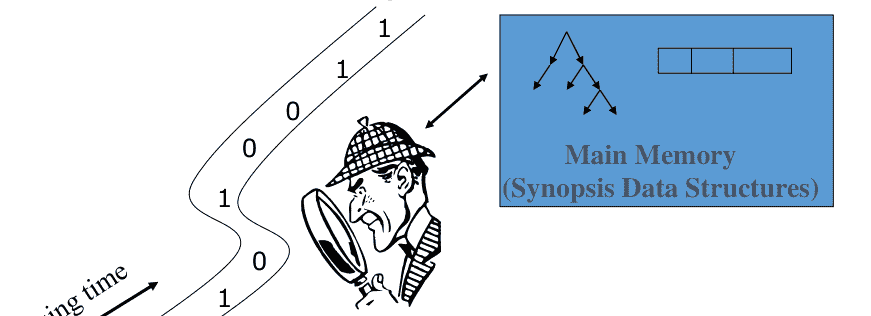

## 广义流模型

数据流：2, 0, 1, 3, 1, 2, 4, ...

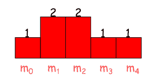

- 输入元素 (i,a)
  - 域值 i 的 a 个拷贝
  - 将 m 的第 i 维增加 a
  - a 不必是整数
- 负值 – 捕获删除

### 示例

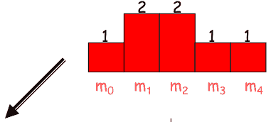

看到元素 $(i,a)=(2,2)$ 时

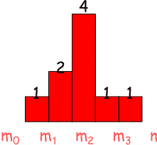

看到元素 $(i,a)=(1,-1)$ 时

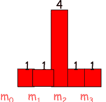

## 问题 1 – Top-K 列表

[Charikar-Chen-Farach-Colton]

### 谷歌问题

返回流中出现频率最高的 k 个项目的列表

### 动机

搜索引擎查询、网络流量，...

### 记住

最近看到了下界！

### 解决方案

数据结构 Count-Sketch → 维护高频元素的计数估计

## 主要思想

- 考虑
  - 单个计数器 X
  - 哈希函数 h(i): {1, 2, ..., N} → {-1, +1}
- 输入元素 i → 更新计数器 X += Z_i = h(i)
- 对每个 r，使用 XZ_r 作为 m_r 的估计值

### 定理：E[XZ_r] = m_r

**证明**

- X = Σ_i m_i Z_i
- E[XZ_r] = E[Σ_i m_i Z_i Z_r] = Σ_i m_i E[Z_i Z_r] = m_r E[Z_r²] = m_r
- 交叉项抵消

## “计数器数组”的问题

- **方差** — 由最高频率主导
- **对较不频繁元素如** $k$ 的估计
  - 被更高频率污染
  - 方差 $\gg m_k$
- **避免冲突？**
  - 将高频元素分散开
  - 用 $b$ 个计数器的哈希表替换每个计数器

## Count Sketch

- 哈希函数
  - 4-独立哈希 h₁,...,hₜ 和 s₁,...,sₜ
  - 哈希彼此独立
- 数据结构：计数器 X(r,c) 的哈希表

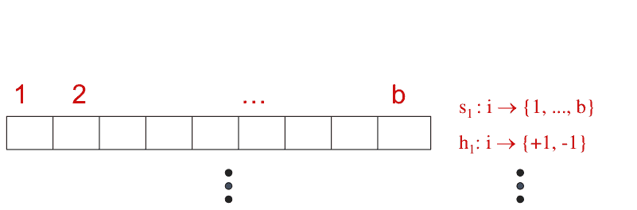

## 总体算法

- $s_r(i)$：第 r 个哈希表中的 $b$ 个计数器之一
- **输入** $i$ → 对每个 r，更新 $X(r,s_r(i)) += h_r(i)$
- **估计值** $(m_i) = \operatorname{median}_r\{X(r,s_r(i)) \bullet h_r(i)\}$
- 维护迄今为止看到的 k 个顶部元素的堆
- **观察**
  - 并未完全消除与高频项目的冲突
  - 少数估计值 $X(r,s_r(i)) \bullet h_r(i)$ 可能具有高方差
  - 中位数对这些较差的估计不敏感

## 避免大项目

- **b > O(k)** → 以概率 **Ω(1)**，与 top-k 元素无冲突
- **t** 个哈希表代表独立试验
- 需要 **log m/δ** 次试验以概率 **1−δ** 估计
- 还需要 – 对冲突的小元素有较小方差
- **断言：**
  P[每个估计中由小项引起的方差 < (∑ᵢ>k mᵢ²)/b] = **Ω(1)**
- 最终界限  **b = O(k + ∑ᵢ>k mᵢ² / (εmₖ)²)**

## 最终结果

- Zipf 分布：m_i ∝ 1/i^α [幂律]
- FindApproxTop
  - [k + (Σ_{i>k} m_i²) / (ε m_k)²] log m/δ
  - 大致：频率平方的采样界限
  - Zipfian – 给出改进结果
- FindCandidateTop
  - Zipf 参数 0.5
  - O(k log N log m)
  - 比较：采样界限 O((kN)^0.5 log k)

## 算法 1：Lossy Counting

步骤 1：将流划分为“窗口”

窗口 1

窗口 2

窗口 3

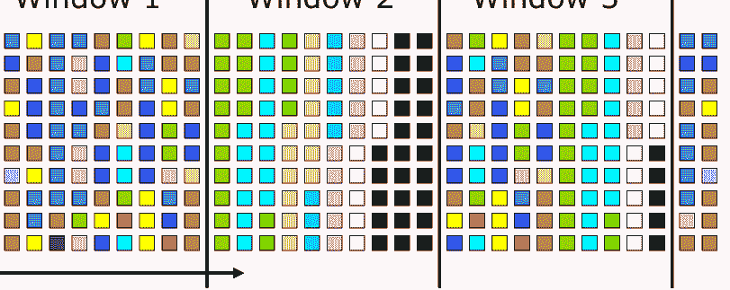

窗口大小 w 是支持度 s 的函数 – 稍后指定...

## Lossy Counting 的运行 ...

空

第一个窗口

频率计数

在窗口边界，递减所有计数器 1

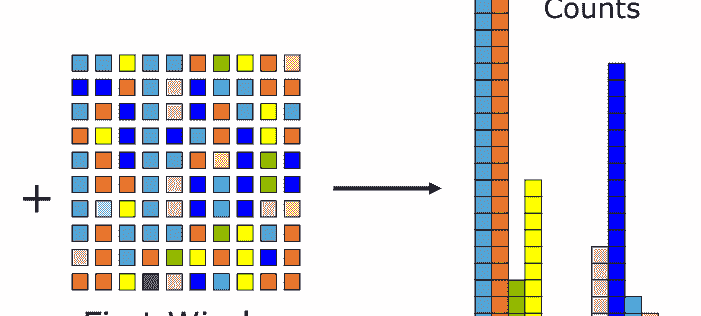


## 有损计数（续）

频率计数

下一窗口

在窗口边界处，将所有计数器减 1


## 误差分析

我们低估了多少？

如果当前数据流大小为 N
且窗口大小 w = 1/ε

则频率误差 ≤ 窗口数 = εN

经验法则：
令 ε 为支持度 s 的 10%
示例：
给定支持频率 s = 1%，
令误差频率 ε = 0.1%

## 综合起来……

## 输出：

计数器值超过 $(s-\varepsilon)N$ 的元素

> **近似保证**
> 
> - 频率低估最多为 $\varepsilon N$
> - 无假阴性
> - 假阳性结果的真实频率至少为 $(s-\varepsilon)N$

## 我们需要多少个计数器？

- 最坏情况界限：$1/\varepsilon \log \varepsilon N$ 个计数器
- 实现细节……

## 增强

## 频率误差

对于计数器 (X, c)，真实频率在 [c, c+εN] 范围内

**技巧：** 记录计数器已活跃的窗口数 t

对于计数器 (X, c, t)，真实频率在 [c, c+t−1] 范围内

如果 (t = 1)，则无误差！

## 批处理

在 *k* 个窗口之后递减

## 数据结构
与
算法

Zhihong Chong

[http://cse.seu.edu.cn/people/zhchong/](http://cse.seu.edu.cn/people/zhchong/)

## 为什么需要数据结构？

- 为什么需要高级数据结构？
- 数据结构的基本要点

## 计算机科学

- 研究信息与计算的**理论基础**
- 研究其实现与应用的**实用技术**
  - 研究创建、描述和转换信息的**算法过程**

- 1. *计算理论*
- 2. *算法与数据结构*
- 3. *编程方法与语言*
- 4. *计算机元件与体系结构*

## 应用计算机科学

- 软件工程
- 人工智能
- 计算机网络与通信
- 数据库系统
- 并行计算、分布式计算
- 人机交互
- 计算机图形学
- 操作系统
- 数值与符号计算

## 总结

- 计算机科学的关键问题：
  - 什么可以被高效地自动化？
  - 什么可以在商业模式下被高效地自动化？
- 关键思想
  - 递归
  - 分而治之
- 关键技术
  - 分层
  - 抽象
  - 虚拟化

## 数据结构与数据密集型应用

- 大型数据集
  - RDF 数据集
  - Google 和百度存储的大型网页
- 大型数据集上的多项式算法
  - 无法实时响应
  - 即使是线性算法也无法工作

## 1. 数据结构要领

- ① R 是数据集上的一个关系
- ② 线性结构
  - I. 栈
  - II. 队列
- ③ 非线性结构
  - I. 树结构
  - II. 图结构

## 数据组织

- 线性文件
  - 物理邻接关系
- 链接文件
  - 指针
- 索引文件
  - 表形式的映射函数
- 散列文件
  - 显式形式的映射函数

## 1. 数据结构

基本的数据结构问题是维护来自一个全域的项目集合，以便高效地支持搜索查询、更新操作以及涉及整个集合的操作（聚合）。

- ① 数据集非常大
- ② 数据集是动态的
- ③ 数据的关系结构很复杂
  - I. 结构化数据
  - II. 半结构化数据
  - III. 非结构化数据

## 高效性

- 1. O(log n) 访问时间复杂度
- 2. 合理的内存开销！

## 数据结构小结

- 数据结构就是指按一定的逻辑结构组成的一批数据，使用某种存储结构将这批数据存储于计算机中，并在这些数据上定义了一个操作集合
  1. 数据的逻辑结构
     - 线性和非线性结构
  2. 数据的存储结构
     - 线性存储空间（连续的存储单元）
  3. 数据的操作集合
     - 查询、更新和聚集


## 将住院医师与医院匹配

目标。给定医院和医学院学生之间的偏好集合，设计一个自我强化的录取流程。

不稳定配对：申请者 x 和医院 y 是不稳定的，如果：

- x 更喜欢 y 而不是其分配的医院。
- y 更喜欢 x 而不是其录取的学生之一。

稳定分配。没有不稳定配对的分配。

- 自然且理想的条件。
- 个人自利将阻止任何申请者/医院的交易达成。

## 稳定匹配问题

**目标。** 给定 n 个男性和 n 个女性，找到一个“合适的”匹配。

- 参与者对异性成员进行评级。
- 每位男性按从最佳到最差的顺序列出女性。
- 每位女性按从最佳到最差的顺序列出男性。

**男性偏好档案**

|       | 1st   | 2nd   | 3rd   |
|-------|-------|-------|-------|
| Xavier | Amy  | Bertha | Clare |
| Yancey | Bertha | Amy  | Clare |
| Zeus  | Amy   | Bertha | Clare |

**女性偏好档案**

|       | 1st    | 2nd    | 3rd  |
|-------|--------|--------|------|
| Amy   | Yancey | Xavier | Zeus |
| Bertha | Xavier | Yancey | Zeus |
| Clare | Xavier | Yancey | Zeus |

## 数据结构和算法

## 稳定匹配问题

完美匹配：每个人都单配偶匹配。

- 每位男性恰好得到一位女性。
- 每位女性恰好得到一位男性。

稳定性：没有任何参与者配对有动机通过联合行动破坏分配。

- 在匹配 M 中，未匹配的配对 m-w 是不稳定的，如果男性 m 和女性 w 彼此更喜欢对方而不是当前伴侣。
- 不稳定配对 m-w 可以各自通过私奔而改善。

稳定匹配：没有不稳定配对的完美匹配。

稳定匹配问题。给定 n 个男性和 n 个女性的偏好列表，如果存在则找到一个稳定匹配。

## 稳定匹配问题

Q. 分配 X-C, Y-B, Z-A 稳定吗？
A. 不。Bertha 和 Xavier 会勾搭上。

**男性偏好档案**

favorite ↓ least favorite ↓

|       | 1st   | 2nd   | 3rd   |
|-------|-------|-------|-------|
| Xavier | Amy  | Bertha | Clare |
| Yancey | Bertha | Amy  | Clare |
| Zeus  | Amy   | Bertha | Clare |

**女性偏好档案**

favorite ↓ least favorite ↓

|       | 1st    | 2nd    | 3rd  |
|-------|--------|--------|------|
| Amy   | Yancey | Xavier | Zeus |
| Bertha | Xavier | Yancey | Zeus |
| Clare | Xavier | Yancey | Zeus |

## 稳定匹配问题

Q. 分配 X-A, Y-B, Z-C 稳定吗？
A. 是的。

**男性偏好档案**

favorite ↓ least favorite ↓

|       | 1st   | 2nd   | 3rd   |
|-------|-------|-------|-------|
| Xavier | Amy  | Bertha | Clare |
| Yancey | Bertha | Amy  | Clare |
| Zeus  | Amy   | Bertha | Clare |

**女性偏好档案**

favorite ↓ least favorite ↓

|       | 1st    | 2nd    | 3rd  |
|-------|--------|--------|------|
| Amy   | Yancey | Xavier | Zeus |
| Bertha | Xavier | Yancey | Zeus |
| Clare | Xavier | Yancey | Zeus |

## 提议-拒绝算法

提议-拒绝算法。 [Gale-Shapley 1962] 一种直观的方法，保证找到稳定匹配。

```
Initialize each person to be free.
while (some man is free and hasn't proposed to every woman) {
    Choose such a man m
    w = 1st woman on m's list to whom m has not yet proposed
    if (w is free)
        assign m and w to be engaged
    else if (w prefers m to her fiancé m')
        assign m and w to be engaged, and m' to be free
    else
        w rejects m
}
```

## 正确性证明：终止性

观察 1. 男性按偏好递减的顺序向女性求婚。

观察 2. 一旦女性被匹配，她永远不会变得未匹配；她只会“升级”。

断言。算法在 while 循环最多 n² 次迭代后终止。

Pf. 每次通过 while 循环，男性都会向一位新女性求婚。只有 n² 种可能的求婚。■

## 正确性证明：完美性

断言。所有男性和女性都会被匹配。

Pf. （反证法）

- 假设，为了反证，Zeus 在算法终止时未被匹配。
- 那么某位女性，比如 Amy，在算法终止时未被匹配。
- 根据观察 2，Amy 从未被求婚。
- 但是，Zeus 会向每个人求婚，因为他最终未匹配。


## 高效实现

**高效实现。** 我们描述 O(n²) 时间实现。

- **表示男性和女性。**
  - 假设男性命名为 1, ..., n。
  - 假设女性命名为 1′, ..., n′。
- **订婚。**
  - 维护一个自由男性的列表，例如在队列中。
  - 维护两个数组 `wife[m]` 和 `husband[w]`。
    - 若未匹配则将条目设为 0
    - 若 m 匹配到 w 则 `wife[m]=w` 且 `husband[w]=m`
- **男性求婚。**
  - 对每个男性，维护一个按偏好排序的女性列表。
  - 维护一个数组 `count[m]` 用于计数男性 m 已做出的求婚次数。

### 女性拒绝/接受。

- 女性 w 是否更喜欢男性 m₁ 而非男性 m₂？
- 对每个女性，创建男性偏好列表的逆序。
- 在 O(n) 预处理后，每个查询可实现常数时间访问。

| Amy | 1st | 2nd | 3rd | 4th | 5th | 6th | 7th | 8th |
|-----|-----|-----|-----|-----|-----|-----|-----|-----|
| Pref | 8 | 3 | 7 | 1 | 4 | 5 | 6 | 2 |

| Amy | 1 | 2 | 3 | 4 | 5 | 6 | 7 | 8 |
|-----|---|---|---|---|---|---|---|---|
| Inverse | 4th | 8th | 2nd | 5th | 6th | 7th | 3rd | 1st |

```
for i = 1 to n
inverse[pref[i]] = i
```

Amy 更喜欢男性 3 而非 6，因为 inverse[3] < inverse[6]（2nd < 7th）。

## 流式算法


MEM: poly(1/ε, log N)

Query/Update: poly(1/ε, log N)

- N: 流大小或窗口大小
- ε: 误差参数

## 数据流和查询

- 数据流
  - 数字（例如数据包的头部）
  - 结构化元组（例如 Web 日志）
  - XML 文档（例如 pub/sub 系统）
- 查询
  - 连续/临时查询
  - 可能具有不同的复杂度
    - 计数
    - 结构化查询（SQL）
    - 数据分析和挖掘


## 与频率相关的问题

- Top-k 最频繁元素
- 找出占尾部 0.1% 的元素。
- 均值 + 方差？
- 中位数？
- 元素 3 的频率是多少？
- 找出所有频率 > 0.1% 的元素
- 元素 8 到 14 之间的总频率是多少？


| 8 | 3 | 11 | 6 | 2 |
|---|---|---|---|---|
| 7 | 0 | 1 | 14 | 8 |
| 2 | 5 | 5 | 10 | 8 |
| 8 | 2 | 6 | 2 | 12 |

Estimate(6) = min(2, 8, 2, 2) = ?

- 低空间复杂度：$O(\varepsilon^{-1}\log M)$
- 快速的每元组处理成本
- 高召回率和精确率


## 阅读材料

### What’s Hot and What’s Not: Tracking Most Frequent Items Dynamically

Graham Cormode  
Center for Discrete Mathematics and Computer Science (DIMACS)  
Rutgers University, Piscataway NJ  
graham@dimacs.rutgers.edu

S. Muthukrishnan  
Department of Computer Science  
Rutgers University, Piscataway NJ  
muthu@cs.rutgers.edu

WebDB.cn Open Group, Southeast University

## 分布式数据结构

Zhihong Chong

http://cse.seu.edu.cn/people/zhchong/

## 内容

- 为什么需要高级数据结构？
  - Week1: 数据结构与计算机科学、算法、数据库、WWW...
- 数据结构原理—如何？
  - Week2: 为什么以及如何实现 O(log n) 访问时间？
  - Week3: 动态数据结构和分析
  - Week4: 随机化数据结构
  - Week5: 增强数据结构
  - Week6: 分布式环境中的数据结构
- 新问题—应用
  - Week7: 研究前沿的数据结构
  - Week8: 考试

## 大纲

- CAN
- Chord
- Baton

## CAN: 概述

- 在键值对 (K,V) 上支持基本哈希表操作：插入、搜索、删除
- CAN 由各个节点组成
- 每个节点存储哈希表的一个块（区域）
  - 表中 (K,V) 对的一个子集
- 每个节点存储关于邻居区域的状态信息
- 针对某个键的请求（插入、查找或删除）由中间节点使用贪婪路由算法路由
- 无需集中控制（完全分布式）
- 每个节点的少量状态与系统中的节点数量无关（可扩展）
- 节点可以绕过故障进行路由（容错）


## CAN 区域

- 虚拟 d 维笛卡尔坐标系统
- 示例：2-d [0,1]x[1,0]
- 动态地在所有节点之间划分
- 对 (K,V) 进行存储时，使用均匀哈希函数将键 K 映射到空间中的点 P，并将 (K,V) 存储在包含 P 的区域的节点中
- 通过应用相同的哈希函数将 K 映射到 P 并从包含 P 的区域的节点中检索条目，来检索条目 (K,V)
- 如果 P 不包含在请求节点的区域或其相邻区域中，则将请求路由到区域最接近 P 的邻居节点


|  | 6 | 2 |
|---|---|---|
|  | 3 | 1 | 5 |
|  |  | 4 |  |
|  | (x,y) |  |  |


1 的坐标邻居集合 = {2,3,4,5}

7 的坐标邻居集合 = {1}

## 路由：

- 从源坐标到目标坐标沿笛卡尔空间的直线路径跟随
- 每个节点维护一个包含每个本地邻居的 IP 地址和虚拟坐标区域的表
- 使用贪心路由到最接近目标的邻居
- 对于划分为 n 个相等区域的 d 维空间，节点维护 2d 个邻居 (d/4)(n^{1/d})
- 平均路由路径长度：

## 加入 CAN

- 加入节点使用 CAN DNS 条目定位引导节点
- 引导节点提供随机成员节点的 IP 地址
- 加入节点向笛卡尔空间中的随机点 P 发送 JOIN 请求
- 包含 P 的区域的节点分割该区域并将“半区”分配给加入节点
- 分配的“半区”中的 (K,V) 对被转移到加入节点
- 加入节点从之前的区域占用者处学习其邻居集合
- 之前的区域占用者更新其邻居集合

1 的坐标邻居集合 = {2,3,4,7}
7 的坐标邻居集合 = {1,2,4,5}

## 离开、恢复和维护

- 优雅离开：节点将其区域和 (K,V) 对移交给邻居
- 网络故障：无法到达的节点触发立即接管算法，将故障节点的区域分配给邻居
- 通过缺乏周期性刷新消息检测
- 邻居节点启动一个接管计时器，其初始值与区域体积成比例
- 向故障节点的所有邻居发送包含区域体积的 TAKEOVER 消息
- 如果收到的 TAKEOVER 体积更小则终止计时器，否则回复 TAKEOVER 消息
- 节点同意选择体积最小且存活的邻居

## CAN 改进

- CAN 在每个节点状态 *O(d)* 和路径长度 *O(dn<sup>1/d</sup>)* 之间提供权衡
- 路径长度以应用层跳数衡量
- 邻居节点可能在地理上相距遥远
- 希望实现与底层 IP 路径延迟相当的查找延迟
- 几种减少查找延迟的优化也提高了路由和数据可用性方面的鲁棒性
- 方法：减少路径长度，减少每跳延迟，并增加负载均衡
- 使用 GT-ITM 拓扑生成器在 Transit-Stub (TS) 拓扑上模拟 CAN 设计 (Zegura, et. al.)

## 增加维度

- 增加坐标空间的维度可减少路由路径长度（和延迟）
- 每个节点的路由表大小略有增加
- 邻居数量的增加提高了路由容错能力
- 更多潜在的下一跳节点
- 模拟路径长度遵循 O(d n^{1/d})


## 增加现实性

- 节点可以维护多个独立的坐标空间（现实性）

- 对于具有 *r* 个现实性的 CAN：
  - 单个节点被分配 *r* 个区域
  - 并持有 *r* 个独立的邻居集合
  - 哈希表的内容为每个现实性复制

- 示例：对于三个现实性，(*K*, *V*) 映射到 *P*:(*x*,*y*,*z*) 可能会存储在三个不同的节点中
  - (*K*, *V*) 仅在三个副本都不可用时才不可用
  - 使用最接近 (*x*,*y*,*z*) 的现实性上的邻居进行路由


## 维度 vs. 现实

- 增加维度数量和/或现实数量会减少路径长度并增加每个节点的状态
- 更多的维度对路径长度的影响更大
- 更多的现实提供更强的容错能力和更高的数据可用性
- 作者没有量化不同的存储需求
  - 更多的现实需要复制 $(K,V)$ 对


## RTT 比率

- 将 RTT 纳入路由度量
  - 每个节点测量到每个邻居的 RTT
  - 将消息转发给进度与 RTT 比率最大的邻居

| 维度数量 | 非-*RTT* 加权路由 (ms) | *RTT* 加权路由 (ms) |
|---:|---:|---:|
| 2 | 116.8 | 88.3 |
| 3 | 116.7 | 76.1 |
| 4 | 115.8 | 71.2 |
| 5 | 115.4 | 70.9 |

## 区域过载

- 过载坐标区域
  - 允许多个节点共享同一区域，以阈值 MAXPEERS 为界
  - 节点维护对等状态，但不维护额外的邻居状态
  - 定期轮询邻居获取其对等节点列表，测量到每个对等节点的 RTT，保留 RTT 最低的节点作为邻居
  - $(K,V)$ 对可以分片到对等节点之间或进行复制

## 多个哈希函数

- 通过使用 $k$ 个哈希函数将单个键映射到坐标空间中的 $k$ 个点来提高数据可用性
- 复制 $(K,V)$ 并存储在 $k$ 个不同的节点上
- $(K,V)$ 仅在全部 $k$ 个副本同时不可用时才不可用
- 作者建议并行查询全部 $k$ 个节点以降低平均查找延迟


## Chord

## 系统模型

- **负载均衡：**
  - Chord 作为分布式哈希函数，将键均匀地分布在节点上。
- **去中心化：**
  - Chord 完全分布式：没有任何节点比其他节点更重要。
- **可扩展性：**
  - Chord 查找的成本随节点数量的对数增长，因此即使非常大的系统也是可行的。
- **可用性：**
  - Chord 会自动调整其内部表以反映新加入的节点以及节点故障，确保负责某个键的节点始终可以找到。
- **灵活命名：**
  - Chord 对其查找的键的结构不做任何限制。

## 系统模型

- 应用程序主要通过两种方式与 Chord 交互：
  - Chord 提供一个 lookup(key) 算法，返回负责该键的节点的 IP 地址。
  - 每个节点上的 Chord 软件会通知应用程序其负责的键集的变化。

- Chord 协议指定了如何找到键的位置。
- 它使用一致性哈希，所有节点接收大致相同数量的键。
- 当第 $N$ 个节点加入（或离开）网络时，只有 $O(1/N)$ 的键会被移动到不同位置。
- 在一个 $N$ 节点网络中，每个节点仅维护关于 $O(\log N)$ 个其他节点的信息，而一次查找需要 $O(\log N)$ 条消息。

## 一致性哈希

- 一致性哈希函数使用诸如 [SHA-1](SHA-1) 之类的基础哈希函数为每个节点和键分配 *m*-位 *标识符*。
- 标识符按模 2^m 在 *标识符环* 中排序。
- 键 *k* 被分配给标识符等于或跟随 *k* 在标识符空间中的第一个节点。该节点称为键 *k* 的 *后继节点*。
- 如果标识符表示为从 0 到 2^m − 1 的数字环，则 *successor(k )* 是从 *k* 开始顺时针方向的第一个节点。

由三个节点 0、1 和 3 组成的标识符环。
在此示例中，键 1 位于节点 1，键 2 位于节点 3，
键 6 位于节点 0。

## 可扩展的键定位

- 设 *m* 为键/节点标识符中的位数。
- 每个节点 *n* 维护一个路由表，包含（最多）*m* 个条目，称为 *手指表*。
- 节点 *n* 的表中的第 *i* 个条目包含第一个节点 *s* 的身份，该节点在标识符环上至少比 *n* 大 2^i -1。


finger[3].interval = [finger[3].start, 1)

finger[1].start = 2

finger[1].interval = [finger[1].start, finger[2].start)

finger[3].start = 5

finger[2].start = 3

finger[2].interval = [finger[2].start, finger[3].start)

(a)

(b)

手指表键
起始 区间 后继 6
1 [1,2) 1
2 [2,4) 3
4 [4,0) 0

手指表键
起始 区间 后继 1
2 [2,3) 3
3 [3,6) 3
5 [5,1) 0

手指表键
起始 区间 后继 2
4 [4,5) 0
5 [5,7) 0
7 [7,3) 0

(a) 与节点 1 关联的手指区间。(b) 一个包含节点 0、1 和 3，键 1、2 和 6 的网络的手指表及键位置。

## 可扩展的键定位

- 以高概率（或在标准困难性假设下），在一个包含 $N$ 个节点的网络中，查找后继所必须联系的节点数是 $O(\log N)$。

## 节点加入

- Chord 中的每个节点维护一个 *前驱指针*，并且可以沿标识符环逆时针方向工作。
- 当节点 *n* 加入网络时：
  - 初始化节点 *n* 的前驱和手指表。
  - 更新现有节点的手指表和前驱，以反映 *n* 的加入。
  - 通知上层软件，以便其可以转移与节点 *n* 现在负责的键相关联的状态（例如值）。

## 故障与复制

- 当节点 *n* 发生故障时，其手指表中包含 *n* 的节点必须找到 *n* 的后继节点。
- 每个 Chord 节点在 Chord 环上维护其 r 个最近后继的“后继列表”。
- 使用 Chord 的典型应用可能会在键之后的 *k* 个节点上存储与该键关联的数据的副本。


在一个 10⁴ 节点网络中，每个节点存储的键数量的平均值以及第 1 和第 99 百分位数。


(a)

路径长度随网络规模的变化。


(b)

在 2¹² 节点网络情况下路径长度的概率密度函数。

## BATON
一种用于对等网络的平衡树结构

H. V. Jagadish, Beng Chin Ooi, Quang Hieu Vu

## 相关工作

- **P-Grid (CoopIS’01)**
  - 基于二叉前缀树结构。
  - 不能保证 *log N 搜索*步数界限。
- **P-Tree (WebDB’04)**
  - 基于 B+-树结构，并使用 CHORD 作为覆盖网络框架。
  - 每个节点维护 B+-树的一个分支。
  - 维护节点间一致性知识的代价*高昂*。
- **多路树 (DBISP2P’04)**
  - 每个节点维护指向其父节点、兄弟节点、邻居节点和子节点的链接。
  - 不能保证 *log N 搜索*步数界限。

## BATON 架构

- BATON：平衡树覆盖网络（BAlanced Tree Overlay Network）
- 定义：一棵树是平衡的，当且仅当在树中的任意节点处


节点 m：层级=3，编号=6，父节点=f，左子节点=null，右子节点=r，左邻接=f，右邻接=r

左路由表：

|  | 节点 | 左子节点 | 右子节点 | 下界 | 上界 |
|---|---|---|---|---|---|
| 0 | l | null | null | l_lower | l_upper |
| 1 | k | p | q | k_lower | k_upper |
| 2 | i | null | null | i_lower | i_upper |

右路由表：

|  | 节点 | 左子节点 | 右子节点 | 下界 | 上界 |
|---|---|---|---|---|---|
| 0 | n | null | null | n_lower | n_upper |
| 1 | o | s | t | o_lower | o_upper |

二叉平衡树索引架构

## 定理

- *定理 1*：如果树中每个有子节点的节点的左、右路由表都是满的（*），则该树是平衡树。

- *定理 2*：如果一个节点（例如 *x*）在其左或右路由表中包含指向另一个节点（例如 *y*）的链接，则 *x* 的父节点也必须包含指向 *y* 的父节点的链接，除非同一节点同时是 *x* 和 *y* 的父节点。

(*) 如果有效链接中没有一个是 NULL，则路由表是满的。


## 节点加入

- 示例：新节点 $u$ 加入网络


- 找到可加入节点的成本：O(log N)
- 当一个节点接受新节点作为其子节点时
  - 将其内容（即值范围）的一半分割给新的子节点
  - 更新自身及其新子节点的相邻链接
  - 通知其邻居节点及其新子节点的邻居节点更新它们的信息
- 成本：6 log N

## 节点离开

- 当一个节点希望离开网络时
  - 如果它是叶节点且没有邻居节点拥有子节点，则它可以离开网络
    - 将其内容转移给父节点，并更新对应的相邻链接
    - 通知其邻居节点及其父节点的邻居节点更新它们的信息
    - 成本：4 log N
  - 如果它是叶节点且存在一个拥有子节点的邻居节点，则它需要通过向该邻居节点的某个子节点发送 FINDREPLACEMENTNODE 请求来找到一个替代它的叶节点
  - 如果它是中间节点，则它需要通过向其某个*相邻*节点发送 FINDREPLACEMENTNODE 请求来找到一个替代它的叶节点

- 示例：现有节点 *b* 离开网络


- 找到替代叶节点的成本：O(log N)
- 当某个节点来替代离开的节点时
  - 按照叶节点离开的情况通知其父节点和邻居节点：4 log N
  - 通知其新的父节点、新的邻居节点以及新父节点的邻居节点：4 log N
  - 总成本：8 log N

## 容错

- 节点故障
  - 发现某个节点故障的节点会向该节点的父节点报告。
  - 故障节点的父节点将负责在必要时寻找一个替代的叶节点。
  - 故障节点的路由信息可以通过其父节点的路由信息联系其邻居节点来恢复。

- 容错性：故障节点可以通过两种方式被绕过
  - 通过路由表（类似于 CHORD）——*水平轴*
  - 通过父子链接和相邻链接——*垂直轴*
  - 特别地，即使同一层级的所有节点都发生故障，树也不会被分割

## 网络重构

- 在负载均衡方案中发生强制加入或强制离开时是必要的
- 当定理 1 中的条件被违反时，触发网络重构
- 网络重构通过相邻链接移动节点来完成
  - 不需要移动数据
  - 每个被移动的节点需要 O(log N) 的开销来更新路由表

## 强制加入

- 示例 1：网络重构由强制加入触发


## 强制离开

- 示例 2：网络重构由强制离开触发


## 索引构建

- 每个节点被分配一个值范围
- 一个节点直接管理的值范围满足：
  - 大于其左侧相邻节点管理的范围
  - 小于其右侧相邻节点管理的范围


## 精确匹配查询

示例：节点 b 想要搜索属于节点 c 的数据，比如 74


## 范围查询

- 过程与精确匹配查询类似
  - 首先，找到与搜索范围的交集
  - 其次，沿着相邻链接检索所有结果
- 成本
  - 精确匹配查询：O(log N)
  - 范围查询：O(log N + X)，其中 X 是包含搜索结果的节点总数

## 数据插入与删除

- 插入
  - 遵循精确匹配查询过程来找到应插入数据的节点，但存在以下特殊情况：
    - 如果该节点是最左侧节点且插入值仍小于其下界，或者该节点是最右侧节点且插入值仍大于其上界，则它扩展其值范围以接受新插入的值。
    - 在这种情况下，需要额外的 log N 成本来更新路由表
- 删除
  - 遵循精确匹配查询过程来找到包含应删除数据的节点
- 成本：与精确匹配查询过程类似
  - 插入和删除均为 O(log N)


## 负载均衡

- 负载均衡过程在节点因插入或删除而过载或欠载时初始化
- 2 种负载均衡方案
  - 与相邻节点进行负载均衡
  - 过载节点寻找一个负载较轻的节点来分担工作负载（仅当过载/欠载节点为叶子节点时）
    - 通过在 O(log N) 步内遍历邻居节点来找到负载较轻的节点。
    - 一旦找到，负载较轻的节点将其内容转移到其相邻节点之一，被强制离开其当前位置，并被强制作为过载节点的子节点加入。
    - 如有必要则触发网络重构
  - 类似过程应用于欠载节点
- 成本：参与负载均衡过程的每个节点的成本为 O(log N)


a. 负载均衡前

b. 负载均衡后

## 加入和离开操作


查找加入节点和替换节点的成本


更新路由表的成本

## 插入和删除操作


插入和删除操作的成本

## 访问负载


不同层级节点的访问负载

## 负载均衡的影响


负载均衡操作的平均消息数


负载均衡过程的大小

## 网络动态的影响


网络动态

## 结论

- **BATON**
  - 第一个基于平衡树结构的 P2P 覆盖网络
  - 优势
    - 与其他系统相比，更新路由表的成本更低
    - 高效支持精确匹配查询和范围查询
    - 灵活且高效的负载均衡方案
    - 可扩展性（不受网络规模或 ID 空间的预先限制）

## 感谢

Q & A

## 语义万维网数据管理 Management of Semantic Web Data

Zhihong Chong

http://cse.seu.edu.cn/people/zhchong/

WebDB.cn Open Group, Southeast University

## 大纲

- 问题
- 技术
- 改进

## 大纲 — 问题

- 模型
  - triple/quadruple（三元组/四元组）
- 查询
  - query/continuous query
  - pattern-matching
  - keyword tree query
- 架构
  - central/distributed

## Schema-oblivious/aware techniques

- Vertical/horizontal segment
- B-tree index（平衡树索引）
- Hash index（散列索引）

## 三元组

| Subject (resource URI) | Predicate (property name) | Object (property value) |
|---|---|---|

**Fig. 1. Schema-oblivious representation**

**Property₁**

| Subject (resource URI) | Object (property value) |
|---|---|

**Class₁**

| Subject (resource URI) |
|---|

**Propertyₙ**

| Subject (resource URI) | Object (property value) |
|---|---|

**Classₘ**

| Subject (resource URI) |
|---|

**Fig. 2. Schema-aware representation**

| Subject | FamilyName | GivenName | Phone | eMail |
|---|---|---|---|---|
| ex:person1 | Ding | Luping |  | lisading@WPI.EDU |
| ex:person2 | Kuno | Harumi | 123-456-7890 | harumi.kuno@hp.com |
| ex:person3 | Sayers | Craig |  | csayers@hpl.hp.com |
| ex:person4 | Wilkinson | Kevin | 123-555-7890 |  |

## 改进：稀疏数据存储


**Figure 1:** 使用列表（a）、位串（b）和范围（c）表示稀疏列中的位置

- Column-Stores for Wide and Sparse（稀疏）Data（列存储）
- CIDR 2007

## Oracle's Embedded Triple SQL-Query[1]

```
RDF_MATCH (
    Pattern        VARCHAR,
    Models         RDFModels,
    RuleBases      RDFRules,
    Aliases        RDFAliases
)
RETURNS AnyDataSet;
```

- 将 RDF-Query  graft 到 DBMS
- 探索 DBMS 能力
- 物化视图作为模式自动化

```
SELECT t.r reviewer, t.c conf, t.a age
FROM TABLE(RDF_MATCH(
  '(?r rdf:type Student)
  (?r ReviewerOf ?c)
  (?r Age ?a)',
  RDFModels ('reviewers'),
  NULL, NULL)) t
WHERE t.a < 25;
```

RDF_MATCH 调用返回以下表：

| r | c | c$type | a | a$type |
|---|---|---|---|---|
| John | ICDE2005 | URI | 24 | xsd:int |


**Figure 2:** RDF_MATCH Implementation Overview


## Beng Chin 的哲学

Beng Chin 在处理研究问题和系统设计时秉持的哲学是，所有算法和结构都应简单、优雅且高效，以便能够轻松地嫁接进现有系统，并在实际应用中易于实现、维护和扩展。一个很好的例子就是他对新索引设计的思路；它们主要基于 B+ 树——设计简单优雅，性能高效、稳健且可扩展（例如 iDistance、Bx-tree、ST2B-tree）。
http://www.comp.nus.edu.sg/~ooibc/


query:

```
select ?a, ?t where {
?b hasAuthor ?a . ?b hasTitle ?t .
?b inLanguage French . ?b inCategory Crime . ?b wonPrize ?p .
?b features ?m . ?m inList WorldHeritage . ?m locatedIn Africa }
```

join graph:


operator tree
(excerpt):


Figure 1: Query, Join Graph and Operator Tree

## Sideway Information Passing

- 1. Light-weight run-time method 轻量级运行时方法
  - Run-time optimizing operator tree based light-weight statistics information collection
- 2. Pipelined executions 流水线
- 3. Scale very well with increasing complex trees

## Column-Store Support for RDF Data Management: not all swans are white[4]


Figure 7: Scalability experiment


| S | P | O | C |
|---|---|---|---|
| &N.YT | endorses | S.B. Obama | c₂ |
| &N.YT | rdf:type | Newspaper | c₄ |
| Newspaper | rdf:type | rdfs:Class | c₃ |
| Newspaper | rdfs:subClassOf | Mass Media | c₃ |
| Mass Media | rdfs:subClassOf | Media | c₅ |
| Candidate | rdf:type | rdfs:Class | c₆ |
| S.B. Obama | rdf:type | Candidate | c₆ |
| endorses | rdf:type | rdf:Property | c₁ |
| endorses | rdfs:domain | Newspaper | c₁ |
| endorses | rdfs:range | Candidate | c₁ |
| Candidate | rdfs:subClassOf | Person | c₁ |
| supports | rdf:type | rdf:Property | c₁ |
| supports | rdfs:domain | Mass Media | c₁ |
| supports | rdfs:range | Person | c₁ |
| endorses | rdfs:subPropertyOf | supports | c₂ |
| &N.YT | endorses | S.B. Obama | c₂ |
| Media | rdf:type | rdfs:Class | c₃ |

## Fig. 1. Granularity Levels of Power

## Fig. 2. Relation S(s, p, o, c)

Fig. 3. Graph representation of Q(s, p, o, c)

## Beyond Triples: Quadruple Storage

To my knowledge, no reported research on the storage of quadruples by now!

- 1. Sextuple Indexing may not be efficient
- 2. Complex queries on quadruples
- 3. It is related with uncertain data management, a hot research point.
  - (s, p, o, p’), where p’ means the possibility of (s, p, o).

Fig. 4. Nodes a₁ and a₆ are connected by a path that follows the sequence of navigational axes next/next/edge/next/next⁻¹/node

## G:


β = next::a/(next::[next::b/self::c])*/(edge::[next::d] | next::a)+

## SPARQ2L:Towards support for subgraph extraction queries in RDF Database[9]

```
SELECT ??p
WHERE {  ?x  ??p  ?x .
         ?z  compound:name  "Methionine".
         PathFilter(containsAny(??p, ?z) ) }
```

```
SELECT ??p
WHERE  {  ?x  ??p  ?y .
         ?x  foaf:name  "salesPersonA".
         ?y  company:is_CIO ?z.
         ?z  company:name "CompanyY".
         PathFilter( cost(??p) < 4 ) }
```

## Complex Query

To my knowledge, no reported research on complex query in database literature!

- 1. Long join chain
- 2. Complex star join
- 3. Support inference
  - Materialization method may not be available?
  - Sideway information passing?
  - Others??


| URI / 字面量 | 哈希值（[0, 15]） |
|---|---:|
| `<infosrdfpeers>` | 13 |
| `<info:mincar>` | 1 |
| `<dcecreator>` | 5 |
| `<foaf:name>` | 4 |
| `<foaf:age>` | 10 |
| `"Min Car"` | 7 |
| `"28"` | 2 |


图3. 在一个示例4位标识符空间中，将三个三元组存储到由八个节点组成的RDFPeers网络中，该空间最多可容纳16个节点。（实际上，使用的标识符空间要大得多，例如128位。）

| 编号 | 查询模式 | 代价 | 查询语义 |
|---|---|---|---|
| Q1 | (?s, ?p, ?o) | O(N) | 查找所有可能的三元组 |
| Q2 | (?s, ?p, o_i) | log N | 给定任意谓词的对象 o_i，查找匹配三元组的主语和谓语 |
| Q3 | (?s, p_i, ?o) | log N | 给定谓词 p_i，查找具有该谓词的三元组的主语和宾语 |
| Q4 | (?s, p_i, o_i) | log N | 给定谓词 p_i 的对象 o_i，查找匹配三元组的主语 |
| Q5 | (s_i, ?p, ?o) | log N | 给定主语 s_i，查找由 s_i 标识的资源的所有谓词和宾语 |
| Q6 | (s_i, ?p, o_i) | log N | 给定主语 s_i，查找其以 o_i 为宾语的谓词 |
| Q7 | (s_i, p_i, ?o) | log N | 给定主语 s_i，查找其谓词 p_i 对应的宾语 |
| Q8 | (s_i, p_i, o_i) | log N | 如果该三元组存在则返回它，否则不返回任何内容 |

表1
精确匹配的八种可能的原子三元组查询。代价以解析每个查询所需的路由跳数来衡量。

## 参考文献

- 1. 一种高效的基于SQL的RDF查询架构，VLDB’05
- 2. Hexastore：面向语义网数据管理的六元组索引，VLDB’08
- 3. 超大规模RDF图上的可扩展连接处理，SIGMOD’09
- 4. 面向RDF数据管理的列存储支持：并非所有的天鹅都是白色的，VLDB’08
- 5. 为RDF三元组着色以捕获数据来源，ISWC’09
- 6. RDF数据库基础，Reasoning Web 2009
- 7. 基于DHT的连续RDF查询处理，ISWC’07
- 8. 一种用于分布式元数据管理的可订阅对等RDF存储库，Web Semantics: Science, Services and Agents on the World Wide Web 2004
- 9. SPARQ2L：在RDF数据库中支持子图提取查询，WWW’07

## 致谢☺


- - 1. 为什么需要高级数据结构？
  - 1.1. 数据结构与算法
  - 1.2. 数据结构与数据密集型应用
- 2. 数据结构原理
  - 2.1. 为什么以及如何实现O(log n)访问时间？
  - 2.2. 均摊/竞争分析与动态数据结构
  - 2.3. 随机化数据结构
  - 2.4. 增强数据结构
  - 2.5. 紧凑数据结构
  - 2.6. 分布式数据结构
- 3. 应用
  - 3.1. 数据流/XML/RDF存储结构
  - 3.2. P2P覆盖网结构
  - 3.3. 移动对象索引
  - 3.4. 更多内容？

## 为什么以及如何实现O(log n)访问时间？

Zhihong Chong

http://cse.seu.edu.cn/people/zhchong/

## 大纲

- 1. 初次尝试：O(n^(3/2))排序算法
- 2. 从二分查找到二分查找树；从链表到跳表
- 3. 从二叉堆到二项堆
- 4. 从AVL树到B树、红黑树……

- 逆排序方法的一个下界
  - 一对逆序 <i,j>, a[i]>a[j]
    - 34，8，64，5
    - (34，8)，(34，5)，(8，5)
  - 一个事实：如果一个序列的逆序个数为零，那么这个序列是从小到大的序列
  - 另外一个事实：交换两个相邻的逆序对仅仅使一个序列的逆序个数减少1

- **定理1：** 随机序列的平均逆序对数为 n(n-1)/4
- **定理2：** 交换相邻逆序的算法平均需要 Ω(n²)

## 初次尝试：从O(n²)到O(n¹·⁵)

| [0] | [1] | [2] | [3] | [4] | [5] | [6] | [7] | [8] | [9] | [10] | [11] | [12] | [13] | [14] | [15] |
|---|---|---|---|---|---|---|---|---|---|---|---|---|---|---|---|
| 40 | 35 | 80 | 75 | 34 | 45 | 62 | 57 | 55 | 90 | 85 | 60 | 90 | 70 | 75 | 65 |

| [0] | [1] | [2] | [3] | [4] | [5] | [6] | [7] | [8] | [9] | [10] | [11] | [12] | [13] | [14] | [15] |
|---|---|---|---|---|---|---|---|---|---|---|---|---|---|---|---|
| 40 | 34 | 45 | 60 | 75 | 55 | 62 | 57 | 60 | 65 | 70 | 75 | 75 | 85 | 90 | 90 |


- 对约16/3≈5个元素进行插入排序，元素为：1, 10, 4, 6, 15
- 对约16/3≈5个元素进行插入排序，元素为：9, 3, 12, 14, 8
- 对约16/3≈5个元素进行插入排序


## 初次尝试：从 O(n²) 到 O(n¹·⁵)

| 步骤 | 序列 | 交换次数 |
|---|---|---|
| 原始 | 32 95 16 82 24 66 35 19 75 54 40 43 93 68 |  |
| 5-排序后 | 32 35 16 68 24 40 43 19 75 54 66 95 93 82 | 6次交换 |
| 3-排序后 | 32 19 16 43 24 40 54 35 75 68 66 95 93 82 | 5次交换 |
| 1-排序后 | 16 19 24 32 35 40 43 54 66 68 75 82 93 95 | 15次交换 |

```
void
int j, i;
int gap;
for (gap = a.size() /2; gap > 0; gap /=2)
{
    for (i=gap; i < a.size(); i++)
    {
        int tmp = a[i];
        for (j=i; j>=gap && tmp < a[j-gap]; j -= gap)
            a[j] = a[j-gap];
        a[j] = tmp;
    }
}
```

h_k=1, h_{k-1}=3, h_{k-2}=7, ...，令 gap=h_k，因为 Hibbard 提出了该序列。

## 一个 O(n^2) 序列

- 1. **对于 h_k>N^{1/2}**，我们遵循前面的分析
- 2. **对于 h_k<=N^{1/2}**
  - h_k-排序，
  - 对于 gap=h_k，保持 h_{k+1}-排序、h_{k+2}-排序
  - 如果 i 是 h_{k+1} 或 h_{k+2} 的倍数，则 a[p-i]<a[p]，
  - 任意数 i>=(h_{k+1}-1)(h_{k+2}-1)=8h_k^2+4h_k 都可以表示为 h_{k+1} 和 h_{k+2} 的线性组合

## 一个示例

- h₁=1, h₂=3, h₃=7, h₄=15....
- k=3, h₃=3，（h₄-排序和 h₅-排序）
- (h₄-1)*(h₅-1)=52=1*7+3*15
- A[100]<=A[107]<=A[122]<=A[137]<=A[152]

## O(n^(3/2))的由来

∑_{i=1}^t N² / h_i = O(N² ∑_{i=1}^t 1/h_i) = O(N²)

h_k * (N/h_k)²

由于 ∑_{i=1}^t 1/h_i < 2

h_k * ((h_{k+1}-1)(h_{k+2}-1)/h_k)²

## 插入

- 要向跳表中插入一个元素 (x, o)，我们使用一种随机化算法：
  - 我们反复抛硬币直到出现反面，并用 i 表示硬币出现正面的次数
  - 如果 i ≥ h，我们向跳表添加新的列表 S_{h+1}, ..., S_{i+1}，每个列表仅包含两个特殊键
  - 我们在跳表中搜索 x，并找到在各列表 S0, S1, ..., Si 中小于 x 的最大键的元素位置 p0, p1, ..., pi
  - 对于 j ← 0, ..., i，我们在位置 pj 之后将元素 (x, o) 插入列表 Sj

示例：插入键 15，i = 2


## 删除

要从跳表中删除一个键为 x 的元素，我们按如下步骤进行：

- 我们在跳表中搜索 x，并找到键为 x 的元素的位置 p₀, p₁, ..., pᵢ，其中位置 pⱼ 在列表 Sⱼ 中
- 我们从列表 S₀, S₁, ..., Sᵢ 中删除位置 p₀, p₁, ..., pᵢ
- 我们删除所有仅包含两个特殊键的列表，只保留一个

示例：删除键 34


## 空间使用

- 跳表所使用的空间取决于插入算法每次调用所使用的随机比特
- 我们使用以下两个基本的概率事实：
  - 事实 1：抛硬币时连续出现 i 次正面的概率是 1/2^i
  - 事实 2：如果 n 个元素中的每一个以概率 p 存在于一个集合中，那么该集合的期望大小为 np
- 考虑一个有 n 个元素的跳表
  - 根据事实 1，我们以概率 1/2^i 将元素插入列表 S_i
  - 根据事实 2，列表 S_i 的期望大小为 n/2^i
- 跳表使用的期望节点数为
  ∑_{i=0}^{h} n/2^i = n ∑_{i=0}^{h} 1/2^i < 2n
- 因此，一个有 n 个元素的跳表的期望空间使用为 O(n)

## 高度

- 搜索和插入算法的运行时间受跳表高度 $h$ 的影响
- 我们证明，以高概率，一个有 $n$ 个元素的跳表的高度为 $O(\log n)$
- 我们使用以下额外的概率事实：
  - 事实 3：如果 $n$ 个事件中的每一个事件发生的概率为 $p$，那么至少一个事件发生的概率至多为 $np$
- 考虑一个有 $n$ 个元素的跳表
  - 根据事实 1，我们以概率 $1/2^i$ 将元素插入列表 $S_i$
  - 根据事实 3，列表 $S_i$ 至少有一个元素的概率至多为 $n/2^i$
- 通过选取 $i = 3\log n$，我们得到 $S_{3\log n}$ 至少有一个元素的概率至多为
  $n/2^{3\log n} = n/n^3 = 1/n^2$
- 因此，一个有 $n$ 个元素的跳表高度至多为 $3\log n$ 的概率至少为 $1 - 1/n^2$


## 搜索与更新时间

- 跳表中的搜索时间与以下两者成正比
  - 向下移动的步数，加上
  - 向前扫描的步数
- 向下移动的步数受限于跳表的高度，因此以高概率为 $O(\log n)$
- 为了分析向前扫描的步数，我们使用另一个概率事实：
  事实4：为了得到反面所需的抛硬币次数的期望值为2

- 当我们在一个链表中向前扫描时，目标键不属于更上层的链表
  - 一次向前扫描步数与先前一次抛出反面的硬币投掷相关联
- 根据事实4，在每个链表中，向前扫描步数的期望值为2
- 因此，向前扫描步数的期望值为 $O(\log n)$
- 我们得出结论：在跳表中进行一次搜索的时间期望为 $O(\log n)$
- 对插入和删除的分析得到类似结果

一共有4种情况，选择哪一种取决于从不平衡节点到新插入节点的前2个节点的方向，并将它们与最顶层行匹配。

Root 是旋转前的初始父节点，Pivot 是取代 Root 位置的子节点。

## 左左情况

## 右右情况

## 左右情况

## 右左情况

## 右旋

## 左旋

## 左旋

## 右旋

## 右旋

## 左旋

## B树：最小化因子 t=3，最小度数=2，最大度数=5


搜索(21)

- 1. 数据项在叶子节点上从 A/1 树到 B 树排序
- 2. 非叶节点存储最多 M-1 个键以引导搜索
- 3. 根节点要么是叶子节点，要么有2到M个子节点
- 4. 除根节点外的所有非叶节点都有 ⌈M/2⌉ 到 M 个子节点
- 5. 所有叶子节点处于同一深度，并包含 ⌈L/2⌉ 到 L 个数据项

## 以及红黑树

- 1. 每个节点不是红色就是黑色。
- 2. 根节点是黑色。
- 3. 所有叶子节点都是黑色。
- 4. 每个红色节点的两个子节点都是黑色。
- 5. 从给定节点到其任何后代叶子节点的每条简单路径都包含相同数量的黑色节点。


## 插入


## 插入

## 删除

- 1. 这可以归结为删除一个至多有一个非叶子子节点的节点的问题。

- 删除红色节点

- 被删除的节点是黑色，且其子节点是红色

- 被删除的节点和其子节点都是黑色

## 以及R树


## R树：一种用于空间搜索的动态索引结构

Antoninn Guttman

加利福尼亚大学

伯克利分校

指向数据元组


H₁

H₂

H₃

## 图1：1阶、2阶和3阶希尔伯特曲线

希尔伯特曲线，一阶

希尔伯特曲线，一阶和二阶

希尔伯特曲线，一阶到三阶

三维希尔伯特曲线

通过颜色表示进度的三维希尔伯特曲线


图2：按希尔伯特R树组织的数据矩形

图3：前一个希尔伯特R树的文件结构

## 从二叉堆到二项堆

向上重新堆化

向下重新堆化

(a) 原始树：不是堆

(b) 最后一个元素（25）上移

(c) 再次上移：此时树是堆

(a) 原始树：不是堆

(b) 根节点下移（向右）

(c) 再次下移：此时树是堆


## (a) 逻辑形式的堆


## (b) 数组形式存储的堆

二项树 $B_k$ 是一棵按递归方式定义的有序树。

- $B_0$ 只包含一个节点。
- 对于 $k \ge 1$，$B_k$ 是两棵 $B_{k-1}$ 树的组合，其中一棵 $B_{k-1}$ 树的根节点成为另一棵树的最左子节点。


B₀

Bₖ

Bₖ₋₁

Bₖ₋₁

B₁

B₂

B₃

B₄

## 引理 A

对于所有整数 $k \ge 0$，以下性质成立：

- 1. $B_k$ 有 $2^k$ 个节点。
- 2. $B_k$ 的高度为 $k$。
- 3. 对于 $i = 0, \dots, k$，$B_k$ 在深度 $i$ 处恰好有 $\binom{k}{i}$ 个节点。
- 4. $B_k$ 的根的度为 $k$ 且 $B_k$ 中所有其他节点的度都小于 $k$。
- 5. 若 $k \ge 1$，则 $B_k$ 根的孩子从左到右依次为 $B_{k-1}, B_{k-2}, \cdots, B_0$。

## 推论 B

$n$ 个节点的二项式树的最大度为 $\lg n$。


## 二项式堆的实现

在每个节点中保存以下信息：

- 一个字段 *key* 用于其键，
- 一个字段 *degree* 用于子节点的数量，
- 一个指针 *child*，指向最左子节点，
- 一个指针 *sibling*，指向右兄弟节点，以及
- 一个指针 *p*，指向父节点。

树的根连接在一起，使得连接树的规模按递减顺序排列。此外，对于堆 H，*head*[H] 指向列表的头部。

- 如何计算 n 次插入的代价？
- 分摊分析(分摊代价)

## 一个 O()
