# 北航C语言课件


## 课程简介及教学安排

### 一、教学目的

- 掌握计算机程序设计的基本知识和程序设计的一般方法，了解进行科学计算的一般思路。
- 掌握C语言的基本内容及编程技巧，培养学生具备应用计算机解决和处理问题的思维方法与基本能力，为进一步学习和应用计算机打下基础。

### 二、教学安排及学时分配

- 1. 总学时：46学时 （2~15周）
- 授课学时：26学时（13次）
- 上 机：16学时（8次）
- 2. 学习方式
- 教师授课+上机实践+学生自学

### 三、课程特点

- 1. 语言丰富、表达力强、功能强大
- 2. 语言简洁、紧凑,使用方便、灵活
- 3. 概念复杂、规则繁多、内容枯燥
- 4. 语法限制不太严格，程序设计自由度大，容易出错
- 5. 实践操作性很强,不仅要掌握理论知识，实验不容忽视
- 6. 上机实验不仅可消化和巩固知识，也可验证学习中的疑难问题，激发和提高学习C程序设计的兴趣

### 四、要求

- 1. 坚持出勤、认真听课，适当做笔记；课后看书、适当记忆。
- 2. 认真进行上机编程训练，上机不允许做与课程无关的事情，按时、独立完成上机作业，不得抄袭、拷贝作业。
- 3. 有问题及时间，多与老师沟通。

### 五、教材及参考书

- ① C程序设计. 谭浩强编著. 清华大学出版社.
- ② C程序设计题解与上机指导. 谭浩强编著. 清华大学出版社.
- ③ 从问题到程序—程序设计与C语言引论. 袁宗燕编著. 机械工业出版社,2005.9
- ④ Balagurusamy. Programming in ANSI C.清华大学出版社

### 六、考试方式

期末笔试

### 七、成绩计算

笔试成绩（80%）+上机成绩（20%）

八、教师联系方式与作业要求

| 教师 | 张云飞 教授 | 祝明 讲师 | 窦田天 硕士生 |  |
| --- | --- | --- | --- | --- |
| 办公室 | 新主楼 C-1116 |  | 新主楼 D-512 |  |
| 电话 | 82339399 |  | 82313167 |  |
| 手机 | 13581908611 |  | 15811387409 |  |
| e-mail | cloud_zhang@buaa.edu.cn |  | doutt@163.com |  |

### 作业要求

- 在上机实验课后，完成上机作业，将其编辑成电子文档，于当天晚上12点以前发送给助教（如果迟交，上机成绩将降低一等）。
- 例如格式为：1-100511018

4-1. ......
4-2. ......

- 提交内容主要是：源程序，输入参数、运算结果的屏幕截图。

## 张云飞简介

- 博士，教授，硕士生导师

### 1）科研工作

- > 1988年开始从事飞行器设计专业的教学与科研工作
- > 曾参与与某型无人机设计、制造、试飞工作
- > 在国内核心刊物上发表论文三十余篇，合写专著和手册3部
- > 获中航总科技进步二等奖2次，三等奖1次，“航空预研三等功”1次和“航空科技之星”奖章1枚，航空基金二等奖1次

### 2）教学工作

- > 主讲本科生《C语言程序设计》、研究生《飞行器总体效能分析》
- > 带出20多名硕士研究生和工程硕士
- > 曾任本科1988级、1993级、2001级、2005级班主任，多次评为优秀班主任

### 3）主要研究方向

- > 飞行总体设计技术
- > 飞行器隐身技术
- > 飞机飞行性能计算
- > 飞行器突防仿真与隐身效能评估等

## 第一章 C语言概述

### 1.0程序和程序语言

程序：在生活上指完成某项事务的一套既定活动方式或者活动过程。

学生正常上课一天的行为：

- 1. 起床
- 2. 洗漱
- 3. 早饭
- 4. 上课
- 5. 午饭
- 6. 上图书馆
- 7. 晚饭

分解：
上图书馆
查图书卡片
上网搜索图书
进入图书室找图书
办理借书手续

### 1.0程序和程序语言

- 计算机、程序与程序设计

计算机：

- ✓ 机器，计算，执行指令
- ✓ 本质特征：按程序（指令集）工作，称为执行程序
- ✓ 通用机器：采用现代生产方式大量生产
- ✓ 专用机器：处理专门程序，完成某种特殊工作的专门机器

程序设计：人们编制计算机程序的工作称为程序设计或者编程

### 1.0程序和程序语言

- ❖ 汇编语言：用汇编系统翻译成二进制形式
- ❖ 高级程序语言

```
load 0 a ——将单元a的数据装入寄存器0
load 1 b ——将单元b的数据装入寄存器1
mult 0 1 ——将寄存器1的数据乘到寄存器0的原有数据上
load 1 c ——将单元c的数据装入寄存器1
add 0 1 ——将寄存器1的数据加到寄存器0的原有数据上
save 0 d ——将寄存器0的数据存入单元d
```

### 1.0程序和程序语言

- 高级语言及其实现

- 高级程序语言：
- - 接近人习惯的描述形式，容易使用
- - 开发出更多的应用系统
- - d=a*b+c

- 高级语言的基本实现方式：编译和解释

- 编译方式：高级程序语言书写的程序=>翻译软件=>计算机执行

- 解释方式：高级程序语言书写的程序=>解释软件=>计算机执行

### 1.0程序和程序语言

高级程序语言：

- - FORTRAN，FORTRAN 90(FORmular TRANslation)
- - C，C++
- - PASCAL，Ada，Java
- - 非常规：LISP，Smalltalk，PROLOG，ML

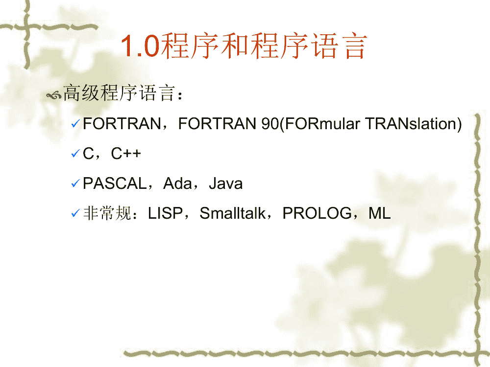

### 1.1 C语言出现的历史背景(1)

- ◆ C语言广泛流行，写系统软件，写应用软件
- ◆ 为了编写计算机操作系统：
- ◆ 1）采用汇编语言，可以直接对硬件进行操作，例如可以直接访问内存，效率高；但其依赖于计算机硬件，可读性和移植性都比较差。
- ◆ 2）采用高级语言，与汇编语言相反。
- ◆ 1960年的ALGOL60 是一种面向问题的高级语言，离硬件较远，不宜用于编写操作系统。
- ◆ 1963年剑桥大学的CPL(combined program language) 接近硬件，但规模大，难以实现。

### 1.1 C语言出现的历史背景(2)

- - 1967年剑桥的 Matin Richard 推出 BCPL
- - 1970年美国电报电话公司(AT&T)贝尔实验室的Ken Thompson以BCPL为基础，进一步简化，设计出很简单且接近硬件的B语言，并用B语言写了第一个UNIX操作系统。
- - 1972~1973年 Dennis M. Ritchie在B语言的基础上设计出C语言，保留了BCPL和B语言精炼、接近硬件等优点，克服了简单、数据无类型等缺点。
- - 1973年，Ken Thompson与Dennis.M.Ritchie把他们1969年用汇编语言编写的UNIX的90%以上用C语言改写为UNIX 5。

### 1.2 C语言的特点（1）

C语言的主要特点如下：

- 1. 是一种较简单的语言，容易入门，上手快。

- 2. 语言精练，层次清晰，便于按模块化方式组织程序，易于调试和维护。

```
i+=2;    i=i+2
```

if (e) s; 如果 e 为真，则执行 s; 否则执行下一条语句

```
for (s1; s2; s3) s4;
```

- 1）执行表达式s1
- 2）如果表达式s2为真，则执行 s4; 否则，跳出本循环
- 3）执行表达式s3，然后返回2）

### 1.2 C语言的特点（2）

- 3. 具有丰富的运算符和数据类型，语言表达能力强，具有较强的数据类型构造能力。

- 4. 可移植性强，广泛移植到了各类计算机上，形成多种版本的C语言。

- 5. 生成代码质量高，程序执行效率高。只比汇编程序的目标代码效率低10%~20%。可以直接访问内存的物理地址，进行位(bit)一级的操作。

- 6. 由于实现了对硬件的编程操作，因此C语言集高级语言和低级语言的功能于一体，既可用于系统软件的开发，也适合于应用软件的开发。

- 7. C语言的限制少，对编程人员要求高。

### 1.2 C语言的特点（3）

### C语言版本

目前最流行的C语言有以下几种：

- - Microsoft C 及后续 Visual C/C++
- - Borland公司的 Turbo C及后续 Borland C/C++
- - Watcom C/C++ 和Symantec C/C++

这些C语言版本不仅实现了ANSI C标准，而且在此基础上各自作了一些扩充，使之更加方便、完美。


### 1.2 C语言的特点（4）

#### 面向对象的程序设计语言

- 在C的基础上，一九八三年又由贝尔实验室的Bjarne Stroustrup推出了C++。C++进一步扩充和完善了C语言，成为一种面向对象的程序设计语言。
- C++目前流行的最新版本是Borland C++、Symantec C++和Microsoft Visual C++。
- C++提出了一些更为深入的概念，它所支持的这些面向对象的概念容易将问题空间直接地映射到程序空间，为程序员提供了一种全新的思维方式和编程方法，因而也增加了整个语言的复杂性，掌握起来有一定难度。

### 1.3 简单的C程序介绍

**例1.1**

```c
main()
{
    printf("Hello, everyone! %c\n",2);
}
```

程序的运行结果：

Hello, everyone! ☺

main是主函数的函数名，表示这是一个主函数。每一个C源程序都必须有，且只能有一个主函数（main函数）。

printf函数调用语句的功能是把要输出的内容送到显示器去显示。printf函数是一个由系统定义的标准函数，可在程序中直接调用。

**例1.2**

```c
#include "stdio.h"    //称为文件包含命令
#include "math.h" //扩展名为.h的文件称为头文件或首部文件
main()
{
    double x,s;          //定义两个实数变量，以备后面程序使用
    printf("input number:\n");          //显示提示信息
    scanf("%lf",&x);                    //从键盘获得一个实数x
    s=sin(x);                            //求x的正弦，并把它赋给变量s
    printf("sine of %lf is %lf\n",x,s); //显示程序运算结果
}                                        //main函数结束
```

程序的运行结果：

sine of 1.5708 is 0.999999

**例1.3**：从键盘输入两个整数，并将最大的数显示出来。

```c
#include "stdio.h" /*包含预处理语句*/
void main() //主函数
{
    int a,b,c;
    printf("Please input two integers:\n");
    scanf("%d,%d", &a, &b);
    c=max(a,b);
    printf("max= %d\n", c);
}
int max(int x,int y)//子函数
{
    int z;
    if(x>y) z=x;
    else z=y;
    return(z);
}
```

程序运行情况：

```text
Please input two integers:
8,5
max= 8
```

**例1.4**：一个百万富翁碰到一个陌生人，陌生人跟他谈了一个换钱的计划。

陌生人说：我每天给你10万元，而你第一天给我一元；第二天我仍给你十万，你给我二元；第三天我仍给你十万，你给我四元；……。你每天给我的钱是前一天的两倍，直到满30天。百万富翁非常高兴，欣然接受了这个契约。

请编写一个程序，计算这n (0<=n<=30)天中，陌生人给了富翁多少钱，富翁给了陌生人多少钱。

```c
#include<stdio.h>
#include<math.h>
void main()
{
    int i,day;
    double stranger_money=1,stranger_money_daily=1;
    double millionaire_money=100000,money=100000;

    printf("Which day you want to output? ");
    scanf("%d",&day);
    for(i=1;i<=day;i++)
    {
        printf("The %d th day:\n",i);
        printf("millionaire's money=%12.1f\n",millionaire_money);
        printf("  stranger's money=%12.1f\n\n",stranger_money);
        stranger_money_daily=2*stranger_money_daily;
        stranger_money=stranger_money+stranger_money_daily;
        millionaire_money=millionaire_money+money;
    }
}
```

通过以上例子可以看出：

1. 一个C语言源程序：
   - 可以由一个或多个源文件组成
   - 每个源文件由一个或多个函数组成（C程序是由函数构成的）
   - 其中必须有且仅有一个主函数main()

函数容易实现程序的模块化。举例：

```c
#include "stdio.h"    /*包含预处理语句*/
int max(int x,int y);//函数原型

void main()//主函数
{ int ……
……
}

int max(int x,int y)//子函数
{  int ……
……
}
```

（C中不存在主程序、子程序的概念，C的结构是函数和语句）

2. 源程序中可以有预处理命令（include命令仅为其中的一种），预处理命令通常应放在源文件或源程序的最前面。举例：

```c
#include "stdio.h"  /*包含预处理语句*/
int max(int x,int y)//子函数
{ int z;
if(x>y) z=x;
else z=y;
return(z);
}
void main()//主函数
{ int a,b,c;
printf("Please input two integers:\n");
scanf("%d,%d", &a, &b);
c=max(a,b);
printf("max= %d\n", c);
}
```

程序开始

程序结束

**说明：在以下三种情况下不允许有分号：**

| 情况 | 错误 | 正确 |
| --- | --- | --- |
| a. 预处理语句后面不使用分号 | `#include "stdio.h";` | `#include "stdio.h"` |
| b. 函数头后面不使用分号 | `sum();`<br>`{ ...... }` | `sum()`<br>`{ ...... }` |
| c. 右花括号“}”后面不使用分号 | `for(i=1;i<=day;i++)`<br>`{`<br>`......`<br>`};` | `for(i=1;i<=day;i++)`<br>`{`<br>`......`<br>`}` |

5. 标识符、关键字之间必须至少加一个空格以示间隔。若已有明显的间隔符，也可不再加空格来间隔。举例

6. C对输入输出实行函数化。举例

7. C程序书写格式自由，一行内可以写几个语句，一个语句也可以分写在多行上。

```c
void main()
{
    int i, day;
    double stranger_money, stranger_money_daily;
    stranger_money = 1; stranger_money_daily = 1;
    printf("Which day you want to output?");
    scanf("%d", &day);
    for(i = 1; i <= day; i++)
    {
        ......
        printf("millionaire's money=%12.1f \n", millionaire_money);
        printf(" stranger's money=%12.1f\n\n", stranger_money);
        ......
    }
}
```

8. 可用`/*......*/`对C程序中的任何部分作注释，注释可以写在程序的任何位置上，“/*”与“*/”也可不在同一行上。举例

```c
#include "stdio.h" /*预处理语句，用于将标准的输入输出函数头文件包含到本文件中*/
#include "math.h" /*预处理语句，包含数学函数库*/
void main()//主函数
{
......
}
```

9. 在C语言中，大小写字母是有区别的。

- C语言习惯用小写字母
- 除了变量名（包括变量和符号常量）以及字符、字符串以外，C语言中的所有关键字、库函数名均采用小写字母

```c
#include "stdio.h"
#include "math.h"
void main() //主函数
{ int a,b,c;
 double A;
 c=max(a,b);
 A=a*b*sin(c);
}
```


### 1.3 简单的C程序介绍

2）函数体，即函数下面的大括号内的部分，例如

```c
main()
{......}

int max(int x, int y)
{......}
```

函数体一般包括：

- 声明部分：如 int a,b,c; int a,b,sum;
- 执行部分：由若干个语句组成

### 1.4 C程序的上机步骤

- 1. 编辑：选择适当的编辑程序，将C语言源程序通过键盘输入到计算机中，并以文件的形式存入到磁盘中（.c 或者 .cpp）
- 2. 编译：即将源程序翻译成机器语言程序的过程。编译出来的程序称为目标程序（.obj）
- 3. 连接：编译后生成的目标文件经过连接后生成最终的可执行程序（.exe）

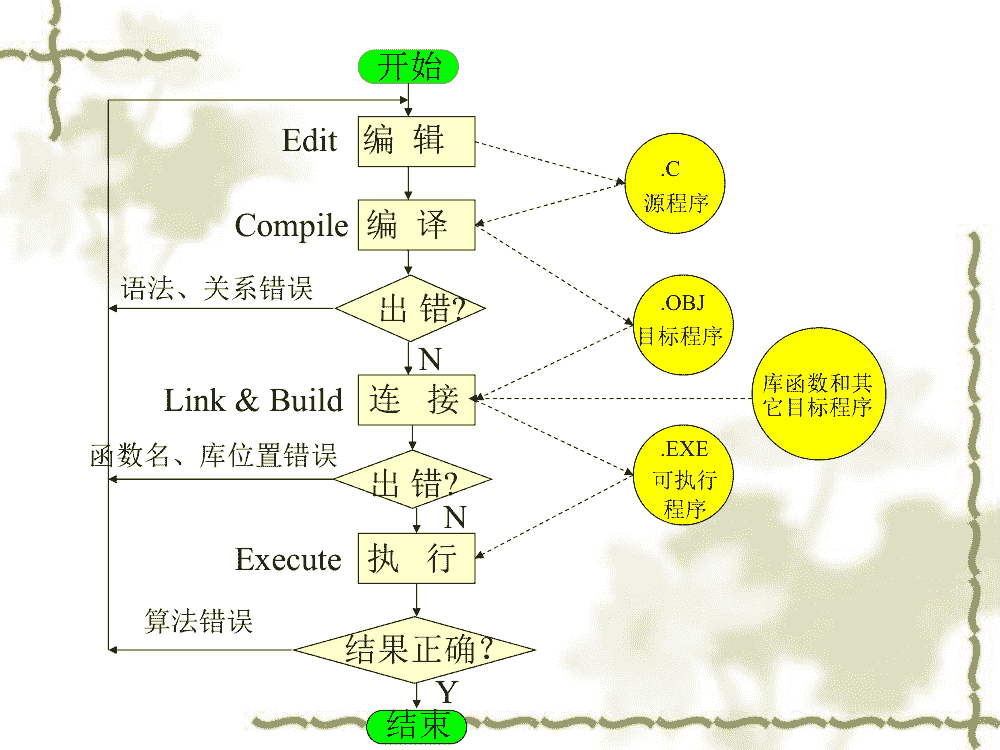

```c
main()
{ int a,b,c,max;

printf("input number a,b,c: \n");
scanf("%d,%d,%d",&a,&b,&c);

max=a;

if(max<b)  max=b;
if(max<c)  max=c;
printf("MAX: %d",max);
}
```

运行结果：

```
input number a,b,c:
  6, 5, 1
MAX: 6
```

## 第二章 算法简介及程序的基本结构

本章要点：

- 了解算法的基本概念
- 掌握程序的基本结构

程序=数据结构+算法+程序设计方法+编程语言

### 2.1 算法的概念

对特定问题求解步骤的一种描述(algorithm)

计算机算法：

- 数值算法，有模型，比较成熟，数学程序库
- 非数值算法，种类繁多，难以规范

### 2.2 简单算法举例（用自然语言描述法）

#### 例1. 有50个学生，要求将他们之中成绩在80分以上的学号和成绩打印出来。

用 n 表示学号，n₁ 代表第一个学生学号，nᵢ 代表第 i 个学生学号。用 g 代表学生成绩，gᵢ 代表第 i 个学生成绩，算法可表示如下：

- S1：1 ⇒ i
- S2：如果 gᵢ ≥ 80，则打印 nᵢ 和 gᵢ，否则不打印
- S3：i + 1 ⇒ i
- S4：如果 i ≤ 50，返回 S2，继续执行；否则，算法结束。

#### 例2 将学生百分成绩按分数段分级的程序。

该算法的核心部分是对输入的每一个数进行比较判断，以确定所属的级别。算法描述如下：

- S1: 1⇒i
- S2: 
- S3: i+1 ⇒i
- S4: 如果i ≤ num，返回S2；否则，算法结束。

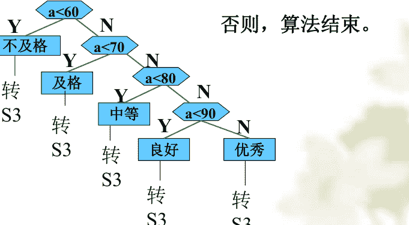

第二种算法如下：

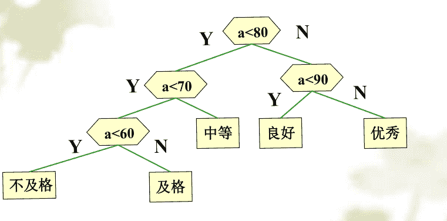

| 分数 | 0—59 | 60—69 | 70—79 | 80—89 | 90—99 |
| --- | --- | --- | --- | --- | --- |
| 比例 | 0.05 | 0.15 | 0.4 | 0.3 | 0.10 |

#### 例3：对一个大于或等于3的正整数，判断它是不是一个素数。

方法：将 n (n≥3) 作为被除数，将 2 到 (n-1) 各个整数轮流作为除数，如果都不能被整除，则 n 为素数。

算法表示如下：

- S1：输入 n 的值；
- S2：2 ⇒ i (i 作为除数)；
- S3：n 被 i 除，得余数 r；
- S4：如果 r 等于 0，表示 n 能被 i 整除，则打印 n “不是素数”，算法结束；否则执行 S5；
- S5：i+1 ⇒ i；
- S6：如果 i ≤ n-1，返回 S3；否则打印 n “是素数”，算法结束。

#### 例4: 求 1-1/2 + 1/3 −1/4 +...+ 1/99 −1/100。

- S1: 1 ⇒ sign //设置符号变量第1项为+
- S2: 1 ⇒ sum //设置和变量等于第1项
- S3: 2 ⇒ deno //设置分母变量
- S4: (-1)*sign ⇒ sign //i+1项的符号=(-1)*i项符号
- S5: sign*(1/deno) ⇒ term //计算级数第i+1项的值
- S6: sum+term ⇒ sum //累加
- S7: deno+1 ⇒ deno //下一项分母的值
- S8: 若 deno ≤100 返回 S4; //给出累加结束条件
  否则算法结束。

请思考：

如果第一项的值必须计算，则 sum 必须设初值

- 1) 对于求和， sum 的初值应设为多少？
- 2) 对于求阶乘， sum 的初值应设为多少？

### 2.3 算法的特性

算法的五个特性：

- 有穷性：一个算法必须在执行有穷步之后结束。
- 确定性：算法的每一步必须是确切定义的，对于相同输入必须得到相同结果。
- 有效性：算法的每一步都是能够实现的，即可操作的。
- 输入：算法有零个或多个输入。
- 有输出：算法执行完毕，必须有一个或若干个输出结果。

### 2.4 怎样描述算法

#### 2.4.1 自然语言描述法

#### 2.4.2 流程图表示

常用符号有：

ANSI (American National Standard Institute)

BS (a bowl of spaghetti)

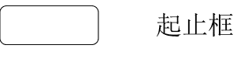

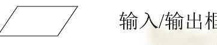

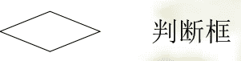

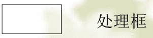


输入50个学生的学号和某门功课的成绩，并将其中成绩在80分以上学生的学号和成绩打印出来

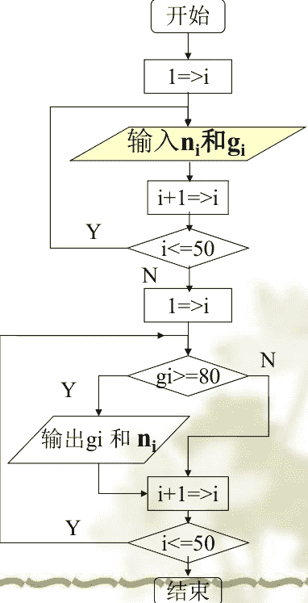

#### 求解一元二次方程：

ax² + bx + c = 0

```text
开始

输入 a、b、c

判断 a=0？
- 否（N）：计算 d=b²-4ac
  - 判断 d 的值：
    - 若 d=0：x₁,₂ = -b / (2a)，输出 x1 和 x2
    - 若 d>0：x₁ = (-b + √d) / (2a)，x₂ = (-b - √d) / (2a)，输出 x1 和 x2
    - 若 d<0：p = -b / (2a)，q = √-d / (2a)，输出 x1=p+iq 和 x2=p-iq
- 是（Y）：判断 b=0？
  - 若否（N）：输出 x=-c/b
  - 若是（Y）：输出 No solution

结束
```

#### 2.4.3 程序的三种基本结构和改进的流程图（N-S结构流程图）

**一、顺序结构**

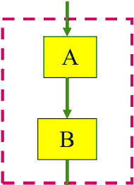

（a）

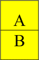

（b）

先执行A操作，再执行B操作，两者是顺序执行关系。

**三、循环结构**

**1. 当型循环结构**

当P条件成立时，反复执行 A，直到P为假

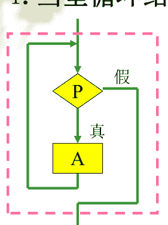

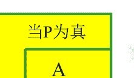

(a)

(b)

P

假

真

A

当P为真

A

**2. 直到型循环结构**

(a)

(b)

先执行A操作，再判断P是否为假，若P为假，再执行A，直到P为真为止。

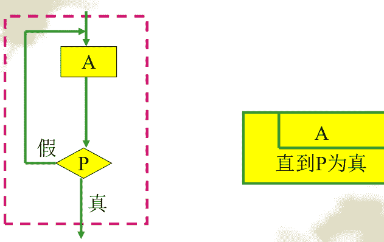

```text
开始

1=>i

输入nᵢ和gᵢ

i+1=>i

i>50

N

Y

1=>i

gᵢ>=80

Y

N

输出gᵢ和nᵢ

i+1=>i

N

i>50

结束

1=>i

输入nᵢ和gᵢ

i+1=>i

直到i>50

1=>i

gᵢ>=80

真

假

输出nᵢ和gᵢ

i+1=>i

直到i>50
```


### 2.4.6 用计算机语言表示算法

例4：求 1 − 1/2 + 1/3 − 1/4 + … + 1/99 − 1/100。

- S1: 1 ⇒ sign
- S2: 2 ⇒ deno
- S3: 1 ⇒ sum
- S4: (-1)*sign ⇒ sign
- S5: sign*(1/deno) ⇒ term
- S6: sum+term ⇒ sum
- S7: deno+1 ⇒ deno
- S8: 若 deno ≤100 返回 S4；否则算法结束。

```
main()
{
    int sign=1;
    float deno=2.0,sum=1.0,term;
    while (deno<=100)
    {
        sign = -sign;
        term=sign/deno;
        sum=sum+term;
        deno=deno+1;
    }
    printf("%f",sum);
}
```

### 2.5 结构化程序设计方法

- 1. 自顶向下
  Vs自下而上，逐步积累
- 2. 逐步细化
- 3. 模块化设计
  分而治之
- 4. 结构化编码
  用高级语言正确地实现三种基本结构

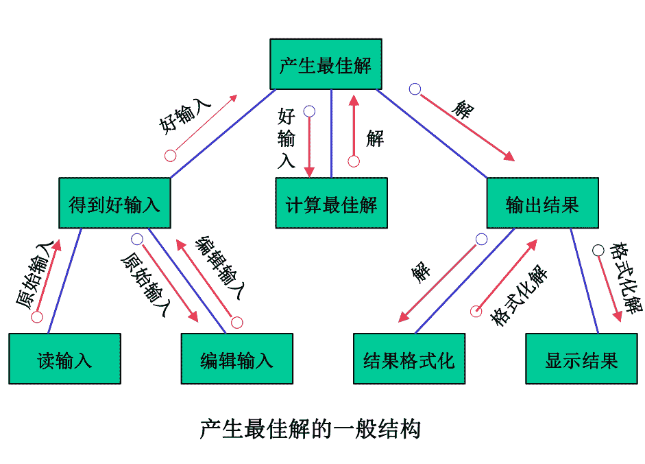

### 产生最佳解的一般结构

```
main()
{
    得到好输入
    计算最佳解
    输出结果
}
```

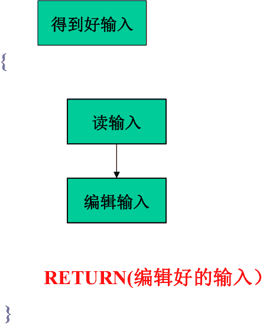

```
{
    输入处理;
    return 输入;
}
```

```
{
    编辑输入处理;
    return 编辑好的输入;
}
```

### 计算最佳解

```
{
求解处理;
return（解）;
}
```

### 结果格式化

```
{
结果格式化处理;
return 格式化结果;
}
```

### 输出结果

```
{
```

### 结果格式化

### 显示结果

```
}
```

### 显示结果

```
{
显示结果处理;
}
```

### 要牢记

- - 每一个C程序需要一个main()函数（使用多于一个main()函数是非法的），“main”所在的位置是程序开始执行的地方。
- - C程序必须以小写字母编写。然而，大写字母可以用于变量名和输出字符串的情况。
- - 程序行中的所有单词必须用至少一个空格、制表符(tab)或者标点符号分隔开来。
- - C程序的每一条语句必须用分号“；”结尾。
- - 所有变量在使用前必须声明其类型和变量名。

### 要牢记

- - 当程序使用一些特殊的名字或函数，而它们又没有在程序中定义时，要使用`#include`指令将有关的头文件包含到本程序中来。
- - `include`和`define`是编译器指令而非C程序的语句，不需要用分号“；”结尾。
- - 编译器指令的`#`符号必须放在该指令行的第一列。
- - 花括号常用于将多条语句组合成一个整体，形成所谓*语句块*。花括号要成对“{ }”使用。
- - 说明文字可以放在程序的任何空格处，用于增加程序的可读性和可理解性，“/* */”在程序中也要成对出现。

### 第1次作业(1)

- 书上P36 2.4 (1)，(2)，(4)
- （可以用Word的插入=>形状功能插入流程图的各种框图。实在不会用，用手画也行）

### 第1次作业(2)
——以下无需提交，自己对答案

看书，掌握用Turbo C(TC)运行C程序的步骤。

### 1_1 判断下列描述是对还是错

- a) 每一个C程序以文字“END”结束。
- b) main()是程序开始执行的地方。
- c) 程序中一行可以有多于一条的语句。
- d) 一个printf语句只能产生一行输出。
- e) main()函数的右花括号是程序的逻辑结点。
- f) 诸如stdio.h的头文件的目的是用于储存程序的源代码。
- g) 注释语句让计算机把包括在/* */之间的文字打印输出。
- h) 语法错误(syntax error)由编译器检查出来。

### 第1次作业(4)

1_5 如果有的话，找出下列程序中的错误

```
a) /* A simple program
   int main()
   {
       /*Does nothing*/
   }
```

```
b) #include (stdio.h)
   void main(void)
   {
       printf(“Hello C”);
   }
```

```
c) include<math.h>
   main()
```

### 答案

1_1

- a) False, “}”
- b) True
- c) True
- d) False，可以用格式"\n"换行
- e) True
- f) False，用于将常用函数包含到程序中来
- g) False，用于标出注释语句
- h) True

### 1_2

- a) False
- b) True

### 1_3

- a) False
- b) True
- c) True

### 1_4

- a) ;
- b) printf()
- c) math.h

### 1_5

### 考试模拟题

选择题

1. 以下C语言标识符中不正确的是__。
A) int  B) a_1_2  C) ab1exe  D) _x

2. 以下C语言标识符中正确的是__。
A) #define  B) _123  C) %d  D) \n

3. C语言程序从main()函数开始执行，所以这个函数要写在__。
A) 程序文件的开始      B) 程序文件的最后
C) 它所调用的函数的前面  D) 程序文件的任何位置

4. 下列关于C语言的叙述错误的是__
A) 大写字母和小写字母的意义相同
B) 不同类型的变量可以在一个表达式中
C) 在赋值表达式中等号(=)左边的变量和右边的

### 考试模拟题

5. 一个C程序的执行时从____
A) 本程序的main函数开始，到main函数结束
B) 本程序文件的第一个函数开始，到本程序文件的最后一个函数结束
C) 本程序的main函数开始，到本程序文件的最后一个函数结束
D) 本程序文件的第一个函数开始，到本程序main 函数结束

6. 以下叙述正确的是____
A) 在C 程序中， main 函数必须位于程序的最前面
B) C 程序的每行中只能写一条语句
C) C 语言本身没有输入输出语句
D) 在对一个C 程序进行编译的过程中，可发现注释中的拼写错误

7. 以下叙述不正确的是____
A) 一个C 源程序可由一个或多个函数组成
B) 一个C 源程序必须包含一个main 函数

### 考试模拟题

C) 程序的基本组成单位是函数

D) 在C 程序中，注释说明只能位于一条语句的后面

8. 一个C 语言程序是由__

- A) 一个主程序和若干子程序组成
- B) 若干过程组成
- C) 函数组成
- D) 若干子程序组成

#### 填空题

- 1. C 源程序的基本单位是__.
- 2. 一个C源程序至少应包括一个__.
- 3. 在一个C源程序中，注释部分两侧的分界符分别为__和__.
- 4. 在C语言中，输入操作是由库函数__完成的，输出操作是由库函数__完成的.

### 考试模拟题答案

选择题

1.A  2.B  3.D  4.A  5.A  6.C  7.D  8.C

填空题

1.函数      2.主函数（或main函数）      3./* 和 */

4.scanf printf

编程题

## 第三章 数据类型、运算符和表达式
第三章
数据类型、运算符符号
和算术表达式

### 3.1 C语言数据类型

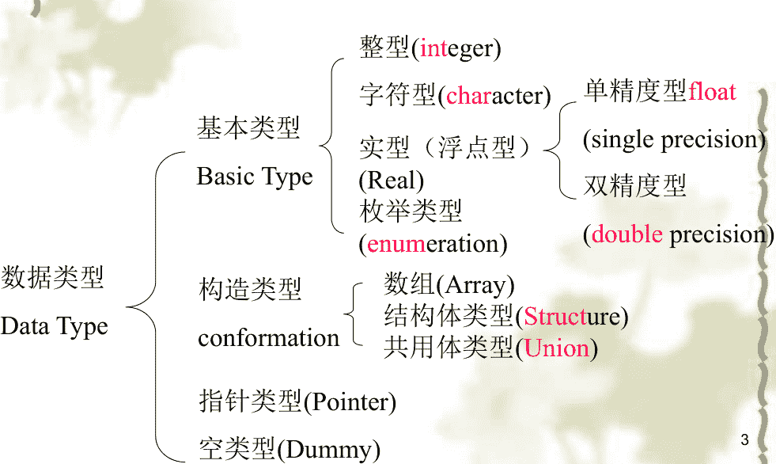

### C字符集

| Letters字母 | A......Z | 大写 | 大写字母 |
|---|---|---|---|
|  | a......z | 小写 | 小写字母 |
| Digits数字 | 0......9 | 所有十进制数字 | 数字 |
| Special Characters 特殊符号 | _ | 下划线 | 下划线 |
|  | , | 逗号 | 逗号 |
|  | . | 句点 | 小数点，句号 |
|  | ; | 分号 | 分号 |
|  | : | 冒号 | 冒号 |
|  | ? | 问号 | 问号 |
|  | ' | 省略号 | 单引号 |
|  | "" | 引号 | 双引号 |


### C字符集（续）

|  | * | asterisk | 星号 |
|  | - | Minus sign | 减号 |
|  | + | Plus sign | 加号 |
|  | < | Opening angle bracket (or less than sign) | 左尖括号（或小于号） |
|  | > | closing angle bracket (or more than sign) | 右尖括号（或大于号） |
|  | ( | Left parenthesis | 左圆括号 |
|  | ) | Right parenthesis | 右圆括号 |
|  | [ | Left bracket | 左方括号 |
|  | ] | Right bracket | 右方括号 |
|  | { | Left brace | 左大（花）括号 |
|  | } | Right brace | 右大（花）括号 |
|  | # | Number sign | 井号 |

### C字符集（续）

|  | ! | Exclamation mark | 感叹号 |
|  | | | Vertical bar | 竖线 |
|  | / | slash | 斜线 |
|  | \ | backslash | 反斜线 |
|  | ~ | tilde | 波浪线 |
|  | $ | Dollar sign | 美元符号 |
|  | % | Percent sign | 百分号 |
|  | & | ampersand | 与 |
|  | ^ | caret | 幂次符号 |

### 3.2 常量与变量 (Constant and Variable)

#### 3.2.1 常量 (Constant)

1. 定义: 在程序执行期间, 其值不发生变化的量称为常量

2. 类型:

+   - **直接常量 (Direct ~)** 又称 **字面常量**。分为
+     - 整型常量: `123, -321, 0, 654321, +78`
+     - 实型常量: `2.68, 3.14, 2.718, 1.38e12`
+     - 单字符常量: `'a', 'C', 'z'`
+     - 字符串常量: `"china", "student", "class number"`

符号常量 (Symbol ~) 即用一个符号代表一个常量

例如： #define PI 3.1415926 //预处理命令

```
main( )
{
    float r,l,s;
    r=2;    l=2*PI*r; s=PI*r*r;
    printf("l=%d, s=%d", l,s);
}
```

编译器编译后，程序中的有关代码变成了（.obj文件，不可见）

l=2* 3.1415926*r;

s= 3.1415926*r*r;

### 说明：

+   - 符号常量必须先定义后才能用它表示一个数值。
+   - 符号常量的值在其作用域内不能改变，也不能被再赋值。
+   - 符号常量名习惯用大写字母表示。

#### 3.2.2 变量

+   1. 定义：程序执行期间值可以改变的量。

+   2. 命名规则：变量名由标识符表示，只能由字母、数字和下划线三种字符组成，且第一个字符不得为数字。

例如：下列标识符中，不合法的变量名有：

M.D.John , 12%gf , 1add , age&

5thclass, lotus-1-2-3, cd*ef, float

+   3. 变量要“先定义，后使用”

定义格式：类型说明符 标识符1, ..., 标识符n;

例如：

```
int x, y, z; （每个整型变量分配 2字节bytes存储单元）
```

```
float a,b,c,d; （每个单精度变量分配 4字节存储单元）
```

```
double u,v,w; （每个双精度变量分配 8字节存储单元）
```

在C语言中，变量之所以要强制定义，其目的：

+   1、避免在使用时输错：`int student; student=30;`
+   2、每一个变量被指定为一个确定的类型，在编译时就能为其分配相应的存储单元。
+   3、指定每一个变量为一个确定的类型，在编译时据此检查该变量所进行的运算是否合法。

例如：如果有

```
double x,y；int z;
```

对于运算：

```
z=x*y;
```

在编译时系统就会提示该运算类型不匹配：

```
warning C4244: '=': conversion from 'double' to 'int', possible loss of
data
```

### 3. 3整型数据

#### 3.3.1 整型常量的表示法

**十进制整数：**由数字（0-9）和正负号表示

例如：123、-456、0 等

**八进制整数：**以 0 开头，含数字 0～7

例如：037,0,0435,0551,0123 即 (123)₈=(83)₁₀

(123)₈=1×8²+2×8¹+3×8⁰=(83)₁₀

**十六进制整数：**以 0x 或 0X 开头，含数字和字符

16：0~9，a，b，c，d，e，f，10

10：0~9，10，11，12，13，14，15，16

例如：0X2,0x9F,0Xbcd,0X

0x123 即 (123)₁₆=(291)₁₀

-0x12 即 (-12)₁₆=(-18)₁₀

#### 3.3.2 整型变量

1. 整型数据在内存中的存放形式（补码表示法：便于加减运算）

```
int i;

 i=10;

10=(1010)₂
```

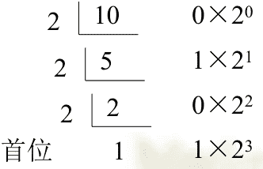


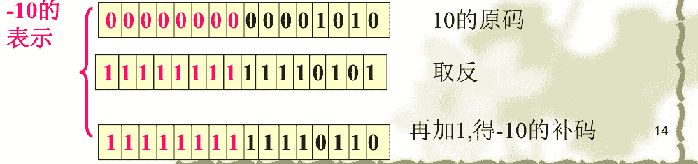

### 计算10-10:

10-10=10+ (-10)

10

00000000001010

+

-10

111111111110110

=

0

0000000000000000

### 整型变量的字长

short型：2个字节byte（字长16位bit）

int 型：一般是2个字节

long 型：4个字节（字长32位）

C要求 short型数据长度短于int型，int型短于long型。(short<=int<=long)

long 型可以得到大范围的数据（-20亿~20亿），但同时会降低运算速度，因此除非不得已，不要大量使用long型变量。

### 整型数据的溢出：

```
main()
{ int a, b;

a=32767; b=a+1;

printf("%d, %d", a, b);
```

运行结果： 32767, -32768

改进：将变量a和b改成long型，并按 %ld 格式输出。

但有时，系统（例如Visual C++）自动将int型变量（16位）扩展为long型变量（32位）

### 整型数据的数据范围

请看“ANSI标准定义的整型类型”(P43表)。

注意：

+   1、在一个整数常量后面加一个字母l或L，则认为是long型常量。例如
+   
+   123456789l， 9876543L

+   2、在一个整数常量后面加一个字母u或U，则认为是unsigned int型常量。例如
+   
+   56789U， 56789u

### 3.4实型数据 (Real Data)

#### 3.4.1实型常量

表示形式有如下两种：

十进制数形式：由数字和小数点及正负号组成。

（注意：必须有小数点）

例如：23.678，0.0083，-0.75，435.36，+247.00

也可能忽略小数点前面或者后面的数字

215., .95, -.71, +.5, .678 23.

指数形式：由数字、小数点、字母e或E及正负号组成。

（注:e或E之前必须有数字，其后指数必须为整数）

例如：3.5E-5 (3.5×10⁻⁵) 2e3 (2×10³)

错误：E2，3.6e3.5，.e6，e

#### 3.4.2 实型变量

实型变量可分为：

+   - **单精度**（`float`型）　如：`float x,y;`
+   - **双精度型**（`double`型）　如：`double a, b, c;`

### 说明：

+   1. `float` 型变量用于存储单精度实数，在内存中占 **4** 个字节（bytes）或 **32** 位（bits），提供 **6~7** 位有效数字。
+   2. `double` 型变量用于存储双精度实数，在内存中占 **8** 个字节（bytes）或 **64** 位（bits），提供 **15~16** 位有效数字。


实数的存储方式与整形数据不同：

符号 小数部分 指数部分


3.14159*10<sup>255</sup>

对于float型十进制数，一些编译系统以24位表示小数部分，8位表示指数部分。

3. 一个实型常量不分float和double型，一个实型常量可以赋给一个float型或double型变量，并根据变量的类型截取实型常量中相应的有效位数字。

例如：

```
main()
{ float a,c ; double b;
    a=123456789012345.6789 ;
    b=123456789012345.6789 ;
    c=a+20;
    printf("a=%f\nb=%f\nc=%f\n ", a,b,c);
}
```

输出结果：

a=123456788103168.000000
b=123456789012345.670000
c= 123456788103188.000000

（避免将一个很大的数与一个很小的数相加减，以免出现舍入误差）

### 3.5字符型数据 (Character Data)

#### 3.5.1字符常量(Character Constant)

- 1. 用单引号括起来的一个字符
- 如 ‘T’ ， ‘7’ ， ‘!’
- 2. 转义字符：是一种特殊的字符常量，由反斜杠 ‘\’ 和一个字符组成，其作用是用 ‘\’ 将后面的字符转变为另外的意义。
- 如 ‘\n’ 中的 ‘n’ 不表示字母n，而表示“换行”的意思。这是一种控制字符。

### 说明：

- 1、"\ddd" 与 "\xhh" 分别表示用八进制数或十六进制数表示一个字符。

例: '\101' 代表 ASCII 码(十进制)为 65 的字符 ‘A’。 系统中所有字符都有 ASCII 值（见 374 页）

- 2、由于 \ ' " 在 C 语言中都有了特殊的意义，故要想在字符串中使用它们，须在其前面再加上一个反斜线。

“‘‘” ↔ “\‘”； “‘‘” ↔ “\‘”； “\” ↔ “\\”

例如，Tom said to the waiter:"I'd like a cup of coffee".

```
printf("Tom said to the waiter:\"I'd like a cup of coffee\".");
```

- 3、除了前面介绍的特殊转义字符外，‘\字母’ 代表字母本身。如 ‘\c’ 代表字母 c。

#### 3.5.2字符变量(Character Variable)

定义形式： char 标识符1, 标识符2, ... , 标识符n
例如： char c1, c2, c3, ch ;
c1='a'; c2='b'; c3='c'; ch=' d';

说明：

- 1、字符变量只能存储一个字符，在内存中占一个字节。

- 2、在内存中，是把字符对应的ASCII码值放到存储单元中(0~255)。

- 3、字符型数据与整型数据之间可以通用。

```
main()
{ char c1,c2;
    c1=97;//数字赋值给字符变量
    c2=98;
    printf("%c %c\n",c1,c2);
    printf("%d %d\n",c1,c2);
}
```

输出结果：
a  b
97 98

```
main()
{ int i; char c;
    i='a'; //字符赋值给整型变量
    c=97; //数字赋值给字符变量
    printf("%c,%d\n",c,c);
    printf("%c,%d\n",i,i);
}
```

输出结果：
a, 97
a, 97

#### 3.5.4字符串常量(Character string constant)

1.定义：括在一对双引号 “...”之内的字符序列或转义字符序列称为字符串常量。

例如：“How are you!” “a” “*abc\n\t”

2.存储：字符串中的字符依次存储在内存中一块连续的区域内，并且把空操作字符 ‘\0’自动附加到字符串的尾部作为字符串的结束标志。故字符个数为n的字符串在内存中应占n+1个字节。

例：char c[6]="china";
char *s="china";

| c | h | i | n | a | \0 |
|---|---|---|---|---|-----|

### 3.6 变量赋初值（Variable initialization）

1. **初始化：** 在定义变量的同时为变量赋初值

2. **形式：** 类型标识符　变量名=常量或常量表达式

例如：

```
int  x=10; double sum=0.;
char  ch='a';
```

- 变量赋初值允许使用符号常量

例如：`#define PI 3.1415926`

`......float x=PI;......`

- 可对被定义的变量的一部分赋初值

例如：`int a,b,c=1,d=2;`

`float r=2,l,s;`

- 可对几个变量赋以同一个初值

例如：`int a=6,b=6,c=6;`

或可写为：`int a=b=c=6;`

### 数据类型的尺寸和范围

| 类型 type | 字节 bytes | 字长 bits | 有效数字 | 取值范围 |
|---|---|---|---|---|
| char | ■ | 8 |  | 0~255 |
| int | ■■ | 16 |  | -32768~32767 |
| unsigned int | ■■ | 16 |  | 0~65535 |
| short int | ■ | 8 |  | -128~127 |
| long int | ■■■■ | 32 |  | -2.147×10⁹~2.147×10⁹ |
| float | ■■■■ | 32 | 6~7 | -3.4×10⁻³⁸~3.4×10⁺³⁸ |
| double | ■■■■■■■■ | 64 | 15~16 | -1.7×10⁻³⁰⁸~1.7×10⁺³⁰⁸ |
| long double | ■■■■■■■■■■■■ | 128 | 18~19 | -1.2×10⁻⁴⁹³²~1.2×10⁺⁴⁹³² |

### 3.7 各类数值型数据间的混合运算

形式：

隐式转换（由系统自动进行）
显式转换（强制类型转换）

隐式转换的转换规则：

先自动转换成同类型数据，再进行运算。规则是低字长类型转换成高字长类型。

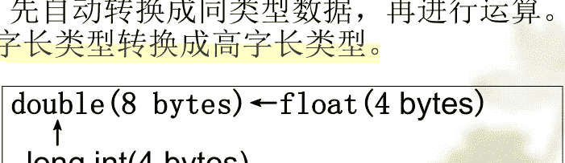

### 3.7 各类数值型数据间的混合运算

```
double(8 bytes) ← float(4 bytes)
↑
long int(4 bytes)
↑
unsigned int(2 bytes)
↑
int(2 bytes) ← char, short(1 bytes)
```

(1) 箭头表示当运算对象类型不同时的转换方向，一般是从低精度的类型转换到高精度的类型。

(2) 向左的横向箭头表示即使在同一种数据类型间进行运算时也要进行转换，用于提高精度。即：

- ➢ 同为 float 型数据的运算，一律转换成 double 型数据后进行；
- ➢ 同为 char 和 short int 型数据的运算，一律转换成 int 型的数据后进行。

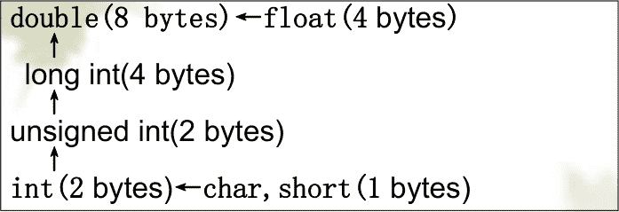

(3) 当运算对象具有相同类型时，向上的箭头不再起作用。即：

- int型与 int 型数据运算的结果仍为int 型；
- unsigned型与unsigned型数据运算的结果仍为unsigned型；
- long型与long 型数据运算的结果仍为long 型。

- char-char => int-int => char

‘d’- ‘a’ => 100-97 => 003 => ‘♥ ’

- float+float => double+double =>double
- int/float=>float/float=>float

float a; a=1/3.0=1.0/3.0=0.3333333

double c; c=1.0/3.0=0.3333333333333333

int b; b=1/3.0=1.0/3.0=0.3333333=0

- int/int=>int

float a; a=1/3=0.0;

int b; b=1/3=0;

Decision
loss


例：若有：`int i;` `float f;` `double d;` `long e;`

试判断表达式 `3 + 'b' + i*f - d/e` 的类型

类型推导：`3 + 'b'` → `int`；`i*f` → `float`；中间结果为 `float`；`d/e` → `double`；最终结果为 `double`。

例：如果 `int a=5,b=2;`

```
double x;
x=a/b;
printf(" x=%f",x);
```

输出结果是什么？

`x=2.000000`

### C语言使用的基本表达式有：

- 1. 赋值表达式，如：`a=3`
- 2. 算术表达式，如：`3+4*2`
- 3. 关系表达式，如：
  `3>2，a==b，c!=0`
- 4. 逻辑表达式，如：`3>5&&a>=b`
- 5. 条件表达式，如：`a>b?a:b`
- 6. 逗号表达式，如：`a=3，b=4，c=5`

### 3.8 算术运算符和算术表达式
（Arithmetic Operators and Expressions）

### 1、基本的算术运算符：

加(+)、减(-)、乘(*)、除(/)、求余(或称模运算，%)

整型数运算

```
int a=14,b=4;
a-b=10
a+b=18
a*b=56
a/b=3(decimal part truncated)
a%b=2(remainder of division)
-14%3=-2
```


- 实型数运算
  float x,y,z;
  x=6.0/7.0=0.857143
  y=1.0/3.0=0.333333
  z=-2.0/3.0=-0.666667
  % operator can not be used here（此处不能使用%运算符）

- 混合运算
  15/10.0=1.5
  15/10=1 ?

### 说明：

- （1）上述运算符均为双目运算符（即有两个操作数 two operands）

- （2）“/”运算中，若操作数均为整数，则执行整除运算，舍去小数部分。例如：5/3=1

- （3）“%”要求两侧均为整数，“%”运算不能用于float和double型数据

例如： 5 % 3 = 2

### 3、强制类型转换 (Forced type transformation)

形式：(类型名)（表达式）

例如：( double) (a+b)

### 说明：

- (1) 表达式应用括号括起
  例如：(int) (x+y);

(2) 在强制类型转换时，得到一个所需类型的中间变量，原来变量类型未发生变化。

- (3) 用途：
  完成某种运算，如(int)5.5%3;
  在函数调用时使实参与形参一致。

| 举例 | 作用 |
| --- | --- |
| x=(int) 7.5 | 7.5 通过截尾转换为整数 |
| a=(int)21.3/(int)4.5 | 转换为21/4，结果为5 |
| b=(double)sum/n | 以浮点数（实型数）模式计算除法 |
| y=(int)(a+b) | 将表达式a+b转换为整数 |
| z=(int)a+b | 将a转换为整数然后与b相加 |
| p=cos((double)x) | 在使用 x之前，将其转换为实型数 |

### 4、自增、自减运算符 （++、--）

**作用：**使变量的值增1或减1，如：

- `i++、++i` 等于 `i=i+1`
- `i--、--i` 等于 `i=i-1`

- `++i、--i` ⇔ **先执行** `i=i+1 (i=i-1)`，**后使用** i 的值
- `i++、i--` ⇔ **先使用** i 的值，**后执行** `i=i+1 (i=i-1)`

##### 举例：

```
int j,i=3;

① j=++i;      /* i的值为4，j为4 */
② j=i++;      /* j的值为3,然后i的值变为4 */
③ j=i++;      /* j的值-3，然后i的值变为4 */
④ printf("%d",i++); /* 输出的值3，然后i的值变为4 */
```

### 4、自增、自减运算符 （++、--）

说明：（1）为单目运算符

（2）++、--只能用于变量，而不能用于常量或表达式。

例如：10++，(x+y)++，++'a'，b++ 中合法的为：

（3）自增、自减运算符为右结合性（即自右至左）。

例如：-a++ ↔ -(a++)

错误的结合 (-a)++

y*x++ ↔ y*(x++)

错误的结合 (y*x)++

### 练习题

1. 设a=2, 则执行语句 k=++a+a++ 后的 k值为多少？ (k=6, a=4)

```
int i=3;
a=(i++)+(i++)+(i++)
```

2.

```
int i=3;
printf("%d,%d",i, i++)
```

3.

请避免这种写法

P58

最好写成

```
i=3; j=i++;
printf("%d,%d",i, j)
```

### 3.9 赋值运算符和赋值表达式

Assignment Operator and Expressions（赋值运算符和表达式）

1、赋值运算符（=）

形式：变量名=常量或表达式

作用：将右边常量或表达式的值赋给左边的变量

例如：  b=c+d;

要求：如果表达式类型与左边的变量的类型不匹配，自动进行类型转换。

### 2、类型转换的原则

（1）将实型数据赋给整型变量时,舍弃实数的小数部分。
如：若a为int型变量，执行a=3.56后，则a=3

（2）将整型数据赋给实型数据时,数值不变,但以浮点形式存储到变量中。
如：若b为float型变量，执行b=35后，则b为35.00000

（3）整型数据赋给字符型变量时,只将低8位原封不动地送到字符变量中（即截断）。
如：
0000 0001 0010 0001   i=289=256+33
↓
0010 0001   c=33  c='!'

（4）字符型数据赋给整型变量时，将字符数据(8位)放到整型变量低8位中。高8位则需要依据“符号扩展”来决定。

### 例1（无符号字符数据赋给整型变量）

```
unsigned char c;
int i;
c=254;
i=c;
```

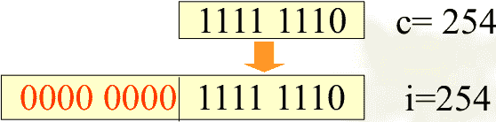

### 例2（Turbo C系统把字符处理为带符号的）

```
char c;
int i;
c=254;
i=c;  /* 变量c以整数形式输出为-2 */
```

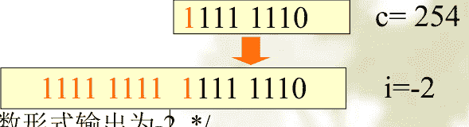

- （5）将带符号数据赋给长度相同的无符号型变量，原样照赋。

- （6）**double** 赋给 **float** 时，截取前面7位有效数字。

### 例3：（带符号int型数据赋给long型变量）

```
```c
int a;
long b;
a=254;
b=a;
```
```

a=254
b=254

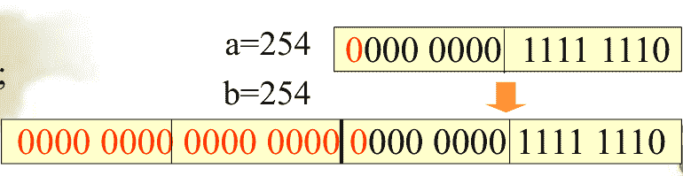

### 例4：（带符号int型数据赋给long型变量）

```
```c
int a;
long b;
a=-2;
b=a;
```
```

a=-2
b=-2

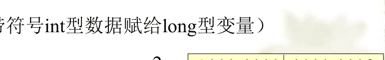

### 例5：（无符号int型数据赋给long型变量）

```
```c
unsigned int a;
long b;
a=65534;
b=a;
```
```

a=65534

b=65534

| 1111 1111 | 1111 1110 |
|---|---|

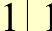

| 0000 0000 | 0000 0000 | 1111 1111 | 1111 1110 |

### 例6：（有符号数据赋给无符号变量）

```
```c
int a;
unsigned int b;
a=-2;
b=a;
```
```

a=-2

| 1111 1111 | 1111 1110 |


b=65534

| 1111 1111 | 1111 1110 |


P66 （3.11） 写出下面赋值的结果。格中写了数值的是要将它赋给其它类型的变量，将所有空格添上赋值后的数值。

|  | 99 | 100 | 76 | 53 | 68 | 42 | -1 |
|---|---|---|---|---|---|---|---|
| int | 99 | 100 | 76 | 53 | 68 | 42 | -1 |
| char | ‘c’ | ‘d’ | ‘L’ | ‘5’ | ‘D’ | ‘*’ | X |
| unsigned int | 99 | 100 | 76 | 53 | 68 | 42 | 65535 |
| float | 99.000000 | 100.000000 | 76.000000 | 53.65 | 68.000000 | 42.000000 | 65535.000000 |
| long int | 99 | 100 | 76 | 53 | 68 | 42 | 65535 |

### 总的结论：

- 低精度的数据赋值给高精度的变量，其精度将保持；
- 高精度的数据赋值给低精度的变量，其精度将降低，有时甚至可能出错。

#### 3、复合赋值运算符

##### (Compound assignment operators)

- 复合赋值运算符：在赋值符 “=”之前加上其它运算符
- 共有10种复合赋值运算符
+=, -=, *=, /=, %=
<< =, >> =, &=, ^=, |= （位运算）

例如： a+=3 ↔ a=a+3
x*=y+3 ↔ x=x*(y+3)
x/=y ↔ x=x/y

### 普通赋值运算符

### 简洁赋值运算符

```
a=a+3
```
```
a=a-3
```
```
a=a*(n+1)
```
```
a=a/(n+1)
```
```
a=a%b
```
```
a+=3
```
```
a-=3
```
```
a*=n+1
```
```
a/=n+1
```
```
a%=b
```
```
a=b=c=6
```
```
a=(b=4)+(c=6)
```
```
a=(b=4)*(c=6)
```

复合赋值符这种写法，对初学者可能不习惯，但十分有利于编译处理，能提高编译效率并产生质量较高的目标代码。

### 4、赋值表达式(Assignment expressions)

定义：由赋值运算符将一个变量和一个表达式连接起来的式子。

形式：变量 = 表达式

结合方向：由右向左

说明：赋值表达式的值为被赋值的变量的值。其中“表达式”又可以是一个赋值表达式。

例如：
a=b=c=6
a=(b=4)+(c=6)
a=(b=4)*(c=6)
x=-b/(2*a)
y1=-x+(dt=sqrt(b*b-4*a*c))
y2=-x-dt

### 3.10 逗号运算符和逗号表达式

- 1. 逗号运算符：即 “,”
- 优先级：为所有运算符中优先级别最低的。

### 2. 逗号表达式

形式：表达式1，表达式2，......，表达式n

求解过程：顺次求解表达式1，表达式2，......，最后求解表达式n，逗号表达式的值为表达式n的值。

例如：a=3*5, a*4 60
a=3*5, a*4, a+5 20
x=(a=4%3 , a+1, a*10) 10
a=2,b=3,c=4;

例如：

```
v=(x=10, y=5, x+y);
```

The value of v is 15.

应用：

- 1） 在for循环中：
for(n=1,m=10; n<=m; n++,m++)

- 2） 在while循环中：
while(c=getchar(), c!='\0')

- 3） 数值交换：
t=x, x=y, y=t;

程序中使用逗号表达式，通常是要分别求逗号表达式内各表达式的值，并不一定要求整个逗号表达式的值。

### 要牢记

- 不要使用关键词或者系统库函数的名字作为标识符（变量名或函数名）；
- 不要使用只有一、两个字符的变量名；
- 每个变量要在程序或函数开始处声明其类型；
- 在程序中被使用前，所有变量必须赋值；
- 不要在#define命令的结尾处加“;”；
- 不要在#和define之间加空格；
- C对于数据的溢出不给任何警告或指示，只会给出错误的结果。必须小心定义数据的类型；

### 要牢记

- 小心使用自增和自减运算符，在使用前了解前置（如`++i`）和后置（如`i++`）的差别；
- 在计算顺序混乱的地方，小括号的使用可使它们变清晰；
- 在赋值以前，表达式的类型被转换成与等号左边的变量类型一致。注意转换时可能的数据损失；
- 所有的数学函数的参数（自变量）和返回值（计算值）均为`double`类型（例如`y=sin(x)`中的x和y）；
- 不要对浮点数变量使用自增和自减运算符。

### 第三章 作业（所有程序均需上机调试，正确后方能提交）

3_1 判断以下程序段有否错误，写出正确的程序段，并上机调试验证你的程序。（提交修改后的源程序）

```
```c
#include<stdio.h>;
void mian{}
{
    float x=3.1415;
    int y,z,student_num=196;
    PRINTF(“Hello!\n”);
    printf(“the student_number is:%d\n”,num);
    printf(“the student_number is:%D\n”, student_num);
    printf(“x=%d\n”,x);
    printf(“y=%fn”,y);
    z=3/2;
    printf(“z=%d\n”,z);
}
```
```
//说明：”%d”是输入、输出整形数据的格式，“%f”是输入、输出实形数据的格式，“\n”是换行的格式

3_2 在计算机屏幕上输出一段文字：

John said to his brother:(换行)

(空两格)"Let’s have a rest!"

并在此段文字前后各空两行。（提交源程序）

### 3_3 求下面算术表达式的值：

- 1. `x+a%3*(int)(x+y)%2/4`，设 x=2.5，a=7，y=-4.7
- 2. `(float)(a+b)/2+(int)x%(int)y`，设 a=2，b=3，x=3.5，y=2.5

先写出运行结果，然后编制程序验证之。（提交源程序）

### 3_4 先写出下列程序的运行结果，然后编制程序验证之。

```
#include<stdio.h>
void main()
{
int i,j,m,n;
i=8;
j=10;
m=++i;
n=j++;
printf("%d,%d,%d,%d",i,j,m,n);
}
```

3_5 写出下列赋值表达式运算后a的值，然后编制程序验证之。
设原来a=12（提交源程序，注意每次计算之前，将a的值复原为12）

- (1) a+=a
- (2) a-=a
- (3) a*=2+3
- (4) a/=a+a

- (5) a%=(n%=2)，n的值等于5
- (6) a+=a-=a*=a

### 以下为自我测试题，做完之后自己对答案

### 3_6. 判断下列陈述是对还是错？

- a) 所有运算符具有相同的优先级。
- b) 求模运算符% 只能用于整型数
- c) 运算符<=,>= 和 !=具有相同的优先级。
- d) 在 C 中，如果一个数据项为零，它就被认为是逻辑假。
- e) 表达式!(x<=y) 与x>y等效
- f) 一个一元表达式由一个没有运算符的操作数组成。
- g) 结合性被用来决定具有几个表达式的运算哪个优先执行。
- h) 表达式语句用句点“.”结尾
- i) 对于混合表达式运算，隐式类型转换是自动进行的
- j) 强制类型转换可以用于改变表达式
- k) 小括号可以用于改变表达式

### 3．7 下列哪些表达式是有效的？如果有效，给出表达式的值；否则说明原因。

- a) `25/3%2`  
- b) `+9/4+5`  
- c) `7.5%3`  
- d) `14%3+7%2`  
- e) `-14%3`  
- f) `15.25+-5.0`  
- g) `(5/3)*3+5%3`  
- h) `21%(int)4.5`

### 3_8. 假设有:int a=10,b=20,c;判断下列表达式是对还是错.

- a) 语句a=+10,是有 效的；
- b) 表达式a+4/6*6/2 的值为11；
- c)表达式b+3/2*2/3的值为20；
- d) 语句a+=b; 将30赋给a，将20赋给b；
- e)语句++a++; 运算的结果为a=12；
- f)语句a/=b; 将值0.5赋给a；

### 3_9. 找出下列运算式中不必要的小括号，给出其精炼的表达式

- ((x-(y/5)+z)%8)+25
- ((x-y)*p)+q
- (m*n)+(-x/y)
- x/(3*y)


### 答案

#### 3_1

|  | 错误 | 正确 |
|---|---|---|
| 句子1： | ; | （没有分号） |
| 句子2： | void mian{} | void main() |
| 句子5： | PRINTF | printf |
| 句子6： | d% | %d |
| 句子7： | %D | %d |
| 句子8： | 实型数用整型格式输出 | %f |
| 句子9： | 整型数用实型格式输出 | %d |
| 句子10： | 两个整数相除得到整数 | x=3.0/2; |
| 句子11： | 实数的小数部分被截尾，精度降低 |  |

#### 3_6

- a) 错
- b) 对
- c) 对
- d) 对
- e) 对
- f) 错
- g) 对
- h) 错
- i) 对
- j) 对
- k) 对

#### 3_7

- a) 0
- b) 7
- c) 无效, 实数不能用%运算
- d) 3
- e) -2
- f) 无效, -5.0 应该有小括号
- g) 5
- h) 1

#### 3_8

- a) 对  b) 错      c) 对
- d) 错      e) 对  f) 错

#### 3_9

- a) (x-y/5+z)%8+25      b) (x-y)*p+q
- c) m*n-x/y      d) x/(3*y)

### 模拟考试题

#### 选择题

1. 已知： char a; int b; float c; double d;  
   执行语句"c=a+b+c+d;"后，变量c的数据类型是__。  
   A) int B) char C) float D) double

2. 温度华氏和摄氏的关系是：C=5/9 (F-32)。已知： float C,F; 由华氏求摄氏的正确的赋值表达式是____。  
   A) C=5/9(F-32) B) C=5*(F-32)/9  
   C) C=5/9*(F-32) D) 三个表达式都正确

3. 逗号表达式"(a=3*5,a*4),a+15"的值是____。  
   A) 15 B) 60 C) 30 D) 不确定

4. 如果int a=1,b=2,c=3,d=4；则条件表达式"a<b?a:c<d?c:d"的值是____。  
   A) 1 B) 2 C) 3 D) 4

5. 为求出s=10!的值，则变量s的类型应当为__。  
   A) int B) unsigned C) long D) 以上三种类型均可

6. 已知int x=1,y; 执行下述语句后变量x的值是____。

   y=+++x>5&&++x<10;

   A) 1 B) 2 C) 3 D) 4

7. 为判断字符变量c的值不是数字也不是字母时，应采用下述表达式 ____。

   A) c<=48||c>=57&&c<=65||c>=90&&c<=97||c>=122

   B) !(c<=48||c>=57&&c<=65||c>=90&&c<=97||c>=122)

   C) c>=48&&c<=57||c>=65&&c<=90||c>=97&&c<=122

   D) !(c>=48&&c<=57||c>=65&&c<=90||c>=97&&c<=122)

8. 已知 int a=3,b=2,c=1;

   则表达式"a/b/c"的值是____。

   A) 1.5 B) 1 C) 0 D) 错误的表达式

9. 已知 int x=1,y=1,z=1；  
   表达式"x+++y+++z++"的值是____。  
   A) 3  B) 4  C) 5  D) 表达式错误

10. 已知int x=5,y=5,z=5；执行语句x%=y+z；  
    后，x的值是____。  
    A) 0  B) 1  C) 5  D) 6

11. 使用语句scanf("x=%f,y=%f",&x,&y);  
    输入变量x、y的值（□代表空格），正确的输入是____。  
    A) 1.25,2.4  B) 1.25□2.4  C) x=1.25,y=2.4  D) x=1.25□y=2.4

12. 已知int x=(1,2,3,4)；变量x的值是____。  
    A) 1  B) 2  C) 3  D) 4

13. 与条件表达式"(n)?(c++):(c--)"中的表达式（n）等价的表达式是____。  
    A) (n==0)  B) (n==1)  C) (n!=0)  D) (n!=1)

#### 填空题

1. 若有以下定义： int m=5,y=2;则计算表达式y+=y-=m*=y后的y值是__。
2. 在C语言中，一个int型数据在内存中占2个字节，则int型数据的取值范围为__。
3. 已知字母a的ASCII码为十进制数97，且设ch为字符型变量则表达式ch='a'+'8'-'3'的值为__。
4. 假设所有变量均为整型，则表达式(a=2,b=5,a++,b++,a+b)的值为:__
5. 若s是int型变量，且s=6，则表达式s%2+(s+1)%2的值为__。
6. 若a是int型变量，则下面表达式(a=4*5,a*2),a+6的值为__。
7. 若x和a均是int型变量，则计算表达式x=(a=4,6*2)后的x值为__，计算表达式x=a=4,6*2后的x值为__。
8. 若a是int型变量，则计算表达式a=25/3%3后a的值为__。
9. 若x和n均是int型变量，且x和n的初值均为5，则计算表达式x+=n++后x的值为__，n的值__。
10. 若有定义： int x=3,y=2;float a=2.5,b=3.5;则表达式(x+y)%2+(int)a/(int)b 的值为____。
11. 已知字母a的ASCII码为十进制数97，且设ch为字符型变量，则表达式 ch='a'+'8'-'3'的值为____。
12. 若有定义： int e=1,f=4,g=2;float m=10.5,n=4.0,k;则执行赋值表达式 k=(e+f)/g+sqrt((double)n)*1.2/g+m后k的值是____。
13. 表达式 8/4 *(int)2.5/(int)(1.25*(3.7+2.3))值的数据类型为____。
14. 假设m是一个三位数，从左到右用a,b,c表示m各位的数字，则用m表示从左到右的数字是bac的三位数的表达式是

### 模拟考试题答案

#### 选择题

1.C    2.B    3.C    4.A    5.C    6.B    7.D    8.B    9.A  
10.C   11.C   12.D   13.C

#### 填空题

1.-16    2.-32768~+32767    3.F或 102    4.9    5.1  
6.26    7.12,4    8.2    9.10,6    10.1    11.102  
12.13.700000    13.整型（或int型）  
14.(m/10)%10*100+m/100*10+m%10

## 第四章 最简单的C程序设计（The Simplest C Program Design）

### 顺序程序设计（The Sequence Program Design）

#### 4.1 C语句概述（Description of C sentence）

**一、C程序结构**

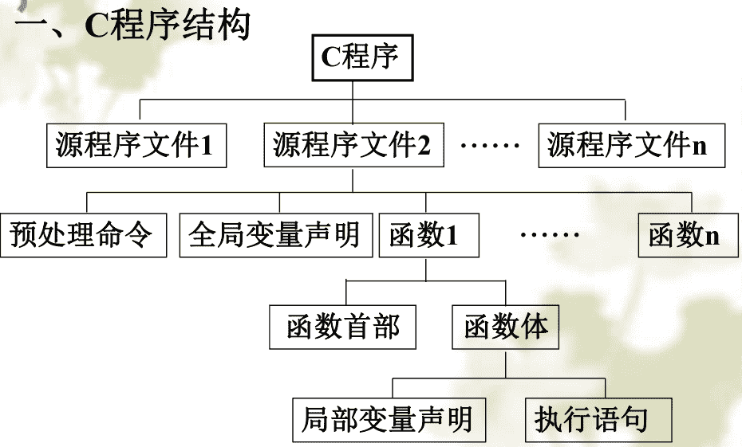

**一、C语句概述**

**C语句分类：**（Assortment）

1. 控制语句（Control sentences）
2. 函数调用语句（function call sentences）
3. 表达式语句（Expression sentences）
4. 空语句（Empty sentences）
5. 复合语句（Compound sentences）

> 一条完整的C语句必须以“;”结束。“;”是一个语句不可缺少的一部分。

**控制语句（Control sentences）**

**功能：** 完成一定的控制功能

C 有9种控制语句：

1. 条件语句（Condition sentence）

   ```c
   if(表达式)
       语句1 或者 {语句块1}
   else
       语句2 或者 {语句块2}
   ```

“语句块”又称为复合语句，是由花括号将若干条语句组合成的一个整体。

2. for循环语句（Loop sentence）

   ```c
   for(表达式1;表达式2;表达式3)
       语句 或者 {语句块}
   ```

3. 当型循环语句（while loop）

   ```c
   while( 表达式 )
       语句 或者 {语句块}
   ```

4. 直到型循环语句（until loop）

   ```c
   do
       语句 或者 {语句块}
   while( 表达式 );
   ```


- (5) continue （结束本次循环语句）
- (6) switch （多分支选择语句）
- (7) break （中止执行switch或循环语句）
- (8) goto （转向语句）
- (9) return （从函数返回数值语句）

### 2. 函数调用语句 (函数调用)

由一次函数调用加一个“；”构成。

如： `printf("Hello World!");`

函数调用 分号

```c
y=pow(x-3,2);
```

```c
y=sin(x);
```

### 3. 表达式语句 (表达式语句)

- 表达式：用运算符和括号将运算对象(操作对象)连接起来的、符合C语法规则的式子，称为表达式。
- 表达式语句：由表达式加上“；”构成。
- 表达式能构成语句是C语言的一个重要特色。C程序中的大多数语句（包括程序调用语句）是表达式语句，C语言又称为“表达式语言”。

如：

- `x+4*y;` —— 算术表达式语句
- `4*7, 4+8;` —— 逗号表达式语句
- `x=4*7;` —— 赋值表达式语句(赋值语句)

### 4. 空语句 (空语句)

由一个“；”构成。即： ;

作用： ①程序转向点； ②什么也不做的循环体。

```c
while(i<=11) ;
```

### 5. 复合语句 (复合语句, 语句块)

用 { } 括起的一组语句。

如：

```c
if (x1>x2)
{
  y=x1*x1+x2 ;
  printf("y=%d",y) ;
}
```

不能加“；”

不能省略

### 4.2 赋值语句 (赋值语句)

1. C语言中的赋值号“=”是一个运算符。
2. **赋值表达式**和赋值语句不同，赋值表达式可以被包含在其它表达式之中。

如： `if ((a=b)>0) t=a;`

它等于：

```c
a=b;
if (a>0) t=a;
```

如果写成： `if ((a=b;)>0) t=a;`

> 错了。if的条件中需要(测试)表达式，而不是语句

### 二、数据输入输出在C语言中的实现

#### 1. 调用输入输出函数实现输入输出操作

C语言本身不提供输入输出语句，输入和输出操作是通过调用C语言函数库中输入输出函数来实现的。

如：

- putchar函数——输出字符(Character output)
- getchar函数——输入字符(Character input)
- printf函数 ——格式输出(Data output with format)
- scanf函数 ——格式输入(Data input with format)
- puts 函数 ——输出字符串(Strings output)
- gets 函数 ——输入字符串(Strings input)

```c
main()
{ int a,b;

a=10;

b=20;

printf("a=%d,b=%d",a,b);
}
```

系统函数库，如：stdio.h，printf()的目标代码。

#### 2. 文件开头应有 “#include”命令

在调用标准输入输出库函数时，文件开头应有预编译命令：

```c
#include <stdio.h>
```

或

```c
#include "stdio.h"
```

其中，stdio.h是“头文件”，包含了与用到的标准输入输出函数有关的信息。stdio.h 是 standard input & output library head files 的缩写。

其他还有：

- 数学函数库 "math.h"
- 字符串函数库 "string.h" 等。

### 4.4 字符数据的输入与输出 (字符数据的输入与输出)

必须有预编译命令： `#include <stdio.h>`

#### 一、putchar 函数（字符输出函数）

一般格式： putchar(c)

功能：向终端设备输出一个字符。

说明：其中c可以是字符型常量、字符型变量、整型常量、整型变量或表达式。

例：

```c
#include <stdio.h>
main()
{
    char a,b,c;
    a='B';  b='O';  c='Y';
    putchar(a);
    putchar(b);
    putchar(c);
    putchar('\\');
}
```

输出结果： **BOY**

#### 二、getchar函数(字符输入函数)

一般格式：`getchar()` ——没有参数

功能：从终端输入一个字符。

例：

```c
#include "stdio.h"

main()
{
    char c;
    c=getchar();
    putchar(c);
}
```

a

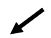

a

### 4.5 格式输入输出函数 (格式输入输出函数)

| 格式字符 | 用于scanf的输入说明 |
|---|---|
| %c | 单个字符 |
| %d | 十进制整数 |
| %e | 单精度实数 |
| %f | 单精度实数 |
| %lf | 双精度实数 |
| %g | 单精度实数 |
| %u | 无符号整数 |
| %i | 十进制、十六进制或八进制整数 |
| %o, %x | 八进制、十六进制整数 |
| %s | 字符串 |

### 文档结构提取示例

本文档用于展示从图片中提取结构化内容的能力。系统能够自动识别文档中的各种元素，包括标题、段落、列表、表格、插图、引用和代码块等，并将它们转换为 Markdown 格式输出。

该功能基于深度学习的版面分析技术，可以准确区分不同类型的文档元素，并保留它们之间的相对顺序和层级关系。

- 标题识别
- 段落分割
- 列表提取
- 表格重建
- 插图定位
- 引用标注
- 代码块识别

| 元素类型 | 说明 | 输出格式 |
| --- | --- | --- |
| 标题 | 各级标题文本 | # / ## / ### |
| 段落 | 正文文本块 | 纯文本 |
| 列表 | 有序或无序列表 | - / 1. |
| 表格 | 结构化数据 | Markdown 表格 |
| 引用 | 引用内容块 | > |
| 代码块 | 程序代码 | ``` |

> 注意：提取时需要忽略页眉和页脚，且边界框（bbox）应使用相对坐标，即相对于整张图片宽高的比例值。

```json
{
  "direction": "horizontal",
  "contents": []
}
```

#### 4.5.1 printf 函数（格式输出函数）

功能：向终端输出若干个任意类型的数据。

##### (一) printf函数的一般格式

```c
printf（格式控制，输出表列）
```

##### 举例：

```c
main()
{
    int a=3,b=4;
    printf("a=%d b=%d sum=%d\n", a, b, a+b);
}
```

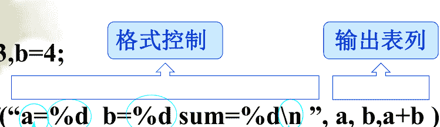

输出结果：

a=3  b=4 sum=7

```c
printf("a=%d b=%d max=%d\n", a, b, max(a,b));
```

##### printf（格式控制，输出表列）

**说明：**

“输出表列”是需要输出的一些数据(变量、表达式)。

“格式控制”是用双引号括起来的字符

也称“转换控制字符串”，它包括三种信息：

1. 普通字符，即需要原样输出的字符。
2. 格式说明，由“%”和格式字符组成，如%d,%f等。
3. 转义字符，将后面的字符转换成另外的意义（P48表），如\n,\t等。

##### （二）格式字符 (格式字符)

对不同类型的数据用不同的格式字符。

1. d格式符——用来输出十进制整数。

   (output the decimal integer)

   (1) %d：按整型数据的实际长度输出。

   如：

   ```c
   int a=123;
   printf("%d",a);
   ```

   结果： 123

   (2) %md： m为指定的输出字段的宽度。

   若数据位数小于m，则左端补以空格；若大于m，则按实际位数输出。

   如： int a=123, b=12345;

   ```c
   printf("%4d,%4d",a,b);
   ```

   结果： 123 ,12345

   (3) %mld： 输出长整型数据。

   m是对长整型数据指定字段宽度。

   如： long a=1234567;

   ```c
   printf("%ld,%8ld,%5ld",a,a,a);
   ```

   结果： 1234567,  1234567,1234567


### 2. f格式符——以浮点数形式输出实数。

(output the floating point real number)

(1) %f：不指定字段宽度,由系统自动指定，使整数部分全部如数输出，并输出6位小数。注意float型和double型数据的有效位数。

如： float x=123456.123;

```
printf("%f",x);
```

输出结果： 123456.125000

```
main()
{ double x,y;
    x=11111111111111.1111111;
    y=11111111111111.1111111;
    printf("%f",x+y);
}
```

222222222222222.220000

### (4) %m.nf：若数据长度大于m，或者m<n，则输出具有n位小数的原数据。

如： float f=123.456;

```
printf("%%5.2f,%.3f",f,f);
```

输出结果： 123.46,123.456

### 3. e格式——以指数形式输出实数

(output the real number in exponent)

+   (1) %e

如：printf("%e",123.456);

输出结果：1.234560e+002

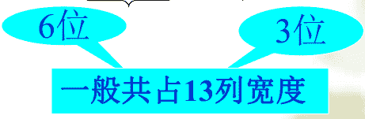

+   (2) %m.ne和 %-m.ne：m、n和“−”字符含义与前相同。此处n指指数数据的数字部分（又称尾数）的十进位数。

### 4. g格式符——用来输出实数

它根据数值的大小,自动选f格式或e格式(选择输出时占宽度较小的一种), 且不输出无意义的零。

(output the real number in float point or exponent)

如： f=123.468;

```
printf("%%f, %%e, %%g", f, f, f);
```

输出如下：

123.468000 , 1.234680e+002 , 123.468

10列

13列

10列

### 5. o格式符——以8进制数形式输出整数

输出的数值不带符号，即将符号也一起作为八进制数的一部分输出。

如：`int a=-1;`

```
printf("%d,%o",a,a);
```

结果：**-1，177777**

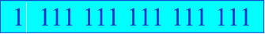

> o格式符同a格式符一样，可以输出长整型数据，也可以指定字段宽度。

+   6. **x格式符**——以16进制数形式输出整数
+      同样不会出现负的十六进制数。

+   7. **u格式符**——以十进制形式输出unsigned型数据

如：

```
main()
{
    unsigned int a=65535;
    int b=-2;
    printf("a=%d,%o,%x,%u\n",a,a,a,a);
    printf("b=%d,%o,%x,%u\n",b,b,b,b);
}
```

输出结果：    **a=-1,177777,ffff,65535**

                 **b=-2,177776,fffe,65534**

### 8. C格式符——用来输出一个字符

一个整数,只要它的值在0~255范围内,也可以用字符形式输出,在输出前,将该整数转换成相应的ASCII字符;反之,一个字符数据也可以用整数形式输出。

如： main()

```
{ char c='a'; int i=97;
printf("%c,%d\n",c,c);
printf("%c,%d\n",i,i);}
```

输出结果： a,97
 a,97

### 9．%格式符——用来输出一个字符串

+   1. **%s**：按原长度输出字符串。
+   
+      如：`printf(“%s”,“CHINA”)`
+   
+      输出结果：`CHINA`

+   2. **%ms**：输出的字符串占 m 列，如字符串本身长度大于 m，则突破 m 的限制，将字符串全部输出；若串长小于 m，则左补空格。

+   3. **%-ms**：如果串长小于 m，则在 m 列范围内，字符串向左靠，右补空格。

(4) `%m.ns`：输出占m列，但只取字符串中左端n个字符。输出在列的右侧，左补空格。如果n>m,则自动取n值，即保证n个字符正常输出。

(5) `%-m.ns`，其中m、n含义同上，n个字符输出在m列范围的左侧，右补空格。

如：`printf("%3s,%7.2s,%4s,%-5.3s\n", "CHINA","CHINA","CHINA","CHINA");`

输出结果：`CHINA,    CH,CHIN, CHI`

### （二）格式说明

与printf函数中的格式说明相似，以%开始，以一个格式字符结束（表4-3），中间可以插入附加的字符（表4-4）。

如： int a,b,c;

```
scanf(" %d%d%d ",&a,&b,&c);
```

输入形式： 10 17 181

int a,b,c;

```
scanf(" %d,%d,%d\n ",&a,&b,&c);
```

输入形式： 10,11,12

```
scanf("%3d%3d%3c",&a,&b,&ch);
```

输入形式：123456abc

结果：**a=123 b=456 ch='a'**

```
scanf("%d%d%c",&a,&b,&ch);
```

输入形式：123 456abc

结果：**a=123 b=456 ch='a'**

有错吗？

```
main()
{ int x,y;
    char ch;
    scanf("%%5d,%%3d%%c",x,y,ch);
}
```

```
main()
{ int x,y;
    char ch;
    scanf("%%5d,%%3d%%c",&x,&y,&ch);
}
```

输入数据：  345,567a

### 说明：

+   1. %后的“*”附加说明符，用来表示跳过它相应的数据。
+   如： scanf("%2d ,%*3d , %2d",&a,&b);
+   输入： 12 , 456 , 67
+   结果： a=12 b=67

+   2. 输入数据时不能规定精度。
+   × scanf("%7.2f",&a);

+   3. 输入的字符、数值要与格式一致
+   scanf("a=%d, b=%d",&a,&b);
+   输入： a=12,b=13

+   4、 scanf("%c%c%c",&a,&b,&c);
+   输入： a _ b _ c
+   空格和转义字符都作为有效字符输入

### 当要求

输入数据：a=10 b=20 x=30 y=40 ‘a’ ‘b’

输出数据：10,20,30.00000,40.00000,a,b时

不要采用如下输入方式：

```
main()
{
    int a,b; float x,y; char c1,c2;

    scanf("a=%d b=%d",&a,&b);

    scanf(" x=%f  y=%e",&x,&y);

    scanf(" c1=%c c2=%c",&c1,&c2);

    printf("%d,%d,%f,%f,%c,%c", a,b,x,y,c1,c2);
}
```

### 要采用如下输入方式：

```
main()
{ int a,b;  float x,y; char c1,c2;
    printf("a= b=\n");
    scanf("%d %d",&a,&b);
    printf("x= y=\n");
    scanf("%f %f",&x,&y);
    printf("c1= c2=\n");
    scanf(" %c %c",&c1,&c2);
    printf("%d,%d,%f,%f,%c,%c",a,b,x,y,c1,c2);
}
```

输入数据：

a= b=

10 20

x= y=

30 40

c1= c2=

ab

输出数据：10,20,30.00000,40.00000,a,b

### 4.6 顺序结构程序设计举例

**特点：** 程序按语句从上到下的排列顺序依次执行，每条语句必须执行且只能执行一次，没有执行不到或执行多次的语句。

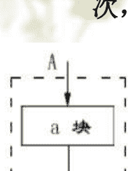

（顺序结构）

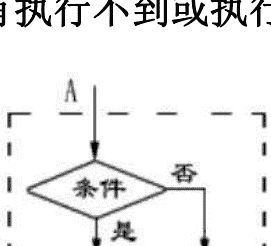

（选择结构）

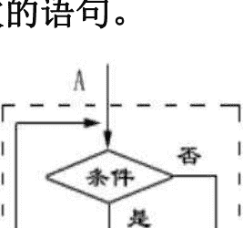

（循环结构）


### 例4.11 从键盘输入一个大写字母，要求改用小写字母输出。

已知：字符变量c1为大写字母。
求解：将字符变量c2中放入相应的小写字母。
计算公式：c2=c1+32 （小写改成大写字母？）

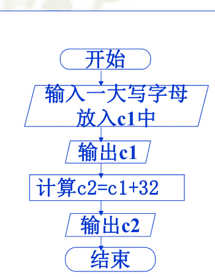

```
#include <stdio.h>
main()
{
    char c1,c2;
    c1=getchar(); /*键盘输入1个大写字母*/
    printf("%c,%d\n",c1,c1);
    c2=c1+32;
    printf("%c,%d\n",c2,c2);
}
```
输入:A✓      输出:A,65
a,97

### 例4.12 求 ax²+bx+c=0 的根，a、b、c由键盘输入

```c
#include<stdio.h>
#include <math.h>
main()
{
    double a,b,c,disc,x1,x2;
    printf("Input values of a,b,and c\n");
    scanf("%f%f%f",&a,&b,&c);
    disc=b*b-4*a*c;
    if(disc<0)
        printf("\nRoots Are Imaginary\n");
    else{
        x1=(-b+sqrt(disc))/(2*a);
        x2=(-b-sqrt(disc))/(2*a);
        printf("x1=%f\nx2=%f",x1,x2);
    }
}
```

### 运行情况：

1  3  2

x1=-1.000000

x2=-2.000000

1  2  3

Roots Are Imaginary

### 要牢记

- 在scanf()函数的输入表列中，对基本型的变量，要使用地址运算符&。
- 字符串常数要使用一对双引号“”。
- 单个字符常数要使用一对单引号‘’。
- 不要对输入给定任何精度。
- 当输入或输出变量的类型与格式字符不一致时，会在运行时出现错误。
- 不要在scanf语句的格式字符中使用逗号。
- 除了语法问题外，C不对格式说明的正确性进行检查。

### 本章作业：

- 一、做书上其他习题，自己对答案

- 二、编程上机操作题,熟悉各种类型的输入输出的方法，能正确使用各种格式转换符：

4_1 如果想得到以下的输出格式和结果,请写出程序（包括定义变量类型和设计输出）（∧表示1个空格）

a=∧3 ∧∧b=∧4 ∧∧c=∧5

x=1.200000,y=2.400000,z=-3.600000

u=∧51274 ∧∧n=∧∧∧128765

c1=‘a’∧or ∧97

c2=‘b’∧or ∧98

### 4_2　设圆半径r=1.5，圆柱高h=3，求圆周长、圆面积、圆球表面积、圆球体积、圆柱体积。用scanf输入数据，用printf输出计算结果，输出时要有文字说明，数据取小数点后2位数字。

### 4_3　输入一个摄氏温度，要求输出华氏温度。公式为

$$F=\frac{9}{5}C+32$$

输出要有文字说明，取2位小数。例如，可以输入摄氏温度C=0，50，100，200

### 以下为自我测试题，做完之后自己对答案

### 4_4 判断下列说法是真还是假

- a) 头文件 <stdio.h> 的用途是存储用户编制的程序。
- b) 用于从键盘接受一个字符的标准 C 函数是 getchar。
- c) getchar 不能用于从键盘接受一行文本。
- d) scanf 语句的输入表列可以为一个或多个变量。
- e) 变量构成了 printf 语句格式控制字符串的合法元素。
- f) scanf 函数不能用于从键盘读入单个字符。
- g) 如果格式说明符的长度比实际数值的长度大，则该数值将被右对齐打印。
- h) printf 语句的打印变量表列可以包含程序调用。
- i) 格式说明 %5s 将只打印所给字符串的头五个字符。

### 4_5 填空

- a) 格式说明____用于短整数的读和写。
- b) 当使用字符函数时，必须把头文件____包含到程序中。
- c) 当要读一个长双精度数据时，必须使用格式说明____。
- d) 函数____可以用于从屏幕读一个数据，而不用将其赋值给任何变量。
- e) 为使数据左对齐打印，必须在格式说明中使用符号____。

### 4_6 写出下列printf 函数的输出结果

- a) printf ("%d%c%f",10,'x',1.23);
- b) printf ("%2d %c %4.2f",1234,'x',1.23);
- c) printf ("%d\t%4.2f",1234,456);
- d) printf ("\"%08.2f\"",123.4);
- e) printf ("%d%d %d",10,20);

### 4_7 指出下列输入语句中的错误，如果有的话。

假设：

```
int year, count;
float amount, price;
char code,city[10];
double root;
```

- a) scanf ("%c%f%d",city,&price,&year);
- b) scanf ("%s%d",city,amount);
- c) scanf ("%f, %d",&amount,&year);
- d) scanf (\n"%f",root);
- e) scanf ("%c %d %lf",*code,&count,Root);

### 4_8 给下列输出语句的输出结果。假设：

```
int count=1275; float price=-235.74;
char city[10]="Cambridge";
```

- a) printf ("%d %f", count, price);
- b) printf ("%2d\n%f", count, price);
- c) printf ("%d %f", price , count);
- d) printf ("%10dxxxx%5.2f", count, price);
- e) printf ("%s", city);
- f) printf ("%-10d %-15s", count, city);

### 答案

4_4

- a) False
- b) True
- c) True
- d) True
- e) True
- f) False
- g) True
- h) True
- i) False

4_5

- a) %d
- b) stdio.h
- c) %lf
- d) getchar()
- e) –

4_6

10x1.230000
1234 x 1.23
1234      0.00
"00123.40"
1020 2367460

### 4_7 改错

a) scanf("%s%f%d",city,&price,&year);

b) scanf("%s%d",city,&amount);

c) scanf("%f, %d",&amount, &year);

d) scanf("%f", &root);

e) scanf("%c %d %lf", &code, &count, &root);

### 4_8

a) 1275 -235.740005

b) 1275
-235.740005

c) 536870912 0.000000

d) 1275xxxx-235.74

e) Cambridge

f) 1275 Cambridge

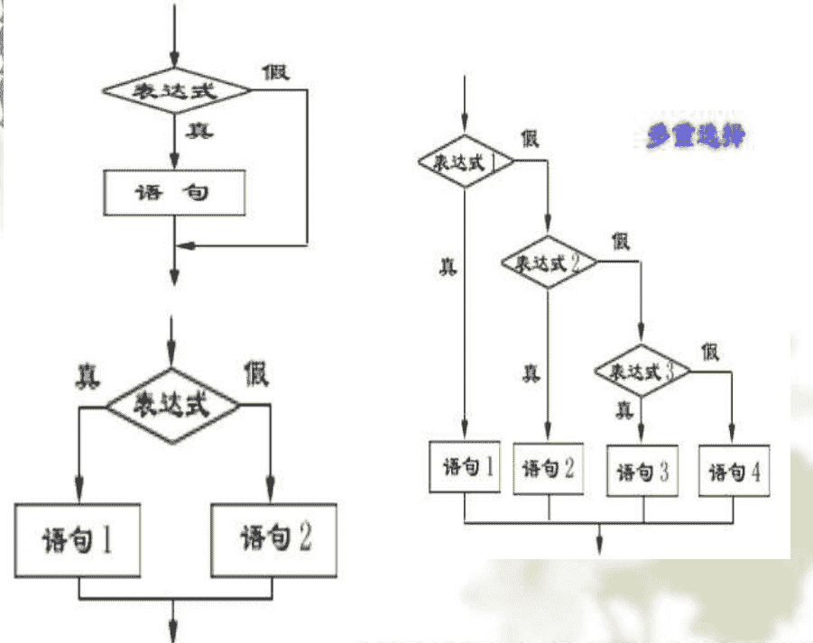

### 5.1 关系运算符和关系表达式

# 关系运算符和表达式

### 一、关系运算符及其优先次序

6 种关系运算符：

- ① < （小于 less than）
- ② <= （小于或等于）
- ③ > （大于 larger than）
- ④ >= （大于或等于）
- ⑤ == （等于 equal to）
- ⑥ != （不等于 not equal to）

优先级相同(高)

优先级相同(低)

结合性：自左向右

### 5.1 关系运算符和关系表达式

### 一、关系运算符及其优先次序

与其它运算符优先级的比较：

- 算术运算符
- 关系运算符
- 赋值运算符

（高）

（低）

例如： c=d>a+b

等效于： c=(d>(a+b))


### 二、关系表达式

#### 1. 什么是关系表达式？

如：(a>b)>(b<c)，‘a’<‘b’，x>y，s+f>d

#### 2. 关系表达式的值

运算结果：逻辑值 1或非零—“真”，0—“假”

如：设 a=3，b=2，c=1

求下面关系表达式的值：

- `c>b`：值为 **0**
- `(a-b)==1`：值为 **1**
- `b+c<a`：值为 **0**

> 如果关系运算对象的类型不同，也要先进行类型转换。

### 5.2 逻辑运算符和逻辑表达式

#### 一、逻辑运算符及其优先次序

3种逻辑运算符：

优先级

- ① ! （逻辑非）
- ② && （逻辑与）
- ③ || （逻辑或）

(高)

(低)

如： !a        a为真，则!a为假。
a||b        a、b之一为真，则a||b为真。
a&&b        a、b同时为真，则a&&b为真。

### 5.2 逻辑运算符和逻辑表达式

#### 一、逻辑运算符及其优先次序

与其它运算符的比较：

(高)

(低)

- 1. ()
- 2. ! , ++, --, -(负号), (类型)
- 3. 算术 *, /, %
- 4. 算术 +, -
- 6. 关系 <, <=, >, >=
- 7. 关系 ==, !=
- 11. 逻辑 &&
- 12. 逻辑 ||
- 14. 赋值运算符
- 15. 逗号运算符

例如： c=d>a+b&&a>b
等效于：
c=((d>(a+b))&&(a>b))

### 5.3 if语句

#### 一、if语句的三种形式

#### 1. if（表达式）语句

执行过程：当表达式的值为“真”（非零）时，执行语句，否则，不执行语句。

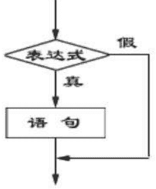

如：`if (x > y) z = x;`

#### 2. if (表达式) 语句1
else 语句2

执行过程：当表达式的值为“真”（非零）时，执行语句1，否则，执行语句2。

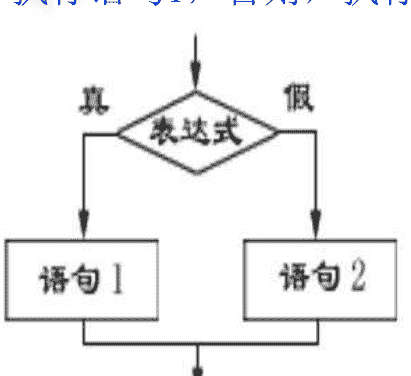

```
如： if (x>y) z=x ;
else z=y ;
```

- 3. if (表达式1) 语句1  
- else if (表达式2) 语句2  
- else if (表达式3) 语句3  
- ⋮  
- else if (表达式n) 语句n  
- else 语句n+1

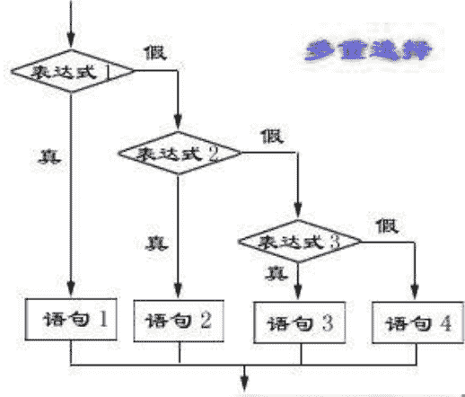

```
如：if (grade>=85) level=‘A’；
    else if (grade>=70) level=‘B’；
    else if (grade>=60) level=‘C’；
    else level=‘D’；
```

#### if 语句说明：

(1) if 和 else if 后面的表达式一般为逻辑表达式或关系表达式，也可以是任意数值类型表达式。

该语句是合法的：`if(3.0) printf("ok!");`

(2) if 语句中的“语句”为一个简单语句或复合语句。如：下面哪个程序段有错？

```
if (x>=0)
    printf("X= %d\n",x);
    printf("X is positive.\n");
else
    printf("X= %d\n",x);
    printf("X is negative.");
```

```
if (x>=0)
{
    printf("X= %d\n",x);
    printf("X is positive.\n");
}
else
{
    printf("X= %d\n",x);
    printf("X is negative.");
}
```

#### 二、if 语句的嵌套

在 if 语句中又包含一个或多个 if 语句，称为

if 语句的嵌套。

一般形式：

```
if(条件1)
    if(条件2)语句1
    else 语句2
else
    if(条件3)语句3
    else 语句4
```

内嵌 if

内嵌 if

如：

```
if(x>0)
    if(y>0)
        printf("x>0,y>0");
    else
        printf("x>0, y<=0");
else
    if(y>0)
        printf("x<=0, y>0");
    else
        printf("x<=0, y<=0");
```

### 说明：

else与if的匹配原则是：一个else应与其之前距离最近且没有与其它else配对的if配对。

```
if(n>=18)
    if(n<60)
        printf("adult");
    else
        printf("minor");
```

```
if (n>=18)
{
    if (n<60) printf("adult");
}
else
    printf("minor");
```

```
if (n>=18)
    if (n<60)
        printf("adult");
    else ;
else
    printf("minor");
```

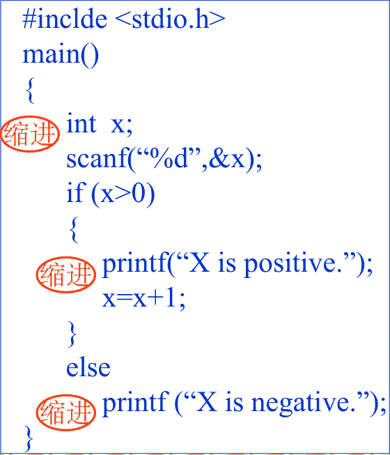

缩　排

```c
#include <stdio.h>
main()
{
    int x;
    scanf("%d",&x);
    if (x>0)
    {
        printf("X is positive.");
        x=x+1;
    }
    else
        printf("X is negative.");
}
```

#### 三、用if 语句实现选择结构举例

例： 求 y = 
{ -1 ;  x<0
  0 ;  x=0
  1 ;  x>0 } 输入x 值，输出y 值。

```
main()
{
    int x,y;
    scanf("%d",&x);
    if(x<0) y=-1;
    else if(x==0) y=0;
    else if(x>0) y=1;
    printf("x=%d y=%d",x,y);
}
```

例：任意输入三个不相等的数，将其按由小到大的顺序输出。

```
main()
{
    float a,b,c,t;
    scanf("%%f%%f%%f",&a,&b,&c);
    if(a>b)
    { t=a;a=b;b=t;}//结果a<b
    if(a>c)
    {t=a;a=c;c=t;}//结果a<c
    if(b>c)
    { t=b;b=c;c=t;}//结果b<c
    printf("%%5.2f,%%5.2f,%%5.2f",a,b,c);//a<b<c
}
```

a=7,b=3

t=a(=7)
a=b(=3)
b=t(=7)

#### 注意区别

```
if(season==spring) printf("flower");
else if(season==summer) printf("hot");
else if(season==autumn) printf("fruit");
else printf("snow");
```

```
if(e1) s1;
else if(e2) s2;
else s3;
```

```
if(sex=="male") printf("Man");
if(age>=18) printf("adult");
if(profession=="armyman") printf("PLA");
```

```
if(e1) s1;
if(e2) s2;
if(e3) s3;
```

#### 四、条件运算符和条件表达式

#### 条件表达式的一般形式：

表达式1 ? 表达式2 : 表达式3　如：(a>b) ? a : b

条件表达式 = {
　表达式2（表达式1为真）
　表达式3（表达式1为假）

C中唯一的三目运算符。目的：简化 if 语句。

```
if (a>b) max=a;
else max=b;
```

若 a=3，b=8，则 max=?

等效于：max= (a>b) ? a : b ;

#### 条件运算符的优先级(13级):

算术运算符=>关系运算符=>逻辑运算符(除！)
(3、4级)        (6、7级)        (11、12级)

逗号运算符<=赋值运算符<=条件运算符
(15级)            (14级)

如： x = a+b>c && c>d ? a+b : d

等效于： x =(((a+b)>c) && (c>d)) ? (a+b) : d

#### 条件运算符的结合方向：自右至左

如： a>b ? a : c>d ? c : d

等效于： a>b ? a : (c>d ? c : d)


# 例：输入3个数，把其中最大的数输出

```
main()
{
    int a,b,c,t,max;
    scanf("%d%d%d",&a,&b,&c);
    t=(a>b) ? a : b ;
    max=(t>c) ? t : c ;
    printf("max=%d\n",max);
}
```

```
或者
max=(a>b) ? a : b ;
max=(max>c) ? max : c ;
或者
max=a;
max=(max>b) ? max : b ;
max=(max>c) ? max : c ;
```

### 5.4 switch 语句

一般形式：

```
switch (表达式)
{
    case 常量表达式1: 语句序列1 [break;]
    case 常量表达式2: 语句序列2 [break;]
    :
    case 常量表达式n: 语句序列n [break;]
    [default : 语句序列n+1]
}
```

// default——缺省

#### 执行过程：

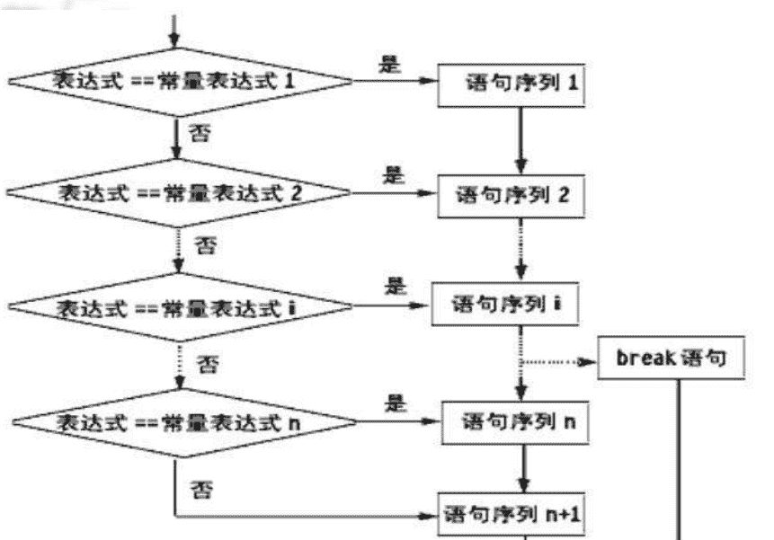

### 例：

```c
char grade;
......
switch(grade)
{
    case 'A' : printf("85~100    ");
    case 'B' : printf("70~84     ");
    case 'C': printf("60~69     ");
    case 'D':printf("<60       ");
    default : printf("error ");
}
```
```

若grade='A'，输出结果是什么？

85~100　70~84　60~69　<60　error

### 用break语句处理后的程序段：

```c
switch(grade)
{
    case 'A'：printf("85~100 "); break;
    case 'B'：printf("70~84 "); break;
    case 'C'：printf("60~69 "); break;
    case 'D'：printf("<60 "); break;
    default：printf("error ");
}
```
```

若grade='A'，输出结果又是什么？

**85~100**

### 完整程序：

```
main()
{
    char grade;
    printf("Input grade(A,B,C,D):");
    scanf("%c",&grade);
    switch(grade)
    {
        case'A' : printf("85~100 "); break;
        case 'B' : printf("70~84 "); break;
        case 'C' : printf("60~69 "); break;
        case 'D' : printf("<60 "); break;
        default : printf("error ! ");
    }
}
```

流程图为：

grade

输出
“85—100”

输出
“70-84”

输出
“60-69”

输出
“<60”

输出
“error”

break;
中断switch

### 5.5 选择结构程序举例

### 例1　写程序，判断某一年是否闰年。

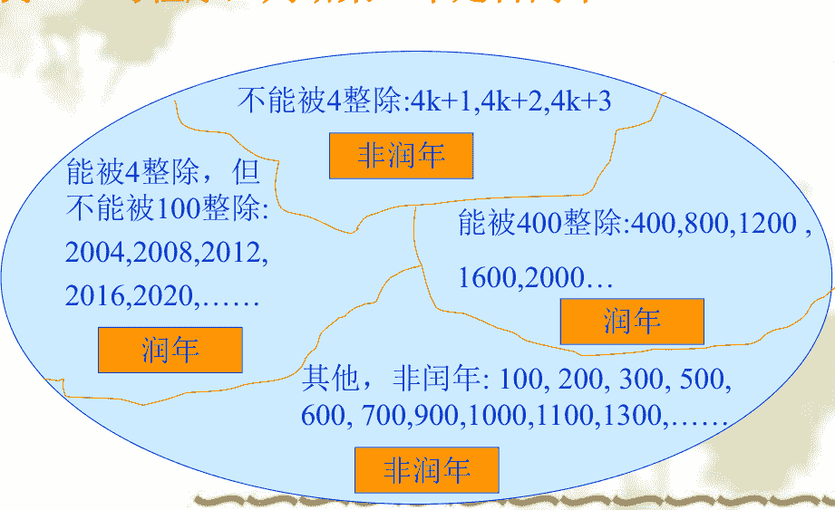

设：`leap`代表闰年信息，`leap=1`闰年，`leap=0`非闰年

### 编程一（采用复合运算表达式）：

```c
main()
{
    int year, leap=0;
    scanf("%d", &year);  /* 输入年份值 */
    if ((year%4==0&&year%100!=0)||(year%400==0))
        leap=1;
    else leap=0;
    if(leap == 1) printf("%d is leap", year);
    else printf("%d is not leap", year);
}
```

算术运算符=>关系运算符=>逻辑运算符(除！)

赋值运算符<=条件运算符

### 原程序段

```
If (T>=180&&M1>=60&&M2>=60 || T>=200)
    printf(" Admitted\n");
else
    printf(" Not admitted\n");
```

不使用采用复合运算表达式，改写上述程序段。

### 修改一

```
If (T>=200)
    printf(" Admitted\n");
else if(T>=180)
    if(M1>=60)
        if(M2>=60)
            printf(" Admitted\n");
        else
            printf(" Not admitted\n");
    else
        printf(" Not admitted\n");
else
    printf(" Not admitted\n");
```

### 修改二

```
If (T>=200)
    printf(" Admitted\n");
else if(T<180)
    printf(" Not admitted\n");
else if(M1<60) //M1<60
    printf(" Not admitted\n");
else if(M2<60) //M2<60
    printf(" Not admitted\n");
else printf(" Admitted\n");
//T>=180, M1>=60, M2>=60
```

### 例5.7 已知基本运费、货重，以及路程(s)和折扣的关系标准如下：

| 路程 s | 折扣 |
|---|---|
| s＜250km | 没有折扣 |
| 250≤s＜500 | 2%折扣 |
| 500≤s＜1000 | 5%折扣 |
| 1000≤s＜2000 | 8%折扣 |
| 2000≤s＜3000 | 10%折扣 |
| s≥3000 | 15%折扣 |

编程，计算运费f。

设基本运费p、货物重量w、距离s和折扣d。则总运费的计算公式为： f=p*w*s*(1-d)

算法：先按距离的250倍数进行分类，求每类的折扣，再按公式计算。

### 总运费的计算公式为： f=p*w*s*(1-d)

折扣的变化点都是250的倍数。
c=s/250 代表250的倍数。

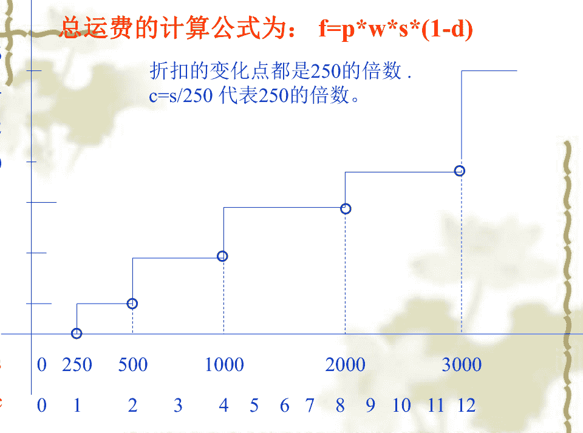

```
case 6:                 /*1500≤s<1750*/
case7: d=8 ; break ; /*1750≤s<2000*/      <8
case8:                 /*2000≤s<2250*/      ≥8
case9:                 /*2250≤s<2500*/
case10:                /*2500≤s<2750*/
case11: d=10 ; break; /*2750≤s<3000*/      <12
case12: d=15 ; break; /*3000≤s*/             ≥12
}
f=p*w*s*(1-d/100.0) ;
printf("freight=%15.4f",f) ;
}
```

运行情况： 输入： 10,20,300✓
结果： freight= 58800.0000

若用if 语句实现上述功能，程序为：

```
main()
{ int s;
float p, w, d , f ;
scanf("%%f , %%f , %%d", &p, &w, &s);
if(s>=3000) d=15;
else if (s>=2000&&s<3000) d=10;
else if (s>=1000&&s<2000) d=8;
else if (s>=500&&s<1000) d=5;
else if (s>=250&&s<500) d=2;
else d=0;
f=p*w*s*(1-d/100.0) ;
printf("freight=%%15.4f", f) ;
}
```


# 例5.6 求 ax²+bx+c=0 方程的解

+   1、a=0，方程不是二次方程
+   2、b²-4ac=0，有两个相等的实根
+   3、b²-4ac>0，有两个不相等的实根
+   4、b²-4ac<0，有两个共轭复根
+   5、如何判断实数为零（或大于零，或小于零）

特殊条件的处理

```
if(fabs(a)<=1e-6)
    printf("is not a quadratic") ;
else
{disc=b*b-4*a*c;
if(fabs(disc)<=1e-6)
    printf("has two equal roots:%8.4f\n",-b/(2*a));
else if( disc>1e-6)
{ x1=(-b+sqrt(disc))/(2*a);
x2=(-b-sqrt(disc))/(2*a);
打印实根(略);
}
else
{ realpart=-b/(2*a);
imagpart=sqrt(-disc)/(2*a);
printf("has complex roots:\n") ;
打印虚根(略);
}
}
```

习题5.7 给一个不多于5位的正整数，要求：①求出它是几位数；②按逆序打印出各位数字，例如原数为12345，应输出54321。

```
```c
#include <stdio.h>
main()
{
    long int num;
    int n1,n2,n3,n4,n5,bits;
    scanf("%ld",&num);
    if (num>9999) bits=5;
    else if (num>999) bits=4;
    else if(num>99) bits=3;
    else if(num>9) bits=2;
    else bits=1;
    printf("bits=%d\n", bits);
}
```
```

运行情况： Input 12345✓
Output bits=5
Reverse bit is: 5,4,3,2,1

```
```c
#include <stdio.h>
main()
{
    long int num;
    int n[5], bits=5, flag=0;
    scanf("%ld",&num);

    n[0]=num/10000;
    n[1]=(num-n[0]*10000)/1000;
    n[2]=(num-n[1]*1000)/100;
    n[3]=(num-n[2]*100)/10;
    n[4]=(num-n[3]*10);

    for(i=0;i<5;i++)
    {
        if(n[i]==0&&flag==0) bits--;
        else flag=1;
    }

    //bits=(n5&&1)+(n4&&1)+(n3&&1)+(n2&&1)+(n1&&1);
    printf("bits=%d\n",bits);
    switch(bits)
    ……
}
```
```

### 要牢记

+   - 不要在关系运算符==,!=,>=,<=的两个符号之间插入空格；
+   - 注意“与”运算(&&)和“或”运算(||)都是由两个相同的符号组成；
+   - 注意不要将等号运算符用于实型数，它们很少能精确地相等；
+   - 语句标号（case 常量表达式）应该是一个整型常量表达式；
+   - 不得对switch语句的两个语句标号使用相同的常量。

### 本章作业

5-1 有如下函数，写一程序，输入x，计算y值，并输出x和对应的值（设x=-1.5，-0.5，0.5，1.5）。

$$Y=\begin{cases}-0.5 & (x\leq -1)\\(x+1)^2-0.5 & (-1<x\leq 0)\\(x-1)^2-0.5 & (0<x\leq 1)\\-0.5 & (x>1)\end{cases}$$

5-2 输入3个不相等的实数，要求按**由大到小**的顺序输出。

5-4 一家时装屋贴出了如下的季节性打折通知。写一个程序，计算并打印出打折前后顾客购买该商品花费的比较，分别给出几种小于500元的商品价格进行测试。

| 购衣金额（元） | 折扣discount |  |
|---|---|---|
| price | 成衣(Mill cloth) | 手工艺品(Handloom items) |
| 0~100 | 0 | 5% |
| 101~200 | 5% | 7.5% |
| 201~300 | 7.5% | 10% |
| >300 | 10% | 15% |

可以使用key标识顾客所购的是成衣还是手工艺品：

```
int key;
printf("The cloth type which custmer is to purchase is:\n");
printf("1——Mil cloth;\n");
printf("2——Handloom items.\n");
scanf("%d",&key);
……
```

```
if(key==-1)
    if(price<=100) discount=0
    else if…
    …
else
    if(price<=100) discount=0.05
    else if…
```

### 以下各题自己对答案，有问题咨询老师

### 5-5 判断对错

+   a) 如果格式说明符的长度比实际数值的长度大，该数值将被右对齐打印。
+   
+   b) 格式说明 %5s 只会给出要打印字符串的头五个字符。
+   
+   c) 表达式 !(x<=y) 与 x>y 意义相同。
+   
+   d) 在进行表达式混合运算时，隐形转换是自动进行的。
+   
+   e) 用于从键盘接受一个字符的标准 C 函数是 **getchar**。
+   
+   f) **scanf** 函数不能用于从键盘读入单个字符。
+   
+   g) **printf** 语句中的打印表列（变量表列）可以包含函数调用。
+   
+   h) 对于嵌套的 if 语句，最后的 else 与距离最近的且没有与其它 else 匹配的 if 配对。
+   
+   i) **switch** 语句总是可以用一系列 if...else 语句取代。
+   
+   j) 一个 if 可以与多个 else 匹配。
+   
+   k) **switch** 语句中，任何 case 分支只能有一条可执行语句。

### 5-6 填空

+   a) 格式说明____用于整形数的读和写。
+   b) printf ("%2d %c %4.2f",1234,'x',1.234);的输出是____。
+   c) 假设 int count=1275; float price=235.74; printf ("%2d\n%f", count, price); 的输出是____。
+   d) printf ("%8.4s","Cambridge"); 的输出是____。
+   e) 必须当两个操作数均为“真”时，关系运算符____的运算结果为“真”。
+   f) 当程序在switch语句中遇到____时，会立刻从该结构中退出。
+   g) 为使数据左对齐打印，必须在格式说明中使用符号____。
+   h) !(x!=y) 可以用____代替。
+   i) 使用（？：）的条件表达式在用于____语句时，会使得编程简单。

5-8 对于下列程序段， 当假设(a)n=1;(b)n=0时，x和y的值是多少。

```
x=1;
y=1;
If(n>0)
    x=x+1;
    y=y-1;
printf("%d %d",x,y);
```

### 5-9 不使用逻辑运算符，重写下列程序段。

+   (a) `if(grade<=59 && grade>=50)`
+   
+       `second=second+1;`
+   
+   (b) `if(number>100 || number<0)`
+   
+       `printf("Out of range");`
+   
+       `else`
+   
+       `sum=sum+number;`

### 5-10 简化下列复合逻辑表达式

+   (a) `!(x<=10)`
+   
+   (b) `!(x==10||((y==5)||(z<0)))`
+   
+   (c) `!(x+y==z)&&!(z>=5)`
+   
+   (d) `!((x<=5)&&(y==10)&&(z<5))`

### 5-11 假设x=10，说明下列逻辑表达式为“真”还是为“假”。

+   a) x==10 && x>10 && !x
+   b) x==10 || x>10 && !x
+   c) x==10 && x>10 || !x
+   d) x==10 || x>10 || !x

### 5-12 找出下列switch语句中的错误，如果有的话。

假设： int x=1,y=2;

+   a) switch(y);
+   b) case 10;
+   c) switch(x+y)
+   d) switch(x) {case 2: y=x+y; break};


### 答案

#### 5-5 判断对错  5-6 填空  5-7 改错

- a) True
- b) False
- c) True
- d) True
- e) True
- f) False
- g) True
- h) True
- i) True
- j) False
- k) False

- a) %d，或%i
- b) 1234 x 1.23
- c) 1275
- 235.740000
- d) Camb
- e) &&
- f) break
- g) -
- h) x==y
- i) if else

```
(a) If(x+y==z && y>0)
    printf(" ");
(b) If(code>1)
    a=b+c;
    else
    a=0;
(c) If (p<0 || q<0)
    printf(" sign is negative");
```

#### 5-8

(a) n=1
    x=2, y=0

b) n=0
    x=1, y=0

#### 5-9

```
(a) if(grade>=50)
    if(grade<=59)
        second=second+1;
```

```
(b) if(number<0)
    printf(" Out of range");
    else if(number>100)
    printf(" Out of range");
    else
    sum=sum+number;
```

#### 5-10

- (a) `x>10`
- (b) `x<10 || x>=10 || (y<5 && z>=0) || (y>5 && z>=0)`
- (c) `(x+y<=z)&&(z<=5) || (x+y>=z)&&(z<=5)`
- (d) `x>5 || y<10 || y>10 || z>=-5`

#### 5-11

- a) False
- b) True
- c) False
- d) True

#### 5-12

- a) `switch(y) {}`
- b) `case 10:`
- c) Right
- d) `switch(x)`
    `{case 2: y=x+y; break;}`

## 第六章 循环控制
(Cycle Control)

- - 了解goto语句和if 语句构成的循环。
- - 熟练掌握for循环语句、 while循环语句和 do-while循环语句，以及break语句、 continue语句的使用。
- - 熟练掌握循环结构程序设计的概念及其程序编制技术。

```c
void main()
{
    int i=1;
    long int sigma=1;
    while (i<=10)
    {
        sigma=sigma*i;
        i++;
    }
    printf("10!=%ld\n", sigma);
}
```

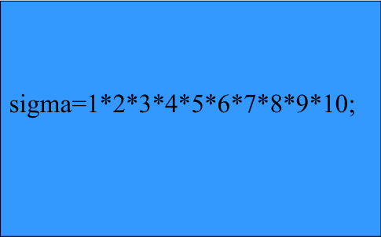

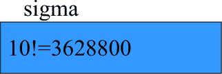

> 思考：如果不使用long int，还可以使用什么变量类型定义sigma

### 循环结构的程序流程是：

在满足给定条件时，反复执行某个程序段。

### C语言中可以用以下语句来实现循环：

- (1) 用goto语句和 if 语句构成循环；
- (2) 用while语句；
- (3) 用do_while语句；
- (4) 用for语句。

### 6.2 goto语句和goto语句构成的循环

#### 一、goto 语句（Goto Sentence）

goto 语句为无条件转向语句，其作用为：使程序的执行无条件地转移到指定处。

**一般形式：**

```
goto 语句标号;
```

#### 执行过程：执行语句时，程序转移到以标号（命名规则与变量相同）为前缀的语句处继续执行。

如：向前跳

```
goto label;
```

……

……

```
label:语句;
```

向后跳

如： √ goto label_1; × goto 123;

……

……

#### 二、用goto语句和 if 语句构成循环

例：计算10！并输出结果。

```
void main()
{
int i=1, sum=1;
loop: if (i<=10)
{
    sum=sum*i;
    i++;
    goto loop;
}
printf("10!=%d\n",sum);
}
```

```
void main()
{
int i=1; long sum=1;
loop: if (i<=10)
{
    sum=sum*i;
    i++;
    goto loop;
}
printf("10!=%ld\n",sum);
}
```

运行结果：10!=24320

本应是：10!=3628800

### 6.3 while循环语句

一般形式：

```
while (表达式) 语句
```

执行过程：

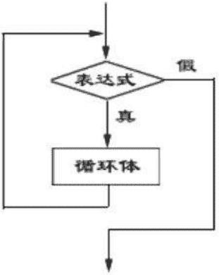

- 1. 先计算表达式的值；
- 2. 若表达式的值为真（非0）时执行循环体中的语句，然后重复上面步骤。若表达式的值为假（0），则结束循环。

#### 例：将上面计算10！并输出结果的程序用
while语句写出：

```
//用goto语句
void main()
{
    int i=1;
    long int sum=1;
    loop: if (i<=10)
    {
        sum=sum*i;
        i++;
        goto loop;
    }
    printf("10!=%ld\n",sum);
}
```

```
//用while循环语句
void main()
{
    int i=1;
    long int sum=1;
    while (i<=10)
    {
        sum=sum*i;
        i++;
    }
    printf("10!=%ld\n",sum);
}
```

#### 注意：

(1)循环条件中的表达式一般是逻辑表达式或关系表达式，也可以是算术表达式（非0为真，0为假）。一般表达式中应含有循环控制变量。

```
while (3)
```

```
while (0)
```

虽然从程序设计的角度上说是不合理的，但却是合法的。

| 语句 | 含义 |
|---|---|
| while (3) 语句 | 表示无限循环 |
| while (0) 语句 | 表示不进入循环体 |

### 6.4 do-while循环语句

一般形式：

```
do
语句
while(表达式);
```

分号不能少

执行过程：

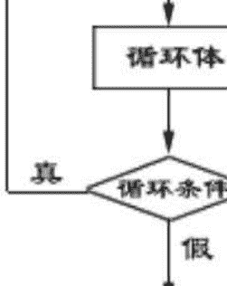

- (1)执行循环体中的语句；
- (2)计算表达式，测试循环条件，为真(非0)则重复上面步骤，为假(0)结束循环。

#### 将while和do-while循环做一下比较：

| while 循环 | do-while 循环 |
|---|---|
| ```c
#include<stdio.h>
void main()
{
    int i; long sum=1;
    scanf("%d", &i);
    while (i<=10)
    {
        sum=sum*i;
        i++;
    }
    printf("%ld\\n",sum);
}
``` | ```c
#include<stdio.h>
void main()
{
    int i; long sum=1;
    scanf("%d", &i);
    do
    {
        sum=sum*i;
        i++;
    }while (i<=10);
    printf("%ld\\n",sum);
}
``` |

| 输入：9 | 输入：11 | 输入：9 | 输入：11 |
|---|---|---|---|
| 输出：90 | 输出：1 | 输出：90 | 输出：11 |


比较上面两个程序，虽然结构是相同的，在输入值为有效值时结果相同，但当输入无效值时输出结果是不同的。为什么？

### while 与 do-while 的主要区别

while 语句进入循环体之前，先测试循环条件，表达式必须为真；否则 while 循环不进入循环体，即循环体可能一次也不执行。

而 do-while 语句先执行循环体，然后测试循环条件。不管开始的时候循环条件是真是假，循环体都要执行一次。

### 6.5 for 循环语句

一般形式：

```
for(表达式1; 表达式2; 表达式3) 语句(循环体)
```

分号不能省略。

- 表达式1：变量初始化
- 表达式2：循环控制条件测试
- 表达式3：控制变量更新

前面已经说明，要正确表达循环结构应注意三方面的问题：控制变量的初始化，循环条件的设置和控制变量的更新。

for 语句在书写形式上正好体现了这种紧密的逻辑关系。

#### 执行过程：

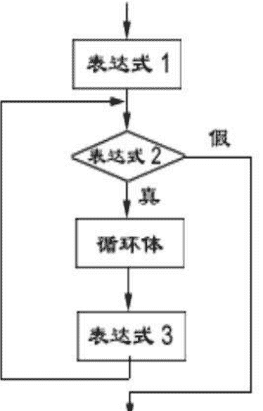

- (1) 求出表达式1的值，若表达式1是逗号表达式，则依次计算；
- (2) 对“表达式2”进行判断，为真转(3)，为假则退出循环；
- (3) 执行循环体中语句；
- (4) 执行“表达式3”，若表达式3是逗号表达式，则依次计算；
- (5) 转向(2)。

#### 例：将上面计算 10！的程序用 for 语句写出：

```c
main()
{
    int i;  long sum=1;
    for(i=1; i<=10; i++) sum=sum*i;
    printf("10!=%ld\n", sum);
}
```

```c
main()
{
    int i;  long sum;
    for(i=1,sum=1; i<=10; sum=sum*i, i++);
    printf("10!=%ld\n", sum);
}
```

空语句

### 说明：

- （1）for 循环的三个表达式起着不同的作用，根据需要可以省略。

  表达式1：用于进入循环体之前给某些变量赋初值。若省略，可以在 for 语句前给变量赋初值。

```c
main()
{
    int i;   long sum=1;
    i=1;
    for(; i<=10; i++)  sum=sum*i;
    printf("10!=%ld\n",sum);
}
```

  表达式2：决定循环的条件，若省略，则为无限循环。

  如：

```c
for(i=0; ; i++) 语句
for( ; ; ) 语句
for(i=0; i<=10; i--) 语句
```

  无限循环（死循环）

  表达式3：用于循环一次后对某些变量进行修改。若省略，可在循环体内对变量进行修改。

```c
main()
{
    int i;   long sum=1;
    for(i=1; i<=10; )
    { sum=sum*i; i++;}
    printf("10!=%ld\n",sum);
}
```

- （2）for 语句功能很强，其中表达式1和表达式3可以是逗号表达式，但为增强程序的可读性，一般不要把与循环无关的东西放到 for 语句中。

  for 语句最简单、常用的形式如下：

```
for(循环变量赋初值；循环条件；循环变量增值) 语句
```

  如：

```c
sum=1;
for(i=1; i<=10; i++) sum=sum*i;
```

- （3）for 语句最为灵活，它完全可以代替 while 语句。

  如：

```c
i=1;
while(i<=10)
{
    sum=sum*i;
    i++;
}
```

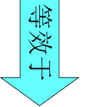

```c
for(i=1;i<=10;i++) sum=sum*i;
```

### 6.6 三种循环语句的总结

- （1）三种循环语句共同的特点是：当循环控制条件非零时，执行循环体语句，否则终止循环。
- （2）循环体语句可以是任何语句，简单语句、复合语句、空语句均可以。

```
for(expression 1)
{
    Statement 1;
    Statement 2;
    Statement 3;
}
```

```
if(e1)
{
    S1;
    S2;
}
else if(e2)
    S3;
```

- （3）while 和 for 语句**先判断**循环控制条件，所以它们的循环体可能一次也不执行；而 do-while 语句**后判断**循环控制条件，它至少执行一次循环体。
- （4）在循环条件中或循环体内必须有使循环趋于结束的语句，否则会出现死循环等异常情况。
- （5）三种循环可以处理同一问题，一般情况可以互相代替。但在实际应用中，我们要根据具体情况来选用不同的循环语句。选用的一般原则如下：

- 如果循环次数在执行循环体之前就已确定，一般用 for 语句；如果循环次数是根据循环体的执行情况确定的，一般用 while 语句或者 do-while 语句。

  （循环次数确定例）

```c
int i,n;
long sum=1;
scanf("%d", &n);
for(i=1;i<=n;i++)
    sum=sum*i;
```

  （循环次数不确定例）

```c
char c;
do
{
    c=getchar();
    printf("%c",c);
} while(c!='q' && c!='Q');
```

- 当循环体至少执行一次时，用 do-while 语句；反之，如果循环体可能一次也不执行，用 while 语句。

  （循环体至少执行一次）

```c
/*只有当用户键入q或Q，才结束循环*/
char c;
do
{
    c=getchar();
    printf("%c",c);
} while(c!='q' && c!='Q');
```

  （循环体可能一次不执行）

```c
/*只有不是q或Q的字符才被打印*/
char c;
c=getchar();
while(c!='q' && c!='Q')
{
    printf("%c",c);
    c=getchar();
}
```

  注意：

```
!(a&&b) == !a || !b
!(a||b) == !a && !b
```

  所以：`c!='q' && c!='Q'` <==> `!(c=='q' || c=='Q')`

### 6.7 循环的嵌套

例：在屏幕上打印一个 8 行 7 列的星号矩阵。

```c
#include <stdio.h>
main()
{
    int i;
    for( i=0; i<7; i++ ) printf("*"); /*打印第1行星号*/
    printf("\n");
    for( i=0; i<7; i++ ) printf("*"); /*打印第2行星号*/
    printf("\n");
    .....
    for( i=0; i<7; i++ ) printf("*");/*打印第8行星号*/
}
```

#### 什么叫循环嵌套？

一个循环的循环体中套有另一个循环叫循环嵌套。这种嵌套过程可以一直重复下去。

一个循环外面包围一层循环称为二重循环。

一个循环外面包围二层循环称为三重循环。

一个循环外面包围多层循环称为多重循环。

`while`、`do-while`、`for` 可以互相嵌套，自由组合。

例：在显示器上输出以下图案。

```
0     *
1   ***
2  *****
3 *******
4 *********
5***********
```

```c
#include <stdio.h>
main()
{
    int i, j, k;
    for( i=0; i<6; i++ )  // i=1; i<7 或者 i=1; i<=6
    {
        for(j=0;j<5-i;j++) printf(" ");
        for( k=0; k<2*i+1; k++ ) printf("*");
        printf("\n");
    }
}
```

### 6.8 break 和 continue 语句

#### 一、break 语句

一般形式：

```
break;
```

功能：结束当前的循环语句。

解释：break 语句一般用在循环体的条件语句中，其作用是当某个条件满足时用 break 语句退出当前循环，不再继续执行剩余的几次循环。

例：打印半径为 1~10 的圆的面积，如果面积超过 100，则不再打印。

```c
#include<stdio.h>
#define PI 3.14159 //符号常量
main()
{
    int r;
    float area;
    for(r=1; r<=10; r++)
    {
        area=PI*r*r;
        if(area>100.0) break; // r=6
        printf("area=%f\n",area);
    }
    printf("now, r=%d\n",r);
}
```


注意：在嵌套循环中使用break语句，它只影响包含它的最内层循环，即程序仅跳出包围该break的那层循环。

### 例：编写程序，输出九九乘法表。

```
main()
{
    int i, j;
    for( i=1; i<= 9; i++)
    { for( j=1; j<= 9; j++)
        { if( j>i ) break;
          printf("%3d", i*j);
        }
        printf("\n");
    }
}
```

运行结果:
1
2   4
3   6   9
4   8  12  16
5  10  15  20  25
6  12  18  24  30  36
7  14  21  28  35  42  49
8  16  24  32  40  48  56  64
9  18  27  36  45  54  63  72  81

### 例：计算用户输入的所有正整数的和，忽略负数，用户输入 0 时结束。

```
#include <stdio.h>
main()
{
    long data, sum = 0;
    do
    {
        printf("Please input : data=");
        scanf("%ld", &data);
        if( data < 0 ) continue;
        sum = sum + data;
    } while( data != 0 );
}
```

### 注意continue语句用于各种循环语句的情况

```
while(test-condition)
{
    if(--------)
        continue;
    --------
    --------
}
c)
for(初始化; 测试表达式;增量表达式)
{
    --------
    if(--------)
        continue;
    --------
    --------
}
b)
do {
    --------
    if(--------)
        continue;
    --------
```

### 注意break语句用于各种循环语句的情况

```
c)
for(初始化,测试表达式,增量表达式)
{
    --------
    if(--------)
        break;
    --------
}

b)
do {
    --------
    if(--------)
        break;
    --------
    --------
} while(test-condition);
--------
d)
for(--------)
{
```

### 6.9 程序举例

例6.6 用 π /4≈1-1/ 3+1/5-1/7+1/9... 求 π 的近似值。直到最后一项的绝对值小于10^-6为止。

```
#include "math.h"
main()
{ int sign=1;
  float n=1,t=1,sum=0, pi;
  while(fabs(t)>=1.e-6)//fabs()求绝对值的函数
  {  sum=sum+t;
     n=n+2;
     sign*= -1;
     t=sign/n;
  }
  pi=sum*4;
  printf("pi=%f\n",pi);
}
```

运行结果:
pi=3.141594

### 斐波纳契Fibonacci数列：1，1，2，3，5，8...

| 第几个月 | 小兔子对数 | 中兔子对数 | 老兔子对数 | 总数 |
|---|---|---|---|---|
| 1 | 1 | 0 | 0 | 1 |
| 2 | 0 | 1 | 0 | 1 |
| 3 | 1 | 0 | 1 | 2 |
| 4 | 1 | 1 | 1 | 3 |
| 5 | 2 | 1 | 2 | 5 |
| 6 | 3 | 2 | 3 | 8 |
| 7 | 5 | 3 | 5 | 13 |

### 例6.7 求斐波纳契数列：1，1，2，3，5，8…的前40个数。

```
```c
#include<math.h>
main()
{
    long int f1=1, f2=1, i;
    for(i=1;i<=20;i++)
    {
        printf("%12ld %12ld",f1,f2);
        if(fmod(i,2)==0) printf("\n");
        f1=f1+f2;
        f2=f1+f2;
    }
}
```
```

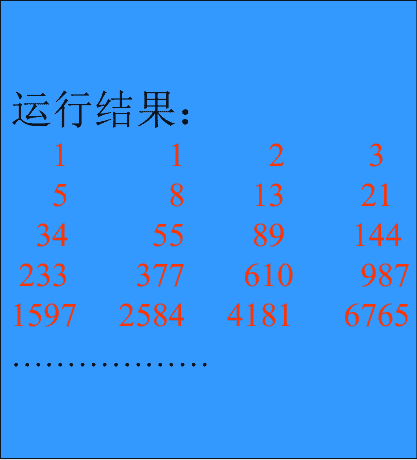

### 例6.8 判断m是否为素数。

方法：用2～(m)1/2之间的整数作为除数去整除m。

```
```c
#include<math.h>
main()
{
    int m, i ,k;
    scanf("%d", &m);
    k=sqrt(m);//m=83,1,2,3,4,5,6,7,8,9; 10,8
    for(i=2; i<=k ;i++)
        if(fmod(m,i) ==0) break;
    if(i>k)
        printf("%d is a prime number.\n",m);
    else
        printf("%d is not a prime number.\n",m);
}
```
```

### 例6.9 求出100~200以内的所有素数。

```
main()
{
    int m , k,i ,n=0;
    for(m=101;m<=200;m=m+2)
    {  k=sqrt(m);
        for(i=2;i<=k ;i++)
            if(m%i==0) break;
        if(i>=k+1)
        { printf(" %d",m); n=n+1;}
        if( n%10==0) printf("\n");
    }
    printf("\n");
}
```

### 例6.10 译密码。密码规律为：每个字母用其后第四个字母代替，26个字母循环排列。

```
#include "stdio.h"
main()
{
    char c,c1;
    while((c=getchar())!='\n')
    {
        if((c>='a'&&c<='v') || (c>='A'&& c<='V')) c=c+4;
        else if((c>='w'&&c<='z') || (c>='W'&&c<='Z')) c=c-22;
        printf("%c",c);
    }
}
```


### 习题8.3（看书P120）

已知：一位数码a和要组成的最大重码数tn的位数n。

求：各重码数的累加和sn。

算法：对给定的a和n，从i=1～n依次作：

- 1. 求第i个重码数tn = tn * 10 + a。
- （其中tn的初值应是0）
- 2. 求累加和　sn = sn + tn。

```
main()
{
    int sn,a,n,i,tn;
    long sn,tn;
    printf("\na, n=");
    scanf("%d%d",&a,&n);
```

```
for(tn=0,sn=0,i=1;i<=n;i++)
{
    tn=tn*10+a;
    sn+=tn;
}
printf("\na+aa+...=%ld",sn);
}
```

### 习题6.7 (看书P120)

已知：正整数 1≤n≤1000

求：其中的“完数”，即一个数的所有因子之和等于该数本身的数。

算法：对于n=2～1000的每一个数，进行：

- ① 求出该数的所有因子并累加于sum（不保存这些因子）。
- （一个数n的所有因子的求法：只需用2~n/2 的所有数去除n,能整除的就是其因子。）

- ② 当能满足完数条件时（sum=n），重新求出该数的所有因子并打印。

```
#include<math.h>
main()
{
    int sum,n,i;
    for(n=2;n<=1000;n++)
    {  sum=0;
    for(i=1;i<=n/2;i++)
        if(fmod(n,i)==0) sum+=i;//求出n的因子,计算其和
    if(sum==n)
    {printf("\n%d :",n);//打印完数
    for(i=1;i<=n/2;i++)
        if(fmod(n,i)==0)
        printf("%d  ",i);//重新计算n的因子,并打印输出
    }
    }
}
```


### 习题6.11（看书P120~P121）

已知：正数a和求a的算术平方根x的公式。
求：a的算术平方根x。

- 算法：
① 从键盘上输入a，并假设a的第一个根为x=a；误差标志变量dx。
② 重复做：
　　记下上一个根x0=x；
　　按公式求下一个根x；x=(x+a/x)/2；
　　求两个根的误差绝对值dx=fabs(x-x0)。
③ 当两次求得的根之差的绝对值（精度）dx<=0.00001时停止。X即为所求平方根。

```c
#include "math.h"
main()
{
    float a, x, x0, dx;
    printf("\n a=");
    scanf("%f",&a);
    x=a;
    do
    {
        x0=x; //上次求出的根
        x=(x+a/x)/2; //本次求出的根
        dx=fabs(x- x0);
    }while(dx>0.00001);
    printf("\n x=%f",x);
}
```

### 要牢记

- 1. 勿忘在do...while语句后使用分号；
- 2. 在for语句的头表达式中使用逗号将产生错误；
- 3. 勿忘在while和do...while的循环体中使用增量语句；
- 4. 注意常见的用赋值运算符“=”代替关系运算符“==”的错误；
- 5. 不要对实数使用相等“==”的运算；
- 6. 对于在循环体中要进行反复运算的变量，要确认在进入循环体之前，该变量已被正确地赋初值；
- 7. 尽管允许对于变量初始化和增量运算使用算术表达式，但要清楚由此带来的舍入和截尾误差；
- 8. 在循环语句编程中使用缩进编排可以增强可读性和易理解性。

### 本章作业：

编程，并上机调试以下各题：

6-1 计算级数的和，精度要求为0.00001。三题任选一题。

a)采用下列级数方法计算欧拉数(e=2.718281828...)的值：

e=1+1/1!+1/2!+1/3!+......+1/n!

b）求和：

SUM=1+(1/2)^2+(1/3)^2+(1/4)^2+......

c）输入任意角度x，计算：

y=cos(x)=1-x^2/2!+x^4/4!-x^6/6!+......

注意：x使用弧度，例如：cos(60° )=1-(3.1415926/3)^2/2!+......

### 6-2 在显示器上输出图案


6-3 输入3个数，将其作为三角形的3边长，计算三角形的面积，输出3边长和三角形的面积。注意在程序里要对输入数据进行检查，对不能构成三角形的情况给出错误信息（构成三角形的条件为：任意两边之和大于第三边）。分别输入正确的和错误的（不能构成三角形的）数据进行检验。

### 答案

- - a)F      b)F      c)T      d)F      e)T

## 第九章 预处理命令

- 1. 掌握编译预处理的概念和特点；
- 2. 掌握“文件包含”的概念和使用；
- 3. 掌握不带参数的宏定义及其使用，了解带参数的宏定义及其使用。

### 概述

### 一、编译预处理的概念

C语言允许在程序中使用几种特殊的命令（它们不是一般的C语句），在C编译系统对程序进行通常的编译之前，先对程序中这些特殊命令进行“预处理”，然后将预处理的结果和源程序一起再进行通常的编译处理，以得到目标代码。

### 二、主要预处理功能

- - (1)宏定义；
- - (2)文件包含；
- - (3)条件编译

### 9.1 宏定义

宏：是对正文进行代入或嵌入的一种功能。即从一字符流中取出某个字符串去代替源程序里的标识符。

### 一、不带参数的宏定义及宏替换

### 1. 一般形式：

```
#define 标识符 字符串
```

宏名

宏内容

无分号

作用：用标识符来代表一个字符串。

### 引例。

```c
#define PI 3.1415926
main()
{
    float l,s,r,v;
    printf("input radius :");
    scanf("%f",&r);
    l=2.0*PI*r;//l=2.0*3.1415926*r;
    s=PI*r*r;//s=3.1415926*r*r;
    v=3.0/4*PI*r*r*r;//v=3.0/4*3.1415926*r*r*r
    printf("l=%10.4f\ns=%10.4f\nv=%10.4f\n",l,s,v);
}
```

其中 `#define PI 3.1415926`

作用是指定标识符PI代表“3.1415926”

### 说明：

- (1)宏名习惯用大写字母，以便与变量名相区别；
- (2)宏名用做代替一个字符串，不作语法检查；
- (3)宏定义的字符串不能以“;”结尾，字符串结束后一定要换行；
- (4)宏定义的有效范围为定义之处到#undef命令终止，如果没有#undef命令，则有效范围到本文结束；
#undef命令形式： #undef 标识符
- (5)在进行宏定义时，可以引用已定义的宏名；
- (6)C语言允许宏定义出现在程序中函数外面的任何位置，但一般情况下它总写在文件的开头。

• **宏替换(宏展开)**：用宏内容（字符串）原样代替程序中的所有宏名字的过程。

**说明：**
(1) 宏替换由编译程序预先进行；
(2) 宏替换范围是除字符串以外的所有宏名字；
(3) 若替换后文本串中仍含有宏名字，将再次进行替换，直到程序中不含宏名字为止。

```c
#define PI 3.1415926
#define R 3.0
#define L 2*PI*R
#define S PI*R*R
```

```c
main()
{
    printf("L=%f\nS=%f\n",L,S);
}
```

**第一次替换：** `printf("L=%f\nS=%f", 2*PI*R, PI*R*R);`

**第二次：** `printf("L=%f\nS=%f", 2*3.1415926*3.0, 3.1415926*3.0*3.0);`

### 二、带参数的宏定义及宏替换

### 一般形式：

#define 宏名（宏形式参数表） 字符串

作用：宏替换时以实参数替代形参数。

```c
#define PI 3.1415926
#define S(r) PI*r*r
main()
{
float r1=3.6, area;
area=S(r1); /* area=PI*r1*r1=3.1415926*r1*r1 */
printf("r=%f  area=%f\n",r1,area);
}
```

### 三、带参数的宏替换与函数的主要区别

- (1) 函数调用时，先求出实参表达式的值，然后代入形参。而使用带参数的宏只是进行简单的字符替换。
- (2) 函数调用是在程序运行时处理的，分配临时的内存单元。而宏替换则是在编译时进行的，在展开时并不分配内存单元，不进行值的传递处理，也没有“返回值”的概念。
- (3) 宏替换不占运行时间，只占编译时间，而函数调用则占运行时间。
- (4) 函数中函数名及参数均有一定的数据类型，而宏不存在类型问题，宏名及其参数无类型。

### 程序举例：

```c
#define MAX(x,y) x>y?x:y
main()
{
int n1,n2;
float f1,f2;
scanf("%d%d%f%f",&n1,&n2,&f1,&f2);
printf("maxi=%dmaxf=%f",MAX(n1,n2),MAX(f1,f2));
}
```

### 经预编译宏替换后的printf语句如下：

```c
printf("maxi=%dmaxf=%f",n1>n2?n1:n2,f1>f2?f1:f2);
```

### 程序举例：

```c
#include<math.h>
#define PR printf
#define NL "\n"
#define D "%d%d%d"
#define F "%f"
main()
{
    int a,b,c;
    float s,area;
    scanf(D,&a,&b,&c);// scanf("%d%d%d",&a,&b,&c);
    s=0.5*(a+b+c);
    area=sqrt(s*(s-a)*(s-b)*(s-c));
    PR(D NL,a,b,c);// printf("%d%d%d\n", a,b,c);
    PR(F NL,s); // printf("%f\n", s);
    PR(F NL,area); // printf("%f\n", area);
}
```


# 9.2 “文件包含” 处理

“文件包含”：是指一个源文件可以将另外一个源文件的全部内容包含进来。

C语言提供#include命令来实现“文件包含”的操作，其一般形式为：

```
#include “文件名”
```

或

```
#include <文件名>
```

作用：使编译系统把指定的被包含文件嵌入到带有#include的源文件中。

# “文件包含” 示意图

file1.c

```
#include"file2.c"
```

A

(a)

包含

file2.c

B

(b)

file1.obj

B

A

(c)

# 9.3 条件编译

条件编译：根据条件选择被编译的源程序行。

- 使用宏定义的标识符作为编译条件
- 使用常量表达式的值作为编译条件

# 一、使用宏定义的标识符作为编译条件

形式一：

```
# ifdef 标识符
    程序段1
# else
    程序段2
#endif
```

作用：当所指定的标识符已经被#define 命令定义过，则在程序编译阶段只编译程序段1，否则编译程序段2。

```
例1:

```c
#define DEBUG

#ifdef DEBUG
    printf("x=%d,y=%d\n",x,y);
#endif
```
```

可用于进行程序的调试。

调试过程中，在程序前面加#define DEBUG
调试完成后，将前面的#define DEBUG删除掉

### 例2：

```
#define ZD
......
for(j=1;j<n-1;j++) //算j=1到j=n-2处的纵向棱边rcs
{ p5=p[i-1][j];p6=p[i][j];
  p7=p[i-1][j+1];p8=p[i-1][j-1];
#ifdef ZD //ZD was defined
  if(fabs(p5.z)<1.e-5&&(theta<theta_xia||theta>2.*PI-theta_sha))
    rcs+=rcszero;
  else
    rcs+=Bianyuanrcs(p5,p6,p7,p8,ii,ei,wavelength,kk,spin);
#else//ZD was not defined
  rcs+=Bianyuanrcs(p5,p6,p7,p8,ii,ei,wavelength,kk,spin);
#endif
```

# 二、使用常量表达式的值作为编译条件

形式：

```
# if 表达式
    程序段1
# else
    程序段2
# endif
```

作用：当所指定的表达式为真（非零）时就编译程序段1，否则编译程序段2。

可以事先给定一定条件，使程序在不同的条件下执行不同的功能。

# 例3：对于一行字母字符，根据需要进行条件编译，使之能将字母全用大写输出，或者全用小写输出。

```
#include "stdio.h"
#define LETTER 1
main()
{
    char str[20]="C Language";
    int i=0;
    while((c=str[i])!='\0')
    {i++;
#if LETTER
    if(c>='a'&&c<='z') c=c-32;
#else
    if(c>='A'&&c<='Z') c=c+32;
#endif
    printf("%c",c);
    }
}
```

### 本章作业：

9-1:输入两个整数，求它们相除的余数。用带参数的宏编程来实现。

9-2:试定义一个带参数的宏swap(x,y,t)，以实现两个整数x和y之间的交换，并利用它将一维数组a[10]和b[10]的值进行交换。（a[10]和b[10]通过初始化方法赋值）

# 第七章 数组

- 掌握一维数组、二维数组的定义、初始化和引用。
- 掌握字符串和字符数组的概念及其处理函数。
- 掌握用数组进行编程的技术。

# 先看一个例子：

例：给出10个儿童的体重，要求计算平均体重并打印出低于平均体重的数值。

# 用变量来解决问题：

```
main()
{
    int w1, w2, w3, w4, w5, w6, w7, w8, w9, w10;
    int t;
    scanf("%d%d%d%d%d%d%d%d%d%d", &w1,
          &w2, &w3, w4, &w5, &w6, &w7, &w8,
          &w9, &w10);
}
```

```
```c
t=(w1+w2+w3+w4+w5+w6+w7+w8+w9+w10)/10;
if( w1 < t ) printf( "%d\n", w1 );
if( w2 < t ) printf( "%d\n", w2 );
if( w3 < t ) printf( "%d\n", w3 );
if( w4 < t ) printf( "%d\n", w4 );
if( w5 < t ) printf( "%d\n", w5 );
if( w6 < t ) printf( "%d\n", w6 );
if( w7 < t ) printf( "%d\n", w7 );
if( w8 < t ) printf( "%d\n", w8 );
if( w9 < t ) printf( "%d\n", w9 );
if( w10 < t ) printf( "%d\n", w10 );
}
```
```

# 数组及其相关概念

数组是一组有序的、类型相同的单元的集合，这些单元被称为数组的元素。


每个数组都有一个名字，称之为数组名。为标识数组中的每个元素，需要对它们进行编号，称为数组元素的下标。

注意：C语言规定下标从0开始。

下标使数组元素在数组中的位置（或排列顺序）被唯一地确定下来；用数组名加上下标可以准确地访问数组中的某个元素。

如： w[0]代表数组w中的第一个元素
w[9]代表数组w中的第十个元素

说明：数组名代表数组的起始地址。
数组元素在内存中是连续存储的。

# 7.1 一维数组的定义和引用

# 一、一维数组的定义

定义一维数组的一般方式：

```
类型说明符 数组名[常量表达式];
```

指明数组元素的数据类型

指明数组所含的元素个数

例如：`int a[10];` /*定义的整型数组a含10个元素*/

`float b[20];` /*定义的实型数组b含20个元素*/

### 说明：

- (1) 数组名的命名规则同变量名的命名规则一样；
- (2) 数组名后用方括号[]，不能用（）；
- (3) 常量表达式必须是大于0的整型常量表达式，不能包含变量，即其大小不依赖运行过程中变量值；
- (4) 定义数组时，数组的长度必须是确定的，C语言不允许对数组的大小作动态定义。

例如：

```
#define size 10
float a[size], b[size];
int a[3*8+2]
```

```
int a(10);
int n=5;
int a[n]
```

```
char name[0];
float weight[10.3];
float array[-100];
```

# 二、一维数组的初始化

# 1．定义时初始化

方法：将初值依次写在花括号{}内。

如：`int a[5]={2,4,6,8,10};`

存储形式：


### 说明：

(1)如果定义一维数组时给出了全部元素的初值，则数组的下标允许省略。此时编译系统自动根据初始化数据的个数来确定数组的长度。

```
如： int a[]={ 2 , 4 , 6 , 8 , 10 };
```

```
int a[]; ✗
```

(2)初始化的数据个数允许小于数组的长度，但不能大于数组的长度。当初始化的数据个数（至少要有一个）少于数组的长度时，未初始化部分将被编译系统自动用 0 赋值。

```
如： int a[5]={ 2 , 4 };
```

相当于： a[0]=2, a[1]=4, a[2]=0, a[3]=0, a[4]=0

```
int a[5]={1 , 2 , 3 , 4 , 5 , 6 , 7 , 8 }; ✗
```

# 2 . 使用其它方法初始化

(1)利用赋值语句初始化

```
main()
{ char as[26],ch;
    for(ch='A';ch<='Z';ch++) as[ch-'A']=ch;
    ......
}
```

(2)利用输入语句初始化

```
main()
{ char as[26];  int i ;
    for(i=0; i<26; i++) scanf("%c",&as[i]);
    ......
}
```


（3）数组元素的赋值必须逐个元素进行，不允许把一个数组作为一个整体赋给另一个数组。除了数组初始化外，也不允许用语句在花括号中列表的方式对数组整体赋值。

```
例1：int a[5]={ 2,4,6,8,10 },b[5];
b[5]=a[5];
```

```
例2：int a[5];
a[5]={ 2,4,6,8,10 };
```

（4）数组名 a 代表的是数组 a 在内存中的首地址，因此可以用数组名 a 来代表数组元素 a[0] 的地址。

```
scanf("%d",&a[0]);  →  scanf("%d",a);
等价于
```

### 四、一维数组应用举例

例1：从键盘输入 10 个实型数存入数组，然后按输入顺序的逆序输出这 10 个数。

```
main()
{
    float a[10];
    int i;
    for(i=0 ; i<10 ; i++) scanf("%f",&a[i]);
    for(i=9 ; i>=0 ; i--) printf("%f",a[i]);
}
```

#### 例7.2：用数组来处理求斐波纳契数列：
1, 1, 2, 3, 5, 8...的前20个数。

数学表示： f(0)=f(1)=1, f(n)=f(n-2)+f(n-1)

```
main()
{
    int f[20]={1,1};
    for(i=2 ; i<20 ; i++) /*f[2]是数组第3个元素*/
        f[i]=f[i-2]+f[i-1]; // f[2]=f[0]+f[1];
    for(i=0 ; i<20 ; i++)// f[3]=f[1]+f[2];
    {
        printf("%10d",f[i]);
        if(i%2==1) printf("\n"); /*每行打印2个数*/
    }
}
```

#### 例7.3：用冒泡法对n=6个数排序（由小到大）。

冒泡法的思路是：比较相邻两个数，将较小的数调到前头。

| 轮数 | 剩数 | 比较次数 |
| j=1~n-1 | n-j+1 | n-j |
| 1 | 6 | 5 |
| 2 | 5 | 4 |
| 3 | 4 | 3 |
| 4 | 3 | 2 |
| 5 | 2 | 1 |

第一轮排序比较了 5 次，得到第一次结果。

```
main()
{
    int a[7], i , j , t ;
    printf("Input 6 numbers : \n");
    for(i=1 ; i<7 ; i++)
        scanf("%d",&a[i]);
    printf("\n");
    for(j=1 ; j<=5 ; j++) /* 控制5轮排序 */
        for(i=1 ; i<=6-j ; i++) /* 每轮排序比较次数 */
            if(a[i]>a[i+1])
                { t=a[i]; a[i]=a[i+1]; a[i+1]=t; }
    for(i=1 ; i<=6 ; i++)
        printf("%d",a[i]);
}
```

```
main()
{
    int a[6], i , j , t;
    printf("Input 6 numbers : \n");
    for(i=0 ; i<6 ; i++)
        scanf("%d",&a[i]);
    printf("\n");
    for(j=0 ; j<=4 ; j++) /* 控制5轮排序 */
        for(i=0 ; i<5-j ; i++) /* 每轮排序比较次数 */
            if(a[i]>a[i+1])
                { t=a[i]; a[i]=a[i+1]; a[i+1]=t; }
    for(i=0 ; i<=5 ; i++)
        printf("%d",a[i]);
}
```

### 7.2 二维数组的定义和引用

先看一个例子：

某校近三年招收各专业本科生人数如下：

|  | 计算机 | 电子 | 管理 | 数学 |
|---|---|---|---|---|
| 1999 | 90 | 40 | 80 | 30 |
| 2000 | 100 | 50 | 90 | 40 |
| 2001 | 95 | 45 | 100 | 50 |

要把这些数据组织起来，可以有两种选择：

+   (1) 按从左到右从上到下的顺序存入一个一维数组中。（查询困难）
+   (2) 每年用一个一维数组，把这些数据分别存入三个数组中。（增加一年数据困难）

#### 一、二维数组的定义

+   • 定义二维数组的一般方式：

```
类型说明符 数组名[常量表达式1][常量表达式2];
```

如：

    int a[3][4];

    float b[5][6];

+   • 存储形式：

二维数组在内存中是按行的顺序存放的，即先存放第一行的元素，再存放第二行的元素。


说明：二维数组除了维数比一维数组多一维外，其它性质与一维数组完全类似。

看看下面的写法是否正确？

+   ① `int a[3];`
+   
+   用于定义数组长度的常量表达式的值必须是大于0的正整数。

+   ② `int i=3,j=4;`
+   
+   `int a[i][j];`
+   
+   定义数组元素的个数必须使用常量表达式，而不能使用变量。

#### 二、二维数组的初始化

这里主要介绍定义时的初始化，其它初始化方法与一维数组类似。定义时初始化有两种方法：

##### (1)分行初始化

```
例如： int a[2][3]={{1,2,3},{4,5,6}};
    int a[3][4]={{1,2,3,4},{5,6},{7}};
```

| 1 | 2 | 3 | 4 |
| 5 | 6 | 0 | 0 |
| 7 | 0 | 0 | 0 |

##### (2)省略掉内层的花括号

即按照数组元素在内存中的排列顺序赋初值。

```
例如： int a[2][3]={1,2,3,4,5,6};
```

### 说明：

(1) 对二维数组初始化时，可以只对部分数组元素初始化，未被初始化的数组元素将自动赋 0。

如： int a[2][3]={{5,6},{7,8}}; int a[2][3]={5,6,7,8};
得到的数组为: 5 6 0 得到的数组为: 5 6 7
7 8 0 8 0 0

(2) 对二维数组初始化时，如果对全部元素都赋初值，或分行赋初值(每行至少一个数据)，则可以省略第一维数组长度。但是，第二维数组长度不允许省略。

如： int a[][3]={1,2,3,4,5,6,7,8,9};
int a[][4]={{1,2},{3,4,5,6},{7}};
} 系统按3行处理
int a[][10]={{1,0}}; float f[2][]={{1.1,2.2}};

#### 三、二维数组的引用

与引用一维数组元素一样，二维数组元素也采用下标法引用。

表示形式：

```
数组名[行下标][列下标]
```

其中，行下标和列下标是整型常量、整型变量或整型表达式。其编号从 0 开始。

例如：若有 int a[2*5][3*4], i=15;

则使用 a[3*3][0], a[1][i-5]都是合法的。

### 说明：

(1) 数组名 a 代表的是 a 在内存中的首地址，因此可以用数组名 a 来代表数组元素 a[0][0] 的地址。

例如：若有 int a[3][4], 则 a[i][j] 的地址为 a+i*4+j; a[0][0] 的地址与 a 相同。

(2) 二维乃至多维数组是若干个比其低一维的数组的集合。换句话说，二维乃至多维数组可以化成多个降低维数后的数组使用。

例如：若有 int a[3][4]，则等价于有了 3 个一维整型数组：

+   a[0]: a[0][0], a[0][1], a[0][2], a[0][3]
+   a[1]: a[1][0], a[1][1], a[1][2], a[1][3]
+   a[2]: a[2][0], a[2][1], a[2][2], a[2][3]

#### 四、二维数组应用举例

例1：使用数组保存“九九乘法表”，然后输出。

```
main()
{
    int a99[10][10], i, j;
    for(i=1; i<10; i++)
        for(j=1; j<=i; j++) a99[i][j]=i*j;
    for(i=1; i<10; i++)
    {
        for(j=1; j<=i; j++) printf("%6d",a99[i][j]);
        printf("\n");
    }
}
```


# 例7.4：矩阵的转置。（书中例7.4）

$$a=\begin{bmatrix}1&2&3\\4&5&6\end{bmatrix}\quad\text{转换成}\quad b=\begin{bmatrix}1&4\\2&5\\3&6\end{bmatrix}$$

```
main()
{
    int a[2][3]={{1,2,3},{4,5,6}};
    int b[3][2],i,j;

    printf(" array a: \n");
    for(i=0;i<=1;i++)
    {
        for(j=0;j<=2;j++)
        {
            printf("%5d",a[i][j]);
            b[j][i]=a[i][j];
        }
        printf("\n");
    }
}
```

```
printf("\n array b: \n");
for(i=0;i<3;i++)
{
    for(j=0;j<2;j++)
    {
        printf("%6d",b[i][j]);
    }
    printf("\n");
}
```

# 例7.5： 求3*4数组中的最大值及其下标。

```
main()
{
    int max,row,colum,i,j;
    int a[][4]={{1,2,3,4},{9,8,7,6},{-10,10,-5,2}};
    max=a[0][0];
    for(i=0;i<3;i++)
        for(j=0;j<4;j++)
            if(a[i][j]>max)
            {
                max=a[i][j];
                row=i;
                colum=j;
            }
    printf("max=%d,row=%d,colum=%d",max,row,colum);
}
```

# 7.3 字符数组和字符串
(Character Array and Strings)

### 一、字符数组(Character Array)

当数组的元素类型为字符型时，被称为字符数组。

如： char c[10]; 则c为字符数组。

字符数组的定义、初始化和元素的引用与一般的数组相同。

```
如： main()
{
    char ch[5]={'c','h','i','n','a'};
    for(i=0; i<5; i++) printf("%c",ch[i]);
}
```

### 说明：

(1)定义字符数组的类型说明符一般为char，如：

```
char c[10]; 由于字符型与整型的互相通用性，因此，上面定义也可改为： int c[10];
```

(2)初始化赋值的字符个数允许少于字符数组的长度，但不能多于字符数组的长度。当初始化赋值的字符数（至少要有一个）少于字符数组的长度时，未初始化部分将被编译系统自动用空字符 ‘\0’ 赋值。

```
如： int c[8]={ ‘H’ , ‘e’ , ‘l’ , ‘l’ , ‘o’ };
```

则： c[0]=‘H’, c[1]= ‘e’, c[2]= ‘l’, c[3]=‘l’, c[4]=‘o’
 c[5]=‘\0’, c[6]=‘\0’, c[7]=‘\0’

### 二、字符串与字符数组

**字符串常量**是用双引号括起来的一串字符，由系统自动加上一个字符串结束标志“\0”。它占内存，但不记入字符串长度。

如：“china”占内存6个字节，但字符串长度是5

> 在C语言中用字符数组来处理字符串，每个数组元素存放一个字符型数据。

字符型数组可用一般数组的初始化方式初始化外，还可以使用字符串常量初始化：

```
char message[]={“Hello”};
或 char message[]="Hello";
```

（这时，字符数组长度是6，字符串长度是5）

注意：用一般初始化方式：

```
char message[]={'H','e','l','l','o'};
```

结果： ‘H’ ‘e’ ‘l’ ‘l’ ‘o’

用字符串常量初始化：

```
char message[]={"Hello"};
```

结果： ‘H’ ‘e’ ‘l’ ‘l’ ‘o’ ‘\0’

说明：字符数组本身并不要求它的最后一个元素一定是 ‘\0’，例如： char ch[2]={‘A’,‘B’}; 是合法的。

为了与用字符串常量对字符数组赋初值的处理方法一致，在字符数组中也常常人为地加上一个值为 ‘\0’的元素。

如： char message[]={'H','e','l','l','o','\0'};

# 例7.7 输出一个钻石图形

```
main()
{ char diamond[][5]={{' ',' ',' ','*'},{' ','*',' ','*'},
    {'*',' ',' ',' ','*'},{' ','*',' ','*'},{' ',' ','*'}};
    int i,j;
    for(i=0;i<5;i++)
    { for(j=0;j<5;j++)
        printf("%c",diamond[i][j]);
        printf("\n");
    }
}
```


### 三、字符数组的输入输出

字符数组的输入输出可以有以下两种方法：

- 1. **逐个字符输入输出**
    用格式符“%c”输入或输出一个字符。
- 2. **将整个字符串一次输入或输出**
    用格式符“%s”输入输出字符串。

```
char c[] = “Hello”；
printf(“%s”, c);
```

例如：

**注意：**（1）输出字符不包括结束符‘\0’。  
（2）用“%s”格式符输出字符串时，printf函数的输出项是字符数组名，而不是数组元素名。

(3)用“%s”格式符输出字符数组时，遇到第一个‘\0’，输出就结束。

(4)用“%s”格式符输入字符串时，scanf函数的输入项是字符数组名时，不要再加地址符&，因为C语言中数组名代表该数组的起始地址。

```
如： char str[10]; scanf("%s",&str);
```

```
scanf("%s",str);
```

(5)用“%s”格式符输入字符串时，scanf函数的输入项是字符数组名，从键盘输入的字符串应短于已定义的字符数组的长度。系统自动在后面加个‘\0’结束符。

```
如： char str[6]; scanf("%s",str);
```

|  |  |
|---|---|
| ‘a’ | ‘\0’ |
| ‘b’ |  |
| ‘c’ |  |
| ‘d’ |  |
| ‘e’ |  |

```
main()
{ char a[6]; int i=0;
    while(i<=5)
    { scanf("%c",&a[i]);
        i++;}
}
```

```
main()
{ char a[6]; int i=0
    scanf("%s",a);
    printf("%s",a);
}
```

输入数据：
abc cdg

输入数据：
abc cdg

|  |  |
|---|---|
| a | a[0] |
| b | a[1] |
| c | a[2] |
|  | a[3] |
| c | a[4] |
| d | a[5] |
|  |  |

|  |  |
|---|---|
| a | a[0] |
| b | a[1] |
| c | a[2] |
| \0 | a[3] |
| \0 | a[4] |
| \0 | a[5] |

# 2.字符串输出puts()函数

使用形式：

```
puts(字符数组)
```

功能：

将一个字符串输出到终端。在输出时，将字符串结束标志 ‘\0’ 转换成 ‘\n’，即输出完字符串后自动换行。

例如： char str[]={"China\nBeijing"};

```
puts(str);
```

输出：

China
Beijing

注意：使用puts和gets函数前，要用预编译命令：
#include “stdio.h”。

注意：使用这些函数前，要用#include “string.h”

### （二）、字符串处理函数

# 1. 求字符串长度strlen()函数

使用形式：`strlen(字符数组)`

功能：计算字符串长度，函数值是字符串中‘\0’之前的字符个数（不包括‘\0’字符）。

```
例如：char str4[20]={ “ab\n\012/\\” }；
printf(“%d”,strlen(str))；
输出：10  (a,b,\n,\0,1,2,/,\”,)
```

```
char str5[20]={ “ab\n\0y\012/\\” }；
printf(“%d”,strlen(str))；
输出：3
```


### 2. 字符串比较函数strcmp()

**使用形式：** `strcmp(字符串1，字符串2)`

其中，字符串可以是字符串常量或字符数组。

**功能：** 比较两个字符串。

**比较的原则：** 对两个字符串，从左至右逐个将对应字符按其 ASCII 码值大小相比较，直到出现不同的字符或遇到“\0”为止。

> 若设 n=strcmp(字符串1，字符串2)：
> 
> 则：
> - n>0；串1>串2
> - n=0；串1=串2
> - n<0；串1<串2

例如： char str1[20], str2[10]；
（将str1[20]和str2[10]赋初值）

```
if(strcmp(str1,str2)>0) puts(str1);
```

注意： 不能写成 if(str1>str2)

```
n=strcmp("China","Korea");
```

‘C’=067<‘K’=075

“China”<“Korea”, n<0

同理：

“China”>“Canada”,n>0

“computer”>“compare”,n>0

“temperature”=“temp”

### 3.字符串连接strcat()函数

**使用形式：** `strcat(字符数组1，字符串2)`

**功能：** 连接两个字符串，把字符串2连接到字符串1的后面，连接后的字符串放在字符数组1中。

+   **说明：**
+   1. 字符数组1必须足够大以便能够容纳字符串2。
+   2. 连接时只在新串最后保留一个“\0”。
+   3. 字符串2可以是字符串常量或字符数组。

### 4. 字符串复制strcpy()函数

使用形式： strcpy(字符数组1，字符串2)

功能： 将字符串2复制到字符数组1中
（其后自动加一个 ‘\0’）。

说明： (1)字符数组1必须足够大以便能够容纳被复制的字符串。

(2)不能用赋值语句将一个字符串常量或字符数组直接赋值给一个字符数组。

```
例如： char str1[20], str2[20];
strcpy(str1,"hello world");
strcpy(str2,str1);
```

```
例如： char str1[20], str2[20];
str1={"hello"};
str2=str1;
```

### Strcpy使用举例：

```
#include <iostream.h>
#include<fstream.h>
main()
{char filewing[20]="wing.txt",filefuse[20]="fuselage.txt",filetail[20]="tail.txt";
    cout<<"请输入飞机部件类型"<<"\n";
    cout<<"1----机翼"<<"\n";
    cout<<"2----机身"<<"\n";
    cout<<"3----尾翼"<<"\n";
    cin>>numpart;
    switch(numpart)
    case 1: {strcpy(filedes,filewing); break;}
    case 2: {strcpy(filedes,filefuse); break;}
    case 3: {strcpy(filedes,filetail); break; }
    case 4: default;
    ifstream in(filedes,ios::in);
    if(!in){cout<<"cannot open Inputfile "<<"\n";exit(1);}
}
```

### 五、字符串数组应用举例

例1：（例题7.8）统计字符串中的单词数。

```
```c
#include <stdio.h>
main()
{
    char string[81],c;
    int i,num=0,word=0;
    gets(string);
    for(i=0;string[i]!='\0';i++)
        if(string[i]==' ') word=0;
        else if(word==0)
            {word=1;num++;}
    printf("\nThere are %d words.", num);
}
```
```


word=0

s[i]!='\0'

N

I am a boy

Y

s[i]==','

N

word==0

N

Y

word=0
(后面出现新单词)

Y

num++
word=1
(后面是旧单词)

### 学习数组这一章要注意的几个问题：

+   1. 在C语言中数组的下标是从0开始；
+   2. C语言不进行下标的越界检查，不论是在编译阶段还是在运行阶段，这个问题交给程序员。这样就给初学者带来一定的风险。
+   3. 数组名是地址，这在字符串处理中已经看到，这个我们要先强记，以后在讲指针时再详细讲。
+   4. 字符数组在定义时必须考虑到串结束符的位置，因为它要占一个字符的位置。
+   5. 要注意数组初始化的方法与简单变量的区别，特别是字符数组的初始化方法。
+   6. 字符串的操作有许多专用函数，请注意掌握并运用。

### 本章作业： 编写并上机调试下列习题：

7-1 从计算机屏幕上任意输入10个实数，求出其中的最大值、最小值和10个数的算术平均值，并按下列格式在屏幕上打印输出（不得照抄冒泡法）。

The maximum=

The minimum=

The average=

7-2 按以下提示对矩阵a赋初值（不得使用初始化方法赋初值），并将转置后的矩阵b打印输出。

a= ⎛ 1 0 0 0 ⎞
   ⎜ -1 1 0 0 ⎟
   ⎜ -1 -1 1 0 ⎟
   ⎝ -1 -1 -1 1 ⎠

b= ⎛ 1 -1 -1 -1 ⎞
   ⎜ 0 1 -1 -1 ⎟
   ⎜ 0 0 1 -1 ⎟
   ⎝ 0 0 0 1 ⎠

+   - 7-3 以下两题任选一题
+   - 1）求1!+2!+3!+...+10!的和
+   - 2）一个整数，它加上100后是一个完全平方数，该数加上268又是另一个完全平方数，请问该数是多少？（提示：1.在10万以内判断;2.如果一个数的平方根的平方等于该数，这说明此数是完全平方数）

### 二、C函数与C程序结构

+   (1) C程序由一个主函数（main函数）和若干个子函数构成；
+   (2) 主函数调用子函数；
+   (3) 子函数在定义时是并列的；
+   (4) 子函数可相互调用，也可被多次调用。


```
#include<stdio.h>
#include<math.h>
void main()
{
char prime(int);/*函数声明或定义函数原形(Function Prototype)*/
int n;
printf("\nInput an integer:");
scanf("%d",&n);
if(prime(n)=='g')//函数调用
    printf("\n%d is a prime.",n);
else
    printf("\n%d is NOT a prime.",n);
}
```

### //函数定义(Function Definition)

```
char prime(int n) //函数类型、名称，形式参数的定义
{
    //函数体定义
    char flag='g';
    int i,k;
    k=sqrt(n);
    for(i=2;i<=k;i++)
        if(fmod(n,i)==0)
        {
            flag='r';
            break;
        }
    return flag; //返回值
}
```

### 函数调用例：

```
void main()              /* 主函数 */
{
    print_star();       /*调用print_star函数打印*****/
    print_message();    /*调用print_message函数写字*/
    print_star();       /*调用print_star函数打印*****/
}

void print_star()       /*定义print_star函数*/
{
    printf("\n************");
}

void print_message()    /*定义print_message函数*/
{
    printf("\n Hello! ");
}
```


### 三、C函数的特点

(1)一个源文件由一个或多个函数组成，它是一个独立编译单元。

(2)一个C程序由一个或多个源文件组成。

源文件1：主函数
#include "JPcal3.h"
#include "PBcal.h "
main(){...}

源文件2：函数JPcal3.h
#include "Complex.h"
class CEq{...}

源文件3：函数Complex.h
#include "Vector.h"
class CComplex{...}

源文件4：函数Vector.h
#include <stdio.h>
#include <math.h>
class CVector{...}

+   (3) C程序执行总是从main函数开始，调用其他函数后流程回到main函数，在main函数中结束整个程序的运行。

+   (4) 函数不能嵌套定义，但可以互相调用。注意不能调用main函数。

### 四、函数的分类

1. 从函数的参数形式看，函数可分为两类：

- ①无参函数；　　②有参函数

```
有参函数例：（输出两数中大者）
#include <stdio.h>
int max( int x, int y ); //定义函数原形
void main( )
{
    int num1,num2,a;
    scanf("%d,%d",&num1,&num2);
    a = max(num1,num2);
    printf("max=%d",a);
}
```

```
int max( int x, int y )
{
    int z;
    if(x>y) z=x;
    else z=y;
    return z;
}
```

### 2. 从用户使用的角度看，函数有两种：

- ①标准函数(库函数); ②用户自己定义的函数

库函数：是由编译系统提供的已设计好的函数，用户只需调用而无需去实现它。前几章用过的 scanf()，printf()，getchar()，putchar()，fmod()，sqrt()等都是库函数。

用户自定义函数：由程序员自己定义和设计的函数。需要程序员自己来编写实现函数功能的代码。

### 8.2 函数定义的一般形式

### 一、无参函数的定义形式

```
类型标识符 函数名 ()
{
    说明部分
    语句
}
```

无参数传递

```
例如：
void print_message() //void表示无类型
{
    printf("\n Hello!");
}
```

### 二、有参函数的定义形式

```
类型标识符 函数名（形式参数表列）
{
    说明部分
    语句
}
```

有参数传递

例如：

```
int max (int x, int y) /*求x和y二者中大者，x，y为形参*/
{ int z; /*函数体中变量的说明*/
    z=x>y?x:y;
    return (z); /*将z的值作为函数返回值*/
}
```

### 三、空函数的定义形式

```
类型标识符  函数名()
{
}
```

```
例如： void dummy()
{ }
```

功能：调用后什么也不做。

用处：建立程序结构，在需要时补充功能。

### 四、对形参说明的传统方式

上面讲的形式参数表的说明形式是新版C语言表示形式（现代方式），即形式参数说明是类型和参数在一起说明。传统的形式参数说明是类型和参数分别说明。

```
如:按传统方式说明形参
int max(x,y)
int x,y;
{
......
}
```

```
按现代方式说明形参
int max(int x,int y)
{
......
}
```

注意这里是逗号

这两种方式都可以使用，但推荐使用现代方式。

### 8.3 函数参数和函数的值

### 一、形式参数和实际参数

形式参数：在定义函数时函数名后面小括弧中的变量名，简称形参。

实际参数：在调用函数时函数名后面小括弧中的表达式，简称实参。

```
main()
{
    int a,b,c;
    scanf("%d%d",&a,&b);
    c=max(a,b);
    printf("Max is %d",c);
}
```

```
int max(int x, int y)
{
    int z;
    z=x>y? x:y;
    return(z);
}
```


### 上例中形参与实参、函数名与返回值之间的关系：

把函数的结果赋给函数名

```
c=max(a, b);
max(int x,int y)
{ ........
returnu (z);
}
```

实参：在运行时把值传给函数。

形参：通知系统要预留内存位置。

- ④ 实参可以是常量、变量或表达式，并且必须有确定的值；

- ⑤ 实参个数、类型必须与对应的形参一致；

- ⑥ 实参对形参的数据传递是值传递，即单向传递，只由实参传递给形参，反之不可。调用结束后，只有形参单元被释放，实参单元中的值不变。

### 二、函数的返回值

1. 定义： 通过函数调用使主调函数得到一个确定的值，称为函数的返回值。

例如： c=max(3, 5);
此时函数的返回值是5，因此c=5

# 2. 函数的返回值语句 return

函数的返回值是通过 return语句获得的。
return语句将被调用函数的一个确定的值带回主调函数中去。 return语句的一般形式：

```
return(函数返回值);
```

```
return 函数返回值;
```

“函数返回值”是有确定值的常量、变量或表达式。

### 说明：

(1) return 后面的值可以是一个表达式，例如：

```
z=x>y? x:y;
return(z);
```

```
return (x>y? x:y);
```

(2)一个函数中可以有多个return语句，但是一次函数执行只能执行其中的一个。当执行到某个return语句时，则终止函数执行，并带回函数值。

(3)若函数体内没有return语句，就一直将函数执行完，再返回调用函数，有一个不确定的值带回。

(4) return后面可以无“返回值”（即 return ; ），则该return语句只起到终止函数执行，返回主调函数的作用。

### 三、函数值的类型

函数定义时说明的函数类型(即函数值的类型)，应该与函数返回值的类型一致。

说明：

- (1) 凡不加类型说明的函数，一律自动按整型处理。

- (2) 如果函数类型和 return 语句的类型不一致，以函数类型为准。对数值型数据，可以自动进行类型转换。即函数类型决定返回值的类型。

- (3) 如果函数没有返回值，可以将函数定义为“无类型” void（或称“空类型”）。

```
例如： void print_star(){......}
```

### 8.4 函数的调用

### 一、函数调用的一般形式

有参数函数： 函数名（实际参数表）

无参数函数： 函数名（）

### 说明：

- (1)实际参数表中的多个实参间用逗号隔开，实参可以是常量、变量或表达式；

- (2)实参与形参个数相等，类型一致，按顺序对应，一一传递数据；

- (3)实参表求值的顺序与系统有关。

### 三、对被调用函数的声明

### 1. 函数被调用的前提条件

被调用函数必须是已存在的函数，如用户自定义函数或库函数；而且必须事先声明。

> 同变量一样，函数的调用也应该遵循“先声明，后使用”的原则。

### 2. 用户自定义函数的函数声明

如果调用用户自定义函数，而且主调函数和被调用函数在同一个文件中，应该在主调函数中对被调函数进行声明。其声明格式如下：

一般形式：

```
类型标识符 函数名(类型1 形参1, 类型2 形参2, .....);
```

或

```
类型标识符 函数名(类型1, 类型2, ......);
```

在C语言中，以上的函数声明称为函数原型。

```
main()
{
    float add(float x,float y);
    float a, b, c;
    scanf(" %f, %f", &a, &b);
    c=add(a,b);
    printf(" sum is %f", c );
}
float add (float x,float y) /*定义add函数*/
{
    float z;
    z=x+y;
    return (z);
}
```

对被调用函数的声明

作为表达式被调用

### 3. 库函数的函数声明

如果使用库函数，需要在文件的开头用#include 命令将需要的库函数包含到文件中。

> 现在我们清楚了，为什么在使用库函数之前必须包含相应的头文件？那是因为对这些库函数的原型说明全部都写在对应的头文件里了。

```
stdio.h
......
int _Cdecl printf(const char * __format, ...);
int _Cdecl scanf(const char * __format, ...);
int _Cdecl getc(FILE * __fp);
int _Cdecl putc(const int __c, FILE * __fp);
......
```


我们现在用到的头文件有：

```
# include "stdio.h"    /*调用输入输出函数*/
# include "math.h"     /*调用数学函数*/
# include "string.h"   /*调用字符，字符串函数*/
```

在本书的附录C中列出了C语言可以使用的标准库函数，大约有75个。请在阅读时注意形参的要求、功能及返回值。

### 4. 函数声明和函数定义的区别

函数声明的作用是把函数的名字、函数类型以及形参的类型、个数和顺序通知编译系统，以便在调用该函数时系统按此进行对照检查。

> 旧版C语言函数说明只是对函数名及其返回类型的说明。如：`float max();` 未进行全面检查，新版C语言兼容这种用法，但不提倡使用。

因此，下列函数说明都是合法的：

```
float max(int x, int y);    float max(int,int);    float max();
```

函数定义是指对函数功能的确立，包括指定函数值类型、函数名、形参及其类型以及函数体等，它是一个完整的、独立的函数单位。

(2)函数定义在主调函数之前，可以不进行函数声明。

```
float add (float x, float y)
{
    float z;
    z=x+y;
    return (z);
}
main()
{
    float a, b;
    scanf(" %f, %f", &a, &b);
    printf(" sum is %f ", add(a, b));
}
```

被调函数在主调函数之前

主调函数在被调函数之后

(3)如果已在所有函数定义之前，在文件的开头，在函数的外部已说明了函数类型，则在各个主调函数中不必对所调用的函数再做声明。

```
char letter( char,char);
float f(float,float );
int i(float,float);
main()
{
......
}
char letter (char c1,char c2)
{......}
float f(float x,float y)
{......}
int i(float,float)
{......}
```

在所有函数之前说明函数类型

此处不必声明

定义函数 letter、f和i

### 8.5 数组作为函数的参数

- 数组元素可以做函数的实参
- 数组名可以做函数的参数
- 多维数组可以做函数参数

#### 一、数组元素可以做函数的实参

数组元素可以象变量一样作为表达式的组成部分，因此，数组元素可以做函数的实参，单向传递给形参。

例：有两个数组a，b，各有10个元素。将它们逐个对应相比，如果a数组中的元素大于b数组中相应元素的数目多于b数组中的元素大于a数组中相应元素的数目，则认为a数组大于b数组，并分别统计出两个数组相应元素大于，小于和等于的个数。

程序设计：

函数large(x, y)：比较两个数组元素的大小。

返回值 flag= { 1 当 x>y
0 当 x=y
-1 当 x<y }

主函数：输入两个数组，调用large函数比较，计数，输出统计结果。

```
程序如下：
void main ( )
{ int a[10], b[10], i, l=0, m=0, n=0;
int large (int x ,int y);
    printf ("enter array a: \n");
    for ( i=0; i<10; i++) scanf("%d", &a[i]);
    printf (" \n");
    printf ("enter array b: \n");
    for ( i=0;i<10; i++) scanf("%d", &b[i]);
    printf (" \n");
for (i=0; i<10; i++)
    { if (large (a[i], b[i]) == 1) l++;
      else if (large (a [i], b[i]) == 0) m++;
      else n++;
    }
```

```
```c
printf(">:%d \n =:%d \n <:%d\n", l, m, n);
if (l>n)    printf("a>b\n");
else if (l<n) printf("a<b\n");
else         printf("a=b\n");
}
```
```

# /* 定义large函数 */

```
```c
int large (int x ,int y)
{
    int flag;
    if (x>y) flag=1;
    else if (x<y) flag=-1;
    else flag = 0;
    return (flag);
}
```
```

| 运行输入： | 运行结果： |
|---|---|
| enter array a:<br>1 3 5 7 9 8 6 4 2 0<br><br>enter array b:<br>5 3 8 9 -1 -3 5 6 0 4 | >: 4<br>=: 1<br><: 5<br>a < b |

### 二、数组名可以做函数的参数

由于数组名代表的就是数组在内存中存放区域的首地址。把数组名作为函数参数来实现大量数据的传递是一个非常好的数据传递方法。

数组名可以做函数参数的具体方法：

- (1) 在主调函数和被调函数中分别定义数组；
- (2) 实参数组和形参数组类型应一致；
- (3) 实参数组和形参数组大小不一定一致，形参数组可以不指定大小（这里指一维数组）。

例：用选择法对数组中10个整数按由小到大排序。

函数sort(array[], n)：对数组元素按由小到大排序。

主程序：输入array数组，调用 sort 函数排序，输出排序后的array数组。

```
void main()
{void sort (int array[], int n);
int a[10], i;
printf("enter array: \n");
for (i=0; i<10; i++)
scanf ("%d",&a[i]);
sort(a,10);
printf("the sorted array: \n");
for (i=0; i<10; i++)
printf (" %d ", a[i]);
}
```

由于地址传递，实参数组 a 改变

```
void sort (int array[], int n)
{ int i,j, k, t;
for (i=0; i<n; i++)
{for (j=i+1; j<n; j++)
if (array[j]<array[i])
{t=array[j]; array[j]=array[i]; array[i]=t;}
}
}
```

这是数组作形参时常使用的技巧

地址: 2000 2004 2008 ...
实参a[10] a[0] a[1] a[2] ...
形参array[] array[0] array[1] array[2] ...

**说明：** 数组名做函数的实参和形参时不是“值传递”，而是“地址传递”。地址传递的结果使得形参和实参共用同一个数组。因此，形参数组各元素的值如果发生变化会使实参数组各元素的值发生同样的变化。

数组名做参数的好处：

- 1. 由于只需复制一个地址值，而无需复制全部需要处理的数据，因此节约存储空间并提高效率。
- 2. 由于共用数组，主调函数和被调函数是在相同的内存区域上对数据进行操作，因此可以实现数据的同步更新。

### 三、多维数组可以做函数的参数

- • 多维数组元素可以做实参
- • 多维数组名可以做参数

说明：

(1)形参数组定义时可以指定或省略第一维的大小。

```
如： int array [3][10]; 或 int array [ ][10];
但 int array [3][ ]; × 和 int array [ ][ ]; ×
```

(2)实参数组可以大于形参数组。

```
如： 实参数组定义为： int array [5][10];
形参数组定义为： int array [3][10];
```

此时形参数组只取实参数组的一部分，其余部分不起作用。

### 8.6 函数的嵌套调用

嵌套调用：在调用一个函数的过程中，该函数又调用其它函数。

嵌套定义：在定义一个函数时，该函数体内包含另一个函数的定义。

C语言不能嵌套定义，但可以嵌套调用。在调用一个函数的过程中，又调用另一个函数。


### [例8.6] 用弦截法求方程的根

本例较复杂，重点是了解如何将复杂的问题分解，然后再整合，最终解决问题。

数学函数（公式）为： y= f(x) = x³-5x+16x-80 = 0

问题可转化为：求曲线与x轴交点的 x 坐标


### 1. 解题方法

- (1) 在曲线上取两点 P 和 Q 坐标为 $(x_1, f(x_1))$ 和 $(x_2, f(x_2))$，如果 $f(x_1)$ 和 $f(x_2)$ 符号相反，则 $(x_1, x_2)$ 区间内必有一根，反之，改变 $x_1$ 和 $x_2$ 的值，直到 $f(x_1)$ 和 $f(x_2)$ 异号为止。

- (2) 求连接 P 和 Q 点的线段与 x 轴的交点 $x_0$。

$$
x = \frac{x_1 f(x_2) - x_2 f(x_1)}{f(x_2)-f(x_1)}
$$

- (3) 如果 $f(x)$ 和 $f(x_1)$ 符号相同，$(x, x_2)$ 区间内必有一根，此时将 $x$ 作为新的 $x_1$。如果 $f(x)$ 和 $f(x_2)$ 符号相同，$(x_1, x)$ 区间内必有一根，此时将 $x$ 作为新的 $x_2$。

- (4) 重复步骤 (2) 和 (3)，不断缩小 $(x_1, x_2)$ 的距离，同时 $f(x)$ 越来越趋于 0，直到 $|f(x)|<\varepsilon$。

### 2. 程序设计：

函数 f(x)：
求 x³-5x²+16x-80 的值

函数 xpoint(x₁， x₂)：
求(x₁, f(x₁))和(x₂， f(x₂))的连线与x轴的交点x。

函数 root(x₁， x₂)：
求(x₁, x₂)区间内的根。

### 程序流程图：

#### 求 f(x) 函数流程图：


/*定义f函数的源程序*/
double f(double x)
{
    double y;
    y=x*x*x-5.0*x*x+16.0*x-80.0;
    return (y);
}

#### 求 xpoint(x1,x2) 函数流程图：


/*定义xpoint函数的源程序*/
double xpoint (double x1, double x2)
{
    double x;
    x=(x1*f(x2)-x2*f(x1))/(f(x2)-f(x1));
    return (x);
}

#### 求root(x1,x2)函数流程图：

实参的值传给形参x1,x2

求y1=f(x1)

求x=xpoint(x1,x2)；y=f(x)

y*y1>0

是

否

y1=y；x1=x

x2=x

是

fabs(y)≥ε

否

返回

/*定义root函数的源程序*/
double root (double x1, double x2)
{double x, y, y1;
    y1=f (x1);
    do
    {  x=xpoint(x1, x2);
        y=f(x);
        if (y*y1>0)
        {y1=y; x1=x; }
        else x2=x;
    }while(fabs(y)>=0.0001 );
    return (x);
}

### 主函数流程图：


```
#include "math.h"
void main ()
{double f(double); //函数声明
double xpoint (double, double);//函数声明
double root (double, double);//函数声明
double x1, x2, f1, f2, x;
do
{ printf(" input x1, x2:\n");
scanf (" %f, %f", &x1, &x2);
f1=f(x1);  f2=f(x2);
}while (f1*f2>=0);
x=root (x1, x2);
printf ("A root is %8.4f",x);
}
```

注意：因用到库函数fabs，故应在文件开头加上：#include "math.h"

### 上题函数的嵌套调用关系：


main

root函数

xpoint函数

f函数

调用 root

调用 xpoint

调用 f

输出根 x 结束

### 8.7 函数的递归调用

定义：在一个函数的定义过程中直接或间接地调用该函数本身。


说明：不应出现无终止的递归调用，因此，应该给定一个限制递归次数的条件。

递归调用对应的一般算法：

f(x) = {  结束公式  递归公式 }

递归函数的执行过程：

递归调用：记住本次现场，递归调用。

结束调用：返回上次调用现场。

### 例：用递归法求n!

算法： f(n)= { 1          (n=1)
 f(n-1)*n   (n>1) }

```
main()
{long jx(int);
    int n;
    long f;
    printf("Input n :");
    scanf("%d",&n);
    f= jx(n);
    printf("\n n!=%d",f);
}
```

```
long jx(int n)
{
    long f;
    if(n==1) f=1;
    else f=n*jx(n-1);
    return f;
}
//n!=n*jx(n-1)
//jx(n1)= (n-1)*jx(n-2)
// ...
```

### 上题函数的嵌套调用关系：

main

jx(n)函数

jx(n)函数

jx(n)函数

调用 jx(3)

调用 jx(2)

调用 jx(1)

f=1
jx(1)=1

jx(3)=3*jx(2)

jx(2)=2*jx(1)

jx(3)=3*jx(2)
=3*2*1

jx(2)=2*jx(1)
=2*1

输出=6
结束

### 8.8 局部变量和全局变量

#### 一、局部变量

定义：在函数内部或复合语句内部定义的变量，称作局部变量。

作用域：函数内或复合语句(Nested Block)内。

注意：

- (1) 主函数 main 定义的变量只在主函数中有效，主函数不能使用其它函数定义的变量。

- (2) 不同函数中的同名变量互不影响。

- (3) 形参也是局部变量。

```
例1:  void function1(void)
void function2(void);
main()
{      int m=1000;
      function2();
      printf("%d\n",m );
} /*第三次输出*/
void function2(void)
{      int m=100;
      function1();
      printf("%d\n",m );
} /*第二次输出*/
void function1(void)
{      int m=10;
      printf("%d\n",m );
} /*第一次输出*/
```

运行结果： 10
100
1000

### 例2：

```
main()
{ int a=20,b=10;
....
{ int a=0;
int c=a+b;
...
}
b=a;
}
```

c在此范围内有效

a、b在此范围内有效

运行结果： a=20
b=20
c=10

#### 二、全局变量

定义： 在函数外部定义的变量称作全局变量（也称外部变量）。

作用域： 可以为本文件中的所有函数公用。

注意：

- 1. 从定义变量的位置开始到本文件结束，这段程序中的函数可直接使用外部变量。
- 2. 如果在定义点之前的函数想使用外部变量，则应该在该函数中用关键字 `extern` 作“外部变量”说明。
- 3. 如果在同一源文件中，全局变量和局部变量同名，则在局部变量的作用范围内，全局变量不起作用。

```
例3：

#include"c.h"
double a=20,b=10,c=12;
main()
{
    ....
    s=0.5*(a+b+c);
    ....
}
int q=3.1415926/180;
double sub1(){}
double sub2(){}
```

```
例4：

int a=200,b=100;
main()
{
    int a=20,b=10;
    ....
    { int a=2,b=1;
      int c=a+b; }
    ....
    b=a;
}
```


### 从程序设计的观点看使用全局变量：

- **优点：**
  1. 增加了函数间数据联系  
     同一文件中的一些函数引用全局变量，当某个函数中改变了全局变量的值，其它函数中的全局变量值也随之改变。
  2. 函数可以得到多个返回值

- **缺点：**
  1. 全局变量在程序的全部执行过程中都占用存储单元。
  2. 使用全局变量不符合程序设计中要求模块间“强内聚性、弱耦合性”的原则。
  3. 使用全局变量过多，会降低程序的可读性和可维护性。

### 8.9 变量的存储类别（storage class）

#### 一、静态存储方式和动态存储方式

- 静态存储方式：程序运行期间分配固定存储空间的方式。
- 动态存储方式：程序运行期间根据需要进行动态的分配存储空间的方式。

| 存储区 | 存放内容 |
| --- | --- |
| 程序区 |  |
| 静态存储区 | 全局变量，局部静态变量 |
| 动态存储区 | 形式参数，局部变量（自动），函数调用的现场保护和返回地址 |

#### 二、静态存储变量和动态存储变量

- **静态存储变量**：用静态存储方式存储的变量。

  **特点**：在静态存储区分配存储单元，整个程序运行期间都不释放。

- **动态存储变量**：用动态存储方式存储的变量。

  **特点**：函数开始调用时为变量分配存储空间，函数结束时释放这些空间。一个程序两次调用同一函数，其中同一个局部变量的内存地址可能不同。

#### 三、变量的属性及其定义

C语言变量的属性：

数据类型  
存储类型

数据类型：整型，实型，字符型……

存储类型：数据在内存中的存储方式，即静态存储方式和动态存储方式。通过存储类别说明符来表示。

变量按存储类别分类（storage class）：

- automatic variables（自动变量）
- register variables（寄存器变量）
- static variables（静态变量）
- extern variables（外部变量）

##### 定义变量的一般形式：

存储分类符 类型标识符 变量名；

```
如： auto int a;
static int b;
register int d;
```

上述变量的属性：作用域（Scope）、生存期（Lifetime）、可见性（Visibility）

- 作用域：变量可以使用的程序范围（活动的）
- 生存期：变量在程序执行的一段时间内保持存活的状态（生存的）
- 可见性：变量可从内存中存取的特性

#### 四、变量的存储类型

##### 1. automatic variables（自动变量）

自动变量在它们所使用的函数中声明，随函数的调用而生成，而当退出函数时自动终结，因而得名自动变量。自动变量是它们所在函数的局部变量，因而被称为局部变量或内部变量。

函数中定义的变量如果没有声明为 auto，则隐含指定为自动变量，数据存储在动态存储区中，属于动态存储变量。程序中大多数变量属于自动变量。

```
自动变量定义为 auto int a;
```

### 说明：

1. 在一个函数内如果局部变量不作存储类型说明，均为自动变量；

```
如： int b, c=3; 等价于 auto int b, c=3;
```

2. 形式参数缺省存储类型是 auto，但不能将 auto 加在形参说明之前。

```
如： int max(auto int x, auto int y){......} ×
```

##### 2. static variables（静态变量）

静态变量的生存期为从其定义开始到整个程序结束。

static 可用于说明局部静态变量和外部静态变量。

```
例如：打印1！~5！
int fac(int n)
{static int f=1;
    f=f*n;
    return(f);
}
main()
{
    int i;
    for(i=1;i<=5;i++)
        printf("%d!=%d\n",i,fac(i));
}
```

(5) 如果局部静态变量不赋初值，编译时自动赋 0。而自动变量不赋初值，其值不确定。

##### 外部静态变量

1. 定义：在所有的函数之外定义。
2. 作用域：可以被本程序文件中所有的函数使用，而不能被其它程序文件引用。
3. 生存期：整个程序运行期间，编译时分配在静态存储区（不论是否加 static 说明）。
4. 静态外部变量与普通外部变量的区别：外部静态变量只能被它定义时所在的文件使用，而普通外部变量能被其它文件使用。

```
例如：#include "b.cpp" // can use pd_swerling_2

static int pd_swerling_1; //外部静态变量
int pd_swerling_2; //全局变量
void main(){}    ......
```

##### 3. register variables（寄存器变量）

寄存器：它是 CPU 中运算器的组成部分，用来暂时存放数据的存储装置。

寄存器变量：直接放置在运算器的寄存器中的变量称为寄存器变量。引入寄存器变量是为了提高“存取”速度。

1. register 只适用于说明局部变量；

```
例如： register int i;
定义了 i 是寄存器变量，其数据类型是整型的。
```

2. 寄存器变量属于动态存储变量，但并不放在动态存储区中，它放在寄存器中。
3. 寄存器变量的作用域与自动变量相同。

### 说明：

1. 只有局部变量（非静态的）和形式参数可以作为寄存器变量。

```
例如： register static int i; ✗
```

2. 由于计算机的寄存器数目有限，不宜定义太多寄存器变量。不同的系统允许使用的寄存器个数是不同的。

##### 3. 在同一个源文件中，全局变量的作用域之外的函数中使用该全局变量时，也需用 extern 对其说明。

例如：

```
extern int a;
power()
{
    ......
}
int a;
main()
{
    ......
}
```

| 名称 | 普通外部变量 | 局部静态变量 | 外部静态变量 | 外部变量 |
| --- | --- | --- | --- | --- |
| 解释 | 全局变量 | 静态（当地）局部变量 | 静态（当地）外部变量 | 引用 |
| 存储类型 | 无 | static | static | extern |
| 声明位置 | 文件中的所有函数前（可以初始化） | 函数中（可初始化） | 文件中的所有函数前（可初始化） | 文件中的所有函数前（不能初始化） |
| 作用域 | 本文件；用 extern 进行变量声明的其它文件 | 函数 | 本文件 | 定义该全局变量的原始文件；本文件；用 extern 进行变量声明的其它文件 |
| 生存期 | 整个程序运行期间（全周期） | 全周期 | 全周期 | 全周期 |

### 8.10 内部函数和外部函数

#### 一、内部函数

**定义：** 如果一个函数只能被本文件中其它函数调用，称为内部函数（又称静态函数）。

**格式：** `static 类型标识符 函数名（形参表）`

```
例如：static int fun(a, b)
{
    ......
}
```

**作用：** 函数的作用域限于所在文件，不同文件中同名函数互不干扰，便于程序的局部化。

#### 二、外部函数

定义：如果一个函数允许被其它文件调用，称为外部函数。

格式：`extern 类型标识符 函数名（形参表）`

或 `类型标识符 函数名（形参表）`

```
例如：extern int fun(a, b)
{
......
}
```

或

```
int fun(a, b)
{
......
}
```

通常不加 static 标识符的函数都是外部函数。

在需要调用此函数的文件中，一般要用 extern 说明所用的函数是外部函数。

### 本章作业：

1. 采用主函数与子函数或递归函数结合的方法计算如下级数：

   $$f(x)=x-\frac{x^3}{3!}+\frac{x^5}{5!}-\frac{x^7}{7!}+\cdots$$

   要求计算的精度为 $1\times10^{-5}$，即前后两次求和结果的差值不超过该值（$|S_{n+1}-S_n|\leq1\times10^{-5}$）。

2. 在主函数中输入两个字符串，写一函数将其连接，再在主函数中将其输出。

3. 在主函数中输入一个四位数，编写子函数将其各位上的数字拆解出来。在主函数中将各个数字输出，要求每两个数字之间空一个空格。例如输入 2008，则应输出“2 0 0 8”。

4. 编写用牛顿迭代法求根的子函数。方程为 ax³ + bx² + cx + d = 0 ，系数 a、b、c、d 的值依次为 1、-2、3、-4，由主函数输入。计算在 1~2 之间的一个实根，求出根后由主函数输出。


### 5. 判断对错

+   1) C函数通过函数名只能返回一个值；
+   2) C函数至少要有一个形参；
+   3) 函数可以在main函数前定义；
+   4) 函数可以在main函数之中定义；
+   5) 用户定义的函数至少应被调用一次，否则就会出现警告信息；
+   6) 任何名字都可用作函数名；
+   7) 只有void类型的函数可以用void作为其形参；
+   8) 全局函数在程序中所有的复合语句和函数中都是起作用的；

+   9）函数可以调用它自己；
+   10）没有return语句的函数是非法的；
+   11）全局变量不能被声明为auto变量；
+   12）函数原形必须永远放在主调函数的外面；
+   13）函数的返回值类型缺省为int；
+   14）在函数原形中的变量类型应该与在函数定义中相同；
+   15）在将数组传递给函数时，函数调用必须用不带方括号的数组名。

### 6. 填空

+   1）函数调用时的参数称为 ______；
+   2）在函数内部声明的变量称为 ______；
+   3）缺省情况下，C函数的返回值类型为 ______；
+   4）______ 指的是变量实际可以使用的时期；
+   5）调用它自己的函数被称为 ______ 函数；
+   6）如果一个局部变量要在调用回到该函数保持它的值存在，该局部变量应该声明为 ______；
+   7）______ 帮助编译检查实参与形参之间的匹配关系；
+   8）缺省情况下，函数类的变量声明具有 ______ 存储类型。

## 第十章 指针

- 掌握指针与指针变量的概念；
- 掌握数组的指针和指针数组的使用；
- 掌握字符串指针和指向字符串的指针变量的使用；
- 掌握指针函数和函数指针的使用；
- 了解指向指针的指针的概念及其使用。

- 毫无疑问，指针是C语言最独特和令人兴奋的特性之一，它增加了这门语言的能力和灵活性。尽管它们对于初学者来说显得有点令人糊涂和不易理解，但一旦被掌握，他们将成为强有力的工具并变得易于使用。


指针对编程者提供了许多好处，包括：

+   1） 在处理数组和数据表方面更有效；
+   2） 被用于通过函数变量从一个函数中返回多个函数值；
+   3） 指向字符串的指针数组的使用可以节省内存中的数组存储空间；
+   4） 降低了程序的长度和复杂性；
+   5） 加快了程序处理速度，减小了执行时间......

### 预备知识

### 1. 内存的概念

内存：CPU处理的数据都保存在内存中。内存分为一个个单元，这些单元顺序排列，每一个单元有一个称为内存地址的编号，对内存数据的访问都是通过地址进行的。

高级语言用变量等高级概念把内存单元、地址等低级概念掩盖起来，使我们在写程序时不必关心硬件的细节，但内存与地址仍是最基本的概念。

存储单元的最小单位是字节。


### 2. 地址的概念

地址：为了对内存中的某个存储单元进行访问，要为它编号，这种编号称为内存地址。

通过地址我们就能够访问该地址所标识的存储单元。


变量的地址：每一个变量在内存中总占用几个连续的字节，开始字节的地址，就是变量的地址。

```
int i;
char ch;
float f1;
i=10;
ch='A';
f1=3.14;
```


指针的对象：当把变量的地址存入指针变量后，我们就可以说这个指针指向了该变量。


变量的存取方法：直接存取和间接存取。

+   直接存取：直接根据变量名存取数据。
+   间接存取：通过指针变量存取相应变量的数据。

### §10.2 变量的指针和指向变量的指针变量

### 一、指针变量的定义

一般形式：

```
类型标识符 *变量名；

type *variables_name；
```

```
例如：int *ptr1, *ptr2, i, j, k;

double *q, *s, x, y, z;

char *ch1, ch2, ch3[10];
```

指针变量的类型：说明该指针所指向的变量的类型。

### 在定义指针变量时要注意以下几个问题：

(1) 变量名ptr2前面的“*”不能省略，如果写成
int *ptr1, ptr2;
则ptr2被定义为整型变量，而非整型指针变量。

(2)定义中的“*”表示所定义的变量是指针变量，但指针变量名是ptr1、ptr2，而非*ptr1、*ptr2。

(3)指针变量只能指向定义时所规定类型的变量。
这个规定的类型称为该指针变量的“基类型”。

如：上例中ptr1、ptr2只能指向整型变量，不能指向实型或字符型变量。其“基类型”相同，都是整型。

(4)定义指针变量后，并未确定该变量指向何处。
也就是说该变量的值是不确定的。在引用指针变量前必须首先让它指向一个变量，这一点非常重要。

### 二、指针变量的运算

### (一) 指针运算符(“&”和“*”)

“&”(取地址运算符)：取变量的存储地址

例如： &a 是求变量a的地址。

“*”(取值运算符)：取指针所指向变量的内容


# 我们还可以用这种方法实现对变量的改变：

```
*ptr = 15;
```


*ptr=15； 等价于 i=15；

由此可见： 通过指针运算符 “*” 可以引用一个变量。

如： 当ptr已经指向变量i后，*ptr就等同于i。

当指针 ptr 指向变量 i 时，`*ptr` 就等同于 i。

```
`*ptr = 15;`
```


进一步理解“&”和“*”： “&”运算和“*”运算是一对互逆运算。


### （二）指针的赋值运算（=）

指针的赋值运算：就是把地址赋值给指针变量。

指针的赋值运算可以是以下三种方式：

- (1) 使用取地址运算符，把地址值赋值给指针变量。

```
如： int i, *pi ;  pi=&i ;
```

- (2) 把指针变量的值赋给另一个指针变量。

```
如： int i,*pa,*pb;  pa=&i ; pb=pa;
```

- (3) 给指针变量赋值为符号常量NULL。

```
如： int *pi ;  pi=NULL ;
```

说明：NULL是一个空指针，表示该指针变量的值没有意义。作用是为了避免对没有被初始化的指针变量的非法引用。NULL 的定义在 “stdio.h”中。

### 说明：

(1)在定义指针变量时，可以立即将一个地址值赋给指针变量，这就是指针变量的初始化。指针变量的初始化也是指针的赋值运算。

```
如： float flt, *f_ptr=&flt;
注意： 这不是给*f_ptr赋值。
float flt,*f_ptr;
f_ptr=&flt;
```

(2)指针变量间的赋值和引用应保证基类型相同。

```
若有定义： int *p , i; float *q , x;
则： q=&i; ×   p=&x; ×
```

### （三）移动指针的运算

- • 指针的加减运算（+、−）
- • 指针的自加自减运算（++，--，+=，-=）

### 1. 指针的+、−运算

+、− {
指针±整数
指针—指针

### 说明：

(1)指针与整型值加减的结果是指针，表示使该指针指向该指针下移或上移该整型值个数的存储单元之后的内存地址。存储单元的大小就是该指针的数据类型所需的内存大小。

例如： ptr+n (指针ptr， n为整数)这个指针值代表的内存单元的地址是： ptr+n*d(其中d是指针所指向变量的数据类型所占内存字节数)，即指针移动了n个元素。
如果 ptr指向某个数组a[m]，则ptr+i指向数组a的第i个数组元素，即指向a[i]。

(2)指针与指针的加运算毫无意义，所以指针与指针没有加运算。同样，指针与指针也没有相乘、相除等运算。

(3)指针与指针的减运算要求相减的两个指针属于同一类型，其结果是整数，表示两个指针之间的数据的个数。其结果值的计算公式是：

```
ptr1-ptr2=(ptr1的值 - ptr2的值)/指针的数据类型所占的字节数
```

```
例如：
int *ptr1,*ptr2,*ptr3, x;
int ary[5]={2,4,8,16,32};
ptr1 = &ary[0];
ptr2 = &ary[3];
ptr3 = ary;
x=ptr2-ptr1;
```


### 2. 指针的++、--、+=、-= 运算

++、 += ：是移动指针到下一个或下几个存储单元。

--、 -= ：是移动指针到上一个或上几个存储单元。

例如： int *ptr, ary[5]={2,4,6,8,10} ;
ptr=ary; ptr+=3; ptr--;


想一想： *ptr++和 (*ptr) ++有什么区别？

### （四）指针表达式

像其它变量一样，指针变量也可以用于表达式。

像其他变量一样，指针变量也可以用于表达式。例如，如果 p1 和 p2 是正确声明并初始化的指针，那么下面的语句是有效的。

```
y=*p1**p2;//equal to (*p1)*(*p2)
sum=sum+*p1;
z=5*-*p2/ *p1;//equal to 5*(-*p2)/(*p1)
*p2=*p2+10;
```

以下写法是错误的。

```
z=5*-*p2/*p1;
p1/p2 or p1*p2 or p1/3 or p1+p2
```

### 三、指针变量作为函数参数

指针可以用作函数参数，这在希望通过调用函数来改变主调函数的参数值时非常有用。

例如：用指针变量编写实现两个数的交换的函数

```
void swap(int *p1, int *p2);
main()
{int x1=100,x2=200;
printf("x1=%d,x2=%d\n",x1,x2);
swap(&x1,&x2);
printf("x1=%d,x2=%d\n",x1,x2);
}
```

```
void swap(int *p1, int *p2)
{
    int temp;
    temp=*p1;
    *p1=*p2;
    *p2=temp;
}
```

### 图示交换过程中存储单元内容的变化：

①
x1
100
x2
200
x1=100 , x2=200

②
p1 &x1
p2 &x2
temp
x1 100
x2 200
进入 swap 函数

③
p1 &x1
p2 &x2
temp 100
x1 100
x2 200
temp=*p1;

④
p1 &x1
p2 &x2
temp 100
x1 200
x2 200
*p1=*p2;

⑤
p1 &x1
p2 &x2
temp 100
x1 200
x2 100
*p2=temp;

⑥
x1 200
x2 100
退出 swap 函数

### 想一想：如果函数的参数不用指针而用整型变量，能否实现值的交换？为什么？

### 通过函数调用得n个要改变的值的方法：

- 1. 在主调函数中设n个变量，将这n个变量的地址传给所调用的函数的形参指针；
- 
- 2. 通过形参指针变量，通过取值运算符“*”改变该n个变量的值；
- 
- 3. 回到主调函数中就可以使用这些改变了值的变量。

> 注意：不能企图通过改变指针形参的值而使指针实参的值改变。
> 
> 如：上例swap函数中不能写成：
> 
> ```
> int* temp; temp=p1; p1=p2; ;p2=temp;
> ```

### § 10.3 数组的指针和指向数组的指针变量

### 一、概念

```
```c
int a[5];
```
```

数组的指针：是数组的起始地址。A⇔&a[0]

数组的指针是数组第一个元素（下标0）的地址。

数组元素的指针：是数组元素的地址。&a[0], &a[3]
当指针变量指向数组或数组元素时，它就是指向数组的指针变量。

数组元素的指针：是数组元素的地址。

### C规定：

- (1)数组名代表数组的首地址（起始地址），它也是数组第一个元素的地址。
- 
- (2)当指针变量p指向数组的某个元素时，p+1指向该元素的下一个元素。假设一个整型元素占四个字节，p+1是使p的地址加4个字节。

```
如： int a[10], *p ;
则： p=a ; 与 p=&a[0];等价
称指针变量p指向数组元素a[0]
```

p+i、 a+i、 &a[i] 都是a[i]的地址。


### 二、数组元素的引用

- 1. 用下标法引用数组元素
  如： a[3]=45;    b[2][5]=200;

- 2. 用指针法引用数组元素
  假如： int a[10], *p, i;
         p=a;

则：(1)*(p+i)、*(a+i)则代表元素a[i]
   *(a+3)=45; <===> *(p+3)=45;

(2) *(p+i)也可以写成p[i]

(3) *(p+i)、*(a+i)、a[i]、p[i] 等价，都代表数组a的第i+1个元素a[i]。

### 程序举例：输出10个元素数组中的全部元素。

### 方法一：下标法。(by subscripts)

```
main()
{ int a[10]={54,65,8,2,3,56,8,21,57,98}, i;
  for(i=0;i<10;i++) printf("%4d",a[i]);
}
```

### 方法二：通过数组名计算数组元素地址，找出元素的值。(by array name and the integer)

```
main()
{ int a[10]={54,65,8,2,3,56,8,21,57,98},i;
  for(i=0;i<10;i++) printf("%4d",*(a+i));
}
```

### 方法三：用指针变量指向数组元素 (by pointer)

```
main()
{
    int a[10]={54,65,8,2,3,56,8,21,57,98},*p,i;
    p=a;
    for(printf("\n"),i=0;i<10;i++) printf("%4d",*p++);
}
```

以上三种方法，利用指针变量效率最高。

说明：(1)指针变量与数组名的区别：

Difference between the pointer variable and the array name.

指针变量是地址变量，其内容可以在程序运行过程中被改变。

数组名是地址常量，一旦被定义，它的地址就不能再改变了。

指针变量是*地址变量*，数组名是*地址常量*。

例如：`int i, *p, a[6];`　则：`p=&i;`　√

~~a=&i~~；~~a++~~；~~a=i~~；不能给常量赋值

### 附录 D 运算符和结合性

| 优先级 | 运算符 | 含义 | 要求运算对象的个数 | 结合方向 |
|---|---|---|---|---|
| 1 | ( ) | 圆括号号 |  | 自左至右 |
|  | [ ] | 下标运算符 |  |  |
|  | -> | 指向结构体成员运算符 |  |  |
|  | . | 结构体成员运算符 |  |  |
| 2 | ! | 逻辑非运算符 | 1<br>(单目运算符) | 自右至左 |
|  | ~ | 按位取反运算符 |  |  |
|  | ++ | 自增运算符 |  |  |
|  | -- | 自减运算符 |  |  |
|  | - | 负号运算符 |  |  |
|  | (类型) | 类型转换运算符 |  |  |
|  | * | 指针运算符 |  |  |
|  | & | 取地址运算符 |  |  |
|  | sizeof | 长度运算符 |  |  |
| 3 | * | 乘法运算符 | 2<br>(双目运算符) | 自左至右 |
|  | / | 除法运算符 |  |  |
|  | % | 求余运算符 |  |  |
| 4 | + | 加法运算符 | 2<br>(双目运算符) | 自左至右 |
|  | - | 减法运算符 |  |  |
| 5 | << | 左移运算符 | 2<br>(双目运算符) | 自左至右 |
|  | >> | 右移运算符 |  |  |
| 6 | < <= > >= | 关系运算符 | 2<br>(双目运算符) | 自左至右 |

*p++: 指针p自增，对p取值
执行顺序：先对p取值： *p
然后指针p自增： p++
*(p++): 指针p自增，对p取值
(*p)++: 先对p取值，然后使指针p所指的变量*p自增
*(++p): 指针p自增，对p取值
执行顺序：先使指针p自增： p++
然后对p取值： *p

### 三、数组名作函数的参数

### 数组名作为函数参数

```
例如：
void f(int arr[],int n)
{......
}
main()
{ int array[10];
......
f(array,10);
......
}
```

### 现在解释：

实际上，能够接受并存放地址值的只能是指针变量。因此，C编译系统都是将形参数组名作为指针变量来处理的。上例中f(int arr[],int n)等价于f(int *arr, int n)。
arr[i]<==>* (arr+i)
使用形参数组的概念只是为了与实参数组对应，直观，便于理解而已。

### 例：从10个数中找出其中最大值和最小值（用数组）。
从10个数中找出最大值和最小值。

```
main()
{ void max_min(int a[],int n,int *max,int *min);
    int i,arr[]={2,4,1,6,7,32,45,75,45,90},max,min;
    printf("The original array=");
    for(i=0;i<10;i++) printf("%5d",arr[i]);
    max_min(arr,10,&max,&min);
    printf("max=%d ,min=%d",max,min);
}
void max_min(int a[], int n, int *big, int *small)
{ int i;
  *big=*small=a[0];
  for(i=1;i<n;i++)
    { if(* big <a[i]) * big =a[i];      a[i]↔*(a+i);
      if(*small>a[i]) *small=a[i]; }
}
```

### 上例中如果形参数组用指针变量，则程序如下：

```c
main()
{
    void max_min(int *,int ,int *,int *);
    int i,arr[10]={2,4,1,6,7,32,45,75,45,90},max,min;
    for(printf("The original array="),i=0;i<10;i++)
        printf("%5d",arr[i]);

    max_min(arr,10,&max,&min);
    printf("max=%d,min=%d",max,min);
}

void max_min(int *x, int n, int *big, int *small)
{
    int i;
    *big =*small =*x;
    for(i=1; i<n; i++)
    {
        if(*big <*(x+i)) *big =*(x+i);
        if(*small >*(x+i)) *small =*(x+i); }
}
```

### 数组名做函数参数小结：

如果有一个实参数组，想在函数中改变此数组的元素的值，实参与形参都可用数组名或指针变量。其对应关系有以下4种情况：

- (1) 实参与形参都用数组名；
- (2) 实参用数组名，形参用指针变量；
- (3) 实参、形参都用指针变量；
- (4) 实参为指针变量，形参用数组名。

注意：用指针变量作实参时一定要有确定的值。

### 例c: 实参、形参都用指针变量

```
main()
{ int a[10],*p;
  p=a;
  ......
  f(p,10);
  ......
}

f(int *x, int n)
{
  ......
}
```

### 例d: 实参为指针变量，形参用数组名

```
main()
{ int a[10],*p;
  p=a;
  ......
  f(p,10);
  ......
}

f(int x[], int n)
{
  ......
}
```

### 习题10.14： 将n个数按输入时顺序的逆序排列，用函数实现。Arrange n digits in inverse sequence to their import.
将n个数按输入时的顺序逆序排列，用函数实现。

```
void inverse(int *a,int n);
main()
{ int i,a[10]={2,4,1,6,7,32,45,75,450,89};
for(puts(" "), i=0;i<10;i++) printf("%5d",a[i]);
inverse(a,10);
for(puts(" "), i=0;i<10;i++) printf("%5d",a[i]);
}
void inverse(int *x,int n)
{ int *i=x,*j=x+n-1,t;
for(;i<j;i++,j--)
{ t=*i; *i=*j; *j=t; }
}
```


### 10.4: 有n个数，使前面各数顺序向后移m个位置。

```
main()
{int num[20],m,n,i;
printf("\nm=  n="); scanf("%d%d",&m,&n);
for(i=0;i<n;i++) scanf("%d",num+i);
move(num,n,m);
for(i=0;i<n;i++) printf("%6d",*(num+i));
}
move(int *pnum,int n,int m)
{int t,i,j;
for(i=0;i<m;i++) /* m是移动轮次 */
{t=*(pnum+n-1);
for(j=n-1;j>0;j--) *(pnum+j)=*(pnum+j-1);
*pnum=t;    /* n是移动次数 */
}
}
```

### 作业◎（均要求用指针和函数实现）

- （1）任意输入4个互不相等的整数，按由大到小的顺序输出；
- （2）在主函数中定义数组a和b，并用若干个实数将b初始化。写一个函数 `select(int n, double a[], double b[], double x)`，它将数组b中大于x的数顺序复制到数组a中，并在主函数中将a数组的内容输出。a数组的内容为空，n是两个数组的大小。（提示：a和b数组分别用两个计数器i和j计算下标，一般 `i<=j`）

### 四、二維數組的指針

#### 1. 二維數組的地址概念

在C語言中，一個二維數組可以看成是一個一維數組，該一維數組中的每個元素又是一個包含若干元素的一維數組。

假如有定義： int a[3][4];

則C語言編譯程序認為a數組是由a[0],a[1],a[2]3個元素組成的一維數組，而a[0]和a[1],a[2]又分別是包含4個元素的一維數組名，分別代表a數組各行元素的起始地址(即a[0]是第0行元素的首地址， a[1]是第1行元素的首地址...)。因此， a和a[i](i=0,1,2)是兩個基類型不同的指針常量。

### 二维数组的数组元素（一维数组）的首地址的运算
（各班长的地址的运算）

```
int a[3][4]
```

|  | 首地址 | 数组元素 |
|---|---|---|
| a（排长） |  |  |
| 0班 a[0] *(a+0) | a[0][0] a[0][1] a[0][2] a[0][3] |
| 1班 a[1] *(a+1) | a[1][0] a[1][1] a[1][2] a[1][3] |
| 2班 a[2] *(a+2) | a[2][0] a[2][1] a[2][2] a[2][3] |

二维数组
一维数组

排
0班
1班
2班

班长
战士

#### 2. 通过地址引用二维数组元素

假如有定义： int a[3][4], i,j ; (0≤i <3, 0≤j <4)

则a[i]和*(a+i)（无条件等价）都是第i行数组的首地址，也是第i行第0列(第1列)元素的地址； 那么

| 第i行地址 | 第j列地址 | a[i][j]地址 | a[i][j]元素 |
|---|---|---|---|
| a[i] | [j] | &a[i][j] | a[i][j] |
| a[i] | j | a[i]+j | *(a[i]+j) |
| *(a+i) | j | *(a+i)+j | *(*(a+i)+j) |
| *(a+i) | [j] | *(a+i)[j] | *(*(a+i))[j] |
|  |  | &a[0][0]+4*i+j | *(&a[0][0]+4*i+j) |

### 一维数组的数组元素及地址运算
（各班战士及地址运算）

0班长地址          a[0]   *(a+0)

0班j战士的地址   *(a+0)+j

0班j战士 *(*(a+0)+j) | a[0][0]  a[0][1]  a[0][2] a[0][3]

1班长地址          a[1]   *(a+1)

1班j战士的地址   *(a+1)+j

1班j战士 *(*(a+1)+j) | a[1][0]  a[1][1]  a[1][2] a[1][3]

2班长地址          a[2]   *(a+2)

2班j战士的地址   *(a+2)+j

2班j战士 *(*(a+2)+j) | a[2][0]  a[2][1]  a[2][2] a[2][3]

#### 3. 通过一个行指针变量引用二维数组的元素

定义一个指针变量，它指向由m个元素组成的一维数组：

```
类型标识符（*指针变量名）[m];
```

注意：*p两侧的圆括号不可缺少。

例如：假若有语句
int a[3][4], (*p)[4];
p=a;

则：

- (1) p是一个指针变量，它指向由4个整型元素组成的一维数组。
- (2) p指向a数组，p+1指向数组a的下一行首地址，a和p的基类型相同，则a数组中任意元素a[i][j]还可以如下表示：
- *(p[i]+j)、*(*(p+i)+j)、(*(p+i))[j]、p[i][j]

### 例：使用行指针变量访问九九乘法表的数组元素。

```
main()
{ float fa[9][9], (*pf)[9]=fa;
    int i,j;
    for(i=0; i<9; i++)
        for(j=0; j<=i; j++) *(*(pf+i)+j)=(i+1)*(j+1);
    for(i=0;i<9;i++)
        for(j=0;j<=i;j++)
            printf("%f", *(*(pf+i)+j));
//或者 printf("%f", fa[i][j]);
}
```

### 习题10.9：写一个函数，将一个3×3的矩阵转置。

```
main()
{ void transpose(int (*p)[3]); //或者int p[][3]
int a[3][3]={1,2,3,4,5,6,7,8,9},i,j;
for(i=0;i<3;i++)
    for(puts(""), j=0; j<3; j++) printf("%6d",a[i][j]);
transpose(a);
for(i=0;i<3;i++)
    for(puts(""), j=0; j<3; j++) printf("%6d",a[i][j]);
}
transpose(int (*p)[3])//或者int p[][3]
{ int i, j, t;
    for(i=0; i<3; i++)
        for(j=0; j<i; j++)
        { t=*(*(p+i)+j);  *(*(p+i)+j)=*(*(p+j)+i);
          *(*(p+j)+i)=t; }
}
```

### （3）先赋值后使用

字符指针变量必须先赋值后使用，否则对系统构成危险。因此，不可以如下编程：

```
char *ps; scanf("%s", ps);
```

而应写成：

```
char *ps,s[10]; ps=s; scanf("%s", ps);
```

### （4）字符数组名与字符指针变量的区别

字符数组名是指针常量，表示一个字符串的首地址，该地址不能改变。

而字符指针变量的值是可以改变的，它可以代表不同的字符串。

(5)若定义了一个指针变量使它指向一个字符串，就可以用下标形式引用指针变量所指字符串中的字符。

```
如： char *a="I love China!"; printf("%c",a[5]);
```

(6)用指针变量指向一个格式字符串，可以用它代替printf函数的格式字符串。

```
如： int a; char *format; format="a=%d\n";
则： printf(format,a);相当于printf("a=%d\n",a);
```

(7)若把字符指针指向字符数组，应注意数组的长度。

```
如： char str1[10],*ps=str1; ps[10]='\0'; ✗
```

### 程序举例：将字符串a复制为字符串b。

```
char a[]="I am a Chinese.", b[20];
......
string_copy(a,b);
puts(b);
......
void string_copy(char *a,char *b)
{
    int i=0;
    do
    {
        *(b+i)=*(a+i);
        i++;
    }while(*(a+i)!='\0');
    b[i]='\0';
}
```

其中，循环语句可改为

```
for(i=0;*(a+i)!='\0';i++)
    *(b+i)=*(a+i);
```

### 上例程序还可写成：

```
char a[]="I am a Chinese.", b[20];
......
string_copy(a,b);
puts(b);
......
void string_copy(char *a,char *b)
{char *p1=a,*p2=b;
int i=0;
while((*p2=*p1)!='\0')
{p2++;p1++;}
}
```

其中，循环语句可改为

```
while((*p2++=*p1++)!='\0') ;
```


### § 10.5 指针函数和函数的指针

#### 一、指针函数

返回指针值的函数称作指针函数。

指针函数定义函数首部的一般形式：

```
类型名 *函数名（参数表）
```

含意：函数的返回值是一个指针，它指向所定义类型的数据。

```
例如： int *a(int x, int y); /*函数原型声明*/
含意：a是函数名，调用它以后能得到一个指向整型数据的指针（地址）。
```

#### 例：编写能返回结果串地址的串拷贝函数。

```
#include "stdio.h"
main()
{ char *strcpy1(char* str1,char*str2);
    char *ps, s1[80]="Tom is a boy";
    ps=strcpy1(s1,"Jane is a girl");
    puts(ps);
}
char *strcpy1(char *str1,char *str2)
{  char *s=str1;
    while(*str2) *str1++=*str2++;
    *str1='\0';
    return s;
}
```

#### 二、函数的指针及指向函数的指针变量

##### 1. 函数的指针（地址）概念

每一个函数都占用一段内存，在编译时，被分配一个入口地址，这个入口地址就称为函数的指针。

##### 2. 指向函数的指针变量

定义指向函数的指针变量的一般形式：

```
类型标识符 (*指针变量名)();
```

例如： float (*p)();
含意： 定义了 p 是指向函数的指针变量，函数的返回值是 float 类型。

**注意：**（1）`(*p)()`表示定义一个指向函数的指针变量，它不是固定指向哪个函数。
（2）对指向函数的指针变量，`p+n`、`p++`、`p--`等运算是无意义的。
（3）注意区别 `int (*p)()`、`int *p()`

##### 3. 对指向函数的指针变量赋值

将一个函数的函数名（代表入口地址）赋值给指向函数的指针变量，也称该指针变量指向了这个函数。

```
如：  int max(int x,int y); /*函数的原型声明*/
      int (*p)();
      p=max;
```

**注意：**赋值时，只需给出函数名而不必给出参数。

##### 4. 函数的调用

- 函数的调用
- 通过函数名调用函数
- 通过指向函数的指针调用函数

当指向函数的指针变量p指向某一函数时（即指针变量p被赋值），调用函数的形式为：

```
（*p）（实参1，实参2，......）
```

即，只需将（*p）代替函数名即可。

```
例如：若有定义 int max(int x,int y);
int (*p)(),a,b,c ;
p=max;
则可有语句 c=(*p)(a,b);
```

#### 例：通过函数指针调用两个不同函数。

```
#include<math.h>
#define PI 3.1415926
double y(double);
double cos(double);
double table(double (*f)(), double, double, double);

void main()
{
    printf("Table of y(x)=2*x*x-x+1\n");
    table(y,0.0,2.0,0.5);
    printf("Table of cos(x)\n");
    table(cos,0.0,PI,0.5);
}
```

```
double table(double (*f)(), double min, double max, double step);
{double x,value;
    for(x=min;x<=max;x+=step){
    value=(*f)(x);
    printf("%5.2f  %10.4f\n", x, value);
    }
}

double y(double x)
{   return(2*x*x-x+1);}

double cos(double x)
{   return(cos(x));}
```

### § 10.7 指针数组和指向指针的指针

#### 一、指针数组

指针数组：就是数组中每个元素是基类型相同指针变量。

定义指针数组的一般形式：

```
类型标识符 *指针变量名[常量表达式];
```

**例如：** `int *p[2];`

**含意：** `p` 是一个一维指针数组，每个元素都是一个指向整型变量的指针变量。可以将整型变量的地址赋值给元素 `p[0]` 或 `p[1]`。

**注意：** 区别 `int *p[2]`、`int (*p)[2]` 的含意。

#### 二、指针数组的应用

- 1. 利用指针数组处理多个字符串

方法(1): 先用指针数组指向字符数组，再处理。

```
main()
{
    char name[][80]={"aaa","bbb","ccc","ddd","eee"};
    char *pname[10], i ;
    for(i=0;i<5;i++) pname[i]=name[i];
    for(i=0;i<5;i++) puts(pname[i]);
}
```

```
main() /*与用行指针解决上述问题比较*/
{
    char name[][80]={"aaa","bbb","ccc","ddd","eee"};
    char (*pname)[80]=name, i ;
    for(i=0;i<5;i++) puts(pname[i]); //pname[i]=pname+i
}
```

#### 方法(2)：用指针数组指向字符串常量。

```
main()
{
    char *pname[10]={"aaa","bbb","ccc","ddd","eee"};
    int i ;
    for(i=0;i<5;i++) puts(pname[i]);
}
```

- 2. 用指针数组指向动态内存

void指针类型介绍：

ANSI新标准增加了void指针类型，它用于定义一个指针变量，但不指定它是指向哪种类型数据。在将它的值赋给另一个指针变量时要进行强制类型转换使之适合于被赋值的变量的类型。

```
例如： char *p1; int a=2; void *p2;
p2=&a;
p1=(char *)p2;
```

void指针变量定义

强制类型转换

同样，可用 p2=(void *)p1; 将p1的值转换成 void 指针类型。

可以将一个函数定义为void 指针类型。表示该函数返回的是一个地址，它指向空类型，如需要引用此地址，也需要根据情况进行类型转换。

```
如，库函数： void *malloc(unsigned size);
功能：分配size字节的存储区。
函数调用例： char *p; p=(char *)malloc(60);
```

分配60字节的存储区，并返回该内存区的地址，并赋值给p。

#### 例：用指针数组指向动态内存，进行字符串的排序。

```
void sort(char *ps[],int n);
#define N 5
main()
{
    char *ps[100],i;
    for(i=0;i<N;i++)
        ps[i]=(char*)malloc(60);
    for(i=0;i<N;i++)
        gets(ps[i]);
    sort(ps,N);
    for(i=0;i<N;i++)
        puts(ps[i]);
}
```

```
void sort(char *ps[],int n)
{
    int i, k;
    char *p, s[100];
    for(i=0;i<n-1;i++)
        for(k=i+1;k<n;k++)
            if(strcmp(ps[i],ps[k])<0)
            {
                p=ps[i];
                ps[i]=ps[k];
                ps[k]=p;
            }
}
```

#### 三、指向指针的指针变量

指向指针的指针变量（也称多级指针）只能存放指针变量的地址。

定义形式： 类型标识符 **指针变量名；

```
例如： int **q, *p, i=5;
    p=&i; q=&p;
```

含意：使指针变量p指向i，指针变量q指向p。


注意：要使用一个多级指针指向目标值，必须连续使用指针运算符“*”。

例如：上例中**q就是i的值。

### § 10.8 指针的数据类型小结

| 定义 | 含义 | 名称 |
|---|---|---|
| `int *p;` | p为指向整型数据的指针变量 | 指针变量 |
| `int *p[n];` | 定义指针数组p，它有n个指向整型数据的指针元素 | 指针数组 |
| `int (*p)[n];` | p为指向含n个元素一维数组的行指针变量 | 行指针变量 |
| `int *p();` | p()为返回值为指针的函数（指针函数），该指针指向整型数据 | 指针函数 |
| `int (*p)();` | p为指向函数的指针，该函数返回一个整型值 | 指向函数的指针 |
| `int **p;` | p是一个指针变量，它指向一个指向整型数据的指针变量 | 指向指针的指针 |


### 习题10.2：输入3个字符串，按由小到大的顺序输出。

```
void swap(char *ps1,char *ps2);
main()
{
    char s1[]="xyz",s2[]="rst",s3[]="abc";
    if(strcmp(s1,s2)>0) swap(s1,s2);
    if(strcmp(s1,s3)>0) swap(s1,s3);
    if(strcmp(s2,s3)>0) swap(s2,s3);
    printf("\n%10s %10s %10s",s1,s2,s3);
}
void swap(char *ps1,char *ps2)
{char ps[100];
strcpy(ps,ps1);strcpy(ps1,ps2);strcpy(ps2,ps);
}
//char *ps;
//ps=ps1;ps1=ps2;ps2=ps;
```

### strcmp(字符串1，字符串2)

- 字符串比较的规则:
  - 对两个字符串自左至右逐个字符按ASCII码值大小比较，直到出现不同的字符或遇到‘\0’为止；
  - 若全部字符相同，则认为相等；
  - 若出现不同的字符，则以第一个不相同的字符的比较结果为准。
- 比较的结果由函数名带回:
  - 1）如果字符串1=字符串2，函数值为0；
  - 2）如果字符串1>字符串2，函数值为一正整数；
  - 3）如果字符串1<字符串2，函数值为为一负整数；

### 习题10.6：写一个函数，求字符串的长度，在main函数中输入字符串，并输出其长度。

```
int len(char *ps);
void main()
{
    char str[30];
    gets(str);
    printf("\n len=%d",len(str));
}
int len(char *ps)
{
    int n=0;
    while(*ps++) n++;
    return n;
}
```

### 习题10.8：输入一行文字，找出其中大写字母、小写字母、空格、数字以及其他字符各有多少？

```
void main()
{ char s[100],*p;
    int lowc=0, upc=0, space=0, num=0,other=0;
    gets(s);
    p=s;
    while(*p)
    { if(*p>='A' && *p<='Z') upc++;
      else if(*p>='a' && *p<='z') lowc++;
      else if(*p>='0' && *p<='9') num++;
      else if(*p==' ') space++;
      else other++;
      p++;
    }
    printf("\n upc=%d lowc=%d num=%d space=%d other=%d", upc, lowc, num, space,other);
}
```

### 习题10.11：对10个等长的字符串排序并输出。

```
void sort(char (*p)[60]);
main()
{
    char s[10][60],i;
    for(i=0; i<10; i++) gets(s+i);
    sort(s);
    for(i=0; i<10; i++) puts(s+i);
}

void sort(char (*p)[60])
{
    int i,j;
    char s[60];
    for(i=0; i<9; i++)
        for(j=i+1; j<10; j++) //冒泡法
            if(strcmp(p[i],p[j])>0)
            {
                strcpy(s,p[i]); strcpy(p[i],p[j]); strcpy(p[j],s);
            }
}
```

### 10.12: 用指针数组处理上一个题目，字符串不等长。

```
void sort(char *p[],int n);
main()
{
    char *s[10]={"  DDD "," AAA ","878787"},*ps[10],i;
    for(i=0;i<10;i++) ps[i]=s[i];
    sort(ps,3);//
    for(i=0;i<3;i++) puts(ps[i]);
}
void sort(char *pt[],int n)
{
    int i, j;
    char *s;
    for(i=0;i<n-1;i++)
        for(j=i+1;j<n;j++)
            if(strcmp(pt[i],pt[j])>0)
                s=pt[i], pt[i]=pt[j], pt[j]=s;
}
```

### 习题10.16：输入一个字符串，将其中的数字串转换成数值送数组a。

```
void main()
{
  char s[128],*ps=s;
  int a[100], i, n;
  gets(s);//"abc987def6543ghijk210"
  for(i=0,n=0;*ps;ps++)//如果*ps='\0'=0，循环终止
    if(*ps>='0' && *ps<='9')
      n=n*10+*ps-'0';
    else//遇到非数字时，数字转换完成
      { if(n>0) a[i++]=n;//将数值存入数组a
        n=0;//重新将n置零
      }
  if(n>0) a[i++]=n;//将字符串末尾的数值存入数组
  for(n=0; n<i; n++) printf("%6d",a[n]);
}
```

### 习题10.18：根据输入的月份输出月的英文名。

```
void main()
{ char *month[]={"January","February","March",
    "April", "May","June","July", "August",
    "Septermber", "October","Noverber",
    "Decermber"};

int mon;
scanf("%d",&mon);
if(mon<1 ||mon>12) printf("month error!");
else puts(month[mon-1]);
}
```

### 作业

### （上机运行以下程序，要求使用指针）

- （1）写一函数，将一个3×4的矩阵转置，将数据存储到一个4×3的矩阵后，将两个矩阵输出。
- （2）输入5个字符串，按由大到小的顺序输出。
- （3）对n个等长的字符串排序并输出，n在2~10之间可变。
- （4）写一个函数，接受一个已排序的整形数数组和一个整数，将该整数插入数组的适当位置，将该数组在变化前后分别输出。

### 1. 判断下列说法是真还是假。

判断下列说法是真还是假

- a) 指针变量使用地址运算符声明。
  
  指针变量用地址运算符(&)来定义。
  
- b) 指针变量的底层类型是 void。
  
  指针变量名不能使用下划线。
  
- c) 指向指针的指针是指用于描述一种把其他指针的地址作为内容的指针的术语。
  
  指向指针的指针是这样一种参数，它用于描述一种把其他指针的地址作为内容的指针。
  
- d) 可以将 float 类型的指针强制转换为 integer 类型的指针。
  
  可以把float型的指针用作指向integer型数的指针。

- e) 可以将一个整数加到指针上。
指针可以与一个整数相加。

- f) 一个指针永远不能从另一个指针中减去。
指针不能与指针相减。

- g) 当数组作为函数参数传递时，传递的是一个指针。
当把数组作为变量传递给一个函数时，就等于传递了一个指针。

- h) 指针不能用作函数定义头部的形式参数。
进行函数定义时，函数头内的形参不能使用指针。


### 2. 填空完成以下陈述。

a) A pointer variable contains as its value the ____ of another variable.

指针变量把其它变量的____作为它自己的值。

b) The ______ operator is used with a pointer to dereference the address contained in the pointer.

• ______ 运算符用于对一个指针进行操作，对指针中保存的地址进行取值运算。

c) The ______ operator returns the value of the variable to which its operand points.

运算符所返回的值是变量的操作数（变量的值）所指向的值。

### 3. If m and n have been declared as integers and p1 and p2 as pointers to integers, then state errors, if any, in the following statements.

a) p1=&m;
b) p2=n;
c) *p1=&n;
d) p2=&*&m
e) m=p2-p1;
f) p1=&p2;
g) m=*p1+*p2++;

### 4. Find the error, if any, in each of the following statements.

a) int x=10;
b) int *y=10;
c) int a, *b=&a;
d) int m;
int **x=&m;

### 5. Given the following declarations:

```c
int x=10, y=10;
int *p1=&x, *p2=&y;
```

What is the value of each of the following expressions?

a) `(*p1)++`

b) `-(*p2)`

c) `*p1+(*p2)--`

d) `++(*p2)-*p1`

### 答案

1.
a)False    b)False    c)True    d)False
e)True    f)False    g)True    h)False

2.
a)地址    b)*    c)*

3.
a)True    b)数值不能赋给指针变量,
c)不能对指针变量所指向的变量赋地址
d)True    e)True
f)不能将指针的地址赋值给指针    g)True

4.

a) True
b) 不能对指针变量赋普通值
c) True
d) 不能对指向指针的指针赋变量的地址

5.

a) 10
b) 9
c) 20
d) 1

### 书面习题之答案

1. B　　2. B　　3. A　　4. B　　5. D
6. B　　7. C　　8. D　　9. 66676565
10. C　　11. D　　12. C　　13. C　　15. C
14. (1) t[k] = '\0'　　(2) k > 0

## 第十三章 文件
File management

- 掌握文件以及缓冲文件系统、文件指针的概念；
- 学会使用文件打开、关闭、读、写等文件操作函数。

### Why we have to use file?

- 1. It becomes cumbersome(麻烦) and time consuming to handle large volumes of data through terminals.
- 2. The entire data is lost when either the program is terminated or the computer is turned off.

### § 13.1 C文件概述File in C

#### 一、文件的概念 Concept of the file

文件：是指存储在外部介质上数据的集合。

A file is a place on the disk where a group of related data is stored.

操作系统是以文件为单位对数据进行管理的。每一个与主机相连的输入或输出设备都看作是一个文件。

#### 二、文件的存在形式及分类

文件的存在形式：文件名+文件内容。

文件内容：是一个字符(字节)序列，即由一个个字符(字节)的数据顺序组成。对文件的存取是以字符(字节)为单位的，这类文件称为流式文件。

### 文件的分类：File category

根据数据在内存的组织形式不同可分为两类文件：

1. ASCII 码文件（文本文件）：文件的每一个字节放一个 ASCII 代码，代表一个字符。

Text File

2. 二进制文件：把内存中的数据按其在内存中的存储形式原样输出到文件上。

Binary File

根据数据读写方式不同可分为两类文件：

顺序存取文件
随机存取文件


#### 三、文件的基本操作

(1) 打开文件： 把文件名等目录信息从磁盘上读入内存并存入结构体。
(2) 关闭文件： 把内存结构体中的文件名等目录信息写入磁盘。
(3) 写文件： 向文件写内容。
(4) 读文件： 从文件读内容。

#### 四、文件的输入输出方式

C语言对文件进行处理分为：

非缓冲文件系统 no buffer file system
缓冲文件系统 buffer file system

### (1)非缓冲文件系统：程序与外设直接进行数据交换。

特点：每读写一次都要启动外设。

### (2)缓冲文件系统：程序与外设通过内存缓冲区进行数据交换。（常用的方式）

特点：只有内存缓冲区满(写盘)或空(读盘)才启动外设。


### § 13.2 C文件类型指针

#### 一、文件类型（FILE type）

每个被使用的文件都在内存中开辟一个区，用来存放文件的有关信息（如文件名，状态，当前位置等）。这些信息保存在一个结构体类型的变量中。结构体类型由系统定义为“FILE”。

Data structure of a file is defined as **FILE** in the library of standard I/O function definitions.

Therefore, all files should be declared as **FILE** before they are used. **FILE** is a defined data type.

### § 13.3 文件的打开和关闭函数

#### 一、文件的打开函数（fopen函数）

#### (1) 调用方式：

```
FILE *fp;
fp= fopen(文件名， 文件的使用方式);
```

用户定义的文件类型指针变量

所要打开的文件名。必须是双引号引起的字符串常量。

具有特定含义的符号也必须由双引号引起

```
fp= fopen("filename", "mode");
```

（2）**功能：** 以指定的方式打开指定的文件，若操作成功，则返回一个指向该文件的指针，若打开文件时出现错误，则返回空指针NULL。

```
例： FILE *fp;

     fp=fopen("mydata.txt","r");
```

#### （2）**Operation:**

- Creates a new file for use.
- Opens an existing file for use.

If operating success, the function will return a pointer to the file, else it will return an empty pointer of NULL.

### (3)文件使用方式

• 基本方式字符（单独使用是对文本文件）：

r 只读文件(读), 如无文件，产生出错信息。
If the purpose is ‘reading’, and if it exists, then the file is opened with the current contents safe otherwise an error occurs.

w 建立新文件(写)，如有同名文件，删除之。
When the mode is ‘writing’, a file with the specified name is created if the file does not exist. The contents are deleted, if the file already exists.

a 写旧文件(添加)，如无旧文件，则生成该文件。
When the mode is ‘appending’, the file is opened in the current contents safe. A file with the specified name is created if the file does not exist.


- 按二进制格式读写文件（基本方式字符+“b”）:

  b 辅助说明，按二进制格式读写文件。

  ```
  例如：
  fp=fopen("mydata.txt","rb");
  ```

- 同时进行读写文件（基本方式字符+“b”+“+”）:

  辅助说明，可同时进行读和写文件。

  | 方式 | 说明 |
  | --- | --- |
  | r+ | 已存在的文件打开到开头，用于同时读和写。 |
  | w+ | 与w相同，但可同时读和写。 |
  | a+ | 与a相同，但可同时读和写。 |

  ```
  例如： fp=fopen("mydata.txt","r+");
  ```

例：

```c
#include <stdio.h>
main()
{ FILE *fp;
if((fp=fopen("mydata.txt","r"))==NULL)
{ printf("file not found.");
exit(0);
}
else
{ printf("file opened ok!");
fclose(fp); }
}
```

常使用此方法打开一个文件

exit函数的功能是关闭所有文件，终止程序运行。exit(0)为正常终止程序

说明：

```c
fp=fopen("mydata.txt","r");
if(fp == NULL)
```

程序运行结果：如果磁盘上存在文件 mydata.txt，屏幕上会显示 `file open ok`，否则屏幕上显示 `file not found`。

#### 二、文件的关闭函数（fclose函数）

关闭文件

(1) 调用方式：

```
fclose(文件指针);

fclose(file_pointer)
```

(2) 功能：关闭由文件指针指定的文件，防止它被误用；同时把缓冲区中的数据（未装满缓冲区的数据）输出到磁盘上，释放文件指针。

文件上的所有操作一旦完成，就必须立即关闭文件。这可以确保与文件相关的所有未处理信息从缓冲区中冲洗出来，并断开与该文件的所有链接。

例如：

```c
FILE *fp;
fp=fopen("output.dat","r+");
...... /* 进行读写操作 */
fclose(fp);
```

注意： fopen函数和fclose函数总是成对出现的。无fclose函数时会导致部分数据丢失！

### § 13.4 文件的读写函数

文件上的输入/输出操作

#### 一、fputc函数 和 fgetc函数

这两个函数是以字符为单位进行文件读写的函数。

这两个函数类似于**getchar**和**putchar**函数，每次处理一个字符。

**1. fputc函数**

一般调用形式：

```
fputc(字符常量或变量,文件指针);
fputc(character constant or variable,file_pointer)
```

功能：把指定字符存入文件指针所指的文件中。
如果输出失败，则返回一个EOF（-1）。
（EOF是在stdio.h文件中定义的符号常量，值为-1）

例如:`fputc(ch,fp);`（其中ch为字符变量，fp为文件指针）
含义：将ch的值输出到fp所指向的文件中去。
将字符变量ch中的字符写入与FILE指针fp关联的文件中。如果输出失败，fputc将返回一个EOF标记。

**2. fgetc函数**

一般调用形式：

```
字符变量=fgetc(文件指针);

ch=fgetc(fp);
```

功能：从文件指针所指文件中读一个字符赋给指定的字符变量。当遇文件结束符，返回一个文件结束标志EOF（-1）。

每次执行fgetc或fputc操作，文件指针都会移动一个字符位置。当到达文件末尾时，fgetc将返回一个文件结束标志EOF。

> 例如：`ch=fgetc(fp);`
>
> 其中ch为字符变量，fp为文件指针。
>
> 含义：从fp所指向的文件中读入1个字符赋给字符变量ch。

例：阅读程序。

```c
#include "stdio.h"
#define NULL 0
main()
{
    FILE *fp;
    int count=0; char c;
    if((fp=fopen("file.txt","r")) ==NULL)
        { printf("Can’t Open File \n"); exit(0); }
    do {c=fgetc(fp); count++;} while(c!=EOF);
    count--;
    printf("count=%d\n",count);
    fclose(fp);
}
```

这是读一个文本文件中字符，并判断文件是否结束的常用方法

若文件file.txt的内容是: abcd1234ABCD

输出结果： 12

### 关于文件读写状态的检测

输入/输出操作期间的错误处理

函数调用是否成功，可有两种手段来检测：

- 1. 由函数的返回值来确定
- 2. 用文件状态检测函数feof、ferror、fclearerr

feof(fp):测试fp所指向的文件的位置是否是文件尾。若已到达文件尾，函数返回非零值，若没有到达文件尾，则返回0。

当指针fp指向文件末尾后，feof(fp)将返回一个非零值，否则返回0。

常用程序段:

```c
while(!feof(fp))
{......}
```

```c
if(feof(fp))
printf("End of data.\n");
```

ferror(fp):测试对fp所指向的文件的操作是否出错。若出错，函数返回非零值，否则返回0。

```c
if(ferror(fp)!=0)
printf("An error has occurred.\n");
```

fclearerr(fp):使ferror和feof函数值置0。

#### 二、 fread函数和fwrite函数

一般调用形式：

```
fread(buffer,size,count,fp);
```

```
fwrite(buffer,size,count,fp);
```

其中：

buffer:是一个指针(起始地址)。
对fread来说，它是读入数据的存放地址。
对fwrite来说，它是输出数据的地址。

size:要读写的字节数。

count:要进行读写多少个size字节的数据项。

功能：对fp所指的文件读写buffer所指的size*count个字节数据。

例如： `fread(f,4,2,fp);`（其中f是实型数组名）

**例1 把数组a写入文件fa.txt;再从fa读入数组b。**

```c
#include "stdio.h"
main()
{
    FILE* fp;
    int a[100]={1,5,6,78,21,34,67,87,23},b[100], i ;
    fp=fopen("fa.txt","wb");
    fwrite(a,sizeof(a),1,fp);
    /* fwrite(a,sizeof(int),100,fp);*/
    fclose(fp);
    fp=fopen("fa.txt","rb");
    fread(b,sizeof(a),1,fp);
    for(puts(""),i=0;i<10;i++) printf("%6d",b[i]);
    fclose(fp);
}
```

#### 三、fprintf 函数和 fscanf 函数

这两个函数是进行格式读写文件的函数。

一般调用形式：

```
fprintf(文件指针,格式字符串,输出表列);
```

```
fscanf(文件指针,格式字符串,输入地址);
```

```
fprintf(fp, "control string", list);
```

*fp* 是一个与已打开用于写入的文件相关联的文件指针。
*控制字符串*包含列表中各项的输出规格。
*列表*可以包含变量、常量和字符串。


功能：按指定格式将数据写到指定文件中。  
或从指定文件按格式输入数据。  

**fprintf** 和 **fscanf** 函数执行 I/O 操作，当然它们作用于文件。

```
例如：`fprintf(fp, "%d,%6.2f",i,x);`
```

```
又如：`fscanf(fp, "%d,%f",&i,&x);`
```

```c
#include "stdio.h"
void main()
{char infile[15], outfile[15],radar[10],func[6];
FILE *fp1,*fp2;
    printf("请输入雷达数据文件名(*.txt)\n");
    scanf("%s",infile);
    if((fp1=fopen(infile,"r"))==NULL)
    {
        printf("cannot open this file\n");
        exit(0);
    }
}
```

```c
fscanf(fp1,"%s",radar);
fscanf(fp1,"%s",func);
fscanf(fp1,"%f",&frequ);
fscanf(fp1,"%f",&rmax);
fscanf(fp1,"%f",&sigma0);
fscanf(fp1,"%f",&pd0);
fscanf(fp1,"%e",&p_fa);
fscanf(fp1,"%f",&prf);
fscanf(fp1,"%f",&tao);
fscanf(fp1,"%f",&rpm);
fscanf(fp1,"%d",&type);
fscanf(fp1,"%f",&phi_b);
fscanf(fp1,"%f",&theta_b);
fscanf(fp1,"%f",&Emax);
fclose(fp1);
......
```

|  |  |
|---|---|
| AN_TPS-43E.txt |  |
| 4000 | 脉冲功率(kW) |
| 6310 | 最大增益 |
| 0.3125 | 带宽(MHz) |
| 3 | 中心频率(GHz) |
| 0.1 | 天线高度(km) |
| 440 | 最大作用距离(km) |
| 5 | 对应散射截面(m^2) |
| 0.5 | 对应发现概率 |
| 1e-006 | 对应虚警概率 |
| 1.1 | 水平波束宽度(deg) |
| 4.8 | 垂直波束宽度(deg) |
| 20 | 仰角扫描范围(deg) |
| 6 | 天线转速(rpm) |
| 1 | 斯威林模型(1~4) |
| 6.5 | 脉冲宽度(us) |
| 250 | 脉冲重复频率(Hz) |
| 2 | 脉冲积累数 |
| 1.20472e+023 | 系统特征常数(m^2) |

```c
printf("请输入输出数据文件名(*.txt)\n");
scanf("%s",outfile);
if((fp2=fopen(outfile,"w"))==NULL)
{
    printf("cannot open this file\n");
    exit(0);
}
```

```c
fprintf(fp2,"Radar:%s, Function=%s, Frequency=%5.1f MHz ",radar,func,frequ);
fprintf(fp2," PRF=%5.1f Hz, Tao=%4.1f us, RPM=%4.1f r/min\n",prf,tao,rpm);
fprintf(fp2,"swerling_case:%d, rmax=%6.1f km, sigma0=%5.1fdB, PD0=%5.1f, P_fa=%e, N number=%d\n",swerling_case,rmax,sigma0,pd0,p_fa,N);
for(j=0;j<X;j++) fprintf(fp2,"%4.0f,dBsm ",sigma[j]);
fprintf(fp2,"\n");
for(j=0;j<Z;j++)
{
    for(i=0;i<X;i++) fprintf(fp2,"\t%6.4f",pdd[i][j]);
    fprintf(fp2,"\n");
}
fclose(fp2);
......
}
```

#### 四、 fputs函数 和 fgets函数

这两个函数是以字符串为单位进行文件读写的函数。

#### 1. fputs函数

一般调用形式： fputs(字符串,文件指针);

功能： 向指定文件输出一个字符串。

例如： fputs(str,fp); (其中str是字符数组名)  
含义： 向fp 所指向的文件中输出str中的字符串。

#### 2. fgets函数

调用形式： fgets(字符数组,字符串长度,文件指针);

功能： 从指定文件中读入一个字符串。

例如： fgets(str,n,fp); (其中str是字符数组名)  
含义： 从fp指向的文件读取长度为n-1的字符串，最后加一个 ‘\0’存入字符数组str中。

#### 五、文件的定位函数

#### 1. rewind函数

一般调用形式：

```
rewind(文件指针);
```

功能：使位置指针重新返回文件的开头。

#### 2. fseek函数

一般调用形式：

```
fseek(文件指针，位移量，起始点);
```

起始点：用0、1、2或其对应的名字SEEK_SET、SEEK_CUR、SEEK_END代替，分别表示文件开始、文件当前位置、文件末尾。

位移量：指以起始点为基点，向前（-）或向后移动的字节数。ANSI C标准规定在数字末尾加一个字母L，表示long型。

功能：把文件的读写位置指针移到指定的位置。

例如： fseek(fp,128L,SEEK_SET);  
将位置指针移到离文件头128个字节处。

例如： fseek(fp,-10L,2);  
将位置指针从文件末尾处向前退10个字节。

注意： fseek函数一般用于二进制文件。

#### 3. ftell函数

一般调用形式： ftell(文件指针);

功能： 返回文件位置指针的当前值。

例如： pos=ftell(fp);  
获取fp指向文件的当前读写位置，并将其值赋给变量pos。

### 作业：

- 设文件vehicle_1.txt和vehicle_2.txt存放了两种飞行器的雷达散射截面（RCS）数据（量纲为dBsm）。请编写程序对两组数据分别计算其算术平均值，并根据该算术平均值评价两种飞行器隐身性能的好坏。

