# 北航操作系统课件（王雷）


- 支持高性能计算的操作系统
- 操作系统验证方法
- 云计算操作系统
- 基于复杂网络的操作系统演化研究

## 运行环境

- 开发环境
- 应用程序
- 函数库
- 操作系统
  - Linux
  - 系统调用
  - NUMA硬件支持
- 进程管理
- 内存管理
- NUMA操作系统
- 文件系统
- 网络
- 平台相关
- 设备驱动程序
- 虚拟高性能节点机

用户层

内核层

| cpu | cpu | cpu | cpu |
| --- | --- | --- | --- |
| mem | mem | mem | mem |

虚拟高性能节点机

虚拟硬盘

虚拟以太网卡

QEMU

硬件层

- 高性能节点机
- X86平台


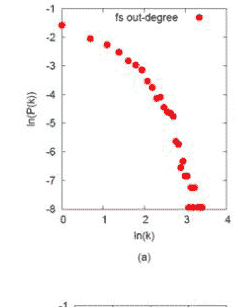

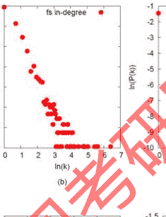

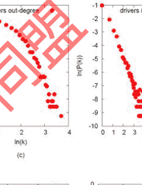

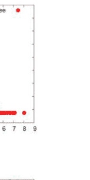

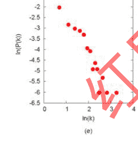

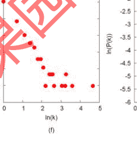

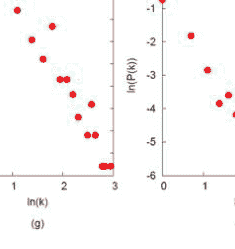

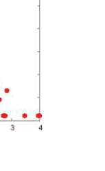

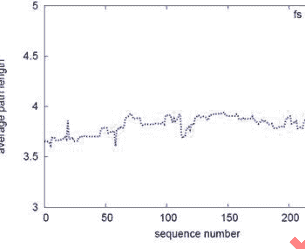

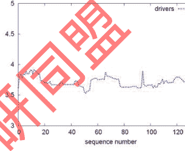

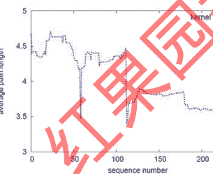

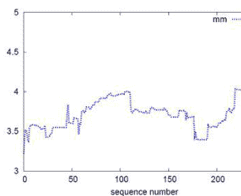

- 编译成可执行文件
- 用户告诉shell执行该可执行程序
- 创建一个新的子进程
  - 创建进程控制块
- 装入hello程序
  - 操作系统找到该程序，检查其类型
  - 检查程序首部，找出正文和数据的地址
  - 可执行文件映射到进程结构
  - 设置CPU上下文环境，并设置程序开始处
  - 调度hello程序
- 执行程序的第一条指令
  - 执行失败，缺页中断发生
  - 分配一页内存，并将代码从磁盘读入，继续执行
  - 更多的缺页中断，读入更多的页面

## 操作系统的工作

- 程序的执行
  - 负责启动每个程序，以及结束程序的工作
- 完成与硬件有关的工作
- 完成与应用无关的工作
  - 易于使用，基本服务，统一性
- 计算机系统的效率与安全问题

假如没有操作系统，怎样控制硬件？

### 例子：软盘I/O操作

- 控制芯片NEC PD765有16条命令
- 每一条命令向一个设备寄存器装入长度从1到9字节的特定数据（读写数据、移动磁头、格式化磁道，及初始化、检测状态、复位、校准控制器及设备等）
- 以READ为例：13个参数
  - 要读取的磁盘块地址、磁道的扇区数、物理介质的记录格式、扇区间隙、对已删除数据地址标识的处理方法
- 操作结束时，控制器芯片在7个字节中返回23个状态及出错字段
- 软盘程序员还要保持注意步进电机的开关状态


## 学习操作系统课的重要性

- 使用计算机必须要使用操作系统
  - 交互式
  - 编程、系统调用
- 操作系统的设计原理体现了硬件最新的发展
  - 计算机体系结构（巨型机、大型机、微机、工作站、多核、GPGPU等）
  - 程序设计方法（并发、面向对象、结构化）
  - 加深对使用的OS的理解，有利于深入编程
  - 编程时借鉴操作系统的设计思想和算法
  - 大型系统的设计
- 将来个人的发展

## 学习目标

- 对操作系统的基本概念、基本结构及运行环境有深入的认识；
- 系统级编程能力的提高
- 深入到操作系统内部，理解并掌握操作系统的基本原理、设计方法和实现技术
- 思维方式的学习，权衡（Trade Off），抽象
- 了解操作系统的演化过程、发展研究动向、新技术以及新思想

## 学习方法

- 按时上课，认真听讲，理解原理
- 阅读参考书，扩展视野
- 阅读代码，分析实例
- 上机实践
- 记笔记，思考，讨论，提问
- Learn OS concepts by coding them!

## 学习内容

- ACM Computing Curricula 2001 DRAFT (March 6, 2000)
  - Operating system principles
  - Concurrency
  - Scheduling and dispatch
  - Virtual memory
  - Device management
  - Security and protection
  - File systems and naming
  - Real-time systems

### ACM Computing Curricula 的变化

- 知识点进行了细化
- 增加了选修部分
- 去掉了通信、网络和分布式等内容

## 1. Brown University

- 课程名称：**CS167/CS169 Operating System**
- 授课教师：**Tom Doeppner**

### CS167 课程介绍

本课程讨论操作系统的基本原理

- 第一部分为基本概念：多线程设计和并发，动态存储、分配和释放，链接和装入，文件系统和虚存
- 第二部分为操作系统的当前设计概念：微内核和面向对象处理技术
- 最后部分是分布式系统：计算机网络通信协议，远程过程调用协议，计算机安全，并发管理，分布式文件和存储系统

### 实习项目

- shell，9月14日前完成
- 线程，10月5日前完成
- 线程应用，10月22日
- 虚拟文件系统，11月12日
- 文件系统，12月7日
- 基础系统：Weenix

### 评分依据

- 5个程序(40%)
- 家庭作业(20%)
- 期中考试(10%)
- 期末考试(30%)

### 特点

- **cs167** 为操作系统课堂授课，而 **cs169** 为操作系统课程实习
- 基本要求：独立思考、独立设计和独立编码
- 允许和其它学生探讨功课、教科书的内容和一般的高层概念
- 可以回答其它学生的有关设计任务中使用的软件包的问题，但问题必须是具体的，不对解决设计问题形成较大的帮助

## 2. Princeton University

- 课程名称：COS 318: Operating systems
- 授课教师：Vivek Pai

### 评分依据

- 阅读、讨论与练习：20%
- 中考：15%
- 项目：65%

### 教学

- 采用讲课与课堂中讨论结合的方式
- 教师提前提供阅读分配材料、讨论课题及练习
- 学生在上课之前先行阅读和思考讨论题
- 不参与得0分；1至3分为阅读、讨论题及练习的理解
- 两种方式表明理解：参加课堂讨论或在上课前交文章


## 合作政策

- 相信学生们可以互相学习。鼓励在项目中互相帮助
- 为了鼓励合作，学生有机会报告谁对您帮助最大
- 课程结束时，帮助别人的学生可获额外分数
- 开发有用的工具供他人在项目中使用可得额外分数，不过请先与 TAs 讨论想法
- 合作与欺骗之间有明确界线。复制他人的代码或设计是严格禁止的

## 特点：

- 讲课与课堂中讨论结合的方式
- 实习任务必须完成一个操作系统，而且是从引导程序开始
- 实习要求细致，严格
- 鼓励合作

- 操作系统与其它课程关系
  - 具备C语言程序设计的基础知识
  - 汇编语言
  - 编译技术
  - 计算机微机系统结构，尤其是中断、保护模式、分段、分页机制。

## 参考书

- “Applied Operating System Concepts”, Silberschatz.
- “Operating Systems Internals and Design Principles” William Stalling.
- “Operating Systems: Design and Implementation”, A. S. Tanenbaum, A. S. Woodhull.
- “Operating System Concepts”, Silberschatz and Galvin.
- “Modern Operating System”, A. S. Tanenbaum
- “Computer Organization & Design, The Hardware/Software Interface”, Hennessy, Patterson. 机械工业出版社。

- 平时30%（积极参加讨论加分5%）
- 考试70%
- 实验100%

## 实验环境

- MINIX
- Linux *
- Nachos
- Windows *
- 小操作系统 *

### Windows

- 命令解释程序
- Windows虚拟存储器管理
- 进程调度
- 文件系统
- WRK（可选）

### Linux

- Yalnix Shell
- 虚拟存储
- 作业控制系统
- 文件系统操作，或模拟文件系统

## 小操作系统实验的各个部分及相互关系

- 实验设计（六个实验都在MIPS仿真器上实现）
  - 启动和系统初始化
  - 内存管理
  - 进程管理和中断异常机制
  - 系统调用
  - 文件系统
  - 命令解释程序

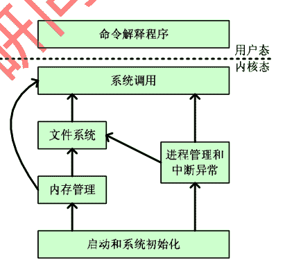

## 与硬件、应用程序的关系

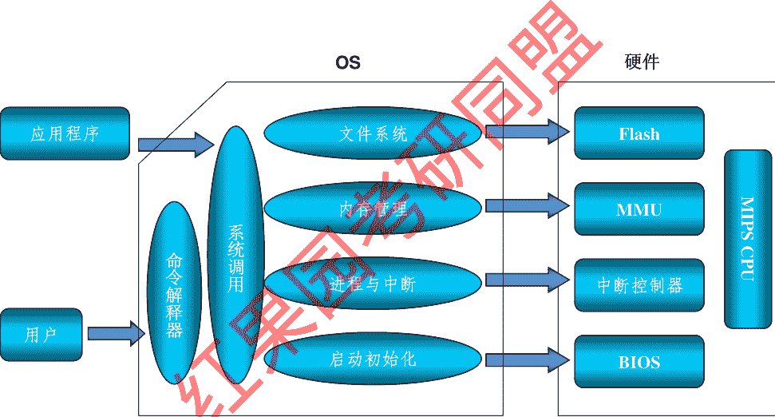

## 教学安排

- 操作系统实验分组进行，每组1人，一共50学时，在学院机房完成。
  - 李莹
  - 82317626
  - 上机时间、班级人数、节假日是否上机（参考校历）

## 考核方式和评分标准

操作系统实验需要提交实验文档、源代码和可执行程序，评分标准如下：

- 操作系统实验严禁抄袭，无论是不同小组之间还是与往届之间，一旦确认为抄袭作品记为零分。被抄袭的作品与抄袭作品的处理相同。
- 操作系统实验要求按时完成，晚一天提交作业，最后成绩减20%；晚两天提交作业，最后成绩减50%；两天后，不再接收作业，关闭FTP服务器。
- 小组成员人数少的组，每人完成的工作较多，所以如果质量相同人数少的小组得分应该高于人数多的组。
- 提交实验报告时，小组成员根据工作量进行排名（该排名作为最终成绩的依据）。
- 成绩为“优”的同学，必须通过评优答辩。
- 每次实验之前准备实验内容，并交给助教；实验抽查，三次不到的，无实验成绩。
- 实验程序与参考书相同，即为抄袭，取消当次实验成绩。
- 每个人必须掌握系统编程的基本技能，基本系统调用功能，程序编译、调试方法等。在实验中检查，不能掌握基本技能者，实验成绩不及格。

## 参考书

- 《操作系统实验指导手册》

- 实验报告
  - 总体结构
  - 每人工作
  - 谁对你的帮助最大
- 源程序
- 可执行程序
- 兴趣小组（可选）

## 操作系统引论

- 什么是操作系统
- 操作系统简史
- 计算机硬件简介
- 操作系统的基本类型
- 操作系统的特征和功能
- 操作系统结构
- 目前常用操作系统的介绍

## 操作系统

- 操作系统是计算机系统中的一个系统软件，是一些程序模块的集合
- 提供一个计算机用户与计算机硬件系统之间的接口，使计算机系统更易于使用。（使用者）
- 有效地控制和管理计算机系统中的各种硬件和软件资源，使之得到更有效的利用。（资源管理者）
- 合理地组织计算机系统的工作流程，以改善系统性能（如响应时间、系统吞吐量）。
- 虚拟机

有多少个操作系统？

## 操作系统层次

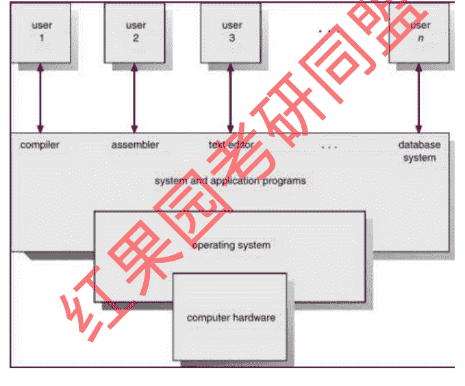

## 史前的计算

- 算盘
- Pascal: 1642年 法国数学家 十进制加法器（世上第一台真正的机械计算机）。
- Charles Babbage：1822年 英国数学家 研制成差分机模型, 研制分析机没成功。
- Zuse: 1941年 德国工程师 完成继电器式通用计算机Z-3。

## 算盘

算盘由珠、棍、架组成（硬件），口诀（软件）及操作反映了运算过程及结果

## 现代计算机奠基人

- Turing: 1936年一篇关于判定性问题的论文，提出了图灵机。ACE(Automatic Computing Engine).
- 冯·诺依曼：1945年3月，Von Neumann领导的小组发表了二进制的程序存储式的电子数字自动计算机EDVAC方案，1945年7月，Von Neumann等人又提出更为完善的设计报告，宣告了现代计算机结构思想的诞生。1951年EDVAC完成。
- J. Presper Eckert and William Mauchley

## 存储程序式计算机—Von Neumann机

- 程序：计算方案
- 存储器：存放程序和数据
- 运算器：执行指定操作
- 控制器：实现自动操作（顺序执行）
- I/O部件：输入原始数据和输出运算结果
- 顺序过程计算模型
- 集中顺序过程控制

## 操作系统的名称

- 监控系统（Monitor）
- 执行系统（程序）(Executive System (program))
- 控制系统（程序）(Control System program)
- 管理程序(Supervisor, Supervisory System)
- 核心程序(Kernel)
- 操作系统(Operating System)

## 操作系统简史

- 1946~1955年 电子管
- 1955~1965年 晶体管 & 监控系统
- 1965~1980年 集成电路 & 多道程序设计
- 1980~1990年 PC机 & 微机操作系统
- 1990~ 年 分布式与嵌入式系统

## CPU与人的矛盾

## 批处理技术

- 脱机输入技术
- 脱机输出技术
- 批处理技术：计算机系统对一批作业进行处理的技术。

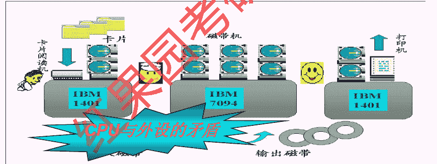

### 批处理系统

- 分类：
  - 单道批处理系统：无须作业调度和进程调度；内存仅有一道作业；顺序完成
  - 多道批处理系统：作业调度和进程调度；内存有多道作业；非顺序完成
  - 远程批处理系统
- 优点：
  - 系统吞吐量大
  - 资源利用率高
- 缺点：
  - 平均周转时间长
  - 不能提供交互作用能力


## 1965~1980年 集成电路 & 多道程序设计

- 多道程序设计技术
- OS/360开发失败，导致了软件工程的诞生，从另一个意义上说，它也有成功之处，改变了上一代操作系统的问 题，提出了多道程序设计(进程)、向下兼容的思想。商业上成功。
- 分时系统，CTSS、MULTICS、UNIX。

## System/360

- 需求
  - 多数厂商有几条完全不同的生产线，生产不同的计算机，开发和维护完全不同的产品，对于商来说是昂贵的
  - 新用户在开始时只需要一台小计算机，后来可能需要一台大的计算机，而且希望能在新计算机上执行原有的程序。这样，厂家和用户需要软件在不同型号的计算机之间兼容

- 1964 年 IBM 宣布推出 System/360 计算机系统
  - 是第一个采用规模集成电路的主流机型
  - 所有的计算机都有相同的体系结构和指令集
  - 在理论上，为一型号编写的程序可以在其他型号机器上运行

## 陷入泥潭的巨兽

- IBM无法写出同时满足互冲突需要的操作系统，其实别人也一样不能完成这项工作任务
- 数千名程序员写的数百万行汇编语言代码，系统自身占据了大量存储空间和一半的CPU时间
- 数百万行汇编代码中有成千上万处错误，IBM不断发行新的版本试图更正这些错误
- 每个新版本在更正老错误的同时又引入新错误，所以随着时间的流逝，错误的数量大致保持不变
- IBM 的 OS/360 发布时，带着已知的 1000 个错误


## 多道程序系统需要解决的问题

- 在一个连续的内存空间，同时驻留多道程序。
- 处理机的争夺
- I/O设备的分配
- 有效的组织不同程序的运行
- 系统对各种存储介质的管理

## “分时”的含义

分时是指多个用户分享使用同一台计算机。多个程序分时共享硬件和软件资源

- 多个用户分时
- 前台和后台程序（foreground & background）分时
- 时间片（time slice）

## 分时系统的特征

- 多路性：多路连接；宏观上用户共享，微观上分时；
- 独立性：用户相互不干扰；
- 及时性：响应时间；
- 交互性：人机对话。

## 影响响应时间的因素

- 系统开销
- 用户数目
- 时间片
- 对换信息量
- 采用可重入文件
- 引入虚存减少对换

## 1980~1990年 PC机 & 微机操作系统

- PC机
- MSDOS、 WINDOWS 95、 WINDOWS NT、 WINDOWS 2000
- 类UNIX(Linux, Freebsd等)。

|  | 1981 | 2006 | Factor |
|---|---:|---:|---:|
| CPU MHz,<br>Cycles/inst | 10<br>3–10 | 3200×4<br>0.25–0.5 | 1,280<br>6–40 |
| DRAM capacity | 128KB | 4GB | 32,768 |
| Disk capacity | 10MB | 1TB | 100,000 |
| Net bandwidth | 9600 b/s | 1 Gb/s | 110,000 |
| # addr bits | 16 | 32 | 2 |
| #users/machine | 10s | ≤ 1 | ≤ 0.1 |
| Price | $25,000 | $4,000 | 0.2 |

## 1990~ 年 分布式与嵌入式系统

- 工作站集群、工作站网络、网格、云
- 实时操作系统：Psos, VRTX, RTLinux, VxWorks

- 网络即操作系统
  - 功能分布于整个网络

可扩展、可靠、安全服务

移动、泛在系统

用于传感器网络的 MEMS

## 计算机硬件简介

- 硬件是基础，必须了解硬件。
- 但不必象硬件工程师那样，我们了解的是功能、接口和状态。

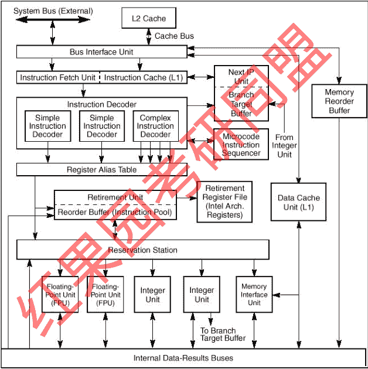

## Sparc

## Sparc 工作站图

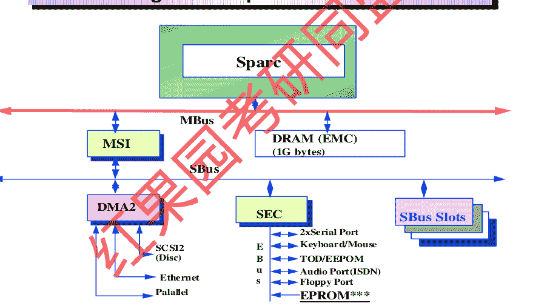

## 异常(exceptions)：陷阱(trap)和中断(interrupts)

- 中断是异步异常，可能随时发生，与处理器正在执行的内容无关。中断主要由I/O设备、处理器时钟或定时器产生，可以被启用或禁用。(Asynchronous Exceptions)
- 同步异常，它是某一特定指令执行的结果。在相同条件下，异常可以重现。例如内存访问错误、调试指令以及被零除。(Synchronous exceptions)
- 系统调用也视作同步异常，或trap。
- 软件和硬件都可以产生异常和中断。
- 陷阱(trap)帧：完整的线程描述表的子集，用于现场保护
- 陷阱处理程序处理少量事件，多数转交给其他的内核或执行体模块处理

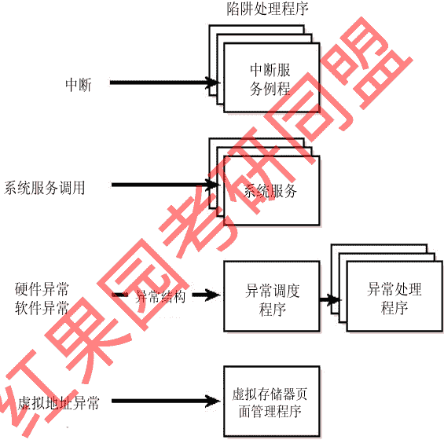

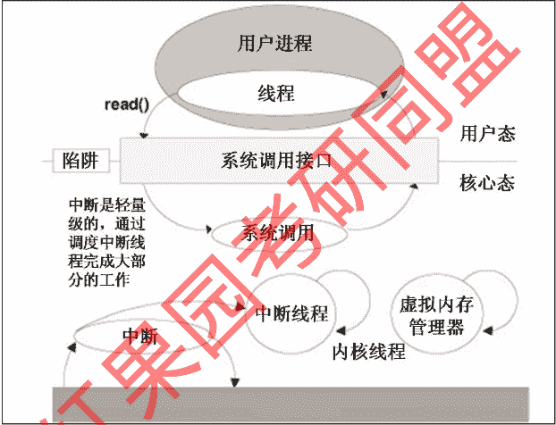

## 用户进程

线程

read()

用户态

系统调用接口

核心态

陷阱

中断是轻量级的，通过调度中断线程完成大部分的工作

系统调用

中断

中断线程

内核线程

虚拟内存管理器

## 系统调用 (1)

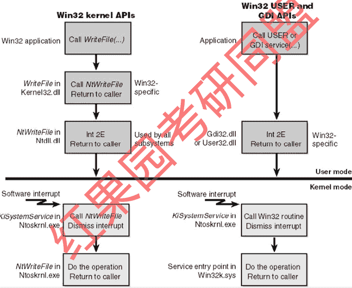

## 系统调用(2)

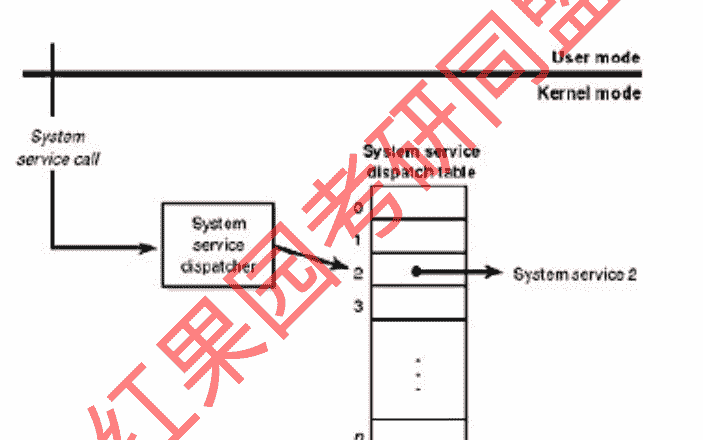

## 硬件中断处理过程

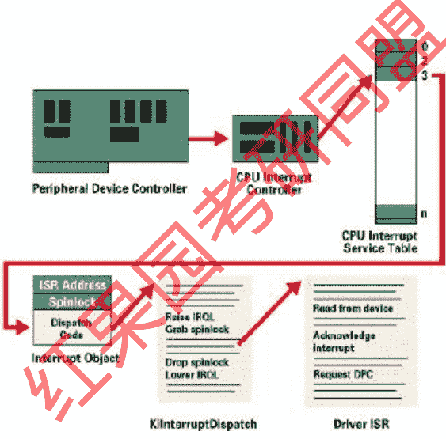

外设设备控制器

CPU 中断控制器

CPU 中断服务表

ISR 地址
自旋锁
调度
中断对象

提高 IRQL
获取自旋锁

释放自旋锁
降低 IRQL

从设备读取

确认中断

请求 DPC

KiInterruptDispatch

驱动 ISR

## 操作系统的基本类型

- 批处理系统
- 分时系统
- 实时系统
- 混合型

## 实时系统

- 嵌入式OS比桌上PC的OS相对简单，但由于各种嵌入式系统产品中包含各不相同的特殊需求，导致这类系统中使用的OS不下几百种，例如Windows CE、Palm OS、VxWorks、pSOS、QNX、PowerTV、OpenTV、JavaOS、LynxOS、Nucleus等等都是。而且至今仍有一半的开发者使用自行开发的OS。

## 操作系统的特征

- 并发
- 共享
  - 互斥共享（打印机、变量）
  - 同时访问（宏观）
- 虚拟
  - 多道程序中的 CPU
  - SPOOLING（外围设备同时联机操作）
  - 虚拟存储
- 不确定
  - 程序执行结果不确定
  - 多道程序中执行顺序不确定

## 处理机管理

- 进程（线程）控制；
- 进程（线程）同步；
- 进程通信；
- 进程（线程）调度。

## 存储器管理

- 任务：
  - 为多道程序的并发提供良好的环境
  - 便于用户使用存储器
  - 提高存储器利用率
  - 为尽量多的用户提供较大的存储空间
- 功能：
  - 内存分配：静态和动态分配。
  - 内存保护；
  - 地址影射；
  - 内存扩充。

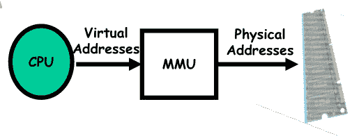


## 设备管理

- 任务：
  - 为用户程序分配 I/O 设备
  - 完成用户程序请求的 I/O 操作
  - 提高 CPU 和 I/O 设备的利用率；中断；通道。
  - 改善人机界面

- 功能：
  - 缓冲管理；
  - 设备分配；
  - 设备处理；
  - 虚拟设备功能。

## 文件系统

- 文件存储空间的管理；
- 目录管理；
- 文件读、写管理；
- 文件保护；
- 向用户提供接口。

## 作业控制

- 作业调度；
- 作业控制。
  - 批量型作业
  - 终端型作业

- 多处理机操作系统
- 网络操作系统
- 分布式操作系统

## 多处理机操作系统

- 多处理机结构
  - 紧密耦合；SMP
  - 松散耦合。
- 多处理机操作系统类型
  - 主-从式；
  - 独立管理程序系统；
  - 浮动式管理程序控制方式。

## 分布式操作系统基本特征

- 分布性
- 自治性
- 模块性
- 并行性

## 基本功能

- 资源管理
- 任务分配
- 分布式进程同步和通信
- 管理程序浮动

## 有序分层法

- 自底向上法、自顶向下法
- 层次设置原则
  - 调用关系
  - 与硬件的关系
  - 与虚存的关系
  - 可扩充性
- 调用方式
  - 只能调用直接下层
  - 可以调用所有下层
  - 可以部分调用下层。

## 层次结构的层间关系

第3层

第2层

第1层

第0层

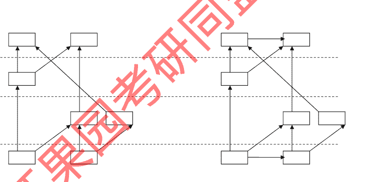

## 层次结构

- 层次结构设计方法的核心思想
- 例如E.W.Dijkstra的THE系统：

|  |  |
|---|---|
| 5 | 操作员 |
| 4 | 用户程序 |
| 3 | 输入/输出管理 |
| 2 | 操作员—进程通信 |
| 1 | 内存和磁盘管理 |
| 0 | 处理器分配和多道程序 |

## 虚拟机结构

- 如IBM大型机上的系列操作系统
- 基本思想：系统应该提供 1）多道程序能力 2）一个比裸机有更方便扩展界面的计算机。但是二者的实现应该相互独立
- 优缺点
  - 虚拟机概念可以实现完全保护
  - 用软件将硬件逐层扩展
  - 虚拟机方法把多道程序和扩充机器的功能完全分开了，使每一部分都简单、灵活，更易于维护。

若干个370虚拟机

系统调用陷入

CMS

CMS

CMS

I/O指令陷入

VM/370

370裸机

## 微内核结构

- 内核中只包括中断处理、进程通信（IPC）、基本调度等

- 文件系统、网络功能、内存管理、设备管理等作为服务在微内核上运行。

- 优点：
  - 内核易于实现、可移植性好、配置灵活、适应分布式环境（本地内核与远程内核对服务同样的支持）

- 缺点：
  - 速度较慢。（扩大内核减少切换；减少内核提高其他优点）

## 机制与策略分开

- 灵活
- 可扩展

## UNIX 系统结构

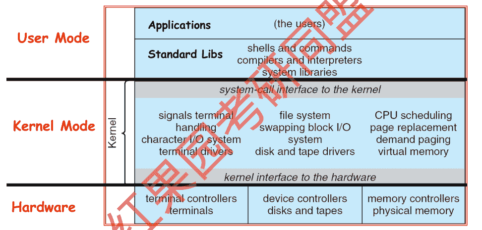

## 目前常用操作系统的介绍

- CP/M（Control Program Monitor）
- Windows操作系统
- UNIX操作系统
- Linux操作系统

## CP/M（Control Program Monitor）

- CP/M（Control Program Monitor）是1975年Digital Research公司推出的带有软盘系统的8位微机操作系统，配置在以Intel 8080、8085、Z80为芯片的微机上。

## UNIX操作系统

- UNIX系统在1969~70年有贝尔实验室开发，在PDP-7上运行。
- 于MULTICS项目的研究工作。MULTICS是一个误入歧途而又辉煌灿烂的计算系统。她提供了非常复杂的功能，同时消耗大量的计算资源。她太大而且太慢。

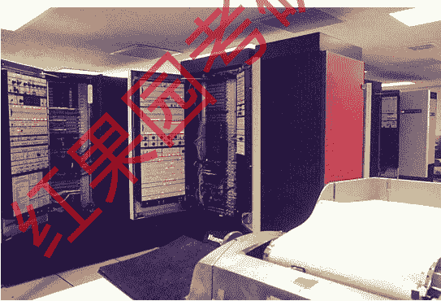


- "角落里闲置的 PDP-7"

- 1970年 UNIX 被移植到 PDP-11/20 上。那可不是一件轻而易举的事，整个系统全是用汇编写的！该系统的手册被标为 "First Edition"，日期为 1971年11月。

- 1973年，C语言加入了结构和全局变量。与此同时，Ken和Dennis成功地用C重写了UNIX核心。Shell也被重写了。
- 1974年，Ken和Dennis在Communications of the ACM上发表了论文介绍UNIX系统。
- Rudd Canaday领导的PWB小组支持一个用于大型软件开发的UNIX版本。PWB试图向那些并不对UNIX研究感兴趣的用户提供服务。他们做了大量的工作来强化了UNIX的核心，包括支持更多的用户。PWB的两个非常有用的计划分别是SCCS(源码控制系统)和RJE。
- 1975年，第六版UNIX系统发行了。这是第一个在贝尔实验室外广为流传的UNIX系统。

- Ferentz创办了一个称为UNIX News的实事通讯 (newsletter)的服务，免费为用户发送消息。后来贝尔告知他不能使用UNIX的名字，于是他把它改名为login。随着越来越多的人想要实事通讯的服务，Ferentz不堪负担提供这些服务了。于是创立一个组织来处理这些费用，它被称为USENIX。USENIX很快负担了其它的义务，包括组织会议和软件的分布。
- 1977年，Interactive Systems公司称为首家向最终用户出售UNIX的公司。UNIX终于成了产品。
- Dennis和Ken最大的突破在于他们清楚的认识到在效率和效用之间存在着折衷。

- 1977年，加利福尼亚伯克利分校开始发行他们的Pascal解释器。其中还包括了一些新的设备驱动程序，对核心的修改，ex编辑器，和一个比V6的Shell更好用的Shell。这就是1BSD(1st Berkeley Software Distribution)。
- 1979年UNIX的第七版发行了。Version 7包括了一个完整的K&R C编译器，
- Arpanet计划，BBN赋予UNIX使用DoD协议来通讯的能力。这些工作后来在伯克利得到改进并捆绑在伯克利的软件。
- 1979间Ken曾在伯克利教授操作系统。在他逗留期间他将UNIX移植到了PDP-11/70上，这是一台可以支持多用户的机器。

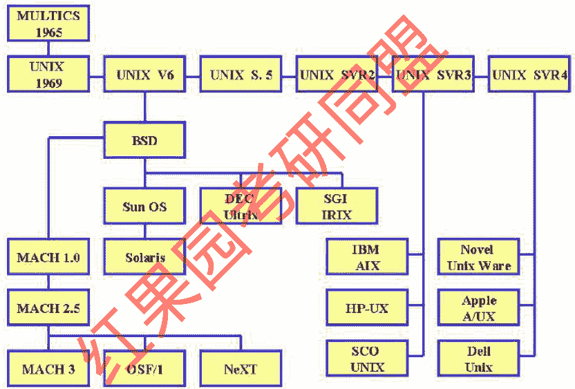

- "Life with UNIX(R) -- A Guide for Everyone"
  - Don Libes, Sandy Ressler
- "Unix Programming Environment"
  - Brian W. Kernighan, Rob Pike
- "The Design of the UNIX Operating System"
  - Maurice Bach
- "The Design and Implementation of the 4.4 BSD Operating System"
  - McKusick等

## Linux操作系统

- Linux是由Linus Torvalds于1991年开发的。
- 1991年9月，Linux 0.0.1，很不完善。
- 1991年10月，Linux 0.0.2，第一个“正式”版本。两周后0.0.3。
- 1991年12月，Linux 0.1.0，已经有许多人在上面工作了。
- 1994年3月，Linux 1.0


## GNU / LINUX

- GNU（GNU 不是 Unix）
- Linux 成为了一个操作系统。值得注意的是 Linux 并没有包括 Unix 源码。它是按照公开的 POSIX 标准重新编写的。Linux 大量使用了由麻省剑桥免费软件基金的 GNU 软件，同时 Linux 自身也是用它们构造而成。

## DOS操作系统

- 微软公司在1981年开发了 MS DOS1.0，4000行汇编语句，运行在 Intel 8086 上。后来 IBM 推出了带硬盘的 PC XT，
- 微软公司在1983年开发了 MS DOS2.0，2.0有了一些类 UNIX 的功能，例如 I/O 重定向。
- 在1984年 IBM 推出了包含80286的 PC AT，微软公司开发了 MS DOS3.0，但是 DOS 3.0 没有发挥出80286的优势。接着微软公司开发了 MS DOS3.1，支持共享文件、网络功能。在1987年推出了 DOS3.3 支持 IBM 推出了新型机 PS/2。

## Windows操作系统

- 在486、Pentium芯片问世后，DOS不能充分发挥硬件性能，因此从80年代初，微软开始开发 GUI。1990年推出了 WINDOWS 3.0，但需基于DOS上运行。1996年推出 Windows 95，后来的 Windows 98。
- IBM在1987年开发的 OS/2 在286保护模式下运行。在与 IBM 分道扬镳后，微软开发了 WINDOWS NT（单用户多任务）。
- 1993年推出了第一个版本的 WINDOWS NT3.1（WINDOWS 3.1风格）。NT4.0（WINDOWS 95）风格。现在的 Windows 2000 是合二为一的操作系统。

## 小结

- 什么是操作系统
- 操作系统的历史
- 操作系统的类型
- 操作系统的特征
- 操作系统的功能
- 操作系统的结构
- 常见的操作系统


## Linux 如何启动？

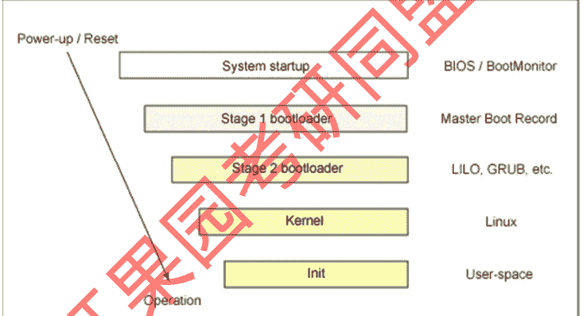

## 启动顺序

- 1. 打开电源
- 2. CPU 跳转到 BIOS 的地址（0xFFFF0）
- 3. BIOS 运行 POST（加电自检）
- 4. 查找可启动设备
- 5. 从 MBR 加载并执行引导扇区
- 6. 加载操作系统

## BIOS（基本输入/输出系统）

- BIOS 是指计算机首次通电时运行的软件代码。
- BIOS 的主要功能是嵌入在芯片中的代码程序，用于识别和控制组成计算机的各种设备。

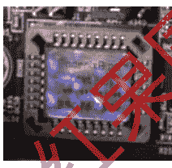

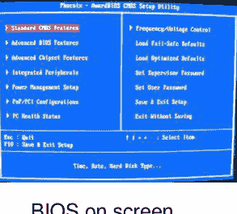

## 引导加载程序

## MBR（主引导记录）

- 操作系统从硬盘启动，主引导记录（MBR）包含主引导加载程序。
- MBR 是一个 512 字节的扇区，位于磁盘的第一个扇区（0 柱面，0 磁头的第 1 扇区）。
- 当 MBR 被加载到 RAM 后，BIOS 将控制权交给它。

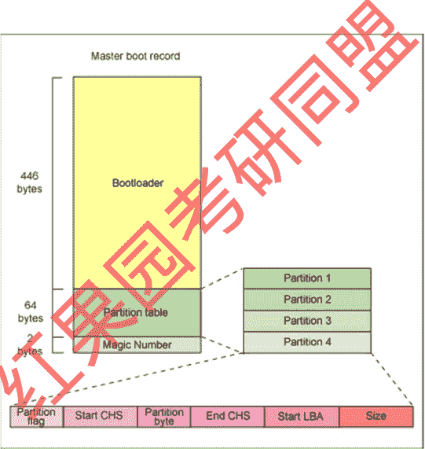

- 前 446 字节是主引导加载程序，包含可执行代码和错误信息文本。
- 接下来的 64 字节是分区表，包含四个分区中每个分区的记录。
- MBR 以两个字节结束，定义为魔数（0xAA55）。该魔数用作 MBR 的有效性检查。

## 提取 MBR

- 要查看 MBR 的内容，请使用以下命令：
- `# dd if=/dev/hda of=mbr.bin bs=512 count=1`
- `# od -xa mbr.bin`

dd 命令需要以 root 身份运行，它从 /dev/hda（第一个集成驱动电子设备，即 IDE 驱动器）读取前 512 个字节，并将其写入 mbr.bin 文件。

od 命令以十六进制和 ASCII 格式打印二进制文件。

## 引导加载程序

- 引导加载程序更恰当地说应称为内核加载程序。这一阶段的任务是加载 Linux 内核。
- 可选的初始 RAM 磁盘。
- GRUB 和 LILO 是最流行的 Linux 引导加载程序。

## 其他引导加载程序（多种操作系统）

- bootman
- GRUB
- LILO
- NTLDR
- XOSL
- BootX
- loadlin
- Gujin
- Boot Camp
- Syslinux
- GAG

## LILO：Linux 加载器

- 不依赖于特定的文件系统
- 可以从硬盘和软盘启动
- 最多支持 16 个不同的映像
- 当内核映像文件或配置文件发生变化时，必须更新 LILO

## 内核的任务

- 进程管理
- 内存管理
- 设备管理
- 系统调用

## Linux 内核启动的主要功能流程

| 功能 | 文件 |
|---|---|
| start () | ./arch/i386/boot/head.S |
| startup_32 () | ./arch/i386/boot/compress/head.S |
| decompress_kernel() | ./arch/i386/boot/compress/misc.c |
| startup_32 () | ./arch/i386/kernel/head.S |
| start_kernel () | ./init/main.c |
| cpu_idle () | ./init/main.c |


## bootsect.S :装载系统启动过程并设置系统启动过程的相关参数.
- bootsect.S :装载系统启动过程并设置系统启动过程的相关参数.
- setup.S  :初始化系统及硬件,并切换至保护模式.
- video.S  :初始化显示设备.

| 新参数表区域 |
| 堆栈段 |
| 设置段 |
| 启动段 （在bootsect执行完毕后作为BIOS的系统数据存储区） |
| 系统区域 |
| 旧启动段 |
| 参数表地址 |

## Bootsect.s

- boot过程首先将自身从原始启动区 0x7c00—0x7dff 移至 0x90000—0x901ff,并跳至下一条指令(jmpi go,INITSEG,其中INITSEG=0x9000).
- 设置堆栈(栈基址9000:3ff4),并设置新的磁盘参数表(第一个可用磁盘),把其中的每磁道扇区数设为36(byte 9000:3ff8),这也是以后一次可读的最大扇区数。
- 重置软盘,并从启动盘读4个扇区到9000:0200(即setup区的头4个扇区).接着测试磁盘的每磁道扇区数(对软盘启动时尤其如此)。
- 装载核心系统于0x10000处(若是big kernel,则调用setup.s 中的 bootsect_helper).

## setup流程

- setup过程首先重置磁盘,检查setup区标志(0xAA55,0x5A5A),若没有则表明setup区大于4个扇区.从system区装载其余扇区到setup区后直至结束,若最后一个扇区没有此标志,则错误.
- 检查是否大内核（big kernel）,若是则还要检查装载程序（Loader）,老的装载程序不能装载大内核.
- 获取内存大小(主要是扩展内存放在9000:01e0),(接着往9000:0002存放由ah=0x88,int 15返回的ax值),设置最大击键速度,检查显卡并获取相应参数(调用video过程,在video.S中),存放区9000:0000--9000:0017.
- 获取hd0的数据,存至9000:0080--9000:0090.获取hd1的数据,存至9000:0090--9000:00A0.再检查hd1是否存在,若不,该区域清零.
- 检查是否有PS/2鼠标,若有,9000:01ff置0xaa.检查是否APM_BIOS,其相关参数存于9000:0064--9000:0080区.
- 检查是否有定义的实模式切换过程,否则,使用缺省的过程.然后如果不是大内核 (为压缩内核),则将system移至0100:0000处.
- 检查当前代码是否在9020:0000处,否则,需恢复setup区 (反向移动以避免破坏目前正执行代码).然后把命令行 (commandline) 512B移至9020:0000,覆盖当前的一部分代码区.
- 装载中断描述表和全局描述表,A20地址线使能,并初始化协处理器及8259外围中断发生器.
- 跳至kernel执行(80x386可通过使用前缀0x66能在16 bit地址下跳至32位代码). 至此,实模式下初始化基本结束,可以放心切换至保护模式.

## 保护模式

- setup在把系统核心从start_sys_seg移到0x1000后，装载了在初入保护模式下的GDT和IDT,且GDT设定的系统区基地址为0x00000000，G值为1，即段以页（4KB）为单位长度。
- 然后，使用指令lmsw改变CR0寄存器的低四位为0001，即任务切换，模拟浮点运算和数学运算关闭（TS=0，EM=0，MP=0），保护模式打开（PE=1）。由于CR0的PG位未打开，分页机制未启动，线性地址即物理地址。
- 最后，在当前模式下使用绝对地址跳转至系统核心0x1000处。

## head.s

- 即目前系统核心的开始处。它在一获得控制权即装载数据段的选择符（0x18），设置新堆栈 `start_stack`（位于核心中，在 `compress/misc.c` 中定义），为下面的指令作准备。
- 接着，检查地址线A20是否真的正确打开（循环），重置NT位，初始化BSS区。
- 然后，调用 `decompress_kernel` 对 kernel 进行解压后送入物理地址0x100000处。

## /boot/kernel/head.s

- head.s即位于解压后的核心开始处0x100000。它在开始做了与前一个head.s相似的初始化动作：更新数据段寄存器，清BSS区，但接着调用setup_idt建立新的IDT表，然后检查NT位。
- 其后head开始将实模式下得到的系统数据从0x90000——0x907FF和命令行参数区0x90800——0x91000移到0x105000——0x105FFF区中。实际上该区是首先定义的页之一：empty_zero_page页。（关于这一部分的详细介绍参见：页面初始化分析）
- 然后是checkCPUtype过程。
- 其后，head.s检查协处理器的有效并设置标志（call check_x87）。建立初始化时期的4MB页面空间（call setup_paging，其分析见：页面初始化分析）。
- 最后的任务是为下一步的过程建立堆栈数据，并跳转至start_kernel进行核心系统的引导。

## init process

- 内核首先执行的程序是 init 程序
- Init 是 Linux 上所有进程执行的根/父进程
- init 启动的第一个进程是一个脚本  
  `/etc/rc.d/rc.sysinit`

## The Linux Init Processes

- init 进程的进程 ID 为 "1"
- Init 负责根据 /etc/inittab 文件定义启动系统进程
- Init 通常会启动多个 "getty" 实例，等待控制台登录，从而生成用户的 shell 进程
- 在关机时，init 控制关机顺序和进程

## System processes

| Process ID | Description |
|------------|-------------|
| 0 | 调度器 |
| 1 | init 进程 |
| 2 | kflushd |
| 3 | kupdate |
| 4 | kpiod |
| 5 | kswapd |
| 6 | mdrecoveryd |

## Initab file

- inittab 文件描述了启动时和正常运行期间启动哪些进程
  - `/etc/init.d/boot`
  - `/etc/init.d/rc`
- 计算机将根据 /etc/inittab 文件中 initdefault 指令定义的运行级别启动
  - `id:5:initdefault:`

## Runlevels

- 运行级别是系统的软件配置，仅允许选定的进程组存在
- **init** 为每个运行级别生成的进程在 /etc/inittab 文件中定义
- Init 可以处于八个运行级别之一：0-6


## 运行级别

| 运行级别 | 脚本目录<br>(Red Hat/Fedora Core) | 状态 |
|---|---|---|
| 0 | /etc/rc.d/rc0.d/ | shutdown/halt system |
| 1 | /etc/rc.d/rc1.d/ | Single user mode |
| 2 | /etc/rc.d/rc2.d/ | Multiuser with no network services exported |
| 3 | /etc/rc.d/rc3.d/ | Default text/console only start. Full multiuser |
| 4 | /etc/rc.d/rc4.d/ | Reserved for local use. Also X-windows (Slackware/BSD) |
| 5 | /etc/rc.d/rc5.d/ | XDM X-windows GUI mode (Red Hat/System V) |
| 6 | /etc/rc.d/rc6.d/ | Reboot |
| s or S |  | Single user/Maintenance mode (Slackware) |
| M |  | Multiuser mode (Slackware) |

## rc#.d 文件

- rc#.d 文件是给定运行级别在启动和关闭期间运行的脚本
- 脚本位于目录 /etc/rc.d/rc#.d/ 中，其中符号 # 代表运行级别

## 启动/停止守护进程

- 管理员可以发出命令并使用 start、stop、status、restart 或 reload 选项
- 例如，要停止 Web 服务器：
  - cd /etc/rc.d/init.d/
  - (or /etc/init.d/ for SuSE and Debian)
  - httpd stop

## Linux 文件结构

http://www.secguru.com/files/linux_file_structure


## FSSTND: (Filesystem standard)

- 所有目录都分组在根目录 "/" 下
- root - root 用户的主目录
- home - 包含用户的主目录以及服务的目录
  - ftp
  - HTTP
  - samba
- **bin** - 启动期间需要的命令，普通用户也可能需要
- **sbin** - 类似 bin 但命令不打算供普通用户使用。由 Linux 运行的命令。
- **proc** - 此文件系统不在磁盘上。它是一个虚拟文件系统，存在于内核的想象中，即内存
  - 1 - 包含有关进程号 1 的信息的目录。每个进程在 proc 下都有一个目录。
- **boot** - 由引导加载程序使用的文件，LILO，内核映像通常保存在这里。
- **lib** - 根文件系统上程序所需的共享库
- **modules** - 可加载的内核模块，尤其是在灾难后启动系统所需的模块。
- **dev** - 设备文件
- **etc** - 特定于机器的配置文件。
- **skel** - 创建主目录时，它会使用此目录中的文件进行初始化
- **sysconfig** - 配置 Linux 系统以用于设备的<|message|>
- **var** - 包含邮件、新闻、打印机日志文件、man 页面、临时文件等会更改的文件
  - file
  - **lib** - 系统正常运行时会更改的文件
  - **local** - 安装在 `/usr/local` 中的程序的可变数据。
  - **lock** - 锁文件。由程序使用以指示它正在使用特定设备或文件
  - **log** - 来自 login 和 syslog 等程序的日志文件，它们记录所有登录和注销。
  - **run** - 包含有关系统直到下次启动前有效的信息的文件。
  - **spool** - 邮件、打印机 spool、新闻和其他 spool 工作用的目录。
  - **tmp** - 临时文件，它们很大或需要在 `/tmp` 中存在的时间更长。
  - **catman** - 按需格式化的 man 页面的缓存。
- mnt - 系统管理员临时挂载的挂载点。
- tmp - 临时文件。启动后运行的程序应使用 /var/tmp

## 远程启动

- 客户端在启动前，既无操作系统，又无启动的软盘或者硬盘，它只有计算机的基本部件：CPU、内存、主板等。但必须有网卡和启动的 Boot ROM。因此客户机只能通过网络获得操作系统。Linux 的远程启动基于标准的 BOOTP/DHCP 和 TFTP 协议，并通过 NFS 文件系统建立文件系统。
- 客户端开机后，在 Boot ROM 获得控制权之前先做自我测试（BIOS 自检）。
- Boot ROM 送出 BOOTP/DHCP 要求而取得 IP。
- 如果服务器收到客户端所送出的要求，就会送回 BOOTP/DHCP 回应，内容包括 IP 地址、预设网关及开机镜像文件。
- Boot ROM 由 TFTP 通讯协议从服务器下载开机镜像文件。


- 客户端通过这个开机映像文件开机，这个开机文件可以只是单纯的开机程序，也可以是操作系统。
- 开机映像文件将包含内核加载器及压缩过的内核，此内核将支持 NFS 根文件系统。
- 远程客户端根据下载的文件启动机器。

## 计算机操作系统

教师：王雷

助教：王振 赵玉龙 王宇 王鲁俊

82316284，wanglei@buaa.edu.cn，http://219.224.165.31

### 存储器的管理

- 存储分配：主要是讨论和解决多道作业之间共享主存的存储空间的问题。
- 存储器资源的组织（如内存的组织方式）
- 地址变换（逻辑地址与物理地址的对应关系维护）
- 虚拟存储的调度算法

### 存储层次结构

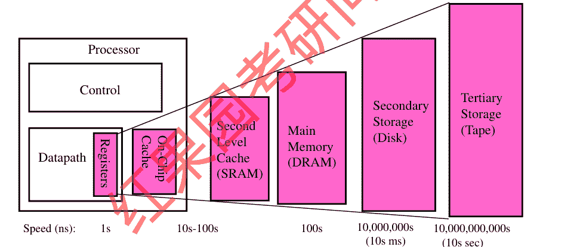

### 处理器与DRAM存储器的性能差距（延迟）

```
Performance

Time

"Moore's Law"
(really Joy's Law)

"Less Law?"

Processor-Memory Performance Gap:
(grows 50% / year)

μProc
CPU
60%/yr.
(2X/1.5yr)

DRAM
9%/yr.
DRAM (2X/10 yrs)

1980 1981 1982 1983 1984 1985 1986 1987 1988 1989 1990 1991 1992 1993 1994 1995 1996 1997 1998 1999 2000
```

### 为什么进行存储管理

- 重要的资源
- 帕金森定律(Parkinson):
  - 存储器有多大，程序有多长。

### 存储管理的功能

- 存储分配和回收：是存储管理的主要内容。讨论其算法和相应的数据结构。
- 地址变换：可执行文件生成中的链接技术、程序加载时的重定位技术，进程运行时硬件和软件的地址变换技术和机构。
- 存储共享和保护：代码和数据共享，对地址空间的访问权限（读、写、执行）。
- 存储器扩充：它涉及存储器的逻辑组织和物理组织；
  - 由应用程序控制：覆盖；
  - 由OS控制：交换（整个进程空间），请求调入和预调入（部分进程空间）

### 程序的装入和链接

- 编译
- 链接
- 装入

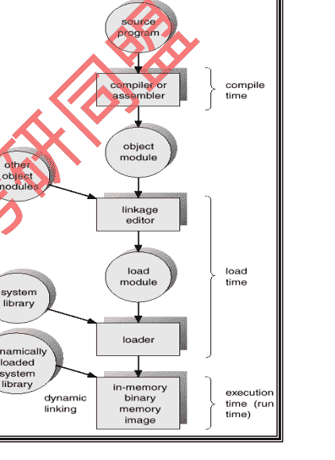

1. 地址空间：源程序经过编译后得到的目标程序，存在于它所限定的地址范围内，这个范围称为地址空间。简言之，地址空间是逻辑地址的集合。

2. 存储空间：存储空间是指主存中一系列存储信息的物理单元的集合，这些单元的编号称为物理地址或绝对地址。换言之，存储空间是物理地址的集合。

### 作业J存在于不同的空间中

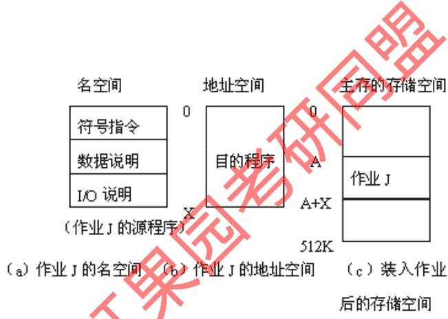

### 作业由地址空间装入存储空间

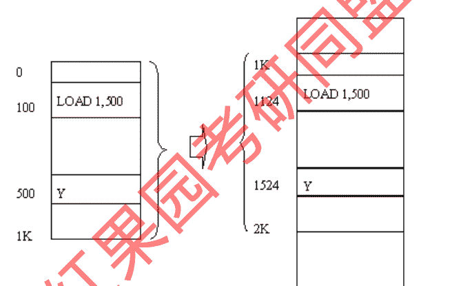

### 重定位

在装入时对目标程序中的指令和数据地址的修改，或映射过程。

- 静态重定位
- 动态重定位

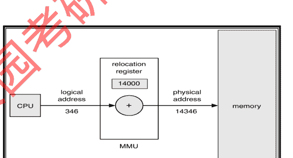

### 存储分配的三种方式

1. 直接指定方式：程序员在编程序时，或编译程序(汇编程序)对源程序进行编译(汇编)时，所用的是实际地址。
2. 静态分配(Static Allocation)：程序员编程时，或由编译程序产生的目的程序，均可从其地址空间的零地址开始；当装配程序对其进行连接装入时才确定它们在主存中的地址。
3. 动态分配(Dynamic Allocation)：作业在存储空间中的位置，在其装入时确定，在其执行过程中可根据需要申请附加的存储空间，而且一个作业已占用的部分区域不再需要时，可以要求归还给系统。

### 连续分配存储管理方式

- 单一连续分配方式
- 分区分配方式
  - 固定分区
  - 动态分区

### 单一连续区存储管理

- 内存分为两个区域：系统区，用户区。应用程序装入到用户区，可使用用户区全部空间。
- 最简单，适用于单用户、单任务的OS。CP/M和DOS
- 优点：易于管理。
- 缺点：对要求内存空间少的程序，造成内存浪费；程序全部装入，很少使用的程序部分也占用内存。

```
0xFFF ...

User program

Operating system in RAM

0

(a)

Operating system in ROM

User program

0

(b)

Device drivers in ROM

User program

Operating system in RAM

0

(c)
```

### 多用户系统存储器管理----分区式分配

- 把内存分为一些大小相等或不等的分区(partition)，每个应用程序占用一个或几个分区。操作系统占用其中一个分区。
- 适用于多道程序系统和分时系统，支持多个程序并发执行，但难以进行内存分区的共享。

### 固定式分区

固定式分区（静态存储区域）：当系统初始化时，把存储空间划分成若干个任意大小的区域；然后，把这些区域分配给每个用户作业。

| 分区号 | 大小 | 起址 | 状态 |
| --- | --- | --- | --- |
| 1 | 12K | 20K | 已分配 |
| 2 | 32K | 32K | 已分配 |
| 3 | 64K | 64K | 已分配 |
| 4 | 128K | 128K | 未分配 |

分区说明表

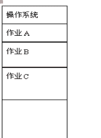

- 把内存划分为若干个固定大小的连续分区。
  - 分区大小相等：只适合于多个相同程序的并发执行（处理多个类型相同的对象）。
  - 分区大小不等：多个小分区、适量的中等分区、少量的大分区。根据程序的大小，分配当前空闲的、适当大小的分区。
- 优点：易于实现，开销小。
- 缺点：内碎片造成浪费，分区总数固定，限制了并发执行的程序数目。
- 采用的数据结构：分区表——记录分区的大小和使用情况

### 可变式分区：

- 可变式分区：分区的边界可以移动，即分区的大小可变。
- 优点：没有内碎片。缺点：有外碎片。

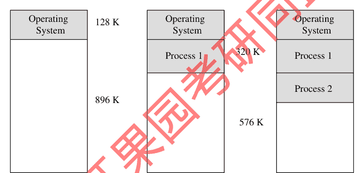

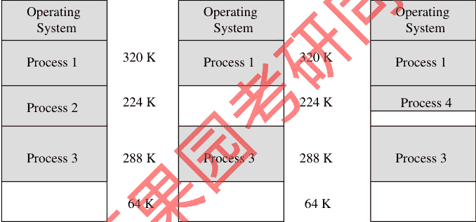

北京航空航天大学

计算机学院

王雷

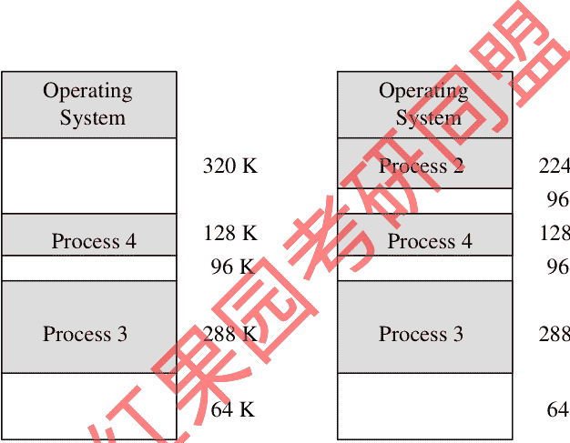

### 动态分区的操作和数据结构

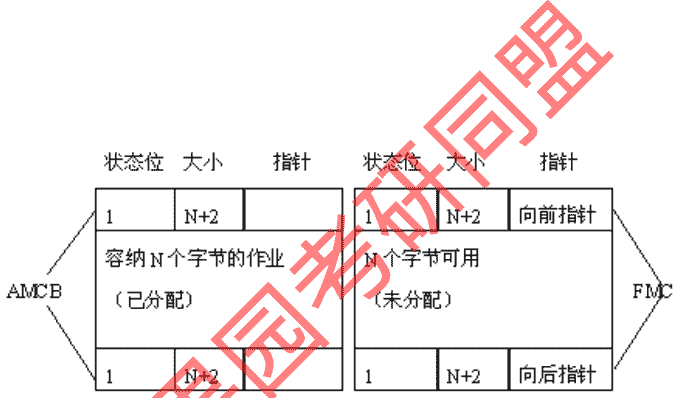

### 可变式分区的分配策略：

1. 最佳适应算法（Best Fit）：为一个作业选择分区时，总是寻找其大小最接近于作业所要求的存储区域。
2. 最坏适应算法（Worst Fit）：为作业选择存储区域时，总是寻找最大的空白区。
3. 首次适应算法（First Fit）：每个空白区按其在存储空间中地址递增的顺序连在一起，在为作业分配存储区域时，从这个空白区域链的始端开始查找，选择第一个足以满足请求的空白块。
4. 下次适应算法（Next Fit）：把存储空间中空白区构成一个循环链，每次为存储请求查找合适的分区时，总是从上次查找结束的地方开始，只要找到一个足够大的空白区，就将它划分后分配出去。

### 可重定位分区分配

可重定位分区分配：定时的或在内存紧张时，移动某些已分配区中的信息，把存储空间中所有的空白区合并为一个大的连续区。

|  | 紧凑前 |
| --- | --- |
| 0 | 操作系统 |
| 20K | 作业 1 (18K) |
|  | 12K |
|  | 作业 3 (24K) |
|  | 16K |
|  | 作业 4 (46K) |
|  | 10K |
|  | 作业 2 (40K) |
|  | 12K |
|  | 作业 5 (50K) |
| 256K | 8K |

|  | 紧凑后 |
| --- | --- |
| 0 | 操作系统 |
| 20K | 作业 1 |
|  | 作业 3 |
|  | 作业 4 |
|  | 作业 2 |
|  | 作业 5 |
| 198K | 空白区 58K |
| 256K |  |


## 多重分区分配

▪ 多重分区分配：一个作业往往由相互独立的程序段和数据段组成，将这些片断分别装入存储空间中不同的区域内的分配方式。

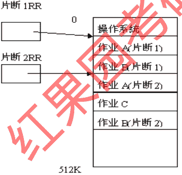

## 覆盖

+   - 覆盖：“覆盖”管理，就是把一个大的程序划分成一系列的覆盖，每个覆盖是一个相对独立的程序单位。把程序执行时并不要求同时装入主存的覆盖组成一组，称其为覆盖段，这个覆盖段被分配到同一个存储区域。这个存储区域称之为覆盖区，它与覆盖段一一对应。
+   - 缺点：编程时必须划分程序模块和确定程序模块之间的覆盖关系，增加编程复杂度。从外存装入覆盖文件，以时间延长来换取空间节省。

## 覆盖管理

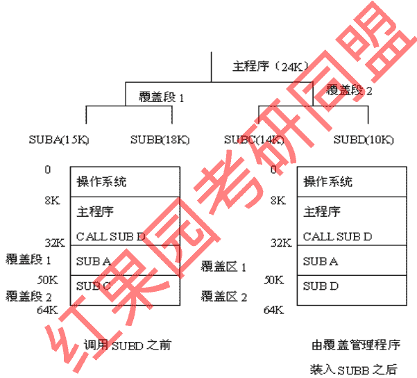

主程序（24K）

覆盖段1

覆盖段2

SUBA（5K）

SUBB（18K）

SUBC（14K）

SUBD（10K）

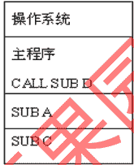

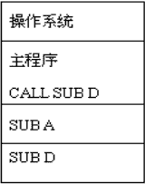

调入 SUBD 之前

由覆盖管理程序
装入 SUBB 之后

## 交换

+   - 交换：广义的说，所谓交换就是把暂时不用的某个（或某些）程序及其数据的部分或全部从主存移到辅存中去，以便腾出必要的存储空间；接着把指定程序或数据从辅存读到相应的主存中，并将控制转给它，让其在系统上运行。
+   - 优点：增加并发运行的程序数目，并且给用户提供适当的响应时间；编写程序时不影响程序结构
+   - 缺点：对换入和换出的控制增加处理机开销；程序整个地址空间都进行传送，没有考虑执行过程中地址访问的统计特性。

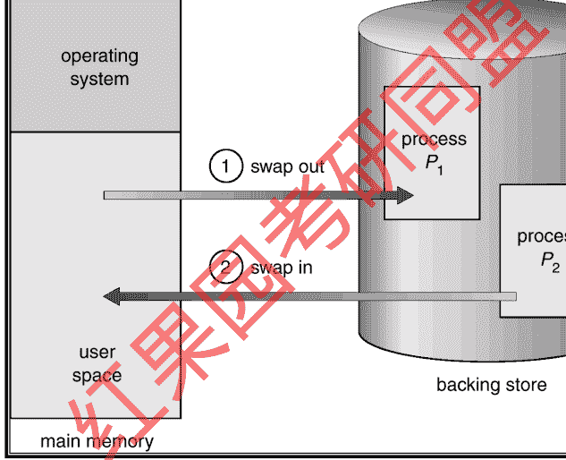

## 交换技术的几个问题

+   - 选择原则，即将哪个进程换出/内存？
+     - 等待I/O的进程
+   - 交换时机的确定，何时需发生交换？
+     - 只要不用就换出（很少再用）；只在内存空间不够或有不够的危险时换出
+   - 交换时需要做哪些工作？
+   - 换入回内存位置的确定

## 分页式存储管理

+   - 碎片和紧凑问题
+   - 页：在分页存储管理系统中，把每个作业的地址空间分成一些大小相等的片，称之为页面或页。
+   - 存储块：在分页存储管理系统中，把主存的存储空间也分成与页面相同大小的片，这些片称为存储块，或称为页框。

| 页号 P | 位移量 W |

## 分页系统的地址结构

## 纯分页系统（Pure Paging System）

+   - 在调度一个作业时，必须把它的所有页一次装到主存的页框内；如果当时页框数不足，则该作业必须等待，系统再调度另外作业。
+   - 优点：
+     - 没有外碎片，每个内碎片不超过页大小。
+     - 一个程序不必连续存放。便于改变程序占用空间的大小（主要指随着程序运行而动态生成的数据增多，要求地址空间相应增长，通常由系统调用完成而不是操作系统自动完成）。
+   - 缺点：程序全部装入内存。

Frame
Number

|  |  |
|---|---|
| 0 |  |
| 1 |  |
| 2 |  |
| 3 |  |
| 4 |  |
| 5 |  |
| 6 |  |
| 7 |  |
| 8 |  |
| 9 |  |
| 10 |  |
| 11 |  |
| 12 |  |
| 13 |  |
| 14 |  |

|  |  |
|---|---|
| 0 | A.0 |
| 1 | A.1 |
| 2 | A.2 |
| 3 | A.3 |
| 4 |  |
| 5 |  |
| 6 |  |
| 7 |  |
| 8 |  |
| 9 |  |
| 10 |  |
| 11 |  |
| 12 |  |
| 13 |  |
| 14 |  |

|  |  |
|---|---|
| 0 | A.0 |
| 1 | A.1 |
| 2 | A.2 |
| 3 | A.3 |
| 4 | B.0 |
| 5 | B.1 |
| 6 | B.2 |
| 7 |  |
| 8 |  |
| 9 |  |
| 10 |  |
| 11 |  |
| 12 |  |
| 13 |  |
| 14 |  |

| Index | Value |
|---|---|
|0|A.0|
|1|A.1|
|2|A.2|
|3|A.3|
|4|B.0|
|5|B.1|
|6|B.2|
|7|C.0|
|8|C.1|
|9|C.2|
|10|C.3|
|11| |
|12| |
|13| |
|14| |

| Index | Value |
|---|---|
|0|A.0|
|1|A.1|
|2|A.2|
|3|A.3|
|4| |
|5| |
|6| |
|7|C.0|
|8|C.1|
|9|C.2|
|10|C.3|
|11| |
|12| |
|13| |
|14| |

| Index | Value |
|---|---|
|0|A.0|
|1|A.1|
|2|A.2|
|3|A.3|
|4|D.0|
|5|D.1|
|6|D.2|
|7|C.0|
|8|C.1|
|9|C.2|
|10|C.3|
|11|D.3|
|12|D.4|
|13| |
|14| |

## 数据结构

+   - **进程页表**：每个进程有一个页表，描述该进程占用的物理页面及逻辑排列顺序。
+     - 逻辑页号（本进程的地址空间）→物理页号（实际内存空间）；

+   - **物理页面表**：整个系统有一个物理页面表，描述物理内存空间的分配使用状况。
+     - 数据结构：位示图、空闲页面链表；

+   - **请求表**：整个系统有一个请求表，描述系统内各个进程页表的位置和大小，用于地址转换，也可以结合到各进程的PCB里；

## 页表 (page table)

| 页号 | 页框号 |
|---:|---:|
| 0 | 0 |
| 1 | 1 |
| 2 | 2 |
| 3 | 3 |

Process A

| 页号 | 页框号 |
|---:|:---:|
| 0 | --- |
| 1 | --- |
| 2 | --- |

Process B

| 页号 | 页框号 |
|---:|---:|
| 0 | 7 |
| 1 | 8 |
| 2 | 9 |
| 3 | 10 |

Process C

| 页号 | 页框号 |
|---:|---:|
| 0 | 4 |
| 1 | 5 |
| 2 | 6 |
| 3 | 11 |
| 4 | 12 |

Process D

| 页框号 |
|---:|
| 13 |
| 14 |

Free Frame List

logical memory
page 0
page 1
page 2
page 3
page table
0 1
1 4
2 3
3 7
frame number
0
1 page 0
2
3 page 2
4 page 1
5
6
7 page 3
physical memory

logical memory
0 a
1 b
2 c
3 d
4 e
5 f
6 g
7 h
8 i
9 j
10 k
11 l
12 m
13 n
14 o
15 p
page table
0 5
1 6
2 1
3 2
physical memory
0
4 i j k l
8 m n o p
12
16
20 a b c d
24 e f g h
28

## 地址变换

控制寄存器
页表长度 页表地址
有效地址
2 1C4
页号 页面号
0 2
1 3
2 8
物理地址
8 1C4

## 具有 16 个 4 KB 页面的 MMU 的内部操作

Outgoing physical address (24580)

12-bit offset copied directly from input to output

Page table

Present/absent bit

Virtual page = 2 is used as an index into the page table

Incoming virtual address (8196)

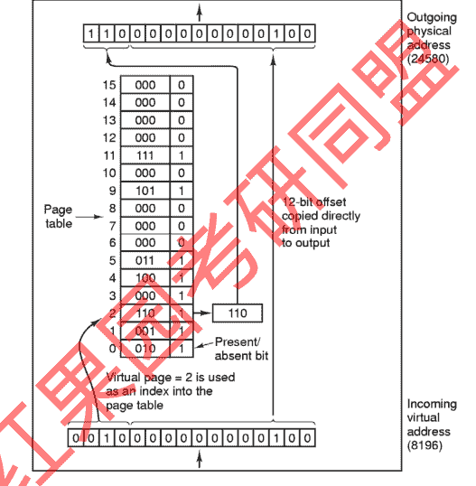

## 页面大小

+   - 与体系结构相关
+   - 2ⁿ
+   - 通常是：几KB到几MB。  
+     - 小一>内碎片小；大一>页表短，管理开销小，交换时对外存I/O效率高。  
+     - 和目前计算机的物理内存大小。

## 两级页表

+   - 32位
+   - 4K页面大小
+   - 4M页表
+   - 10 10 12

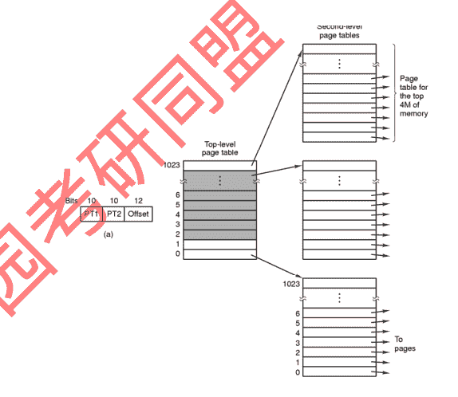


## 多级页表

- 节约内存
- 为缩短查找时间，多级页表中的每级都可以装入到快表（即页表的高速缓存）中，并按照 cache的原理进行更新。
- 多级页表结构中，指令所给出的地址除偏移地址之外的各部分全是各级页表的页表号或页号，而各级页表中记录的全是物理页号，指向下级页表或真正的被访问页。

进程页表首地址

Virtual Address

Real Address

## 快表（TLB）

- 页表项的高速缓存

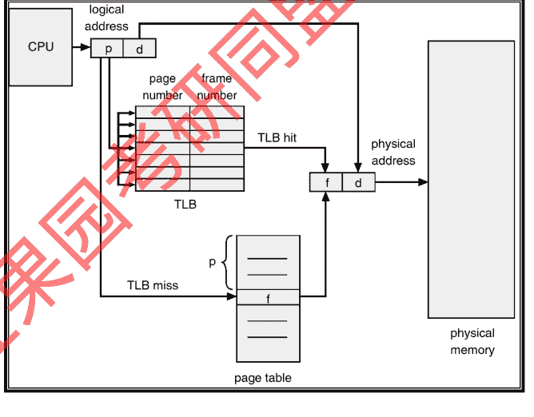

| Valid | Virtual page | Modified | Protection | Page frame |
| --- | --- | --- | --- | --- |
| 1 | 140 | 1 | RW | 31 |
| 1 | 20 | 0 | R X | 38 |
| 1 | 130 | 1 | RW | 29 |
| 1 | 129 | 1 | RW | 62 |
| 1 | 19 | 0 | R X | 50 |
| 1 | 21 | 0 | R X | 45 |
| 1 | 860 | 1 | RW | 14 |
| 1 | 861 | 1 | RW | 75 |

|  | 2-way |  | 4-way |  | 8-way |  |
| Size | LRU | Random | LRU | Random | LRU | Random |
| 16 KB | 5.2% | 5.7% | 4.7% | 5.3% | 4.4% | 5.0% |
| 64 KB | 1.9% | 2.0% | 1.5% | 1.7% | 1.4% | 1.5% |
| 256 KB | 1.15% | 1.17% | 1.13% | 1.13% | 1.12% | 1.12% |

Sparc

## 哈希页表（Hashed PageTable）


## 反置页表(Inverted page table)

- 反置页表不是依据进程的逻辑页号来组织，而是依据该进程在内存中的物理页面号来组织（即：按物理页面号排列）。
- 每个进程一个反置页表，通过哈希表(hash table)查找可由逻辑页号得到物理页面号。虚拟地址中的逻辑页号通过哈希表指向反置页表中的表项链头（因为哈希表可能指向多个表项），得到物理页面号。
- 反置页表的大小只与物理内存的大小相关，与逻辑空间大小和进程数无关。
- 如PowerPC, IBM AS/400


## 页共享

Virtual Address
(Process A):

Virtual
Page #
Offset

PageTablePtrA

page #0
page #1
page #2
page #3
page #4
page #5

V,R
V,R
V,R,W
V,R,W
N
V,R,W

PageTablePtrB

page #0
page #1
page #2
page #3
page #4
page #5

V,R
N
V,R,W
N
V,R
V,R,W

Shared
Page

This physical page
appears in address
space of both processes

Virtual Address:
Process B

Virtual
Page #
Offset


进程 $P_1$：ed 1、ed 2、ed 3、data 1

页表 for $P_1$

| 页 | 页框 |
|---|---:|
| 0 | 3 |
| 1 | 4 |
| 2 | 6 |
| 3 | 1 |

进程 $P_2$：ed 1、ed 2、ed 3、data 2

页表 for $P_2$

| 页 | 页框 |
|---|---:|
| 0 | 3 |
| 1 | 4 |
| 2 | 6 |
| 3 | 7 |

进程 $P_3$：ed 1、ed 2、ed 3、data 3

页表 for $P_3$

| 页 | 页框 |
|---|---:|
| 0 | 3 |
| 1 | 4 |
| 2 | 6 |
| 3 | 2 |

物理内存页框

| 页框 | 内容 |
|---:|---|
| 0 | 空闲 |
| 1 | data 1 |
| 2 | data 3 |
| 3 | ed 1 |
| 4 | ed 2 |
| 5 | 空闲 |
| 6 | ed 3 |
| 7 | data 2 |
| 8 | 空闲 |
| 9 | 空闲 |
| 10 | 空闲 |

## 分段存储管理

- 方便编程
- 分段共享
- 分段保护
- 动态链接
- 动态增长

## 分段存储管理

- 分段地址空间

一个段可定义为一组逻辑信息，每个作业的地址空间是由一些分段构成的，每段都有自己的名字，且都是一段连续的地址空间。


## 地址结构：

- 地址结构： 段号S + 位移量W

| 段号 S | 位移量 W |
| 0 | 7 | 8 | 23 |

## 分段地址变换过程


## 段共享


## 分段管理的优缺点

- 缺点：
  - 处理机要为地址变换花费时间；要为表格提供附加的存储空间。
  - 为满足分段的动态增长和减少外零头，要采用拼接手段。
  - 在辅存中管理不连续的分段困难较多。
  - 分段的最大尺寸受到主存可用空间的限制。

## 分页与分段的比较：

- 分页的作业的地址空间是单一的线性地址空间，分段作业的地址空间是二维的。
- “页”是信息的“物理”单位，大小固定。“段”是信息的逻辑单位，即它是一组有意义的信息，其长度不定。
- 分页活动用户是看不见的，而是系统对于主存的管理。分段是用户可见的（分段可以在用户编程时确定，也可以在编译程序对源程序编译时根据信息的性质来划分）。

Page

0
1
2
3
4
5
6
7

Application

Code

Data

Free Space

Stack

Segment

0
1
2

0
L
0
M
0
N

Note: Dynamic Data Increment

## 段页式存储管理

- 基本思想：用分段方法来分配和管理虚拟存储器，而用分页方法来分配和管理实际存储器。


## 实现原理

- 一个程序首先被分成若干程序段，每一段赋予不同的分段标识符，然后，对每一分段又分成若干个固定大小的页面。
- 地址结构： S + P + W
- S: 段号； P: 页； W: 页内位移量


## Segment Registers

| Register | Selector | Description |
|---|---:|---|
| CS | 15 ... 0 | Code Seg. |
| DS | 15 ... 0 | Data Seg. |
| SS | 15 ... 0 | Stack Seg. |
| ES | 15 ... 0 | Extra Seg. |
| FS | 15 ... 0 | Extra Seg. |
| GS | 15 ... 0 | Extra Seg. |

| 15 | 4 | 3 | 2 | 1 | 0 |
|---:|---|---|---|---|---|
| Index | TI | RPL |  |  |  |

Index, TI, RPL 字段示意图。

RPL = Requestor Privilege Level
TI = Table Indicator
(0 = GDT, 1 = LDT)
Index = Index into table

| K | T | L0 | D | D | I | T | S | Z | A | P | C |
|---|---|---|---|---|---|---|---|---|---|---|---|
|  |  | PL | E | F | F | F | F | F | F | F | F |

Protected Mode segment selector

| P | G | D | E | T | T | M | P |
|---|---|---|---|---|---|---|---|
|  |  | E | S | S | P | E |  |

CRO

Unused

CR1

Page Fault Linear Address

CR2

| Page Directory Base Register | Not Used |
|---|---|
| CR3 |  |

Flags: 31 ... 7 ... 0

PG=Paging Enable
PE=Protection Enable
TS=Task Switched
EM=Emulate Coprocessor
MP=Math coprocessor present
WP=Write-Protect

X=Reserved
NT=Nested Task
I/O=I/O Privilege Level
DF=Direction Flag
IF=Interrupt Flag
TF=Trap Flag
SF=Sign Flag
ZF=Zero Flag
AF=Auxiliary Flag
PF=Parity Flag
CF=Carry Flag


## Intel 386


## Intel PTE


- P: Present (same as “valid” bit in other architectures)
- W: Writeable
- U: User accessible
- PWT: Page write transparent; external cache write-through
- PCD: Page cache disabled (page cannot be cached)
- A: Accessed: page has been accessed recently
- D: Dirty (PTE only); page has been modified recently
- L: L=1⇒4MB page (directory only).
- Bottom 22 bits of virtual address serve as offset

## 虚拟存储器

- 局部性原理
- 虚拟存储技术

## 局部性原理

- 程序在执行时，大部分是顺序执行的指令，少部分是转移和过程调用指令。
- 过程调用的嵌套深度一般不超过5，因此执行的范围不超过这组嵌套的过程。
- 程序中存在相当多的循环结构，它们由少量指令组成，而被多次执行。
- 程序中存在相当多对一定数据结构的操作，如数组操作，往往局限在较小范围内。

## 局部性原理

- 指程序在执行过程中的一个较短时期，所执行的指令地址和指令的操作数地址，分别局限于一定区域。还可以表现为：
  - 时间局部性，即一条指令的一次执行和下次执行，一个数据的一次访问和下次访问都集中在一个较短时期内；
  - 空间局部性，即当前指令和邻近的几条指令，当前访问的数据和邻近的数据都集中在一个较小区域内。

## 虚拟存储的基本原理

- 在程序装入时，不必将其全部读入到内存，而只需将当前需要执行的部分页或段读入到内存，就可让程序开始执行。
- 在程序执行过程中，如果需执行的指令或访问的数据尚未在内存（称为缺页或缺段），则由处理器通知操作系统将相应的页或段调入到内存，然后继续执行程序。
- 另一方面，操作系统将内存中暂时不使用的页或段调出保存在外存上，从而腾出空间存放将要装入的程序以及将要调入的页或段——具有请求调入和置换功能，只需程序的一部分在内存就可执行，对于动态链接库也可以请求调入

## 优点

- 可在较小的可用内存中执行较大的用户程序；
- 可在内存中容纳更多程序并发执行；
- 不必影响编程时的程序结构（与覆盖技术比较）
- 提供给用户可用的虚拟内存空间通常大于物理内存(real memory)

## 虚拟内存大于物理内存


## 虚拟存储技术的特征

- 离散性：物理内存分配的不连续，虚拟地址空间使用不连续（数据段和栈段之间的空闲空间，共享段和动态链接库占用的空间）
- 多次性
- 对换性：与交换的比较：调入和调出是对部分虚拟地址空间进行
- 虚拟性：通过物理内存和快速外存相结合，提供大范围的虚拟地址空间
  - 范围大，但占用容量不超过物理内存和外存交换区容量之和
  - 占用容量包括：进程地址空间中的各个段，操作系统代码

## 请求式分页系统

- 在运行作业之前，只要求把当前需要的一部分页面装入主存。当需要其它的页时，可自动的选择一些页交换倒辅存去，同时把所需的页调入主存。
- 虚拟存储系统：控制自动页面交换而用户作业意识不到的那个机构，成为虚拟存储系统。


CPU

CPU package

The CPU sends virtual addresses to the MMU

Memory management unit

Memory

Disk controller

The MMU sends physical addresses to the memory

Bus

## 页表机制

- 需要在进程页表中添加若干项
  - 标志位：存在位（present bit，内存页和外存页）
  - 修改位(modified bit)
  - 访问统计：在近期内被访问的次数，或最近一次访问到现在的时间间隔外存地址

## Intel PTE


- P: Present (same as “valid” bit in other architectures)
- W: Writeable
- U: User accessible
- PWT: Page write transparent; external cache write-through
- PCD: Page cache disabled (page cannot be cached)
- A: Accessed: page has been accessed recently
- D: Dirty (PTE only); page has been modified recently
- L: L=1⇒4MB page (directory only). Bottom 22 bits of virtual address serve as offset

## 地址变换


## 缺页故障（Page Fault）处理


## 虚拟存储器的管理

- 置换问题
- 最小物理块数问题
- 分配问题

## 页面调入策略

- 1. 请求式提取：仅当需要时才提取页面的策略。
- 2. 预先调页：事先提取页面的策略。
- 系统对换区
- 从文件调入

## 主存储器

## 页

0

3

4

6

## 页表

6
4
3
0

## 磁盘

## 交换区

7
5
2
1

(a)

## 主存储器

## 页

0

3

4

6

## 页表

6
4
3
0

Disk map

## 磁盘

## 交换区

7
5
2
1

(b)

## 页面置换策略 (Replacement Strategies)

- 一，一种最佳策略:从主存中移出永远不再需要的页面，如无这样的页面存在，则应选择最长时间不需要访问的页面。
- 二，先进先出算法 (First-in, First-out):总选择作业中在主存驻留时间最长的一页淘汰。
- 三，最近最久不用的页面置换算法 (Least Recently Used Replacement):当需要置换一页时，选择在最近一段时间内最久不用的页面予以淘汰。

## 先进先出算法

- 选择建立最早的页面被置换。可以通过链表来表示各页的建立时间先后。性能较差。较早调入的页往往是经常被访问的页，这些页在FIFO算法下被反复调入和调出。并且有Belady现象。


## Belady现象

- 进程P有5页程序访问页的顺序为：1,2,3,4,1,2,5,1,2,3,4,5;
- 如果在内存中分配3个页面，则缺页情况如下：12次访问中有缺页9次;

| FIFO | 1 | 2 | 3 | 4 | 1 | 2 | 5 | 1 | 2 | 3 | 4 | 5 |
|------|---|---|---|---|---|---|---|---|---|---|---|---|
| 页 0 | 1 | 2 | 3 | 4 | 1 | 2 | 5 | 5 | 5 | 3 | 4 | 4 |
| 页 1 |   | 1 | 2 | 3 | 4 | 1 | 2 | 2 | 2 | 5 | 3 | 3 |
| 页 2 |   |   | 1 | 2 | 3 | 4 | 1 | 1 | 1 | 2 | 5 | 5 |
| 缺页 | x | x | x | x | x | x | x | √ | √ | x | X | √ |


如果在内存中分配4个页面，则缺页情况如下：12次访问中有缺页10次；

| FIFO | 1 | 2 | 3 | 4 | 1 | 2 | 5 | 1 | 2 | 3 | 4 | 5 |
|---|---|---|---|---|---|---|---|---|---|---|---|---|
| 页0 | 1 | 2 | 3 | 4 | 1 | 2 | 4 | 5 | 1 | 2 | 3 | 4 | 5 |
| 页1 |  | 1 | 2 | 3 | 3 | 3 | 4 | 5 | 1 | 2 | 3 | 4 |
| 页2 |  |  | 1 | 2 | 2 | 2 | 3 | 4 | 5 | 1 | 2 | 3 |
| 页3 |  |  |  | 1 | 1 | 1 | 2 | 3 | 4 | 5 | 1 | 2 |
| 缺页 | x | x | x | x | √ | √ | x | x | x | x | x | x |

## FIFO 说明 Belady 的异常


## 最近最久不用的页面置换算法

选择内存中最久未使用的页面被置换，这是局部性原理的合理近似，性能接近最佳算法。但由于需要记录页面使用时间的先后关系，硬件开销太大。硬件机构如：

- 一个特殊的栈：把被访问的页面移到栈顶，于是栈底的是最久未使用页面。
- 每个页面设立移位寄存器：被访问时左边最高位置1，定期右移并且最前位置0，于是寄存器数值最小的是最久未使用页面。


## 参考字符串

4 7 0 7 1 0 1 2 1 2 7 1 2

stack before a

2
1
0
7
4

stack after b

7
2
1
0
4

a

b

## Clock算法

- 也称最近未使用算法(NRU, Not Recently Used)，它是LRU和FIFO的折衷。
- 每页有一个使用标志位(use bit)，若该页被访问则置user bit=1。
- 置换时采用一个指针，从当前指针位置开始按地址先后检查各页，寻找use bit=0的页面作为被置换页。
- 指针经过的user bit=1的页都修改user bit=0，最后指针停留在被置换页的下一个页。

替换页面前缓冲区的状态


下一次页面替换后缓冲区的状态


## 最不常用算法(LFU, Least Frequently Used)

- 选择到当前时间为止被访问次数最少的页面被置换；
- 每页设置访问计数器，每当页面被访问时，该页面的访问计数器加1；
- 发生缺页中断时，淘汰计数值最小的页面，并将所有计数清零；

## 页面缓冲算法(page buffering)

- 它是对FIFO算法的发展，通过被置换页面的缓冲，有机会找回刚被置换的页面；
- 被置换页面的选择和处理：用FIFO算法选择被置换页，把被置换的页面放入两个链表之一。即：如果页面未被修改，就将其归入到空闲页面链表的末尾，否则将其归入到已修改页面链表。

## 工作集策略(working set strategy)

- 引入工作集的目的是依据进程在过去的一段时间内存问的页面来调整常驻集大小。

- 工作集的定义：工作集是一个进程执行过程中所访问页面的集合，可用一个二元函数W(t,Δ)表示，其中：t是执行时刻；Δ是窗口尺寸(window size)；工作集是在[t - Δ, t]时间段内所访问的页面的集合，| W(t, Δ) | 指工作集大小即页面数目；

- 工作集大小的变化：进程开始执行后，随着访问新页面逐步建立较稳定的工作集。当内存访问的局部性区域的位置大致稳定时，工作集大小也大致稳定；局部性区域的位置改变时，工作集快速扩张和收缩过渡到下一个稳定值。


当前虚拟时间

关于一个页面的信息

最后使用时间

本 tick 中被引用的页面

本 tick 中未被引用的页面

R（引用）位

扫描所有页面检查 R 位：
- if (R == 1)
  set time of last use to current virtual time
- if (R == 0 and age > τ)
  remove this page
- if (R == 0 and age ≤ τ)
  remember the smallest time

页表

## 困难：

- 工作集的过去变化未必能够预示工作集的将来大小或组成页面的变化；
- 记录工作集变化要求开销太大；
- 对工作集窗口大小Δ的取值难以优化，而且通常该值是不断变化的；

| 算法 | 注释 |
|---|---|
| Optimal | 不可实现，但可作为基准 |
| NRU (Not Recently Used) | 非常粗糙 |
| FIFO (First-In, First-Out) | 可能会丢弃重要页面 |
| Second chance | 比 FIFO 大幅改进 |
| Clock | 现实可行 |
| LRU (Least Recently Used) | 优秀，但难以精确实现 |
| NFU (Not Frequently Used) | 对 LRU 的相当粗糙的近似 |
| Aging | 高效算法，能很好地近似 LRU |
| Working set | 实现成本稍高 |
| WSClock | 良好高效的算法 |

|  | Age |
|---|-----|
| A0 | 10 |
| A1 | 7 |
| A2 | 5 |
| A3 | 4 |
| A4 | 6 |
| A5 | 3 |
| B0 | 9 |
| B1 | 4 |
| B2 | 6 |
| B3 | 2 |
| B4 | 5 |
| B5 | 6 |
| B6 | 12 |
| C1 | 3 |
| C2 | 5 |
| C3 | 6 |
|(a)| |

|  |
|---|
| A0 |
| A1 |
| A2 |
| A3 |
| A4 |
| A6 |
| B0 |
| B1 |
| B2 |
| B3 |
| B4 |
| B5 |
| B6 |
| C1 |
| C2 |
| C3 |
|(b)| |

|  |
|---|
| A0 |
| A1 |
| A2 |
| A3 |
| A4 |
| A5 |
| B0 |
| B1 |
| B2 |
| A6 |
| B4 |
| B5 |
| B6 |
| C1 |
| C2 |
| C3 |
|(c)| |

## 改善时间性能的途径

- 降低缺页率：缺页率越低，虚拟存储器的平均访问时间延长得越小；
- 提高外存的访问速度：外存和内存的访问时间比值越大，则达到同样的时间延长比例，所要求的缺页率就越低；
- 高速缓存命中率。

## 按需分页的性能

- 缺页率 \(0 \le p \le 1.0\)
  - if \(p = 0\) no page faults
  - if \(p = 1\), every reference is a fault

- 有效访问时间 (EAT)

\[\begin{aligned}
\mathrm{EAT} ={}& (1-p) \times \text{memory access} \\
&+ p\,(\text{page fault overhead} \\
&\quad + [\text{swap page out}] \\
&\quad + \text{swap page in} \\
&\quad + \text{restart overhead})
\end{aligned}\]


## 进程创建

- 虚拟内存允许在进程创建期间获得其他好处：
  - 写时复制
  - 内存映射文件

### 写时复制

- 写时复制（COW）允许父进程和子进程最初**共享**内存中的同一页。
  如果任一进程修改了共享页，则仅在此时才复制该页。
- COW 允许更高效的进程创建，因为只有被修改的页才会被复制。
- 空闲页是从 *pool* 的零化页中分配的。

### 内存映射文件

- 内存映射文件 I/O 允许通过将磁盘块 *mapping* 到内存中的一页，将文件 I/O 视为常规内存访问。
- 文件最初使用请求分页进行读取。文件系统中的文件大小为一页的部分被读入物理页。随后对文件的读写被视为普通的内存访问。
- 通过内存而不是 read()/write() 系统调用来处理文件 I/O，从而简化了文件访问。
- 还允许多个进程映射同一文件，从而允许内存中的页被共享。


## 抖动问题(thrashing)

- 随着驻留内存的进程数目增加，或者说进程并发水平(multiprogramming level)的上升，处理器利用率先是上升，然后下降。这里处理器利用率下降的原因通常称为虚拟存储器发生“抖动”，也就是：每个进程的常驻集不断减小，缺页率不断上升，频繁调页使得调页开销增大。OS要选择一个适当的进程数目，以在并发水平和缺页率之间达到一个平衡。

### 抖动的预防

- 局部置换策略
- 引入工作集算法
- 预留部分页面
- 挂起若干进程

## 策略与机制分离


外部分页器处理缺页

### 问题

- Can an application modify its own translation tables?

### 保护

- 边界保护（上下界限制地址寄存器）：所有访问地址必须在上下界之间；
- 用户态与内核态
- 存取控制检查
- 环保护：处理器状态分为多个环(ring)，分别具有不同的存储访问特权级别(privilege)，通常是级别高的环位于内环，编号小（如0环）级别最高；可访问同环或更低级别环的数据；可调用同环或更高级别环的服务。


| User process | Kernel |
|---|---|
| user process executing | |
| calls system call | |
| | trap (mode bit = 0) |
| | execute system call |
| | return (mode bit = 1) |
| return from system call | |
| user mode (mode bit = 1) | kernel mode (mode bit = 0) |

- 如果硬件没有支持，软件能否实现保护?
  - Protection via Strong Typing
    - Example languages: LISP, Ada, Modula-3 and Java
  - Protection via software fault isolation

## Unix中的存储管理

- 由于UNIX可在多种平台上运行，其存储管理差异十分大。这里我们介绍Solaris 2.x的存储管理系统。Solaris的存储管理系统分成两部分：对换系统（paging system）和内核存储分配器（kernel memory allocator）。
  - 对换系统：为进程和磁盘缓存提供页式虚拟存储管理；
  - 内核存储分配器：为内核提供内存分配服务；

### 对换系统

- 对换系统的数据结构
  - 页表(page table)：每个进程有一个页表，进程逻辑空间的每页对应页表中的一个表项；
  - 硬盘块描述表(disk block descriptor)：该表表项与页表表项一一对应，描述该页在磁盘上的副本；
  - 页面表(page frame data table)：按物理页面号排序，描述每个物理页面；
  - 对换表(swap-use table)：每个磁盘对换区有一个对换表，该对换区的每个页副本对应一个表项；


### 内核存储分配器

- 内核存储分配特征
  - 内核需要分配和释放小内存块，用于内核的数据结构和缓冲区；
  - 这些内存块通常比物理页面要小许多；
  - 这些内存块的分配和释放要求快速进行；
  - 分配和释放的内存块的大小变化是缓慢的。

### 惰性动态分区算法 (lazy buddy system)

- 惰性动态分区算法：该算法是一种动态分区算法。
  - 分配的分区大小可变，但只能为2^k。
  - 释放的分区并不马上合并，而是维持一定数目的各种大小的空闲分区；当空闲分区超过一定数目时，才合并。

## 内存管理方式

- 保留与提交
- 内存映射文件
- 内存堆

## 页面调度策略

- 页面调度策略包括取页策略、置页策略和淘汰策略。
  - 取页策略：NT采用按进程需要进行的请求取页和按集群方法进行的提前取页。集群方法是指在发生缺页时，不仅装入所需的页，而且装入该页附近的一些页。
  - 置页策略：在线性存储结构中，简单地把装入的页放在未分配的物理页面即可。
  - 淘汰策略：采用局部FIFO置换算法。在本进程范围内进行局部置换，利用FIFO算法把驻留时间最长的页面淘汰出去。

## 工作集策略

- NT根据内存负荷和进程缺页情况自动调整工作集。
  - 进程创建时，指定一个最小工作集（可用 SetProcessWorkingSetSize 函数指定）；
  - 当内存负荷不太大时，允许进程拥有尽可能多的页面；
  - 系统通过自动调整保证内存中有一定的空闲页面存在；

## 小结

- 存储组织（层次），存储管理功能
- 重定位和装入
- 静态链接和动态链接
- 存储管理方式：单一连续区管理，分区管理（静态和动态分区）
- 覆盖，交换
- 页式和段式存储管理：原理，优缺点，数据结构，地址变换，分段的意义，两者比较


## 虚拟存储器

- 局部性原理，虚拟存储器的原理
- 种类（虚拟页式、段式、段页式）、缺页中断
- 存储保护和共享
- 调入策略、分配策略和清除策略
- 置换策略
- 工作集策略

## 计算机操作系统

教师：王雷

助教：王振 赵玉龙 王宇 王鲁俊

82316284，wanglei@buaa.edu.cn，http://219.224.165.31

【案例】编写一个MP3播放软件。核心功能模块有三个：(1) 从MP3音频文件当中读取数据；(2) 对数据进行解压缩；(3) 把解压缩后的音频数据播放出来。

```
main() {
    while(TRUE) {
        Read();
        Decompress();
        Play();
    }
}
Read() {...}
Decompress() {...}
Play() {...}
```

### 问题：

- 播放出来的声音能否连续？
- 各个函数之间不是并发执行，影响资源的使用效率；

## 线程 (thread)

- 需要提出一种新的实体，满足以下特性：
  - 实体之间可以并发地执行；
  - 实体之间共享相同的地址空间；

## 进程与线程

- 进程包含了两个概念：资源拥有者和可执行单元。
- 现代操作系统将资源拥有者称为进程（process, task）
- 可执行单元称为线程。


## 引入线程的目的

- 减小进程切换的开销
- 提高进程内的并发程度
- 共享资源

- 进程：
  - 创建进程
  - 撤消进程
  - 进程切换

- 线程：
  - 进程中的一个实体
  - 是一个CPU调度和分派的单位
  - 基本上不拥有资源，只有必不可少的少量资源
  - 可以与其他同进程的线程共享进程拥有的所有资源

- 引入进程好处
  - 多个程序可以并发执行，改善资源使用率，提高系统效率
- 引入线程好处
  - 减少并发程序执行时所付出的时空开销，使得并发粒度更细、并发性更好


单线程

多线程

## 每个线程有自己的栈


## Word


键盘

内核

磁盘

## Web

Web服务器进程

调度线程

工作线程

网页缓存

用户空间

内核

内核空间

网络连接

- MS DOS是单进程、单线程系统；
- UNIX是多进程系统，但每个进程一个线程；
- JAVA是单进程、多线程系统；
- NT、OS/2、SALORIS、MACH是多进程和多线程系统，每个进程有多个线程。

## 进程与线程的关系

- 1：1（UNIX系统）
- 1：M（NT、OS/2、SALORIS、MACH）
- M：M（TRIX）
- M：1

## 线程的实现方式

- 用户线程
- 内核线程

- 用户线程是在用户空间中，通过库模拟的线程，不需要或仅需要极少的内核支持，上下文切换比较快，因为不用更改页表等等东西，使用起来较为轻便快速。用户线程提供操控视窗系统的绝佳解决方案。
- 示例：
  - POSIX Pthreads
  - Mach C-threads


- 内核线程就是内核有好几个分身，每个分身可以处理一件事的意思。这用来处理同步事件很有用，内核可以对每个非同步事件生个分身来处理。内核线程的操作非常轻便，几乎没有负担，而且对内核的结构有帮助，支持内核线程的内核称作多线程内核。

- 示例：Windows 95/98/NT/2000，Solaris，Tru64 UNIX，Linux


## 一对一模型


## 多对多模型


## 线程编程问题—全局变量


## 线程局部变量


## Pthreads

- 用于线程创建和同步的 POSIX 标准（IEEE 1003.1c）API。
- API 规定了线程库的行为，具体实现由线程库的开发决定。
- 在 UNIX 操作系统中常见。

## Solaris 2 线程


- Linux并不确切区分进程与线程，而将线程定义为“执行上下文”，它实际只是同一个进程的另外一个执行上下文而已。对于调度，仍然可以使用进程的调度程序。Linux的内核进程，使用kernel_thread创建，一般被称作线程。

- 有两个系统调用可用以建立新的进程：fork 与 clone。fork 一般用以创建普通进程，而 clone 可用以创建线程，内核线程便是通过 sys_clone 来创建新的内核进程。fork 与 clone 都调用 do_fork 函数执行创建进程的操作。fork 并不指定克隆标志，而 clone 可由用户指定克隆标志。克隆标志有 CLONE_VM、CLONE_FS、CLONE_FILES、CLONE_SIGHAND 与 CLONE_PID 等，这些克隆标志分别对应相应的进程共享机制。而 fork 创建普通进程则使用 SIGCHILD 标志。

- CLONE_VM。父子进程共享同一个mm_struct结构，这个克隆标志用以创建一个线程。由于两个进程都使用同一个mm_struct结构，于是这两个进程的指令、数据都共享，也就是将线程视为同一个进程的不同执行上下文。
- CLONE_FS: 父子进程共享同一个文件系统。
- CLONE_FILES: 父子进程共享打开的文件。
- CLONE_SIGHAND。父子进程共享信号处理句柄。
- CLONE_PID。父子进程共享pid

## 思考题问题

- 什么情况下不适合用多线程？

## 计算机操作系统

教师：王雷

助教：王振 赵玉龙 王宇 王鲁俊

82316284，wanglei@buaa.edu.cn，http://219.224.165.31


- 程序的顺序执行
- 程序的并发执行和特征
- Bernstein条件

## 程序的顺序执行与特征

- **顺序性**：按照程序结构所指定的次序执行，可能有分支或循环
- **封闭性**：独占全部资源，计算机的状态只由该程序的控制逻辑所决定
- **可再现性**：初始条件相同，结果相同。

## 程序并发执行时的特征

- 不可再现性
- 间断性
  - 共享资源
  - 程序之间相互协同，
- 通信性
- 独立性

```
Var N :integer;
begin
  N:=0;
  parbegin
    program A : begin
      repeat
        ...
        N:=N+1;
        until false
      end
    program B : begin
      repeat
        ...
        print(N);
        N:=N+1;
        ...
        until false
      end
  parend
end
```

N=1 N=0

- S₁: a:=x+y
- S₂: b:=z+1
- S₃: c:=a-b
- S₄: w:=c+1


在顺序环境下
CPU利用率 = 40/80 = 50%
DEV1利用率 = 15/80 = 18.75%
DEV2利用率 = 25/80 = 31.25%


## 进程的基本概念

- 多道程序设计技术、分时系统要求能够描述程序的动态特性，需要引入新概念。
- MULTICS和IBM的CTSS360中首先引入了进程的概念。*

## 进程的定义和特征

- 进程是程序的一次执行；
- 进程是可以和别的计算并发执行的计算；
- 进程可定义为一个数据结构，以及能在其上进行操作的一个程序；
- 进程是一个程序及其数据在处理机上顺序执行时所发生的活动；
- 进程是程序在一个数据集合上运行的过程，它是系统进行资源分配和调度的一个独立单位。

## 进程的特征

- 动态性
- 并发性
- 独立性
- 异步性
- 结构特征：程序段，数据段，进程控制块PCB

## 一个进程应该包括

- 程序的代码；
- 程序的数据；
- PC中的值，用来指示下一条将运行的指令；
- 一组通用的寄存器的当前值，堆、栈；
- 一组系统资源（如打开的文件）

## 进程与程序的区别

- 进程是动态的，程序是静态的：程序是有序代码的集合；进程是程序的执行。通常进程不可在计算机之间迁移；而程序通常对应着文件，是静态的，可以复制。
- 进程是暂时的，程序是永久的：进程是一个状态变化的过程，程序可长久保存。
- 进程与程序的组成不同：进程的组成包括程序、数据和进程控制块（即进程状态信息）。
- 进程与程序的对应关系：通过多次执行，一个程序可对应多个进程；通过调用关系，一个进程可包括多个程序。

有一个计算机科学家，有一天女儿过生日，想亲手给女儿做一个生日蛋糕。所以他就找了一本有关做蛋糕的食谱，买了一些原料，面粉、鸡蛋、糖、香料等，然后边看边学边做。

食谱＝程序；科学家＝CPU；
原料＝数据；做蛋糕＝进程，

这时小儿子哭着跑进来，说手被蜜蜂蛰了。教授只好把蛋糕先放在一边。他在食谱上做了个标记，把状态信息记录了起来。然后又去找了一本医疗手册，查到了相关的内容，按照上面的指令一步步地执行。当伤口处理完之后，又回到厨房继续做蛋糕。

CPU从一个进程（做蛋糕）切换到另一个进程（医疗救护）。


## 进程控制

- 进程控制的主要任务是创建和撤销进程，以及实现进程的状态转换。由内核来实现。

## 进程的创建

- 提交一个批处理作业
- 用户登录
- 由OS创建，用以向一个用户提供服务
- 由已存在的一进程创建

## 进程撤消

- 用户退出登录
- 进程执行一中止服务请求
- 出错及失败因素
- 正常结束
- 给定时限到
- ……

- 进程图
- 创建原语 (fork, exec)
- 撤消原语 (kill)
  - 释放资源、撤消子进程、重新调度。


- 原语：由若干条指令所组成的指令序列，来实现某个特定的操作功能
  - 指令序列执行是连续的，不可分割
  - 是操作系统核心组成部分
  - 必须在管态（内核态）下执行，且常驻内存
- 与系统调用的区别

```
#include <sys/types.h>
int     glob = 6;          /* external variable in initialized data */

int
main(void)
{
    int     var;        /* automatic variable on the stack */
    pid_t   pid;

    var = 88;
    printf("before fork\n");     /* we don't flush stdout */

    if ( (pid = fork()) < 0)
        err_sys("fork error");
    else if (pid == 0) { /* child */
        glob++;
        var++;
        /* modify variables */
    } else
        sleep(2); /* parent */

    printf("pid = %d, glob = %d, var = %d\n", getpid(), glob, var);
    exit(0);
}
```

- Advanced Programming the Unix Environment
  - W. Richard Stevens

## 进程状态及其演变

- **进程的三种基本状态**
  - **就绪状态**：进程已获得除处理机外的所需资源，等待分配处理机资源；只要分配CPU就可执行。
  - **执行状态**：占用处理机资源，处于此状态的进程的数目小于等于CPU的数目。在没有其他进程可以执行时（如所有进程都处于阻塞状态），通常会自动执行系统的idle进程（相当于空操作）。
  - **阻塞状态**：正在执行的进程，由于发生某种事件而暂时无法执行，便放弃处理机处于暂停状态。

- 就绪--> 运行
  - 时间一到，调度程序选择一个进程运行
- 运行--> 就绪
  - 运行进程用完了时间片
  - 运行进程被中断，因为一高优先级进程处于就绪状态


- 运行 --> 阻塞
  - 当一进程所需的东西必须等待时
  - OS尚未完成服务
  - 对一资源的访问尚不能进行
  - 初始化I/O 且必须等待结果
  - 等待某一进程提供输入(I/O)
- 阻塞 --> 就绪
  - 当所等待的事件发生时


## 挂起进程模型


## 进程控制块

- 系统为每个进程定义了一个数据结构：进程控制块。
- 作用：
  - 进程创建、撤销
  - 进程唯一标志；
  - 限制系统进程数目。

## 进程控制块的内容

- 进程标识符
- 程序和数据地址
- 现行状态
- 现场保留区
- 互斥和同步机制
- 进程通信机制
- 优先级
- 资源清单
- 链接字
- 家族关系…

## PCB的组织方式

- 线性表
- 链接方式
- 索引方式


## Linux的进程控制块

## 状态转换的实现


## 进程的阻塞和唤醒

- 阻塞原语
  1) 停止执行；2) 插入等待队列；3) 重新调度。
  - 暂停一段时间sleep；暂停并等待信号pause；等待子进程暂停或终止wait
- 唤醒原语
  - 发送信号到某个或一组进程kill


## 进程同步

- 间接相互制约。主要原因是资源共享。
- 直接相互制约。主要源于进程合作。
- 进程同步：指多个相关进程在执行次序上的协调，用于保证这种关系的相应机制称为同步机制。

| 相互感知的程度 | 交互关系 | 一个进程对其他进程的影响 | 潜在的控制问题 |
|---|---|---|---|
| 相互不感知（完全不了解其它进程的存在） | 竞争（competition） | 一个进程的操作对其他进程的结果无影响 | 互斥，死锁（可释放的资源），饥饿 |
| 间接感知（双方都与第三方交互，如共享资源） | 通过共享进行协作 | 一个进程的结果依赖于从其他进程获得的信息 | 互斥，死锁（可释放的资源），饥饿，数据一致性 |
| 直接感知（双方直接交互，如通信） | 通过通信进行协作 | 一个进程的结果依赖于从其他进程获得的信息 | 死锁，饥饿 |

## 竞争状态（race condition）

- 两个或多个进程对同一共享数据同时进行读写操作，而最后的结果是不可预测的，它取决于各个进程具体运行情况。
- 在同一时刻，只允许一个进程访问该共享数据，即如果当前已有一个进程正在使用该数据，那么其他进程暂时不能访问。这就是互斥的概念。

## 临界区

- 临界资源
  - 这种一次只允许一个进程使用的资源称为临界资源。
  - 例如打印机、变量。


| Time | Person A | Person B |
|------|----------|----------|
| 3:00 | Look in Fridge. Out of milk |  |
| 3:05 | Leave for store |  |
| 3:10 | Arrive at store | Look in Fridge. Out of milk |
| 3:15 | Buy milk | Leave for store |
| 3:20 | Arrive home, put milk away | Arrive at store |
| 3:25 |  | Buy milk |
| 3:30 |  | Arrive home, put milk away |

```
P1:      R1:=R1+1;
R1:=count;
        count:=R1;
P2:
R1:=R1+1;
R2:=count;
count:=R1;
R2:=R2+1;
count:=R2;

P1: R1:=count;
P2: R2:=count;
R1:=R1+1;
P2:
R2:=count;
count:=R1;
R2:=R2+1;
count:=R2;
count:=R2;
```

## 临界区的定义

- 每个进程中访问临界资源的那段代码称为临界区。

```
Repeat
entry section
critical section
exit section
remainder section
until false
```

- 任何两个进程都不能同时进入临界区；
- 不能事先假定CPU的个数和运行速度；
- 当一个进程运行在它的临界区外面时，不能妨碍其他的进程进入临界区；
- 任何一个进程进入临界区的要求应该在有限时间内得到满足。


## 同步机制应遵循的准则

- 空闲让进
- 忙则等待
- 有限等待
- 让权等待

```
enter_region:
    TSL REGISTER,LOCK        ; copy lock to register and set lock to 1
    CMP REGISTER,#0           ; was lock zero?
    JNE enter_region          ; if it was non zero, lock was set, so loop
    RET | return to caller; critical region entered

leave_region:
    MOVE LOCK,#0              ; store a 0 in lock
    RET | return to caller
```


## 软件实现进程互斥 1

- 两个进程Pi, Pj，其中Pi

- 设立一个公用整型变量 turn： 描述允许进入临界区的进程标识

- 在进入区循环检查是否允许本进程进入： turn为i时，进程Pi可进入；

- 在退出区修改允许进入进程标识： 进程Pi退出时，改turn为进程Pj的标识；

```
while turn != i do
critical section;
turn := j;
remainder sectio
```

- 缺点：强制轮流进入临界区，没有考虑进程的实际需要。
  - 容易造成资源利用不充分：在 Pi 进出临界区之后，Pj 使用临界区之前，Pi 不可能再次使用临界区；

- **优点：** 不用交替进入，可连续使用；

- **缺点：** Pi和Pj可能同时进入临界区。按序列执行时，会同时进入：“Pi<a> Pj<a> Pi<b> Pj<b>”。即在检查对方flag之后和切换自己flag之前有一段时间，结果都检查通过。这里的问题出在检查和修改操作不能连续进行。

## 软件实现进程互斥 3

```
flag[i] := true;
<a>
while (flag[j]) do
skip; <b>
critical section;
flag[i] := false;
remainder section;
```

- 类似于算法2，与互斥算法2的区别在于先修改后检查。仍防两进程同时进入临界区。

缺点：Pi和Pj可能都进入不了临界区。按下面序列执行时，会都进不了临界区：“Pi<a> Pj<a> Pi<b> Pj<b>”。即在切换自己flag之后和检查对方flag之前有一段时间，结果都切换flag，都检查不通过。

## 软件实现进程互斥 4

```
flag[i] := true;  turn := j;
while (flag[j] && turn == j) do skip;
critical section;
flag[i] := false;
remainder section;
```

- 在进入区先修改后检查，并检查并发修改的先后：(Peterson algorithm)
- 检查对方flag，如果不在临界区则自己进入——空闲则入
- 否则再检查turn：保存的是较晚的一次赋值，则较晚的进程等待，较早的进程进入——先到先入，后到等待


## Bakery Algorithm

Critical section for n processes

- 进入临界区前，进程会获得一个编号。持有最小编号的进程进入临界区。
- 如果进程 $P_i$ 和 $P_j$ 获得相同的编号，若 $i < j$，则 $P_i$ 优先服务；否则 $P_j$ 优先服务。
- 编号方案始终按枚举的递增顺序生成数字；即 1,2,3,3,3,3,4,5...

### Bakery Algorithm

- 记号 <= 字典序 (票号 #, 进程 id #)
  - $(a,b) < (c,d)$ 若 $a < c$ 或若 $a = c$ 且 $b < d$
  - $\max(a_0,\cdots,a_{n-1})$ 是一个数 $k$，使得 $k \ge a_i$ 对 $i = 0,\cdots,n-1$

- 共享数据

```
boolean choosing[n];
int number[n];
```

Data structures are initialized to false and 0 respectively

### Bakery Algorithm

```
do {
    choosing[i] = true;
    number[i] = max(number[0], number[1], ..., number[n - 1])+1;
    choosing[i] = false;
    for (j = 0; j < n; j++) {
        while (choosing[j]);
        while ((number[j] != 0) && ((number[j], j) < (number[i], i)));
    }
    critical section
    number[i] = 0;
    remainder section
```

## 信号量机制

- 1965年Dijkstra。P（S），V（S）操作。P、V分别是荷兰语的test(proberen)和increment(verhogen)
- 其基本思路是用一种新的变量类型（semaphore）
- 信号量只能通过初始化和两个标准的原语来访问——作为OS核心代码执行，不受进程调度的打断

## 经典信号量机制

```
P(S) :while S<=0 do skip
    S:=S-1;
```

```
V(S) :S:=S+1;
```

## 计数信号量

```
Semaphore(S)
{
    value : integer;
    L : list of process;
    while (S.value <= 0)
        block(S.L);
    end
}

procedure V(S)
{
    var S : semaphore;
    begin
        S.value := S.value + 1;
        if S.value <= 0 then wakeup(S.L);
    end
```

## 信号量的使用：

- 必须置一次且只能置一次初值
- 只能由 P、V 操作来改变

## 物理意义

- S.value为正时表示资源的个数
- S.value为负时表示等待进程的个数
- P操作分配资源
- V操作释放资源。

## 信号量机制的实现

- 原子性问题；
  - 关中断、TS指令等
- PCB链表形式。

## 补充练习

```
movl sem, %ecx
decl 0(%ecx)
js down_failed
......
down_failed: block
```

## 信号量的应用

- 互斥
  - 利用信号量实现进程互斥（S=1）
- 同步
  - 利用信号量实现进程同步（S=0）
- 描述前趋关系
  - 利用信号量实现描述前趋关系（S=0）

## 互斥

P(S)

临界区

V(S)

P(S)

临界区

V(S)

## 同步

P(S)

代码

代码

V(S)

## 前趋关系


## 解题步骤：

- 分析问题，弄清楚同步关系；
- 设置信号量，说明其含义和初值；
- 写出程序描述。

## “信号量集”机制

Process A:    Process B:
P(Dmutex);    P(Emutex);
P(Emutex);    P(Dmutex);

Process A: P(Dmutex);
Process B: P(Emutex);
Process A: P(Emutex);
Process B: P(Dmutex);

## AND型信号量集机制

- 基本思想：将进程需要的所有共享资源一次全部分配给它；待该进程使用完后再一起释放。

```
SP(S1, S2, ...,Sn)
    if S1=>1 and ... and Sn=>1 then
        for I :=1 to n do
            Si := Si - 1; SV(S1, S2, ...,Sn)
        endfor
    else
        wait in Si;
    endif
    for I :=1 to n do
        Si := Si + 1;
        wake waited proces
    endfor
```

## 一般“信号量集”机制

- 一次需要N个某类临界资源时，就要进行N次wait操作一一低效又可能死锁
- 基本思想：在AND型信号量集的基础上进行扩充：进程对信号量Si的测试值为ti（用于信号量的判断，即Si >= ti，表示资源数量低于ti时，便不予分配），占用值为di（用于信号量的增减，即Si = Si - di和Si = Si + di）

```
SP(S1, t1, d1, ... , Sn, tn, dn)
if S1=>t1 and ... and Sn=>tn then
    for I :=1 to n do
        Si := Si - di;
    endfor
else
    wait in Si;
endif
SV(S1, d1, ... ,Sn, dn)
for I :=1 to n do
    Si := Si + di;
    wake waited proces
endfor
```

## P.V操作的优缺点

- 优点：
  - 简单，而且表达能力强（用P.V操作可解决任何同步互斥问题）
- 缺点：
  - 不够安全；P.V操作使用不当会出现死锁；遇到复杂同步互斥问题时实现复杂

## 管程 (Monitor)

- 用信号量可实现进程间的同步，但由于信号量的控制分布在整个程序中，其正确性分析很困难。管程是管理进程间同步的机制，它保证进程互斥地访问共享变量，并方便地阻塞和唤醒进程。管程可以以函数库的形式实现。相比之下，管程比信号量好控制。

## 管程的组成

- 为每个共享资源设立一个管程，由用户编写一一类似于“面向对象”的观点
- 局部控制变量：一组局部于管程的控制变量
- 操作原语：对控制变量和临界资源进行操作的一组原语过程（程序代码），是访问该管程的唯一途径。这些原语本身是互斥的，任一时刻只允许一个进程去调用，其余需要访问的进程就等待。
- 初始化代码：对控制变量进行初始化的代码

## 同步、互斥和条件变量

- 互斥
- 同步：wait和signal
- 条件变量(condition)

  - 每个表示一种等待原因，并不取具体数值——相当于每个原因对应一个队列
  - 同步操作原语：针对条件变量x，c.wait(x)将自己阻塞在x队列中；c.signal(x)将x队列中的一个进程唤醒
    - 若进程P唤醒进程Q，则可有两种执行方式：
      - P等待，直到执行Q离开管程或下一次等待。
      - Q进入Ready队列，直到执行P离开管程或下一次等待。


```text
PROCEDURE enter(VAR instance: one_)
BEGIN
    P(instance.mutex)
END

PROCEDURE leave(VAR instance: one_)
BEGIN
    V(instance.mutex)
END;
```

```text
PROCEDURE wait(VAR s: semaphore)
BEGIN
    count++;
    ...
```

```text
PROCEDURE signal(VAR s: semaphore)
BEGIN
    IF count > 0 THEN
        BEGIN
            count--;
            ...
```

## Barriers


## 经典进程同步问题

- 生产者—消费者问题（the producer-consumer problem）
- 读者—写者问题（the readers-writers problem）
- 哲学家进餐问题（the dining philosophers problem）

## 生产者-消费者问题（the producer-consumer problem）

- 问题描述：若干进程通过有限的共享缓冲区交换数据。其中，“生产者”进程不断写入，而“消费者”进程不断读出；共享缓冲区共有 N 个；任何时刻只能有一个进程可对共享缓冲区进行操作。

Producer 1
Producer 2
...
Producer M

生产指针

消费指针

Consumer 1
Consumer 2
...
Consumer N

满

空

共享缓冲区

指针移动方向


### 采用AND信号量集

- SP(empty, mutex), SP(full, mutex)

### 采用管程解决生产者-消费者问题

```text
Monitor PC {
    condition full, empty;
    int buffer[N];
    int pnum = N;
    int cnum = 0;

    public producer() {
        if (pnum > 0)
            pnum--;
        else
            full.wait;
        one >> buffer;
        cnum++;
        if (cnum <= 0)
            empty.signal;
    }

    public consumer() {
        if (cnum > 0)
            cnum--;
        else
            empty.wait;
        one >> buffer;
        pnum++;
        if (pnum <= 0)
            full.signal;
    }
}
```

## 读者—写者问题（the readers-writers problem）

- 问题描述：对共享资源的读写操作，任意时刻“写者”最多只允许一个，而“读者”则允许多个——“读-写”互斥，“写-写”互斥，“读-读”允许。

### 采用信号量机制

- wmutex 表示“允许写”，初值是 1。
- 公共变量 readcount 表示“正在读”的进程数，初值是 0。
- rmutex 表示对 readcount 的互斥操作，初值是 1。

### 采用一般“信号量集”机制

- 增加一个限制条件：同时读的“读者”最多 RN 个。
- mx 表示“允许写”，初值是 1。
- L 表示“允许读者数目”，初值为 RN。

```text
Writer

SP(mx, 1, 1; L, RN, 0);
write
SV(mx, 1);
```

```text
Reader

SP(L, 1, 1; mx, 1, 0);
read
SV(L, 1);
```

## 哲学家进餐问题（the dining philosophers problem）

- **问题描述：**（由 Dijkstra 首先提出并解决）5 个哲学家围绕一张圆桌而坐，桌子上放着 5 支筷子，每两个哲学家之间放一支；哲学家的动作包括思考和进餐，进餐时需要同时拿起他左边和右边的两支筷子，思考时则同时将两支筷子放回原处。如何保证哲学家们的动作有序进行？如：不出现相邻者同时要求进餐；不出现有人永远拿不到筷子。

```text
Var chopstick : array[0..4] of semaphore;

P(chopstick[i]);
P(chopstick[(i+1) mod 5]);
eat
V(chopstick[i]);
V(chopstick[(i+1) mod 5]);
think
```

```text
Var chopstick : array[0..4] of semaphore;

think
SP(chopstick[(i+1) mod 5], chopstick[i]);
eat
SV(chopstick[(i+1) mod 5], chopstick[i]);
```

## Solaris

- Mutex locks
- Reader/writer (RW) locks
- Turnstiles
- Condition variables

## 存储管理

王雷

南京航空航天大学计算机系


### 内容

- 存储分配
- 存储器资源的组织
- 地址变换
- 虚拟存储的调度算法
- Windows Server 2003 内存管理
- Windows Server 2003 外存管理
- Windows Server 2003 高速缓存管理

### 存储层次结构

寄存器（register）

快速缓存（cache）

主存（primary storage）

外存（secondary storage）


### 存储管理的职能

- 存储分配和回收
- 地址变换
- 存储共享和保护
- 存储器扩充
  - 由应用程序控制：覆盖；
  - 由 OS 控制：交换（整个进程空间），请求调入和预调入（部分进程空间）

- 地址空间：源程序经过编译后得到的目标程序，存在于它所限定的地址范围内，这个范围称为地址空间。简言之，地址空间是逻辑地址的集合。
- 存储空间：存储空间是指主存中一系列存储信息的物理单元的集合，这些单元的编号称为物理地址或绝对地址。简言之，存储空间是物理地址的集合。

### 单一连续区存储管理

- 内存分为两个区域：系统区，用户区。应用程序装入到用户区，可使用用户区全部空间。
- 最简单，适用于单用户、单任务的 OS。CP/M 和 DOS。
- 优点：易于管理。
- 缺点：对要求内存空间少的程序，造成内存浪费；程序全部装入，很少使用的程序部分也占用内存。

### 固定式分区

- 固定式分区（静态存储区域）：当系统初始化时，把存储空间划分成若干个任意大小的区域；然后，把这些区域分配给每个用户作业。

### 可变式分区

- 可变式分区：分区的边界可以移动，即分区的大小可变。
- 优点：没有内碎片。
- 缺点：有外碎片。

### 可变式分区的分配策略

1. 最佳适应算法（Best Fit）
2. 最坏适应算法（Worst Fit）
3. 首次适应算法（First Fit）
4. 下次适应算法（Next Fit）


## 交换
- 交换：广义的说，所谓交换就是把暂时不用的某个（或某些）程序及其数据的部分或全部从主存移到辅存中去，以便腾出必要的存储空间；接着把指定程序或数据从辅存读到相应的主存中，并将控制转给它，使其在系统上运行。
- 优点：增加并发运行的程序数目，并且给用户提供适当的响应时间；编写程序时不影响程序结构
- 缺点：对换入和换出的控制增加处理机开销；程序整个地址空间都进行传送，没有考虑执行过程中地址访问的统计特性。

## 分页式存储管理
- 碎片和紧凑问题
- 页：在分页存储管理系统中，把每个作业的地址空间分成一些大小相等的片，称之为页面或页。
- 存储块：在分页存储管理系统中，把主存的存储空间也分成与页面相同大小的片，这些片称为存储块，或称为页框。

- 页表
- 哈希页表
- 反置页表

## 地址变换
控制寄存器

| 页表长度 | 页表地址 |

有效地址

| 2 | 1C4 |

| 页号 | 页面号 |
| 0 | 2 |
| 1 | 3 |
| 2 | 8 |

物理地址

| 8 | 1C4 |

## Microsoft® Windows® 2000/XP
- 硬件支持
- 保护与共享

## 段式存储管理
- 分段地址空间
- 一个段可定义为一组逻辑信息，每个作业的地址空间是由一些分段构成的；每段都有自己的名字，且都是一段连续的地址空间。

## 段式管理的数据结构
- **进程段表**：描述组成进程地址空间的各段，可以是指向段表中表项的索引。每段有段基址（base address）
- **系统段表**：系统内所有占用段
- **空闲段表**：内存中所有空闲段，可以结合到系统段表中

## 段表地址寄存器
段表起始地址

## 段表
| 段号 | 始址 |
| --- | --- |
| 0 | 1500 |
| 1 | 3400 |

## 内存
35C4

虚拟地址

1

C4

段号

段内地址

## 页式和段式系统的区别
- 页是信息的物理单位，段是信息的逻辑单位，它含有一个相对完整的信息
- 页的大小由自由系统决定，段的长度是不固定的，决定于用户所编写的程序。
- 页式系统地址空间是一维的，分段的作业地址空间是二维的。


## 局部性原理
- 程序在执行时，大部分是顺序执行的指令，少部分是转移和过程调用指令。
- 过程调用的嵌套深度一般不超过5，因此执行的范围不超过这组嵌套的过程。
- 程序中存在相当多的循环结构，它们由少量指令组成，而被多次执行。
- 程序中存在相当多对一定数据结构的操作，如数组操作，往往局限在较小范围内。

## 虚拟存储的基本原理
- 在程序装入时，不必将其全部装入到内存，而只需将当前需要执行的部分页或段读入到内存，就可让程序开始执行。
- 在程序执行过程中，如果需执行的指令或访问的数据尚不在内存（称为缺页或缺段），则由处理器通知操作系统将相应的页或段调入到内存，然后继续执行程序。
- 另一方面，操作系统将内存中暂时不使用的页或段调出保存在外存上，从而腾出空间存放将要装入的程序以及将要调入的页或段

## 优点
- 可在较小的可用内存中执行较大的用户程序；
- 可在内存中容纳更多程序并发执行；
- 不必影响编程时的程序结构（与覆盖技术比较）
- 提供给用户可用的虚拟内存空间通常大于物理内存(real memory)

## 请求分页系统
- 在运行作业之前，只要求当前需要的一部分页面装入内存。当需要其它的页时，可以按需选择一些页交换到辅存去，同时把所需的页调入主存。
- 虚拟存储系统：控制自动页面交换而用户意识不到的那个机构，成为虚拟存储系统。


## 页表机制
- 存在位（present bit，内存页和外存页）
- 修改位(modified bit)
- 访问统计：在近期内被访问的次数，或最近一次访问到现在的时间间隔外存地址

## 页面调入策略
- 请求式提取
- 预先调页
- 系统对换区
- 从文件调入

## 置换策略
- 固定分配局部置换
- 可变分配全局置换
- 可变分配局部置换


## 置换算法
- 最佳策略
- 先进先出算法
- 最近最久未使用
- Clock算法
- 最不常用算法
- 页面缓冲算法

## 工作集策略(working set strategy)
- 引入工作集的目的是依据进程在过去的一段时间内访问的页面来调整常驻集大小。
- 工作集大小的变化：进程开始执行后，随着访问新页面逐步建立较稳定的工作集，当内存访问的局部性区域的位置大致稳定时，工作集大小也大致稳定，局部性区域的位置改变时，工作集会快速扩张和收缩过渡到下一个稳定值。

## 请求分段式
- 在简单段式存储管理的基础上，增加请求调段和段置换功能。
- 地址变换和缺段中断：指令和操作数必定不会跨越在段边界上

## 磁盘存储器管理
- 分配空间
- 提高磁盘储存空间的利用率
- 提高I/O速度
- 保证文件系统的可靠性

## 磁盘的类型
- 固定头磁盘
- 移动头磁盘

## 磁盘调度算法
- 先来先服务
- 最短寻道时间优先

- 扫描算法
- 循环扫描算法

## RAID
- 并行交叉存取
- RAID分级

## RAID的优点
- 可靠性高
- 磁盘I/O速度高
- 性能价格比


## 高速缓存
- 磁盘高速缓存的形式
- 数据交付
- 置换算法
- 周期性写回


## 提高磁盘I/O速度的方法
- 预读（Read-Ahead）
- 延迟写
- 虚拟盘（Virtual Disk）

## 1989年NT的需求
- 32位抢占式可重入的虚拟存储操作系统
- 在多种硬件体系结构上运行
- 支持对称多处理系统
- 分布式计算平台
- 兼容16位DOS、Windows 3.1的应用程序
- 符合POSIX 1003.1
- 符合安全性的要求
- 支持UNICODE

## Windows Server 2003 内存管理
- 组成部分
- 地址空间的布局
- 地址转换机制
- 内存分配方式
- 缺页处理
- 工作集
- 物理内存管理
- 其他内存相关机制

## 组成部分
- 一组执行系统服务程序，用于虚拟内存的分配、回收和管理。大多数这些服务都是通过Win32 API 或内核态的设备驱动程序接口形式出现。
- 一个转换无效和访问错误陷阱处理程序用于解决硬件监测到的内存管理异常，并代表进程将虚拟页面装入内存。
- 六个的关键组件

- 工作集管理器（16优先）：当空闲内存低于某一界限时，便启动所有的内存管理策略，如：工作集的修整、老化和已修改页面的写入等。
- 进程/堆栈交换程序（23优先）：完成进程和内核线程堆栈的换入和换出操作。
- 已修改页面写入器（17优先）：将修改链表上的“脏”页写回到适当的页文件。

- 映射页面写入器（17优先）：将映射文件中脏页写回磁盘。
- 废弃段线程（18优先）：负责系统高速缓存和页面文件的扩大和缩小。
- 零页线程（9优先）：将空闲链表中的页面清零

## 内存布局
应用程序代码
全程变量
每个线程堆栈
DLL代码

7FFFFFFF
80000000
内核和执行体
HAL
非早期启动程序
进程页表
超空间

C0000000
C0000000
C0800000
系统高速缓存
分页系统池
非分页系统池

FFFFFFFF

3GB用户空间

BFFFFFFF

1GB系统空间

FFFFFFFF


| 虚拟地址 | 描述 |
|---|---|
| 80000000 | 系统代码(Ntoskrnl, HAL) 和一些系统中初始的未分页缓冲池 |
| A0000000 | 系统映射视图（例如，Win32k.sys)或各自会话空间 |
| A4000000 | 附加的系统PTE（高速缓存可以映射到这） |
| C0000000 | 进程的页表和页目录 |
| C0400000 | 超空间和进程工作集列表 |
| C0800000 | 没有使用，不可访问 |
| C0C00000 | 系统工作集列表 |
| C1000000 | 系统高速缓存 |
| E1000000 | 分页缓冲池 |
| EB000000 | 系统PTE |
|  | 未分页缓冲池扩充 |
| FFBF0000 | 故障转储信息 |
| FFC00000 | HAL使用 |

- 系统代码　包括操作系统内核、HAL和用于引导系统的设备驱动程序
- 系统映射视图　用来映射 Win32 子系统可加载的核心态部分 Win32 APIs，以及它使用的核心态图形驱动程序。
- 会话空间　代表映射一个用户的会话信息。
- 进程页表　页表目录，描述虚拟地址映射的结构。
- 超空间　一个特殊的区域用来映射进程工作集链接，其为创建临时映射物理页面。
- 系统工作集链表：描述系统工作集的工作集链表数据结构。
- 系统高速缓存：映射在系统高速缓存中打开的文件的虚拟空间。
- 分页缓冲池：分页系统内存堆。
- 系统页文件：系统PTE缓冲池，用来映射系统空间。
- 非分页缓冲池：不可分页的系统内存堆。


## 地址变换过程

核心进程
页面目录索引
页表索引
字节索引
CR3
物理地址
Index
PFN
PDE
页面目录
（每个进程建一张，1024项）
Index
PFN
PTE
页表
（每个进程最多有512个，系统空间最多占用512个，每张表1024项）
Index
物理地址空间
要求的页
要求的字节


## 自映射机制


Phys.PD(0xc0300000) >> 22 = PD
Virt.PD(0xc0300000) = PD

## 进程


进程1的页表

进程1的页目录

| 进程1页目录 |
|---|
| PDE 0 |
| PDE 511 |
| PDE 512 |
| PDE n |

各进程私有

进程2的页表

进程2的页目录

| 进程2页目录 |
|---|
| PDE 0 |
| PDE 511 |
| PDE 512 |
| PDE n |

进程仍然没有访问系统页表

系统页表

| 系统页表 |
|---|
| System PT 0 |
| ... |
| System PT n |

## 快速 TLB

虚拟地址

虚页号：17

同时搜索并比较

| TLB |  |
|---|---|
| 虚页5 | 页框290 |
| 虚页64 | 无效 |
| 虚页17 | 页框1004 |
| … | … |
| 虚页7 | 无效 |
| 虚页6 | 页框14 |
| 虚页65 | 页框801 |


## 对64位地址模式的支持

- 地址空间的布局
- 地址映射

## 地址映射


## 内存分配方式

- 以页单位的虚拟内存函数（Virtualxxx），
  - 保留与提交
- 内存映射文件函数（CreateFileMapping, MapViewOfFile），
- 堆函数（Heapxxx 和早期的接口 Localxxx 和 Globalxxx）。

## 虚拟地址描述符

范围：20000000到2000FFFF
保护限制：读/写
继承：有

范围：00002000到0000FFFF
保护限制：只读
继承：无

范围：4E000000到4F000000
保护限制：复制可写入
继承：有

范围：32000000到3300FFFF
保护限制：只读
继承：无

范围：7AAA0000到7AAA0FFF
保护限制：读/写
继承：无

## 内存映射文件

- 加载和执行.exe和dll文件，这可以节省应用程序启动所需的时间；
- 访问磁盘上的数据文件，这可以减少文件I/O，并且不必对文件进行缓存；
- 实现多个进程间的数据共享。


## 建立过程

- 打开文件，区域对象可以连接到已经打开的磁盘文件（映射文件），或是已提交的页面文件（提供共享内存）。
- 可以调用 Win32 函数 CreateFileMapping 创建区域对象，其参数包括映射到区域对象的文件句柄（或是 INVALID_HANDLE_VALUE 表示页面文件支持区域）。如果区域有名字，其它进程可以用 OpenFileMapping 打开它。
- 设备驱动程序可以使用 ZwOpenSection、ZwMapViewOfSection，和 ZwUnmapViewOfSection 函数映射区域对象。
- MapViewOfFile 函数映射区域对象的一部分，并指定映射范围。

## 堆函数

- 缺省进程堆，通常是1MB大小
- HeapCreate函数创建另外的私有堆，HeapDestroy删除。
- 串行化选项

## 系统内存分配

- **非分页缓冲池**：由系统在物理内存中组成，它们长期驻留在物理内存中，在任何时刻都可以被访问到（从任何 IRQL 级和任何进程上下文），而不会发生页错误。需要未分页缓冲池的主要原因是：页错误不能满足在 DPC/调度级或更高。
- **分页缓冲池**：系统可以被分页和分出系统的空间中虚拟内存的一个区域。不必从 DPC/调度级或更高一级访问它。设备驱动程序可以使用分页缓冲池。它从任何进程上下文都是可访问的。
- 系统有两种非分页缓冲池：一种在一般情况下使用，另一种小型的（4页）缓冲池在非分页缓冲池已满并且调用者不能允许分配失败时，紧急使用。
- 单处理机系统有三个分页缓冲池；多处理机系统有五个。
- 后备表（Look-Aside Lists）。
- Ex…

## 缺页处理

- 无效的页表项
  - 页文件
  - 请求零页
  - 转换
  - 未知
- 原型页表项


## 问题

- 同一进程中的另一线程，或一个其它的进程，都可能由于一个相同的页面导致缺页错误。（称为“冲突页错误”，将在下节中介绍）。
- 页面可能已经从虚拟地址空间中被删除（并重新映射）。
- 页面的保护限制可能发生了变化。
- 错误可能是由一个原型页表项引发的，并且这个原型页表项所映射的页面可能并不在工作集中。

## 冲突页错误（Collided page fault）

- 页面调度程序检测
- 等待操作
- I/O操作完成后，所有等待该事件的线程都会被唤醒
- 第一个获得页框号数据库锁的线程负责执行页面调入完成操作。

## 页文件

- 最多16个页文件
- 以非压缩的形式来创建


## 工作集

- 进程工作集
- 系统工作集


## 系统工作集

- 系统高速缓存页面
- 分页缓冲池
- Ntoskrnl.exe中可分页的代码和数据
- 设备驱动程序中可分页的代码和数据
- 系统映射视图（部分映射在0xA0000000处，如Win32k.sys）


- 取页策略：内存管理器利用请求式页面调度算法以及簇方式将页面装入内存。
- 置页策略：选择页框位置，使 CPU 内存高速缓存不必要的震荡最小。
- 换页策略：
  - 在多处理器系统中，Windows Server 2003 采用了局部先进先出置换策略。而在单处理器系统中，Windows Server 2003 的实现更接近于最近最少使用策略（LRU）（称为“轮转算法”，用于大多数版本的 UNIX）。

## 物理内存管理

- 活动（又称有效）
- 过渡（Transition）
- 后备（Stand by）
- 修改
- 修改写入
- 空闲
- 零初始化（zeroed）
- 坏


```
进程1的页表
页框号数据库
有效
无效：磁盘地址
无效：迁移
：使用中
后备表
进程2的页表
有效
无效：磁盘地址
有效
：使用中
使用中
换页链首
进程3的页表
有效
无效：迁移
无效：磁盘地址
：修改链表
：前向指针
后向指针
```

Microsoft® Windows® 2000/XP

```
零初始化
空闲
后备
坏
修改
修改不写入
页框号数据库
当前
当前
当前
```

## 锁内存

- 设备驱动程序可以调用核心态函数 `MmProbeAndLockPages`、`MmLockPagableCodeSection`、`MmLockPagableDataSection`，或者 `MmLockPagableSectionByHandle`。
- Win32 应用程序可以调用 `VirtualLock` 函数锁住进程工作集中的页面。

## 内存保护机制

- 所有系统范围内核心态组件使用的数据结构和内存缓冲池只能在核心态下访问。
- 每个进程有一个独立、私有的地址空间，禁止其它进程的线程访问。
- 支持的处理器还提供了一些硬件内存保护措施（如读/写、只读等）。
- 共享内存区域对象具有标准的 Windows Server 2003 访问控制列表（ACLs）。

## 写时复制

```
Microsoft® Windows® 2000/XP

进程地址空间
原始数据
物理内存：页1、页2、页3
原始数据
进程地址空间
进程地址空间
原始数据
物理内存：页1、页2、页3、页2的拷贝、修改的数据
```

## 物理地址扩展

```
KPROCESS
页目录指针索引：31 Index
页目录索引：29 Index
页表索引：20 Index
页内字节偏移：Index
CR3：物理地址
PFN：PDE
页目录指针：每进程一个，8字节
页目录：每进程最多四张，每张512项，8字节宽
页表：每页512项，8字节宽
PFN：PTE
Index
要求的页、要求的字节
回写缓冲存储
```

## 地址窗口扩充

```
4GB 系统地址空间
2GB 用户地址空间
AWE 窗口
服务器扩展地址空间
64GB
0
物理内存
AWE 内存
```

## 外存管理

- Windows Server 2003 存储的演变
- 分区（Partitioning）
- 驱动程序（Drivers）
- 多重分区卷（Multipartition Volume Management）
- 卷名字空间（The Volume Namespace）

## 早期磁盘管理的缺点

- 对大多数磁盘设置的变化需要重启操作系统才能生效。
- NT 的注册表和 MS-DOS 方式的分区表保存了多分区磁盘的配置信息。
- 每个卷有一个唯一的从 A 到 Z 的驱动器名。

- 磁盘是一种物理存储设备。
- 扇区是可寻址的、大小固定的块。
- 分区是盘上连续扇区的集合。
- 简单卷代表文件系统驱动程序作为一个独立单元管理来自一个分区的所有扇区。
- 多分区卷代表文件系统驱动程序作为一个独立单元管理来自多个分区的所有扇区，多分区卷提供简单卷所不支持的性能、可靠性和大小等特性。

## LDM

- LDM 的数据库存在于每个磁盘最后的 1MB 保留空间中。
- LDM 实现了一个类似于 MS-DOS 的分区表，这是为了兼容一些在 Windows Server 2003 下运行的磁盘管理工具，以便在双引导环境中让其它系统不至于认为该磁盘还没有被分区。
- 由于 LDM 分区在磁盘的 MS-DOS 分区表中并没有传统的分区标志，所以被称为软分区，而 MS-DOS 分区被称为硬分区。


```
主引导记录
动态盘区域
动态盘的内部组织
LDM 数据库
1MB
```

Microsoft® Windows® 2000/XP

```
1MB
内容表
数据记录
处理日志
私有头
数据记录头
私有头镜像
```

### 数据库结构

- 私有头：包含 GUID、磁盘组的名字以及一个指向数据库内容表的指针。磁盘组名字由 Dg0 和计算机的名字一起组成（例如 SusanDg0，意味着计算机的名字是 Susan）。为了保证可靠性，LDM 在磁盘的最后一个扇区保存了私有头的拷贝。
- 数据库内容表占用一个扇区大小，其中包含关于数据库布局的信息。
- 数据库记录头区域紧接着内容表，并将内容表后的第一个扇区作为数据库记录头。这个扇区中存储了数据库记录区的信息，包括其中所包含的记录个数、数据库相关的磁盘组的名字和 GUID，以及 LDM 用于创建下一项的序列号。


数据库中的每一项可以是如下几种类型之一：分区、磁盘、组件、卷。LDM 将这些项与内部对象的标识符联系到一起。在最低的级别，分区项描述软件分区，它是在一个盘上的连续区域。存储在分区项中的标识符把这个项与一个磁盘中的一个磁盘项联系起来。磁盘项代表一个动态磁盘，包括磁盘的 GUID。组件项像一条链一样，把一个或多个分区项和与分区相连的卷项联系起来。卷项存放该卷的 GUID、大小、状态和驱动器字母。比一个数据库记录大的磁盘项占用多个记录的空间，分区项、组件项和卷项很少占用多个记录的空间。


LDM 需要三个项来描述一个简单卷：分区项、组件项和卷项。分区项描述系统分配给磁盘上的一个区域，组件项把一个分区项和卷项联系起来，卷项中包含 Windows Server 2003 内部用于识别卷的 GUID。多分区卷需要的项数多于 1。例如，一个条带卷包括最少两个分区项、一个组件项和一个卷项。唯一一种含有一个以上组件项的卷的类型是：镜像卷。镜像卷含有两个组件项，每个只表示这个镜像的一半。LDM 为每个镜像卷创建两个组件项的目的是：当一个镜像损坏时，LDM 将这两个组件一并分割开来，并创建两个各含有一个分区项的卷。因为简单卷需要三个项，而 1MB 的数据库空间大约可以容纳 8000 个项，所以在 Windows Server 2003 中可以创建的卷数目的有效上界大约是 2500 个。

- LDM 数据库的最后部分是事务处理日志区，它包含的几个扇区在数据库信息改变时用来存储备份信息。这样确保在系统崩溃或断电时，LDM 能够利用日志把系统恢复到一个正确状态。

## 驱动程序

- 系统卷的引导扇区中的代码负责执行 `Ntldr`。
- `Ntldr` 从系统卷中读取 `Boot.ini` 文件，把计算机的引导选项显示给用户。`Boot.ini` 指定分区名为 `multi(0)disk(0)rdisk(0)partition(1)` 的形式。
- `Ntldr` 把 `Boot.ini` 中用户指定的项转换为正确的引导分区，然后将 Windows Server 2003 系统文件（从注册表、`Ntoskrnl.exe`、引导驱动程序开始）装入内存，继续引导过程。

## Windows Server 2003 的存储驱动程序

- 类：实现所有存储设备共同的功能
- 端口：基于某种特定总线设备的共同功能，如 SCSI、IDE
- 小端口：OEM 提供


- 磁盘的类驱动程序使用 I/O 管理器的 IoReadPartitionTable 函数识别表示分区的设备对象
- 设备名
  - `\Device\Harddisk0\DP(1)0x7e000-0x71f00c00+2`

- Windows Server 2003保存了两个不同的名字空间子目录供Win32使用，其中之一是：\??子目录（另一个是\BaseNamedObjects 子目录）。
- 在\??子目录中，Windows Server 2003创建了一些与Win32程序交互的硬件对象，包括串口和并口，还有磁盘。

- 由于磁盘对象实际上存在于父对象的子目录中，所以 Windows Server 2003 使用符号链接，把在 `\??` 子目录下的名字与在名字空间中相应地方的对象联系起来。I/O 管理器为系统中的每一个物理盘都创建一个 `\??\PhysicalDriveX` 的链接，指向 `\Device\HarddiskX\Partition0`（从零开始的数字来替代 X）。

- 那些直接访问磁盘扇区的 WIN 32 应用程序可以调用 Win32 函数 CreateFile，通过指定 `\\.\PhysicalDriveX`（X 是一个磁盘的号码）作为参数来打开磁盘。Win32 的 API 首先把名字转化为 `\??\PhysicalDriveX`，然后在把名字提交给 Windows Server 2003 对象管理器。

## 管理工具
- FtDisk 和 DMIO 负责识别并管理系统驱动程序管理的卷，并将 I/O 请求映射到组成卷的底层分区。
- 对简单卷来说，卷管理器把卷的偏移量加上卷在磁盘中的起始位置，卷管理器可以保证卷的偏移量被转换成正确的偏移量。
- 对于多个分区卷这就复杂多了，因为组成卷的分区可以是不邻接的分区，甚至可以在不同的磁盘中。有一些多分区卷使用数据冗余技术，所以它们需要更多的卷到磁盘的转换工作。


## 多重分区管理
- 跨分区卷(spanned volume)
- 条带卷（striped volume）
- 镜像卷（mirrored volume）
- 廉价冗余磁盘阵列5卷（RAID-5 volume）

## 跨分区卷


- 一个单独的逻辑卷最多由在一个或多个磁盘上的32个磁盘分区组成。
- 跨分区卷可以将两块或更多的小磁盘空闲区域，或者把两个或更多的小磁盘组成大的卷。
- 卷管理器列出Windows Server 2003的文件系统隐藏了磁盘物理配置信息。

## 条带卷（RAID-0卷）


- 一系列分区组成的典型的逻辑卷，最多有32个分区并且每个盘一个分区。
- 条带卷中的每个区不需要占据整个磁盘，唯一的限制是每个盘上的分区大小相同
- 数据能够被平均分配到每个磁盘上

## 镜像卷
c:

c:
(mirror)


- 一个磁盘上分区的内容被复制到一个磁盘与它等大小的分区中。镜像卷有时也被称为RAID-1。
- 镜像卷能够可以在主分区和镜像分区之间平衡 I/O 操作。两个读操作可以同时进行，所以理论上只用一半时间就可以完成。当修改一个文件时，就须写入镜像卷的两个分区，但是磁盘写操作的异步进行，所以用户态程序的性能一般不会被这种额外的磁盘更新所影响。
- 镜像卷是唯一一种支持系统卷和引导卷的多分区卷。

## 廉价冗余磁盘阵列5卷


磁盘1

磁盘2

磁盘3

奇偶校验

## 卷名字空间
- 安装管理器
- 安装点
- 卷安装

Microsoft® Windows® 2000/XP

## 安装管理器
- 安装管理器（Mountmgr.sys）是Windows Server 2003中新驱动程序，为在Windows Server 2003安装后创建的动态磁盘卷和基本磁盘卷分配驱动器名。
- 卷管理器创建卷时都将通知它。当接到通知时，确定新的卷GUID或者磁盘标记；
- 安装管理器使用卷GUID（或者标识）在内部数据库中进行查询
- 安装管理器使用第一个未分配的驱动器名，为这次分配创建一个符号链接（例如，\??\D:）

## 安装点
- 实现安装点的技术是解析点（Reparse Point）技术。
- `C:\Project\CurrentProject\Description.txt`
- `C:\Projects\CurrentProject\Description.txt`

## 1.1.1 从毕业到毕业设计

每年到了毕业季，总有许多同学感到焦虑、迷茫，因为他们即将离开熟悉的校园，步入一个完全陌生的环境。毕业论文或毕业设计，是大学生们在校期间需要完成的最后一项学习任务，也是他们从学校走向社会的一个过渡环节。因此，对于每一位大学生来说，毕业设计都具有非常重要的意义。

许多同学对毕业设计没有正确的认识，认为它只是针对某一个课题做一些简单的研究，做得好与不好无关紧要，只要最终能拿到毕业证和学位证就够了。实际上，这种想法完全是错误的。毕业设计是对大学生综合运用所学知识能力的一次全面检验，也是对大学生独立分析问题和解决问题能力的一次综合训练。

首先，毕业设计可以提高大学生分析问题和解决问题的能力。通过毕业设计，同学们可以学会如何综合运用所学的基础理论、基本知识和基本技能，去解决一个实际问题。其次，毕业设计可以锻炼大学生的独立思考能力和创新能力。做毕业设计不能只靠课堂上老师教授的知识，还需要结合自己的思考，去查阅资料、分析问题、设计方案，甚至需要做一些实验来验证自己的设想。这个过程实际上就是对大学生独立思考能力和创新能力的一种锻炼。最后，毕业设计可以提高大学生的书面表达能力和口头表达能力。在毕业设计过程中，学生需要撰写毕业论文，还要在答辩时向评委老师阐述自己的研究成果，这些都在无形中提高了大学生的书面表达和口头表达能力。

另外，毕业设计也是大学生走向工作岗位前的一次“实战演练”。通过毕业设计，同学们可以提前了解本专业领域的最新发展动态，掌握一些基本的科学研究方法，为今后从事相关工作打下良好的基础。因此，每一位大学生都应该认真对待毕业设计，把它当作一次难得的锻炼机会，而不仅仅是一项必须完成的学习任务。


## 虚拟块缓存

Windows Server 2003高速缓存管理器用一种虚拟块缓存方式，管理器对缓存中的文件的某些部分进行追踪。通过内存管理器的特殊系统高速缓存例程将256-KB大小的文件视图映射到系统虚拟地址空间，高速缓存管理器能够驻留文件的这些部分。这种方式有以下几个主要特点：

- 它使智能的文件预读成为可能。
- 它允许I/O系统绕开文件系统访问已经在缓存中的数据（快速I/O）。

- 基于流的缓存
- 可恢复的文件系统支持
  - 文件系统写一个日志文件记录，记录将要进行的卷修改操作。
  - 文件系统调用高速缓存管理器将日志文件记录刷新到磁盘上。
  - 文件系统把卷修改内容写入高速缓存，即修改文件系统在高速缓存的元数据。
  - 高速缓存管理器将被更改的元数据刷新到磁盘上，更新卷结构。

| 地址 | 内容 |
|---|---|
| 80000000 | 系统代码（Ntoskrnl，HAL）和一些系统中初始的未分页缓冲池 |
| A0000000 | 系统映射视图（例如，Win32k.sys）或会话空间 |
| A4000000 | 附加的系统PTE（高速缓存可以映射到这里） |
| C0000000 | 进程的页表和页目录 |
| C0400000 | 超级用户进程工作集列表 |
| C0800000 | 没有使用，不可访问 |
| C0C00000 | 系统工作集列表 |
| C1000000 | 系统高速缓存 |
| E1000000 | 分页缓冲池 |
| EB000000 | 系统PTE |
| EFC00000 | 未分页缓冲池扩充 |
| FFBE0000 | 故障转储信息 |
| FFC00000 | HAL使用 |


## 系统高速缓存

|  |  |
|---|---|
| 视图0 |  |
| 视图1 |  |
| 视图2 |  |
| 视图3 |  |
| 视图4 |  |
| 视图5 |  |
| 视图6 |  |
| 视图7 |  |
| 视图8 |  |
|  |  |
|  |  |
|  |  |
|  |  |
| 视图14 |  |

文件A(500KB)

|  |  |
|---|---|
| 节0 |  |
| 节1 |  |

文件B(750KB)

|  |  |
|---|---|
| 节0 |  |
| 节1 |  |
| 节2 |  |

文件C(100KB)

|  |  |
|---|---|
| 节0 |  |

### 高速缓存的大小

- 缓存区的虚拟大小
- 缓存的物理大小


### 高速缓存的数据结构

- 在系统高速缓存的每个 256 KB 的槽由一个 VACB 描述。
- 每个打开的被缓存文件有一个专用的缓存映射，里面包含了用于控制文件预读的信息。
- 每个被缓存的文件有一个单独的共享缓存映射结构，它指向系统缓存中包含此文件映射视图的槽。


### 虚拟地址控制块（VACB）

- 系统高速缓存中数据的虚拟地址
- 指向共享高速缓存映射的指针
- 文件偏移
- 活动计数

### 系统VACB数组

|  |
|---|
| VACB 0 |
| VACB 1 |
| VACB 2 |
| VACB 3 |
| VACB 4 |
| VACB 5 |
| VACB 6 |
| VACB 7 |
|  |
|  |
|  |
| VACB n |

### 系统缓存

|  |
|---|
| 视图 0 |
| 视图 1 |
| 视图 2 |
| 视图 3 |
| 视图 4 |
| 视图 5 |
| 视图 6 |
| 视图 7 |
| 视图 8 |
|  |
|  |
|  |
|  |
| 视图 n |

Microsoft Windows® 2000/XP

文件A(500 KB)
节0
节1

文件B(750 KB)
节0
节1
节2

文件C(100 KB)
节0

文件A的VACB
指针数组
入口 0
入口 1
入口 2
入口 3

文件B的VACB
指针数组
入口 0
入口 1
入口 2
入口 3

文件C的VACB
指针数组
入口 0
入口 1
入口 2
入口 3

系统VACB数组
VACB 0
VACB 1
VACB 2
VACB 3
VACB 4
VACB 5
VACB 6
VACB 7
VACB n

系统高速缓存
视图 0
视图 1
视图 2
视图 3
视图 4
视图 5
视图 6
视图 7
视图 8
视图 n

### 高速缓存的操作

- 回写缓存和延迟写
  - 写入文件的数据首先被存储在高速缓存页面的内存中，然后再被写入磁盘。因此，写操作允许在短时间内积累，并一次性刷新到磁盘，这可以减少磁盘的I/O次数。
- 屏蔽对文件延迟写
  - 在调用Win32 CreateFile函数时指定 FILE_ATTRIBUTE_TEMPORARY标志创建一个临时文件，延迟写器就不会将脏页写回磁盘，除非物理内存严重不足或文件关闭。
- 强制写缓存到磁盘
- 刷新被映射的文件

### 智能预读

- 虚拟地址预读
  - 将被访问页面相近的几个页一起读到内存中。内存管理器的这种方法唯一缺点是：必须同步进行
- 带历史信息的异步预读
  - 高速缓存管理器在文件的私有缓存映射结构中为正在被访问的文件句柄保存最后两次读请求的历史信息

- 快速I/O(fast I/O)
- 写阻塞

### 访问缓存数据的方法

- “拷贝读取”方法在系统空间中的高速缓存数据缓冲区和用户空间中的进程数据缓冲区之间拷贝用户数据；
- “映射暂留”方法使用虚拟地址直接读写高速缓存的数据缓冲区。
- “物理内存访问”方法使用物理地址直接读写高速缓存的数据缓冲区。

Microsoft®
Windows® 2000/XP

红果园考研同盟

# # 计算机操作系统

教师：王雷

助教：王振 赵玉龙 王宇 王鲁俊

82316284，wanglei@buaa.edu.cn，http://219.224.165.31

## 进程间通信(IP C, Inter-Process Communication)

- 进程间通信的基本方法。
- 进程间通信的各种API使用。
- 比较不同类型进程间IPC的优缺点。

# # IPC概述

- IPC历史
  - AT&T的贝尔实验室：System V IPC，通信进程局限在单个计算机内。
  - BSD的加盟大学伯克利分校的软件发布中心：基于套接字（Socket）的进程间通信机制。
  - 电子电气工程协会（IEEE）：POSIX
- SolarisIPC
  - Solaris则把两者（SYSTEM V和BSD）都继承了下来，并用于不同场合。POSIX放在了函数库中。
  - 都有轻微变动和增加。
- WindowsIPC

### IPC概述

- 管道（Pipe）及命名管道（Named pipe或FIFO）
- 消息队列（Message）
- 共享内存（Shared memory）
- 信号量（Semaphore）
- 套接字（Socket）
- 信号（Signal）

### 进程间通信

- 低级通信：只能传递状态和整数值（控制信息），包括进程互斥和同步所采用的信号量和管道机制。缺点：
  - 传递信息量小：效率低，每次通信传递的信息量固定，若传递较多信息则需要进行多次通信。
  - 编程复杂：用户直接实现通信的细节，编程复杂，容易出错。
- 高级通信：能够传送任意数量的数据，包括三类：管道、共享内存、消息系统等。

### 管道(pipe)

- 管道是一条在进程间以字节流方式传送的通信通道。它由OS核心的缓冲区（通常几十KB）来实现；常用于命令行所指定的输入输出重定向和管道命令。在使用管道前要建立相应的管道，然后才可使用。
- 互斥、同步、对方是否存在。

- 通常的管道例如POSIX管道是半双工的，数据只能向一个方向流动；需要双方通信时，需要建立起两个管道；而Solaris中的管道是全双工的，这些管道是基于STREAMS的。
- 管道只能用于父子进程或者兄弟进程之间（具有亲缘关系的进程）。
- 管道单独构成一种独立的文件系统：管道对于管道两端的进程而言，就是一个文件，但它不是普通的文件，它不属于某种文件系统，而是自立门户，单独构成一种文件系统，并且只存在在内存中。

- 管道两端分别用描述符 `fildes[0]` 以及 `fildes[1]` 相关联。

- 管道创建时两个各自的描述符 `O_NDELAY`、`O_NONBLOCK` 和 `FD_CLOEXEC` 标志都被清空。

- 从 `fildes[0]` 读取的是从 `fildes[1]` 写入的数据；从 `fildes[1]` 读取的是从 `fildes[0]` 写入的数据。

- 都是按先进先出的方式来操作。

- Solaris 是可以自写自读的（但没有意义）。

父进程创建一个子进程
通过管道向子进程发送命令

管道fd[1]

子进程创建一个FIFO
子进程从管道fd[0]读取命令
得到命令后向FIFO写入数据

写入数据

FIFO

阻塞读

进程从FIFO读取数据

#### Windows NT举例

- 无名管道：类似于UNIX管道，CreatePipe可以创建无名管道，得到两个读写句柄；利用ReadFile和WriteFile可进行无名管道的读写；

```
BOOL CreatePipe(
    PHANDLE hReadPipe,       // address of variable for read handle
    PHANDLE hWritePipe,      // address of variable for write handle
    LPSECURITY_ATTRIBUTES lpPipeAttributes, // pointer to security attributes
    DWORD nSize              // number of bytes reserved for pipe
);
```


- 命名管道：一个服务器端与一个客户端进程间的通信通道；
- 类型分为：字节流，消息流（报文）；访问分为：单向读，单向写，双向；还有关于操作阻塞 (wait/nowait) 的设置。
- CreateNamedPipe在服务器端创建并返回一个命名管道句柄；
- ConnectNamedPipe在服务器端等待客户进程的请求；
- CallNamedPipe从管道客户进程建立与服务器的管道连接；
- ReadFile、WriteFile（用于阻塞方式）、ReadFileEx、WriteFileEx（用于非阻塞方式）用于命名管道的读写；

#### 管道的问题

- 普通管道只能用于具有亲缘关系的进程之间，而命名管道使得无亲缘关系的进程间也可以采用。
- 管道的缓冲区是有限的。
- 管道所传送的是无格式的字节流，这就要求管道的读出方和写入方必须事先约定好数据的格式，比如多少字节算作一个消息（或命令、或记录）等等。

### 消息队列

- 消息队列（也叫做报文队列）克服了早期Unix通信机制的一些缺点。例如“信号”（能够传送的信息量有限）。
- 消息队列是一个内核常驻的消息链表。可以把消息看作一个记录，具有特定的格式以及特定的优先级。
- 对消息队列有适当特权的进程可以向其中按照一定的规则添加新消息；对消息队列有适当特权的进程则可以从消息队列中检索消息。

### 消息队列

- 消息队列是随内核持续的。
- 消息队列是随内核持续的，只有在内核重启或者显式删除一个消息队列时，该消息队列才会真正被删除。
- 目前的消息队列：
  - POSIX消息队列
  - System V消息队列
  - Windows NT的邮件槽。

#### System V

- 消息队列(message queue)：每个message不定长，由类型(type)和正文(text)组成
- UNIX消息队列API
  - msgget依据用户给出的整数值key，创建新消息队列或打开现有消息队列，返回一个消息队列ID；
  - msgsnd发送消息；
  - msgrcv接收消息，可以指定消息类型；没有消息时，返回-1；
  - msgctl对消息队列进行控制，如删除消息队列；
- 通过指定多种消息类型，可以在一个消息队列中建立多个虚拟信道

#### Windows NT

- 邮件槽(mailslot)：驻留在OS核心，不定长数据块（报文），不可靠传递
- 通常采用client-server模式：单向的，从client发往server；server负责创建邮件槽，它可从邮件槽中读消息；client可利用邮件槽的名字向它发送消息；

#### 有关的API

- CreateMailSlot服务器方创建邮件槽，返回其句柄；
- GetMailSlotInfo服务器查询邮件槽的信息，如：消息长度、消息数目、读操作等待时限等；
- SetMailSlotInfo服务器设置读操作等待时限；
- ReadFile服务器读邮件槽；
- CreateFile客户端打开邮件槽；
- WriteFile客户端发送消息；

### 共享内存

- 共享内存是最有用的进程间通信方式，它是最快的 IPC 形式（因为它避免了其它形式的 IPC 必须执行的开销巨大的缓冲复制）。
- 两个不同进程 A、B 共享内存的意义是，同一块物理内存被映射到进程 A、B 各自的进程地址空间。
- 当多个进程共享同一块内存区域，则需要同步机制约束（互斥锁和信号量都可以）。
- 共享内存通信的效率高（因为进程可以直接读写内存）。
- 进程之间在共享内存时，保持共享区域直到通信完毕。

#### System V

- 进程间需要共享的数据被放在一个叫做IPC共享内存区域的地方。所有需要访问该共享区域的进程都要把该共享区域映射到本进程的地址空间中去。
- System V共享内存通过shmget获得或创建一个IPC共享内存区域，并返回相应的标识符。
- 内核在保证shmget获得或创建一个共享内存区，初始化该共享内存区相应的shmid_kernel结构体的同时，还将在特殊文件系统shm中，创建并打开一个同名文件，并在内存中建立起该文件的相应dentry及inode结构。
- 新打开的文件不属于任何一个进程（任何进程都可以访问该共享内存区）。所有这一切都是系统调用shmget完成的。

#### System V的API

- `int shmget(key_t key, size_t size, int shmflg)`
- `void *shmat(int shmid, const void *shmaddr, int shmflg)`
- `int shmdt(const void *shmaddr)`
- `int shmctl(int shmid, int cmd, struct shmid_ds *buf)`

#### POSIX

| Semaphores | Message Queues | Shared Memory |
|---|---|---|
| `sem_open` | `mq_open` | `shm_open` |
| `sem_close` | `mq_close` | `shm_unlink` |
| `sem_unlink` | `mq_unlink` |  |
| `sem_init` | `mq_getattr` |  |
| `sem_destroy` | `mq_setattr` |  |
| `sem_wait` | `mq_send` |  |
| `sem_trywait` | `mq_receive` |  |
| `sem_post` | `mq_notify` |  |
| `sem_getvalue` | `mq_getvalue` |  |

#### UNIX中的文件映射

- **mmap**：建立进程地址空间到文件或共享存储区对象的映射，将文件偏移offset的字节映射到进程地址addr处：

  ```c
  caddr_t mmap(caddr_t addr, size_t len, int prot, int flags, int fildes, off_t off);
  ```

- **munmap**：拆除映射

  ```c
  int munmap(void *addr, size_t len);
  ```

- 优点：提高效率（消除不必要的数据拷贝）、降低复杂性（直接读写操作而不必管理缓冲区）、可直接将内存的数据类型记录在文件上（如指针）

#### Windows NT的文件映射

- 采用文件映射(file mapping)机制：可以将整个文件映射为进程虚拟地址空间的一部分来加以访问。在 CreateFileMapping 和 OpenFileMapping 时可以指定对象名称。
- **CreateFileMapping**为指定文件创建一个文件映射对象，返回对象指针；
- **OpenFileMapping**打开一个命名的文件映射对象，返回对象指针；
- **MapViewOfFile**把文件映射到本进程的地址空间，返回映射地址空间的首地址；这时可利用首地址进行读写；
- **FlushViewOfFile**将映射地址空间的内容写到物理文件中；
- **UnmapViewOfFile**拆除文件映射与本进程地址空间间的映射关系；随后，可利用CloseHandle关闭文件映射对象；


```
CreateFile

from system page file:
(HANDLE)0xffffffff

File Handle

CreateFileMapping

OpenFileMapping

File Mapping
Object Handle

MapViewOfFile()
```

#### 注意

- 共享内存中的数据，从来不写入到实际磁盘文件中去（与mmap()映射普通文件实现的共享内存是不同的）。
- 共享内存机制是通过映射特殊文件系统shm中的文件实现的（特殊文件系统shm的安装点在交换分区上）。
- 共享内存是随内核持续的，除非显式删除共享内存。
- 应用接口和原理很简单，内部机制复杂。
- 为了实现更安全通信，往往还与信号量等同步机制共同使用。


### 套接字(socket)

- 双向的，数据格式为字节流（一对一）或报文（多对一，一对多）；主要用于网络通信；
- 支持client-server模式和peer-to-peer模式，本机或网络中的两个或多个进程进行交互。提供TCP/IP协议支持
- UNIX套接字(基于TCP/IP)： send, sendto, recv, recvfrom;
- 在Windows NT中的规范称为 “Winsock”（与协议独立，或支持多种协议）： WSASend, WSASendto, WSARecv, WSARecvfrom;

### 消息循环


- 过去
  - 自己控制
  - 一个函数完成所有操作，例如 mouse
- 现在
  - 系统控制
  - 一个消息一个函数
- 安全、易于编程
- 资源浪费

- GetMessage(&event, vHwnd, M1, M2);
- RegisterWindowMessage(_T("MyMessage"));
- PostMessage, SendMessage
- Windows核心编程，Jeffrey Richter
- Inside Windows NT, David A. Solomon

## 计算机操作系统

教师：王雷

助教：王振 赵玉龙 王宇 王鲁俊

82316284，wanglei@buaa.edu.cn，http://219.224.165.31

## 要解决的问题

- **WHAT：**
  - 按什么原则分配CPU——进程调度算法
- **WHEN：**
  - 何时分配CPU——进程调度的时机
- **HOW：**
  - 如何分配CPU——CPU切换过程（进程的上下文切换）

## 问题

- 处理机管理的工作是对CPU资源进行合理的分配使用，以提高处理机利用率，并使各用户公平地得到处理机资源。这里的主要问题是处理机调度算法和调度算法特征分析。


## 高级调度

高级调度：又称为“宏观调度”、“作业调度”。从用户工作流程的角度，一次提交的若干个作业，对每个作业进行调度。时间上通常是分钟、小时或天。

- 接纳多少个作业
- 接纳哪些作业

## 中级调度

- 内外存交换：又称为“中级调度”。从存储器资源的角度，将进程的部分或全部换出到外存上，将当前所需部分换入到内存。指令和数据必须在内存里才能被CPU直接访问。

## 低级调度

- 低级调度：又称为“微观调度”，进程或线程调度。从CPU资源的角度，执行的单位。时间上通常是毫秒。因为执行频繁，要求实时达到高效率。
- 非抢占式
- 抢占式
  - 时间片原则
  - 优先权原则
  - 短作业（进程）优先

## 何时进行切换

- 只要OS取得对CPU的控制，进程切换就可能发生：
  - 用户调用：来自程序的显式请求(如：打开文件)，该进程多半会被阻塞
  - 陷阱：最末一条指令导致出错，会引起进程移至退出状态
  - 中断：外部因素影响当前指令的执行，控制被转移至中断处理程序

- 在进程（上下文）中切换的步骤
  - 保存处理器的上下文，包括程序计数器和其它寄存器
  - 用新状态和其它相关信息更新正在运行进程的 PCB
  - 把进程移至合适的队列——就绪、阻塞
  - 选择另一个要执行的进程
  - 更新被选中进程的 PCB
  - 从被选中进程中重装入 CPU 上下文

## 调度的性能准则

- 从不同的角度来判断处理机调度算法的性能，如用户的角度、处理机的角度和算法实现的角度。实际的处理机调度算法选择是一个综合的判断结果。

### 面向用户的调度性能准则2

- 截止时间：开始截止时间和完成截止时间——实时系统，与周转时间有些相似。
- 优先级：可以使关键任务达到更好的指标。
- 公平性：不因作业或进程本身的特性而使上述指标过分恶化。如长作业等待很长的时间。

### 面向系统的调度性能准则

- 吞吐量：单位时间内所完成的作业数，跟作业本身特性和调度算法都有关系——批处理系统
  - 平均周转时间不是吞吐量的倒数，因为并发执行的作业在时间上可以重叠。如：在2小时内完成4个作业，而平均周转时间是1.25小时，则吞吐量是2个作业/小时
- 处理机利用率：——大中型主机
- 各种资源的均衡利用：如CPU繁忙的作业和I/O繁忙（指次数多，每次时间短）的作业搭配——大中型主机

- 不可抢占式方式
  - 一旦处理器分配给一个进程，它就一直占用处理器，直到该进程自己因调用原语操作或等待I/O等原因而进入阻塞状态，或时间片用完时才让出处理器，重新进行调度
- 抢占式方式
  - 就绪队列中一旦有优先级高于当前运行进程优先级的进程存在时，便立即进行进程调度，把处理器转给优先级高的进程

## 先来先服务(FCFS, First Come First Service)

- 这是最简单的调度算法，按先后顺序调度。
  - 按照作业提交或进程变为就绪状态的先后次序，分派CPU；
  - 当前作业或进程占用CPU，直到执行完或阻塞，才出让CPU（非抢占方式）。
  - 在作业或进程唤醒后（如I/O完成），并不立即恢复执行，通常等到当前作业或进程出让CPU。最简单的算法。
- FCFS的特点
  - 比较有利于长作业，而不利于短作业。
  - 有利于CPU繁忙的作业，不利于I/O繁忙的作业。

## 短作业优先(SJF, Shortest Job First)

- 又称为 “短进程优先” SPN(Shortest Process Next)；这是对FCFS算法的改进，其目标是减少平均周转时间。
- 对预计执行时间短的作业（进程）优先分派处理机。通常后来的短作业不抢先正在执行的作业。


## 时间片轮转(Round Robin)算法

前两种算法主要用于宏观调度，本算法主要用于微观调度，设计目标是提高资源利用率。其基本思路是通过时间片轮转，提高进程并发性和响应时间特性，从而提高资源利用率。


## 时间片轮转算法

- 将系统中所有的就绪进程按照FCFS原则，排成一个队列。
- 每次调度时将CPU分派给队首进程，让其执行一个时间片。时间片的长度从几个ms到几百ms。
- 在一个时间片结束时，发生时钟中断。
- 调度程序据此暂停当前进程的执行，将其送到就绪队列的末尾，并通过上下文切换执行当前的队首进程。
- 进程可以未使用完一个时间片，就出让CPU（如阻塞）。

## 时间片长度的确定

- 时间片长度变化的影响
  - 过长 → 退化为FCFS算法，进程在一个时间片内都执行完，响应时间长。
  - 过短 → 用户的一次请求需要多个时间片才能处理完，上下文切换次数增加，响应时间长。
- 对响应时间的要求：T(响应时间)=N(进程数目)*q(时间片)
- 就绪进程的数目：数目越多，时间片越小
- 系统的处理能力：应当使用户输入通常在一个时间片内能处理完，否则使响应时间、平均周转时间和平均带权周转时间延长。

| 进程 | 到达时间 | 服务时间 |
| --- | --- | --- |
| A | 0 | 4 |
| B | 1 | 3 |
| C | 2 | 5 |
| D | 3 | 2 |
| E | 4 | 4 |


A B C D E
0 1 2 3 4
4 3 5 2 4

平均周转时间 = 9
带权平均周转时间 =2.8

平均周转时间 = 8
带权平均周转时间 =2.1


A B C D E
0 1 2 3 4
4 3 5 2 4

A
B
C
D
E

A
B
C
D
E

## 优先级算法(Priority Scheduling)

- 本算法是平衡各进程对响应时间的要求。适用于作业调度和进程调度，可分成抢先式和非抢先式。


## 静态优先级

- 创建进程时就确定，直到进程终止前都不改变。通常是一个整数。依据：
- 进程类型（系统进程优先级较高）
- 对资源的需求（对CPU和内存需求较少的进程，优先级较高）
- 用户要求（紧急程度和付费多少）

## 动态优先级

- 在创建进程时赋予的优先级，在进程运行过程中可以自动改变，以便获得更好的调度性能。如：
- 在就绪队列中，等待时间延长则优先级提高，从而使优先级较低的进程在等待足够的时间后，其优先级提高到可被调度执行；
- 进程每执行一个时间片，就降低其优先级，从而一个进程持续执行时，其优先级降低到出让CPU。

## 高响应比优先调度算法

- 响应比=(执行时间＋等待时间)／执行时间
- 等待时间相同，短作业优先
- 要求服务时间相同，优先权决定于等待时间，（FCFS）
- 长作业等待时间长，优先权提高


## 多级反馈队列算法(Round Robin with Multiple Feedback)

- 多级反馈队列算法时间片轮转算法和优先级的综合和发展。优点：
- 为提高系统吞吐量和缩短平均周转时间而照顾短进程
- 为获得较好的I/O设备利用率和缩短响应时间而照顾I/O型进程
- 不必估计进程的执行时间，动态调节

## 多级反馈队列算法

- 设置多个就绪队列，分别赋予不同的优先级，如逐级降低，队列1的优先级最高。每个队列执行时间片的长度也不同，规定优先级越低则时间片越长，如逐级加倍

- 新进程进入内存后，先投入队列1的末尾，按FCFS算法调度；若按队列1一个时间片未能执行完，则降低投入到队列2的末尾，同样按FCFS算法调度；如此下去，降低到最后的队列，则按“时间片轮转”算法调度直到完成。

- 仅当较高优先级的队列为空，才调度较低优先级的队列中的进程执行。如果进程执行时有新进程进入较高优先级的队列，则抢先执行新进程，并把被抢先的进程投入原队列的末尾。


## 几点说明

- I/O型进程：让其进入最高优先级队列，及时响应I/O交互。通常执行一个小时间片，要求可处理完一次I/O请求的数据，然后转入到阻塞队列。
- 计算型进程：每次都执行完时间片，进入更低级队列。最终采用最大时间片来运行，减少调度次数。
- I/O次数不多，而主要是CPU处理的进程。在I/O完成后，放回I/O请求时所在的队列，以免每次都回到最高优先级队列后再逐次下降。
- 为适应一个进程在不同时间段的运行特点，I/O完成时，提高优先级；时间片用完时，降低优先级；

## 线程调度


线程运行顺序

进程 A

进程 B

2. 运行时系统选择一个线程

1. 内核选择一个进程

**可能：** A1, A2, A3, A1, A2, A3  
**不可能：** A1, B1, A2, B2, A3, B3

进程 A

进程 B

1. 内核选择一个线程

**可能：** A1, A2, A3, A1, A2, A3  
**也可能：** A1, B1, A2, B2, A3, B3

## 实时调度

- 要求更详细的调度信息：如，就绪时间、开始或完成截止时间、处理时间、资源要求、绝对或相对优先级（硬实时或软实时）。
- 采用抢先式调度。
- 快速中断响应，在中断处理时（硬件）关中断的时间尽量短。
- 快速任务分派。相应地采用较小的调度单位（如线程）。

## 实时调度算法

- 时间片轮转
- Rate Monotonic
- EDF
- 非抢占优先级
- 基于时钟中断抢占的优先级
- 立即抢占

$\sum_{i=1}^{m} \frac{C_i}{P_i} \le 1$

## Rate-Monotonic

- 任务的周期越小，其优先级越高，优先级最高的任务最先被调度
- 如果两个任务的优先级一样，当调度它们时，RM算法将随机选择一个调度

## Earliest Deadline First

- 任务的绝对截止时间越早，其优先级越高，优先级最高的任务最先被调度
- 如果两个任务的优先级一样，当调度它们时，EDF 算法将随机选择一个调度

| 任务Ji | 起始时间Si | 执行时间Ci | 周期Pi | 截止时间Di |
|---|---|---|---|---|
| J1 | 0 | 5 | 10 | 10 |
| J2 | 0 | 12 | 25 | 25 |


## 非对称式多处理系统(ASMP)

- 主—从处理机系统，由主处理机管理一个公共就绪队列，并分派进程给从处理机执行。
- 各个处理机有固定分工，如执行OS的系统功能，I/O处理，应用程序。

## 对称式多处理系统(SMP)

- 按控制方式，SMP调度算法可分为集中控制和分散控制。
  - 下面所述静态和动态调度都是集中控制，而自调度是分散控制。

- 静态分配(static assignment)：每个CPU设立一个就绪队列，进程从开始执行到完成，都在同一个CPU上。  
  - 优点：调度算法开销小。  
  - 缺点：容易出现忙闲不均。  
- 动态分配(dynamic assignment)：各个CPU采用一个公共就绪队列，队首进程每次分派到当前空闲的CPU上执行。

## 自调度的问题

- 瓶颈问题
- 低效问题
- 线程切换问题

## 成组调度(gang scheduling)

- 将一个进程中的一组线程，每次分派的同时到一组处理机上执行，在剩余处理机时也同时对这一组线程进行。

- 优点
  - 通常这样的一组线程在应用逻辑上相互合作，成组调度提高了这些线程的执行并行度，有利于减少阻塞和加快推进速度，最终提高系统吞吐量。
  - 每次调度可以完成多个线程的分派，在系统内线程总数相同时能够减少调度次数，从而减少调度算法的开销。

## 专用处理机调度(dedicated processor assignment)

- 为进程中的每个线程都固定分配一个CPU，直到该线程执行完成。
- 缺点：线程阻塞时，造成CPU的闲置。优点：线程执行时不需切换，相应的开销可以大大减小，推进速度更快。
- 适用场合：CPU数量众多的高度并行系统，单个CPU利用率已不太重要。

## 传统UNIX的进程调度

- 未设置作业调度，进程调度采用基于时间的多级反馈队列算法，进程优先级分为核心优先级和用户优先级。

## 调度时机

- 调度由0号进程完成（始终在核心态执行）。时机：
- 进程由核心态转入用户态时：在每次执行核心代码之后返回用户态之前，检查各就绪进程的优先级并进行调度。如中断——进程回到就绪队列
- 进程主动放弃处理机时：进程申请系统资源而未得到满足（如read），或进行进程间同步而暂停（如wait或pause），或进程退出（如exit）——进程进入阻塞队列或exit状态。


## 调度标志

- UNIX System V中有三个与调度有关的标志：
  - **runrun**：表示要求进行调度，当发现有就绪进程优先级高于当前进程时，设置该标识。在 wakeup、setrun、setpri（设置优先级）过程中和时钟中断处理例程进行设置。
  - **runin**：表示内存中没有适当的进程可以换出或内存无足够空间换入一个外存就绪进程。
  - **runout**：表示外存交换区中没有适当的进程可以换入。

## 用户优先级

- 进程在用户态和核心态的优先级是不同的，这里说的是用户态进程的优先级。它是基于执行时间的动态优先级，进程优先级可为0~127之间的任一整数。优先数越大，优先级越低。0~49之间的优先级为系统内核保留，用户态下的进程优先级为50~127之间。

- 在UNIX System V中：进程优先数：P_pri = P_CPU / 2 + PUSER + P_nice + NZERO
  - 系统设置部分：PUSER和NZERO是基本用户优先数的阈值，分别为25和20
  - CPU使用时间部分：P_CPU表示该进程最近一次CPU使用时间。每次时钟中断则该值加1（最多可达80）。如果时钟中断的周期为16.6ms，则每秒钟过后将该值为60。
    - 新创建进程的P_CPU值为0，因而具有较高的优先级。
  - 用户设置部分：P_nice是用户可以通过系统调用设置的一个优先级偏移值。默认为20。超级用户可以设置其在0到39之间，而普通用户只能增大该值（即降低优先级）。

## 核心优先级

- 内核把进程阻塞事件与一个睡眠优先级（0~49）联系起来；当进程从阻塞中醒来时，可及时进行处理。核心优先级分为可中断和不可中断两类优先级。当一个软中断信号到达时，若进程正在可中断优先级上阻塞，则进程立即被唤醒；若正在不可中断优先级上，则继续阻塞。其中：
  - 不可中断优先级：对换，等待磁盘I/O，等待缓冲区，等待文件索引结点——关键操作，应该很快完成
  - 可中断优先级：等待tty（虚终端）I/O，等待子进程退出

## 调度的实现

- 分三个阶段
  - 检查是否作上下文切换（runrun队列）和核心是否允许作上下文切换（对核心的数据结构的操作都已经完成，核心处于正确的状态）。如果允许作上下文切换，则保存当前进程的上下文。
  - 恢复0号进程的上下文，然后执行0号进程，寻找最高优先级的就绪进程。如果没有这样的进程存在，则执行idle进程。如果有这样的进程存在，则该进程作为当前进程来处理机，保存0号进程的上下文。
  - 恢复当前进程的上下文，执行该进程。

## Linux的调度

- Linux中实现了三种进程调度策略：
  - SCHED_OTHER。一般进程。
  - SCHED_FIFO。先进先出（First In First Out）的实时进程。
  - SCHED_RR。轮转（Round Robin）方式执行的实时进程。

Linux并不为这三种调度策略的进程分别设置一个运行队列，而是通过权重的不同计算以及其他的一些队列操作，在一个运行队列中实现这三种不同的调度。发生进程调度时，调度程序要在运行队列中选择一个最值得运行的进程来执行，这个进程便是通过在运行队列中一一比较各个可运行进程的权重来选择的。权重越大的进程越优，而对于相同权重的进程，在运行队列中的位置越靠前越优。

- 调度策略为 SCHED_RR 的实时进程，在分配的时间片到期后，插入到运行队列的队尾。

- 调度策略为 SCHED_FIFO 的进程，在时间片到期后，调度程序并不改变该进程在运行队列中的位置。

- sys_sched_setscheduler, sys_sched_setparam, sys_sched_getscheduler, sys_sched_getparam, sys_sched_get_priority_max, sys_sched_get_priority_min

## 优先级priority

- 进程的优先级反映了进程相对于其他进程的可选择度，其实就是系统每次允许进程运行的时间。子进程继承了父进程的优先级。priority也可以通过系统调用sys_setpriority（sys_nice已被sys_setpriority取代）设置。系统为每个进程预定的priority为DEF_PRIORITY（include/linux/sched.h），200ms。

## 相对优先级rt_priority

- 对于实时进程，除了用priority来反映其优先级（可执行时间）外，还有相对优先级用来同类进程之间的比较选择。实时进程的rt_priority取值1～99，一般进程的rt_priority值只能取0。进程的rt_priority可通过setscheduler函数而改变。

计数器counter是衡量一般进程权重的重要指标，主要因为如下几种事件而改变：

- task 0的counter初值为DEF_PRIORITY，在执行sys_idle()时，将counter值置为 -100。
- 在创建子进程时，父进程的counter变为原值的一半，并将该值赋予子进程。
- 在进程运行期间，每次发生时钟中断时，counter值减1，直至为0。
- 若所有的可运行进程的counter值都为0，则需要为所有的进程都重新赋counter值。

## 小结

- 调度的类型（如调度单位的不同级别、时间周期，不同的OS），性能准则
- 调度算法：FCFS, SJF, RR，多级队列，优先级，多级反馈队列
- 调度算法的性能分析：周转时间和作业长短的关系
- 实时调度：调度算法
- 多处理机调度：自调度，成组调度，专用处理机调度

## 竞争资源引起死锁

- 可剥夺资源：CPU，内存；
- 非可剥夺资源：磁带机、打印机；
- 临时性资源：消息、中断；

## 竞争非可剥夺资源


## 竞争临时性资源


## 进程推进顺序不当引起死锁


## 处理死锁方法

- 预防死锁
- 避免死锁
- 检测死锁
- 解除死锁

## 预防死锁

- 互斥：设备特性
- 请求和保持：一次性申请所有资源
  - 资源浪费
  - 运行延迟
- 不剥夺：增加系统开销
- 环路等待：影响资源利用。

## 有序资源分配法

- 例如：进程 PA，使用资源的顺序是 R1、R2；
- 进程 PB，使用资源的顺序是 R2、R1；
- 采用有序资源分配法：R1 的编号为 1，R2 的编号为 2；
- PA：申请次序应是：R1、R2
- PB：申请次序应是：R1、R2

## 避免死锁

- 在分配资源时判断是否会出现死锁
  - 如不会死锁，则分配资源。
- 死锁避免不那么严格限制产生死锁的四个必要条件（区别于死锁预防）

## 安全状态

- 安全状态：系统存在一个序列<p1,p2,...pn>可顺利完成
- 不安全状态：

| 进程 | 最大需求 | 已分配 | 可用 |
| --- | --- | --- | --- |
| P1 | 10 | 5 | 3 |
| P2 | 4 | 2 |  |
| P3 | 9 | 2 |  |

<P2, P1, P3> P3请求1

| 进程 | 最大需求 | 已分配 | 可用 |
|---|---|---|---|
| P1 | 10 | 5 | 2 |
| P2 | 4 | 2 |  |
| P3 | 9 | 3 |  |

## 银行家算法

- 银行家算法（Dijkstra, 1965）
  - 一个银行家把他的固定资金（capital）借给若干顾客。只要不出现一个顾客借走所有资金后还不能满足，银行家的资金应该是安全的。银行家需一个算法保证借出去的资金在有限时间内可收回。

- 为了保证资金的安全，银行家规定：
  - 当一个顾客对资金的最大需求量不超过银行家现有资金时就可接纳顾客
  - 顾客可以分期贷款，但贷款总数不能超过最大需求量
  - 当银行家现有的资金不能满足顾客尚需的贷款数额时，对顾客的贷款可推迟支付，但总能使顾客在有限的时间里得到贷款
  - 当顾客得到所需的全部资金后，一定能在有限的时间里归还所有的资金


## 具体算法

- 假定顾客分成若干次进存；并在第一次借款时，能说明他的最大借款额。具体算法：
  - 顾客的借款操作依次顺序进行，直到全部操作完成；
  - 银行家对当前顾客的借款操作进行判断，以确定其安全性（能否支持顾客借款，直到全部归还）；
  - 安全时，贷款；否则暂不贷款。

- 可利用资源向量 Available
- 最大需求矩阵 Max
- 分配矩阵 Allocation
- 需求矩阵 Need

- 5 个进程 \(P_0\) 到 \(P_4\)；3 种资源类型 \(A\)（10 个实例）、\(B\)（5 个实例）和 \(C\)（7 个实例）。

- 时间 \(T_0\) 的快照：

| Process | Allocation A | Allocation B | Allocation C | Max A | Max B | Max C | Available A | Available B | Available C |
|---|---:|---:|---:|---:|---:|---:|---:|---:|---:|
| \(P_0\) | 0 | 1 | 0 | 7 | 5 | 3 | 3 | 3 | 2 |
| \(P_1\) | 2 | 0 | 0 | 3 | 2 | 2 |  |  |  |
| \(P_2\) | 3 | 0 | 2 | 9 | 0 | 2 |  |  |  |
| \(P_3\) | 2 | 1 | 1 | 2 | 2 | 2 |  |  |  |
| \(P_4\) | 0 | 0 | 2 | 4 | 3 | 3 |  |  |  |

- 矩阵的内容。Need 定义为 Max – Allocation。

_Need_          _Allocation_ _Max_ _Available_
_A B C_         _A B C_ _A B C_ _A B C_
P0 7 4 3   P0 0 1 0   7 5 3   3 3 2
P1 1 2 2   P1 2 0 0   3 2 2   5 3 2
P2 6 0 0   P2 3 0 2   9 0 2   7 4 3
P3 0 1 1   P3 2 1 1   2 2 2   7 4 5
P4 4 3 1   P4 0 0 2   4 3 3   10 4 7
                            10 5 7

- 系统处于安全状态，因为序列 < P1, P3, P4, P2, P0 > 满足安全条件。

- 检查 Request ≤ Available（即 (1,0,2) ≤ (3,3,2)）⇒ *true*。

|  | Allocation |  |  | Need |  |  | Available |  |  |
|---|---|---|---|---|---|---|---|---|---|
|  | A | B | C | A | B | C | A | B | C |
| P₀ | 0 | 1 | 0 | 7 | 4 | 3 | 2 | 3 | 0 |
| P₁ | 3 | 0 | 2 | 0 | 2 | 0 |  |  |  |
| P₂ | 3 | 0 | 1 | 6 | 0 | 0 |  |  |  |
| P₃ | 2 | 1 | 1 | 0 | 1 | 1 |  |  |  |
| P₄ | 0 | 0 | 2 | 4 | 3 | 1 |  |  |  |

- 执行安全算法显示序列 <P₁, P₃, P₄, P₀, P₂> 满足安全要求。

- P₄ 请求 (3,3,0) 能否被授予？

- P₀ 请求 (0,2,0) 能否被授予？

## 银行家算法的特点

- 允许互斥、部分分配和不可抢占，可提高资源利用率；
- 要求事先说明最大资源要求，在现实中很困难；

## 检测死锁

- 保存资源的要求和分配信息，利用某种算法对这些信息加以检查，以判断是否存在死锁。死锁检测算法主要是检查是否有循环等待。
- 在UNIX系统中，PS；Windows中的任务管理器

## 资源分配图 (resource allocation graph)算法

有向图G的顶点为资源或进程，从资源R到进程P的边表示R已分配给P，从进程P到资源R的边表示P正因请求R而处于等待状态。


## 死锁定理

- 不可简化的资源分配图====>存在死锁

## 死锁解除

- 死锁解除重要的是以最小的代价恢复系统的运行
- 死锁解除后，释放资源的进程应恢复它原来的状态，才能保证该进程的执行不会出现错误
- 实质：如何让释放资源的进程能够继续运行
  - 选择一个牺牲进程
  - 重新运行或回退到某一点开始继续运行
  - 回退到足以解除死锁即可
  - 怎样保证不发生“饥饿”现象，如何保证并不总是剥夺同一进程的资源
  - “最小代价”，即最经济合算的算法，使得进程回退带来的开销最小

## 计算机操作系统

教师：王雷

助教：王欢 王刚 李康 王宇 赵玉龙

82316284, wanglei@buaa.edu.cn, http://219.224.165.31

## 问题

- 性能
- 复杂

## 设备的管理的目的和功能

- **外设管理目的**
  - 提高效率：提高 I/O 访问效率，匹配 CPU 和外设不同处理速度
  - 方便使用：方便用户使用，对不同类型的设备统一使用方法，协调对设备的并发使用
  - 方便控制：方便 OS 内部对设备的控制；增加和删除设备，适应新的设备类型

- **外设管理功能**
  - 提供设备使用的用户接口：命令接口和编程接口。
  - 设备分配和释放：使用设备前，需要分配设备和相应的通道、控制器。
  - 设备的访问和控制：包括并发访问和差错处理。
  - I/O 缓冲和调度：目标是提高 I/O 访问效率。


北京航空航天大学　计算机学院　王雷


CDC 6600


## I/O系统的组成

- I/O系统的结构
  - 微型机I/O系统
  - 主机I/O系统


## Main components of Intel Chipset: Pentium 4

- **Northbridge:**
  - Handles memory
  - Graphics
- **Southbridge: I/O**
  - PCI bus
  - Disk controllers
  - USB controllers
  - Audio
  - Serial I/O
  - Interrupt controller
  - Timers


## I/O设备

- **类型**
  - 传输速度：低速、中速、高速
  - 信息交换单位：字符设备和字节设备（网络）
  - 共享属性：独占设备、共享设备、虚拟设备

- **设备与控制器之间的接口**
  - 数据信号
  - 控制信号
  - 状态信号

## 设备控制器

- 控制设备的功能
  - 接收和识别命令
  - 数据交换
  - 设备状态的了解和报告
  - 地址识别
- 组成
  - 控制器与外围机接口
  - 与设备接口
  - I/O逻辑

| I/O address range (hexadecimal) | device |
|---|---|
| 000-00F | DMA controller |
| 020-021 | interrupt controller |
| 040-043 | timer |
| 200-20F | game controller |
| 2F8-2FF | serial port (secondary) |
| 320-32F | hard-disk controller |
| 378-37F | parallel port |
| 3D0-3DF | graphics controller |
| 3F0-3F7 | diskette-drive controller |
| 3F8-3FF | serial port (primary) |

## 处理器实际如何与设备通信？


- **CPU 与 _控制器_ 交互**
  - 包含一组可读写的 _寄存器_
  - 可能包含请求队列或位图图像的内存
- 无论连接和总线的复杂程度如何，处理器通过两种方式访问寄存器：
  - **I/O 指令：** in/out 指令
    - 来自 Intel 架构的示例：`out 0x21, AL`
  - **内存映射 I/O：** load/store 指令
    - 寄存器/内存出现在物理地址空间中
    - I/O 通过 load 和 store 指令完成

## I/O通道

- 字节多路通道
- 数组选择通道
- 数组多路通道
- 瓶颈问题

## I/O控制技术

- 程序控制I/O (programmed I/O)
- 中断驱动方式 (interrupt-driven I/O)
- 直接存储访问方式 (DMA, Direct Memory Access)

## 程序控制I/O(programmed I/O)

- I/O操作由程序发起，并等待操作完成。数据的每次读写通过CPU。
- 缺点：在外设进行数据处理时，CPU只能等待。

## 中断驱动方式 (interrupt-driven I/O)

- I/O操作由程序发起，在操作完成时（如数据可读或已经写入）由外设向CPU发出中断，通知该程序。数据的每次读写通过CPU。

- 优点：在外设进行数据处理时，CPU不必等待，可以继续执行该程序或其他程序。

- 缺点：CPU每次处理的数据量少（通常不超过几个字节），只适于数据传输率较低的设备。

## 直接存储访问方式 (DMA, Direct Memory Access)

- 由程序设置DMA控制器中的若干寄存器值（如内存始址，传送字节数），然后发起I/O操作，而后者完成内存与外设的成批数据交换，在操作完成时由DMA控制器向CPU发出中断。
- 优点：CPU只需干预I/O操作的开始和结束，而其中的一批数据读写无需CPU控制，适于高速设备。


## I/O通道控制方式(channel control)

- 可以执行由通道指令组成的通道程序，因此可以进行较为复杂的I/O控制。通道程序通常由操作系统所构造，放在内存里。
- 优点：执行一个通道程序可以完成几组I/O操作。

## I/O 请求的生命周期

User Program

Kernel I/O Subsystem

Device Driver Top Half

Device Driver Bottom Half

Device Hardware


## 单缓冲 (single buffer)

- 一个缓冲区，CPU和外设轮流使用，一方处理完之后接着等待对方处理。

## 缓冲池(buffer pool)

- 缓冲区整体利用率高。
- 缓冲区队列
  - 空闲缓冲区，
  - 输入缓冲区
  - 输出缓冲区

## 过程


## 工作方式

- 收容输入
- 提取输入
- 收容输出
- 提取输出

## 设备分配

- 由于外设资源的有限，外设决定进程间的外设共享问题，以提高外设资源的利用率。设备分配是对进程进行外设过程的管理。

- 这里有两种作法：
  - 1) 在进程间交换使用外设，如键盘和鼠标；
  - 2) 通过建立虚拟设备把外设与应用进程隔开，只向虚拟设备来使用设备。

## 数据结构

- 设备控制表（DCT，Device Control Table）：每个设备一张，描述设备的状态。反映设备的特性、设备和控制器的连接情况。
- 控制器控制表（COCT，Controller Control Table）：每个设备控制器一张，描述 I/O 控制器的配置和状态，如 DMA 控制器所占用的中断号、DMA 数量通道的分配。
- 通道控制表（CHCT，Channel Control Table）：每个通道一张，描述通道工作状态。

- 系统设备表（SDT，System Device Table）
  - 系统内一张，反映系统中设备资源的状态，记录所有设备的状态及其设备控制表的入口。SDT表项的主要组成：
    - DCT指针：指向相应设备的DCT；
    - 设备使用进程标识：正在使用该设备的进程标识；
    - DCT信息：为引用方便而保存的DCT信息，如设备标识、设备类型等；

## 设备分配时应考虑的因素

- 设备固有属性
- 设备分配算法
- 设备分配中的安全性

## 设备固有属性

- 独占
- 共享
- 独享设备
- 共享设备
- 虚拟设备

## 设备分配算法

- 先来先服务
- 优先级高者优先

## 设备分配中的安全性

- 安全分配方式
- 不安全分配方式

## 设备独立性

- 设备分配灵活
- 易于实现I/O重定向


## 标准接口


## 设备无关的缓冲


User process  
User space  
Kernel space  
Network controller  
Network  


## 逻辑设备名到物理设备名映射的实现

- 逻辑设备表
- LUT的设置
  - 系统LUT
  - 用户LUT

## 独占设备分配程序

- 基本设备分配程序
  - 分配设备
  - 分配设备控制器
  - 分配通道
- 改进
  - 增加设备独立性
  - 考虑多通路问题

## 假脱机技术

- 利用假脱机技术 (SPOOLing, Simultaneous Peripheral Operation On Line, 也称为虚拟设备技术) 可把独享设备转变成具有共享特征的虚拟设备，从而提高设备利用率。
- 引入
  - 在多道程序系统中，专门利用一道程序 (SPOOLing程序) 来完成对设备的I/O操作。
  - 无需使用外围I/O处理机。
- SPOOLing程序和外设进行数据交换，可以称为“实际I/O”。一方面，SPOOLing程序预先从外设输入数据并加以缓冲，在以后需要的时候输入到应用程序；另一方面，SPOOLing程序接受应用程序的输出数据并加以缓冲，在以后适当的时候输出到外设。
- 应用程序进行I/O操作时，只是和SPOOLing程序交换数据，可以称为“虚拟I/O”。这时候的虚拟I/O实际上是从SPOOLing程序的缓冲池中读出数据或把数据送入缓冲池，而不是跟实际的外设进行I/O操作。

## SPOOLing系统组成


## 特点

- 高速虚拟I/O操作：由于虚拟I/O比实际I/O速度提高，以缩短应用程序的执行时间（尽快完成I/O），并释放占用的计算机资源。另一方面，程序的虚拟I/O操作时间与实际I/O操作时间分离开来。
- 实现对独享设备的共享：由SPOOLing程序提供虚拟设备，可以对独享设备依次共享使用。

## 举例

- 打印机设备和可由打印机管理器管理的打印作业队列。如：Windows NT中，应用程序直接向针式打印机输出需要15分钟，而向打印作业队列输出只需要1分钟，此后用户可以关闭应用程序而转入其他工作，在以后适当的时候由打印机管理器完成15分钟的打印输出而无需用户干预。

## 处理方式

- 为每类设备设置一个进程
- 整个系统一个I/O进程
- 不设专门进程

## 设备驱动程序的功能

- 将抽象要求转换为具体要求
- 检查I/O请求的合法性
- 发出I/O命令
- 响应中断请求
- 构成通道程序


## 处理过程

- 将抽象要求转换为具体要求
- 检查I/O请求的合法性
- 读出和检查设备状态
- 传递必要参数
- 方式设置
- 启动I/O设备

## 中断处理程序处理过程

- 唤醒被阻塞的驱动程序
- 保存现场
- 转入设备中断处理程序
- 进行中断处理
- 恢复被中断进程的现场

## 电源管理

| Device | Li et al. (1994) | Lorch and Smith (1998) |
|---|---|---|
| Display | 68% | 39% |
| CPU | 12% | 18% |
| Hard disk | 20% | 12% |
| Modem |  | 6% |
| Sound |  | 2% |
| Memory | 0.5% | 1% |
| Other |  | 22% |


Power  
Time  
(a)  
Power  
Time  
(b)  

## UNIX的设备管理

- UNIX的外设与特殊文件对应，由文件系统按文件管理方式进行管理，向上提供一个与文件系统统一的接口。


文件子系统  
缓冲区管理  
字符设备  
块设备  
设备驱动程序  
硬件控制  
硬件  
逻辑 I/O  
设备 I/O  
调度与控制  

## I/O多路转接

```c
while((n=read(STDIN_FILENO, buf, BUFSIZ)) > 0)
    if(write(STDOUT_FILENO, buf, n) != n)
        err_sys("write error");
```


- `select(int maxfdp1, fd_set *readfds, fd_set *writefds, fd_set *exceptfds, struct timeval *tvptr)`

按设备I/O的不同情况，UNIX系统的I/O分成2种：
- 无缓存I/O (Unbuffered I/O)：在进程I/O区域与系统I/O模块间直接进行数据交换；
- 有缓存I/O (Buffered I/O)：有缓存I/O要经过系统的缓冲区管理机构；它分成系统缓冲区(system buffer caches)和字符队列(character queues)两种。

## 块设备(block device)的缓冲区管理

- 缓冲区采用缓冲池结构，主要用于磁盘等外存的缓存。
- 块设备缓冲区结构：缓存块是缓存使用的基本单位，它与外设数据块相对应；每个缓存块由分立的两部分组成：缓冲控制块和缓冲数据区。前者用于缓冲区管理，而后者用于存放数据（长度为512字节或1024字节）。
- 缓冲控制块：也称为缓冲首部(buffer header)。内容包括：逻辑设备号，物理块号，缓冲区状态（如空闲、延迟写、锁定等标志），指向缓冲数据区的指针，哈希队列的前后向指针，空闲队列的前后向指针
- 缓冲区管理的相关数据结构
  - 空闲缓冲队列 (Free list)：系统的所有空闲缓冲区列表；
  - 设备I/O请求队列 (Driver I/O queue)：正与外设进行I/O操作的缓存块列表；一个缓存块必须处于空闲或操作状态；
  - 设备缓冲区队列 (Device list)：与各外设相关的缓存块列表，其中有缓存数据；

## 缓冲区检索和置换方式

- 设备缓冲区队列为Hash队列：为了检索方便，设备缓冲区队列为一个按(逻辑设备号，物理块号)组织的Hash队列。把逻辑设备号和物理块号之和对64取模作为哈希函数值，据此建立多个哈希队列（64个队列）。
- 缓存块可同时链入设备缓冲区队列和空闲缓冲队列：一个缓存块在分配给一个外设后，一直与该外设相关(即使该缓存块在空闲缓冲队列中)，直到分配给另一外设。即：设备释放缓冲区后，该缓冲区可处于“延迟写”状态，等待被写入到外设；该缓冲区被重新分配之前，要将其写入到外设。
- 缓冲区数据读写：
  - 外设与核心缓冲区间：
    - 一般读和预先读（适用于数据的顺序访问）：
      - 一般读是从外设读入指定的数据块，预先读是在一般读的基础上，异步读入一块，以提高数据读取速度；
    - 一般写（立即启动I/O并等待完成）、异步写（立即启动I/O而不等待完成，以提高写速度）、延迟写（不立即启动I/O，以减少不必要的I/O操作，但系统崩溃时会产生数据错误）
  - 核心缓冲区与进程的用户区间：使用DMA方式在缓存与用户进程进行内存到内存的数据传送，可节约CPU时间，但要占用总线。


CPU  
Memory  
Video RAM  
Graphics adapter  
Video controller  
Bus  
Analog video signal  


| Character | POSIX name | Comment |
|---|---|---|
| CTRL-H | ERASE | Backspace one character |
| CTRL-U | KILL | Erase entire line being typed |
| CTRL-V | LNEXT | Interpret next character literally |
| CTRL-S | STOP | Stop output |
| CTRL-Q | START | Start output |
| DEL | INTR | Interrupt process (SIGINT) |
| CTRL-\ | QUIT | Force core dump (SIGQUIT) |
| CTRL-D | EOF | End of file |
| CTRL-M | CR | Carriage return (unchangeable) |
| CTRL-J | NL | Linefeed (unchangeable) |

## Video RAM

RAM address

## Screen

A B C D
0 1 2 3

25 lines

0xB00A0

0xB0000

... ×3 ×2 ×1 ×0

... ×D ×C ×B ×A

160 characters

80 characters

(a)

(a)

## 字符设备（character device）的缓冲区管理

- 字符缓冲区采用缓冲池结构，构成一个字符队列（Character Queue），它不同于块设备缓冲区的多次读写，缓冲区中每个字符只能读一次，读后被破坏。
- 字符缓冲池的基本分配单位为字符缓冲区 cblock：供各种字符设备的设备驱动程序使用。
- 每个缓冲区大小为 70 字节，内容包括：第一个字符和最后一个字符的位置（便于从开头移出字符和向末尾添加字符），指向下一个缓冲区的指针 c_next，可存放 64 个字符的数据区。


| 结构 | 字段/指针 |
|---|---|
| clist | 可用字节数 |
| clist | 队首缓冲区指针 |
| clist | 队尾缓冲区指针 |
| cblock | 链指针 |
| cblock | 链指针 |
| cblock | NULL |

- 字符设备缓冲区的操作
  - 空闲缓冲区操作：申请空闲缓冲区、释放空闲缓冲区；
  - 字符设备缓冲队列操作：从队首读出一个字符、向队尾写入一个字符、读出队首缓冲区的所有字符、向队尾加入一个有数据的缓冲区、从队首读出 n 个字符、向队尾写入 n 个字符；

## 文件系统

```text
open  close  read  write  ioctl        open  close  read  write

缓冲区管理

字符设备开关表        块设备开关表

字符设备驱动程序      块设备驱动程序
中断处理程序          中断处理程序

中断向量              中断向量

设备中断
```

## 流机制（streams）

- **流的引入：** 流的引入是为了解决内核与驱动程序抽象层次过高，而引起的驱动程序功能大量重复。它可提供一种完全基于消息的模块化的驱动程序编写方法。
- **流的定义：** 流是一个系统调用、内核资源和创建、使用该流的例程的集合，构成一个数据传输通道，两端为读队列和写队列。
- **流的结构：** 上行流（upstream）和下行流（downstream）


## 用户进程

```text
流头
模块1
模块2
驱动程序端

上行流        下行流

内核空间
硬件接口
```

## 流的多路复用机制

- 上部多路复用器：向上连接多个流；
- 下部多路复用器：向下连接多个流；
- 双向多路复用器：同时支持向上连接的多个流和向下连接的多个流；


## NT的I/O系统结构

- I/O子系统：实现文件性的I/O函数；NT I/O系统提供的I/O特性有：
  - 通常的打开、关闭、读写函数；
  - 异步I/O：应用进程在发出I/O请求后，不需等待I/O完成，可继续其它工作；
  - 映射文件I/O：把文件作为进程虚拟空间的一部分进行直接访问；
  - 快速I/O：不通过I/O管理器，直接向驱动程序发出I/O请求；
- I/O管理器：依据抽象I/O操作建立和传送I/O请求包（IRP）；
- 核心态设备驱动程序：将I/O请求包转化为对硬件设备的特定控制请求；
- 驱动程序支持例程：提供设备驱动程序调用，以完成I/O请求；
- 硬件抽象层I/O访问例程：隔离驱动程序与硬件平台，以提高可移植性（同体系结构上的源代码可移植和NT支持平台间的源代码可移植）。


```text
I/O子系统
I/O管理器
核心态设备驱动程序
硬件抽象层I/O访问例程
硬件

驱动程序
支持例程

逻辑I/O
设备I/O
调度与控制
```

## NT的设备驱动程序

- NT采用分层驱动程序的思想，只有最底层的硬件设备驱动程序访问硬件设备，高层驱动程序都要进行高级I/O请求到低级I/O请求的转换工作；各层驱动程序间的I/O请求通过I/O管理器进行。
- 文件系统驱动程序：实现文件I/O请求到物理设备I/O请求的转换；
- 文件系统过滤器驱动程序：截取文件系统驱动程序产生的I/O请求，执行另外处理，并发出相应的低层I/O请求；如：容错磁盘驱动程序；
- 类驱动程序（class driver）：实现对特定类型设备的I/O请求处理；如：磁盘、磁带、光盘等；
- 端口驱动程序（port driver）：实现对特定类型I/O端口的I/O请求处理；如：SCSI接口类型；
- 小端口驱动程序：把对端口类型的一般I/O请求映射到适配器类型；
- 硬件设备驱动程序（hardware device driver）：直接控制和访问硬件设备；

## 设备驱动程序的组成

- 初始化例程：I/O管理器在加载驱动程序时，利用初始化例程创建系统对象；
- 调度例程集：实现设备的各种I/O操作；如：打开、关闭、读取、写入等；
- 启动I/O例程：初始化与设备间的数据传输；
- 中断服务例程（ISR）：设备（软）中断时的调用例程；要求快速简单；
- 中断服务延迟过程调用（DPC）例程：以内核线程方式执行ISR执行后的中断处理工作；

## 计算机操作系统

教师：王雷
助教：王振 赵玉龙 王宇 王鲁俊
82316284，wanglei@buaa.edu.cn，http://219.224.165.31

## 问题

- 性能
- 复杂

## 设备管理的目的和功能

- 外设管理目的
  - 提高效率：提高I/O访问效率，匹配CPU和多种不同处理速度的外设
  - 方便使用：方便用户使用，对不同类型的设备统一使用方法，协调对设备的并发使用
  - 方便控制：方便OS内部对设备的控制：增加和删除设备，适应新的设备类型
- 外设管理功能
  - 提供设备使用的用户接口：命令接口和编程接口。
  - 设备分配和释放：使用设备前，需要分配设备和相应的通道、控制器。
  - 设备的访问和控制：包括并发访问和差错处理。
  - I/O缓冲和调度：目标是提高I/O访问效率。


CDC 6600

北京航空航天大学

计算机学院

王雷


## I/O系统的组成

- I/O系统的结构
  - 微型机I/O系统
  - 主机I/O系统


## Intel芯片组的主要组件：Pentium 4

- 北桥：
  - 处理内存
  - 图形
- 南桥：I/O
  - PCI总线
  - 磁盘控制器
  - USB控制器
  - 音频
  - 串行I/O
  - 中断控制器
  - 定时器


## I/O设备

- 类型
  - 传输速度：低速、中速、高速
  - 信息交换单位：块设备和字符设备（网络）
  - 共享属性：独占设备、共享设备、虚拟设备
- 设备与控制器之间的接口
  - 数据信号
  - 控制信号
  - 状态信号

## 设备控制器

- 控制设备的功能
  - 接收和识别命令
  - 数据交换
  - 设备状态的了解和报告
  - 地址识别
- 组成
  - 控制器与处理机接口
  - 与设备接口
  - I/O逻辑

| I/O地址范围（十六进制） | 设备 |
|---|---|
| 000-00F | DMA控制器 |
| 020-021 | 中断控制器 |
| 040-043 | 定时器 |
| 200-20F | 游戏控制器 |
| 2F8-2FF | 串行端口（辅助） |
| 320-32F | 硬盘控制器 |
| 378-37F | 并行端口 |
| 3D0-3DF | 图形控制器 |
| 3F0-3F7 | 软盘驱动器控制器 |
| 3F8-3FF | 串行端口（主要） |

## 处理器实际上如何与设备通信？


- CPU与*控制器*交互
  - 包含一组可读写的*寄存器*
  - 可能包含用于请求队列或位图图像的内存
- 无论连接和总线的复杂性如何，处理器通过两种方式访问寄存器：
  - I/O指令：in/out指令
    - Intel架构示例：out 0x21, AL
  - 内存映射I/O：load/store指令
    - 寄存器/内存出现在物理地址空间中
    - 通过load和store指令完成I/O

## I/O通道

- 字节多路通道
- 数组选择通道
- 数组多路通道
- 瓶颈问题

## I/O控制技术

- 程序控制I/O(programmed I/O)
- 中断驱动方式(interrupt-driven I/O)
- 直接存储访问方式(DMA, Direct Memory Access)

## 程序控制I/O(programmed I/O)

- I/O操作由程序发起，并等待操作完成。数据的每次读写通过CPU。
- 缺点：在外设进行数据处理时，CPU只能等待。

## 中断驱动方式(interrupt-driven I/O)

- I/O操作由程序发起，在操作完成时（如数据可读或已经写入）由外设向CPU发出中断，通知该程序。数据的每次读写通过CPU。
- 优点：在外设进行数据处理时，CPU不必等待，可以继续执行该程序或其他程序。
- 缺点：CPU每次处理的数据量少（通常不超过几个字节），只适于数据传输率较低的设备。

## Intel Pentium处理器事件向量表

| 向量号 | 描述 |
|---|---|
| 0 | 除法错误 |
| 1 | 调试异常 |
| 2 | 空中断 |
| 3 | 断点 |
| 4 | INTO检测到溢出 |
| 5 | 边界范围异常 |
| 6 | 无效操作码 |
| 7 | 设备不可用 |
| 8 | 双重故障 |
| 9 | 协处理器段溢出（保留） |
| 10 | 无效任务状态段 |
| 11 | 段不存在 |
| 12 | 栈故障 |
| 13 | 通用保护 |
| 14 | 页故障 |
| 15 | （Intel保留，不要使用） |
| 16 | 浮点错误 |
| 17 | 对齐检查 |
| 18 | 机器检查 |
| 19–31 | （Intel保留，不要使用） |
| 32–255 | 可屏蔽中断 |

## 直接存储访问方式(DMA, Direct Memory Access)

- 由程序设置DMA控制器中的若干寄存器值（如内存地址，传送字节数），然后发起I/O操作，而后者完成内存与外设的成批数据交换，在操作完成时由DMA控制器向CPU发出中断。
- 优点：CPU只需干预I/O操作的开始和结束，而其中的一批数据读写无需CPU牵制，适于高速设备。

- 1. 设备驱动程序被告知将磁盘数据传输到地址X处的缓冲区
- 2. 设备驱动程序告诉磁盘控制器将C字节从磁盘传输到地址X处的缓冲区
- 3. 磁盘控制器启动DMA传输
- 4. 磁盘控制器将每个字节发送到DMA控制器
- 5. DMA控制器将字节传输到缓冲区X，递增内存地址并递减C，直到C = 0
- 6. 当C = 0时，DMA中断CPU以通知传输完成

```text
CPU

cache

CPU memory bus

memory
buffer

DMA/bus/interrupt controller

PCI bus

IDE disk controller

disk

disk

disk

disk

5. DMA controller transfers bytes to buffer X, increasing memory address and decreasing C until C = 0
6. when C = 0, DMA interrupts CPU to signal transfer completion
```


## I/O通道控制方式(channel control)

- 可以执行由通道指令组成的通道程序，因此可以进行较为复杂的I/O控制。通道程序通常由操作系统所构造，放在内存里。
- 优点：执行一个通道程序可以完成几组I/O操作。

## 缓冲技术

- 缓冲技术可提高外设利用率。
- 原因
  - 匹配CPU与外设的不同处理速度
  - 减少对CPU的中断次数。
  - 提高CPU和I/O设备之间的并行性。

## 单缓冲(single buffer)

- 一个缓冲区，CPU和外设轮流使用，一个处理完之后接着等待对方处理。

## 双缓冲(double buffer)

- 两个缓冲区，CPU和外设都可以连续处理而无需等待对方。要求CPU和外设的速度相近。

## 环形缓冲(circular buffer)

- 多个缓冲区，CPU和外设的处理速度可能相差较大。可参见“生产者—消费者问题”，关键是资源量的增减（空或满的缓冲区数目）而不是生产者和消费者的指针移动。

## 过程


## 工作方式

- 收容输入
- 提取输入
- 收容输出
- 提取输出

## 设备分配

- 由于外设资源的有限，需解决进程间的外设共享问题，以提高外设资源的利用率。设备分配是对进程使用外设过程的管理。
- 这里有两种作法：
  - 1) 在进程间切换使用外设，如键盘和鼠标；
  - 2) 通过一个虚拟设备把外设与应用进程隔开，只由虚拟设备来使用设备。

## 数据结构

- 设备控制表(DCT, Device Control Table)：每个设备一张，描述设备特性和状态。反映设备的特性、设备和控制器的连接情况。
- 控制器控制表(COCT, Controller Control Table)：每个设备控制器一张，描述I/O控制器的配置和状态。如DMA控制器所占用的中断号、DMA数据通道的分配。
- 通道控制表(CHCT, CHannel Control Table)：每个通道一张，描述通道工作状态。
- 系统设备表(SDT, System Device Table)：系统内一张，反映系统中设备资源的状态，记录所有设备的状态及其设备控制表的入口。SDT表项的主要组成：
  - DCT指针：指向相应设备的DCT；
  - 设备使用进程标识：正在使用该设备的进程标识；
  - DCT信息：为引用方便而保存的DCT信息，如：设备标识、设备类型等；

## 设备分配时应考虑的因素

- 设备固有属性
- 设备分配算法
- 设备分配中的安全性

## 设备固有属性

- 独占
- 共享
- 独享设备
- 共享设备
- 虚拟设备

## 设备分配算法

- 先来先服务
- 优先级高者优先

## 设备分配中的安全性

- 安全分配方式
- 不安全分配方式

## 设备独立性

- 设备分配灵活
- 易于实现I/O重定向

## 标准接口


## 设备无关的缓冲


User process

User space

Kernel space

Network controller

Network


## 逻辑设备名到物理设备名映射的实现

- 逻辑设备表
- LUT的设置
  - 系统LUT
  - 用户LUT

## 独占设备分配程序

- 基本设备分配程序
  - 分配设备
  - 分配设备控制器
  - 分配通道
- 改进
  - 增加设备独立性
  - 考虑多通路问题

- SPooling程序和外设进行数据交换可以称为“实际I/O”。一方面，SPOOLing程序预先从外设输入数据并加以缓冲，在以后需要的时候输入到应用程序；另一方面，SPOOLing程序接受应用程序的输出数据并加以缓冲，在以后适当的时候输出到外设。
- 应用程序进行I/O操作时，只是和SPOOLing程序交换数据，可以称为“虚拟I/O”。这时候的虚拟I/O实际上是从SPOOLing程序的缓冲池中读出数据或把数据送入缓冲池，而不是跟实际的外设进行I/O操作。

## SPOOLing系统组成


Virtual I/O

Actual I/O

Application A

Application B

SPOOLing Program

Device

## 特点

- 高速虚拟I/O操作：应用程序的虚拟I/O比实际I/O速度提高，缩短应用程序的执行时间（尽快完成计算，并释放占用的计算机资源）。另一方面，程序的虚拟I/O操作时间和实际I/O操作时间分离开来。
- 实现对独享设备的共享：由SPOOLing程序提供虚拟设备，可以对独享设备依次共享使用。

## 举例

- 打印机设备和可由打印机管理器管理的打印作业队列。如：Windows NT中，应用程序直接向针式打印机输出需要15分钟，而向打印作业队列输出只需要1分钟，此后用户可以关闭应用程序而转入其他工作，在以后适当的时候由打印机管理器完成15分钟的打印输出而无需用户干预。

## 处理方式

- 为每类设备设置一个进程
- 整个系统一个I/O进程
- 不设专门进程

## 设备驱动程序的功能

- 将抽象要求转换为具体要求
- 检查I/O请求的合法性
- 发出I/O命令
- 响应中断请求
- 构成通道程序


## 特点

- I/O进程与设备控制器之间的通信程序
- 驱动程序与I/O设备的特性紧密相关
- 与I/O控制方式紧密相关
- 与硬件紧密相关

## 中断处理程序处理过程

- 唤醒被阻塞的驱动程序
- 保存现场
- 转入设备中断处理程序
- 进行中断处理
- 恢复被中断进程的现场

## 电源管理

| Device | Li et al. (1994) | Lorch and Smith (1998) |
|---|---|---|
| Display | 68% | 39% |
| CPU | 12% | 18% |
| Hard disk | 20% | 12% |
| Modem |  | 6% |
| Sound |  | 2% |
| Memory | 0.5% | 1% |
| Other |  | 22% |


Window 1

Window 2

Zone

(a)

Window 1

Window 2

(b)


## UNIX的设备管理

- UNIX的外设与特殊文件对应，由文件系统按文件管理方式进行管理，向上提供一个与文件系统统一的接口。


## I/O多路转接

- `while(n=read(STDIN_FILENO, buf, BUFSIZE) > 0)`
  - `if(write(STDOUT_FILENO, buf, n) != n)`
    - `err_sys("write error");`


终端

调试解调器
按号流程

调试解调器

+   - select(int maxfdpl, fd_set *readfds, fd_set *writefds, fd_set *exceptfds, struct timeval *tvptr)

按设备I/O的不同情况，UNIX系统的I/O分成2种：

+   - 无缓存I/O (Unbuffered I/O)：在进程I/O区域与系统I/O模块间直接进行数据交换；
+   - 有缓存I/O (Buffered I/O)：有缓存I/O要经过系统的缓冲区管理机构；它分成系统缓冲区(system buffer caches)和字符队列(character queues)两种。

## 块设备(block device)的缓冲区管理

+   - 缓冲区采用缓冲池结构，主要用于磁盘等外存的缓存。
+   - 块设备缓冲区结构：缓存块是缓存使用的基本单位，它与外设数据块相对应；每个缓存块由分立的两部分组成：缓冲控制块和缓冲数据区。前者用于缓冲区管理，而后者用于存放数据（长度为512字节或1024字节）。
+   - 缓冲控制块：也称为缓冲首部(buffer header)。内容包括：逻辑设备号，物理块号，缓冲区状态（如空闲、延迟写、锁定等标志），指向缓冲数据区的指针，哈希队列的前后向指针，空闲队列的前后向指针

+   缓冲区管理的相关数据结构
+   - 空闲缓冲队列(Free list)：系统的所有空闲缓冲区列表；
+   - 设备I/O请求队列(Driver I/O queue)：正与外设进行I/O操作的缓存块列表；一个缓存块必须处于空闲或操作状态；
+   - 设备缓冲区队列(Device list)：与各外设相关的缓存块列表，其中有缓存数据；

## 缓冲区检索和置换方式

+   - 设备缓冲区队列为Hash队列：为了检索方便，设备缓冲区队列为一个按(逻辑设备号，物理块号)组织的Hash队列。把逻辑设备号和物理块号之和对64取模作为哈希函数值，据此建立多个哈希队列（64个队列）。
+   - 缓存块可同时链入设备缓冲区队列和空闲缓冲队列：一个缓存块在分配给一个外设后，一直与该外设相关(即使该缓存块在空闲缓冲队列中)，直到分配给另一外设。即：设备释放缓冲区后，该缓冲区可处于“延迟写”状态，等待被写入到外设；该缓冲区被重新分配之前，要将其写入到外设。

## 缓冲区数据读写：

+   - **外设与核心缓冲区间：**
+     - 一般读和预先读（适用于对文件的顺序访问）：一般读是从外设读入指定的数据块；预先读是在一般读的基础上，异步读入另一块，以提高数据读取速度。
+     - 一般写（立即起动I/O并等待完成）、异步写（立即起动I/O而不等待完成，以提高写速度）、延迟写（不立即起动I/O，以减少不必要的I/O操作，但系统故障时会产生数据错误）

+   - **核心缓冲区与进程的用户区间：**使用DMA方式在缓存与用户进程之间传送到内存的数据传送，可节约CPU时间，但要占用总线。

| 字符 | POSIX名称 | 说明 |
|---|---|---|
| CTRL-H | ERASE | 退格一个字符 |
| CTRL-U | KILL | 删除正在输入的整行 |
| CTRL-V | LNEXT | 按字面解释下一个字符 |
| CTRL-S | STOP | 停止输出 |
| CTRL-Q | START | 开始输出 |
| DEL | INTR | 中断进程（SIGINT） |
| CTRL-\ | QUIT | 强制核心转储（SIGQUIT） |
| CTRL-D | EOF | 文件结束 |
| CTRL-M | CR | 回车（不可更改） |
| CTRL-J | NL | 换行（不可更改） |

## 字符设备(character device)的缓冲区管理

+   - 字符缓冲区采用缓冲池结构，构成一个字符队列 (Character Queue)，它不同于块设备缓冲区的多次读写，缓冲区中每个字符只能读一次，读后被破坏。

字符缓冲池的基本分配单位为字符缓冲区 cblock：供各种字符设备（的设备驱动程序）使用。

+   - 每个缓冲区大小为70字节，内容包括：第一个字符和最后一个字符的位置（便于从开头移出字符和向末尾添加字符），指向下一个缓冲区的指针 cnext，可存放64个字符的数据区

## 字符设备缓冲区的操作

+   - 空闲缓冲区操作：申请空闲缓冲区、释放空闲缓冲区；
+   - 字符设备缓冲队列操作：从队首读出一个字符、向队尾写入一个字符、读出队首缓冲区的所有字符、向队尾加入一个有数据的缓冲区、从队首读出n个字符、向队尾写入n个字符；

## 设备开关表(switch table)

+   - UNIX设备驱动程序通过相应的块设备开关表和字符设备开关表描述向上与文件系统的接口。开关表是每个设备驱动程序的一系列接口过程的入口表，给出了一组标准操作的驱动程序入口地址，文件系统可通过开关表中的各函数入口地址转向适当的驱动程序入口。

## 文件系统

open close read write ioctl

open close read write

缓冲区管理

字符设备开关表

字符设备驱动程序
中断处理程序

块设备开关表

块设备驱动程序
中断处理程序

中断向量

中断向量

设备中断

## 流机制(streams)

+   - 流的引入：流的引入是为了解决内核驱动程序抽象层次过高，而引起的驱动程序功能大量重复。它可提供一个完全基于消息的模块化的驱动程序编写方法。
+   - 流的定义：流是一组系统调用、内核资源和创建、使用及拆除流的例程的集合，构成一个数据传输通道，两端为读队列和写队列。
+   - 流的结构：上行流(upstream)和下行流(downstream)


## 流的多路复用机制

+   - 上部多路复用器：向上连接多个流；
+   - 下部多路复用器：向下连接多个流；
+   - 双向多路复用器：同时支持向上连接的多个流和向下连接的多个流；

I/O子系统

I/O管理器

核心态设备驱动程序

驱动程序支持例程

硬件抽象层I/O访问例程

硬件

逻辑I/O

设备I/O

调度与控制

## NT的设备驱动程序

+   - NT采用分层驱动程序的思想，只有最底层的硬件设备驱动程序访问硬件设备，高层驱动程序都是进行高级I/O请求到低级I/O请求的转换工作；各层驱动程序间的I/O请求通过I/O管理器进行。

+   - 文件系统驱动程序：实现文件I/O请求到物理设备I/O请求转换；
+   - 文件系统过滤器驱动程序：截取文件系统驱动程序产生的I/O请求，执行另外处理，并发出相应的低层I/O请求；如：容错磁盘驱动程序；
+   - 类驱动程序(class driver)：实现对特定类型设备的I/O请求处理；如：磁盘、磁带、光盘等；
+   - 端口驱动程序(port driver)：实现对特定类型I/O端口的I/O请求处理；如：SCSI接口类型；
+   - 小端口驱动程序：把对端口类型的一般I/O请求映射到适配器类型；
+   - 硬件设备驱动程序(hardware device driver)：直接控制和访问硬件设备；

## 设备驱动程序的组成

+   - 初始化例程： I/O管理器在加载驱动程序时，利用初始化例程创建系统对象；
+   - 调度例程集： 实现设备的各种I/O操作；如：打开、关闭、读取、写入等；
+   - 启动I/O例程： 初始化与设备间的数据传输；
+   - 中断服务例程(ISR)： 设备(软)中断时的调用例程；要求快速简单；
+   - 中断服务延迟过程调用(DPC)例程： 以内核线程方式执行ISR执行后的中断处理工作；

## # 计算机操作系统

教师：王雷

助教：王振 赵玉龙 王宇 王鲁俊

82316284，wanglei@buaa.edu.cn，http://219.224.165.31

## 磁盘储存器管理

+   - 磁盘的工作原理
+   - 磁盘的组织与操作系统启动
+   - 磁盘储存空间的管理
+   - 保证磁盘的可靠性
+   - 提高I/O速度


## 提高I/O速度的主要途径

- 选择性能好的磁盘
- 并行化
- 采用适当的调度算法
- 设置磁盘高速缓冲区


北京航空航天大学

计算机学院

王雷


Western Digital Drive

http://www.storagereview.com/guide/


## 工作原理

## 基本概念

- **扇区（sector）**
  - 盘片被分成许多扇形的区域
- **磁道（track）**
  - 盘片上以盘片中心为圆心、不同半径的同心圆。
- **柱面（cylinder）**
  - 硬盘中，不同盘片相同半径的磁道所组成的圆柱。
- 每个磁盘有两个盘面，每个面都有一个磁头(head)。

## 温彻斯特盘


磁头架

磁头0

扇区

磁道0

柱面0

柱面1

柱面2

## 磁盘的组织

- 问题：读一个扇区需要柱面/磁头/扇区？
- 现代磁盘驱动器可以看做一个一维的逻辑块的数组，逻辑块是最小的传输单位
- 一维逻辑块数组按顺序映射到磁盘的扇区。
  - 扇区0是最外面柱面的第一个磁道第一个扇区。
  - 该映射是先按磁道内扇区顺序，再按柱面内磁道顺序，再按从外到内的柱面顺序来排序的。


- 绝大多数磁盘都有一些缺陷扇区，因此映射必须用磁盘上的其他空闲扇区来替代这些缺陷扇区。
- 对于磁盘，每个磁道的扇区数并不是常量。
  - 磁道的位密度

## # Flash Disk

|  | SM | CF | MMC | SD | Memory Stick |
|---|---|---|---|---|---|
| 发布时期 | 1995 年 | 1994 年 | 1997 年 | 1999 年 | 1997 年 |
| 发布厂商 | 东芝 | SanDisk | SanDisk、日立 | 东芝、松下、SanDisk | 索尼 |
| 物理尺寸(mm) | 45*37*0.76 | 43*36*3.3 | 32*24*1.4 | 32*24*2.1 | 50*21.5*0.28 |
| 集成控制器 | 否 | 是 | 是 | 是 | 是 |
| 兼容性 | 差 | 好 | 好 | 好 | 差 |
| 工作电压 | 3.3V、5V | 3.3V、5V | 2.7V–3.6V | 2.7V–3.6V | 2.7V–3.6V |
| 公开标准 | 是 | 是 | 是 | 是 | 否 |
| 适用领域 | MP3、DC | 数码相机 | MP3、DC、DV、MP | MP3、DC、DV、E-Book | 仅索尼公司的产品 |
| 支持厂商 | 东芝、三星、索尼、SanDisk | 3COM、IBM、HP、索尼、夏普、松下等 | SanDisk、西门子等 | 三星等 | 索尼 |
| 其它 |  | 操作系统都支持 | 有 MMC 和 SPI 两种模式 | 数据安全性高，支持物理写保护 | 索尼公司使用，无其它公司支持 |

- NOR技术是由Intel公司1988年首先推出
  - NOR则是为了满足程序代码的高速访问，并且支持程序在芯片内部运行
  - 工作电压低、随机读取快、功耗低、稳定性高
- NAND技术是由东芝公司1989年发明
  - NAND技术在设计初期是为了数据存储应用
  - NAND则写回速度快、芯片面积小，特别是容量大有很大优势。

- NAND的地址分为三部分:块号、块内页号、页内字节号。
  - 一次数据访问，NAND一般是经过三次寻址，先后确定块号、块内页号和页内字节号，至少占用三个时钟周期，因此随机字节读写速度慢。
- NOR的地址线足够多，且存储单元是并列排布，可以实现一次性的直接寻址。另外，由于NOR的数据线宽度很大，即使容量增大，它的数据寻址时间基本上是一个常量，而NAND则比较困难。

- 在数据传输速度上，NOR无论是在随机读取还是连续传输速度上都比NAND快，但相对而言，在连续大数据传输速度上，二者差异较小。
- 从产品成本来看，NOR Flash的平均每MB成本是NAND Flash成本的三到四倍。

- Flash Disk的特征是低功耗、大容量、数据访问速度高。
  - 没有高速的机械部件，可以在剧烈振动的环境中工作;零下45摄氏度到零上85摄氏度

- Flash Disk执行一次数据读写的周期比硬盘短。
  - 即使是较慢的NAND型Flash Memory作为存储载体的Flash Disk执行一次数据访问的周期大致为15-30μs，比起硬盘的5ms。

- 问题：容量、可靠性。


## 磁盘与操作系统启动

- 主引导扇区(MBR)
- 分区表(DPT)
- 分区引导扇区(DBR)

## 主引导扇区（MBR）

- 硬盘的0柱面、0磁头、1扇区称为主引导扇区（也叫主引导记录MBR），该记录占用512个字节，它用于硬盘启动时将系统控制权转给用户指定的、在分区表中登记了某个操作系统分区。MBR的内容是在硬盘分区时由分区软件（如FDISK）写入该扇区的，MBR不属于任何一个操作系统，不随操作系统的不同而不同，即使不同，MBR也不会夹带操作系统的性质，具有公共引导的特性。

| Offset | 0 | 1 | 2 | 3 | 4 | 5 | 6 | 7 | 8 | 9 | A | B | C | D | E | F | Access |
|---|---|---|---|---|---|---|---|---|---|---|---|---|---|---|---|---|---|
| 000000000 | 33 | C0 | 8E | D0 | BC | 00 | 7C | FB | 50 | 07 | 50 | 1F | FC | BE | 1B | 7C | 3文件夹. 扁. P. . |
| 0000000010 | BF | 1B | 06 | 50 | 57 | B9 | E5 | 01 | F3 | A4 | CB | BE | BE | 07 | B1 | 4F | ? .Pw魂. 魂司?? |
| 0000000020 | 38 | 2C | 70 | 09 | 75 | 15 | 83 | C6 | 10 | E2 | F5 | CD | 18 | 8B | 14 | 5B | 8. |
| 0000000030 | EE | 83 | C6 | 10 | 49 | 74 | 16 | 38 | 2C | 74 | F6 | BE | 10 | 07 | 4F | 4A | 魂?It.8. 呢. NI |
| 0000000040 | 3C | 00 | 74 | FA | BB | 07 | 00 | B4 | 0E | CD | 10 | EB | F2 | 89 | 46 | 25 | ...??? 呢? 呢? 呢? |
| 0000000050 | 96 | 8A | 46 | 04 | B4 | 06 | 3C | 0E | 74 | 11 | B4 | 0B | ... | ... | ... | ... | ... |
| 0000000060 | 3A | C4 | 75 | 2B | 40 | C6 | 46 | 25 | 06 | 75 | 24 | BB | AA | 55 | 50 | 6F | : 呢@呢%...uS华UP |
| 0000000070 | 41 | CD | 13 | 58 | 72 | 16 | 81 | FB | 55 | AA | 75 | 10 | F6 | 01 | 74 | 74 | A7Xr. @呢U? 呢. t |
| 0000000080 | 08 | 8A | E0 | 88 | 56 | 24 | C7 | 06 | A1 | 06 | EE | 8F | 66 | 66 | 04 | BF | ... 呢? 呢? 呢? |
| 0000000090 | 0A | 00 | B8 | 01 | 02 | 8B | DC | 33 | C9 | 8? | ... | ... | ... | ... | ... | ... | ...? 呢? 呢. I. 呢 |
| 00000000A0 | 25 | 03 | 4E | 02 | CD | 13 | 72 | 29 | BE | 46 | 07 | 81 | FE | 7D | 55 | 55 | % .N...r. ? 呢? 呢? 呢? |
| 00000000B0 | AA | 74 | 5A | 83 | EF | 05 | 7F | DA | 85 | F6 | 75 | 83 | BE | 27 | 07 | EB | 呢Z? 呢? 呢? 呢? |
| 00000000C0 | 8A | 98 | 91 | 52 | 99 | 03 | 46 | 08 | 13 | ... | ... | ... | ... | ... | ... | ... | 呢? 呢? F. V. ZI |
| 00000000D0 | D5 | 4F | 74 | E4 | 33 | C0 | 8C | 11 | EB | ... | ... | ... | ... | ... | ... | ... | 呢? 呢? 呢? |
| 00000000E0 | 56 | 33 | F6 | 56 | 56 | 52 | ... | ... | 53 | 51 | 5E | 10 | 00 | 56 | 8B | F4 | V3? 呢VRP. SQ? V? 呢 |
| 00000000F0 | 50 | 52 | 8B | 00 | 42 | 8A | 56 | 24 | C? | 13 | 5A | 58 | 0D | 64 | 10 | 72 | PR? 呢? S?Z? 呢. r |
| 000000100 | 0A | 40 | 75 | 01 | 42 | 80 | ... | ... | E2 | F7 | F8 | 5E | C8 | 3C | 74 | 49 | ...u. Be? 呢? 呢? |
| 000000110 | 6E | 76 | 61 | 60 | ... | ... | ... | ... | 61 | 72 | 74 | 69 | 74 | 69 | 6F | 6E | invalid partition |
| 000000120 | 20 | 74 | 61 | 62 | ... | ... | ... | ... | 72 | 72 | 6F | 72 | 20 | 6C | 6F | 61 | table.Error loa |
| 000000130 | 64 | 69 | 6K | ... | ... | ... | ... | ... | 72 | 61 | 74 | 69 | 6F | 6E | 20 | 73 | ding operating s |
| 000000140 | 79 | 73 | 74 | 65 | ... | ... | ... | ... | 73 | 73 | 69 | 6E | 67 | 20 | 6F | 70 | system.Missing op |
| 000000150 | 65 | ... | ... | ... | ... | ... | ... | ... | 73 | 79 | 73 | 74 | 65 | 6D | 00 | 00 | erating system... |
| ... | ... | ... | ... | ... | ... | ... | ... | ... | ... | ... | ... | ... | ... | ... | ... | ... | ... |


## MBR组成

- 主引导程序代码，占446字节
- 硬盘分区表DPT，占64字节
- 主引导扇区结束标志AA55H

## 启动过程

- 启动PC机时，自举程序INT 19H
- 读系统磁盘0柱面、0磁头、1扇区的主引导扇区MBR的内容到内存指定单元：7C00首地址开始的区域
- 执行MBR程序段。
  - 扫描分区表查找活动分区；
  - 寻找活动分区的起始扇区；
  - 将活动分区的引导扇区读到内存；
  - 执行引导扇区的运行代码。

### 硬盘分区表DPT

- 从偏移01BEH开始到偏移01FDH结束的64字节
- 硬盘分区表分为四个部分，每一个小部分表示一个分区的信息，占16字节
- 第0个字节是自举标志，其值为80H时表示该分区是当前活动分区
- 第4字节是分区类型


00 空, microsoft不允许使用 18 AST Windows swap 5C Priam Ed... B7 BSDI fs
01 FAT32 1B Hidden FAT32 61 SpeedStor B8 BSDI swap
02 XENIX root 1C Hidden FAT32 partition 63 GNU HURD or Sys BE Solaris boot
03 XENIX usr (using LBA-mode 64 Novell Netware partition
04 FAT16 (<32M INT 13 extensions) 70 Disk Secure Mult
05 Extended 1E Hidden LBA VFAT partition 71 OPUS/WIX
06 FAT16 24 NEC DOS 72 Old Minix
07 HPFS/NTFS 3C Partition Magic 75 Linux/Old Linux
08 AIX 40 Venix 80286 85 Linux swap
09 AIX bootable 41 PPC Prep Boot 83 Linux
0A OS/2 Boot Manage 42 SFS 84 OS/2 hidden C:
0B Win95 FAT32 4D QNX4.x 85 Linux extended
0C Win95 FAT32 4E QNX4.x 2nd part 86 NTFS volume set
0E Win95 FAT16 4F QNX4.x 3rd part 87 NTFS volume set
0F Win95 Extended(>8GB) 50 Ontrack DM 93 Amoeba
10 OPUS 51 Ontrack DM6 Aux 94 Amoeba BBT
11 Hidden FAT12 52 CP/M  A0 IBM Thinkpad Hidden
12 Compaq diagnost 53 Ontrack DM6 Aux A5 BSD/386
16 Hidden FAT16 54 Ontrack DM6 A6 Open BSD
14 Hidden FAT16<32GB 55 EZ Drive A7 NextSTEP
17 Hidden HPFS/NTFS 56 Golden Bow
C0 DR-DOS/Novell DOS secured partition
C1 DRDOS/sec
C4 DRDOS/sec
C6 DRDOS/sec
C7 Syrinx
DB CP/M/CTOS
E1 DOS access
E3 DOS R/O
E4 SpeedStor
EB BeOS fs
F1 SpeedStor
F2 DOS 3.3+ secondary partition
F4 SpeedStor
FE LAN step
FF BBT/STOR.CN

## 8.46GB问题

- 第1至第3字节是该分区起始地址。其中第1字节为起始磁头号（面号）；第2字节的低6位为起始扇区号，高2位则为起始柱面号的高2位；第3字节为起始柱面号的低8位。
- 柱面号最大值为 2^10 − 1 = 1023
- 扇区号不会超过 2^6 − 1 = 63
- 磁头号不会超过 2^8 − 1 = 255
  - 1024 × 256 × 63 = 16,515,072
- 这个扇区之前的所有物理扇区所包含的字节数为：
  - 16,515,072 × 512Bytes ≈ 8.46GB。
- INT 13服务扩展标准

## 分区引导扇区DBR(DOS BOOT RECORD)

- 由FORMAT高级格式化命令写到该扇区的内容；
- DBR是由硬盘的MBR装载的程序段。
- DBR装入内存后，即开始执行该引导程序段，其主要功能是完成操作系统的自举并将控制权交给操作系统。
- 每个分区都有引导扇区，但只有被设为活动分区的DBR才会被MBR装入内存运行。

## DBR主要部分

- 跳转指令，占用3个字节的跳转指令将跳转至引导代码。
- 厂商标识和DOS版本号，该部分总共占用8个字节。
- BPB（BIOS Parameter Block，BIOS 参数块）。
- 操作系统引导程序。
- 结束标志字，结束标志占用2个字节，其值为AA55

### 磁盘的类型

- 固定头磁盘
- 移动头磁盘

## 磁盘访问时间

- 寻道时间
- 旋转延迟时间
- 传输时间


Response Time = Queue+Disk Service Time

## 寻道时间

- 这是把磁臂（磁头）从当前位置移动到指定磁道上所经历的时间。该时间是启动磁盘的时间 $s$ 与磁头移动 $n$ 条磁道所花费的时间之和。

- $T_s = m \times n + s$

## 转延迟时间

- 对于硬盘，典型的旋转速度为3 600 r/min，每转需时16.7 ms，平均旋转延迟时间 Tr 为8.3 ms。对于软盘，其旋转速度为300或600 r/min，这样，平均 Tr 为50~100 ms。

## 传输时间

- Tt是指把数据从磁盘读出，或向磁盘写入数据所经历的时间，Tt的大小与每次所读/写的字节数b，旋转速度r以及磁道上的字节数N有关
- Tt=b/(rN)
  - Transfer size (usually a sector): 512B - 1KB per sector
  - Rotation speed: 3600 RPM to 15000 RPM
  - Typical values: 2 to 50 MB per second

## 总时间

- $T_s + 1/(2r) + b/(rN)$
- 例如，我们假定寻道时间和旋转延迟时间平均为 30 ms，而磁道的传输速率为 1 MB/s，如果传输 1K 字节，此时总的访问时间为 31 ms，传输时间所占比例是相当地小。当传输 10K 字节的数据时，访问时间也只是 40 ms，即当传输的数据量增加 10 倍时，访问时间只增加了约 30%。

## 磁盘调度算法

- 先来先服务
- 最短寻道时间优先

## 先来先服务

- 640 cylinders


## 最短寻道时间优先

- 236 cylinders.


## 问题

- “饥饿” (Starvation)现象
  - 远处的磁道一直无法访问

- 不仅考虑磁道的距离，还要考虑磁头移动方向
  - 扫描算法
  - 循环扫描算法

## 扫描算法

- 208


## 循环扫描算法

queue = 98, 183, 37, 122, 14, 124, 65, 67
head starts at 53


- N-Step-SCAN
  - 分成N个区域，解决磁头粘粘问题
  - N很大～SCAN；N=1～FCFS

- FSCANS
  - 分为两个区域（当前请求和新请求）


## 空闲表

| 序号 | 第一个空闲盘块号 | 空闲盘块数 |
|---|---:|---:|
| 1 | 2 | 4 |
| 2 | 9 | 3 |
| 3 | 15 | 5 |
| 4 | — | — |

## 位示图

|   | 1 | 2 | 3 | 4 | 5 | 6 | 7 | 8 | 9 | 10 | 11 | 12 | 13 | 14 | 15 | 16 |
|---|---|---|---|---|---|---|---|---|---|---|---|---|---|---|---|---|
| 1 | 1 | 1 | 0 | 0 | 0 | 1 | 1 | 1 | 0 | 0 | 1 | 0 | 0 | 1 | 1 | 0 |
| 2 | 0 | 0 | 0 | 1 | 1 | 1 | 1 | 1 | 1 | 0 | 0 | 0 | 0 | 1 | 1 | 1 |
| 3 | 1 | 1 | 1 | 0 | 0 | 0 | 1 | 1 | 1 | 1 | 1 | 1 | 0 | 0 | 0 | 0 |
| 4 |   |   |   |   |   |   |   |   |   |   |   |   |   |   |   |   |
| ⋮ |   |   |   |   |   |   |   |   |   |   |   |   |   |   |   |   |
| 16 |   |   |   |   |   |   |   |   |   |   |   |   |   |   |   |   |

## 成组链接法


## 空白物理块链

- 成组链接法：
  把空白物理块分成组，再通过指针把组与组之间链接起来，这种管理空白块的方法称为成组链接法。
- 成组链接法的优点：
  1. 空白块号登记不占用额外空间；
  2. 节省时间；
  3. 采用后进先出的栈结构思想。

## UFS

Inodes 包含块磁盘地址指针。

磁盘地址是文件系统片段的 31 位单元。对于默认的文件系统配置，地址限制为 2^31 × 1K，从而得到最大文件大小为 2 TB。


| fs 超级块 | struct cg + 位图 | inodes | 数据块 ... |
|---|---|---|---|


图例：黑色方块 = 数据块

北京航空航天大学

计算机学院

王雷

- 8K × ((12 + 2048) + (2048 × 2048) + (2048 × 2048 × 2048)) = 64 TB
- 2^31 × 1K = 2 TB

## RAID


北京航空航天大学

计算机学院

王雷

- 廉价冗余磁盘阵列（Redundant Arrays of Inexpensive Disks, RAID）
  - 具有 N 个磁盘的磁盘组中，某些磁盘比单个磁盘具有较高的出错率。假设单个磁盘的平均损坏时间为 100000 小时，具有 100 个磁盘的阵列中某些磁盘的平均损坏时间为 100000/100 小时，大约是 41.66 天
  - 0.9 × 0.9 × 0.9 × 0.9 × 0.9 = ?

## RAID分级

- **RAID-0**
  - 该级仅提供了并行交叉存取。它虽然成倍地提高了磁盘 I/O 速度，但并无冗余校验功能。
- **RAID-1**
  - 镜像磁盘冗余阵列，将每一数据块重复存入镜像磁盘，以改善磁盘机的可靠性。镜像盘也称拷贝盘，使有效容量下降了一半，成本较高。
- **RAID-2**
  - 采用海明码纠错冗余的磁盘阵列，将数据位交叉写入八个磁盘中。
- **RAID-3**
  - 采用奇偶校验冗余的磁盘阵列，也采用数据位交叉，阵列中只有一个校验盘。
- **RAID-4**
  - 一种独立传送磁盘阵列，采用数据块交叉，用一个校验盘。将数据按块交叉存储在多个磁盘上。
- **RAID-5**
  - 一种独立传送磁盘阵列，采用数据块交叉和分布的冗余校验，将数据和校验都分布在各个磁盘中，没有专门的奇偶校验驱动器。

## RAID的优点

- 可靠性高
- 磁盘 I/O 速度高
- 性能价格比


## 优化数据布局

- 优化物理块的分布
  - 连续摆放
- 优化索引节点的分布
  - 减少与数据块的距离
  - 与数据块结合

- 提前读
- 延迟写
- 虚拟盘

## 1981 年至 2000 年 DRAM 每兆字节价格


## 1981 年至 2000 年磁性硬盘每兆字节价格


## 1984 年至 2000 年磁带驱动器每兆字节价格


## 计算机操作系统

教师：王雷

助教：王振 赵玉龙 王宇 王鲁俊

82316284，wanglei@buaa.edu.cn，http://219.224.165.31

## Windows 2000磁盘管理系统

- 跨磁盘管理（DISK SPANNING）
- 容错（FAULT TOLERANCE）

## MS-DOS 的分区方式缺点

- 对大多数磁盘设置的改变需要重新启动操作系统才能生效。
- Windows NT 的注册表中为 MS-DOS 方式的分区保存了多分区盘的配置信息。
- 每个卷有一个唯一的从 A 到 Z 的驱动器名。


## 基本术语

- 盘（DISKS）：一种物理存储设备，如硬盘、3.5 英寸软盘、光盘。
- 盘被分为扇区（SECTOR），扇区是可寻址的大小固定的块。扇区的大小是由硬件决定的。目前所有 x86 处理器的硬盘扇区大小为 512 字节。光盘的扇区一般为 2048 字节。未来的 x86 系统可能支持更大的硬盘扇区。
- 分区是盘上连续扇区的集合，分区表或其他盘管理数据库中保存了分区的起始扇区、大小和其他特性。
- 简单卷（SIMPLE VOLUME）是这样一种对象，它代表文件系统驱动程序作为一个独立单元所管理的、来自一个分区的扇区。
- 多分区卷（MULTIPARTITION VOLUME）是这样一种对象，它代表文件系统驱动程序作为一个独立单元所管理的、来自多个分区的扇区。多分区卷提供简单卷所不支持的更好的性能、可靠性和大小特性。

## 基本盘和动态盘的概念

- Windows 2000 把基于 MS-DOS 分区表的盘称为基本盘。
- 动态盘对 Windows 2000 来说是一个新的概念，它实现了比基本盘更具适应性的分区机制。

## 基本盘和动态盘之间的不同点

- 动态盘支持创建新的多分区卷。
- 基本盘的多分区卷的配置信息保存在注册表中。动态盘的多分区卷的配置信息保存在磁盘中。

## 动态盘的缺点

- 它所应用的分区的格式是专有的，并且不与其他操作系统兼容。

- 系统卷是 Windows 2000 存放引导文件的地方，包括引导程序（NTLDR）和 NTDETECT。
- 引导卷是 Windows 2000 存放系统文件（如 NTOSKRNL.EXE 核心内核文件）的地方。


- LDM的分区在一个盘的MSDOS分区表中并没有体现出来，所以被称为软分区，而MSDOS分区被称为硬分区。

### 1MB

主引导记录

LDM 分区区域

LDM 数据库

动态盘的内部组织

北京航空航天大学

计算机学院

王雷

1MB

内容表

数据库记录

处理日志

私有头

数据库记录头

私有头镜像

## 数据库结构

- **私有头**：GUID，磁盘组的名字（该名字是由Dg0和计算机的名字一起组成，例如SusanDg0，意味着计算机的名字是Susan）和一个指向数据库表的指针。为了保证可靠性，LDM在磁盘的最后一个扇区保存了私有头的拷贝。
- 数据库内容表有16个扇区，其中包含关于数据库布局的信息。
- 数据库记录区域紧接着内容表，并将内容表后第一个扇区作为数据库记录。这个扇区中存储了数据库记录区域的信息，包括其所包含的记录个数、数据库相关的磁盘组的名字和GUID，以及LDM用于创建下一项的序列号。

- 数据库中的每一项可以是如下四种类型之一：分区，磁盘，组件，卷。LDM把每一项与内部对象的标识符联系到一起。在最低的级别，分区项描述软分区，它是在一个盘上的连续区域。存储在分区项中的标识符把这个项与一个组件和一个磁盘项联系起来。磁盘项代表一个磁盘组中的动态盘，包括磁盘的GUID。组件项像一条链子把一个或多个分区项和与分区相连的卷项联系起来。卷项存放这个卷的GUID，卷的大小和状态，驱动器的名字。比一个数据库记录大的磁盘项占用多个记录的空间，分区项，组件项和卷项很少占用多个记录的空间。

▪ LDM需要三个项来描述一个简单卷：分区项、组件项和卷项。分区项描述系统分配给某个卷的磁盘上的一个区域，组件项把一个分区项和一个卷项联系起来，卷项中包含Windows Server 2003内部用来识别卷的GUID。多分区卷需要的项数多于三个，例如，一个条带卷包括至少两个分区项、一个组件项和一个卷项。唯一一种含有一个以上组件项的卷的类型是：镜像卷。镜像卷含有两个组件项，每个只表示这个镜像的一半。LDM为每个镜像卷使用两个组件项的目的是：当一个镜像破坏时LDM能够在组件一级将他们分割开来，并创建两个各含有一个组件项的卷。因为简单卷需要三个项，而1MB数据库空间大约可以容纳8000个项，所以在Windows Server 2003中可以创建的卷数目的有效上界大约是2500个。

- LDM数据库的最后部分是事务处理日志，它包含的几个扇区在数据库信息改变时用来存储备份信息。这样确保在系统崩溃或断电时，LDM能够利用日志把系统恢复到一个正确的状态。

## 驱动程序

- 系统卷中引导扇区中的代码负责执行Ntldr。
- Ntldr从系统卷中读取Boot.ini文件，把计算机的引导选项显示给用户。Boot.ini指定分区名为mult(0)disk(0)rdisk(0)partition(1)的形式。
- Ntldr把Boot.ini中用斜线指定的项转换为正确的引导分区，然后将Windows Server 2003系统文件（从注册表、Ntoskrnl.exe引导驱动程序开始）装入内存，继续引导过程。

## Windows Server 2003的存储驱动程序

- 类：实现所有存储设备共同的功能
- 端口：基于某种特定总线设备的共同功能，如SCSI、IDE
- 小端口：OEM提供

- 磁盘的类驱动程序使用I/O管理器的 IoReadPartitionTable函数识别表示分区的设备对象

- 设备名
  - \Device\Harddisk0\DP(1) 0x7e000-0x7ff50c00+2

- Windows Server 2003保存了两个不同的名字空间子目录供 Win32 使用，其中之一是：\?? 子目录（另一个是 \BaseNamedObjects 子目录）。
- 在\??子目录中，Windows Server 2003创建了一些与Win32程序交互的硬件对象，包括串口和并口，还有磁盘。

- 由于磁盘对象实际上存在于其它的子目录中，所以 Windows Server 2003 使用符号链接，把在 `\??\` 子目录中的名字与在名字空间其它地方的对象联系起来。I/O 管理器为系统中的每一个物理盘都创建一个 `\??\PhysicalDriveX` 的链接，指向 `\Device\HarddiskX\Partition0`（从零开始的数字来替代 X）。
- 那些直接访问磁盘扇区的 Win32 应用程序可以调用 Win32 函数 CreateFile，通过指定 `\??\PhysicalDriveX`（X 是一个磁盘的号码）作为参数来打开磁盘。Win32 的应用层先把名字转化为 `\??\PhysicalDriveX`，然后在把名字提交给 Windows Server 2003 对象管理器。

## 管理工具

- **FtDisk** 和 **DMIO** 负责识别文件系统或程序管理的卷，并将 I/O 直接从卷映射到组成卷的底层分区。
- 对简单卷来说，通过把卷的偏移量加上卷在磁盘中的起始地址，卷管理器可以保证卷的偏移量被转换成盘的偏移量。
- 对于多分区卷来说就复杂多了，因为组成卷的分区可以是不连续的分区，甚至可以在不同的磁盘中。有一些多分区卷使用数据冗余技术，所以它们需要更多的卷到磁盘的转换工作。

## 多重分区管理

- 跨分区卷(spanned volume)
- 条带卷（striped volume）
- 镜像卷（mirrored volume）
- 廉价冗余磁盘阵列5卷（RAID-5 volume）

## 跨分区卷


C: 100MB

D: 50MB

NTFS
VOLUME 1

NTFS
VOLUME 2

D: 50MB

E: 100MB

NTFS
VOLUME 2

NTFS
VOLUME 3

- 一个单独的逻辑卷，最多由在一个或多个磁盘上的32个空闲分区组成。
- 跨分区卷可以用来把小的磁盘空闲区域，或者把两个或更多的小磁盘组成大的卷。
- 卷管理器对Windows Server 2003的文件系统隐藏了磁盘物理配置信息。

## 条带卷（RAID-0卷）


北京航空航天大学

计算机学院

王雷

- 一系列分区组成的单独的逻辑卷，最多有32个分区并且每个盘一个分区。
- 条带卷中的一个分区不需要占据整个磁盘，唯一的限制是每个盘上的分区大小相同
- 数据能够被平均分配到每个磁盘上

- 一个磁盘上分区的内容被复制另一磁盘与它等大小的分区中。镜像卷有时也被称为 RAID-1。

- 镜像卷能够可以在主分区和镜像分区之间平衡 I/O 操作。两个读操作可以同时进行，所以理论上只用一半时间就可以完成。当修改一个文件时，必须写入镜像卷的两个分区，但是磁盘写操作可以异步进行，所以用户态程序的性能一般不会被这种额外的磁盘更新所影响。

- 镜像卷是唯一一种支持系统卷和引导卷的多分区卷。

## 廉价冗余磁盘阵列5卷


磁盘1

磁盘2

磁盘3

+ 条1
+ 条2
+ 条3
+ 条4
+ 条5
+ 条6
+ 条7

+ 1
+ 2
+ 3
+ 4
+ 5
+ 6
+ 7

奇偶校验

## 卷名字空间

- 安装管理器
- 安装点
- 卷安装

## 安装管理器

- 安装管理器（Mountmgr.sys）是Windows Server 2003中新驱动程序，为在Windows Server 2003安装后创建的动态磁盘卷和基本磁盘卷分配驱动器名。
- 卷管理器创建卷时都将通知它。当接到通知时，确定新的卷GUID或者磁盘标记；
- 安装管理器使用卷GUID（或者标识）在内部数据库中进行查询
- 安装管理者使用第一个未分配的驱动器名，为这次分配创建一个符号链接（例如，\??\D:）

## 安装点

- 实现安装点的技术是再解析点(Reparse Point)技术。
- C:\Project      CurrentProject\Description.txt
- C:\Projects\CurrentProject\Description.txt


## 卷安装

- 每个文件系统驱动程序在初始化时都向I/O管理器注册
- 每个设备对象包含一个卷参数块VPB，但是I/O管理器认为只有卷设备对象的VPB是有意义的
- 安装请求

- 安装管理器把D:分配给系统中的第二个卷
- 它产生符号连接\??\D:指向设备对象\Device\HarddiskVolume2。
- 一个WIN 32应用程序试图打开D:上的文件\Temp\Test.txt时，它将会指定路径D:\Temp\Test.txt。

- WIN 32子系统在调用NtCreateFile之前将路径转化为\??\D:\Temp\Test.txt。
- I/O管理器将检查\Device\HarddiskVolume2的VPB是否引用一个文件系统。

1
文件系统驱动程序完成扇区级的 I/O

2
I/O 管理器把 IRP 传送给 DMIO 驱动程序

\Device\HarddiskDmVolumes\PhysicalDmVolumes\BlockVolume3

DMIO 驱动程序

3
DMIO 驱动程序决定 IRP 目标物理磁盘的哪个分区，并产生一个目标为该分区所对应的 IRP

\Device\Harddisk0\DR0

\Device\Harddisk0\DR1

4
I/O 管理器把 IRP 传送给磁盘类驱动程序

磁盘类驱动程序

磁盘端口驱动程序

磁盘小端口驱动程序

5
磁盘类驱动程序执行硬件 I/O 访问磁盘

Harddisk 0
条状分区 1

Harddisk 1
条状分区 2

## 计算机操作系统

教师：王雷

助教：王振 赵玉龙 王宇 王鲁俊

82316284，wanglei@buaa.edu.cn，http://219.224.165.31

## 文件管理

- 什么是文件系统
- 文件的存取方式
- 文件的物理组织
- 文件的存取控制
- 对文件的操作
- 文件系统的层次结构

- **硬件资源：**
  中央处理机、主存储器及各种输入输出设备。

- **软件资源：**
  各种系统程序、标准程序和某些常用的应用程序。

所有的应用程序都需要存储和检索信息，但是这些信息应该保存在哪里呢？当一个进程正在运行的时候，可以将一些信息保存在它自己的地址空间中，但一则，进程地址空间的大小是有限的；二则，当进程运行结束后，这些信息就丢失了。因此，有些信息必须保存在磁盘、光盘等外部存储设备上，因为这些存储设备能够长期地保存大量的信息。

## 信息应该如何来存放？

- 信息的种类繁多：
  - 数据：数值数据、字符数据、二进制数据；
  - 程序；

- 信息访问的局部性，每次只访问一部分的信息；

- 有些信息可能会被多个不同的进程所访问；

- 为解决这些问题，提出“文件”的概念，把信息组织成文件的形式，并用文件作为信息的存储和访问单位。

## 文件、文件系统

- 文件
- 逻辑结构和物理结构
- 文件类型
- 文件系统

## 基本概念

- 文件是具有符号名的数据项的集合。文件名是文件的标识符号。文件包括两部分：
  - 文件体：文件本身的信息；
  - 文件说明：文件存储和管理信息；如：文件名、文件内部标识、文件存储地址、访问权限、访问时间等；
- 文件是一种抽象机制，它提供了一种把信息保存在磁盘等存储设备上，并且便于以后访问的方法。抽象性体现在用户不必关心具体的实现细节。
- 可以视为一个单独的连续的逻辑地址空间，其大小即为文件的大小，与进程的地址空间无关。

## 文件管理

- 早期解决方法
  - 将程序和数据保存在纸带和卡片上，再用纸带机或卡片机输入到计算机
- 磁盘存储器和磁带存储器出现，程序和数据才开始真正被计算机管理
- 解决方法：把信息以一种单元，即文件的形式存储在磁盘或其他外部介质上
- 文件是通过操作系统来管理的，包括：
  - 文件的结构，命名，存取，使用，保护和实现方法

可以从两种不同的观点来看待文件系统：

- 用户观点：关心的是文件系统所提供的对外的用户接口，包括文件如何命名、如何保护、如何访问（创建、打开、关闭、读、写等）；
- 操作系统观点：关心的是如何来实现与文件有关的各个功能模块，包括如何来管理存储空间、文件系统的布局、文件的存储位置等。

## 逻辑文件和物理文件

- 逻辑文件：
  用户看到的建立在逻辑结构基础上的文件。
- 物理文件：
  存储在物理设备上的文件。

## 文件名

- 当一个文件被创建时，必须给它指定一个名字，用户通过文件名来访问文件。
- 命名规则：文件名是一个有限长度的字符串。一个文件名一般由两部分组成，中间用句点隔开。
- 文件名.扩展名
- 文件名的长度一般不超过8个字符，但很多系统支持长文件名，即255个字符。文件名可以由字母、数字和特殊字符组成，有的系统区分字母的大小写（如Unix），有的系统则不区分（如Windows）。

## 文件类型

- 按性质和用途分：
  - 系统文件、库文件、用户文件
- 按数据形式：
  - 源文件、目标文件、可执行文件
- 按对文件实施的保护级别分：
  - 只读文件、读写文件、执行文件
- 按逻辑结构分：
  - 有结构文件、无结构文件
- 按文件中物理结构分：
  - 顺序文件、链接文件、索引文件

| 文件类型 | 通常扩展名 | 功能 |
|---|---|---|
| 可执行文件 | exe, com, bin 或无 | 读取以运行机器语言程序 |
| 目标文件 | obj, o | 已编译的机器语言，未链接 |
| 源代码 | c, cc, java, pas, asm, a | 各种语言的源代码 |
| 批处理 | bat, sh | 命令解释器的命令 |
| 文本 | txt, doc | 文本数据、文档 |
| 文字处理 | wp, tex, rtf, doc | 各种文字处理格式 |
| 库 | lib, a, so, dll, mpeg, mov, rm | 程序员使用的例程库 |
| 打印或查看 | arc, zip, tar | 用于打印或查看的ASCII或二进制文件格式 |
| 归档 | arc, zip, tar | 将相关文件分组到一个文件中，有时压缩，用于归档或存储 |
| 多媒体 | mpeg, mov, rm | 包含音频或音视频信息的二进制文件 |

## 文件操作

- 创建文件
- 删除文件
- 读文件
- 写文件
- 截断文件
- 设置文件的读写位置

1. 创建
2. 删除
3. 打开
4. 关闭
5. 读取
6. 写入
7. 追加
8. 定位
9. 获取属性
10. 设置属性
11. 重命名

- 文件太多了怎么办？不同的应用程序有不同类型的文件，不同的用户有不同的文件，如何对它们进行组织、分类？
- 如何对文件进行管理？当用户需要访问某个文件时，如何根据这个文件名迅速地定位到相应的文件，从而对文件的属性和内容进行各种操作？
- 解决的办法就是：目录。

- 效率：要能迅速定位一个文件；
- 命名：要方便用户；
  - 重名：对不同的用户文件，可使用相同名字；
  - 别名：对同一个文件，可有多个不同的名字；
- 分组功能：能够把不同的文件按照某种属性进行分组（如某门课程的所有文件可分为讲义、作业、参考资料等不同的组）。


## 目录管理

- 目录是由文件说明索引组成的用于文件的检索特殊文件。文件目录的内容主要是文件访问和控制的信息（不包括文件内容）。


## 目录内容

- - 目录的内容是文件属性信息(properties)，其中的一部分是用户可获取的
- - 基本信息
  - 文件名：字符串，通常在不同系统中允许不同的最大长度。可以修改。有些系统允许同一个文件有多个别名(alias)；
  - 别名的数目；
- - 文件类型：可有多种不同的划分方法，如：
  - 有无结构（记录文件，流式文件）
  - 内容（二进制，文本）
  - 用途（源代码，目标代码，可执行文件，数据）
  - 属性attribute（如系统，隐含等）
  - 文件组织（如顺序，索引等）

- - 地址信息
  - 存放位置：包括哪个设备或文件卷 volume，以及各个存储块位置；
  - 文件长度（当前和上限）：以字节、字或存储块为单位。可以通过写入或创建、打开、关闭等操作而变化
- - 访问控制信息
  - 文件所有者（属主）：通常是创建文件的用户，或者改变已有文件的属主；
  - 访问权限（控制各用户可使用的访问方式）：如读、写、执行、删除等

- - 使用信息
  - 创建时间
  - 最后一次读访问的时间和用户
  - 最后一次写访问的时间和用户

## 文件目录

- - 单级文件目录
- - 多级文件目录
- - 便于共享的目录组织
- - 符号文件目录的查询技术
- - 向用户提供接口

## 单级文件目录

- - 文件目录的每个表目应包含：
  1. 文件的符号名
  2. 文件所在物理地址
  3. 文件结构信息
  4. 存取控制信息
  5. 管理信息


## 特点

- - 结构简单；
- - 文件多时，目录检索时间长；
- - 有命名冲突：如多个文件有相同的文件名（不同用户的相同作用的文件）或一个文件有多个不同的文件名（不同用户对同一文件的命名）；
- - 不便于实现共享

## 二级目录

- 在根目录（第一级目录）下，每个用户对应一个目录（二级目录），在用户目录下是该用户的文件，而不再有下级目录。适用于多用户系统，各用户可有自己的专用目录。


## 多级目录

- - 在较高的目录级，其目录表目为下一级目录名以及一个指向其目录的指针。

- - 在最后一级目录，这个指针指向文件的物理地址。


## 在多级目录结构中，如何来指定需要访问的文件？

- - 绝对路径名：对于每一个文件或目录，可以用从根目录开始依次经过的各级目录名，再加上最终的文件名或目录名来表示（之间用分隔符隔开）。文件或目录的绝对路径名是唯一的。例如：`\spell\mail\copy\all`
- - 当前目录：也叫工作目录，用户可以指定一个目录作为当前的工作目录；
- - 相对路径名

## 多级目录特点

- - **层次清楚**
  - 不同性质、不同用户的文件可以构成不同子树，便于管理；
  - 不同用户的文件可以被赋予不同的存取权限，有利于文件的保护
  - 数目较多时，便于系统和用户将文件分散管理，使得文件和目录的层次结构较为清晰。适用于大型的文件系统管理；
- - **解决文件重名问题**
  - 文件在系统中的搜索路径由从根开始到文件名为止的各文件名组成，只要在同一目录下的文件名不发生重复就不会由文件重名而引发混乱
- - **查找速度快**
  - 可为每类文件建立一个子目录，由于对多级目录的查找每次只查找最低的一个子集，所以搜索速度快于一级和二级目录
- - 目录级别太多时，会增加路径检索时间。

- - 目录的主要功能：根据用户给出的ASCII形式的文件名（路径名），迅速地定位到相应的文件控制块。目录的实现需解决以下三个问题：
  - 目录项的内容；
  - 长文件名问题；
  - 目录的搜索方法。

- - 不同的系统采用不同的实现方法，一般分为两类：
  - 直接法：目录项=文件名+FCB（属性信息、在外存上的存放位置）。如MS-DOS/Windows；
  - 间接法：目录项=文件名+FCB的地址（索引号）。如Unix（inode）；
  - 不管是何种方法，给定一个文件名，即可返回相应的FCB。

| games | attributes |
| mail | attributes |
| news | attributes |
| work | attributes |

(a)

(b)


包含属性的数据结构

在MS-DOS中，文件名的最大长度为8个字符，扩展名的最大长度为3个字符；在Unix V7中，文件名的最大长度为14个字符。但是在现代OS当中，一般都支持更长的、可变长度的文件名。实现方法有：

- - 方法1：在目录项中，将文件名的长度固定为255个字符。缺点：浪费空间，很少文件用很长的名字。
- - 方法2：每个目录项的长度可变，分为三部分：目录项长度、文件的属性信息（此两项长度固定）、文件名（长度可变）。缺点：文件被删除后，该目录项所占用的空间不太好回收利用。
- - 方法3：目录项本身的长度固定，把长度可变的文件名统一放在目录文件的末尾。


## 目录操作

- 1. 创建
- 2. 删除
- 3. 打开目录
- 4. 关闭目录
- 5. 读取目录
- 6. 重命名
- 7. 链接
- 8. 取消链接

## 符号文件目录的查询技术

- - 顺序查寻法：
  - 依次扫描符号文件目录中的表目，将表目中的名字字段与查找的符号名NAME进行比较（只在表目不多时适用）。

- - Hash方法：
  - 即一种“散列法”或成“杂凑法”，是一种构造符号表、查询符号表常用的技术。其基本思想是：利用一个易于实现的变换函数（即Hash函数），把每个符号名唯一地变换成符号表中的表目索引。

## 便于共享的目录组织

文件的共享，要求系统能提供某种手段，使存储空间内置保存一份副本，而所有要共享该文件的用户可用相同的或不同的文件名来访问它。


## 文件系统

- 1. 文件系统定义
- 2. 采用文件系统方式来管理各种软件资源和其它信息的优点
- 3. 一个文件系统必须解决的几个主要问题
- 4. 一个理想文件系统应具有的特性

## 文件系统定义

- - 文件系统定义
  是指操作系统中与文件管理有关的那部分软件和被管理的文件以及实施管理所需要的一些数据结构的总体。

## 目的

- - 方便的文件访问和控制：以符号名称作为文件标识，便于用户使用；
- - 并发文件访问和控制：在多道程系统中支持对文件的并发访问和控制；
- - 统一的用户接口：在不同设备上提供同样的接口，方便用户操作和编程；
- - 多种文件访问权限：在多用户系统中的不同用户对同一文件会有不同的访问权限；
- - 优化性能：存储效率、检索性能、读写性能；
- - 差错恢复：能够验证文件的正确性，并具有一定的差错恢复能力；

## 目的

- - 操作系统为系统管理者和用户提供了对文件的透明存取（按名存取）
  - 不必了解文件存放的物理机制和查找方法，只需给定一个代表某段程序或数据的文件名称，文件系统就会自动地完成对给定文件名称相对应的文件的有关操作


## 文件系统必须解决的几个主要问题

- 如何有效的分配文件存储器的存储空间
- 提供合适的存取方法
- 命名的冲突和文件的共享
- 文件系统的执行效率
  - 文件系统在操作系统接口中占的比例最大，用户使用操作系统的感觉在很大程度上取决于对文件系统的使用效果.
- 提供与I/O的统一接口

## 理想文件系统应具有的特性

- 1. 有效的分配文件存储器的存储空间；
- 2. 文件结构和存取的灵活性和多样性；
- 3. 具有对用户来说尽可能是透明的机制；
- 4. 尽可能达到对文件存储装置的独立性；
- 5. 存储在文件中的信息的安全性；
- 6. 能方便的共享公用的文件；
- 7. 有效的实现各种文件操作的命令。

## 文件系统模型


文件系统的结构

## 磁盘布局


## 文件系统的接口

- 命令接口
- 程序接口

## 文件的实现需解决以下两个问题

- 如何来描述一个文件，如何来记录文件的各种管理信息？
- 如何来存放文件，即如何把文件的各个连续的逻辑块存放 在磁盘上的空闲物理块当中？如何来记录逻辑块 与物理块之间的映射关系？

## 文件控制块

- 基本信息
  - 文件名：字符串，通常在不同系统中允许不同的最大长度。可以修改。
  - 物理位置
  - 文件逻辑结构：有/无结构（记录文件，流式文件）
  - 文件物理结构（如顺序，索引等）
- 访问控制信息
  - 文件所有者（属主）：通常是创建文件的用户，或者改变已有文件的属主；
  - 访问权限（控制各用户可使用的访问方式）：如读、写、执行、删除等；
- 使用信息：创建时间；上一次修改时间；当前使用信息。

## *一个典型的文件说明

- 文件名
- 文件所在的物理地址
- 记录长度    记录个数
- 文件占有者的存取权限
- 其它用户的存取权限
- ……
- ……
- 文件建立时间
- 上次存取时间
- 暂存文件/永久文件

## 文件组织

- 1. 文件逻辑结构和文件物理结构
- 2. 顺序存取
- 3. 直接存取

## 文件逻辑结构和文件物理结构

- 文件逻辑结构（文件组织）
  - 提高检索效率
  - 便于修改
  - 降低文件存储费用
- 文件物理结构
  - 表示了一个文件在文件存储器上的位置、链接和编目的方法。

## 顺序文件

- 顺序文件：记录是按某种方式排序的，并按该顺序一个接着一个存取。


## 索引顺序文件


## 索引文件

- 索引文件：为每个文件建立一张索引表，其中每一个表目指出文件中记录所在的物理块号。文件的某个记录是否已存入，由索引表中相应的标识位指出。

| 记录号 | 标识 | 物理块号 |
| --- | --- | --- |
| 0 | 1 | 4 |
| 1 | 1 | 7 |
| 2 | 0 |  |
| 3 | 1 | 10 |
| 4 | 0 |  |

索引式文件


## Figure 12.2 Elements of File Management


## 文件存储器存储空间的管理

- 空白文件目录
- 空白物理块链
- 位视图


## 空白文件目录

一个连续的未分配区域称为“空白文件”,系统为所有这些“空白文件”单独建立一个目录。对应于每个空白文件，在这个目录中建立一个表目。表目的内容包括：第一空白物理块的物理块号、空白块的数目。

## 空白物理块链

- 成组链接法：
  - 把空白物理块分成组，在通过指针把组与组之间链接起来，，这种管理空白块的方法称为成组链接法。

- 成组链接法的优点：
  - 1. 空白块号登记不占用额外空间；
  - 2. 节省时间；
  - 3. 采用后进先出的栈结构思想。

## 保护文件的方法

- 建立副本
- 定时转储
- 规定文件的权限

## 建立副本

- 把同一个文件保存到多个存储介质上（同类或不同类）
  - 出故障时，可备用副本替换
- 优点
  - 方法简单
- 缺点
  - 设备费用和系统开销增大
- 适用于短小且极为重要的文件

## 定时转储

- 定时转储
  - 每隔一定时间把文件转储到其他存储介质上，当文件发生故障，就用转储的文件来复原；把有故障的文件恢复到转储时刻文件的状态
- UNIX采用定时转储办法保护文件，可以提高文件的可靠性

## 文件保护机制

- 文件保护机制应做到
  - 防止未被核准的用户存取文件；
  - 防止一个用户冒充另一个用户来存取；
  - 防止核准用户（包括文件主）误用文件；

## 存取权限验证步骤

- 审定用户的权限；
- 比较用户的权限与本次存取要求是否一致；
- 将存取要求和被访间文件的保密性比较，看是否有冲突。

## 存取控制的实现方案

- 存取控制矩阵
- 存取控制表
- 用户权限表
- 口令

Mode of access: read, write, execute
Three classes of users

a) owner access
RWX
7 ⇒ 1 1 1
b) group access
RWX
6 ⇒ 1 1 0
c) public access
RWX
1 ⇒ 0 0 1


## 文件的并发访问

- 文件并发访问控制的目的是提供多个进程并发访问同一文件的机制
- 访问文件之前，必须先打开文件：如果文件的目录内容不在内存，则将其从外存读入，否则仍使用已在内存的目录内容。这样，多个进程访问同一个文件都使用内存中同一个目录内容，保证了文件系统的一致性。
- 文件锁定(file lock)：可以协调对文件指定区域的互斥访问
  - Solaris 8中 “int lockf(int fildes, int function, off_t size);” 的锁定方式：
    - F_UNLOCK：取消锁定；
    - F_LOCK：锁定，如果已被锁定，则阻塞；
    - F_TLOCK：锁定，如果已被锁定，则失败返回
    - F_TEST：锁定测试；
- 利用进程间通信，协调对文件的访问

## 著名的漏洞

- 中文Windows 2000 登录时，启动中文输入法看其帮助，就能够访问文件系统，从而绕过登录机制

- Unix 下，用 lpr 命令（lpr 命令是脱机打印命令,该命令将打印作业放到打印缓冲队列中）可以打印任何文件，并有选项指定是否打印完后删除。打印口令文件并删除口令文件后，就不需要口令了。

- Finger name@site 显示计算机用户的身份信息。Finger 程序接受参数的缓冲区是自动变量，而且不检查溢出。将精心设计的长字符串（可以包括攻击指令等）作为参数传递给 finger, 会导致缓冲区溢出。缓冲区溢出后破坏栈的内容，将栈中的函数调用返回地址改写到攻击代码，那么函数调用返回时就会执行攻击代码。


## 安全性的设计原则
- 系统设计必须公开
- 缺省属性应该不可访问
- 检查当前权限
- 给每个进程赋予一个最小的可能权限
- 保护机制应简单一致，嵌入到系统底层
- 采取的方案必须可接受

## 对文件的各种操作
- 文件的使用
- 文件控制块

## 文件的使用
- 建立文件
- 打开文件
- 写文件
- “添加” 命令
- 读文件
- 修改纪录
- 拷贝文件
- “搬家” 命令
- 删除文件
- 关闭文件

## 文件系统加载


## Mount Point


## 计算机操作系统
教师：王雷
助教：王振 赵玉龙 王宇 王鲁俊
82316284，wanglei@buaa.edu.cn，http://219.224.165.31

## MS DOS的文件系统
- 多级目录
- 无文件别名
- 无用户访问权限控制


- 文件卷(volume)信息：记录在引导记录的扇区中。包括：簇大小，根目录项数目，FAT表大小，磁盘参数（每道扇区数，磁头数），文件卷中的扇区总数，簇编号长度等
- 逻辑扇区号：三元组（柱面号，磁头号，扇区号）->一个文件卷中从0开始对每个扇区编号，优点：屏蔽了物理磁盘参数的不同
- 允许同时访问的文件卷数目上限可以由config.sys文件中的LASTDRIVE= 语句指定

- 簇 (cluster)：由若干个扇区组成。在文件卷中从 0 开始对每个簇编号。
- 对簇大小的讨论
  - 文件卷容量越大，若簇的总数保持不变即簇编号所需位数保持不变，则簇越大。缺点：簇内碎片浪费越多
  - 文件卷容量越大，若簇大小不变，则簇总数越多，相应簇编号所需位数越多，可以是 12、16、32 二进制位即 FAT12、FAT16、FAT32。

- FAT表：两个镜像，互为备份。文件卷中的每个簇均对应一个FAT表项，文件分配采用链式分配方法。每个FAT表项所占位数是簇编号的位数，其值是（以FAT12为例）：
  - 0：表示该簇空闲
  - FF7h：物理坏扇区
  - FF8h~FFFh：表示该簇是文件的最后一个簇
  - 其他值：表示该簇被文件占用，而且表项中的值是文件下一个簇的编号。
- FAT表大小占文件卷容量的比例：簇编号位数 / (8*512*每个簇的扇区数)

## 目录
- 是目录项的顺序文件，不对目录项排序。若目录中包含的文件数目较多，则搜索效率低。每个目录项大小为32字节，其内容包括：文件名（8+3个字符），属性（包括文件、子目录和文件卷标识），最后一次修改时间和日期，文件长度，第一个簇的编号。在目录项中，若第一个字节为 E5h，则表示空目录项；若为 05h，则表示文件名的第一个字符为 E5h。
- 文件名不区分大小写

- 系统文件表(SFT, System File Table)和任务文件表(JFT, Job File Table):
  - SFT包含系统的所有打开文件，可以由几个子表依次连接组成。
  - JFT包含该任务（进程）的所有打开文件。
  - SFT的表项数目可由 config.sys 文件中的 FILES= 来语句指定，默认是8。JFT的表项数目默认是20，可以增加从而允许同时打开更多文件

File Handle

JFT

Program A

0

9

5

SFT

./file1

0

5

3

3193

num_handles

offset

Program B

dup()

0

6

3

7

5

- 网络重定向(redirect): 对本计算机操作系统所提供的文件卷进行访问，实际上是访问网络其他计算机中的文件和目录

## UNIX的文件系统
- 多级文件目录，可以建立文件别名（索引节点方式和符号链接方式），有用户访问权限控制（文件的读R、写W和执行X，相应于目录的检索文件、增删文件和进入目录）
  - 注意：如果对文件具有写权限，而对文件所在目录没有写权限，仍然可以改变该文件的长度（如添加数据），因为除文件名外的其他文件目录内容都存放于索引结点而不是在目录文件。
- 文件类型：常规文件(ordinary file)，目录文件(directory)，特殊文件(special file)如外设，先进先出文件(FIFO)如命名管道

Sector #
0	1
Boot Record	Super Block	inode Table	Data (File & Directory)

Volume Structure in UNIX

## User File Descriptors
## File Table
## Inode Table
Process A

Process B

Process C

fork()

dup()

Count

Offset

Read/Write Mode

Count

File Size

./file1

- 进程打开文件表，系统打开文件表
- 内存i节点表：空闲的内存i节点->组织成链表；占用的内存i节点->哈希表（对冲突采用链表方式解决）
  - 内存i节点的分配
  - 内存i节点的释放
  - 内存i节点的锁定

- 进程所进入的目录：包括各个打开文件的目录路径，以及进程的当前目录
  - 进入一个目录，如果该目录文件的内存i节点已经存在，则只需把内存i节点的引用计数加1，否则读入该目录文件的磁盘i节点并建立内存i节点。
  - 系统启动之后，进入根目录并建立相应内存结点，直到系统关闭
  - 退出目录：如关闭文件或修改当前目录

## Linux文件系统
Ext2 文件系统利用索引节点（inode）来描述文件系统的拓扑结构。在单个文件系统中，每个文件对应一个索引节点，而每个索引节点有一个唯一的整数标识符。文件系统中所有文件的索引节点保存在索引节点表中。Ext2 文件系统中的目录实际是一种特殊文件，它们也有对应的索引节点，索引节点指向的数据块中包含该目录中所有的目录项（文件、目录、符号链接等），每个目录项对应自己的索引节点。


## inode


- **模式**：该数据域包含索引节点所描述的对象类型，以及用户的许可信息。在 Ext2 中，每个节点描述一个文件、目录、符号链接、块设备、字符设备或一个 FIFO。
- **所有者信息**：文件或目录所有者的用户和组标识符。
- **大小**：文件以字节为单位的大小。
- **时间戳**：该索引节点的创建时间以及索引节点的最后改动时间。
- **数据块**：包含索引节点所描述的数据的数据块指针。对于前 12 个数据块指针来说，它们指向的数据块是包含实际文件数据的数据块，而后面的三个指针则包含间接数据块指针。

## Ext2 文件系统的超块
- 文件系统的超块（Superblock）包含了文件系统的基本大小和形式。其中包含的数据由文件系统管理程序用来进行文件系统的维护。每个块组中包含有相同的超块信息，但通常只需读取块组 0 的超块。

- 幻数 幻数用来标识超块的类型。文件系统的挂装软件可据此判断是否为有效的 Ext2 文件系统超块。当前的 Ext2 文件系统幻数为 0xEF53。
- 修订级别 包含两个数据，分别为主修订级别和次修订级别。文件系统的挂装软件可据此判断文件系统是否支持某种特定的功能。实际上，该信息作为兼容性标志而存在。

- 挂装计数和最大挂装计数 利用这两个信息，系统可以判断文件系统是否需要彻底检验。文件系统每挂装一次，挂装计数加1。如果挂装计数达到最大挂装计数，则系统会提示应进行检查。
- 组块编号 保存该超块的组块编号。
- 数据块大小 文件系统的数据块大小，以字节为单位。
- 每组的数据块个数 每组的数据块个数，该值在建立文件系统时设置并保持不变。


## Ext2 块组描述符

- 每个块组中有一个数据结构用于描述该块组。与超块类似，所有块组的块组描述符都会在所有块组中重复出现。

- 数据块位图编号：包含该块组数据块分配位图的数据块编号。

- 索引节点位图编号：包含该块组索引节点分配位图的数据块编号。

- 索引节点表编号：包含该块组索引节点表起始位置的数据块编号。

- 空闲块计数、空闲索引节点计数、已用目录计数

## 目录


## 根目录

|  |  |
|---|---|
| 1 | . |
| 1 | .. |
| 4 | bin |
| 7 | dev |
| 14 | lib |
| 9 | etc |
| 6 | usr |
| 8 | tmp |

/usr 目录的索引节点号为 6

## 索引节点 6：/usr 的索引节点内容

|  |  |
|---|---|
| 模式 |  |
| 大小 |  |
| 时间 |  |
| 132 |  |

132 号数据块包含 /usr 的目录内容

## 数据块 132：/usr 的目录项列表

|  |  |
|---|---|
| 6 | . |
| 1 | .. |
| 19 | WeiYM |
| 30 | zhengx |
| 51 | shenys |
| 26 | zhaot |
| 45 | jianghj |

/usr/WeiYM 的索引节点号为 19

## 索引节点 19：/usr/WeiYM 的索引节点内容

|  |  |
|---|---|
| 模式 |  |
| 大小 |  |
| 时间 |  |
| 406 |  |

406 号数据块包含 /usr/WeiYM 的目录内容

## 数据块 406：/usr/WeiYM 的目录项列表

|  |  |
|---|---|
| 26 | . |
| 6 | .. |
| 64 | project |
| 92 | private |
| 60 | interest |
| 81 | photo |
| 17 | mbox |

/usr/WeiYM/mbox 的索引节点号为 17

## 虚拟文件系统


## 系统调用接口

## VNODE 操作

## VFS 操作

- read()
- write()
- open()
- close()
- mkdir()
- mkdir()
- rename()
- link()
- unlink()
- seek()
- sync()
- getattr()
- setattr()
- mount()
- unmount()
- statfs()
- sync()

VFS：文件系统无关层（VFS 和 VNODE 接口）

| UFS | PCFS | HSCFS | vxFS | QFS | NFS | PROCFS |
|---|---|---|---|---|---|---|

## VFS 超块

- 设备：包含文件系统的块设备标识符。对于 /dev/hda1，其设备标识符为 0x301。

- 索引节点指针：这里包含两个索引节点指针。mounted 索引节点指针指向文件系统的第一个节点；covered 指针指向代表文件系统挂装目录的节点。根文件系统的 VFS 超块没有 covered 指针。

- 数据块大小：文件系统中数据块的大小，以字节为单位。

- 超块操作集：指向一组超块操作例程集的指针。这些例程由 VFS 用来读取和写入索引节点以及超块。

- 文件系统类型：指向文件系统的 file_system_type 数据结构的指针。

- 文件系统的特殊信息：该文件系统的特殊信息。

## VFS 索引节点

- 设备：包含该文件或任何其他 VFS 索引节点所代表对象的设备标识符。
- 索引节点编号：索引节点编号，在文件系统中唯一。设备和索引节点的组合在 VFS 中唯一。
- 模式：VFS 索引节点代表的对象类型，以及相应的访问权限。
- 用户标识符：所有者标识符。
- 时间：建立、修改和写入的时间。
- 块大小：数据块的大小，以字节为单位。

- VREG — 普通文件
- VDIR — 目录
- VBLK — 块设备
- VCHR — 字符设备

（本示例显示的是 UFS 索引节点）

| struct vnode |
| v_flags |
| v_type |
| v_op |
| . |
| v_data |

| struct vnodeops |
| vop_open() |
| vop_read() |
| vop_write() |
| vop_close() |
| vop_ioctl() |
| vop_create() |
| vop_link() |

| struct inode |
| i_flag |
| i_mode |
| i_offset |
| . |

## 文件系统的注册


## 文件系统的挂装和卸载

- 1. 寻找对应的文件系统信息。VFS 通过 `file_systems`，在由 `file_system_type` 组成的链表中，根据指定的文件系统名称搜索文件系统类型信息。
- 2. 如果在上述链表中找到匹配的文件系统，则说明内核具有对该文件系统的内建支持。否则，说明该文件系统可能由可装载模块支持，VFS 会请求内核装入相应的文件系统模块，此时，该文件系统在 VFS 中注册并初始化。
- 3. 不管是哪种情况，如果 VFS 无法找到指定的文件系统，则返回错误。
- 4. VFS 检查给定的物理块设备是否已经挂装。如果指定的块设备已被挂装，则返回错误。

- VFS 查找将作为新文件系统挂装点的目录所对应的 VFS 索引节点。该 VFS 索引节点可能在索引节点高速缓存中，也有可能需要从挂装点所在的块设备中读取。

- 如果该挂装点已经挂装有其他文件系统，则返回错误。因为同一目录只能同时挂装一个文件系统。

- VFS 挂装代码为新的文件系统分配超块，并将挂装信息传递给该文件系统的超块读取例程。系统中所有的 VFS 超块保存在 `super_blocks` 指向的 `super_block` 数据结构指针数组中。

- 文件系统的超块读取例程将对应文件系统的信息映射到 VFS 超块中。如果在此过程中发生错误，例如所读取的超块幻数和指定的文件系统不一致，则返回错误。

vfsmntlist vfsmount
mnt_dev 0x0301
mnt_devname /dev/hda
mnt_dirname /
mnt_flags
mnt_sb
next
VFS super_block
s_dev 0x0301
s_blocksize 1024
s_type
s_flags
s_covered
s_mounted
file_system_type
*read_super()
name "ext2"
requires_dev
next
VFS inode
i_dev 0x0301
i_ino 42

## Linux 已支持的文件系统

- MINIX：MINIX 操作系统使用的文件系统。Linux 最初使用该文件系统开发。它是最老的，也是最可靠的文件系统。但该文件系统的能力受到一定限制，例如省略了某些时间戳，文件名长度不能超过 30 个字符等。
- xia：MINIX 文件系统的更新版，突破了部分限制，但没有新的功能特色。
- Ext2：功能强大的 Linux 原生文件系统。
- ext：Ext2 文件系统的老版本。该文件系统可转换到 Ext2 文件系统。

- nfs：允许在多台计算机之间共享文件系统的网络文件系统。
- hpfs：高性能文件系统，是 OS/2 的文件系统。
- ntfs：Windows NT 的文件系统。
- sysv：System V/386、Coherent 和 Xenix 的文件系统。


## 计算机操作系统

教师：王雷

助教：王振 赵玉龙 王宇 王鲁俊

82316284，wanglei@buaa.edu.cn，http://219.224.165.31

## 分布式操作系统

- 特征
  - 分布性
  - 自治性
  - 模块性
  - 并行性
- 功能
  - 进程迁移
  - 分布式进程同步
  - 任务分配
  - 资源管理
- 与计算机网络的区别
  - 多机合作和健壮性

## 多处理器（1）


基于总线的多处理器

## 多处理器（2）


- Omega交换网络

## 操作系统类型


## 多处理器调度（1）


## 多处理器调度（2）

8-CPU分区

6-CPU分区

4-CPU分区

12-CPU分区

未分配的CPU


## 多计算机（1）


## 多计算机（2）


## 比较

| 项目 | 多处理器 | 多计算机 | 分布式系统 |
|---|---|---|---|
| 节点配置 | CPU | CPU、内存、网络接口 | 完整计算机 |
| 节点外设 | 全部共享 | 共享，可能除磁盘外 | 每个节点全套 |
| 位置 | 同一机架 | 同一房间 | 可能遍布全球 |
| 节点间通信 | 共享内存 | 专用互连 | 传统网络 |
| 操作系统 | 一个，共享 | 多个，相同 | 可能各不相同 |
| 文件系统 | 一个，共享 | 一个，共享 | 每个节点拥有自己的 |
| 管理 | 一个组织 | 一个组织 | 多个组织 |


应用程序的公共基础

应用程序

中间件

Windows

Pentium

应用程序

中间件

Linux

Pentium

应用程序

中间件

Solaris

SPARC

应用程序

中间件

Mac OS

Macintosh

网络

## 网络硬件（1）


- 以太网
  - (a) 经典以太网
  - (b) 交换式以太网

## 网络硬件（2）


## 互联网

## 基于共享对象的中间件


- ■ 基于CORBA的系统的主要元素
  - • 公共对象请求代理体系结构

## 进程迁移

- 数据迁移
- 计算迁移

## 迁移的原因

- 负载平衡
- 通信性能
- 加速计算
- 需要特殊资源
- 提高可利用性

## 进程迁移机制

- 发动迁移
- 迁移那些部分
- 如何进行迁移

## 分布式进程同步

- 事件排序
  - 为每个进程建立逻辑时钟
  - 收到消息进程的逻辑时钟大于发出消息的逻辑时钟，如果收到消息的进程发现消息的逻辑时钟大于自己的逻辑时钟，则重置自己的逻辑时钟。
    - Send(m)=100, Receive(m)=90, 因此需要 Receive(m)=Send(m)+1=101
- Lamport算法

## 假设条件

- 对系统节点N进行编号，每个节点有一个进程提出请求。
- 按序传递消息。
- 消息在有限时间内送达。
- 处理器直接通信。

- 每个进程在发消息时加上自己的逻辑时钟 Ti，并保持一个请求队列

- Pi请求某个资源时，Request（Ti，i）发送到自己的队列，并发送给其他进程

- Pj收到Request（Ti，i），回复Reply（Tj，j），放入自己的队列。如果Pj收到Request（Ti，i）前已经请求过同一资源，其比较本地的邮戳时间，如果Ti＞Tj，则推迟回复。

- 允许访问
  - Pi请求处于队列的最前面
  - 收到的其他请求，晚于（Ti，i）

- 从自己的队列中去掉消息，发Release消息给其他进程

- Pj收到Pj的Release后，消去请求消息。

- 当每一个进程要访问一个共享资源时，本算法要求该进程发送3（N-1）个消息，其中（N-1）个Request消息，（N-1）个Reply消息，（N-1）个Release消息。

## 远程过程调用


- RPC可用于不同机器或同一机器上地址空间之间的通信
  - 服务可以在最合适的位置运行
  - 访问本地和远程服务的方式看起来相同
- 现代RPC系统的示例：
  - CORBA（公共对象请求代理体系结构）
  - DCOM（分布式COM）
  - RMI（Java远程方法调用）


- Amoeba——塔嫩鲍姆、穆伦德
  - 1983 1.0
- Mach——理查德·拉希德
  - RIG Mach 1.0(1986) Mach 2.5 Mach 3.0
- Chorus——INRIA
  - 0(1980) 1(1982-1984) 2(1984-1986) 3(1987)

## 安全性

- 保密性
- 完整性
- 可用性

- 在信息现代化建设中，要实施跨越式发展，就需要引进和借鉴发达国家的成熟技术，但是在涉及国家安危的重要领域决不可简单地采取“拿来主义”。

## 实例

- 美国的英特尔公司在其生产的奔腾Ⅲ处理器中加入了一种唯一序列码，可通过计算机的“唯一码识别”功能用来识别并自动跟踪用户，读取用户信息。
- 微软公司的“视窗98”系统软件在编制时留有一个具有超级特权的用户账号，微软总部通过这个账号可以随时畅通无阻地进入用户操作系统。

## 对计算机系统的安全防护

- 防止非法入侵
  - 防火墙技术、安全网关技术主要是防止非法入侵；
- 防止信息泄密
  - 各种信息加密技术主要是保证信息传递中的安全；
- 以及防止对系统的破坏。
  - 信息平台安全技术则主要是确保计算机系统本身的安全性，以便保证计算机应用系统和网络安全可靠地运行，以及在万一被非法入侵后将破坏限制在最小的局部范围，并保证计算机及其网络系统整体的安全。同时，它也为防止非法入侵提供了基本的技术支持手段。

- 在保证计算机系统及信息安全上，安全技术和密码技术两者缺一不可。而CPU和操作系统是安全技术的关键，安全操作系统是信息平台安全技术的核心。
- 操作系统是构建安全系统的基石。为了构筑我国信息与网络安全防线，我国在信息安全研究方面，制订了相应的标准，并进行了安全操作系统、多级安全数据库等的研制。
- 我们必须采用国产的CPU和相应的与之配套的安全操作系统，在此基础上构筑自己的安全信息平台和应用系统，从根本上解决我国的信息安全问题。

- 美国国防部于1983年提出了“可信计算机评估准则”，它是迄今评估计算机安全最有名的标准之一。其后又制订了关于网络系统、数据库等方面的系列安全解释，形成了安全信息系统体系结构的最初原则。TCSEC 将安全保护分成四等、八个级别，分别为 D、C1、C2、B1、B2、B3、A1、超A1，安全等级依次增强。不满足任何较高级别安全可信条件的系统均为 D 类。

- C 类为自主型保护，由两个级别组成。
  - C1级：具有一定的自主型存取控制机制。像 UNIX 的 OWNER/GROUP/OTHER 存取控制。
  - C2级：具有更细粒度（到每一个单独用户）的自主型存取机制，而且引入审计机制。

- B 类为强制型保护，由三个级别组成：
  - B1级：满足C2级所有的要求，而且需要有所用安全策略模型的非形式化描述，实施强制型存取控制。
  - B2级：系统的可信计算基（TCB）是基于明确定义的形式化模型，并对系统中所有的主体和客体实施自主型存取控制和强制型存取控制。另外，具有可追溯控制、系统结构设计、最小特权管理以及对隐通道的分析和处理等。
  - B3级：系统的TCB设计要满足能够对系统中所有的主体对客体的访问进行控制，TCB不会被非法篡改。且TCB设计非常小而结构化以便于分析和测试其正确性。支持安全管理员的实现，审计机制能实时报告系统的安全性事件，支持系统恢复。

- A 类为验证型保护，由两个级别组成：
  - A1级：从实现的功能上看，它等同于B3。它的特色在于形式化的顶层设计规格（FTDS）、形式化验证FTDS与形式化模型的一致性和由此带来的更高的可信度；
  - A1以上级：比A1级可信度更高的系统归入该级。

- 对应于TCSEC，我国于九十年代提出了自己的计算机安全等级国家标准，称为《计算机信息系统安全保护等级划分准则》，该准则将计算机信息系统的安全等级划分为五级：

- ISO/IEC 15408 标准对安全的内容和级别给予了更完整的规范，为用户对安全需求的选取提供了充分的灵活性，更适合当今和今后IT应用环境网络化、多样化的要求。ISO/IEC 15408 标准是一个新的国际标准，国际上还没有按照该标准推出的安全产品的典范。

## 对系统安全的威胁类型

- 中断
  - 美国的TCP/IP协议研究
- 截获
  - 大流量，分析困难
- 修改
- 伪造

## 攻击方式

- 被动攻击
  - 美国的全球侦听计划 = 登月计划
  - CIA的巨型机
- 主动攻击

### 攻击途径

- 主机
- 通信链路
  - 美国海底电缆窃听

## 数据加密

- 数据加密模型
- 加密算法类型
  - 对称性
  - 非对称性
- 序列加密
- 分组加密


## 基本加密方法

- 易位法
- 置换法

## 数据加密标准

- DES
- 公开密钥法

### 密钥管理

- “管理上的漏洞！”

## 验证

```text
LBL> telnet elxsi
ELXSI AT LBL
LOGIN: root
PASSWORD: root
INCORRECT PASSWORD, TRY AGAIN
LOGIN: guest
PASSWORD: guest
INCORRECT PASSWORD, TRY AGAIN
LOGIN: uucp
PASSWORD: uucp
WELCOME TO THE ELXSI COMPUTER AT LBL
```

| | | |
|---|---|---|
| Bobbie | 4238 | e(Dog4238) |
| Tony | 2918 | e(6%%TaeFF2918) |
| Laura | 6902 | e(Shakespeare6902) |
| Mark | 1694 | e(XaB@Bwcz1694) |
| Deborah | 1092 | e(LordByron,1092) |


智能卡  
2. 智能卡计算响应  
智能卡读卡器  
远程计算机  
1. 质询被发送到智能卡  
3. 响应被发回


## 登录欺骗


(a) 正确的登录界面


(b) 伪造的登录界面

## 陷门

```c
while (TRUE) {
    printf("login: ");
    get_string(name);
    disable_echoing();
    printf("password: ");
    get_string(password);
    enable_echoing();
    v = check_validity(name, password);
    if (v) break;
}
execute_shell(name);
```

(a) 正常代码。

```c
while (TRUE) {
    printf("login: ");
    get_string(name);
    disable_echoing();
    printf("password: ");
    get_string(password);
    enable_echoing();
    v = check_validity(name, password);
    if (v || strcmp(name, "zzzzz") == 0) break;
}
execute_shell(name);
```

(b) 插入了陷门的代码。


## 缓冲区溢出


- (a) 主程序运行时情况
- (b) 程序 A 被调用后
- (c) 灰色所示的缓冲区溢出

## Unix

- Lpr删除口令文件
- Core文件与口令文件相连
- mkdir foo

## 著名安全漏洞


The TENEX – password problem

TENEX – 密码问题

## 病毒


## 病毒的传播

```
#include <sys/types.h>          /* standard POSIX headers */
#include <sys/stat.h>
#include <dirent.h>
#include <fcntl.h>
#include <unistd.h>
struct stat sbuf;                 /* for lstat call to see if file is sym link */

search(char *dir_name)
{
    DIR *dirp;                     /* recursively search for executables */
    struct dirent *dp;             /* pointer to an open directory stream */
                                 /* pointer to a directory entry */

    dirp = opendir(dir_name);      /* open this directory */
    if (dirp == NULL) return;      /* dir could not be opened; forget it */
    while (TRUE) {
        dp = readdir(dirp);        /* read next directory entry */
        if (dp == NULL) {          /* NULL means we are done */
            chdir("..");          /* go back to parent directory */
            break;                 /* exit loop */
        }
        if (dp->d_name[0] == '.') continue;   /* skip the . and .. directories */
        lstat(dp->d_name, &sbuf);              /* is entry a symbolic link? */
        if (S_ISLNK(sbuf.st_mode)) continue;   /* skip symbolic links */
        if (chdir(dp->d_name) == 0) {          /* if chdir succeeds, it must be a dir */
            search(".");                     /* yes, enter and search it */
        } else {                           /* no (file), infect it */
            if (access(dp->d_name, X_OK) == 0) /* if executable, infect it */
                infect(dp->d_name);
        }
    }
    closedir(dirp);                /* dir processed; close and return */
}
```

## 反病毒


```
MOV A,R1
ADD B,R1
ADD C,R1
SUB #4,R1
MOV R1,X
```

(a)

```
MOV A,R1
NOP
ADD B,R1
NOP
ADD C,R1
NOP
SUB #4,R1
NOP
MOV R1,X
```

(b)

```
MOV A,R1
ADD #0,R1
ADD B,R1
OR R1,R1
ADD C,R1
SHL #0,R1
SUB #4,R1
JMP .+1
MOV R1,X
```

(c)

```
MOV A,R1
OR R1,R1
ADD B,R1
MOV R1,R5
ADD C,R1
SHL R1,0
SUB #4,R1
ADD R5,R5
MOV R1,X
MOV R5,Y
```

(d)

```
MOV A,R1
TST R1
ADD C,R1
MOV R1,R5
ADD B,R1
CMP R2,R5
SUB #4,R1
JMP .+1
MOV R1,X
MOV R5,Y
```

(e)

## 沙箱

虚拟地址（MB）

256

224

Ref. Mon.

用于检查系统的参考监视器

192

160

128

96

数据 2

代码 2

小程序 2

64

32

数据 1

代码 1

小程序 1

0

(a)

(b)

```
MOV R1, S1
SHR #24, S1
CMP S1, S2
TRAPNE
JMP (R1)
```

## 实例：缓冲区溢出

- Buffer—alt
  - 实例、背景知识
  - OVERFLOW.TXT的综合介绍
  - Mudge的小程序

## 计算机操作系统

主讲教师：王 雷


## program.c

```
int read_something (void);
int do_something (int);
void write_something (const char*);
int some_global_variable;
static int some_local_variable;

main () {
    int some_stack_variable;
    some_stack_variable = read_something ();
    some_global_variable = do_something (some_stack_variable);
    write_something ("I am done");
}
```

## extras.c

```
```c
#include <stdio.h>
extern int some_global_variable;
int read_something (void) {
        int res;
        scanf("%d", &res);
        return res;
}
int do_something (int var) {
        return var + var;
}
void write_something (const char* str) {
        printf("%s: %d\n", str, some_global_variable);
}
```
```

int some_global_variable;

全局可见，所有模块通用（common, bss）

static int some_local_variable;

全局/局部：可在当前模块内的所有函数中可见，但在模块外部不可见（data）

```
main () {
    int some_stack_variable;
    allocated on the stack, visible only within the block
    ...
}
```

在栈上分配，仅在块内可见
...


```
gcc program.c extras.c
./a.out
```

```
gcc -c program.c => program.o
gcc -c extras.c => extras.o
gcc program.o functions.o -o exe
./exe
```


从 /usr/lib/gcc-lib/i386-redhat-linux/2.96/specs 读取规格
gcc 版本 2.96 20000731 (Red Hat Linux 7.3 2.96-110)
/usr/lib/gcc-lib/i386-redhat-linux/2.96/cpp1 -lang-c -v -D__GNUC__=2 -D__GNUC_MINOR__=96 -D__GNUC_PATCHLEVEL__=0 -D__ELF__ -Dunix -Dlinux -D__ELF__ -D__unix__ -D__linux__ -D__unix -D__linux -Asystem(posix) -D__NO_INLINE__ -Acpu(i386) -Amachine(i386) -Di386 -D__i386 -D__i386__ -D__tune_i386__ main.c /tmp/ccdZzDrx.i
GNU CPP 版本 2.96 20000731 (Red Hat Linux 7.3 2.96-110) (cpp1)  i386 Linux/ELF)
忽略不存在的目录 "/usr/i386-redhat-linux/include"
#include "..." 搜索开始于此：
#include <...> 搜索开始于此：
/usr/local/include
/usr/lib/gcc-lib/i386-redhat-linux/2.96/include
/usr/include
搜索列表结束。
/usr/lib/gcc-lib/i386-redhat-linux/2.96/cc1 /tmp/ccdZzDrx.i -quiet -dumpbase main.c -version -o /tmp/ccO57GRS.s
GNU C 版本 2.96 20000731 (Red Hat Linux 7.3 2.96-110) (i386-redhat-linux) 由 GNU C 版本 2.96 20000731 (Red Hat Linux 7.3 2.96-110) 编译。
as -V -Qy -o /tmp/ccpAegkio /tmp/ccO57GRS.s
GNU 汇编器版本 2.11.93.0.2 (i386-redhat-linux) 使用 BFD 版本 2.11.93.0.2 20020207

/usr/lib/gcc-lib/i386-redhat-linux/2.96/cpp0 -lang-c -v -D__GNUC__=2 -D__GNUC_MINOR__=96 -D__GNUC_PATCHLEVEL__=0 -D__ELF__ -Dunix -Dlinux -D__ELF__ -D__unix__ -D__linux__ -D__unix -D__linux -Asystem(posix) -D__NO_INLINE__ -Acpu(i386) -Amachine(i386) -Di386 -D__i386 -D__i386__ -D__tune_i386__ extras.c
/tmp/ccdZzDrx.i
GNU CPP 版本 2.96 20000731 (Red Hat Linux 7.3 2.96-110) (cpplib, i386-redhat-linux/ELF)
忽略不存在的目录 "/usr/i386-redhat-linux/include"
#include "..." 搜索开始于此：
#include <...> 搜索开始于此：
/usr/local/include
/usr/lib/gcc-lib/i386-redhat-linux/2.96/include
/usr/include
搜索列表结束。
/usr/lib/gcc-lib/i386-redhat-linux/2.96/cc1 /tmp/ccdZzDrx.i -quiet -dumpbase extras.c -version -o /tmp/ccO57GRS.s
GNU C 版本 2.96 20000731 (Red Hat Linux 7.3 2.96-110) (i386-redhat-linux) 由
GNU C 版本 2.96 20000731 (Red Hat Linux 7.3 2.96-110) 编译。
as -V -Qy -o /tmp/cc2dnA1M.o /tmp/ccO57GRS.s
GNU 汇编器版本 2.11.92.0.2 (i386-redhat-linux) 使用 BFD 版本 2.11.93.0.2 20020207
/usr/lib/gcc-lib/i386-redhat-linux/2.96/collect2 -m elf_i386 -dynamic-linker /lib/ld-linux.so.2 -o exe /usr/lib/gcc-lib/i386-redhat-linux/2.96/.../crt1.o /usr/lib/gcc-lib/i386-redhat-linux/2.96/.../crti.o -L/usr/lib/gcc-lib/i386-redhat-linux/2.96 -L/usr/lib/gcc-lib/i386-redhat-linux/2.96/.../tmp/ccpAegki.o /tmp/cc2dnA1M.o -lgcc -lgcc /usr/lib/gcc-lib/i386-redhat-linux/2.96/crtend.o /usr/lib/gcc-lib/i386-redhat-linux/2.96/.../crtn.o

```
.file "program.c"
.section .rodata
.LC0:
    .string "I am done"
.text
.globl main
.type main,@function
main:
    pushl %ebp
    movl %esp,%ebp
    subl $8,%esp
    andl $-16,%esp
    movl $0,%eax
    subl %eax,%esp
    call read_something
    movl %eax,-4(%ebp)
    subl $12,%esp
    pushl -4(%ebp)
    call do_something
    addl $16,%esp
    movl %eax,some_global_variable
    subl $12,%esp
    pushl $.LC0
    call write_something
    addl $16,%esp
    leave
    ret
.Lfe1:
.size main,.Lfe1-main
.comm some_global_variable,4,4
.local some_local_variable
.comm some_local_variable,4,4
.ident "GCC: (GNU) 3.2.2 20030222 (Red Hat Linux 3.2.2-5)"
```

|  |  |
|---|---|
| ELF头 |  |
| 程序头表（可省略） |  |
| .text |  |
| .rodata |  |
| .data |  |
| ...... |  |
| 节头表 |  |

.bss　此节存放用于程序内存映象的未初始化数据。此节类型是 SHT_NOBITS，因此不占文件体空间。

.comment　此节存放版本控制信息。

.data和.data1　此节存放用于程序内存映象的初始化数据。

.debug　此节存放符号调试信息。

.dynamic　此节存放动态连接信息。

.dynstr　此节存放动态连接所需的字符串，在大多数情况下，这些字符串代表的是与符号表项有关的名字。

.dynsym　此节存放的是“符号表”中描述的动态链接符号表。

.fini　此节存放与进程中指代码有关的执行终止代码。

.got　此节存放全程偏移量表。

.hash　此节存放一个符号散列表。

.init　此节存放组成进程初始化代码的执行指令。

.interp　此节存放一个程序解释器的路径名。

.line　此节存放符号调试中的行号信息，主要描述源程序与机器指令之间的对应关系。

.note　此节存放提供兼容性、一致性的特殊信息。

.plt　此节存放过程链接表。

.relname和.rel.aname　此节存放重定位信息。

.rodata和.rodata1　此节存放进程映象中不可写的只读数据。

.shstrtab　此节存放节名。

.strtab　此节存放的字符串标识与符号表项有关的名字。

.symtab　此节存放符号表。

.text　此节存放正文，也称程序的执行指令。


ELF头描述文件组成。
typedef struct {
    unsigned char    e_ident[16];       /* 标志本文件为ELF文件，提供与机器无关的数据，可实现对文件内容的译码与解释 */
    unsigned char    e_type[2];          /* 标志文件类型 */
    unsigned char    e_machine[2];       /* 指定必需的体系结构 */
    unsigned char    e_version[4];       /* 标识目标文件版本 */
    unsigned char    e_entry[4];         /* 程序入口的虚拟地址 */
    unsigned char    e_phoff[4];         /* 程序头表的文件偏移量 */
    unsigned char    e_shoff[4];         /* 节头表的文件偏移量 */
    unsigned char    e_flags[4];         /* 针对具体处理器的标志 */
    unsigned char    e_ehsize[2];        /* ELF头的大小 */
    unsigned char    e_phentsize[2];     /* 程序头表每项的大小 */
    unsigned char    e_phnum[2];         /* 程序头表项的个数 */
    unsigned char    e_shentsize[2];     /* 节头表每项的大小 */
    unsigned char    e_shnum[2];         /* 节头表项的个数 */
    unsigned char    e_shstrndx[2];      /* 与节名字字符串表相关的节头表项的索引 */
} ELF32_Ehdr;

## 符号表

Main.o

```
10: 00000000  55 FUNC  GLOBAL DEFAULT  1 main
11: 00000000  0 NOTYPE GLOBAL DEFAULT UND read_something
12: 00000000  0 NOTYPE GLOBAL DEFAULT UND do_something
13: 00000004  4 OBJECT GLOBAL DEFAULT COM some_global_variable
14: 00000000  0 NOTYPE GLOBAL DEFAULT UND write_something
```

extras.o

```
9: 00000000  33 FUNC  GLOBAL DEFAULT  1 read_something
10: 00000000  0 NOTYPE GLOBAL DEFAULT UND scanf
11: 00000024  13 FUNC  GLOBAL DEFAULT  1 do_something
12: 00000034  33 FUNC  GLOBAL DEFAULT  1 write_something
13: 00000000  0 NOTYPE GLOBAL DEFAULT UND some_global_variable
14: 00000000  0 NOTYPE GLOBAL DEFAULT UND printf
```

```
gcc -Wall -o link program.o

program.o(.text+0x11): In function `main':
: undefined reference to `read_something'
program.o(.text+0x1f): In function `main':
: undefined reference to `do_something'
program.o(.text+0x24): In function `main':
: undefined reference to `write_something'
collect2: ld returned 1 exit status
```

## Linker扫描文件

- E重定位目标文件
- U未解析符号
- D已定义符号

## Relocation entry

```
typedef struct {
/*给出了使用重定位动作的地点。对重定位文件来说，它的值是从节起始处到受重定位影响的存储单元的字节偏移量；对可执行文件或共享目标文件来说，它的值是受重定位影响的存储单元的虚拟地址*/
    Elf32_Addr r_offset;
/*给出了与重定位修改地点有关的符号表索引和所使用的重定位的类型*/
    Elf32_Word r_info;(symbol:24; type:8)
} Elf32_Rel;
```

## a.out

```
93: 0804839c  31 FUNC  GLOBAL DEFAULT  12 read_something
94: 080495bc  4 OBJECT GLOBAL DEFAULT  22 some_global_variable
95: 080482ac  0 FUNC  GLOBAL DEFAULT 12 _start
96: 080483c6  33 FUNC  GLOBAL DEFAULT  12 write_something
97: 080494b0  0 NOTYPE GLOBAL DEFAULT ABS __fini_array_start
98: 080483e8  48 FUNC  GLOBAL DEFAULT  12 __libc_csu_init
99: 080495b4  0 NOTYPE GLOBAL DEFAULT ABS __bss_start
100: 0804835c  61 FUNC  GLOBAL DEFAULT  12 main
```

## Main.o

```
10: 00000000  55 FUNC  GLOBAL DEFAULT  1 main
11: 00000000  0 NOTYPE GLOBAL DEFAULT UND read_something
12: 00000000  0 NOTYPE GLOBAL DEFAULT UND do_something
13: 00000004  4 OBJECT GLOBAL DEFAULT COM some_global_variable
14: 00000000  0 NOTYPE GLOBAL DEFAULT UND write_something
```

## 重定位类型

- `R_386_32`　　1　 Word32　 S + *refptr
- `R_386_PC32`　 2　 Word32　 S + *refptr - refaddr
- `S=ADDR(r.symbol)`
- `refaddr=ADDR(section)+r.offset`
- `refptr=与指令一起装载`


## OS

## main.o

```
0: 55              push %ebp
1: 89 e5            mov %esp,%ebp
3: 83 ec 08         sub $0x8,%esp
6: e8 fc ff ff ff   call 7 <main+0x7>
b: 89 c0            mov %eax,%eax
d: 89 45 fc         mov %eax,0xfffffff(%ebp)
10: 83 ec 0c        sub $0xc,%esp
13: ff 75 fc        pushl 0xfffffff(%ebp)
16: e8 fc ff ff ff   call 17 <main+0x17>
1b: 83 c4 10        add $0x10,%esp
1e: 89 c0           mov %eax,%eax
20: a3 00 00 00 00   mov %eax,0x0
25: 83 ec 0c        sub $0xc,%esp
28: 68 00 00 00 00   push $0x0
2d: e8 fc ff ff ff   call 2e <main+0x2e>
32: 83 c4 10        add $0x10,%esp
35: c9             leave
36: c3             ret
37: 90             nop
```

.offset = 0x7
r_symbol = read_something
r_type = R_386_PC32

```
08048440 <main>:
8048440: 55              push %ebp
8048441: 89 e5           mov %esp,%ebp
8048443: 83 ec 08         sub $0x8,%esp
8048446: e8 2d 00 00 00   call 8048478 <read_something>
804844b: 89 c0           mov %eax,%eax
804844d: 89 45 fc         mov %eax,0xfffffff c(%ebp)
8048450: 83 ec 0c         sub $0xc,%esp
8048453: ff 75 fc         pushl 0xfffffff c(%ebp)
8048456: e8 41 00 00 00   call 804849c <do_something>
804845b: 83 c4 10         add $0x10,%esp
804845e: 89 c0           mov %eax,%eax
8048460: a3 7c 96 04 08   mov %eax,0x804967c
8048465: 83 ec 0c         sub $0xc,%esp
8048468: 68 38 85 04 08   push $0x8048538
804846d: e8 3a 00 00 00   call 80484ac <write_something>
8048472: 83 c4 10        add $0x10,%esp
8048475: c9              leave
8048476: c3              ret
8048477: 90              nop

08048478 <read_something>:
```


- R_386_PC32  2  Word32  S+*refptr-refaddr
- S=ADDR(r.symbol)=0x8048478
- refaddr=ADDR(section)+r.offset=0x8048440+0x7
- refptr=指令-relative=-4
- S+*refptr-refaddr=0x2d

- R_386_32    1  Word32  S+*refptr
- S=ADDR(r.symbol)=804967c
- refptr=PC-relative=0

## 可执行文件

```
0804967c g   O.bss  00000004        some_global_variable

080484ac <write_something>:
80484ac:  55           push   %ebp
80484ad:  89 e5         mov    %esp,%ebp
80484af:  83 ec 08      sub    $0x8,%esp
80484b2:  83 ec 04      sub    $0x4,%esp
80484b5:  ff 35 7c 96 04 00  pushl 0x804967c
80484bb:  ff 75 08       pushl 0x8(%ebp)
80484be:  68 45 85 84 08  push   $0x8048545
80484c3:  e8 5c fe ff ff  call   8048324 <_init+0x68>
80484c8:  83 c4 10       add    $0x10,%esp
80484cb:  c9            leave
80484cc:  c3            ret
```

```
.file "extras.c"
.version "01.01"
gcc2_compiled.:
    .section .rodata
.LC0:
    .string "%d"
.text
    .align 4
.globl read_something
.type    read_something, @function
read_something:
    pushl   %ebp
    movl    %esp, %ebp
    subl    $16, %esp
    leal    -4(%ebp), %eax
    pushl   %eax
    pushl   $.LC0
    call    scanf
    movl    -4(%ebp), %eax
    leave
    ret
....
```


```
int read_something (void) {
    int res;
    scanf ("%d", &res);
    return res;
}
```

高
帧
FP
SP
低

返回地址
FP(n-1)
res
局部变量
&res
&"%d"

```
00000000h: 7F 45 4C 46 01 01 01 00 00 00 00 00 00 00 00 00 ; ELF...........
00000010h: 01 00 03 00 01 00 00 00 00 00 00 00 00 00 00 00 ; ...............
00000020h: C4 00 00 00 00 00 00 00 34 00 00 00 00 00 28 00 ; ?.......4.......(?
00000030h: 09 00 06 00 55 89 E5 83 EC 08 83 E4 F0 B8 00 00 ; ...U...?...?...
00000040h: 00 00 29 C4 E8 FC FF FF FF B8 00 00 C9 C3 ; ...)...?...?...
00000050h: 01 00 00 00 02 00 00 00 00 00 00 47 43 43 3A 20 47 ; ...........GCC: (G
00000060h: 4E 55 29 20 33 2E 32 20 32 20 32 20 30 33 30 33 ; NU) 3.2.2 200303
00000070h: 32 32 20 28 52 65 64 20 74 61 20 74 61 20 69 6E ; 22 (Red Hat Linu
00000080h: 78 20 33 2E 32 32 2E 32 2D 35 29 20 2E 73 79 6D ; x 3.2.2-5) .sym
00000090h: 74 61 62 .strtab .shs
000000a0h: 74 72 74 61 61 61 62 00 2E 72 65 73 6C 2E 63 2E ; trtab.rel.text.
000000b0h: 2E 64 61 74 61 61 00 2E 62 73 73 73 2E 2E 63 6F ; .data.bss.comm
000000c0h: 65 6E 74 ; ent.
000000d0h: 00 00 00 00 00 00 00 00 00 00 00 00 00 00 00 00 ; ...............
000000e0h: 00 00 00 00 00 00 00 00 00 00 1F 00 00 00 00 00 ; ...............
000000f0h: 01 00 00 00 06 00 00 00 00 00 00 34 00 00 00 00 ; ...........4...
00000100h: 1C 00 00 00 00 00 00 00 00 00 00 00 04 00 00 00 ; ...............
00000110h: 00 00 00 00 1B 00 00 00 00 00 00 00 00 00 00 00 ; ...............
00000120h: 00 00 00 00 04 02 00 00 00 00 00 00 07 00 00 00 ; ...............
00000130h: 01 00 00 00 04 00 00 00 08 00 00 00 25 00 00 00 ; ...........%...
00000140h: 01 00 00 00 03 00 00 00 00 00 00 50 00 00 00 00 ; ...........P...
00000150h: 08 00 00 00 00 00 00 00 00 00 00 04 00 00 00 00 ; ...............
00000160h: 00 00 00 00 2B 00 00 00 08 00 00 00 03 00 00 00 ; ....+...........
00000170h: 00 00 00 00 58 00 00 00 00 00 00 00 00 00 00 00 ; .....X..........
00000180h: 00 00 00 00 40 00 00 00 00 00 00 00 30 00 00 00 ; ....@.......0...
00000190h: 01 00 00 00 00 00 00 00 00 00 00 58 00 00 00 00 ; ...........X...
000001a0h: 32 00 00 00 00 00 00 00 00 00 00 01 00 00 00 00 ; 3...............
000001b0h: 00 00 00 00 11 00 00 00 00 00 00 03 00 00 00 00 ; ...............
000001c0h: 00 00 00 00 8B 00 00 00 39 00 00 00 00 00 00 00 ; ....?...9.......
000001d0h: 00 00 00 00 01 00 00 00 01 00 00 00 01 00 00 00 ; ...............
000001e0h: 02 00 00 00 00 00 00 00 00 00 00 2C 02 00 00 00 ; ...........,....
000001f0h: 90 00 00 00 08 00 00 00 00 00 00 06 00 00 00 04 ; ?.......
00000200h: 10 00 00 00 00 00 00 00 03 00 00 00 00 00 00 00 ; ...............
00000210h: 00 00 00 00 BC 02 00 00 16 00 00 00 00 00 00 00 ; ....?...........
00000220h: 00 00 00 00 01 00 00 00 00 00 00 00 00 00 00 00 ; ...............
```


十六进制数据区域包含 ELF 文件标识及程序头信息，例如：`ELF`、`/lib/ld-linux`、`GNU`、`printf`、`deregister_frame`、`info.sc...`、`stdin_used`、`__libc_start_main` 等字符串。

| |
| --- |
| ELF头 |
| 程序头表 |
| .init |
| .text |
| .rodata |
| .data |
| .bss |
| .symtab |
| .debug |
| 节头表 |

### SIGNATURE

```
000 7f 45 4c 46 01 01 01 00 00 00 00 00 00 00 00
-- E L F 32 LE FW --
```

### ELF HEADER

```
010 01 00 03 00 01 00 00 00 00 00 00 00 00 00 00
0001 0003 00000001 00000000
```

目标架构<br>可重定位模块<br>程序头（仅可执行模块）<br>执行的起始地址（仅可执行模块）

```
020 04 01 00 00 00 00 00 00 34 00 00 00 00 28 00
00000104 00000000 0000 0000 0000 0028
```

SHT 偏移<br>CPU 标志<br>无 PHT<br>SHT 条目大小

```
030 0b 00 08 00
000b 0008
```

SHT = 节区头表<br>PHT = 程序头表<br>节区名称字符串节在 SHT 中的索引<br>SHT 中的条目数

- ./exe

### crt1.o

- 08048340 g  F .text 00000000 _start
- 调用 __libc_init_first
- 调用 _init
- 调用 atexit
- 调用 main
- 调用 _exit

- `fork()`
- `execve(char *filename, char *argv[], char *envp)`

- **系统调用：** `execve()`
- **对应函数：**
  - `int do_execve(char *filename, char **argv, char **envp, struct pt_regs *regs);`
  - `asmlinkage int sys_execve(struct pt_regs regs);`
- **主要数据结构：**
  - `struct pt_regs`：系统调用时用于保存寄存器组；
  - `struct linux_binprm`：用于存储执行该文件的一些参数；
  - `struct linux_binfmt`：其中定义了一些用以载入二进制文件的函数。

```
struct linux_binprm{
    char buf[128];
    unsigned long page[MAX_ARG_PAGES];
    unsigned long p;
    int sh_bang;
    struct inode * inode;
    int e_uid, e_gid;
    int argc, envc;
    char * filename;        /* Name of binary */
    unsigned long loader, exec;
    int dont_iput;          /* binfmt handler has put inode */
};
```

```
struct linux_binfmt {
    struct linux_binfmt * next;
    long *use_count;
    int (*load_binary)(struct linux_binprm *, struct pt_regs * regs);
    int (*load_shlib)(int fd);
    int (*core_dump)(long signr, struct pt_regs * regs);
};
```

- sys_execve()只是函数do_execve()的一个界面，实际的处理动作在do_execve()中完成。
- regs.ebx：指向程序文件名的指针；
- regs.ecx：指向传递给程序的参数的指针；
- regs.edx：程序运行的环境的地址。

### do_execve

- 通过这个程序的文件名，找到该程序对应的可执行文件，即 i 结点；
- 检查对该文件的存取权限（在打开 i 结点的函数 open_namei() 中实现）；
- 设置程序所需的参数结构 struct linux_binprm bprm；
- 以 bprm 为参数，调用函数 prepare_binprm()，进行一些其他的检查并读入该文件的前 128 字节；
- 使用函数 search_binary_handler()，试着用多种方式将该可执行文件载入。Linux 为它所支持的每一种格式的可执行文件都提供了一个函数（由函数指针 load_binary 指向）以载入文件。轮流调用这些函数，并判断其返回值是否为成功标识。如果成功，则可以判断该可执行文件的格式。如果都不成功，则返回错误标识 ENOEXEC。

### do_load_elf_binary

- 在参数 bprm->buf 中存储了文件的前 128 字节；
- 该函数先对欲载入文件的格式进行检查，判断是否正确。如果不正确，返回错误标识 ENOEXEC，于是函数 do_execve() 可以继续进行检查。
- 如果判断结果是正确的，这个文件将被载入。然后，将原进程所分配的内存释放。
- 将文件的代码段和数据段使用 do_mmap() 函数载入内存。
- 使用 set_brk() 函数载入 BSS 段，接着将寄存器特别是指令寄存器初始化。
- 在系统调用 execve 结束时，使用 start_thread() 开始让进程从新的地址开始执行。

| Address | Region | Note |
|---|---|---|
| 0xc0000000 | Kernel Virtual Memory | 内核虚拟内存 |
|  | User stack (created at run time) | 用户栈（运行时创建） %esp |
|  | ↓ ↑ |  |
|  | Memory-mapped region for shared libraries | 共享库的内存映射区域 |
| 0x40000000 |  |  |
|  |  | brk |
|  | Run-time heap (created by malloc) | 运行时堆（由 malloc 创建） |
|  | Read/write segment (.data, .bss) | 读写段（.data, .bss） Loaded from the executable file 从可执行文件加载 |
| 0x08048000 | Read-only segment (.init, .text, .rodata) | 只读段（.init, .text, .rodata） |
| 0 | Unused | 未使用 |

- Environment strings
- Command-line arg strings
- unused
- Envp[n]=NULL
- Envp[n-1]
- ...
- Envp[0]
- Argv[argc]=NULL
- Argv[argc-1]
- ...
- Argv[0]
- Dynamic linker variables
- Envp
- argv
- argc
- Stack frame for main

