# 北航机器学习课件（黄迪）


## 教师介绍

### 黄迪

- 邮箱：dhuang@buaa.edu.cn
- 电话：010-82316379
- 办公室：北航新主楼G1001
- 主页：http://irip.buaa.edu.cn/dihuang/


### 刘庆杰

- 邮箱：qingjie.liu@buaa.edu.cn
- 电话：010-82316379
- 办公室：北航新主楼G1001
- 主页：http://shi.buaa.edu.cn/liuqingjie/zh_CN/index.htm


## 助教介绍

### 张延安

- 个人邮箱：1535655826@qq.com
- 办公室：北航新主楼837
- 公共邮箱：ml2019buaa@163.com（Pwd: ml2019）

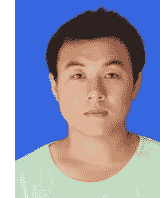


该二维码7天内（9月17日前）有效，重新进入将更新

## 课程目标

- 掌握基本概念和重要方法、了解当前进展
- 能够运用所学知识和方法解决实际问题
- 为其他科学研究和工程实践夯实基础

## 参考书目

- **模式识别与机器学习**  
  — 克里斯托弗·M·毕晓普

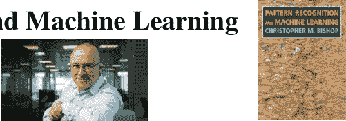

- **机器学习**  
  — 汤姆·M·米切尔

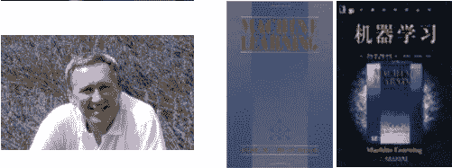

- **讲义**  
  — 吴恩达


- 机器学习  
  — 周志华
- 统计学习方法  
  — 李航


## 考核方式

- **平时成绩（40%）**
  - 给定主题或自选主题的小项目
  - 每小组4-5名成员
  - 报告展示
- **考试成绩（60%）**
  - 闭卷

# 第一章：机器学习概述

第一章：机器学习概述

### 什么是学习？

- 狭义：通过阅读、听讲、研究、观察、实践等手段**获得知识或技能的过程**，是一种使个体可以得到持续变化的行为方式。
  — 学霸
- 广义：是人在生活过程中，通过**获得经验而产生的行为或行为潜能**的相对持久的行为方式。

- 学习是获取新的、或修改和强化现有的知识、行为、技能、价值观或偏好的行为，并且可能涉及综合不同类型的信息。


### 什么是机器学习？

机器学习是一个多学科交叉的方向，专门研究计算机怎样模拟或实现人类的学习行为，以获取新的知识或技能，重新组织已有的知识结构使之不断改善自身的性能。


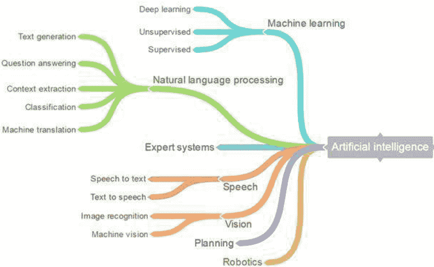

#### 🔴 AlphaGo


| 比赛/事件 | 时间 | 详情 |
| --- | --- | --- |
| 李世乭 vs. AlphaGo 1.0 | 2016年3月8日-3月15日 | 韩国首尔，比分1:4 |
| Master | 2016年底-2017年初 | 网络平台，60胜1平 |
| 柯洁 vs. AlphaGo 2.0 | 2017年5月23日-5月27日 | 中国乌镇，比分0:3 |

#### Dex-Net 4.0

组合策略实验

AUTOLAB

autolab.berkeley.edu


- 输入：472x472图像和夹爪开度
- 输出：夹爪开度和位移

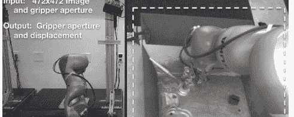

#### 汤姆·米切尔（1951-）

良定义的学习问题：如果一个计算机程序在任务T上的性能（以性能度量P衡量）随着经验E而提高，则称该程序从经验E中学习（1998）。


他是美国计算机科学家，卡内基梅隆大学E. Fredkin大学教授，目前担任CMU机器学习系主任。

### 测验？

假设你的邮件程序会观察你将哪些邮件标记为垃圾邮件，并据此学习如何更好地过滤垃圾邮件。在这种情况下，任务*T*是什么？

- 将电子邮件分类为垃圾邮件或非垃圾邮件。
- 观察你标记电子邮件是否为垃圾邮件。
- 正确分类为垃圾邮件/非垃圾邮件的邮件数量（或比例）。
- 以上都不是——这不是一个机器学习问题。


## 模式识别

## 数字识别

1 1 / 1 1 7 1 1 1
2 2 2 2 2 2 2 2 2
3 3 3 3 3 3 3 3 3
4 4 4 4 4 4 4 4 4
5 5 5 5 5 5 5 5 5
6 6 6 6 6 6 6 6 6
7 7 7 7 7 7 7 7
8 8 8 8 8 8 8 8
9 9 9 9 9 9 9 9
0 0 0 0 0 0 0 0

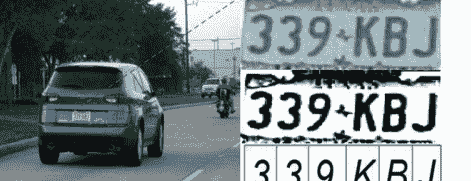


模式识别尤其关注面向应用的鲁棒特征提取

## 数据挖掘

- 消费习惯分析


数据挖掘旨在从特定业务数据中找出潜在的知识

## 计算机视觉

## 生物特征识别和目标检测


计算机视觉通过机器学习技术提升图像视频处理方法

## 计算机视觉

🔴 生物特征识别和目标检测

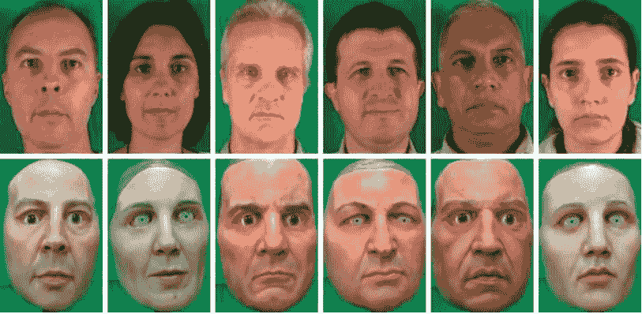

## 计算机视觉

生物特征识别和目标检测

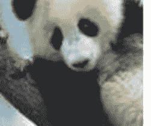

"panda"
57.7% confidence

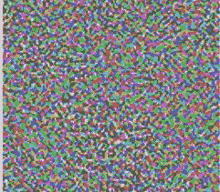

+ ε

=


"gibbon"
99.3% confidence

计算机视觉通过机器学习技术提升图像视频处理方法

## 自然语言处理

## 自动翻译与人机对话


自然语言处理运用机器学习技术改进主要步骤的性能

## 交通出行

- 自动驾驶与出行推荐


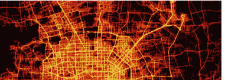

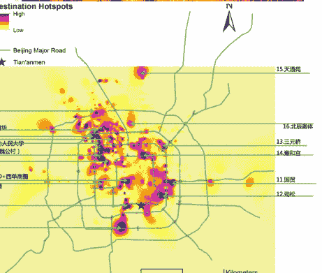

## 社交媒体

## 网络行为预测与推荐

社交网络世界地图
2014年12月

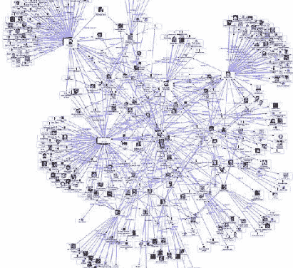


## 基本概念

i.i.d.

样本集合

标签

训练集

测试集

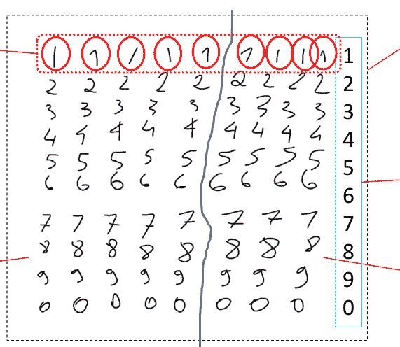

## 机器学习算法

## 机器学习主要问题

| | 监督学习 | 非监督学习 |
|---|---|---|
| 离散 | 分类或归类 | 聚类 |
| 连续 | 回归 | 降维 |

## 机器学习算法

- 监督学习 Supervised Learning {x_n ∈ R^d, y_n ∈ R}^N_{n=1}
  - 预测
  - 分类 (离散标签), 回归 (实值)
- 非监督学习 Unsupervised Learning ({x_n ∈ R^d}^N_{n=1})
  - 聚类
  - 概率分布估计
  - 寻找关联 (在特征中)
  - 降维
- 半监督学习 Semi-supervised Learning
- 强化学习 Reinforcement Learning
  - 决策制定 (机器人, 象棋机)

## 机器学习算法示意图

监督学习

非监督学习

半监督学习

## 监督学习算法流程

监督学习

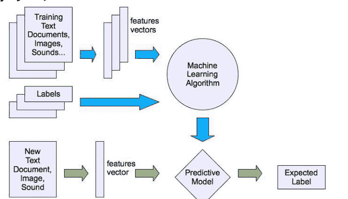

## 非监督算法流程

非监督学习

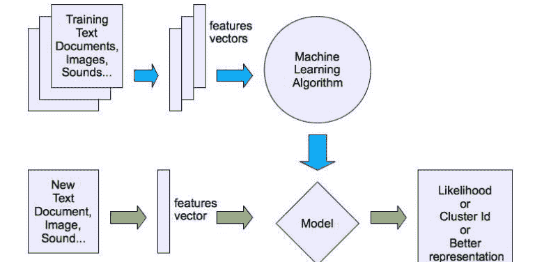

## 分类问题举例

## 训练过程

训练图像

图像特征

训练标签

分类器训练

训练好的分类器


## 分类问题举例

测试过程

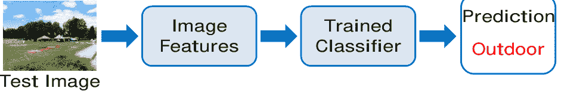

## 回归问题举例

- 曲线拟合

sin(2πx)

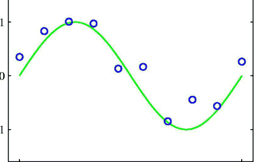

y(x, w) = w₀ + w₁x + w₂x² + … + wₘxᴹ = Σ_{j=0}^M w_j x^j

## 回归问题举例

平方误差函数


E(w) = 1/2 Σ_{n=1}^{N} { y(x_n, w) - t_n }^2

## 回归问题举例

- ● $M=0$

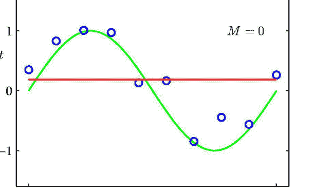

## 回归问题举例

M=1

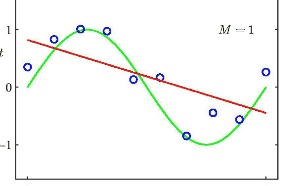

## 回归问题举例

🔴 $M=3$


## 回归问题举例

M=9


## 回归问题举例

过拟合问题

均方根误差 Root-Mean-Square (RMS) Error:

$E_{RMS} = \sqrt{2E(\mathbf{w}^*)/N}$

$E(\mathbf{w}) = \frac{1}{2} \sum_{n=1}^{N} \{y(x_n, \mathbf{w}) - t_n\}^2$

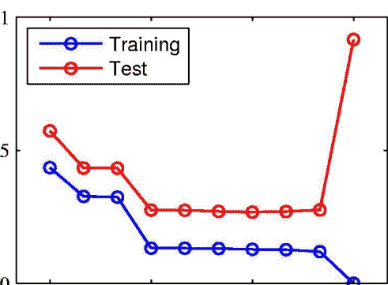

## 训练和测试

数据获取

实际运用

通用数据集
(非观测)

训练集
(观测)

测试集
(非观测)

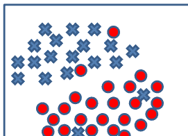

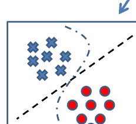

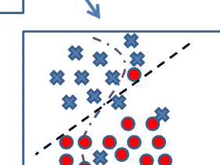

## 训练和测试

- 训练是使系统能够学习的过程。
- 无免费午餐规则:
  - 训练集和测试集来自同一分布
  - 需要做出一些假设或偏见


## 评价标准

- 影响性能的因素有几个：
  - 提供的**训练类型**
  - 任何初始**背景知识**的形式和范围
  - 提供的**反馈类型**
  - 使用的**学习算法**
- 两个重要因素：
  - 建模
  - 优化

## 机器学习算法

- 机器学习系统的成功取决于算法。
- 算法控制搜索过程，以发现并构建知识结构。
- 学习算法应从训练样本中提取有用信息。

## 机器学习目标

- 监督学习：降低 E-out 或最大化概率项

error = 1/N Σ_{n=1}^{N} [y_n ≠ g(x_n)]

E-in：用于训练集
E-out：用于测试集

Eout(g) ≤ Ein(g) ± O( sqrt( d_VC / N ) ln N )

- 无监督学习：最小量化误差、最小距离、MAP、MLE（最大似然估计）

## 机器学习目标

欠拟合 vs. 过拟合（固定N）

误差

Eout

模型复杂度

Ein

d_VC

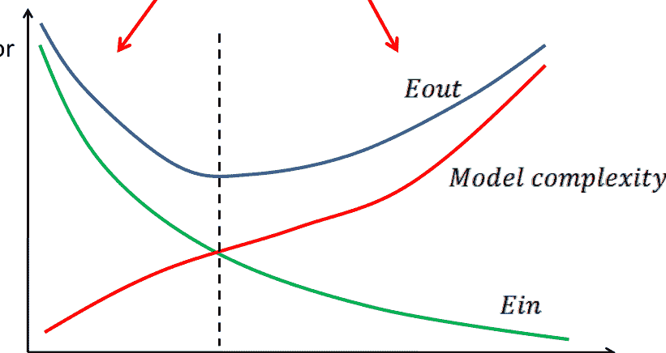

## 机器学习目标

### 泛化误差的组成

- **偏差（Bias）**：所有训练集上的平均模型与真实模型之间有多大差异？
  - 由模型做出的不准确假设/简化导致的误差
- **方差（Variance）**：从不同训练集估计出的模型彼此之间有多大差异

## 机器学习目标

- **欠拟合：** 模型过于“简单”，无法表示所有相关的类别特征
  - 高偏差、低方差
  - 高训练误差和高测试误差
- **过拟合：** 模型过于“复杂”，拟合了数据中的无关特征（噪声）
  - 低偏差、高方差
  - 低训练误差和高测试误差

## 机器学习目标


参数过少的模型不准确，因为偏差较大（灵活性不足）。

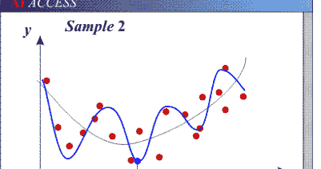

参数过多的模型不准确，因为方差较大（对样本过于敏感）。

## 机器学习目标

E(MSE) = noise² + bias² + variance

不可避免的误差

因错误假设产生的误差

因训练样本方差产生的误差

有关偏差-方差的解释，另见 Bishop 的《神经网络》一书：

- http://www.stat.cmu.edu/~larry/=stat707/notes3.pdf
- http://www.inf.ed.ac.uk/teaching/courses/mlsc/Notes/Lecture4/BiasVariance.pdf

## 机器学习目标

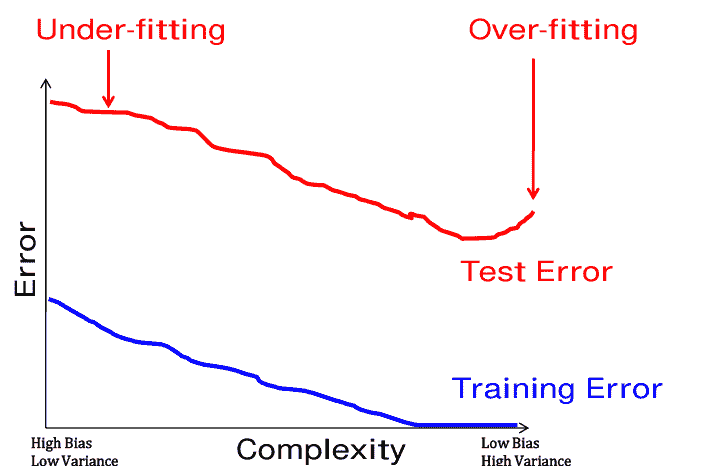

## 机器学习目标


## 回归问题举例

### 多项式系数

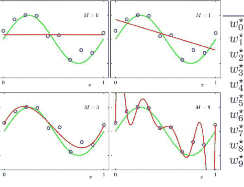

| | M = 0 | M = 1 | M = 3 | M = 9 |
|---|---|---|---|---|
| $w_0^*$ | 0.19 | 0.82 | 0.31 | 0.35 |
| $w_1^*$ |  | -1.27 | 7.99 | 232.37 |
| $w_2^*$ |  |  | -25.43 | -5321.83 |
| $w_3^*$ |  |  | 17.37 | 48568.31 |
| $w_4^*$ |  |  |  | -231639.30 |
| $w_5^*$ |  |  |  | 640042.26 |
| $w_6^*$ |  |  |  | -1061800.52 |
| $w_7^*$ |  |  |  | 1042400.18 |
| $w_8^*$ |  |  |  | -557682.99 |
| $w_9^*$ |  |  |  | 125201.43 |

## 回归问题举例

🔴 **M=9, 增加训练样本数目: N=15**

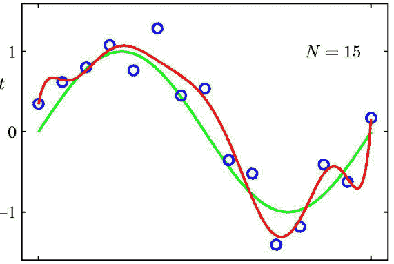

## 回归问题举例

🔴 **M=9，增加训练样本数目：N=100**

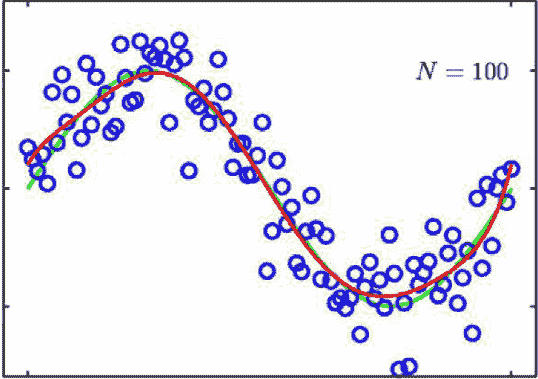

## 回归问题举例

- • *M*=9, 正则化: ln λ = −18


## 回归问题举例

M=9, 正则化: ln λ = 0

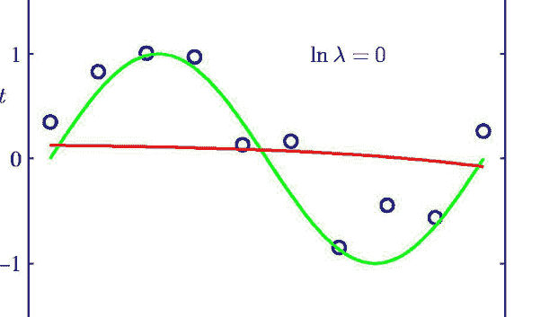

## 回归问题举例

### 🔴 **M=9, 正则化：** $E_{RMS}$ **与** $\ln \lambda$

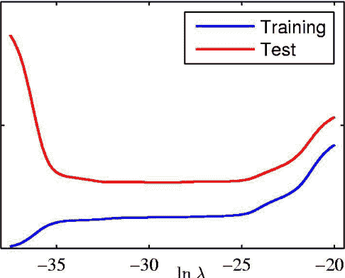

## 回归问题举例

### 🔴 正则化后的系数

|  | \(\ln \lambda=-\infty\) | \(\ln \lambda=-18\) | \(\ln \lambda=0\) |
|---|---:|---:|---:|
| \(w_0^*\) | 0.35 | 0.35 | 0.13 |
| \(w_1^*\) | 232.37 | 4.74 | -0.05 |
| \(w_2^*\) | -5321.83 | -0.77 | -0.06 |
| \(w_3^*\) | 48568.31 | -31.97 | -0.05 |
| \(w_4^*\) | -231639.30 | -3.89 | -0.03 |
| \(w_5^*\) | 640042.26 | 55.28 | -0.02 |
| \(w_6^*\) | -1061800.52 | 41.32 | -0.01 |
| \(w_7^*\) | 1042400.18 | -45.95 | -0.00 |
| \(w_8^*\) | -557682.99 | -91.53 | 0.00 |
| \(w_9^*\) | 125201.43 | 72.68 | 0.01 |


## 课前回顾

## 训练和测试

数据获取
实际运用

通用数据集 (非观测)
训练集 (观测)
测试集 (非观测)


- Training is the process of making the system able to learn.
- No free lunch rule:
  - Training set and testing set come from the same distribution
  - Need to make some assumptions or bias

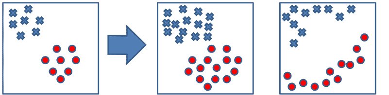

## 评价标准

- There are several factors affecting the performance:
  - **Types of training** provided
  - The form and extent of any initial **background knowledge**
  - The **type of feedback** provided
  - The **learning algorithms** used
- Two important factors:
  - Modeling
  - Optimization

## 机器学习目标

- Supervised: Low E-out or maximize probabilistic terms

error = 1/N Σ_{n=1}^N [y_n ≠ g(x_n)]

E-in: for training set
E-out: for testing set

Eout(g) ≤ Ein(g) ± O( √(d_VC / N) ln N )

- Unsupervised: Minimum quantization error, Minimum distance, MAP, MLE (Maximum Likelihood Estimation)

Under-fitting VS. Over-fitting (fixed N)

error
d_VC
Eout
Model complexity
Ein

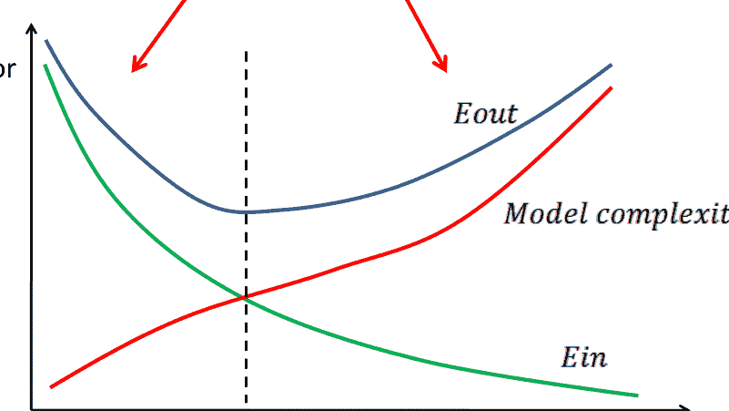

### Components of generalization error

- **Bias:** how much the average model over all training sets differ from the true model?
  - Error due to inaccurate assumptions/simplifications made by the model
- **Variance:** how many models estimated from different training sets differ from each other

- **Under-fitting:** model is too “simple” to represent all the relevant class characteristics
  - High bias and low variance
  - High training error and high test error

- **Over-fitting:** model is too “complex” and fits irrelevant characteristics (noise) in the data
  - Low bias and high variance
  - Low training error and high test error

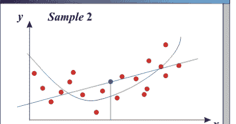

Models with too few parameters are inaccurate because of a large bias (not enough flexibility).


Models with too many parameters are inaccurate because of a large variance (too much sensitivity to the sample).

E(MSE) = noise² + bias² + variance

Unavoidable Error
Error due to Incorrect Assumptions
Error due to Variance of Training Samples

See the following for explanations of bias-variance (also Bishop’s “Neural Networks” book):

- http://www.stat.cmu.edu/~larry/=stat707/notes3.pdf
- http://www.inf.ed.ac.uk/teaching/courses/mlsc/Notes/Lecture4/BiasVariance.pdf


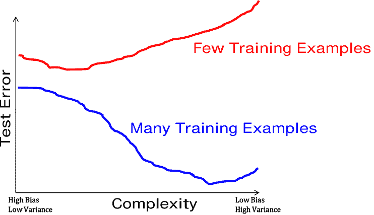

## 回归问题举例

### 曲线拟合

sin(2πx)


y(x, w) = w₀ + w₁x + w₂x² + … + wₘxᴹ = Σ_{j=0}^M w_j x^j

### 平方误差函数

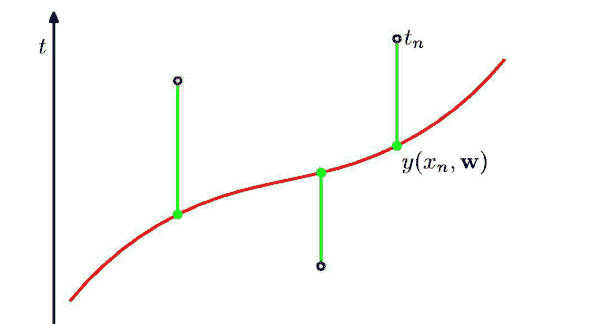

E(w) = 1/2 Σ_{n=1}^{N} { y(x_n, w) - t_n }^2

### M=0


### M=1


### 🔴 M=3

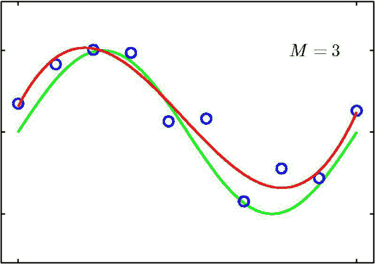

### M=9


### M=9, 增加训练样本数目: N=15


### M=9，增加训练样本数目：N=100


### 多项式系数


|  | M = 0 | M = 1 | M = 3 | M = 9 |
|---|---|---|---|---|
| $w_0^*$ | 0.19 | 0.82 | 0.31 | 0.35 |
| $w_1^*$ |  | -1.27 | 7.99 | 232.37 |
| $w_2^*$ |  |  | -25.43 | -5321.83 |
| $w_3^*$ |  |  | 17.37 | 48568.31 |
| $w_4^*$ |  |  |  | -231639.30 |
| $w_5^*$ |  |  |  | 640042.26 |
| $w_6^*$ |  |  |  | -1061800.52 |
| $w_7^*$ |  |  |  | 1042400.18 |
| $w_8^*$ |  |  |  | -557682.99 |
| $w_9^*$ |  |  |  | 125201.43 |


## 回归问题举例

🔴 **M=9, 正则化:** \(\ln \lambda=-18\)

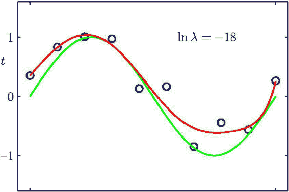

## 回归问题举例

🔴 **M=9, 正则化：** $E_{RMS}$ **vs.** $\ln \lambda$

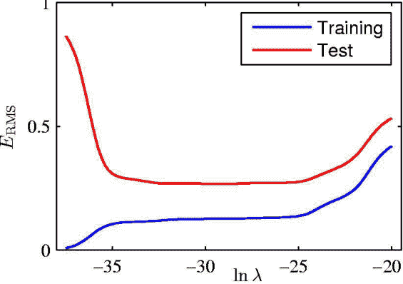

## 回归问题举例

● 几种常用的正则项

$$\frac{1}{2}\sum_{n=1}^{N}\{t_n-w^T\phi(x_n)\}^2+\frac{\lambda}{2}\sum_{j=1}^{M}|w_j|^q$$

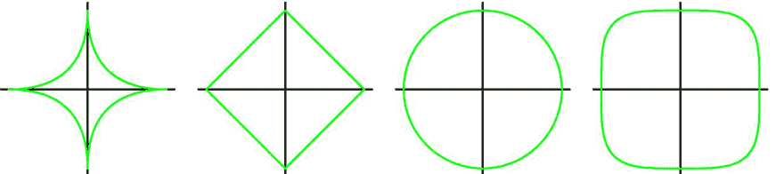

Lasso

Quadratic

## 数学基础
一些数学

## 概率统计

- 概率 (Probability)
- 对随机事件发生可能性大小的度量

- 联合概率 (Joint Probability)
- A和B共同发生的概率，称事件A和B的联合概率，记作P(A, B)或P(A∩B)

- 条件概率 (Conditional Probability)
- 事件B已发生的条件下，事件A发生的概率，记作P(A|B)

## 概率统计

- **独立事件 (Independent Events)**

事件A(或B)是否发生对事件B(或A)的发生概率没有影响，则称A和B为相互独立事件

- **条件独立 (Conditional Independence)**

在给定C的条件下，若事件A和B满足：

$$P(A,B|C)=P(A|C)\cdot P(B|C)$$

或：

$$P(A|B,C)=P(A|C)$$

则称在给定C的情况下A和B独立

## 概率统计

● 乘法原理

$$P(A,B)=P(A|B)\cdot P(B)$$
$$=P(B|A)\cdot P(A)$$

● 全概率公式 (Law of Total Probability)

A为任一事件，$B_1,B_2,\ldots,B_n$是样本空间Ω的一个划分，且$B_i$两两互斥，$P(B_i)>0$，$(i=1,2,\ldots,n)$，那么：

$$P(A)=\sum_{i=1}^{n}P(A,B_i)=\sum_{i=1}^{n}P(A|B_i)P(B_i)$$

## 贝叶斯公式

- 贝叶斯公式 (Bayes’ Theorem)

P(B_i|A) = \frac{P(B_i)P(A|B_i)}{\sum_{j=1}^{n} P(B_j)P(A|B_j)}

## 当n=1时

后验概率
先验概率
似然概率
证据因子

P(B|A) = \frac{P(B)P(A|B)}{P(A)}

## 贝叶斯公式

- 贝叶斯公式 (Bayes’ Theorem)

贝叶斯公式给出了“结果”事件A已经发生的条件下，“原因”事件B的条件概率，对结果的任何观测都将增加我们对原因事件B的真正分布的知识。

后验概率 = 似然函数 × 先验概率 / 证据因子

## 概率练习

- 苹果和桔子

- 选箱子事件变量*B*

- 选水果事件变量*F*

P(B = r) = 4/10
P(B = b) = 6/10

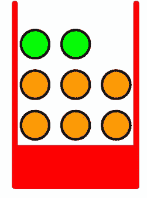

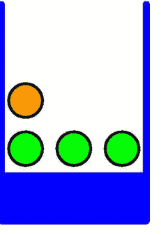

## 概率练习

苹果和桔子

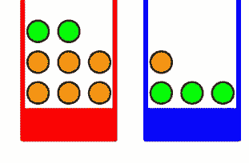

P(B = r) = 4/10
P(B = b) = 6/10

- 1. 取到苹果的概率？
- 2. 如果取到桔子，来自红箱子的概率？

## 概率练习

苹果和桔子

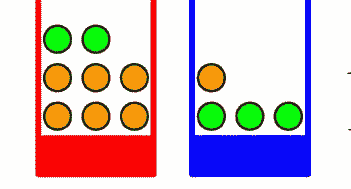

P(B = r) = 4/10
P(B = b) = 6/10

1. 取到苹果的概率？

P(F = a | B = r) = 1/4
P(F = o | B = r) = 3/4
P(F = a | B = b) = 3/4
P(F = o | B = b) = 1/4

P(F = a) = P(F = a | B = r) P(B = r) + P(F = a | B = b) P(B = b)
= 1/4 × 4/10 + 3/4 × 6/10 = 11/20

## 概率练习

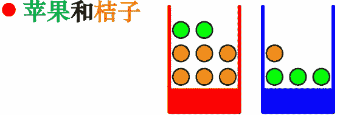

苹果和桔子

$P(B=r)=4/10$  
$P(B=b)=6/10$

2.如果取到桔子，来自红箱子的概率？

$P(B=r\mid F=o)=\frac{P(F=o\mid B=r)P(B=r)}{P(F=o)}$  
$=3/4\times4/10\times20/9=2/3$

## 连续型随机变量

## 概率密度函数 (Probability Density Function)

是描述随机变量输出值在某确定取值点附近可能性的函数

随机变量的取值落在某个区域之内的概率为概率密度函数在这个区域上的积分；当概率密度函数存在的时候，累积分布函数是概率密度函数的积分。

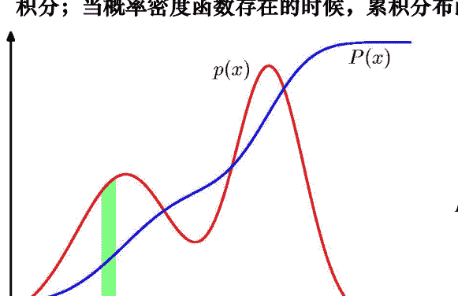

p(x) ≥ 0
∫_{-∞}^{∞} p(x) dx = 1
P(x ∈ (a,b)) = ∫_{a}^{b} p(x) dx
P(z) = ∫_{-∞}^{z} p(x) dx

## 期望

- 期待 (Expectation)
- 期望是一个随机变量所取值的概率平均
- 离散变量
  $E[X] = \sum_{k=1}^{\infty} x_k p_k$
- 连续变量
  $E[X] = \int_{-\infty}^{+\infty} x f(x) dx$

## 方差

- • 方差 (Variance)
- 随机变量的方差描述的该随机变量的值偏离其期望值的程度。

离散变量  Var(X) = E((X - E(X))²)
= Σₖ₌₁^∞ (xₖ - E(X))² pₖ
= E(X²) - E²(X)

连续变量  Var(X) = ∫₋∞⁺∞ (x - E(x))² f(x) dx

- • 标准差 (Standard Deviation)
- σ(X) = √Var(X)

## 一维高斯分布

$\mathcal{N}\left(x|\mu,\sigma^2\right)=\frac{1}{\left(2\pi\sigma^2\right)^{1/2}}\exp\left\{-\frac{1}{2\sigma^2}\left(x-\mu\right)^2\right\}$

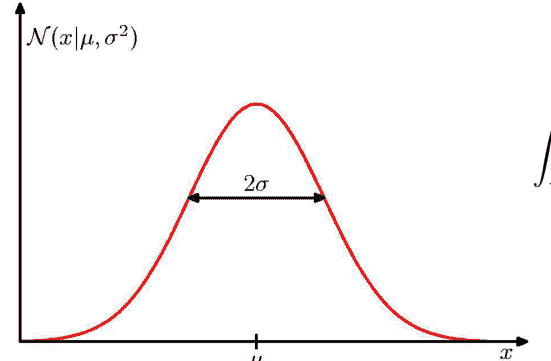

$\mathcal{N}(x|\mu,\sigma^2) > 0$

$\int_{-\infty}^{\infty} \mathcal{N}\left(x|\mu,\sigma^2\right) \mathrm{d}x = 1$

## 多维高斯分布

𝒩(x|μ, Σ) = 1/(2π)^{D/2} 1/|Σ|^{1/2} exp{ -1/2 (x - μ)^T Σ^{-1} (x - μ) }

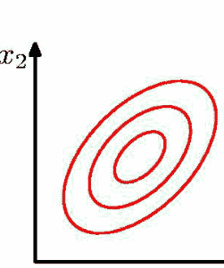

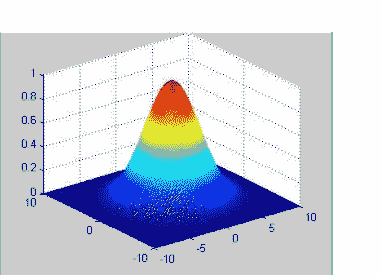

## 最大似然估计

● 似然函数 (Likelihood Function)

由于 θ 是概率密度的一个确定性的参数集，因此 $p(x^{(N)};\theta)$ 实际上就是条件概率密度 $p(x^{(N)}|\theta)$

如果各个 $x_j(j=1,2,\ldots,N)$ 是独立抽取的，则进一步有：

$$p(x^{(N)}|\theta)=p(x_1|\theta)p(x_2|\theta)\cdots p(x_N|\theta)=\prod_{j=1}^{N}p(x_j|\theta)$$

## 最大似然估计

- 似然函数 (Likelihood Function)

若似然函数可微，求微分方程组的解：

```
∂p(x^(N)|θ)/∂θ = 0
```

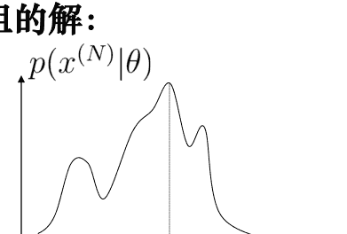

或等价求对数似然方程组的解：

```
∂[ln p(x^(N)|θ)]/∂θ = Σ_{j=1}^N ∂/∂θ ln p(x_j|θ) = 0
```

作为极值的必要条件。


## 高斯参数估计


似然函数

p(x)

N(x_n|μ, σ²)

x

x_n

```
p(x|μ, σ²) = ∏_{n=1}^{N} N(x_n|μ, σ²)
```

## 最大似然估计

ln p(x|μ, σ²) = - 1/(2σ²) Σ_{n=1}^N (x_n - μ)² - N/2 ln σ² - N/2 ln(2π)

μ_ML = 1/N Σ_{n=1}^N x_n

σ²_ML = 1/N Σ_{n=1}^N (x_n - μ_ML)²

## 最大似然估计

$$\mathbb{E}[\mu_{\mathrm{ML}}]=\mu$$

$$\mathbb{E}[\sigma_{\mathrm{ML}}^2]=\left(\frac{N-1}{N}\right)\sigma^2$$

$$\hat{\sigma}^{2}=\frac{N}{N-1}\sigma_{\mathrm{ML}}^{2}$$

$$=\frac{1}{N-1}\sum_{n=1}^{N}(x_n-\mu_{\mathrm{ML}})^2$$


# 第二章：线性回归

第二章：线性回归

## 机器学习算法

## 机器学习主要问题

| | 监督学习 | 无监督学习 |
|---|---|---|
| 离散 | 分类或归类 | 聚类 |
| 连续 | 回归 | 降维 |

监督学习

无监督学习

离散

连续

分类或归类

聚类

回归

降维

## “回归” 起源

## Francis Galton

英国生物学家
研究父母身高与子女身高之间关系
若父母身高高于平均身高，则其子女身高倾向于倒退生长，即会比其父母身高矮一些而更接近于大众平均身高.
若父母身高小于平均身高，则其子女身高倾向于向上生长，即会更接近于大众平均身高.
此现象被Galton称之为回归现象，即 回归.


Francis Galton
1822.2.16-1911.1.17

## “回归” 起源


后代的身高倾向于“回归”到一个平均值。

## 回归问题举例

例：房价估计

| 面积 (平方英尺) | 卧室数量 | 楼层数 | 房龄 (年) | 价格 ($1000) |
|---|---|---|---|---|
| 2104 | 5 | 1 | 45 | 460 |
| 1416 | 3 | 2 | 40 | 232 |
| 1534 | 3 | 2 | 30 | 315 |
| 852 | 2 | 1 | 36 | 178 |
| ... | ... | ... | ... | ... |

| 面积 (平方英尺) | 卧室数量 | 楼层数 | 房龄 (年) | 价格 ($1000) |
|---|---|---|---|---|
| 1500 | 3 | 2 | 30 | ? |

测试样本

## 回归问题举例

例：房价估计

训练样本

| 面积 (平方英尺) x₁ | 卧室数量 x₂ | 楼层数 x₃ | 房龄 (年) x₄ | 价格 ($1000) y |
|---|---|---|---|---|
| 2104 | 5 | 1 | 45 | 460 |
| 1416 | 3 | 2 | 40 | 232 |
| 1534 | 3 | 2 | 30 | 315 |
| 852 | 2 | 1 | 36 | 178 |
| ... | ... | ... | ... | ... |

N

监督学习

N: 训练样本个数
x: 输入变量/“特征”
y: 输出变量/目标变量

## 回归模型


### 如何表示 $f$？

**线性回归：** 假设函数 $f$ 为输入 $x$ 的线性函数

$$f(x)=w_0+w_1x_1+\cdots+w_mx_m$$
$$=w_0+\sum_{i=1}^{m}w_ix_i$$

**写成向量形式：** 增加一维 $x_0=1$，表示截距项

$$f(x)=\mathbf{w}^{T}\mathbf{x}$$


## 回归模型

### 基函数

$$y(\mathbf{x},\mathbf{w})=\sum_{j=0}^{M-1}w_j\phi_j(\mathbf{x})=\mathbf{w}^{\mathsf{T}}\boldsymbol{\phi}(\mathbf{x})$$

**最简单的情况下：** $\phi_j(x)=x_j$

- **多项式基函数**
  $$\phi_j(x)=x^j$$


- **高斯基函数**
  $$\phi_j(x)=\exp\left\{-\frac{(x-\mu_j)^2}{2s^2}\right\}$$


- **Sigmoid基函数**
  $$\phi_j(x)=\sigma\left(\frac{x-\mu_j}{s}\right),\quad \sigma(a)=\frac{1}{1+\exp(-a)}$$


## 问题求解

- 问题本质：确定模型中的参数 w^T
- 基本思想：基于训练集最小化预测值 f 与真实输出值 y 的差异
- 定义目标函数(又叫代价函数 Cost Function)：
  $$J(\mathbf{w}) = \frac{1}{2} \sum_{i=1}^{N} \left(f(\mathbf{x}_i) - y_i\right)^2$$
- 进一步：
  $$\hat{\mathbf{w}} = \arg\min_{\mathbf{w}} J(\mathbf{w}) = \arg\min_{\mathbf{w}} \left[ \frac{1}{2} \sum_{i=1}^{N} \left(f(\mathbf{x}_i) - y_i\right)^2 \right]$$

## 梯度下降(Gradient Descent)

### 🔴 梯度下降

梯度下降法是一个最优化算法，是求解无约束优化问题最简单和最基础的方法之一。


以负梯度方向为搜索方向，越接近目标值，步长越小，前进越慢。

## 梯度下降(Gradient Descent)

- 梯度下降：
  - 给定初始值 w⁰
  - 更新 w 使得 J(w) 越来越小
    $$w_j^t = w_j^{t-1} - \alpha \frac{\partial}{\partial w_j} J(\mathbf{w})$$
    $$\frac{\partial}{\partial w_j} J(\mathbf{w}) = \sum_{i=1}^{N} (f(\mathbf{x}_i) - y_i) \cdot \mathbf{x}_{i,j}$$
  - 同时更新 w 的各维 $f(\mathbf{x}_i) = [\mathbf{w}^{t-1}]^T \mathbf{x}_i$
  - $\alpha$ 为学习率(Learning Rate)或更新步长


## 批处理梯度下降
(Batch Gradient Descent)

在梯度下降方法中，每次更新都利用所有数据，即：

```
w_j^t = w_j^{t-1} - α Σ_{i=1}^N (f(x_i) - y_i) · x_j
```

在大样本条件下，批处理梯度下降的迭代速度很慢


## 随机梯度下降
(Stochastic Gradient Descent)

基本思想：如果条件对所有样本都成立，则对任一样本也成立
每次只用一个样本 (x_r, y_r)
$w_j^t = w_j^{t-1} - \alpha (f(x_r) - y_r) \cdot x_{r,j}$

- 收敛速度较快
- 不太容易陷入局部极值
- 对大样本数据较有效

又称在线学习(Online Learning)

变化形式

可离线学习，每次“看”一个样本，对所有样本循环使用多次(一次循环称为一个Epoch)
每次可以看一些样本(Mini-Batch)

## $f_w(x)$
(for fixed $w_0, w_1$, this is a function of $x$)


## $J(w)$
(function of the parameters $w_0, w_1$)


## f_w(x)
(for fixed w0, w1, this is a function of x)

## J(w)
(function of the parameters w0, w1)


## $f_w(x)$
(for fixed $w_0, w_1$, this is a function of $x$)

## $J(w)$
(function of the parameters $w_0, w_1$)


## $f_w(x)$
(for fixed $w_0, w_1$, this is a function of $x$)


## $J(w)$
(function of the parameters $w_0, w_1$)


## $f_w(x)$
(for fixed $w_0, w_1$, this is a function of x)

## $J(w)$
(function of the parameters $w_0, w_1$)


## f_w(x)
(for fixed w0, w1, this is a function of x)

## J(w)
(function of the parameters w0, w1)


Price $ (in 1000s)

Size (feet²)

Training data

Current hypothesis


## f_w(x)
(for fixed w0, w1, this is a function of x)


## J(w)
(function of the parameters w0, w1)


## f_w(x)
(for fixed w0, w1, this is a function of x)

## J(w)
(function of the parameters w0, w1)


## f_w(x)
(for fixed w0, w1, this is a function of x)

## J(w)
(function of the parameters w0, w1)

Price $ (in 1000s)

Size (feet²)

Training data

Current hypothesis


## 标准方程组
(Normal Equations)

- 目标函数：
  $J(\mathbf{w}) = \sum_{i=1}^{N} (f(\mathbf{x}_i) - y_i)^2$
  $= \sum_{i=1}^{N} (\mathbf{w}^T \mathbf{x}_i - y_i)^2$

- 直接求导，并令其等于0，求得极值

## 标准方程组
(Normal Equations)

- 将目标函数写成矩阵形式：

J(w) = Σ_{i=1}^{N} (w^T x_i - y_i)^2
= (X w - y)^T (X w - y)

- 其中

X = (x_1^T \ x_2^T \ ... \ x_N^T) = (x_{11}, x_{12}, ..., x_{1m} \ x_{21}, x_{22}, ..., x_{2m} \ ... \ x_{N1}, x_{N2}, ..., x_{Nm})

y = (y_1 \ y_2 \ ... \ y_N)^T

## 标准方程组
(Normal Equations)

- 求导：
  ∂J(w)/∂w = ∂/∂w (Xw - y)^T (Xw - y)
  = 2 X^T (Xw - y) = 0
  ⇒ X^T X w = X^T y

- 得到模型的参数：
  ŵ = (X^T X)^{-1} X^T y

## 梯度下降 vs 标准方程组

- 🔴 **梯度下降法：**
  - 需要选择 α
  - 需要迭代多次
  - 需要数据归一化
  - 样本量非常大时也适用

- 🔴 **标准方程组：**
  - 不需要选择 α
  - 不需要迭代多次
  - 无需数据归一化
  - 样本量大时不适用
    （需要计算 $(X^T X)^{-1}$）

样本量较小时选用标准方程组求解
样本量较大时选用梯度下降法求解

## 再看曲线拟合


## 最大似然估计

p(t|x, w, β) = ∏_{n=1}^N N(t_n | y(x_n, w), β^{-1})

ln p(t|x, w, β) = - β/2 ∑_{n=1}^N {y(x_n, w) - t_n}^2 + N/2 ln β - N/2 ln(2π)

Determine w_ML by minimizing sum-of-squares error, E(w).

p(t|x, w_ML, β_ML) = N(t | y(x, w_ML), β_ML^{-1})


## 最大似然估计

$$
p(\mathbf{t}|\mathbf{x},\mathbf{w},\beta)=\prod_{n=1}^{N}\mathcal{N}(t_n|y(x_n,\mathbf{w}),\beta^{-1})
$$


## MAP: 离贝叶斯更进一步

$$
p(\mathbf{w}|\alpha)=\mathcal{N}(\mathbf{w}|\mathbf{0},\alpha^{-1}\mathbf{I})=\left(\frac{\alpha}{2\pi}\right)^{(M+1)/2}\exp\left\{-\frac{\alpha}{2}\mathbf{w}^{\mathrm{T}}\mathbf{w}\right\}
$$

$$
p(\mathbf{w}|\mathbf{x},\mathbf{t},\alpha,\beta)\propto p(\mathbf{t}|\mathbf{x},\mathbf{w},\beta)p(\mathbf{w}|\alpha)
$$

$$
\beta\widetilde{E}(\mathbf{w})=\frac{\beta}{2}\sum_{n=1}^{N}\{y(x_n,\mathbf{w})-t_n\}^{2}+\frac{\alpha}{2}\mathbf{w}^{\mathrm{T}}\mathbf{w}
$$

通过最小化正则化平方和误差 $\widetilde{E}(\mathbf{w})$ 来确定 $\mathbf{w}_{MAP}$。

$$
\lambda=\alpha/\beta.
$$

## 贝叶斯曲线拟合

$$
p(t\mid x,\mathbf{x},\mathbf{t})=\int p(t\mid x,\mathbf{w})p(\mathbf{w}\mid\mathbf{x},\mathbf{t})\,d\mathbf{w}.
$$

$$
p(t\mid x,\mathbf{w},\beta)=\mathcal{N}\left(t\mid y(x,\mathbf{w}),\beta^{-1}\right)
$$

$$
p(\mathbf{w}\mid\mathbf{x},\mathbf{t},\alpha,\beta)\propto p(\mathbf{t}\mid\mathbf{x},\mathbf{w},\beta)p(\mathbf{w}\mid\alpha).
$$

$$
p(t\mid x,\mathbf{x},\mathbf{t})=\mathcal{N}\left(t\mid m(x),s^2(x)\right)
$$

$$
p(t\mid x,\mathbf{x},\mathbf{t})=\int p(t\mid x,\mathbf{w})p(\mathbf{w}\mid\mathbf{x},\mathbf{t})\,d\mathbf{w}=\mathcal{N}(t\mid m(x),s^2(x))
$$

$$
p(\mathbf{w}|\mathbf{x},\mathbf{t},\alpha,\beta)\propto p(\mathbf{t}|\mathbf{x},\mathbf{w},\beta)p(\mathbf{w}|\alpha)
$$

$$
y(\mathbf{x},\mathbf{w})=\sum_{j=0}^{M-1}w_j\phi_j(\mathbf{x})=\mathbf{w}^{\mathrm{T}}\boldsymbol{\phi}(\mathbf{x})
$$

$$
m(x)=\beta\boldsymbol{\phi}(x)^{\mathrm{T}}\mathbf{S}\sum_{n=1}^{N}\boldsymbol{\phi}(x_n)t_n\qquad s^2(x)=\beta^{-1}+\boldsymbol{\phi}(x)^{\mathrm{T}}\mathbf{S}\boldsymbol{\phi}(x)
$$

$$
\mathbf{S}^{-1}=\alpha\mathbf{I}+\beta\sum_{n=1}^{N}\boldsymbol{\phi}(x_n)\boldsymbol{\phi}(x_n)^{\mathrm{T}}\qquad \boldsymbol{\phi}(x_n)=(x_n^0,\ldots,x_n^M)^{\mathrm{T}}
$$

$$
p(t\mid x,\mathbf{x},\mathbf{t})=\mathcal{N}\left(t\mid m(x),s^2(x)\right)
$$


## 非参数估计

### 🔴 直接用样本估计总体分布

基本思路：要估计 $x_i$ 点的密度 $p(x_i)$，可把所有样本在该点上的“贡献”相加近似作为其概率密度，进而得到 $\hat{p}(x)$。


$p(x)$ 为 $x$ 的总体概率密度函数，$N$ 个样本 $x=\{x_1,x_2,\ldots,x_N\}$ 从密度为 $p(x)$ 的总体中独立抽取，估计 $\hat{p}(x)$ 近似 $p(x)$。

考虑随机向量 $x$ 落入区域 $\mathfrak{R}$ 的概率

$$
P_R = \int_{\mathfrak{R}} p(x)dx
$$

$k$ 个样本落入该区域的概率符合二项分布

$$
P_k = C_N^k P_R^k (1 - P_R)^{N-k}
$$

$$
E[k] = N P_R \rightarrow \hat{P}_R \doteq \frac{k}{N}
$$

设 $p(x)$ 连续，且区域体积 $V$ 足够小，则有

$$
P_R = \int_{\mathfrak{R}} p(x)dx = p(x)V
$$

$$
\hat{p}(x) = \frac{k}{N V}
$$

与总样本数、区域的体积及落入的样本数有关。

$$
\hat{p}(x) = \frac{k}{N V} \rightarrow \hat{p}_N(x) = \frac{k_N}{N V_N}
$$

$$
\lim_{N\to\infty} V_N = 0
$$

$$
\lim_{N\to\infty} k_N = \infty \rightarrow \hat{p}_N(x) \text{ 收敛于 } p(x)
$$

$$
\lim_{N\to\infty} \frac{k_N}{N} = 0
$$

- **Parzen窗估计**：使区域体积序列 $V_N$ 以 $N$ 的某个函数的关系不断缩小，同时限制 $k_N$ 和 $k_N/N$。有限的 $N$，$V_i$ 选择很敏感。
- **$k_N$ 近邻估计**：使落入区域样本数 $k_N$ 为 $N$ 的某个函数，$V_N$ 使区域包含 $x$ 的 $k_N$ 个近邻，动态变化 $V$ 的取值。

## 机器学习

机器学习

北京航空航天大学计算机学院智能识别与图像处理实验室
IRIP Lab, School of Computer Science and Engineering, Beihang University

黄迪  刘庆杰

2019年秋季学期
Fall 2019

## 课前回顾

## 机器学习算法

### 机器学习主要问题

|  | Supervised Learning | Unsupervised Learning |
|---|---|---|
| Discrete | Classification or Categorization | Clustering |
| Continuous | Regression | Dimensionality Reduction |

### 机器学习主要问题

|  | 有监督学习 | 无监督学习 |
|---|---|---|
| 离散 | 分类或归类 | 聚类 |
| 连续 | 回归 | 降维 |

## 回归模型

### 如何表示 f？

线性回归：
假设函数 $f$ 为输入 $x$ 的线性函数

$$
f(x) = w_0 + w_1 x_1 + \ldots + w_m x_m = w_0 + \sum_{j=1}^{m} w_j x_j
$$

写成向量形式：
增加一维 $x_0=1$，表示截距项

$$
f(x) = \mathbf{w}^{\mathrm{T}}\mathbf{x}
$$

训练集 $(x_i, y_i)$

学习算法

变量(特征) $x \rightarrow f \rightarrow$ 计算 $y$

$$
f(x) = w_0 + w_1 x_1 + \ldots + w_m x_m = w_0 + \sum_{i=1}^{m} w_i x_i = \sum_{i=0}^{m} w_i x_i \quad (x_0=1)
$$

$$
y(\mathbf{x},\mathbf{w}) = \sum_{j=0}^{M-1} w_j \phi_j(\mathbf{x}) = \mathbf{w}^{\mathrm{T}}\boldsymbol{\phi}(\mathbf{x})
$$

最简单的情况下：$\phi_j(x)=x_j$

- **多项式基函数**：$\phi_j(x)=x^j$

  

- **高斯基函数**：$\phi_j(x)=\exp\left\{-\frac{(x-\mu_j)^2}{2s^2}\right\}$

  

- **Sigmoid基函数**：$\phi_j(x)=\sigma\left(\frac{x-\mu_j}{s}\right)$，$\sigma(a)=\frac{1}{1+\exp(-a)}$

  


## 模型求解

- 求解问题：确定参数 \(w\)
- 基本思想：在训练集中最小化预测值 \(f\) 与真实值 \(y\) 的差异

$$
J(\mathbf{w}) = \frac{1}{2} \sum_{i=1}^{N} \left(f(\mathbf{x}_i) - y_i\right)^2
$$

$$
\hat{\mathbf{w}} = \arg\min_{\mathbf{w}} J(\mathbf{w}) = \arg\min_{\mathbf{w}} \left[\frac{1}{2} \sum_{i=1}^{N} \left(f(\mathbf{x}_i) - y_i\right)^2\right]
$$

### 确定性方法（\(w\) 和 \(t_n\) 都是确定量）

$$
E(\mathbf{w}) = \frac{1}{2} \sum_{n=1}^{N} \{y(x_n, \mathbf{w}) - t_n\}^2
$$

$$
\tilde{E}(\mathbf{w}) = \frac{1}{2} \sum_{n=1}^{N} \{y(x_n, \mathbf{w}) - t_n\}^2 + \frac{\lambda}{2} \|\mathbf{w}\|^2
$$

### 最大似然估计（\(w\) 是确定量）

把待估计的参数看作是确定的量，只是其取值未知。最佳估计就是使得产生以观测到的样本的概率最大的那个值。

$$
p(t|x,w,\beta)=\prod_{n=1}^{N}\mathcal{N}(t_n|y(x_n,w),\beta^{-1})
$$

$$
\frac{1}{\beta_{ML}}=\frac{1}{N}\sum_{n=1}^{N}\{y(x_n,w_{ML})-t_n\}^2
$$


### 贝叶斯估计（\(w\) 是随机量）

把待估计的参数看作是符合某种先验概率分布的随机变量。对样本进行观测的过程，就是把先验概率密度转化为后验概率密度，从而利用样本信息修正了对参数的初始估计值。

$$
p(t|x,\mathbf{x},\mathbf{t})=\int p(t|x,w)\,p(w|\mathbf{x},\mathbf{t})\,dw=\mathcal{N}(t|m(x),s^2(x))
$$

$$
p(t|x,w,\beta)=\mathcal{N}(t|y(x,w),\beta^{-1})
$$

$$
p(w|\mathbf{x},\mathbf{t},\alpha,\beta)\propto p(\mathbf{t}|\mathbf{x},w,\beta)\,p(w|\alpha)
$$

$$
m(x)=\beta\,\phi(x)^T S\sum_{n=1}^{N}\phi(x_n)t_n
$$

$$
s^2(x)=\beta^{-1}+\phi(x)^T S\phi(x)
$$


## 概率密度估计

- 参数化方法：
  - 最大似然估计
  - 贝叶斯估计

  总体分布形式已知；典型分布；可以写成某些参数的函数。

- 非参数化方法：
  - Parzen 窗估计
  - \(k_n\) 近邻估计

  总体分布形式未知；非典型分布；不能写成某些参数的函数。

## 非参数估计

### 直接用样本估计总体分布

基本思路：要估计 \(x\) 点的密度 \(p(x)\)，可把所有样本在该点上的“贡献”相加近似作为其概率密度，进而得到 \(\hat{p}(x)\)。


\(p(x)\) 为 \(x\) 的总体概率密度函数，\(N\) 个样本 \(\mathbf{x}=\{x_1,x_2,\ldots,x_N\}\) 从密度为 \(p(x)\) 的总体中独立抽取，估计 \(\hat{p}(x)\) 近似 \(p(x)\)。

考虑随机向量 \(x\) 落入区域 \(\Re\) 的概率

$$
P_R=\int_{\Re}p(x)\,dx
$$

\(k\) 个样本落入该区域的概率符合二项分布

$$
P_k=C_N^k P_R^k(1-P_R)^{N-k}
$$

$$
E[k]=NP_R \quad\Longrightarrow\quad \hat{P}_R\doteq\frac{k}{N}
$$

设 \(p(x)\) 连续，且区域体积 \(V\) 足够小，则有

$$
P_R=\int_{\Re}p(x)\,dx=p(x)V
$$

$$
\hat{p}(x)=\frac{k}{NV}
$$

\(\hat{p}(x)\) 与总样本数、区域的体积及落入的样本数有关。

$$
\hat{p}(x)=\frac{k}{NV}\rightarrow\hat{p}_N(x)=\frac{k_N}{NV_N}
$$

$$
\lim_{N\to\infty}V_N=0,\qquad
\lim_{N\to\infty}k_N=\infty \rightarrow \hat{p}_N(x)\text{ 收敛于 }p(x),\qquad
\lim_{N\to\infty}\frac{k_N}{N}=0
$$

- Parzen 窗估计：
  使区域体积序列 \(V_N\) 以 \(N\) 的某个函数的关系不断缩小，同时限制 \(k_N\) 和 \(k_N/N\)。

  有限的 \(N\)、\(V_i\) 选择很敏感。

- \(k_n\) 近邻估计：
  使落入区域样本数 \(k_N\) 为 \(N\) 的某个函数，\(V_N\) 使区域包含 \(x\) 的 \(k_N\) 个近邻。

  动态变化 \(V\) 的取值。

# 第三章：线性分类模型

Chapter 3: Linear Models for Classification

### 机器学习算法

### 机器学习主要问题

|  | Supervised Learning | Unsupervised Learning |
| --- | --- | --- |
| Discrete | Classification or Categorization | Clustering |
| Continuous | Regression | Dimensionality Reduction |

### 从贝叶斯分类说起

- 样本 (Sample) \(x\in R^d\)
- 状态 (State) 第一类：\(w=w_1\)；第二类：\(w=w_2\)
- 先验概率 (A Priori Probability or Prior) \(P(w_1)\)、\(P(w_2)\)
- 样本分布密度 (Sample Distribution Density) \(p(x)\)
- 类条件概率密度 (Class-Conditional Probability Density) \(p(x|w_1)\)、\(p(x|w_2)\)
- 后验概率 (A Posteriori Probability or Posterior) \(P(w_1|x),P(w_2|x)\)
- 错误概率 (Probability of Error)

$$
P(e|x)=
\begin{cases}
P(w_2|x), & \text{if }x\text{ is assigned to }w_1\\
P(w_1|x), & \text{if }x\text{ is assigned to }w_2
\end{cases}
$$

- 平均错误率 (Average Probability of Error)

$$
P(e)=\int P(e|x)p(x)\,dx
$$

- 正确率 (Probability of Correctness) \(P(c)\)

### 基于最小错误率的决策

$$
\min P(e)=\int P(e|x)p(x)\,dx
$$

因为 \(P(e|x)\ge0,\ p(x)\ge0\)，

$$
\min P(e|x)\ \text{for all }x
$$

而

$$
P(e|x)=
\begin{cases}
P(\omega_2|x), & \text{if }P(\omega_1|x)>P(\omega_2|x)\\
P(\omega_1|x), & \text{if }P(\omega_2|x)>P(\omega_1|x)
\end{cases}
$$

if
$$
P(\omega_1|x)\underset{x\in\omega_2}{\overset{>}{<}}P(\omega_2|x)
$$
则分别将 \(x\) 判为 \(x\in\omega_1\) 或 \(x\in\omega_2\)。

$$
P(\omega|x)=\max_{j=1,\ldots,c}P(\omega_j|x)
$$

### 基于最小风险的决策

条件期望损失（条件风险）：对于特定的 \(x\) 采取决策 \(\alpha_i\) 的期望损失：

$$
R(\alpha_i|x)=E[\lambda(\alpha_i,w_j)|x]=\sum_{j=1}^{c}\lambda(\alpha_i,w_j)P(w_j|x),\quad i=1,2,\ldots,k
$$

期望风险：对所有可能 \(x\) 采取决策 \(\alpha(x)\) 所造成的期望损失之和

$$
R(\alpha)=\int R(\alpha(x)|x)p(x)\,dx
$$

也称平均风险（\(R(\alpha)\) 表示 \(R\) 依赖于决策规则 \(\alpha(\cdot)\)）。

对所有 \(x\)，使 \(R(\alpha(x)|x)\) 最小，则可以使 \(R(\alpha)\) 最小。

最小风险贝叶斯决策规则：

$$
\text{if }R(\alpha_t|x)=\min_{j=1,\ldots,k}R(\alpha_j|x),\text{ then }\alpha=\alpha_t
$$


## 示例-基于最小错误率

假设在某个局部区域细胞中正常($w_1$)和异常($w_2$)两类的先验概率分别为：正常状态 $P(w_1)=0.9$，异常状态 $P(w_2)=0.1$。现有一待识别细胞，其观察值为$x$，从类条件概率密度曲线上查得 $p(x|w_1)=0.2$，$p(x|w_2)=0.4$。试对该细胞$x$进行分类。

### 解：利用贝叶斯公式计算 $w_1$ 和 $w_2$ 的后验概率

$$P(w_1|x) = \frac{p(x|w_1)P(w_1)}{\sum_{j=1}^{2} p(x|w_j)P(w_j)} = \frac{0.2\times0.9}{0.2\times0.9+0.4\times0.1} = 0.818$$

$$P(w_2|x) = 1 - P(w_1|x) = 0.182$$

### 根据贝叶斯决策规则有

$$P(w_1|x) = 0.818 > P(w_2|x) = 0.182$$

把 $x$ 归类于正常细胞。

## 示例-基于最小风险

**决策表**

| 决策 | 损失（$w_1$） | 损失（$w_2$） |
| --- | ---: | ---: |
| $\alpha_1$ | 0 | 6 |
| $\alpha_2$ | 1 | 0 |

解：$\lambda_{11}=0$，$\lambda_{12}=6$，$\lambda_{21}=1$，$\lambda_{22}=0$；$P(w_1|x)=0.818$，$P(w_2|x)=0.182$。

计算条件风险：

$$R(\alpha_1|x)=\sum_{j=1}^{2}\lambda_{1j}P(w_j|x)=\lambda_{12}P(w_2|x)=1.092$$

$$R(\alpha_2|x)=\lambda_{21}P(w_1|x)=0.818$$

由于 $R(\alpha_1|x) > R(\alpha_2|x)$，把 $x$ 归类于异常细胞。

## 小结

- 已知类条件概率密度 $p(x|w_i)$ 和先验概率 $P(w_i)$，计算后验概率 $P(w_i|x)$ 进行决策。
- 若类条件概率密度参数未知？已知类条件概率密度 $p(x|w_i)$ 的参数表达式，利用样本估计 $p(x|w_i)$ 的未知参数，再利用贝叶斯定理将其转化成后验概率 $P(w_i|x)$ 进行决策。
- 若类条件概率密度形式难以确定？非参数方法估计，需要大量样本…

## 线性判别函数

- 利用样本集直接设计分类器。

线性回归：$y(x) = w^T x + w_0$，利用样本估计 $w$，对于给定 $x$，计算 $y$。

$$y(x) = f(w^T x + w_0)$$

$$f(a) = \begin{cases} +1, & a \ge 0 \\ -1, & a < 0 \end{cases}$$

$$w^T x + w_0 \ge 0 \rightarrow C_1$$

$$w^T x + w_0 \le 0 \rightarrow C_2$$


将分类器设计问题转化为求准则函数极值的问题。

准则函数：分类器设计的某些要求的函数形式。

两类情况下线性判别函数 $g(x) = w^T x + w_0$，其中

$$x = \begin{bmatrix} x_1 \\ x_2 \\ \vdots \\ x_d \end{bmatrix}$$

为特征向量/样本向量；

$$w = \begin{bmatrix} w_1 \\ w_2 \\ \vdots \\ w_d \end{bmatrix}$$

为权向量；$w_0$ 为阈值权（常数）。

$$g(x) = g_1(x) - g_2(x)$$

决策规则：

- 若 $g(x) > 0$，$x \in w_1$；
- 若 $g(x) < 0$，$x \in w_2$；
- 若 $g(x) = 0$，可将 $x$ 分到任意一类或拒绝。

$g(x)=0$ 定义了一个决策面，当 $g(x)$ 为线性函数时，决策面就是超平面。

如果 $x_1$ 和 $x_2$ 都在决策面 $H$ 上，则有

$$w^T x_1 + w_0 = w^T x_2 + w_0$$

即

$$w^T (x_1 - x_2) = 0$$

说明 $w$ 和超平面 $H$ 上任一向量正交，即 $w$ 是 $H$ 的法向量。

判别函数 $g(x)$ 可以看成是特征空间中某点 $x$ 到超平面 $H$ 距离的一种代数度量：

$$x = x_p + r \frac{w}{\|w\|}$$

其中：

- $x_p$：$x$ 在 $H$ 上的投影向量；
- $r$：$x$ 到 $H$ 上的垂直距离；
- $\frac{w}{\|w\|}$：$w$ 方向上的单位向量。

$$g(x) = w^T \left( x_p + r \frac{w}{\|w\|} \right) + w_0 = w^T x_p + r \frac{w^T w}{\|w\|} + w_0 = r \|w\|$$

因此

$$r = \frac{g(x)}{\|w\|}$$


若 $x$ 为原点，则 $g(x)=w_0$。

从原点到超平面 $H$ 的距离

$$r_0 = \frac{w_0}{\|w\|}$$

如果 $w_0 > 0$，则原点在 $H$ 的正侧；如果 $w_0 < 0$，则原点在 $H$ 的负侧；如果 $w_0 = 0$，则 $g(x)$ 具有齐次形式，超平面 $H$ 通过原点。

超平面 $H$ 的方向由权向量 $w$ 决定；其位置由阈值权 $w_0$ 确定。

判别函数 $g(x)$ 正比于 $x$ 点到超平面的代数距离：当 $x$ 在 $H$ 的正侧时，$g(x) > 0$；当 $x$ 在 $H$ 的负侧时，$g(x) < 0$。

### 广义线性判别函数

两类问题，$X$ 是一维样本空间。

- 若 $x < a$ 或 $x > b$，$x \in w_1$；
- 若 $a < x < b$，$x \in w_2$。

如果建立

$$g(x) = (x - a)(x - b)$$

则决策规则为：

- $g(x) > 0$，$x \in w_1$；
- $g(x) < 0$，$x \in w_2$。

一般形式

$$g(x) = c_0 + c_1 x + c_2 x^2$$

可转化为

$$g(x) = a^T y = \sum_{i=1}^{3} a_i y_i$$

其中

$$y = [y_1, y_2, y_3]^T = [1, x, x^2]^T$$

$$a = [a_1, a_2, a_3]^T = [c_0, c_1, c_2]^T$$

称 $g(x) = a^T y$ 为广义线性判别函数，$a$ 为广义权向量。不适用于非凸和多连通区域划分；利用线性函数的简单性解决复杂问题；维数大大增加 → “维数灾难”。


### 线性判别函数齐次化

线性判别函数

$$g(x)=w^T x + w_0$$

改写成

$$g(x)=w_0 + \sum_{i=1}^{d} w_i x_i = \sum_{i=1}^{d+1} a_i y_i = a^T y$$

称为线性判别函数的齐次简化。

$$y=\begin{bmatrix}1\\x_1\\x_2\\\vdots\\x_d\end{bmatrix}=\begin{bmatrix}1\\x\end{bmatrix}$$

为增广样本向量；

$$a=\begin{bmatrix}w_0\\w_1\\w_2\\\vdots\\w_d\end{bmatrix}=\begin{bmatrix}w_0\\w\end{bmatrix}$$

为增广权向量。

$\hat d = d + 1$；$y$ 比 $x$ 增加一维，保持样本空间欧氏距离不变，变换后的样本仍全部位于 $d$ 维子空间（原 $X$ 空间）中。

方程 $a^T y = 0$ 在 $Y$ 空间确定了一个通过原点的超平面 $\hat H$，它对 $d$ 维子空间的划分与原决策面 $w^T x + w_0 = 0$ 对原 $X$ 空间的划分完全相同。$Y$ 空间中任意一点 $y$ 到 $\hat H$ 的距离：

$$r = \frac{g(x)}{\|a\|} = \frac{a^T y}{\|a\|}$$

## 线性分类器设计

### 利用训练样本建立线性判别函数

$$g(x)=w^T x + w_0$$

$$g(x)=w_0+\sum_{i=1}^{d}w_i x_i=\sum_{i=1}^{d+1}a_i y_i=\boldsymbol{a}^T\boldsymbol{y}$$

最好的结果一般出现在准则函数的极值点上，所以将分类器设计问题转化为求准则函数极值 $w^*$、$w_0^*$ 或 $a^*$ 的问题。

- **步骤1：** 具有类别标志的样本集 $X=\{x_1,x_2,\ldots,x_N\}$ 或其增广样本集 $Y$。
- **步骤2：** 确定准则函数 $J$，满足：① $J$ 是样本集和 $w$、$w_0$ 或 $a$ 的函数；② $J$ 的值反映分类器的性能，其极值对应“最好”的决策。
- **步骤3：** 优化求解准则函数极值 $w^*$、$w_0^*$ 或 $a^*$。

最终得到线性判别函数：$g(x)=w^{*T}x+w_0^*$ 或 $g(x)=a^{*T}y$，对于未知类别的样本 $x_k$，计算 $g(x_k)$ 并通过决策规则判断其类别。


## 准则函数

- Fisher准则
- 感知机准则
- 最小平方误差准则
- 最小错分样本数准则
- ...


## Fisher准则

+ R. A. Fisher (1936年论文)

考虑把 *d* 维空间的样本投影到一条直线上形成一维空间。在一般情况下总可以找到某个方向，使样本在这个方向的直线上的投影分开得最好。

Fisher准则就是要解决
如何根据实际情况找到这条最好的、最易于分类的投影线的问题


## Fisher准则

寻找最好投影方向 $w^*$

以二分类问题为例，$d$维样本$x_1, x_2.... x_N$ 其中$N_1$个属于$w_1$类记为子集$X_1$, $N_2$个属于$w_2$类记为子集$X_2$。

在$d$维$X$空间

+ (1) 各类样本的均值向量 $m_i$  $m_i = \frac{1}{N_i} \sum_{x \in X_i} x, i = 1, 2$

+ (2) 样本类内离散度矩阵 $S_i$ 和总类内离散度矩阵 $S_w$

$S_i = \sum_{x \in X_i} (x - m_i)(x - m_i)^T, i = 1, 2$

$S_w = S_1 + S_2$

$S_w = P(w_1)S_1 + P(w_1)S_2$

+ (3) 样本类间离散度矩阵 $S_b$

$S_b = (m_1 - m_2)(m_1 - m_2)^T$

$S_b = P(w_1)P(w_2)(m_1 - m_2)(m_1 - m_2)^T$

## Fisher准则

寻找最好投影方向 $w^*$

以二分类问题为例，$d$维样本$x_1, x_2, ... x_N$ 其中$N_1$个属于$w_1$类记为子集$X_1$, $N_2$个属于$w_2$类记为子集$X_2$。

在一维$Y$空间
$y_n = w^T x_n$

+ (1) 各类样本均值 $\tilde{m}_i$    $\tilde{m}_i = \frac{1}{N_i} \sum_{y \in \eta_i} y, i = 1, 2$

+ (2) 样本类内离散度 $\tilde{S}_i^2$ 和总类内离散度 $\tilde{S}_w$

$\tilde{S}_i^2 = \sum_{y \in \eta_i} (y - \tilde{m}_i)^2, i = 1, 2$

$\tilde{S}_w = \tilde{S}_1^2 + \tilde{S}_2^2$

## Fisher准则

希望投影后在一维Y空间中各类样本尽可能分开，即两类均值之差 $(\tilde{m}_1-\tilde{m}_2)$ 越大越好；同时希望各类样本内部尽量密集，即类内离散度越小越好。


**Fisher准则函数：** $J_F(w)=\dfrac{(\tilde{m}_1-\tilde{m}_2)^2}{S_1^2+S_2^2}$

## Fisher准则

+ 求 $J_F(w)$ 取得最大值的 $w$  $J_F(w) = \frac{(\tilde{m}_1 - \tilde{m}_2)^2}{\tilde{S}_1^2 + \tilde{S}_2^2}$

$\tilde{m}_i = \frac{1}{N_i} \sum_{y \in \eta_i} y = \frac{1}{N_i} \sum_{x \in \chi_i} w^T x = w^T\left(\frac{1}{N_i} \sum_{x \in \chi_i} x\right) = w^T m_i$

$(\tilde{m}_1 - \tilde{m}_2)^2 = (w^T m_1 - w^T m_2)^2 = w^T (m_1 - m_2)(m_1 - m_2)^T w = w^T S_b w$

$\tilde{S}_i^2 = \sum_{y \in \eta_i} (y - \tilde{m}_i)^2 = \sum_{x \in \chi_i} (w^T x - w^T m_i)^2 = w^T \left[ \sum_{x \in \chi_i} (x - m_i)(x - m_i)^T \right] w = w^T S_i w$

$\tilde{S}_1^2 + \tilde{S}_2^2 = w^T (S_1 + S_2) w = w^T S_w w \quad \Rightarrow \quad J_F(w) = \frac{w^T S_b w}{w^T S_w w}$

**Lagrange乘子法求解:**

$w^* = S_w^{-1} (m_1 - m_2)$

分类时确定分界阈值 $y_0$, 与 $y = w^{*T} x$ 比较进行决策。

## 几个基本概念

+ 线性可分性

一组容量为*N*的样本集 $y_1, y_2, ..., y_N$, 其中 $y_n$ 为 $d$维增广样本向量, 分别来自 $w_1$ 类和 $w_2$ 类, 如果存在权向量 $a$, 使得对于任何 $y \in w_1$, 都有 $a^T y > 0$, 而对于任何 $y \in w_2$, 都有 $a^T y < 0$, 则称这组样本为线性可分的, 反之亦然成立。

+ 样本的规范化

\begin{cases} a^T y_i > 0, y_i \in w_1 \\ a^T y_j < 0, y_j \in w_2 \end{cases}

$y'_n = \begin{cases} y_i > 0, y_i \in w_1 \\ -y_j < 0, y_j \in w_2 \end{cases}$ 规范化增广样本向量

$a^T y'_n > 0, n = 1, 2, ..., N$

## 几个基本概念

### 解向量和解区

未规范化

规范化


## 几个基本概念

+ 对解区的限制

使解向量更可靠 $a^T y_n \ge b > 0$，避免解收敛到解区边界的某点上


## 感知机准则

### 🔴 寻找解向量 $a^*$

对于一组样本 $y_1,y_2\cdots y_N$，其中 $y_n$ 是规范化增广样本向量，使得：

$$a^T y_n > 0,\ n=1,2,\ldots,N$$

对于线性可分问题，构造准则函数

$$J_P(a)=\sum_{y\in\eta^k}(-a^T y)$$

其中 $\eta^k$ 是被权向量 $a$ 错分的样本集合，即当 $y$ 被错分时，就有 $a^T y_n\leq 0$

因此 $J_P(a)\geq 0$，仅当 $a$ 为解向量或在解区边界时 $J_P(a)=0$

也就是说，当且仅当 $\eta^k$ 为空集时 $J_P^*(a)=\min J_P(a)=0$

此时无错分样本，这时的 $a$ 就是解向量 $a^*$。

## 感知机准则

+ 🔴 求使 $J_P(a)$ 达到最小值 $a^*$

采用梯度下降法求解 $J_P(a)=\sum_{y\in\eta^k}(-a^T y)$

$\nabla J_P(a)=\frac{\partial J_P(a)}{\partial a}=\sum_{y\in\eta^k}(-y)$

$a(k+1)=a(k)-\rho_k\nabla J$

梯度下降法迭代公式

$a(k+1)=a(k)+\rho_k\nabla\sum_{y\in\eta^k}y$


## 感知机准则-示例

Example (Cont.)

+ - Iterative procedure

(1)  y^(1)^t = (1  -2  2)

a(1)^t y^(1) = (0  2  1) ⎛1⎞ = -2 < 0
                         ⎜-2⎟
                         ⎝2⎠

a(2)^t = (0  2  1) + (1  -2  2) = (1  0  3)


## 感知机准则-示例

- 示例（续）
  - 迭代过程
    - (2) \(y^{(2)t}=(1\ -2\ -2)\)

      \[
      a(2)^t y^{(2)}=(1\ 0\ 3)\begin{pmatrix}1\\-2\\-2\end{pmatrix}=-5<0
      \]

      \[
      a(3)^t=(1\ 0\ 3)+(1\ -2\ -2)=(2\ -2\ 1)
      \]

    - (3) \(y^{(3)t}=(-1\ -2\ -1)\)

      \[
      a(3)^t y^{(3)}=(2\ -2\ 1)\begin{pmatrix}-1\\-2\\-1\end{pmatrix}=1>0
      \]

      \[
      a(4)^t=(2\ -2\ 1)\ (\text{no change})
      \]

    - (4) \(y^{(4)t}=(-1\ -2\ 1)\)

      \[
      a(4)^t y^{(4)}=(2\ -2\ 1)\begin{pmatrix}-1\\-2\\1\end{pmatrix}=3>0
      \]

      \[
      a(5)^t=(2\ -2\ 1)\ (\text{no change})
      \]

    - (6) \(y^{(6)t}=(1\ -2\ -2)\)

      \[
      a(6)^t y^{(6)}=(2\ -2\ 1)\begin{pmatrix}1\\-2\\-2\end{pmatrix}=4>0
      \]

      \[
      a(7)^t=(2\ -2\ 1)
      \]

    - (7) \(y^{(7)t}=(-1\ -2\ -1)\)

      \[
      a(7)^t y^{(7)}=(2\ -2\ 1)\begin{pmatrix}-1\\-2\\-1\end{pmatrix}=1>0
      \]

      \[
      a(8)^t=(2\ -2\ 1)\ (\text{no change})
      \]

## 感知机准则

- 结果不唯一，且在线性不可分情况下不收敛


Class1

Class2


## 最小二乘准则

- A.-M. Legendre（1806 提出），C. Gauss（1809 提出/1829 证明）

最小二乘法（最小平方误差法）通过最小化误差的平方和寻找数据的最佳函数匹配，即可以使求得的数据与实际数据之间误差的平方和最小。


- 寻找最好投影方向 \(a^*\)

\(a^T y_n > 0\)

\(a^T y_n = b_n > 0\)

\(b_n\) 是任意给定的正常数

方程组形式：

\(Ya=b\)

\(Y=\begin{bmatrix}y_1^T\\y_2^T\\\vdots\\y_N^T\end{bmatrix}=\begin{bmatrix}y_{11}&y_{12}&\cdots&y_{1d}\\y_{21}&y_{22}&\cdots&y_{2d}\\\vdots&\vdots&\ddots&\vdots\\y_{N1}&y_{N2}&\cdots&y_{Nd}\end{bmatrix}\)

\(y_n\) 是规范化增广向量样本

\(Y\) 是 \(N\times d\) 维矩阵，通常 \(N>d\)，一般为列满秩矩阵

\(b=[b_1\quad b_2\quad\cdots\quad b_N]\)

\(b\) 是 \(N\) 维向量，\(b_n>0\)，\(n=1,2,\cdots,N\)

方程数多于未知数的矛盾方程组通常没有精确解

定义误差向量：\(e=Ya-b\) 及平方误差准则函数

\(J_S(a)=\|e\|^2=\|Ya-b\|^2=\sum_{n=1}^{N}(a^T y_n-b_n)^2\)

求使 \(J_S(a)\) 最小的 \(a^*\)（最小二乘近似解/伪逆解/MSE解）

采用解析法求伪逆解：

\(J_S(a)=\|e\|^2=\|Ya-b\|^2=\sum_{n=1}^{N}(a^T y_n-b_n)^2\)

\(\nabla J_S(a)=\sum_{n=1}^{N}2(a^T y_n-b_n)y_n=2Y^T(Ya-b)\)

令 \(\nabla J_S(a)=0\)

得 \(Y^T Y a^*=Y^T b\)

矩阵 \(Y^T Y\) 是 \(\hat{d}\times\hat{d}\) 方阵，一般非奇异

唯一解 \(a^*=(Y^T Y)^{-1}Y^T b=Y^+ b\)

其中 \(\hat{d}\times N\) 矩阵 \(Y^+=(Y^T Y)^{-1}Y^T\) 是 \(Y\) 的左逆矩阵

如何选 \(b\)？

\[
\boldsymbol{b}=\begin{bmatrix}N/N_1\\\vdots\\N/N_1\\N/N_2\\\vdots\\N/N_2\end{bmatrix}\begin{array}{c}N_1\text{个}\\N_2\text{个}\end{array}
\]

\(a^*\) 等价于 Fisher 解

\(g_0(x)=P(w_1|x)-P(w_2|x)\)

\(N\to\infty,\ \boldsymbol{b}=[1,1,\cdots,1]^T\)（\(N\) 个）

以最小均方误差逼近贝叶斯判决函数

求使 \(J_S(a)\) 最小的 \(a^*\)（最小二乘近似解/伪逆解/MSE解）

\(a^* = Y^+ b,\quad Y^+ = (Y^T Y)^{-1} Y^T\)

问题：① 要求 \(Y^T Y\) 非奇异；② 求 \(Y^+\) 计算量大，同时可能引入较大误差。

采用梯度下降法求解：

\[
\nabla J_S(a)=2Y^T(Ya-b)
\]

\[
\begin{cases}
a(1), \text{Random}\\
a(k+1)=a(k)-\rho_k Y^T(Ya-b)
\end{cases}
\]

可以证明，选择 \(\rho_k=\frac{\rho_1}{k}\)，\(\rho_1\) 是任意常数，该算法权向量收敛于使 \(\nabla J_S(a)=2Y^T(Ya-b)=0\) 的权向量 \(a^*\)。

不要求 \(Y^T Y\) 奇异与否，只计算 \(\hat{d}\times\hat{d}\) 方阵 \(Y^T Y\)，比 \(\hat{d}\times N\) 矩阵 \(Y^+\) 计算量小

- 对于异常值（Outlier）非常敏感


## 多分类问题

1 对 (N-1) 或 1 对 1


## 机器学习

机器学习

北京航空航天大学计算机学院智能识别与图像处理实验室
IRIP Lab, School of Computer Science and Engineering, Beihang University
黄迪  刘庆杰

2019年秋季学期
2019年秋季

## 课前回顾

## 机器学习算法

## 机器学习主要问题

|   | 有监督学习 | 无监督学习 |
|---|---|---|
| 离散 | 分类或归类 | 聚类 |
| 连续 | 回归 | 降维 |

## 一些问题

- 已知类条件概率密度 \(p(\mathbf{x}|\omega_i)\) 和先验概率 \(P(\omega_i)\)，计算后验概率 \(P(\omega_i|\mathbf{x})\) 进行决策

若类条件概率密度参数未知？

- 已知类条件概率密度 \(p(\mathbf{x}|\omega_i)\) 的参数表达式，利用样本估计 \(p(\mathbf{x}|\omega_i)\) 的未知参数，再利用贝叶斯定理将其转化成后验概率 \(P(\omega_i|\mathbf{x})\) 进行决策

若类条件概率密度形式难以确定？

- 非参数方法估计

需要大量样本…


## 线性分类器设计

## 利用训练样本建立线性判别函数

g(x) = w^T x + w0

g(x) = w0 + Σ_{i=1}^{d} w_i x_i = Σ_{i=1}^{d} a_i y_i = a^T y

最好的结果一般出现在准则函数的极值点上，所以将分类器设计问题转化
为求准则函数极值 w*, w0* 或 a* 的问题。

- 步骤1：具有类别标志的样本集 X = {x1, x2, ... xN} 或其增广样本集 Y。
- 步骤2：确定准则函数 J，满足 ① J 是样本集和 w, w0 或 a 的函数；② J 的值反应分类器的性能，其极值对应 “最好” 的决策。
- 步骤3：优化求解准则函数极值 w*, w0* 或 a*。

最终得到线性判别函数：g(x) = w*^T x + w0* 或 g(x) = a*^T y，对于未知类别样本 x_k，计算 g(x_k) 并通过决策规则判断其类别。

## 感知机准则

- F. Rosenblatt (1950-1960年提出)

感知准则是一种自学习判别函数生成方法，由于Rosenblatt试图将其用于脑模型感知器，因此得名。该方法对随意给定的判别函数初始值，通过样本分类训练过程逐步对其修正直至最终确定。


## 几个基本概念

- 线性可分性

一组容量为*N*的样本集 $y_1, y_2, ..., y_N$, 其中 $y_n$ 为 $d$维增广样本向量, 分别来自 $w_1$ 类和 $w_2$ 类, 如果存在权向量 $a$, 使得对于任何 $y \in w_1$, 都有 $a^T y > 0$, 而对于任何 $y \in w_2$, 都有 $a^T y < 0$, 则称这组样本为线性可分的, 反之亦然成立。

- 样本的规范化

\begin{cases} a^T y_i > 0, y_i \in w_1 \\ a^T y_j < 0, y_j \in w_2 \end{cases}

$y'_n = \begin{cases} y_i > 0, y_i \in w_1 \\ -y_j < 0, y_j \in w_2 \end{cases}$ 规范化增广样本向量

$a^T y'_n > 0, n = 1, 2, ..., N$

## 几个基本概念

## 解向量和解区

未规范化

规范化


## 几个基本概念

- 对解区的限制

使解向量更可靠 $a^T y_n \ge b > 0$，避免解收敛到解区边界的某点上


## 感知机准则

- 寻找解向量 $a^*$

对于一组样本 $y_1, y_2, ..., y_N$，其中 $y_n$ 是规范化增广样本向量，使得：

$a^T y_n > 0, n = 1, 2, ..., N$

对于线性可分问题，构造准则函数 $J_P(a) = \sum_{y \in \eta^k} (-a^T y)$

其中 $\eta^k$ 是被权向量 $a$ 错分的样本集合，即当 $y$ 被错分时，就有 $a^T y_n \le 0$

因此 $J_P(a) \ge 0$，仅当 $a$ 为解向量或在解区边界时 $J_P(a) = 0$

也就是说，当且仅当 $\eta^k$ 为空集时 $J_P^*(a) = min J_P(a) = 0$

此时无错分样本，这时的 $a$ 就是解向量 $a^*$。

## 感知机准则

- 求使 $J_P(a)$ 达到最小值的 $a^*$

采用梯度下降法求解 $J_P(a)=\sum_{y\in\eta^k}(-a^T y)$

$$\nabla J_P(a)=\frac{\partial J_P(a)}{\partial a}=\sum_{y\in\eta^k}(-y)$$

$$a(k+1)=a(k)-\rho_k\nabla J$$

$$a(k+1)=a(k)+\rho_k\nabla\sum_{y\in\eta^k}y$$

梯度下降法迭代公式


## 感知机准则-示例

- 两类情况下的样本集
- 类 1
- x₁ = ⎛ -2 ⎞ , x₂ = ⎛ -2 ⎞      y₁ = ⎛ 1 ⎞ , y₂ = ⎛ 1 ⎞
-     ⎝  2 ⎠     ⎝ -2 ⎠           ⎝ -2 ⎠     ⎝ -2 ⎠
-                                ⎝  2 ⎠     ⎝ -2 ⎠
- 类 2
- x₃ = ⎛ 2 ⎞ , x₄ = ⎛ 2 ⎞      y₃ = ⎛ -1 ⎞ , y₄ = ⎛ -1 ⎞
-     ⎝ 1 ⎠     ⎝ -1 ⎠           ⎝ -2 ⎠     ⎝ -2 ⎠
-                                ⎝ -1 ⎠     ⎝  1 ⎠
- 初始权向量
- a(1) = ⎛ 0 ⎞      a(1)ᵗ = (0  2  1)
-        ⎜ 2 ⎟
-        ⎝ 1 ⎠

## 感知机准则-示例

- □ 示例（续）
- ■ 迭代过程
- □ (1)  y^(1)^t = (1  -2  2)

a(1)^t y^(1) = (0  2  1) ⎛1⎞ = -2 < 0
                         ⎜-2⎟
                         ⎝2⎠

a(2)^t = (0  2  1) + (1  -2  2) = (1  0  3)

## 感知机准则-示例

## 示例（续）

- - 迭代过程

□(2)    y^(2)t = (1  -2  -2)

a(2)^t y^(2) = (1  0  3) ⎛1⎞ = -5 < 0
                         ⎜-2⎟
                         ⎝-2⎠

a(3)^t = (1  0  3) + (1  -2  -2) = (2  -2  1)

## 感知机准则-示例

## 示例（续）

- 迭代过程

(3)  y^{(3)t} = (-1  -2  -1)

a(3)^t y^{(3)} = (2  -2  1) ⎛ -1 ⎞ = 1 > 0
                         ⎜ -2 ⎟
                         ⎝ -1 ⎠

a(4)^t = (2  -2  1) (无变化)

## 感知机准则-示例

- □ 示例（续）
- ■ 迭代过程
- □(4)  y^(4)^t = (-1  -2  1)
- a(4)^t y^(3) = (2  -2  1) ⎛-1⎞ = 3 > 0
-                            ⎜-2⎟
-                            ⎝ 1 ⎠
- a(5)^t = (2  -2  1) (无变化)

## 感知机准则-示例

## □ 示例（续）

## ▪ 迭代过程

□ (5)  \(\mathbf{y}^{(5)T}=(1\ -2\ 2)\)

\(\mathbf{a}^{(5)T}\mathbf{y}^{(1)}=(2\ -2\ 1)\begin{pmatrix}1\\-2\\2\end{pmatrix}=8>0\)

\(\mathbf{a}^{(6)T}=(2\ -2\ 1)\qquad\text{(无变化)}\)

## 感知机准则-示例

- - 示例（续）
-   - 迭代过程
-     - (6) $\mathbf{y}^{(6)t} = (1 \quad -2 \quad -2)$
-     - $\mathbf{a}(6)^t \mathbf{y}^{(2)} = (2 \quad -2 \quad 1) \begin{pmatrix} 1 \\ -2 \\ -2 \end{pmatrix} = 4 > 0$
-     - $\mathbf{a}(7)^t = (2 \quad -2 \quad 1)$


## 感知机准则-示例

### 示例（续）

**迭代过程**

**(7)**

\[
\mathbf{y}^{(7)\top}=(-1\quad -2\quad -1)
\]

\[
\mathbf{a}(7)^\top\mathbf{y}^{(7)}=(2\quad -2\quad 1)\begin{pmatrix}-1\\-2\\-1\end{pmatrix}=1>0
\]

\[
\mathbf{a}(8)^\top=(2\quad -2\quad 1)\quad(\text{无变化})
\]

## 感知机准则

- 结果不唯一且在线性不可分情况下不收敛


## 最小二乘准则

A.-M. Legendre（1806提出），C. Gauss（1809提出/1829证明）

最小二乘法（最小平方误差法）通过最小化误差的平方和寻找数据的最佳函数匹配，即可以使求得的数据与实际数据之间误差的平方和最小。


寻找最好投影方向 \(a^*\)

\[
a^T y_n > 0
\]

\[
a^T y_n = b_n > 0
\]

\(b_n\) 是任意给定的正常数。

方程组形式：

\[
Y a = b
\]

\[
Y = \begin{bmatrix} y_1^T \\ y_2^T \\ \vdots \\ y_N^T \end{bmatrix} = \begin{bmatrix} y_{11} & y_{12} & \cdots & y_{1\hat{d}} \\ y_{21} & y_{22} & \cdots & y_{2\hat{d}} \\ \cdots & \cdots & \cdots & \cdots \\ y_{N1} & y_{N2} & \cdots & y_{N\hat{d}} \end{bmatrix}
\]

\(y_n\) 是规范化增广向量样本；\(Y\) 是 \(N \times \hat{d}\) 维矩阵，通常 \(N > \hat{d}\)，一般为列满秩阵。

\[
b = [b_1 \quad b_2 \quad \cdots \quad b_N]
\]

\(b\) 是 \(N\) 维向量，\(b_n > 0\)，\(n=1,2,...,N\)。

方程数多于未知数的矛盾方程组通常没有精确解。

定义误差向量：\(e = Y a - b\) 及平方误差准则函数

\[
J_S(a) = \|e\|^2 = \|Y a - b\|^2 = \sum_{n=1}^{N} (a^T y_n - b_n)^2
\]

求使 \(J_S(a)\) 最小的 \(a^*\)（最小二乘近似解/伪逆解/MSE解）。

采用解析法求伪逆解：

\[
J_S(a)=\|e\|^2=\|Ya-b\|^2=\sum_{n=1}^{N}(a^T y_n-b_n)^2
\]

\[
\nabla J_S(a)=\sum_{n=1}^{N}2(a^T y_n-b_n)y_n=2Y^T(Ya-b)
\]

令 \(\nabla J_S(a)=0\)，得

\[
Y^TYa^*=Y^Tb
\]

矩阵 \(Y^TY\) 是 \(d\times d\) 方阵，一般非奇异。

唯一解：

\[
a^*=(Y^TY)^{-1}Y^Tb=Y^+b
\]

其中 \(d\times N\) 矩阵 \(Y^+=(Y^TY)^{-1}Y^T\) 是 \(Y\) 的左逆矩阵。

如何选 \(b\)？

\[
b=\begin{bmatrix}N/N_1\\ \vdots\\ N/N_1\\ N/N_2\\ \vdots\\ N/N_2\end{bmatrix}
\]

其中前 \(N_1\) 个元素对应一类，后 \(N_2\) 个元素对应另一类。

\(a^*\) 等价于 Fisher 解。

\[
g_0(x)=P(\omega_1|x)-P(\omega_2|x)
\]

当 \(N\to\infty\) 时，取 \(b=[1,1,\cdots,1]^T\)（\(N\) 个），以最小均方误差逼近贝叶斯判别函数。

对异常值(Outlier)非常敏感。


## 多分类问题

- 1 对 (N-1) 或 1 对 1


## (补) 生成式模型和判别式模型

生成式模型和判别式模型

### 生成式模型（Generative Model）

分别对各类的**类条件密度** \(p(x|C_k)\) 和**先验概率** \(p(C_k)\) 进行建模，之后利用贝叶斯定理计算**后验概率**

\[
p(C_k|x)=\frac{p(x|C_k)p(C_k)}{\sum_j p(x|C_j)p(C_j)}
\]

或者直接对**联合分布** \(p(x,C_k)\) 建模得到后验概率。

### 判别式模型（Discriminative Model）

直接对**后验概率** \(p(C_k|x)\) 建模。


## 回归和分类

### 线性回归和逻辑回归

**线性模型**

\[
y = \mathbf{w}^T x + w_0
\]

**逻辑模型**

\[
p = \frac{1}{1 + e^{-(\mathbf{w}^T x + w_0)}}
\]

## 逻辑回归(Logistic Regression)

### 将回归问题转为分类问题

逻辑回归是概率型非线性回归，但其本质是线性回归，只是在特征到结果的映射中加入了一层函数映射，即先把特征线性求和，然后使用函数 \(\sigma(z)\) 来预测。

对于二分类：

\[
p(C_1|x)=\frac{p(x|C_1)p(C_1)}{p(x|C_1)p(C_1)+p(x|C_2)p(C_2)}=\frac{1}{1+\exp(-a)}=\sigma(a)
\]

\[
a=\ln\frac{p(x|C_1)p(C_1)}{p(x|C_2)p(C_2)}
\]

### Sigmoid函数性质

- ① 可以将连续值映射到0和1区间上
- ② 对称性：\(\sigma(-a)=1-\sigma(a)\)
- ③ 反转性：\(a=\ln(\sigma/(1-\sigma))\)
- ④ 可导性：\(\frac{d\sigma}{da}=\sigma(1-\sigma)\)


### 多类问题

\[
p(C_k|x)=\frac{p(x|C_k)p(C_k)}{\sum_j p(x|C_j)p(C_j)}=\frac{\exp(a_k)}{\sum_j \exp(a_j)}
\]

\[
a_k=\ln p(x|C_k)p(C_k)
\]

**归一化指数（Normalized Exponential）**，即 **Softmax 函数**。它是一个平滑的 max 函数：对于所有的 \(k \neq j\)，如果 \(a_k \gg a_j\)，有 \(p(C_k|x) \approx 1\)，\(p(C_j|x) \approx 0\)。

## 生成式模型和判别式模型

对于二分类情形：

\[
p(C_1|x)=\frac{p(x|C_1)p(C_1)}{p(x|C_1)p(C_1)+p(x|C_2)p(C_2)}=\frac{1}{1+\exp(-a)}=\sigma(a)
\]

\[
a=\ln\frac{p(C_1|x)}{p(C_2|x)}=\ln\frac{p(x|C_1)p(C_1)}{p(x|C_2)p(C_2)}
\]

- **生成式模型（Generative Model）**：估计类条件密度并计算 \(a\)
- **判别式模型（Discriminative Model）**：把 \(a\) 视为线性函数 \(a = \mathbf{w}^T x + w_0\) 直接估计

### 生成式模型

**优点：**
- 信息丰富
- 单类问题灵活性强
- 增量学习
- 合成缺失数据

**缺点：**
- 学习过程复杂
- 为分布牺牲分类性能

**代表算法：**
- Naive Bayes
- Mixtures of Gaussians
- Hidden Markov Models
- Bayesian Networks
- Deep Belief Network

### 判别式模型

**优点：**
- 类间差异清晰
- 分类边界灵活
- 学习简单
- 性能较好

**缺点：**
- 不能反映数据特性
- 需要全部数据进行学习

**代表算法：**
- Linear & Logistic Regression
- Support Vector Machine
- Nearest Neighbor
- Conditional Random Fields
- Boosting

由生成模型可以得到判别模型，但由判别模型得不到生成模型。


# 第四章： 支持向量机
支持向量机 (SVM)

## 概述

🔴 C. Cortes和V. Vapnik（1995年提出）

支持向量机是基于**统计学习理论（Statistical Learning Theory, SLT）**发展起来的一种机器学习的方法。

**统计学习理论**主要创立者是Vladimir N. Vapnik。


## 概述

## Vladimir N. Vapnik

1936年 出生于苏联

1958年 乌兹别克国立大学 硕士

1964年 莫斯科控制科学学院 博士

1964-1990年 莫斯科控制科学学院
曾担任计算机科学与研究系主任

1991-2001年 美国AT&T贝尔实验室
发明支持向量机理论

2002-2014年 NEC实验室(美国)
从事机器学习研究

2014-2016年 美国Facebook公司
从事人工智能研究

2016年 美国Vencore实验室
继续研究工作

1995年和2003年，他分别被伦敦大学皇家霍洛威学院和美国哥伦比亚大学聘为计算机专业的教授。
2006年，他成为美国国家工程院院士。


## 概述

## 支持向量机的发展

1963年，Vapnik在解决模式识别问题时提出了支持向量方法，这种方法从训练集中选择一组特征子集，使得对特征子集的划分等价于对整个数据集的划分，这组特征子集就被称为支持向量(SV)。

1971年，Kimeldorf提出使用线性不等约束重构造SV的核空间，解决了一部分线性不可分问题。

1990年，Grace、Boser和Vapnik等人开始对SVM进行研究。

1995年，Vapnik的书《The Nature of Statistical Learning Theory》出版，详细叙述了SVM理论，同时也标志着统计学习理论体系已经走向成熟。

1999年，IEEE Trans. on Neural Network (IEEE T-NN) 为统计学习理论出版了专刊，MIT出版了《Advances in Kernel Method》，使SVM理论的研究与应用推向了一个高潮。

之后，SVM的研究主要集中在对SVM本身性质的研究和完善以及加大SVM应用研究的深度和广度两方面。

## 线性分类模型

- 两类样本的线性分类问题
- $y(x) = w^T x + b$
- $y(x, w) = f\left(\sum_{j=1}^{M} w_j x_j\right)$


## 支持向量机

🔴 SVM从线性可分情况下的**最优分类面**发展而来。

最优分类面就是要求分类线**不能将两类正确分开**（训练错误率为0），且使**分类间隔**最大。SVM考虑寻找一个满足分类要求的超平面，并且使**训练集中的点**距离分类面尽可能的远，也就是寻找一个分类面使它两侧的**空白区域（Margin）最大**。


## 支持向量机

- 线性支持向量机

样本集 {xₙ, tₙ}, n = 1, 2, ..., N, xₙ ∈ Rᵈ; tₙ ∈ {-1, 1}

分类器 y(x) = wᵀx + b

tₙ = { 1, y(xₙ) > 0 if xᵢ ∈ w₁
      -1, y(xₙ) < 0 if xᵢ ∈ w₂ }

tₙ y(xₙ) > 0


## 支持向量机

## 线性支持向量机

样本集任意一点 $x_n$ 到分类面(满足 $t_n y(x_n) > 0$)的距离

$\frac{t_n y(x_n)}{\|w\|} = \frac{t_n (w^T x_n + b)}{\|w\|}$

优化 $w$ 和 $b$ 使 Margin 最大

$\arg\max_{w,b} \{ \frac{1}{\|w\|} \min_n [t_n (w^T x_n + b)] \}$

求解复杂

$w \to k w, b \to k b$

对于离超平面最近的点 $t_n (w^T x_n + b) = 1$

那么对于所有点满足 $t_n (w^T x_n + b) \ge 1$

对于决策超平面的标准表示
标准表示


## 支持向量机

## 线性支持向量机

问题转化为最大化 $\|w\|^{-1}$，等价于 $\arg\min_{w,b} \frac{1}{2}\|w\|^2$

s.t. $t_n(w^T x_n + b) \ge 1$

二次规划问题

拉格朗日乘子法 $L(w,b,a)=\frac{1}{2}\|w\|^2 - \sum_{n=1}^{N} a_n\{t_n(w^T x_n + b)-1\}, a_n \ge 0$

分别对变量求导 $\frac{\partial L(w,b,a)}{\partial w}= w - \sum_{n=1}^{N} a_n t_n x_n = 0$

$\frac{\partial L(w,b,a)}{\partial b}= \sum_{n=1}^{N} a_n t_n = 0$

代入$L$得到对偶形式：

$\tilde{L}(a)= \sum_{n=1}^{N} a_n - \frac{1}{2} \sum_{n=1}^{N} \sum_{m=1}^{N} a_n a_m t_n t_m x_n^T x_m$

$w.r.t.\ a_n \ge 0, n=1,...,N, \sum_{n=1}^{N} a_n t_n = 0$

二次规划问题

## 对偶问题

## 🔴 拉格朗日对偶性

存在**等式约束**的函数极值问题：\(\min_w f(w)\)，\(s.t.\ h_i(w)=0,\ i=1,\ldots,l.\)

\[L(w,\beta)=f(w)+\sum_{i=1}^{l}\beta_i h_i(w)\]

存在**不等式约束**的函数极值问题：\(\min_w f(w)\)，\(s.t.\ g_i(w)\le 0,\ i=1,\ldots,k\)，\(h_i(w)=0,\ i=1,\ldots,l.\)

\[L(w,\alpha,\beta)=f(w)+\sum_{i=1}^{k}\alpha_i g_i(w)+\sum_{i=1}^{l}\beta_i h_i(w)\]

定义 \(\theta_P(w)=\max_{\alpha,\beta;\alpha_i\ge 0}L(w,\alpha,\beta)\)，只有当满足约束条件，才有最大值。

\[\theta_P(w)=\begin{cases} f(w), & \text{if }w\text{ satisfies primal constraints}.\\ +\infty, & \text{otherwise} \end{cases}\]

## 对偶问题

## 拉格朗日对偶性

原问题 min_w f(w) 转化为 min_w θ_P(w) = min_w max_{α,β;α_i≥0} L(w,α,β)，记为 p*

直接求解不容易进而转向另一个问题 θ_D(α,β) = min_w L(w,α,β)，先固定 α,β，求拉格朗日函数关于 w 的最小值，之后再求 θ_D(α,β) 的最大值，即 max_{α,β;α_i≥0} θ_D(α,β) = max_{α,β;α_i≥0} min_w L(w,α,β) 原问题的对偶问题，记为 d*

d* = max_{α,β;α_i≥0} min_w L(w,α,β) ≤ min_w max_{α,β;α_i≥0} L(w,α,β) = p*

假设 f 和 g 都是凸函数，h 是仿射的(Affine，线性函数的一般形式)，且对于所有的 i，g_i(w) < 0，那么一定存在 w*，α*，β*，使 w* 是原问题的解，α*，β* 是对偶问题的解，即 d* = p* = L(w*，α*，β*)，且 w*，α*，β* 满足 KKT 条件。

## 支持向量机

## 🔴 线性支持向量机

## KKT条件：

$a_n \ge 0$

$t_n y(x_n)-1 \ge 0$

$a_n\{t_n y(x_n)-1\}=0$

## 支持向量：

$t_n(w^T x+b)=1,\ a_n>0$

## 非支持向量：

$t_n(w^T x+b)>1,\ a_n=0$

$y(x)=\sum_{n=1}^{N}a_n t_n x_n^T x+b$

$b=\frac{1}{N_s}\sum_{n\in S}\left(t_n-\sum_{m\in S}a_m t_m x_n^T x_m\right)$


$r=\frac{(w^T x+b)}{\|w\|}$

类 2

类 1

$w^T x+b=1$

$w^T x+b=0$

$w^T x+b=-1$

超平面法向量是支持向量的线性组合


## 支持向量机

### 处理噪声和离群点

求解最优分类面的时相代价大还可能导致泛化性能差。因此，对于分布有交集的数据需要有一定范围内的“错分”，又有较大分界区域的**广义最优分类面**。


准确性
↕
泛化性

+   🔴 **处理噪声和离群点**

引入松弛变量 $\xi_n \geq 0$

$$\begin{aligned}\xi_n &= 0\\\xi_n &= |t_n-y(x_n)|\end{aligned}$$

$$\xi_n=0$$
$$0<\xi_n\leq 1$$
$$\xi_n>1$$

**原有约束** $t_n y(x_n)\geq 1$ ➡️ $t_n y(x_n)\geq 1-\xi_n$


Class 1

Class 2

$w^T x+b=1$

$w^T x+b=0$

$w^T x+b=-1$

### 处理噪声和离群点

这种处理方式也被视为是从硬间隔(Hard Margin)向软间隔(Soft Margin)的转变。

硬间隔

```
$$\min_{w,b} \frac{1}{2}\|w\|^2$$
$$s.t.\quad t_n(w^T x_n+b)\geq 1,\quad n=1,\ldots,N$$
```


软间隔

```
$$\min_{w,b} \frac{1}{2}\|w\|^2+C\sum_{n=1}^{N}\xi_n$$
$$s.t.\quad t_n(w^T x_n+b)\geq 1-\xi_n,\quad n=1,\ldots,N$$
$$\xi_n\geq 0$$
```


利用拉格朗日乘子法求解：

$$L(w,b,\xi,a,\mu)=\frac{1}{2}\lVert w\rVert^2+C\sum_{n=1}^{N}\xi_n-\sum_{n=1}^{N}a_n\{t_ny(x_n)-1+\xi_n\}-\sum_{n=1}^{N}\mu_n\xi_n$$

$$a_n\geq 0;\ \mu_n\geq 0$$

### KKT条件：

- $a_n\geq 0$
- $t_ny(x_n)-1+\xi_n\geq 0$
- $a_n(t_ny(x_n)-1+\xi_n)=0$
- $\mu_n\geq 0$
- $\xi_n\geq 0$
- $\mu_n\xi_n=0$

### 优化 $w,b,\{\xi_n\}$

$$\frac{\partial L}{\partial w}=0\Rightarrow w=\sum_{n=1}^{N}a_nt_nx_n$$

$$\frac{\partial L}{\partial b}=0\Rightarrow\sum_{n=1}^{N}a_nt_n=0$$

$$\frac{\partial L}{\partial \xi_n}=0\Rightarrow a_n=C-\mu_n$$

### 代入化简：

$$\tilde{L}(a)=\sum_{n=1}^{N}a_n-\frac{1}{2}\sum_{n=1}^{N}\sum_{m=1}^{N}a_na_mt_nt_mx_n^Tx_m$$

处理噪声和离群点

得到其对偶形式：

```
maxₐ Σₙ₌₁ᴺ aₙ − ½ Σₙ₌₁ᴺ Σₘ₌₁ᴺ aₙ aₘ tₙ tₘ xₙᵀ xₘ
```

s.t. 0 ≤ aₙ ≤ C, n = 1, 2, ..., N

```
Σₙ₌₁ᴺ aₙ tₙ = 0
```

二次规划问题

对于新样本预测的分类器：

```
y(x) = Σₙ₌₁ᴺ aₙ tₙ xₙᵀ x + b
```

```
b = 1/|M| Σₙ∈M ( tₙ − Σₘ∈S aₘ tₘ xₙᵀ xₘ )
```

非支持向量：aₙ = 0

支持向量：tₙ y(xₙ) = 1 − ξₙ

aₙ < C ⇒ μ > 0 ⇒ ξₙ = 0

aₙ = C ⇒ ξₙ ≤ 1 or ξₙ > 1


### 非线性支持向量机

线性模型在解决复杂分类问题时适应性较差。而对于非线性可分的数据样本，可能通过适当的函数变换，将其在高维空间中转化为线性可分。


### 非线性支持向量机

可以把样本 $x$ 映射到某个高维特征空间 $\phi(x)$，并在其中使用线性分类器。


### XOR问题

二维样本集 $x=(x_1,x_2)$  
第一类 $(0,0)$ 和 $(1,1)$，第二类 $(1,0)$ 和 $(0,1)$

将二维数据映射到三维

映射函数 $\phi(x)=(x_1,x_2,x_1x_2)$

| 原二维数据 | 映射后的三维数据 |
|---|---|
| $(0,0)$ | $(0,0,0)$ |
| $(1,1)$ | $(1,1,1)$ |
| $(0,1)$ | $(0,1,0)$ |
| $(1,0)$ | $(1,0,0)$ |

线性不可分  线性可分


### 非线性支持向量机

利用一个固定的非线性映射将数据映射到特征空间学习的线性分类器等价于基于原始数据学习的非线性分类器。

a₁X₁ + a₂X₁² + a₃X₂ + a₄X₂² + a₅X₁X₂ + a₆ = 0    φ : ℝ² → ℝ⁵

### 原始样本增加到三维

a₁X₁³ + a₂X₂³ + a₃X₃³ + a₄X₁²X₂ + a₅X₁²X₃ + a₆X₂²X₁ + a₇X₂²X₃ + a₈X₃²X₁ + a₉X₃²X₂ + a₁₀X₁X₂X₃ + a₁₁X₁² + a₁₂X₂² + a₁₃X₃² + a₁₄X₁X₂ + a₁₅X₂X₃ + a₁₆X₁X₃ + a₁₇X₁ + a₁₈X₂ + a₁₉X₃ + a₂₀ = 0

φ : ℝ³ → ℝ¹⁹

维数大大增加
计算变得非常困难

k(x₁, x₂) = (< x₁, x₂ > +1)²

利用核函数直接在原来的低维空间中进行计算不需要显式地写出映射后的结果，避免了先映射到高维空间中然后再根据内积的公式进行计算

### 非线性支持向量机

根据问题和数据的不同，选择带有不同的核函数。

一些常用的核函数：

线性核： $k(x_1, x_2) = x_1^T x_2$

多项式核： $k(x_1, x_2) = (<x_1, x_2> + R)^d$

高斯核： $k(x_1, x_2) = \exp\{ -\frac{||x_1 - x_2||^2}{2\sigma^2} \}$

Sigmoid核： $k(x_1, x_2) = \tanh(\beta_0 x_1^T x_2 + \beta_1)$

如何判断一个函数是否可以作为核函数？

Mercer定理：
$\mathbb{R}^n \times \mathbb{R}^n \to \mathbb{R}$ 上的映射 $k$ 是一个有效核函数(也称 Mercer 核函数) 当且仅当 对于训练样本其相应的核函数矩阵是对称半正定的, 即对于任何平方可积函数 $g(x)$ 有 $\iint k(x,y) g(x) g(y) dx dy \ge 0$。

## 序列最小优化算法

- ● J. C. Platt(1999年提出)

支持向量机的学习问题可以形式化为求解具有全局最优解的凸二次规划问题。许多方法可以用于求解这一问题，但当训练样本容量很大时，这些算法往往效率较低，以致无法使用。

序列最小优化算法(Sequential Minimal Optimization, SMO)是一种启发式算法。基本思想是：如果所有变量都满足此优化问题的KKT条件，那么这个问题的解就得到了。

SMO算法的特点是不断地将原二次规划问题分解为只有两个变量的二次规划问题，并对子问题进行解析求解，直到所有变量都满足KKT条件为止。因为子问题解析解存在，所以每次计算子问题都很快，虽然子问题次数很多，但是总体上还是高效的。


## 序列最小优化算法

### SMO算法解凸二次规划问题

\[
\min_{\alpha}\ \frac{1}{2}\sum_{n=1}^{N}\sum_{m=1}^{N}\alpha_n\alpha_m y_n y_m K(x_n,x_m)-\sum_{n=1}^{N}\alpha_n
\]
\[
\text{s.t.}\quad 0\le\alpha_n\le C,\quad n=1,2,\dots,N
\]
\[
\sum_{n=1}^{N}\alpha_n y_n=0
\]

子问题有两个变量，一个是违反KKT条件最严重的，另一个由约束条件自动确定。两个变量中只有一个是自由变量。假设 \(\alpha_1,\alpha_2\) 为两个变量，\(\alpha_3,\alpha_4,\dots,\alpha_N\) 固定，那么由 \(\sum_{n=1}^{N}\alpha_n y_n=0\) 得：

\[
\alpha_1=-y_1\sum_{n=2}^{N}\alpha_n y_n
\]

即 \(\alpha_2\) 确定，\(\alpha_1\) 也随之确定。

SMO算法包括：求解两个变量二次规划的解析方法和选择变量的启发式方法。

### 两个变量二次规划的解析方法

不失一般性，假设选择的两个变量是 \(\alpha_1\) 和 \(\alpha_2\)，其他变量 \(\alpha_i\)（\(i=3,4,\dots,N\)）是固定的，原问题的子问题可以写成：

\[
\begin{aligned}
\min_{\alpha_1,\alpha_2}\ W(\alpha_1,\alpha_2)={} & \frac{1}{2}K_{11}\alpha_1^2+\frac{1}{2}K_{22}\alpha_2^2+y_1y_2K_{12}\alpha_1\alpha_2\\
&-(\alpha_1+\alpha_2)+y_1\alpha_1\sum_{n=3}^{N}\alpha_ny_nK_{n1}+y_2\alpha_2\sum_{n=3}^{N}\alpha_ny_nK_{n2}+\mathrm{const}
\end{aligned}
\]
\[
\begin{aligned}
\text{s.t.}\quad & \alpha_1y_1+\alpha_2y_2=-\sum_{n=3}^{N}\alpha_ny_n=\zeta\\
&0\le\alpha_i\le C,\quad i=1,2
\end{aligned}
\]

其中，\(K_{mn}=K(x_m,x_n)\)，\(m,n=1,2,\dots,N\)，\(\zeta\) 是常数。

两个变量 \((\alpha_1,\alpha_2)\) 的约束可用二维空间中的图形表示：

\[
\alpha_1y_1+\alpha_2y_2=-\sum_{n=3}^{N}\alpha_ny_n=\zeta
\]
\[
0\le\alpha_i\le C,\quad i=1,2
\]

目标函数在一条平行于对角线的线段上的最优值，两个变量的最优化问题转化为单变量最优化问题。


\(y_1\ne y_2\Rightarrow \alpha_1-\alpha_2=k\)


\(y_1=y_2\Rightarrow \alpha_1+\alpha_2=k\)

考虑变量为 \(\alpha_2\) 的最优化问题，假设问题的初始可行解为 \(\alpha_1^{\mathrm{old}},\alpha_2^{\mathrm{old}}\)，最优解为 \(\alpha_1^{\mathrm{new}},\alpha_2^{\mathrm{new}}\)，并且在沿着约束方向未经剪辑（未考虑不等式约束）时 \(\alpha_2\) 的最优解为 \(\alpha_2^{\mathrm{new,unc}}\)。

\[
0\le\alpha_i\le C,\quad i=1,2
\]

由于 \(\alpha_2^{\mathrm{new}}\) 需要满足不等式约束，所以其取值范围须满足 \(L\le\alpha_2^{\mathrm{new}}\le H\)，其中 \(L\) 与 \(H\) 是 \(\alpha_2^{\mathrm{new}}\) 所在的对角线段端点的界。

如果 \(y_1\ne y_2\)，则

\[
L=\max(0,\alpha_2^{\mathrm{old}}-\alpha_1^{\mathrm{old}}),\quad H=\min(C,C+\alpha_2^{\mathrm{old}}-\alpha_1^{\mathrm{old}})
\]

如果 \(y_1=y_2\)，则

\[
L=\max(0,\alpha_2^{\mathrm{old}}+\alpha_1^{\mathrm{old}}-C),\quad H=\min(C,\alpha_2^{\mathrm{old}}+\alpha_1^{\mathrm{old}})
\]

首先求沿着约束方向未经剪辑时的 \(\alpha_2\) 最优解 \(\alpha_2^{\mathrm{new,unc}}\)，然后再求剪辑后 \(\alpha_2\) 的解 \(\alpha_2^{\mathrm{new}}\)。

### 变量的选择方法

SMO算法在每个子问题中选择两个变量优化，其中至少一个变量是违反KKT条件的。

- **（1）第一个变量的选择（外层循环）**

外层循环在训练样本中选取违反KKT条件最严重的样本点，并将其对应的变量作为第一个变量。检验是否满足KKT条件：

\[
\alpha_i=0\ \Longleftrightarrow\ y_i g(x_i)\ge 1
\]
\[
0<\alpha_i<C\ \Longleftrightarrow\ y_i g(x_i)=1
\]
\[
\alpha_i=C\ \Longleftrightarrow\ y_i g(x_i)\le 1
\]

其中，

\[
g(x_i)=\sum_{j=1}^{N}\alpha_jy_jK(x_j,x_i)+b
\]

外循环首先遍历满足条件 \(0<\alpha_i<C\) 的样本点，也就是位于边界上的支持向量点；如果都满足KKT条件，再遍历整个训练集。

- **（2）第二个变量的选择（内层循环）**

假设在外层循环已经找到第一个变量 \(\alpha_1\)，那么内层循环要找到第二个变量 \(\alpha_2\)，希望使 \(\alpha_2\) 有足够大的变化。

\[
\alpha_2^{\mathrm{new,unc}}=\alpha_2^{\mathrm{old}}+\frac{y_2(E_1-E_2)}{\eta}
\]
\[
\alpha_2^{\mathrm{new}}=
\begin{cases}
H, & \alpha_2^{\mathrm{new,unc}}>H\\
\alpha_2^{\mathrm{new,unc}}, & L\le\alpha_2^{\mathrm{new,unc}}\le H\\
L, & \alpha_2^{\mathrm{new,unc}}<L
\end{cases}
\]

\(\alpha_2^{\mathrm{new}}\) 是依赖于 \(|E_1-E_2|\) 的。简单做法是选择 \(\alpha_2\) 使 \(|E_1-E_2|\) 最大。

\(\alpha_1\) 已定，\(E_1\) 确定，如果 \(E_1\) 为正，选择最小的 \(E_i\) 作为 \(E_2\)；如果 \(E_1\) 为负，选择最大的 \(E_i\) 作为 \(E_2\)。

- **（3）计算阈值 \(b\) 和差值 \(E_i\)**

在每次完成两个变量的优化后，都要重新计算阈值 \(b\)。当 \(0<\alpha_1^{\mathrm{new}}<C\) 时，由KKT条件 \(0<\alpha_i<C\Longleftrightarrow y_i g(x_i)=1\) 可计算：

\[
b_1^{\mathrm{new}}=-E_1-y_1K_{11}(\alpha_1^{\mathrm{new}}-\alpha_1^{\mathrm{old}})-y_2K_{21}(\alpha_2^{\mathrm{new}}-\alpha_2^{\mathrm{old}})+b^{\mathrm{old}}
\]

同理，当 \(0<\alpha_2^{\mathrm{new}}<C\) 时，可计算：

\[
b_2^{\mathrm{new}}=-E_2-y_1K_{12}(\alpha_1^{\mathrm{new}}-\alpha_1^{\mathrm{old}})-y_2K_{22}(\alpha_2^{\mathrm{new}}-\alpha_2^{\mathrm{old}})+b^{\mathrm{old}}
\]

如果 \(\alpha_1^{\mathrm{new}},\alpha_2^{\mathrm{new}}\) 同时满足条件 \(0<\alpha_i^{\mathrm{new}}<C\ (i=1,2)\)，那么 \(b_1^{\mathrm{new}}=b_2^{\mathrm{new}}\)。

如果 \(\alpha_1^{\mathrm{new}},\alpha_2^{\mathrm{new}}\) 为 \(0\) 或者 \(C\)，那么 \(b_1^{\mathrm{new}},b_2^{\mathrm{new}}\) 以及它们之间的数都是符合KKT条件的阈值，这时取它们的中点作为 \(b^{\mathrm{new}}\)。之后更新 \(E_i\)：

\[
E_i^{\mathrm{new}}=\sum_{j}\alpha_jy_jK(x_i,x_j)+b^{\mathrm{new}}-y_i
\]

### SMO算法

输入：训练数据集 \(T=(x_1,y_1),(x_2,y_2),\dots,(x_N,y_N)\)，其中 \(x_i\in\mathcal{X}=\mathbb{R}^n\)，\(y_i\in\mathcal{Y}=\{-1,+1\},i=1,2,\dots,N\)，精度 \(\epsilon\)；

输出：近似解 \(\hat{\alpha}\)。

- **（1）** 取初值 \(\alpha^{(0)}=0\)，令 \(k=0\)；
- **（2）** 选取优化变量 \(\alpha_1^k,\alpha_2^k\)，解析求解两个变量的最优化问题，求得最优解 \(\alpha_1^{k+1},\alpha_2^{k+1}\)，更新 \(\alpha\) 为 \(\alpha^{k+1}\)；
- **（3）** 若在精度 \(\epsilon\) 范围内满足停止条件，其中 \(g(x_i)=\sum_{j=1}^{N}\alpha_jy_jK(x_j,x_i)+b\)，则转（4）；否则令 \(k=k+1\)，转（2）；

停止条件为：

\[
\sum_{i=1}^{N}\alpha_i y_i=0,\quad 0\le\alpha_i\le C,\quad i=1,2,\dots,N
\]
\[
y_i g(x_i)
\begin{cases}
\ge 1, & \{x_i\mid \alpha_i=0\}\\
= 1, & \{x_i\mid 0<\alpha_i<C\}\\
\le 1, & \{x_i\mid \alpha_i=C\}
\end{cases}
\]

- **（4）** 取 \(\hat{\alpha}=\alpha^{(k+1)}\)。

## 支持向量机

### 🔴 支持向量机工具

**LibSVM:** http://www.csie.ntu.edu.tw/~cjlin/libsvm/


## 支持向量机应用

### 物体识别


视觉词的出现频率是物体的特征

创建视觉词典

## VC维

### SLT中衡量函数集性能的指标

为了研究经验风险最小化函数集的学习一致收敛速度和推广性，统计学习理论定义了一些指标来衡量函数集的性能，其中最重要的就是VC维 (Vapnik-Chervonenkis Dimension)

**VC维定义：**

对于一个指示函数（即只有0和1两种取值的函数）集，如果存在 $h$ 个样本能够被函数集里的函数按照所有可能的 $2^h$ 种形式分开，则称函数集能够把 $h$ 个样本打散，函数集的VC维就是能够打散的最大样本数目。

一般来说，对于 $n$ 维空间的线性分类面函数

$$y=w_0+w_1x_1+\cdots+w_nx_n$$

的VC维为 $n+1$。


一般而言，VC维反映了函数集的学习能力，VC维越大则学习机器越复杂，学习容量就越大。

目前没有通用的关于任意函数集VC维计算的理论，只对一些特殊的函数集知道其VC维。

- 在 $n$ 维实数空间中线性分类器和线性实函数的VC维是 $n+1$
- 而 $f(x,a)=\sin(ax)$ 的VC维则为无穷大

如何用理论和试验的方法计算其VC维是当前SLT中一个待研究的问题。

## 机器学习

机器学习

北京航空航天大学计算机学院智能识别与图像处理实验室
IRIP实验室，北京航空航天大学计算机科学与工程学院
黄迪　刘庆杰

2019年秋季学期
2019年秋季

## 课前回顾

### 逻辑回归（Logistic Regression）

**将回归问题转为分类问题**

逻辑回归是概率型非线性回归，但其本质是线性回归，只是在特征到结果的映射中加入了一层函数映射，即先把特征线性求和，然后使用函数 $\sigma(z)$ 来预测。

$$p(C_1|x)=\frac{p(x|C_1)p(C_1)}{p(x|C_1)p(C_1)+p(x|C_2)p(C_2)}=\frac{1}{1+\exp(-a)}=\sigma(a)$$

$$a=\ln\frac{p(x|C_1)p(C_1)}{p(x|C_2)p(C_2)}$$

**Sigmoid函数性质：**

- ① 可以将连续值映射到0和1区间上
- ② 对称性 $\sigma(-a)=1-\sigma(a)$
- ③ 反转性 $a=\ln\frac{\sigma}{1-\sigma}$
- ④ 可导性 $\frac{d\sigma}{da}=\sigma(1-\sigma)$


### 生成式模型和判别式模型

**生成式模型**

- 优点：
  - 信息丰富
  - 单类问题灵活性强
  - 增量学习
  - 合成缺失数据
- 缺点：
  - 学习过程复杂
  - 为分布牺牲分类性能

**判别式模型**

- 优点：
  - 类间差异清晰
  - 分类边界灵活
  - 学习简单
  - 性能较好
- 缺点：
  - 不能反映数据特性
  - 需要全部数据进行学习

由生成模型可以得到判别模型，但由判别模型得不到生成模型。

### 线性分类模型

- 两类样本的线性分类问题

$$y(x)=w^T x+b$$

$$y(x,w)=f\left(\sum_{j=1}^{M} w_j x_j\right)$$


## 支持向量机

SVM从线性可分情况下的**最优分类面**发展而来。

最优分类面就是要求分类线**能将两类正确分开**（训练错误率为0），且使**分类间隔**最大。SVM考虑寻找一个满足分类要求的超平面，并且使**训练集中的点**距离分类面尽可能的远，也就是寻找一个分类面使它两侧的**空白区域（Margin）最大**。


### 线性支持向量机

样本集 $\{x_n,t_n\}, n=1,2,\ldots,N, x_n\in\mathbb{R}^d; t_n\in\{-1,1\}$

分类器 $y(x)=w^T x+b$

$$t_n=\begin{cases}1, & y(x_n)>0 \text{ if } x_i\in w_1\\ -1, & y(x_n)<0 \text{ if } x_i\in w_2\end{cases}$$

$$t_n y(x_n)>0$$


样本集任意一点 $x_n$ 到分类面（满足 $t_n y(x_n)>0$）的距离

$$\frac{t_n y(x_n)}{\|w\|}=\frac{t_n(w^T x_n+b)}{\|w\|}$$

优化 $w$ 和 $b$ 使 Margin 最大

$$\arg\max_{w,b}\left\{\frac{1}{\|w\|}\min_n\left[t_n(w^T x_n+b)\right]\right\}$$

求解复杂

$$w\to kw,\quad b\to kb$$

对于离超平面最近的点 $t_n(w^T x_n+b)=1$

那么对于所有点满足 $t_n(w^T x_n+b)\ge 1$

对于决策超平面的标准表示（规范表示）


问题转化为最大化 $\|w\|^{-1}$，等价于

$$\arg\min_{w,b}\frac{1}{2}\|w\|^2 \quad \text{s.t. } t_n(w^T x_n+b)\ge 1$$

二次规划问题

拉格朗日乘子法

$$L(w,b,a)=\frac{1}{2}\|w\|^2-\sum_{n=1}^{N}a_n\{t_n(w^T x_n+b)-1\}, \quad a_n\ge 0$$

分别对变量求导

$$\frac{\partial L(w,b,a)}{\partial w}=w-\sum_{n=1}^{N}a_n t_n x_n=0$$

$$\frac{\partial L(w,b,a)}{\partial b}=\sum_{n=1}^{N}a_n t_n=0$$

代入 $L$ 得到对偶形式：

$$\tilde{L}(a)=\sum_{n=1}^{N}a_n-\frac{1}{2}\sum_{n=1}^{N}\sum_{m=1}^{N}a_n a_m t_n t_m x_n^T x_m$$

$$\text{s.t. } a_n\ge 0,\ n=1,\ldots,N,\quad \sum_{n=1}^{N}a_n t_n=0$$

二次规划问题

**KKT条件：**

$$a_n\ge 0$$

$$t_n y(x_n)-1\ge 0$$

$$a_n\{t_n y(x_n)-1\}=0$$

**支持向量：**

$$t_n(w^T x+b)=1,\ a_n>0$$

**非支持向量：**

$$t_n(w^T x+b)>1,\ a_n=0$$

$$y(x)=\sum_{n=1}^{N}a_n t_n x_n^T x+b$$

$$b=\frac{1}{N_s}\sum_{n\in S}\left(t_n-\sum_{m\in S}a_m t_m x_n^T x_m\right)$$


$$r=\frac{w^T x+b}{\|w\|}$$

类2 / 类1

$$w^T x+b=1,\quad w^T x+b=0,\quad w^T x+b=-1$$

超平面法向量是支持向量的线性组合

### 处理噪声和离群点

求解最优分类面的代价太大，还可能导致泛化性能差。因此，对于分布有交集的数据需要有一定范围内的“错分”，又有较大分界区域的**广义最优分类面**。


引入松弛变量 $\xi_n\ge 0$

$$\xi_n=0$$

$$\xi_n=|t_n-y(x_n)|$$

$$\xi_n=0,\quad 0<\xi_n\le 1,\quad \xi_n>1$$

原有约束 $t_n y(x_n)\ge 1 \rightarrow t_n y(x_n)\ge 1-\xi_n$


## 支持向量机

### 处理噪声和离群点

利用拉格朗日乘子法求解：

$$
L(w,b,\xi,a,\mu)=\frac{1}{2}\|w\|^2+C\sum_{n=1}^{N}\xi_n-\sum_{n=1}^{N}a_n\left\{t_n y(x_n)-1+\xi_n\right\}-\sum_{n=1}^{N}\mu_n\xi_n
$$

其中 \(a_n\ge 0,\ \mu_n\ge 0\)。

**KKT 条件：**

- \(a_n\ge 0\)
- \(t_n y(x_n)-1+\xi_n\ge 0\)
- \(a_n\bigl(t_n y(x_n)-1+\xi_n\bigr)=0\)
- \(\mu_n\ge 0\)
- \(\xi_n\ge 0\)
- \(\mu_n\xi_n=0\)

**优化 \(w,b,\{\xi_n\}\)：**

- \(\frac{\partial L}{\partial w}=0\Rightarrow w=\sum_{n=1}^{N}a_n t_n x_n\)
- \(\frac{\partial L}{\partial b}=0\Rightarrow \sum_{n=1}^{N}a_n t_n=0\)
- \(\frac{\partial L}{\partial \xi_n}=0\Rightarrow a_n=C-\mu_n\)

**代入 \(L\) 化简：**

$$
\tilde{L}(a)=\sum_{n=1}^{N}a_n-\frac{1}{2}\sum_{n=1}^{N}\sum_{m=1}^{N}a_n a_m t_n t_m x_n^T x_m
$$

得到其对偶形式：

$$
\max_a \left[\sum_{n=1}^{N}a_n-\frac{1}{2}\sum_{n=1}^{N}\sum_{m=1}^{N}a_n a_m t_n t_m x_n^T x_m\right]
$$

$$
\text{s.t. } 0\le a_n\le C,\quad n=1,2,\dots,N,\quad \sum_{n=1}^{N}a_n t_n=0
$$

（二次规划问题）

**对于新样本预测的分类器：**

$$
y(x)=\sum_{n=1}^{N}a_n t_n x_n^T x+b
$$

$$
b=\frac{1}{|M|}\sum_{n\in M}\left(t_n-\sum_{m\in S}a_m t_m x_n^T x_m\right)
$$

- 非支持向量：\(a_n=0\)
- 支持向量：\(t_n y(x_n)=1-\xi_n\)
- \(a_n<C\Rightarrow \mu>0\Rightarrow \xi_n=0\)
- \(a_n=C\Rightarrow \xi_n\le 1\) 或 \(\xi_n>1\)


### 非线性支持向量机

线性模型在解决复杂分类问题时适应性较差。而对于非线性可分的数据样本，可能通过适当的函数变换，将其**在高维空间**中转化为线性可分。

可以把样本 \(x\) 映射到某个高维特征空间 \(\phi(x)\)，并在其中使用线性分类器。


利用一个固定的非线性映射将数据映射到特征空间，在特征空间中学习的线性分类器等价于基于原始数据学习的非线性分类器。

$$
y(x)=w^T x+b\Rightarrow y(x)=w^T\phi(x)+b
$$

决策时：

$$
y(x)=\sum_{n=1}^{N}a_n t_n x_n^T x+b\Rightarrow y(x)=\sum_{n=1}^{N}a_n t_n k(x,x_n)+b
$$

$$
k(x,x_n)=\phi(x_n)^T\phi(x)
$$

核函数在特征空间中直接计算数据映射后的内积，就像在原始输入数据的函数中计算一样，大大简化了计算过程。


$$
a_1X_1^2+a_2(X_2-c)^2+a_3=0
$$

$$
Z_1=X_1^2,\quad Z_2=X_2^2,\quad Z_3=X_2
$$

$$
\phi:\mathbb{R}^2\to\mathbb{R}^3
$$

$$
a_1X_1+a_2X_1^2+a_3X_2+a_4X_2^2+a_5X_1X_2+a_6=0
$$

$$
Z_1=X_1,\quad Z_2=X_1^2,\quad Z_3=X_2,\quad Z_4=X_2^2,\quad Z_5=X_1X_2
$$

$$
\sum_{i=1}^{5}a_iZ_i+a_6=0\qquad \phi:\mathbb{R}^2\to\mathbb{R}^5
$$


### 🔴 XOR问题

二维样本集 \(x=(x_1,x_2)\)。

第一类 \((0,0)\) 和 \((1,1)\)，第二类 \((1,0)\) 和 \((0,1)\)。

将二维数据映射到三维，映射函数 \(\phi(x)=(x_1,x_2,x_1x_2)\)。

| 原空间 | 映射空间 |
|---|---|
| \((0,0)\) | \((0,0,0)\) |
| \((1,1)\) | \((1,1,1)\) |
| \((0,1)\) | \((0,1,0)\) |
| \((1,0)\) | \((1,0,0)\) |

线性不可分　线性可分


### 核函数

根据问题和数据不同，选择带有不同的核函数。

一些常用的核函数：

- 线性核：\(k(x_1,x_2)=x_1^T x_2\)
- 多项式核：\(k(x_1,x_2)=(\langle x_1,x_2\rangle+R)^d\)
- 高斯核：\(k(x_1,x_2)=\exp\left\{-\frac{\|x_1-x_2\|^2}{2\sigma^2}\right\}\)
- Sigmoid核：\(k(x_1,x_2)=\tanh(\beta_0 x_1^T x_2+\beta_1)\)

如何判断一个函数是否可以作为核函数？

**Mercer定理：** \(\mathbb{R}^n\times\mathbb{R}^n\to\mathbb{R}\) 上的映射 \(k\) 是一个有效核函数（也称 Mercer 核函数），当且仅当对于训练样本其相应的核函数矩阵是对称半正定的，即对于任何平方可积函数 \(g(x)\) 有 \(\iint k(x,y)g(x)g(y)\,dx\,dy\ge 0\)。

### 序列最小优化算法

🔴 **J. C. Platt（1999年提出）**

支持向量机的学习问题可以形式化为求解**具有全局最优解的凸二次规划问题**。许多方法可以用于求解这一问题，但当训练样本容量很大时，这些算法往往效率较低，以致无法使用。

序列最小优化算法（Sequential Minimal Optimization, SMO）是一种启发式算法。基本思想是：**如果所有变量都满足此优化问题的 KKT 条件，那么这个问题的解就得到了。**

SMO算法的特点是不断地将原二次规划问题分解为只有两个变量的二次规划问题，并对子问题进行解析求解，直到所有变量都满足 KKT 条件为止。因为子问题解析解存在，所以每次计算子问题都很快，虽然子问题次数很多，但是总体上还是高效的。

# 第五章：决策树

第五章：决策树

### 引例

引例1：相亲

引例2：天气是否适合打网球


\((Outlook = Sunny \land Humidity = Normal)\lor(Outlook = Overcast)\lor(Outlook = Rain \land Wind = Weak)\)

### 问题背景

- 问题举例
  - 根据症状或检查结果分类患者
  - 根据起因或现象分类设备故障
  - 根据拖欠支付的可能性分类贷款申请
- 分类问题
  - 把样例分类到各可能的离散值对应的类别
- 问题特征
  - 实例由“属性-值”对表示，训练数据可以包含缺少属性值的实例
  - 属性可以是连续值或离散值
  - 具有离散的输出值

### 决策树定义

- 决策树（Decision Tree）
  - 决策树是一种树型结构，由结点和有向边组成
  - 结点
    - 内部结点表示一个属性或特征
    - 叶结点代表一种类别
  - 有向边/分支
    - 分支代表一个测试输出


### 决策树算法

**基本思想**

- 采用自顶向下的递归方法，以信息熵为度量构造一棵熵值下降最快的树，到叶子结点处的熵值为零，此时每个叶结点中的实例都属于同一类
- 决策树可以看成一个 if-then 的规则集合
- 一个决策树将特征空间划分为不相交的单元（Cell）或区域（Region）


## 算法流程

- **基本流程分为两步**
  - **第1步：**训练，从数据中获取知识进行学习
    利用训练集建立(并精化)一棵决策树，构建决策树模型。
  - **第2步：**测试，利用生成的模型对输入数据进行分类
    对测试样本，从根结点依次测试记录的属性值，直至到达某个叶结点，找到该样本所在的类别。

## 算法流程

### 构建过程的基本流程

- Step1：选取一个属性作为决策树的根结点，然后就这个属性所有的取值创建树的分支。

- Step2：用这棵树来对训练数据集进行分类：
  - 如果一个叶结点的所有实例都属于同一类，则以该类为标记标识此叶结点。
  - 如果所有的叶结点都有类标记，则算法终止。

- Step3：否则，选取一个从该结点到根路径中没有出现过的属性作为标记标识该结点，然后就这个属性的所有取值继续创建树的分支；重复算法步骤2。

## ID3算法

- ID3 (Iterative Dichotomiser 3)迭代二分器算法
  - 由J. R. Quinlan于1979年提出
  - 一种最经典的决策树学习算法

基本思想：以信息熵为度量，用于决策树结点的属性选择，每次优先选取信息增益最大的属性，即能使熵值最小的属性，构造一棵熵值下降最快的决策树。到叶子结点的熵值为0，此时对应实例集中的实例属于同一类别。

## ID3算法

### 信息熵(Entropy)

- 信息论与概率统计中，熵表示随机变量不确定性的大小，是度量样本集合纯度最常用的一种指标。

- 令离散随机变量 $X$ 概率分布为 $p(X = x_i) = p_i$，则随机变量 $X$ 的熵定义为：
  
  $$H(X) = -\sum_{i=1}^{n} p_i \log_2 p_i$$

信息按二进制位编码，因此以2为底

- 若 $X$ 为连续随机变量，则概率分布变成概率密度函数、求和符号变成积分符号即可。

## ID3算法

### 信息熵(Entropy)

- 熵定义了一个函数(概率密度函数)到一个值(信息熵)的映射
  P(x)→H (函数→数值)

- 熵是随机变量不确定性的度量：

- 不确定性越大，熵值越大；

- 若随机变量退化成定值，熵为0.

示例：明天下雪？明天晴天？

- 均匀分布是“最不确定”的分布


## ID3算法

### 经验(信息)熵

假设当前样本集合 $D$ 中第 $c$ ($c=1, 2, ..., C$) 类样本所占比例为 $p_c$，则 $D$ 的经验信息熵(简称经验熵)定义为：

```
$H(D) = -\sum_{c=1}^{C} p_c \log_2 p_c$
```

```
$= -\sum_{c=1}^{C} \frac{D_c}{D} \log_2 \frac{D_c}{D}$
```

$H(D)$ 的值越小，则 $D$ 的纯度越高。

## ID3算法

### 条件熵(Conditional Entropy)

- 对随机变量 $(X, Y)$，联合分布为 $p(X = x_i, Y = y_i) = p_{ij}$ 条件熵 $H(Y|X)$ 表示在已知随机变量 $X$ 的条件下，随机变量 $Y$ 的不确定性，定义为在 $X$ 给定条件下 $Y$ 的条件概率分布的熵对 $X$ 的数学期望：
  
  $H(Y|X) = -\sum_{i=1}^{n} p_i H(Y|X = x_i)$

- $(X, Y)$ 发生所包含的信息熵，减去 $Y$ 单独发生包含的信息熵——在 $Y$ 发生前提下，$X$ 发生“新”带来的信息熵。

## ID3算法

- 条件熵(Conditional Entropy)


Venn图

## ID3算法

### 条件熵-推导

H(X|Y) = H(X,Y) - H(Y)
= -∑_{x,y} p(x,y) log₂ p(x,y) + ∑_{y} p(y) log₂ p(y)
= -∑_{x,y} p(x,y) log₂ p(x,y) + ∑_{y} (∑_{x} p(x,y)) log₂ p(y)
= -∑_{x,y} p(x,y) log₂ p(x,y) + ∑_{x,y} p(x,y) log₂ p(y)
= -∑_{x,y} p(x,y) log₂ [p(x,y)/p(y)]
= -∑_{x,y} p(x,y) log₂ p(x|y)

## ID3算法

经验条件熵

- 假设当前样本集合 $D$ 共有 $C$ 类，每一类有 $D_c$ 个样本，属性 $a(a \in A)$ 有不同的取值 $\{a_1, a_2, ..., a_N\}$，每一类中属性为 $i$ 的样本数为 $D_c^n$，则 $D$ 的经验条件熵定义为
  
  $$H(D|a) = -\sum_{n,c} p(D_c, a_n) \log_2 p(D_c|a_n)$$ 
  
  $$= -\sum_{n=1}^{N} \frac{|D^n|}{|D|} \sum_{c=1}^{C} \frac{|D_c^n|}{|D^n|} \log_2 \frac{|D_c^n|}{|D^n|}$$ 
  
  $$= -\sum_{n=1}^{N} \frac{|D^n|}{|D|} H(D^n)$$

- 特征 $a$ 的信息对样本 $D$ 的信息的不确定性减少的程度

## ID3算法

### 信息增益(Information Gain)

- 特征*a*对训练数据集*D*的信息增益*G(D, a)*，定义为集合*D*的经验熵*H(D)*与特征*a*给定条件下*D*的经验条件熵*H(D|a)*之差，即：
  
    $G(D, a) = H(D) - H(D \mid a)$
  
    $= H(D) + \sum_{n=1}^{N} \frac{|D^n|}{|D|} H(D^n)$

- ID3算法即是以此信息增益为准则，对每次递归的结点属性进行选择的。

## ID3算法

### 决策树的生成算法

**输入：**训练数据集$D$，特征集$A$，阈值$\epsilon$

**输出：**决策树$T$

- 1. 若$D$中所有实例属于同一类$C_k$，则$T$为单结点树，并将$C_k$作为该结点的类标记，返回$T$；
- 2. 若$A=\varnothing$，则$T$为单结点树，并将$D$中实例数最大类$C_k$作为该结点类标记，返回$T$；
- 3. 否则，计算$A$中各特征对$D$的信息增益，选择信息增益最大的特征$A_g$；
- 4. 如果$A_g$的信息增益小于阈值$\epsilon$，则置$T$为单结点树，并将$D$中样本数最大的类$C_k$作为该结点的类标记，返回$T$；
- 5. 否则，对$A_g$的每一个可能值$a_i$，分割$D$为若干非空子集$D_i$，将$D_i$中实例数最大的类作为标记，构建子结点，由结点及其子结点构成树$T$，返回$T$；
- 6. 对第$i$个子结点，以$D_i$为训练集，$A-\{A_g\}$为特征集，递归的调用第(1)~(5)步，得到子树$T_i$，返回$T_i$。

## ID3算法-示例(1)

| 编号 | 色泽 | 根蒂 | 敲声 | 纹理 | 脐部 | 触感 | 好瓜 |
|---:|---|---|---|---|---|---|---|
| 1 | 青绿 | 蜷缩 | 浊响 | 清晰 | 凹陷 | 硬滑 | 是 |
| 2 | 乌黑 | 蜷缩 | 沉闷 | 清晰 | 凹陷 | 硬滑 | 是 |
| 3 | 乌黑 | 蜷缩 | 浊响 | 清晰 | 凹陷 | 硬滑 | 是 |
| 4 | 青绿 | 蜷缩 | 沉闷 | 清晰 | 凹陷 | 硬滑 | 是 |
| 5 | 浅白 | 蜷缩 | 浊响 | 清晰 | 凹陷 | 硬滑 | 是 |
| 6 | 青绿 | 稍蜷 | 浊响 | 清晰 | 稍凹 | 软粘 | 是 |
| 7 | 乌黑 | 稍蜷 | 浊响 | 稍糊 | 稍凹 | 软粘 | 是 |
| 8 | 乌黑 | 稍蜷 | 浊响 | 清晰 | 稍凹 | 硬滑 | 是 |
| 9 | 乌黑 | 稍蜷 | 沉闷 | 稍糊 | 稍凹 | 硬滑 | 否 |
| 10 | 青绿 | 硬挺 | 清脆 | 清晰 | 平坦 | 软粘 | 否 |
| 11 | 浅白 | 硬挺 | 清脆 | 模糊 | 平坦 | 硬滑 | 否 |
| 12 | 浅白 | 蜷缩 | 浊响 | 模糊 | 平坦 | 软粘 | 否 |
| 13 | 青绿 | 稍蜷 | 浊响 | 稍糊 | 凹陷 | 硬滑 | 否 |
| 14 | 浅白 | 稍蜷 | 沉闷 | 稍糊 | 凹陷 | 硬滑 | 否 |
| 15 | 乌黑 | 稍蜷 | 浊响 | 清晰 | 稍凹 | 软粘 | 否 |
| 16 | 浅白 | 蜷缩 | 浊响 | 模糊 | 平坦 | 硬滑 | 否 |
| 17 | 青绿 | 蜷缩 | 沉闷 | 稍糊 | 稍凹 | 硬滑 | 否 |


## ID3算法-示例(1)

### 计算信息熵-以属性色泽为例

H(D) = -∑_{c=1}^{C} p_c log₂ p_c = - ( 8/17 log₂ 8/17 + 9/17 log₂ 9/17 ) = 0.998

H(D^{青绿}) = - ( 3/6 log₂ 3/6 + 3/6 log₂ 3/6 ) = 1.000

H(D^{乌黑}) = - ( 4/6 log₂ 4/6 + 2/6 log₂ 2/6 ) = 0.918

H(D^{浅白}) = - ( 1/5 log₂ 1/5 + 4/5 log₂ 4/5 ) = 0.722

参照教材《机器学习》-周志华P75-77示例

### 计算信息增益-以属性色泽为例

G(D, 色泽) = H(D) - Σ_{v=1}^{3} |D^v| / |D| H(D^v)
= 0.998 - (6/17 × 1.000 + 6/17 × 0.918 + 5/17 × 0.722)
= 0.109

G(D, 色泽) = 0.109
G(D, 敲声) = 0.141
G(D, 脐部) = 0.289

G(D, 根蒂) = 0.143
G(D, 纹理) = 0.381
G(D, 触感) = 0.006

### 基于属性“纹理”对根节点进行划分


### 继续进行划分-以“纹理=清晰”分支为例

- “纹理=清晰”分支：
- 样本 {1, 2, 3, 4, 5, 6, 8, 10, 15}
- 计算信息增益

G(D^{清晰}, 色泽) = 0.043

G(D^{清晰}, 敲声) = 0.331

G(D^{清晰}, 触感) = 0.458

G(D^{清晰}, 根蒂) = 0.458

G(D^{清晰}, 脐部) = 0.458

### 最终生成的决策树


## ID3算法-示例(2)

### 谁在买计算机？

问题：

假定公司收集了左表数据，那么对于任意给定的客人（测试样例），预测这位客人是属于“买”计算机的一类，还是属于“不买”计算机的一类？

| 计数 | 年龄 | 收入 | 学生 | 信誉 | 归类：买计算机？ |
|---|---|---|---|---|---|
| 64 | 青 | 高 | 否 | 良 | 不买 |
| 64 | 青 | 高 | 否 | 优 | 不买 |
| 128 | 中 | 高 | 否 | 良 | 买 |
| 60 | 老 | 中 | 否 | 良 | 买 |
| 64 | 老 | 低 | 是 | 良 | 买 |
| 64 | 老 | 低 | 是 | 优 | 不买 |
| 64 | 中 | 低 | 是 | 优 | 买 |
| 128 | 青 | 中 | 否 | 良 | 不买 |
| 64 | 青 | 低 | 是 | 良 | 买 |
| 132 | 老 | 中 | 是 | 良 | 买 |
| 64 | 青 | 中 | 是 | 优 | 买 |
| 32 | 中 | 中 | 否 | 优 | 买 |
| 32 | 中 | 高 | 是 | 良 | 买 |
| 63 | 老 | 中 | 否 | 优 | 不买 |
| 1 | 老 | 中 | 否 | 优 | 买 |

### 第2步：计算特征的信息增益

条件属性共有4个，分别是：年龄、收入、学生、信誉

计算不同属性的信息增益

### 第2-1步：计算年龄的经验条件熵

年龄共分三个组：青年、中年、老年
青年买与不买比例为128/256

|D₁₁(买)| = 128
|D₁₂(不买)| = 256
|D₁| = |D₁₁| + |D₁₂| = 384

P₁₁ = 128/384
P₁₂ = 256/384

H(青年|年龄)
= -P₁₁ log₂ P₁₁ - P₁₂ log₂ P₁₂
= -(P₁₁ log₂ P₁₁ + P₁₂ log₂ P₁₂)
= 0.9183

### 第2-2步：计算年龄的经验条件熵

年龄共分三个组：青年、中年、老年
中年买与不买比例为256/0

|D₂₁(买)| = 256
|D₂₂(不买)| = 0
|D₂| = |D₂₁| + |D₂₂| = 256

P₂₁ = 256/256
P₂₂ = 0/256

H(中年|年龄)
= -P₂₁ log₂ P₂₁ - P₂₂ log₂ P₂₂
= -(P₂₁ log₂ P₂₁ + P₂₂ log₂ P₂₂)
= 0

### 第2-3步：计算年龄的经验条件熵

年龄共分三个组：青年、中年、老年
老年买与不买比例为125/127

|D₃₁(买)| = 125
|D₃₂(不买)| = 127
|D₃| = |D₃₁| + |D₃₂| = 252

P₃₁ = 125/252
P₃₂ = 127/252

H(老年|年龄)
= -P₃₁ log₂ P₃₁ - P₃₂ log₂ P₃₂
= -(P₃₁ log₂ P₃₁ + P₃₂ log₂ P₃₂)
= 0.9157


# ID3算法-示例(2)

| 计数 | 年龄 | 收入 | 学生 | 信誉 | 归类：买计算机? |
|---:|---|---|---|---|---|
| 64 | 青 | 高 | 否 | 良 | 不买 |
| 64 | 青 | 高 | 否 | 优 | 不买 |
| 128 | 中 | 高 | 否 | 良 | 买 |
| 60 | 老 | 中 | 否 | 良 | 买 |
| 64 | 老 | 低 | 是 | 良 | 买 |
| 64 | 老 | 低 | 是 | 优 | 不买 |
| 64 | 中 | 低 | 是 | 优 | 买 |
| 128 | 青 | 中 | 否 | 良 | 不买 |
| 64 | 青 | 低 | 是 | 良 | 买 |
| 132 | 老 | 中 | 是 | 良 | 买 |
| 64 | 青 | 中 | 是 | 优 | 买 |
| 32 | 中 | 中 | 否 | 优 | 买 |
| 32 | 中 | 高 | 是 | 良 | 买 |
| 63 | 老 | 中 | 否 | 优 | 不买 |
| 1 | 老 | 中 | 否 | 优 | 买 |

## 第2-4步: 计算年龄的信息增益

年龄共分三个组：
青年、中年、老年
所占比例
青年组 384/1025=0.375
中年组 256/1024=0.25
老年组 384/1024=0.375

计算年龄的平均信息期望
H(年龄)=0.375*0.9183+
　　　　0.25*0+
　　　　0.375*0.9157
　　　　=0.6877
G(年龄信息增益)
　　　　=0.9537-0.6877
　　　　=0.2660

第3步:计算收入的信息增益

收入共分三个组：
高、中、低
H(收入)=0.9361
G(收入信息增益)=
0.9537- 0.9361=0.0176 (2)

第4步:计算学生的信息增益

学生共分二个组：
学生、非学生
H(学生)=0.7811
G(学生信息增益)=
0.9537-0.7811=0.1726  (3)

## 第5步：计算信誉的信息增益

信誉分二个组：
良好、优秀
H(信誉)=0.9048
G(信誉信息增益)=
0.9537-0.9048=0.0453 （4）

第6步:选择结点

年龄信息增益=
0.9537-0.6877=0.2660  (1)

收入信息增益=
0.9537-0.9361=0.0176  (2)

学生信息增益=
0.9537-0.7811=0.1726  (3)

信誉信息增益=
0.9537-0.9048=0.0453  (4)

| 计数 | 年龄 | 收入 | 学生 | 信贷 | 归类：买计算机? |
|---:|---|---|---|---|---|
| 64 | 青 | 高 | 否 | 良 | 不买 |
| 64 | 青 | 高 | 否 | 优 | 不买 |
| 128 | 青 | 中 | 否 | 良 | 不买 |
| 64 | 青 | 低 | 是 | 良 | 买 |
| 64 | 青 | 中 | 是 | 优 | 买 |


青年买与不买比例为128/256

| 计数 | 年龄 | 收入 | 学生 | 信誉 | 归类: 买计算机? |
|---|---|---|---|---|---|
| 64 | 青 | 高 | 否 | 良 | 不买 |
| 64 | 青 | 高 | 否 | 优 | 不买 |
| 128 | 青 | 中 | 否 | 良 | 不买 |
| 64 | 青 | 低 | 是 | 良 | 买 |
| 64 | 青 | 中 | 是 | 优 | 买 |

|D₁₁(买)|=128
|D₁₂(不买)|=256
|D₁|=|D₁₁|+|D₁₂|=384

P₁₁=128/384
P₁₂=256/384

H(青年|年龄)
=-P₁₁ Log₂ P₁ - P₁₂ Log₂ P₂
=-(P₁₁ Log₂ P₁₁ + P₁₂ Log₂ P₁₂)
=0.9183

如果选择收入作为结点，分高、中、低

| 计数 | 年龄 | 收入 | 学生 | 信誉 | 归类: 买计算机? |
|---|---|---|---|---|---|
| 64 | 青 | 高 | 否 | 良 | 不买 |
| 64 | 青 | 高 | 否 | 优 | 不买 |
| 128 | 青 | 中 | 否 | 良 | 不买 |
| 64 | 青 | 低 | 是 | 良 | 买 |
| 64 | 青 | 中 | 是 | 优 | 买 |

H(高)=0
比例: 28/384=0.3333

H(中)=0.9183
比例: 192/384=0.5

H(低)=0
比例: 64/384=0.1667

经验条件熵(加权总和):
H(收入) = 0.3333 * 0 + 0.5 * 0.9183 + 0.1667 * 0 = 0.4592

收入的信息增益
Gain(收入) = H(青年) - H(收入)=0.9183 − 0.4592 = 0.4591


## ID3算法-示例(2)

| 计数 | 年龄 | 收入 | 学生 | 信誉 | 归类: 买计算机? |
|---|---|---|---|---|---|
| 64 | 青 | 高 | 否 | 良 | 不买 |
| 64 | 青 | 高 | 否 | 优 | 不买 |
| 128 | 中 | 高 | 否 | 良 | 买 |
| 60 | 老 | 中 | 否 | 良 | 买 |
| 64 | 老 | 低 | 是 | 良 | 买 |
| 64 | 老 | 低 | 是 | 优 | 不买 |
| 64 | 中 | 低 | 是 | 优 | 买 |
| 128 | 青 | 中 | 否 | 良 | 不买 |
| 64 | 青 | 低 | 是 | 良 | 买 |
| 132 | 老 | 中 | 是 | 良 | 买 |
| 64 | 青 | 中 | 是 | 优 | 买 |
| 32 | 中 | 中 | 否 | 优 | 买 |
| 32 | 中 | 高 | 是 | 良 | 买 |
| 63 | 老 | 中 | 否 | 优 | 不买 |
| 1 | 老 | 中 | 否 | 优 | 买 |


## ID3算法

### 算法优点

- 只需对训练实例进行较好地标注，就能进行学习，从一类无序、无规则事物(概念)中推理出分类规则。
- 分类模型是树状结构，简单直观，可将决策树中到达每个叶结点的路径转换为IF—THEN形式的分类规则，比较符合人类的理解方式。

## ID3算法

### ID3算法局限性

- 信息增益偏好取值多的属性(极限趋近于均匀分布)
- 可能会受噪声或小样本影响，易出现过拟合问题
- 无法处理连续值的属性
- 无法处理属性值不完整的训练数据
- 无法处理不同代价的属性

## 属性筛选度量标准

### 信息增益的问题

$$G(D,a)=H(D)+\sum_{n=1}^{N}\frac{|D^n|}{|D|}H(D^n)$$

- 信息增益准则对可取值数目 $N$ 较多的属性有所偏好。
- 取值更多的属性容易使得数据更“纯”，其信息增益更大。决策树会首先挑选这个属性作为树的顶/结点；结果训练出来的形状是一棵庞大且深度很浅的树，这样的划分极不合理。

## 属性筛选度量标准

- 信息增益率(Information Gain Ratio)

G_ratio(D, a) = G(D, a) / H(a)

其中

H(a) = - Σ_{n=1}^{N} |D_n| / |D| log₂ |D_n| / |D|

称为属性a的固有值

N越大，H(a)通常也越大；因此采用信息增益率，可缓解信息增益准则对可取值数目较多的属性的偏好。

C4.5算法就采用增益率替代了ID3算法的信息增益

## 属性筛选度量标准

- 基尼指数(Gini Index)

Gini(D) = Σ_{c=1}^{C} Σ_{c'≠c} p_c p'_c = 1 - Σ_{c=1}^{C} p_c^2 = 1 - Σ_{c=1}^{C} (|D_c| / |D|)^2

直观反映了从数据集中随机抽取两个样本，其类别不一致的概率；基尼指数越小，数据集的纯度越高。

- 属性A的基尼指数    Gini(D, a) = Σ_{n=1}^{N} |D^n| / |D| Gini(D^n)
- 最优属性选择    a* = arg min_{a∈A} Gini(D, a)

CART算法就采用基尼指数替代了ID3算法的信息增益

## 剪枝处理(Pruning)

### 问题：过拟合

决策树对训练数据有很好的分类能力，但对未知的测试数据未必有好的分类能力，泛化能力弱，即可能发生过拟合现象。

### 可能原因

训练数据有噪声，同时拟合了数据和噪音，影响分类效果。

叶结点样本太少，易出现耦合的规律性，使一些属性恰巧可很好地分类，但却与实际目标函数无关。


## 剪枝处理(Pruning)

### ● 针对过拟合问题

■ 剪枝是主要手段

### ● 基本策略

- ■ **预剪枝策略(Pre-pruning)**：**决策树生成过程中**，对每个结点在划分前进行估计，若划分不能带来决策树**泛化性能提升**，则停止划分并将该节点设为叶结点。
- ■ **后剪枝策略(Post-pruning)**：**先利用训练集生成决策树**，自底向上对非叶结点进行考察，若将该结点对应子树替换为叶结点能带来**泛化性能提升**，则将该子树替换为叶结点。

## 剪枝处理(Pruning)

| 编号 | 色泽 | 根蒂 | 敲声 | 纹理 | 脐部 | 触感 | 好瓜 |
|---|---|---|---|---|---|---|---|
| 1 | 青绿 | 蜷缩 | 浊响 | 清晰 | 凹陷 | 硬滑 | 是 |
| 2 | 乌黑 | 蜷缩 | 沉闷 | 清晰 | 凹陷 | 硬滑 | 是 |
| 3 | 乌黑 | 蜷缩 | 浊响 | 清晰 | 凹陷 | 硬滑 | 是 |
| 6 | 青绿 | 稍蜷 | 浊响 | 清晰 | 稍凹 | 软粘 | 是 |
| 7 | 乌黑 | 稍蜷 | 浊响 | 稍糊 | 稍凹 | 软粘 | 是 |
| 10 | 青绿 | 硬挺 | 清脆 | 清晰 | 平坦 | 软粘 | 否 |
| 14 | 浅白 | 稍蜷 | 沉闷 | 稍糊 | 凹陷 | 硬滑 | 否 |
| 15 | 乌黑 | 稍蜷 | 浊响 | 清晰 | 稍凹 | 软粘 | 否 |
| 16 | 浅白 | 蜷缩 | 浊响 | 模糊 | 平坦 | 硬滑 | 否 |
| 17 | 青绿 | 蜷缩 | 沉闷 | 稍糊 | 稍凹 | 硬滑 | 否 |

| 编号 | 色泽 | 根蒂 | 敲声 | 纹理 | 脐部 | 触感 | 好瓜 |
|---|---|---|---|---|---|---|---|
| 4 | 青绿 | 蜷缩 | 沉闷 | 清晰 | 凹陷 | 硬滑 | 是 |
| 5 | 浅白 | 蜷缩 | 浊响 | 清晰 | 凹陷 | 硬滑 | 是 |
| 8 | 乌黑 | 稍蜷 | 浊响 | 清晰 | 稍凹 | 硬滑 | 是 |
| 9 | 乌黑 | 稍蜷 | 沉闷 | 稍糊 | 稍凹 | 硬滑 | 否 |
| 11 | 浅白 | 硬挺 | 清脆 | 模糊 | 平坦 | 硬滑 | 否 |
| 12 | 浅白 | 蜷缩 | 浊响 | 模糊 | 平坦 | 软粘 | 否 |
| 13 | 青绿 | 稍蜷 | 浊响 | 稍糊 | 凹陷 | 硬滑 | 否 |

## 预剪枝算法

ID3算法生成的决策树

泛化性能：
{4, 11, 12}被正确划分
3/7= 42.9%

预剪枝：决策树生成过程中，对各结点在划分前进行估计，若划分不能带来决策树泛化性能提升，则停止划分，并将该节点设为叶结点.


## 预剪枝算法

- 第一步：评估结点1

属性选择：基于信息增益准则，选择属性“脐部”

不划分：

- 标记为训练样例数最多的类别，如“好瓜”
- 泛化性能：{4, 5, 8}被正确分类 3/7= 42.9%

划分：

- 结点2：稍凹{6, 7, 15, 17}      “好瓜”
- 结点3：平坦{10, 16}      “好瓜”
- 结点4：凹陷{1, 2, 3, 14}      “坏瓜”
- 泛化性能： {4, 5, 8, 11, 12}被正确分类 5/7= 71.4%

评估结果/预剪枝决策： 划分

## 预剪枝算法

- 第二步：评估结点2：训练样本{6, 7, 15, 17}

属性选择：基于信息增益准则，选择属性“根蒂”

不划分：{4, 5, 8, 11, 12}被正确分类 5/7= 71.4%

划分：{4, 5, 8, 11, 12}被正确分类 5/7= 71.4%

评估结果/预剪枝决策：不划分

- 第三步：评估结点4：训练样本{1, 2, 3, 14}

属性选择：基于信息增益准则，选择属性“色泽”

不划分：{4, 5, 8, 11, 12}被正确分类 5/7= 71.4%

划分：{4, 5, 8, 11, 12}被正确分类 4/7= 57.1%

评估结果/预剪枝决策：不划分

## 预剪枝算法

最终生成的决策树


测试集精度
“脐部=?” 划分前：42.9%
划分后：71.4%
预剪枝决策：划分

测试集精度
“脐部=?” 划分前：71.4%
划分后：57.1%
预剪枝决策：不划分

测试集精度
“色泽=?” 划分前：71.4%
划分后：71.4%
预剪枝决策：不划分

## 预剪枝算法

- 策略特点
  - 优势： “剪掉” 很多没必要展开的分支，降低了过拟合风险，并且显著减少了决策树的训练时间开销和测试时间开销。
  - 劣势： 有些分支的当前划分有可能不能提高甚至降低泛化性能，但后续划分有可能提高泛化性能；预剪枝禁止这些后续分支的展开，可能会导致欠拟合。


## 后剪枝算法

ID3算法生成的决策树

泛化性能：
{4, 11, 12}被正确分类
3/7= 42.9%

后剪枝策略：先利用训练集生成决策树，自底向上对非叶结点进行考察，若将该结点对应子树替换为叶结点能带来泛化性能提升，替换。


- 第一步：评估结点6
  - 剪枝前：
    - 属性为“纹理”；样本为 {7, 15}
    - 泛化性能：{4, 11, 12}被正确分类 3/7 = 42.9%
  - 剪枝后：
    - 把结点6替换为叶结点，“好/坏瓜”
    - 泛化性能：{4, 8/9, 11, 12}被正确分类 4/7 = 57.1%
  - 评估结果/后剪枝决策：剪枝

- 第二步：评估结点5
  - 剪枝前：
    - 属性为“色泽”，样本{6, 7, 15}
    - 泛化性能：同第一步 4/7= 57.1%
  - 剪枝后：
    - 把结点5替换为叶结点，“好瓜”
    - 泛化性能：{4, 8, 11, 12}被正确分类 4/7= 57.1%
  - 评估结果/后剪枝决策：不剪枝

- 第三步：评估结点4
  - 剪枝前：
    - 属性为“色泽”，样本{1, 2, 3, 14}
    - 泛化性能：同上一步 4/7= 57.1%
  - 剪枝后：
    - 把结点4替换为叶结点，“好瓜”
    - 泛化性能：{4, 5, 8, 11, 12}被正确分类 5/7= 71.4%
  - 评估结果/后剪枝决策：剪枝

- 第四步：评估结点2
  - 剪枝前：
    - 属性为“根蒂”，样本{6, 7, 15, 17}
    - 泛化性能：同上一步 5/7= 71.4%
  - 剪枝后：
    - 把结点2替换为叶结点，“好/坏瓜”
    - 泛化性能：{4, 5, 8/9, 11, 12}被正确分类 5/7= 71.4%
  - 评估结果/后剪枝决策：不剪枝

- 第五步：评估结点1
  - 剪枝前：
    - 泛化性能：同上一步 5/7= 71.4%
  - 剪枝后：
    - 把结点1替换为叶结点
    - 泛化性能：{4, 5, 8, 11, 12}被正确分类 5/7= 71.4%
  - 评估结果/后剪枝决策：不剪枝

最终生成的决策树

```text
1 脐部=?
  稍凹
  平坦
  凹陷
2 根蒂=?
  蜷缩
  稍蜷
3 坏瓜
4 好瓜
4 色泽=?
  青绿
  乌黑
  浅白
  好瓜
  坏瓜
5 色泽=?
  青绿
  乌黑
  好瓜
6 坏瓜
6 纹理=?
  清晰
  精细
  模糊
  坏瓜
  好瓜
```

测试集精度：

- 4：原分支“色泽=?” 剪枝前: 57.1%，剪枝后: 71.4%，后剪枝决策: 剪枝
- 6：原分支“纹理=?” 剪枝前: 42.9%，剪枝后: 57.1%，后剪枝决策: 剪枝

### 策略特点

- **优势**：测试了所有分支，比预剪枝决策树保留了更多分支，降低了欠拟合的风险，泛化性能一般优于预剪枝决策树。
- **劣势**：后剪枝过程在生成完全决策树后再进行，且要自底向上对所有非叶结点逐一评估；因此，决策树的训练时间开销要高于未剪枝决策树和预剪枝决策树。

## 连续值处理

基本思想：采用二分法(Bi-Partition)进行离散化

- 给定样本集*D*和连续属性*a*(*a*∈*A*)，假定*a*在*D*上有*N*个不同取值，将这些值从大到小排序得到{*a*₁, *a*₂, ..., *a*ₙ}
- 基于划分点*t*，可将*D*分为子集*D*⁺ₜ和*D*⁻ₜ，其中*D*⁺ₜ (*D*⁻ₜ)包含了属性值*A*不小(大)于*t*的样本子集
- *t*在[*a*ₙ, *a*ₙ₊₁)上的任意取值的划分结果都相同

候选划分点集合 $T_a = \left\{ \frac{a_n + a_{n+1}}{2} \mid 1 \le n \le N-1 \right\}$

信息增益 $G(D,a) = \max_{t \in T_a} G(D,a,t)$

$= \max_{t \in T_a} \left( H(D) - \sum_{\lambda \in \{+,-\}} \frac{|D_t^{\lambda}|}{|D|} H(D_t^{\lambda}) \right)$

其中，$G(D,a,t)$ 是样本集$D$基于划分点$t$二分后的信息增益。我们需选择使 $G(D,a,t)$ 最大的划分点$t$。

### 连续值处理-示例

| 编号 | 色泽 | 根蒂 | 敲声 | 纹理 | 脐部 | 触感 | 密度 | 含糖率 | 好瓜 |
|---|---|---|---|---|---|---|---|---|---|
| 1 | 青绿 | 蜷缩 | 浊响 | 清晰 | 凹陷 | 硬滑 | 0.697 | 0.46 | 是 |
| 2 | 乌黑 | 蜷缩 | 沉闷 | 清晰 | 凹陷 | 硬滑 | 0.774 | 0.376 | 是 |
| 3 | 乌黑 | 蜷缩 | 浊响 | 清晰 | 凹陷 | 硬滑 | 0.634 | 0.264 | 是 |
| 4 | 青绿 | 蜷缩 | 沉闷 | 清晰 | 凹陷 | 硬滑 | 0.608 | 0.318 | 是 |
| 5 | 浅白 | 蜷缩 | 浊响 | 清晰 | 凹陷 | 硬滑 | 0.556 | 0.215 | 是 |
| 6 | 青绿 | 稍蜷 | 浊响 | 清晰 | 稍凹 | 软粘 | 0.403 | 0.237 | 是 |
| 7 | 乌黑 | 稍蜷 | 浊响 | 稍糊 | 稍凹 | 软粘 | 0.481 | 0.149 | 是 |
| 8 | 乌黑 | 稍蜷 | 浊响 | 清晰 | 稍凹 | 硬滑 | 0.437 | 0.211 | 是 |
| 9 | 乌黑 | 稍蜷 | 沉闷 | 稍糊 | 稍凹 | 硬滑 | 0.666 | 0.091 | 否 |
| 10 | 青绿 | 硬挺 | 清脆 | 清晰 | 平坦 | 软粘 | 0.243 | 0.267 | 否 |
| 11 | 浅白 | 硬挺 | 清脆 | 模糊 | 平坦 | 硬滑 | 0.245 | 0.057 | 否 |
| 12 | 浅白 | 蜷缩 | 浊响 | 模糊 | 平坦 | 软粘 | 0.343 | 0.099 | 否 |
| 13 | 青绿 | 稍蜷 | 浊响 | 稍糊 | 凹陷 | 硬滑 | 0.639 | 0.161 | 否 |
| 14 | 浅白 | 稍蜷 | 沉闷 | 稍糊 | 凹陷 | 硬滑 | 0.657 | 0.198 | 否 |
| 15 | 乌黑 | 稍蜷 | 浊响 | 清晰 | 稍凹 | 软粘 | 0.36 | 0.37 | 否 |
| 16 | 浅白 | 蜷缩 | 浊响 | 模糊 | 平坦 | 硬滑 | 0.593 | 0.042 | 否 |
| 17 | 青绿 | 蜷缩 | 沉闷 | 稍糊 | 稍凹 | 硬滑 | 0.719 | 0.103 | 否 |

🔴 计算候选划分点集合

$T_a=\left\{\frac{a_n+a_{n+1}}{2}\mid 1\le n\le N-1\right\}$

- $T_{密度}=\{0.244,\ 0.294,\ 0.351,\ldots,\ 0.708,\ 0.746\}$
- $T_{含糖率}=\{0.049,\ 0.074,\ 0.095,\ldots,\ 0.373,\ 0.126\}$

参考教材《机器学习》-周志华P84-85示例

计算信息增益

```text
G(D,a)=max_{t∈T_a} ( H(D) - Σ_{λ∈{+,-}} |D_t^λ|/|D| H(D_t^λ) )
```

- G(D, 密度) = 0.262
- T*_{密度}=0.381
- G(D, 含糖率) = 0.349
- T*_{含糖率}=0.126

已知：

- G(D, 色泽) = 0.109
- G(D, 敲声) = 0.141
- G(D, 脐部) = 0.289
- G(D, 根蒂) = 0.143
- G(D, 纹理) = 0.381
- G(D, 触感) = 0.006

最终生成的决策树


## 缺失值处理

### 问题描述

- 基本假设：所有样本的属性完整
- 实际情况：存在不完整样本，即样本的某些属性缺失，特别是属性数目较多时
- 如果简单放弃不完整样本，会导致数据信息浪费
- 存在实际应用需要在属性缺失情况下进行决策

例如在医疗领域，由于检测成本、隐私保护等问题，只有部分诊断结果…


## 缺失值处理

### 需要解决的两个问题
- 如何在属性值缺失的情况下进行划分属性选择(计算信息增益)?
- 给定划分属性，若样本在该属性上的值缺失，如何对样本进行划分?

## 缺失值处理

### 定义
- $\tilde{D}$: $D$中在属性$a$上没有缺失值的样本子集
- 属性$a$($a \in A$) 有$N$个可取值$\{a_1, a_2, ..., a_N\}$
- $\tilde{D}^n$: $\tilde{D}$中在属性$a$上取值为$a_n$的样本子集
- $\tilde{D}_c$: $\tilde{D}$中属于第$c$($c \in C$)类的样本子集
- 无缺失值样本所占比例 $\rho = \frac{\sum_{x \in \tilde{D}} \omega_x}{\sum_{x \in D} \omega_x}$
- 无缺失样本中第$c$类比例 $\tilde{p}_c = \frac{\sum_{x \in \tilde{D}_c} \omega_x}{\sum_{x \in \tilde{D}} \omega_x}, (1 \le c \le C), \sum_{c=1}^{C} \tilde{p}_c = 1$
- 无缺失样本中属性$a$上取值为$a_n$的比例 $\tilde{r}_n = \frac{\sum_{x \in \tilde{D}^n} \omega_x}{\sum_{x \in \tilde{D}} \omega_x}, (1 \le n \le N), \sum_{n=1}^{N} \tilde{r}_n = 1$

## 缺失值处理

信息增益 $G(D,A)=\rho\times G(\tilde{D},A)$
$=\rho\times\left(H(\tilde{D})-\sum_{n=1}^{N}\tilde{r}_n H(\tilde{D}_n)\right)$

其中 $H(\tilde{D})=-\sum_{c=1}^{C}\tilde{p}_c \log_2 \tilde{p}_c$

原则：让样本以不同概率划分到不同的子结点去

- 若样本 $x$ 在属性 $a$ 上的取值已知，则将 $x$ 划入与其取值对应的子结点，且样本权值保持为 $\omega_x$
- 若样本 $x$ 在属性 $a$ 上的取值未知，则将 $x$ 划入所有子结点，且样本权值在与属性值对应的子结点中调整为 $\tilde{r}_n \cdot \omega_x$

## 缺失值处理示例

| 编号 | 色泽 | 根蒂 | 敲声 | 纹理 | 脐部 | 触感 | 好瓜 |
|---:|---|---|---|---|---|---|---|
| 1 | — | 蜷缩 | 浊响 | 清晰 | 凹陷 | 硬滑 | 是 |
| 2 | 乌黑 | 蜷缩 | 沉闷 | 清晰 | 凹陷 | — | 是 |
| 3 | 乌黑 | 蜷缩 | — | 清晰 | 凹陷 | 硬滑 | 是 |
| 4 | 青绿 | 蜷缩 | 沉闷 | 清晰 | 凹陷 | 硬滑 | 是 |
| 5 | — | 蜷缩 | 浊响 | 清晰 | 凹陷 | 硬滑 | 是 |
| 6 | 青绿 | 稍蜷 | 浊响 | 清晰 | — | 软粘 | 是 |
| 7 | 乌黑 | 稍蜷 | 浊响 | 稍糊 | 稍凹 | 软粘 | 是 |
| 8 | 乌黑 | 稍蜷 | 浊响 | — | 稍凹 | 硬滑 | 是 |
| 9 | 乌黑 | — | 沉闷 | 稍糊 | 稍凹 | 硬滑 | 否 |
| 10 | 青绿 | 硬挺 | 清脆 | — | 平坦 | 软粘 | 否 |
| 11 | 浅白 | 硬挺 | 清脆 | 模糊 | 平坦 | — | 否 |
| 12 | 浅白 | 蜷缩 | — | 模糊 | 平坦 | 软粘 | 否 |
| 13 | — | 稍蜷 | 浊响 | 稍糊 | 凹陷 | 硬滑 | 否 |
| 14 | 浅白 | 稍蜷 | 沉闷 | 稍糊 | 凹陷 | 硬滑 | 否 |
| 15 | 乌黑 | 稍蜷 | 浊响 | 清晰 | — | 软粘 | 否 |
| 16 | 浅白 | 蜷缩 | 浊响 | 模糊 | 平坦 | 硬滑 | 否 |
| 17 | 青绿 | — | 沉闷 | 稍糊 | 稍凹 | 硬滑 | 否 |

## 缺失值处理-示例

- 计算信息熵-以属性色泽为例

$H(\tilde{D}) = -\sum_{c=1}^{C} \tilde{p}_c \log_2 \tilde{p}_c = -\left(\frac{6}{14}\log_2 \frac{6}{14} + \frac{8}{14}\log_2 \frac{8}{14}\right) = 0.985$

$H(\tilde{D}^{\text{青绿}}) = -\left(\frac{2}{4}\log_2 \frac{2}{4} + \frac{2}{4}\log_2 \frac{2}{4}\right) = 1.000$

$H(\tilde{D}^{\text{乌黑}}) = -\left(\frac{4}{6}\log_2 \frac{4}{6} + \frac{2}{6}\log_2 \frac{2}{6}\right) = 0.918$

$H(\tilde{D}^{\text{浅白}}) = -\left(\frac{0}{4}\log_2 \frac{0}{4} + \frac{4}{4}\log_2 \frac{4}{4}\right) = 0.000$

参照教材《机器学习》-周志华P86-88示例

## 缺失值处理-示例

- 计算信息增益-以属性色泽为例

$G(\tilde{D}, 色泽) = H(\tilde{D}) - \sum_{n=1}^{3} \tilde{r}_n H(\tilde{D}_n)$

$= 0.985 - \left( \frac{4}{14} \times 1.000 + \frac{6}{14} \times 0.918 + \frac{4}{14} \times 0.000 \right)$

$= 0.306$

$G(D, 色泽) = \rho \times G(\tilde{D}, 色泽) = \frac{14}{17} \times 0.306 = 0.252$

$G(D, 色泽) = 0.252$
$G(D, 敲声) = 0.145$
$G(D, 脐部) = 0.289$
$G(D, 根蒂) = 0.171$
$G(D, 纹理) = 0.424$
$G(D, 触感) = 0.006$

## 缺失值处理-示例

- 因此选择属性 “纹理” 用于对根节点划分

- 属性不缺失样本

- “纹理=清晰” 分支：样本 {1, 2, 3, 4, 5, 6, 15}

- “纹理=稍糊” 分支：样本 {7, 9, 13, 14, 17}

- “纹理=模糊” 分支：样本 {11, 12, 16}

- 且样本在各节点中的权重ω保持为1

- 属性缺失样本

- 样本{8, 10}:同时进入三个分支，权重ω分别为 7/15, 5/15, 3/15

## 缺失值处理-示例

### 最终生成的决策树


## 不同代价属性的处理

- 问题描述
  - 不同的属性测量具有不同的代价
  - 医疗诊断为例：
    - 属性：体温、血压、血常规、活检
    - 代价不同：所需时间、费用、友好性等

- 基本思想
  - 在属性筛选度量标准中考虑属性的不同代价
  - 优先选择低代价属性的决策树
  - 必要时才依赖高代价属性

## 不同代价属性的处理

- 属性筛选度量标准1 [Tan et al., 1990, 1993]

$G_{Cost}(D,a) = \frac{G(D,a)}{Cost(a)}$

- 属性筛选度量标准2 [Nunez et al., 1988, 1991]

$G_{Cost}(D,a) = \frac{2^{G(D,a)} - 1}{(Cost(a)+1)^{\omega}}$

其中 $Cost(a)$ 为属性 $a$ 的代价

$\omega \in [0,1]$ 为常数，决定代价对于信息增益的相对重要性

## 延伸阅读

- 概念学习系统(Concept Learning System, CLS)
  - 1966年由Hunt等人提出，奠定决策树算法发展的基础
- 分类回归树(Classification And Regression Tree, CART)算法：
  - 1984年由Breiman等人提出，是一种二分递归分割技术
- J. R. Quinlan
  - 1979年： ID3算法； 1993年： C4.5算法
- 多变量决策树
  - OC1[Murthy et al., 1994]等


# 机器学习
机器学习

北京航空航天大学计算机学院智能识别与图像处理实验室
智能识别与图像处理实验室，计算机科学与工程学院，北京航空航天大学
黄 迪　刘庆杰

2019年秋季学期
2019年秋季

## 课前回顾

# 问题背景

- 问题举例
  - 根据症状或检查结果分类患者
  - 根据起因或现象分类设备故障
  - 根据拖欠支付的可能性分类贷款申请
- 分类问题
  - 把样例分类到各可能的离散值对应的类别
- 问题特征
  - 实例由 “属性-值” 对表示，训练数据可以包含缺少属性值的实例
  - 属性可以是连续值或离散值
  - 具有离散的输出值

# 决策树定义

- 决策树(决策树)
  - 决策树是一种树型结构，由结点和有向边组成
  - 结点
    - 内部结点表示一个属性或特征
    - 叶结点代表一种类别
  - 有向边/分支
    - 分支代表一个测试输出


# 决策树算法

# 基本思想

- 采用自顶向下的递归方法，以信息熵为度量构造一棵熵值下降最快的树，到叶子结点处的熵值为零，此时每个叶结点中的实例都属于同一类

- 决策树可以看成一个if-then的规则集合

- 一个决策树将特征空间划分为不相交的单元(Cell)或区域(Region)


## 算法流程

- **基本流程分为两步**
  - **第1步：**训练，从数据中获取知识进行学习
    利用训练集建立(并精化)一棵决策树，构建决策树模型。
  - **第2步：**测试，利用生成的模型对输入数据进行分类
    对测试样本，从根结点依次测试记录的属性值，直至到达某个叶结点，找到该样本所在的类别。

# 算法流程

# 构建过程的基本流程

- Step1：选取一个属性作为决策树的根结点，然后就这个属性所有的取值创建树的分支。

- Step2：用这棵树来对训练数据集进行分类：
  - 如果一个叶结点的所有实例都属于同一类，则以该类为标记标识此叶结点。
  - 如果所有的叶结点都有类标记，则算法终止。

- Step3：否则，选取一个从该结点到根路径中没有出现过的属性作为标记标识该结点，然后就这个属性的所有取值继续创建树的分支；重复算法步骤2。

# 主要算法

# ID3 (迭代二分器 3)算法

- 以信息熵为度量，每次优先选取信息增益最大的属性，即能使熵值最小的属性。

- $H(D) = -\sum_{c=1}^{C} p_c \log_2 p_c$

- 熵→随机变量不确定性的度量。

- $ = -\sum_{c=1}^{C} \frac{D_c}{D} \log_2 \frac{D_c}{D}$

- $H(Y|X) = -\sum_{i=1}^{n} p_i H(Y|X = x_i)$

- 信息熵/经验熵/条件熵/经验条件熵/…

- 信息增益→特征对训练数据的信息增益定义为集合的经验熵与特征给定条件下集合的经验条件熵之差

- $G(D,a) = H(D) - H(D|a)$

- $= H(D) + \sum_{n=1}^{N} \frac{|D^n|}{|D|} H(D^n)$

## ID3算法

### 决策树的生成算法

**输入：**训练数据集$D$，特征集$A$，阈值$\epsilon$

**输出：**决策树$T$

- 1. 若$D$中所有实例属于同一类$C_k$，则$T$为单结点树，并将$C_k$作为该结点的类标记，返回$T$；
- 2. 若$A=\varnothing$，则$T$为单结点树，并将$D$中实例数最大类$C_k$作为该结点类标记，返回$T$；
- 3. 否则，计算$A$中各特征对$D$的信息增益，选择信息增益最大的特征$A_g$；
- 4. 如果$A_g$的信息增益小于阈值$\epsilon$，则置$T$为单结点树，并将$D$中样本数最大的类$C_k$作为该结点的类标记，返回$T$；
- 5. 否则，对$A_g$的每一个可能值$a_i$，分割$D$为若干非空子集$D_i$，将$D_i$中实例数最大的类作为标记，构建子结点，由结点及其子结点构成树$T$，返回$T$；
- 6. 对第$i$个子结点，以$D_i$为训练集，$A-\{A_g\}$为特征集，递归的调用第(1)~(5)步，得到子树$T_i$，返回$T_i$。

# ID3算法

# 算法优点

- 只需对训练实例进行较好地标注，就能进行学习，从一类无序、无规则事物(概念)中推理出分类规则。

- 分类模型是树状结构，简单直观，可将决策树中到达每个叶结点的路径转换为IF—THEN形式的分类规则，比较符合人类的理解方式。

# ID3算法

# ID3算法局限性

- 信息增益偏好取值多的属性(极限趋近于均匀分布)
- 可能会受噪声或小样本影响，易出现过拟合问题
- 无法处理连续值的属性
- 无法处理属性值不完整的训练数据
- 无法处理不同代价的属性

# 属性筛选度量标准

- 信息增益率(信息增益率)

G_ratio(D, a) = G(D, a) / H(a)

其中

H(a) = - Σ_{n=1}^{N} |D_n| / |D| log₂ |D_n| / |D|

称为属性a的固有值

N越大，H(a)通常也越大；因此采用信息增益率，可缓解信息增益准则对可取值数目较多的属性的偏好。

C4.5算法就采用增益率替代了ID3算法的信息增益

# 属性筛选度量标准

- 基尼指数(基尼指数)

Gini(D) = Σ_{c=1}^{C} Σ_{c'≠c} p_c p'_c = 1 - Σ_{c=1}^{C} p_c^2 = 1 - Σ_{c=1}^{C} (|D_c| / |D|)^2

直观反映了从数据集中随机抽取两个样本，其类别不一致的概率；基尼指数越小，数据集的纯度越高。

- 属性A的基尼指数    Gini(D, a) = Σ_{n=1}^{N} |D^n| / |D| Gini(D^n)

- 最优属性选择    a* = arg min_{a∈A} Gini(D, a)

CART算法就采用基尼指数替代了ID3算法的信息增益

# 剪枝处理(剪枝)

- 针对过拟合问题
  - 剪枝是主要手段

- 基本策略
  - 预剪枝策略(预剪枝)：决策树生成过程中，对每个结点在划分前进行估计，若划分不能带来决策树泛化性能提升，则停止划分并将该节点设为叶结点。
  - 后剪枝策略(后剪枝)：先利用训练集生成决策树，自底向上对非叶结点进行考察，若将该叶结点对应子树替换为叶结点能带来泛化性能提升，则将该子树替换为叶结点。

# 剪枝处理(剪枝)

| 编号 | 色泽 | 根蒂 | 敲声 | 纹理 | 脐部 | 触感 | 好瓜 |
|---|---|---|---|---|---|---|---|
| 1 | 青绿 | 蜷缩 | 浊响 | 清晰 | 凹陷 | 硬滑 | 是 |
| 2 | 乌黑 | 蜷缩 | 沉闷 | 清晰 | 凹陷 | 硬滑 | 是 |
| 3 | 乌黑 | 蜷缩 | 浊响 | 清晰 | 凹陷 | 硬滑 | 是 |
| 6 | 青绿 | 稍蜷 | 浊响 | 清晰 | 稍凹 | 软粘 | 是 |
| 7 | 乌黑 | 稍蜷 | 浊响 | 稍糊 | 稍凹 | 软粘 | 是 |
| 10 | 青绿 | 硬挺 | 清脆 | 清晰 | 平坦 | 软粘 | 否 |
| 14 | 浅白 | 稍蜷 | 沉闷 | 稍糊 | 凹陷 | 硬滑 | 否 |
| 15 | 乌黑 | 稍蜷 | 浊响 | 清晰 | 稍凹 | 软粘 | 否 |
| 16 | 浅白 | 蜷缩 | 浊响 | 模糊 | 平坦 | 硬滑 | 否 |
| 17 | 青绿 | 蜷缩 | 沉闷 | 稍糊 | 稍凹 | 硬滑 | 否 |

| 编号 | 色泽 | 根蒂 | 敲声 | 纹理 | 脐部 | 触感 | 好瓜 |
|---|---|---|---|---|---|---|---|
| 4 | 青绿 | 蜷缩 | 沉闷 | 清晰 | 凹陷 | 硬滑 | 是 |
| 5 | 浅白 | 蜷缩 | 浊响 | 清晰 | 凹陷 | 硬滑 | 是 |
| 8 | 乌黑 | 稍蜷 | 浊响 | 清晰 | 稍凹 | 硬滑 | 是 |
| 9 | 乌黑 | 稍蜷 | 沉闷 | 稍糊 | 稍凹 | 硬滑 | 否 |
| 11 | 浅白 | 硬挺 | 清脆 | 模糊 | 平坦 | 硬滑 | 否 |
| 12 | 浅白 | 蜷缩 | 浊响 | 模糊 | 平坦 | 软粘 | 否 |
| 13 | 青绿 | 稍蜷 | 浊响 | 稍糊 | 凹陷 | 硬滑 | 否 |


## 预剪枝算法

ID3算法生成的决策树

泛化性能：
{4, 11, 12}被正确划分
3/7= 42.9%

预剪枝：决策树生成过程中，对各结点在划分前进行估计，若划分不能带来决策树泛化性能提升，则停止划分，并将该节点设为叶结点.


## 预剪枝算法

+   第一步：评估结点1

属性选择：基于信息增益准则，选择属性“脐部”

不划分：

+   标记为训练样例数最多的类别，如“好瓜”

+   泛化性能：{4, 5, 8}被正确分类 3/7= 42.9%

划分：

+   结点2：稍凹{6, 7, 15, 17}      “好瓜”

+   结点3：平坦{10, 16}      “好瓜”

+   结点4：凹陷{1, 2, 3, 14}      “坏瓜”

+   泛化性能： {4, 5, 8, 11, 12}被正确分类 5/7= 71.4%

评估结果/预剪枝决策： 划分

## 预剪枝算法

+   第二步：评估结点2：训练样本{6, 7, 15, 17}

属性选择：基于信息增益准则，选择属性“根蒂”

不划分：{4, 5, 8, 11, 12}被正确分类 5/7= 71.4%

划分：{4, 5, 8, 11, 12}被正确分类 5/7= 71.4%

评估结果/预剪枝决策：不划分

+   第三步：评估结点4：训练样本{1, 2, 3, 14}

属性选择：基于信息增益准则，选择属性“色泽”

不划分：{4, 5, 8, 11, 12}被正确分类 5/7= 71.4%

划分：{4, 5, 8, 11, 12}被正确分类 4/7= 57.1%

评估结果/预剪枝决策：不划分

## 预剪枝算法

最终生成的决策树


测试集精度
“脐部=?” 划分前：42.9%
划分后：71.4%
预剪枝决策：划分

测试集精度
“脐部=?” 划分前：71.4%
划分后：57.1%
预剪枝决策：不划分

测试集精度
“色泽=?” 划分前：71.4%
划分后：71.4%
预剪枝决策：不划分

## 预剪枝算法

+   - 策略特点
+     - 优势： “剪掉” 很多没必要展开的分支，降低了过拟合风险，并且显著减少了决策树的训练时间开销和测试时间开销。
+     - 劣势： 有些分支的当前划分有可能不能提高甚至降低泛化性能，但后续划分有可能提高泛化性能；预剪枝禁止这些后续分支的展开，可能会导致欠拟合。

## 后剪枝算法

ID3算法生成的决策树

泛化性能：
{4, 11, 12}被正确划分
3/7= 42.9%

后剪枝策略：先利用训练集生成决策树，自底向上对非叶结点进行考察，若将该叶结点对应子树替换为叶结点能带来泛化性能提升，替换。


## 后剪枝算法

+   - 第一步：评估结点6

剪枝前：

+   - 属性为 “纹理”；样本为 {7, 15}

+   - 泛化性能：{4, 11, 12}被正确分类 3/7 = 42.9%

剪枝后：

+   - 把节点6替换为叶结点，“好/坏瓜”

+   - 泛化性能：{4, 8/9, 11, 12}被正确分类 4/7 = 57.1%

评估结果/后剪枝决策： 剪枝

## 后剪枝算法

+   第二步：评估结点5

剪枝前：

+   属性为“色泽”，样本{6, 7, 15}

+   泛化性能：同第一步 4/7= 57.1%

剪枝后：

+   把节点5替换为叶结点，“好瓜”

+   泛化性能：{4, 8, 11, 12}被正确分类 4/7= 57.1%

评估结果/后剪枝决策：不剪枝

## 后剪枝算法

+   第三步：评估结点4

剪枝前：

+   属性为“色泽”，样本{1, 2, 3, 14}

+   泛化性能：同上一步 4/7= 57.1%

剪枝后：

+   把结点4替换为叶结点，“好瓜”

+   泛化性能：{4, 5, 8, 11, 12}被正确分类 5/7= 71.4%

评估结果/后剪枝决策：剪枝

## 后剪枝算法

+   第四步：评估结点2

剪枝前：

+   属性为 “根蒂”，样本{6, 7, 15, 17}

+   泛化性能：同上一步 5/7= 71.4%

剪枝后：

+   把结点2替换为叶结点，“好/坏瓜”

+   泛化性能：{4, 5, 8/9, 11, 12}被正确分类 5/7= 71.4%

评估结果/后剪枝决策： 不剪枝

## 后剪枝算法

+   第五步：评估结点1

剪枝前：

+   泛化性能：同上一步 5/7= 71.4%

剪枝后：

+   把结点1替换为叶结点

+   泛化性能：{4, 5, 8, 11, 12}被正确分类 5/7= 71.4%

评估结果/后剪枝决策： 不剪枝

## 后剪枝算法

最终生成的决策树

1 脐部=?
  稍凹
  平坦
  凹陷
2 根蒂=?
  蜡缩
  稍蜷
3 坏瓜
4 好瓜
4 色泽=?
  青绿
  乌黑
  浅白
  好瓜
  坏瓜
5 色泽=?
  青绿
  乌黑
  好瓜
6 坏瓜
6 纹理=?
  清晰
  精细
  模糊
  坏瓜
  好瓜

测试集精度
4: 原分支“色泽=?” 剪枝前: 57.1%
剪枝后: 71.4%
后剪枝决策: 剪枝

测试集精度
6: 原分支“纹理=?” 剪枝前: 42.9%
剪枝后: 57.1%
后剪枝决策: 剪枝

## 后剪枝算法

# 策略特点

+   - **优势**：测试了所有分支，比预剪枝决策树保留了更多分支，降低了欠拟合的风险，泛化性能一般优于预剪枝决策树。

+   - **劣势**：后剪枝过程在生成完全决策树后再进行，且要自底向上对所有非叶节点逐一评估；因此，决策树的训练时间开销要高于未剪枝决策树和预剪枝决策树。

## 连续值处理

基本思想：采用二分法(Bi-Partition)进行离散化

+   - 给定样本集*D*和连续属性*a*(*a*∈*A*)，假定*a*在*D*上有*N*个不同取值，将这些值从大到小排序得到{*a*₁, *a*₂, ..., *a*ₙ}
+   - 基于划分点*t*，可将*D*分为子集*D*⁺ₜ和*D*⁻ₜ，其中*D*⁺ₜ (*D*⁻ₜ)包含了属性值*A*不小(大)于*t*的样本子集
+   - *t*在[*a*ₙ, *a*ₙ₊₁)上的任意取值的划分结果都相同

## 连续值处理

+   基本思想：采用二分法(Bi-Partition)进行离散化

+   候选划分点集合 $T_a = \left\{ \frac{a_n + a_{n+1}}{2} \mid 1 \le n \le N-1 \right\}$

+   信息增益 $G(D,a) = \max_{t \in T_a} G(D,a,t)$
+   
+   $= \max_{t \in T_a} \left( H(D) - \sum_{\lambda \in \{+,-\}} \frac{|D_t^{\lambda}|}{|D|} H(D_t^{\lambda}) \right)$

其中，$G(D,A,t)$ 是样本集$D$基于划分点$t$二分后的信息增益。我们需选择使 $G(D,A,t)$ 最大的划分点$t$。

## 连续值处理-示例

| 编号 | 色泽 | 根蒂 | 敲声 | 纹理 | 脐部 | 触感 | 密度 | 含糖率 | 好瓜 |
|---|---|---|---|---|---|---|---|---|---|
| 1 | 青绿 | 蜷缩 | 浊响 | 清晰 | 凹陷 | 硬滑 | 0.697 | 0.46 | 是 |
| 2 | 乌黑 | 蜷缩 | 沉闷 | 清晰 | 凹陷 | 硬滑 | 0.774 | 0.376 | 是 |
| 3 | 乌黑 | 蜷缩 | 浊响 | 清晰 | 凹陷 | 硬滑 | 0.634 | 0.264 | 是 |
| 4 | 青绿 | 蜷缩 | 沉闷 | 清晰 | 凹陷 | 硬滑 | 0.608 | 0.318 | 是 |
| 5 | 浅白 | 蜷缩 | 浊响 | 清晰 | 凹陷 | 硬滑 | 0.556 | 0.215 | 是 |
| 6 | 青绿 | 稍蜷 | 浊响 | 清晰 | 稍凹 | 软粘 | 0.403 | 0.237 | 是 |
| 7 | 乌黑 | 稍蜷 | 浊响 | 稍糊 | 稍凹 | 软粘 | 0.481 | 0.149 | 是 |
| 8 | 乌黑 | 稍蜷 | 浊响 | 清晰 | 稍凹 | 硬滑 | 0.437 | 0.211 | 是 |
| 9 | 乌黑 | 稍蜷 | 沉闷 | 稍糊 | 稍凹 | 硬滑 | 0.666 | 0.091 | 否 |
| 10 | 青绿 | 硬挺 | 清脆 | 清晰 | 平坦 | 软粘 | 0.243 | 0.267 | 否 |
| 11 | 浅白 | 硬挺 | 清脆 | 模糊 | 平坦 | 硬滑 | 0.245 | 0.057 | 否 |
| 12 | 浅白 | 蜷缩 | 浊响 | 模糊 | 平坦 | 软粘 | 0.343 | 0.099 | 否 |
| 13 | 青绿 | 稍蜷 | 浊响 | 稍糊 | 凹陷 | 硬滑 | 0.639 | 0.161 | 否 |
| 14 | 浅白 | 稍蜷 | 沉闷 | 稍糊 | 凹陷 | 硬滑 | 0.657 | 0.198 | 否 |
| 15 | 乌黑 | 稍蜷 | 浊响 | 清晰 | 稍凹 | 软粘 | 0.36 | 0.37 | 否 |
| 16 | 浅白 | 蜷缩 | 浊响 | 模糊 | 平坦 | 硬滑 | 0.593 | 0.042 | 否 |
| 17 | 青绿 | 蜷缩 | 沉闷 | 稍糊 | 稍凹 | 硬滑 | 0.719 | 0.103 | 否 |


## 连续值处理示例

🔴 计算候选划分点集合

$T_a=\left\{\frac{a_n+a_{n+1}}{2}\mid 1\le n\le N-1\right\}$

- $T_{密度}=\{0.244,\ 0.294,\ 0.351,\ldots,\ 0.708,\ 0.746\}$
- $T_{含糖率}=\{0.049,\ 0.074,\ 0.095,\ldots,\ 0.373,\ 0.126\}$

参考教材《机器学习》-周志华P84-85示例

## 连续值处理-示例

计算信息增益

```
G(D,a)=max_{t∈T_a} ( H(D) - Σ_{λ∈{+,-}} |D_t^λ|/|D| H(D_t^λ) )
```

- G(D, 密度) = 0.262
- T*_{密度}=0.381

- G(D, 含糖率) = 0.349
- T*_{含糖率}=0.126

已知：

- G(D, 色泽) = 0.109
- G(D, 敲声) = 0.141
- G(D, 脐部) = 0.289

- G(D, 根蒂) = 0.143
- G(D, 纹理) = 0.381
- G(D, 触感) = 0.006

## 连续值处理-示例

最终生成的决策树


## 缺失值处理

### 问题描述

- 基本假设：所有样本的属性完整
- 实际情况：存在不完整样本，即样本的某些属性缺失，特别是属性数目较多时
- 如果简单放弃不完整样本，会导致数据信息浪费
- 存在实际应用需要在属性缺失情况下进行决策

例如在医疗领域，由于检测成本、隐私保护等问题，只有部分诊断结果…

## 缺失值处理

### 需要解决的两个问题

- 如何在属性值缺失的情况下进行划分属性选择(计算信息增益)?
- 给定划分属性，若样本在该属性上的值缺失，如何对样本进行划分?

## 缺失值处理

### 定义

- $\tilde{D}$: $D$中在属性$a$上没有缺失值的样本子集
- 属性$a$($a \in A$) 有$N$个可取值$\{a_1, a_2, ..., a_N\}$
- $\tilde{D}^n$: $\tilde{D}$中在属性$a$上取值为$a_n$的样本子集
- $\tilde{D}_c$: $\tilde{D}$中属于第$c$($c \in C$)类的样本子集
- 无缺失值样本所占比例 $\rho = \frac{\sum_{x \in \tilde{D}} \omega_x}{\sum_{x \in D} \omega_x}$
- 无缺失样本中第$c$类比例 $\tilde{p}_c = \frac{\sum_{x \in \tilde{D}_c} \omega_x}{\sum_{x \in \tilde{D}} \omega_x}, (1 \le c \le C), \sum_{c=1}^{C} \tilde{p}_c = 1$
- 无缺失样本中属性$a$上取值为$a_n$的比例 $\tilde{r}_n = \frac{\sum_{x \in \tilde{D}^n} \omega_x}{\sum_{x \in \tilde{D}} \omega_x}, (1 \le n \le N), \sum_{n=1}^{N} \tilde{r}_n = 1$

## 缺失值处理

信息增益 $G(D,A)=\rho\times G(\tilde{D},A)$
$=\rho\times\left(H(\tilde{D})-\sum_{n=1}^{N}\tilde{r}_n H(\tilde{D}_n)\right)$

其中 $H(\tilde{D})=-\sum_{c=1}^{C}\tilde{p}_c \log_2 \tilde{p}_c$

原则：让样本以不同概率划分到不同的子结点去

- 若样本 $x$ 在属性 $a$ 上的取值已知，则将 $x$ 划入与其取值对应的子结点，且样本权值保持为 $\omega_x$
- 若样本 $x$ 在属性 $a$ 上的取值未知，则将 $x$ 划入所有子结点，且样本权值在与属性值对应的子结点中调整为 $\tilde{r}_n \cdot \omega_x$

## 缺失值处理示例

| 编号 | 色泽 | 根蒂 | 敲声 | 纹理 | 脐部 | 触感 | 好瓜 |
|---:|---|---|---|---|---|---|---|
| 1 | — | 蜷缩 | 浊响 | 清晰 | 凹陷 | 硬滑 | 是 |
| 2 | 乌黑 | 蜷缩 | 沉闷 | 清晰 | 凹陷 | — | 是 |
| 3 | 乌黑 | 蜷缩 | — | 清晰 | 凹陷 | 硬滑 | 是 |
| 4 | 青绿 | 蜷缩 | 沉闷 | 清晰 | 凹陷 | 硬滑 | 是 |
| 5 | — | 蜷缩 | 浊响 | 清晰 | 凹陷 | 硬滑 | 是 |
| 6 | 青绿 | 稍蜷 | 浊响 | 清晰 | — | 软粘 | 是 |
| 7 | 乌黑 | 稍蜷 | 浊响 | 稍糊 | 稍凹 | 软粘 | 是 |
| 8 | 乌黑 | 稍蜷 | 浊响 | — | 稍凹 | 硬滑 | 是 |
| 9 | 乌黑 | — | 沉闷 | 稍糊 | 稍凹 | 硬滑 | 否 |
| 10 | 青绿 | 硬挺 | 清脆 | — | 平坦 | 软粘 | 否 |
| 11 | 浅白 | 硬挺 | 清脆 | 模糊 | 平坦 | — | 否 |
| 12 | 浅白 | 蜷缩 | — | 模糊 | 平坦 | 软粘 | 否 |
| 13 | — | 稍蜷 | 浊响 | 稍糊 | 凹陷 | 硬滑 | 否 |
| 14 | 浅白 | 稍蜷 | 沉闷 | 稍糊 | 凹陷 | 硬滑 | 否 |
| 15 | 乌黑 | 稍蜷 | 浊响 | 清晰 | — | 软粘 | 否 |
| 16 | 浅白 | 蜷缩 | 浊响 | 模糊 | 平坦 | 硬滑 | 否 |
| 17 | 青绿 | — | 沉闷 | 稍糊 | 稍凹 | 硬滑 | 否 |

## 缺失值处理-示例

- 计算信息熵-以属性色泽为例

$H(\tilde{D}) = -\sum_{c=1}^{C} \tilde{p}_c \log_2 \tilde{p}_c = -\left(\frac{6}{14}\log_2 \frac{6}{14} + \frac{8}{14}\log_2 \frac{8}{14}\right) = 0.985$

$H(\tilde{D}^{\text{青绿}}) = -\left(\frac{2}{4}\log_2 \frac{2}{4} + \frac{2}{4}\log_2 \frac{2}{4}\right) = 1.000$

$H(\tilde{D}^{\text{乌黑}}) = -\left(\frac{4}{6}\log_2 \frac{4}{6} + \frac{2}{6}\log_2 \frac{2}{6}\right) = 0.918$

$H(\tilde{D}^{\text{浅白}}) = -\left(\frac{0}{4}\log_2 \frac{0}{4} + \frac{4}{4}\log_2 \frac{4}{4}\right) = 0.000$

参照教材《机器学习》-周志华P86-88示例

## 缺失值处理-示例

- 计算信息增益-以属性色泽为例

G(\tilde{D}, 色泽) = H(\tilde{D}) - \sum_{n=1}^{3} \tilde{r}_n H(\tilde{D}_n)

= 0.985 - \left( \frac{4}{14} \times 1.000 + \frac{6}{14} \times 0.918 + \frac{4}{14} \times 0.000 \right)

= 0.306

G(D, 色泽) = \rho \times G(\tilde{D}, 色泽) = \frac{14}{17} \times 0.306 = 0.252

G(D, 色泽) = 0.252
G(D, 敲声) = 0.145
G(D, 脐部) = 0.289
G(D, 根蒂) = 0.171
G(D, 纹理) = 0.424
G(D, 触感) = 0.006

## 缺失值处理-示例

- 因此选择属性 “纹理” 用于对根节点划分

- 属性不缺失样本

- “纹理=清晰” 分支：样本 {1, 2, 3, 4, 5, 6, 15}
- “纹理=稍糊” 分支：样本 {7, 9, 13, 14, 17}
- “纹理=模糊” 分支：样本 {11, 12, 16}
- 且样本在各节点中的权重ω保持为1

- 属性缺失样本

- 样本{8, 10}:同时进入三个分支，权重ω分别为 7/15, 5/15, 3/15

## 缺失值处理-示例

### 最终生成的决策树


## 不同代价属性的处理

- 问题描述
  - 不同的属性测量具有不同的代价
  - 医疗诊断为例：
    - 属性：体温、血压、血常规、活检
    - 代价不同：所需时间、费用、友好性等

- 基本思想
  - 在属性筛选度量标准中考虑属性的不同代价
  - 优先选择低代价属性的决策树
  - 必要时才依赖高代价属性

## 不同代价属性的处理

- 属性筛选度量标准1 [Tan et al., 1990, 1993]

$G_{Cost}(D,a) = \frac{G(D,a)}{Cost(a)}$

- 属性筛选度量标准2 [Nunez et al., 1988, 1991]

$G_{Cost}(D,a) = \frac{2^{G(D,a)} - 1}{(Cost(a)+1)^{\omega}}$

其中 $Cost(a)$ 为属性 $a$ 的代价

$\omega \in [0,1]$ 为常数，决定代价对于信息增益的相对重要性

# 第六章：数据降维
第六章：数据降维

## 机器学习算法

## 机器学习主要问题

| | 监督学习 | 无监督学习 |
|---|---|---|
| 离散 | 分类或归类 | 聚类 |
| 连续 | 回归 | 降维 |

## 数据维度

- 维度(又称维度)
  - 数学中：独立参数的数目
  - 物理中：独立时空坐标的数目

> “点是0维、直线是1维、平面是2维、体是3维”

- 点基于点是0维
- 点基于直线是1维
- 点基于平面是2维
- 点基于体是3维

- 在点上定位一个点,不需要参数
- 在直线上定位一个点，需要1个参数
- 在平面上定位一个点，需要2个参数
- 在体上定位一个点，需要3个参数


## 数据维度


64×64像素数字放入100×100像素白板

- 维度
- 水平/垂直的平移变化
- 旋转变化
- 尺度变化（潜变量）
- 形状变化(不同人的写作习惯)
- 光照变化
- ...

潜变量


## 数据降维

- 为什么要降维？
  在原始的高维空间中，包含冗余信息和噪声信息，会在实际应用中引入误差，影响准确率；而降维可以提取数据内部的本质结构，减少冗余信息和噪声信息造成的误差，提高应用中的精度。
- 一个简单的例子
  - 沿x轴拉小球
  - 实际环境


## 数据降维

- 一个简单的例子(续)
  - 噪声
  - 冗余


## 降维

利用某种映射将原高维度空间的数据点投影到低维度的空间：

```
f : X → Y
```


## 降维方法

- 主成分分析
  主成分分析
- 等距映射
  等距映射
- 局部线性嵌入
  局部线性嵌入
- ...


## 主成分分析-概述

- K. Pearson (1901年论文) 针对非随机变量
- H. Hotelling (1933年论文) 推广到随机向量

主成分分析(Principal Component Analysis, PCA)，将原有众多具有一定相关性的指标重新组合成一组少量互相无关的综合指标。


使得降维后样本的方差尽可能大
使得降维后数据的均方误差尽可能小

## 主成分分析-算法

- 最大方差思想

使用较少的数据维度保留住较多的原数据特性

目标是最大化 u₁ᵀ S u₁， s.t. u₁ᵀ u₁ = 1

利用拉格朗日乘子法 u₁ᵀ S u₁ + λ₁(1 − u₁ᵀ u₁)

对 u₁ 求导置零得到 S u₁ = λ₁ u₁

u₁是S的特征向量

进一步得到 u₁ᵀ S u₁ = λ₁

u₁是S最大特征值对应的特征向量时
方差取到极大值，称u₁为第一主成分

## 主成分分析-算法

## 最大方差思想

使用较少的数据维度保留住较多的原数据特性

考虑更一般性的情况( $M > 1$ ), 新空间中数据方差最大的最佳投影方向由协方差矩阵 $S$ 的 $M$ 个特征向量 $u_1, ..., u_M$ 定义，其分别对应 $M$ 个最大的特征值 $\lambda_1, ..., \lambda_M$

- 首先获得方差最大的1维，生成该维的补空间；
- 继续在补空间中获得方差最大的1维，生成新的补空间；
- 依次循环下去得到 $M$ 维的空间。

## 主成分分析-算法

最小均方误差思想

使原数据与降维后的数据(在原空间中的重建)的误差最小

定义一组正交的 D 维基向量 {u_i}, i = 1, ..., D, 满足

```
u_i^T u_j = δ_ij
```

由于基是完全的，每个数据点可以表示为基向量的线性组合

```
x_n = Σ_{i=1}^D α_{ni} u_i
```

相当于进行了坐标变换

{x_{n1}, ..., x_{nD}} → {u_i} → {α_{n1}, ..., α_{nD}}

```
α_{nj} = x_n^T u_j
```

## 主成分分析-算法

## 🔴 最小均方误差思想

使原数据与降维后的数据（在原空间中的重建）的误差最小

那么 $\mathbf{x}_n = \sum_{i=1}^{D}(\mathbf{x}_n^T\mathbf{u}_i)\mathbf{u}_i$

在 $M$ 维变量（$M<D$）生成的空间中对其进行表示

$\tilde{\mathbf{x}}_n = \sum_{i=1}^{M} z_{ni}\mathbf{u}_i + \sum_{i=M+1}^{D} b_i\mathbf{u}_i$

独特的　　　　　　　　　　共享的

目标最小化失真度　$J=\frac{1}{N}\sum_{n=1}^{N}\|\mathbf{x}_n-\tilde{\mathbf{x}}_n\|^2$

导数置零得到　$z_{nj}=\mathbf{x}_n^T\mathbf{u}_j,\ j=1,\ldots,M$

$b_j=\bar{\mathbf{x}}^T\mathbf{u}_j,\ j=M+1,\ldots,D$

## 主成分分析-算法

- 最小均方误差思想

使原数据与降维后的数据(在原空间中的重建)的误差最小

有 $\mathbf{x}_n - \tilde{\mathbf{x}}_n = \sum_{i=M+1}^{D} \{(\mathbf{x}_n - \bar{\mathbf{x}})^T \mathbf{u}_i\} \mathbf{u}_i$

$J = \frac{1}{N} \sum_{n=1}^{N} \sum_{i=M+1}^{D} (\mathbf{x}_n^T \mathbf{u}_i - \bar{\mathbf{x}}^T \mathbf{u}_i)^2 = \sum_{i=M+1}^{D} \mathbf{u}_i^T \mathbf{S} \mathbf{u}_i$

拉格朗日乘子法 $\tilde{J} = \sum_{i=M+1}^{D} \mathbf{u}_i^T \mathbf{S} \mathbf{u}_i + \sum_{i=M+1}^{D} \lambda_i (1 - \mathbf{u}_i^T \mathbf{u}_i)$

求导得到 $\mathbf{S} \mathbf{u}_i = \lambda_i \mathbf{u}_i$

$J$ 最小时取 $D-M$ 个最小的特征值

对应失真度为 $J = \sum_{i=M+1}^{D} \lambda_i$

主子空间对应 $M$ 个最大特征值


## 主成分分析-算法

### 计算步骤
- ① 计算给定样本 {xₙ}, n = 1, 2, ..., N 的均值 x̄ 和协方差矩阵 S;
- ② 计算 S 的特征向量与特征值;
- ③ 将特征值从大到小排列，前 M 个特征值 λ₁, ..., λₘ 所对应的特征向量 u₁, ..., uₘ 构成投影矩阵。


## 主成分分析-应用


特征值分布谱
特征值由大到小排列


失真度分布谱
随M取值由小到大排列

特征脸(Eigenfaces)#1~#8


### 特征脸(Eigenfaces)#101~#108


特征脸(Eigenfaces)#501~#508


- 利用PCA处理高维数据

在实际应用中，样本维数可能很高，远大于样本的个数

在人脸识别中，1000张人脸图像，每张图像100×100像素

*D*维空间， *N*个样本点， *N* < *D*

**X**是*N*×*D*维的数据矩阵，其行向量为(**x**ₙ − **x̄**)ᵀ

S = 1/N Σₙ₌₁ᴺ (xₙ − x̄)(xₙ − x̄)ᵀ 可以写为 S = N⁻¹ Xᵀ X

S维数？ D×D维 10000×10000

1/N Xᵀ X uᵢ = λᵢ uᵢ ⟶ 1/N X Xᵀ (X uᵢ) = λᵢ (X uᵢ)

令 vᵢ = X uᵢ，得到 1/N X Xᵀ vᵢ = λᵢ vᵢ N×N维

- 利用PCA处理高维数据

在实际应用中，样本维数可能很高，远大于样本的个数

在人脸识别中，1000张人脸图像，每张图像100×100像素

对 1/N XX^T 求的特征值 λ_i 和特征向量 v_i

1/N XX^T v_i = λ_i v_i

1/N X^T X (X^T v_i) = λ_i (X^T v_i) S的特征向量

调整尺度 u_i ∝ X^T v_i 满足 ||u_i|| = 1

u_i = 1/(N λ_i)^{1/2} X^T v_i

奇异值分解(Singular Value Decomposition, SVD)

## 讨论

### PCA的优点

具有很高普适性，最大程度地保持了原有数据的信 息；

可对主元的重要性进行排序，并根据需要略去部分维数，达到降维从而简化模型或对数据进行压缩的效果；

完全无参数限制，在计算过程中不需要人为设定参数或 是根据任何经验模型对计算进行干预，最终结果只与数据相关。


### PCA的局限性

假设模型是线性的，也就决定了它能进行的主元分析之间的关系也是线性的；

假设概率分布模型是指数型；

假设数据具有较高信噪比，具有最高方差的一维向量被看作是主元，而方差较小的变化被认为是噪声。


### PCA vs. LDA

PCA追求降维后能够最大化保持数据内在信息，并通过衡量在投影方向上的数据方差来判断其重要性。但这对数据的区分作用并不大，反而可能使得数据点混杂在一起。

LDA所追求的目标与PCA不同，不是希望保持数据最多的信息，而是希望数据在降维后能够很容易地被区分开。


- • PCA vs. LDA


## 核主成分分析

### Kernel PCA

将主成分分析的线性假设一般化使之适应非线性数据

传统PCA： D维样本 {x_n}, n = 1,2,...,N, Σ_n x_n = 0

S u_i = λ_i u_i   S = 1/N Σ_{n=1}^N x_n x_n^T   u_i^T u_i = 1

核PCA： 非线性映射 φ(x), x_n ⟼ φ(x_n), Σ_n φ(x_n) = 0

C v_i = λ_i v_i   C = 1/N Σ_{n=1}^N φ(x_n) φ(x_n)^T

1/N Σ_{n=1}^N φ(x_n) { φ(x_n)^T v_i } = λ_i v_i

v_i = Σ_{n=1}^N a_{in} φ(x_n)

## 核主成分分析

Kernel PCA


## 核主成分分析

### Kernel PCA

Eigenvalue = 21.72


Eigenvalue = 21.65


Eigenvalue = 4.11


Eigenvalue = 3.93


Eigenvalue = 3.66


Eigenvalue = 3.09


Eigenvalue = 2.60


Eigenvalue = 2.53


## 等距映射

### ISO-Metric Mapping (ISOMAP)

保持数据点内在几何性质（测地距离）。

对于给定数据 \(X = \{x_1, x_2, ..., x_N\}\)，构造图 \(G = (V, E)\)。\(V\) 是顶点集合，\(E\) 是边的集合。

若 \(d(i, j) = \mathrm{dist}(x_i, x_j)\) 小于某个值 \(\epsilon\)（\(\epsilon\)-ISOMAP），或 \(j\) 是 \(i\) 的 \(K\) 近邻（\(K\)-ISOMAP），则顶点 \(i\) 与 \(j\) 的边权值设为 \(d(i, j)\)，否则为 \(0\)。


令 \(H = I_n - \frac{1}{N}\mathbf{1}\mathbf{1}^T\)（中心矩阵，Centering Matrix），并定义平方距离矩阵 \(S(i,j) = D_G^2(i,j)\)。

求矩阵 \(L = -\frac{1}{2} H S H\) 的特征值与特征向量（按特征值降序排列），\(\lambda_p\) 为第 \(p\) 个特征值，\(v_p\) 为对应的特征向量。

降维矩阵为 \([\sqrt{\lambda_1}v_1, ..., \sqrt{\lambda_d}v_d]_{N \times d}\)。


K=7, N=1000

### 计算步骤

1. 构造临近关系图：对每一个点，将它与指定半径邻域内所有点相连（或与指定个数最近邻相连）。
2. 计算最短路径：计算临近关系图所有点对之间的最短路径，得到距离矩阵。
3. 多维尺度分析：将高维空间中的数据点投影到低维空间，使投影前后的距离矩阵相似度最大。

### ISOMAP 优点和缺点

- 非线性
- 非迭代
- 全局最优
- 参数可调节

- 容易受噪声干扰
- 在大曲率区域存在短路现象
- 不适用于非凸参数空间
- 大样本训练速度慢


## 局部线性嵌入

### Local Linear Embedding (LLE)

保持数据点的原有流形结构。


### Nonlinear Dimensionality Reduction by Locally Linear Embedding

Sam T. Roweis¹ and Lawrence K. Saul²

SCIENCE VOL 290, 22 DECEMBER 2000

前提假设：采样数据所在的低维流形在局部是线性的，每个采样点可以用它的近邻点线性表示。

学习目标：在低维空间中保持每个邻域中的权值不变，即假设嵌入映射在局部是线性的条件下，最小化重构误差。

寻找每个样本点的 \(K\) 近邻 \(x_{ij} (j = 1, ..., k)\)。

对每个点用 \(K\) 个近邻进行重建，即求一组权值 \(w_{ij}\)，\(\sum_j w_{ij} = 1\)，使

$$
\min \sum_i \left| x_i - \sum_j w_{ij} x_{ij} \right|^2
$$

求低维空间中的点集 \(y_i\)，使

$$
\min \sum_i \left| y_i - \sum_j w_{ij} y_{ij} \right|^2
$$

计算权值，首先构造局部协方差矩阵 \(C^i\)：

$$
C^i_{jk} = (x_i - x_j) \cdot (x_i - x_k)
$$

然后，最小化

$$
\min \sum_i \left| x_i - \sum_j w_{ij} x_{ij} \right|^2
$$

$$
\text{s.t.} \quad \sum_j w_{ij} = 1
$$

最后可求得

$$
w_{ij} = \frac{\sum_k (C^i)^{-1}_{jk}}{\sum_{lm}(C^i)^{-1}_{lm}}
$$

计算低维数据，最小化

$$
\min \sum_i \left| y_i - \sum_j w_{ij} y_{ij} \right|^2
$$

可转化为最小化

$$
\min \sum_{ij} M_{ij} (y_i \cdot y_j)
$$

其中，\(M = (I - W)^T (I - W)\)。

求解

$$
MY = \lambda Y
$$

取 \(Y\) 为 \(M\) 的最小 \(d\) 个非零特征值所对应的特征向量，最终的输出结果即为 \(N \times d\) 大小的矩阵。

### 计算步骤

1. Select neighbors.
2. Reconstruct with linear weights.
3. Map to embedded coordinates.


### Surfaces

N=1000 inputs  
k=8 nearest neighbors  
D=3, d=2 dimensions


## 机器学习

### Machine Learning

北京航空航天大学计算机学院智能识别与图像处理实验室

IRIP Lab, School of Computer Science and Engineering, Beihang University

黄迪 刘庆杰

2019年秋季学期

Fall 2019

## 课前回顾

## 降维方法

- 主成分分析
  Principal Component Analysis
- 等距映射
  Isometric Mapping
- 局部线性嵌入
  Locally Linear Embedding
- ...


## 主成分分析-概述

- K. Pearson (1901年论文) 针对非随机变量
- H. Hotelling(1933年论文) 推广到随机向量

主成分分析(Principal Component Analysis, PCA)，将原有众多具有一定相关性的指标重新组合成一组少量互相关无的综合指标。


使得降维后样本的方差尽可能大

使得降维后数据的均方误差尽可能小

## 主成分分析-算法

- 最大方差思想

使用较少的数据维度保留住较多的原数据特性

将D维数据集 {xₙ}, n = 1,2,...,N 降为M维, M < D

首先考虑 M = 1, 定义这个空间的投影方向为D维向量 u₁

出于方便且不失一般性, 令 u₁ᵀ u₁ = 1

每个数据点 xₙ 在新空间中表示为标量 u₁ᵀ xₙ

样本均值在新空间中表示为 u₁ᵀ x̄, 其中 x̄ = 1/N ∑ₙ₌₁ᴺ xₙ

投影后样本方差表示为 1/N ∑ₙ₌₁ᴺ {u₁ᵀ xₙ - u₁ᵀ x̄}² = u₁ᵀ S u₁ 最大

其中原样本方差 S = 1/N ∑ₙ₌₁ᴺ (xₙ - x̄)(xₙ - x̄)ᵀ

目标是最大化 u₁ᵀ S u₁， s.t. u₁ᵀ u₁ = 1

利用拉格朗日乘子法 u₁ᵀ S u₁ + λ₁(1 − u₁ᵀ u₁)

对 u₁ 求导置零得到 S u₁ = λ₁ u₁

u₁是S的特征向量

进一步得到 u₁ᵀ S u₁ = λ₁

u₁是S最大特征值对应的特征向量时 方差取到极大值，称u₁为第一主成分

最大方差思想

使用较少的数据维度保留住较多的原数据特性

考虑更一般性的情况( M > 1 ), 新空间中数据方差最大的最佳投影方向由协方差矩阵 S 的 M 个特征向量 u₁, ..., u_M 定义, 其分别对应 M 个最大的特征值 λ₁, ..., λ_M

- 首先获得方差最大的1维，生成该维的补空间；
- 继续在补空间中获得方差最大的1维，生成新的补空间；
- 依次循环下去得到 M 维的空间。

最小均方误差思想

使原数据与降维后的数据(在原空间中的重建)的误差最小

定义一组正交的*D*维基向量 {u_i}, i = 1, ..., D, 满足

u_i^T u_j = δ_ij

由于基是完全的，每个数据点可以表示为基向量的线性组合

x_n = Σ_{i=1}^D α_{ni} u_i

相当于进行了坐标变换

{x_{n1}, ..., x_{nD}}  {u_i}  {α_{n1}, ..., α_{nD}}

α_{nj} = x_n^T u_j


最小均方误差思想

使原数据与降维后的数据(在原空间中的重建)的误差最小

那么 $x_n = \sum_{i=1}^{D} (x_n^T u_i) u_i$

在$M$维变量($M < D$)生成的空间中对其进行表示

$\tilde{x}_n = \sum_{i=1}^{M} z_{ni} u_i + \sum_{i=M+1}^{D} b_i u_i$

独特的

共享的

目标最小化失真度 $J = \frac{1}{N} \sum_{n=1}^{N} \|x_n - \tilde{x}_n\|^2$

倒数置零得到 $z_{nj} = x_n^T u_j, j = 1, ..., M$

$b_j = \bar{x}^T u_j, j = M+1, ..., D$

### 最小均方误差思想

使用原数据与降维后的数据（在原空间中的重建）的误差最小

有 \(\mathbf{x}_n-\tilde{\mathbf{x}}_n=\sum_{i=M+1}^{D}\{(\mathbf{x}_n-\bar{\mathbf{x}})^T\mathbf{u}_i\}\mathbf{u}_i\)

\(J=\frac{1}{N}\sum_{n=1}^{N}\sum_{i=M+1}^{D}(\mathbf{x}_n^T\mathbf{u}_i-\bar{\mathbf{x}}^T\mathbf{u}_i)^2=\sum_{i=M+1}^{D}\mathbf{u}_i^T S\mathbf{u}_i\)

拉格朗日乘子法 \(\tilde{J}=\sum_{i=M+1}^{D}\mathbf{u}_i^T S\mathbf{u}_i+\sum_{i=M+1}^{D}\lambda_i(1-\mathbf{u}_i^T\mathbf{u}_i)\)

求导得到 \(S\mathbf{u}_i=\lambda_i\mathbf{u}_i\)

J最小时取D-M个最小的特征值

对应失真度为 \(J=\sum_{i=M+1}^{D}\lambda_i\)

主子空间对应M个最大特征值

## 主成分分析-算法

### 计算步骤

- ① 计算给定样本{xₙ}, n = 1, 2, ..., N 的均值 x̄ 和协方差矩阵 S;
- ② 计算 S 的特征向量与特征值;
- ③ 将特征值从大到小排列，前 M 个特征值 λ₁, ..., λ_M 所对应的特征向量 u₁, ..., u_M 构成投影矩阵。


## 概率主成分分析

### PCA的概率表示

隐藏变量 z 以如下形式产生 D 维观测变量 x

x = Wz + μ + ε → 高斯噪声

其中，z 为 M 维的隐藏变量，且满足高斯分布

p(z) = N(z|0, I)

x 以 z 为条件的分布也满足高斯 σ²

p(x|z) = N(x|Wz + μ, σ²I)

以有向图表示


1维隐变量空间

2维数据空间

边缘分布的等密度线

从隐空间到数据空间的映射，与PCA的传统视角相反
从数据空间到隐空间的映射，可以由贝叶斯定理得到


### PCA的概率表示

p(z) = N(z|0, I)
p(x|z) = N(x|Wz + μ, σ²I)
p(x) = ∫ p(x|z)p(z)dz = N(x|μ, C)
C = WWᵀ + σ²I

E[x] = E[Wz + μ + ε] = μ
cov[x] = E[(Wz + ε)(Wz + ε)ᵀ]
= E[WzzᵀWᵀ] + E[εεᵀ] = WWᵀ + σ²I

- • PCA的概率表示

最大似然估计求解

给定 X = {xₙ}，求其对数似然函数

$$\ln p(\mathbf{X}\mid\mu,\mathbf{W},\sigma^2)=\sum_{n=1}^{N}\ln p(\mathbf{x}_n\mid\mu,\mathbf{W},\sigma^2)$$

$$=-\frac{ND}{2}\ln(2\pi)-\frac{N}{2}\ln|\mathbf{C}|-\frac{1}{2}\sum_{n=1}^{N}(\mathbf{x}_n-\mu)^T\mathbf{C}^{-1}(\mathbf{x}_n-\mu)$$

对 μ 求导置零并代回

$$=-\frac{N}{2}\{D\ln(2\pi)+\ln|\mathbf{C}|+\operatorname{Tr}(\mathbf{C}^{-1}\mathbf{S})\}$$

相关矩阵

$$\mathbf{W}_{ML}=\mathbf{U}_M(\mathbf{L}_M-\sigma^2\mathbf{I})^{1/2}\mathbf{R}$$

$$\sigma^2_{ML}=\frac{1}{D-M}\sum_{i=M+1}^{D}\lambda_i$$

## 核主成分分析

### Kernel PCA

将主成分分析的线性假设一般化使之适应非线性数据

传统PCA： D维样本 {xₙ}, n = 1,2,...,N, Σₙ xₙ = 0

S uᵢ = λᵢ uᵢ   S = 1/N Σₙ₌₁ᴺ xₙ xₙᵀ   uᵢᵀ uᵢ = 1

核PCA： 非线性映射 φ(x), xₙ ⟼ φ(xₙ), Σₙ φ(xₙ) = 0

C vᵢ = λᵢ vᵢ   C = 1/N Σₙ₌₁ᴺ φ(xₙ) φ(xₙ)ᵀ

1/N Σₙ₌₁ᴺ φ(xₙ) { φ(xₙ)ᵀ vᵢ } = λᵢ vᵢ

vᵢ = Σₙ₌₁ᴺ aᵢₙ φ(xₙ)


## 核主成分分析

### 核PCA

将主成分分析的线性假设一般化使之适应非线性数据。

核PCA：

\[
\frac{1}{N} \sum_{n=1}^{N} \phi(\mathbf{x}_n)\phi(\mathbf{x}_n)^T \sum_{m=1}^{N} a_{im}\phi(\mathbf{x}_m) = \lambda_i \sum_{n=1}^{N} a_{in}\phi(\mathbf{x}_n)
\]

\[
k(\mathbf{x}_n, \mathbf{x}_m) = \phi(\mathbf{x}_n)^T \phi(\mathbf{x}_m)
\]

\[
\frac{1}{N} \sum_{n=1}^{N} k(\mathbf{x}_l, \mathbf{x}_n) \sum_{m=1}^{N} a_{im} k(\mathbf{x}_n, \mathbf{x}_m) = \lambda_i \sum_{n=1}^{N} a_{in} k(\mathbf{x}_l, \mathbf{x}_n)
\]

\[
\mathbf{K}^2 \mathbf{a}_i = \lambda_i N \mathbf{K} \mathbf{a}_i
\]

\[
\mathbf{K} \mathbf{a}_i = \lambda_i N \mathbf{a}_i
\]

## 等距映射

### 等距映射 (ISOMAP)

保持数据点内在几何性质（测地距离）。


非线性降维的全局几何框架

Joshua B. Tenenbaum,¹* Vin de Silva,² John C. Langford³

《科学》第290卷，2000年12月22日

计算图 \(G = \{V, E\}\) 中任意两点间的最短距离，得到矩阵 \(D_G(i, j)\)。

- Dijkstra最短路径算法
- Floyd–Warshall算法


K=7, N=1000


### 计算步骤

- ①构造邻近关系图

  对每一个点，将它与指定半径邻域内所有点相连（或与指定个数最近邻相连）。

- ②计算最短路径

  计算邻近关系图所有点对之间的最短路径，得到距离矩阵。

- ③多尺度分析

  将高维空间中的数据点投影到低维空间，使投影前后的距离矩阵相似度最大。

### ISOMAP优点和缺点

- 非线性
- 非迭代
- 全局最优
- 参数可调节

- 容易受噪声干扰
- 在大曲率区域存在短路现象
- 不适用于非凸参数空间
- 大样本训练速度慢


## 局部线性嵌入

### 局部线性嵌入 (LLE)

保持数据点的原有流形结构。


基于局部线性嵌入的非线性降维

Sam T. Roweis¹ 和 Lawrence K. Saul²

《科学》第290卷，2000年12月22日

前提假设：采样数据所在的低维流形在局部是线性的，每个采样点可以用它的近邻点线性表示。

学习目标：在低维空间中保持每个邻域中的权值不变，即假设嵌入映射在局部是线性的条件下，最小化重构误差。

寻找每个样本点的K近邻 \(x_{ij} (j = 1, ..., k)\)。

对每个点用K个近邻进行重建，即求一组权值 \(w_{ij}\)，\(\sum_j w_{ij} = 1\)。

使 \(\min \sum_i \left| x_i - \sum_j w_{ij} x_{ij} \right|^2\)。

求低维空间中的点集 \(y_i\)。

使 \(\min \sum_i \left| y_i - \sum_j w_{ij} y_{ij} \right|^2\)。

计算权值，首先构造局部协方差矩阵 \(C^i\)：

\[
C^i_{jk} = (x_i - x_j) \cdot (x_i - x_k)
\]

然后，最小化：

\[
\min \sum_i \left| x_i - \sum_j w_{ij} x_{ij} \right|^2
\]

\[
s.t.\ \sum_j w_{ij} = 1
\]

最后可求得：

\[
w_{ij} = \frac{\sum_k (C^i_{jk})^{-1}}{\sum_{jk} (C^i_{jk})^{-1}}
\]

计算低维数据，最小化：

\[
\min \sum_i \left|y_i-\sum_j w_{ij}y_{ij}\right|^2
\]

可转化为最小化：

\[
\min \sum_{ij} M_{ij}(y_i \cdot y_j)
\]

其中，\(M=(I-W)^T(I-W)\)。

求解：

\[
MY=\lambda Y
\]

取 \(Y\) 为 \(M\) 的最小 \(d\) 个非零特征值所对应的特征向量，最终的输出结果即为 \(N\times d\) 大小的矩阵。

### 计算步骤


### 曲面

- N=1000 个输入
- k=8 个最近邻
- D=3, d=2 维


# 第七章：混合模型和聚类

### 第7章：混合模型和聚类

## 机器学习算法

### 机器学习主要问题

|  | 监督学习 | 无监督学习 |
|---|---|---|
| 离散 | 分类或归类 | 聚类 |
| 连续 | 回归 | 降维 |

## 聚类

- 一种无监督学习方法
- 把相似的对象通过静态分类的方法分成不同的组别或子集合
- 同一类别或子集中的对象具有相似的属性
- 在数据挖掘、模式识别、图像分析、数据分析中具有广泛的应用


## 聚类应用

- 聚类的应用：
  - 医学图像-组织分类
  - 遥感图像-地貌分类
  - 降维-BOW模型
  - 网络用户分类


## 聚类应用

- 神经网络压缩

(a) bus

conv1_1(original)

conv1_1(clustered)

highly correlated feature maps in different clusters

神经网络特征图有很大的冗余性

## 聚类应用

- 神经网络压缩


## K均值算法


约束尺

双一

目

坐数据
划分
将每

## K均值算法

- 对于样本 $x_n$，定义一个聚类标注 $r_n$    $r_n \in \mathbb{R}^K$
- 如果 $x_n$属于第k个聚类，则第k维为1，即
  $r_{nk}=1$, and $r_{nj}=0$ for $j \neq k$
  如 $r_n = [0,0,1,0,0]^T$ 表示$x_n$属于5类中的第3类
- 准则函数：
  $$J = \sum_{n=1}^{N} \sum_{k=1}^{K} r_{nk} \|x_n - \mu_k\|^2$$

## K均值算法

- 两步走策略

– 第二步：初始化 $r_{nk}$，按照最优化准则产生 $\mu_k$

$J = \sum_{n=1}^{N} \sum_{k=1}^{K} r_{nk} \| \mathbf{x}_n - \mu_k \|^2$

$2 \sum_{n=1}^{N} r_{nk} (\mathbf{x}_n - \mu_k) = 0$

$\mu_k = \frac{\sum_n r_{nk} \mathbf{x}_n}{\sum_n r_{nk}}$

## K均值算法

- 两步走策略
  - 循环迭代：根据产生的 $\mu_k$，按照最优准则产生 $r_{nk}$

迭代 $r_{nk}$ → Expectation

迭代 $\mu_k$ → Maximization

## K均值过程示例


## K均值过程示例


## K均值过程示例


## K均值过程示例


## K均值过程示例


## K均值过程示例


## K均值过程示例


## K均值过程示例


## K均值过程示例


## K均值过程示例


## K均值过程示例


## 实例：基于K均值聚类的图像分割

像素矩阵


## 实例：基于K均值聚类的图像分割

- K=2


## 实例：SLIC分割

w=1, K=100

w=1, K=300

信息

n, b) —


## 高斯混合模型（Gaussian Mixture Model）

# ● 一个例子

➢ 假设学校一个叫小明的老师，要统计学校各院系学生的身高，他从学校的档案馆随机抽取了N（如N=2000）名学生的档案，并从中得到了学生的身高信息。

➢ 问：如何从中得到各院系的学生身高分布？（假设身高服从高斯分布）以及各院系学生的人数分布。

## 高斯混合模型 (Gaussian Mixture Model)

➢学生的身高（观测值）：
{ X₁, X₂ ⋯ X_N }   p(x) ∼ Σ_z p(z) p(x|z)

➢每个院系的身高分布：
𝒩(μ_k, σ_k)

➢每个院系的人数分布（人数不一样，被抽中的概率也不一样）：
p(z) = { π₁, π₂, ⋯, π₂₁ }

## 高斯混合模型 (Gaussian Mixture Model)

z是一个隐变量，K维，且这K维当中只有第k维的值为1，其他维均为0

Z = ⎛0⎞
    ⎜0⎟
    ⎜1⎟
    ⎜.⎟
    ⎜.⎟
    ⎝0⎠

p(z_k = 1) = π_k
s.t. 0 ≤ π_k ≤ 1
∑_{k=1}^{K} π_k = 1

## 混合高斯模型

- • x从第k个高斯采样的概率是
  
  $p(x|z_k = 1) = \mathcal{N}(x|\mu_k, \Sigma_k)$

- • x和z的联合分布是
  
  $p(x, z) = p(z) \cdot p(x|z)$

$p(x) = \sum_{z} p(z) p(x|z) = \sum_{k=1}^{K} \pi_k \mathcal{N}(x|\mu_k, \Sigma_k)$

## 混合高斯模型

- - **N个样本的联合分布**
  
    $p(X|\pi,\mu,\Sigma)=\prod_{n=1}^{N}p(x_n|\pi,\mu,\Sigma)\rightarrow\text{似然函数}$
  
    $=\prod_{n=1}^{N}\sum_{k=1}^{K}\pi_k\mathcal{N}(x_n|\mu_k,\Sigma_k)$

- - **两边取对数**
  
    $\ln p(X|\pi,\mu,\Sigma)=\sum_{n=1}^{N}\ln\left\{\sum_{k=1}^{K}\pi_k\mathcal{N}(x_n|\mu_k,\Sigma_k)\right\}$

## # 混合高斯模型的最大似然估计

- - 给定 $\{x_1,\ldots,x_N\}$，估计混合高斯模型参数

```
\[
\ln p(\mathbf{X}|\boldsymbol{\pi},\boldsymbol{\mu},\boldsymbol{\Sigma})
=\sum_{n=1}^{N}\ln\left\{\sum_{k=1}^{K}\pi_k\mathcal{N}(x_n|\mu_k,\Sigma_k)\right\}
\]
```


## 机器学习

Machine Learning

北京航空航天大学计算机学院智能识别与图像处理实验室
IRIP Lab, School of Computer Science and Engineering, Beihang University
黄 迪  刘庆杰

2019年秋季学期
Fall 2019

## 课前回顾

## EM算法求解混合高斯问题

\[
\ln p(\mathbf X \mid \pi,\boldsymbol\mu,\boldsymbol\Sigma)
= \sum_{n=1}^N \ln\left\{ \sum_{k=1}^K \pi_k \mathcal N(\mathbf x_n \mid \boldsymbol\mu_k,\boldsymbol\Sigma_k) \right\}
\]

直接求解该最大似然估计较难，但它的解一定满足以下条件。

对 \(\boldsymbol\mu_k\) 求导：

\[
0 = \sum_{n=1}^N \frac{\pi_k \mathcal N(\mathbf x_n \mid \boldsymbol\mu_k,\boldsymbol\Sigma_k)}{\sum_j \pi_j \mathcal N(\mathbf x_n \mid \boldsymbol\mu_j,\boldsymbol\Sigma_j)} \boldsymbol\Sigma_k^{-1}(\mathbf x_n - \boldsymbol\mu_k)
\]

其中 \(\gamma(z_{nk})\) 表示 \(\mathbf x_n\) 属于第 \(k\) 个高斯的概率。

### 混合高斯模型

\[
\gamma(z_k) \equiv p(z_k = 1 \mid \mathbf x)
= \frac{p(z_k = 1)p(\mathbf x \mid z_k = 1)}{\sum_{j=1}^{K} p(z_j = 1)p(\mathbf x \mid z_j = 1)}
= \frac{\pi_k \mathcal N(\mathbf x \mid \boldsymbol\mu_k,\boldsymbol\Sigma_k)}{\sum_{j=1}^{K} \pi_j \mathcal N(\mathbf x \mid \boldsymbol\mu_j,\boldsymbol\Sigma_j)}
\]

对 \(\boldsymbol\mu_k\) 求导：

\[
\boldsymbol\mu_k = \frac{1}{N_k}\sum_{n=1}^N \gamma(z_{nk}) \mathbf x_n,\qquad
N_k = \sum_{n=1}^N \gamma(z_{nk})
\]

其中 \(N_k\) 是第 \(k\) 个高斯所包含的样本数。

对 \(\boldsymbol\Sigma_k\) 求导：

\[
\boldsymbol\Sigma_k = \frac{1}{N_k}\sum_{n=1}^N \gamma(z_{nk})(\mathbf x_n - \boldsymbol\mu_k)(\mathbf x_n - \boldsymbol\mu_k)^T
\]

对 \(\pi_k\) 求导时，必须考虑约束条件：

\[
\sum_{k=1}^{K}\pi_k = 1
\]

\[
\ln p(\mathbf X \mid \pi,\boldsymbol\mu,\boldsymbol\Sigma)
+ \lambda\left(\sum_{k=1}^{K}\pi_k - 1\right)
\]

\[
0 = \sum_{n=1}^{N} \frac{\mathcal N(\mathbf x_n \mid \boldsymbol\mu_k,\boldsymbol\Sigma_k)}{\sum_j \pi_j \mathcal N(\mathbf x_n \mid \boldsymbol\mu_j,\boldsymbol\Sigma_j)} + \lambda
\]

\[
\lambda = -N
\]

\[
N_k = \sum_{n=1}^{N} \frac{\pi_k \mathcal N(\mathbf x_n \mid \boldsymbol\mu_k,\boldsymbol\Sigma_k)}{\sum_j \pi_j \mathcal N(\mathbf x_n \mid \boldsymbol\mu_j,\boldsymbol\Sigma_j)}
\]

\[
\pi_k = \frac{N_k}{N}
\]

\[
\mu_k = \frac{1}{N_k}\sum_{n=1}^N \gamma(z_{nk})x_n,\qquad
N_k = \sum_{n=1}^N \gamma(z_{nk})
\]

\[
\Sigma_k = \frac{1}{N_k}\sum_{n=1}^N \gamma(z_{nk})(x_n - \mu_k)(x_n - \mu_k)^T
\]

\[
\pi_k = \frac{N_k}{N}
\]

\[
\gamma(z_{nk}) = \frac{\pi_k \mathcal N(x_n \mid \mu_k,\Sigma_k)}{\sum_j \pi_j \mathcal N(x_n \mid \mu_j,\Sigma_j)}
\]

### 高斯混合模型的EM算法

给定一个高斯混合模型，目标是相对于参数（包括各分量的均值、协方差以及混合系数）最大化似然函数。

1. 初始化均值 \(\mu_k\)、协方差 \(\Sigma_k\) 和混合系数 \(\pi_k\)，并计算对数似然的初始值。

2. **E步（期望步）。** 使用当前参数值计算责任度（responsibilities）

\[
\gamma(z_{nk}) = \frac{\pi_k \mathcal N(x_n \mid \mu_k,\Sigma_k)}{\sum_{j=1}^{K}\pi_j \mathcal N(x_n \mid \mu_j,\Sigma_j)}. \tag{9.23}
\]

3. **M步（最大化步）。** 使用当前责任度重新估计参数

\[
\mu_k^{\mathrm{new}} = \frac{1}{N_k}\sum_{n=1}^N \gamma(z_{nk}) x_n \tag{9.24}
\]

\[
\Sigma_k^{\mathrm{new}} = \frac{1}{N_k}\sum_{n=1}^N \gamma(z_{nk}) (x_n - \mu_k^{\mathrm{new}})(x_n - \mu_k^{\mathrm{new}})^T \tag{9.25}
\]

\[
\pi_k^{\mathrm{new}} = \frac{N_k}{N} \tag{9.26}
\]

其中

\[
N_k = \sum_{n=1}^N \gamma(z_{nk}). \tag{9.27}
\]

## K均值算法

- 给定D维空间上的数据集 \(\{x_1, \ldots, x_N\}\)，并不知这些数据集所对应的类型和标号，通过聚类方法将这些数据集划分成 \(K\) 类。
- 对于 \(K\) 个聚类中的每一类，分别建立一个代表点 \(\mu_k\)，将每一个样本划归到离该样本最近的 \(\mu_k\) 所代表的聚类。
- 目标：最小化一个准则函数 \(J\)。
- 对于样本 \(x_n\)，定义一个聚类标注 \(r_n\)，且 \(r_n \in \mathbb{R}^K\)。
- 如果 \(x_n\) 属于第 \(k\) 个聚类，则第 \(k\) 维为1，即 \(r_{nk}=1\)，而 \(r_{nj}=0\)（\(j \neq k\)）。
- 如 \(r_n = [0,0,1,0,0]^T\) 表示 \(x_n\) 属于5类中的第3类。
- 准则函数：
\[
J = \sum_{n=1}^N \sum_{k=1}^K r_{nk} \|x_n - \mu_k\|^2
\]


- 两步走策略
  - 第一步：初始化 \(\mu_k\)，按照最优化准则产生 \(r_{nk}\)

\[
J = \sum_{n=1}^{N}\sum_{k=1}^{K} r_{nk}\|\mathbf x_n - \boldsymbol\mu_k\|^2
\]

\[
r_{nk} = \begin{cases}
1, & \text{if } k = \arg\min_j \|\mathbf x_n - \boldsymbol\mu_j\|^2,\\
0, & \text{otherwise}.
\end{cases}
\]

  - 第二步：初始化 \(r_{nk}\)，按照最优化准则产生 \(\mu_k\)

\[
J = \sum_{n=1}^{N}\sum_{k=1}^{K} r_{nk}\|\mathbf x_n - \mu_k\|^2
\]

\[
2\sum_{n=1}^{N} r_{nk}(\mathbf x_n - \mu_k) = 0
\]

\[
\mu_k = \frac{\sum_n r_{nk}\mathbf x_n}{\sum_n r_{nk}}
\]

  - 循环迭代：根据产生的 \(\mu_k\)，按照最优准则产生 \(r_{nk}\)

迭代 \(r_{nk}\) → 期望（Expectation）

迭代 \(\mu_k\) → 最大化（Maximization）

## K均值过程示例


## K均值过程示例


## K均值过程示例


## K均值过程示例


## 混合高斯模型

- x从第k个高斯采样的概率是
  $$p(x|z_k = 1) = \mathcal{N}(x|\mu_k, \Sigma_k)$$

- x和z的联合分布是
  $$p(x, z) = p(z) \cdot p(x|z)$$

$$p(x) = \sum_{z} p(z) p(x|z) = \sum_{k=1}^{K} \pi_k \mathcal{N}(x|\mu_k, \Sigma_k)$$

## 混合高斯模型

- ● N个样本的联合分布

```
p(X|π, μ, Σ) = ∏_{n=1}^N p(x_n|π, μ, Σ) → 似然函数
```

```
= ∏_{n=1}^N ∑_{k=1}^K π_k N(x_n|μ_k, Σ_k)
```

- ● 两边取对数

```
ln p(X|π, μ, Σ) = ∑_{n=1}^N ln { ∑_{k=1}^K π_k N(x_n|μ_k, Σ_k) }
```

## 混合高斯模型的最大似然估计

- 给定 {x₁, …, x_N} ，估计混合高斯模型参数

```
ln p(X|π, μ, Σ) = Σ_{n=1}^{N} ln { Σ_{k=1}^{K} π_k N(x_n | μ_k, Σ_k) }
```


奇异问题；
而且解不唯一 K！

## EM算法求解混合高斯问题

```
ln p(X|π, μ, Σ) = Σ_{n=1}^{N} ln { Σ_{k=1}^{K} π_k N(x_n | μ_k, Σ_k) }
```

直接求解该最大似然估计较难

但它的解一定满足以下条件：

对 μ_k 求导

```
0 = - Σ_{n=1}^{N} [ π_k N(x_n | μ_k, Σ_k) / Σ_j π_j N(x_n | μ_j, Σ_j) ] Σ_k (x_n - μ_k)
```

γ(z_nk)

x_n 属于第K个高斯的概率

## # 混合高斯模型

$\gamma(z_k) \equiv p(z_k=1\mid\mathbf{x})$

$=\frac{p(z_k=1)p(\mathbf{x}\mid z_k=1)}{\sum_{j=1}^{K}p(z_j=1)p(\mathbf{x}\mid z_j=1)}$

$=\frac{\pi_k\mathcal{N}(\mathbf{x}\mid\boldsymbol{\mu}_k,\boldsymbol{\Sigma}_k)}{\sum_{j=1}^{K}\pi_j\mathcal{N}(\mathbf{x}\mid\boldsymbol{\mu}_j,\boldsymbol{\Sigma}_j)}$

## EM算法求解混合高斯问题

ln p(X|π, μ, Σ) = Σ_{n=1}^N ln { Σ_{k=1}^K π_k N(x_n | μ_k, Σ_k) }

对 μ_k 求导

μ_k = (1 / N_k) Σ_{n=1}^N γ(z_nk) x_n   N_k = Σ_{n=1}^N γ(z_nk)

第k个高斯所包含的样本数

## EM算法求解混合高斯问题

ln p(X|π, μ, Σ) = Σ_{n=1}^N ln { Σ_{k=1}^K π_k N(x_n|μ_k, Σ_k) }

对 Σ_k 求导

Σ_k = (1/N_k) Σ_{n=1}^N γ(z_nk) (x_n - μ_k)(x_n - μ_k)^T

对 π_k 求导

必须考虑一个约束条件 Σ_{k=1}^K π_k = 1

ln p(X|π, μ, Σ) + λ( Σ_{k=1}^K π_k - 1 )

0 = Σ_{n=1}^N [ N(x_n|μ_k, Σ_k) / Σ_j π_j N(x_n|μ_j, Σ_j) ] + λ

λ = -N

N_k = Σ_{n=1}^N [ π_k N(x_n|μ_k, Σ_k) / Σ_j π_j N(x_n|μ_j, Σ_j) ]

π_k = N_k / N

## EM算法求解混合高斯问题

μ_k = (1/N_k) Σ_{n=1}^N γ(z_nk) x_n    N_k = Σ_{n=1}^N γ(z_nk)

Σ_k = (1/N_k) Σ_{n=1}^N γ(z_nk) (x_n - μ_k)(x_n - μ_k)^T

π_k = N_k / N

γ(z_nk) = [π_k N(x_n | μ_k, Σ_k)] / [Σ_j π_j N(x_n | μ_j, Σ_j)]

## EM算法求解混合高斯问题

# 混合高斯模型的 EM 算法

给定一个混合高斯模型，目标是相对于参数（包括各成分的均值、协方差以及混合系数）最大化似然函数。

- 1. 初始化均值 μ_k、协方差 Σ_k 和混合系数 π_k，并计算对数似然的初始值。
- 2. E 步（期望步）。使用当前参数值计算责任（responsibilities）：

γ(z_nk) = π_k N(x_n | μ_k, Σ_k) / Σ_{j=1}^K π_j N(x_n | μ_j, Σ_j). (9.23)

## EM算法求解混合高斯问题

3. M 步（最大化步）。使用当前的责任重新估计参数：

μ_k^{new} = (1/N_k) Σ_{n=1}^{N} γ(z_{nk}) x_n  (9.24)

Σ_k^{new} = (1/N_k) Σ_{n=1}^{N} γ(z_{nk}) (x_n - μ_k^{new}) (x_n - μ_k^{new})^T  (9.25)

π_k^{new} = N_k / N  (9.26)

其中

N_k = Σ_{n=1}^{N} γ(z_{nk}).  (9.27)

## EM算法求解混合高斯问题


## EM算法求解混合高斯问题


## EM算法求解混合高斯问题


## EM算法求解混合高斯问题


## EM算法求解混合高斯问题


## EM算法求解混合高斯问题


## EM算法

- ● Jens

如果

当且

则

立


## EM算法

• 假设有一组数据 $X=\{X_1,\cdots,X_N\}$，经隐变量 $Z$ 产生，该数据的对数似然函数可以写作：

$\ell(\theta)=\ln p(X;\theta)=\ln\sum_Z p(X,Z\mid\theta)$

$=\ln\sum_Z p(X\mid Z,\theta)p(Z\mid\theta)$

式中含有和（或积分）的对数，优化困难

## EM算法

- • 要最大化 $\ell(\theta)$，可以考虑利用迭代的方式，每一个新的 $\theta$ 能使 $\ell(\theta)$ 变大，即 $\ell(\theta) > \ell(\theta^{(i)})$ 为此，考虑两者的差：

$\ell(\theta) - \ell(\theta^{(i)}) = \ln \sum_{Z} p(X|Z,\theta)p(Z|\theta) - \ln p(X;\theta^{(i)})$


## EM算法

● 利用Jensen不等式，得其下界：

$\ell(\theta)-\ell(\theta^{(i)})=\ln\sum_Z p(X|Z,\theta)p(Z|\theta)-\ln p(X|\theta^{(i)})$

$=\ln\left(\sum_Z p(X|Z,\theta^{(i)})\frac{p(X|Z,\theta)p(Z|\theta)}{p(X|Z,\theta^{(i)})}\right)-\ln p(X|\theta^{(i)})$

$\geq\sum_Z p(Z|X,\theta^{(i)})\ln\frac{p(X|Z,\theta)p(Z|\theta)}{p(Z|X,\theta^{(i)})}-\ln p(X|\theta^{(i)})$

$=\sum_Z p(Z|X,\theta^{(i)})\ln\frac{p(X|Z,\theta)p(Z|\theta)}{p(Z|X,\theta^{(i)})p(X|\theta^{(i)})}$

## EM算法

● 令

$$B(\theta,\theta^{(i)})=\ell(\theta^{(i)})+\sum_z p(z\mid X,\theta^{(i)})\ln\frac{p(X\mid Z,\theta)p(Z\mid\theta)}{p(Z\mid X,\theta^{(i)})p(X\mid\theta^{(i)})}$$

则

$$\ell(\theta)\ge B(\theta,\theta^{(i)})$$

$B(\theta,\theta^{(i)})$ 是 $\ell(\theta)$ 的一个下界

因此，使 $B(\theta,\theta^{(i)})$ 增大的 $\theta$ 也可以使 $\ell(\theta)$ 增大

## EM算法

• 为了使 $\ell(\theta)$ 尽可能增大，求使 $B(\theta,\theta^{(i)})$ 极大的 $\theta$

$$\theta^{(i+1)}=\arg\max_{\theta} B(\theta,\theta^{(i)})$$

$$\theta^{(i+1)}=\arg\max_{\theta}\left(\ell(\theta^{(i)})+\sum_Z p(Z\mid X,\theta^{(i)})\ln\frac{p(X\mid Z,\theta)p(Z\mid\theta)}{p(Z\mid X,\theta^{(i)})p(X\mid\theta^{(i)})}\right)$$

$$=\arg\max_{\theta}\left(\sum_Z p(Z\mid X,\theta^{(i)})\ln\bigl(p(X\mid Z,\theta)p(Z\mid\theta)\bigr)\right)$$

$$=\arg\max_{\theta}\left(\sum_Z p(Z\mid X,\theta^{(i)})\ln p(X,Z\mid\theta)\right)$$

$$=\arg\max_{\theta}Q(\theta,\theta^{(i)})$$

EM算法的一次迭代，即求Q函数及其极大化


## 实例：背景建模


帧 #1


帧 #100


帧 #200


帧 #236


帧 #247


帧 #261


帧 #280


帧 #296

如何检测到视频中出现的人？

## 实例：背景建模

- 针对每一个像素 **I(x, y)**，建立一个混合高斯模型
- $I_t(x, y) \sim p(x_t, y_t) = \sum_{k=1}^{K} \pi_k \cdot \mathcal{N}(x_t, y_t; \mu_k, \Sigma_k), \quad \sum_{k=1}^{K} \pi_k = 1$
- $\pi_k$ 为第 $k$ 个高斯的权重，$\mu_k$, $\Sigma_k$ 分别为第 $k$ 个高斯的均值向量和协方差矩阵
- 用前 N 帧图像进行训练，得到 GMM 的参数
  $\hat{\pi}_{x,y,k}, \quad \hat{\mu}_{x,y,k}, \quad \hat{\Sigma}_{x,y,k}$
- 如果第 $N+i$ 帧图像中某像素不服从 GMM，则该像素为前景

## 实例：背景建模


- 对阴影、光照敏感
- 无法更新权重

# 第八讲：人工神经网络（一）
第8章：人工神经网络

## 人工神经网络发展概述

● 萌芽期（20世纪40年代）

- 40年代初，美国McCulloch和Pitts从信息处理的角度，研究神经细胞行为的数学模型表达，提出了二值神经元模型。**MP模型**的提出开始了对神经网络的研究进程。


- 1949年，心理学家Hebb提出著名的**Hebb学习规则**，即由神经元之间结合强度的改变来实现神经学习的方法。


## 人工神经网络发展概述

第一次高潮期（20世纪50-60年代）

现代串行计算机的奠基人 Von Neumann 注意到计算机与人脑的差异，对类似于神经网络的分布系统做了许多研究

50年代末期，Rosenblatt 提出感知机模型，它基本符合神经生理学的原理。在60代掀起了神经网络研究的第一次高潮。


## 人工神经网络发展概述

反思期（1969-1980年）

- 1969年，人工智能创始人之一的Minsky和Papert以出版了《感知器》，从数学上深入分析了感知器的原理，指出其局限性。

- Minsky的结论是悲观的，神经网络的研究进入了低潮。主要自适应共振理论，自组织映射，认知机网络模型理论，BSB模型等等，为神经网络的发展奠定了理论基础。


## 人工神经网络发展概述

● 第二高潮期(1981~1990)

- 1982年，Hopfield提出了人工神经网络的一种数学模型，引入了能量函数的概念，设计出用电子线路实现这一网络的方案，大大促进了人工神经网络的研究。

- 1986年，Rumelhart及Hinton等学者提出了多层感知器的反向传播算法，解决了多层前向神经网络的学习问题，证明了多层神经网络具有很强的学习能力。


## 人工神经网络发展概述

●再认识与应用研究期(1991~2006年)

问题：

- 应用面还不够宽
- 结果不够精确

研究：

- 开发现有模型的应用，并在应用中根据实际运行情况对模型、算法加以改进，以提高网络的训练速度和运行的准确度。
- 在理论上寻找新的突破，建立新的专用/通用模型和算法。
- 进一步对生物神经系统进行研究，不断地丰富对人脑的认识。


## 人工神经网络发展概述

### 深度神经网络时期(2006~)

- 2006年，Hinton提出了更有效的训练神经元的新方法，通过“逐层初始化（layer-wise pre-training）”来克服多层神经网络在训练上的难度。
- 2012年，Alex Krizhevsky 在ImageNet图像分类竞赛中取得了里程碑式的突破，Top5分类准确率由74%提升至85%。


- 汽车 : 1.000
- 狗 : 0.997
- 人 : 0.992
- 马 : 0.993
- 人 : 0.979
- 狗 : 0.994
- 猫 : 0.982

-  35
-  55
-  75
-  27
-  47
-  67

- 风格照片
- 内容照片
- 风格化内容


S.J. Barley, 1933年11月

Mount Moran, 1941年

## 生物神经网络


## 神经元结构


人类的脑皮层大约有14,000,000,000个神经细胞，亦称为神经元。每个神经元有数以千计的通道同其它神经元广泛相互连接，形成复杂的生物神经网络。

- 工作机制
  - 一个神经元有两种状态：兴奋和抑制；
  - 平时处于抑制状态的神经元，其树突和胞体接收其他神经元由突触传来的兴奋电位，多个输入在神经元中以代数和的方式叠加；
  - 如果输入兴奋电位总量超过某个阈值，神经元会被激发进入兴奋状态，发出输出脉冲，并由突触传递给其他神经元。
  - 神经元被触发后进入不应期，在不应期不能被触发，然后阈值逐渐下降，恢复兴奋性。

- 六个基本特征
  1. 神经元及其联接；
  2. 神经元之间的联接强度决定信号传递的强弱；
  3. 神经元之间的联接强度是可以随训练改变的；
  4. 信号可以是起刺激作用的，也可以是起抑制作用的；
  5. 一个神经元接受的信号的累积效果决定该神经元的状态；
  6. 每个神经元可以有一个“阈值”。

## 人工神经元的MP模型

### MP模型

- 是一种人工神经元的数学模型，它最早是由美国的McCulloch和Pitts提出的神经元模型，是大多数神经网络模型的基础。


- 人工神经元是仿照生物神经元提出的，神经元可以有N个输入：$x_1, x_2, ..., x_N$
- 每个输入端与神经元之间有一定的联接权值：$w_1, w_2, ..., w_N$
- 神经元总的输入为对每个输入的加权求和，同时减去阈值$\theta$。$a$代表神经元的活跃值，即神经元状态：$a = \sum_{i=1}^{N} w_i x_i - \theta = \sum_{i=0}^{N} w_i x_i$


- 神经元的输出 $y$ 是对 $a$ 的映射：

$$y=f(a)=f\left(\sum_{i=0}^{N}w_i x_i\right)$$

$f$ 称为激活函数（激励函数，输出函数），有很多形式。

- MP模型采用阶跃函数作为激活函数

```
f(x) = { 1,   x ≥ 0
        -1,  x < 0 }
```

```
y = sign( Σ_{i=0}^{N} w_i x_i )
```


- 当激活函数 f 为阈值(阶跃)函数时，神经元就可以看作是一个线性分类器。

- 激活函数：
  - 线性函数
  - 非线性斜面函数(Ramp Function)
  - Sigmoid、tanh


## 感知器

输出层神经元：x_N, w_N, x_1, w_1, x_0, y；输入层神经元：y = f(a) = f(\sum_{i=1}^{N} w_i x_i)

输出层神经元：x_N, w_{N1}, w_{12}, x_1, x_0, y_1, y_2, y_3, y_4；输入层神经元：y_j = f(a_j) = f(\sum_{i=1}^{N} w_{ij} x_i)


- 示例：与非门

**真值表**

| x | y=0 | y=1 |
|---|---:|---:|
| 0 | 1 | 1 |
| 1 | 1 | 0 |


| x₁ | x₂ | a | y |
|---:|---:|---:|---:|
| 1 | 1 | -1 | 0 |
| 1 | 0 | 1 | 1 |
| 0 | 1 | 1 | 1 |
| 0 | 0 | 3 | 1 |

- 线性不可分问题：感知器模型的局限
- 例：异或(XOR)问题

| x | y=0 | y=1 |
|---|---:|---:|
| 0 | 0 | 1 |
| 1 | 1 | 0 |

解决方法：三层感知器

### 多层感知器

- 对于异或问题，用一个简单的三层感知器就可得到解决。


| x₁ | x₂ | y |
|---|---|---|
| 0 | 0 | 0 |
| 0 | 1 | 1 |
| 1 | 0 | 1 |
| 1 | 1 | 0 |

理论证明，三层感知器可以实现任意的逻辑运算，在激活函数为Sigmoid函数的情况下，可以逼近任何非线性多元函数。

### 感知器小结

- 感知器的学习过程与求线性判决函数(单样本感知器算法)的过程是等价的；
- 两层感知器(一个输入层一个输出层)只能用于解决线性可分的问题；
- 可以证明，只要隐层和隐层单元数足够多，多层感知器网络可实现任何模式分类；
- 但是，多层网络的权值如何确定，即网络如何进行学习，在感知器上没有得到解决。


## 前馈神经网络


a_j = Σ_{i=0}^{D} w_{ji}^{(1)} x_i
z_j = h(a_j)
a_k = Σ_{j=1}^{M} w_{kj}^{(2)} z_j
y_k = σ(a_k)
σ(a) = 1 / (1 + exp(-a))

y_k(x, w) = σ( Σ_{i=0}^{M} w_{kj}^{(2)} h( Σ_{i=0}^{D} w_{ji}^{(1)} x_i ) )

## 如何训练神经网络？

- ●定义准则函数

$E(\mathbf{w}) = \frac{1}{2} \sum_{n=1}^{N} \{ y(\mathbf{x}_n, \mathbf{w}) - t_n \}^2$

寻找一个 w，使得 $E(\mathbf{w})$ 最小。

$\nabla E(\mathbf{w}) = 0$

$\mathbf{w}^{(\tau+1)} = \mathbf{w}^{(\tau)} - \eta \nabla E(\mathbf{w}^{(\tau)})$

## BP反向传播算法

- 样本集 {x_n, t_n}_{n=1}^N, x ∈ ℝ^D, t ∈ ℝ^3


y_k = Σ_{i=1}^D w_{ki} x_i

E_n(w) = 1/2 Σ_{k=1}^3 (y_{nk} - t_{nk})^2

∂E_n / ∂w_{ki} = (y_{nk} - t_{nk}) x_{ni}

## BP反向传播算法

● 练习： 对非线性 $y_k = h(a_k) = h\left(\sum_i w_{ki} x_i\right)$

计算 $\frac{\partial E_n}{\partial w_{ki}}$    $E_n = \frac{1}{2}\sum_k (y_k - t_k)^2$

$\frac{\partial E_n}{\partial w_{ki}} = \frac{\partial E_n}{\partial y_k}\frac{\partial y_k}{\partial a_k}\frac{\partial a_k}{\partial w_{ki}}$

$= (y_k - t_k)\frac{\partial y_k}{\partial a_k}\frac{\partial a_k}{\partial w_{ki}}$

$= (y_k - t_k)h'(a_k)\frac{\partial a_k}{\partial w_{ki}}$

$= (y_k - t_k)h'(a_k)x_i$

## BP反向传播算法


a_j = Σ_i w_{ji} z_i    z_j = h(a_j)

∂E_n / ∂w_{ji} = ∂E_n / ∂a_j · ∂a_j / ∂w_{ji}

δ_j ≡ ∂E_n / ∂a_j    ∂a_j / ∂w_{ji} = z_i

∂E_n / ∂w_{ji} = δ_j z_i

## BP反向传播算法

对于输出层而言： $\delta_k = y_k - t_k$

对于隐藏层而言： $\delta_j \equiv \frac{\partial E_n}{\partial a_j} = \sum_{k} \frac{\partial E_n}{\partial a_k} \frac{\partial a_k}{\partial a_j}$

$\delta_j = h'(a_j) \sum_{k} w_{kj} \delta_k$


## BP反向传播算法

● 练习： $a_k = \sum_{j} w_{kj} z_j \quad z_j = h(a_j)$

推导 $\delta_j = h'(a_j) \sum_{k} w_{kj} \delta_k$

$\delta_j = \sum_{k} \frac{\partial E_n}{\partial a_k} \frac{\partial a_k}{\partial a_j} = \sum_{k} \delta_k \frac{\partial a_k}{\partial a_j}$

$= \sum_{k} \delta_k \frac{\partial a_k}{\partial z_j} \frac{\partial z_j}{\partial a_j} = \sum_{k} \delta_k w_{kj} \frac{\partial h(a_j)}{\partial a_j}$

$= h'(a_j) \sum_{k} \delta_k w_{kj}$

## BP反向传播算法

- 初始化权重 $w_{ij}$
- 对于输入的训练样本，求取每个节点输出和最终输出层的输出值
- 对输出层求取 $\delta_k = y_k - t_k$
- 对于隐藏层求取 $\delta_j = h'(a_j) \sum_{k} w_{kj} \delta_k$
- 求取输出误差对于每个权重的梯度 $\frac{\partial E_n}{\partial w_{ji}} = \delta_j z_i$
- 更新权重 $\mathbf{w}^{(\tau+1)} = \mathbf{w}^{\tau} + \eta \Delta E(\mathbf{w}^{(\tau)})$

## BP反向传播算法

- 多层前馈网络的学习算法比较复杂，其主要困难是中间的隐层不直接与外界连接，无法直接计算其误差。
- 反向逐层传播输出层的误差，以间接算出隐层误差。算法分为两个阶段：第一阶段(正向过程)输入信息从输入层经隐层逐层计算各单元的输出值；第二阶段(反向传播过程)由输出误差逐层向前算出隐层各单元的误差，并用此误差修正前层权值。

## BP反向传播算法

- 用梯度法求非线性函数极值，因而有可能陷入局部极小点，不能保证收敛到全局极小点。
- 权值初始值：如果权值初始值都为零或都相同，隐层各单元不能出现差异，运算不能正常进行。因此，通常用较小的随机数(例如均值为0，方差为0.1高斯随机数)作为权值初始值。初始值对收敛有影响，当计算不收敛时，可以改变初始值试算。

## 机器学习

北京航空航天大学计算机学院智能识别与图像处理实验室
黄 迪　刘庆杰

2019年秋季学期

## 人工神经元的MP模型

### MP模型

- 是一种人工神经元的数学模型，它最早是由美国的McCulloch和Pitts提出的神经元模型，是大多数神经网络模型的基础。


## 人工神经元的MP模型

- MP模型采用阶跃函数作为激活函数

```
f(x) = { 1,    x ≥ 0
        -1,   x < 0 }
```

```
y = sgn( Σ_{i=0}^{N} w_i x_i )
```


- 当激活函数 f 为阈值(阶跃)函数时，神经元就可以看作是一个线性分类器。

## 激活函数的性质

- 连续并可导（允许少数点上不可导）的非线性函数
  - 可导的激活函数可以直接利用数值优化的方法来学习网络参数。
- 激活函数及其导函数要尽可能的简单
  - 有利于提高网络计算效率。
- 激活函数的导函数的值域要在一个合适的区间内
  - 不能太大也不能太小，否则会影响训练的效率和稳定性。
- 单调递增
  - ？？？

## 常见激活函数

### • ReLu家族

$$\mathrm{ReLU}(x)=\begin{cases}x,&x\geq 0\\0,&x<0\end{cases}$$

$$=\max(0,x)$$

$$\mathrm{LeakyReLU}(x)=\begin{cases}x,&x>0\\\gamma x,&x\leq 0\end{cases}$$

$$=\max(0,x)+\gamma\min(0,x)$$

$$\mathrm{PReLU}_i(x)=\begin{cases}x,&x>0\\\gamma_i x,&x\leq 0\end{cases}$$

$$=\max(0,x)+\gamma_i\min(0,x)$$

$$\mathrm{ELU}(x)=\begin{cases}x,&x>0\\\alpha(\exp(x)-1),&x\leq 0\end{cases}$$

$$=\max(0,x)+\min(0,\alpha(\exp(x)-1))$$

$$\mathrm{softplus}(x)=\log(1+\exp(x))$$


▶ 死亡ReLU问题

- 计算上更加高效。
- 生物上的解释性
  - 单侧抑制、宽兴奋边界
- 在一定程度上缓解梯度消失问题


# 第九讲：人工神经网络（续）

第九章：人工神经网络

### 常见激活函数

- Swish函数

$$\operatorname{swish}(x)=x\sigma(\beta x)$$


- 常见激活函数及其导数

| 激活函数 | 函数 | 导数 |
| --- | --- | --- |
| Logistic 函数 | $f(x) = \frac{1}{1+\exp(-x)}$ | $f'(x) = f(x)(1 - f(x))$ |
| Tanh 函数 | $f(x) = \frac{\exp(x)-\exp(-x)}{\exp(x)+\exp(-x)}$ | $f'(x) = 1 - f(x)^2$ |
| ReLU | $f(x) = \max(0, x)$ | $f'(x) = I(x > 0)$ |
| ELU | $f(x) = \max(0, x) + \min(0, \gamma(\exp(x) - 1))$ | $f'(x) = I(x > 0) + I(x \le 0) \cdot \gamma \exp(x)$ |
| SoftPlus 函数 | $f(x) = \log(1 + \exp(x))$ | $f'(x) = \frac{1}{1+\exp(-x)}$ |

### 感知器


输入层神经元

输出层神经元

$$y=f(a)=f\left(\sum_{i=1}^{N}w_i x_i\right)$$


输入层神经元

输出层神经元

$$y_j=f(a_j)=f\left(\sum_{i=1}^{N}w_{ij}x_i\right)$$

### 多层感知器

- 对于异或问题，用一个简单的三层感知器就可得到解决。


| $x_1$ | $x_2$ | $y$ |
| --- | --- | --- |
| 0 | 0 | 0 |
| 0 | 1 | 1 |
| 1 | 0 | 1 |
| 1 | 1 | 0 |

理论证明，三层感知器可以实现任意的逻辑运算，在激活函数为 Sigmoid 函数的情况下，可以逼近任何非线性多元函数。

### 如何训练神经网络？

- 定义准则函数

$$E(\mathbf{w}) = \frac{1}{2} \sum_{n=1}^{N} \left\{ y(\mathbf{x}_n, \mathbf{w}) - t_n \right\}^2$$

寻找一个 $\mathbf{w}$，使得 $E(\mathbf{w})$ 最小。

$$\nabla E(\mathbf{w}) = 0$$

$$\mathbf{w}^{(\tau+1)} = \mathbf{w}^{(\tau)} - \eta \nabla E(\mathbf{w}^{(\tau)})$$

### BP反向传播算法

- 样本集 $\{\mathbf{x}_n,t_n\}_{n=1}^{N},\ \mathbf{x}\in\mathbb{R}^{D},\ \mathbf{t}\in\mathbb{R}^{3}$


$$y_k=\sum_{i=1}^{D}w_{ki}x_i$$

$$E_n(\mathbf{w})=\frac{1}{2}\sum_{k=1}^{3}(y_{nk}-t_{nk})^2$$


$$\frac{\partial E_n}{\partial w_{ki}}=(y_{nk}-t_{nk})x_{ni}$$

练习：对非线性 $y_k = h(a_k) = h\left(\sum_i w_{ki}x_i\right)$

计算 $\frac{\partial E_n}{\partial w_{ki}}$，其中 $E_n = \frac{1}{2}\sum_k (y_k - t_k)^2$。

$$
\frac{\partial E_n}{\partial w_{ki}} = \frac{\partial E_n}{\partial y_k}\frac{\partial y_k}{\partial a_k}\frac{\partial a_k}{\partial w_{ki}}
$$

$$
= (y_k - t_k)\frac{\partial y_k}{\partial a_k}\frac{\partial a_k}{\partial w_{ki}}
$$

$$
= (y_k - t_k)h'(a_k)\frac{\partial a_k}{\partial w_{ki}}
$$

$$
= (y_k - t_k)h'(a_k)x_i
$$


$$
a_j = \sum_i w_{ji} z_i, \quad z_j = h(a_j)
$$

$$
\frac{\partial E_n}{\partial w_{ji}} = \frac{\partial E_n}{\partial a_j} \cdot \frac{\partial a_j}{\partial w_{ji}}
$$

$$
\delta_j \equiv \frac{\partial E_n}{\partial a_j}
$$

$$
\frac{\partial a_j}{\partial w_{ji}} = z_i
$$

$$
\frac{\partial E_n}{\partial w_{ji}} = \delta_j z_i
$$

对于输出层而言：

$$
\delta_k = y_k - t_k
$$

对于隐藏层而言：

$$
\delta_j \equiv \frac{\partial E_n}{\partial a_j} = \sum_{k} \frac{\partial E_n}{\partial a_k} \frac{\partial a_k}{\partial a_j}
$$

$$
\delta_j = h'(a_j) \sum_{k} w_{kj} \delta_k
$$


- 练习：$a_k = \sum_j w_{kj}z_j, \quad z_j = h(a_j)$

推导

$$
\delta_j = h'(a_j)\sum_k w_{kj}\delta_k
$$

$$
\delta_j = \sum_k \frac{\partial E_n}{\partial a_k}\frac{\partial a_k}{\partial a_j} = \sum_k \delta_k\frac{\partial a_k}{\partial a_j}
$$


$$
= \sum_k \delta_k\frac{\partial a_k}{\partial z_j}\frac{\partial z_j}{\partial a_j} = \sum_k \delta_k w_{kj}\frac{\partial h(a_j)}{\partial a_j}
$$

$$
= h'(a_j)\sum_k \delta_k w_{kj}
$$

- 初始化权重 $w_{ij}$
- 对于输入的训练样本，求取每个节点输出和最终输出层的输出值
- 对输出层求取 $\delta_k = y_k - t_k$
- 对于隐藏层求取 $\delta_j = h'(a_j)\sum_k w_{kj}\delta_k$
- 求取输出误差对于每个权重的梯度 $\frac{\partial E_n}{\partial w_{ji}} = \delta_j z_i$
- 更新权重 $\mathbf{w}^{(\tau+1)} = \mathbf{w}^{(\tau)} - \eta \nabla E(\mathbf{w}^{(\tau)})$

- 多层前馈网络的学习算法比较复杂，其主要困难是中间的隐层不直接与外界连接，无法直接计算其误差。
- 反向逐层传播输出层的误差，以间接算出隐层误差。算法分为两个阶段：
  - **第一阶段(正向传播过程)** 输入信息从输入层经隐层逐层计算各单元的输出值；
  - **第二阶段(反向传播过程)** 由输出误差逐层向前算出隐层各单元的误差，并用此误差修正前层权值。


## 随机梯度下降

每个训练轮次使用单个样本的梯度进行参数更新，叫随机梯度下降（Stochastic gradient descent, SGD）

- 引起梯度震荡
- 相似样本，冗余计算

```
w^{(τ+1)} = w^{τ} - η ΔE(x_i, w^{(τ)})
```

一个样本


## 批梯度下降

使用所有样本的梯度和进行参数更新，叫 批梯度下降 (Batch gradient descent, BGD)

w^{(τ+1)} = w^{τ} - η \frac{1}{N} \sum_{i=1}^{N} ΔE(x_i; w^{(τ)})

- 计算量大
- 易陷入局部极小值


## SGD的缺点

学习率难以选择

### 过低

J(θ)
θ
学习率过小时，需要经过许多次更新才能到达最小值点

### 正好

J(θ)
θ
最优学习率能快速到达最小值点

### 过高

J(θ)
θ
学习率过大会导致更新幅度过大，从而引起发散行为

## SGD的缺点

- 批量大小对学习效果有影响


## SGD的缺点

- 高维空间存在大量鞍点，优化困难


## 可变学习率

- 固定学习率不是一个好的选择
- 学习的不同阶段梯度不同

- **自适应学习率**
  - 线性衰减
    $$\eta^k = \alpha\eta^{k-1},\quad \alpha=0.5,\ 0.2,\ldots$$
  - 指数衰减
    $$\eta^k = \eta^0 e^{-kt}$$
  - …


## Adagrad

- 对稀疏参数进行大幅更新和对频繁参数进行小幅更新
- 适合处理稀疏数据

$$\eta^\tau=\frac{1}{\sqrt{\sum_{t=1}^{\tau}\Delta E^2(\mathbf{w}^t)+\epsilon}}\cdot\eta^0$$

$$\mathbf{w}^{(\tau+1)}=\mathbf{w}^{\tau}-\eta^{\tau}\Delta E(\mathbf{w}^{(\tau)})$$

## Adadelta

- 使用前一次的梯度开方 $\sqrt{\mathbf{w}^{(\tau-1)}} + \epsilon$ 代替 $\eta^0$

$\eta^{\tau} = \frac{\sqrt{\mathbf{w}^{(\tau-1)}} + \epsilon}{\sqrt{g^{(\tau)}} + \epsilon}$

$\mathbf{w}^{(\tau+1)} = \mathbf{w}^{\tau} - \frac{\sqrt{\mathbf{w}^{(\tau-1)}} + \epsilon}{\sqrt{g^{(\tau)}} + \epsilon}\,\Delta E(\mathbf{w}^{(\tau)})$

## 动量SGD

- SGD在遇到局部极值和鞍点时容易震荡
- 引入动量momentum，抑制梯度的震荡

w^{(τ+1)} = w^{τ} - η \frac{1}{m} \sum_{i=1}^{m} ΔE(x_i; w^{(τ)})

∇_w E^{(τ)}

g^{(τ)} 表示 τ 时刻的优化方向，且 g^{(0)} = ∇_w E^{(0)}

τ 时刻的优化方向为： g^{(τ)} = α g^{(τ-1)} + η ∇_w E^{(τ)}

w^{(τ+1)} = w^{τ} - g^{τ}

## 动量SGD

- SGD在遇到局部极值和鞍点时容易震荡
- 引入动量momentum，抑制梯度的震荡


## Nesterov梯度（NAG）

- 具有一定的预测性

w^{τ'} = w^{τ} + β∇_w E^{(τ-1)}

g^{(τ)} = αg^{(τ-1)} + η∇_w E^{(τ')}

w^{(τ+1)} = w^{τ} - g^{τ}

## Nesterov梯度（NAG）

具有一定的预测性


## Adam

- 最常用的方法
- 自适应 + 动量

m^{(τ)} = α · m^{(τ-1)} + (1 − α) · ∇_w E^{(τ)}
n^{(τ)} = β · n^{(τ-1)} + (1 − β) · [∇_w E^{(τ)}]^2  } 计算平均

m̂^{(τ)} = m^τ / (1−α^τ)    n̂^{(τ)} = m^τ / (1−β^τ)  → 修正偏差

w^{(τ+1)} = w^τ − 1 / (√n^τ + ε) m̂^τ

## 各种优化的对比


## 梯度消失问题


MNIST


输入层
 隐藏层 1
 隐藏层 2
 隐藏层 3
 输出层

784
30
30
30
10 输出

0
1
2
3
4
5
6
7
8
9


28
28
28 × 28 = 784维

## 梯度消失问题


隐藏层神经元：$neuro_i^l = \sigma(w_i^l x_i^l + b_i^l)$

梯度为：$\delta_i^l = \frac{\partial E}{\partial b_i^l}$  ➡️  $\|\delta^l\|$ 表示$l$层的学习速度

## 梯度消失问题

- 在MNIST数据集上对[728 30 30 10]的网络进行训练

初始化：

$W \sim \mathcal{N}(0, 0.2)$

$\eta = 0.1$


## 梯度消失问题

在MNIST数据集上对[728 30 30 30 10]的网络进行训练

初始化：
$W \sim \mathcal{N}(0, 0.2)$
$\eta = 0.1$


## 梯度消失问题

在MNIST数据集上对[728 30 30 30 30 10]的网络进行训练

初始化：
W ~ N(0,0.2)
η = 0.1


## 梯度消失问题

### 梯度消失的起因

$$\frac{\partial C}{\partial b_1}=\frac{\partial C}{\partial y_4}\frac{\partial y_4}{\partial z_4}\frac{\partial z_4}{\partial x_4}\frac{\partial x_4}{\partial z_3}\frac{\partial z_3}{\partial x_3}\frac{\partial x_3}{\partial z_2}\frac{\partial z_2}{\partial x_2}\frac{\partial x_2}{\partial z_1}\frac{\partial z_1}{\partial b_1}$$

$$=\frac{\partial C}{\partial y_4}\sigma'(z_4)w_4\sigma'(z_3)w_3\sigma'(z_2)w_2\sigma'(z_1)$$


$$\sigma'(z)\leq\frac{1}{4},\quad |w|<1$$

$$\Rightarrow\ |\sigma'(z)w|\leq\frac{1}{4}$$

$$\frac{\partial C}{\partial b_1}\rightarrow 0\quad\text{梯度消失}$$

$$|\sigma'(z)w|>1\rightarrow\text{梯度爆炸}$$

## 卷积神经网络（CNN）

- 全连接神经网络

Example: 1000×1000 image  
示例：1000×1000 图像  
1M hidden units  
100万个隐藏单元

10¹² Parameters!!!


Animal visual cortex contains two basic cell types:
动物视觉皮层包含两种基本细胞类型：

- 1. simple cells: respond maximally to specific edge-like patterns within their receptive field
1. 简单细胞：对感受野内特定边缘状模式响应最大
- 2. complex cells: have larger receptive fields and are locally invariant to the exact position of the pattern
2. 复杂细胞：具有更大的感受野，并且对模式的确切位置具有局部不变性


### 局部感知

Example: 1000×1000 image  
示例：1000×1000 图像  
1M hidden units  
100万个隐藏单元  
Filter size: 10×10  
滤波器大小：10×10

100M parameters  
1亿个参数


### 权值共享


Example: 1000×1000 image  
示例：1000×1000 图像  
100 filters  
100 个滤波器  
Filter size: 10×10  
滤波器大小：10×10

10K parameters  
1万个参数

### 卷积操作

Input Volume (+pad 1) (7x7x3)  
输入体积（+pad 1）(7x7x3)

Filter W0 (3x3x3)  
滤波器 W0 (3x3x3)

Filter W1 (3x3x3)  
滤波器 W1 (3x3x3)

Output Volume (3x3x2)  
输出体积 (3x3x2)

Bias b0 (1x1x1)  
偏置 b0 (1x1x1)

Bias b1 (1x1x1)  
偏置 b1 (1x1x1)

toggle movement  
切换移动

### 线性整流激活函数（Rectified Linear Units, ReLU）

$$f(x)=\max(0,x)$$


优势：

- 1. 避免了梯度爆炸和梯度消失问题
- 2. 简化计算过程
- 3. 训练稀疏网络


### 池化操作（pooling）


Max Pooling  
最大池化

Single depth slice  
单深度切片

X

Y

Mean Pooling  
平均池化


优势：

- 1. 减少参数和计算量，防止过拟合
- 2. 使模型对尺度、平移、旋转变化具有一定的不变性

### LeNet-5: 1989


**C1层为卷积层**

- ✓ 6个特征图（feature maps）大小分别为28×28，特征图中的每个神经元与输入中5×5的邻域相连。
- ✓ 每个神经元的参数数目：5×5+1=26
- ✓ C1层参数总数：(5×5+1)×6=156
- ✓ C1层与输入连接数：(5×5+1)×6×(28×28)=122,404

**C3层为卷积层**


- 16个卷积核，得到16个特征图，大小分别为10×10
- 每个特征图的神经元与S2层的某几个特征图的多个5×5邻域相连


**S4层为下采样层**


- ✓ 16个5×5的特征图，特征图中的每个单元与C3中2×2的邻域相连，不重叠（stride = 2）
- ✓ S4中每个特征图需要训练1个参数w，1个偏置b
- ✓ S4层参数总数：2×16=32


## 卷积神经网络（CNN）

### LeNet-5: 1989


C5为卷积层

- 120个神经元，可以看作120个特征图，大小为1×1
- 每个神经元与S4层全部16个特征图的5×5邻域相连
- 连接数=参数数： (5×5×16+1)×120=48,120


- 在MNIST 60,000训练集上的错误率为0.95%
- 60,000+540,000 数据增强，错误率0.8%

### AlexNet: 2012


AlexNet 学到的第一层卷积核

### 其他网络

- ZF Net: 2013
- GoogLeNet: 2014
- VGGNet: 2014
- ResNet: 2015

### CNN可视化


层 1

层 2


层 4

层 5

## 自编码机（AutoEncoder）

- AutoEncoder是一种无监督的学习算法，它利用反向传播算法，让目标值等于输入值：

  $x \approx h_{w,b}(x)$


输入的特征表示

输入特征

## 其它深度学习模型

- DBN（Deep Belief Networks，深度信念网络）
- RNN（Recursive neural networks，递归神经网络）
- LSTM（Long short term memory，长短时记忆网络）
- DBM（Deep Boltzmann machines，深度玻尔兹曼机）
- Stacked (de-noising) auto-encoders，栈式自编码机
- Deep Q-networks，深度Q网络
- ...

## 机器学习

### 机器学习

北京航空航天大学计算机学院智能识别与图像处理实验室

IRIP Lab, School of Computer Science and Engineering, Beihang University

黄迪 刘庆杰

2019年秋季学期

2019年秋季

### 批梯度下降

使用所有样本的梯度之和进行参数更新，叫**批梯度下降**（Batch gradient descent，BGD）

$$\mathbf{w}^{(\tau+1)}=\mathbf{w}^{\tau}-\eta\frac{1}{N}\sum_{i=1}^{N}\Delta E(\mathbf{x}_i;\mathbf{w}^{\tau})$$

- 计算量大
- 易陷入局部极小值


### SGD的缺点

- 学习率难以选择


- 批量大小对学习效果有影响


(a) 按迭代次数的损失变化


(b) 按轮次的损失变化

- 高维空间存在大量鞍点，优化困难


### 可变学习率

- 固定学习率不是一个好的选择
- 学习的不同阶段梯度不同
- 自适应学习率
  - 线性衰减

    $\eta^k = \alpha \eta^{k-1}\quad \alpha = 0.5, 0.2,$
  - 指数衰减

    $\eta^k = \eta^0 e^{-k t}$
  - ...


### Adagrad

- 对稀疏参数进行大幅更新和对频繁参数进行小幅更新
- 适合处理稀疏数据

$$\eta^\tau = \frac{\eta^0}{\sqrt{\sum_{t=1}^{\tau}\Delta E^2(\mathbf{w}^t)+\epsilon}}$$

$$\mathbf{w}^{(\tau+1)} = \mathbf{w}^{\tau} - \eta^{\tau}\Delta E(\mathbf{w}^{(\tau)})$$

### RMSprop

- Adagrad引起学习率衰减

  $$\eta^\tau = \frac{1}{\sqrt{\sum_{t=1}^{\tau}\Delta E^2(\mathbf{w}^t)}+\epsilon}\eta^1$$

学习率衰减

- 减弱梯度累积

  $$\mathbf{w}^{(\tau+1)}=\mathbf{w}^{\tau}-\frac{\eta^0}{\sqrt{g^{(\tau)}}+\epsilon}\Delta E(\mathbf{w}^{(\tau)})$$

### 动量SGD

- SGD在遇到局部极值和鞍点时容易震荡
- 引入动量 momentum，抑制梯度的震荡

$$\mathbf{w}^{(\tau+1)}=\mathbf{w}^{\tau}-\eta\frac{1}{m}\sum_{i=1}^{m}\Delta E(\mathbf{x}_i;\mathbf{w}^{(\tau)})$$

$$\nabla_{\mathbf{w}}E^{(\tau)}$$

$g^{(\tau)}$ 表示 $\tau$ 时刻的优化方向，且 $g^{(0)}=\nabla_{\mathbf{w}}E^{(0)}$

$\tau$ 时刻的优化方向：$g^{(\tau)}=\alpha g^{(\tau-1)}+\eta\nabla_{\mathbf{w}}E^{(\tau)}$

$$\mathbf{w}^{(\tau+1)}=\mathbf{w}^{\tau}-g^{\tau}$$


### Nesterov梯度（NAG）

- 具有一定的预测性

$$\mathbf{w}^{\tau'} = \mathbf{w}^{\tau} + \beta\nabla_{\mathbf{w}}E^{(\tau-1)}$$

$$g^{(\tau)} = \alpha g^{(\tau-1)} + \eta\nabla_{\mathbf{w}}E^{(\tau')}$$

$$\mathbf{w}^{(\tau+1)} = \mathbf{w}^{\tau} - g^{\tau}$$


## Nesterov梯度（NAG）

具有一定的预测性


## Adam

- 最常用的方法
- 自适应 + 动量

m^{(τ)} = α · m^{(τ-1)} + (1 − α) · ∇_w E^{(τ)}

n^{(τ)} = β · n^{(τ-1)} + (1 − β) · [∇_w E^{(τ)}]^2

计算平均

m̂^{(τ)} = m^{τ} / (1 - α^{τ})    n̂^{(τ)} = n^{τ} / (1 - β^{τ})

修正偏差

w^{(τ+1)} = w^{τ} - 1 / sqrt( n̂^{τ} + ε ) m̂^{τ}

## 各种优化的对比


## 各种优化的对比


## 梯度消失问题


隐藏层神经元： $neuro_i^l = \sigma(w_i^l x_i^l + b_i^l)$

梯度为： $\delta_i^l = \frac{\partial C}{\partial b_i^l}$ → $||\delta^l||$ 表示$l$层的学习速度

## 梯度消失问题

## 梯度消失的原因

考虑一个只有一个神经元的多层神经网络


y_i = σ(z_i) = σ(w_i x_i + b_i) σ — sigmoid

可以推出：

∂C/∂b₁ = ∂C/∂y₄ ∂y₄/∂z₄ ∂z₄/∂x₄ ∂x₄/∂z₃ ∂z₃/∂x₃ ∂x₃/∂z₂ ∂z₂/∂x₂ ∂x₂/∂z₁ ∂z₁/∂b₁

= ∂C/∂y₄ σ'(z₄) w₄ σ'(z₃) w₃ σ'(z₂) w₂ σ'(z₁)


## 梯度消失问题

## 梯度消失的原因

∂C/∂b₁ = ∂C/∂y₄ · ∂y₄/∂z₄ · ∂z₄/∂x₄ · ∂x₄/∂z₃ · ∂z₃/∂x₃ · ∂x₃/∂z₂ · ∂z₂/∂x₂ · ∂x₂/∂z₁ · ∂z₁/∂b₁

= ∂C/∂y₄ σ'(z₄) w₄ σ'(z₃) w₃ σ'(z₂) w₂ σ'(z₁)


σ'(z) ≤ 1/4
|w| < 1

|σ'(z) w| ≤ 1/4

## 梯度消失问题

- 梯度消失的原因

σ′(z) ≤ 1/4
|w| < 1
⇒ |σ′(z)w| ≤ 1/4

∂C/∂b₁ = σ′(z₁) w₂ σ′(z₂) w₃ σ′(z₃) w₄ σ′(z₄) ∂C/∂a₄
common terms
∂C/∂b₃ = σ′(z₃) w₄ σ′(z₄) ∂C/∂a₄

∂C/∂b₁ < 1/16 ∂C/∂b₃ ≪ ∂C/∂bₙ, n > 3

## 梯度消失问题

- ● 梯度消失的原因

∂C/∂b₁ = ∂C/∂y₄ · ∂y₄/∂z₄ · ∂z₄/∂x₄ · ∂x₄/∂z₃ · ∂z₃/∂x₃ · ∂x₃/∂z₂ · ∂z₂/∂x₂ · ∂x₂/∂z₁ · ∂z₁/∂b₁
= ∂C/∂y₄ σ′(z₄) w₄ σ′(z₃) w₃ σ′(z₂) w₂ σ′(z₁)


σ′(z) ≤ 1/4
|w| < 1
} ⇒ |σ′(z) w| ≤ 1/4

⇒ ∂C/∂b₁ → 0 梯度消失

|σ′(z) w| > 1 → 梯度爆炸

# 第十讲：人工神经网络（续二）
第十章：人工神经网络

## 如何有效训练深度神经网络

- 线性整流激活函数（Rectified Linear Units, ReLU）

$f(x)=\max(0,x)$


## 优势：

- 1. 避免了梯度爆炸和梯度消失问题
- 2. 简化计算过程
- 3. 训练稀疏网络

## 如何有效训练深度神经网络

- ● 正则化—Dropout

- ■ Dropout是避免深度神经网络过拟合非常简单而有效的方法


随机“关闭”一些神经元

## 如何有效训练深度神经网络

- Dropout为什么能防止过拟合-解释1
- 降低模型参数
- 强制使网络有鲁棒的表示


## 如何有效训练深度神经网络

- Dropout为什么能防止过拟合-解释2
- 每次dropout都得到一个新模型
- 最终结果是多个模型的融合-


Dropout的缺点是？

## 如何有效训练深度神经网络

- **批归一化**

- 对激活后的输出归一化

$$\hat{x}^{(k)} = \frac{x^{(k)} - \mathbb{E}[x^{(k)}]}{\sqrt{\operatorname{Var}[x^{(k)}]}}$$


- 1. 对每个维度独立计算经验均值和方差。
- 2. 归一化

$$\hat{x}^{(k)} = \frac{x^{(k)} - \mathbb{E}[x^{(k)}]}{\sqrt{\operatorname{Var}[x^{(k)}]}}$$

## 残差神经网络（Residual CNN）

- 越深的网络性能越好 越深越好
- 更深的网络带来优化的困难-难收敛
- 训练收敛，又易引起网络退化


## 残差神经网络（Residual CNN）

- 残差模块 残差块


在输入和输出之间加入 “捷径” 连接 快捷连接

y = ℋ(x)

ℱ(x) := ℋ(x) − x

## 残差神经网络（Residual CNN）

- • 残差神经网络 残差神经网络


- • 构造更深的神经网络，易收敛，不退化

- ▸ 深达千层
- ▸ 块内部取消池化
- ▸ 用更小的卷积核

## 残差神经网络（Residual CNN）

残差神经网络 残差神经网络


- 深达千层
- 块内部取消池化
- 用更小的卷积核


## 残差神经网络（Residual CNN）


$F(x)$  
$x$  
weight layer  
ReLU  
weight layer  
$x$  
identity  
$F(x)+x$  
ReLU  

$x^{l+1}=x^l+\mathcal{F}(x^l)$  

$x^{l+2}=x^{l+1}+\mathcal{F}(x^{l+1})$  

$=x^l+\mathcal{F}(x^l)+\mathcal{F}(x^{l+1})$  

$=x^l+\sum_{i=l}^{l+1}\mathcal{F}(x^i)$  

## 残差网络的成功应用

### AlphaZero

从完全随机开始下棋  

通过强化学习从经验中学习  

bicubic  
(21.59dB/0.6423)  

SRResNet  
(23.53dB/0.7832)  

SRGAN  
(21.15dB/0.6868)  

original  

## 循环神经网络（Recurrent Neural Network，RNN）

### 序列问题


输入：


输入：

$x_1$　$x_2$　$x_3$

How　are　you

翻译 → 中文意思？

### 多对多


- 1. 一辆白车正在漂移。
- 2. 汽车在被很多人包围的道路上赛跑。
- 3. 汽车在狭窄的道路上赛跑。
- 4. 一辆赛车沿着赛道疾驰。
- 5. 一辆车以极快的速度漂移。

- 1. 一名球员正在远距离将篮球投入篮筐。
- 2. 球员投进了一个三分球。
- 3. 人们正在打篮球。
- 4. 有人在篮球比赛中投进了一个三分球。
- 5. 一支篮球队在观众面前比赛。


### 一对多

one to many


一群人在户外市场购物。

水果摊上有很多蔬菜。

### 多对一

many to one


### RNN处理序列问题

one to one  
one to many  
many to one  
many to many  
many to many  


既能处理序列输入，也能得到序列输出

RNN由输入、隐状态及输出三部分组成。


当前输入： $x_t$  

上一刻状态（历史信息）： $h_{t-1}$  

更新当前状态： $h_t$  

$h_t = \sigma\left(W^{(hh)} h_{t-1} + W^{(hx)} x_t\right)$  

输出： $y_t$  

$y_t = \text{softmax}\left(W^{(S)} h_t\right)$  

### RNN训练-Back Propagation Through Time (BPTT)

- 计算W的偏导，需要对每个t求偏导

$\partial E/\partial W = \sum_{t=1}^{T} \partial E_t/\partial W$

- 链式法则

$\partial E_t/\partial W = \sum_{k=1}^{t} \partial E_t/\partial y_t \partial y_t/\partial h_t \partial h_t/\partial h_k \partial h_k/\partial W$

- 已知 $h_t = W\left(f(h_{t-1}) + W^{(hx)}x_{[t]}\right)$
- 可得

$$\frac{\partial h_t}{\partial h_k}=\prod_{j=k+1}^{t}\frac{\partial h_j}{\partial h_{j-1}}$$

$$\frac{\partial h_t}{\partial h_k}=\prod_{j=k+1}^{t}\frac{\partial h_j}{\partial h_{j-1}}=\prod_{j=k+1}^{t}W^T\operatorname{diag}\left[f'(h_{j-1})\right]$$

- RNN中gradient vanishing/exploding
  - 已知 \(\frac{\partial h_t}{\partial h_k}=\prod_{j=k+1}^{t}\frac{\partial h_j}{\partial h_{j-1}}=\prod_{j=k+1}^{t}W^T\operatorname{diag}[f'(h_{j-1})]\)
  - 根据 \(\|xy\|\leq\|x\|\cdot\|y\|\)

\(\left\|\frac{\partial h_j}{\partial h_{j-1}}\right\|\leq\|W^T\|\|\operatorname{diag}[f'(h_{j-1})]\|\leq\beta_W\beta_h\)　代表上限

\(\left\|\frac{\partial h_t}{\partial h_k}\right\|=\left\|\prod_{j=k+1}^{t}\frac{\partial h_j}{\partial h_{j-1}}\right\|\leq(\beta_W\beta_h)^{t-k}\)

当时间间隔较远时，梯度会很快变得很大或很小。


## 长短期记忆 (LSTM)

- LSTM由重复的单元连接而成


- 当成最成功，应用最广泛的神经网络结构之一

### 长短期记忆 (LSTM)

- LSTM单元（cell）组成


➢ LSTM通过门控单元控制信息的流通

## 长短期记忆 (LSTM)

“遗忘门”


f_t = σ(W_f · [h_{t-1}, x_t] + b_f)

选择哪些信息应该被遗忘

先前输出（即隐藏状态）的信息和来自当前输入的信息经sigmoid函数激活，输出介于0-1之间。越接近0意味着越容易被遗忘，越接近1则越容易被保留。

## 长短期记忆 (LSTM)

- “输入门”


iₜ = σ(Wᵢ·[hₜ₋₁, xₜ] + bᵢ)

Ĉₜ = tanh(W_C·[hₜ₋₁, xₜ] + b_C)


Cell新状态

- 1. 先前输出和当前输入经sigmoid函数，计算出哪些值更重要；
- 2. 同时，把先前输出和当前输入给tanh函数，生成候选状态；
- 3. 最后，把tanh的输出与sigmoid的输出相乘，生成更新状态

### 长短期记忆 (LSTM)

● 状态更新


$C_t = f_t \otimes C_{t-1} + i_t \otimes \widetilde{C}_t$

- ➢ **更新cell状态**
- 1. 先前cell状态和遗忘门输出的向量点乘，由于越不重要的值越接近0，原隐藏状态中不重要的信息被丢弃。
- 2. 新的输出，与当前cell的候选状态相加，输出更新后的cell状态。

### 长短期记忆 (LSTM)

● 输出


$o_t = \sigma(W \cdot [h_{t-1}, x_t] + b_o)$

$h_t = o_t \otimes \tanh(C_t)$

➤ Cell输出

- 1. 输出建立在cell状态基础上
- 2. 先前输入与当前输入经过sigmoid，决定哪一部分cell状态需要被输出-输出门
- 3. 状态经过tanh后，与输出门相乘，只输出想要输出的。

## 生成对抗网络 (GAN)

● 判别式模型 vs 生成式模型

判别式模型

p(y|x)

生成式模型

p(x,y)

## 生成对抗网络 (GAN)

判别式模型 vs 生成式模型

| | 判别式模型 | 生成式模型 |
|---|---|---|
| 目标 | 直接估计 $P(y|x)$ | 估计 $P(x|y)$ 以便推导出 $P(y|x)$ |
| 学到什么 | 决策边界 | 数据的概率分布 |
| 说明 |  |  |
| 示例 | 回归, SVMs | GDA, Naive Bayes |

## 生成对抗网络 (GAN)

生成模型包含两个步骤：

- ➢ 密度估计
- ➢ 采样

训练数据
(e.g. 64x64x3≈12K dims)
p(x)
学习
采样
p̂(x)

训练数据
(e.g. 64x64x3≈12K dims)

p(x)

学习

采样

p̂(x)


## 生成对抗网络 (GAN)

另一种生成数据的思路：

z~N(μ=0,σ=1)

z= -0.5423
潜在表示

Gθ(z)

p̂(x)


## 生成对抗网络 (GAN)

- 生成网络从潜在空间 (latent space) 中随机采样作为输入，其输出结果需要尽量模仿训练集中的真实样本。


如何学习生成网络?

生成网络从潜在空间 (latent space) 中随机采样作为输入，其输出结果需要尽量模仿训练集中的真实样本。


如何学习生成网络？

生成网络从潜在空间（latent space）中随机采样作为输入，其输出结果需要尽量模仿训练集中的真实样本。

生成网络

输入向量的每个维度代表某些特征。

生成网络

头发更长

生成网络

蓝色头发

生成网络

张开嘴巴


## 生成对抗网络 (GAN)

判别网络的输入则为真实样本或生成网络的输出，其目的是将生成网络的输出从真实样本中尽可能分辨出来。


## 生成对抗网络 (GAN)

对抗训练

- 生成网络要尽可能地欺骗判别网络。
- 判别网络将生成网络生成的样本与真实样本中尽可能区分出来。


两个网络相互对抗、不断调整参数，最终目的是使判别网络无法判断生成网络的输出结果是否真实。

### 生成对抗网络 (GAN)

- 判别网络

$$\max_{\phi}\mathbb{E}_{x\sim p_r(x)}\left[\log D(x;\phi)\right]+\mathbb{E}_{z\sim p(z)}\left[\log\left(1-D(G(z;\theta);\phi)\right)\right]$$

- 生成网络

$$\max_{\theta}\left(\mathbb{E}_{z\sim p(z)}\left[\log D(G(z;\theta);\phi)\right]\right)$$

- 最小最大博弈

$$\min_{\theta}\max_{\phi}\left(\mathbb{E}_{x\sim p_r(x)}\left[\log D(x;\phi)\right]+\mathbb{E}_{z\sim p(z)}\left[\log\left(1-D(G(z;\theta);\phi)\right)\right]\right)$$


## 生成对抗网络 (GAN)

### 生成网络 (学生)

### 判别网络 (教师)

对抗过程

生成网络 v1


判别网络 v1

无眼睛

生成网络 v2


判别网络 v2

无嘴巴

生成网络 v3


100 次更新


1000 次更新


10,000 次更新


50,000 次更新

## 机器学习
机器学习

北京航空航天大学计算机学院智能识别与图像处理实验室
IRIP实验室，计算机科学与工程学院，北京航空航天大学
黄迪 刘庆杰

2019年秋季学期
2019年秋季

## 课前回顾

## Adagrad

- 对稀疏参数进行大幅更新和对频繁参数进行小幅更新
- 适合处理稀疏数据

$$\eta^\tau = \frac{1}{\sqrt{\sum_{t=1}^{\tau} \Delta E^2(\mathbf{w}^t)+\epsilon}} \cdot \eta^0$$

$$\mathbf{w}^{(\tau+1)} = \mathbf{w}^{\tau} - \eta^{\tau}\Delta E(\mathbf{w}^{(\tau)})$$

## Adadelta

- 使用前一次的梯度开方 $\sqrt{\mathbf{w}^{(\tau-1)}} + \epsilon$ 代替 $\eta^0$

$$\eta^{\tau} = \frac{\sqrt{\mathbf{w}^{(\tau-1)}} + \epsilon}{\sqrt{g^{(\tau)}} + \epsilon}$$

$$\mathbf{w}^{(\tau+1)} = \mathbf{w}^{\tau} - \frac{\sqrt{\mathbf{w}^{(\tau-1)}} + \epsilon}{\sqrt{g^{(\tau)}} + \epsilon} \Delta E(\mathbf{w}^{(\tau)})$$

## 动量SGD

- SGD 在遇到局部极值和鞍点时容易震荡
- 引入动量（momentum），抑制梯度的震荡

$$w^{(\tau+1)} = w^{\tau} - \eta \frac{1}{m} \sum_{i=1}^{m} \Delta E(x_i; w^{(\tau)})$$

$$\nabla_w E^{(\tau)}$$

$g^{(\tau)}$ 表示 $\tau$ 时刻的优化方向，且 $g^{(0)} = \nabla_w E^{(0)}$

$\tau$ 时刻的优化方向为：

$$g^{(\tau)} = \alpha g^{(\tau-1)} + \eta \nabla_w E^{(\tau)}$$

$$w^{(\tau+1)} = w^{\tau} - g^{\tau}$$

## Nesterov梯度（NAG）

- 具有一定的预测性

$$\mathbf{w}^{\tau'} = \mathbf{w}^{\tau} + \beta\nabla_{\mathbf{w}}E^{(\tau-1)}$$

$$g^{(\tau)} = \alpha g^{(\tau-1)} + \eta\nabla_{\mathbf{w}}E^{(\tau')}$$

$$\mathbf{w}^{(\tau+1)} = \mathbf{w}^{\tau} - g^{\tau}$$

### NAG梯度（Nesterov Accelerated Gradient, NAG）

- 具有一定的预测性

动量梯度

动量方向

梯度方向

实际优化方向


Nesterov 梯度

梯度方向

动量方向

实际优化方向


## 各种优化的对比


## 残差神经网络（残差 CNN）

- 残差模块（残差块）


在输入和输出之间加入 “捷径”连接（捷径连接）

$$y = \mathcal{H}(x)$$

$$\mathcal{F}(x) := \mathcal{H}(x) - x$$

- 残差神经网络（残差神经网络）


- 构造更深的神经网络，易收敛，不退化
- 深达千层
- 块内部取消池化
- 用更小的卷积核


$$F(x)$$

$$F(x) + x$$

$$x^{l+1} = x^{l} + F(x^{l})$$

$$x^{l+2} = x^{l+1} + F(x^{l+1})$$

$$= x^{l} + F(x^{l}) + F(x^{l+1})$$

$$= x^{l} + \sum_{i=l}^{l+1} F(x^{i})$$


损失函数：$E$，求 $\frac{\partial E}{\partial x^l}$

$$\frac{\partial E}{\partial x^l} = \frac{\partial E}{\partial x^L} \frac{\partial x^L}{\partial x^l}$$

$$= \frac{\partial E}{\partial x^L} \left( 1 + \frac{\partial \sum_{i=l}^{L-1} \mathcal{F}(x^i)}{\partial x^l} \right)$$

## 循环神经网络（循环神经网络，RNN）

- RNN 处理序列问题


- 既能处理序列输入，也能得到序列输出

- RNN 由输入、隐状态、及输出三部分组成


当前输入：$x_t$

上一刻状态（历史信息）：$h_{t-1}$

更新当前状态：$h_t$

$$h_t = \sigma\left(W^{(hh)}h_{t-1} + W^{(hx)}x_t\right)$$

输出：$y_t$

$$y_t = \operatorname{softmax}\left(W^{(S)}h_t\right)$$


## 循环神经网络 (Recurrent neural Network, RNN)

● RNN训练-Back Prop Through Time(BPTT)


### RNN训练-Back Prop Through Time(BPTT)

+ 计算W的偏导，需要对每个t求偏导

∂E/∂W = Σ_{t=1}^{T} ∂E_t/∂W

+ 链式法则

∂E_t/∂W = Σ_{k=1}^{t} ∂E_t/∂y_t ∂y_t/∂h_t ∂h_t/∂h_k ∂h_k/∂W

+ ■ 已知 $h_t = W\left(f(h_{t-1}) + W^{(hx)} x_{[t]}\right)$

+ ■ 可得

$\frac{\partial h_t}{\partial h_k} = \prod_{j=k+1}^{t} \frac{\partial h_j}{\partial h_{j-1}}$

$\frac{\partial h_t}{\partial h_k} = \prod_{j=k+1}^{t} \frac{\partial h_j}{\partial h_{j-1}} = \prod_{j=k+1}^{t} W^T \operatorname{diag}[f'(h_{j-1})]$

+ RNN中gradient vanishing/exploding

+ 已知 ∂h_t/∂h_k = ∏_{j=k+1}^{t} ∂h_j/∂h_{j-1} = ∏_{j=k+1}^{t} W^T diag[f'(h_{j-1})]

+ 根据 ||xy|| ≤ ||x|| · ||y||

||∂h_j/∂h_{j-1}|| ≤ ||W^T|| ||diag[f'(h_{(j-1)})]|| ≤ β_W β_h 代表上限

||∂h_t/∂h_k|| = ||∏_{j=k+1}^{t} ∂h_j/∂h_{j-1}|| ≤ (β_W β_h)^{t-k}

当与间隔较远时，梯度会很快的变的很大或很小

## Long Short Term Memory (LSTM)

+ • LSTM由重复的单元连接而成


+ • 当成最成功，应用最广泛的神经网络结构之一

### LSTM单元（cell）组成

神经单元

按位操作

前向传播

合并串联

复制

LSTM通过门控单元控制信息的流通


+ - “遗忘门”


$f_t = \sigma\left(W_f \cdot [h_{t-1}, x_t] + b_f\right)$

# ➢ 选择哪些信息应该被遗忘

先前输出（即隐藏状态）的信息和来自当前输入的信息经sigmoid函数激活，输出介于0~1之间。越接近0意味着越容易被忘记，越接近1则越容易被保留。

“输入门”


i_t = σ(W_i·[h_{t-1}, x_t] + b_i)

Ĉ_t = tanh(W_C·[h_{t-1}, x_t] + b_C)


# Cell新状态

+ 1. 先前输出和当前输入经sigmoid函数，计算出哪些值更重要；
+ 2. 同时，把先前输出和当前输入给tanh函数，生成候选状态；
+ 3. 最后，把tanh的输出与sigmoid的输出相乘，生成更新状态

### ● 状态更新


$C_t = f_t \otimes C_{t-1} + i_t \otimes \widetilde{C}_t$

# ➤ 更新cell状态

+ 1. 先前cell状态和遗忘门输出的向量点乘，由于越不重要的值越接近0，原隐藏状态中不重要的信息被丢弃。
+ 2. 新的输出，与当前cell的候选状态相加，输出更新后的cell状态。

## 生成对抗网络

## Generative Adversarial Networks(GAN)

判别式模型 vs 生成式模型

Discriminant Model

p(y|x)

Generative Model

p(x,y)

### ● 判别式模型 vs 生成式模型

|  | Discriminative model | Generative model |
|---|---|---|
| **Goal** | Directly estimate $P(y|x)$ | Estimate $P(x|y)$ to then deduce $P(y|x)$ |
| **What's learned** | Decision boundary | Probability distributions of the data |
| **Illustration** | [判别式模型示意图：两类数据点及决策边界] | [生成式模型示意图：两类数据分布区域] |
| **Examples** | Regressions, SVMs | GDA, Naive Bayes |

+ 生成模型包含两个步骤：
+ > 密度估计
+ > 采样


另一种生成数据的思路：


+ - **生成网络**从潜在空间（latent space）中随机采样作为输入，其输出结果需要尽量模仿训练集中的真实样本。


# 如何学习生成网络？

生成网络从潜在空间（latent space）中随机采样作为输入，其输出结果需要尽量模仿训练集中的真实样本。

Each dimension of input vector represents some characteristics.

Longer hair

blue hair

Open mouth

隐空间可以看作是真实数据某些属性/特征的一种编码


判别网络的输入则为真实样本或生成网络的输出，其目的是将生成网络的输出从真实样本中尽可能分辨出来。


+ • 对抗训练
+ ➢ 生成网络要尽可能地欺骗判别网络。
+ ➢ 判别网络将生成网络生成的样本与真实样本中尽可能区分出来。


+ • 两个网络相互对抗、不断调整参数，最终目的是使判别网络无法判断生成网络的输出结果是否真实。


## 生成对抗网络

生成网络（学生）

判别网络（教师）

### 对抗过程

生成网络 v1


判别网络 v1

> 没有眼睛

生成网络 v2


判别网络 v2

> 没有嘴巴

生成网络 v3


100次更新


1000次更新


2000次更新


5000次更新


10,000次更新


50,000次更新

### 生成对抗网络（GAN）

假设有真实的数据集，分布为 \(p_r(x)\)，\(x\) 是一张人脸

假设一个生成器 \(G\) 生成的分布是 \(p_G(\tilde{x};\theta)\)

\[
=p_G(G_{z\sim p(z)}(z);\theta)
\]

假设我们在真实分布中取一些数据 \(\{x^1,x^2,\cdots,x^m\}\)

这些数据是从生成器中得到的似然是 \(\prod_{i=1}^{m}p_G(x^i;\theta)\)

最大化该似然，即拟合生成器对真实数据的分布

- 固定 \(G\)：

\[
V(G, D) = \int_{\boldsymbol{x}} p_r(\boldsymbol{x}) \log(D(\boldsymbol{x})) dx + \int_{\boldsymbol{z}} p_z(\boldsymbol{z}) \log(1 - D(G(\boldsymbol{z}))) dz
\]

\[
= \int_{\boldsymbol{x}} p_r(\boldsymbol{x}) \log(D(\boldsymbol{x})) + p_G(\boldsymbol{x}) \log(1 - D(\boldsymbol{x})) dx
\]

- 最优的 \(D\) 为：

\[
D_G^*(\boldsymbol{x}) = \frac{p_r(\boldsymbol{x})}{p_r(\boldsymbol{x}) + p_G(\boldsymbol{x})}
\]

- 固定 \(D\)：

\[
C(G) = \max_D V(G, D)
\]

\[
= \mathbb{E}_{x\sim p_r(x)}[\log D_G^*(x)] + \mathbb{E}_{z\sim p_z(z)}[\log(1 - D_G^*(G(z)))]
\]

\[
= \mathbb{E}_{x\sim p_r(x)}[\log D_G^*(x)] + \mathbb{E}_{x\sim p_G(x)}[\log(1 - D_G^*(x))]
\]

\[
= \mathbb{E}_{x\sim p_r(x)}\left[\log \frac{p_r(x)}{p_r(x)+p_G(x)}\right] + \mathbb{E}_{x\sim p_G(x)}\left[\log \frac{p_G(x)}{p_r(x)+p_G(x)}\right]
\]

- 最优的 \(G\) 为：

\[
p_G = p_r
\]

# 第11讲：采样方法

第11章：采样方法

### 布丰投针问题

1777年法国科学家布丰（Buffon）提出一种计算圆周率π的方法—随机投针法。

- 1、在平面上画上间距为a的平行线
- 2、取一根长度为l（l<a）的针，随机投掷于平面上，针与任一线相交的概率p为

\[
p = \frac{2l}{\pi a}
\]

π的值可计算为：

\[
\pi = \frac{2l}{a p} \approx \frac{2l}{a} \cdot \frac{N}{n}
\]

N为总的投针次数，n为与平行线相交次数


| 试验者 | 时间 | 投掷次数 | 相交次数 | 圆周率估计值 |
|---|---|---|---|---|
| Wolf | 1850年 | 5000 | 2532 | 3.1596 |
| Smith | 1855年 | 3204 | 1218.5 | 3.1554 |
| C.De Morgan | 1860年 | 600 | 382.5 | 3.137 |
| Fox | 1884年 | 1030 | 489 | 3.1595 |
| Lazzerini | 1901年 | 3408 | 1808 | 3.1415929 |

### 计算π - 另一个例子

- 正方形内部

\(A_{\text{circle}} / A_{\text{square}} =\)

在正方形内个点，计算1距离，判断计为Nc，则 π ≈ 4


### 复杂函数定积分计算

- 上面的方法称为**蒙特卡罗方法（Monte Carlo method, Monte Carlo Simulation）**，可以用于计算任一个函数的定积分。
- 如果要求 \(\int_a^b f(x)\,dx\) 积分，而 \(f(x)\) 积分的解析形式又很难求，可通过数值方法求其近似值：

\[
\int_a^b f(x)\,dx=\int_a^b\frac{f(x)}{q(x)}q(x)\,dx
\]

\[
\approx\frac{1}{N}\sum_{i=1}^{N}\frac{f(x_i)}{q(x_i)}
\]

其中 \(q(x)\) 是某种容易采样的分布，

\(x_i\) 是服从 \(q(x)\) 分布的随机样本


### 姚期智

(Andrew Chi-Chih Yao，1946年12月24日 - )

计算机科学家

2000年图灵奖得主

2000年，因为姚期智对计算理论，包括伪随机数生成，密码学与通信复杂性的诸多贡献，计算机协会（ACM）授予他该年度的图灵奖。

### 基本采样法

思想：从基本概率分布中产生新变量的分布

- 均匀分布： \(p(z) = 1 \quad z \in (0,1)\)
- 产生非均匀分布： \(p(y), \quad y = f(z)\)

\[
y = f(z)
\]

\[
p(z)dz = p(y)dy
\]


- 均匀分布： \(p(z)=1\quad z\in(0,1)\)
- 非均匀分布： \(p(y),\quad y=f(z)\)

\[
p(y)=p(z)\left|\frac{dz}{dy}\right|
\]

\[
p(z)=1
\]

\[
z = h(y) \equiv \int_{-\infty}^{y} p(\hat{y}) d\hat{y}
\]

累积分布函数（CDF）

\[
y = h^{-1}(z)
\]


## 基本采样法 (Basic Sampling)

- 例子：标准柯西分布
- 已知 $z \sim U(0,1)$
- 求 $y = f(z)$
- 使 $p(y) = \frac{1}{\pi}\frac{1}{1+y^2}$

$h(y) = \int_{-\infty}^{y} p(\hat{y}) d\hat{y} = \frac{1}{\pi} \arctan y + \frac{1}{2}$

$y = h^{-1}(z) = \tan\left(\pi\left(z - \frac{1}{2}\right)\right)$


- 练习：指数分布 $p(y) = \lambda \exp(-\lambda y)\quad y \in [0, \infty)$

求 $y = f(z)$

$h(y) = \int_{-\infty}^{y} p(\hat{y}) d\hat{y} = 1 - \exp(-\lambda y)$

$y = h^{-1}(z) = -\lambda^{-1} \ln(1 - z)$

- 多变量分布形式：

$p(y_1, \dots, y_M) = p(z_1, \dots, z_M) \left| \frac{\partial(z_1, \dots, z_M)}{\partial(y_1, \dots, y_M)} \right|$

高斯分布：

$z_1, z_2 \sim U$

$p(z_1, z_2) = 1/\pi, \quad z_1^2 + z_2^2 \le 1$

$y_1 = \sqrt{-2 \ln z_1} \cos(2\pi z_2)$
$y_2 = \sqrt{-2 \ln z_1} \sin(2\pi z_2)$

$y_1 = z_1 \left( \frac{-2 \ln r^2}{r^2} \right)^{1/2}$
$y_2 = z_2 \left( \frac{-2 \ln r^2}{r^2} \right)^{1/2}$

$r^2 = z_1^2 + z_2^2$

Box-Muller变换

$p(y_1, y_2) = p(z_1, z_2) \left| \frac{\partial(z_1, z_2)}{\partial(y_1, y_2)} \right|$

$= \left[ \frac{1}{\sqrt{2\pi}} \exp(-y_1^2/2) \right] \left[ \frac{1}{\sqrt{2\pi}} \exp(-y_2^2/2) \right]$


- 高斯分布：
    $z_1, z_2 \sim u$

    $y_1 = \sqrt{-2 \ln z_1} \cos(2\pi z_2)$
    $y_2 = \sqrt{-2 \ln z_1} \sin(2\pi z_2)$


> 不适用于积分及反函数难求的分布！

## 拒绝采样（Rejection Sampling）

- 对一个很复杂的分布 $p(z)$ 进行采样，但又无法给出其具体的解析形式，但是每个 $z$ 可以计算其概率

$$p(z)=\frac{1}{Z_p}\tilde{p}(z)$$

其中 $\tilde{p}(z)$ 已知，$Z_p$ 未知。

- 借助一个容易采样的分布 $q(z)$ 去逼近 $\tilde{p}(z)$

$q(z)$ 称为**建议分布**（proposal distribution）。


- 找到一个常数 $k$，使得 $\tilde{p}(z) \leq kq(z)$ —— 对比函数 comparison function
- 采样步骤
  1. 从 $q(z)$ 中产生 $z_0$
  2. 从 $[0,kq(z_0)]$ 均匀分布中产生 $u_0$
  3. 如果 $u_0 > \tilde{p}(z_0)$ 拒绝采样，否则接受采样


$p(\mathrm{accept})=\int\{\tilde{p}(z)/kq(z)\}q(z)\,dz=\frac{1}{k}\int\tilde{p}(z)\,dz$

拒绝采样又称为接受-拒绝采样（Acceptance-Rejection Sampling）

## 自适应拒绝采样 (Adaptive Rejection Sampling)

- 实际应用中，往往很难找到合适的 $q(z)$
- 特别地，当 $p(z)$ 为 log 凸函数时，可采用 ARS

$q(z) = k_i \lambda_i \exp\{-\lambda_i (z - z_{i-1})\} \quad z_{i-1} < z \le z_i$

$\ln q(z) = C - \lambda (z - z_{i-1}), \quad z_{i-1} < z \le z_i$


在 log 域执行拒绝采样

- 如果满足，接受
- 如果拒绝，重新逼近

## 重要性采样（Importance Sampling）

与拒绝采样类似，借助一个容易采样的建议分布 $q(z)$

$$\mathbb{E}(f)=\int f(z)p(z)\,dz$$

$$=\int f(z)\frac{p(z)}{q(z)}q(z)\,dz$$

$$\approx \frac{1}{L}\sum_{l=1}^{L}\frac{p(z^{(l)})}{q(z^{(l)})}f(z^{(l)})$$


### 重要性权重

注：$p(z)=\frac{1}{Z_p}\tilde{p}(z)$

- 同样地，我们也希望 $q(z)$ 具有类似的性质，即

$$q(z)=\frac{1}{Z_q}\tilde{q}(z)$$

- 再看 $\mathbb{E}(f)$

$$\mathbb{E}(f)=\int f(z)p(z)\,dz$$
$$=\frac{Z_q}{Z_p}\int f(z)\frac{\tilde{p}(z)}{\tilde{q}(z)}q(z)\,dz$$
$$\approx \frac{Z_q}{Z_p}\frac{1}{L}\sum_{l=1}^{L}\tilde{r}_l f(z^{(l)})$$

其中 $\tilde{r}_l=\frac{\tilde{p}(z^{(l)})}{\tilde{q}(z^{(l)})}$

$$\frac{Z_p}{Z_q} = \frac{1}{Z_q} \int \tilde{p}(z)\,dz$$

$$= \int \frac{\tilde{p}(z)}{\tilde{q}(z)} q(z)\,dz$$

$$\approx \frac{1}{L} \sum_{l=1}^{L} \tilde{r}_l$$

$$\mathbb{E}(f) \approx \sum_{l=1}^{L} w_l f(z^{(l)})$$

$$w_l = \frac{\tilde{r}_l}{\sum_m \tilde{r}_m} = \frac{\tilde{p}(z^{(l)})/q(z^{(l)})}{\sum_m \tilde{p}(z^{(m)})/q(z^{(m)})}$$

## 马尔可夫蒙特卡罗方法 (Markov Chain Monte Carlo)

- 蒙特卡罗（Monte Carlo）蒙特卡洛坐落于欧洲地中海之滨、法国的东南方，有一个版图很小的国家摩纳哥公国。蒙特卡罗是世界著名的赌城，是摩纳哥的标志，世界三大赌城之一。富丽堂皇的蒙地卡罗赌场，建成于一八六三年，是一幢古色古香以及巍峨的宫殿式建筑物。1856年，摩纳哥亲王Charles三世为了解决财政危机，才在市区北边开设了第一家赌场。
- 蒙特卡罗方法于20世纪40年代美国在第二次世界大战中研制原子弹的“曼哈顿计划”的成员S.M.乌拉姆和J.冯·诺伊曼首先提出。数学家冯·诺伊曼用驰名世界的赌城——摩纳哥的Monte Carlo——来命名这种方法，为它蒙上了一层神秘色彩。在这之前，蒙特卡罗方法就已经存在。1777年，法国Buffon提出用投针实验的方法求圆周率π。这被认为是蒙特卡罗方法的起源。


## 蒙特卡罗方法（Monte Carlo Method）

注：

$p(z) = \frac{1}{Z_p} \tilde{p}(z)$

- 首先产生一个采样点 $z^{(\tau)}$
- 根据建议概率 $q(z|z^{(\tau)})$ 产生新的采样点
- 依次类推，产生马尔可夫链 $z^{(1)}, z^{(2)}, ...$

- 要求 $q(z|z^{(\tau)})$ 尽可能简单，便于产生采样点；
- 有一个准则去决定是接受还是拒绝产生的采样点

## 基本Metropolis采样法

建议概率：

接受概率：

在(0,1)的均匀

如果 u < A(

否则拒绝；


## 马尔可夫链（Markov Chain）

- 一阶马尔可夫链（First Order Markov Chain）
- $p(z^{(m+1)}|z^{(1)},...,z^{(m)}) = p(z^{(m+1)}|z^{(m)})$

- 高阶马尔可夫（High Order Markov Chain）
- $p(z^{(m+1)}|z^{(1)},...,z^{(m)}) = p(z^{(m+1)}|z^{(m)},...,z^{(m-n)})$

- 转移概率（Transition Probabilities）
- $T(z^{(m)},z^{(m+1)}) \equiv p(z^{(m+1)}|z^{(m)})$

- 转移概率矩阵
- $T = \begin{bmatrix} T(1,1),T(1,2),...,T(1,m) \\ T(2,1),T(2,2),...,T(2,m) \\ \vdots \quad \ddots \quad \vdots \\ T(m,1),T(m,2),...,T(m,m) \end{bmatrix}$

- 如果对所有的$z^{(m)}$都有相同的转移概率$T_m$，则称为齐次马尔可夫（Homogeneous Markov）

## 马尔可夫链 (Markov Chain)

例子：

写成矩阵的形式： T = [[0.65, 0.28, 0.07], [0.15, 0.67, 0.18], [0.12, 0.36, 0.52]]

如果把当前这一段人处在下、中、上层的比例

那么他们子女所处阶层的分布比例将是： p₁

他们孙子代各阶层的分布比例将是： p₂ = p₁

第n代子孙各阶层的分布将是： pₙ = pₙ₋₁ T

假设初始概率分布为： p₀ = [0.21, 0.68, 0.1]

计算后代各阶层的分布为：

| 第n代人 | 下层 | 中层 | 上层 |
|---|---|---|---|
| 0 | 0.210 | 0.680 | 0.110 |
| 1 | 0.252 | 0.554 | 0.194 |
| 2 | 0.270 | 0.512 | 0.218 |
| 3 | 0.278 | 0.497 | 0.225 |
| 4 | 0.282 | 0.490 | 0.226 |
| 5 | 0.285 | 0.489 | 0.225 |
| 6 | 0.286 | 0.489 | 0.225 |
| 7 | 0.286 | 0.489 | 0.225 |
| 8 | 0.289 | 0.488 | 0.225 |
| 9 | 0.286 | 0.489 | 0.225 |
| 10 | 0.286 | 0.489 | 0.225 |
| ... | ... | ... | ... |

## 马尔可夫链（Markov Chain）

- 一个状态的边缘分布可以表示为
  $$p(z^{(m+1)}) = \sum_{z^{(m)}} p(z^{(m+1)}|z^{(m)})p(z^{(m)})$$

- 平稳性（Stationary,或不变性 Invariant）
  $$p^*(z) = \sum_{z'} T(z',z)p^*(z')$$

- 细致平稳（Detailed balance）-充分条件
  $$p^*(z)T(z,z') = p^*(z')T(z',z)$$

$$\sum_{z'} p^*(z')T(z',z) = \sum_{z'} p^*(z)T(z,z') = p^*(z)\sum_{z'} p(z'|z) = p^*(z)$$

## 马尔可夫链（Markov Chain）

当 $m \to \infty$ 马尔可夫链各状态趋于平稳，即

$p_m = p_{m-1}T \xrightarrow{m \to \infty} p = pT$

$p = [p(1),...,p(j),...]$

平稳分布

同时

$\lim_{m \to \infty} T^m = \begin{bmatrix} p(1),...,p(j),... \\ p(1),...,p(j),... \\ ..., ... \\ p(1),...,p(j),... \\ ..., ... \end{bmatrix}$

$\sum_j p(j) = 1$

## Metropolis-Hastings 方法

- 思想：对于需要采样的一分布 $p(z)$，构造一个转移矩阵为 $T$ 的马尔可夫链，使它的平稳分布恰好为 $p(z)$

- 假设有一个转移矩阵 $Q(z, z') = q(z'|z)$，$q(z)$为容易采样的分布

- 通常情况下，该转移矩阵难以满足细致平稳条件
  $p(z)q(z'|z) \neq p(z')q(z|z')$

- 引入 $a(z, z')$ 使
  $p(z)q(z'|z)a(z, z') = p(z')q(z|z')a(z', z)$

其中：
$a(z, z') = p(z')q(z|z')$
$a(z', z) = p(z)q(z'|z)$
} 接受率

## Metropolis-Hastings 方法

- 步骤：
  1、 初始化马尔可夫链状态 $z = z_0$
  2、 对 $\tau = 1,2,...$ 循环以下过程采样
     1) 第 $\tau$ 个时刻马尔可夫链状态为 $z = z^{(\tau)}$ 采样 $z^* = q(z|z^{(\tau)})$ 
     2) 从均匀分布中采样 $u \sim \text{uniform}[0,1]$
     3) 如果 $u < a(z^{(\tau)}, z^*) = p(z^*) q(z^{(\tau)}|z^*)$ 则接受 $z^{(\tau+1)} = z^*$
     4) 否则 $z^{(\tau+1)} = z^{(\tau)}$
  
  如果 $a(z^{(\tau)}, z)$ 过小，则采样效率较低！

## Metropolis-Hastings 方法

- 在细致平稳条件两边乘以因子 $C$

```
$p(z)q(z'|z)a(z,z') \cdot C = p(z')q(z|z')a(z',z) \cdot C$
```

细致平稳条件并没有打破！！！

- 同比例放大 $a(z,z')$, $a(z',z)$ 使最大的为1，令

```
$A(z,z') = \min\left\{1, \frac{p(z)q(z'|z)}{p(z')q(z|z')}\right\}$
```

```
$= \min\left\{1, \frac{\tilde p(z)q(z'|z)}{\tilde p(z')q(z|z')}\right\} \quad p(z)=\frac{1}{Z_p}\tilde p(z)$
```

## 吉布斯采样（Gibbs Sampling）

- 一种特殊的M-H采样算法
- 针对多元分布进行采样 $p(\mathbf{z}) = p(z_1, \dots, z_M)$

每次只改变一个维度上的值，保持其他维度不变

$p(z_1, z_2, z_3)$

首先：初始化 $(z_1^{(0)}, z_2^{(0)}, z_3^{(0)})$

在第 $T$ 步，假设已经产生了 $(z_1^{(\tau)}, z_2^{(\tau)}, z_3^{(\tau)})$

- 根据 $p(z_1|z_2^{(\tau)}, z_3^{(\tau)})$ 产生 $z_1^{(\tau+1)}$
- 根据 $p(z_2|z_1^{(\tau+1)}, z_3^{(\tau)})$ 产生 $z_2^{(\tau+1)}$
- 根据 $p(z_3|z_1^{(\tau+1)}, z_2^{(\tau+1)})$ 产生 $z_3^{(\tau+1)}$

## 与M-H的关系

- 建议概率：
  $$q_k(z^*|z)=p(z_k^*|z_{\neg k})$$

- 接受概率：
  $$A_k(z^*,z^{(\tau)})=\min\left\{1,\frac{\tilde p(z^*)q_k(z^{(\tau)}|z^*)}{\tilde p(z^{(\tau)})q_k(z^*|z^{(\tau)})}\right\}$$

$$p(z)=p(z_k|z_{\neg k})p(z_{\neg k})\qquad z_k^*=z_{\neg k}$$

$$A(z^*,z)=\frac{p(z^*)q_k(z|z^*)}{p(z)q_k(z^*|z)}=\frac{p(z_k^*|z_{\neg k})p(z_{\neg k})p(z_k|z_{\neg k}^*)}{p(z_k|z_{\neg k})p(z_{\neg k})p(z_k^*|z_{\neg k})}=1$$


## 切片采样

- **Metropolis 方法的缺点：**
  - 步长太短：走得太慢（可能随机散步）
  - 步长太长：拒绝率很高，效率较差；

- **SLICE采样可以自适应调整步长**
  - 将 $z$ 空间扩展成 $(z, u)$ 空间

$\hat{p}(z, u) = \begin{cases} 1/Z_p & \text{if } 0 \le u \le \tilde{p}(z) \\ 0 & \text{otherwise} \end{cases}$

$\int \hat{p}(z, u) du = \int_{0}^{\tilde{p}(z)} \frac{1}{Z_p} du = \frac{\tilde{p}(z)}{Z_p} = p(z)$

$\hat{p}(z,u)=\begin{cases}1/Z_p & \text{if }0\le u\le \tilde{p}(z)\\0 & \text{otherwise}\end{cases}\qquad \int \hat{p}(z,u)\,du\int_{0}^{\tilde{p}(z)}\frac{1}{Z_p}\,du=\frac{\tilde{p}(z)}{Z_p}=p(z)$

- **第一步：** 给定 $z$，在 $0\le u\le \tilde{p}(z)$ 范围内均匀分布产生 $u$
- **第二步：** 给定 $u$，在 $\{z:\tilde{p}(z)>u\}$ 范围内均匀分布产生 $z$


🔴 在实际应用中，很难确定范围

➢ 第一步：给定 $z$，在 $0 \leq u \leq \tilde{p}(z)$ 范围内均匀分布产生 $u$

➢ 第二步：给定 $u$，在 $z_{\min} \leq z \leq z_{\max}$ 范围内均匀分布产生 $z$


## 机器学习
机器学习

北京航空航天大学计算机学院智能识别与图像处理实验室
IRIP Lab, School of Computer Science and Engineering, Beihang University
黄 迪  刘庆杰

2019年秋季学期
2019年秋季

## 课前回顾

## 基本采样法（Basic Sampling）

🔴 **思想：** 从基本概率分布中产生新变量的分布

- 均匀分布（Uniform distribution）：\(p(z)=1,\ z\in(0,1)\)

- 产生非均匀分布：\(p(y),\ y=f(z)\)

\[p(y)=p(z)\left|\frac{dz}{dy}\right|\]

\[p(z)=1\]

\[z=h(y)\equiv\int_{\infty}^{y}p(\hat y)\,d\hat y\]

\[y=h^{-1}(z)\]

## 累积分布函数（CDF）


## 基本采样法（Basic Sampling）

- 练习：指数分布 $p(y) = \lambda \exp(-\lambda y)\quad y \in [0, \infty)$

求 $y = f(z)$

$h(y) = \int_{-\infty}^{y} p(\hat{y}) d\hat{y} = 1 - \exp(\lambda y)$

$y = h^{-1}(z) = \lambda^{-1} \ln(1 - z)$

- 多变量分布形式：

$p(y_1, ..., y_M) = p(z_1, ..., z_M) \left| \frac{\partial(z_1, ..., z_M)}{\partial(y_1, ..., y_M)} \right|$

## 基本采样法（Basic Sampling）

- **高斯分布：**

$z_1,z_2\sim U(0,1)$

$p(z_1,z_2)=1,\quad (z_1+z_2)^2\le 1$

$y_1=\sqrt{-2\ln z_1}\cos(2\pi z_2)$

$y_2=\sqrt{-2\ln z_1}\sin(2\pi z_2)$

> > 不适用于积分及反函数难求的分布！

$r^2=(z_1+z_2)^2$

$p(y_1,y_2)=p(z_1,z_2)\left|\frac{\partial(z_1,z_2)}{\partial(y_1,y_2)}\right|$

$=\left[\frac{1}{\sqrt{2\pi}}\exp(-y_1^2/2)\right]\left[\frac{1}{\sqrt{2\pi}}\exp(-y_2^2/2)\right]$

**Box-Muller变换**

## 拒绝采样（Rejection Sampling）

- 对一个很复杂的分布 $p(z)$ 进行采样，不能给出其具体的解析形式，但是每个 $z$ 可以估算其比例

$$p(z)=\frac{1}{Z}p'(z)$$

其中 $Z$ 未知，$p'(z)$ 已知。

- 用 $q(z)$ 去逼近 $\tilde{p}(z)$

$$kq(z)\geq \tilde{p}(z)$$


$q(z)$ 称为建议分布 proposal distribution

## 拒绝采样（Rejection Sampling）

🔴 采样步骤

1、从 $q(z)$ 中产生 $z_0$
2、从 $[0, kq(z_0)]$ 均匀分布中产生 $\mu_0$
3、如果 $\mu_0 > \tilde{p}(z_0)$ 拒绝采样，否则接受采样


$$p(\mathrm{accept}) = \int \{\tilde{p}(z)/kq(z)\}q(z)\,dz = \frac{1}{k}\int \tilde{p}(z)\,dz$$

拒绝采样又称为接受-拒绝采样（Acceptance-Rejection Sampling）

## 重要性采样（Importance Sampling）

- 对于个变量 $z \sim p(z)$，一个关于 $z$ 函数 $f(z)$，预测 $f(z)$ 的期望值：

$$\mathbb{E}(f)=\int f(z)p(z)\,dz$$

- $p(z)$ 很复杂，或者无法写出解析形式，但可以估算每个出现在 $z$ 的概率 $p(z)$。要估计

$$\mathbb{E}(f)=\int f(z)p(z)\,dz$$

- 可以按如下方式计算-将空间网络化

$$\mathbb{E}(f)\approx\sum_{l=1}^{L}p\left(z^{(l)}\right)f\left(z^{(l)}\right)$$

$$\mathbb{E}(f) \approx \sum_{l=1}^{L} p(z^{(l)})f(z^{(l)})$$

- **直接计算** $\mathbb{E}(f)$ 有两个困难：
  - 维数灾难
  - 效率低下


## 重要性采样（Importance Sampling）

- 与拒绝采样类似，借助一个容易采样的建议分布 $q(z)$

$$\mathbb{E}(f)=\int f(z)p(z)\,dz$$

$$=\int f(z)\frac{p(z)}{q(z)}q(z)\,dz$$

$$\approx \frac{1}{L}\sum_{l=1}^{L}\frac{p(z^{(l)})}{q(z^{(l)})}f(z^{(l)})$$


## 重要性采样 (Importance Sampling)

- 考虑更一般的形式，即 $p(z) = \frac{1}{Z_p}\tilde p(z)$，此时 $\tilde p(z)$ 同样地，$q(z)$也具有类似的性质，即 $q(z) = \frac{1}{Z_q}\tilde q(z)$

- 此时：
$\mathbb{E}(f) = \int f(z)p(z)dz$
$= \frac{Z_q}{Z_p}\int f(z)\frac{\tilde p(z)}{\tilde q(z)}q(z)dz$
$\approx \frac{Z_q}{Z_p}\frac{1}{L}\sum_{l=1}^{L}\tilde r_l f(z^{(l)})$

其中 $\tilde r_l = \frac{\tilde p(z^{(l)})}{\tilde q(z^{(l)})}$ 重要性权重


## 重要性采样（Importance Sampling）

$$\frac{Z_p}{Z_q}=\frac{1}{Z_q}\int \tilde{p}(z)\,dz$$

$$=\int \frac{\tilde{p}(z)}{\tilde{q}(z)}q(z)\,dz$$

$$\approx \frac{1}{L}\sum_{l=1}^{L}\tilde{r}_l$$

$$\mathbb{E}(f)\approx \sum_{l=1}^{L}w_l f\left(z^{(l)}\right)$$

$$w_l=\frac{\tilde{r}_l}{\sum_m\tilde{r}_m}=\frac{\tilde{p}\left(z^{(l)}\right)/q\left(z^{(l)}\right)}{\sum_m\tilde{p}\left(z^{(m)}\right)/q\left(z^{(m)}\right)}$$

## 马尔可夫蒙特卡罗方法
(Markov Chain Monte Carlo)

- 蒙特卡罗（Monte Carlo）蒙特卡洛坐落于欧洲地中海之滨、法国的东南方，有一个版图很小的国家摩纳哥公国。蒙特卡罗是世界著名的赌城，是摩纳哥的标志，世界三大赌城之一。富丽堂皇的蒙地卡罗赌场，建成于一八六三年，是一幢古色古香以及巍峨的宫殿式建筑物。1856年，摩纳哥亲王Charles三世为了解决财政危机，才在市区北边开设了第一家赌场。
- 蒙特卡罗方法于20世纪40年代美国在第二次世界大战中研制原子弹的“曼哈顿计划”计划的成员S.M.乌拉姆和J.冯·诺伊曼首先提出。数学家冯·诺伊曼用驰名世界的赌城一摩纳哥的Monte Carlo—来命名这种方法，为它蒙上了一层神秘色彩。在这之前，蒙特卡罗方法就已经存在。1777年，法国Buffon提出用投针实验的方法求圆周率π。这被认为是蒙特卡罗方法的起源。


## 蒙特卡罗方法（Monte Carlo Method）

## 如何从高维分布上高效地采样？

➤ 马尔可夫蒙特卡罗方法（MCMC）

- 首先，类似地借助一个容易采样的建议分布 $q(z)$，并从中产生一个采样点 $z^{(\tau)}$
- 记录当前状态为 $z^{(\tau)}$，新的采样从 $q(z|z^{(\tau)})$ 产生
- 依次类推，得到马尔可夫链 $z^{(1)}, z^{(2)}, \ldots$
- 有一个准则去决定是接受还是拒绝产生的采样点

➤ 要求建议分布 $q(z)$ 尽可能简单，便于产生采样点

## Metropolis采样法

- 建议概率：
  $$q(\mathbf{z}_A|\mathbf{z}_B) = q(\mathbf{z}_B|\mathbf{z}_A)$$
- 接受概率：
  $$A(\mathbf{z}^*, \mathbf{z}^{(\tau)}) = \min\left(1, \frac{\tilde{p}(\mathbf{z}^*)}{\tilde{p}(\mathbf{z}^{(\tau)})}\right)$$
- 在(0,1)的均匀分布上获得采样点 $u$；
- 如果 $u < A(\mathbf{z}^*, \mathbf{z}^{(\tau)})$ 则接受 $\mathbf{z}^{(\tau+1)} = \mathbf{z}^*$
- 否则拒绝；
  
  $$\tau \to \infty \quad \mathbf{z}^{(\tau)} \to p(\mathbf{z})$$

## Metropolis采样法


## 马尔可夫链（Markov Chain）

- 一阶马尔可夫链（First Order Markov Chain）
- $p(z^{(m+1)}|z^{(1)},...,z^{(m)}) = p(z^{(m+1)}|z^{(m)})$

- 高阶马尔可夫（High Order Markov Chain）
- $p(z^{(m+1)}|z^{(1)},...,z^{(m)}) = p(z^{(m+1)}|z^{(m)},...,z^{(m-n)})$

- 转移概率（Transition Probabilities）
- $T(z^{(m)},z^{(m+1)}) \equiv p(z^{(m+1)}|z^{(m)})$

- 转移概率矩阵
- $T = \begin{bmatrix} T(1,1),T(1,2),...,T(1,m) \\ T(2,1),T(2,2),...,T(2,m) \\ \vdots \quad \ddots \quad \vdots \\ T(m,1),T(m,2),...,T(m,m) \end{bmatrix}$

- 如果对所有的 $z^{(m)}$ 都有相同的转移概率 $T_m$，则称为同质马尔可夫（Homogeneous Markov）

## 马尔可夫链（Markov Chain）

### 🔴 例子：

社会学家经常把人按其经济状况分成3类：下层(lower-class)、中层(middle-class)、上层(upper-class)，我们用1,2,3 分别代表这三个阶层。社会学家们发现决定一个人的收入阶层的最重要的因素就是其父母的收入阶层。如果一个人的收入属于下层类别，那么他的孩子属于下层收入的概率是 0.65，属于中层收入的概率是 0.28，属于上层收入的概率是 0.07。事实上，从父代到子代，收入阶层的变化的转移概率如下

| 父代\\子代 | 1 | 2 | 3 |
|---|---|---:|---:|---:|
| 1 | 0.65 | 0.28 | 0.07 |
| 2 | 0.15 | 0.67 | 0.18 |
| 3 | 0.12 | 0.36 | 0.52 |


## 马尔可夫链（Markov Chain）

例子：

写成矩阵的形式： T = ⎡0.65 0.28 0.07⎤
⎢0.15 0.67 0.18⎥
⎣0.12 0.36 0.52⎦

如果把当前这一段人处在下、中、上层的比例

那么他们子女所处阶层的分布比例将是： p₁

他们孙子代各阶层的分布比例将是： p₂ = p

第n代子孙各阶层的分布将是： pₙ = pₙ₋₁ T

假设初始概率分布为： p₀ = [0.21, 0.68, 0.1

计算后代各阶层的分布为：

| 第n代人 | 下层 | 中层 | 上层 |
|---|---|---|---|
| 0 | 0.210 | 0.680 | 0.110 |
| 1 | 0.252 | 0.554 | 0.194 |
| 2 | 0.270 | 0.512 | 0.218 |
| 3 | 0.278 | 0.497 | 0.225 |
| 4 | 0.282 | 0.490 | 0.226 |
| 5 | 0.285 | 0.489 | 0.225 |
| 6 | 0.286 | 0.489 | 0.225 |
| 7 | 0.286 | 0.489 | 0.225 |
| 8 | 0.289 | 0.488 | 0.225 |
| 9 | 0.286 | 0.489 | 0.225 |
| 10 | 0.286 | 0.489 | 0.225 |
| ... | ... | ... | ... |

## 马尔可夫链（Markov Chain）

- 一个状态的边缘分布可以表示为
- $p(z^{(m+1)}) = \sum_{z^{(m)}} p(z^{(m+1)}|z^{(m)})p(z^{(m)})$

- 平稳性（Stationary，或不变性 Invariant）
- $p^*(z) = \sum_{z'} T(z',z)p^*(z')$

- 细致平稳（Detailed balance）-充分条件
- $p^*(z)T(z,z') = p^*(z')T(z',z)$
- $\sum_{z'} p^*(z')T(z',z) = \sum_{z'} p^*(z)T(z,z') = p^*(z)\sum_{z'} p(z'|z) = p^*(z)$

## 马尔可夫链（Markov Chain）

- 当 $m \to \infty$ 马尔可夫链各状态趋于平稳，即

$p_m = p_{m-1}T \xrightarrow{m \to \infty} p = pT$

$p = [p(1),...,p(j),...]$

平稳分布

- 同时

$\lim_{m \to \infty} T^m = \begin{bmatrix} p(1),...,p(j),... \\ p(1),...,p(j),... \\ ..., ... \\ p(1),...,p(j),... \\ ..., ... \end{bmatrix}$

$\sum_{j} p(j) = 1$


## Metropolis-Hastings 方法

- 思想：对于需要采样的一分布 $p(z)$，构造一个转移矩阵为 $T$ 的马尔可夫链，使它的平稳分布恰好为 $p(z)$

- 假设有一个转移矩阵 $Q(z, z') = q(z'|z)$, $q(z)$为容易采样的分布

- 通常情况下，该转移矩阵难以满足细致平稳条件

$p(z)q(z'|z) \neq p(z')q(z|z')$

- 引入 $a(z, z')$ 使

$p(z)q(z'|z)a(z, z') = p(z')q(z|z')a(z', z)$

其中：
$a(z, z') = p(z')q(z|z')$
$a(z', z) = p(z)q(z'|z)$
} 接受率

## Metropolis-Hastings 方法

- 步骤：
1、初始化马尔可夫链状态 $z = z_0$
2、对 $\tau = 1,2,...$ 循环以下过程采样
   1) 第 $\tau$ 个时刻马尔可夫链状态为 $z = z^{(\tau)}$ 采样 $z^* = q(z|z^{(\tau)})$ 
   2) 从均匀分布中采样 $u \sim \text{uniform}[0,1]$
   3) 如果 $u < a(z^{(\tau)}, z^*) = p(z^*)q(z^{(\tau)}|z^*)$ 则接受 $z^{(\tau+1)} = z^*$
   4) 否则 $z^{(\tau+1)} = z^{(\tau)}$
如果 $a(z^{(\tau)}, z)$ 过小，则采样效率较低！

## Metropolis-Hastings 方法

- 在细致平稳条件两边乘以因子 $C$

$p(z)q(z'|z)a(z,z') \cdot C = p(z')q(z|z')a(z',z) \cdot C$

细致平稳条件并没有打破！！！

- 同比例放大 $a(z,z')$, $a(z',z)$ 使最大的为1, 令

$A(z,z') = \min\left\{1, \frac{p(z)q(z'|z)}{p(z')q(z|z')}\right\}$

$= \min\left\{1, \frac{\tilde p(z)q(z'|z)}{\tilde p(z')q(z|z')}\right\} \quad p(z) = \frac{1}{Z_p}\tilde p(z)$

## Metropolis-Hastings 方法

- ● **步骤：**
   
1. **初始化马尔可夫链状态** $z=z_0$
2. **对** $\tau=1,2,\ldots$ **循环以下过程采样**
   1. **第** $\tau$ **个时刻马尔可夫链状态为** $z=z^{(\tau)}$ **采样** $z^*=q(z\mid z^{(\tau)})$
   2. **从均匀分布中采样** $u\sim\mathrm{uniform}[0,1]$
   3. **如果** $u<A(z^{(\tau)},z^*)=\min\left\{1,\frac{\tilde p(z^*)q(z^{(\tau)}\mid z^*)}{\tilde p(z^{(\tau)})q(z^*\mid z^{(\tau)})}\right\}$ **则接受** $z^{(\tau+1)}=z^*$
   4. **否则** $z^{(\tau+1)}=z^{(\tau)}$

## 吉布斯采样 (Gibbs Sampling)

- - 一种特殊的M-H采样算法
- - 针对多元分布进行采样 $p(\mathbf{z}) = p(z_1, ..., z_M)$

每次只改变一个维度上的值，保持其他维度不变

$p(z_1, z_2, z_3)$

首先：初始化 $(z_1^{(0)}, z_2^{(0)}, z_3^{(0)})$

在第 $T$ 步，假设已经产生了 $(z_1^{(\tau)}, z_2^{(\tau)}, z_3^{(\tau)})$

- - 根据 $p(z_1|z_2^{(\tau)}, z_3^{(\tau)})$ 产生 $z_1^{(\tau+1)}$
- - 根据 $p(z_2|z_1^{(\tau+1)}, z_3^{(\tau)})$ 产生 $z_2^{(\tau+1)}$
- - 根据 $p(z_3|z_1^{(\tau+1)}, z_2^{(\tau+1)})$ 产生 $z_3^{(\tau+1)}$

# 第十二讲：概率图模型

## 第十二章：概率图模型

## 概率图模型

## 概率图模型 (概率图模型)

结点：随机变量或一组随机变量

连接弧：随机变量之间的关系


## 概率图模型

- - 贝叶斯网络（Bayesian network）

- ➢ 有向无环图（Directed Acyclic Graph, DAG）


$p(a,b,c)=p(c|a,b)p(a,b)=p(c|a,b)p(b|a)p(a)$

$p(x_1,\ldots,x_K)=p(x_K|x_1,\ldots,x_{K-1})\cdots p(x_2|x_1)p(x_1)$

## 概率图模型

- 贝叶斯网络（Bayesian network）


p(x1, ..., x7) = p(x1)p(x2)p(x3)p(x4|x1, x2, x3) p(x5|x1, x3)p(x6|x4)p(x7|x4, x5)

p(x) = ∏_{k=1}^{K} p(x_k | pa_k)

## 概率图模型

## 例子：多项式拟合

p(t, w) = p(w) ∏_{n=1}^{N} p(t_n | y(w, x_n))

p(t, w | x, α, σ²) = p(w | α) ∏_{n=1}^{N} p(t_n | w, x_n, σ²)

p( t̂, t, w | x̂, x, α, σ²) = [ ∏_{n=1}^{N} p(t_n | x_n, w, σ²) ] p(w | α) p(t̂ | x̂, w, σ²)

y(x, w) = Σ_{j=0}^{M} w_j x^{j}


## 条件独立
(条件独立)

- 三个变量 $a, b, c$

$p(a|b, c) = p(a|c)$

称在给定$c$的条件下，$a$与$b$条件独立

$p(a, b|c) = p(a|b, c)p(b|c)$
$= p(a|c)p(b|c)$

$p(a, b|c) = p(a|c)p(b|c)$  $a \perp b \mid c$

## 条件独立
(条件独立)

p(a, b, c) = p(a|c)p(b|c)p(c)

p(a, b) = Σ_c p(a|c)p(b|c)p(c)

≠ p(a)p(b)

a ⧸⊥ b | ∅


尾尾相连 (tail-to-tail)

## 条件独立
(条件独立)

$$p(a,b\mid c)=\frac{p(a,b,c)}{p(c)}$$

$$=p(a\mid c)p(b\mid c)$$

$$a\perp b\mid c$$


## 条件独立
(条件独立)


头头相连 (head-to-head)

p(a, b, c) = p(a)p(b)p(c|a, b)

p(a, b) = p(a)p(b)

a ⟂ b | ∅


p(a, b|c) = p(a, b, c) / p(c)

= p(a)p(b)p(c|a, b) / p(c)

a not independent b | c


## “D-分离”
(d-separation)

$A \perp B \mid C$

看A与B相连的每条路径有没有都被阻隔（blocked）

- C中的结点满足“头尾相连”或“尾尾相连”；
- “头头相连”的节点和它的任何后裔节点都不在C中


## “D-分离”
(d-separation)


a ⧸⊥ b | c


a ⊥ b | f

## 隐马尔可夫模型
### (Hidden Markov Models)

- 马尔可夫链


$p(x_n\mid x_1,\ldots,x_{n-1})=p(x_n\mid x_{n-1})$

$p(x_1,\ldots,x_n)=p(x_1)\displaystyle\prod_{n=2}^{N}p(x_n\mid x_{n-1})$

如果一个过程的“将来”仅依赖“现在”而不依赖“过去”，则此过程具有**马尔可夫性**，或称此过程为**马尔可夫过程**。

$X(t+1)=f(X(t))$

## 隐马尔可夫模型
(Hidden Markov Models)

### 转移概率

A_{jk} ≡ p(z_{nk} = 1 | z_{n-1,j} = 1)

0 ≤ A_{jk} ≤ 1

∑_{k} A_{jk} = 1


## 隐马尔可夫模型
### (Hidden Markov Models)


第一缸

第二缸

第三缸

幕布

观测序列

## 隐马尔可夫模型
(Hidden Markov Models)

假设有N个缸，每个缸中装有许多个彩球

| 缸 | 1 | 2 | 3 | ... |
|---|---|---|---|---|
| 颜色1 | m₁₁ | m₁₂ | m₁₃ |  |
| 颜色2 | m₂₁ | m₂₂ | m₂₃ | ... |
| 颜色3 | m₃₁ | m₃₂ | m₃₃ |  |
| ... |  |  |  |  |

按照以下方式实验

- 随机从N个缸中选取一个
- 从中随机抽出一个球，记录其颜色O₁，并放回
- 以概率pᵢ转移到缸i
- 重复以上步骤

最后得到一个球的观测序列 O = {O₁, O₂, ..., O_T}

## 隐马尔可夫模型
(Hidden Markov Models)

- HMM的状态是不确定或不可见的，只有通过观测序列的随机过程才能表现出来
- 观察到的事件与状态并不是一一对应，而是通过一组概率分布相联系
- HMM是一个双重随机过程
  - 马尔可夫随机：状态之间的转移是随机的，且具有马尔可夫性，状态之间的转移用转移概率描述。
  - 一般随机过程：状态生成某种观测是随机的，用观测概率描述


## 隐马尔可夫模型
### (Hidden Markov Models)

- HMM的模型用 $(N, M, \pi, A, B)$ 五元组来表示，或简写为 $\lambda=(\pi,A,B)$

| 参数 | 含义 | 实例 |
|---|---|---|
| N | 状态数目 | 罐的数目 |
| M | 观测值数目 | 球的颜色数目 |
| π | 初始状态概率分布 | 初始时选择某口罐的概率 |
| A | 与时间无关的状态转移概率矩阵 | 在某个罐选后之后跳转到另一个罐的概率 |
| B | 状态生成观测的概率矩阵 | 每个罐的颜色数目 |

- HMM两个基本假设
- 齐次马尔可夫假设
- 观测独立假设

## 隐马尔可夫模型
### (Hidden Markov Models)

### ● HMM的三个基本问题

- **概率计算问题**：给定观测序列 $O=\{O_1,O_2,\ldots,O_T\}$，以及模型 $\lambda=(\pi,A,B)$，如何计算观测序列出现的概率？

算法：前向-后向算法

- **预测问题（又叫解码问题）**：给定观测序列 $O=\{O_1,O_2,\ldots,O_T\}$，以及模型 $\lambda=(\pi,A,B)$，如何选择一个最合理的状态序列 $S=(q_1,q_2,\ldots,q_T)$，使其能够合理地解释观测序列？

算法：维特比（Viterbi）算法

- **学习问题**：给定观测序列 $O=\{O_1,O_2,\ldots,O_T\}$，估计模型参数 $\lambda=(\pi,A,B)$，使得在该模型下观测序列出现的概率最大。

算法：Baum-Welch算法

## 隐马尔可夫模型
(Hidden Markov Models)

- HMM的应用

- 步态识别：


- 语音识别：


## Markov Random Fields

马尔可夫随机场 (Markov Random Field, Markov Network or Undirected Graphical Model)

- 如果A，B之间每条路径存在至少一个节点在C中；

或者

- 如果去掉C中的所有的节点，A和B没有连通路径


A ⊥ B | C

## 因式分解

### 🔴 贝叶斯网络（Bayesian network）


$$p(x_1,\ldots,x_7)=p(x_1)p(x_2)p(x_3)p(x_4\mid x_1,x_2,x_3)p(x_5\mid x_1,x_3)p(x_6\mid x_4)p(x_7\mid x_4,x_5)$$

$$p(\mathbf{x})=\prod_{k=1}^{K}p(x_k\mid \mathbf{pa}_k)$$

## 因式分解 (Factorization)

- 马尔可夫随机场


p(x_i, x_j | X\{i,j}) = p(x_i | X\{i,j}) p(x_j | X\{i,j})

## 因式分解 (Factorization)

马尔可夫随机场


团(clique)
{ x1, x2 }        { x1, x2 x3 }
{ x2, x3 }        { x2 x3, x4 }
{ x3, x4 }        最大团(maximal clique)
{ x4, x2 }
{ x1, x3 }

## 势函数（potential functions）

- 对于一团C，C中的元素 x_C，定义函数 ψ_C(x_C) 为 x_C 的势（能）函数（potential functions）

- 团C的联合分布概率为

$p(\mathbf{x}) = \frac{1}{Z} \prod_{C} \psi_C(\mathbf{x}_C) \quad \psi_C(\mathbf{x}_C) \ge 0$

$Z$ 为归一化常量，又叫配分函数（partition function）

$Z = \sum_{\mathbf{x}} \prod_{C} \psi_C(\mathbf{x}_C)$

$\psi_C(\mathbf{x}_C) = \exp\{-E(\mathbf{x}_C)\}$

波尔兹曼分布

能量函数


## 例子-图像去噪


10%

{−1, +1}

## 例子-图像去噪


$p(\mathbf{x},\mathbf{y})=\frac{1}{Z}\exp\{-E(\mathbf{x},\mathbf{y})\}$

$E(\mathbf{x},\mathbf{y})=h\sum_i x_i-\beta\sum_{\{i,j\}}x_ix_j-\eta\sum_i x_iy_i$

$\{x_i,y_i\}$

$\psi_C(\mathbf{x}_C)=\exp\{-E(\mathbf{x}_C)\}$

$-\eta x_i y_i$

$\{x_i,x_j\}$

$\psi_C(\mathbf{x}_C)=\exp\{-E(\mathbf{x}_C)\}$

$-\beta x_i x_j$

## 例子-图像去噪

- **梯度下降法**（iterated conditional modes, ICM, Kittler1984）
  1. **初始化**：$x_i = y_i$ for all $i$
  2. **逐像素遍历图像，尝试改变 $x_i$ 的值**：
     - $x_i = +1 \rightarrow x_i = -1$
     - $x_i = -1 \rightarrow x_i = +1$
  3. **如果能量降低则改变，如果能量升高则不变**
  4. **达到终止条件：**停止；否则，回到第二步

高效！但有可能陷入局部极值。


## 例子-图像去噪


ICM


Graph Cut

## 条件随机场
(Conditional Random Fields)

- **条件随机场（Conditional Random Fields，CRFs）**模型最早由Lafferty等人于2001年（ICML2001）提出的。
- CRF是在给定随机变量X（或X的观测）条件下，随机变量Y的马尔可夫场。


## 条件随机场
(Conditional Random Fields)

- CRF定义

X与Y是随机变量，是在给定X的条件下的条件概率分布，若随机变量Y构成一个由无向图G = (V, E) 表示的马尔可夫场，即

p(Y_v|X, Y_w, w ≠ v) = p(Y_v|X, Y_w, w ~ v)

对任意节点v成立，则称条件概率分布p(Y|X) 为条件随机场。式中 w ~ v 表示在图G中与节点v有边连接的所有节点w, w ≠ v 表示节点v以外的所有节点。Y_v, Y_w 为节点 v, w 对应的随机变量。

## 条件随机场
(Conditional Random Fields)

- 线性链条随机场 (Linear-chain CRF)

令 x = {x₁, x₂, ..., xₙ} 表示观测序列

是 y = {y₁, y₂, ..., yₙ} 状态序列变量，有：

p(y|x, λ) ∝ exp( Σⱼ λⱼ tⱼ(yᵢ₋₁, yᵢ, x, i) + Σₖ μₖ sₖ(yᵢ, x, i) )

tⱼ(yᵢ₋₁, yᵢ, x, i) 是定义在边上的特征函数，称为转移特征函数，依赖当前和前一个位置。

sₖ(yᵢ, x, i) 是定义在结点上的特征函数，称为状态特征函数，依赖于当前位置。

## 条件随机场
(Conditional Random Fields)

- 两个特征函数可以统一为： $f_j(y_{i-1}, y_i, x, i)$
- 则有：

$p(\mathbf{y}|\mathbf{x}, \lambda) = \frac{1}{Z(\mathbf{x})} \exp\left(\sum_{i=1}^{n} \sum_{j} \lambda_j f_j(y_{i-1}, y_i, x, i)\right)$

其中：

$Z(\mathbf{x}) = \sum_{j} \exp\left(\sum_{i=1}^{n} \sum_{j} \lambda_j f_j(y_{i-1}, y_i, x, i)\right)$

## 条件随机场
(Conditional Random Fields)

- 特征函数为布尔函数，当满足特征条件时为1，否则为0。其中：
  
  $f_j(y_{i-1}, y_i, x, i) = \begin{cases} 1 & T(\text{condition}) \\ 0 & \text{otherwise} \end{cases}$

- CRF的概率计算： 前向-后向算法

- CRF的参数学习： 改进的迭代尺度法（IIS），梯度下降法，拟牛顿法

- CRF的预测算法： 维特比算法

## 机器学习

## Machine Learning

北京航空航天大学计算机学院

School of Computer Science and Engineering, Beihang University

黄迪 刘庆杰

2019年秋季学期

Fall 2019

## 考试通知

- 时间：暂定12月24日下午3:50-5:50
- 地点：待定
- 形式：闭卷
- 题型：计算、简答和证明

## 重要知识点复习

## 机器学习算法

## 机器学习主要问题

|  | **Supervised Learning** | **Unsupervised Learning** |
|---|---|---|
| **Discrete** | Classification or Categorization | Clustering |
| **Continuous** | Regression | Dimensionality Reduction |

## 回归模型


### 如何表示 $f$？

**线性回归：**  假设函数 $f$ 为输入 $x$ 的线性函数

$$f(x)=w_0+w_1x_1+\cdots+w_mx_m$$
$$=w_0+\sum_{i=1}^{m}w_ix_i$$

**写成向量形式：**  增加一维 $x_0=1$，表示截距项

$$f(x)=\mathbf{w}^{T}\mathbf{x}$$


## 问题求解

- 问题本质：确定模型中的参数 w^T
- 基本思想：基于训练集最小化预测值 f 与真实输出值 y 的差异
- 定义目标函数(又叫代价函数 Cost Function)：
  $$J(\mathbf{w}) = \frac{1}{2} \sum_{i=1}^{N} \left(f(\mathbf{x}_i) - y_i\right)^2$$
- 进一步：
  $$\hat{\mathbf{w}} = \arg\min_{\mathbf{w}} J(\mathbf{w}) = \arg\min_{\mathbf{w}} \left[ \frac{1}{2} \sum_{i=1}^{N} \left(f(\mathbf{x}_i) - y_i\right)^2 \right]$$

## 回归模型

## 基函数

$$y(\mathbf{x},\mathbf{w})=\sum_{j=0}^{M-1}w_j\phi_j(\mathbf{x})=\mathbf{w}^{\mathsf{T}}\boldsymbol{\phi}(\mathbf{x})$$

**最简单的情况下：** $\phi_j(x)=x_j$

- **多项式基函数**
  $$\phi_j(x)=x^j$$


- **高斯基函数**
  $$\phi_j(x)=\exp\left\{-\frac{(x-\mu_j)^2}{2s^2}\right\}$$


- **Sigmoid基函数**
  $$\phi_j(x)=\sigma\left(\frac{x-\mu_j}{s}\right),\quad \sigma(a)=\frac{1}{1+\exp(-a)}$$


## 回归问题-曲线拟合


## 回归问题举例

M=9


## 回归问题举例

过拟合问题

Root-Mean-Square (RMS) Error:

$E_{RMS} = \sqrt{2E(\mathbf{w}^*)/N}$

$E(\mathbf{w}) = \frac{1}{2} \sum_{n=1}^{N} \{y(x_n, \mathbf{w}) - t_n\}^2$


## 回归问题举例

🔴 **M=9, 增加训练样本数目: N=15**


## 回归问题举例

- M=9, 增加训练样本数目: N=100


## 回归问题举例

### 多项式系数


|  | M = 0 | M = 1 | M = 3 | M = 9 |
|---|---|---|---|---|
| $w_0^*$ | 0.19 | 0.82 | 0.31 | 0.35 |
| $w_1^*$ |  | -1.27 | 7.99 | 232.37 |
| $w_2^*$ |  |  | -25.43 | -5321.83 |
| $w_3^*$ |  |  | 17.37 | 48568.31 |
| $w_4^*$ |  |  |  | -231639.30 |
| $w_5^*$ |  |  |  | 640042.26 |
| $w_6^*$ |  |  |  | -1061800.52 |
| $w_7^*$ |  |  |  | 1042400.18 |
| $w_8^*$ |  |  |  | -557682.99 |
| $w_9^*$ |  |  |  | 125201.43 |

## 回归问题举例

- • *M*=9, 正则化: ln λ = −18


## 从贝叶斯分类说起

- 样本 (Sample) $\mathbf{x} \in R^d$
- 状态 (State) 第一类：$w = w_1$　第二类：$w = w_2$
- 先验概率 (A Priori Probability or Prior) $P(w_1)$　$P(w_2)$
- 样本分布密度 (Sample Distribution Density) $p(\mathbf{x})$
- 类条件概率密度 (Class-Conditional Probability Density)
  - $p(\mathbf{x}|w_1)$　$p(\mathbf{x}|w_2)$

## 从贝叶斯分类说起

- **后验概率 (A Posteriori Probability or Posterior)**  
  \(P(\omega_1|\mathbf{x}),\ P(\omega_2|\mathbf{x})\)
  
- **错误概率 (Probability of Error)**  
  \[
  P(e|\mathbf{x})=
  \begin{cases}
  P(\omega_2|\mathbf{x}) & \text{if } \mathbf{x} \text{ is assigned to } \omega_1 \\
  P(\omega_1|\mathbf{x}) & \text{if } \mathbf{x} \text{ is assigned to } \omega_2
  \end{cases}
  \]
  
- **平均错误率 (Average Probability of Error)**  
  \[
  P(e)=\int P(e|\mathbf{x})p(\mathbf{x})d\mathbf{x}
  \]
  
- **正确率 (Probability of Correctness)**  \(P(c)\)

## 基于最小错误率的决策

$$\min\ P(e)=\int P(e|x)p(x)\,dx$$

因为 $P(e|\mathbf{x})\geq 0,\ p(x)\geq 0$

$$\min P(e|\mathbf{x})\ \text{for all }x$$

而 $P(e|\mathbf{x})=\begin{cases}P(\omega_2|\mathbf{x}),&\text{if }P(\omega_1|\mathbf{x})>P(\omega_2|\mathbf{x})\\P(\omega_1|\mathbf{x}),&\text{if }P(\omega_2|\mathbf{x})>P(\omega_1|\mathbf{x})\end{cases}$

$$\text{if }P(\omega_1|\mathbf{x})\ \begin{cases}>\\<\end{cases}\ P(\omega_2|\mathbf{x})\quad\text{assign}\quad\begin{cases}x\in\omega_1\\x\in\omega_2\end{cases}$$

$$P(\omega|\mathbf{x})=\max_{j=1,\ldots,c}P(\omega_j|\mathbf{x})$$

## 基于最小风险的决策

条件期望损失：对于特定的x采取决策 α_i 的期望损失：
R(α_i|x) = E[λ(α_i, w_j) | x] = ∑_{j=1}^c λ(α_i, w_j) P(w_j | x), i = 1, 2, ..., k

期望风险：对所有可能的x采取决策 α(x) 所造成的期望损失之和
R(α) = ∫ R(α(x) | x) p(x) dx

也称平均风险（R(α)表示R依赖于决策规则α(·)）

对所有x，使 R(α(x) | x) 最小，则可以使 R(α) 最小

最小风险贝叶斯决策规则：
if R(α_t | x) = min_{j=1...k} R(α_j | x), then α = α_t

## 示例-基于最小错误率

假设在某个局部区域细胞中正常($w_1$)和异常($w_2$)两类的先验概率分别为：正常状态 $P(w_1)=0.9$，异常状态 $P(w_2)=0.1$。现有一待识别细胞，其观察值为$x$，从类条件概率密度曲线上查得 $p(x|w_1)=0.2$，$p(x|w_2)=0.4$。试对该细胞$x$进行分类。

## 解：利用贝叶斯公式计算$w_1$和$w_2$的后验概率

$P(w_1|x) = \frac{p(x|w_1)P(w_1)}{\sum_{j=1}^{2} p(x|w_j)P(w_j)} = \frac{0.2\times0.9}{0.2\times0.9+0.4\times0.1} = 0.818$
$P(w_2|x) = 1 - P(w_1|x) = 0.182$

## 根据贝叶斯决策规则有

$P(w_1|x) = 0.818 > P(w_2|x) = 0.182$

把$x$归类于正常细胞。


## 示例-基于最小风险

决策表

|  | 状态 |  |  |
|---|---|---|---|
| 决策 | 损失 | $w_1$ | $w_2$ |
| $\alpha_1$ |  | 0 | 6 |
| $\alpha_2$ |  | 1 | 0 |

解： $\lambda_{11}=0$, $\lambda_{12}=6$, $\lambda_{21}=1$, $\lambda_{22}=0$  $P(w_1|x)=0.818$ $P(w_2|x)=0.182$

计算条件风险 $R(\alpha_1|x)=\sum_{j=1}^{2}\lambda_{1j}P(w_j|x)=\lambda_{12}P(w_2|x)=1.092$
$R(\alpha_2|x)=\lambda_{21}P(w_1|x)=0.818$

由于 $R(\alpha_1|x) > R(\alpha_2|x)$

把x归类于异常细胞。


## 小结

- 已知类条件概率密度 $p(x|w_i)$ 和先验概率 $P(w_i)$，计算后验概率 $P(w_i|x)$ 进行决策

若类条件概率密度参数未知？

- 已知类条件概率密度 $p(x|w_i)$ 的参数表达式，利用样本估计 $p(x|w_i)$ 的未知参数，再利用贝叶斯定理将其转化成后验概率 $P(w_i|x)$ 进行决策

若类条件概率密度形式难以确定？

- 非参数方法估计

需要大量样本…

## 线性判别函数

- 利用样本集直接设计分类器

线性回归： $y(x) = w^T x + w_0$
利用样本估计 $w$, 对于给定 $x$, 计算 $y$。

$y(x) = f(w^T x + w_0) \quad f(a) = \begin{cases} +1, & a \ge 0 \\ -1, & a < 0 \end{cases}$

- $w^T x + w_0 \ge 0 \rightarrow C_1$
- $w^T x + w_0 \le 0 \rightarrow C_2$


将分类器设计问题转化为求准则函数极值的问题
准则函数： 分类器设计的某些要求的函数形式

## 线性判别函数

两类情况下线性判别函数 $g(x) = w^T x + w_0$

$x = \begin{bmatrix} x_1 \\ x_2 \\ \vdots \\ x_d \end{bmatrix}$ 特征向量/样本向量； $w = \begin{bmatrix} w_1 \\ w_2 \\ \vdots \\ w_d \end{bmatrix}$ 权向量； $w_0$ 阈值权(常数)

⇔ $g(x) = g_1(x) - g_2(x)$

如果 $\begin{cases} g(x) > 0, x \in w_1 \\ g(x) < 0, x \in w_2 \\ g(x) = 0, \text{可将}x\text{分到任意一类或拒绝} \end{cases}$

$g(x)=0$定义了一个决策面，当$g(x)$为线性函数时，决策面就是超平面。

## 线性判别函数

如果 $x_1$ 和 $x_2$ 都在决策面 $H$ 上，则有
$$w^T x_1+w_0=w^T x_2+w_0$$
即
$$w^T(x_1-x_2)=0$$
说明 $w$ 和超平面 $H$ 上任一向量正交，即 $w$ 是 $H$ 的法向量。


判别函数 $g(x)$ 可以看成是特征空间中某点 $x$ 到超平面 $H$ 距离的一种代表度量

$$x=x_p+r\frac{w}{\|w\|}$$

- $x_p$：$x$ 在 $H$ 上的投影向量
- $r$：$x$ 到 $H$ 上的垂直距离
- $\frac{w}{\|w\|}$：是 $w$ 方向上的单位向量

$$g(x)=w^T\left(x_p+r\frac{w}{\|w\|}\right)+w_0$$
$$=w^T x_p+r\frac{w^T w}{\|w\|}+w_0=r\|w\|$$

$$r=\frac{g(x)}{\|w\|}$$

## 线性判别函数

若 $x$ 为原点，则 $g(x)=w_0$

从原点到超平面 $H$ 的距离 $r_0=\frac{w_0}{\|w\|}$

如果 $w_0>0$，则原点在 $H$ 的正侧

如果 $w_0<0$，则原点在 $H$ 的负侧

如果 $w_0=0$，则 $g(x)$ 具有齐次形式，超平面 $H$ 通过原点

超平面 $H$ 的方向由权向量 $w$ 决定；其位置由阈值权 $w_0$ 确定。

判别函数 $g(x)$ 正比于 $x$ 点到超平面的代数距离

当 $x$ 在 $H$ 的正侧时，$g(x)>0$

当 $x$ 在 $H$ 的负侧时，$g(x)<0$

## 广义线性判别函数

不适用于非凸和多连通区域划分

- 两类问题, X是一维样本空间
- 若 x < a 或 x > b, x ∈ w₁
- 若 a < x < b, x ∈ w₂
- 如果建立 g(x) = (x - a)(x - b)
- 决策规则 { g(x) > 0, x ∈ w₁
- { g(x) < 0, x ∈ w₂
- 一般形式 g(x) = c₀ + c₁x + c₂x²
- 可转化为 g(x) = aᵀy = Σᵢ₌₁³ aᵢyᵢ
- y = [y₁ y₂ y₃]ᵀ = [1 x x²]ᵀ    a = [a₁ a₂ a₃]ᵀ = [c₀ c₁ c₂]ᵀ
- 称 g(x) = aᵀy 广义线性判别函数
- a 广义权向量

利用线性函数的简单性解决复杂问题

维数大大增加 → “维数灾难”


## 线性判别函数齐次化

线性判别函数 $g(x)=w^Tx+w_0$

改写成 $g(x)=w_0+\sum_{i=1}^{d}w_ix_i=\sum_{i=1}^{d}a_iy_i=a^Ty$

称为**线性判别函数的齐次简化**

$y=\begin{bmatrix}1\\x_1\\x_2\\\vdots\\x_d\end{bmatrix}=\begin{bmatrix}1\\x\end{bmatrix}$，增广样本向量；
$a=\begin{bmatrix}w_0\\w_1\\w_2\\\vdots\\w_d\end{bmatrix}=\begin{bmatrix}w_0\\w\end{bmatrix}$，增广权向量

$\hat d=d+1$；$y$比$x$增加一维，保持样本空间欧氏距离不变，变换后的样本仍全部位于$d$维子空间（原$x$空间）中。

方程 $a^Ty=0$ 在$Y$空间确定了一个通过原点的超平面$\hat H$，它对$d$维子空间的划分与原决策面$w^Tx+w_0=0$对原$x$空间的划分完全相同。$Y$空间中任意一点$y$到$\hat H$的距离：
$$r=\frac{g(x)}{\|a\|}=\frac{a^Ty}{\|a\|}$$

## 线性分类器设计

## 利用训练样本建立线性判别函数

g(x) = w^T x + w0

g(x) = w0 + Σ_{i=1}^d w_i x_i = Σ_{i=1}^d a_i y_i = a^T y

最好的结果一般出现在准则函数的极值点上，所以将分类器设计问题转化为求准则函数极值 w*, w0* 或 a* 的问题。

- 步骤1：具有类别标志的样本集 X = {x1, x2, ... xN} 或其增广样本集 Y。
- 步骤2：确定准则函数 J，满足① J 是样本集和 w, w0 或 a 的函数；② J 的值反应分类器的性能，其极值对应“最好”的决策。
- 步骤3：优化求解准则函数极值 w*, w0* 或 a*。

最终得到线性判别函数：g(x) = w*^T x + w0* 或 g(x) = a*^T y，对于位置类别样本 x_k，计算 g(x_k) 并通过决策规则判断其类别。

## Fisher准则

- R. A. Fisher (1936年论文)

考虑把 *d* 维空间的样本投影到一条直线上形成一维空间。在一般情况下总可以找到某个方向，使样本在这个方向的直线上的投影分开得最好。

Fisher准则就是要解决
如何根据实际情况找到这条最好的、最易于分类的投影线的问题


## Fisher准则

寻找最好投影方向 $w^*$

以二分类问题为例，$d$维样本$x_1, x_2.... x_N$ 其中$N_1$个属于$w_1$类记为子集$X_1$, $N_2$个属于$w_2$类记为子集$X_2$。

在$d$维$X$空间

- (1) 各类样本的均值向量 $m_i$  $m_i = \frac{1}{N_i} \sum_{x \in X_i} x, i = 1, 2$
- (2) 样本类内离散度矩阵 $S_i$ 和总类内离散度矩阵 $S_w$
  
  $S_i = \sum_{x \in X_i} (x - m_i)(x - m_i)^T, i = 1, 2$
  
  $S_w = S_1 + S_2$
  
  $S_w = P(w_1)S_1 + P(w_1)S_2$
- (3) 样本类间离散度矩阵 $S_b$
  
  $S_b = (m_1 - m_2)(m_1 - m_2)^T$
  
  $S_b = P(w_1)P(w_2)(m_1 - m_2)(m_1 - m_2)^T$

## Fisher准则

寻找最好投影方向 $w^*$

以二分类问题为例，$d$维样本$x_1, x_2, ... x_N$ 其中$N_1$个属于$w_1$类记为子集$X_1$, $N_2$个属于$w_2$类记为子集$X_2$。

在一维$Y$空间
$y_n = w^T x_n$

- (1) 各类样本均值 $\tilde{m}_i$    $\tilde{m}_i = \frac{1}{N_i} \sum_{y \in \eta_i} y, i = 1, 2$
- (2) 样本类内离散度 $\tilde{S}_i^2$ 和总类内离散度 $\tilde{S}_w$
  
  $\tilde{S}_i^2 = \sum_{y \in \eta_i} (y - \tilde{m}_i)^2, i = 1, 2$
  
  $\tilde{S}_w = \tilde{S}_1^2 + \tilde{S}_2^2$


## Fisher准则

希望投影后在一维Y空间中各类样本尽可能分开，即两类均值之差 $(\tilde{m}_1-\tilde{m}_2)$ 越大越好；同时希望各类样本内部尽量密集，即类内离散度越小越好。


**Fisher准则函数：** $J_F(w)=\dfrac{(\tilde{m}_1-\tilde{m}_2)^2}{\tilde{S}_1^2+\tilde{S}_2^2}$

求 $J_F(w)$ 取得最大值的 $w$ $J_F(w) = \frac{(\tilde{m}_1 - \tilde{m}_2)^2}{\tilde{S}_1^2 + \tilde{S}_2^2}$

$\tilde{m}_i = \frac{1}{N_i} \sum_{y \in \eta_i} y = \frac{1}{N_i} \sum_{x \in \chi_i} w^T x = w^T (\frac{1}{N_i} \sum_{x \in \chi_i} x) = w^T m_i$

$(\tilde{m}_1 - \tilde{m}_2)^2 = (w^T m_1 - w^T m_2)^2 = w^T (m_1 - m_2)(m_1 - m_2)^T w = w^T S_b w$

$\tilde{S}_i^2 = \sum_{y \in \eta_i} (y - \tilde{m}_i)^2 = \sum_{x \in \chi_i} (w^T x - w^T m_i)^2 = w^T [\sum_{x \in \chi_i} (x - m_i)(x - m_i)^T] w = w^T S_i w$

$\tilde{S}_1^2 + \tilde{S}_2^2 = w^T (S_1 + S_2) w = w^T S_w w \implies J_F(w) = \frac{w^T S_b w}{w^T S_w w}$

**Lagrange乘子法求解：**

$w^* = S_w^{-1} (m_1 - m_2)$

分类时确定分界阈值 $y_0$，与 $y = w^{*T} x$ 比较进行决策。

## 感知机准则

- F. Rosenblatt（1950-1960年提出）

感知机准则是一种自学习判别函数生成方法，由于 Rosenblatt 试图将其用于脑模型感知器，因此得名。该方法对随意给定的判别函数初始值，通过样本分类训练过程逐步对其修正直至最终确定。


- 寻找解向量 $a^*$

对于一组样本 $y_1, y_2, ..., y_N$，其中 $y_n$ 是规范化增广样本向量，使得：

$a^T y_n > 0, n = 1, 2, ..., N$

对于线性可分问题，构造准则函数 $J_P(a) = \sum_{y \in \eta^k} (-a^T y)$

其中 $\eta^k$ 是被权向量 $a$ 错分的样本集合，即当 $y$ 被错分时，就有 $a^T y_n \le 0$

因此 $J_P(a) \ge 0$，仅当 $a$ 为解向量或在解区边界时 $J_P(a) = 0$

也就是说，当且仅当 $\eta^k$ 为空集时 $J_P^*(a) = min J_P(a) = 0$

此时无错分样本，这时的 $a$ 就是解向量 $a^*$。

- 求使 $J_P(a)$ 达到最小值的 $a^*$

采用梯度下降法求解 $J_P(a) = \sum_{y \in \eta^k} (-a^T y)$

$\nabla J_P(a) = \frac{\partial J_P(a)}{\partial a} = \sum_{y \in \eta^k} (-y)$

$a(k+1) = a(k) - \rho_k \nabla J$

$a(k+1) = a(k) + \rho_k \nabla \sum_{y \in \eta^k} y$

梯度下降法迭代公式


## 感知机准则-示例

- 两类问题的样本集

- 类别1
- x₁ = (-2 \ 2), x₂ = (-2 \ -2)    y₁ = (1 \ -2 \ 2), y₂ = (1 \ -2 \ -2)

- 类别2
- x₃ = (2 \ 1), x₄ = (2 \ -1)    y₃ = (-1 \ -2 \ -1), y₄ = (-1 \ -2 \ 1)

- 初始权向量
- a(1) = (0 \ 2 \ 1)    a(1)ᵗ = (0  2  1)

- 结果不唯一且在线性不可分情况下不收敛


类别1

类别2

## 最小二乘准则

- A.-M. Legendre（1806年提出），C. Gauss（1809年提出/1829年证明）

最小二乘法（最小平方误差法）通过最小化误差的平方和寻找数据的最佳函数匹配，即可以使求得的数据与实际数据之间误差的平方和最小。


- 寻找最好投影方向 $a^*$

$a^T y_n > 0$

$a^T y_n = b_n > 0$

$b_n$ 是任意给定的正常数

方程组形式：

$Ya=b$

$Y=\begin{bmatrix}y_1^T\\y_2^T\\\vdots\\y_N^T\end{bmatrix}=\begin{bmatrix}y_{11}&y_{12}&\cdots&y_{1\hat d}\\y_{21}&y_{22}&\cdots&y_{2\hat d}\\\vdots&\vdots&\ddots&\vdots\\y_{N1}&y_{N2}&\cdots&y_{N\hat d}\end{bmatrix}$

$y_n$ 是规范化增广向量样本

$Y$ 是 $N\times\hat d$ 维矩阵，通常 $N>\hat d$，一般为列满秩阵

$b=[b_1\quad b_2\quad\cdots\quad b_N]$

$b$ 是 $N$ 维向量，$b_n>0$，$n=1,2,\ldots,N$

方程数多于未知数的矛盾方程组通常没有精确解

定义误差向量：$e=Ya-b$ 及平方误差准则函数

$J_s(a)=\|e\|^2=\|Ya-b\|^2=\sum_{n=1}^{N}(a^T y_n-b_n)^2$

求使 $J_S(a)$ 最小的 $a^*$（最小二乘近似解/伪逆解/MSE解）

采用解析法求伪逆解 $J_S(a)=\|e\|^2=\|Ya-b\|^2=\sum_{n=1}^{N}(a^T y_n-b_n)^2$

$\nabla J_S(a)=\sum_{n=1}^{N}2(a^T y_n-b_n)y_n=2Y^T(Ya-b)$

令 $\nabla J_S(a)=0$

得 $Y^TYa^*=Y^Tb$

矩阵 $Y^TY$ 是 $d\times d$ 方阵，一般非奇异

唯一解 $a^*=(Y^TY)^{-1}Y^Tb=Y^+b$

其中 $d\times N$ 矩阵 $Y^+=(Y^TY)^{-1}Y^T$ 是 $Y$ 的左逆矩阵

如何选 $b$？

$b=\begin{bmatrix}N/N_1\\\vdots\\N/N_1\\N/N_2\\\vdots\\N/N_2\end{bmatrix}$，其中 $N_1$ 个，$N_2$ 个

$a^*$ 等价于 Fisher 解

$g_0(x)=P(\omega_1|x)-P(\omega_2|x)$

$N\to\infty,\ b=[1,1,\cdots,1]^T$（$N$ 个）

以最小均方误差逼近贝叶斯判别函数

- 求使 $J_S(a)$ 最小的 $a^*$（最小二乘近似解/伪逆解/MSE解）

$a^* = Y^+ b \quad Y^+ = (Y^T Y)^{-1} Y^T$

问题：①要求 $Y^T Y$ 非奇异；②求 $Y^+$ 计算量大同时可能引入较大误差。

采用梯度下降法求解：$\nabla J_S(a) = 2Y^T(Ya - b)$

$\begin{cases} a(1), \text{随机} \\ a(k+1) = a(k) - \rho_k Y^T(Ya - b) \end{cases}$

可以证明，选择 $\rho_k = \frac{\rho_1}{k}$，$\rho_1$ 是任意常数

该算法权向量收敛于使 $\nabla J_S(a) = 2Y^T(Ya - b) = 0$ 的权向量 $a^*$

不要求 $Y^T Y$ 奇异与否，只计算 $\hat{d} \times \hat{d}$ 方阵 $Y^T Y$，比 $\hat{d} \times N$ 矩阵 $Y^+$ 计算量小


## 最小二乘准则

对于异常值(Outlier)非常敏感


## 最小二乘准则

对于异常值(Outlier)非常敏感


## 支持向量机

SVM从线性可分情况下的最优分类面发展而来。

最优分类面就是要求分类线不但能将两类正确分开(训练错误率为0)，且使分类间隔最大。SVM考虑寻找一个满足分类要求的超平面，并且使训练集中的点距离分类面尽可能的远，也就是寻找一个分类面使它两侧的空白区域(Margin)最大。


## 支持向量机

### 线性支持向量机

样本集${x_n,t_n}, n = 1,2,...,N,\; x_n \in \mathcal{R}^d; t_n \in \{-1,1\}$

分类器 $y(x)=w^T x + b$

$t_n = \begin{cases} 1, y(x_n) > 0 \text{ if } x_i \in w_1 \ -1, y(x_n) < 0 \text{ if } x_i \in w_2 \end{cases}$

$t_n y(x_n) > 0$


## 支持向量机

### 🔴 处理噪声和离群点

求解最优分类面的时间代价大还可能导致泛化性能差。因此，对于分布有交集的数据需要有一定范围内的“错分”，又有较大分界区域的**广义最优分类面**。


## 支持向量机

### 🔴 处理噪声和离群点

引入松弛变量 $\xi_n \ge 0$

$\xi_n = 0$

$\boxed{\xi_n = |t_n - y(x_n)|}$

- $\xi_n = 0$  
- $0 < \xi_n \le 1$  
- $\xi_n > 1$


**原有约束** $t_n y(x_n) \ge 1$ ➡️ $t_n y(x_n) \ge 1 - \xi_n$

## 支持向量机

### 处理噪声和离群点

这种处理方式也被称为是从硬间隔(Hard Margin)向软间隔(Soft Margin)的转变。

硬间隔

```
min_{w,b} \frac{1}{||w||^2}
 s.t. t_n(w^T x_n + b) \ge 1, n = 1, ..., N
```

软间隔

```
min_{w,b,\xi} \frac{1}{||w||^2} + C \sum_{n=1}^{N} \xi_n
 s.t. t_n(w^T x_n + b) \ge 1 - \xi_n, n = 1, ..., N
 \xi_n \ge 0
```


## 支持向量机

### 🔴 非线性支持向量机

线性模型在解决复杂分类问题时适应性较差。而对于非线性可分的数据样本，可能通过适当的函数变换，将其在高维空间中转化为线性可分。


## 支持向量机

### 🔴 非线性支持向量机

可以把样本 $x$ 映射到某个高维特征空间 $\phi(x)$，并在其中使用线性分类器。


## 支持向量机

XOR问题

二维样本集 $x = (x_1, x_2)$
第一类(0, 0)和(1, 1)，第二类(1, 0)和(0, 1)

将二维数据映射到三维

映射函数 $\phi(x) = (x_1, x_2, x_1 x_2)$


线性不可分 线性可分


## 支持向量机

### 🔴 非线性支持向量机

利用一个固定的非线性映射将数据映射到特征空间学习的线性分类器等价于基于原始数据学习的非线性分类器。

$$y(x)=w^Tx+b\quad\longrightarrow\quad y(x)=w^T\phi(x)+b$$

# 决策时

$$y(x)=\sum_{n=1}^{N}a_nt_nx^T x_n+b\quad\longrightarrow\quad y(x)=\sum_{n=1}^{N}a_nt_nk(x,x_n)+b$$

$$k(x,x_n)=\phi(x)^T\phi(x_n)$$

核函数

核函数在特征空间中直接计算数据映射后的内积就像在原始输入数据的函数中计算一样，大大简化了计算过程。

## 支持向量机

### 非线性支持向量机

利用一个固定的非线性映射将数据映射到特征空间学习的线性分类器等价于基于原始数据学习的非线性分类器。

```
a₁X₁ + a₂X₁² + a₃X₂ + a₄X₂² + a₅X₁X₂ + a₆ = 0   φ : ℝ² → ℝ⁵
```

# 原始样本增加到三维

```
a₁X₁³ + a₂X₂³ + a₃X₃³ + a₄X₁²X₂ + a₅X₁²X₃ + a₆X₂²X₁ + a₇X₂²X₃ + a₈X₃²X₁ + a₉X₃²X₂ + a₁₀X₁X₂X₃ + a₁₁X₁² + a₁₂X₂² + a₁₃X₃² + a₁₄X₁X₂ + a₁₅X₂X₃ + a₁₆X₁X₃ + a₁₇X₁ + a₁₈X₂ + a₁₉X₃ + a₂₀ = 0
```

```
φ : ℝ³ → ℝ¹⁹
```

维度大大增加
计算变得非常困难

```
k(x₁, x₂) = (< x₁, x₂ > +1)²
```

利用核函数直接在原来的低维空间中进行计算不需要显式地写出映射后的结果，避免了先映射到高维空间中然后再根据内积的公式进行计算

## 支持向量机

### 非线性支持向量机

根据问题和数据的不同，选择带有不同的核函数。

一些常用的核函数：

线性核： $k(x_1, x_2) = x_1^T x_2$

多项式核： $k(x_1, x_2) = (< x_1, x_2 > + R)^d$

高斯核： $k(x_1, x_2) = \exp\{ - \frac{||x_1 - x_2||^2}{2\sigma^2} \}$

Sigmoid核： $k(x_1, x_2) = \tanh(\beta_0 x_1^T x_2 + \beta_1)$

如何判断一个函数是否可以作为核函数？

Mercer定理：
$\mathbb{R}^n \times \mathbb{R}^n \rightarrow \mathbb{R}$ 上的映射 $k$ 是一个有效核函数(也称 Mercer 核函数)当且仅当对于训练样本其相应的核函数矩阵是对称半正定的,即对于任何平方可积函数 $g(x)$ 有 $\iint k(x,y) g(x) g(y) dx dy \ge 0$。

## 多分类问题

一对多 (1 vs. (N-1)) 或 一对一 (1 vs. 1)


## 决策树定义

### 决策树(Decision Tree)

- 决策树是一种树型结构，由结点和有向边组成
- 节点
  - 内部节点表示一个属性或特征
  - 叶节点代表一种类别
- 有向边/分支
  - 分支代表一个测试输出


## 决策树算法

### 基本思想

- 采用自顶向下的递归方法，以信息熵为度量构造一棵熵值下降最快的树，到叶子节点处的熵值为零，此时每个叶节点中的实例都属于同一类
- 决策树可以看成一个 if-then 的规则集合
- 一个决策树将特征空间划分为不相交的单元(Cell)或区域(Region)


## 算法流程
## 决策树构建的基本流程

+   Step 1：选取一个属性作为决策树的根结点，然后就这个属性所有的取值创建树的分支。

+   Step 2：用这棵树来对训练数据集进行分类：
+   - 如果一个叶结点的所有实例都属于同一类，则以该类为标记标识此叶结点。
+   - 如果所有的叶结点都有类标记，则算法终止。

+   Step 3：否则，选取一个从该结点到根路径中没有出现过的属性作为标记标识该结点，然后就这个属性所有的取值继续创建树的分支；重复算法步骤Step 2。

## 主要算法
### ID3 (Iterative Dichotomiser 3)算法

+   以信息熵为度量，每次优先选取信息增益最大的属性，即能使熵值最小的属性。
+   $H(D) = -\sum_{c=1}^{C} p_c \log_2 p_c$
+   $= -\sum_{c=1}^{C} \frac{D_c}{D} \log_2 \frac{D_c}{D}$

+   熵→随机变量不确定性的度量。
+   信息熵/经验熵/条件熵/…
+   $H(Y|X) = -\sum_{i=1}^{n} p_i H(Y|X = x_i)$

+   信息增益→特征对训练数据的信息增益定义为集合的经验熵与特征给定条件下集合的经验条件熵之差
+   $G(D,a) = H(D) - H(D|a)$
+   $= H(D) + \sum_{n=1}^{N} \frac{|D^n|}{|D|} H(D^n)$

## ID3算法
## 决策树的生成算法

输入：训练数据集$D$, 特征集$A$, 阈值$\varepsilon$

输出：决策树$T$

+   (1)若$D$中所有实例属于同一类$C_k$，则$T$为单结点树，并将类$C_k$作为该结点的类标记，返回$T$；

+   (2)若$A=\varnothing$，则$T$为单结点树，并将$D$中实例数最大类$C_k$作为该结点类标记，返回$T$；

+   (3)否则，计算$A$中各特征对$D$的信息增益，选择信息增益最大的特征$A_g$；

+   (4)如果$A_g$的信息增益小于阈值$\varepsilon$，则置$T$为单结点树，并将$D$中样本数最大的类$C_k$作为该结点的类标记，返回$T$；

+   (5)否则，对$A_g$的每一个可能值$a_i$，分割$D$为若干非空子集$D_i$，将$D_i$中实例数最大的类作为标记，构建子结点，由结点及其子结点构成树$T$，返回$T$；

+   (6)对第$i$个子结点，以$D_i$为训练集，$A-\{A_g\}$为特征集，递归的调用第(1)~(5)步，得到子树$T_i$，返回$T_i$。

## 主要算法
## ID3算法特点

+   - 从一类无序、无规则的事物(概念)中推理出决策树表示的分类规则，只需要对训练实例进行较好的标注，就能够进行学习。
+   - 分类模型是树状结构，简单直观，可将决策树中到达每个叶节点的路径转换为IF—THEN形式的分类规则，比较符合人类的理解方式。

## 主要算法

+   - ID3算法局限性
+     - 信息增益偏好取值多的属性
+     - 可能会受噪声或小样本影响，易出现过拟合问题
+     - 无法处理连续值的属性
+     - 无法处理属性值不完整的训练数据
+     - 无法处理不同代价的属性

## 属性筛选度量标准
🔴 信息增益率 (Information Gain Ratio)

$G_{ratio}(D,a)=\frac{G(D,a)}{H(a)}$

其中

$H(a)=-\sum_{n=1}^{N}\frac{|D_n|}{|D|}\log_2\frac{|D_n|}{|D|}$

称为属性$a$的固有值

$N$越大，$H(a)$通常也越大；因此采用信息增益率，可缓解信息增益准则对可取值数目较多的属性的偏好。

C4.5算法就采用增益率替代了ID3算法的信息增益

## 属性筛选度量标准
## 🔴 基尼指数 (Gini Index)

$$Gini(D)=\sum_{c=1}^{C}\sum_{c'\ne c}p_cp_{c'}=1-\sum_{c=1}^{C}p_c^2=1-\sum_{c=1}^{C}\left(\frac{|D_c|}{|D|}\right)^2$$

直观反映了从数据集中随机抽取两个样本，其类别不一致的概率；基尼指数越小，数据集的纯度越高。

+   - 属性A的基尼指数  
+     $$Gini(D,a)=\sum_{n=1}^{N}\frac{|D^n|}{|D|}Gini(D^n)$$

+   - 最优属性选择  
+     $$a^*=\mathop{\arg\min}_{a\in A}Gini(D,a)$$

CART算法就采用基尼指数替代了ID3算法的信息增益

## 剪枝处理(Pruning)

+   针对过拟合问题
+   剪枝是主要手段

+   基本策略
+   预剪枝策略(Pre-pruning)：决策树生成过程中，对每个节点在划分前进行估计，若划分不能带来决策树泛化性能提升，则停止划分，并将该节点设为叶节点。
+   后剪枝策略(Post-pruning)：先利用训练集生成决策树，自底向上对非叶节点进行考察，若将该叶节点对应子树替换为叶节点能带来泛化性能提升，则将该子树替换为叶节点。

## 剪枝处理(Pruning)

+   预剪枝策略特点

+   优势： “剪掉了” 很多没必要展开的分支，降低了过拟合的风险，并且显著减少了决策树的训练时间开销和测试时间开销。

+   劣势： 有些分支的当前划分有可能不能提高甚至降低泛化性能，但后续划分有可能提高泛化性能；预剪枝禁止这些后续分支的展开，可能会导致欠拟合。

## 剪枝处理(Pruning)
## 后剪枝策略特点

+   - **优势：** 测试了所有分支，比预剪枝决策树保留了更多分支，降低了欠拟合的风险，泛化性能一般优于预剪枝决策树。

+   - **劣势：** 后剪枝过程在生成完全决策树后在进行，且要自底向上对所有非叶节点逐一评估；因此，决策树的训练时间开销要高于未剪枝决策树和预剪枝决策树。

## K均值算法

+   - 对于样本 $\mathbf{x}_n$，定义一个聚类标注 $r_n$，即如果 $\mathbf{x}_n$ 属于第 $k$ 个聚类，那么 $r_{nk}=1$，否则 $r_{nk}=0$。

+   - 准则函数：

$J=\sum_{n=1}^{N}\sum_{k=1}^{K}r_{nk}\lVert\mathbf{x}_n-\boldsymbol{\mu}_k\rVert^2$


## K均值算法
## 算法步骤

+   ① 初始化 μ_k，按照最优化准则产生 r_nk
+   J = Σ_{n=1}^N Σ_{k=1}^K r_nk || X_n - μ_k ||^2 → r_nk = { 0 if k = arg min_j || X_n - μ_j ||^2
+   1 otherwise }

+   ② 根据得到的 r_nk，按照最优准则产生 μ_k
+   J = Σ_{n=1}^N Σ_{k=1}^K r_nk || X_n - μ_k ||^2 → μ_k = (Σ_n r_nk X_n) / (Σ_n r_nk)

+   ③ 循环迭代 ① ②
+   迭代 r_nk → Expectation
+   迭代 μ_k → Maximization

## K均值算法


## K均值算法


## K均值算法


## EM算法

● **A. P. Dempster等人（1977年提出）**

Expectation Maximization (EM)，期望最大化是一种迭代算法，用于含有**隐变量**(Hidden Variable)或**潜变量**(Latent Variable)概率模型参数的极大似然估计或极大后验概率估计。


## EM算法

● 期待最大化算法(以求解极大似然问题为例)

X测随机变量的数据，Z隐随机变量的数据

{X, Z}是完全数据，X是不完全数据，θ是需要估计的模型参数

X概率分布为 p(X|θ)，对数似然函数为 L(θ) = log p(X|θ)

X和Z联合分布为 p(X, Z|θ)，对数似然函数为 L(θ) = log p(X, Z|θ)

选择参数初值 θ^old

E步骤：估计潜变量后验分布 p(Z|X, θ^old)
计算期望 Q(θ, θ^old) = Σ p(Z|X, θ^old) ln p(X, Z|θ)

M步骤：最大化期望，更新参数 θ^new = argmax_θ Q(θ, θ^old)

检验停止条件，若不满足 θ^old ← θ^new，继续迭代。

## 混合高斯模型

### 🔴 估计模型参数

$p(z_k=1)=\pi_k \quad 0\leq\pi_k\leq1 \quad \sum_{k=1}^{K}\pi_k=1$

$p(\mathbf{z})=\prod_{k=1}^{K}\pi_k^{z_k}\qquad p(\mathbf{x}|\mathbf{z})=\prod_{k=1}^{K}\mathcal{N}(\mathbf{x}|\mu_k,\Sigma_k)^{z_k}$

$p(\mathbf{x})=\sum_{\mathbf{z}}p(\mathbf{z})p(\mathbf{x}|\mathbf{z})=\sum_{k=1}^{K}\pi_k\mathcal{N}(\mathbf{x}|\mu_k,\Sigma_k)$

$\ln p(\mathbf{X}|\boldsymbol{\pi},\boldsymbol{\mu},\boldsymbol{\Sigma})=\sum_{n=1}^{N}\ln\left\{\sum_{k=1}^{K}\pi_k\mathcal{N}(\mathbf{x}_n|\mu_k,\Sigma_k)\right\}$


```
$\mu_k=\frac{1}{N_k}\sum_{n=1}^{N}\gamma(z_{nk})\mathbf{x}_n\qquad N_k=\sum_{n=1}^{N}\gamma(z_{nk})$

$\Sigma_k=\frac{1}{N_k}\sum_{n=1}^{N}\gamma(z_{nk})(\mathbf{x}_n-\mu_k)(\mathbf{x}_n-\mu_k)^T$

$\pi_k=\frac{N_k}{N}\qquad \gamma(z_{nk})=\frac{\pi_k\mathcal{N}(\mathbf{x}_n|\mu_k,\Sigma_k)}{\sum_j\pi_j\mathcal{N}(\mathbf{x}_n|\mu_j,\Sigma_j)}$
```

## 混合高斯模型

## 数据降维

- **为什么要降维？**

在原始的高维空间中，包含冗余信息和噪声信息，会在实际应用中引入误差，影响准确率；而降维可以提取数据内部的本质结构，减少冗余信息和噪声信息造成的误差，提高应用中的精度。

- **降维**

利用某种映射将原高维度空间的数据点投影到低维度的空间：


## 主成分分析-算法

● 最大方差思想

使用较少的数据维度保留住较多的原数据特性

将D维数据集 {xₙ}, n = 1,2,...,N 降为M维, M < D

首先考虑 M = 1, 定义这个空间的投影方向为D维向量 u₁

出于方便且不失一般性, 令 u₁ᵀ u₁ = 1

每个数据点 xₙ 在新空间中表示为标量 u₁ᵀ xₙ

样本均值在新空间中表示为 u₁ᵀ x̄, 其中 x̄ = 1/N ∑ₙ₌₁ᴺ xₙ

投影后样本方差表示为 1/N ∑ₙ₌₁ᴺ {u₁ᵀ xₙ − u₁ᵀ x̄}² = u₁ᵀ S u₁ 最大

其中原样本方差 S = 1/N ∑ₙ₌₁ᴺ (xₙ − x̄)(xₙ − x̄)ᵀ

## 主成分分析-算法

- 最大方差思想

使用较少的数据维度保留住较多的原数据特性

目标是最大化 u₁ᵀ S u₁， s.t. u₁ᵀ u₁ = 1

利用拉格朗日乘子法 u₁ᵀ S u₁ + λ₁(1 − u₁ᵀ u₁)

对 u₁ 求导置零得到 S u₁ = λ₁ u₁

u₁是S的特征向量

进一步得到 u₁ᵀ S u₁ = λ₁

u₁是S最大特征值对应的特征向量时
方差取到极大值，称u₁为第一主成分

## 主成分分析-算法

最大方差思想

使用较少的数据维度保留住较多的原数据特性

考虑更一般性的情况( M > 1 ), 新空间中数据方差最大的最佳投影方向由协方差矩阵 S 的 M 个特征向量 u₁, ..., uₘ 定义, 其分别对应 M 个最大的特征值 λ₁, ..., λₘ

- 首先获得方差最大的1维，生成该维的补空间；
- 继续在补空间中获得方差最大的1维，生成新的补空间；
- 依次循环下去得到 M 维的空间。

## Fitness & Wellness Guided Journal

本日志旨在帮助你追踪日常健身活动、健康习惯和个人成长。利用下面的提示反思你的进展并为每一天设定目标。

## Daily Check-In

- **Date:** ________
- **Mood (1-5):** ________
- **Energy Level (1-5):** ________
- **Sleep Quality (1-5):** ________

## Workout Log

| Exercise | Sets | Reps | Weight |
|----------|------|------|--------|
| Squats   |      |      |        |
| Bench    |      |      |        |
| Rows     |      |      |        |
| Deadlift |      |      |        |

## Nutrition & Hydration

- Water Intake (glasses): ______
- Meals Logged: ______
- Protein (g): ______
- Carbs (g): ______
- Fats (g): ______

## Reflection

> > What went well today? What challenges did you face and how did you overcome them?

Write your reflective notes here:

______________________________________________________________________

## Weekly Goals

- Workout Days: ______
- Rest Days: ______
- Steps Goal: ______
- Mindfulness Minutes: ______


## 主成分分析-算法

## 计算步骤

- ① 计算给定样本 {xₙ}, n = 1, 2, ..., N 的均值 x̄ 和协方差矩阵 S;
- ② 计算 S 的特征向量与特征值;
- ③ 将特征值从大到小排列，前 M 个特征值 λ₁, ..., λ_M 所对应的特征向量 u₁, ..., u_M 构成投影矩阵。


## 主成分分析-应用

+   利用PCA处理高维数据

在实际应用中，样本维数可能很高，远大于样本的个数

在人脸识别中，1000张人脸图像，每张图像100×100像素

*D*维空间，*N*个样本点，*N* < *D*

**X**是*N*×*D*维的数据矩阵，其行向量为(**x**ₙ − **x̄**)ᵀ

S = 1/N Σₙ=1ᴺ (xₙ − x̄)(xₙ − x̄)ᵀ 可以写为 S = N⁻¹ Xᵀ X

S 维数？ D×D 维 10000×10000

1/N Xᵀ X uᵢ = λᵢ uᵢ ⟶ 1/N X Xᵀ (X uᵢ) = λᵢ (X uᵢ)

令 vᵢ = X uᵢ，得到 1/N X Xᵀ vᵢ = λᵢ vᵢ N×N 维

对 1/N XXᵀ 求的特征值 λᵢ 和特征向量 vᵢ

1/N XXᵀ vᵢ = λᵢ vᵢ

1/N XᵀX (Xᵀ vᵢ) = λᵢ (Xᵀ vᵢ) S的特征向量

调整尺度 uᵢ ∝ Xᵀ vᵢ 满足 ‖uᵢ‖ = 1

uᵢ = 1/(N λᵢ)^{1/2} Xᵀ vᵢ

奇异值分解(Singular Value Decomposition, SVD)

## 神经元结构


人类大脑皮层大约有14,000,000,000个神经细胞(神经元)。每个神经元有数以千计的通道同其它神经元相互连接，形成复杂的生物神经网络。

## 人工神经元的MP模型
### MP模型

一种人工神经元的数学模型，它最早由美国的McCulloch和Pitts提出的神经元模型，是大多数神经网络模型的基础。


人工神经元是仿照生物神经元提出的，神经元可以有N个输入：

$x_1, x_2, ..., x_N$

每个输入端与神经元之间有一定的连接权值：

$w_1, w_2, ..., w_N$

神经元总输入为对每个输入的加权求和，同时减去阈值θ。a代表神经元的活跃值，即神经元状态：

$a = \sum_{i=1}^{N} w_i x_i - \theta = \sum_{i=0}^{N} w_i x_i$


神经元的输出 y 是对 a 的映射：

y = f(a) = f\left(\sum_{i=0}^{N} w_i x_i\right)

f 称为激活函数(激励函数，输出函数)。

## 感知器

+   - 感知器是一种早期的神经网络模型，由美国学者F. Rosenblatt于1957年提出。
+   - 感知器中第一次引入了学习的概念，使人脑所具备的学习功能在基于符号处理的数学到了一定程度的模拟，所以引起了广泛的关注。
+   - 简单感知器模型实际上仍然是MP模型的结构。它是一种双层神经网络模型，一层为输入层(有时不把输入层计入网络层数之中)，另一层具有计算单元，可以通过监督学习来逐步增强模式划分的能力，达到学习的目的。

+   • 单个神经元可以实现两类问题的线性分类，多个感知器则可以实现多类别问题的线性分类。


**例子中的网络就可以实现四类问题的分类。**

在训练时，理想输出为：

| 训练样本 | 理想输出 | 分类编码 |
|---|---|---|
| 第1类训练样本 | (1, 0, 0, 0) | (1, 0) |
| 第2类训练样本 | (0, 1, 0, 0) | (0, 1) |
| 第3类训练样本 | (0, 0, 1, 0) | (0, 0) |
| 第4类训练样本 | (0, 0, 0, 1) | (1, 1) |

也就是每个神经元输出为1代表某一类别。

### 示例：与非门
### 真值表

| x | y=0 | y=1 |
|---|---:|---:|
| 0 | 1 | 1 |
| 1 | 1 | 0 |


| x₁ | x₂ | a | y |
|---:|---:|---:|---:|
| 1 | 1 | -1 | 0 |
| 1 | 0 | 1 | 1 |
| 0 | 1 | 1 | 1 |
| 0 | 0 | 3 | 1 |

线性不可分问题：感知器模型的局限

例：异或(XOR)问题

| | y | |
| | 0 | 1 |
| x | 0 | 0 | 1 |
|   | 1 | 1 | 0 |

解决方法：三层感知器

## 多层感知器

对于异或问题，用一个简单的三层感知器就可得到解决。


| x₁ | x₂ | y |
|---|---|---|
| -1 | -1 | -1 |
| -1 | 1 | 1 |
| 1 | -1 | 1 |
| 1 | 1 | -1 |


x₁+x₂+0.5=0

x₁+x₂-1.5=0

0.7*y₁-0.4y₂-1=0


x₁, x₂ = 1 or -1


## 感知器小结

| 感知器结构 | 异或问题 | 复杂问题 | 判决域形状 | 判决域 |
|---|---|---|---|---|
| 无隐层 |  |  |  | 半平面 |
| 单隐层 |  |  |  | 凸 域 |
| 双隐层 |  |  |  | 任意复杂形状域 |

理论证明，三层感知器可以实现任意的逻辑运算，在激活函数为Sigmoid函数的情况下，可以逼近任何非线性多元函数。

## 感知器小结

+   输出函数： S型函数

若给出足够多隐单元，任何从输入到输出的连续函数都可用三层神经网络以任意精度近似。


### 小结

+   - 感知器的学习过程与求解线性判决函数(单样本感知器算法)的过程等价；
+   - 两层感知器(一个输入层和一个输出层)只能解决线性可分问题；
+   - 只要隐层和隐层单元数足够多，多层感知器网络可实现任何模式分类；
+   - 确定多层网络的权值，即网络如何进行学习，在感知器上没有得到解决。

## 如何训练神经网络？

+   定义准则函数

$E(\mathbf{w}) = \frac{1}{2} \sum_{n=1}^{N} \{ y(\mathbf{x}_n, \mathbf{w}) - t_n \}^2$

寻找一个 $\mathbf{w}$，使得 $E(\mathbf{w})$ 最小。

$\nabla E(\mathbf{w}) = 0$

$\mathbf{w}^{(\tau+1)} = \mathbf{w}^{(\tau)} - \eta \nabla E(\mathbf{w}^{(\tau)})$

## 反向传播(BP)算法

感知器算法实际上是在利用理想输出与实际输出之间的误差作为增量来修正权值，然而多层感知器只能计算出输出层的误差，中间隐层由于不直接与外界连接，其误差无法估计。

w_ij(t+1)=w_ij(t)+η(y_j - y*_j)x_i

反向传播算法思想：从后向前反向逐层传播输出层的误差，以间接计算隐层的误差。算法可以分为两个阶段：

+   前馈(正向过程)：从输入层经隐层逐层正向计算各单元的输出；

+   学习(反向过程)：由输出误差逐层反向计算隐层各单元的误差，并用此误差修正前层的权值。


## 反向传播(BP)算法


\[
y_k = \sum_i w_{ki}x_i
\]

\[
E_n = \frac{1}{2}\sum_k (y_{nk}-t_{nk})^2
\]

\[
E(\mathbf{w}) = \sum_{n=1}^{N} E_n(\mathbf{w})
\]

\[
\frac{\partial E_n}{\partial w_{ki}} = (y_{nk}-t_{nk})x_{ni}
\]

误差

**🔴 练习：**

对非线性 \(y_k=h(a_k)=h\left(\sum_j w_{kj}x_j\right)\)

计算 \(\frac{\partial E}{\partial w_{kj}}\)，其中 \(E=\frac{1}{2}\sum_k(y_k-t_k)^2\)

\[
\frac{\partial E}{\partial w_{kj}}=(y_k-t_k)\frac{\partial y_k}{\partial w_{kj}}
=(y_k-t_k)\frac{\partial y_k}{\partial a_k}\frac{\partial a_k}{\partial w_{kj}}
=(y_k-t_k)h'(a_k)x_j
\]


层 i

层 j

层 k

\[
a_j = \sum_i w_{ji} z_i,\quad z_j = h(a_j)
\]

\[
\frac{\partial E_n}{\partial w_{ji}} = \frac{\partial E_n}{\partial a_j} \cdot \frac{\partial a_j}{\partial w_{ji}}
\]

\[
\delta_j \equiv \frac{\partial E_n}{\partial a_j}
\]

\[
\frac{\partial a_j}{\partial w_{ji}} = z_i
\]

\[
\frac{\partial E_n}{\partial w_{ji}} = \delta_j z_i
\]

\[
E_n = \frac{1}{2}\sum_k (y_{nk}-t_{nk})^2,\quad a_j = \sum_i w_{ji} z_i,\quad z_j = h(a_j)
\]

\[
\delta_j \equiv \frac{\partial E_n}{\partial a_j},\quad \frac{\partial a_j}{\partial w_{ji}} = z_i,\quad \frac{\partial E_n}{\partial w_{ji}} = \delta_j z_i
\]

对于输出层而言：

\[
\delta_k \equiv \frac{\partial E_n}{\partial a_k} = y_k - t_k
\]

对于隐藏层而言：

\[
\delta_j \equiv \frac{\partial E_n}{\partial a_j} = \sum_k \frac{\partial E_n}{\partial a_k}\frac{\partial a_k}{\partial a_j}
\]

\[
\delta_j = h'(a_j)\sum_k w_{kj}\delta_k
\]

**练习：**

\[
a_k = \sum_j w_{kj} z_j,\quad z_j = h(a_j)
\]

推导 \(\delta_j = h'(a_j)\sum_k w_{kj}\delta_k\)：

\[
\delta_j = \sum_k \frac{\partial E_n}{\partial a_k}\frac{\partial a_k}{\partial a_j} = \sum_k \delta_k \frac{\partial a_k}{\partial a_j}
\]

\[
= \sum_k \delta_k \frac{\partial a_k}{\partial z_j}\frac{\partial z_j}{\partial a_j}
= \sum_k \delta_k w_{kj} h'(a_j)
\]

\[
= h'(a_j)\sum_k \delta_k w_{kj}
\]

### 示例流程

- Step1：选定权系数初值
- Step2：重复下述过程直至收敛（对各个样本依次计算）
  - Step2.1：从前向后各层计算各单元输入值

    \[
    a_j=\sum_i w_{ji}x_i,\quad z_j=h(a_j)=\frac{1}{1+e^{-a_j}}
    \]

  - Step2.2：对输出层计算 \(\delta_k\)

    \[
    \delta_k=y_k-t_k
    \]

    

  - Step2.3：从后向前计算各隐层 \(\delta_j\)

    \[
    \delta_j = z_j(1-z_j)\sum_k w_{kj}\delta_k
    \]

  - Step2.4：计算并保存各个权值修正量

    \[
    \Delta w_{ji}=\delta_j z_i
    \]

  - Step2.5：修正权值

    \[
    w^{\tau+1}=w^\tau+\eta\Delta w_{ji}
    \]

以上算法是对每个样本做权值修正（单样本）

也可对各样本计算 \(\delta\) 后求和，按总误差修正权值（批处理）

## 梯度消失问题


MNIST

输入层 隐藏层 1 隐藏层 2 隐藏层 3

输出层

0
1
2
3
4
5
6
7
8
9

784
30
30
30
10 输出


28
28

28×28=784维


隐藏层神经元：

\[
neuro_i^l = \sigma(w_i^l x_i^l + b_i^l)
\]

梯度为：

\[
\delta_i^l = \frac{\partial C}{\partial b_i^l}
\]

→ \(\|\delta^l\|\) 表示 \(l\) 层的学习速度

- 在MNIST数据集上对[784 30 30 30 30 10]的网络进行训练

初始化：

- W ~ N(0, 1)
- η = 0.1


### 梯度消失的原因

\[
\sigma'(z) \le \frac{1}{4}
\]

\[
|w| < 1
\]

\[
\Rightarrow |\sigma'(z)w| \le \frac{1}{4}
\]

\[
\frac{\partial C}{\partial b_1} = \sigma'(z_1) w_2 \sigma'(z_2) w_3 \sigma'(z_3) w_4 \sigma'(z_4) \frac{\partial C}{\partial a_4}
\]

\[
\frac{\partial C}{\partial b_3} = \sigma'(z_3) w_4 \sigma'(z_4) \frac{\partial C}{\partial a_4}
\]

共同项

\[
\frac{\partial C}{\partial b_1} < \frac{1}{16}\frac{\partial C}{\partial b_3} \ll \frac{\partial C}{\partial b_n}, \quad n > 3
\]

\[
\frac{\partial C}{\partial b_1}=\frac{\partial C}{\partial y_4}\frac{\partial y_4}{\partial z_4}\frac{\partial z_4}{\partial x_4}\frac{\partial x_4}{\partial z_3}\frac{\partial z_3}{\partial x_3}\frac{\partial x_3}{\partial z_2}\frac{\partial z_2}{\partial x_2}\frac{\partial x_2}{\partial z_1}\frac{\partial z_1}{\partial b_1}
\]

\[
=\frac{\partial C}{\partial y_4}\sigma'(z_4)w_4\sigma'(z_3)w_3\sigma'(z_2)w_2\sigma'(z_1)
\]


\[
\sigma'(z)\leq\frac{1}{4}
\]

\[
|w|<1
\]

\[
|\sigma'(z)w|\leq\frac{1}{4}
\]

\[
\frac{\partial C}{\partial b_1}\to 0\quad\text{梯度消失}
\]

\[
|\sigma'(z)w|>1\to\text{梯度爆炸}
\]

## 深度神经网络

- 对客观世界的认知
  - 非线性
  - 复杂


多隐层


# 深度神经网络

## 大规模网络中的难题

- 梯度消失：随着隐含层增加，反向传播传递给较低层的信息会减少。实际上，由于信息向前反馈，不同层间的梯度开始消失，对网络中权重的影响也会变小。
- 过度拟合：模型非常复杂。会导致对训练数据有非常好的识别效果，而对真实样本的识别效果非常差。

# 深度神经网络

### 基本思想


### 预训练：将网络里的权重值初始化至一个合适的位置，但通过这个训练并没有得到一个输入数据到输出标记的映射。

### 微调：加入全连接层，整个网络被看作是一个多层的感知机，使用反向传播的方法进行训练。

# 卷积神经网络（CNN）

### Fully Connected Neural Net


Example: 1000×1000 image
1M hidden units

10¹² Parameters!!!

# 卷积神经网络（CNN）


Animal visual cortex contains two basic cell types:

- 1. simple cells: respond maximally to specific edge-like patterns within their receptive field
- 2. complex cells: have larger receptive fields and are locally invariant to the exact position of the pattern

# 卷积神经网络（CNN）

### ■ 局部感知

Example: 1000×1000 image
1M hidden units
Filter size: 10×10
100M parameters


# 卷积神经网络（CNN）

### - 权值共享


Example: 1000×1000 image
100 filters
Filter size: 10×10
10K parameters

# 卷积神经网络（CNN）

### ● 卷积操作


# 卷积神经网络（CNN）

### - 线性整流激活函数（Rectified Linear Units, ReLU）

$f(x) = max(0, x)$


# 卷积神经网络（CNN）

线性整流激活函数（Rectified Linear Units, ReLU）

f(x) = max(0, x)

优势：

- 1. 避免了梯度爆炸和梯度消失问题
- 2. 简化计算过程
- 3. 训练稀疏网络


# 卷积神经网络（CNN）

### - 池化操作（pooling）


Max Pooling

# 卷积神经网络（CNN）

### - 池化操作（pooling）

Single depth slice


Mean Pooling

# 卷积神经网络（CNN）

池化操作（pooling）

Single depth slice

X

Y

- 1. 减少参数和计算量，防止过拟合
- 2. 使模型对尺度、平移、旋转变化具有一定的不变性


# 卷积神经网络（CNN）

### - LeNet-5: 1989


# 卷积神经网络（CNN）

### ● LeNet-5: 1989


### - ■ C1层为卷积层
- ✓ 6个特征图（feature maps）大小分别为28×28，特征图中的每个神经元与输入中5×5的邻域相连。
- ✓ 每个神经元的参数数目：5×5+1=26
- ✓ C1层参数总数：(5×5+1)×6=156
- ✓ C1层与输入连接数：(5×5+1)×6×(28×28)=122,404

# 卷积神经网络（CNN）

LeNet-5: 1989


S2层为下采样层

- ✓ 12个特征图，大小分别为14×14，特征图中的每个单元与C1中2×2的邻域相连，不重叠（stride = 2）

- ✓ S2中每个单元的4个输入相加，乘1个可以训练的参数 w，加一个偏置b，结果通过sigmoid激活输出

- ✓ S2层参数总数：2×6=12

# 卷积神经网络（CNN）

### - **LeNet-5: 1989**


### - C3为卷积层
- 16个卷积核，得到16个特征图，大小分别为10×10
- 每个特征图的神经元与S2层的某几层的多个5×5领域相连

C3层与S2层特征图之间的连接关系示意表，表头为0至15，行标为0至5，单元格中以“X”表示连接。

# 卷积神经网络（CNN）

LeNet-5: 1989


S4层为下采样层

- ✓ 16个5×5特征图,大小分别为14×14，特征图中的每个单元与C2中2×2的邻域相连，不重叠（stride = 2）

- ✓ S4中每个需要训练1个参数w，1个偏置b

- ✓ S2层参数总数：2×16=32

# 卷积神经网络（CNN）

### ● LeNet-5: 1989


### - C5为卷积层
- 120个神经元，可以看作120个特征图，大小为1×1
- 每个神经元与S4层全部16个特征图的5×5领域相连
- 连接数=参数数：（5×5×16+1）×120=48,120

# 卷积神经网络（CNN）

### LeNet-5: 1989


- 在MNIST 60,000训练集上的错误率为0.95%

- 60,000+540,000数据增强错误率0.8%

# 卷积神经网络（CNN）

Another example


# 如何有效训练深度神经网络

### • 随机梯度下降（SGD）


# 如何有效训练深度神经网络

### - 随机梯度下降（SGD）
$$w^{(\tau+1)} = w^{\tau} + \eta \Delta E(w^{(\tau)})$$
- 训练速度快
- 有一定的概率“跳出”局部极值点
- 内存友好
- 训练不稳定
- 在最优点附近“震荡”
- 梯度方向仅依赖于当前 batch

# 如何有效训练深度神经网络

### - **Momentum update**
- 引入 momentum，使梯度方向具有一定的“惯性”

$$\Delta E'(\mathbf{w}^{\tau})=\rho\Delta E(\mathbf{w}^{\tau-1})+\Delta E(\mathbf{w}^{\tau})$$

$$\mathbf{w}^{(\tau+1)}=\mathbf{w}^{\tau}+\eta\Delta E'(\mathbf{w}^{\tau})$$


## 如何有效训练深度神经网络

### Nesterov 动量更新

$$
w^{\tau'} = w^{\tau} + \rho \Delta E(w^{\tau-1})
$$

$$
\Delta E'(w^{\tau'}) = \rho \Delta E(w^{\tau-1}) + \Delta E(w^{\tau'})
$$

$$
w^{(\tau+1)} = w^{\tau} + \eta \Delta E'(w^{\tau'})
$$

**动量更新**


**Nesterov 动量更新**


### 正则化—Dropout

- Dropout 是避免深度神经网络过拟合非常简单而有效的方法


随机“关闭”一些神经元

**Dropout 为什么能防止过拟合——解释1**

- 降低模型参数
- 强制使网络有冗余表示


**Dropout 为什么能防止过拟合——解释2**

- 每次 dropout 都得到一个新模型
- 最终结果是多个模型的融合


### 批量归一化

- 对激活后的输出归一化

$$
\hat{x}^{(k)} = \frac{x^{(k)} - \mathbb{E}[x^{(k)}]}{\sqrt{\operatorname{Var}[x^{(k)}]}}
$$


1. 独立计算每个维度的经验均值和方差。
2. 归一化

$$
\hat{x}^{(k)} = \frac{x^{(k)} - \mathbb{E}[x^{(k)}]}{\sqrt{\operatorname{Var}[x^{(k)}]}}
$$

```
Input: Values of x over a mini-batch: B = {x_1...x_m};
Parameters to be learned: γ, β
Output: {y_i = BN_{γ,β}(x_i)}

μ_B ← (1/m) Σ_{i=1}^m x_i          // mini-batch mean
σ_B² ← (1/m) Σ_{i=1}^m (x_i - μ_B)²    // mini-batch variance
x̂_i ← (x_i - μ_B) / √(σ_B² + ε)    // normalize
y_i ← γx̂_i + β ≡ BN_{γ,β}(x_i)    // scale and shift
```

- 可以选择较大的学习率
- 可以减少或不使用 dropout
- 缓解梯度消失/爆炸问题

## 基本采样法（Basic Sampling）

思想：从基本概率分布中产生新变量的分布。

- 均匀分布（Uniform distribution）：$p(z)=1,\quad z\in(0,1)$
- 产生非均匀分布：$p(y),\quad y=f(z)$


$$
y=f(z),\qquad p(z)\,dz=p(y)\,dy
$$


$$
p(y)=p(z)\left|\frac{dz}{dy}\right|
$$

$$
p(z)=1
$$

$$
z=h(y)\equiv \int_{-\infty}^{y}p(\hat{y})\,d\hat{y}
$$

**累积分布函数（CDF）**

$$
y=h^{-1}(z)
$$


**例子：标准柯西分布**

已知 $z\sim U(0,1)$，求 $y=f(z)$，使

$$
p(y)=\frac{1}{\pi}\cdot\frac{1}{1+y^2}
$$


$$
h(y)=\int_{-\infty}^{y}p(\hat{y})\,d\hat{y}
=\frac{1}{\pi}\arctan y+\frac{1}{2}
$$

$$
y=h^{-1}(z)=\pi\tan\left(z-\frac{1}{2}\right)
$$

**练习：指数分布**

$$
p(y)=\lambda \exp(-\lambda y),\quad y\in[0,\infty)
$$

求 $y=f(z)$：

$$
h(y)=\int_{-\infty}^{y}p(\hat{y})\,d\hat{y}=1-\exp(-\lambda y)
$$

$$
y=h^{-1}(z)=-\lambda^{-1}\ln(1-z)
$$

**多变量分布形式**

$$
p(y_1,\dots,y_M)=p(z_1,\dots,z_M)
\left|\frac{\partial(z_1,\dots,z_M)}{\partial(y_1,\dots,y_M)}\right|
$$

**高斯分布**


$z_1,z_2\sim U$，$p(z_1,z_2)=1/\pi$，$z_1^2+z_2^2\le1$。

$$
y_1=\sqrt{-2\ln z_1}\cos(2\pi z_2)
$$

$$
y_2=\sqrt{-2\ln z_1}\sin(2\pi z_2)
$$

$$
y_1=z_1\left(\frac{-2\ln r^2}{r^2}\right)^{1/2},\qquad
y_2=z_2\left(\frac{-2\ln r^2}{r^2}\right)^{1/2}
$$

$$
r^2=z_1^2+z_2^2
$$

**Box-Muller 变换**

$$
p(y_1,y_2)=p(z_1,z_2)\left|\frac{\partial(z_1,z_2)}{\partial(y_1,y_2)}\right|
=\left[\frac{1}{\sqrt{2\pi}}\exp\left(-\frac{y_1^2}{2}\right)\right]
\left[\frac{1}{\sqrt{2\pi}}\exp\left(-\frac{y_2^2}{2}\right)\right]
$$

不适用于积分及反函数难求的分布！


## 拒绝采样（Rejection Sampling）

- 找到一个常数 $k$，使得 $\tilde{p}(z)\le kq(z)$（对比函数 comparison function）
- 采样步骤：
  1. 从 $q(z)$ 中产生 $z_0$
  2. 从 $[0,kq(z_0)]$ 的均匀分布中产生 $u_0$
  3. 如果 $u_0>\tilde{p}(z_0)$，则拒绝采样，否则接受采样


$$
p(\text{accept})=\int \frac{\tilde{p}(z)}{kq(z)}q(z)\,dz
=\frac{1}{k}\int \tilde{p}(z)\,dz
$$

拒绝采样又称为接受-拒绝采样（Acceptance-Rejection Sampling）。

### 自适应拒绝采样（Adaptive Rejection Sampling）

- 实际应用中，往往很难找到合适的 $q(z)$
- 特别地，当 $p(z)$ 为对数凹函数时，可采用 ARS

$$
q(z)=k_i\lambda_i\exp\{-\lambda_i(z-z_{i-1})\},\quad z_{i-1}<z\le z_i
$$

$$
\ln q(z)=C-\lambda(z-\tilde{z}_{i-1}),\quad \tilde{z}_{i-1}<z\le \tilde{z}_i
$$


### 在对数域执行拒绝采样

- 如果满足，接受
- 如果拒绝，重新逼近


## 重要性采样 (Importance Sampling)

- 对于某个变量 $z \sim p(z)$
- 一个关于 $z$ 函数 $f(z)$，预测 $f(z)$ 的关于 $Z$ 的期望：
  $$\mathbb{E}(f) = \int f(z)p(z)dz$$
- $p(z)$ 很复杂，但可以估算每个出现 $z$ 的概率 $p(z)$
- 要估计 $\mathbb{E}(f) = \int f(z)p(z)dz$
- 可以按如下方式计算-将空间网络化
- $$\mathbb{E}(f) \approx \sum_{l=1}^{L} p(z^{(l)}) f(z^{(l)})$$ 维度灾难

## 重要性采样（Importance Sampling）

- 与拒绝采样类似，借助一个容易采样的建议分布 $q(z)$

$\mathbb{E}(f) = \int f(z)p(z)dz$
$= \int f(z)\frac{p(z)}{q(z)}q(z)dz$
$\approx \frac{1}{L}\sum_{l=1}^{L}\frac{p(z^{(l)})}{q(z^{(l)})}f(z^{(l)})$


重要性权重

注：$p(z) = \frac{1}{Z_p}\tilde{p}(z)$

## 重要性采样 (Importance Sampling)

- 同样地，我们也希望 $q(z)$ 具有类似的性质，即
  $$q(z) = \frac{1}{Z_q}\tilde{q}(z)$$
- 再看 $\mathbb{E}(f)$
  $$\mathbb{E}(f) = \int f(z)p(z)dz$$
  $$= \frac{Z_q}{Z_p}\int f(z)\frac{\tilde{p}(z)}{\tilde{q}(z)}q(z)dz$$
  $$\approx \frac{Z_q}{Z_p}\frac{1}{L}\sum_{l=1}^{L}\tilde{r}_l f(z^{(l)})$$

其中 $\tilde{r}_l = \frac{\tilde{p}(z^{(l)})}{\tilde{q}(z^{(l)})}$

## 重要性采样（Importance Sampling）

$$\frac{Z_p}{Z_q}=\frac{1}{Z_q}\int \tilde{p}(z)\,dz$$

$$=\int \frac{\tilde{p}(z)}{\tilde{q}(z)}q(z)\,dz$$

$$\approx \frac{1}{L}\sum_{l=1}^{L}\tilde{r}_l$$

$$\mathbb{E}(f)\approx\sum_{l=1}^{L}w_l f\left(z^{(l)}\right)$$

$$w_l=\frac{\tilde{r}_l}{\sum_m\tilde{r}_m}=\frac{\tilde{p}\left(z^{(l)}\right)/q\left(z^{(l)}\right)}{\sum_m \tilde{p}\left(z^{(m)}\right)/q\left(z^{(m)}\right)}$$

## 马尔可夫蒙特卡罗方法
(Markov Chain Monte Carlo)

- 蒙特卡罗（Monte Carlo）蒙特卡洛坐落于欧洲地中海之滨、法国的东南方，有一个版图很小的国家摩纳哥公国。蒙特卡罗是世界著名的赌城，是摩纳哥的标志，世界三大赌城之一。富丽堂皇的豪地卡罗赌场，建成于一八六三年，是一幢古色古香以及巍峨的宫殿式建筑物。1856年，摩纳哥亲王Charles三世为了解决财政危机，才在市区北边开设了第一家赌场。
- 蒙特卡罗方法于20世纪40年代美国在第二次世界大战中研制原子弹的“曼哈顿计划”计划的成员S.M.乌拉姆和J.冯·诺伊曼首先提出。数学家冯·诺伊曼用驰名世界的赌城一摩纳哥的Monte Carlo—来命名这种方法，为它蒙上了一层神秘色彩。在这之前，蒙特卡罗方法就已经存在。1777年，法国Buffon提出用投针实验的方法求圆周率π。这被认为是蒙特卡罗方法的起源。


## 3.1 池化

池化层是 CNN 的另一个构建模块。其功能是逐步减小表示的空间尺寸，以减少网络中的参数数量和计算量。池化层独立地作用于每个特征图。

最常见的池化层形式是最大池化。最大池化采用一个滤波器（例如 2x2）和相同长度的步幅。然后将其应用于输入体并输出滤波器在每个子区域上卷积时遇到的最大数值。


图 3.5：使用 2x2 滤波器和步幅 2 的最大池化示例。

其他池化函数包括平均池化、L2 范数池化等。

## 马尔可夫链（Markov Chain）

- 一阶马尔可夫链（First Order Markov Chain）
- $p(z^{(m+1)}|z^{(1)},...,z^{(m)}) = p(z^{(m+1)}|z^{(m)})$
- 高阶马尔可夫（High Order Markov Chain）
- $p(z^{(m+1)}|z^{(1)},...,z^{(m)}) = p(z^{(m+1)}|z^{(m)},...,z^{(m-n)})$
- 转移概率（Transition Probabilities）
- $T(z^{(m)},z^{(m+1)}) \equiv p(z^{(m+1)}|z^{(m)})$
- 转移概率矩阵
- $T = \begin{bmatrix} T(1,1),T(1,2),...,T(1,m) \\ T(2,1),T(2,2),...,T(2,m) \\ \vdots \quad \ddots \quad \vdots \\ T(m,1),T(m,2),...,T(m,m) \end{bmatrix}$
- 如果对所有的$z^{(m)}$都有相同的转移概率$T_m$，则称为齐次马尔可夫（Homogeneous Markov）

## 马尔可夫链 (Markov Chain)

例子：

写成矩阵的形式： T = ⎡0.65 0.28 0.07⎤
⎢0.15 0.67 0.18⎥
⎣0.12 0.36 0.52⎦

如果把当前这一段人处在下、中、上层的比例

那么他们子女所处阶层的分布比例将是： p₁

他们孙子代各阶层的分布比例将是： p₂ = p

第n代子孙各阶层的分布将是： pₙ = pₙ₋₁ T

假设初始概率分布为： p₀ = [0.21, 0.68, 0.1

计算后代各阶层的分布为：

| 第n代人 | 下层 | 中层 | 上层 |
|---|---|---|---|
| 0 | 0.210 | 0.680 | 0.110 |
| 1 | 0.252 | 0.554 | 0.194 |
| 2 | 0.270 | 0.512 | 0.218 |
| 3 | 0.278 | 0.497 | 0.225 |
| 4 | 0.282 | 0.490 | 0.226 |
| 5 | 0.285 | 0.489 | 0.225 |
| 6 | 0.286 | 0.489 | 0.225 |
| 7 | 0.286 | 0.489 | 0.225 |
| 8 | 0.289 | 0.488 | 0.225 |
| 9 | 0.286 | 0.489 | 0.225 |
| 10 | 0.286 | 0.489 | 0.225 |
| ... | ... | ... | ... |


## 马尔可夫链（Markov Chain）

- 一个状态的边缘分布可以表示为
- 
- $p(z^{(m+1)}) = \sum_{z^{(m)}} p(z^{(m+1)}|z^{(m)})p(z^{(m)})$
- 平稳性（Stationary,或不变性 Invariant）
- 
- $p^*(z) = \sum_{z'} T(z',z)p^*(z')$
- 细致平稳（Detailed balance）-充分条件
- 
- $p^*(z)T(z,z') = p^*(z')T(z',z)$
- 
- $\sum_{z'} p^*(z')T(z',z) = \sum_{z'} p^*(z)T(z,z') = p^*(z)\sum_{z'} p(z'|z) = p^*(z)$

当 $m \to \infty$ 马尔可夫链各状态趋于平稳，即

$p_m = p_{m-1}T \xrightarrow{m \to \infty} p = pT$

$p = [p(1),...,p(j),...]$

平稳分布

同时

$\lim_{m \to \infty} T^m = \begin{bmatrix} p(1),...,p(j),... \\ p(1),...,p(j),... \\ ..., ... \\ p(1),...,p(j),... \\ ..., ... \end{bmatrix}$ $\sum_j p(j)=1$

## Metropolis-Hastings 方法

- 思想：对于需要采样的一分布 $p(z)$，构造一个转移矩阵为 $T$ 的马尔可夫链，使它的平稳分布恰好为 $p(z)$
- 假设有一个转移矩阵 $Q(z, z') = q(z'|z)$，$q(z)$为容易采样的分布
- 通常情况下，该转移矩阵难以满足细致平稳条件
- $p(z)q(z'|z) \neq p(z')q(z|z')$
- 引入 $a(z, z')$ 使
- $p(z)q(z'|z)a(z, z') = p(z')q(z|z')a(z', z)$

其中：
$a(z, z') = p(z')q(z|z')$
$a(z', z) = p(z)q(z'|z)$
} 接受率

在细致平稳条件两边乘以因子 $C$

$p(z)q(z'|z)a(z,z') \cdot C = p(z')q(z|z')a(z',z) \cdot C$

细致平稳条件并没有打破！！！

同比例放大 $a(z,z')$, $a(z',z)$ 使最大的为 1，令

$A(z,z') = \min\left\{1, \frac{p(z)q(z'|z)}{p(z')q(z|z')}\right\}$

$= \min\left\{1, \frac{\tilde{p}(z)q(z'|z)}{\tilde{p}(z')q(z|z')}\right\}$  $p(z) = \frac{1}{Z_p}\tilde{p}(z)$

## Metropolis-Hastings 方法

- ● **步骤：**
- 
- 1、**初始化**马尔可夫链状态 $z=z_0$
- 
- 2、对 $\tau=1,2,\ldots$ **循环以下过程采样**
- 
- 1) 第 $\tau$ 个时刻马尔可夫链状态为 $z=z^{(\tau)}$，采样 $z^*=q(z\mid z^{(\tau)})$
- 
- 2) 从均匀分布中采样 $u\sim\operatorname{uniform}[0,1]$
- 
- 3) 如果 $u<A(z^{(\tau)},z^*)=\min\left\{1,\frac{\tilde p(z^*)q(z'\mid z^*)}{\tilde p(z')q(z^*\mid z')}\right\}$，则接受 $z^{(\tau+1)}=z^*$
- 
- 4) 否则 $z^{(\tau+1)}=z^{(\tau)}$

## 吉布斯采样（Gibbs Sampling）

- - 一种特殊的M-H采样算法
- - 针对多元分布进行采样　$p(z)=p(z_1,\ldots,z_M)$

**每次只改变一个维度上的值，保持其他维度不变**

$p(z_1,z_2,z_3)$

首先：初始化 $(z_1^{(0)}, z_2^{(0)}, z_3^{(0)})$

在第 $\tau$ 步，假设已经产生了 $(z_1^{(\tau)}, z_2^{(\tau)}, z_3^{(\tau)})$

- ➡ 根据 $p(z_1\mid z_2^{(\tau)},z_3^{(\tau)})$ 产生 $z_1^{(\tau+1)}$
- ➡ 根据 $p(z_2\mid z_1^{(\tau+1)},z_3^{(\tau)})$ 产生 $z_2^{(\tau+1)}$
- ➡ 根据 $p(z_3\mid z_1^{(\tau+1)},z_2^{(\tau+1)})$ 产生 $z_3^{(\tau+1)}$

## 与M-H的关系

- 建议概率：
- $q_k(\mathbf{z}^*|\mathbf{z}) = p(z_k^*|\mathbf{z}_{\setminus k})$
- 接受概率：
- $A_k(z^*, z^{(\tau)}) = \min\left\{1, \frac{\tilde{p}(z^*) q_k(z^{(\tau)}|z^*)}{\tilde{p}(z^{(\tau)}) q_k(z^*|z^{(\tau)})}\right\}$

$p(\mathbf{z}) = p(z_k|\mathbf{z}_{\setminus k})p(\mathbf{z}_{\setminus k}) \quad \mathbf{z}^*_{\setminus k} = \mathbf{z}_{\setminus k}$

$A(\mathbf{z}^*, \mathbf{z}) = \frac{p(\mathbf{z}^*) q_k(\mathbf{z}|\mathbf{z}^*)}{p(\mathbf{z}) q_k(\mathbf{z}^*|\mathbf{z})} = \frac{p(z_k^*|\mathbf{z}^*_{\setminus k})p(\mathbf{z}^*_{\setminus k})p(z_k|\mathbf{z}^*_{\setminus k})}{p(z_k|\mathbf{z}_{\setminus k})p(\mathbf{z}_{\setminus k})p(z_k^*|\mathbf{z}_{\setminus k})} = 1$

## 概率图模型

概率图模型 (Probabilistic Graphical Model) 是一类用图来表达变量相关关系的概率模型

图模型提供了一种描述框架

- 节点：随机变量或集合
- 边：随机变量之间的关系


## 概率图模型

### ● 概率图模型分类

- ➢ 有向图：贝叶斯网
- ➢ 无向图：马尔可夫网


## 概率图模型

### 🔴 联合概率分布


$p(x_1,\ldots,x_7)=p(x_1)p(x_2)p(x_3)p(x_4\mid x_1,x_2,x_3)p(x_5\mid x_1,x_3)p(x_6\mid x_4)p(x_7\mid x_4,x_5)$

$p(\mathbf{x})=\prod_{k=1}^{K}p(x_k\mid\mathbf{pa}_k)$

## 马尔可夫随机场

- - 分布形式化：
- - 使用基于极大团的势函数（因子）
- - 对于图中节点的一个子集，若其中任意两节点间都有边连接，则称该节点子集为一个“团”（clique）。若一个团中加入另外任何一个节点都不再形成团，则称该团为“极大团”（maximal clique）
- - 图中{x₁, x₂}, {x₂, x₆}, {x₂, x₅, x₆}等为团
- - 图中{x₂, x₆}不是极大团
- - 每个节点至少出现在一个极大团中
- - 多个变量之间的连续分布可基于团分解为多个因子的乘积


## 马尔可夫随机场
- 极大团的势函数（因子）：
  - 多个变量之间的连续分布可基于团分解为多个因子的乘积，每个因子只与一个团相关
  - 对于 n 个变量 x = {x₁, x₂, ... xₙ}，所有团构成的集合为 C，与团 Q ∈ C 对应的变量集合记为 x_Q，则联合概率定义为：
    $$P(\mathbf{x}) = \frac{1}{Z} \prod_{Q \in C} \psi_Q(\mathbf{x}_Q)$$
  - 其中，ψ_Q 是于团 Q 对应的势函数
  - 若变量问题较多，需要考虑极大团

## 马尔可夫随机场
- **基于极大团的势函数：**
  - 通过极大团构造势函数。若团 Q 不是一个极大团，则必然被一个极大团 Q* 包含，这意味着变量 x_Q 的关系不仅体现在势函数 ψ_Q 中，还体现在 ψ_{Q*} 中
  - 联合概率分布可以使用极大团定义
  - 假设所有极大团构成的集合为 C*

$$P(\mathbf{x})=\frac{1}{Z^*}\prod_{Q\in C^*}\psi_Q(\mathbf{x}_Q)$$

- 其中，$Z^*$ 是规范化因子：$$Z^*=\sum_{\mathbf{x}}\prod_{Q\in C^*}\psi_Q(\mathbf{x}_Q)$$

## 祝大家取得好成绩！

