# 北航算法导论课件


## First Example: Identifying Genes in Human DNA (基因识别)

- Identifying all the 100,000 genes in human DNA
  - determining the sequences of the sequences of the 3 billion(10⁹) chemical base pairs that make up human DNA.
  - ( a strand of DNA ⊆ finite set {A, C, G, T} )

（30亿对化学基组成人类DNA，如何界定这些序列，从而进行基因识别？不同化学基序列组成了不同的DNA。排序问题！）

- Computer: 4G Hz CPU, 4*10⁹B/s, suppose that it executes one billion (10⁹) instructions per second
  （设该计算机的运行速度为：10亿条基本指令/s ，[一条指令含多个字节]）
- Input size: n = 3*10⁹
- Insertion sort: running time n²

t = s/v : (3×10⁹ × 3×10⁹ instruc) / (10⁹ instruc/s) = 9×10⁹ seconds = (9×10⁹)/(60×60×24×365) y ≈ 285.39 years


- Identifying all the 100,000 genes in human DNA
  - determining the sequences of the 3 billion(10⁹) chemical base pairs that make up human DNA.
  - Insertion sort: running time n²
    \(\frac{3\times10^9 \times 3\times10^9 \text{instruc}}{10^9 \text{instruc/s}} = 9\times10^9 \text{seconds} = \frac{9\times10^9}{60\times60\times24\times365} \text{ y} \approx 285.39 \text{years}\)

- Merge sort: running time n lgn
  \(\frac{3\times10^9 \times \lg(3\times10^9) \text{instruc}}{10^9 \text{instruc/s}} = 3\times \lg(3\times10^9) \text{seconds} \approx 94.45 \text{seconds}\)

- The both sort methods are feasible in reason
- But insertion sort is impractical

## Second Example: Fibonacci Number

- F(n) = F(n-1) + F(n-2)

```
A1: recurrence

re_type f(type n)
{
    if(n<=2)
        return 1;
    else
        return f(n-1)+f(n-2);
}
```

```
A2: non-recurrence

f1 = 1;
f2 = 1;
for(i=3; i<=n; i++){
    f = f1 + f2;
    f1 = f2;
    f2 = f;
}
```

## More Examples...

- 淘宝网 (www.taobao.com)
  注册用户数：1.7亿（2009年），3.7亿（2011年1月），now？
  在线商品数8亿（2011年1月）, now？
  产品分类？不同类型产品成交金额分析？消费行为分析？
  物流配送？
  大数据量稀疏矩阵的SVD（奇异值分解）算法R=U·S·V’
- 支付宝、阿里巴巴
- 微信
  2011.1.21，发布
  → 2012.3.29，1亿 → 2012.9.17，2亿
  → 2013.1.16，3亿 → 2013.9，4亿+ → ???

- 全国居民身份证管理系统： $n = 1.3 \times 10^9$ 人
- 国家安全防护指纹识别系统： $n >= 1.3 \times 10^9$ 人
- $2^{67}-1 = A \times B$ ......
- 天气预报、天文学、......

## Introduction to Algorithms

- Students: undergraduate, graduate
- Course property: base & core in computing

软件学院日文应用软件开发专业研一学生栾鸿钧对总理说，最近几年我们国家对软件工程产业比较重视，但同印度相比，还存在差距。

温总理接着栾鸿钧的话题说：“我参观过印度的软件公司。当时我就讲，软件主要决定于两个因素，第一是人的大脑，第二是市场的需求。人的智力开发，是无穷无尽的。我希望学软件的学生，一定要把基础打好，必须要有创造思维。如果学软件没有创造思维，就没有出路。不能仅仅满足于书本，软件关键在于开发，学习这个专业，是很有前途的。”

（2008年12月20日，北航图书馆）

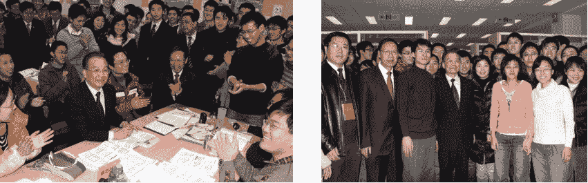

> 温家宝：“我希望学软件的学生，一定要把基础打好，……，学习这个专业，是很有前途的。”
> 
> （2008年12月20日，北航图书馆）

- Students ... undergraduate, graduate
- ... e & core in c...
- Bibliography

- 《Introduction to Algorithms》(Second Edition, Third Edition), T. H. Cormen, C. E. Leiserson, R. L. Rivest (2002, Turing Award), The MIT Press
- 《The Art of Computer Programming》, Donald E, Knuth 1974, Turing Award

> 网友： “没有读过《Intro…》，不能算是一个真正的程序员”

> “计算机算法的圣经”

> Bill Gates: “如果你认为你是一名真正优秀的程序员，请读Knuth的《计算机程序设计艺术》，如果你能读懂整套书的话，请给我发一份你的简历。”

> “计算机程序设计理论的荷马史诗”

Computer Algo... 里，D.S. 约翰逊 与开澄，谭明术 东增武，段振华 ，陈增武

- 学习方式
  听课 + 看书 + 做作业 + 上机实践（编程） + 课外创作 + 考核
  20%  20%  10%  20%  20%  10%

- 课堂要求
  学术很自由，课堂很严肃：不迟到、早退；不允许接听电话、大声聊天...

- 考核形式与分数比例（仅作参考，内容和比例都根据需要随时调整）
  - 10~30分：平时上机
  - 05~10分：课堂测验
  - 20~30分：期末上机
  - 30~60分：期末笔试
  - 10分：大作业（软件创作；一定代码量的应用程序，演示效果好，用到一些典型的算法；小论文；竞赛获得比较好的奖；......）
  - 10分：讨论班（课堂知识点分析；上机题分析；相关最新算法分析；一些工程应用的算法分析；......）
  - 10分：鼓励同学们参与出题（包括上机题。给出题目和解题报告。例...）

- 课程安排
  - 课堂讲解：基本理论讲解，基本方法的介绍分析
  - 上机实践：基本习题和经典习题的上机实践
  - 实际的项目训练：在以后的整个软件工程实践中，注重程序设计的可行性，程序的效率，软件测试的性能分析，……。
- 如何读这本书


## 算法导论

- 练习和竞赛
  - 新 OJ：http://acm.buaa.edu.cn
- 幻灯片
  - 发大班邮箱？建一个学习群？
- 论文，项目提交
  - songyou@buaa.edu.cn

# 1 算法在计算中的作用

- **What** are algorithms?
- Why is the study of algorithms **worthwhile**?
  - （为什么算法研究非常有意义）
- What is the **role** of algorithms relative to other technologies used in computers?
  - （相比计算机科学的其他技术，算法的角色和地位）

## 1.1 What are algorithms

- Computing: information processing
- Scientific computing (modeling, computing, verifying)
  - 数学：公理、规则 => 定理
    - “上帝创造”。描述客观世界，给人们带来无穷乐趣和痛苦。
  - 例如：Pi的小数点后面是否存在1000个连续的7
  - 1900, Hilbert, 巴黎世界数学家大会，“是否存在一个通用的过程（算法），可以自动判定任意命题是否正确？”
  - Turing (1912~1954), 1931, undergraduate in Cambridge Univ.
  - Before 1936, no scientific computing. Turing, 论可计算数及其在判定问题中的应用, 1936.
  - John von Neumann (1903~1957), 1946, first electronic computer.
  - 算法：过程、工具
    - “人创造”。方便人们研究数学；解决实际问题。

1. Algorithm is any well-defined computational procedure

   （算法：一个定义明确的可计算过程）

   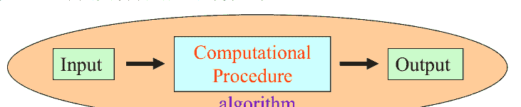

   ```
   < 31,41,59,26,12,58 >
   <31,41,26,12,58,59>
   <31,26,12,41,58,59>
   ......
   <12,26,31,41,58,59>
   ```

   “冒泡”排序是可计算过程

   - Well-defined: know what to do each step; always halts with correct answer.
   - Efficiency: good or bad?

2. Algorithm is a tool for solving a well-specified computational problem

   Problem? general questions needed to be computed

   Algorithm (a tool)

   instance (input)?

   - input1 ?
   - input2 ?
   - input3 ?
   - ……

   output

   

   

   Sorting is a fundamental operation in computer science

   **Example: Sorting problem**

   **Problem:** to sort a sequence of numbers into nondecreasing order

   **Input:** A sequence of n numbers <a₁,a₂,…,aₙ>

   **Output:** A permutation (reordering) <a₁',a₂',…,aₙ'> of the input sequence such that a₁' ≤ a₂' ≤ … ≤ aₙ'

   **An instance of the sorting problem**

   **Input:** <31,41,59,26,41,58>

   **Output:** <26,31,41,41,58,59>

- **The characteristics of the algorithm**
  - **Output:** at least one.
  - **Correct:** An algorithm is said to be correct if, for every input instance, it halts with the correct output
  - **Incorrect algorithm**
    - might not halt at all on some input instances, or
    - might halt with an answer other than the desired one
    - can sometimes be useful (if error rate can be controlled)
  - **Feasible** (可行性，可编程实现)
  - **Practical** (feasible actually，实际可行)

### 1.1.1 What kinds of problems are solved by algorithms

- **Genome Project**
- **Internet**
  - finding good routes; search engine
- **Electronic commerce**
  - keeping information; digital signatures
- **Manufacturing and other commercial settings**
  - placing wells; buying campaign advertising
- **Finding the shortest path from one vertex to another**
- **Matrices product:** $A_1 A_2 A_3 A_4$
  - $A_1(A_2(A_3 A_4))$; $A_1((A_2 A_3)A_4)$; $(A_1 A_2)(A_3 A_4)$
  - ......

**Common characteristics of many algorithms**

- Many candidate solutions
  - (one of which is best, but finding it can present quite a challenge.)
  - for example, $A_1 A_2 A_3 A_4$
  - $A_1(A_2(A_3 A_4))$; $A_1((A_2 A_3)A_4)$; $(A_1 A_2)(A_3 A_4)$
- Practical application
  - shortest paths: a transportation (lower labor, fuel costs)

### 1.1.2 Data structures

- A data structure is a way to **store** and **organize** data in order to facilitate access and modifications
- No single data structure works well for all purposes
- It is important to know the strengths and limitations of data structure
- Data structures: static
- Algorithms: dynamic
- The Art of Computer programming
  - Static + Dynamic


### 1.1.3 Technique (有用的技术，有效的方法)

- **Purpose of studying the course**
  - Grasping techniques of algorithm design and analysis (chapters and sections)
  - Developing algorithms on your own, showing that they give the correct answer (exercises and problems)
  - Understanding algorithm’s efficiency

## 1.1.4 Hard problems

20! = 2432902008176640000

### A story of the new manager (新聘经理人的故事：超市发配送经理)

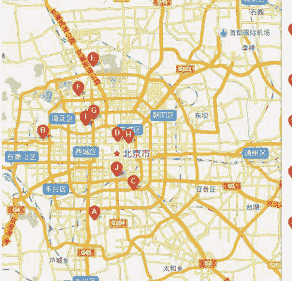

E 超市发左安门第二分店
地址：北京市东城区左安门大街甲10号
电话：(010)67111749

F 超市发(中路)安定里店
地址：北京市朝阳区静安里 4 9 号东楼一层
电话：(010)63559671

G 超市发东科院店
地址：海淀区学院南路73号
电话：(010)68976644

H 超市发景公村店
地址：北京市海淀区景公村街1号市自家园2号楼
电话：(010)88570042

I 超市发颐和园店
地址：海淀区花园北路甲44号(北医三院对面)2楼
电话：(010)62020349

J 超市发超市
地址：海淀区北三环西路51号(苏州桥东侧)
电话：(010)62118112

## 1.1.4 Hard problems

- **A story of the new manager**（新聘经理人的故事：超市发配送经理）
- **NP-complete problem**
  - It is unknown whether or not efficient algorithms exist for NP-complete problems（不知是否存在有效的算法）
  - In the set of NPC, if an efficient algorithms exists for any one, then efficient algorithms exist for all
  - Several are similar, but not identical, to problems for which we do know of efficient algorithms.
- **How to show that the problem is NP-complete**
  - Traveling-salesman problem
  - Factorization（大的合数分解质因数的问题）： M = ? × ?
  - ……

## 1.2 Algorithms as a technology

3×10⁹ ×3×10⁹ instruc / 10⁹ instruc/s = 9×10⁹ seconds = 9×10⁹ / (60×60×24×365) y ≈ 285.39 years

- If computer infinitely fast, memory free.
  Study algorithms worth?
  YES! Need demonstrate that the solution method terminates with the correct answer.
  ∞/∞ = ?

- If any method correct, then （算法正确且按照良好的软件工程特性进行算法设计和实现）
  - Implementation within the bounds of good software engineering practice (i.e. well designed and documented);
  - But most, what method is the easiest to implement!

- Computing time is a bounded resources, so is space
  - Computers may be fast, but not infinitely fast
  - Memory may be cheap, but not free
  - Resources should be used wisely

### 1.2.1 Efficiency

3×10⁹ × 3×10⁹ instruc / 10⁹ instruc/s ≈ 285.39 years

3×10⁹ × lg(3×10⁹) instruc / 10⁹ instruc/s ≈ 94.45 seconds

1. To same problem, algorithms often differ dramatically in their efficiency （同一问题，同样环境，不同算法的效率可能悬殊巨大） （A1 < A2）

2. The differences can be much more significant than differences due to hardware and software （类比硬件与软件的不同，算法的迥异带来的意义可能更明显，即，改进算法可能比升级硬件更有益） （A > H & S）

● Example: sorting ten million (10⁷) numbers

◆ Insertion sort: T(n) = c₁ n²

■ Computer A: 10⁹ instruc/s

■ World’s craftiest programmer

■ Machine language

T(n) = 2 n²

t = 2·(10⁷)² instruc / 10⁹ instruc/s = 2×10⁵ s ≈ 55.56 h

◆ Merge sort: T(n) = c₂ n lg n

■ Computer B: 10⁷ instruc/s

■ Average programmer

■ High-level language

T(n) = 50 n lg n

t = 50·10⁷ lg 10⁷ instruc / 10⁷ instruc/s ≈ 19.38 m

### 1.2.1 Efficiency

3. Efficient algorithm gains much more from the hardware improvement. For example,

- Suppose that the computer makes one basic step per second (ν=1). Algorithm A and B use the same computer. Algorithm A runs as (n_A)², and B as 100n_B.
- If an application requires you to complete as many items as possible in one hour (t= 3600 sec).
- Thus if A can make n_A items, and B makes n_B items, then ν t = 3600 = (n_A)² = 100n_B yields n_A = 60 and n_B = 36.
- But suppose that you replace the computer with one that is hundred times as fast. So you can make 360000 steps in the same time. Then 360000 = (n_A)² = 100n_B yields n_A = 600 and n_B = 3600.

Algorithm B gains much more from the faster computer than A !!!

### 1.2.2 Algorithms and other technologies

- Like computer hardware, algorithms are technology

(1) Algorithms are important on contemporary computers advanced technologies (算法与其他技术同等重要), such as

- Hardware with high clock rates, pipelining, and superscalar architectures (高性能计算设备、流水线操作、超大规模体系结构)
- Easy-to-use, intuitive graphical user interfaces (GUIs)
- Object-oriented systems
- Local-area and wide-area networking


## 1.2.2 算法和其他技术

## 例如

- 一个基于网页的服务，用于确定从一个地点到另一个地点的旅行方式
  - 其实现将依赖于快速硬件、GUI、广域网络，并且可能还依赖于 OO
  - 它还需要用于某些操作的算法，例如寻找路线、渲染地图、插值地址（路径寻找，地图渲染，寻址）

## 1.2.2 算法和其他技术

## 算法用于

软件学院日文应用软件开发专业研一学生栾鸿钧对总理说，最近几年我们国家对软件工程产业比较重视，但同印度相比，还存在差距。

> 温总理接着栾鸿钧的话题说：“我参观过印度的软件公司。当时我就讲，软件主要决定于两个因素，第一是人的大脑，第二是市场的需求。人的智力开发，是无穷无尽的。我希望学软件的学生，一定要把基础打好，必须要有创造思维。如果学软件没有创造思维，就没有出路。不能仅仅满足于书本，软件关键在于开发，学习这个专业，是很有前途的。”

（2008年12月20日，北航图书馆）

使用

研究应用

软件专业的学生须有坚实的基础

Program model (machine, assembler, ... model language, OO

Complexity of computing ((Non)-Computable actually)

Computing model (Computable, Non-computable)

John Von Nouma Knuth

## 1.2.2 算法和其他技术

- 算法是当代计算机所使用的大多数技术的核心
- 拥有扎实的算法知识和技术基础是真正熟练的程序员与新手（初学者）区别开来的一个特征
- 凭借现代计算技术，你可以在不了解太多算法的情况下完成一些任务
- 具备良好的算法背景，你可以做得更多、更多 !!!

## 练习和问题

All

# 2 入门

目标：

- 开始使用描述和分析算法的框架（描述和分析算法的框架）
- 检查两种排序算法：插入排序和归并排序
- 看如何用伪代码、C/C++ 描述算法并论证其正确性（如何描述算法）
- 开始使用渐近符号来表达运行时间分析（使用一致性符号来分析算法的运算时间）
- 在归并排序的背景下学习“分而治之”技术（通过merge sort来学习分而治之方法）

# 2 入门

- 2.1 插入排序：描述算法的框架
- 2.2 插入排序：分析算法
- 2.3 归并排序：设计算法

### 2.1 插入排序

问题：将一组数字排序为非递减顺序

输入：n 个数字的序列 <a₁,a₂,…,aₙ>

输出：输入序列的一个排列（重新排序）<a₁',a₂',…,aₙ'>，使得 a₁' ≤ a₂' ≤ … ≤ aₙ'


### 2.1 插入排序

- **伪代码**
  - 在许多方面与 C、Pascal 或 Java 相似
- **伪代码与真实代码之间的差异**
  - 伪代码清晰、简洁地指定给定算法（清晰、准确）
  - 伪代码通常不关心软件工程问题（数据抽象、模块化(模块化)、错误处理）（不用考虑太多技术细节）
  - 用伪代码可以体现算法的本质
  - 永远不会过时

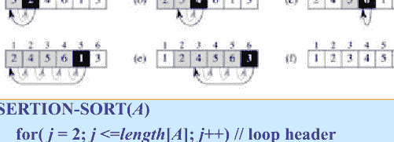

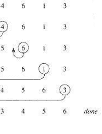

```
INSERTION-SORT(A)
1   for(j = 2; j <= length[A]; j++) // loop header
2   {      key = A[j]
3       // Insert A[j] into the sorted sequence A[1 .. j-1]
4       i <- j-1
5       while(i > 0 && A[i] > key)
6       {      A[i+1] = A[i]
7           i = i-1
8       }
9       A[i+1] = key
10  }   // loop body below
```

算法正确吗？

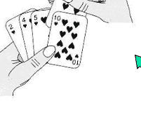


### 2.1.1 循环不变量和插入排序的正确性

- **循环不变量**

**循环不变量：** 在 **for** 循环的每次迭代开始时，子数组 *A[1 .. j-1]* 由 *A[1 .. j-1]* 中原本的元素组成，但已按排序顺序排列。

它可以帮助我们理解为什么算法是正确的。

- **关于循环不变量的三个属性**
  - （初值、维持、终值）（初始化、保存、终止）

- **初始化：** 在循环的第一次迭代之前它是成立的。(base case)

- **维护：** 如果在循环的一次迭代之前它是成立的，则在下一次迭代之前仍然成立。(inductive step)（ [i-1] true => [i] true ）

- **终止：** 当循环终止时，不变量表明算法是正确的。(stopping the “induction” when the loop terminates; the inductive step of mathematical induction is used infinitely. 类似于数学归纳法，但数学归纳法能用于无限情况)

当前两个属性成立时，循环不变量在循环的每次迭代之前都为真。它类似于数学归纳法。


### 2.1.1 循环不变式与插入排序的正确性

- 对于插入排序，有三个性质成立

循环不变式：原始 A[1 .. j-1] 经过置换得到 A'[1 .. j-1]，但其中的元素已按序排列。

- 初始化：j=2 时，A[1 .. j-1] 只包含单个元素 A[1]，它就是原始数组中的 A[1]，且已有序。显然，在循环第一次迭代之前，循环不变式成立。

- 保持：A'[1 .. j-1] 已按序排列，将 A[j] 插入 A'[1 .. j-1] 后，得到 <a'₁, a'₂, ..., a'ₖ, aⱼ, a'ₖ₊₁, ..., ..., a'ⱼ₋₁>，显然它是有序的。保持性质对外层循环成立。

- 终止：当 j=n+1 时，A'[1 .. j-1] = A'[1 .. n] 包含原始数组 A[1 .. n] 中的所有元素，但已按序排列。A'[1 .. n] 就是整个数组！因此，该算法是正确的。

### 2.1.2 伪代码约定

- 缩进表示块结构。（缩排）
- 循环结构（**while**、**for**、**repeat**）和条件结构（**if**、**then**、**else**）的解释与 Pascal、C 语言中的类似。
- “//”或“▷”表示注释。
- 多重赋值 *i←j←e* 等价于先执行 *j←e*，再执行 *i←j*。
- 变量是给定过程的局部变量。
- 数组元素的访问：*A[i]*；*A[1..j] = <A[1], A[2],…, A[i]>*
- 复合数据通常组织为对象。
- 参数按值传递给过程。
- 布尔运算符“and”和“or”采用短路求值：例如“*x* and (or) *y*”：是否计算 *y* 取决于 *x* 的计算结果。

## 2.2 分析算法

- 分析算法意味着预测资源消耗
  - 资源：
    - 内存（空间）
    - 通信带宽
    - 主要关注计算机硬件
    - 计算时间（CPU、I/O 等）
  - 通过分析一个问题的若干候选算法，可以找出最高效的一个，并丢弃较差的算法（最优方案选取）

- 计算模型
  - 图灵（图灵机，计算的原始模型：符号体系、读写介质、I/O、……）
    M = (Q, Γ, I, δ, B, q₀, q_f)
  - RAM
    随机存取机（随机存取器）

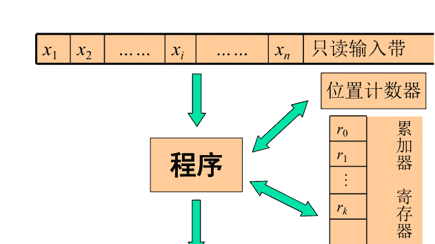

- **RAM 模型：算法将以计算机程序的形式实现。**
  - RAM 是一种通用的单处理器模型，指令一条接一条地执行，不存在并发操作。
  - RAM 通常包含以下指令：
    - 算术（加、减、乘、除、取余、向下取整、向上取整）
    - 数据移动（加载、存储、复制）
    - 控制（条件分支、无条件分支、子程序调用与返回）
  - 每条这样的指令都花费常数时间。

- 分析一个简单的算法也可能是一项挑战
  - 所需数学：组合数学、概率论、代数技巧
    （数学功底好）
  - 能够识别公式中最重要的项的能力
    （洞察能力强，能抓住最重要的部分）
  - 用简单公式概括算法的能力
    （抽象思维强，能将算法的本质特征归纳成简单形式）

### 2.2.1 插入排序的分析

- **程序的运行时间描述为其输入规模的函数。**（通常，程序的运算时间是输入规模的函数）
  - **输入规模 n**：*输入中的项数，取决于具体问题*
    - 对数组 A 排序：n = A 的长度
    - 图：n 可以是顶点数和边数
  - **运行时间 T(n)**：在特定输入下，*执行的基本操作或“步骤”数*（基本操作数）
    运行时间满足如下一致性原则：
    - 这些步骤与机器无关（基本操作独立于机器）
    - 执行伪代码第 i 行需要常数时间 cᵢ（每行指令的执行时间为常数）

```
INSERTION-SORT(A)
1   for(j = 2; j <= length[A]; j++)
2   {   key = A[j]
3       // Insert A[j] into the sorted sequence A[1 .. j-1]
4       i = j-1
5       while(i > 0 && A[i] > key)
6       {   A[i+1] = A[i]
7           i = i-1
8       }
9       A[i+1] = key
10  }
```

| 代价 | 次数 |
|------|-------|
| c₁ | n |
| c₂ | n-1 |
| 0 | n-1 |
| c₄ | n-1 |
| c₅ | Σⱼ=2ⁿ tⱼ |
| c₆ | Σⱼ=2ⁿ (tⱼ -1) |
| c₇ | Σⱼ=2ⁿ (tⱼ -1) |
| c₈ | n-1 |

T(n) = c₁ n + c₂ (n-1) + c₄ (n-1) + c₅ Σⱼ=2ⁿ tⱼ + c₆ Σⱼ=2ⁿ (tⱼ -1) + c₇ Σⱼ=2ⁿ (tⱼ -1) + c₈ (n-1)

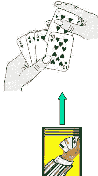


### 2.2.1 插入排序分析

T(n)=c₁n + c₂(n−1) + c₄(n−1) + c₅∑_{j=2}^{n} t_j + c₆∑_{j=2}^{n} (t_j−1) + c₇∑_{j=2}^{n} (t_j−1) + c₈(n−1)

- 即使对于给定规模的输入，算法的运行时间也可能取决于给定的是哪一个该规模的输入。
  (相同输入规模的情况下，输入不同，运算时间也可能不同)

- 最好情况发生在数组已经有序时。对于每个 j = 2, 3, ..., n，在第 5 行 i 具有初始值 j-1 时，A[i] ≤ key。因此 t_j=1，最好情况下的运行时间为

T(n)=c₁n + c₂(n−1) + c₄(n−1) + c₅(n−1) + c₈(n−1)
=(c₁ + c₂ + c₄ + c₅ + c₈)n − (c₂ + c₄ + c₅ + c₈) = an + b

它因此是 n 的线性函数。

T(n) = c₁n + c₂(n−1) + c₄(n−1) + c₅ Σ_{j=2}^{n} t_j + c₆ Σ_{j=2}^{n} (t_j −1) + c₇ Σ_{j=2}^{n} (t_j −1) + c₈(n−1)

- 算法的运行时间可能取决于实际输入。

- 最坏情况发生在数组按逆序排列时。我们必须将每个元素 A[j] 与整个已排序子数组 A[1 .. j−1] 中的每个元素进行比较，因此 t_j = j。

Σ_{j=2}^{n} j = n(n+1)/2 − 1 ,   Σ_{j=2}^{n} (j−1) = n(n−1)/2

则 T(n) = c₁n + c₂(n−1) + c₄(n−1) + c₅( n(n+1)/2 −1 ) + c₆( n(n−1)/2 ) + c₇( n(n−1)/2 ) + c₈(n−1) = a n² + b n + c

它因此是 n 的二次函数 (n²)。

### 2.2.2 最坏情况和平均情况分析

- **我们通常集中于寻找最坏情况运行时间（对于任意大小为 *n* 的输入的最长运行时间）。**
  - 算法的最坏情况运行时间是对任意输入运行时间的上界。
  - 最坏情况经常发生。 (in searching a database) (最坏情况经常发生)
  - “平均情况”通常与最坏情况差不多糟糕。 (suppose that we randomly choose *n* numbers and apply insertion sort.)
- **算法的平均情况或期望运行时间**
  - 概率分析 (Knuth)
  - 随机化算法

### 2.2.3 增长顺序

#### 增长率 (order of growth, 函数增长率)

- 更简化的抽象。
- 只考虑公式的主导项 (例如，$an^2$ of $an^2+bn+c$)，因为对于大的 $n$，低阶项相对不重要。
- 忽略主导项的常数系数，因为在确定大输入的计算效率时，常数因子不如增长率重要。

因此，插入排序的最坏情况运行时间为 Θ(n²)

- 通常，如果其最坏情况运行时间的增长顺序更低，则一种算法比另一种算法更有效 (小输入例外，例如，10n lgn vs 2n²)。

## 2.3 设计算法

- 设计算法的方法有很多

### 排序问题

- Bubble sort: bubbling
- Insertion sort: incremental approach （增量靠近）
- Merge sort: divide-and conquer （特定位置，分而治之）
- Quick sort: location （元素定位，分而治之）
- ......
- 分治算法的最坏情况运行时间远小于插入排序。

### 2.3.1 分治法

- **分治法**
  （分而治之，各个击破）

**Recursive** : call themselves recursively one or more times to deal with closely related subproblems.

- **Divide** the problem into a number of subproblems.

- **Conquer** the subproblems by solving them recursively. If the subproblem sizes are small enough, however, just solve the subproblems in a straightforward manner.

- **Combine** the solutions to the subproblems into the solution for the original problem.

- **归并排序算法**
  - **Divide:** divide the *n*-element sequence to be sorted into two subsequences of *n*/2 elements each.
  - *(Exercise: how about four subsequences, n/4 elements each?)*
  - **Conquer:** merge sort the two subsequences recursively.
  - **Combine:** merge the two sorted subsequences to produce the sorted answer.

递归在待排序序列长度为 1 时“到底”，此时无需工作，因为每个长度为 1 的序列都已是有序的。


### 2.3.1 分治法

- **MERGE(A,p,q,r):** MERGE 排序算法的关键操作，在“合并”步骤中合并两个已排序序列。
  - *A* 是一个数组，*p, q,* 和 *r* 是对数组元素进行编号的下标，且满足 *p ≤ q < r*。
  - 该过程假设子数组 *A[p .. q]* 和 *A[q+1 .. r]* 已按排序顺序排列。该过程将它们合并形成一个单一的已排序子数组，用以替换当前子数组 *A[p .. r]*。
  - 工作步骤：

该过程耗时 Θ(n)，n=r-p+1

? 

9 10 J Q K

7 8 9 10 J

```
MERGE(A, p, q, r)
1   n₁ ← q-p+1
2   n₂ ← r-q
3   create arrays L[1 .. n₁+1] and R[1 .. n₂+1]
4   for i←1 to n₁
5       do L[i]←A[p+i-1]
6   for j←1 to n₂
7       do R[j]←A[q+j]
8   L[n₁+1]←∞    // To avoid having to check whether either pile is empty in each
9   R[n₂+1]←∞    // basic step, a sentinel card is put on the bottom of each pile.
10  i←1
11  j←1
12  for k←p to r
13      do if L[i]≤R[j]
14          then A[k]←L[i]
15              i←i+1
16          else A[k]←R[j]
17              j←j+1
```


子程序如何工作？下一页

```
MERGE(A, p, q, r)
1   n₁ ← q-p+1
2   n₂ ← r-q
3   create arrays L[1 .. n₁+1] and R[1 .. n₂+1]
4   for i←1 to n₁
5       do L[i]←A[p+i-1]
6   for j←1 to n₂
7       do R[j]←A[q+j]
8   L[n₁+1]←∞
9   R[n₂+1]←∞
10  i←1
11  j←1
12  for k←p to r
13      do if L[i]≤R[j]
14          then A[k]←L[i]
15              i←i+1
16          else A[k]←R[j]
17              j←j+1
```

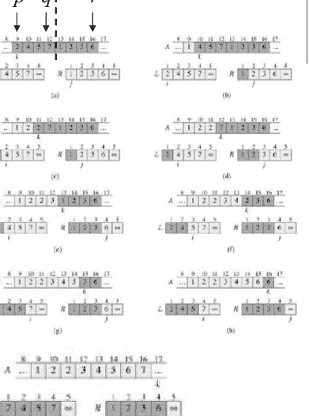

#### MERGE 的循环不变式性质

```
MERGE(A, p, q, r)
1    n₁ ← q-p+1
2    n₂ ← r-q
3    create L[1 .. n₁+1], R[1 .. n₂+1]
4    for i←1 to n₁
5      do L[i]←A[p+i-1]
6    for j←1 to n₂
7      do R[j]←A[q+j]
8    L[n₁+1]←∞
9    R[n₂+1]←∞
10   i←1
11   j←1
12   for k←p to r
13     do if L[i]≤R[j]
14         then A[k]←L[i]
15              i←i+1
16         else A[k]←R[j]
17              j←j+1
```

初始化：在循环的第一次迭代之前，k = p，因此 A[p .. k-1] 为空。A[p .. k-1] 包含 L 和 R 的 0 个最小元素，并且由于 i=j=1，L[i] 和 R[j] 分别是尚未复制回 A 的各自数组的最小元素。

维护：首先假设 L[i]≤R[j]。由于 A[p .. k-1] 包含 k-p 个最小元素，在第 14 行将 L[i] 复制到 A[k] 之后，子数组 A[p .. k] 将包含 k-p+1 个最小元素。如果 L[i]>R[j]，则如此做。

终止：k=r+1，子数组 A[p .. k-1] 为 A[p .. r]，包含 L[1 .. n₁+1] 和 R[1 .. n₂+1] 的 r-p+1 个最小元素，按排序顺序排列。除了两个最大的哨兵之外，其余元素都已复制回 A。

| MERGE(A, p, q, r) | cost | times |
|---|---|---|
| 1   n₁ ← q-p+1 | c | 1 |
| 2   n₂ ← r-q | c | 1 |
| 3   create arrays L[1 .. n₁+1] and R[1 .. n₂+1] | c | 1 |
| 4   for i←1 to n₁ | c | n₁+1 |
| 5     do L[i]←A[p+i-1] | c | n₁ |
| 6   for j←1 to n₂ | c | n₂+1 |
| 7     do R[j]←A[q+j] | c | n₂ |
| 8   L[n₁+1]←∞ | c | 1 |
| 9   R[n₂+1]←∞ | c | 1 |
| 10  i←1 | c | 1 |
| 11  j←1 | c | 1 |
| 12  for k←p to r | c | r-p+2 |
| 13    do if L[i]≤R[j] | c | r-p+1 |
| 14      then A[k]←L[i] | c | x |
| 15        i←i+1 | c | x |
| 16      else A[k]←R[j] | c | r-p+1-x |
| 17        j←j+1 | c | r-p+1-x |

r-p+1
= n₁ + n₂ = n

1<=x<=n₁

Θ(n₁+n₂)=Θ(n)

- MERGE 过程作为子程序。
- MERGE-SORT(A, p, r) 对子数组 A[p .. r] 中的元素进行排序。
- 如果 p ≥ r，则子数组最多有一个元素，已排序，为基本情况。
- 否则，分治步骤计算一个下标 q，将 A[p .. r] 分区为两个子数组：A[p .. q]，包含 ⌊n/2⌋ 个元素，和 A[q+1 .. r]，包含 ⌈n/2⌉ 个元素。

```
MERGE-SORT(A, p, r)
1  if p < r
2    Then q ← ⌊(p+r)/2⌋
3      MERGE-SORT(A, p, q)
4      MERGE-SORT(A, q+1, r)
5      MERGE(A, p, q, r)
```


### 2.3.1 分治法

```
MERGE-SORT(A, p, r)
1  if p < r
2    Then q ← ⌊(p + r)/2⌋
3      MERGE-SORT(A, p, q)
4      MERGE-SORT(A, q+1, r)
5      MERGE(A, p, q, r)
```

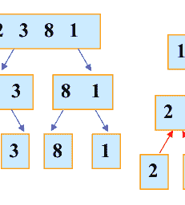

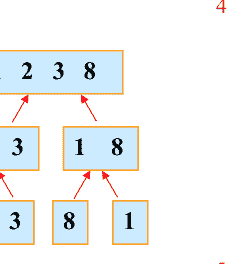

```
MERGE-SORT(A, 1, 4)
1 if 1 < 4
2   Then q ← ⌊(1 + 4)/2⌋ = 2
3   MERGE-SORT(A, 1, 2)
1 if 1 < 2
2 Then q ← ⌊(1 + 2)/2⌋ = 1
3 MERGE-SORT(A, 1, 1)
1 if 1 < 1
4 MERGE-SORT(A, 2, 2)
1 if 2 < 2
5 MERGE(A, 1, 1, 2)
4 MERGE-SORT(A, 3, 4)
1 if 3 < 4
2 Then q ← ⌊(3 + 4)/2⌋ = 3
3 MERGE-SORT(A, 3, 3)
1 if 3 < 3
4 MERGE-SORT(A, 4, 4)
1 if 4 < 4
5 MERGE(A, 3, 3, 4)
MERGE(A, 1, 2, 4)
```

### 2.3.2 分析分治算法

当一个算法包含对自身的递归调用时，其运行时间通常可以用递归方程或递归式来描述，该方程根据规模更小的输入上的运行时间来描述规模为 n 的问题的总运行时间。

我们得到如下递归式：

T(n) = { Θ(1) 若 n ≤ c
         aT(n / b) + D(n) + C(n) 否则 }

- D(n) 是将问题分解为子问题所需的时间。
- C(n) 是将子问题的解合并为原问题的解所需的时间。

```
MERGE-SORT(A, p, r)
1   if p < r
2     Then q ← ⌊(p + r) / 2⌋
3       MERGE-SORT(A, p, q)
4       MERGE-SORT(A, q+1, r)
5       MERGE(A, p, q, r)
```

T(n) = { Θ(1) 若 n ≤ c
         a T(n / b) + D(n) + C(n) 否则 }

- 假设原问题规模是 2 的幂，可以简化递归式的分析。这样，每一次分解都会得到两个规模恰好为 n/2 的子序列（该假设不影响递归式解的增长阶）。

```
MERGE-SORT(A, p, r)
1   if p < r
2   Then q ← ⌊(p + r) / 2⌋
3       MERGE-SORT(A, p, q)
4       MERGE-SORT(A, q + 1, r)
5       MERGE(A, p, q, r)
```

T(n) = { Θ(1) 若 n ≤ c
          aT(n / b) + D(n) + C(n) 否则 }

如何为 T(n)（归并排序对 n 个数的最坏情况运行时间）建立递归式？

- 如果只有一个元素 n=1，则需要常数时间。
- 当 n>1 时，

- **分解**：该步骤只是计算子数组的中间位置，只需一步。因此，D(n)=Θ(1)。
- **解决**：递归求解两个规模均为 n/2 的子问题，它对运行时间的贡献为 2T(n/2)。
- **合并**：MERGE 过程表明 C(n)=Θ(n)。

T(n) = { Θ(1) 若 n = 1
         2T(n / 2) + Θ(n) 若 n > 1 }

```
MERGE-SORT(A, p, r)
1   if p < r
2       Then q ← ⌊(p + r) / 2⌋
3           MERGE-SORT(A, p, q)
4           MERGE-SORT(A, q+1, r)
5           MERGE(A, p, q, r)
```

重写递归方程：

T(n) = { Θ(1)          若 n = 1
         2T(n/2) + Θ(n)  若 n > 1 }

T(n) = { Θ(1)          若 n = 1
         2T(n/2) + c n   若 n > 1 }

求解该递归方程。

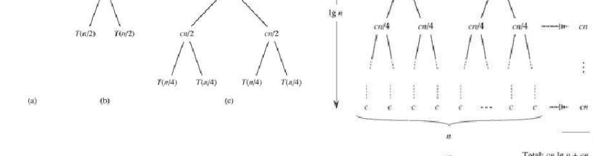

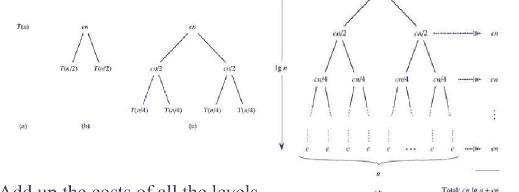

将所有层的代价相加。共有 lg n + 1 层，每层代价为 cn，因此总代价为

cn(lg n + 1) = cn lg n + cn = Θ(n lg n)

显然，对于足够大的输入规模，它在最坏情况下的性能优于插入排序，插入排序的运行时间为 Θ(n²)。

## 练习与问题

# 练习

分析 Fibonacci 序列 F(n) = F(n-1) + F(n-2) 的如下算法的时间复杂度。

```
re_type f(type n)
{
    if(n<=2)
        return 1;
    else
        return f(n-1)+f(n-2);
}
```

```
f1 = 1;
f2 = 1;

for(i=3; i<=n; i++){
    f = f1 + f2;
    f1 = f2;
    f2 = f;
}
```

- 练习

全部

补充：自己编程实现几种常用的排序算法（插入、冒泡、归并、快排、等等），并比较分析其运算时间。输入为随机产生的 n 个数，让 n 尽可能大。

- 问题

全部

# 2 入门

目标：

- 开始使用描述和分析算法的框架
- 考察两种排序算法：插入排序和归并排序
- 学习如何用伪代码、C/C++ 描述算法并论证其正确性
- 开始使用渐近记号来表示运行时间分析
- 在归并排序的背景下学习“分而治之”的技术


# 2 入门

- 2.1 插入排序：描述算法的框架
- 2.2 插入排序：分析算法
- 2.3 归并排序：设计算法

### 2.1 插入排序

问题：将一组数字排序为非递减顺序

输入：n 个数字的序列 <a₁,a₂,…,aₙ>

输出：输入序列的一个排列 <a₁',a₂',…,aₙ'>，使得 a₁' ≤ a₂' ≤ … ≤ aₙ'

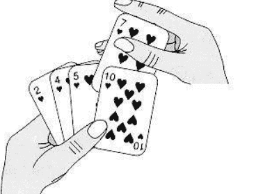

### 2.1 插入排序

- **伪代码**
  在许多方面与 C、Pascal 或 Java 相似
- **伪代码与真实代码之间的差异**
  - pseudocode is clear and concise to specify a given algorithm (清晰、准确)
  - Pseudocode is not typically concerned with issues of software engineering (data abstraction, modularity(模块化), error handling) (不用考虑太多技术细节)
  - 用伪代码可以体现算法的本质
  - 永远不会过时

### 2.1 插入排序

```
INSERTION-SORT(A)
1   for(j = 2; j <= length[A]; j++) // loop header
2   {      key = A[j]
3       // Insert A[j] into the sorted sequence A[1 .. j-1]
4       i <- j-1
5       while(i > 0 && A[i] > key)
6       {      A[i+1] = A[i]
7           i = i-1
8       }
9       A[i+1] = key
10  }   // loop body below
```

算法正确吗？

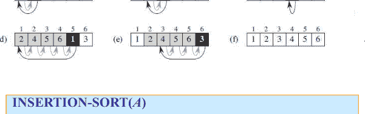

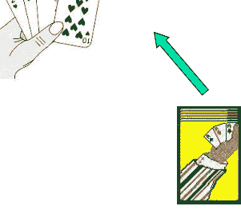

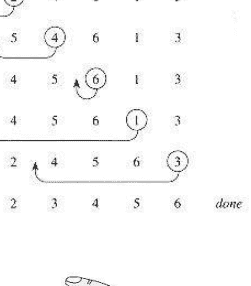

### 2.1.1 循环不变量与插入排序的正确性

- **循环不变量**

**Loop invariant:** At the start of each iteration of **for** loop, the subarray *A[1 .. j-1]* consists of the elements originally in *A[1 .. j-1]* but in sorted order.

它可以帮助我们理解为什么算法是正确的。

- **循环不变量的三个性质**
  （初值、维持、终值） （初始化、保存、终止）

- **Initialization:** it is true prior to the first iteration of the loop.(base case)

- **Maintenance:** if it is true before an iteration of the loop, it remains true before the next iteration. (inductive step) ( [i-1] true => [i] true )

- **Termination:** When the loop terminates, the invariant show that the algorithms is correct. (stopping the “induction” when the loop terminates; the inductive step of mathematical induction is used infinitely. 类似于数学归纳法，但数学归纳法能用于无限情况)

当前两个性质成立时，循环不变量在循环的每次迭代之前都为真。它类似于数学归纳法。

### 2.1.1 循环不变量与插入排序的正确性

- 插入排序满足三个性质

Loop invariant: original A[1 .. j-1] is permuted to A'[1 .. j-1] but in sorted order

- Initialization: j=2, A[1 .. j-1] consists of just the single A[1], which is the original element in A[1], and is sorted. Obviously, the loop invariant holds prior to the first iteration of the loop.

- Maintenance: A'[1 .. j-1] is in sorted order, sorting A[j] into A'[1 .. j-1], s.t. <a'₁, a'₂, ..., a'ₖ, aⱼ, a'ₖ₊₁, ..., ..., a'ⱼ₋₁>, obviously, it is sorted. The second property holds for the outer loop.

- Termination: when j=n+1. A'[1 .. j-1] = A'[1 .. n] consists of the elements originally in A[1 .. n], but in sorted order. A'[1 .. n] is the entire array! Hence, the algorithm is correct.

### 2.1.2 伪代码约定

- Indentation indicates block structure. （缩排）
- The looping constructs (**while**, **for**, **repeat**) and the conditional constructs (**if**, **then**, **else**) have interpretations similar to those in Pascal, C.
- “//” or “▷” indicates a comment.
- A multiple assignment *i←j←e* is equivalent to *j←e* then *i←j*.
- Variables are local to the given procedure.
- Array elements access: *A[i]*； *A[1..j] = <A[1], A[2],…, A[i]>*
- Compound data are typically organized into objects.
- Parameters are passed to a procedure by value.
- The boolean operators “and” and “or” are short circuiting: for example “*x* and (or) *y*”: whether or not evaluate *y* rely on the evaluating of *x*.


## 2.2 分析算法

- 分析算法意味着预测资源需求。
  - 资源：
    - 内存（空间）
    - 通信带宽
    - 主要关注：计算机硬件
    - 计算时间（CPU、I/O 等）
  - 通过分析一个问题的若干候选算法，可以确定最高效的算法，并舍弃若干较差的算法（最优方案选取）

- **计算模型（Computing model）**
  - **图灵（Turing）**（图灵机，计算的原始模型：符号体系，读写介质，1/0，......）
    - $M = (Q, \Gamma, I, \delta, B, q_0, q_f)$
  - **RAM**
    - 随机存取机器（Random-access machine）

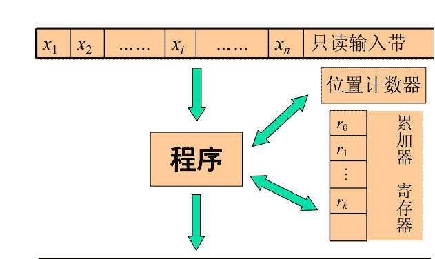

- **RAM 模型：算法将作为计算机程序来实现。**
  - RAM 是一种通用的单处理器模型；指令一条接一条地执行，不存在并发操作。
  - RAM 包含常用指令：
    - 算术运算（加、减、乘、除、取余、向下取整、向上取整）
    - 数据移动（载入、存储、复制）
    - 控制（条件分支与无条件分支、子程序调用与返回）
  - 每条这类指令的执行时间都是常数。

- 分析一个简单算法也可能很有挑战性
  - 所需数学知识：组合数学、概率论、代数运算能力（数学功底好）
  - 从公式中识别最重要项的能力（洞察能力强，能抓住最重要的部分）
  - 用简单公式概括算法的能力（抽象思维强，能将算法的本质特征归纳成简单形式）

### 2.2.1 插入排序的分析

- **程序的运行时间描述为其输入规模的函数。**（通常，程序的运算时间是输入规模的函数）
  - **输入规模 $n$**：*输入中数据项的数量，取决于具体问题*
    - 排序数组 $A$：$n$ 为 $A$ 的长度
    - 图：$n$ 可以是顶点数和边数
  - **运行时间 $T(n)$**：在特定输入下，*执行的基本操作或“步骤”的数量*（基本操作数）
    - 运行时间满足如下一致性原则
      - 步骤是机器无关的（基本操作独立于机器）
      - 执行伪代码第 $i$ 行需要常数时间 $c_i$（每行指令的执行时间为常数）

```
INSERTION-SORT(A)
1   for(j = 2; j <= length[A]; j++)
2   {   key = A[j]
3       // Insert A[j] into the sorted sequence A[1 .. j-1]
4       i = j-1
5       while(i > 0 && A[i] > key)
6       {   A[i+1] = A[i]
7           i = i-1
8       }
9       A[i+1] = key
10  }
```

| 代价 | 次数 |
|------|-------|
| $c_1$ | $n$ |
| $c_2$ | $n-1$ |
| $0$ | $n-1$ |
| $c_4$ | $n-1$ |
| $c_5$ | $\sum_{j=2}^{n} t_j$ |
| $c_6$ | $\sum_{j=2}^{n} (t_j - 1)$ |
| $c_7$ | $\sum_{j=2}^{n} (t_j - 1)$ |
| $c_8$ | $n-1$ |

$$T(n) = c_1 n + c_2(n-1) + c_4(n-1) + c_5 \sum_{j=2}^{n} t_j + c_6 \sum_{j=2}^{n} (t_j-1) + c_7 \sum_{j=2}^{n} (t_j-1) + c_8(n-1)$$


- 即使输入规模相同，算法的运行时间也可能取决于给出的是该规模下的哪个输入。（相同输入规模的情况下，输入不同，运算时间也可能不同）

- 最佳情况出现在数组已经有序时。对于每个 $j = 2, 3, \ldots, n$，当 $i$ 的初始值为 $j-1$ 时，第 5 行中的 $A[i] \le key$ 成立。因此 $t_j = 1$，最佳情况运行时间为

$$T(n) = c_1 n + c_2(n-1) + c_4(n-1) + c_5(n-1) + c_8(n-1) = (c_1 + c_2 + c_4 + c_5 + c_8)n - (c_2 + c_4 + c_5 + c_8) = a n + b$$

因此它是 $n$ 的线性函数。

- 算法的运行时间可能依赖于实际输入。

- 如果数组按逆序排列，则会出现最坏情况。我们必须将每个元素 $A[j]$ 与整个已排序子数组 $A[1 .. j-1]$ 中的每个元素进行比较，因此 $t_j = j$。

$$\sum_{j=2}^{n} j = \frac{n(n+1)}{2} - 1, \quad \sum_{j=2}^{n} (j-1) = \frac{n(n-1)}{2}$$

于是

$$T(n) = c_1 n + c_2(n-1) + c_4(n-1) + c_5\left(\frac{n(n+1)}{2} - 1\right) + c_6\left(\frac{n(n-1)}{2}\right) + c_7\left(\frac{n(n-1)}{2}\right) + c_8(n-1) = a n^2 + b n + c$$

因此它是 $n$ 的二次函数（$n^2$）。


### 2.2.2 最坏情况和平均情况分析

- **我们通常集中于寻找最坏情况运行时间（对于任意大小为 *n* 的输入的最长运行时间）。**
  - 算法的最坏情况运行时间是对任意输入运行时间的上界。
  - 最坏情况经常发生。 (in searching a database) (最坏情况经常发生)
  - “平均情况”通常与最坏情况差不多糟糕。 (suppose that we randomly choose *n* numbers and apply insertion sort.)
- **算法的平均情况或期望运行时间**
  - 概率分析 (Knuth)
  - 随机化算法

### 2.2.3 增长顺序

#### 增长率 (order of growth, 函数增长率)

- 更简化的抽象。
- 只考虑公式的主导项（例如，$an^2$ of $an^2+bn+c$），因为对于大的 $n$，低阶项相对不重要。
- 忽略主导项的常数系数，因为在确定大输入的计算效率时，常数因子不如增长率重要。

因此，插入排序的最坏情况运行时间为 Θ(n²)

- 通常，如果一个算法的最坏情况运行时间的增长顺序更低，则该算法比另一个算法更高效（小输入例外，例如，10n lgn vs 2n²）。

## 2.3 设计算法

- 设计算法的方法有很多

### 排序问题

- Bubble sort: bubbling
- Insertion sort: incremental approach （增量靠近）
- Merge sort: divide-and conquer （特定位置，分而治之）
- Quick sort: location （元素定位，分而治之）
- ......
- 分治算法的最坏情况运行时间远小于插入排序。

### 2.3.1 分治法

- **Divide-and-conquer approach**
  （分而治之，各个击破）

**Recursive** : call themselves recursively one or more times to deal with closely related subproblems.

- **Divide** the problem into a number of subproblems.
- **Conquer** the subproblems by solving them recursively. If the subproblem sizes are small enough, however, just solve the subproblems in a straightforward manner.
- **Combine** the solutions to the subproblems into the solution for the original problem.

### 2.3.1 分治法

- **Merge sort algorithm**
  - **Divide:** divide the *n*-element sequence to be sorted into two subsequences of *n*/2 elements each.
  - *(Exercise: how about four subsequences, n/4 elements each?)*
  - **Conquer:** merge sort the two subsequences recursively.
  - **Combine:** merge the two sorted subsequences to produce the sorted answer.

递归在待排序序列长度为 1 时“到底”，此时无需工作，因为每个长度为 1 的序列都已是有序的。

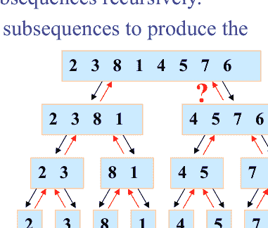

### 2.3.1 分治法

- **MERGE(A,p,q,r):** MERGE 排序算法的关键操作，在“合并”步骤中合并两个有序序列。
  - *A* 是一个数组，*p, q,* 和 *r* 是对数组元素的索引编号，使得 *p ≤ q < r*。
  - 该过程假设子数组 *A[p .. q]* 和 *A[q+1 .. r]* 已按排序顺序排列。该过程将它们合并形成单个有序子数组，用以替换当前子数组 *A[p .. r]*。
  - 工作步骤：

该过程花费时间 Θ(n)，n=r-p+1

### 2.3.1 分治法

? 

9 10 J Q K

7 8 9 10 J

```
MERGE(A, p, q, r)
1   n₁ ← q-p+1
2   n₂ ← r-q
3   create arrays L[1 .. n₁+1] and R[1 .. n₂+1]
4   for i←1 to n₁
5       do L[i]←A[p+i-1]
6   for j←1 to n₂
7       do R[j]←A[q+j]
8   L[n₁+1]←∞    // To avoid having to check whether either pile is empty in each
9   R[n₂+1]←∞    // basic step, a sentinel card is put on the bottom of each pile.
10  i←1
11  j←1
12  for k←p to r
13      do if L[i]≤R[j]
14          then A[k]←L[i]
15              i←i+1
16          else A[k]←R[j]
17              j←j+1
```

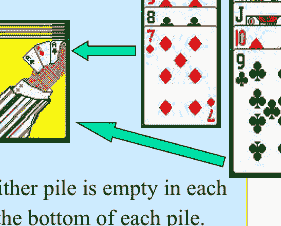

子程序如何工作？ Next Page


### 2.3.1 分治法

```
MERGE(A, p, q, r)
1   n₁ ← q-p+1
2   n₂ ← r-q
3   create arrays L[1 .. n₁+1] and R[1 .. n₂+1]
4   for i←1 to n₁
5       do L[i]←A[p+i-1]
6   for j←1 to n₂
7       do R[j]←A[q+j]
8   L[n₁+1]←∞
9   R[n₂+1]←∞
10  i←1
11  j←1
12  for k←p to r
13      do if L[i]≤R[j]
14          then A[k]←L[i]
15              i←i+1
16          else A[k]←R[j]
17              j←j+1
```

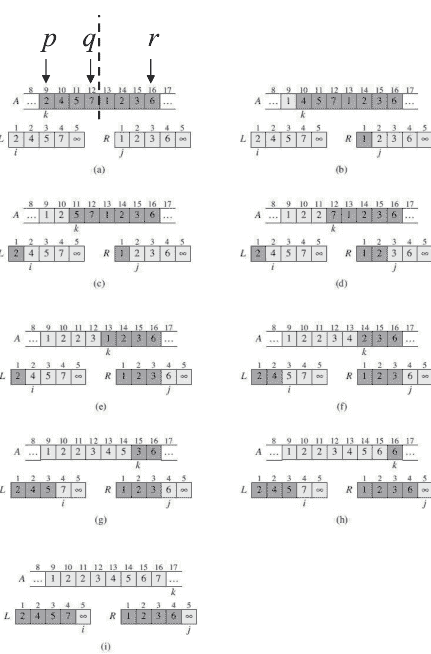

#### MERGE 循环不变式的性质

初始化：在循环第一次迭代之前，k = p，因此 A[p .. k-1] 是空的。A[p .. k-1] 包含 L 和 R 的 0 个最小元素，且由于 i = j = 1，L[i] 和 R[j] 分别是各自数组中尚未复制回 A 的最小元素。

保持：首先假设 L[i] ≤ R[j]。因为 A[p .. k-1] 包含 k-p 个最小元素，在第 14 行将 L[i] 复制到 A[k] 之后，子数组 A[p .. k] 将包含 k-p+1 个最小元素。如果 L[i] > R[j]，则第 16-17 行执行适当的操作以维持循环不变式。

终止：终止时，k = r + 1。子数组 A[p .. k-1] 就是 A[p .. r]，它按排序顺序包含 L[1 .. n₁+1] 和 R[1 .. n₂+1] 的 r-p+1 个最小元素。除两个最大的元素（哨兵）之外，所有元素都已复制回 A。

| MERGE(A, p, q, r) | 代价 | 次数 |
|---|---|---|
| 1 n₁ ← q-p+1 | c | 1 |
| 2 n₂ ← r-q | c | 1 |
| 3 创建数组 L[1 .. n₁+1] 和 R[1 .. n₂+1] | c | 1 |
| 4 对于 i←1 到 n₁ | c | n₁+1 |
| 5 执行 L[i]←A[p+i-1] | c | n₁ |
| 6 对于 j←1 到 n₂ | c | n₂+1 |
| 7 执行 R[j]←A[q+j] | c | n₂ |
| 8 L[n₁+1]←∞ | c | 1 |
| 9 R[n₂+1]←∞ | c | 1 |
| 10 i←1 | c | 1 |
| 11 j←1 | c | 1 |
| 12 对于 k←p 到 r | c | r-p+2 |
| 13 执行：如果 L[i]≤R[j] | c | r-p+1 |
| 14 那么 A[k]←L[i] | c | x |
| 15 i←i+1 | c | x |
| 16 否则 A[k]←R[j] | c | r-p+1-x |
| 17 j←j+1 | c | r-p+1-x |

```
r-p+1
= n₁ + n₂ = n

1 ≤ x ≤ n₁

Θ(n₁+n₂) = Θ(n)
```

- MERGE 过程作为一个子程序。
- MERGE-SORT(A, p, r) 对子数组 A[p .. r] 中的元素进行排序。
- 如果 p ≥ r，子数组至多只有一个元素，已经有序，这是基本情况。
- 否则，分解步骤计算一个下标 q，将 A[p .. r] 划分为两个子数组：A[p .. q] 包含 ⌊n/2⌋ 个元素，A[q+1 .. r] 包含 ⌈n/2⌉ 个元素。

```
MERGE-SORT(A, p, r)
1  if p < r
2    then q ← ⌊(p+r)/2⌋
3    MERGE-SORT(A, p, q)
4    MERGE-SORT(A, q+1, r)
5    MERGE(A, p, q, r)
```

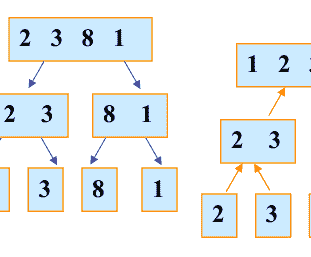

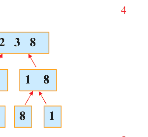

```
MERGE-SORT(A, 1, 4)
1  if 1 < 4
2    then q ← ⌊(1 + 4) / 2⌋ = 2
3    MERGE-SORT(A, 1, 2)
1  if 1 < 2
2    then q ← ⌊(1 + 2) / 2⌋ = 1
3    MERGE-SORT(A, 1, 1)
1  if 1 < 1
4    MERGE-SORT(A, 2, 2)
1  if 2 < 2
5    MERGE(A, 1, 1, 2)
4    MERGE-SORT(A, 3, 4)
1  if 3 < 4
2    then q ← ⌊(3 + 4) / 2⌋ = 3
3    MERGE-SORT(A, 3, 3)
1  if 3 < 3
4    MERGE-SORT(A, 4, 4)
1  if 4 < 4
5    MERGE(A, 3, 3, 4)
5    MERGE(A, 1, 2, 4)
```


### 2.3.2 分析分治算法

当一个算法包含对自身的递归调用时，其运行时间通常可以用递推方程或递推关系来描述，该关系通过较小输入上的运行时间来表示规模为 n 的问题上的总体运行时间。

我们得到如下递推关系：

T(n) = { Θ(1)                     如果 n ≤ c
        a T(n / b) + D(n) + C(n)  否则 }

- D(n) 是将问题分解为子问题所需的时间。
- C(n) 是将子问题的解合并为原问题的解所需的时间。

```
MERGE-SORT(A, p, r)
1   if p < r
2     Then q ← ⌊(p + r) / 2⌋
3       MERGE-SORT(A, p, q)
4       MERGE-SORT(A, q+1, r)
5       MERGE(A, p, q, r)
```

T(n) = { Θ(1) 如果 n ≤ c
 a T(n / b) + D(n) + C(n) 否则 }

假设原问题规模是 2 的幂，递推分析可以简化。这样每一步分解都会产生两个大小恰好为 n/2 的子序列（该假设不影响递推解的增长阶）。

```
MERGE-SORT(A, p, r)
1   if p < r
2     Then q ← ⌊(p + r) / 2⌋
3       MERGE-SORT(A, p, q)
4       MERGE-SORT(A, q+1, r)
5       MERGE(A, p, q, r)
```

T(n) = { Θ(1) 如果 n ≤ c
  aT(n / b) + D(n) + C(n) 否则 }

- 如何为 T(n) 建立递推关系？T(n) 是归并排序对 n 个数排序的最坏情况运行时间。
- 如果只有一个元素 n=1，则花费常数时间。
- 当 n>1 时，
- **分解**：该步骤只是计算子数组的中间位置，一步完成。因此 D(n)=Θ(1)。
- **解决**：递归地求解两个规模为 n/2 的子问题，这为运行时间贡献 2T(n/2)。
- **合并**：MERGE 过程表明 C(n)=Θ(n)。

T(n) = { Θ(1) 如果 n = 1
  2T(n / 2) + Θ(n) 如果 n > 1 }

```
MERGE-SORT(A, p, r)
1   if p < r
2       Then q ← ⌊(p + r) / 2⌋
3           MERGE-SORT(A, p, q)
4           MERGE-SORT(A, q+1, r)
5           MERGE(A, p, q, r)
```

重写递推方程

$$T(n)=\begin{cases}\Theta(1), & \text{if } n=1\\2T(n/2)+\Theta(n), & \text{if } n>1\end{cases}$$


$$T(n)=\begin{cases}\Theta(1), & \text{if } n=1\\2T(n/2)+cn, & \text{if } n>1\end{cases}$$

求解递推方程。

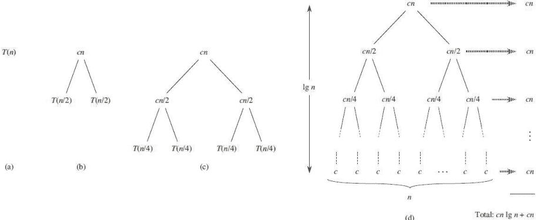

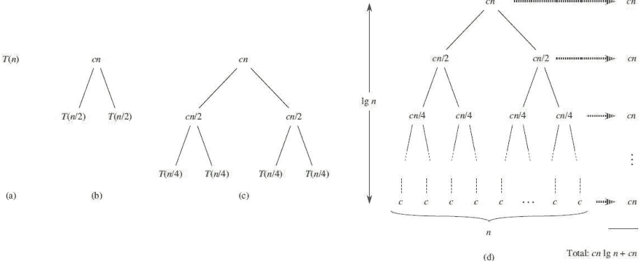

将所有层次的开销相加。

共有 $\lg n+1$ 层，每层花费 $cn$，总成本为

$$cn(\lg n+1)=cn\lg n+cn=\Theta(n\lg n)$$

显然，对于足够大的输入，它在最坏情况下优于插入排序，后者运行时间为 $\Theta(n^2)$。

## 练习与问题

# 练习

分析Fibonacci序列 F(n) = F(n-1) + F(n-2) 如下算法的时间复杂度。

```
f(n)
{
    if(n<=2)
        return 1;
    else
        return f(n-1)+f(n-2);
}
```

```
f1 = 1;
f2 = 1;

for(i=3; i<=n; i++){
    f = f1 + f2;
    f1 = f2;
    f2 = f;
}
```

- **练习**
- 全部
- 补充：自己编程实现几种常用的排序算法（插入、冒泡、归并、快排、等等），并比较分析其运算时间。输入为随机产生的n个数，让n尽可能地大。

- **问题**
- 全部

# 3 函数的增长

Θ(nlgn) 胜过 Θ(n²)？100nlgn 与 3n²（n = 2）相比如何？

我们说当 n →∞ 时，归并排序 Θ(nlgn) 胜过插入排序 Θ(n²)。

## 概述

- 一种描述函数在极限情况下行为的方式。我们在研究渐近效率。（函数的渐近效率，即极限情况下的函数行为）
- 描述函数的增长（函数增长率的描述）
- 通过忽略低阶项和常数因子来聚焦于重要部分（通常忽略低阶项和常数因子）
- 表示算法运行时间的方式（如何描述算法的运算时间）
- 比较函数“大小”的一种方式（比较函数大小的方法）

o ≈ < ; O ≈ ≤ ; Θ ≈ = ; Ω ≈ ≥ ; ω ≈ >

## 3.1 渐近记号

- 渐近运行时间是通过定义域为自然数集 $N = \{0,1,2,...\}$ 的函数来定义的。（运行时间函数的定义域为自然数集）
- **滥用（“滥用，泛用”）**
  - 只是为了方便
  - 例如，扩展到实数域
- **并非误用（误用、错用）**
  - 当记号被滥用时，我们需要理解其精确含义。这并非误用。


### 3.1.1 Θ-notation: asymptotically tight bound (渐近紧界)

- What this notation T(n)=Θ(n²) means

对于给定的函数 g(n)，我们用 Θ(g(n)) 表示函数集合 Θ(g(n)) = {f(n): 存在正常数 c₁, c₂ 和 n₀ 使得 0 ≤ c₁g(n) ≤ f(n) ≤ c₂g(n) 对所有 n ≥ n₀ 成立}。

我们可以写“f(n) ∈ Θ(g(n))”来表示 f(n) 是 Θ(g(n)) 的成员。

相反，我们通常会写“f(n)=Θ(g(n))”来表达相同的概念。这种滥用乍一看可能令人困惑，但它有优点。

### 3.1.1 Θ-notation: asymptotically tight bound

- T(n)=Θ(n²)

对于给定的函数 g(n)，我们用 Θ(g(n)) 表示函数集合 Θ(g(n)) = {f(n): 存在正常数 c₁, c₂ 和 n₀ 使得 0 ≤ c₁g(n) ≤ f(n) ≤ c₂g(n) 对所有 n ≥ n₀ 成立}。

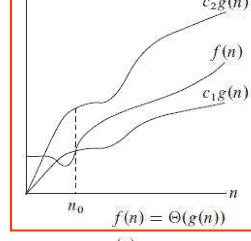

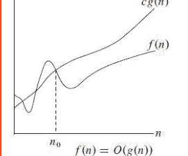

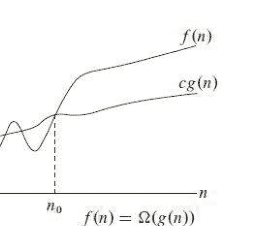

我们说 g(n) 是 f(n) 的渐近紧界。

### 3.1.1 Θ-notation: asymptotically tight bound

Θ(g(n)) = {f(n): 存在正常数 c₁, c₂ 和 n₀ 使得 0 ≤ c₁g(n) ≤ f(n) ≤ c₂g(n) 对所有 n ≥ n₀ 成立}。

- 在本章中，假设所有渐近符号都是渐近非负的。 (设所有的渐近符号为渐近非负)

- Example: How to show that n²/2-3n = Θ(n²)?
- 我们必须确定正常数 c₁, c₂ 和 n₀ 使得
- c₁n² ≤ n²/2 - 3n ≤ c₂n²
- ⇒ c₁ ≤ 1/2 - 3/n ≤ c₂
- 通过选择 c₁ = 1/14, c₂ = 1/2, 和 n₀ = 7, 我们可以验证 n²/2 - 3n = Θ(n²)

- 其他常数的选择可能存在。关键是存在某种选择。

### 3.1.1 Θ-notation: asymptotically tight bound

Θ(g(n)) = {f(n): 存在正常数 c₁, c₂ 和 n₀ 使得 0 ≤ c₁g(n) ≤ f(n) ≤ c₂g(n) 对所有 n ≥ n₀ 成立}。

- How verify that $6n^3 \neq \Theta(n^2)$ ?

假设为矛盾的目的存在 $c_2$ 和 $n_0$ 使得 $6n^3 \le c_2 n^2$ 对所有 $n \ge n_0$ 成立。但那么 $n \le c_2 / 6$，这对于任意大的 n 来说不可能成立，因为 $c_2$ 是常数。

### 3.1.1 Θ-notation: asymptotically tight bound

Θ(g(n)) = {f(n): 存在正常数 c₁, c₂ 和 n₀ 使得 0 ≤ c₁g(n) ≤ f(n) ≤ c₂g(n) 对所有 n ≥ n₀ 成立}。

- 可以忽略低阶项和最高阶项的系数。

- Example: f(n) = a n² + b n + c , 其中 a > 0, b, c 为常数。
- 去掉低阶项并忽略常数后得到 f(n) = Θ(n²)

- 一般地，对于任意多项式 p(n) = Σᵢ₌₀ᵈ aᵢ nⁱ ，其中 aᵢ 为常数且 a_d > 0，我们有 p(n) = Θ(nᵈ)。

- 我们可以将任意常数函数表示为 Θ(n⁰) 或 Θ(1)。
- Θ(1) 通常表示常数或常数函数。

### 3.1.2 O-notation: asymptotic upper bound (渐近上界)

**O – notation:** 对于给定的函数 g(n)，我们用 O(g(n)) 表示函数集合 O(g(n)) = {f(n): 存在正常数 c 和 n₀ 使得 0≤f(n)≤c g(n) 对所有 n≥n₀ 成立}。

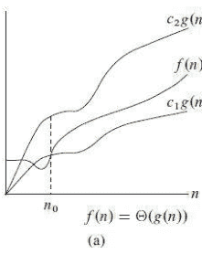

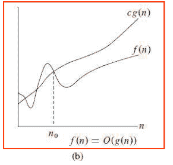

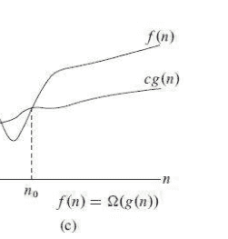

- "f(n) = O(g(n))" 表示 "f(n) ∈ O(g(n))"
- f(n) = Θ(g(n)) ⇒ f(n) = O(g(n))
  ⇒ Θ(g(n)) ⊆ O(g(n))

### 3.1.2 O-notation: asymptotic upper bound

- **O – notation:** 对于给定的函数 g(n)，我们用 O(g(n)) 表示函数集合 O(g(n)) = {f(n): 存在正常数 c 和 n₀ 使得 0 ≤ f(n) ≤ c g(n) 对所有 n ≥ n₀ 成立}。

- Example: 2n² = O(n³), 其中 c=1 且 n₀=2

- Example of functions in O(n²)

  n²          n
  n² + n      n / 3000
  n² + 2000n  n¹·⁹⁹⁹⁹⁹
  500n² + 1000n  n² / lg lg lg n

### 3.1.3 Ω-notation: asymptotic lower bound (渐近下界)

- Ω – notation: 对于给定的函数 g(n)，我们用 Ω(g(n)) 表示函数集合 Ω(g(n)) = {f(n): 存在正常数 c 和 n₀ 使得 0 ≤ c g(n) ≤ f(n) 对所有 n ≥ n₀ 成立}。

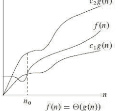

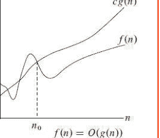

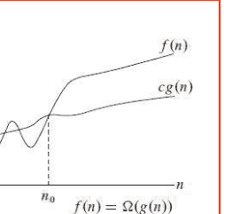


### 3.1.3 Ω-notation: asymptotic lower bound

- Ω – notation: 对于给定的函数 g(n)，我们用 Ω(g(n)) 表示函数集合 Ω(g(n)) = {f(n): 存在正常数 c 和 n₀ 使得 0 ≤ c g(n) ≤ f(n) 对所有 n ≥ n₀ 成立}。
- Ω(n²) 中函数的例子
  - n²
  - n² + n
  - n² + 2000n
  - 500n² − 1000n
  - n³
  - n²·0000001
  - n² lg lg lg n

### 3.1.3 Ω-notation: asymptotic lower bound

#### Theorem 3.1

对于任意两个函数 f(n) 和 g(n)，我们有 f(n)=Θ(g(n)) 当且仅当 f(n)=O(g(n)) 且 f(n)=Ω(g(n))。

证明：⇒: f(n)=Θ(g(n))，则 ∃c₁>0, c₂>0, n₀>0, s.t. n≥n₀, 0≤c₁g(n)≤f(n)≤c₂g(n) 则 n≥n₀, 0≤f(n)≤c₂g(n) ⇒ f(n)=O(g(n)) 则 n≥n₀, 0≤c₁g(n)≤f(n) ⇒ f(n)=Ω(g(n))

⇐: f(n)=O(g(n))，则 ∃c₂>0, n₂₀>0, s.t. n≥n₂₀, 0≤f(n)≤c₂₀g(n) f(n)=Ω(g(n))，则 ∃c₁₀>0, n₁₀>0, s.t. n≥n₁₀, 0≤c₁₀g(n)≤f(n) 令 n₀=max{n₁₀, n₂₀}，则 n≥n₀, 0≤c₁₀g(n)≤f(n)≤c₂₀g(n)，即 f(n)=Θ(g(n))。

### 3.1.3 Ω-notation: asymptotic lower bound

#### Theorem 3.1

对于任意两个函数 f(n) 和 g(n)，我们有 f(n)=Θ(g(n)) 当且仅当 f(n)=O(g(n)) 且 f(n)=Ω(g(n))。

- 在实践中，与其用定理从渐近紧界得到渐近上界和下界，我们通常用它从渐近上界和下界来证明渐近紧界。

（定理作用：实际中，通常根据渐近上界和渐近下界来证明渐近紧界，而不是根据渐近紧界来得到渐近上界和渐近下界。）

### 3.1.3 Ω-notation: asymptotic lower bound

- 插入排序的运行时间介于 Ω(n) 和 O(n²) 之间，界是渐近紧的。
- 插入排序的运行时间不是 Ω(n²)。为什么？
- 说插入排序的 **最坏情况运行时间** 是 Ω(n²) 并不会自相矛盾。为什么？
- 算法的运行时间为 Ω(g(n))，我们指的是无论对每个 n 值选择何种特定大小为 n 的输入，其在该输入上的运行时间对于大的 n 至少是 g(n) 的一个常数倍。
- （算法的运行时间为Ω(g(n))意味着对足够大的n，对输入规模为n的任意输入,其运算时间至少是g(n)的一个常数倍。）

### 3.1.5 o-notation: upper bound but not asymptotically tight

- O-notation 提供的界可能渐近紧，也可能不紧。
- 界 2n²=O(n²) 是渐近紧的，但界 2n=O(n²) 不是。
- o-notation 表示一个非渐近紧的上界。形式上，定义 o(g(n)) 为集合

（非渐近紧的上界）

o(g(n)) = {f(n): 对于任意正常数 c>0，存在常数 n₀>0 使得 0≤f(n)<c g(n) 对所有 n≥n₀ 成立}。

例如，2n=o(n²)，但 2n²≠o(n²)。

### 3.1.5 o-notation: upper bound but not asymptotically tight

o(g(n)) = {f(n): for any positive constants c>0, there exits a constant n₀>0 such that 0≤f(n)<c g(n) for all n≥n₀}.

- O-notation 和 o-notation 的定义相似。
- 主要区别
  - 在 f(n)=O(g(n)) 中，界 0≤f(n)≤c g(n) 对某个常数 c>0 成立
  - 在 f(n)=o(g(n)) 中，界 0≤f(n)<c g(n) 对所有常数 c>0 成立
- 直观上，在 o-notation 中，当 n 趋于无穷时，函数 f(n) 相对于 g(n) 变得无关紧要；即

limₙ→∞ f(n)/g(n) = 0

### 3.1.6 ω-notation: lower bound but not asymptotically tight

- ω-notation 与 Ω-notation 的关系如同 o-notation 与 O-notation 的关系。
- ω-notation 表示一个非渐近紧的下界。形式上，定义 ω(g(n)) 为集合 ω(g(n)) = {f(n): 对于任意正常数 c>0，存在常数 n₀>0 使得 0≤c g(n)<f(n) 对所有 n≥n₀ 成立}。

一种定义方式是 f(n) ∈ ω(g(n)) 当且仅当 g(n) ∈ o(f(n))

例如，n²/2 = ω(n)，但 n²/2 ≠ ω(n²)。

- 关系 f(n)=ω(g(n)) 意味着 limₙ→∞ f(n)/g(n) = ∞，如果极限存在。

### 3.1.7 Comparison of functions

- 许多实数的关系性质适用于渐近比较。
- 对于以下内容，假设 f(n) 和 g(n) 是渐近正的。
- Transitivity (传递性)

f(n) = Θ(g(n)) and g(n) = Θ(h(n)) imply f(n) = Θ(h(n)),
f(n) = O(g(n)) and g(n) = O(h(n)) imply f(n) = O(h(n)),
f(n) = Ω(g(n)) and g(n) = Ω(h(n)) imply f(n) = Ω(h(n)),
f(n) = o(g(n)) and g(n) = o(h(n)) imply f(n) = o(h(n)),
f(n) = ω(g(n)) and g(n) = ω(h(n)) imply f(n) = ω(h(n)).


### 3.1.7 函数比较

- **Reflexivity（自反性）**
  $f(n) = \Theta(f(n))$,
  $f(n) = O(f(n))$,
  $f(n) = \Omega(f(n))$.

- **Symmetry（对称性）**
  $f(n) = \Theta(g(n))$ if and only if $g(n) = \Theta(f(n))$.

- **Transpose symmetry（反对称性）**
  $f(n) = O(g(n))$ if and only if $g(n) = \Omega(f(n))$,
  $f(n) = o(g(n))$ if and only if $g(n) = \omega(f(n))$.

- An analogy between the asymptotic comparison of two functions and the comparison of two real numbers

  （函数渐近性比较与实数比较的类比）

  $f(n) = o(g(n)) \leftrightarrow f(n) < g(n) \leftrightarrow a < b$,

  $f(n) = O(g(n)) \leftrightarrow f(n) \le g(n) \leftrightarrow a \le b$,

  $f(n) = \Theta(g(n)) \leftrightarrow f(n) = g(n) \leftrightarrow a = b$,

  $f(n) = \Omega(g(n)) \leftrightarrow f(n) \ge g(n) \leftrightarrow a \ge b$,

  $f(n) = \omega(g(n)) \leftrightarrow f(n) > g(n) \leftrightarrow a > b$.

- One property of real numbers, does not carry over to asymptotic notation
  - Trichotomy (三分法) : any two real numbers $a$ and $b$, one of the following must holds: $a<b$, $a=b$, or $a>b$.
  - Not all functions are asymptotically comparable. That is, for two functions $f(n)$ and $g(n)$, it may be the case that neither $f(n)=O(g(n))$ nor $f(n)=\Omega(g(n))$ holds.

  For example, the functions $n$ and $n^{1+\sin n}$ cannot be compared using asymptotic notation.

  $-1 \le \sin n \le 1 \Rightarrow n^0 \le n^{1+\sin n} \le n^2$

  $n^{1+\sin n} \le n \le n^{1+\sin n}$ ???

## 3.2 Standard notation and common function

( Self-study for these parts )

- **Monotonicity**（单调性）

- **Floors and ceilings**
  $x-1 < \lfloor x \rfloor \le x \le \lceil x \rceil < x+1$

- **Modular arithmetic (remainder or residue)**（模运算）
  $a \bmod n = a - \lfloor a / n \rfloor n$

- **Polynomials**（多项式）
  $p(n) = \sum_{i=0}^{d} a_i n^i$

- **Exponentials**（指数）

- **Logarithms**（对数）

- **Factorials**（阶乘）

- **Functional iteration（迭代函数）**

  We use the notation $f^{(i)}(n)$ to denote the function $f(n)$ iteratively applied $i$ times to an initial value of $n$. For non-negative integers $i$, we recursively define

  $f^{(i)}(n) = \begin{cases} n & \text{if } i=0 \\ f\left(f^{(i-1)}(n)\right) & \text{if } i>0 \end{cases}$

  For example, if $f(n)=2n$, then

  $f^{(2)}(n) = f(f(n)) = f(2n) = 2(2n) = 2^2 n$

  ...

  $f^{(i)}(n) = 2^i n$

- The iterated logarithm function

  We use the notation lg* n to denote the iterated logarithm. Let lg^(i) n be iterated function, with f(n)=lg n, that is lg^(i)(n)=lg(lg^(i-1)(n)). lg^(i) n is defined only if lg^(i-1) n>0. Be sure to distinguish lg^(i) n from lg^i n. lg* n is defined as

  lg* n = min{ i ≥ 0 : lg^(i) n ≤ 1 }

  The iterated logarithms is a very slowly growing function:

  lg* 2 = 1,      lg* 4 = 2,      lg* 16 = 3,

  lg* 65536 = 4,  lg* 2^65536 = 5.

  2^65536 >> 10^80. Rarely encounter an input size n such that lg* n > 5.

- Fibonacci numbers (self-study)

## Exercises and problems

Show that for any real constants $a$ and $b$, where $b > 0$, $(n + a)^b = \Theta(n^b)$.

Is $2^{n+1} = O(2^n)$ ? Is $2^{2n} = O(2^n)$ ?

- Exercises
  - All
- Problems
  - All

# 4 Recurrences

- Difficulty of Algorithms Research
  - Model 建模
  - Specify 描述
  - Correctness 正确性
    - Verify 验证
    - Proof 证明
  - Complex 复杂度（Efficiency 有效性）
    - Actual computing 实际可计算性
- Recurrence is a basic method to analyze algorithm

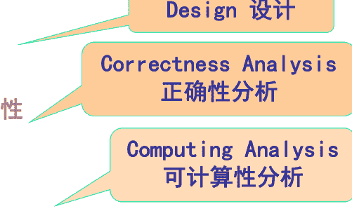

## Algorithms analysis

- **sum**

  $T(n)=c_1n+c_2(n-1)+c_4(n-1)$  
  $\quad +c_5\sum_{j=2}^{n}t_j+c_6\sum_{j=2}^{n}(t_j-1)+c_7\sum_{j=2}^{n}(t_j-1)+c_8(n-1)$

| INSERTION-SORT(A) | cost | times |
|---|---|---|
| 1. `for (j = 2; j <= length[A]; j++)` | $c_1$ | $n$ |
| 2. `{` &nbsp; `key = A[j]` | $c_2$ | $n-1$ |
| 3. `// Insert A[j] into the sorted sequence A[1..j-1]` | $0$ | $n-1$ |
| 4. `i = j-1` | $c_4$ | $n-1$ |
| 5. `while (i > 0 && A[i] > key)` | $c_5$ | $\sum_{j=2}^{n}t_j$ |
| 6. `{` &nbsp; `A[i+1] = A[i]` | $c_6$ | $\sum_{j=2}^{n}(t_j-1)$ |
| 7. `i = i-1` | $c_7$ | $\sum_{j=2}^{n}(t_j-1)$ |
| 8. `}` |  |  |
| 9. `A[i+1] = key` | $c_8$ | $n-1$ |
| 10. `}` |  |  |


# 4 递推式

考虑如下递推式

\[
T(n)=\begin{cases}
1, & \text{if } n=1,\\
2T(n/2)+n, & \text{if } n>1.
\end{cases}
\tag{4.1}
\]

例如，`MERGE-SORT` 的最坏情况运行时间就由该递推式描述：

```text
MERGE-SORT(A, p, r)                          代价
                                            T(n)
1   if p < r
2       then q ← ⌊(p + r)/2⌋
3       MERGE-SORT(A, p, q)                  T(n/2)
4       MERGE-SORT(A, q+1, r)                T(n/2)
5       MERGE(A, p, q, r)                    n
```

另一个递推式：

\[
T(n)=\begin{cases}
1, & \text{if } n\le2,\\
T(n-1)+T(n-2), & \text{if } n>2.
\end{cases}
\]

```text
f(n)
{
    if (n <= 2)
        return 1;
    else
        return f(n-1) + f(n-2);
}
```

递推式是一个关于以下内容的**方程或不等式**：

- 一个或多个基本情况，以及
- 带有更小参数的自身。

### 示例

- (1)  
  \[
  T(n)=\begin{cases}
  1, & \text{if } n=1,\\
  T(n-1)+1, & \text{if } n>1.
  \end{cases}
  \]
  解：\(T(n)=n\)。

- (2)  
  \[
  T(n)=\begin{cases}
  1, & \text{if } n=1,\\
  2T(n/2)+n, & \text{if } n>1.
  \end{cases}
  \]
  解：\(T(n)=n\lg n+n\)。

- (3)  
  \[
  T(n)=\begin{cases}
  0, & \text{if } n=2,\\
  T(\sqrt{n})+1, & \text{if } n>2.
  \end{cases}
  \]
  解：\(T(n)=\lg\lg n\)。

- (4)  
  \[
  T(n)=\begin{cases}
  1, & \text{if } n=1,\\
  T(n/3)+T(2n/3)+n, & \text{if } n>1.
  \end{cases}
  \]
  解：\(T(n)=\Theta(n\lg n)\)。

### 如何获得递推式解的渐近“Θ”或“O”界？

- **代入法（置换法）**：猜测一个界，然后使用数学归纳法证明我们的猜测是正确的。
- **迭代法**：将递推式转换为一个求和式，然后利用求和有界的技术来求解递推式。
- **递归树法**（一种迭代法）。
- **主方法（主函数法）**：为形如 \(T(n)=aT(n/b)+f(n)\) 的递推式提供界，其中 \(a\ge1\)，\(b>1\)，且 \(f(n)\) 是给定函数。

### 技术细节

在实践中，当我们陈述和求解递推式时，会忽略某些技术细节。（忽略技术细节）

- 1) 假设函数参数为整数
  - 通常，\(T(n)\) 仅在 \(n\) 为整数时有定义。
  - 例如，`MERGE-SORT` 的最坏情况运行时间：

  \[
  T(n)=\begin{cases}
  \Theta(1), & \text{if } n=1,\\
  T(\lceil n/2\rceil)+T(\lfloor n/2\rfloor)+\Theta(n), & \text{if } n>1.
  \end{cases}
  \tag{4.2}
  \]

- 2) 忽略边界条件
  - 省略递推式的边界条件陈述，假设对于较小的 \(n\)，\(T(n)\) 为常数，即对于足够小的 \(n\)，有 \(T(n)=\Theta(1)\)。（\(n\) 较小时，\(T(n)\)为常数）
  - 例如，将递推式 (4.1) 陈述为

  \[
  T(n)=2T(n/2)+\Theta(n),
  \]

  （省略 \(T(1)=\Theta(1)\)）(4.3) 而不显式给出小 \(n\) 时的值。
  - 原因是，虽然改变 \(T(1)\) 的值会改变递推式的解，但解的增长率不变。（改变边界值，可能改变递推式的解，但不改变解的函数增长率）

- 3) 省略向上取整、向下取整

这些细节不会影响算法分析中遇到的许多递推式的渐近界。（忽略细节不会影响算法的渐近分析）

## 4.1 代入法

关键点：

- 1) 猜测解的形式；
- 2) 使用数学归纳法证明解成立。

示例：

\[
T(n)=\begin{cases}
1, & \text{if } n=1,\\
2T(n/2)+n, & \text{if } n>1.
\end{cases}
\]

(1) 猜测：\(T(n)=n\lg n+n\)

(2) 归纳

**基础情况：** \(n=1 \Rightarrow n\lg n+n=1=T(n)\)

**归纳步骤：** 归纳假设是对于所有 \(k<n\)，有 \(T(k)=k\lg k+k\)。

使用关于 \(T(n/2)\) 的归纳假设来证明 \(T(n)\)：

\[
\begin{aligned}
T(n)&=2T(n/2)+n\\
&=2\left((n/2)\lg(n/2)+(n/2)\right)+n\quad\text{（根据归纳假设）}\\
&=n\lg(n/2)+n+n\\
&=n(\lg n-\lg 2)+2n\\
&=n\lg n+n.
\end{aligned}
\]

该方法功能强大，但仅适用于容易猜测出答案形式的情形。


## 4.1 替换法

- 数学归纳法现在要求我们证明我们的解在边界条件（某个小的 *n*）下成立。
- 通常，边界条件适合作为归纳证明的基础情形。

$$T(n)=2T(\lfloor n/2\rfloor)+n, \qquad (4.4)$$

$$T(n)=O(n\lg n), \qquad T(n)\le c\,n\lg n$$

- 这个要求有时会导致问题。
- 假设 $T(1)=1$ 是该递推的唯一边界条件。那么我们无法选择足够大的 $c$，因为 $T(1)\le c\,1\lg 1=0$，这与 $T(1)=1$ 相矛盾。我们的归纳证明在该情形下不成立。（递归结果与初始情况矛盾，即递归证明失败？）

### 扩展边界条件

T(n) = 2T(⌊n/2⌋) + n ;  T(n) = O(n lg n) , T(n) ≤ c n lg n

- 归纳假设与特定边界条件不一致，如何克服困难？ (如何克服递归结果与边界条件不一致的问题？)
- 渐近记号只要求我们证明当 n ≥ n₀ 时 T(n) ≤ c n lg n 成立，其中 n₀ 是一个常数。
- 去除困难的边界条件 T(1) = 1
- 将 T(2) 和 T(3) 作为归纳证明的边界条件。
- 由递推式可得 T(2) = 2*T(1) + 2 = 4 ， T(3) = 2*T(1) + 3 = 5。
- 归纳证明 T(n) ≤ c n lg n 现在可以通过选择任意 c ≥ 2 来完成，使得 T(2) = 4 ≤ c*2 lg 2 且 T(3) = 5 ≤ c 3 lg 3。

### 4.1.1 做出一个好的猜测

- 如果一个递推式与你之前见过的相似，那么猜测一个相似的解是合理的。例如，T(n) = 2T(⌊n/2⌋ + 17) + n
- 看起来很困难，因为加上了“17”。
- 直观上，这个附加项不会从根本上影响递推式的解。 (该附加项不会从本质上影响递归解)
- 当 n 很大时，T( n/2 ) 和 T( n/2 + 17) 之间的差异并不大。因此，我们猜测 T(n) = O(n lg n)，你可以用替换法验证其正确性。

### 4.1.1 做出一个好的猜测

- 做出一个好的猜测的另一种方法是证明递推式的松的上界和下界，然后缩小不确定范围。
- （寻找松的上、下渐近界，范围缩小，逐步逼近）

例如

```
T(n) = 2T(⌊n/2⌋) + n      (4.4)
```

- 我们可能会从递推式中含有项 n 开始，给出下界 T(n) = Ω(n)，
- 并且我们可以证明初始上界 T(n) = O(n²)。
- 然后，我们可以逐步降低上界并提高下界，直到收敛到正确的渐近紧解 T(n) = Θ(n lg n)。

### 4.1.2 细微之处

有时，猜测正确，但归纳中的数学似乎无法成立。

例如  $T(n) = T(\lfloor n/2 \rfloor) + T(\lceil n/2 \rceil) + 1.$

猜测 $T(n)=cn$，则 $T(n) \le c\lfloor n/2 \rfloor + c\lceil n/2 \rceil +1 = cn +1$，矛盾。

通常，归纳假设不足以证明详细的界限。如何克服？ (递归假设条件不强)

通过减去低阶项来修正猜测通常可以使数学推导成立。 (减去低阶项)

### 4.1.2 细微之处

T(n) ≤ T(⌊n / 2⌋) + T(⌈n / 2⌉) + 1      解：T(n) = O(n)

- 尝试更大的猜测 T(n) = O(n²)，这可以成立。
- 但猜测解为 T(n) = O(n) 是正确的。
- 直观上，我们的猜测几乎是正确的：我们只差一个常数 1，即一个低阶项。
- 然而，数学归纳法不起作用！
- 从之前的猜测中减去一个低阶项。新的猜测是 T(n) ≤ c n - b，其中 b ≥ 0 是常数，则
  T(n) ≤ (c⌊n / 2⌋ - b) + (c⌈n / 2⌉ - b) + 1 = c n - 2b + 1 ≤ c n - b ，
  只要 b ≥ 1。之前一样，常数 c 必须选得足够大以处理边界条件。

### 4.1.2 细微之处

- 大多数人发现减去低阶项的想法违反直觉。 （违反直觉）
- 毕竟，如果数学推导不成立，我们不应该增加我们的猜测吗？
- 理解这一步的关键是要记住我们正在使用数学归纳法：我们可以通过**对较小值假设更强的条件**来**证明给定值的更强结论**。 （假设更强的条件，可证明更强的结论）


### 4.1.3 避免陷阱

- 在使用渐近记号时很容易出错。

例如，在递推式 (4.4) 中

$$
T(n) = 2T(\lfloor n/2 \rfloor) + n \tag{4.4}
$$

我们可以通过猜测 $T(n) \le cn$ 然后论证来错误地证明 $T(n) = O(n)$

$$
\begin{aligned}
T(n) &= 2T(\lfloor n/2 \rfloor) + n \\
     &\le 2(c\lfloor n/2 \rfloor) + n \\
     &\le cn + n \\
     &= O(n), \quad \leftarrow \text{wrong!!!}
\end{aligned}
$$

因为 $c$ 是一个常数。错误在于我们没有证明归纳假设的确切形式，即 $T(n) \le cn$。

### 4.1.4 变量替换

- **代数运算**：有时可将一个未知的递推式化为与之前见过的形式相似。

例如，$T(n) = 2T(\lfloor\sqrt{n}\rfloor) + \lg n$，看起来很困难。用**变量替换**简化递推式。为方便起见，我们不考虑将诸如 $\sqrt{n}$ 等值四舍五入为整数的问题。

令 $m = \lg n$，则 $T(2^m) = 2T(2^{m/2}) + m$。

于是令 $S(m) = T(2^m)$，则 $S(m) = 2S(m/2) + m$，这与递推式 (4.4) 非常相似，且解相同：$S(m) = O(m \lg m)$。将 $S(m)$ 换回 $T(n)$，我们得到 $T(n) = T(2^m) = S(m) = O(m \lg m) = O(\lg n \lg \lg n)$。

## 4.2 迭代法

- **置换法：** 很难给出一个好的猜测。
- **迭代法**
  - 不需要我们猜测答案
  - 可能需要更多的 **代数**（迭代法对代数能力的要求较高）
  - 将递推式**展开（迭代）**并表示为一系列项的**求和**，以及初始条件
  - **求和。**（不断迭代展开为级数，并求和）

**例如，** $T(n) = 3T(\lfloor n/4 \rfloor) + n$

$$
\begin{aligned}
T(n) &= n + 3T(\lfloor n/4 \rfloor) \\
     &= n + 3\left(\lfloor n/4 \rfloor + 3T(\lfloor n/16 \rfloor)\right) \\
     &= n + 3\left(\lfloor n/4 \rfloor + 3\left(\lfloor n/16 \rfloor + 3T(\lfloor n/64 \rfloor)\right)\right) \\
     &= n + 3\lfloor n/4 \rfloor + 9\lfloor n/16 \rfloor + 27T(\lfloor n/64 \rfloor).
\end{aligned}
$$

- 我们必须迭代递推式多远？
- 级数中的第 $i$ 项为 $3^i T(\lfloor n/4^i \rfloor)$。
- 当 $\lfloor n/4^i \rfloor = 1$ 时迭代停止。通过继续迭代到这一点并使用界 $\lfloor n/4^i \rfloor \le n/4^i$，我们得到一个递减的几何级数：

$$
T(n) \le n + \frac{3n}{4} + \frac{9n}{16} + \frac{27n}{64} + \cdots + 3^i T\left(\frac{n}{4^i}\right)
$$

$$
T(n) \le n \sum_{i=0}^{\infty} \left(\frac{3}{4}\right)^i + \Theta(n^{\log_4 3}) = 4n + o(n) = O(n).
$$

$$
n/4^i = 1 \Rightarrow i = \log_4 n \Rightarrow 3^i = 3^{\log_4 n} = n^{\log_4 3}
$$

- 迭代法通常会导致大量的代数运算。这可能具有挑战性。关键点在于：
  - 递推式需要迭代多少次才能达到边界条件（迭代次数），
  - 以及迭代过程中每一层产生的项之和（级数求和）。
- 有时，在迭代递推式的过程中，你可以在不完全算出数学细节的情况下猜出解。然后，可以放弃迭代而采用置换法，后者通常需要的代数运算更少。

（在展开递归式为迭代求和的过程中，有时只需要部分展开，然后根据其规律来猜想递归式的解，接着用置换法进行证明。）

- 当递推式包含 floor 和 ceiling 函数时，数学可能会变得特别复杂。
- 通常，假设递推式仅在某个数的精确幂上定义会有所帮助。

例如，$T(n) = 3T(\lfloor n/4 \rfloor) + n$。如果我们假设 $n = 4^k$ 对于某个整数 $k$，则 floor 函数可以方便地省略。

### * 4.3 递归树方法

- 画出递归树是一种直接的方法来设计一个好的猜测，并直观地展示迭代法。（画递归树可以从直观上表示迭代法，也有助于猜想递归式的解）
- 当递推式描述分治算法的运行时间时，递归树特别有用。

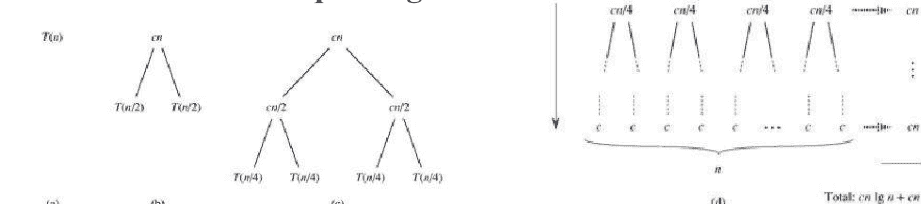


#### 4.4.1 主定理

##### 定理 4.1

设 a≥1 且 b>1 为常数，设 f(n) 为一个函数，且 T(n) 在非负整数上由递推式 T(n)=aT(n/b)+f(n) 定义，其中我们把 n/b 解释为 ⌊n/b⌋ 或 ⌈n/b⌉。则 T(n) 可作如下渐近界定。

- 1. 若 f(n)=O(n^(log_b a)-ε) 对某个常数 ε>0 成立，则 T(n)=Θ(n^(log_b a))。
- 2. 若 f(n)=Θ(n^(log_b a))，则 T(n)=Θ(n^(log_b a) lg n)。
- 3. 若 f(n)=Ω(n^(log_b a)+ε) 对某个常数 ε>0 成立，且若 af(n/b) ≤ c f(n) 对某个常数 c<1 及所有充分大的 n 成立，则 T(n)=Θ(f(n))。

?: 设 T(n)=d.f(n)，则 T(n)=a.T(n/b)+f(n) ⇒ d.f(n)=a.d.f(n/b)+f(n) 若 a.f(n/b)>f(n)，则 d.f(n)=a.d.f(n/b)+f(n)>d.f(n)+f(n)=(d+1).f(n) ⇒ d>d+1

#### 4.4.1 主定理：特殊情况

$T(n)=aT(n/b)+f(n),$

$$
T(n)=
\begin{cases}
\Theta\left(n^{\log_b a}\right), & f(n)=O\left(n^{\log_b a-\varepsilon}\right)\\
\Theta\left(n^{\log_b a}\lg n\right), & f(n)=\Theta\left(n^{\log_b a}\right)\\
\Theta(f(n)), & f(n)=\Omega\left(n^{\log_b a+\varepsilon}\right)\text{ and }af(n/b)\le cf(n)\text{ for large }n
\end{cases}
$$

其中 $\varepsilon>0$ 且 $c<1$。

- **多项式**
  - **情况 1**，$f(n)$ 必须比 $n^{\log_b a}$ 多项式地更小。
  - **情况 3**，$f(n)$ 必须比 $n^{\log_b a}$ 多项式地更大。

**示例：** $f(n)=n\lg n$,   $n^{\log_b a}=n$

- **间隙**
  - 当 $f(n)$ 比 $n^{\log_b a}$ 更小时但不是多项式地更小时，情况 1 和情况 2 之间存在间隙。
  - 同样，当 $f(n)$ 比 $n^{\log_b a}$ 更大时但不是多项式地更大时，情况 2 和情况 3 之间存在间隙。

#### 4.4.2 使用主方法：一些例子

T(n) = aT(n/b) + f(n),

T(n) = { Θ(n^{log_b a}), f(n) = O(n^{log_b a - ε}) ; Θ(n^{log_b a} lg n), f(n) = Θ(n^{log_b a}) ; Θ(f(n)), f(n) = Ω(n^{log_b a + ε}) and a f(n/b) ≤ c f(n) for large n } ∃ε > 0 , c < 1

- **T(n)=9T(n/3)+n**
  a = 9, b = 3, f(n) = n ⇒ n^{log_b a} = n^{log_3 9} = n^2 = Θ(n^2)
  ⇒ f(n) = O(n^{log_3 9 - ε}), where ε = 1 ⇒ T(n) = Θ(n^2)

- **T(n)=T(2n/3)+1**
  a = 1, b = 3/2, f(n) = 1 ⇒ n^{log_b a} = n^{log_{3/2} 1} = n^0 = 1
  ⇒ f(n) = Θ(n^{log_3 a}) = Θ(1) ⇒ T(n) = Θ(lg n)

#### 4.4.2 使用主方法：一些例子

T(n) = a T(n / b) + f(n),

T(n) = { Θ(n^{log_b a}), f(n) = O(n^{(log_b a) - ε}) ; Θ(n^{log_b a} lg n), f(n) = Θ(n^{log_b a}) ; Θ(f(n)), f(n) = Ω(n^{(log_b a)+ε}) and a f(n / b) ≤ c f(n) for large n } , ∃ ε > 0 , c < 1

- T(n) = 3 T(n/4) + n lg n

a = 3, b = 4, f(n) = n lg n ⇒ n^{log_b a} = n^{log_4 3} = O(n^{0.793})

⇒ f(n) = Ω(n^{(log_4 3)+ε}), where ε ≈ 0.2, and for sufficiently large n, a f(n / b) = 3 (n / 4) lg(n / 4) ≤ (3 / 4) n lg n = c f(n) for c = 3 / 4

⇒ T(n) = Θ(n lg n)

#### 4.4.2 使用主方法：一些例子

T(n) = a T(n / b) + f(n),

T(n) = { Θ(n^{log_b a}), f(n) = O(n^{log_b a - ε}) ; Θ(n^{log_b a} lg n), f(n) = Θ(n^{log_b a}) ; Θ(f(n)), f(n) = Ω(n^{log_b a + ε}) and a f(n / b) ≤ c f(n) for large n } ε > 0 c < 1

- T(n)=2T(n/2)+n lg n

a = 2, b = 2, f(n) = n lg n ⇒ n^{log_b a} = n,

但 f(n) / n = lg n，其渐近小于任意正常数 c 的 n^ε，即 f(n) 并不是多项式地大于 n。因此该递推式落入情况 2 和情况 3 之间的间隙。

## 练习与问题

### 使用主方法给出以下递推式的紧渐近界。

T(n) = 4T(n/2) + n .

T(n) = 4T(n/2) + n² .

T(n) = 4T(n/2) + n³ .

# 第1章至第4章复习

- 描述算法的框架
- 算法的正确性
- 算法的效率
- 分治法
- 函数的渐近分析 (渐近分析)
- 递推式

# 第1章至第4章复习

## 示例：

- 归并排序
- 两个整数的乘法
- 两个矩阵的乘法
- 寻找最小值和最大值
- 多数问题 (多数问题)


## Exam1 Merge Sort

## Exam2 Multiplication of two integers（整数相乘）
### Multiplication of two integers（整数相乘问题）

X和Y是两个n位的十进制整数，分别表示为
X = xₙ₋₁xₙ₋₂…x₀，Y = yₙ₋₁yₙ₋₂…y₀，其中0 ≤ xᵢ, yⱼ ≤ 9（i, j = 0, 1, …, n-1），设计一个算法求X×Y，并分析其计算复杂度。说明：算法中“基本操作”约定为两个个位整数相乘xᵢ×yⱼ，以及两个整数相加。

## Exam2 Multiplication of two integers (整数相乘)

两个 *n* 位数 X 和 Y，Complexity(X × Y) = ?

- 分治算法

设 X = a b
Y = c d

其中 *a*、*b*、*c* 和 *d* 是 *n*/2 位数，例如 1364=13×10²+64。

设 *m* = *n*/2。则

XY = (10^m a + b)(10^m c + d)
=10^{2m}ac + 10^m(bc + ad) + bd

## Exam2 Multiplication of two integers（整数相乘）

两个 *n* 位数 X 和 Y，Complexity(X × Y) = ?

### 分治算法

设 X = a b , Y = c d
则 XY = (10^m a+b)(10^m c+d) = 10^(2m)ac + 10^m(bc+ad) + bd

```
Multiply(X; Y; n):
if n = 1
    return X×Y
else
    m = ⌈n/2⌉
    a = ⌊X/10^m⌋; b = X mod 10^m
    c = ⌊Y/10^m⌋; d = Y mod 10^m
    e = Multiply(a; c; m)
    f = Multiply(b; d; m)
    g = Multiply(b; c; m)
    h = Multiply(a; d; m)
    return 10^(2m)e + 10^m(g + h) + f
```

复杂度分析：
T(1)=1,
T(n)=4T(⌈n/2⌉)+O(n).
应用主定理，
我们有
T(n)=O(n^2).


## Exam2 Multiplication of two integers (整数相乘)

两个 n 位数 X 和 Y，Complexity(X × Y) = ?

- 分治法（Karatsuba 算法）

设 X = a b, Y = c d
则 XY = (10^m a + b)(10^m c + d) = 10^{2m} ac + 10^m (bc + ad) + bd

注意 bc + ad = ac + bd − (a − b)(c − d)。所以，我们有

```
FastMultiply(X; Y; n):
if n = 1
    return X×Y
else
    m = ⌈n/2⌉
    a = ⌊X/10^m⌋; b = X mod 10^m
    c = ⌊Y/10^m⌋; d = Y mod 10^m
    e = FastMultiply(a; c; m)
    f = FastMultiply(b; d; m)
    g = FastMultiply(a−b; c−d; m)
    return 10^{2m} e + 10^m (e + f − g) + f
```

复杂度分析：
T(1)=1,
T(n)=3T(⌈n/2⌉)+O(n).
应用主定理，我们有
T(n) = O(n^{log₂3}) = O(n^{1.59})

# Exam3 Multiplication of two matrices（矩阵相乘）
### Multiplication of two matrices（矩阵相乘问题）

A和B是两个n阶实方阵，表示为 A = ⎛ a₁₁…a₁ₙ ⎞ , B = ⎛ b₁₁…b₁ₙ ⎞
      ⎜ …… ⎟      ⎜ …… ⎟
      ⎝ aₙ₁…aₙₙ ⎠      ⎝ bₙ₁…bₙₙ ⎠

设计一个算法求A×B，并分析计算复杂度。

说明：算法中“基本操作”约定为两个实数相乘，或两个实数相加。

# Exam3 Multiplication of two matrices（矩阵相乘）

两个 n × n 矩阵 A 和 B，Complexity(C=A × B) = ?

- **标准方法**

\(c_{ij}=\sum_{k=1}^{n}a_{ik}b_{kj}\)

```
MATRIX-MULTIPLY(A, B)
for i ← 1 to n
    for j ← 1 to n
        C[i, j] ← 0
        for k ← 1 to n
            C[i, j] ← C[i, j] + A[i, k] · B[k, j]
return C
```

**复杂度：**
\(O(n^3)\) 乘法和加法。
\(T(n)=O(n^3)\).

# Exam3 Multiplication of two matrices（矩阵相乘）

两个 *n* × *n* 矩阵 A 和 B，Complexity(C=A×B) = ?

- **分治法**

一个 *n* × *n* 矩阵可以划分为四个 *n*/2 × *n*/2 矩阵，

A = [[A₁₁, A₁₂], [A₂₁, A₂₂]],  B = [[B₁₁, B₁₂], [B₂₁, B₂₂]],  C = [[C₁₁, C₁₂], [C₂₁, C₂₂]]

C₁₁=A₁₁B₁₁+A₁₂B₂₁, C₁₂=A₁₁B₁₂+A₁₂B₂₂
C₂₁=A₂₁B₁₁+A₂₂B₂₁, C₂₂=A₂₁B₁₂+A₂₂B₂₂

**复杂度分析：**
总共，8 次乘法（子问题），和 4 次加法（*n*/2 × *n*/2 × 4）。
T(1)=1, T(*n*) = 8T(⌈*n*/2⌉)+*n*².
应用主定理，我们有
*T(n) = O(n³).*

## Exam3 Multiplication of two matrices (矩阵相乘)

两个 n×n 矩阵 A 和 B，Complexity(C=A×B) = ?

- 分治法（Strassen 算法）

一个 n×n 矩阵可以划分为四个 n/2×n/2 矩阵，

A = [[A₁₁ A₁₂],[A₂₁ A₂₂]] , B = [[B₁₁ B₁₂],[B₂₁ B₂₂]] , C = [[C₁₁ C₁₂],[C₂₁ C₂₂]]

定义  P₁ = (A₁₁+A₂₂)(B₁₁+B₂₂)
P₂ = (A₁₁+A₂₂)B₁₁
P₃ = A₁₁(B₁₁−B₂₂)
P₄ = A₂₂(−B₁₁+B₂₂)
P₅ = (A₁₁+A₁₂)B₂₂
P₆ = (−A₁₁+A₂₁)(B₁₁+B₁₂)
P₇ = (A₁₂−A₂₂)(B₂₁+B₂₂)
则  C₁₁=P₁+P₄−P₅+P₇,  C₁₂=P₃+P₅
C₂₁=P₂+P₄,          C₂₂=P₁+P₃−P₂+P₆

复杂度分析：
总共，7 次乘法，和 18 次加法。
T(1)=1,
T(n)=7T(⌈n/2⌉)+cn².
应用主定理，
T(n)=O(n^{log₂7})=O(n^{2.81})

## Exam4 Finding Minimum and Maximum (MaxMin)

背景
使用一个可以比较 2 个元素重量的天平，找到 n 个元素的最轻和最重。 (对于一个具有 n 个元素的数组，用一个天平，通过比较 2 个元素的重量，求出最轻和最重的一个)


目标
最小化比较次数。 (正确找出需要的元素，最少的比较次数？)


# Exam4 寻找最小值和最大值 (MaxMin)

## 最大元素

从 w[0, n-1] 中找出权重最大的元素 (重量)

```
maxElement=0
for (int i = 1; i < n; i++)
    if (w[maxElement] < w[i]) maxElement = i;
```

比较次数 (比较次数) 为 n−1。

- 明显的方法 (直接法)
  - 找出 n 个元素的最大值需要进行 n−1 次比较。
  - 找出剩余 n−1 个元素的最小值需要进行 n−2 次比较。
  - 比较总次数为 2n−3。

## 分治法

### 示例

- 找出 {3,5,6,2,4,9,3,1} 的最小值和最大值。
  - A = {3,5,6,2} 和 B = {4,9,3,1}。
  - min(A) = 2, min(B) = 1。
  - max(A) = 6, max(B) = 9。
  - min{min(A),min(B)} = 1。
  - max{max(A), max(B)} = 9。

- 选苹果；挑运动员；……

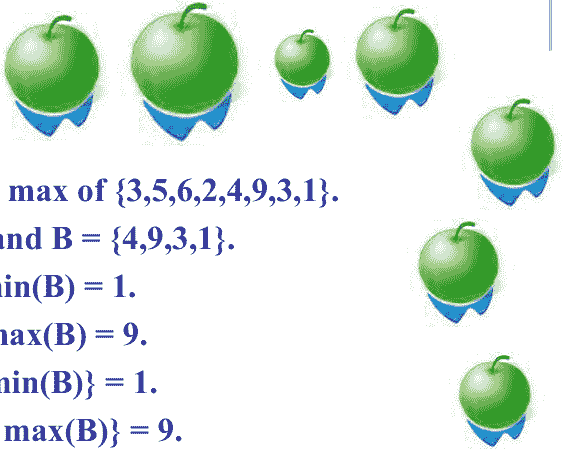

- 分治法
  - 示例
  - 划分成更小的问题

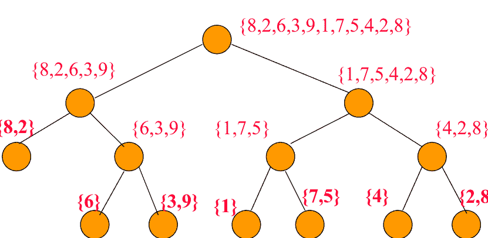

- 分治法
  - 示例
  - 解决小问题并合并

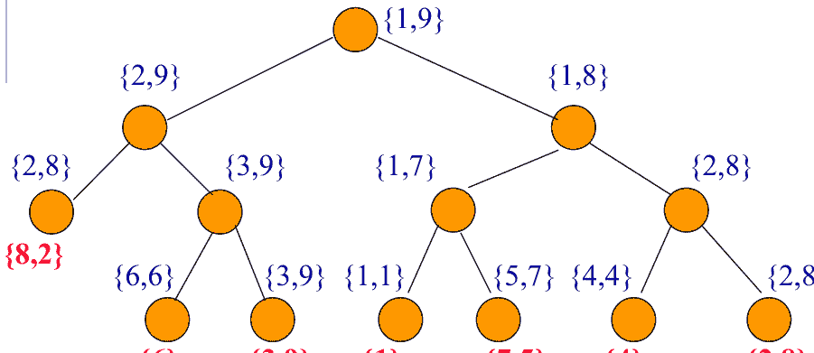

- **分治法**

```
MaxMin(L)
    if length(L)=1 or 2, we use at most one comparison.
    else
    {
        split (分裂) L into lists L1 and L2, each of n/2 elements
        (min1, max1) = MaxMin(L1)
        (min2, max2) = MaxMin(L2)
        return (Min(min1, min2), Max(max1, max2))
    }
```

**复杂度分析 (比较次数)：**

T(1)=0, T(2)=1,

T(n) = 2T(n/2)+2

= 4T(n/4)+2²+2 = 2³T(n/2³) + 2³+2²+2 = …

= 2ᵏ·T(n/2ᵏ)+2ᵏ+¹+…+2 = 2ᵏ+¹+2ᵏ+¹+…+2

= 2ᵏ⁻¹+2ᵏ−2 = **3n/2 − 2** （There, assume n=2ᵏ, Sₙ=a(1−qⁿ)/(1−q).）

- 明显方法 ($2n-3$) 与 分治法 ($3n/2-2$) 的比较

假设一次比较需要一秒。

| 时间 | $2n-3$ | $3n/2-2$ |
|---|---:|---:|
| 1 分钟 | $n=31$ | $n=41$ |
| 1 小时 | $n=1801$ | $n=2401$ |
| 1 天 | $n=43201$ | $n=57601$ |

# Exam5 多数问题 (多数问题)

- **问题**
  - 给定一个包含 n 个元素的数组 A，仅使用 “==” 测试来找出 A 中的多数元素 (出现次数超过 n/2 次)。
- **例如，给定 (2, 3, 2, 1, 3, 2, 2)，则 2 是多数元素因为 4>7/2。**
- **平凡解法：**
  - 计数 (计数) 为 O(n²)。

```
Majority(A[1, n])
for(i = 1 to n)
    M = 0
    for(j = 1 to n)
        if (i != j and A[i]==A[j]) M++
    end
    if (M>n/2) return “A[i] is the majority”
end
return “No majority”
```

分治法

```
Majority(A[1, n])
if n=1, then
    return A[1]
else
    m1=Majority(A[1, n/2])
    m2=Majority(A[n/2+1, n])
    test if m1 or m2 is the majority for A[1, n]
    return majority or no majority.
```

复杂度分析 (计数)：
T(n) = 2T(n/2)+O(n) = O(nlogn)

A=(2, 1, 3, 2, 1, 5, 4, 2, 5, 2)

f[1] = 2
f[2] = 4
f[3] = 1
f[4] = 1
f[5] = 2

然而，该问题存在线性时间算法。

```
for(i=1 to n) ++frequency[ A[i] ]
M = Max(frequency( A[j] ))
if (M > n/2)
    return "A[j] is the majority"
```

- 故事的寓意 (寓意)？

# 练习

使用一个可以比较 2 个元素重量的天平，求出 n 个元素中的第二重的一个。 （对于一个具有 n 个元素的数组，用一个天平，通过比较 2 个元素的重量，求出第二重的一个）

尝试给出一个算法，并分析其运行时间。如果使用分治法，如何描述该算法？以及其运行时间？

# 5 概率分析与随机算法

- 解释概率分析与随机算法的区别。
  （概率分析与随机算法）
- 介绍指示随机变量的技术。
  （用指示(器)随机变量来对算法进行概率分析）
- 给出另一个随机算法的例子。
  （一个随机算法实例）

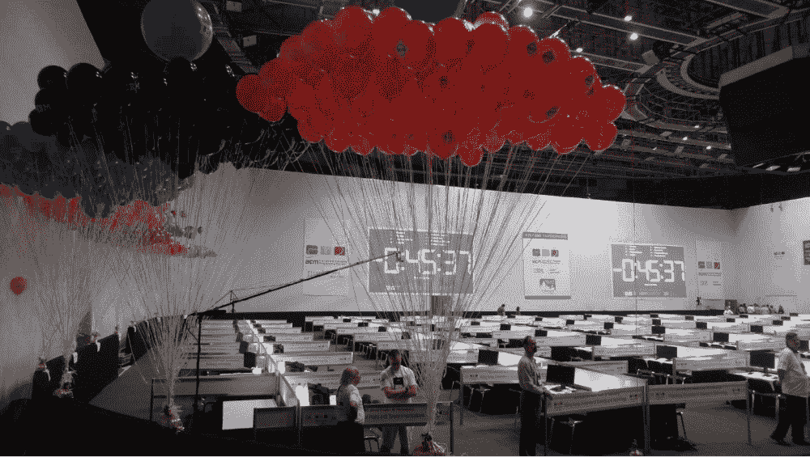


## 5.1 雇用问题

情景：在一个月内雇用最好的办公助理

- 你通过就业代理机构（猎头（代理）公司）雇用一名新的办公助理。
- 代理机构每天向你发送一名候选人。（1, 2, ..., n 表示候选人的编号，红色圆圈表示候选人的工作能力）
- 你面试候选人，并且必须立即决定是否雇用他。但如果雇用，你还必须解雇当前的助理。
- ......


### 5.1.1 最坏情况分析

成本：有 n 个候选人，我们雇用其中 m 个，成本为 T(n) = n c_i + m c_h

- 我们重点分析雇用成本 m c_h ?（c_h >> c_i）
- m c_h 随算法的每次运行而变化：它取决于我们面试候选人的顺序。
- 最坏情况分析
  - 我们雇用全部 n 个候选人。T(n) = n c_i + n c_h ? 何时发生？
  - 候选人按能力递增的顺序出现。

在一个月内，T(30) = 30 + 30*10 = 330 K

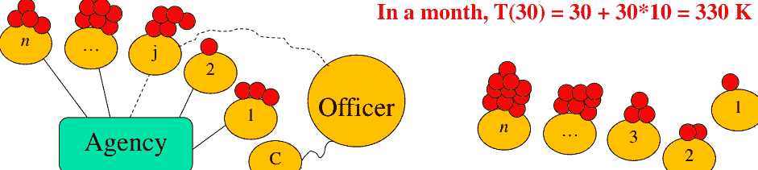

### 5.1.2 概率分析

假设候选人以随机顺序到来：

- 为每个候选人分配一个名次：*rank(i)* 是 1 到 *n* 范围内的唯一整数。（对每一个候选人分配一个“名次”）
- 列表 <*rank*(1), ..., *rank*(n)> 是候选人编号 <1, ..., n> 的一个排列，例如 <5, 2, 1, 28, 9, ... , 11>
- 这些名次构成一个均匀随机排列：所有可能的 *n!* 种排列以相等的概率出现


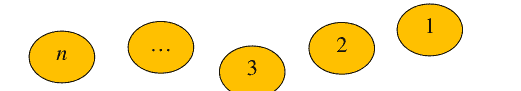

```
HIRE-ASSISTANT(n)
best ← 0 // candidate 0 is a least-qualified dummy candidate
for i ← 1 to n
    do interview candidate i
        if candidate i is better than candidate best
            then best ← i
                hire candidate i
cost times
c_i n
c_h m
```

*概率分析的本质思想：* 我们必须利用关于输入分布的已有知识，或对其做出假设。

（概率分析的本质：需已知或假定输入的概率分布）

- 期望基于该分布来求取。（依据概率分布来求期望，期望值即是平均雇用的人数）
- 5.2 节包含对雇用问题的概率分析。

### 5.1.3 随机化算法

- 思想
  - 我们可能不知道输入的分布，或者无法通过计算对其建模。（我们不知道输入的分布，也不可能为输入的分布进行可计算的建模）
  - 相反，我们在算法内部使用随机化，以便为输入强加一种分布。（在算法中通过对输入进行随机化处理，从而为输入强加一种分布）

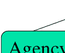


- *对于雇用问题，我们改变一下情景：*
  - 就业代理机构预先向我们发送所有 *n* 名候选人的名单。（猎头公司预先提供 *n* 个候选人列表）
  - 每天，我们从名单中随机选择一名候选人进行面试。（每天，我们随机选取一人进行面试）
  - 我们不依赖候选人以随机顺序呈现在我们面前，而是控制整个过程并强制采用随机顺序。（第 5.3 章）（无须担心候选人是否被随机提供，我们通过随机运算预处理可以控制候选人的随机顺序）

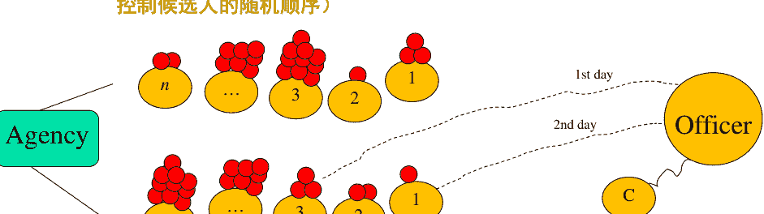

- **算法随机化的条件：** 如果算法的行为部分由 *随机数生成器* 产生的值决定，则该算法是随机化的。

（算法随机化：由随机数产生器生成数值……）

- **RANDOM(a, b)** 返回一个整数 *r*，其中 *a≤r≤b*，并且 *r* 的 *b-a+1* 个可能取值中的每一个都是等可能的。

- 在实践中，RANDOM 由伪随机数生成器实现，这是一种确定性方法，其返回的数“看起来”随机并通过统计检验。（RANDOM 实际上由一个确定的算法〔伪随机产生器〕产生，其结果表面上看上去像是随机数）


## 5.1.3 随机算法

- **随机数产生器（Random number generator）**
  - 大多数随机数产生器通过以下递推式生成整数序列
  - X₀= 给定的整数（种子），Xᵢ₊₁ = aXᵢ mod M
  - 例如，对于 X₀=1, a=5, M=13，我们有 X₁=5%13=5, X₂=25%13=12, X₃=60%13=8。序列中的每个整数都位于范围 [0, M - 1] 内。

## A probabilistic analysis of the hiring problem

## 5.2 指示随机变量（Indicator random variables）


给定一个样本空间和事件 A，我们定义指示随机变量（给定采样空间和事件 A，指示随机变量…）

$$I\{A\}=\begin{cases}1 & \text{if A occur,}\\0 & \text{if A does not occur.}\end{cases}$$

▢ *引理*

对于一个事件，设 $X_A=I\{A\}$。则 $E[X_A]=Pr\{A\}$。

*证明* 设 ~A 为 A 的补集，我们有
$$E[X_A]=E[I\{A\}]$$
$$\qquad=1\cdot Pr\{A\}+0\cdot Pr\{~A\}\qquad\text{\{definition of expected value\}}$$
$$\qquad=Pr\{A\}.$$

## 5.2 指示随机变量 (指示随机变量)

引理

对于事件 A，设 X_A = I{A}。则 E[X_A]=Pr{A}。

简单示例：确定投掷一次公平硬币时正面出现的期望次数。

（投一次硬币，正面向上的期望〔平均数〕）

- 样本空间为 {H, T}
- Pr{H} = Pr{T} = 1/2
- 定义指示随机变量 X_H = I{H}。X_H 统计一次投掷中的正面数。
- 由于 Pr{H} =1/2，引理说明 E[X_H] = 1/2 。

## 5.2 指示随机变量（指示随机变量）

▪ **引理**

**对于事件 A，设 X_A = 𝟙{A}。则 E[X_A] = Pr{A}。**

- **稍微复杂一点的例子：** 确定在 *n* 次硬币投掷中正面出现的期望次数。
  
  （投 *n* 次硬币，正面向上的期望（平均数））
  
  - 设 X 为 *n* 次投掷中正面数的随机变量。（令随机变量 X 表示 *n* 次硬币正面向上的数）
  - 那么，E[X] = ∑_{k=0}^{n} k · Pr{X = k}
    
    稍微复杂一点？是的！
  - 相反，我们将使用指示随机变量……

## 5.2 指示随机变量（指示随机变量）

引理

对于事件 A，设 X_A = I{A}。则 E[X_A]=Pr{A}。

- 稍微复杂一点的例子：确定在 n 次硬币投掷中正面出现的期望次数。
- （投 n 次硬币，正面向上的期望〔平均数〕）

- 对于 i=1, ..., n，定义 X_i=I{第 i 次投掷结果为事件 H}
- 那么，X = Σ_{i=1}^n X_i
- 引理说明 E[X_i] = Pr{H} = 1/2 对于 i=1, 2, ..., n
- 正面数的期望为

E[X] = E[ Σ_{i=1}^n X_i ] = Σ_{i=1}^n E[X_i] = Σ_{i=1}^n 1/2 = n / 2

# ■ 招聘问题的分析

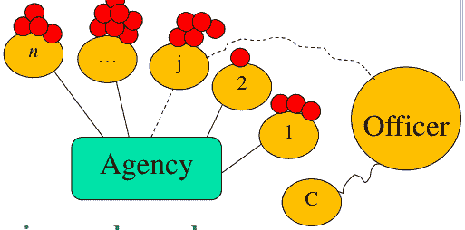

假设候选人以随机顺序到来。
设 X 为随机变量，表示
我们雇用新办公室助理的次数。

（令随机变量 X 表示我们雇用新助手的人数）

- • 使用概率分析

那么

```
$$E[X] = \sum_{i=1}^{n} i\Pr[X=i]$$
```

计算会很繁琐（计算烦琐）

# ■ 招聘问题的分析

假设候选人以随机顺序到来。

随机变量 X = 我们雇用新办公室助理的次数 （随机变量 X 表示我们雇用新助手的人数）

- **使用指示随机变量**
  - 定义指示随机变量 $X_1, X_2, \ldots, X_n$，其中 $X_i = I\{\text{candidate } i \text{ is hired}\}$
  - 有用的性质：
    - $X = X_1 + X_2 + \cdots + X_n$
    - 引理 $\Rightarrow E[X_i] = \Pr\{\text{candidate } i \text{ is hired}\}$。

我们需要计算 Pr{ candidate i is hired}？

## ▪ 招聘问题的分析

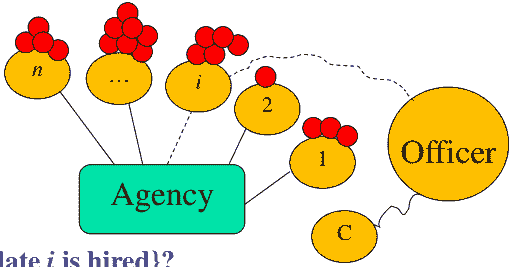

**我们需要计算 Pr(candidate i is hired)?**

- **i 被雇用 ⇔ i 比候选人 1, 2, …, i−1 都更好。**
- **假设候选人以随机顺序到来 ⇒ 这些候选人中任何一个成为最好者的可能性相等。**
  
  （若候选人随机到来，则每一个候选人为最佳人选的概率相等）
- **因此，E{Xᵢ} = Pr{ candidate i is the best so far } = 1/i ?**

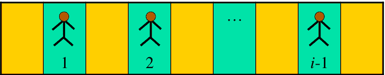

## 招聘问题的分析

我们需要计算 Pr{ candidate i is hired}？

- i 被雇用 ⇔ i 比候选人 1, 2, ..., i-1 都更好。
- 因此，E{X_i} = Pr{ candidate i is the best so far} = 1/i ?

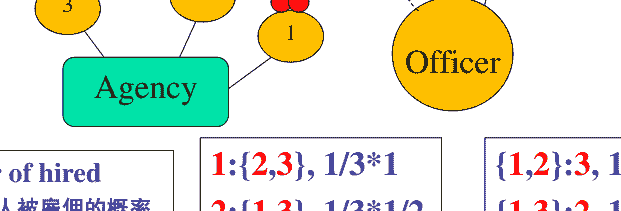

viewed : viewing , Pr of hired
已面试：待面试，待面试人被雇佣的概率
0 : {1,2,3} , 1

1:{2,3}, 1/3*1
2:{1,3}, 1/3*1/2
3:{1,2}, 1/3*0

{1,2}:3, 1/3*1
{1,3}:2, 1/3*0
{2,3}:1, 1/3*0

第一天面试的人的资历可能是1or2or3，每种情况的Pr是1/3；若是第一种情况，第二天面试的人被雇佣的Pr是1，则条件Pr=1/3*1；其他情况相似。


# ■ 招聘问题的分析

```
HIRE-ASSISTANT(n)                                      cost    times
best ← 0 // candidate 0 is a least-qualified dummy candidate
for i ← 1 to n
    do interview candidate i                              c_i       n
        if candidate i is better than candidate best
            then best ← i
                 hire candidate i                         c_h       m

T(n) = n c_i + m c_h
```

我们需要计算 Pr{ candidate i is hired }？

- i is hired ⇔ i is better than each of candidates 1, 2, …, i−1.
- Assumption that the candidates arrive in random order => any one of these candidates is equally likely to be the best one. （若候选人随机到来，则每一个候选人为最佳人选的概率相等）
- Thus, E[X_i] = Pr{ candidate i is the best so far } = 1/i ?

Then

E[X] = E[∑ᵢ₌₁ⁿ Xᵢ] = ∑ᵢ₌₁ⁿ E[Xᵢ] = ∑ᵢ₌₁ⁿ 1/i = ln n

Thus, the expected hiring cost is n cᵢ + (ln n)cₕ, which is much better than the worst-case cost of n cᵢ + n cₕ.

(n cᵢ + m cₕ): 30 + 3.4*10 = 64 vs 30 + 30*10 = 330. (ln 30 = 3.4…)

## 5.3 随机化算法

### 5.3.1 招聘问题

对于招聘问题，该算法是确定性的。

- For any given input, the number of times we hire a new office assistant will always be the same. (给定输入，则雇佣的人数确定)
- The number of times we hire a new office assistant depends only on the input. (雇佣的人数〔资源消耗〕依赖于输入)
- Some rank orderings will always produce a high hiring cost. Example: <1,2,3,4,5,6>, where each is hired.
- Some will always produce a low hiring cost. Example: <6,*,*,*,*,*>, where only the first is hired.
- Some may be in between.

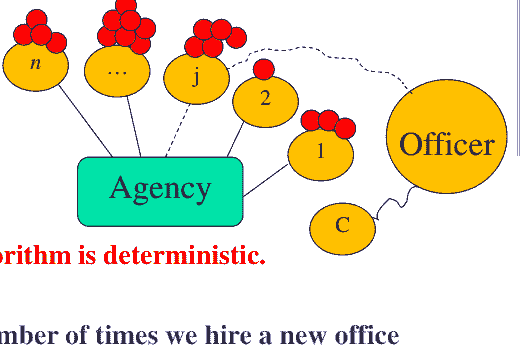

### 5.3.1 招聘问题

Instead of always interviewing the candidates in the order presented, what if we first randomly permuted this order.

- The randomization is now in the algorithm, not in the input distribution. （随机化过程在算法中，而不是在输入中体现）
- Given a particular input, we can no longer say what its hiring cost will be. Each time we run the algorithm, we can get a different hiring cost. （算法的运行时间与输入无关）
- No particular input always elicits worst-case behavior. （算法的最坏运算时间不取决于特定的输入）
- Bad behavior occurs only if we get “unlucky” numbers from the random-number generator. （只有当随机数产生器产生很不幸的数时，算法的运算时间最坏）

### 5.3.1 招聘问题

#### Algorithm for randomized hiring problem

```
RANDOMIZED-HIRE-ASSISTANT(n)
Randomly permute the list of candidates
HIRE-ASSISTANT(n)
```

Lemma

The expected hiring cost of RANDOMIZED-HIRE-ASSISTANT is $n c_i + (\ln n) c_h$.

# Proof

After permuting the input array, we have a situation identical to the probabilistic analysis of deterministic HIRE-ASSISTANT.

（对输入矩阵进行随机置换后，情况同 HIRE-ASSISTANT 相同）

## 5.3.2 随机置换一个数组

**Goal:**

**Produce a uniform random permutation (each of the n! permutations is equally likely to be produced),**

**that is**

$A = \langle 1, 2, 3, \ldots, n \rangle$

The numbers of permutation of A is $P_n^n = n!$, each of that is equally likely to be produced.

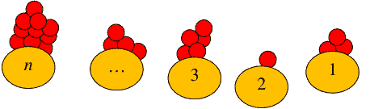

## 5.3.2 随机置换一个数组

#### (1) Permute-by-sorting

The method is not very good

- Assume the given array A contains the element 1 through n.
  （设数组 A = <1, 2, ..., n>）
- Assign each element A[i] a random priority P[i], then sort the elements of A according to these priorities. Example
  （为每个元素 A[i] 分配一个随机数 P[i] 作为其优先权，然后依据这些优先权对数组 A 进行排序。）
- If initial array is A=<1,2,3,4>, choose random priorities P=<36,3,97,19>, then produce an array B=<2,4,1,3>

```
PERMUTE-BY-SORTING(A)
n = length[A]
for(i=1; i<=n; i++)
    P[i] = RANDOM(1, n³)
sort A, using P as sort keys
return A
```

We use a range of 1 to n³ in RANDOM to make it likely that all the priorities in P are unique.( Exercise 5.3-5 )

## 5.3.2 随机置换一个数组

## (2) RANDOMIZE-IN-PLACE


```
RANDOMIZE-IN-PLACE(A, n)
for (i = 1; i ≤ n; i++)
    swap(A[i], A[RANDOM(i, n)])
```


# Idea:

- In iteration *i*, choose *A[i]* randomly from *A[i .. n]*.
- Will never alter *A[i]* after iteration *i*.（第 *i* 次迭代后不再改变 *A[i]*）

# Merit:

- It runs in linear time without requiring sorting (*O(n)*).
- It needs fewer random bits (*n* random numbers in the range 1 to *n* rather than the range 1 to *n³*)（仅需要小范围的随机数产生器）
- No auxiliary array is required.（不需要辅助空间）


## 5.3.2 随机排列数组
### （2）RANDOMIZE-IN-PLACE

```
RANDOMIZE-IN-PLACE(A, n)
for(i=1; i<=n; i++)
    swap(A[i], A[RANDOM(i, n)])
```

**正确性：**

- 给定一个包含 n 个元素的集合，k-排列是其中 k 个元素组成的一个序列。可能的 k-排列共有 n!/(n-k)! 种。

- 引理
- **RANDOMIZE-IN-PLACE** 计算出一个均匀随机排列。

P_n^k = C_n^k · P_k^k = n! / [k!(n-k)!] · k! = n! / (n-k)!

**证明：使用循环不变量：**

| 1 | 2 | 3 | … | n |
|---|---|---|---|---|
| A(1) | A(2) | A(3) | … | A(n) |

| 1 | 2 | 3 | … | i₁ | … | n |
|---|---|---|---|---|---|---|
| A(i₁) | A(2) | A(3) | … | A(1) | … | A(n) |

| 1 | 2 | 3 | … | i₂ | … | n |
|---|---|---|---|---|---|---|
| A(i₁) | A(i₂) | A(3) | … | A(2) | … | A(n) |

- **引理**
- **RANDOMIZE-IN-PLACE** 计算出一个均匀随机排列。

> **证明：** 使用循环不变量：
> 
> **循环不变量：** 在第 i 次 for 循环迭代之前，对每个可能的 (i−1)-排列，子数组 A[1 .. i−1] 以概率 (n−i+1)!/n! 包含该 (i−1)-排列。
> 
> （第 i 次迭代之前，对于 (i−1)-排列，A[1 .. i−1] 包含任意一个 (i−1)-排列的概率为 (n−i+1)!/n!。）

$1/P_n^k = 1/\frac{n!}{(n-k)!} = \frac{(n-k)!}{n!}$

| 1 | 2 | 3 | ... | n |
|---|---|---|---|---|
| A(1) | A(2) | A(3) | ... | A(n) |

| 1 | 2 | 3 | ... | i₁ | ... | n |
|---|---|---|---|---|---|---|
| A(i₁) | A(2) | A(3) | ... | A(1) | ... | A(n) |

| 1 | 2 | 3 | ... | i₂ | ... | n |
|---|---|---|---|---|---|---|
| A(i₁) | A(i₂) | A(3) | ... | A(2) | ... | A(n) |

引理：RANDOMIZE-IN-PLACE 计算出一个均匀随机排列。

证明：使用循环不变量：

循环不变量：A[1 .. i-1] 包含任意一个 (i-1)-排列的概率为 (n-i+1)!/n!。

- 初始化：在第一次迭代之前，i=1。循环不变量表明，对每个可能的 0-排列，子数组 A[1 .. 0] 包含该 0-排列的概率为 n!/n!=1。A[1 .. 0] 是空子数组，0-排列不包含任何元素。因此，A[1 .. 0] 以概率 1 包含任意 0-排列。（空集包含空排列的概率为 1）

引理：RANDOMIZE-IN-PLACE 计算出一个均匀随机排列。

证明：循环不变量：Pr{A[1 .. i-1] 包含任意一个 (i-1)-排列} = (n-i+1)!/n!。

- 保持：假设在第 i 次迭代之前，Pr{A[1 .. i-1] 包含任意一个 (i-1)-排列} = (n-i+1)!/n!，我们需要证明在第 i 次迭代之后，Pr(A[1 .. i] 包含任意一个 i-排列) = (n-i)!/n!。
- （第 i 次迭代前，设 (i-1)-排列 A[1 .. i-1] 中，任一排列发生的概率为 (n-i+1)!/n!，则需证明在第 i 次迭代后，任一 i-排列的概率为 (n-i)!/n!）

考虑一个特定的 i-排列 R=<x₁, x₂, ..., xᵢ>。它由一个 (i-1)-排列 R’=<x₁, x₂, ..., xᵢ₋₁> 后接 xᵢ 组成。……

引理：RANDOMIZE-IN-PLACE 计算出一个均匀随机排列。

证明：循环不变量：Pr{A[1 .. i-1] 包含任意一个 (i-1)-排列} = (n-i+1)!/n!。

- 保持：... ...

i-排列 R=<x₁, x₂, ..., xᵢ> = <x₁, x₂, ..., xᵢ₋₁> ∪ xᵢ = R' ∪ xᵢ。

令 E₁ 表示算法实际将 R' 放入 A[1 .. i-1] 这一事件。由循环不变量，Pr{E₁}=(n-i+1)!/n!。

令 E₂ 表示第 i 次迭代将 xᵢ 放入 A[i] 这一事件。

当且仅当 E₁ 和 E₂ 都发生时，我们才能在 A[1 .. i] 中得到 i-排列 R；因此，算法在 A[1 .. i] 中产生 R 的概率为 Pr{E₂∩E₁} = ? ...（令事件 E₁ 表示算法实际将 (i-1)-排列 R' 放入 A[1 .. i-1]；根据循环不变量，Pr{E₁}=(n-i+1)!/n!；令事件 E₂ 表示第 i 次迭代将 xᵢ 放入 A[i]，则当且仅当 E₁ 和 E₂ 同时发生时，我们得到 i-排列 R 被放入 A[1 .. i]，其概率为 Pr{E₂∩E₁}=？）...


## 5.3.2 随机置换一个数组
## (2) RANDOMIZE-IN-PLACE

```
RANDOMIZE-IN-PLACE(A, n)
for (i=1; i<=n; i++)
    swap(A[i], A[RANDOM(i, n)])
```

引理  RANDOMIZE-IN-PLACE 计算一个均匀随机置换。

证明  循环不变量：Pr{A[1..i-1] 包含每个 (i-1)-置换} = (n-i+1)!/n!。

- **维护：**

… …

Pr{E₂ ∩ E₁} = Pr{E₂|E₁} Pr{E₁}.

算法从 A[i..n] 中的 n-i+1 种可能性中随机选择 xᵢ => Pr{E₂|E₁} = 1/(n-i+1)? 于是，

| i | i+1 | … | n |
|---|---|---|---|
| A(jᵢ) | A(jᵢ₊₁) | … | A(jₙ) |

Pr{E₂ ∩ E₁} = Pr{E₂|E₁} Pr{E₁}
= 1/(n-i+1) · (n-i+1)!/n! = (n-i)!/n!

**证明**  **循环不变量：** Pr{A[1 . . i−1] 包含每个 (i−1)-置换} = (n−i+1)!/n!。

- **终止：**

在终止时，i=n+1，在第 i 次迭代之前它是成立的，因此我们得出 A[i . . n] 以概率 (n−n)!/n! = 1/n! 是一个给定的 n-置换。

■ (引理)

### *5.4 进一步应用

- 自学

## 练习和问题

- **Exercises**
  - 所有课后习题。
  - 编程验证习题。
- **Class-exercises**
  - 雇用问题中，仅雇用1个人的概率，即 Pr(X=1)？
  - 雇用问题中，n个人都会被雇佣的概率，即 Pr(X=n)？
  - 雇用问题中，仅雇用2个人的概率，即 Pr(X=2)？

# Part IV:
## 高级设计与分析技术

高级、先進的设计与分析方法、技术

## 高级设计与分析技术
## □ 动态规划

- 不是一种具体的算法，而是一种技术（如分治法）。
- “programming” 表示“表格方法”，而不是计算机编程。 （programming表示列表方法，而不是指编程）
- 用于优化问题（装配线调度）。

## □ 贪心算法

- 以局部最优的方式做出每一次选择。 (找零)
  （以局部最优方式作每一次选择）

- ……

- Enumeration（穷举法）

- Divide-and-conquer: the solution of recurrences

- Backtrack（回溯）

- Randomization

# 15 动态规划

- **Scheduling two automobile assembly lines** （流水线、装配线调度）
- **Matrix-chain multiplication** （矩阵链相乘，矩阵连乘）
- **Characteristics of dynamic programming**
  （动态规划法的特征）
- **Longest common subsequence** （最长相同子序列）
- **Optimal binary search trees** （最优二叉搜索树）
- **Steel rod cutting** （钢条、钢管切割）

## 15.1 装配线调度

Automobile factory with two assembly lines: A manufacturing problem to find the fastest way through a factory. （汽车制造有两条流水线，求汽车制造的流水线调度的最快方法）


Problem: determine which stations to choose from line 1 and which to choose from line 2 in order to minimize the total time through the factory for one auto. （应选line1中哪一个装配站, line2中哪一个装配站, s.t. 装配一个汽车的开销最小）

## 15.1 装配线调度

- The fastest way through the factory


f* = 2+7+2+5+1+3
+1+4+5+1+4+3=38


- How to find the fastest way?

## 15.1 装配线调度


- “brute force” way (enumerate all the way) infeasible when there are many stations.
  （原始方法，穷举法，当stations n 很大时，穷举法实际不可行）
- If it is given a list of which stations to use in line 1 and which to use in line 2, it is easy to compute in Θ(n) time how long it takes a chassis to pass through the factory.
  （当给定line1和line2中哪些station被使用，需要Θ(n)时间去计算该装配过程）
- There are 2ⁿ possible ways to choose stations. By enumerating all possible ways and computing how long each takes would require Ω(2ⁿ) time, infeasible when n is large.
  （从line1和line2中选择不同的station，共有 2ⁿ 种方法通过工厂，列举每个过程，并计算每个过程的开销，共需要Ω(2ⁿ)）

### Step 1: The structure of the fastest way through the factory


- **Characterize the structure of an optimal solution.**
  （特征化一个最优解的结构）

- **Consider the fastest possible way for a chassis to get from the starting point through station S₁ⱼ.**
  （考虑这种情况：一个底盘从装配线的入口点开始，以最快的方式通过 station S₁ⱼ。问：这条路径是什么？）

- **If j = 1, there is only one way that the chassis could have gone. It is easy to determine how long it takes to get through station S₁ⱼ.**
  （若 j = 1，则只有一种方式通过 S₁,₁）


### Step 1: 工厂中最快路径的结构

- 描述最优解的结构。
- 考虑底盘从起点出发以最快方式通过站点 $S_{1,j}$ 的情况。 （从装配线的入口点开始，以最快的方式通过 $S_{1,j}$，这条路径是什么？）
- 若 $j=1$，只有一种方式


- **对于 $j \ge 2$，有两种选择**
  - 经由 $S_{1,j-1}$，然后**直接**到达 $S_{1,j}$，无转移时间；
  - 经由 $S_{2,j-1}$，然后**转移**到站点 $S_{1,j}$，转移时间 $t_{2,j-1}$。
  - 这两种可能性有很多共同之处。

### Step 1: 工厂中最快路径的结构

- **首先，假设通过站点 $S_{1j}$ 的最快路径是经由站点 $S_{1,j-1}$。**

（首先，设以最快方式通过 $S_{1j}$ 的路径为 $p_j$，$p_j$ 中的 $S_{1j}$ 的前一个 station 是 $S_{1,j-1}$）


- **底盘必须已采用从起点到站点 $S_{1,j-1}$ 的最快路径。为什么？** （去掉路径 $p_j$ 中的最后一个 $S_{1j}$ 后得到 $p_{j-1}$，则 $p_{j-1}$ 是通过 $S_{1,j-1}$ 的最快路径）

- 如果存在**另一条更快的方式**通过站点 $S_{1,j-1}$，我们可以**替换**这条更快的方式，从而得到通过站点 $S_{1j}$ 的**另一条更快的方式**：矛盾。

（若有另外一条更快的路径 $q_{j-1}$ 通过 $S_{1,j-1}$，则用 $q_{j-1}$ 替换 $p_{j-1}$，那么 $q_j=q_{j-1}+S_{1,j}$ 是比 $p_j$ 更快的路径，矛盾）

### Step 1: 工厂中最快路径的结构


- **类似地，** 假设通过站点 $S_{1j}$ 的最快路径是经由站点 $S_{2j-1}$。

- 底盘必须已采用从起点到站点 $S_{2j-1}$ 的最快路径。推理相同：
  - 如果存在另一条更快的方式通过站点 $S_{2j-1}$，我们可以替换这条更快的方式，从而得到通过站点 $S_{1j}$ 的另一条更快的方式：矛盾。

### Step 1: 工厂中最快路径的结构

- **最优子结构**
  （最佳子结构）
  - 一个问题的最优解（装配线调度，寻找通过站点 $S_{i,j}$ 的最快路径）**在其内部包含**子问题的最优解（寻找通过 $S_{1,j-1}$ 或 $S_{2,j-1}$ 的最快路径）。
  （问题的最优解包含其子问题的最优解，$p_j$ contains $p_{j-1}$ within it.）
  - 我们将此性质称为 *最优子结构*。
  - 最优子结构是动态规划适用性的标志之一。
  （为什么使用动态规划法？最佳子结构是其特点之一）


### Step 1: 工厂中最快路径的结构

- 利用最优子结构，从子问题的最优解构造问题的最优解。

（使用最佳子结构可以从子问题的最优解来构造原问题的最优解）


- 首先，通过 $S_{1,j}$ 的最快路径是以下两种之一：
  - 通过 $S_{1,j-1}$ 的最快路径然后直接通过 $S_{1,j}$，或
  - 通过 $S_{2,j-1}$ 的最快路径，从线 2 转移到线 1，然后通过站点 $S_{1,j}$。

（通过 $S_{1,j}$ 的最快方法有两种，一种是先通过 $S_{1,j-1}$，然后直接通过 $S_{1,j}$，另一种先通过 $S_{2,j-1}$，然后从line2转移到line1，再通过 $S_{1,j}$）

- 对称地推理，通过站点 $S_{2,j}$。

## Step 2: 递归解法

- 以子问题的最优解递归地定义最优解的值。
  （通过子问题的最优解来递归地定义原问题的最优解）
- 子问题：寻找在两条线上通过站点 j 的最快路径，j = 1, 2, ..., n。
  （子问题：寻找通过任意station j (= 1, 2, ..., n)的最快路径）
- 设 f[i,j] = 从起点出发通过 S_{i,j} 的最快时间。
  （从入口点开始，设以最快方式通过station S_{i,j}的时间为f[i,j]）


## Step 2: 递归解法

- **设** $f[i,j]$ **= 从起点出发通过** $S_{i,j}$ **的最快时间。**

（从入口点开始，设以最快方式通过 station $S_{i,j}$ 的时间为 $f[i,j]$）


- **最终目标：底盘以最快方式通过整个工厂的时间** $= f^*$。

  底盘必须完全通过线 1 或线 2 上的站点 $n$，然后到达工厂出口。

（目标：以最快方式通过整个装配过程，设该时间为 $f^*$。最后一步是在 line 1 or line 2 上通过 station $n$，然后直接退出装配线）

$f^* = \min(f_1[n] + x_1, f_2[n] + x_2) \qquad (15.1)$


## Step 2: 递归解法

- 容易计算 $f_1[1]$ 和 $f_2[1]$。直接在任一生产线上到达站 1。
- 
- $f_1[1] = e_1 + a_{1,1}$,  (15.2)
- $f_2[1] = e_2 + a_{2,1}$.  (15.3)


- 对于 $j = 2, 3, ..., n$ ($i = 1, 2$)

- 首先，对于 $f_1[j]$，通过 $S_{1,j}$ 的最快方式是，要么通过 $S_{1,j-1}$ 的最快方式，直接通过 $S_{1,j}$，此时 $f_1[j] = f_1[j-1] + a_{1,j}$；要么通过 $S_{2,j-1}$ 的最快方式，从第 2 条线转换到第 1 条线，并通过 $S_{1,j}$，此时 $f_1[j] = f_2[j-1] + t_{2,j-1} + a_{1,j}$。因此
- 
- $f_1[j] = \min(f_1[j-1] + a_{1,j}, f_2[j-1] + t_{2,j-1} + a_{1,j})$  (15.4)

- 对称地，
- 
- $f_2[j] = \min(f_2[j-1] + a_{2,j}, f_1[j-1] + t_{1,j-1} + a_{2,j})$  (15.5)


$f_1[1] = e_1 + a_{1,1}, \quad (15.2)$

$f_2[1] = e_2 + a_{2,1}. \quad (15.3)$

$f_1[j] = \min(f_1[j-1] + a_{1,j},\ f_2[j-1] + t_{2,j-1} + a_{1,j}) \quad (15.4)$

$f_2[j] = \min(f_2[j-1] + a_{2,j},\ f_1[j-1] + t_{1,j-1} + a_{2,j}) \quad (15.5)$

- • **由方程 (15.2)–(15.5)，得到递归方程**

$f_1[j] = \begin{cases}
e_1 + a_{1,1}, & \text{if } j=1,\\
\min(f_1[j-1] + a_{1,j},\ f_2[j-1] + t_{2,j-1} + a_{1,j}), & \text{if } j\ge 2
\end{cases} \quad (15.6)$

$f_2[j] = \begin{cases}
e_2 + a_{2,1}, & \text{if } j=1,\\
\min(f_2[j-1] + a_{2,j},\ f_1[j-1] + t_{1,j-1} + a_{2,j}), & \text{if } j\ge 2
\end{cases} \quad (15.7)$

### Step 3: 计算最快时间

f* = min(f₁[n] + x₁, f₂[n] + x₂)      (15.1)

f₁[j] = { e₁ + a₁,₁ , if j = 1,
          min(f₁[j-1] + a₁,j , f₂[j-1] + t₂,j-1 + a₁,j), if j ≥ 2 }      (15.6)

f₂[j] = { e₂ + a₂,₁ , if j = 1,
          min(f₂[j-1] + a₂,j , f₁[j-1] + t₁,j-1 + a₂,j), if j ≥ 2 }      (15.7)

- 基于方程 (15.1)、(15.6) 和 (15.7)，可以很容易地编写一个递归算法来计算通过工厂的最快方式。
- （基于如上递归方程容易编写递归算法）

- 但该算法的运行时间为 n 的指数级。
- （但递归算法的时间复杂度为 n 的指数次方？……）

- 以不同于递归的顺序计算 $f_i[j]$ 值。
  （采用与递归不一样的顺序来计算$f_i[j]$）
  $f_i[j] = \begin{cases} e_i + a_{1,1} & ,\text{if } j=1, \\ \min(f_1[j-1]+a_{1,j},\ f_2[j-1]+t_{2,j-1}+a_{1,j}),\text{if } j\ge 2 \end{cases}$ (15.6)

- 观察：$f_i[j]$ 仅依赖于 $f_1[j-1]$ 和 $f_2[j-1]$（当 $j\ge2$ 时）。

- 通过按站号 $j$ 递增的顺序计算 $f_i[j]$ 值——从左到右。
  （以station数 $j$ 增加的方式来计算$f_i[j]$）


我们可以在 $\Theta(n)$ 时间内计算出通过工厂的最快方式及其所需时间。
（仅需要$\Theta(n)$时间就可以计算出通过完整工序的最快方法）

- FASTEST-WAY 过程以值 $a_{i,j}$、$t_{i,j}$、$e_i$ 和 $x_i$ 以及每条装配线的站数 $n$ 作为输入。
  
  (以 $a_{i,j}$, $t_{i,j}$, $e_i$, $x_i$, $n$ 作为输入，可设计程序 FASTEST-WAY)


```
FASTEST-WAY(a, t, e, x, n)
1  f₁[1] ← e₁ + a₁,₁
2  f₂[1] ← e₂ + a₂,₁
3  for j ← 2 to n
4    do if f₁[j-1] + a₁,j ≤ f₂[j-1] + t₂,j-1 + a₁,j
5       then f₁[j] ← f₁[j-1] + a₁,j
6            l₁[j] ← 1
7       else f₁[j] ← f₂[j-1] + t₂,j-1 + a₁,j
8            l₁[j] ← 2
9       if f₂[j-1] + a₂,j ≤ f₁[j-1] + t₁,j-1 + a₂,j
10      then f₂[j] ← f₂[j-1] + a₂,j
11           l₂[j] ← 2
12      else f₂[j] ← f₁[j-1] + t₁,j-1 + a₂,j
13           l₂[j] ← 1
14  if f₁[n] + x₁ ≤ f₂[n] + x₂
15     then f* = f₁[n] + x₁
16          l* = 1
17     else f* = f₂[n] + x₂
18          l* = 2
```


f₁[1] = e₁ + a₁,₁ , (15.2)
f₂[1] = e₂ + a₂,₁ . (15.3)

f₁[j] = min(f₁[j-1] + a₁,j , f₂[j-1] + t₂,j-1 + a₁,j) (15.4)

f₂[j] = min(f₂[j-1] + a₂,j , f₁[j-1] + t₁,j-1 + a₂,j) (15.5)

f* = min(f₁[n] + x₁ , f₂[n] + x₂) (15.1)


### Step 3: 计算最快时间

```
FASTEST-WAY(a, t, e, x, n)
1  f1[1] ← e1 + a1,1
2  f2[1] ← e2 + a2,1
3  for j ← 2 to n
4    do if f1[j-1] + a1,j ≤ f2[j-1] + t2,j-1 + a1,j
5         then f1[j] ← f1[j-1] + a1,j
6              l1[j] ← 1
7         else f1[j] ← f2[j-1] + t2,j-1 + a1,j
8              l1[j] ← 2
9       if f2[j-1] + a2,j ≤ f1[j-1] + t1,j-1 + a2,j
10        then f2[j] ← f2[j-1] + a2,j
11             l2[j] ← 2
12        else f2[j] ← f1[j-1] + t1,j-1 + a2,j
13             l2[j] ← 1
14  if f1[n] + x1 ≤ f2[n] + x2
15     then f* = f1[n] + x1
16          l* = 1
17     else f* = f2[n] + x2
18          l* = 2
```


| j | 1 | 2 | 3 | 4 | 5 | 6 |
|---|---:|---:|---:|---:|---:|---:|
| f1[j] | 9 | 18 | 20 | 24 | 32 | 35 |
| f2[j] | 12 | 16 | 22 | 25 | 30 | 37 |

\(f^* = 38\)

| j | 2 | 3 | 4 | 5 | 6 |
|---|---:|---:|---:|---:|---:|
| l1[j] | 1 | 2 | 1 | 1 | 2 |
| l2[j] | 1 | 2 | 1 | 2 | 2 |

\(l^* = 1\)

从左到右填充包含值 \(f_i[j]\) 和 \(l_i[j]\) 的表格（在每个列内自上而下）。为了填入 \(f_i[j]\)，我们需要 \(f1[j-1]\) 和 \(f2[j-1]\) 的值，而这些值我们已经计算并存储。

### Step 4: 构造穿过工厂的最快路径

- 使用 \(f[i], f^*, l[i],\) 和 \(l^*\)，来构造最快路径中使用的车站序列。

（使用 \(f\) 和 \(l\) 去构造最快路径）

- PRINT-STATIONS 过程按车站号递减的顺序打印出所使用的车站。


| j | 1 | 2 | 3 | 4 | 5 | 6 |
|---|---:|---:|---:|---:|---:|---:|
| f1[j] | 9 | 18 | 20 | 24 | 32 | 35 |
| f2[j] | 12 | 16 | 22 | 25 | 30 | 37 |

\(f^* = 38\)

| j | 1 | 2 | 3 | 4 | 5 | 6 |
|---|---:|---:|---:|---:|---:|---:|
| l1[j] | — | 1 | 2 | 1 | 1 | 2 |
| l2[j] | — | 1 | 2 | 1 | 2 | 2 |

\(l^* = 1\)

```
PRINT-STATIONS(l, n)
1  i ← l*
2  print "station " n ", line " i
3  for j ← n downto 2
4      do i ← l_i[j]
5         print "station " j-1 ", line " i
```

- station 6, line 1
- station 5, line 2
- station 4, line 2
- station 3, line 1
- station 2, line 2
- station 1, line 1

## Divide-and-conquer 与 Dynamic programming 的比较

|  | Divide-and-conquer | Dynamic programming |
|---|---|---|
| **similarity** | 通过组合子问题的解来求解问题。 | 通过组合子问题的解来求解问题。 |
| **difference** | 1) 将问题划分为 **独立子问题**，2) **递归地**求解子问题，3) **合并**它们的解来求解原问题。 | 子问题 **不独立**，即当子问题 **共享** 子子问题时。（子问题不独立，不同子问题共享相同的子子问题） |
|  | 可能做更多不必要的工作，**重复地**求解共同的子子问题。 | 只对每个子子问题求解 **一次**，然后将其答案 **保存在表中**，避免每次遇到子子问题时都重新计算答案。 |

- 动态规划通常应用于 **优化问题**。
- 优化问题
  - 可能存在许多可能的解，
  - 每个解都有一个值，
  - 我们希望找到具有最优（最小或最大）值的解。
- 我们称这样的解为问题的 *一个* 最优解，而不是 *最* 优解，因为可能有多个解能达到最优值。

（称问题的某个解为一个最优解，而不是单纯地称为最优解，因为可能有多个解能得出问题的最优值）


- **动态规划算法的开发可以分解为四个步骤的序列。**
  1. **刻画** 最优解的结构。
  2. **递归地** 定义最优解的值。
  3. 以 **自底向上** 的方式计算最优解的值。
  4. 从计算得到的信息中 **构造** 最优解。

- **如果仅需要最优解的值，则可以省略第 4 步。** 当我们执行第 4 步时，有时会在第 3 步的计算过程中 **维护额外的信息**，以便更轻松地构造最优解。

（当仅需求最优值时 Step 4 通常可以省略。为了执行 Step 4【更容易地构造最优解】，通常在执行 Step 3 时记录必要的信息）


# Exercises

# ADF_WorkShop

# Solution

```
// recursive algorithm
PRINT-STATIONS(l, j, n) // initially j = n
    if ( j == n )
        i ← l*
    else
        i ← l_i[j+1]

    if ( j == 0 )
        return
    else
        if ( j > 1 )
            PRINT-STATION(l, j-1, n)
    print "line" i ", station" j
```

```
// non-recursive algorithm
PRINT-STATIONS(l, j, n)
    i ← l*
    A[n] ← i
    for j ← n downto 2
        i ← l_i[j]
        A[j-1] ← i
    for j ← 1 upto n
        print "line" A[j] ", station" j
```

# 15 Dynamic Programming

- **Scheduling two automobile assembly lines**
  （流水线、装配线调度）
- **Matrix-chain multiplication**
  （矩阵链相乘，或矩阵连乘问题）
- **Characteristics of dynamic programming**
  （动态规划法的特征）
- **Longest common subsequence** （最长相同子序列）
- **Optimal binary search trees** （最优二叉搜索树）

# 15.2 Matrix-chain multiplication

- Given a sequence (chain) <A₁, A₂, ..., Aₙ> of n matrices to be multiplied, and we wish to compute the product

n 个矩阵相乘，称为 ‘矩阵连乘’，如何求积？

A₁A₂A₃A₄.  (15.10)

(A₁(A₂(A₃A₄))), (A₁((A₂A₃)A₄)), ((A₁A₂)(A₃A₄)), ......

- We can evaluate (15.10) using the standard algorithm for multiplying pairs of matrices as a subroutine once we have parenthesized it. 以两个矩阵相乘的标准算法作为子程序来求解(15.10)

- A product of matrices is fully parenthesized if it is either a single matrix or the product of two fully parenthesized matrix products, surrounded by parentheses. Example, (A₁((A₂A₃)A₄)).

矩阵连乘全括号：仅有一个矩阵，或者两个 “矩阵连乘全括号” 的乘积且外层包括一个括号，如： (A₁((A₂A₃)A₄))

这是嵌套的矩阵对，它给出了矩阵连乘的一种求解顺序。

# Exam3 Multiplication of two matrices（矩阵相乘）

two $n \times n$ matrices A and B, Complexity(C=A × B) = ?

- **Standard method**

$c_{ij}=\sum_{k=1}^{n}a_{ik}b_{kj}$

```
MATRIX-MULTIPLY(A, B)
for i ← 1 to n
    for j ← 1 to n
        C[i, j] ← 0
        for k ← 1 to n
            C[i, j] ← C[i, j] + A[i, k]·B[k, j]
return C
```

**Complexity:**
$O(n^3)$ multiplications and additions.

$T(n)=O(n^3)$.

# 15.2 Matrix-chain multiplication

- Given a sequence (chain) ⟨A₁, A₂, ..., Aₙ⟩ of n matrices to be multiplied, and we wish to compute the product

（n 个矩阵相乘，称为“矩阵连乘”，如何求积？）

A₁A₂A₃A₄.　　　　　　　　　　　　　　　　　　　　　　　　　(15.10)

- Matrix multiplication is **associative**, so all parenthesizations yield the **same product**. For example, if the chain of matrices is ⟨A₁, A₂, A₃, A₄⟩, the product A₁A₂A₃A₄ can be fully parenthesized in five distinct ways:

（矩阵连乘满足结合律，因此对所有加括号的方式，矩阵连乘的积相同。例如…）

(A₁(A₂(A₃A₄))), (A₁((A₂A₃)A₄)), ((A₁A₂)(A₃A₄)), ((A₁(A₂A₃))A₄), (((A₁A₂)A₃)A₄).

# 15.2 Matrix-chain multiplication

The way we **parenthesize** a chain of matrices can have a **dramatic impact** on the cost of evaluating the product.

（对于矩阵连乘问题，采用不同的加括号方式，可导致不同的、甚至及其富有戏剧性差别的乘法开销）

(A₁ (A₂ (A₃ A₄)))

(A₁ ((A₂ A₃) A₄))

((A₁ A₂) (A₃ A₄))

((A₁ (A₂ A₃)) A₄)

(((A₁ A₂) A₃) A₄)

# 15.2 Matrix-chain multiplication

- First, consider the cost of multiplying two matrices.
- Two matrices A and B can be multiplied only if they are compatible: columns of A = rows of B. （仅当矩阵A和B相容时，A和B能相乘）
  - If A is p×q, B is q×r, then C is p×r.
  - The time to compute C is dominated by the number of scalar multiplications in line 7, which is pqr. （求得矩阵 C 的计算时间主要由 line7 的标量相乘所决定，相乘次数为pqr）


```
MATRIX-MULTIPLY(A, B)
1 if columns[A] ≠ rows[B]
2   then return "error: incompatible dimensions"
3 else for i ← 1 to rows[A]
4     for j ← 1 to columns[B]
5       C[i,j] ← 0
6       for k ← 1 to columns[A]
7         C[i,j]←C[i,j]+A[i,k]·B[k,j]
8 return C
```

# 15.2 Matrix-chain multiplication

- For A<sub>p×q</sub>, B<sub>q×r</sub>, C=AB is p×r. The # of scalar multiplications is pqr.
- Consider the problem of a chain <A₁, A₂, A₃>.
- Suppose that A₁: 10×100; A₂: 100×5; A₃: 5×50
  - If A = ((A₁A₂)A₃),
    a) C = A₁A₂, # of multiplications 10·100·5 = 5000, C₁₀×5
    b) A = CA₃, # of multiplications 10·5·50 = 2500, A₁₀×50
    then, # of scalar multiplications, for a total of 7500.
  - If A = (A₁(A₂A₃)),
    a) C₁₀₀×₅₀ = A₂A₃, # of multiplications 100·5·50 = 25,000,
    b) A₁₀×₅₀ = A₁C, # of multiplications 10·100·50 = 50,000,
    then, # of scalar multiplications, for a total of 75,000.
  - The first case is 10 times faster than the second.


## 统计括号化方案的数量

A₁ A₂ A₃ A₄ A₅ : (A₁ A₂ A₃)(A₄ A₅)?   (A₁ A₂)(A₃ A₄ A₅)? ……  
A₁(A₂ A₃)?   (A₁ A₂)A₃?

- 暴力法：穷举检查所有可能的括号化方案。
- P(n)：n 个矩阵的不同括号化方案数量。
- （令P(n)表示 n 个矩阵连乘时所有可能的全括号方式的个数）
- n=1 时，只有一个矩阵，矩阵乘积只有一种括号化方式。
- n≥2 时，该乘积是两个完全括号化的矩阵子乘积的乘积；两个子乘积的分割点可以出现在第 k 个和第 k+1 个矩阵之间，其中 k = 1, 2, ..., n-1。因此，
- （n≥2, 矩阵连乘全括号的积是两个‘全括号子矩阵之积’的积。两个全括号子矩阵的分隔位置在A_k和A_{k+1}之间）

P(n) = { 1 , if n = 1,
         Σ_{k=1}^{n-1} P(k)P(n−k), if n ≥ 2. }  (15.11)

- 递推式 (15.11) 的解为 Ω(2ⁿ)，这是一种糟糕的策略。

## 用动态规划求解 MCM：

## 四个步骤

### 第1步：最优括号化方案的结构


- - 找出**最优子结构**
- - $A_{i..j}$（其中 $i \le j$）：乘积 $A_iA_{i+1}\cdots A_kA_{k+1}\cdots A_j$
  - 如果它是**非平凡**的，即 $i<j$，那么乘积 $A_iA_{i+1}\cdots A_j$ 的任何括号化方案都必须在 $A_k$ 和 $A_{k+1}$ 之间**分割**该乘积，其中 $k$ 是满足 $i\le k<j$ 的某个整数。
  - （若乘积非平凡，即 $i<j$，则任何矩阵连乘括号化方案都必须先求全括号子矩阵之积 $A_{i..k}$、$A_{k+1..j}$ 的积，其中 $i\le k<j$）
  - 先计算 $A_{i..k}$ 和 $A_{k+1..j}$，然后 $A_{i..k}\cdot A_{k+1..j}=A_{i..j}$

计算 $A_iA_{i+1}\cdots A_j$ 的这种括号化方案的代价

= 计算矩阵 $A_{i..k}$ 的代价 + 计算 $A_{k+1..j}$ 的代价

+ 将 $A_{i..k}\cdot A_{k+1..j}$ 相乘的代价

### 第1步：最优括号化方案的结构

- - **最优子结构**
  - 在 $A_i A_{i+1}...A_j$ 的这个最优括号化方案中，“前缀”子链 $A_i A_{i+1}...A_k$ 的括号化方式必须是 $A_i A_{i+1}...A_k$ 的最优括号化方案？（$A_{i,j}$ 的最佳全括号中的 $A_{i..k}$ 的全括号必须是 $A_{i..k}$ 的最佳全括号）

证明 设最优括号化方案 $A_{i,j} = (A_i...A_k)(A_{k+1}...A_j) = M·N$，其中 $M = (A_i A_{i+1}...A_k)$ 是上述 $A_{i..j}$ 中的括号化方案。如果存在一种代价更低的括号化方式 $A_i...A_k = P$，那么将 $M$ 替换为 $P$，即 $P·N$ 会产生另一种 $A_{i..j}$ 的括号化方案，其代价低于 $M·N$。矛盾。

- - 对 $A_{k+1} A_{k+2}...A_j$ 也有类似的结论。

### 第1步：最优括号化方案的结构


- - 基于最优子结构，从子问题的最优解构造原问题的最优解。
-   
-     （基于最优子结构，可以从子问题的最优解构造原问题的最优解）
-   
-   - 矩阵链乘法的任何解都需要分割乘积，并且**任何最优解都包含其子问题实例的最优解。**
-   
-     （任何最优解都包含其子问题的最优解）
-   
-     - **将**问题分割为两个子问题（对 $A_iA_{i+1}\cdots A_k$ 和 $A_{k+1}A_{k+2}\cdots A_j$ 进行最优括号化）；
-     - **求**子问题的最优解；
-     - **合并**这些子问题的最优解。
-   
-     （将问题分为两个子问题，求子问题的最优解，合并子问题的最优解）

### 第1步：最优括号化方案的结构


- - 当寻找分割乘积的正确位置时，我们必须考虑**所有可能的位置**，以确保已经检查过最优的那个位置。
- - （当寻找矩阵连乘分割点时，需要考虑所有分割位置，以确保最优解是其中之一）

### 第2步：递归解法

A₁ A₂ A₃ A₄ A₅: (A₁ A₂ A₃)(A₄ A₅)?   (A₁ A₂)(A₃ A₄ A₅)? ......  
    A₁ (A₂ A₃)?   (A₁ A₂) A₃?

- 根据子问题的最优解递归地定义最优解的代价。
- （根据子问题的最优解可以递归地定义原问题的最优解）

- 子问题：确定 $A_i A_{i+1}...A_j$（$1≤i≤j≤n$）的括号化方案的最小代价。
- 为什么不是 A₁ A₂...A_j？
- （子问题：确定矩阵连乘问题的子问题的形式为 A_i A_{i+1}...A_j，其中 1≤i≤j≤n）


### Step 2: A recursive solution

A₁ A₂ A₃ A₄ A₅: (A₁ A₂ A₃)(A₄ A₅)?   (A₁ A₂)(A₃ A₄ A₅)? ……
A₁ (A₂ A₃)?   (A₁ A₂) A₃?

m[i,j] : 计算 Aᵢ..j 的最小标量乘法次数；计算 A₁..n 的最便宜方式的代价为 m[1, n]。
（令 m[i,j] 表示矩阵连乘 Aᵢ..j 的最小标量乘法的次数。则计算 A₁..n 所需的最少乘法次数为 m[1, n].）

If i = j, one matrix Aᵢ..i = Aᵢ, no scalar multiplications. Thus, m[i,i] = 0 for i = 1, 2, ..., n.
（若 i = j，只有 一个矩阵 Aᵢ，则没有矩阵元素相乘， m[i,i] = 0 for i = 1, 2, ..., n）

When i < j ?

m[i,j] : 计算 Aᵢ..j 的最小标量乘法次数；计算 A₁..n 的最便宜方式的代价为 m[1, n]。

When i<j, assuming that the optimal parenthesization splits Aᵢ Aᵢ₊₁… Aⱼ between Aₖ and Aₖ₊₁, where i≤k<j.

（当 i<j, 设矩阵连乘 Aᵢ..j 最优全括号的分割点位于 Aₖ 与 Aₖ₊₁ 之间，则...）

Then, m[i,j] = the minimum cost for computing Aᵢ..k
+ the minimum cost for computing Aₖ₊₁..j
+ the cost of multiplying Aᵢ..k and Aₖ₊₁..j

Recalling that Aᵢ has dimensions pᵢ₋₁ × pᵢ, then computing Aᵢ..k Aₖ₊₁..j takes pᵢ₋₁ pₖ pⱼ scalar multiplications. Thus, we obtain m[i,j]=m[i,k]+m[k+1,j]+pᵢ₋₁ pₖ pⱼ

A₁ A₂ A₃ A₄ A₅: (A₁ A₂ A₃)(A₄ A₅)?   (A₁ A₂)(A₃ A₄ A₅)? ……
    A₁(A₂ A₃)?   (A₁ A₂)A₃?

m[i,j]=m[i,k]+m[k+1,j]+p_{i-1}p_kp_j

- This recursive equation assumes that we know the value of k, which we actually do not know. （递归方程假设已知矩阵连乘最佳全括号问题的分隔点 k，实际上 k 是未知的。）
- Only j-i possible values for k, namely k=i, i+1, ..., j-1.
- The optimal parenthesization must use one of these values for k. Checking them all to find the best, we have
（最佳全括号中必定使用 {i, i+1, ..., j-1} 中的一个值作为 k）

m[i, j] = { 0 , if i = j,
 min_{i ≤ k < j} { m[i, k] + m[k + 1, j] + p_{i-1} p_k p_j }, if i < j. (15.12)

- The m[i,j] give the costs of optimal solutions to subproblems.

A₁ A₂ A₃ A₄ A₅: (A₁ A₂ A₃)(A₄ A₅)? (A₁ A₂)(A₃ A₄ A₅)? ……
A₁(A₂ A₃)? (A₁ A₂)A₃?

```
m[i, j] = { 0 , if i = j,
min_{i ≤ k < j} { m[i, k] + m[k + 1, j] + p_{i-1} p_k p_j }, if i < j. (15.12)
```

- Construct an optimal solution : Define s[i, j] to be a value of k at which we can split the product A_i A_{i+1}...A_j to obtain an optimal parenthesization. That is, s[i, j] equals a value k such that m[i, j] = m[i, k] + m[k+1, j] + p_{i-1} p_k p_j.

（构造最优解：定义 s[i,j] 为最佳全括号 A_i A_{i+1}...A_j 的分割位置 k 的值，即 s[i,j] = k，使得...）

### Step 3: Computing the optimal costs

$$m[i,j]=\begin{cases}0,&\text{if }i=j,\\\min_{i\le k<j}\{m[i,k]+m[k+1,j]+p_{i-1}p_kp_j\},&\text{if }i<j.\end{cases}$$

• It is a simple matter to write a **recursive algorithm** based on recurrence (15.12) to compute the minimum cost $m[1,n]$ for multiplying $A_1A_2\ldots A_n$. How?

```
RECURSIVE-MATRIX-CHAIN(p, i, j)
1  if i = j
2      return 0
3  m[i, j] ← ∞
4  for k ← i to j − 1
5      q ← RECURSIVE-MATRIX-CHAIN(p, i, k)
           + RECURSIVE-MATRIX-CHAIN(p, k + 1, j)
           + pᵢ₋₁pₖpⱼ
6      if q < m[i, j]
7          m[i, j] ← q
8  return m[i, j]
```

m[i, j] = { 0 , if i = j, min_{i ≤ k < j} { m[i, k] + m[k + 1, j] + p_{i-1} p_k p_j }, if i < j. (15.12)

```
RECURSIVE-MATRIX-CHAIN(p, i, j)
1 if i = j
2   return 0
3 m[i, j] ← ∞
4 for k ← i to j-1
5   q ← RECURSIVE-MATRIX-CHAIN(p, i, k)
    + RECURSIVE-MATRIX-CHAIN(p, k+1, j)
    + p_{i-1} p_k p_j
6   if q < m[i, j]
7     m[i, j] ← q
8 return m[i, j]
```

| cost |  |
|------|---|
| T(n) | T(1) ≥ 1 |
| 1    |  |
| 1    | T(n) ≥ 1 + |
| 1    | Σ_{k=1}^{n-1} (T(k) + T(n−k) + 1) |
| 1    |  |
| T(k) | = 2 Σ_{i=1}^{n-1} T(i) + n |
| T(n−k) |  |
| 1    | ≥ 2^{n-1} |
| 1    |  |
| 1    |  |
| 1    |  |

- This algorithm takes exponential time, which is no better than the brute-force method of checking each way of parenthesizing the product. Why?

A₁ A₂ A₃ A₄ A₅: (A₁ A₂ A₃)(A₄ A₅)? (A₁ (A₂ (A₃ A₄ A₅)))? ……
A₁(A₂ A₃)? (A₁ A₂)A₃?

m[i, j] = { 0 , if i = j,
 min_{i ≤ k < j} { m[i, k] + m[k + 1, j] + p_{i-1} p_k p_j }, if i < j. (15.12)

- # of subproblems: one problem for each choice of i and j satisfying 1≤i≤j≤n ? (所有子问题个数为 ?)

Cₙ² + n = Θ(n²)

1 ≤ i = j ≤ n, Cₙ¹ = n

1 ≤ i < j ≤ n, Cₙ² = n(n−1)/2


### 步骤 3：计算最优代价

m[i, j] = { 0 , 若 i = j, min_{i ≤ k < j} { m[i, k] + m[k + 1, j] + p_{i-1} p_k p_j }, 若 i < j. (15.12)

- 子问题数：对于满足 1≤i≤j≤n 的每一对 i 和 j，都有一个子问题，总数为 C(n,2)+n = Θ(n²)。
- （子问题个数为Θ(n²)）

- 不用递归方法，而是使用表格化的自底向上方法计算最优代价。
- （不用递归方法，而采用列表方式、自底向上的方法计算最优解）


$$m[i,j]=\begin{cases}0,&\text{若 }i=j,\\\min_{i\le k<j}\{m[i,k]+m[k+1,j]+p_{i-1}p_kp_j\},&\text{若 }i<j.\end{cases}$$ (15.12)

$A_i$：维度 $p_{i-1}\times p_i$

**输入：** $p=\langle p_0,p_1,\ldots,p_n\rangle$。

# 过程：

表 $m[1..n,1..n]$ 存储 $m[i,j]$ 代价；

辅助表 $s[1..n,1..n]$ 记录在计算 $m[i,j]$ 时取得最优代价的 $k$ 索引。

（计算 $m[i,j]$ 时，用辅助表项 $s[i,j]$ 记录最佳位置 $k$ 的值）

```
MATRIX-CHAIN-ORDER(p)
1  n ← length[p] − 1
2  for i ← 1 to n
3      m[i, i] ← 0
4  for l ← 2 to n              // l is the chain length.
5      for i ← 1 to n − l + 1
6          j ← i + l − 1
7          m[i, j] ← ∞
8          for k ← i to j − 1
9              q ← m[i, k] + m[k + 1, j] + pᵢ₋₁pₖpⱼ
10             if q < m[i, j]
11                 m[i, j] ← q
12                 s[i, j] ← k
13 return m and s
```


$$m[i,j]=\begin{cases}0,&\text{若 }i=j,\\\min_{i\le k<j}\{m[i,k]+m[k+1,j]+p_{i-1}p_kp_j\},&\text{若 }i<j.\end{cases}$$

```
MATRIX-CHAIN-ORDER(p)
1  n ← length[p] − 1
2  for i ← 1 to n
3      m[i, i] ← 0
4  for l ← 2 to n                 // l is the chain length.
5      for i ← 1 to n − l + 1
6          j ← i + l − 1
7          m[i, j] ← ∞
8          for k ← i to j − 1
9              q ← m[i, k] + m[k + 1, j] + pᵢ₋₁pₖpⱼ
10             if q < m[i, j]
11                 m[i, j] ← q
12                 s[i, j] ← k
13     return m and s
```

| 矩阵 | 维度 |
|---|---:|
| $A_1$ | $30\times35$ |
| $A_2$ | $35\times15$ |
| $A_3$ | $15\times5$ |
| $A_4$ | $5\times10$ |
| $A_5$ | $10\times20$ |
| $A_6$ | $20\times25$ |


m[i, j] = { 0 , 若 i = j, min_{i ≤ k < j} { m[i, k] + m[k + 1, j] + p_{i-1} p_k p_j }, 若 i < j. (15.12)

A₁ 30×35
A₂ 35×15
A₃ 15×5
A₄ 5×10
A₅ 10×20
A₆ 20×25

```
MATRIX-CHAIN-ORDER(p)
1 n ← length[p] − 1
2 for i ← 1 to n
3   m[i, i] ← 0
4 for l ← 2 to n    // l is the chain length.
5   for i ← 1 to n − l + 1
6     j ← i + l − 1
7     m[i, j] ← ∞
8     for k ← i to j − 1
9       q ← m[i, k] + m[k + 1, j] + p_{i-1} p_k p_j
10      if q < m[i, j]
11        m[i, j] ← q
12        s[i, j] ← k
13 return m and s
```


```
MATRIX-CHAIN-ORDER(p)
1 n ← length[p] − 1
2 for i ← 1 to n
3   m[i, i] ← 0
4 for l ← 2 to n      // l is the chain length.
5   for i ← 1 to n - l + 1
6     j ← i + l - 1
7     m[i, j] ← ∞
8     for k ← i to j - 1
9       q ← m[i, k] + m[k+1, j] + p_{i-1} p_k p_j
10      if q < m[i, j]
11        m[i, j] ← q
12        s[i, j] ← k
13 return m and s
```

运行时间
O(n³)
空间需求
Θ(n²)

### 步骤 4：构造最优解

A₁ A₂ A₃ A₄ A₅ A₆: ((A₁ A₂ A₃)(A₄ A₅)A₆)?
A₁(A₂ A₃)?  (A₁ A₂)A₃?


- 每个表项 s[i,j] 记录值 k，表示在矩阵连乘 A_i A_{i+1}⋯A_j 的最佳全括号中，分割点位于 A_k 和 A_{k+1} 之间。因此，计算 A_{1..n} 的最优解时，最后一次矩阵乘法为 A_{1..s[1,n]} A_{s[1,n]+1..n}，即最优分割方式为 (A₁ A₂ ... A_{s[1,n]})(A_{s[1,n]+1}... A_n)。

- 矩阵乘法可以用递归方式计算，
- s[1, s[1, n]] → 分割 A_{1..s[1,n]}
- s[s[1, n] + 1, n] → 分割 A_{s[1,n]+1..n}

- PRINT-OPTIMAL-PARENS(s, i, j)


### 步骤 4：构造最优解

```
PRINT-OPTIMAL-PARENS(s, i, j)
1 if i == j
2   print "A"_i
3 else
4   print "("
5   PRINT-OPTIMAL-PARENS(s, i, s[i, j])
6   PRINT-OPTIMAL-PARENS(s, s[i, j]+1, j)
7   print ")"
```

A₁ A₂ A₃ A₄ A₅ A₆: ((A₁ A₂ A₃) (A₄ A₅) A₆)? A₁ (A₂ A₃)?   (A₁ A₂) A₃?

- A₁ 30×35
- A₂ 35×15
- A₃ 15×5
- A₄ 5×10
- A₅ 10×20
- A₆ 20×25


```
s(1,6)

( s(1,3) s(4,6) )

( s(1,1) s(2,3) )

( s(2,2) s(3,3) )

((A₁(A₂ A₃)) ((A₄ A₅) A₆))
```

# 练习

使用代入法证明递推式 (15.11) 的解为 $\Omega(2^n)$。

$$P(n)=\begin{cases}1, & \text{如果 } n=1,\\\displaystyle\sum_{k=1}^{n-1}P(k)P(n-k), & \text{如果 } n\ge 2.\end{cases}\tag{15.11}$$

#### 解答

我们需要 $P(n) \ge c \cdot 2^{n}$。

$P(k) \ge c \cdot 2^{k} \Rightarrow$

$P(n) = \sum_{k=1}^{n-1} P(k)P(n-k)$

$\ge \sum_{k=1}^{n-1} c \cdot 2^{k} \cdot c \cdot 2^{n-k} = \sum_{k=1}^{n-1} c^{2} \cdot 2^{n} = (n-1) \cdot c^{2} \cdot 2^{n}$

$\ge c \cdot 2^{n}$  （若 $(n-1) \cdot c^{2} \ge c$，即 $c \ge \dfrac{1}{n-1}$）

# 15 动态规划

- 两条汽车装配线的调度
  - （流水线、装配线调度）
- 矩阵链乘法
  - （矩阵链相乘，或矩阵连乘问题）
- 动态规划的特征
  - （动态规划法的特征）
- 最长公共子序列 （最长相同子序列）
- **最优二叉搜索树** （最优二叉搜索树）

# 15.5 最优二叉搜索树

- 设计一个将英文文本翻译成中文的程序
  （例如自动翻译机）


**生词表**

| 字段1 | 字段2 |
|---|---|
| aggregate analysis | 综合分析;总体分析 |
| amortized | *** |
| arbitrary | 任意的, 武断的, 独裁的, 专断的 |
| auxiliary | *** |
| binomial | 二项的, 二项式的 |
| bog | 沼泽, 陷于泥沼 |
| contemporary | 当代的, 同时代的 |
| convention | 归约, 常规 |
| crucial | 至关重要的 |
| disjoint | 不相交的,不相接的,分离的 |
| distinct | 清楚的, 明显的, 截然不同的, 独特的 |

# 15.5 最优二叉搜索树

- 需要使搜索所花费的总时间尽可能低。
- 单词出现的频率各不相同。
- 可能出现这样的情况：“algorithm”（常用）离根很远；“mycophagist”（不常用，食菌者）离根很近。
- （高频出现的单词出现在远离树根的节点，......）
- 这样的组织方式会拖慢翻译速度，因为在 BST 中搜索一个键所访问的节点数为“包含该键的节点的深度加 1”（1+depth）。
- 我们希望文本中频繁出现的单词位于更靠近根的位置。


# 15.5 最优二叉搜索树

- 给定按升序排列的 $n$ 个互异键的序列 $K=\langle k_1,k_2,\ldots,k_n\rangle$（$k_1<k_2<\cdots<k_n$），如何构建一棵 BST？
  - 对于每个键 $k_i$，搜索概率为 $p_i$（它也可以是 $k_i$ 在文本中出现的次数 $I$，文本总词数为 $M$，则 $p_i=I/M$。）
  - 有些值不在 $K$ 中，设有 $n+1$ 个“伪关键字” $d_0,d_1,\ldots,d_n$
  - $d_0$ 代表所有小于 $k_1$ 的值；$d_n$ 代表所有大于 $k_n$ 的值
  - 对于 $1\le i\le n-1$，$d_i$ 满足 $k_i<d_i<k_{i+1}$，搜索概率为 $q_i$
  - 图：每个键 $k_i$ 是一个内部节点；$d_i$ 是一个叶节点


| $i$ | 0 | 1 | 2 | 3 | 4 | 5 |
|---|---:|---:|---:|---:|---:|---:|
| $p_i$ |  | 0.15 | 0.10 | 0.05 | 0.10 | 0.20 |
| $q_i$ | 0.05 | 0.10 | 0.05 | 0.05 | 0.05 | 0.10 |

# 15.5 最优二叉搜索树

- 每次搜索要么成功，要么不成功，因此有

$$\sum_{i=1}^{n} p_i + \sum_{i=0}^{n} q_i = 1 \quad (15.15)$$

- 有了每个（伪）关键字的搜索概率，我们就可以确定给定 BST $T$ 中一次搜索的期望代价。

- 假设一次搜索的实际代价是检查的节点数。那么在 $T$ 中一次搜索的期望代价为

$$\mathrm{E}[\text{在 }T\text{ 中的搜索代价}]=\sum_{i=1}^{n}(\text{depth}_T(k_i)+1)\cdot p_i + \sum_{i=0}^{n}(\text{depth}_T(d_i)+1)\cdot q_i$$

$$=1+\sum_{i=1}^{n}\text{depth}_T(k_i)\cdot p_i + \sum_{i=0}^{n}\text{depth}_T(d_i)\cdot q_i, \quad (15.16)$$

其中 $\text{depth}_T$ 表示节点在树 $T$ 中的深度。


# 15.5 最优二叉搜索树

E[search cost in T]

= ∑ᵢ₌₁ⁿ (depth_T(kᵢ) + 1) · pᵢ + ∑ᵢ₌₀ⁿ (depth_T(dᵢ) + 1) · qᵢ

= 1 + ∑ᵢ₌₁ⁿ depth_T(kᵢ) · pᵢ + ∑ᵢ₌₀ⁿ depth_T(dᵢ) · qᵢ

- 在图 15.7(a) 中，我们可以按**节点逐个**计算期望搜索代价：


| node | depth | probability | contribution |
|---|---|---:|---:|
| k₁ | 1 | 0.15 | 0.30 |
| k₂ | 0 | 0.10 | 0.10 |
| k₃ | 2 | 0.05 | 0.15 |
| k₄ | 1 | 0.10 | 0.20 |
| k₅ | 2 | 0.20 | 0.60 |
| d₀ | 2 | 0.05 | 0.15 |
| d₁ | 2 | 0.10 | 0.30 |
| d₂ | 3 | 0.05 | 0.20 |
| d₃ | 3 | 0.05 | 0.20 |
| d₄ | 3 | 0.05 | 0.20 |
| d₅ | 3 | 0.10 | 0.40 |
| **Total** |  |  | **2.80** |

E[search cost in T]
= Σᵢ₌₁ⁿ (depth_T(k_i)+1)·p_i + Σᵢ₌₀ⁿ (depth_T(d_i)+1)·q_i
= 1 + Σᵢ₌₁ⁿ depth_T(k_i)·p_i + Σᵢ₌₀ⁿ depth_T(d_i)·q_i

- 在图 15.7(b) 中


| node | depth | probability | contribution |
|---|---|---|---|
| k₁ | 1 | 0.15 | 0.30 |
| k₂ | 0 | 0.10 | 0.10 |
| k₃ | 3 | 0.05 | 0.20 |
| k₄ | 2 | 0.10 | 0.30 |
| k₅ | 1 | 0.20 | 0.40 |
| d₀ | 2 | 0.05 | 0.15 |
| d₁ | 2 | 0.10 | 0.30 |
| d₂ | 4 | 0.05 | 0.25 |
| d₃ | 4 | 0.05 | 0.25 |
| d₄ | 3 | 0.05 | 0.20 |
| d₅ | 2 | 0.10 | 0.30 |
| Total |  |  | 2.75 |

- 最优 BST：对于给定的概率集合，我们的目标是构造一棵期望搜索代价最小的 BST。


| i | 0 | 1 | 2 | 3 | 4 | 5 |
|---|---|---|---|---|---|---|
| p_i |  | 0.15 | 0.10 | 0.05 | 0.10 | 0.20 |
| q_i | 0.05 | 0.10 | 0.05 | 0.05 | 0.05 | 0.10 |

(a) cost: 2.80

(b) cost: 2.75

- 图 15.7(b) 显示最优 BST 的期望代价为 2.75

- 最优 BST 不一定是整体高度最小的树。 （不一定要要求树的高度最小）

- 我们也不能总是通过把概率最大的 key 放在根来构造最优 BST。 (以 k5（概率最大）为根的任何 BST 的最低期望代价为 2.85。) （不一定将概率最大的 key 放在树根，如...）

- 对所有可能性进行穷举检查无法得到高效算法。
  - 矩阵链乘法，装配线调度
- *n* 个节点的 BST 的数量为 Ω(4^n / n^{3/2}) (Problem 12-4)。
- 毫不奇怪，我们将用动态规划来解决这个问题。

## Step 1: 最优 BST 的结构

- 从关于子树的观察开始。
- 考虑 BST 的任意子树
  - 它必须包含某个连续范围的键 $k_i$, ..., $k_j$，其中 $1\le i \le j \le n$。
  - 此外，该子树还必须以哑键 $d_{i-1}$, ..., $d_j$ 作为其叶子。
- 最优子结构？


### 最优子结构

如果最优 BST T 有一个包含键 k_i, ..., k_j 的子树 T’，那么这个子树 T’ 对于子问题 —— 键为 k_i , ..., k_j 且哑键为 d_{i-1} , ..., d_j —— 也是最优的。

（设 T’ 为最优 BST T 的一个子树，T’ 包含 keys k_i, ..., k_j 那么 T’ 是子问题〔关于 keys k_i, ..., k_j 和 dummy keys d_{i-1}, ..., d_j〕的最优 BST）


optimal BST T
➔ optimal BST T’

- **剪切-粘贴论证适用。**

如果存在一个子树 *T′′* 其期望代价低于 *T′*，那么我们可以将 *T′* 从 *T* 中剪切出来并粘贴上 *T′′*，从而得到一棵期望代价低于 *T* 的二叉搜索树，这与 *T* 的最优性矛盾。


- 一个细节，“空”子树
- 假设在一个包含键 $k_i$, ..., $k_j$ 的子树中，
  - 我们选择 $k_i$ 作为根，$k_i$ 的左子树不包含任何键。请记住，子树也包含哑键 $d_{i-1}$。
  - 对称地，如果我们选择 $k_j$ 作为根，$k_j$ 的右子树包含键 $k_{j+1}$, ..., $k_j$；该右子树不包含实际键，但它确实包含哑键 $d_j$。


## Step 2: 递归解法

- 子问题：寻找包含键 $k_i$, ..., $k_j$ 的最优 BST，其中 $i \ge 1$, $j \le n$, 且 $j \ge i-1$。 （当 $j=i-1$ 时，没有实际键，只有虚拟键 $d_{i-1}$。）
- $e[i,j]$：包含键 $k_i$, ..., $k_j$ 的最优 BST 的期望搜索代价。
- 最终，希望计算 $e[1, n]$。
- 当 $j=i-1$ 时，只有 $d_{i-1}$，$e[i, i-1] = q_{i-1}$。
- 当 $j \ge i$ 时？


- 当 $j \ge i$ 时，从 $k_i$, ..., $k_j$ 中选择一个根 $k_r$，然后使包含键 $k_i$, ..., $k_{r-1}$ 的最优 BST 作为其左子树，包含键 $k_{r+1}$, ..., $k_j$ 的最优 BST 作为其右子树。


- 当一个子树成为某个节点的子树时，其期望搜索代价会发生什么？

- 子树中每个节点的深度增加 1，该子树的期望搜索代价增加该子树中所有概率之和。 （子树中每个节点的深度增加 1，该子树的期望搜索的 cost 的增量为该子树所有节点的搜索概率之和，...) 概率之和：

增量: $w[i, j] = \sum_{i=i}^{j} p_i + \sum_{i=i-1}^{j} q_i \quad (15.17)$


E_T = e[m, n]


E_T = \sum_{x=m}^{n} (depth(k_x)+1+1)·p_x + \sum_{x=m-1}^{n} (depth(d_x)+1+1)·q_x

= \sum_{x=m}^{n} (depth(k_x)+1)·p_x + \sum_{x=m-1}^{n} (depth(d_x)+1)·q_x + \sum_{x=m}^{n} p_i + \sum_{x=m}^{n} q_x

= e[m, n] + w[m, n]

- 因此，如果 $k_r$ 是包含键 $k_i$, ..., $k_j$ 的最优子树的根，我们有
- $e[i,j] = p_r + (e[i, r-1] + w[i, r-1])$
- $+ (e[r+1,j] + w[r+1,j])$ ?


注意到 $w[i,j] = w[i, r-1] + p_r + w[r+1,j]$

$\left( w[i, r-1] = \sum_{l=i}^{r-1} p_l + \sum_{l=i-1}^{r-1} q_l \quad , \quad w[r+1, j] = \sum_{l=r+1}^{j} p_l + \sum_{l=r}^{j} q_l \right)$

我们重写 $e[i,j]$ 为

$e[i,j] = e[i, r-1] + e[r+1,j] + w[i,j] \quad (15.18)$

递归方程 (15.18) 假设我们知道要用作根的节点 $k_r$，而我们并不知道。


- 选择使期望搜索代价最低的 $k_r$ 作为根，给出我们的最终递归公式：
- 
$$e[i,j] = \begin{cases} q_{i-1}, & \text{if } j=i-1, \\ \displaystyle\min_{i\le r\le j}\{e[i,r-1]+e[r+1,j]+w[i,j]\}, & \text{if } i\le j. \end{cases} \tag{15.19}$$

- $e[i,j]$ 给出最优 BST 中的期望搜索代价。

- 为了帮助我们跟踪最优 BST 的结构，定义 $root[i,j]$，对于 $1\le i\le j\le n$，为使 $k_r$ 成为包含键 $k_i,\ldots,k_j$ 的最优 BST 的根的索引 $r$。

## Step 3: 计算期望搜索代价

A_i ... A_r ... A_j


```
e[i, j] = { q_{i-1} if j = i-1, min_{i ≤ r ≤ j} { e[i, r-1] + e[r+1, j] + w[i, j] } if i ≤ j. (15.19)
```

- 相似性：最优 BST 和矩阵链乘法。

- 直接的递归实现会非常低效。

- 将 $e[i,j]$ 值存储在表 $e[1.. n+1, 0.. n]$ 中。

  - 第一个索引运行到 $n+1$，为了拥有仅包含 $d_n$ 的子树，需要计算并存储 $e[n+1, n]$。

  - 第二个索引从 0 开始，为了拥有仅包含 $d_0$ 的子树，需要计算并存储 $e[1, 0]$。

- 使用表 $root[i,j]$，用于记录包含键 $k_i$, ..., $k_j$ 的子树的根，仅用于 $1 \le i \le j \le n$。

- 为效率而设的其他表。
- $e[i,j] = e[i,r-1] + e[r+1,j] + w[i,j]$  (15.18)
- 而不是每次计算 $e[i,j]$ 时都计算 $w[i,j]$ 的值——这将花费 $\Theta(j-i)$ 次加法——我们将这些值存储在表 $w[1..n+1, 0..n]$ 中。
- （无需每次计算 $e[i,j]$ 时都计算 $w[i,j]$，...）
- 对于基本情况，我们计算 $w[i,i-1] = q_{i-1}$ 对于 $1\le i\le n$。
- 对于 $j\ge i$，$w[i,j] = \sum_{l=i}^{j} p_l + \sum_{l=i-1}^{j} q_l = w[i,j-1] + p_j + q_j$  (15.20)
- 因此，以每个 $\Theta(1)$ 时间计算 $\Theta(n^2)$ 个 $w[i,j]$ 值。
- 输入：概率 $p_1, ..., p_n$ 和 $q_0, ..., q_n$ 以及大小 $n$


## Step 3: 计算期望搜索代价

```
OPTIMAL-BST(p, q, n)
1  for i ← 1 to n+1
2      e[i, i−1] ← qᵢ₋₁
3      w[i, i−1] ← qᵢ₋₁
4  for l ← 1 to n
5      for i ← 1 to n−l+1  // ?1
6          j ← i+l−1       // ?2
7          e[i, j] ← ∞
8          w[i, j] ← w[i, j−1] + pⱼ + qⱼ
9          for r ← i to j
10             t ← e[i, r−1] + e[r+1, j] + w[i, j]
11             if t < e[i, j]
12                 e[i, j] ← t
13                 root[i, j] ← r
14 return e and root
```

$$e[i,j]=\begin{cases}q_{i-1},&\text{if }j=i-1,\\\min_{i\le r\le j}\{e[i,r-1]+e[r+1,j]+w[i,j]\},&\text{if }i\le j.\end{cases}$$

$$w[i,j]=\sum_{l=i}^{j}p_l+\sum_{l=i-1}^{j}q_l=w[i,j-1]+p_j+q_j.\tag{15.19–15.20}$$

**?1**

$k_1,k_2,\ldots,k_n$

$e[i,j]$：
$l$ 个元素的 Opti-BST 的 cost

$i=1,j=1,$

$i=2,j=l+1,$

$\ldots$

$i=x,j=n,$

$n-x+1=l\Rightarrow x=n-l+1$

**?2**

$j=i+l-1=l\Rightarrow j=l+i-1$

$e[i, j] = \{ q_{i-1} \text{ if } j = i - 1, \min_{i \le r \le j} \{ e[i, r-1] + e[r+1, j] + w(i, j) \} \text{ if } i \le j. \} \text{ (15.19)}$
$w(i, j) = \sum_{t=i}^{j} p_t + \sum_{t=i-1}^{j} q_t = w(i, j-1) + p_j + q_j \text{ (15.20)}$

```
OPTIMAL-BST(p, q, n)
1 for i ← 1 to n+1
2   e[i, i-1] ← q_{i-1}
3   w[i, i-1] ← q_{i-1}
4 for l ← 1 to n   // 求 l 个元素的 Opti-BST
5   for i ← 1 to n-l+1
6     j ← i+l-1
7     e[i, j] ← ∞
8     w[i, j] ← w[i, j-1] + p_j + q_j
9     for r ← i to j
10      t ← e[i, r-1] + e[r+1, j] + w[i, j]
11      if t < e[i, j]
12        e[i, j] ← t
13        root[i, j] ← r
14 return e and root
```

Innermost for loop, in lines 9–13, tries each candidate index r to determine which key k_r to use as the root of an optimal BST containing keys k_i, ..., k_j. （对包含 k_i, ..., k_j 的最优 BST，尝试每一个 k_r 作为树根，...）


```
OPTIMAL-BST(p, q, n)
1 for i←1 to n+1
2   e[i, i-1]←q_{i-1}
3   w[i, i-1]←q_{i-1}
4 for l←1 to n
5   for i←1 to n-l+1
6     j←i+l-1
7     e[i,j]←∞
8     w[i,j]←w[i,j-1]+p_j+q_j
9     for r←i to j
10      t←e[i, r-1]+e[r+1,j]+w[i,j]
11      if t<e[i,j]
12        e[i,j]←t
13        root[i,j]←r
14 return e and root
```


```
OPTIMAL-BST(p, q, n)
1 for i←1 to n+1
2   e[i, i-1]←q_{i-1}
3   w[i, i-1]←q_{i-1}
4 for l←1 to n
5   for i←1 to n-l+1      // n-l+1 times
6     j←i+l-1
7     e[i, j]←∞
8     w[i, j]←w[i, j-1]+p_j+q_j
9     for r←i to j   // j-i+1=i+l-1-i+1=l
10      t←e[i, r-1]+e[r+1, j]+w[i, j]
11      if t<e[i, j]
12        e[i, j]←t
13        root[i, j]←r
14 return e and root
```

### 运行时间:
Θ(n³)

证明:
O(n³): for 循环嵌套三层且每个循环索引最多取 n 个值。

Ω(n³):
∑_{l=1}^{n} (n - l + 1) l = ∑_{l=1}^{n} (n + 1) l - ∑_{l=1}^{n} l²
= (n+1)(n+1)n / 2 - n(n+1)(2n+1) / 6
= n(n+1)(n+2) / 6 = Ω(n³)

# 练习

**15.5-1** 编写过程 **CONSTRUCT-OPTIMAL-BST(root)** 的伪代码，该过程给定表 root，输出最优二叉搜索树的结构。对于图 15.8 中的示例，你的程序应打印出


- **k2** 是根
- **k1** 是 *k2* 的左孩子
- **d0** 是 *k1* 的左孩子
- **d1** 是 *k1* 的右孩子
- **k5** 是 *k2* 的右孩子
- **k4** 是 *k5* 的左孩子
- **k3** 是 *k4* 的左孩子
- **d2** 是 *k3* 的左孩子
- **d3** 是 *k3* 的右孩子
- **d4** 是 *k4* 的右孩子
- **d5** 是 *k5* 的右孩子


# Solution

### 15.5-1

```
A(r, i, j)
1  if i=1 && j=n
2      r[i,j] is the root
3  if i=j
4      print "d"i-1" is the left child of k"i
5      print "d"i" is the right child of k"i
6  else if r[i,j]=i
7      print "d"i-1" is the left child of k"i
8      print "k"r[i+1,j]" is the right child of k"r[i,j]
9      A(r, i+1, j)
10 else if r[i,j]=j
11     print "k"r[i,j-1]" is the left child of k"r[i,j]
12     A(r, i, j-1)
13     print "d"j" is the right child of k"j
14 else // i<r[i,j]<j
15     print "k"r[i,r[i,j]-1]" is the left child of k"r[i,j]
16     A(r, i, r[i,j]-1)
17     print "k"r[r[i,j]+1,j]" is the right child of k"r[i,j]
18     A(r, r[i,j]+1, j)
```

## Amortized Analysis

- 在摊还分析中，我们将执行一系列数据结构操作所需的时间在所有已执行的操作上取平均。（在多个操作中，求一个操作的平均时间）
- 通过摊还分析，我们可以证明如果在操作序列上取平均，则操作的平均成本很小，即使序列中的单个操作可能很昂贵。
- 摊还分析与平均情况分析不同，概率不涉及；摊还分析保证了在最坏情况下每个操作的平均性能。

## 17.1 Aggregate analysis

- 在聚合分析中，我们证明对于所有 *n*，*n* 个操作的序列总共需要最坏情况时间 T(*n*)。
- 在最坏情况下，每个操作的平均成本，或摊还成本，因此为 T(*n*)/*n*。

## Stack operations

- **PUSH(S, x)**: 将对象 x 压入栈 S。O(1)
- **POP(S)**: 弹出栈 S 的顶部并返回被弹出的对象。在空栈上调用 POP 会产生错误。O(1)
- **MULTIPOP(S, x)**: 删除栈 S 的 k 个顶部对象，如果栈中包含的对象少于 k 个，则弹出整个栈。 （栈有 s 个对象。）O(min(s, k))?

## Stack operations

- **MULTIPOP(S, x)**: 删除栈 S 的 k 个顶部对象，如果栈中包含的对象少于 k 个，则弹出整个栈。 （栈有 s 个对象。）

```
MULTIPOP(S, k)
1   while not STACK-EMPTY(S) and k > 0
2       POP(S)
3       k = k - 1
```

O(min(s, k))


## Stack operations

- 让我们分析对初始为空的栈执行 n 个 PUSH、POP 和 MULTIPOP 操作的序列。

```
STACK(S, n)
    S = NULL
    for i←1 to n
        One of ( PUSH(S, i), POP(S), MULTIPOP(S, k) )
```

- 运行时间紧密。O(n)
- POP 可以在非空栈上被调用的次数，包括 MULTIPOP 内的调用，至多为 PUSH 操作的次数，而 PUSH 操作的次数至多为 n。 （push一个对象后，至多能被pop一次。至多n次push.）
- 操作的平均成本为 O(n)/n = O(1)
- 在聚合分析中，我们将每个操作的摊还成本指定为平均成本。
- 对于 STACK 操作，栈操作的平均成本（运行时间）为 O(1)，我们没有使用概率推理。
- 将此总成本除以 n 得出每个操作的平均成本，或摊还成本。

## Incrementing a binary counter

- 考虑实现一个 k 位二进制计数器，从 0 开始向上计数的问题。
- 我们使用位数组 A[0 .. k-1] 作为计数器。 （使用位数组作为计数器）
- 存储在计数器中的数字 x 具有最低有效位在 A[0] 中，最高有效位在 A[k-1] 中，使得
  $$x = \sum_{i=0}^{k-1} A[i] \cdot 2^{i}$$
- 初始时，x = 0，因此 A[i] = 0 对于 i = 0, 1, ..., k-1。
- 为了将计数器中的值加 1（modulo 2^k），我们使用以下过程。

```
INCREMENT(A)
1  i = 0      // index of A
2  while i < A.length and A[i] == 1
3      A[i] = 0
4      i = i + 1
5  if i < A.length
6      A[i] = 1
```

| 计数器值 | A[7] | A[6] | A[5] | A[4] | A[3] | A[2] | A[1] | A[0] | 总成本 |
|---|---|---|---|---|---|---|---|---|---|
| 0 | 0 | 0 | 0 | 0 | 0 | 0 | 0 | 0 | 0 |
| 1 | 0 | 0 | 0 | 0 | 0 | 0 | 0 | 1 | 1 |
| 2 | 0 | 0 | 0 | 0 | 0 | 0 | 1 | 0 | 3 |
| 3 | 0 | 0 | 0 | 0 | 0 | 0 | 1 | 1 | 4 |
| 4 | 0 | 0 | 0 | 0 | 0 | 1 | 0 | 0 | 7 |
| 5 | 0 | 0 | 0 | 0 | 0 | 1 | 0 | 1 | 8 |
| 6 | 0 | 0 | 0 | 0 | 0 | 1 | 1 | 0 | 10 |
| 7 | 0 | 0 | 0 | 0 | 0 | 1 | 1 | 1 | 11 |
| 8 | 0 | 0 | 0 | 0 | 1 | 0 | 0 | 0 | 15 |
| 9 | 0 | 0 | 0 | 0 | 1 | 0 | 0 | 1 | 16 |
| 10 | 0 | 0 | 0 | 0 | 1 | 0 | 1 | 0 | 18 |
| 11 | 0 | 0 | 0 | 0 | 1 | 0 | 1 | 1 | 19 |
| 12 | 0 | 0 | 0 | 0 | 1 | 1 | 0 | 0 | 22 |
| 13 | 0 | 0 | 0 | 0 | 1 | 1 | 0 | 1 | 23 |
| 14 | 0 | 0 | 0 | 0 | 1 | 1 | 1 | 0 | 25 |
| 15 | 0 | 0 | 0 | 0 | 1 | 1 | 1 | 1 | 26 |
| 16 | 0 | 0 | 0 | 1 | 0 | 0 | 0 | 0 | 31 |


# 递增二进制计数器

```
COUNTER(A, n)
    A = 0
    for j←1 to n
        INCREMENT(A)
```

```
INCREMENT(A)
1  i = 0
2  while i < A.length and A[i] == 1
3      A[i] = 0
4      i = i + 1
5  if i < A.length
6      A[i] = 1
```

- 并非每次调用 INCREMENT 时所有位都会翻转。
- A[0] 每次调用 INCREMENT 时都会翻转。
- A[1] 仅每隔一次翻转：n/2 次
- A[2] 仅每隔四次翻转：n/4 次
- A[i] 翻转 n/2^i 次。
- COUNTER 中翻转的总次数

| Counter value | A[7] | A[6] | A[5] | A[4] | A[3] | A[2] | A[1] | A[0] | Total cost |
|---|---|---|---|---|---|---|---|---|---|
| 0 | 0 | 0 | 0 | 0 | 0 | 0 | 0 | 0 | 0 |
| 1 | 0 | 0 | 0 | 0 | 0 | 0 | 0 | 1 | 1 |
| 2 | 0 | 0 | 0 | 0 | 0 | 0 | 1 | 0 | 3 |
| 3 | 0 | 0 | 0 | 0 | 0 | 0 | 1 | 1 | 4 |
| 4 | 0 | 0 | 0 | 0 | 0 | 1 | 0 | 0 | 7 |
| 5 | 0 | 0 | 0 | 0 | 0 | 1 | 0 | 1 | 8 |
| 6 | 0 | 0 | 0 | 0 | 0 | 1 | 1 | 0 | 10 |
| 7 | 0 | 0 | 0 | 0 | 0 | 1 | 1 | 1 | 11 |
| 8 | 0 | 0 | 0 | 0 | 1 | 0 | 0 | 0 | 15 |
| 9 | 0 | 0 | 0 | 0 | 1 | 0 | 0 | 1 | 16 |
| 10 | 0 | 0 | 0 | 0 | 1 | 0 | 1 | 0 | 18 |
| 11 | 0 | 0 | 0 | 0 | 1 | 0 | 1 | 1 | 19 |
| 12 | 0 | 0 | 0 | 0 | 1 | 1 | 0 | 0 | 22 |
| 13 | 0 | 0 | 0 | 0 | 1 | 1 | 0 | 1 | 23 |
| 14 | 0 | 0 | 0 | 0 | 1 | 1 | 1 | 0 | 25 |
| 15 | 0 | 0 | 0 | 1 | 1 | 1 | 1 | 1 | 26 |
| 16 | 0 | 0 | 1 | 0 | 0 | 0 | 0 | 0 | 31 |

```
∑_{i=0}^{k-1} ⌊ n / 2^i ⌋ < n ∑_{i=0}^{∞} 1/2^i = 2n
```

操作的摊还成本：

O(n)/n = O(1)

## 17.2 记账方法

- **摊还成本** : 我们对一个操作收取的费用。
- **credit** : 当操作的摊还成本超过其实际成本时，我们将差额分配给数据结构中的特定对象作为信用。
- 信用可以帮助支付摊还成本小于实际成本的后续操作

- 我们用 $c_i$ 表示第 *i* 个操作的实际成本，用 $\widehat{c_i}$ 表示第 *i* 个操作的摊还成本，我们要求

$$
\sum_{i=1}^{n} \widehat{c_i} \ge \sum_{i=1}^{n} c_i
$$

对所有 $n$ 个操作的序列都成立。

- 总信用 $\sum_{i=1}^{n} \widehat{c_i} - \sum_{i=1}^{n} c_i$

## 17.2 记账方法 - 栈操作

- 第 $i$ 个操作的实际成本：$c_i$
- 第 $i$ 个操作的摊还成本：$\hat{c}_i$
  $$\sum_{i=1}^{n} \hat{c}_i \ge \sum_{i=1}^{n} c_i$$
- 操作的实际成本
  PUSH  1 ,
  POP   1 ,
  MULTIPOP  min(k , s) .
- 我们分配以下摊还成本
  PUSH  2 ,
  POP   0 ,
  MULTIPOP  0 .
- 我们可以通过收取摊还成本来支付任何栈操作序列吗？

## 17.2 记账方法 - 栈操作

- 第 ith 个操作的实际成本：$c_i$
- 第 ith 个操作的摊还成本：$\hat{c}_i$ $\sum_{i=1}^{n} \hat{c}_i \ge \sum_{i=1}^{n} c_i$
- 操作的实际成本
  PUSH 1,
  POP 1,
  MULTIPOP min(k, s),
- 我们分配以下摊还成本
  PUSH 2,
  POP 0,
  MULTIPOP 0.
- 我们可以通过收取摊还成本来支付任何栈操作序列吗？
- 对于任意 $n$ 个 PUSH、POP 和 MULTIPOP 操作序列，总摊还成本为 O(n)，因此总实际成本也是如此。

```
STACK(S, n)
    S = NULL
    for i←1 to n
        One of ( PUSH(S, i), POP(S), MULTIPOP(S, k) )
```

## 17.2 记账方法 - 递增二进制计数器

- 让我们对将一位设为 1 收取 2 美元的摊还成本。当一位被设置时，我们使用收取的 2 美元中的 1 美元来支付实际的设置成本，并将另一美元放在该位上作为信用，以便以后在将位翻回 0 时使用。任何时候，计数器中的每个 1 都有 1 美元的信用，因此我们可以对将一位重置为 0 不收取费用。
- INCREMENT 操作的摊还成本最多为 2 美元。
- 对于 *n* 次 INCREMENT 操作，总摊还成本为 *O(n)*，这限制了总实际成本。

```
COUNTER(A, n)
    A = 0
    for j ← 1 to n
        INCREMENT(A)
```

```
INCREMENT(A)
1    i = 0
2    while i < A.length and A[i] == 1
3        A[i] = 0
4        i = i + 1
5    if i < A.length
6        A[i] = 1
```

| Counter value | A[7] | A[6] | A[5] | A[4] | A[3] | A[2] | A[1] | A[0] | Total cost |
|---:|:---:|:---:|:---:|:---:|:---:|:---:|:---:|:---:|---:|
| 0 | 0 | 0 | 0 | 0 | 0 | 0 | 0 | 0 | 0 |
| 1 | 0 | 0 | 0 | 0 | 0 | 0 | 0 | 1 | 1 |
| 2 | 0 | 0 | 0 | 0 | 0 | 0 | 1 | 0 | 3 |
| 3 | 0 | 0 | 0 | 0 | 0 | 0 | 1 | 1 | 4 |
| 4 | 0 | 0 | 0 | 0 | 0 | 1 | 0 | 0 | 7 |
| 5 | 0 | 0 | 0 | 0 | 0 | 1 | 0 | 1 | 8 |
| 6 | 0 | 0 | 0 | 0 | 0 | 1 | 1 | 0 | 10 |
| 7 | 0 | 0 | 0 | 0 | 0 | 1 | 1 | 1 | 11 |
| 8 | 0 | 0 | 0 | 0 | 1 | 0 | 0 | 0 | 15 |
| 9 | 0 | 0 | 0 | 0 | 1 | 0 | 0 | 1 | 16 |
| 10 | 0 | 0 | 0 | 0 | 1 | 0 | 1 | 0 | 18 |
| 11 | 0 | 0 | 0 | 0 | 1 | 0 | 1 | 1 | 19 |
| 12 | 0 | 0 | 0 | 0 | 1 | 1 | 0 | 0 | 22 |
| 13 | 0 | 0 | 0 | 0 | 1 | 1 | 0 | 1 | 23 |
| 14 | 0 | 0 | 0 | 0 | 1 | 1 | 1 | 0 | 25 |
| 15 | 0 | 0 | 0 | 1 | 1 | 1 | 1 | 1 | 26 |
| 16 | 0 | 0 | 1 | 0 | 0 | 0 | 0 | 0 | 31 |


## 17.3 势能法

- 摊还分析中的势能法将预付的工作表示为“势能”（potential），这些势能可以在未来释放以支付操作代价。
- 我们将势能与整个数据结构（DS）相关联，而不是与数据结构中的特定对象相关联。
- 势能法的运作方式如下：
  - 我们将执行 n 个操作，从初始数据结构 D₀ 开始。
  - cᵢ：第 i 个操作的实际代价（i = 1, 2, ..., n）。
  - Dᵢ：对数据结构 Dᵢ₋₁ 应用第 i 个操作后得到的数据结构。
  - Φ：势能函数 Φ 将每个数据结构 Dᵢ 映射为一个实数 Φ(Dᵢ)，即与数据结构 Dᵢ 相关联的势能。
- 关于势能函数 Φ，第 i 个操作的摊还代价 ĉᵢ 定义为

  ĉᵢ = cᵢ + Φ(Dᵢ) − Φ(Dᵢ₋₁)
- n 个操作的总摊还代价为

  ∑ᵢ₌₁ⁿ ĉᵢ = ∑ᵢ₌₁ⁿ (cᵢ + Φ(Dᵢ) − Φ(Dᵢ₋₁))

  = ∑ᵢ₌₁ⁿ cᵢ + Φ(Dₙ) − Φ(D₀)。

- 关于势能函数 $\Phi$，第 $i$ 个操作的摊还代价 $\widehat{c}_i$ 定义为

  $$\widehat{c}_i = c_i + \Phi(D_i) - \Phi(D_{i-1})$$
- $n$ 个操作的总摊还代价为

  $$\sum_{i=1}^{n} \widehat{c}_i = \sum_{i=1}^{n} (c_i + \Phi(D_i) - \Phi(D_{i-1}))$$

  $$= \sum_{i=1}^{n} c_i + \Phi(D_n) - \Phi(D_0).$$
- 我们通常定义 $\Phi(D_0)$ 为 0，然后证明对所有 $i$ 都有 $\Phi(D_i) \ge 0$。
- 不同的势能函数可能会产生不同的摊还代价。

### 17.3 势能法——栈操作

- 关于势能函数 $\Phi$，第 $i$ 个操作的摊还代价 $\hat{c}_i$ 定义为

  $$\hat{c}_i = c_i + \Phi(D_i) - \Phi(D_{i-1})$$

- $n$ 个操作的总摊还代价为

  $$\sum_{i=1}^{n} \hat{c}_i = \sum_{i=1}^{n} (c_i + \Phi(D_i) - \Phi(D_{i-1}))$$

  $$= \sum_{i=1}^{n} c_i + \Phi(D_n) - \Phi(D_0).$$

- 我们定义栈的势能函数 $\Phi$ 为栈中对象的数量。
  - 对于起始的空栈 $D_0$，我们有 $\Phi(D_0)=0$
  - 第 $i$ 次操作后，对于栈 $D_i$，$\Phi(D_i) \ge 0$？

- 如果对包含 $s$ 个对象的栈执行的第 $i$ 个操作是 PUSH（压入）操作，则势能差为 $\Phi(D_i) - \Phi(D_{i-1}) = (s+1) - s = 1.$

- 该 PUSH（压入）操作的摊还代价为

  $$\hat{c}_i = c_i + \Phi(D_i) - \Phi(D_{i-1}) = 1 + 1 = 2.$$

### 17.3 势能法——二进制计数器递增

- 我们将第 i 次 INCREMENT（递增）操作后计数器的势能 Φ 定义为 b_i，即第 i 次操作后计数器中 1 的个数。（第i次操作后，势函数b_i为计数器中1的个数）
- 假设第 i 次 INCREMENT（递增）操作重置了 t_i 个位（从 1 变为 0）。因此，该操作的实际代价至多为 t_i+1，因为除了重置 t_i 个位之外，它至多将一个位设为 1。
  - 如果 b_i = 0，则第 i 次操作重置了全部 k 个位，因此 b_{i-1} = t_i = k。
  - 如果 b_i > 0，则 b_i = b_{i-1} - t_i + 1。（t_i 个1变为0，1个0变为1）
  - 无论哪种情况，b_i ≤ b_{i-1} - t_i + 1，因此势能差为 Φ(D_i) - Φ(D_{i-1}) ≤ (b_{i-1} - t_i + 1) - b_{i-1} = 1 - t_i。
- 因此摊还代价为

  ĉ_i = c_i + Φ(D_i) - Φ(D_{i-1}) ≤ (t_i + 1) + (1 - t_i) = 2。

- 我们将第 i 次 INCREMENT（递增）操作后计数器的势能 Φ 定义为 b_i，即第 i 次操作后计数器中 1 的个数。（第i次操作后，势函数b_i为计数器中1的个数）

- 因此摊还代价为
  $\hat{c}_i = c_i + Φ(D_i) - Φ(D_{i-1}) \le (t_i + 1) + (1 - t_i) = 2$。

- 因此，COUNTER 的最坏情况代价为 O(n)？

```
COUNTER(A, n)
    A = 0
    for j ← 1 to n
        INCREMENT(A)
```

```
INCREMENT(A)
1   i = 0
2   while i < A.length and A[i] == 1
3       A[i] = 0
4       i = i + 1
5   if i < A.length
6       A[i] = 1
```

| 计数器值 | A[7] | A[6] | A[5] | A[4] | A[3] | A[2] | A[1] | A[0] | 总代价 |
|---|---|---|---|---|---|---|---|---|---|
| 0 | 0 | 0 | 0 | 0 | 0 | 0 | 0 | 0 | 0 |
| 1 | 0 | 0 | 0 | 0 | 0 | 0 | 0 | 1 | 1 |
| 2 | 0 | 0 | 0 | 0 | 0 | 0 | 1 | 0 | 3 |
| 3 | 0 | 0 | 0 | 0 | 0 | 0 | 1 | 1 | 4 |
| 4 | 0 | 0 | 0 | 0 | 0 | 1 | 0 | 0 | 7 |
| 5 | 0 | 0 | 0 | 0 | 0 | 1 | 0 | 1 | 8 |
| 6 | 0 | 0 | 0 | 0 | 0 | 1 | 1 | 0 | 10 |
| 7 | 0 | 0 | 0 | 0 | 0 | 1 | 1 | 1 | 11 |
| 8 | 0 | 0 | 0 | 0 | 1 | 0 | 0 | 0 | 15 |
| 9 | 0 | 0 | 0 | 0 | 1 | 0 | 0 | 1 | 16 |
| 10 | 0 | 0 | 0 | 0 | 1 | 0 | 1 | 0 | 18 |
| 11 | 0 | 0 | 0 | 0 | 1 | 0 | 1 | 1 | 19 |
| 12 | 0 | 0 | 0 | 0 | 1 | 1 | 0 | 0 | 22 |
| 13 | 0 | 0 | 0 | 0 | 1 | 1 | 0 | 1 | 23 |
| 14 | 0 | 0 | 0 | 0 | 1 | 1 | 1 | 0 | 25 |
| 15 | 0 | 0 | 0 | 1 | 1 | 1 | 1 | 1 | 26 |
| 16 | 0 | 0 | 0 | 1 | 0 | 0 | 0 | 0 | 31 |


## 17.4 动态表

- 我们可能会为一张表分配空间，但后来发现空间不够用。这时我们必须重新分配一个更大的表，并将原表中存储的所有对象复制到新的更大的表中。
- 类似地，如果从表中删除了许多对象，那么重新分配一个更小的表也许是值得的。
- 我们假设动态表支持操作 TABLE-INSERT 和 TABLE-DELETE。
  - TABLE-INSERT 向表中插入一个占用单个槽位的项，即一个条目的空间。
  - 类似地，TABLE-DELETE 从表中删除一个项，从而释放一个槽位。

- 用于组织表的数据结构方法的细节并不重要。它可以是：栈、堆、哈希表或数组

- 非空表 $T$ 的负载因子 $\alpha(T)$：

  $$\alpha(T) = T.num/T.size$$

- 我们将空表（没有任何项）的大小指定为 0，并将其负载因子定义为 1。

### 17.4.1 表的扩展

- 我们假设表的存储是作为槽位的**数组**来分配的。
- 当向已满的表中插入一个项时，我们可以通过分配一个比旧表有更多槽位的新表来**扩展**表。
- 一种常见的启发式方法是分配一个槽位数量是旧表两倍的新表。

- 如果表的唯一操作是**插入**，那么表的负载因子总是至少为 1/2，因此浪费的空间量永远不会超过表总空间的一半。

* T.table：指向 T 的指针

```
TABLE-INSERT(T, x)
1  if T.size == 0
2      allocate T.table with 1 slot
3      T.size = 1
4  if T.num == T.size
5      allocate new-table with 2 · T.size slots
6      insert all items in T.table into new-table
7      free T.table
8      T.table = new-table
9      T.size = 2 · T.size
10 insert x into T.table
11 T.num = T.num + 1
```

- TABLE-EXPANSION 的运行时间是多少？

```
TABLE-EXPANSION(T, n)
    T = NULL
    for j←1 to n
        TABLE-INSERT(T, x)
```

```
TABLE-INSERT(T, x)
1  if T.size == 0
2      allocate T.table with 1 slot
3      T.size = 1
4  if T.num == T.size
5      allocate new-table with 2·T.size slots
6      insert all items in T.table into new-table
7      free T.table
8      T.table = new-table
9      T.size = 2·T.size
10 insert x into T.table
11 T.num = T.num + 1
```

- 第 i 次操作的代价 c_i 是多少？
  - 如果当前表有空间容纳新项（或这是第一次操作），那么 c_i = 1 ？
  - 如果当前表已满，则发生扩展，那么 c_i = i ？
- 一次操作的最坏情况代价是 O(n) 吗？
- TABLE-EXPANSION 的上界是 O(n²) 吗？
- 正确。不够紧？

### 17.4.1 表的扩展——聚合分析

- TABLE-EXPANSION 的运行时间是多少？

```
TABLE-EXPANSION(T, n)
    T = NULL
    for j ← 1 to n
        TABLE-INSERT(T, x)
```

- 第 i 次操作的代价 cᵢ 是多少？

$$c_i = \begin{cases} i, & \text{if } i-1=2^k,\\ 1, & \text{otherwise.}\end{cases}$$

$$\sum_{i=1}^{n} c_i \le n + \sum_{j=0}^{\lceil\lg n\rceil}2^j \le n+2n=3n.$$

```
TABLE-INSERT(T, x)
1   if T.size = 0
2       allocate T.table with 1 slot
3       T.size = 1
4   if T.num == T.size
5       allocate new-table with 2 · T.size slots
6       insert all items in T.table into new-table
7       free T.table
8       T.table = new-table
9       T.size = 2 · T.size
10  insert x into T.table
11  T.num = T.num + 1
```

| 序号 | 代价 | T |
|---:|---:|:---|
| 1 | 1 | 🟥 |
| 2 | 2 | 🟥 🟥 |
| 3 | 3 | 🟥 🟥 🟥 ▪️ |
| 4 | 1 | ⬛ ⬛ ⬛ 🟥 |
| 5 | 5 | 🟥 🟥 🟥 🟥 🟥 ▫️ ▫️ ▫️ |
| 6 | 1 | ⬛ ⬛ ⬛ ⬛ ⬛ 🟥 ▫️ ▫️ ▫️ |

红色：执行的插入操作次数
灰色：空槽
黑色：有元素的槽

### 17.4.1 表的扩展——记账法

- TABLE-EXPANSION 的运行时间是多少？

```
TABLE-EXPANSION(T, n)
    T = NULL
    for j ← 1 to n
        TABLE-INSERT(T, x)
```

- 第 i 次操作的代价 c_i 是多少？

$$c_i = \begin{cases} i, & \text{if } i-1 \text{ is an exact power of 2},\\ 1, & \text{otherwise}.\end{cases}$$

$$\sum_{i=1}^{n} c_i \le n + \sum_{j=0}^{\lceil\lg n\rceil}2^j$$
$$\le n + 2n$$
$$= 3n,$$

```
TABLE-INSERT(T, x)
1   if T.size = 0
2       allocate T.table with 1 slot
3       T.size = 1
4   if T.num == T.size
5       allocate new-table with 2 · T.size slots
6       insert all items in T.table into new-table
7       free T.table
8       T.table = new-table
9       T.size = 2 · T.size
10  insert x into T.table
11  T.num = T.num + 1
```

| 序号 | 代价 | T |
|---:|---:|:---|
| 1 | 1 | 2 —— 总计为 3：1 为代价，2 余下作为信用。 |
| 2 | 2 | 1 2 |
| 3 | 3 | 0 1 2 |
| 4 | 1 | 0 1 2 2 |
| 5 | 5 | -1 0 1 1 2 |
| 6 | 1 | -1 0 1 1 2 2 |


#### 17.4.1 表格扩展 - 势能方法

- 势函数：$\Phi(T)=2T.num-T.size$
  - 扩展后立即，我们有 $T.num=T.size/2$，因此 $\Phi(T)=0$。
  - 扩展前立即，我们有 $T.num=T.size$，因此 $\Phi(T)=T.num$。

如果第 i 个 TABLE-INSERT 操作**没有触发扩展**，则我们有 $size_i=size_{i-1}$ 且该操作的摊还成本为

$\hat{c}_i = c_i + \Phi_i - \Phi_{i-1}$

$= 1 + (2\cdot num_i - size_i) - (2\cdot num_{i-1} - size_{i-1})$

$= 1 + (2\cdot num_i - size_i) - (2(num_i-1) - size_i)$

$= 3$。

```
TABLE-EXPANSION(T, n)
    T = NULL
    for j = 1 to n
        TABLE-INSERT(T, x)
```

| 编号 | 成本 | T |
|---:|---:|:---|
| 1 | 1 | ■ |
| 2 | 2 | ■ ■ |
| 3 | 3 | ■ ■ ■ ▪ |
| 4 | 1 | ■ ■ ■ ■ |
| 5 | 5 | ■ ■ ■ ■ ■ ▧ ▧ ▧ |
| 6 | 1 | ■ ■ ■ ■ ■ ■ ▧ ▧ ▧ |

- 势函数：$\Phi(T) = 2T.num - T.size$
  - 扩展后立即，我们有 $T.num = T.size/2$，因此 $\Phi(T) = 0$。
  - 扩展前立即，我们有 $T.num = T.size$，因此 $\Phi(T) = T.num$。
  - 如果第 i 个 TABLE-INSERT 操作**触发**扩展，$size_i = 2size_{i-1}$，且 $size_{i-1} = num_{i-1} = num_i - 1$，因此

```
$$\begin{aligned}
\hat{c}_i &= c_i + \Phi_i - \Phi_{i-1} \\
&= num_i + (2\cdot num_i - size_i) - (2\cdot num_{i-1} - size_{i-1}) \\
&= num_i + (2\cdot num_i - 2\cdot(num_i-1)) - (2(num_i-1) - (num_i-1)) \\
&= num_i + 2 - (num_i-1) \\
&= 3.
\end{aligned}$$
```

```
TABLE-EXPANSION(T, n)
    T = NULL
    for j = 1 to n
        TABLE-INSERT(T, x)
```

| 编号 | cost | T |
|---:|---:|:---|
| 1 | 1 | ■ |
| 2 | 2 | ■■ |
| 3 | 3 | ■■■□ |
| 4 | 1 | ■■■■ |
| 5 | 5 | ■■■■■□□□ |
| 6 | 1 | ■■■■■■□□□ |

- 势函数：Φ(T) = 2T.num − T.size
  - 扩展后立即，我们有 T.num = T.size/2，因此 Φ(T) = 0。
  - 扩展前立即，我们有 T.num = T.size，因此 Φ(T) = T.num。
  - 对于第 i 次 TABLE-INSERT 操作，摊还成本为 3


```
TABLE-EXPANSION(T, n)
T = NULL
for j←1 to n
TABLE-INSERT(T, x)
```

| 编号 | cost | T |
|---|---|---|
| 1 | 1 |  |
| 2 | 2 |  |
| 3 | 3 |  |
| 4 | 1 |  |
| 5 | 5 |  |
| 6 | 1 |  |

#### 17.4.2 表格扩展与收缩

自学

### 作业

所有的课后习题。

举几个例子，说明如何用 Amortized Analysis进行算法的复杂度分析。

# 15 动态规划

- **调度两条汽车装配线**
  （流水线、装配线调度）
- **矩阵链乘法**
  （矩阵链相乘，或矩阵连乘问题）
- **动态规划的特征**
  （动态规划法的特征）
- **最长公共子序列** （最长相同子序列）
- **最优二叉搜索树** （最优二叉搜索树）

# 15 动态规划

- 为什么 DP 有效？
- 何时适用 DP？
- 为什么时间和空间冲突？

## 最优子结构 (We have already known)


A₁ A₂ A₃ A₄ A₅ A₆

((A₁(A₂ A₃)) ((A₄ A₅)A₆))


## 15.3 动态规划的元素

- 何时动态规划方法适用？

- 已提及：
  - 最优子结构
  - 重叠子问题

### 15.3.1 最优子结构

- **最优子结构**：问题的最优解包含子问题的最优解。（问题的最优解包含子问题的最优解）


$S_j, p_j$

$S_{j-1}, p_{j-1}$

$p_j \supset p_{j-1}$

$A_1A_2A_3A_4A_5A_6$

A_1(A_2A_3))((A_4A_5)A_6))$

$A_1A_2A_3$

$(A_1(A_2A_3))$

### 15.3.1 最优子结构

- **做出选择**
- 留下一个或多个子问题求解
- 给定一个能产生最优解的选择，确定哪些子问题出现以及如何**刻画**由此产生的子问题空间。 （给定一个能产生最优解的选择，问：怎样的子问题出现？如何对子问题的解空间进行特 征化？）
- 证明在最优解中使用的子问题的解本身必须是**最优的**。 Cut-and-paste： （出现在‘原问题的最优解’中的‘子问题的解’必定是该子问题的最优解）
  - 假设其中一个子问题解不是最优的。
  - *把它切出来。*
  - *粘入一个最优解。*
  - 得到原问题的一个更优解。 矛盾。


### 15.3.1 最优子结构

- **如何刻画子问题的空间？**
  - 简单，扩展


- **矩阵链乘法**
  - 将子问题空间限制为矩阵乘积 $A_1A_2\ldots A_j$，
  - 一个最优加括号将此乘积在某个 $1\le k<j$ 的 $A_k$ 与 $A_{k+1}$ 之间分割，
  - 我们有形如 $A_1A_2\ldots A_k$ 和 $A_{k+1}A_{k+2}\ldots A_j$ 的子问题，
  - 后一个子问题不是形如 $A_1A_2\ldots A_j$ 的形式，
  - 有必要允许我们的子问题在“两端”变化，即允许子问题 $A_iA_{i+1}\ldots A_j$ 中的 $i$ 和 $j$ 均变化。

### 15.3.1 最优子结构

- **最优子结构在不同问题域中变化**：
  - 在确定使用哪些子问题时有 *多少种选择*。
  - 在选择之后，*有多少个最优子问题* 出现在原问题的最优解中。


- 装配线调度
  - 两种选择（对于 S_i,j 使用 S_1,j-1 或 S_2,j-1）
  - 一个最优子问题

### 15.3.1 最优子结构

- 最优子结构在不同问题域中变化：

- 多少种选择；多少个子问题

A_i A_{i+1} ... A_k A_{k+1} A_{k+2} ... A_j

- 矩阵链乘法 A_i A_{i+1}...A_j

- j-i 种选择

我们从 j-i 个候选的索引 k 中进行选择。

- 两个最优子问题

对于给定的矩阵 A_k，有两个子问题：
对 A_i A_{i+1}...A_k 加括号和对 A_{k+1} A_{k+2}...A_j 加括号，
如何使两者都最优？

### 15.3.1 最优子结构

- 非正式地，**运行时间**取决于
  （总的子问题数）×（每个子问题的选择数）
- 装配线调度
  Θ(n) 个子问题，每个有 2 种选择 ⇒ Θ(n) 运行时间。
- 矩阵链乘法  A_i A_{i+1} … A_k A_{k+1} A_{k+2} … A_j
  总共 Θ(n²) 个子问题，每个最多有 n-1 种选择
  ⇒ O(n³) 运行时间。
- 最优二叉搜索树？


### 15.3.1 最优子结构

- 动态规划自底向上使用最优子结构。
  - 找到子问题的最优解，(求子问题的最优解)
  - 选择在原问题的最优解中使用的子问题。
    (选择子问题，使得原问题的最优解中包含此子问题的最优解)

- 问题求解的开销 = 子问题的开销 + 与选择本身直接相关的开销。
  (问题求解的开销 = 子问题的开销 + 与选择子问题相关的开销)


- 装配线调度
  子问题：通过站点 S1,j-1 和 S2,j-1 的最快方式，
  与选择相关的开销：如果留在同一条线上为 a_i,j；
  或如果切换为 t_i',j-1 + a_i,j ，其中 i'≠ i。

### 15.3.1 最优子结构

- 动态规划自底向上使用最优子结构。
  - 找到子问题的最优解，
  - 选择在原问题的最优解中使用的子问题。
- 问题求解的开销 = 子问题的开销 + 与选择本身直接相关的开销。

- 矩阵链乘法
  子问题：$A_i A_{i+1} \dots A_k$ 和 $A_{k+1} A_{k+2} \dots A_j$ 的最优加括号，
  与选择相关的开销：$p_{i-1} p_k p_j$。


- 最优二叉搜索树？

### 15.3.1 最优子结构：细微之处

- 最优子结构并不适用于所有优化问题。

- 这里有两个看起来相似的问题。在两者中，我们都给定一个无权有向图 G = (V, E)。（无权有向图）

- V 是一个顶点集合；E 是一个边集合。


- 寻找从顶点 u 到顶点 v 的路径。

- 最短路径：找到边数最少的 u 到 v 路径。必须是简单的（无环），因为从路径中移除一个环会得到边数更少的路径。（最短路径）

- 最长简单路径：找到边数最多的简单 u 到 v 路径。如果不要求简单，可以重复遍历一个环使路径任意长。（最长简单路径）


### 15.3.1 最优子结构：细微差别

- **最短路径具有最优子结构。**
  - 假设 *p* 是最短路径 *u* ↝ *v*。
  - 设 *w* 是 *p* 上的任意顶点。
  - 设 *p₁* 是 *p* 的一部分，*u* ↝ *w*。
  - **那么 *p₁* 是最短路径 *u* ↝ *w*。**

**证明。** 假设存在更短的路径 *p′₁*，*u* ↝ *w*。切除 *p₁*，用 *p′₁* 替换，得到路径 *u* ↝ *w* ↝ *v*，其边数比 *p* 少。

- **同样的论证适用于 *p₂*。**

因此，我们可以通过考虑所有中间顶点 *w*，然后寻找最短路径 *u* ↝ *w* 和 *w* ↝ *v* 来找到最短路径 *u* ↝ *v*。


- **最长简单路径具有最优子结构吗？**
  - 看起来应该有。
  - 它 *不* 有。


- 假设 $p$ 是最长简单路径 $u \leadsto v$。
- $p_1$ 必须不是最长简单路径 $u \leadsto w$？
- $p_2$ 必须不是最长简单路径 $w \leadsto v$？
- 不！

- 考虑 q → r → t = 最长路径 q ⇝ t。它的子路径是最长路径吗？不！
  - 子路径 q ⇝ r 是 q → r。
  - 最长简单路径 q ⇝ r 是 q → s → t → r。
  - 子路径 r ⇝ t 是 r → t。
  - 最长简单路径 r ⇝ t 是 r → q → s → t。
- 不仅没有最优子结构，而且我们甚至不能从子问题的解中组装出合法的解。
  (没有最优子结构；且从子问题的解中不能构造出原问题的正确解)
- 将最长简单子路径组合为 q → s → t → r → q → s → t
- 不是简单的！


- 最短路径和最长简单路径的最大不同是什么？
- （最短路径和最长简单路径的最大不同是什么？）

- 最短路径具有独立的子问题。

- 独立：一个子问题的解不影响同一问题的另一个子问题的解。
  （独立性：相同问题中，一个子问题的解不影响另一个子问题的解）

- 最长简单路径：子问题不是独立的。


最短路径和最长路径之间的巨大差异


- 最长简单路径的子问题：q ↝ r 和 r ↝ t。

- 最长简单路径 q ↝ r 使用了 s 和 t。 [ q → s → t → r ]

- 不能使用 s 和 t 来求解最长简单路径 r ↝ t ，因为如果这样做，路径就不是简单的。

- 但我们必须使用 t 来找到最长简单路径 r ↝ t ！

- 在求解一个子问题时使用资源（顶点）会使这些资源在求解另一个子问题时不可用。

（在一个子问题求解中使用一些资源导致这些资源在求解其他子问题时不可用，如最长简单子路径问题中的顶点）

- **最短路径和最长路径之间的巨大差异**
  - 对于最短路径，子问题不共享资源。
  - 如果我们看一条最短路径 $u \xrightarrow{p_1} w \xrightarrow{p_2} v$，$e$ 条边，除 $w$ 外，没有其他顶点可以同时出现在 $p_1$ 和 $p_2$ 中。否则，我们有一个环，去掉该环。$u$ 到 $v$ 的这条路径最多有 $e-2$ 条边，矛盾。

（考察从 $u$ 到 $v$ 的最短路径 $p$，设其长度为 $e$，顶点 $w$ 将 $p$ 分为 $p_1$ 和 $p_2$，则除 $w$ 以外，路径 $p_1$ 和 $p_2$ 中不会再有相同的顶点出现，否则，路径 $p$ 中有周期子路径，从 $p$ 中去掉该周期子路径，得 $u$ 到 $v$ 的路径最多有 $e-2$ 条边，矛盾）


- **我们示例中的独立子问题：**
  - 装配线调度
    一个最优子问题 ⇒ 自动独立。
  - 矩阵链乘法
    两个最优子问题：$A_i A_{i+1}...A_k$ 和 $A_{k+1} A_{k+2}...A_j$，显然独立。
  - 最优二叉搜索树？


$A_1 A_2 A_3 A_4 A_5 A_6$

((A₁(A₂A₃)) ((A₄A₅)A₆))


### 15.3.2 重叠子问题

+ • **好的分治算法在递归的每一步通常产生全新的子问题。**
+ 
+ （好的“分而治之”算法在递归的每一步通常产生全新的子问题）

**示例：归并排序**


+ • **重叠子问题：当递归算法一遍又一遍地重新访问同一个问题时。**
+ 
+ （当一个递归算法多次访问相同的子问题时，称为重叠子问题）

**示例：A₁A₂A₃A₄**


如果 *m[i,j]* 每次都被重新计算，而不是被查找，运行时间的增加将会是巨大的？

A₁ A₂ A₃ A₄ A₅ A₆ : ((A₁ A₂ A₃)(A₄ A₅) A₆)?
A₁ (A₂ A₃)? (A₁ A₂) A₃?

m[i, j] = { 0 , if i = j.
min_{i ≤ k < j} { m[i,k] + m[k+1, j] + p_{i-1} p_k p_j }, if i < j. (15.12)


```
RECURSIVE-MATRIX-CHAIN(p, i, j)
1 if i = j
2   return 0
3 m[i, j] ← ∞
4 for k ← i to j-1
5   q ← RECURSIVE-MATRIX-CHAIN(p, i, k)
      + RECURSIVE-MATRIX-CHAIN(p, k+1, j)
      + p_{i-1} p_k p_j
6   if q < m[i, j]
7     m[i, j] ← q
8 return m[i, j]
```

```
RECURSIVE-MATRIX-CHAIN(p, i, j)
1 if i = j
2   return 0
3 m[i, j] ← ∞
4 for k ← i to j-1
5   q ← RECURSIVE-MATRIX-CHAIN(p, i, k)
      + RECURSIVE-MATRIX-CHAIN(p, k+1, j)
      + p_i-1 p_k p_j
6   if q < m[i, j]
7     m[i, j] ← q
8 return m[i, j]
```

+   cost
+   T(n)
+   1
+   1
+   1
+   1
+   T(k)
+   T(n-k)
+   1
+   1
+   1
+   1

T(1) ≥ 1,

T(n) ≥ 1 + Σ_{k=1}^{n-1} (T(k) + T(n - k) + 1) = 2 Σ_{i=1}^{n-1} T(i) + n , for n > 1

T(1) ≥ 1,
T(n) ≥ 1 + Σ_{k=1}^{n-1} (T(k) + T(n−k) + 1) = 2 Σ_{i=1}^{n-1} T(i) + n , for n > 1
T(n) ≥ Ω(2ⁿ),      T(n) ≥ 2^{n-1}
T(n) ≥ 2 Σ_{i=1}^{n-1} T(i) + n ≥ 2 Σ_{i=1}^{n-1} 2^{i-1} + n
    = 2 Σ_{i=0}^{n-2} 2^{i} + n = 2(2^{n-1} − 1) + n = (2^{n} − 2) + n = 2^{n} + n − 2
    ≥ 2^{n-1}

- 矩阵链乘法：Θ(n²) 个不同的子问题
- 递归算法：Ω(2ⁿ)
- 动态规划算法：O(n³)

### 15.3.3 重构最优解


j 1 2 3 4 5 6
f1[j] 9 18 20 24 32 35
f2[j] 12 16 22 25 30 37
f* = 38

j 2 3 4 5 6
l1[j] 1 2 1 1 2
l2[j] 1 2 1 2 2
l* = 1

+   在表中存储我们在每个子问题中所做的选择。
+   （求解最优问题时，将所选的子问题的选项存储在一个表中）

+   装配线调度
+     在 l_i[j] 中存储通过 S_{i,j} 的最快路径中 S_{i,j} 的前一个站。
+     （l_i[j] 记录通过 S_{i,j} 的最快路径中的前一个 station 的行号）
+     另外，在填完整个 f_i[j] 表后，我们可以确定在通过 S_{1,j} 的最快路径中哪个站位于 S_{1,j} 之前。如果 f1[j] = f1[j-1] + a_{1,j}，则选择 S_{1,j-1}。否则，f1[j] = f2[j-1] + t_{2,j-1} + a_{1,j}，因此 S_{2,j-1} 位于 S_{1,j} 之前。

+   重构前驱站仅需每个站 O(1) 时间，即使没有 l_i[j] 表也是如此。 （即使没有 l_i[j]，求通过每一个 station 的前一个 station 也仅需 O(1)）

+   存储选择很重要吗？ 是的！！！

A₁ A₂ A₃ A₄ A₅ A₆


+   存储选择很重要。

+   矩阵链乘法

+   表 s[i,j] 节省了大量的工作。

+   假设我们没有维护表 s[i,j]，只填入了包含最优子问题代价的表 m[i,j]。在确定对 A_i A_{i+1} ... A_j 加括号的最优解时使用哪些子问题，有 j-i 种选择，而 j-i 不是常数。因此，重构给定问题的解所选择的子问题将花费 Θ(j-i) = ω(1) 时间。 (假设仅填写了包含最优值的表 m[i,j]，而没有填写表 s[i,j]，在最优问题中要确定使用哪一个子问题，需要从 j-i 选项中选择其一，而 j-i 不是常数，……)

```
m[i, j] = { 0, if i = j, min_{i ≤ k < j} [m[i,k] + m[k+1,j] + p_{i-1} p_k p_j], if i < j. }
```


```
$$m[i,j]=\begin{cases}0,&\text{if }i=j,\\\min_{i\le k<j}\{m[i,k]+m[k+1,j]+p_{i-1}p_kp_j\},&\text{if }i<j.\end{cases}$$
```

- **存储选择很重要。**
- **矩阵链乘法**
  - **表 $s[i,j]$ 节省了大量的工作。**
  - 通过将 $A_iA_{i+1}\cdots A_j$ 分裂的矩阵的索引存储在 $s[i,j]$ 中，以 $O(1)$ 时间重构每个选择。


### 15.3.3 重构最优解

- 存储选择很重要。
- 那么对于最优二叉搜索树呢？

# 练习

全部

# 15 动态规划

- **两条汽车装配线的调度**
  （流水线、装配线调度）
- **矩阵链乘法**
  （矩阵链相乘，或矩阵连乘问题）
- **动态规划的特征**
  （动态规划法的特征）
- **最长相同子序列**（最长相同子序列）
- **最优二叉搜索树**（最优二叉搜索树）

## 15.4 最长相同子序列

- 比较两个（或多个）不同生物体的 DNA。
  （比较两个不同生物体的 DNA）

- 一条 DNA 链：一串由分子、碱基（Adenine（腺嘌呤）、Guanine（鸟嘌呤）、Cytosine（胞嘧啶）、Thymine（胸腺嘧啶））组成的字符串。
  （多个分子碱基以不同的组合方式构成一个 DNA 串）
  - 一条 DNA 链 ∈ 有限集 {A, C, G, T}
  - 例如，两个生物体的 DNA
    S₁= ACCGGTCGAGTGCGCGGAAGCCGGCCGAA
    S₂= GTCGTTCGGAATGCCGTTGCTCTGTAAA

- 目标：两条 DNA 链有多“相似”？
  （研究目标：确定两个DNA序列的相似程度）


## 15.4 最长相同子序列

- **如何定义 $S_1$ 和 $S_2$ 的相似性？**
  - 如果其中一个串是另一个串的子串，则 $S_1$ 和 $S_2$ 相似。
    （如果一个串是另一个串的子串，则$S_1$和$S_2$相似）
  - $S_1=GTCGTCGGAA\qquad S_2=GTCGTCTCG$
  - 如果将一个串变换为另一个串所需的更改次数很少。（将一个串变换为另一个串，变换数量少）
  - $S_1=GACTAACG$
  - $S_2=GTCGTACT$

## 15.4 最长相同子序列

- **如何定义 $S_1$ 和 $S_2$ 的相似性？**
  - 通过寻找第三个链 $S_3$，$S_3$ 中的碱基出现在 $S_1$ 和 $S_2$ 两者中；这些碱基以相同顺序出现，但不一定连续。能找到的 $S_3$ 越长，$S_1$ 和 $S_2$ 就越相似。
  
    （寻找第3个串 $S_3$，$S_3$ 中的所有碱基都包含在 $S_1$ 和 $S_2$ 中，这些碱基在 $S_1$ 和 $S_2$ 中不一定连续排列，但必须是按顺序排列的。$S_3$ 越长，则 $S_1$ 和 $S_2$ 的相似度就越大。）


- **将这种相似性概念形式化为最长相同子序列问题。**（以这种相似性意义作为最长相同子序列问题的形式化定义）

## 15.4 最长相同子序列

**子序列：** 给定一个序列 $X=\langle x_1,x_2,\ldots,x_m\rangle$，如果存在 $X$ 的索引的一个严格递增序列 $\langle i_1,i_2,\ldots,i_k\rangle$，使得对所有 $j=1,2,\ldots,k$，都有 $x[i_j]=z_j$，则另一个序列 $Z=\langle z_1,z_2,\ldots,z_k\rangle$ 是 $X$ 的一个*子序列*。

（给定序列 $X$，如果存在 $X$ 的索引的一个严格增序列 $\langle i_1,i_2,\ldots,i_k\rangle$，使得对所有的 $j=1,2,\ldots,k$，其中 $i_j\in\{1,2,\ldots,m\}$，且都有 $x[i_j]=z_j$，则称 $Z=\langle z_1,z_2,\ldots,z_k\rangle$ 是 $X$ 的子序列。）

例如，$Z=\langle B,C,D,B\rangle$ 是 $X=\langle A,B,C,B,D,A,B\rangle$ 的一个子序列，相应的索引序列为 $\langle i_1,i_2,i_3,i_4\rangle=\langle 2,3,5,7\rangle$。

## 15.4 最长相同子序列

相同子序列：给定两个序列 X 和 Y，如果序列 Z 既是 X 的子序列也是 Y 的子序列，则 Z 是 X 和 Y 的一个相同子序列。

（给定两个序列 X 和 Y，如果序列 Z 是 X 的子序列同时也是 Y 的子序列，则称 Z 为 X 和 Y 的相同子序列）

例如，

X = A, B, C, B, D, A, B
Z₁ = B, C, A
Y = B, D, C, A, B, A

X = A, B, C, B, D, A, B
Z₂ = B, C, B, A
Y = B, D, C, A, B, A

Z₁ 是 X 和 Y 的一个相同子序列，但不是 X 和 Y 的一个 LCS。

Z₂ 是 X 和 Y 的一个 LCS（<B, D, A, B> 也是一个 LCS）。

## 15.4 最长相同子序列

# LCS 问题

给定两个序列 X= <x₁, x₂, ..., xₘ> 和 Y= <y₁, y₂, ..., yₙ>，如何寻找 X 和 Y 的一个最大长度的相同子序列。

（给定两个子序列 X 和 Y，如何寻找 X 和 Y 的长度最大的相同子序列）

- 使用动态规划可以高效地解决 LCS 问题。

## 第 1 步：刻画一个 LCS

$X = \langle x_1, x_2, \ldots, x_m \rangle$ 和 $Y = \langle y_1, y_2, \ldots, y_n \rangle$

- • **暴力法**

- ◆ 枚举 X 的所有子序列，并检查每个子序列是否也是 Y 的子序列。（列举出 X 的所有子序列，逐项核查这些子序列是否为 Y 的子序列）

- ◆ X 的每个子序列对应 X 的索引 {1, 2, ..., m} 的一个子集。X 有 $2^m$ 个子序列。这是指数级时间，对于长序列来说不可行。
  
  （X 的子序列对应 X 的索引 {1, 2, ..., m} 的某个子集。有 $2^m$ 个 X 的子序列。需要指数运算时间，当序列较大时实际不可行）

1个元素：$C(1,m)$，$\langle x_1\rangle$，$\langle x_2\rangle$，...，$\langle x_m\rangle$；

2个元素：$C(2,m)$，$\langle x_1,x_2\rangle$，$\langle x_1,x_3\rangle$，...，$\langle x_{m-1},x_m\rangle$；……；

$m$个元素：$C(m,m)$，$\langle x_1,x_2,\ldots,x_m\rangle$


## Step 1: 刻画一个 LCS

X = <x₁, x₂, ..., xₘ> 和 Y = <y₁, y₂, ..., yₙ>

- LCS 问题具有 **最优子结构** 属性。
  （LCS问题具有最优子结构属性）

- 子问题的自然分类：前缀
  （子问题的自然分类：前缀）
  Xᵢ = <x₁, ..., xᵢ>，X 的第 i 个前缀，i = 0, 1, ..., m
  Yⱼ = <y₁, ..., yⱼ>，Y 的第 j 个前缀，j = 0, 1, ..., n

例如，如果 X = <A, B, C, B, D, A, B>，则 X₄ = <A, B, C, B>，且 X₀ 是空序列。

## Step 1: 刻画一个 LCS

定理 15.1：(LCS 的最优子结构)
设 Z = < z₁, ..., zₖ₋₁ , zₖ > 是
X = < x₁, ..., xₘ₋₁ , xₘ >
和 Y = < y₁, ..., yₙ₋₁ , yₙ > 的任意 LCS。
（设 Z 是 X 和 Y 的任意 LCS）

1. 如果 xₘ = yₙ，则 zₖ = xₘ = yₙ 且 Zₖ₋₁ 是 Xₘ₋₁ 和 Yₙ₋₁ 的一个 LCS。
2. 如果 xₘ ≠ yₙ，则 zₖ ≠ xₘ ⇒ Z 是 Xₘ₋₁ 和 Y 的一个 LCS。
3. 如果 xₘ ≠ yₙ，则 zₖ ≠ yₙ ⇒ Z 是 X 和 Yₙ₋₁ 的一个 LCS。

## Step 1: 刻画一个 LCS


□ **定理 15.1: (LCS 的最优子结构)**  
设 $Z=\langle z_1,\ldots,z_k\rangle$ 是 $X=\langle x_1,\ldots,x_m\rangle$ 和 $Y=\langle y_1,\ldots,y_n\rangle$ 的任意 LCS。

- 2. 如果 $x_m\ne y_n$，则 $z_k\ne x_m \Rightarrow Z$ 是 $X_{m-1}$ 和 $Y$ 的一个 LCS。
- 3. 如果 $x_m\ne y_n$，则 $z_k\ne y_n \Rightarrow Z$ 是 $X$ 和 $Y_{n-1}$ 的一个 LCS。

### Proof:

2. 如果 $z_k\ne x_m$，则 $Z$ 是 $X_{m-1}$ 和 $Y$ 的一个 CS。设存在 $X_{m-1}$ 和 $Y$ 的一个子序列 $W$ 使得 length$(W)>k$。则 $W$ 是 $X$ 和 $Y$ 的一个 CS ⇒ 与 $Z$ 是 LCS 的假设矛盾。

（若$z_k\ne x_m$，则$Z$是$X_{m-1}$和$Y$的一个CS。设存在一个$X_{m-1}$和$Y$的子序列$W$，其length$(W)>k$，那么，$W$是$X$和$Y$的一个CS ⇒ 与题设$Z$是一个LCS矛盾）

3. 与 2 对称。

## Step 1: 刻画一个 LCS

定理 15.1：(LCS 的最优子结构)

设 $Z=\langle z_1,\ldots,z_{k-1},z_k\rangle$ 是 $X=\langle x_1,x_2,\ldots,x_m\rangle$ 和 $Y=\langle y_1,y_2,\ldots,y_n\rangle$ 的任意 LCS。

- 1. 如果 $x_m=y_n$，则 $z_k=x_m=y_n$，且 $Z_{k-1}$ 是 $X_{m-1}$ 和 $Y_{n-1}$ 的一个 LCS。
- 2. 如果 $x_m\ne y_n$，则 $z_k\ne x_m\Rightarrow Z$ 是 $X_{m-1}$ 和 $Y$ 的一个 LCS。
- 3. 如果 $x_m\ne y_n$，则 $z_k\ne y_n\Rightarrow Z$ 是 $X$ 和 $Y_{n-1}$ 的一个 LCS。

- 定理 15.1 表明 **两个序列的一个 LCS 包含了这两个序列的前缀的一个 LCS。**
  
  （两个序列的 an LCS 包含了这两个序列的前缀的 an LCS）
- LCS 问题具有最优子结构属性。

## Step 1: 刻画一个 LCS

- 最优子结构属性：定理 15.1 表明一个 LCS 包含了这两个序列的前缀的一个 LCS。
  （两个序列的 an LCS 包含了这两个序列的前缀的 an LCS）
- 例如

X = < x₁, x₂, ..., xₘ >
Z = < z₁, z₂, ..., zₖ >
Y = < y₁, y₂, ..., yₙ >

Xₘ₋₁ = < x₁, x₂, ..., xₘ₋₁ >
Zₖ₋₁ = < z₁, z₂, ..., zₖ₋₁ >
Yₙ₋₁ = < y₁, y₂, ..., yₙ₋₁ >

xₘ = yₙ

Xₘ₋₁ = < x₁, x₂, ..., xₘ₋₁ >
Z = < z₁, z₂, ..., zₖ >
Y = < y₁, y₂, ..., yₙ >

xₘ ≠ yₙ
zₖ ≠ xₘ

X = < x₁, x₂, ..., xₘ >
Z = < z₁, z₂, ..., zₖ >
Yₙ₋₁ = < y₁, y₂, ..., yₙ₋₁ >

xₘ ≠ yₙ
zₖ ≠ yₙ

## Step 2: 一个递归解法

- 定理 15.1 意味着在寻找 X 和 Y 的 LCS 时，有一个或两个子问题需要检查。
  （当求 an LCS时，定理表明了有一个或两个子问题需要考虑）
- 设 c[i,j] 为 X_i 和 Y_j 的一个 LCS 的长度 (c[i,j]=0, i,j=0)。

X_i = <x_1, x_2, ..., x_i>
Z_k = <z_1, z_2, ..., z_k>
Y_j = <y_1, y_2, ..., y_j>

x_i = y_j

X_{i-1} = <x_1, x_2, ..., x_{i-1}>
Z_{k-1} = <z_1, z_2, ..., z_{k-1}>
Y_{j-1} = <y_1, y_2, ..., y_{j-1}>

c[i,j] = c[i-1,j-1] + 1

x_i ≠ y_j
z_k ≠ x_i

X_{i-1} = <x_1, x_2, ..., x_{i-1}>
Z_k = <z_1, z_2, ..., z_k>
Y_j = <y_1, y_2, ..., y_j>

c[i,j] = max( c[i-1,j], c[i,j-1] )

x_i ≠ y_j
z_k ≠ y_j

X_i = <x_1, x_2, ..., x_i>
Z_k = <z_1, z_2, ..., z_k>
Y_{j-1} = <y_1, y_2, ..., y_{j-1}>

## Step 2: 一个递归解法

LCS 问题的最优子结构给出了递归公式。 （由LCS问题的最优子结构可导出递归公式）

X_i = < x_1, x_2, ..., x_i >
Z_k = < z_1, z_2, ..., z_k >
Y_j = < y_1, y_2, ..., y_j >

x_i = y_j

X_{i-1} = < x_1, x_2, ..., x_{i-1} >
Z_{k-1} = < z_1, z_2, ..., z_{k-1} >
Y_{j-1} = < y_1, y_2, ..., y_{j-1} >

c[i,j] = c[i-1,j-1] + 1

x_i ≠ y_j
z_k ≠ x_i

X_{i-1} = < x_1, x_2, ..., x_{i-1} >
Z_k = < z_1, z_2, ..., z_k >
Y_j = < y_1, y_2, ..., y_j >

c[i,j] = max( c[i-1,j], c[i,j-1] )

x_i ≠ y_j
z_k ≠ y_j

X_i = < x_1, x_2, ..., x_i >
Z_k = < z_1, z_2, ..., z_k >
Y_{j-1} = < y_1, y_2, ..., y_{j-1} >

c[i,j] = { 0 if i = 0 or j = 0,
 c[i-1, j-1] + 1, if i, j > 0 and x_i = y_j, (15.14)
 max( c[i-1, j], c[i, j-1] ), if i, j > 0 and x_i ≠ y_j. }


## Step 2: 递归解法

+   LCS 的重叠子问题性质 （重叠子问题）

X_{i-1} = < x_1, x_2, ..., x_{i-1} >
Y_j = < y_1, y_2, ..., y_j >

X_i = < x_1, x_2, ..., x_i >
Y_{j-1} = < y_1, y_2, ..., y_{j-1} >

X_{i-1} = < x_1, x_2, ..., x_{i-1} >
Y_{j-1} = < y_1, y_2, ..., y_{j-1} >

c[i, j] = { 0 if i = 0 or j = 0,
 c[i-1, j-1] + 1, if i, j > 0 and x_i = y_j, (15.14)
 max(c[i-1, j], c[i, j-1]), if i, j > 0 and x_i ≠ y_j. }

例如：
X_4, Y_3


## Step 3: 计算 LCS 的长度

+   - 基于公式 (15.14)，我们可以很容易地写出一个 **指数时间递归** 算法。

```
$$c[i,j]=\begin{cases}0,&\text{if }i=0\text{ or }j=0,\\c[i-1,j-1]+1,&\text{if }i,j>0\text{ and }x_i=y_j,\\\max(c[i-1,j],c[i,j-1]),&\text{if }i,j>0\text{ and }x_i\ne y_j.\end{cases}\tag{15.14}$$
```

```
$X_m=\langle x_1,x_2,\ldots,x_m\rangle$  
$Y_n=\langle y_1,y_2,\ldots,y_n\rangle$
```

+   - 使用 **动态规划** 按自底向上方法进行求解（使用动态规划按自底向上方法进行求解）

X_m = <x₁, x₂, ..., x_m>
Y_n = <y₁, y₂, ..., y_n>

c[i, j] = 
{ 0 (if i = 0 or j = 0),
  c[i-1, j-1] + 1,
    (if i, j > 0 and x_i = y_j),
  max(c[i-1, j], c[i, j-1]),
    (if i, j > 0 and x_i ≠ y_j). }

使用表 b[1..m, 1..n]
简化最优解的构造
（使用b表构造最优解）

```
LCS-LENGTH(X, Y)        // X and Y as inputs
1  m ← length[X]
2  n ← length[Y]
3  for i ← 1 to m        // Table c[0..m, 0..n] stores c[i,j],
4    do c[i, 0] ← 0      // computed in row-major order.
5  for j ← 0 to n
6    do c[0, j] ← 0
7  for i ← 1 to m
8    for j ← 1 to n
9      if x_i = y_j
10       c[i, j] ← c[i-1, j-1] + 1
11       b[i, j] ← "↖"
12     else if c[i-1, j] ≥ c[i, j-1]  //use X_{i-1}, Y_j
13       c[i, j] ← c[i-1, j]
14       b[i, j] ← "↑"
15     else  c[i, j] ← c[i, j-1]
16       b[i, j] ← "←"
17 return c and b
```

$X_i=\langle x_1,x_2,\ldots,x_i\rangle$  
$Y_j=\langle y_1,y_2,\ldots,y_j\rangle$

$c[i,j]=\begin{cases}0 & (i=0\text{ or }j=0),\\ c[i-1,j-1]+1 & (i,j>0\text{ and }x_i=y_j),\\ \max(c[i-1,j],c[i,j-1]) & (i,j>0\text{ and }x_i\ne y_j).\end{cases}$

LCS 动态规划表格，行标签为 $X$ 的前缀，列标签为 $Y$ 的前缀，单元格中包含长度值及回溯箭头。

```
LCS-LENGTH(X, Y)                       // X and Y as inputs
1  m ← length[X]
2  n ← length[Y]
3  for i ← 1 to m                         // Table c[0..m, 0..n] stores c[i,j],
4      do c[i, 0] ← 0                     // computed in row-major order.
5  for j ← 0 to n
6      do c[0, j] ← 0
7  for i ← 1 to m
8      for j ← 1 to n
9          if x_i = y_j
10             c[i, j] ← c[i−1, j−1] + 1
11             b[i, j] ← ↖
12         else if c[i−1, j] ≥ c[i, j−1]       // use X_{i−1}, Y_j
13             c[i, j] ← c[i−1, j]
14             b[i, j] ← ↑
15         else  c[i, j] ← c[i, j−1]           // X_i, Y_{j−1}
16             b[i, j] ← ←
17 return c and b
```

运行时间？

+   - 该过程的运行时间为 $O(mn)$，因为每个表项的计算时间为 $O(1)$。
+   - 使用 $b[i,j]$ 来重构 an LCS 的元素，路径用阴影或连线标注（使用b表来重构 an LCS 的元素，路径用阴影或连线标注）


## Step 4: 构造一个 LCS

+   - 初始调用为 `PRINT-LCS(b, X, m, n)`。
+   - 每当我们在条目 `b[i,j]` 中遇到一个“↖”时，这意味着 `x_i=y_j` 是 LCS 的一个元素。
+   - 该过程的运行时间为 `O(m+n)`，因为在每次递归阶段，`i` 和 `j` 至少有一个减值（每次递归时，`i` 和 `j` 至少有一个减值，算法的运行时间为 `O(m+n)`）


```
```text
PRINT-LCS(b, X, i, j)
1  if i=0 or j=0
2      return
3  if b[i,j] = "↖"
4      PRINT-LCS(b, X, i-1, j-1)
5      print x_i
6  else if b[i,j] = "↑"
7      PRINT-LCS(b, X, i-1, j)
8  else PRINT-LCS(b, X, i, j-1)
```
```


# 改进代码

- 给定一个算法，可以考虑改进其时间和空间开销。
- 一些改变能简化代码，改进其常系数，但不能改进渐近性能。
- 例如，重构 an LCS 可以仅使用表 c，......。每个 c[i,j] 条目仅依赖于：c[i-1,j-1]、c[i-1,j] 和 c[i,j-1]。给定 c[i,j] 的值，我们可以在 O(1) 时间内确定这三个值中哪一个被用于计算 c[i,j]，而无需检查表 b。 (Exercise 15.4-2)
- 不使用表 b 可以节省 Θ(mn) 的空间开销，但算法的空间开销不会渐近减少，因为表 c 需要 Θ(mn) 的存储空间

# 改进代码

- Others can yield substantial asymptotic savings in time and space.
- 可以减少 LCS-LENGTH 的空间的渐近开销。因为每次计算 c[i,j] 时仅需要表 c 的两行，正在计算的行和上一行。事实上，甚至可以仅使用比表 c 的一行稍多一点的空间来计算 c 的长度。Exercise 15.4-4.
- 如果我们仅需要求 an LCS 的长度时，上述改进的算法有效。若需要重构 an LCS 的每个元素，上述改进算法不能保留足够的信息。

# Exercises

### 15.4-2

仅使用表 c，如何重构 an LCS？（similar to PRINT-LCS）

### 15.4-5

对一个数序列，给出一个 $O(n^2)$ 算法，求该序列的最长单调递增子序列。

Sort in increasing order first, then find an LCS.

### 15.4-1

Determine an LCS of <1,0,0,1,0,1,0,1,0,0,1,1,0> and <0,1,0,1,1,0,1,1,0,1,0,1,0,1,1>. Implement by programming.

### 15.4-4

- Implement by programming
- Analyse the running time of the algorithm

# Solution

## 15.4-4    $2\cdot\min(m,n)$


Use table $c_{2\times(j+1)}$ to save the length # of an LCS. Red line show the order of computing.

```
MAXMIN-LENGTH(X, Y)
1  m ← length[X]
2  n ← length[Y]
3  if m ≥ n
4      LCS-LENGTH(X, m, Y, n)
5  else
6      LCS-LENGTH(Y, n, X, m)
```

```
LCS-LENGTH(X, m, Y, n)
1   for j ← 0 to n
2       c[0, j] ← 0
3   c[1, 0] ← 0
4   for i ← 1 to m
5       for j ← 1 to n
6           if xᵢ = yⱼ
7               c[1, j] ← c[0, j-1] + 1
8           else if c[0, j] ≥ c[1, j-1]
9               c[1, j] ← c[0, j]
10          else c[1, j] ← c[1, j-1]
11  for j ← 1 to n
12      c[0, j] ← c[1, j]
13  return c
```

# Solution

## 15.4-4　$\min(m,n)$


Use $d_1$, $d_2$ and table $c[1..(j+1)]$ to save the length # of an LCS. Red line show the order of computing.

```
MAXMIN-LENGTH(X, Y)
1  m ← length[X]
2  n ← length[Y]
3  if m ≥ n
4      LCS-LENGTH(X,m,Y,n)
5  else LCS-LENGTH(Y,n,X,m)
```

```
LCS-LENGTH(X, m, Y, n)
1   for j ← 0 to n
2       c[j] ← 0
3   d₁ ← d₂ ← 0
4   for i ← 1 to m
5       for j ← 1 to n
6           if xᵢ = yⱼ
7               d₂ ← c[j-1] + 1
8           else if c[j] ≥ d₁
9               d₂ ← c[j]
10          else
11              d₂ ← d₁
12          if j ≥ 2  c[j-1] ← d₁
13          d₁ ← d₂
14  c[n] ← d₁
15  return c
```

# 16 Greedy Algorithms

- 类似于动态规划。用于优化问题。
- 优化问题通常经历一系列步骤，每个步骤有一组选择。
- 对于许多优化问题，使用动态规划来确定最佳选择是过度设计。
- 贪婪算法：更简单，更高效

# 16 Greedy Algorithms

- 贪婪算法 GA 并非总是产生最优解，但对于许多问题是成立的。
  - 16.1, the activity-selection problem （活动安排）
  - 16.2, basic elements of the GA; knapsack prob. （贪婪算法的基本特征；背包问题）
  - 16.3, an important application: the design of data compression (Huffman) codes. （哈夫曼编码）
  - 16.5, unit-time tasks scheduling （有限期作业调度）


## 16 贪心算法

贪心方法非常强大，对广泛的问题都适用：

- 最小生成树算法（第 23 章）  
  （最小生成树）
- 单源最短路径（第 24 章）  
  （最短路径）
- 集合覆盖启发式（第 35 章）。  
  （集合覆盖）
- …

## 示例：

## 活动选择
在迪士尼乐园


## 示例：活动选择


- 如何安排以获得更多的活动？
  - S1. 最短活动优先原则 （最短活动优先原则）
    游泳 , 驾驶
  - S2. 最早开始活动优先原则 （最早开始活动优先原则）
    骑马 , 驾驶
  - S3. 最早结束活动优先原则 （最早结束活动优先原则）
    游泳 , 攀岩 , 冲浪

## 16.1 活动选择问题

n 个活动需要独占使用一个公共资源。
例如，安排教室的使用。
（n 个活动，1 项资源，任一活动进行时需唯一占用该资源）

- 活动集合 S = {a₁, a₂, …, aₙ}。
- aᵢ 需要在期间 [sᵢ, fᵢ) 使用资源，这是一个半开区间，其中 sᵢ 为开始时间，fᵢ 为结束时间。
- 目标：选择最大可能的一组不重叠（相互兼容）的活动。（安排一个活动计划，使得相容的活动数目最多）
- 其他目标：最大化收入租金费用，...

## 16.1 活动选择问题

• **n 个活动需要独占使用一个公共资源。**

- ◆ 活动集合 $S = \{a_1, a_2, \ldots, a_n\}$
- ◆ $a_i$ 需要在期间 $[s_i, f_i)$ 使用资源

• **示例：** 按结束时间排序的 $S$：

| $i$ | 1 | 2 | 3 | 4 | 5 | 6 | 7 | 8 | 9 |
|---|---:|---:|---:|---:|---:|---:|---:|---:|---:|
| $s_i$ | 1 | 2 | 4 | 1 | 5 | 8 | 9 | 11 | 13 |
| $f_i$ | 3 | 5 | 7 | 8 | 9 | 10 | 11 | 14 | 16 |


最大规模的相互兼容集合：
$\{a_1, a_3, a_6, a_8\}$。

不唯一：也有
$\{a_2, a_5, a_7, a_9\}$。

### 16.1.1 活动选择的优化子结构

#### 子问题空间

- $S_{ij} = \{a_k \in S : f_i \le s_k < f_k \le s_j\}$
  = 在 $a_i$ 结束之后开始且在 $a_j$ 开始之前结束的活动

- $S_{ij}$ 中的活动与
  - 所有在 $f_i$ 前结束的活动（完成时间早于$f_i$的活动）兼容，且
  - 所有不早于 $s_j$ 开始的活动兼容。

- 为表示整个问题，添加虚拟活动：
  - $a_0 = [-\infty, 0)$; $a_{n+1} = [\infty, \text{“}\infty+1\text{”})$ 
  - 我们不在乎 $a_0$ 中的 - $\infty$ 或 $a_{n+1}$ 中的 “$\infty+1$”。

- 那么 $S = S_{0,n+1}$。$S_{ij}$ 的范围为 $0 \le i, j \le n + 1$。

### 16.1.1 活动选择的优化子结构

#### 子问题空间

- $S_{ij} = \{a_k \in S : f_i \le s_k < f_k \le s_j\}$

- 假设活动按单调递增的结束时间排序 （以结束时间单调增的方式对活动进行排序）

$f_0 \le f_1 \le f_2 \le \cdots \le f_n < f_{n+1}$ (如果 $i \le j$，则 $f_i \le f_j$) (16.1)


### 16.1.1 活动选择的优化子结构

$$\text{如果 } f_0 \le f_1 \le f_2 \le \cdots \le f_n < f_{n+1}\ (\text{如果 } i \le j,\text{ 则 } f_i \le f_j)$$

$$\text{那么 } i \ge j \Rightarrow S_{ij}=\varnothing$$

**证明**  如果存在 $a_k \in S_{ij}$，则

$$f_i \le s_k < f_k \le s_j < f_j \Rightarrow f_i < f_j.$$ 

但 $i \ge j \Rightarrow f_i \ge f_j$。矛盾。

- 所以只需要考虑 $0 \le i < j \le n+1$ 的 $S_{ij}$。  
  其他所有 $S_{ij}$ 都是 $\varnothing$。

### 16.1.1 活动选择的优化子结构


- 假设 $S_{ij}$ 的一个解包含 $a_k$。有 2 个子问题：
  - $S_{ik}$（在 $a_i$ 结束之后开始，在 $a_k$ 开始之前结束）
  - $S_{kj}$（在 $a_k$ 结束之后开始，在 $a_j$ 开始之前结束）
- $S_{ij}$ 的解 = （$S_{ik}$ 的解）∪ {$a_k$} ∪ （$S_{kj}$ 的解）

  由于 $a_k$ 不在两个子问题中，且子问题互不相交，$|$ $S$ 的解 $| = |$ $S_{ik}$ 的解 $| + 1 + |$ $S_{kj}$ 的解 $|$。
- **优化子结构：** 如果 $S_{ij}$ 的一个最优解包含 $a_k$，那么在此解中使用的 $S_{ik}$ 和 $S_{kj}$ 的解也必须是各自最优的。（使用通常的剪切粘贴论证）。
- 令 $A_{ij}$ = $S_{ij}$ 的最优解，

  所以 $A_{ij} = A_{ik} \cup \{a_k\} \cup A_{kj}$，                          (16.2)

  假设：$S_{ij}$ 非空；且我们已知 $a_k$。


# 16.1.2 一个递归解法

- 设 $c[i, j]$ = $S_{ij}$ 中互不相容活动的最大子集的大小。 ($c[i,j]$ 表示 $S_{ij}$ 相容的最大活动数)
- $i \ge j \Rightarrow S_{ij} = \varnothing \Rightarrow c[i, j] = 0.$
- 如果 $S_{ij} \ne \varnothing$, 假设 $a_k$ 被用于 $S_{ij}$ 的一个最大子集中。则 $c[i, j] = c[i, k] + 1 + c[k, j]$。
- 但当然我们不知道使用哪个 $k$, 因此
$c[i, j] = \begin{cases} 0 & , \text{if } S_{ij} = \varnothing, \\ \max_{i<k<j}\{c[i,k]+c[k,j]+1\} & , \text{if } S_{ij} \ne \varnothing. \end{cases}$ (16.3)

为什么是这个 $k$ 的范围？因为 $S_{ij} = \{a_k \in S: f_i \le s_k < f_k \le s_j\} \Rightarrow a_k$ 不能是 $a_i$ 或 $a_j$ ( 如果 $k = i$, 我们有 $c[i,j] = c[i,j] + 1$).

# 16.1.3 将 DP 解法转换为贪心解法

$$c[i,j]=\begin{cases}0, & \text{if } S_{ij}=\varnothing,\\\max_{i<k<j}\{c[i,k]+c[k,j]+1\}, & \text{if } S_{ij}\neq\varnothing.\end{cases}\tag{16.3}$$

- 基于递推式 (16.3) 设计算法来解决该问题可能很简单。
  - 直接递归算法 (复杂度?)
  - 动态规划算法 (复杂度?)

- 对于 (16.3):
  - 有多少种选择？
  - 对于一种选择有多少个子问题？

- 我们能否简化我们的解法？

# 16.1.3 将 DP 解法转换为贪心解法

## 定理 16.1

设 $S_{ij} \neq \varnothing$, 且 $a_m$ 是 $S_{ij}$ 中具有最早结束时间的活动: $f_m = \min \{f_k : a_k \in S_{ij} \}$。则

- 1. $a_m$ 被用于 $S_{ij}$ 的某个最大互不相容活动子集中。 ($a_m$ 包含在某个最大相容活动子集中）

- 2. $S_{im} = \varnothing$, 因此选择 $a_m$ 只留下 $S_{mj}$ 作为唯一的非空子问题。 (仅剩下一个非空子问题 $S_{mj}$)

#### 证明

2. 假设存在某个 $a_l \in S_{im}$。则 $f_i \le s_l < f_l \le s_m < f_m \Rightarrow f_l < f_m$。则 $a_l \in S_{ij}$ 且其结束时间早于 $f_m$, 这与我们对 $a_m$ 的选择矛盾。因此不存在 $a_l \in S_{im} \Rightarrow S_{im} = \varnothing$。

# 16.1.3 将 DP 解法转换为贪心解法

定理 16.1 设 S_ij ≠ ∅, 且 a_m 是 S_ij 中具有最早结束时间的活动: f_m = min {f_k : a_k ∈ S_ij}。则

- 1. a_m 被用于 S_ij 的某个最大互不相容活动子集中。 (a_m包含在某个最大相容活动子集中)

证明 1. 设 A_ij 是 S_ij 中互不相容活动的一个最大子集。按结束时间单调递增的顺序排列 A_ij 中的活动。设 a_k 是 A_ij 中的第一个活动。

- 如果 a_k = a_m, 完成 (a_m 被用于一个最大子集中)。


- 否则, 构造 B_ij = A_ij - {a_k} ∪ {a_m} (用 a_m 替换 a_k)。B_ij 中的活动是互不重叠的。 (A_ij 中的活动是互不重叠的, a_k 是 A_ij 中最先结束的活动。f_m ≤ f_k ⇒ a_m 不与 B_ij 中的其他任何活动重叠)。由于 |B_ij| = |A_ij| 且 A_ij 是一个最大子集, 所以 B_ij 也是。

# 16.1.3 将 DP 解法转换为贪心解法

```
c[i, j] = { 0 , if S_ij = ∅, max_{i<k<j} {c[i,k] + c[k,j] +1} , if S_ij ≠ ∅. (16.3)
```

定理 16.1 设 S_ij ≠ ∅, 且 a_m 是 S_ij 中具有最早结束时间的活动: f_m = min {f_k : a_k ∈ S_ij}。则

- 1. a_m 被用于 S_ij 的某个最大互不相容活动子集中。 (a_m 包含在某个最大相容活动子集中)

- 2. S_im = ∅, 因此选择 a_m 只留下 S_mj 作为唯一的非空子问题。 (仅剩下一个非空子问题 S_mj)

该定理非常好：

| | 定理之前 | 定理之后 |
|---|---|---|
| 最优解中的子问题数 | 2 | 1 |
| 需要考虑的选择数 | O(j - i -1) | 1 |

# 16.1.3 将 DP 解法转换为贪心解法

- **子问题是什么？**
  - 原始问题是 $S_{0,n+1}$ ($a_0 = [-\infty, 0)$; $a_{n+1} = [\infty, “\infty+1”)$)
  - 假设我们的第一个选择是 $a_{m1}$ (事实上, 它是 $a_1$)
  - 那么下一个子问题是 $S_{m1,n+1}$
  - 假设下一个选择是 $a_{m2}$ (它必须是 $a_2$?)
  - 下一个子问题是 $S_{m2,n+1}$
  - 以此类推


## 16.1.3 将DP解转化为贪心解

- **子问题是什么？**
  - 原问题是 $S_{0,n+1}$
  - 假设我们的第一个选择是 $a_{m_1}$
  - 那么下一个子问题是 $S_{m_1,n+1}$
  - 假设下一个选择是 $a_{m_2}$
  - 下一个子问题是 $S_{m_2,n+1}$
  - 以此类推

- 每个子问题都是 $S_{m_i,n+1}$。

- 并且所选的子问题，其完成时间是递增的。（所选的子问题，其完成时间是增序排列）

- 因此，我们可以按完成时间单调递增的顺序，对每个活动**只考虑一次**。

## 16.1.4 递归贪心算法

- 原问题是 $S_{0,n+1}$
- 每个子问题是 $S_{m_i,n+1}$
- 假设活动已经按完成时间单调递增的顺序排好序。（如果没有，则用 $O(n\lg n)$ 时间排序。）返回 $S_{i,n+1}$ 的一个最优解：

```
REC-ACTIVITY-SELECTOR(s, f, i, n)
1  m ← i+1 // initially i = 0, m = 1
2  while m≤n and sₘ < fᵢ  // Find first activity in Sᵢ,ₙ₊₁
3      m ← m+1
4  if m≤n
5      return {aₘ} ∪ REC-ACTIVITY-SELECTOR(s, f, m, n)
6  else return ∅
```


```
REC-ACTIVITY-SELECTOR(s, f, i, n)
1 m ← i+1
2 while m ≤ n and s_m < f_i  // Find first activity in S_{i,n+1}.
3     m ← m+1
4 if m ≤ n
5     return {a_m} ∪ REC-ACTIVITY-SELECTOR(s, f, m, n)
6 else return ∅
```

- *初始调用：* REC-ACTIVITY-SELECTOR(s, f, 0, n)。

- *思想：* while 循环检查 a_{i+1}, a_{i+2}, . . . , a_n，直到找到与 a_i 兼容的活动 a_m（需要 s_m ≥ f_i）。

- 如果循环因找到 a_m 而终止（m ≤ n），则递归求解 S_{m,n+1}，并将该解与 a_m 一起返回。

- 如果循环始终找不到兼容的 a_m（m > n），则直接返回空集。


```
REC-ACTIVITY-SELECTOR(s, f, i, n)
1 m ← i+1
2 while m ≤ n and s_m < f_i  // Find first activity in S_{i,n+1}.
3     m ← m+1
4 if m ≤ n
5     return {a_m} ∪ REC-ACTIVITY-SELECTOR(s, f, m, n)
6 else return ∅
```

- 时间：Θ(n)——每个活动恰好被检查一次。

T(n) = m₁ + T(n − m₁) = m₁ + m₂ + T(n − m₁ − m₂)
    = m₁ + m₂ + m₃ + T(n − m₁ − m₂ − m₃) = …
    = Σ m_k + T(n − Σ m_k)

基本情况：n − Σ m_k = 1，则 Σ m_k = n − 1，Σ m_k + T(1) = Θ(n)

- 初始调用：REC-ACTIVITY-SELECTOR(s, f, 0, n)。

- 思想：while 循环检查 a_{i+1}, a_{i+2}, ..., a_n，直到找到与 a_i 兼容的活动 a_m（需要 s_m ≥ f_i）。

- 如果循环因找到 a_m 而终止（m ≤ n），则递归求解 S_{m,n+1}，并将该解与 a_m 一起返回。

- 如果循环始终找不到兼容的 a_m（m > n），则直接返回空集。


## 16.1.5 迭代贪心算法

- **REC-ACTIVITY-SELECTOR 几乎是“尾递归”的。**
- **我们可以很容易地将递归过程转换为迭代过程。（有些编译器会自动执行此转换。）**


```
GREEDY-ACTIVITY-SELECTOR(s, f, n)
1  A ← {a₁}
2  i ← 1
3  for m ← 2 to n
4      if sₘ ≥ fᵢ
5          A ← A ∪ {aₘ}
6          i ← m   // aᵢ is most recent addition to A
7  return A
```

## 回顾

- **贪心算法思想：** 当我们面临选择时，选择 *当前* 看起来最好的那个。做出一个 *局部最优选择*，希望能得到 *全局最优解*。
  （希望当前选择是最好的，每一个局部最优选择能产生全局最优选择）
- **贪心算法：** 更简单，更高效

## 16 贪心算法

- 16.1，活动选择问题（活动安排）
- 16.2，贪心算法的基本要素；背包问题（贪婪算法的基本特征；背包问题）
- 16.3，一个重要应用：设计数据压缩（哈夫曼）编码（哈夫曼编码）

## 16.2 贪心策略的要素

- **选择当前看起来最好的那个**
  - （每次决策时，当前所做的选择看起来是“最好”的）
- **我们是如何解决活动选择问题的？**
  1. 确定最优子结构。
  2. 提出一个递归解。
  3. 证明在递归的任一阶段，最优选择之一就是贪心选择。
  4. 证明由贪心选择产生的子问题中，**除了一个之外，其余都是空**。（通过贪婪选择，只有一个子问题非空）
  5. 设计一个递归贪心算法。
  6. 将其转换为迭代算法。


## 16.2 贪婪策略的元素

- 这些步骤看起来像动态规划。
- 通常，我们简化这些步骤
- 在开发子结构时要考虑到
  - 做出贪婪选择，
  - 只留下 一个子问题。
- 对于活动选择，我们证明了贪婪选择意味着在 $S_{ij}$ 中，只有 $i$ 会变化，而 $j$ 固定为 $n+1$。
- 因此，我们本可以从一开始就考虑贪婪算法：
  - define $S_i = \{a_k \in S : f_i \le s_k\}$，（所有在 $a_i$ 结束之后开始的活动）
  - show the greedy choice, first $a_m$ to finish in $S_i$
    combined with optimal solution to $S_m$
    $\Rightarrow$ optimal solution to $S_i$.

Typical streamlined steps

- 1. Cast the optimization problem as one in which we make a choice and are left with one subproblem to solve.
  （最优问题为：做一个选择，留下一个待解的子问题）
- 2. Prove that there’s always an optimal solution that makes the greedy choice, so that the greedy choice is always safe.
  （证明存在一个基于贪婪选择的最优解，因此贪婪选择是安全的）
- 3. Show that greedy choice and optimal solution to subproblem ⇒ optimal solution to the problem.
  （说明由贪婪选择和子问题的最优解 ⇒ 原问题的最优解）

- No general way to tell if a greedy algorithm is optimal, but two key ingredients are
- 没有一般化的规则来说明贪婪算法是否最优，但有两个基本要点
- 1. **greedy-choice property**（贪婪选择属性）
- 2. **optimal substructure**

### 16.2.1 Greedy-choice property

A globally optimal solution can be arrived at by making a locally optimal (greedy) choice. （通过局部最优解可导出全局最优解）

Dynamic programming
- Make a choice at each step.
- Choice depends on knowing optimal solutions to subproblems. Solve subproblems first. （依赖于已知子问题的最优解再作出选择）
- Solve bottom-up.


Greedy
- Make a choice at each step.
- Make the choice before solving the subproblems. （先作选择，再解子问题）
- Solve top-down.

### 16.2.2 Optimal substructure

- *optimal substructure*: an optimal solution to the problem contains within it optimal solutions to subproblems.

- Just show that **optimal solution to subproblem** and **greedy choice** ⇒ optimal solution to problem.

  （说明子问题的最优解和贪婪选择
  ⇒ 原问题的最优解）

### 16.2.3 Greedy vs. dynamic programming

- **0-1 knapsack problem**（0-1背包问题，小偷问题）
  - *n items*（*n* 个物品）
  - Item *i* is worth $v_i$, weighs $w_i$ P（物品*i* 价值$v_i$，重$w_i$）
  - Find a most valuable subset of items with total weight ≤W.
  - Have to either take an item or not take it—can’t take part of it.

- **Fractional knapsack problem** （分数背包问题，小偷问题）
  - Like the 0-1 knapsack problem, but can take fraction of an item.

- **0-1 knapsack problem** （0-1背包问题，小偷问题）
- **Fractional knapsack problem** （分数背包问题，小偷问题）
- **Both have optimal substructure property.**
  - 0-1：？
  - fractional: choose a weight *w* from item *j* (part of *j*), then remove the part, the remaining load is the most valuable load weighing at most *W-w* that the thief can take from the *n-1* original items plus *wⱼ-w* pounds from item *j*.

    （若先选 item *j* 的一部分，其重 *w*，则接下来的最优挑选方案为从余下的 *n-1* 个物品〔除 *j* 外〕和 *j* 的另外重量 *wⱼ-w* 的部分中挑选，其重量不超过 *W-w*）
- **But the fractional problem has the _greedy-choice_ property, and the 0-1 problem does not.**


- Fractional knapsack problem has the greedy-choice property, and the 0-1 knapsack problem does not.
- To solve the fractional problem, rank decreasingly items by v_i/w_i
- Let v_i/w_i ≥ v_{i+1}/w_{i+1} for all i
- Time: O(n lg n) to sort, O(n) to greedy choice thereafter.

```
FRACTIONAL-KNAPSACK(v,w,W)
1 load ← 0
2 i ← 1
3 while load < W and i ≤ n
4   if w_i ≤ W - load
5     take all of item i
6   else take W-load of w_i from item i
7   add what was taken to load
8   i ← i + 1
```


## 16.2.3 贪心 vs. 动态规划

- **0-1 背包问题**
  - 不具有贪心选择性质
- **W = 50.**
- **贪心解：**
  - 取物品 1 和 2
  - 价值 = 160，重量 = 30
- **剩余 20 磅的容量。**

| j | 1 | 2 | 3 |
|---|---:|---:|---:|
| vᵢ | 60 | 100 | 120 |
| wᵢ | 10 | 20 | 30 |
| vᵢ / wᵢ | 6 | 5 | 4 |

- **最优解：**
  - 取物品 2 和 3
  - 价值=220，重量=50
  - **没有剩余容量。** (没有剩余空间)


## 16 贪心算法

- 16.1, 活动选择问题 （活动安排）
- 16.2, 贪心算法的基本要素；背包问题 （贪婪算法的基本特征；背包问题）
- 16.3, 一个重要应用：数据压缩的设计（哈夫曼）编码 （哈夫曼编码）

## 16.3 哈夫曼编码

- **哈夫曼编码：** 广泛使用且非常有效的数据压缩技术。
  - 节省 20% 到 90%
- **将数据视为字符序列**
  - Abaaabbbdcfffeaae aeec

- **哈夫曼贪心算法：** 使用字符出现频率表来建立将每个字符表示为二进制字符串的最佳方式。

（依据字符出现的频率表，使用二进制串来建立一种表示字符的最佳方法）

## 16.3 哈夫曼编码

- **希望紧凑存储 100,000 字符数据文件**
  - 只有六种不同的字符出现。
  - `abaaaabbbdcffaeaaeecc.......`
  - `ccdaecffdaecffabbceacfea......`
  - 频率表：

|  | a | b | c | d | e | f |
|---|---:|---:|---:|---:|
| Frequency (in thousands) | 45 | 13 | 12 | 16 | 9 | 5 |
| Fixed-length codeword | 000 | 001 | 010 | 011 | 100 | 101 |
| Variable-length codeword | 0 | 101 | 100 | 111 | 1101 | 1100 |

- 许多方法（编码）可以表示这样一个信息文件
- *二进制字符码*（或简称为码）：每个字符由唯一的二进制字符串表示。
  - *定长码*：如果使用 3 位码字，文件可以编码为 300,000 位。我们能做得更好吗？

## 16.3 哈夫曼编码

100,000 字符数据文件

|   | a | b | c | d | e | f |
|---|---|---|---|---|---|---|
| Frequency (in thousands) | 45 | 13 | 12 | 16 | 9 | 5 |
| Fixed-length codeword | 000 | 001 | 010 | 011 | 100 | 101 |
| Variable-length codeword | 0 | 101 | 100 | 111 | 1101 | 1100 |

binary character code (or code for short)

variable-length code: by giving frequent characters short codewords and infrequent characters long codewords, here the 1-bit string 0 represents a, and the 4-bit string 1100 represents f. （高频出现的字符以短字码表示；低频→长字码）
(45·1 + 13·3 + 12·3 + 16·3 + 9·4 + 5·4) · 1,000 = 224,000 bits

## 16.3 哈夫曼编码

- **100,000 字符数据文件**

|  | a | b | c | d | e | f |
|---|---:|---:|---:|---:|
| Frequency (in thousands) | 45 | 13 | 12 | 16 | 9 | 5 |
| Fixed-length codeword | 000 | 001 | 010 | 011 | 100 | 101 |
| Variable-length codeword | 0 | 101 | 100 | 111 | 1101 | 1100 |

- *二进制字符码*（或简称为码）
  - *定长码*：**300,000 位**
  - *变长码*：**224,000 位**，节省了大约 **25%**。事实上，这对于该文件而言是一个最优字符码。

### 16.3.1 前缀码

• **前缀码**（前缀无关码）：没有码字是其他码字的前缀。
（字首码，前缀代码，前置代码〔前缀无关码〕：没有字码是其他字码的前缀）

|  | a | b | c | d | e | f |
|---|---|---|---|---|---|---|
| Variable-length codeword | 0 | 101 | 100 | 111 | 1101 | 1100 |

• 任何二进制字符码的编码总是很简单

• 前缀码 **简化了解码**

◆ 由于没有码字是其他码字的前缀，编码文件中开始的码字是明确的（明确的）。

◆ 我们可以简单地识别初始码字，将其转换回原始字符，并在编码文件的剩余部分上重复解码过程。

◆ 例：001011101 唯一地表示为 0·0·101·1101，解码为“aabe”。


### 16.3.1 前缀码

| a | b | c | d | e | f |
|---|---|---|---|---|---|
| 0 | 101 | 100 | 111 | 1101 | 1100 |

001011101 唯一地表示为 0·0·101·1101，解码为“aabe”。


#### • 解码

- ◆ 我们将字符的二进制码字解释为从根到该字符的路径。
- （将字符的二叉码表示解释为一条路径：从树根到树叶）
- ◆ 不是二叉搜索树，因为叶子不必按排序顺序出现，并且内部节点不包含字符键。
- （不是二叉搜索树）


### 16.3.1 前缀码


- - 文件的最优码始终由一个 *full* 二叉树（满二叉树）表示，每个非叶节点都有两个子节点（Ex16.3-1）。我们示例中的定长码不是最优的。
- - 我们可以将注意力限制在满二叉树上
  - C 是字母表，
  - 所有字符频率 >0
  - 最优前缀码的树有 |C| 个叶子，每个字母一个，恰好有 |C|-1 个内部节点。

### 16.3.1 前缀码


#### 计算编码文件所需的位数

- - 给定对应于前缀码的树 $T$，对于字母表 $C$ 中的每个字符 $c$，
  - $f(c)$：文件中 $c$ 的频率
  - $d_T(c)$：树中 $c$ 的叶子的深度（字符 $c$ 的码字的长度）。那么，编码文件所需的位数

$$B(T)=\sum_{c\in C} f(c)d_T(c) \qquad (16.5)$$

我们将其定义为树 $T$ 的 *cost*。

### 16.3.2 构造 Huffman 码

**Huffman code:**  
一种贪心算法  
构造  
最优前缀码

```
HUFFMAN(C)
1  n ← |C|
2  Q ← C
3  for i ← 1 to n − 1
4      allocate(分配) a new node z
5      left[z] ← x ← EXTRACT-MIN(Q)
6      right[z] ← y ← EXTRACT-MIN(Q)
7      f[z] ← f[x] + f[y]
8      INSERT(Q, z)
9  return EXTRACT-MIN(Q)  //return the root of the tree.
```

- - **C**：*n* 个字符的集合，*c* ∈ **C**：具有频率 *f*[*c*] 的对象。
  - 构建对应于最优码的树 *T*。
  - 从 |*C*| 个叶子开始，进行 |*C*|−1 次“合并”操作。
  - 一个以 *f* 为关键的最小优先队列 *Q*，用于识别要合并的两个频率最低的对象。合并的结果是一个新对象，其频率是被合并的两个对象的频率之和。

### 16.3.2 构造 Huffman 码

示例：
Huffman 算法进行。6 个字母，
5 次合并步骤。
最终树表示最优前缀码。

```
HUFFMAN(C)
1 n ← |C|
2 Q ← C
3 for i ← 1 to n - 1
4   allocate(分配) a new node z
5   left[z] ← x ← EXTRACT-MIN (Q)
6   right[z] ← y ← EXTRACT-MIN (Q)
7   f[z] ← f[x] + f[y]
8   INSERT(Q, z)
9 return EXTRACT-MIN(Q) //return the root of the tree.
```


### 16.3.3 Huffman 算法的正确性

- - 确定最优前缀码的问题表现出 **greedy-choice** 和 **optimal-substructure** 属性。
- - **Lemma 16.2 (greedy-choice property)**
- 设 $C$ 为字母表，每个字符 $c \in C$ 具有频率 $f[c]$。
- $x$ 和 $y \in C$，并且具有最低的频率。则存在 $C$ 的一个最优前缀码，其中 $x$ 和 $y$ 的 **codewords** 具有相同的长度并且仅在最后一位上不同。
- *Proof idea:* 取表示任意最优前缀码的树 $T$，并对其进行修改以生成表示另一个最优前缀码的树，使得 $x$ 和 $y$ 出现在新树中最大深度的姊妹叶（姊妹叶）。


### 16.3.3 哈夫曼算法的正确性


#### 引理 16.2

设 $c \in C$ 的频率为 $f[c]$。设 $x, y \in C$ 是频率最低的两个字符。那么，对于 $C$ 存在一个最优前缀无关编码，其中 $x$ 和 $y$ 的码字长度相同，并且仅在最后一位不同。

$$
B(T) = \sum_{c \in C} f(c) d_T(c) \quad (16.5)
$$

**证明。** 设 $a$ 和 $b$ 是最优树 $T$ 中深度最大的一对兄弟叶子节点。假设 $f[a] \le f[b]$ 且 $f[x] \le f[y]$。由于 $f[x]$ 和 $f[y]$ 是两个最低的叶子频率，而 $f[a]$、$f[b]$ 是按顺序排列的任意两个频率，因此 $f[x] \le f[a]$，$f[y] \le f[b]$。在 $T$ 中交换 $a$ 和 $x$ 的位置得到树 $T'$，再在 $T'$ 中交换 $b$ 和 $y$ 的位置得到树 $T''$。由 (16.5)，我们有

$$
\begin{aligned}
B(T) - B(T') &= \sum_{c \in C} f(c) d_T(c) - \sum_{c \in C} f(c) d_{T'}(c) \\
&= f[x] d_T(x) + f[a] d_T(a) - f[x] d_{T'}(x) - f[a] d_{T'}(a) \\
&= f[x] d_T(x) + f[a] d_T(a) - f[x] d_T(a) - f[a] d_T(x) \\
&= (f[x] - f[a]) d_T(x) + (f[a] - f[x]) d_T(a) \\
&= (f[a] - f[x]) (d_T(a) - d_T(x)) \ge 0.
\end{aligned}
$$

类似地，$B(T') - B(T'') \ge 0$；因此，$B(T'') \le B(T)$。由于 $T$ 是最优的，$B(T) \le B(T'')$。于是 $B(T'') = B(T)$。因此，$T''$ 是一棵最优树。

#### 引理 16.3（最优子结构性质）

设字母表 $C$ 中每个字符 $c \in C$ 的频率为 $f[c]$。设 $x, y \in C$ 是频率最低的两个字符。令 $C' = (C - \{x, y\}) \cup \{z\}$。对于 $C'$，$f$ 的定义与 $C$ 相同，只是 $f[z] = f[x] + f[y]$。设 $T'$ 是表示字母表 $C'$ 的最优前缀无关编码的任意一棵树。那么，将 $T'$ 中叶子节点 $z$ 替换为以 $x$ 和 $y$ 为子节点的内部节点而得到的树 $T$，表示 $C$ 的一个最优前缀无关编码。

（给定字符集 $C$，每一个字符 $c \in C$ 的频率为 $f[c]$。$x$ 和 $y \in C$ 有最低频率。从 $C$ 中抽取字符 $x$ 和 $y$，但增加新字符 $z$ 到 $C$ 中，得到新的字符集 $C'$，即 $C' = (C - \{x, y\}) \cup \{z\}$。除 $f[z] = f[x] + f[y]$ 以外，$f$ 在 $C'$ 中的定义与在 $C$ 中相同。若 $T'$ 为 $C'$ 的最优前缀无关编码，则 $T$ 为关于 $C$ 的最优前缀无关编码，其中，$T$ 是把 $T'$ 的叶节点 $z$ 替换为以 $x$ 和 $y$ 作为叶节点的内部节点而得到的。）


$C : \{c_1, \ldots, c_m, x, y\}, \quad C' : \{c_1, \ldots, c_m, z\}, \quad T' \text{ 最优 } \Rightarrow T \text{ 最优}$

**证明。** 对于每个 $c \in C - \{x, y\}$，有 $d_T(c) = d_{T'}(c)$，因此 $f[c]d_T(c) = f[c]d_{T'}(c)$。由于 $d_T(x) = d_T(y) = d_{T'}(z) + 1$，我们有

$$
f[x]d_T(x) + f[y]d_T(y) = (f[x] + f[y])(d_{T'}(z) + 1) = f[z]d_{T'}(z) + (f[x] + f[y]),
$$

由此可得

$$
B(T) = B(T') + f[x] + f[y].
$$

其中

$$
B(T) = \sum_{c \in C-\{x,y\}} f[c]d_T(c) + f[x]d_T(x) + f[y]d_T(y), \qquad
B(T') = \sum_{c \in C-\{x,y\}} f[c]d_{T'}(c) + f[z]d_{T'}(z).
$$


证明的细节？见下页幻灯片。

$C : \{c_1, \ldots, c_m, x, y\}, \quad C' : \{c_1, \ldots, c_m, z\}, \quad T' \text{ 最优 } \Rightarrow T \text{ 最优}$


这里，$B(T) = B(T') + f[x] + f[y]$。

假设 $T$ 不是最优的，并设 $T''$ 是一棵最优树。那么 $B(T'') < B(T)$。不失一般性地（根据引理 16.2），$T''$ 中 $x$ 和 $y$ 是兄弟节点。设 $T'''$ 是将 $T''$ 中 $x$ 和 $y$ 的共同父节点替换为频率 $f[z] = f[x] + f[y]$ 的叶子节点 $z$ 后得到的树。那么

$$
B(T''') = B(T'') - f[x] - f[y] < B(T) - f[x] - f[y] = B(T'),
$$

这与 $T'$ 表示 $C'$ 的最优前缀无关编码的假设矛盾。因此，$T$ 必定表示字母表 $C$ 的一个最优前缀无关编码。


#### 定理 16.4

过程 HUFFMAN 产生一个最优前缀无关编码。

**证明。** 由引理 16.2（每一次选择是贪婪的、是正确的）和引理 16.3（确保由子问题的最优解能导出原问题的最优解）直接得到。

# 练习

- 幻灯片第 13 页，16.1-1，16.1-2
- 16.2-2 给出一个 0-1 背包问题的动态规划解法，运行时间为 $O(n W)$ 时间，其中 n 是物品数量，W 是窃贼能够放入背包的物品的最大重量。
- 16.3-2（课堂作业）基于前 8 个斐波那契数，以下频率集合的最优哈夫曼编码是什么？
  - a:1  b:1  c:2  d:3  e:5  f:8  g:13  h:21


### 又一些大作业或讨论题提示：

哈夫曼编码（用哈夫曼压缩方法，设计一个压缩软件）

活动安排

0-1背包；　分数背包

钢管切割；　ALS；　MCM；　LCS；　最短路径

OBST（最优二叉搜索树构建（以某本书里的词汇为基础？？））

雇佣（雇佣多少人）；取帽子；相同生日

RSA加密解密；　FFT；　串匹配；　计算几何；　最大流

算法实验室（问题求解工具、算法效果展示平台、多种算法时间复杂度对比分析、多种算法空间复杂度对比分析、IO导入、……。
支持穷举、递归、回溯、分治、DP、贪心；排序、查找；随机；图、树；等等若干方法（算法）的仿真演示。）

### Solution 16.2-2 ？？？？？

- Optimal substructure: 背包的最大负荷 W，有 n 件物品，最优解 S 中的最大项数为 i，则 S′=S-{i} 必定是最大负荷为 W-w_i，物品项为1,...,i-1 的最优解，且 v(S)=v(S′)+v_i
- c[i,w]: 物品项1,...,i，最大负荷 w 时的最优值？？？？？

c[i, w] = { 0                                 if i = 0 or w = 0,
                c[i-1, w]                       if w_i > w,
                max(v_i + c[i-1, w - w_i], c[i-1, w])   if i > 0 and w ≥ w_i. }

### Solution 16.2-2 ? ? ? ? ?

- 输入： W, n, v = <v₁, v₂..., vₙ>, w = <w₁, w₂..., wₙ>
- 储存c[i, j] 在表 c[0..n, 0..W]中（行优先）， c[n,W] 为原始最大值
- Tracing 最优解： If c[i,w]=c[i-1,w], item i is !∈ 最优解，继续 tracing with c[i-1,w], else item i ∈ 最优解，继续 tracing with c[i-1,w-wᵢ].

```
DYNAMIC-0-1-KNAPSACK(v,w, n,W)
for w ← 0 to W
    c[0,w] ← 0
for i ← 1 to n
    c[i, 0] ← 0
    for w ← 1 to W
        if wᵢ ≤ w
            if vᵢ + c[i-1,w-wᵢ] > c[i-1,w]
                c[i,w] ← vᵢ + c[i-1,w-wᵢ]
            else c[i,w] ← c[i-1,w]
        else c[i,w] ← c[i-1,w]
```

# 30 Polynomials and the FFT

A(x) = a₀x⁰ + a₁x¹ + ⋯ + aₙ₋₁xⁿ⁻¹ = Σⱼ₌₀ⁿ⁻¹ aⱼxʲ  and  B(x) = Σⱼ₌₀ⁿ⁻¹ bⱼxʲ

C(x) = A(x) + B(x)?

C(x) = A(x) · B(x)

- Straightforward method of adding two polynomials of degree n takes Θ(n) time
- Straightforward method of multiplying them takes Θ(n²) time
- Fast Fourier Transform (FFT, 【快速傅里叶变换算法】, can reduce the time to multiply polynomials to Θ(nlgn)
- Why? How?

# 30 Polynomials and the FFT

- FFT: the most common use is in signal processing
  - s(t): time domain 〔信号的时域表示〕
  - S(ω): frequency domain 〔频域〕

s(t) = sin(ωt) = sin(60πt)

f = 1/T = ω/(2π) = 60π/(2π) = 30

T: 周期，转一圈所需的时间
f: 频率，每秒转多少圈
ω: 角频率，每秒转多少（弧）度

S(ω) = ∫ e^(-iωt) s(t) dt

S(f) = ∫ e^(-i2πf t) s(t) dt

s(t) = sin(60πt) + sin(30πt)?

s(t) = sin(60πt) + sin(30πt) + sin(90πt)?


Run testSin.m

计算机科学中最重要的32个算法

# 30  Polynomials and the FFT

- **FFT: the most common use is in signal processing**
  - *s(t): time domain* 【信号的时域表示】
  - *S(w): frequency domain* 【频域】


## Polynomials

A(x) = Σ_{j=0}^{n-1} a_j x^j      x ∈ F, (R, C)

- polynomial coefficients : a₀, a₁, ..., aₙ₋₁ ∈ F.
- polynomial degree (维数) : A(x) is said to have degree k if its highest nonzero coefficient is a_k.
- polynomial degree-bound (维界) : any integer strictly greater than the degree.
- Therefore, the degree of a polynomial of degree-bound n may be any integer between 0 and n-1, inclusive.

## Polynomials addition （多项式相加）

- A(x), B(x), degree-bound n
- C(x) = A(x) + B(x), also degree-bound n

A(x) = Σ_{j=0}^{n-1} a_j x^j  and  B(x) = Σ_{j=0}^{n-1} b_j x^j

then  C(x) = Σ_{j=0}^{n-1} c_j x^j

where c_j = a_j + b_j for j = 0, 1, ..., n - 1.
For example, if the polynomials A(x) = 6x³+7x²-10x+9
and      B(x) = -2x³+4x-5,
then      C(x) = 4x³+7x²-6x+4.

- Running time: T(n) = Θ(n)

## Polynomials multiplication（多项式相乘）

- $A(x), B(x)$, degree-bound $n$
- $C(x)=A(x)B(x)$, degree-bound $2n-1$

For example, multiply $A(x)=6x^3+7x^2-10x+9$ and $B(x)=-2x^3+4x-5$

```
        6x³ + 7x² − 10x + 9
×      −2x³       + 4x − 5
────────────────────────────
       30x³ − 35x² + 50x − 45
  24x⁴ + 28x³ − 40x² + 36x
− 12x⁶ − 14x⁵ + 20x⁴ − 18x³
────────────────────────────
− 12x⁶ − 14x⁵ + 44x⁴ − 20x³ − 75x² + 86x − 45
```

- **Running time:** $T(n)=\Theta(n^2)$

## Polynomials multiplication〔多项式相乘〕

- **A(x), B(x), degree-bound n**    $A(x)=\sum_{j=0}^{n-1} a_j x^j$ and $B(x)=\sum_{j=0}^{n-1} b_j x^j$
- **C(x) = A(x)B(x), degree-bound 2n-1**

Another way to express the product C(x) is

$C(x)=\sum_{j=0}^{2n-2} c_j x^j$    (30.1)

where $c_j = \sum_{k=0}^{j} a_k b_{j-k}$    (30.2)

Note that degree(C) = degree(A) + degree(B), implying degree-bound(C) = degree-bound(A) + degree-bound(B) -1 ≤ degree-bound(A) + degree-bound(B). We also say: degree-bound(C)=degree-bound(A)+degree-bound(B)


## 多项式乘法（多项式相乘）

- **A(x)、B(x)，次数界为 n**  $A(x)=\sum_{j=0}^{n-1}a_jx^j$  和  $B(x)=\sum_{j=0}^{n-1}b_jx^j$
- **C(x) = A(x)B(x)，次数界为 2n-1**
  
  乘积 $C(x)$ 的另一种表达方式是
  
  $C(x)=\sum_{j=0}^{2n-2}c_jx^j$
  
  其中  $c_j=\sum_{k=0}^{j}a_kb_{j-k}$
- **运行时间：** $T(n)=\Theta(n^2)$，因为 A 中的每个系数都必须与 B 中的每个系数相乘。
- **我们能加速这个计算吗？能！**

## 章节概要

- 30.1 介绍表示多项式的两种方式：
  - 系数表示
  - 点值表示
- 多项式的加法
- 多项式乘法的直接方法
  - $\Theta(n^2)$，多项式以系数形式表示
  - $\Theta(n)$，多项式以点值形式表示
- 用系数表示法在 $\Theta(n \lg n)$ 时间内完成多项式乘法？FFT 及其逆变换
- 30.2，DFT 和 FFT
- 30.3，如何快速实现 FFT

### 30.1 多项式的表示

- **等价性**：多项式的系数表示和点值表示在某种意义上是等价的。
- 也就是说，点值形式的多项式在系数形式下有唯一的对应形式。

#### 30.1.1 系数表示

- **多项式的*系数表示*** $A(x) = \sum_{j=0}^{n-1} a_j x^j$
  $a = (a_0, a_1, ..., a_{n-1})^T$，列向量
- **对某些运算很方便。例如，**
  - *在给定点 $x_0$ 处求值 $A(x)$，耗时 $\Theta(n)$*，使用的是*霍纳法则*：
    $A(x_0) = a_0 + x_0(a_1 + x_0(a_2 + \cdots + x_0(a_{n-2} + x_0(a_{n-1}))))$
  - *两个多项式相加，其表示为 $a = (a_0, a_1, ..., a_{n-1})^T$ 和 $b = (b_0, b_1, ..., b_{n-1})^T$，耗时 $\Theta(n)$*：我们只需生成系数向量 $c = (c_0, c_1, ..., c_{n-1})$，其中 $c_j = a_j + b_j$，$j = 0, 1, ..., n - 1$。
- **$A(x)$ 和 $B(x)$ 的乘法**

  $A(x)=\sum_{j=0}^{n-1}a_jx^j,\quad a=(a_0,a_1,\cdots,a_{n-1})^T;\quad B(x)=\sum_{j=0}^{n-1}b_jx^j,\quad b=(b_0,b_1,\cdots,b_{n-1})^T$

  $C(x)=\sum_{j=0}^{2n-2}c_jx^j$ (30.1)

  其中 $c_j=\sum_{k=0}^{j}a_kb_{j-k}$ (30.2)

- 耗时 $\Theta(n^2)$，为什么？
- 比两个多项式相加更困难。
- 由方程 (30.2) 给出的系数向量 $c$ 也称为 $a$ 和 $b$ 的*卷积* [卷积]，记为 $c=a\odot b$。
- 多项式乘法和计算卷积是基本的计算问题，而且很重要。

## 30.1.2 点值表示

- **多项式的点值表示**

  $y = A(x) = \sum_{j=0}^{n-1} a_j x^j$

  $\{(x_0, y_0), (x_1, y_1), ..., (x_{n-1}, y_{n-1})\}$，一个由 $n$ 个点值对组成的集合，其中所有 $x_k$ 互不相同，且

  $y_k = A(x_k),\ k = 0, 1, ..., n - 1 \quad (30.3)$

- 任意 $n$ 个不同的点 $x_0, x_1, ..., x_{n-1}$ 都可用作多项式表示的一组基，这种表示不唯一。 【多项式的点值表示不唯一】

- **多项式表示**  
  $y=A(x)=\sum_{j=0}^{n-1}a_jx^j$  
  $a=(a_0,a_1,\ldots,a_{n-1})^T$，列向量  
  $\{(x_0,y_0),(x_1,y_1),\ldots,(x_{n-1},y_{n-1})\}$，一个由 $n$ 个点值对组成的集合

  

#### 求值

- 选择 $n$ 个不同的点 $x_0,x_1,\ldots,x_{n-1}$，
- 对 $k=0,1,\ldots,n-1$，求 $A(x_k)$。
- $n$ 点求值耗时 $\Theta(n^2)$。（霍纳方法）
- 如果巧妙地选择 $x_k$，计算只需 $\Theta(n\lg n)$。

- **多项式表示**  $A(x) = \sum_{j=0}^{n-1} a_j x^j$
  $a = (a_0, a_1, ..., a_{n-1})^T$，列向量
  $\{(x_0, y_0), (x_1, y_1), ..., (x_{n-1}, y_{n-1})\}$，一个由 $n$ 个点值对组成的集合

  

- **插值**〔插值〕，求值的逆运算

#### 定理 30.1（插值多项式的唯一性）

对于由 $n$ 个点值对组成的任意集合 $\{(x_k, y_k)\}$，若所有 $x_k$ 的值互不相同，则存在唯一一个次数界为 $n$ 的多项式 $A(x)$，使得对于 $k = 0,1,..., n - 1$，有 $y_k = A(x_k)$。


## 30.1.2 点值表示

- 多项式表示
- $y = A(x) = \sum_{j=0}^{n-1} a_j x^j$

系数形式
$a = (a_0, a_1, ..., a_{n-1})^T$

求值

插值

点值形式
$\{(x_j, y_j)\}$

定理 30.1 对于任意一组 $n$ 个点值对 $\{(x_k, y_k)\}$，所有 $x_k$ 值互不相同，存在唯一的次数上界为 $n$ 的多项式 $A(x)$ 使得 $y_k = A(x_k)$ 对 $k = 0,1,..., n - 1$ 成立。

证明 方程 (30.3) "$y_k = A(x_k), k = 0, 1..., n-1$" 等价于

\begin{pmatrix} y_0 \ y_1 \ \vdots \ y_{n-1} \end{pmatrix} = \begin{pmatrix} 1 & x_0 & x_0^2 & \cdots & x_0^{n-1} \ 1 & x_1 & x_1^2 & \cdots & x_1^{n-1} \ \vdots & \vdots & \vdots & \ddots & \vdots \ 1 & x_{n-1} & x_{n-1}^2 & \cdots & x_{n-1}^{n-1} \end{pmatrix} \begin{pmatrix} a_0 \ a_1 \ \vdots \ a_{n-1} \end{pmatrix} = V(x_0, x_1, \cdots, x_{n-1}) \cdot a \quad (30.4)

$V$ 是范德蒙矩阵，其行列式为 $\prod_{0 \le j < k \le n-1} (x_k - x_j)$，因此 $V^{-1}$ 存在。于是 $a = V(x_0, x_1, \cdots, x_{n-1})^{-1} \cdot y$。 (chap28, LU 分解，$O(n^3)$)

- 多项式表示
- $y = A(x) = \sum_{j=0}^{n-1} a_j x^j$
- 系数形式 $a = (a_0, a_1, ..., a_{n-1})^T$  求值  点值形式 $\{(x_j, y_j)\}$  插值

定理 30.1 对于任意一组 $n$ 个点值对 $\{(x_k , y_k)\}$，所有 $x_k$ 值互不相同，存在唯一的次数上界为 $n$ 的多项式 $A(x)$ 使得 $y_k = A(x_k)$ 对 $k = 0,1,..., n - 1$ 成立。

- 拉格朗日公式：$n$ 点插值的更快速算法
- $A(x) = \sum_{k=0}^{n-1} y_k \frac{\prod_{j \neq k} (x - x_j)}{\prod_{j \neq k} (x_k - x_j)}$
- 使用拉格朗日公式计算 $A$ 的 $a$ 需要时间 $\Theta(n^2)$。

- 多项式表示  $A(x)=\sum_{j=0}^{n-1} a_j x^j$
- 系数形式 $a = (a_0, a_1, ..., a_{n-1})^T$  求值  点值形式 $\{(x_j, y_j)\}$  插值

- 对多项式的许多运算非常方便

- 加法，如果 $C(x)=A(x)+B(x)$，则 $C(x_k)=A(x_k)+B(x_k)$ 对任意点 $x_k$ 成立。

- 更精确地说，如果我们有 $A$ 的点值表示：$\{(x_0, y_0), (x_1, y_1), ..., (x_{n-1}, y_{n-1})\}$，以及 $B$ 的：$\{(x_0, z_0), (x_1, z_1), ..., (x_{n-1}, z_{n-1})\}$，则 $C : \{(x_0, y_0+z_0), (x_1, y_1+z_1), ..., (x_{n-1}, y_{n-1}+z_{n-1})\}$

- 需要时间 $\Theta(n)$。

- 多项式表示  $A(x)=\sum_{j=0}^{n-1} a_j x^j$

  系数形式
  $a = (a_0, a_1, ..., a_{n-1})^T$

  求值

  点值形式
  $\{(x_j, y_j)\}$

  插值

对多项式的许多运算非常方便，

- 乘法，如果 $C(x)=A(x)B(x)$，则 $C(x_k)=A(x_k)B(x_k)$ 对任意点 $x_k$ 成立，然而
- degree-bound$(C)$=degree-bound$(A)$+degree-bound$(B)$
- 乘 $A$ 和 $B$ 得到 $C$ 的 $n$ 个点值对，
- 但，degree-bound$(C)=2n$
- 需要 $C$ 的 $2n$ 个点值对
- 必须将 $A$ 和 $B$ 的点值“扩展”为各包含 $2n$ 个点值对。

- 多项式表示  $y = A(x) = \sum_{j=0}^{n-1} a_j x^j$

  系数形式 $a = (a_0, a_1, ..., a_{n-1})^T$  求值  点值形式 $\{(x_k, y_k)\}$  插值

- 对多项式的许多运算非常方便，
  - 乘法，$C(x)=A(x)B(x) \Rightarrow C(x_k)=A(x_k)B(x_k)$ 对任意 $x_k$
  - $A$ 和 $B$ 的“扩展”点值
  - 给定 $A$ 和 $B$ 的扩展点值表示，$A : \{(x_0, y_0), (x_1, y_1),..., (x_{2n-1}, y_{2n-1})\}$，以及 $B : \{(x_0, z_0), (x_1, z_1),..., (x_{2n-1}, z_{2n-1})\}$，则 $C : \{(x_0, y_0 z_0), (x_1, y_1 z_1),..., (x_{2n-1}, y_{2n-1} z_{2n-1})\}$
  - 需要时间 $\Theta(n)$，远小于系数形式下乘多项式所需的时间。


## 30.1.2 点值表示

+ 多项式表示 $y = A(x) = \sum_{j=0}^{n-1} a_j x^j$


+ 如何在点值形式给出的多项式下对新点进行求值？
+ 〔给定多项式的点值表示形式，如何求多项式在新点处的值？〕

+ 显然没有比先将多项式转换为系数形式然后在新点处求值更简单的方法。
+ 〔最简单的方法，先将多项式转换为系数表示形式，再求多项式在新点处的值？〕

### 30.1.3 多项式的快速乘法

多项式表示 $A(x)=\sum_{j=0}^{n-1} a_j x^j$


相乘多项式 C(x)=A(x)B(x)

+ - 点值形式，Θ(n)
+ - 系数形式，Θ(n²)

我们能否利用点值形式多项式的线性时间乘法方法来加速系数形式的多项式乘法？〔对于多项式乘法，能否依据点值形式的线性乘法来改进系数形式的乘法？〕

答案取决于我们能否快速地将多项式从系数形式转换为点值形式以及反之。〔该问题依赖于我们将多项式从系数表示快速转换为点值表示的能力，或相反。〕

### 30.1.3 多项式的快速乘法

多项式表示 $A(x)=\sum_{j=0}^{n-1} a_j x^j$

系数形式
$a = (a_0, a_1, ..., a_{n-1})^T$

(DFT)
求值

插值
(逆 DFT)

点值形式
$\{(x_j, y_j)\}$

+ - 我们可以用任意点作为求值点，
+ - 但通过选择“单位复数根”作为求值点，我们可以在 Θ(n lg n) 时间内在两种表示之间转换。〔选单位复数根作为求值点〕
+ - 30.2，FFT 在 Θ(n lg n) 时间内执行 DFT 和逆 DFT 操作。

### 30.1.3 多项式的快速乘法

# 高效多项式乘法过程的图形化概述


普通乘法

时间 Θ(n²)

1. 扩展点值，
时间 Θ(n).

2. 求值，**DFT**,
时间 Θ(n lg n)

3. 点乘
时间 Θ(n)

4. 插值，
**逆 DFT**,
时间 Θ(n lg n)

$A(x)=\sum_{j=0}^{n-1}a_jx^j$

$C=A\cdot B$?

$a_0,a_1,\ldots,a_{n-1}$
$b_0,b_1,\ldots,b_{n-1}$

$a_0,a_1,\ldots,a_{n-1},0,\ldots,0$
$b_0,b_1,\ldots,b_{n-1},0,\ldots,0$

$A(\omega_{2n}^0),\ B(\omega_{2n}^0)$
$A(\omega_{2n}^1),\ B(\omega_{2n}^1)$
$\vdots$
$A(\omega_{2n}^{2n-1}),\ B(\omega_{2n}^{2n-1})$

$C(\omega_{2n}^0)$
$C(\omega_{2n}^1)$
$\vdots$
$C(\omega_{2n}^{2n-1})$

$c_0,c_1,\ldots,c_{2n-2}$

### 30.1.3 多项式的快速乘法


☐ **定理 30.2** 两个次数界为 *n* 的多项式的乘积可以在 Θ(n lg n) 时间内计算，且输入和输出表示均采用系数形式。

# 练习

### 30.1-2

### 解 30.1-2

$a_0 + a_1 x + \cdots + a_{n-1} x^{n-1} = \sum_{j=0}^{n-1} a_j x^j =$

$A(x) = q(x)(x - x_0) + r$

$= (q_0 + q_1 x + \cdots + q_{n-2} x^{n-2})(x - x_0) + r$

$= (r - q_0 x_0) + (q_0 - q_1 x_0) x + \cdots + (q_{n-3} - q_{n-2} x_0) x^{n-2} + q_{n-2} x^{n-1}$

$\begin{cases} r - q_0 x_0 = a_0 \\ q_0 - q_1 x_0 = a_1 \\ \cdots \\ q_{n-3} - q_{n-2} x_0 = a_{n-2} \\ q_{n-2} = a_{n-1} \end{cases} \implies \begin{cases} r = a_0 + q_0 x_0 \\ q_0 = a_1 + q_1 x_0 \\ \cdots \\ q_{n-3} = a_{n-2} + q_{n-2} x_0 \\ q_{n-2} = a_{n-1} \end{cases}$

Θ(1)
Θ(1)
Θ(1)
Θ(1)

Θ(n)

### 30.2.1 复单位根

+ - ωⁿ = 1 , 复数 ω 是 1 的复 n 次单位根
+ 【ω称为 1 的 n 次复根，或单位 n 次复根】
+ - ωₙ = e^(2πi / n) : 主 n 次单位根 【单位 n 次复根的基元】
+ - ωₙᵏ = e^(2πik / n) , k = 0,1,⋯,n−1
+ 正好有 n 个复 n 次单位根
+ 【单位 1 有 n 个 n 次复根】
+ - e^(iu) = cos(u) + i sin(u) :
+ 复数的指数
+ ωₙᵏ = e^(2πik / n) = cos(2πk / n) + i sin(2πk / n),
+ k = 0,1,⋯,n−1
+ - 所有其他复 n 次单位根都是 ωₙ 的幂。
+ n 个复 n 次单位根 {ωₙᵏ, k = 0,⋯,n−1} 构成一个群。
+ 【n 个单位 n 次复根组成一个群（伽罗瓦, 法, 1811~1832）】


### 30.2.1 复数单位根
#### 一些性质
1) \(\omega_n^n=\omega_n^0=1\)

\(\left(\omega_n=e^{2\pi i/n}=\cos 2\pi+i\sin 2\pi\right)\)

2) \(\omega_n^j\omega_n^k=\omega_n^{j+k}=\omega_n^{(j+k)\bmod n}\)

\(\text{(if }j+k=mn+r,\text{ then}\)

\(\omega_n^{j+k}=\omega_n^{mn+r}=\omega_n^{mn}\omega_n^r=(\omega_n^n)^m\omega_n^r=\omega_n^r=\omega_n^{(j+k)\bmod n}\text{)}\)

3) \(\omega_n^{-1}=\omega_n^{n-1}\)

(使用 \(\omega_n^k=e^{2\pi ik/n},\ k=0,1,\cdots,n-1\) 证明)


### 30.2.1 复数单位根
#### 引理 30.3 (消去引理，可约（相消）引理)
对于任意整数 n≥0, k≥0, 和 d >0,

ω_{dn}^{dk} = ω_n^{k}.  (30.7)

证明  ω_{dn}^{dk} = (e^{2πi / dn})^{dk} = (e^{2πi / n})^{k} = ω_n^{k}.

( ω_8^2 = ω_4^1,   ω_8^4 = ω_4^2,   ω_8^6 = ω_4^3,   ω_8^8 = ω_4^4 )

#### 推论 (推论) 30.4 对于任意偶数整数 n>0,

ω_n^{n/2} = ω_2 = -1.

ω_n^{n/2} = ω_{(n/2)·2}^{n/2} = ω_2 = e^{2πi /2} = cos π + i sin π = -1.


### 30.2.1 复数单位根
#### 引理 30.5 (二分引理，等分引理)

如果 n > 0 为偶数，则 n 个复数 n 次单位根的平方是 n/2 个复数 n/2 次单位根。

〔n 个单位 n 次复方根的平方是 n/2 个 n/2 次复方根〕

#### 证明思路

(ωₙᵏ)² = ω₂₍ₙ/₂₎²ᵏ = ωₙ/₂ᵏ , k = 0,1,…, n/2 −1

(ωₙᵏ⁺ⁿ/₂)² = ωₙ²ᵏ⁺ⁿ = ωₙ²ᵏ ωₙⁿ = ωₙ²ᵏ = (ωₙᵏ)² = ωₙ/₂ᵏ , k = 0,1,…, n/2 −1


(ωₙ⁰)² , (ωₙ¹)² , … , (ωₙⁿ/₂⁻¹)²
(ωₙ⁰⁺ⁿ/₂)² , (ωₙ¹⁺ⁿ/₂)² , … , (ωₙⁿ/₂⁻¹⁺ⁿ/₂)²

ωₙ/₂⁰ , ωₙ/₂¹ , … , ωₙ/₂ⁿ/₂⁻¹


-3, -2, -1, 1, 2, 3

9, 4, 1


### 30.2.1 复数单位根
#### 引理 30.6 (求和引理，求和引理)

对于任意整数 $n\ge1$ 和非负整数 $k$ 不能被 $n$ 整除，$(k \ne m\cdot n)$，我们有

$$\sum_{j=0}^{n-1} (\omega_n^k)^j = 0.$$

#### 证明

$$\sum_{j=0}^{n-1} (\omega_n^k)^j = \frac{(\omega_n^k)^n - 1}{\omega_n^k - 1} = \frac{(\omega_n^n)^k - 1}{\omega_n^k - 1} = \frac{(1)^k - 1}{\omega_n^k - 1} = 0,\ k \ne mn.$$

（证明思想：利用实数的等幂级数求和性质）

### 30.2.2 离散傅里叶变换
- 希望求值多项式 $A(x)=\sum_{j=0}^{n-1} a_j x^j$ 的次数上界为 $n$ 在 $x = \omega_n^0, \omega_n^1, \omega_n^2, \cdots, \omega_n^{n-1}$ 处的值。
- 在不失一般性的情况下，假设 $n=2^m$，如果不是，则令 $a_{n+k}=0$
- 离散傅里叶变换 (DFT, 离散傅里叶变换)
  设 $A$ 以系数形式给出：$a=(a_0, a_1, ..., a_{n-1})^T$，令 $x_k = \omega_n^k$，定义 $y_k$，对于 $k = 0, 1, ..., n-1$，为
- $y_k = A(\omega_n^k) = \sum_{j=0}^{n-1} a_j \omega_n^{kj}$, $
- $\begin{pmatrix} y_0 \\ y_1 \\ \vdots \\ y_{n-1} \end{pmatrix} = 
- $\begin{pmatrix} 1 & 1 & 1 & \cdots & 1 \\ 1 & \omega_n^1 & \omega_n^2 & \cdots & \omega_n^{n-1} \\ \vdots & \vdots & \vdots & \ddots & \vdots \\ 1 & \omega_n^{(n-1)1} & \omega_n^{(n-1)2} & \cdots & \omega_n^{(n-1)(n-1)} \end{pmatrix} 
- $\begin{pmatrix} a_0 \\ a_1 \\ \vdots \\ a_{n-1} \end{pmatrix}$
- 也写成 $y = \text{DFT}_n(a)$。
- 直接计算需要 $\Theta(n^2)$ 时间？（不好！）

### 30.2.3 快速傅里叶变换
A(x) = a₀ + a₁x + a₂x² + a₃x³ + ⋯ + aₙ₋₁xⁿ⁻¹

- **快速傅里叶变换 (FFT, 快速傅里叶变换)**
- 利用复数单位根的特殊性质
- 我们可以在 $\Theta(n \log n)$ 时间内计算 DFTₙ(a)
- 采用分治策略，
  偶数下标，A^[0](x) = a₀ + a₂x + a₄x² + ... + aₙ₋₂xⁿ/²⁻¹
  奇数下标，A^[1](x) = a₁ + a₃x + a₅x² + ... + aₙ₋₁xⁿ/²⁻¹。
- A[0] 包含 A 的所有偶数下标系数（下标的二进制表示以 0 结尾）
- A[1] 包含所有奇数下标系数（下标的二进制表示以 1 结尾）。由此可得

A(x) = A^[0](x²) + x A^[1](x²)    (30.9)

### 30.2.3 快速傅里叶变换
- 快速傅里叶变换 (FFT, 快速傅里叶变换)
- 采用分治策略，
  偶数下标，$A^{[0]}(x) = a_0 + a_2 x + a_4 x^2 + ... + a_{n-2} x^{n/2-1}$
  奇数下标，$A^{[1]}(x) = a_1 + a_3 x + a_5 x^2 + ... + a_{n-1} x^{n/2-1}$.
  $A(x) = A^{[0]}(x^2) + x A^{[1]}(x^2)$  (30.9)
  $A(\omega_n^k) = A^{[0]}((\omega_n^k)^2) + \omega_n^k A^{[1]}((\omega_n^k)^2)$

$A(x) = \sum_{j=0}^{n-1} a_j x^j$

- 求值 $A(x)$ 在 $\omega_n^0, \omega_n^1, \omega_n^2, ..., \omega_n^{n-1}$ 处的问题归结为
  1) 求 $A^{[0]}(x)$ 和 $A^{[1]}(x)$ 在点
     $(\omega_n^0)^2, (\omega_n^1)^2, ..., (\omega_n^{n/2-1})^2$
     $(\omega_n^{0+n/2})^2, (\omega_n^{1+n/2})^2, ..., (\omega_n^{n/2-1+n/2})^2$
     处的值
     以及 $\omega_{n/2}^0, \omega_{n/2}^1, ..., \omega_{n/2}^{n/2-1}$  (32.10)
  2) 根据公式 (30.9) 合并结果。


### 30.2.3 快速傅里叶变换

$A(x) = \sum_{j=0}^{n-1} a_j x^j$

- Fast Fourier Transform (FFT, 快速傅里叶变换)
- employs a divide-and-conquer strategy,
- even-index, $A^{[0]}(x) = a_0 + a_2 x + a_4 x^2 + ... + a_{n-2} x^{n/2 -1}$
- odd-index, $A^{[1]}(x) = a_1 + a_3 x + a_5 x^2 + ... + a_{n-1} x^{n/2 -1}$.
- $A(x) = A^{[0]}(x^2) + x A^{[1]}(x^2)$  (30.9)

$A(x_r) = A^{[0]}(x_r^2) + x_r A^{[1]}(x_r^2)$
$= A(\omega_n^r) = A^{[0]}((\omega_n^r)^2) + (\omega_n^r) \cdot A^{[1]}((\omega_n^r)^2)$
$= A^{[0]}(\omega_{n/2}^r) + (\omega_n^r) \cdot A^{[1]}(\omega_{n/2}^r), \; r = 0, ..., n/2 -1, \; n/2, ..., n-1$

let $k = 0, ..., n/2 -1$, then
$A(\omega_n^k) = A^{[0]}(\omega_{n/2}^k) + (\omega_n^k) \cdot A^{[1]}(\omega_{n/2}^k)$,
$A(\omega_n^{n/2 + k}) = A^{[0]}(\omega_{n/2}^{n/2 + k}) + (\omega_n^{n/2 + k}) \cdot A^{[1]}(\omega_{n/2}^{n/2 + k})$ 
$= A^{[0]}(\omega_{n/2}^k) - (\omega_n^k) \cdot A^{[1]}(\omega_{n/2}^k)$

$$\text{even, } A^{[0]}(x)=a_0+a_2x+a_4x^2+\cdots+a_{n-2}x^{n/2-1};$$
$$\text{odd, } A^{[1]}(x)=a_1+a_3x+a_5x^2+\cdots+a_{n-1}x^{n/2-1}.$$

```
RECURSIVE-FFT(a)
1.  $n=a.length$                              // $n$ is a power of 2
2.  if $n==1$
3.      return $a$
4.  $\omega_n=e^{2\pi i/n}$
5.  $\omega=1$
6.  $a^{[0]}=(a_0,a_2,\ldots,a_{n-2})$
7.  $a^{[1]}=(a_1,a_3,\ldots,a_{n-1})$
8.  $y^{[0]}=\text{RECURSIVE-FFT}(a^{[0]})$
9.  $y^{[1]}=\text{RECURSIVE-FFT}(a^{[1]})$
10. for $k=0$ to $n/2-1$
11.     $y_k=y_k^{[0]}+\omega^k y_k^{[1]}$
12.     $y_{k+n/2}=y_k^{[0]}-\omega^k y_k^{[1]}$
13.     $\omega=\omega\omega_n$
14. return $y$                              // $y$ is assumed to be a column vector
```

$$A(x)=\sum_{j=0}^{n-1}a_jx^j$$
$$A(x)=A^{[0]}(x^2)+xA^{[1]}(x^2)$$

$$\omega_n^k$$
$$(\omega_n^k)^2=\omega_{n/2}^k$$

$$A(\omega_n^k)=A^{[0]}(\omega_{n/2}^k)+(\omega_n^k)A^{[1]}(\omega_{n/2}^k),$$
$$A(\omega_n^{n/2+k})=A^{[0]}(\omega_{n/2}^k)-(\omega_n^k)A^{[1]}(\omega_{n/2}^k),$$
$$k=0,\ldots,n/2-1$$


even, A^[0](x)=a₀+a₂x+a₄x²+...+aₙ₋₂xⁿ/²⁻¹;

odd, A^[1](x)=a₁+a₃x+a₅x²+...+aₙ₋₁xⁿ/²⁻¹.

A(x)=∑_{j=0}^{n-1} a_j x^j

A(x)=A^[0](x²)+x A^[1](x²)

ω_n^k      (ω_n^k)² = ω_{n/2}^k

```
RECURSIVE-FFT(a)
1  n = a.length          // n is a power of 2
2  if n == 1
3      return a
4  ω_n = e^{2πi/n}
5  ω = 1
6  a^[0] = (a₀, a₂, ..., a_{n-2})
7  a^[1] = (a₁, a₃, ..., a_{n-1})
8  y^[0] = RECURSIVE-FFT(a^[0])
9  y^[1] = RECURSIVE-FFT(a^[1])
10 for k = 0 to n/2 - 1
11     y_k = y_k^[0] + ω y_k^[1]
12     y_{k+(n/2)} = y_k^[0] - ω y_k^[1]
13     ω = ω ω_n
14 return y                // y is assumed to be a column vector
```

(ω_n^0)² , (ω_n^1)² , ⋯ , (ω_n^{n/2-1})²
(ω_n^{0+n/2})² , (ω_n^{1+n/2})² , ⋯ , (ω_n^{n/2-1+n/2})²

ω_{n/2}^0 , ω_{n/2}^1 , ⋯ , ω_{n/2}^{n/2-1}

Line 8-9
y_k^[0] = A^[0](ω_{n/2}^k) = A^[0](ω_n^{2k}),
y_k^[1] = A^[1](ω_{n/2}^k) = A^[1](ω_n^{2k}).
Line 11
y_k = y_k^[0] + ω_n^k y_k^[1]
= A^[0](ω_n^{2k}) + ω_n^k A^[1](ω_n^{2k}) = A(ω_n^k)

A(x) = Σ_{j=0}^{n-1} a_j x^j

A(x) = A^[0](x²) + x A^[1](x²)

ω_n^k    (ω_n^k)² = ω_{n/2}^k

even, A^[0](x)=a₀+a₂x+a₄x²+...+a_{n-2}x^{n/2-1};

odd, A^[1](x)=a₁+a₃x+a₅x²+...+aₙ₋₁xⁿ/²⁻¹.

```
RECURSIVE-FFT(a)
1  n = a.length
2  if n == 1
3    return a
4  ω_n = e^{2πi/n}
5  ω = 1
6  a^[0] = (a₀, a₂, ..., a_{n-2})
7  a^[1] = (a₁, a₃, ..., a_{n-1})
8  y^[0] = RECURSIVE-FFT(a^[0])
9  y^[1] = RECURSIVE-FFT(a^[1])
10 for k = 0 to n/2 − 1
11   y_k = y_k^[0] + ω y_k^[1]
12   y_{k+(n/2)} = y_k^[0] − ω y_k^[1]
13   ω = ω ω_n
14 return y
```

(ω_n^0)², (ω_n^1)², ..., (ω_n^{n/2-1})²
(ω_n^{0+n/2})², (ω_n^{1+n/2})², ..., (ω_n^{n/2-1+n/2})²

ω_{n/2}^0 , ω_{n/2}^1 , ..., ω_{n/2}^{n/2-1}

Line 8-9
 y_k^[0] = A^[0](ω_{n/2}^k) = A^[0](ω_n^{2k}),
 y_k^[1] = A^[1](ω_{n/2}^k) = A^[1](ω_n^{2k}).
Line 12
 y_{k+n/2} = y_k^[0] − ω_n^k y_k^[1]
 = A^[0](ω_n^{2k}) + ω_n^{k+n/2} A^[1](ω_n^{2k})
 = A^[0](ω_n^{2k+n}) + ω_n^{k+n/2} A^[1](ω_n^{2k+n})
 = A(ω_n^{k+n/2})


### 30.2.3 快速傅里叶变换（FFT）

偶数项，A^[0](x)=a₀+a₂x+a₄x²+...+aₙ₋₂xⁿ/2-1;

奇数项，A^[1](x)=a₁+a₃x+a₅x²+...+aₙ₋₁xⁿ/2-1.

A(x)=∑_{j=0}^{n-1} a_j x^j

A(x)=A^[0](x²)+xA^[1](x²)

ω_n^k      (ω_n^k)²=ω_{n/2}^k

A(ω_n^k)=A^[0](ω_{n/2}^k)+(ω_n^k)·A^[1](ω_{n/2}^k),

A(ω_n^{n/2+k})=A^[0](ω_{n/2}^k)-(ω_n^k)·A^[1](ω_{n/2}^k),

k=0,...,n/2−1

```
RECURSIVE-FFT(a)
1  n = a.length
2  if n == 1
3    return a
4  ω_n = e^{2πi/n}
5  ω = 1
6  a^[0] = (a₀, a₂, ..., a_{n-2})
7  a^[1] = (a₁, a₃, ..., a_{n-1})
8  y^[0] = RECURSIVE-FFT(a^[0])
9  y^[1] = RECURSIVE-FFT(a^[1])
10 for k = 0 to n/2 − 1
11   y_k = y_k^[0] + ω y_k^[1]
12   y_{k+(n/2)} = y_k^[0] − ω y_k^[1]
13   ω = ω ω_n
14 return y
```

在第 11-12 行中，每个 $y_k^{[1]}$ 都乘以 $\omega_n^k$，该乘积既加到 $y_k^{[0]}$ 上又从其中减去。每个 $\omega_n^k$ 都以正、负两种形式使用，$\omega_n^k$ 被称为旋转因子（twiddle factors）。

旋转因子

## 运行时间？

T(n)=2T(n/2)+Θ(n)=Θ(n lg n)

### 30.2.4 在复数单位根处插值

## DFT

$$y=\begin{pmatrix}y_0\\y_1\\\vdots\\y_{n-1}\end{pmatrix}=\begin{pmatrix}1&1&1&\cdots&1\\1&\omega_n^1&\omega_n^2&\cdots&\omega_n^{n-1}\\\vdots&\vdots&\vdots&\ddots&\vdots\\1&\omega_n^{(n-1)\cdot1}&\omega_n^{(n-1)\cdot2}&\cdots&\omega_n^{(n-1)\cdot(n-1)}\end{pmatrix}\begin{pmatrix}a_0\\a_1\\\vdots\\a_{n-1}\end{pmatrix}=V_n a$$

## 逆DFT

$$a=\mathrm{DFT}_n^{-1}(y)=V_n^{-1}y$$

☐ **定理 30.7**

**对于 $j,k=0,1,\ldots,n-1$，$V_n^{-1}$ 的 $(j,k)$ 元素为 $\omega_n^{-kj}/n$。**

引理 30.6（求和引理）
对于任意整数 n≥1 以及不能被 n 整除的非负整数 k（k ≠ m·n），有
∑_{j=0}^{n-1} (ω_n^k)^j = 0.

定理 30.7
对于 j, k = 0, 1, …, n-1，V_n^{-1} 的 (j, k) 元素为 ω_n^{-kj} / n.

证明 我们证明 V_n^{-1} V_n = I_n

[V_n^{-1} V_n]_{j j'} = ∑_{k=0}^{n-1} (ω_n^{-kj} / n)(ω_n^{k j'}) = ∑_{k=0}^{n-1} ω_n^{k(j' - j)} / n = { 1 if j' = j
0 if j' ≠ j }

因为 -(n-1) < j' - j < n-1，显然 j' - j ≠ m n（若 m ≠ 0）

DFT

\[
y_k=A(\omega_n^k)=\sum_{j=0}^{n-1}a_j\omega_n^{kj},\quad (k=0,1,\cdots,n-1) \tag{30.8}
\]

\[
y=A(x)=\sum_{j=0}^{n-1}a_jx^j
\]

逆DFT

\[
a_j=\frac{1}{n}\sum_{k=0}^{n-1}y_k\omega_n^{-kj},\quad (j=0,1,\cdots,n-1) \tag{30.11}
\]

- • **逆DFT可以在Θ(n lg n)时间内计算，对于(30.8)，只需将 $\omega_n$ 替换为 $\omega_n^{-1}$，并将结果的每个元素除以 $n$。**


DFT

y_k = A(ω_n^k) = Σ_{j=0}^{n-1} a_j ω_n^{kj}, (k = 0,1,…,n−1)  (30.8)

逆DFT

a_j = (1/n) Σ_{k=0}^{n-1} y_k ω_n^{-kj},   (j = 0,1,…,n−1)  (30.11)

y = A(x) = Σ_{j=0}^{n-1} a_j x^j


a₀, a₁, ..., aₙ₋₁
b₀, b₁, ..., bₙ₋₁

普通乘法

c₀, c₁, ..., c₂ₙ₋₂

1

扩展至点值，
时间 Θ(n)。

a₀, a₁, ..., aₙ₋₁, 0, ..., 0
b₀, b₁, ..., bₙ₋₁, 0, ..., 0

2

求值，DFT，
时间 Θ(nlgn)

A(ω₂ₙ⁰), B(ω₂ₙ⁰)
A(ω₂ₙⁱ), B(ω₂ₙⁱ)
⋮
A(ω₂ₙ²ⁿ⁻¹), B(ω₂ₙ²ⁿ⁻¹)

时间 Θ(n²)

A(x) = Σⱼ₌₀ⁿ⁻¹ aⱼ xʲ
C = A · B ?

3

逐点乘法
时间 Θ(n)

C(ω₂ₙ⁰)
C(ω₂ₙⁱ)
⋮
C(ω₂ₙ²ⁿ⁻¹)

4

插值，
逆DFT，
时间 Θ(nlgn)

定理 30.8（卷积定理）
对于任意两个长度为 n 的向量 a 和 b，其中 n 是 2 的幂，
a ⊗ b = DFT₂ₙ⁻¹(DFT₂ₙ(a) · DFT₂ₙ(b))
其中向量 a 和 b 用 0 填充到长度 2n，
· 表示两个 2n 元素向量的逐分量乘积。

### 30.3 高效的FFT实现

- DFT 的实际应用，如信号处理，要求极致的速度。
- 两种高效的 FFT 实现
  - 迭代 FFT 算法
  - 蝶型运算算法（并行 FFT 电路）

#### 30.3.1 迭代FFT实现

- 在 RECURSIVE-FFT 的第 10-13 行中，计算 $\omega_n^k y_k^{[1]}$ 这一值**两次**，修改循环使其**只计算一次**。

```
RECURSIVE-FFT(a)
1  n = a.length
2  if n = 1
3      return a
4  ωₙ = e^{2πi/n}
5  ω = 1
6  a^[0] = (a₀, a₂, …, aₙ₋₂)
7  a^[1] = (a₁, a₃, …, aₙ₋₁)
8  y^[0] = RECURSIVE-FFT(a^[0])
9  y^[1] = RECURSIVE-FFT(a^[1])
10 for k = 0 to n/2 − 1
11     yₖ = yₖ^[0] + ω yₖ^[1]
12     yₖ₊₍ₙ⁄₂₎ = yₖ^[0] − ω yₖ^[1]
13     ω = ω ωₙ
14 return y
```


# 蝶型操作（butterfly operation）

将 $t$ 与 $y_k^{[0]}$ 相加和相减

```
for k = 0 to n/2 − 1
    t = ω yₖ^[1]
    yₖ = yₖ^[0] + t
    yₖ₊₍ₙ⁄₂₎ = yₖ^[0] − t
    ω = ω ωₙ
```


#### 30.3.1 迭代式 FFT 实现

```
RECURSIVE-FFT(a)
1  n = a.length
2  if n == 1
3      return a
4  ωₙ = e^(2πi/n)
5  ω = 1
6  a^[0] = (a₀, a₂, ..., aₙ₋₂)
7  a^[1] = (a₁, a₃, ..., aₙ₋₁)
8  y^[0] = RECURSIVE-FFT(a^[0])
9  y^[1] = RECURSIVE-FFT(a^[1])
10 for k = 0 to n/2 − 1
11     yₖ = yₖ^[0] + ω yₖ^[1]
12     yₖ₊(n/2) = yₖ^[0] − ω yₖ^[1]
13     ω = ω ωₙ
14 return y
```


y_k^[0] → • → + → y_k^[0] + ω_n^k y_k^[1]  y_k  (k = 0,1,...,n/2 −1)
ω_n^k →
 y_k^[1] → • → − → y_k^[0] − ω_n^k y_k^[1]  y_{k+n/2}

蝶形运算
对 y_k^[0] 加 t 和减 t

```
for k = 0 to n/2 − 1
    t = ω y_k^[1]
    y_k = y_k^[0] + t
    y_{k+(n/2)} = y_k^[0] − t
    ω = ω ω_n
```

- 使 FFT 算法在结构上采用迭代，而非递归。

```
RECURSIVE-FFT(a)
1  n = a.length
2  if n == 1
3    return a
4  ωₙ = e^(2πi/n)
5  ω = 1
6  a^[0] = (a₀, a₂, ..., aₙ₋₂)
7  a^[1] = (a₁, a₃, ..., aₙ₋₁)
8  y^[0] = RECURSIVE-FFT(a^[0])
9  y^[1] = RECURSIVE-FFT(a^[1])
10 for k = 0 to n/2 − 1
11    yₖ = yₖ^[0] + ω yₖ^[1]
12    yₖ₊(n/2) = yₖ^[0] − ω yₖ^[1]
13    ω = ω ωₙ
14 return y
```

RECURSIVE-FFT 的递归调用呈树形结构。


```
for k = 0 to n/2 − 1
  t = ω yₖ^[1]
  yₖ = yₖ^[0] + t
  yₖ₊(n/2) = yₖ^[0] − t
  ω = ω ωₙ
```

- **迭代** FFT 算法
- 将 *a* 的元素按照它们在叶节点中出现的顺序排列，

1) 用一次蝶形运算计算每一对元素的 DFT，并用该对的 DFT 替换该对元素，此时向量保存了 *n*/2 个 2 元素 DFT；

2) 将 *n*/2 个 DFT 两两分组，计算这四个向量元素的 DFT，需要 2 次蝶形运算，此时新向量保存了 *n*/4 个 4 元素 DFT；

3) 照此继续处理。

RECURSIVE-FFT 的递归调用呈树形结构。


```
for k = 0 to n/2 − 1
    t = ω y_k^[1]
    y_k = y_k^[0] + t
    y_{k+(n/2)} = y_k^[0] − t
    ω = ω ω_n
```

+   迭代 FFT 算法

初始 A[0.. n-1]

RECURSIVE-FFT 的递归调用呈树形结构。

```
ITERATIVE-FFT (a)
1 BIT-REVERSE-COPY (a, A)
2 n←length[a] // n is a power of 2.
3 for s←1 to lg n
4    m←2^s
5    ω_m←e^(2πi/m)
6    for k←0 to n-1 by m
7       ω←1
8       for j←0 to m/2 -1
9          t←ωA[k+j+m/2]
10         u←A[k+j]
11         A[k+j]←u+t
12         A[k+j+m/2]←u-t
13         ω←ω · ω_m
```


s=1
m=2^s=2
k=0, 2, ..., n-1
j=0
A[0] A[1]
A[2] A[3]
...

s=2
m=4
k=0, 4, ..., n-1
j=0, 1
A[0]  A[2]
A[1]  A[3]
...

s=3
m=8
k=0, 8, ..., n-1
j=0, 1, 2, 3
A[0]  A[4]
A[1]  A[5]
...

- 按位逆置换（Bit-reversal permutation）

```
ITERATIVE-FFT (a)
1 BIT-REVERSE-COPY (a, A)
...
```

原始顺序


按位逆置换

| 0 | 1 | 2 | 3 | 4 | 5 | 6 | 7 |
|---|---|---|---|---|---|---|---|
| 000 | 001 | 010 | 011 | 100 | 101 | 110 | 111 |
| 000 | 100 | 010 | 110 | 001 | 101 | 011 | 111 |
| 0 | 4 | 2 | 6 | 1 | 5 | 3 | 7 |

# •  按位逆置换（Bit-reversal permutation）

原始顺序


按位逆置换

| 0 | 1 | 2 | 3 | 4 | 5 | 6 | 7 |
|---|---|---|---|---|---|---|---|
| 000 | 001 | 010 | 011 | 100 | 101 | 110 | 111 |
| 000 | 100 | 010 | 110 | 001 | 101 | 011 | 111 |
| 0 | 4 | 2 | 6 | 1 | 5 | 3 | 7 |

```
ITERATIVE-FFT(a)
1  BIT-REVERSE-COPY(a, A)
   ...
```

```
BIT-REVERSE-COPY(a, A)  // Θ(nlgn)
1  n ← length[a]
2  for k ← 0 to n−1                 // Θ(n)
3      do A[rev(k)] ← a_k           // Θ(lgn)
```

- 迭代 FFT 算法

```
ITERATIVE-FFT (a)
1 BIT-REVERSE-COPY (a, A)          // Θ(n lg n)
2 n ← length[a] // n is a power of 2.
3 for s ← 1 to lg n               // lg n
4     m ← 2^s
5     ω_m ← e^(2πi / m)
6     for k ← 0 to n-1 by m       // n/m = n/2^s
7         ω ← 1
8         for j ← 0 to m/2 -1     // m/2 = 2^s/2 = 2^(s-1)
9             t ← ω A[k+j+m/2]
10            u ← A[k+j]
11            A[k+j] ← u + t
12            A[k+j+m/2] ← u - t
13            ω ← ω · ω_m
```

L(n) = Σ_{s=1}^{lg n} (n / 2^s) 2^{s-1}
     = Σ_{s=1}^{lg n} n / 2
     = Θ(n lg n)


### 30.3.2 并行 FFT 电路

## FFT的并联图

- 见书

### 30.3.3 蝴蝶操作

DFT,

$$
\begin{pmatrix} y_0 \\ y_1 \\ \vdots \\ y_{n-1} \end{pmatrix}
= \begin{pmatrix} 1 & 1 & 1 & \cdots & 1 \\ 1 & \omega_n^1 & \omega_n^2 & \cdots & \omega_n^{n-1} \\ \vdots & \vdots & \vdots & \ddots & \vdots \\ 1 & \omega_n^{(n-1)\cdot1} & \omega_n^{(n-1)\cdot2} & \cdots & \omega_n^{(n-1)(n-1)} \end{pmatrix}
\begin{pmatrix} a_0 \\ a_1 \\ \vdots \\ a_{n-1} \end{pmatrix},
\quad \Theta(n^2)
$$

FFT, $\Theta(n \lg n)$?

FFT,

$$
\begin{pmatrix} y_0 \\ y_4 \\ y_2 \\ y_6 \\ y_1 \\ y_5 \\ y_3 \\ y_7 \end{pmatrix}
= \begin{pmatrix} 1 & 1 & 1 & \cdots & 1 \\ 1 & \omega_n^{4\cdot1} & \omega_n^{4\cdot2} & \cdots & \omega_n^{4(n-1)} \\ 1 & \omega_n^{2\cdot1} & \omega_n^{2\cdot2} & \cdots & \omega_n^{2(n-1)} \\ 1 & \omega_n^{6\cdot1} & \omega_n^{6\cdot2} & \cdots & \omega_n^{6(n-1)} \\ 1 & \omega_n^{1\cdot1} & \omega_n^{1\cdot2} & \cdots & \omega_n^{1(n-1)} \\ 1 & \omega_n^{5\cdot1} & \omega_n^{5\cdot2} & \cdots & \omega_n^{5(n-1)} \\ 1 & \omega_n^{3\cdot1} & \omega_n^{3\cdot2} & \cdots & \omega_n^{3(n-1)} \\ 1 & \omega_n^{7\cdot1} & \omega_n^{7\cdot2} & \cdots & \omega_n^{7(n-1)} \end{pmatrix}
\begin{pmatrix} a_0 \\ a_1 \\ a_2 \\ a_3 \\ a_4 \\ a_5 \\ a_6 \\ a_7 \end{pmatrix}
= W_1 W_2 W_3 a,
\quad \Theta(n \lg n)
$$

稀疏矩阵？

$\omega = e^{2\pi i/8}$

$$
\begin{pmatrix} y_0 \\ y_4 \\ y_2 \\ y_6 \\ y_1 \\ y_5 \\ y_3 \\ y_7 \end{pmatrix}
= \begin{pmatrix} 1 & 1 & 1 & \cdots & 1 \\ 1 & \omega_n^{4\cdot1} & \omega_n^{4\cdot2} & \cdots & \omega_n^{4(n-1)} \\ 1 & \omega_n^{2\cdot1} & \omega_n^{2\cdot2} & \cdots & \omega_n^{2(n-1)} \\ 1 & \omega_n^{6\cdot1} & \omega_n^{6\cdot2} & \cdots & \omega_n^{6(n-1)} \\ 1 & \omega_n^{1\cdot1} & \omega_n^{1\cdot2} & \cdots & \omega_n^{1(n-1)} \\ 1 & \omega_n^{5\cdot1} & \omega_n^{5\cdot2} & \cdots & \omega_n^{5(n-1)} \\ 1 & \omega_n^{3\cdot1} & \omega_n^{3\cdot2} & \cdots & \omega_n^{3(n-1)} \\ 1 & \omega_n^{7\cdot1} & \omega_n^{7\cdot2} & \cdots & \omega_n^{7(n-1)} \end{pmatrix}
\begin{pmatrix} a_0 \\ a_1 \\ a_2 \\ a_3 \\ a_4 \\ a_5 \\ a_6 \\ a_7 \end{pmatrix}
$$

$$
= \begin{pmatrix} 1 & \omega^0 & & & \\ 1 & \omega^4 & & & \\ & & 1 & \omega^2 & \\ & & 1 & \omega^6 & \\ & & & & 1 & \omega^1 \\ & & & & 1 & \omega^5 \\ & & & & & & 1 & \omega^3 \\ & & & & & & 1 & \omega^7 \end{pmatrix}
\cdot \begin{pmatrix} 1 & 0 & \omega^0 & 0 \\ 0 & 1 & 0 & \omega^0 \\ 1 & 0 & \omega^4 & 0 \\ 0 & 1 & 0 & \omega^4 \\ & & 1 & 0 & \omega^2 & 0 \\ & & 0 & 1 & 0 & \omega^2 \\ & & 1 & 0 & \omega^6 & 0 \\ & & 0 & 1 & 0 & \omega^6 \end{pmatrix}
\cdot \begin{pmatrix} 1 & & \omega^0 & \\ & 1 & & \omega^0 & \\ & & 1 & & \omega^0 & \\ & & & 1 & & \omega^0 \\ 1 & & \omega^4 & \\ & 1 & & \omega^4 & \\ & & 1 & & \omega^4 & \\ & & & 1 & & \omega^4 \end{pmatrix}
\cdot \begin{pmatrix} a_0 \\ a_1 \\ a_2 \\ a_3 \\ a_4 \\ a_5 \\ a_6 \\ a_7 \end{pmatrix}
$$

```
for k = 0 to n/2 -1
    t = ω y_k^{[1]}
    y_k = y_k^{[0]} + t
    y_{k+(n/2)} = y_k^{[0]} - t
    ω = ω ω_n
```


$\omega=e^{2\pi i/8}$

$$
\begin{pmatrix}
y_0\\y_4\\y_2\\y_6\\y_1\\y_5\\y_3\\y_7
\end{pmatrix}
=
\begin{pmatrix}
1&1&1&\cdots&1\\
1&\omega^4&\omega^8&\cdots&\omega^{4(n-1)}\\
1&\omega^2&\omega^4&\cdots&\omega^{2(n-1)}\\
1&\omega^6&\omega^{12}&\cdots&\omega^{6(n-1)}\\
1&\omega&\omega^2&\cdots&\omega^{(n-1)}\\
1&\omega^5&\omega^{10}&\cdots&\omega^{5(n-1)}\\
1&\omega^3&\omega^6&\cdots&\omega^{3(n-1)}\\
1&\omega^7&\omega^{14}&\cdots&\omega^{7(n-1)}
\end{pmatrix}
\begin{pmatrix}a_0\\a_1\\a_2\\a_3\\a_4\\a_5\\a_6\\a_7\end{pmatrix}
$$

$$
=\begin{pmatrix}
1&\omega^0\\
1&\omega^4\\
&1&\omega^2\\
&1&\omega^6\\
&&1&\omega^1\\
&&1&\omega^5\\
&&&1&\omega^3\\
&&&1&\omega^7
\end{pmatrix}
\cdot
\begin{pmatrix}
1&0&\omega^0&0\\
0&1&0&\omega^0\\
1&0&\omega^4&0\\
0&1&0&\omega^4\\
1&0&\omega^2&0\\
0&1&0&\omega^2\\
1&0&\omega^6&0\\
0&1&0&\omega^6
\end{pmatrix}
\cdot
\begin{pmatrix}
1&\omega^0\\
&1&\omega^0\\
&&1&\omega^0\\
&&&1\\
1&\omega^4\\
&1&\omega^4\\
&&1&\omega^4\\
&&&1&\omega^4
\end{pmatrix}
\cdot
\begin{pmatrix}a_0\\a_1\\a_2\\a_3\\a_4\\a_5\\a_6\\a_7\end{pmatrix}
$$


# 30.3.4 一个新的蝶形运算？

(1)
A(x) = a₀ + a₁x + a₂x² + a₃x³ + ⋯ + aₙ₋₁xⁿ⁻¹
偶, A^{[0]}(x) = a₀ + a₂x + a₄x² + ... + aₙ₋₂xⁿ/²⁻¹;
奇,  A^{[1]}(x) = a₁ + a₃x + a₅x² + ... + aₙ₋₁xⁿ/²⁻¹.

(2)
A(x) = A^{[0]}(x²) + x A^{[1]}(x²)

(4)
DFT(a₀, a₁, ⋯, aₙ₋₁) = A(ωₙᵏ), k = 0, 1, ⋯, n−1
DFT(a₀, a₂, ⋯, aₙ₋₂) = A^{[0]}(ωₙ/₂ᵏ), k = 0, 1, ⋯, n/2−1
DFT(a₁, a₃, ⋯, aₙ₋₁) = A^{[1]}(ωₙ/₂ᵏ), k = 0, 1, ⋯, n/2−1

(3)
ωₙᵏ          (ωₙᵏ)² = ωₙ/₂ᵏ
A(ωₙᵏ)      = A^{[0]}(ωₙ/₂ᵏ) + (ωₙᵏ)·A^{[1]}(ωₙ/₂ᵏ),
A(ωₙ^{n/2 + k}) = A^{[0]}(ωₙ/₂ᵏ) − (ωₙᵏ)·A^{[1]}(ωₙ/₂ᵏ),
k = 0, 1, ..., n/2 − 1

```
for k = 0 to n/2 − 1
    t = ω yₖ^{[1]}
    yₖ = yₖ^{[0]} + t
    yₖ₊(n/2) = yₖ^{[0]} − t
    ω = ω ωₙ
```


# FFT 的一些应用

+   - 多项式运算
+   - 信号处理（语音、图像、视频、…）

# 第33章：计算几何

+   - 计算几何学的一个分支，研究解决几何问题的算法
+   - 应用
+     - 计算机图形学
+     - 机器人学
+     - VLSI（超大规模集成）设计
+     - 计算机辅助设计
+     - ...
+   - 输入：几何对象集合的描述
+     - 一组点
+     - 一组线段
+     - 按逆时针顺序的多边形的顶点
+     - ...
+   - 输出：通常是对对象的一个查询的响应
+     - 任意两条线是否相交
+     - 某个新的几何对象，例如凸包（最小包围凸多边形）...

在本章中，我们将研究二维，即平面上的一些计算几何算法。

每个输入对象表示为一组点 {p₁, p₂, p₃, ...}，其中每个 pᵢ = (xᵢ, yᵢ) 且 xᵢ, yᵢ ∈ R。例如，n 个顶点的多边形 P 由其边界上出现的顺序的顶点序列 p₀, p₁, p₂, ..., pₙ₋₁ 表示。


计算几何也可以在三维中进行，甚至在更高维空间中进行（数据库的一个应用），但此类问题及其解可能很难可视化。

即使在二维中，我们也可以看到计算几何技术的良好样本。

我们将探讨以下问题：

+   1. 给定两个有向线段 $\overrightarrow{p_0p_1}$ 和 $\overrightarrow{p_0p_2}$，$\overrightarrow{p_0p_1}$ 相对于它们的公共端点 $p_0$ 是否在 $\overrightarrow{p_0p_2}$ 的顺时针方向？
+   2. 给定两条线段 $\overrightarrow{p_0p_1}$ 和 $\overrightarrow{p_1p_2}$，如果我们遍历 $\overrightarrow{p_0p_1}$ 然后遍历 $\overrightarrow{p_1p_2}$，我们在点 $p_1$ 处是否左转？
+   3. 线段 $\overline{p_1p_2}$ 和 $\overline{p_3p_4}$ 是否相交？


我们可以每个问题在 O(1) 时间内回答。

而且，我们的方法只使用加法、减法、乘法和比较。我们既不需要除法也不需要三角函数，两者都可能计算成本高且容易出现舍入误差问题。

例如，...

我们只使用 **加法、减法、乘法** 和 **比较**。我们既不需要除法也不需要三角函数，两者都可能计算成本高且容易出现舍入误差问题。


例如，

+   - 确定两条线段是否 **相交**（相交）的“直接”方法
+     - 计算每条线段的直线方程形式 $y=mx+b$（$m$ 是 **斜率**（斜率）且 $b$ 是 $y$ 轴截距（$y$ 轴截距）），
+     - 求出直线的交点（使用除法求交点），
+     - 并检查该点是否在两条线段上。
+   - 当线段几乎平行时，该方法对实际计算机上除法运算的精度非常敏感。

$\begin{cases} y=m_1x+b_1 \\ y=m_2x+b_2 \end{cases} \quad\Rightarrow\quad x=\frac{b_2-b_1}{m_1-m_2},\ y=\frac{m_1b_2-m_2b_1}{m_1-m_2}$

本节中避免除法的方法要准确得多。


- $p_1 \times p_2$ 可以解释为由四个点 $\langle 0, 0 \rangle$、$p_1$、$p_2$ 和 $p_1 + p_2 = (x_1 + x_2, y_1 + y_2)$ 构成的平行四边形的有向面积。


**图 33.1：** (a) $p_1 \times p_2$ 是平行四边形的有向面积。(b) 浅色阴影区域包含从 $p$ 顺时针方向的向量。深色阴影区域包含从 $p$ 逆时针方向的向量。


**图 33.1.A：** 叉积证明的提示

- **叉积的一些特征**
  - 若 $p_1 \times p_2$ 为正，则相对于原点 $(0, 0)$，$p_1$ 在 $p_2$ 的顺时针方向。
  - 若 $p_1 \times p_2$ 为负，则 $p_1$ 在 $p_2$ 的逆时针方向。
  - 图 33.1(b) 展示了相对于向量 $p$ 的顺时针和逆时针区域。
  - 若 $p_1 \times p_2$ 为 0，则出现边界条件；这种情况下，两个向量是**共线**的，指向相同或相反方向。


**图 33.1：** (a) $p_1 \times p_2$ 是平行四边形的有向面积。(b) 浅色阴影区域包含从 $p$ 顺时针方向的向量。深色阴影区域包含从 $p$ 逆时针方向的向量。

## 判断 $\overline{p_0p_1}$ 是否相对于公共端点 $p_0$ 位于 $\overline{p_0p_2}$ 的顺时针方向

- 只需平移坐标系，以 $p_0$ 为原点，然后计算叉积
  $(p_1 - p_0) \times (p_2 - p_0) = (x_1 - x_0)(y_2 - y_0) - (x_2 - x_0)(y_1 - y_0)$。
- 若结果为正，则为顺时针；否则为逆时针。


## 判断两条线段是否相交

- 通过检查每条线段是否横跨包含另一条线段的直线。
- *横跨：* 如果点 $p_1$ 位于直线的一侧，点 $p_2$ 位于另一侧，则称线段 $p_1p_2$ 横跨该直线。
- 如果 $p_1$ 或 $p_2$ 恰好落在直线上，则出现边界情况。
- 两条线段相交当且仅当以下条件之一（或同时）成立：
  1. 每条线段横跨包含另一条线段的直线。
  2. 一条线段的端点位于另一条线段上。（此条件来自边界情况。）


**图 33.3：** 过程 SEGMENTS-INTERSECT 中的各种情况。

- 如果线段 $p_1p_2$ 和 $p_3p_4$ 相交，SEGMENTS-INTERSECT 返回 TRUE；否则返回 FALSE。
- 子程序 DIRECTION：使用叉积计算相对方向。
- ON-SEGMENT：确定一个已知与某线段共线的点是否位于该线段上。


**图 33.3：** 过程 SEGMENTS-INTERSECT 中的各种情况。

```text
SEGMENTS-INTERSECT(p1, p2, p3, p4)
 d1 ← DIRECTION(p3, p4, p1)
 d2 ← DIRECTION(p3, p4, p2)
 d3 ← DIRECTION(p1, p2, p3)
 d4 ← DIRECTION(p1, p2, p4)
 if ((d1 > 0 and d2 < 0) or (d1 < 0 and d2 > 0)) and ((d3 > 0 and d4 < 0) or (d3 < 0 and d4 > 0))
   then return TRUE
 else if d1 = 0 and ON-SEGMENT(p3, p4, p1)
   then return TRUE
 else if d2 = 0 and ON-SEGMENT(p3, p4, p2)
   then return TRUE
 else if d3 = 0 and ON-SEGMENT(p1, p2, p3)
   then return TRUE
 else if d4 = 0 and ON-SEGMENT(p1, p2, p4)
   then return TRUE
 else return FALSE
```

```text
DIRECTION(p1, p2, p3)
 return (p2 - p1) × (p3 - p1)
```

```text
ON-SEGMENT(pi, pj, pk)
 if min(xi, xj) ≤ xk ≤ max(xi, xj) and min(yi, yj) ≤ yk ≤ max(yi, yj)
   then return TRUE
 else return FALSE
```

### 33.3 寻找凸包

$CH(Q)$，即点集 $Q$ 的*凸包*，是满足 $Q$ 中每个点位于 $P$ 的边界上或内部的最小凸多边形 $P$。

直观上，我们可以把 $Q$ 中的每个点想象成从木板上突出的一颗钉子。凸包就是一根绷紧的橡皮筋环绕所有钉子后形成的形状（见图 33.6）。


**图 33.6：** 点集 $Q = \{p_0, p_1, \ldots, p_{12}\}$ 及其凸包 $\mathrm{CH}(Q)$（灰色部分）。


计算一组点的凸包本身就是一个有趣的问题。此外，一些其他计算几何问题的算法首先计算凸包。例如，考虑二维最远点对问题（练习 33.3-3）。


计算 n 个点的凸包的一些算法：

- Graham's scan，运行时间为 O(n lgn)
- Jarvis's march，运行时间为 O(nh)，其中 h 为凸包的顶点数。
- 另外几种方法
  - 增量方法，O(n lg n)
  - 分治方法，O(n lg n)
  - 修剪-搜索方法，O(n lg h)

## Graham's scan

- 通过维护候选点栈 S 连续线段左转或右转
  - 输入集合 Q 的每个点都被推入栈一次。
  - 不是 CH(Q) 顶点的点最终会被从栈中弹出
  - 算法终止时，栈 S 恰好包含 CH(Q) 的顶点，按其在边界上出现的逆时针顺序排列。

```
GRAHAM-SCAN(Q)
1. let p0 be the point in Q with the minimum y-coordinate,
   or the leftmost such point in case of a tie
2. let <p1, p2, ..., pm> be the remaining points in Q,
   sorted by polar angle in counterclockwise
   around p0 (if more than one point has the same angle,
   remove all but the one that is farthest from p0)
3. PUSH(p0, S)
4. PUSH(p1, S)
5. PUSH(p2, S)
6. for i ← 3 to m
7.   while (the consecutive segments formed by points
         NEXT-TO-TOP(S), TOP(S), and pi
         make a nonleft turn)
8.     POP(S)
9.   PUSH(pi, S)
10. return S
```


## Graham's scan

```
GRAHAM-SCAN(Q)
11. let p₀ be the point in Q with the minimum y-coordinate,
    or the leftmost such point in case of a tie
12. let <p₁, p₂, ..., pₘ> be the remaining points in Q,
    sorted by polar angle in counterclockwise order
    around p₀ (if more than one point has the same angle,
    remove all but the one that is farthest from p₀)
13. PUSH(p₀, S)
14. PUSH(p₁, S)
15. PUSH(p₂, S)
16. for i ← 3 to m
17.     while (the consecutive segments formed by points
           NEXT-TO-TOP(S), TOP(S), and pᵢ
           make a nonleft turn)
18.         POP(S)
19.     PUSH(pᵢ, S)
20. return S
```


## Graham's scan

```
GRAHAM-SCAN(Q) // T(n) , n = |Q|
1. let p0 be the point in Q with the minimum y-coordinate, or the leftmost such point in case of a tie
2. let <p1, p2, ..., pm> be the remaining points in Q sorted by polar angle in counterclockwise order around p0 (if more than one point has the same angle, remove all but the one that is farthest from p0)
3. PUSH(p0, S)
4. PUSH(p1, S)
5. PUSH(p2, S)
6. for i ← 3 to m (|| m < n
7. while (the consecutive segments formed by points NEXT-TO-TOP(S), TOP(S), and pi makes a nonleft turn)
8. POP(S)
9. PUSH(pi, S)
10. return S
```

T(n) = ?
Θ(n)
O(n lg n), using merge sort and the cross-product method to compare angles.
O(1)
O(1)
O(1)
O(n-3)
while 循环总共花费 O(n) 时间。对于 i = 0, 1, ..., m，每个点 pi 被推入栈 S 恰好一次，每个 PUSH 操作最多有一个 POP 操作。至少有三个点 p0, p1, 和 pm 从未被从栈中弹出，因此实际上总共最多执行 (m - 2) 次 POP 操作。


## Jarvis's march

- *Jarvis's march* 通过一种称为 *package wrapping*（或 *gift wrapping*）的技术计算点集 Q 的凸包。
- 该算法运行时间为 O(nh)，其中 h 为 CH(Q) 的顶点数。
- Jarvis's march 的渐近速度是否比 Graham's scan 快，后者的运行时间为 O(n lgn)？


- *Jarvis's march: package wrapping*（或 *gift wrapping*）。
- 直观上，Jarvis's march 模拟用一根绷紧的纸围绕点集 $Q$。
  - 我们首先将纸的一端粘在集合中最低的点上，即与 Graham's scan 开始时相同的点 $p_0$。该点是凸包的一个顶点。
  - 我们将纸向右拉使其绷紧，然后向上拉直到它接触到一个点。该点也必须是凸包的一个顶点。
  - 保持纸绷紧，我们以这种方式继续绕过顶点集合，直到回到原始点 $p_0$。
- Jarvis's march 的运行时间为 $O(nh)$？


# 练习

33.1-1

33.1-3 (上机)

33.1-4

## 34 NP 完全问题

2⁶⁷−1= a × b ?

2⁶⁷−1= 193,707,721
× 761,838,257,287

## 34 NP 完全问题

千僖年数学难题（2000-5-24，美国的克雷(Clay)数学研究所，在巴黎法兰西学院宣布每一个悬赏一百万美元）

http://www.claymath.org/millennium-problems

http://www.claymath.org/millennium-problems/millennium-prize-problems (new)

- 之 一： P(多项式算法)问题对NP(非多项式算法)问题
- 之 二： 霍奇(Hodge)猜想
- 之 三： 庞加莱(Poincare)猜想
- 之 四： 黎曼(Riemann)假设
- 之 五： 杨—米尔斯(Yang-Mills)存在性和质量缺口
- 之 六： 纳维叶—斯托克斯(Navier-Stokes)方程的存在性与光滑性
- 之 七： 贝赫(Birch)和斯维讷通—戴尔(Swinnerton-Dyer)猜想

## 34 NP 完全问题

- 多项式时间算法(n^1000)，简单！
- 非多项式时间算法，复杂！
- 不知是否存在可解算法的问题，复杂！
- 旅行商问题（Traveling Salesman Problem）：找出一条通过所有城镇并回到原出发点的最短路线

- 1→2→3(1→3→2)→ ……，这两种走法的距离不一样。
- 可能的路线： n!
- 怎样找出总路程最短(省钱)的一种走法？穷举法！没有最佳的方法。
- NP完全问题
- 应用：运输公司配送货物；邮递员；生产线上组装工序；……
- 穷举法：如果 T(20)=1 h, T(21)=21 h, …, T(25)=728 y


## 34 NP 完全问题

问题的复杂性和算法的复杂性

- 算法的复杂性（算法的性质）：解决问题的 一个具体的算法的执行时间
  - For example, sort algorithms
    - Bubble sort, O(n²)
    - Quick sort, O(nlgn)
- 问题的复杂性（问题本身的复杂程度，问题固有的性质）：解决该问题的所有算法中最好算法的复杂性
  - For example, sort problem, O(nlgn)
- 问题的复杂性分析，考虑一类简化问题，即判定问题
  - 问题的复杂性不可能通过枚举各种可能的算法来得到，为了研究的简单，仅考虑一类简单的问题，即判定问题。

## 34 NP 完全问题

### Decision (判定) Problems

- A decision problem is a problem for which the answer is either yes or no.

Examples

- Determine if an array contains repeated elements.
- Given two sequences, determine if there is a common subsequence of length at least k.

- Optimization problems can be easily transferred to decision problems

- Opti-Prob: Shortest path u to v ?
- Deci-Prob: If there exists a path u to v <2 ? Path(u, v)<3 ? ... Path(u, v)<k ?
- If S(u, v) = 3, then P(u, v) <2 is NO, ..., P(u, v) < 4 is YES

## 34.1 Problems in P Class

- **P** is the class of decision problems that can be solved in polynomial time \(O(n^k)\), where \(k\) is a constant). Intuitively (直观地), the problems in P class are easy problems.
- **For example**
  - Determine if an array contains repeated elements
  - Given \(n\) elements, determine if a majority element exists

## 34.2 Problems in NP Class

- NP is the class of decision problems for which we can verify (验证) the correctness of solutions in polynomial time.
  - This doesn’t say it is easy to find a solution.
  - In fact, it is often hard to find a solution!

## 34.2 Problems in NP Class

- P ? Polynomial
- NP: N?
  - not Non-Polynomial, but Non-Deterministic
  - （多项式复杂程度的非确定性问题，即多项式时间内能验证的判断问题。例如 C = A*B，先要猜想A和B（而没有公式能直接求出A和B，非确定性的意义也体现在这里），再验证C = A*B是否成立。）
- Deterministic Problem, for example
  - 加减乘除：只要按照公式推导，按部就班一步步来，就可以得到结果。

## 34.2 Problems in NP Class

- Non-Deterministic Problem(无法按部就班直接地计算出来, e.g.)
  - Factorization（大的合数分解质因数的问题）: M = ? × ?
  - A Hamiltonian cycle of a graph G is a cycle that visits each vertex of the graph exactly once.
  - Problem: Given a graph G, does G have a Hamiltonian cycle?


### 34.3 P and NP

- Problems in P can be solved “quickly”
- Problems in NP can be verified “quickly”
- It is easier to verify a solution than to solve a problem.

In 1903, F. N. Cole factored 2^67−1, i.e.

2^67−1 = 761,838,257,287 × 193,707,721

( 2^67-1 - 761838257287 * 193707721 = 0 )

It took Cole 150 days to find the factorization! but once it was found, we can verify it very quickly!

### 34.4 RSA encryption

- The concept of a public-key cryptosystem is due to Diffie and Hellman, 1976
- The RSA cryptosystem was proposed by Rivest, Shamir, and Adleman, 1977, MIT


### 34.4 RSA 加密

#### 公钥系统中的加密


#### RSA 公钥密码系统


1. 随机选择两个大素数 *p* 和 *q*，使得 *p* ≠ *q*。素数 *p* 和 *q* 可能是例如各 512 位、1024 位或更大。
2. 通过方程 *n = p q* 计算 *n*。
3. 令 *φ(n) = (p - 1)(q - 1)*。
4. 选择一个与 *φ(n)* 互质的小奇整数 *e*，即 gcd(*e*, *φ(n)*) = 1。
5. 计算 *d* 为 *e* 模 *φ(n)* 的乘法逆元，即 *e d ≡ 1 (mod φ(n))*。
6. 公布配对 *P = (e, n)* 作为他的 *RSA 公钥*。
7. 秘密保存配对 *S = (d, n)* 作为他的 *RSA 私钥*。

#### 为什么 RSA 加密有效


#### RSA 的正确性

定理 31.36：

S(P(M)) = S(M^e (mod n)) = (M^e (mod n))^d (mod n) = M^{ed} (mod n)
= M^{1+k φ(n)} (mod n) = M M^{k φ(n)} (mod n) = M (M^{(p-1)})^{k(q-1)} (mod n) ... = M (mod n)

（根据定理 31.31，费马定理，若 p 为素数，则 M^{(p-1)} ≡ 1 (mod p)）

#### RSA 的安全性

S(P(M)) = S(M^e (mod n)) = M^{ed} (mod n) = ... = M

- 如果对 n 进行因式分解很容易，则破解 RSA 密码系统很容易。
- 反之，如果对大整数进行因式分解是困难的，则破解 RSA 是困难的，这一说法尚未得到证明。
- 然而，经过二十多年的研究，尚未找到比对 n 进行因式分解更容易破解 RSA 公钥密码系统的方法。
- 事实上，对大整数进行因式分解出奇地困难。

## RSA 挑战数

- 将一个由两个大质数相乘得到的大数分解回来
  - e.g., 143 → 11 × 13
- www.rsa.com/rsalabs/node.asp?id=2093
- http://www.emc.com/domains/rsa/index.htm?id=2093

| 挑战编号 | 奖金（美元） | 状态 | 提交日期 | 提交者 |
|---|---|---|---|---|
| RSA-576 | $10,000 | 已分解 | December 3, 2003 | J. Franke et al. |
| RSA-640 | $20,000 | 已分解 | November 2, 2005 | F. Bahr et al. |
| RSA-704 | $30,000 | 已分解 | ? | ? |
| RSA-768 | $50,000 | 已分解 | December 12, 2009 |  |
| RSA-896 | $75,000 | 未分解 |  |  |
| RSA-1024 | $100,000 | 未分解 |  |  |
| RSA-1536 | $150,000 | 未分解 |  |  |
| RSA-2048 | $200,000 | 未分解 |  |  |

- RSA-576（已分解）〔十进制位数：174〕

  ```
  18819881292060796383869723946165043980716356337941
  73827007633564229888597152346654853190606065047430
  453173880113033967161996923212057340318795506569962
  21305168759307650257059
  ```

  =

  ```
  398075086424064937397125500550386491199064362342526
  708406385189575946388957261768583317
  ```

  ×

  ```
  47277214610743530253622307197304822463291469530209
  7116459852171130520711256363590397527
  ```

- RSA-768（已分解）

  ```
  12301866845301177551304949583849627207728535695953347921973224521517264005072636755187452021997864693899564749
  42774063845925192557326303453731548268507917026122142913461670429214311602221240479274737794080665351419597459
  856902143413
  ```

  =

  ```
  33478071698956898786044169848212690817704794983713768568912431388982883793878002287614711652531743087737814467999489
  ```

  ×

  ```
  36746043666799590428244633799627952632279158164343087642676032283815739666511279233373417143396810270092798736308917
  ```


## RSA 挑战数

- RSA-2048

25195908475657893494027183240048398571429282126204032027777137836043662020707595556264018525880784406918290641249515082189298559149176184502808489120072844992687392807287776735971418347270261896375014971824691165077613379859095700097330459748808428401797429100642458691817195118746121515172654632282216869987549182422433637259085141865462043576798423387184774447920739934236584823824281198163815010674810451660377306056201619676256133844143603833904414952634432190114657544454178424020924616515723350778707749817125772467962926386356373289912154831438167899885040445364023527381951378636564391212010397122822120720357

= ? × ?

在 2007 年之前，如果你需要钱。

www.rsa.com/rsalabs/node.asp?id=2093

挑战自 2007 年起不再活跃。

想了解更多关于 RSA 的信息，百度或维基。

### 34.5 P = NP 吗？

- 显然所有 P 中的问题都在 NP 中，即 P ⊆ NP。
- P = NP 吗？
- 这是计算机科学中最大的未解之谜和最具挑战性的问题！

目前的观点是


### 34.6 NP-完全类


- 显然所有 P 中的问题都在 NP 中，即 P ⊆ NP。
- 直观上，NP-完全是 NP 中“最困难”的问题类。
- 所有 NP-完全问题似乎都很困难。
- 对于任何 NP-完全问题，都尚未找到多项式时间算法。（对任何NPC，尚没有找到多项式算法）. 例如，
  - 哈密顿回路问题
  - 布尔可满足性（布尔可满足性问题）

- 如果NP问题的所有可能答案，都是可以在多项式时间内进行正确与否的验算的话，就叫完全多项式非确定问题（NPC）。
- 一个可判定性问题C是NP完全（NPC）的，如果：
  1. 这个问题是NP问题。
  2. 所有其他的NPC问题可以归约为C问题。

- 所有的NPC都可以转换为 Boolean Satisfiability
- Cook 于1971年证明了SAT是NPC，现在发现的NPC已经超过3000个
- 如果任一NPC问题多项式可解，则所有NPC都是多项式可解！
  - Complete（封闭的、完全的）


### 34.7 布尔可满足性

- **逻辑（布尔）变量** 是一个可以赋值为 *true*（T 或 1）或 *false*（F 或 0）的变量，例如，
  - *p, q, r* 和 *s* 是布尔变量。
- **文字（文字）** 是逻辑变量或逻辑变量的否定，例如 *p* 和 ¬*q* 是文字。
  - 如果 *p*=T，则 ¬*p*=F。如果 *p*=F，则 ¬*p*=T
- **子句（子句）** 是文字的析取（析取），例如 (*p*∨*q*∨*s*) 和 (¬*q*∨*r*) 是子句。
  - 如果 *l*=T，则 *l*∨*l*₁∨...∨*l*ₖ = T
  - 如果 *l*=F，则 *l*∨*l*₁∨...∨*l*ₖ = *l*₁∨...∨*l*ₖ

#### 34.7.1 合取范式 CNF

- 逻辑（布尔）公式如果是一个子句的合取（合取），则为合取范式。
  - 如果 c=T，则 c∧c₁∧...∧cₖ = c₁∧...∧cₖ
  - 如果 c=F，则 c∧c₁∧...∧cₖ = F

- 下面的公式为合取范式：
  - (p∨q∨s)∧(¬q∨r)∧(¬p∨r)∧(¬r∨s)

#### 34.7.2 可满足性问题 SAT（可满足性问题）

- 判断 CNF 公式是否有解（即使公式为真的真值赋值）
  - 可满足（可满足的）公式：答案为“是”，所有子句必须求值为真（或称为满足）
  - 不可满足公式：答案为“否”
- 示例
  - 一个可满足的公式
    - *p*=T，*q*=F，*r*=T 和 *s*=T 是
      (*p*∨*q*∨*s*)∧(¬*q*∨*r*)∧(¬*p*∨*r*)∧(¬*r*∨*s*) 的解
    - 每个子句都得到满足。
  - 一个不可满足的公式
    - (*p*∨*q*)∧(¬*p*∨*q*)∧(*p*∨¬*q*)∧(¬*p*∨¬*q*)

## 搜索方法 1：穷举搜索（穷举搜索）

- 穷举搜索是一种通过尝试每一种可能性来寻找解的方法。
- 例如
  - 对于 *n* 个变量的 CNF 公式，我们有 2^n 个候选解
  - (p∨q∨r)∧(¬q∨r)∧(¬p∨r)∧(¬p∨q)
- 结论
  - 确定正确且完备（正确而且完全）
  - 除非常小的問題外不实用（仅对小问题适用）

| p | q | r |
|---|---|---|
| 0 | 0 | 0 |
| 0 | 0 | 1 |
| 0 | 1 | 0 |
| 0 | 1 | 1 |
| 1 | 0 | 0 |
| 1 | 0 | 1 |
| 1 | 1 | 0 |
| 1 | 1 | 1 |


# 搜索方法 1：穷举搜索 (Exhaustive Search)

```
ExhSAT(Γ ∈ CNF)
begin
for every candidate solution S do
    if S satisfies Γ then return(Yes);
return(No);
end
```

示例：Γ = (p ∨ q) ∧ (¬p ∨ q) ∧ (p ∨ ¬q) ∧ (¬p ∨ ¬q)
S1: p=0, q=0; S2: p=1, q=0; S3: p=0, q=1; S4: p=1, q=1.

以上候选解均不满足 Γ。因此 Γ 是不可满足的。

# 搜索方法 2：回溯搜索 (Backtrack Search)


```
BtSAT(Γ∈CNF)
begin
    if Γ is an empty formula, then return(Yes);
    if Γ contains empty clauses then return(No);
    Select a variable x from Γ
    if BtSAT(Γ[x/1])=Yes then return(Yes); // Substitute x=1 into Γ
    if BtSAT(Γ[x/0])=Yes then return(Yes); // Substitute x=0 into Γ
    return(No);
end
```

# 搜索方法 3：局部搜索（Local Search）

- 局部搜索是一种简单的搜索方法，反复从一个候选解移动到附近的最佳候选解。
- 不完备但通常非常高效。


示例：判断以下公式是否可满足。
Γ = (u1∨u2)∧(u1∨¬u2)∧(u1∨u3)∧(u2∨u3)∧(u1∨¬u3)∧(u2∨¬u3)

u1 u2 u3
开始：S= 0 0 0   不满足子句数=3
翻转 u1: 1 0 0   不满足子句数=1
翻转 u2: 0 1 0   不满足子句数=2
翻转 u3: 0 0 1   不满足子句数=3
S= 1 0 0
翻转 u1: 0 0 0   不满足子句数=3
翻转 u2: 1 1 0   不满足子句数=0
因此 Γ 是可满足的。


示例：
Γ = (u1∨u2)∧(u1∨¬u2)∧(u1∨u3)
∧(u2∨u3)∧(u1∨¬u3)∧(u2∨¬u3)

```
GSAT(Γ∈CNF)      // Las Vegas algorithm
begin
1 for i=1 to Max-tries
2   S=random(Γ);    // random assignment
3   for j=1 to Max-moves
4     if S satisfies Γ then return(Yes);
5     else S=S with some variable flipped to
        minimize the number of unsatisfied clauses;
6   end
7 end
8 return(No satisfying truth assignment found);
end
```


# 34.8 如何求解 NP-完全类

- 对任何 NP-完全问题，尚未找到多项式时间算法。（对任何NPC，尚没有找到多项式算法）
- 特殊情况
- 概率分析
- 近似算法
- 启发式算法


# 一些故事

- John von Neumann
  - 出生于 1903 年 12 月 28 日，匈牙利布达佩斯；
  - 去世于 1957 年 2 月 8 日，华盛顿特区；
  - *才华横溢的数学家、综合者以及存储程序概念的倡导者，其对 IAS 的逻辑设计成为其大多数后继者的原型——冯·诺依曼架构。*
  - von Neumann 模型
    - 四个主要部分
      - Memory
      - Arithmetic Logic Unit (ALU, 运算及逻辑单元)
      - Control Unit (CU, 控制单元)
      - Input/Output (I/O)
    - 存储程序概念 (stored program concept)
    - 程序执行指令 (sequential execution of instructions)


- Turing Machine
- Alan Turing 在二次大战时设计，破解了德国的 Enigma密码


- **图灵奖：计算机科学的诺贝尔奖**
- **ACM 最负盛名的技术奖项附带 1,000,000 美元奖金。授予为计算社区做出技术性质贡献的个人。该贡献应对计算机领域具有持久且重大的技术重要性。图灵奖的资金支持由英特尔公司提供。**
- **1966年开始**


## 复习要点

- 什么是算法（第1章）
- 算法简介（第2章）
  - 说明、论证、分析。分治及其应用。
- 函数的增长（第3章）
- 递归式（第4章）
- 概率分析和随机算法（第5章）
- 动态规划（第15章）
- 贪心算法（第16章）
- 摊还分析（第17章）
- 多项式与FFT（第30章）
- 计算几何（第33章）
- 字符串匹配（第32章）
- NP完全问题（第34章）

### 1 什么是算法

- **过程**
  - 输入、输出
- **工具**
  - 问题、实例（输入）、输出
- **技术**
  - 硬件、GUI、网络、OO
- **算法的性质**
  - 输入、输出、正确性、有限性（停机）、有效性
- 算法是当代计算机（计算）所使用的大多数技术的**核心**


计算环境（.net、网格、Web服务）

程序设计环境

程序设计语言

程序设计模型（机器、汇编、高级语言、面向对象）

计算的复杂性（实际上（非）可计算）

计算模型（可计算、不可计算）

### 2 函数的增长

- **渐近效率**
  - Θ记号：渐近紧确界
  - O记号：渐近上界
  - Ω记号：渐近下界
  - o记号：上界但非渐近紧确
  - ω记号：下界但非渐近紧确
- **函数的比较**
  - 多项式
  - 指数
  - 对数
  - 阶乘

### 3 递归式

- 算法包含对自身的递归调用
- 求解递归式的四种方法
  - 代入法：猜测、数学归纳法
  - 迭代法：求和
  - 递归树法
  - 主方法：$T(n) = aT(n/b)+f(n)$

### 4 算法简介

- **算法分析与设计**
  - 在明确了算法之后
    - 设计：伪代码、实际代码等
  - 论证它能正确排序
    - 循环不变量
  - 分析其运行时间（计算复杂性）
    - 函数的增长、递归式等
- **插入排序**
- **归并排序**
- **算法设计中的分治法**
- **算法分析（计算复杂性）**
  - 模型、RAM
  - 输入规模 *n*
  - 运行时间 *T(n)*
  - 基本操作或“步”
  - 最好情况
  - 最坏情况
  - 平均情况分析
- 算法设计中的分治法
  - 分解（为子问题）
  - 递归求解子问题
  - 合并
  - 归并排序
  - 两个数相乘
  - 两个矩阵相乘
  - 查找最小值和最大值
  - 多数问题（Majority problem）
- **练习**（重点）

### 5 概率分析和随机算法

- **雇佣问题**
  - 最坏情况分析
  - 概率分析
  - 随机算法
- **指示器随机变量**
- **随机算法中的随机排列**
  - 作为预处理，随机排列数组
    - 通过排序进行随机排列
    - 原地随机排列
- **练习**
  - 5.2-3（投 n 次骰子，点数之和的期望值是多少？）
  - （重点）
  - 5.3-3（一种随机排列的方法，对吗？）
  - 5.3-4（一种随机排列的方法，对吗？）

### 6 动态规划

- **四个步骤，两个要素**
  1. **刻画**最优解的结构。
     - 最优子结构
  2. **递归地**定义最优解的值。
  3. 以**自底向上**的方式计算最优解的值。
     - 重叠子问题
  4. 根据计算出的信息构造最优解。


### 6 动态规划

- 调度两条汽车装配线
    - Fastest-Way算法；练习15.1-1、15.1-4
- 矩阵链乘法
    - Matrix-Chain-Order算法；练习15.2-3
- 动态规划的特征
- 最长公共子序列
    - LCS-Length算法；练习15.4-2、15.4-4
- 最优二叉搜索树（重点）
    - Optimal-BST算法

### 7 贪心算法

- 与动态规划类似
- 某些步骤与动态规划相同
- 两个要素
    - 贪心选择性质
    - 最优子结构
- 活动选择问题（重点）
    - Recursive-Activity-Selector算法；练习16.1-2
- 贪心算法的基本要素；背包问题
- 数据压缩（哈夫曼）编码的设计
    - 练习16.3-2
- 单位时间任务调度

### 8 摊还分析

- 聚合分析
- 记账法
- 势能法
- 栈操作
- 递增二进制计数器
- 动态表

### 9 多项式与FFT

- 多项式
    - 加法
    - 乘法
    - 多项式表示


- DFT、FFT

#### 多项式的快速乘法（重点）

$a_0,a_1,\ldots,a_{n-1}$
$b_0,b_1,\ldots,b_{n-1}$

普通乘法，时间 $\Theta(n^2)$

$c_0,c_1,\ldots,c_{2n-2}$

扩展点值表示，时间 $\Theta(n)$

$a_0,a_1,\ldots,a_{n-1},0,\ldots,0$
$b_0,b_1,\ldots,b_{n-1},0,\ldots,0$

$A(x)=\sum_{j=0}^{n-1}a_jx^j$
$C=A\cdot B?$

求值，**DFT**，时间 $\Theta(n\lg n)$

$A(\omega_{2n}^0),\ B(\omega_{2n}^0)$
$A(\omega_{2n}^1),\ B(\omega_{2n}^1)$
...
$A(\omega_{2n}^{2n-1}),\ B(\omega_{2n}^{2n-1})$

逐点乘法，时间 $\Theta(n)$

$C(\omega_{2n}^0)$
$C(\omega_{2n}^1)$
...
$C(\omega_{2n}^{2n-1})$

插值，**逆DFT**，时间 $\Theta(n\lg n)$

#### FFT

```
for k ← 0 to n/2 −1
 do t ← ω y_k^[1]
   y_k ← y_k^[0] + t
   y_{k+(n/2)} ← y_k^[0] − t
   ω ← ω ω_n
```

(y₀ y₁ y₂ y₃ y₄ y₅ y₆ y₇)

(a₀ a₄ a₂ a₆ a₁ a₅ a₃ a₇)


### 10 计算几何

- **基本操作：** 仅包括加法、减法、乘法和比较。
- **线段性质**
    - 两个不同点的凸组合
    - 叉积
- **线段之间的关系**
    - *p₀p₁* 位于 *p₀p₂* 的顺时针方向
    - 如果先遍历 *p₀p₁* 再遍历 *p₁p₂*，在点 *p₁* 处是否是左转？
    - 线段 *p₁p₂* 和 *p₃p₄* 是否相交？
- **寻找凸包**
    - Graham扫描
    - Jarvis步进法

### 11 字符串匹配

- **字符串匹配问题**
    - 文本
    - 模式
- **有限自动机 $M$ 是一个五元组 $M = (Q, q_0, A, \Sigma, \delta)$**
    - $\Phi$: *终态函数*。$\Phi(\varepsilon) = q_0$，$\Phi(wa) = \delta(\Phi(w), a)$。
    - 后缀函数 $\sigma(x) = \max \{k : P_k \sqsupset x\}$。
- *字符串匹配自动机*
    - $Q = \{0, 1, \dots, m\}$; $q_0 = 0$; $A = \{m\}$;
    - $\delta(q, a) = \sigma(P_q a)$。

### 12 NP完全问题

- P类问题
- NP类问题
- P=NP是否成立？
- NP完全类
- RSA公钥密码体制
- RSA挑战数
- 可满足性（SAT）问题
    - 穷举搜索
    - 回溯搜索
    - 局部搜索

## 学生的一些项目

- 1221
- Numberplace
- ADF_WorkShop
- 大作业要求:
    - 原则上独立完成（代码量？复杂度？）
    - 可以是论文或软件作品（语言不限）
    - 论文要求
    - 软件作品要求（文档、使用说明、源程序、可执行程序、心得体会）
    - 所有文件（夹）打包为一个压缩包（13210000关复鹃-代码判重.rar）
    - 1月10日之前发给我和助教

祝同学们<br>
考试顺利<br>
学习进步<br>
新年快乐

Office Tel: 010-82338263

E-mail: SongYou@buaa.edu.cn

