# 北航组成原理课件（刘旭东）


## 课程介绍

## 课程名称

- 计算机组成原理与汇编语言
- Computer Organization and Assemble Language

## 学时学分

- 课堂教学：68学时
- 总学分：4学分

## 任课教师

- 刘旭东、熊桂喜

## 配套实验

- 计算机组成原理实验（单独开课）
- 汇编语言上机实验（自己掌握）

## 课程介绍——教学内容

## 概述

## 存储系统的组成与基本工作原理

- 内部存储器的组成与工作原理
- 高速缓冲存储器的结构与工作原理
- 辅助存储器的结构与工作原理
- 虚拟存储系统等

## 指令系统与IBM汇编语言

- 指令系统基本要素
- 80X86 机器结构
- 80X86指令系统
- IBM PC汇编语言程序设计一（汇编语言程序结构与基本技巧）
- 指令系统的设计与分析

## 课程介绍——教学内容

## CPU的内部结构与工作原理

- ALU与基本运算方法
- 控制单元的结构
- 数据通路与控制信号
- 指令执行过程分析
- 控制单元的设计
- 微程序控制器原理

## 总线、I/O系统与I/O汇编程序设计

- 总线与I/O接口、基本I/O方式
- BIOS/DOS调用
- 中断、DMA及其汇编程序设计
- 串行通信及汇编程序设计
- 显示、打印汇编程序设计
- 文件操作汇编编程

## 课程介绍

## ❖ 目的

- ➢ 掌握计算机的基本组成、内部结构和工作原理，培养学生分析和设计计算机或计算机部件的能力。
- ➢ 掌握汇编语言编程，从汇编指令级理解和操纵计算机的基本部件。

## ❖ 重点与难点

- ➢ 主存储器与高速缓冲存储器
- ➢ 输入输出汇编语言程序设计
- ➢ CPU的内部结构与工作原理

## ❖ 与其他课程的关系

- ➢ 先导课程：计算机导论、数字电路与数字逻辑；
- ➢ 后续课程：计算机接口与通信、计算机系统结构；

## 课程介绍

## 上课时间及地点

- 1~18周： 星期一 7/8 节，星期四 7/8节（一）316

## 教材及参考书

- 教材：《计算机组成原理》（第2版），高等教育出版社，唐朔飞编著
- 《IBM PC汇编语言程序设计》，清华大学出版社，沈美明编著
- 《计算机组成原理实验说明书》（学院教学实验中心编）

- 参考书：《计算机组织与结构（性能设计）》第五版，电子工业出版社
- 《Computer Organization & Design—The Hardware / Software Interface》
- （计算机组织与设计 硬件/软件接口，机械工业出版社影印版）

## 考试办法

- 课程考试：期终考试（A、B卷，闭卷）

- 成绩：考试成绩 × 85% + 平时成绩 × 15%

## 第一部分：概述

- 一. 透视计算机：计算机组成与结构总结
  1. 计算机系统的层次结构
  2. 计算机的组成部件简介
  3. 计算机的内部连接
- 二. 理解计算机：计算机的基本工作过程
  1. 指令的含义
  2. 程序的执行
  3. 计算机最基本的操作与控制：微操作

### 1.1 计算机系统

- 硬件（Hardware）
  > 计算机的实体部分，可以实现计算机最基本的操作行为。

- 软件（Software）
  > 使计算机实现各种功能的程序集合。包括系统软件、应用软件两大类。

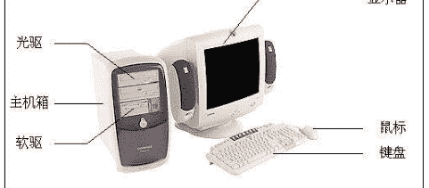

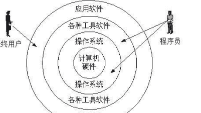

### 1.2 计算机系统层次结构

计算机的层次结构的演变

高级语言

```
#include <stdio.h>
Main()
{
    int Number;
    printf(" Input a Number ");
    scanf(&Number);
    printf(" The Number is %d\n ",Number);
}
```

虚拟机器M3
（高级语言程序）

汇编语言

```
......
MOV AH, 6
MOV DL, 0FFH
INT 21H
POP DX
......
```

虚拟机器M2
（汇编语言程序）

机器语言

```
......
B4 06
B2 FF
CD 21
5A
......
```

实际机器M1
（机器语言程序）

### 1.2 计算机系统层次结构

三级层次结构的计算机系统

第三级

虚拟机器M3
（高级语言程序）

高级源语言程序
PASCAL
FORTRAN
C/C++

编译程序

编译

机器语言目标程序

链接程序

链接

可执行程序

第二级

虚拟机器M2
（汇编语言程序）

MOV AH, 6
MOV DL, 0FFH
INT 21H
POP DX
......

汇编语言源程序

汇编程序

汇编

B4 06
B2 FF
CD 21
5A

机器语言目标程序

链接程序

链接

B4 06
B2 FF
CD 21
5A

机器语言可执行程序

第一级

实际机器M1
（机器语言程序）

机器语言程序直接在M1上运行

### 1.2 计算机系统层次结构

四级层次结构的计算机系统

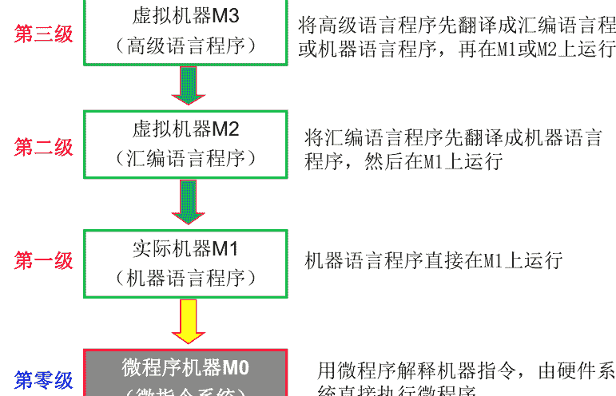

### 1.3 计算机的基本组成

### 计算机的功能

- Data Processing（数据处理）
- Data Storage（数据存储）
- Data Movement（数据移动，交换）
- Control（控制）

### 计算机的功能结构

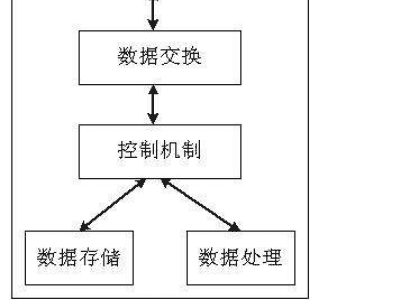

### 1.3 计算机的基本组成

### 运算器：实现数据处理的部件

- 完成最基本的算术逻辑运算
- ALU (Arithmetic and Logic Unit) + Registers
- 运算器与机器字长（字的概念）的关系
- 运算器与机器性能指标：
  - MIPS: Millions of Instructions Per Second
- 目前更通用的叫法: Datapath

### 简单运算器结构图

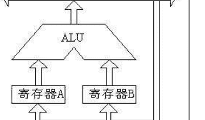

### 1.3 计算机的基本组成

### 存储器：实现数据存储的部件

- 保存程序和数据（二进制信息）
- 存储单元： bit, Byte, Word
- 地址的概念：每一个字节单元拥有一个唯一的地址（索引）
- 存储器的工作方式：读、写

### 存储器结构简图

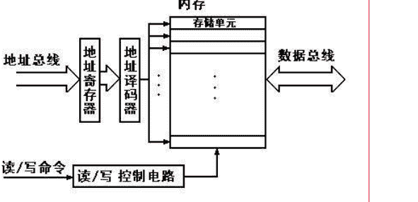

### 1.3 计算机的基本组成

控制器：实现控制功能的部件

- 提供各部件工作所需的控制信号，控制计算机其他部件协同工作
- 指令部件（Instruction Register，Instruction Decoder）
- 指令顺序控制（Program Counter）
- 时序逻辑部件（Clock，Timer，Sequencing Logic）
- 控制信号生成部件（Control Signal Generator or Control Memory）
- Datapath + Control = CPU（Central Process Unit）or Processor

控制器结构简图

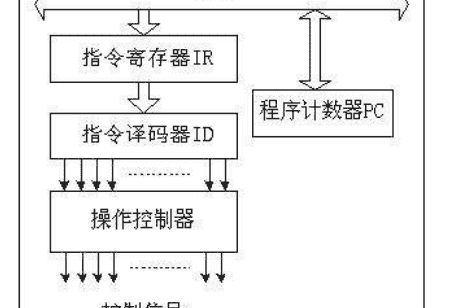

### 1.3 计算机的基本组成

### 输入输出：实现数据交换的部件

- 实现计算机内部与外界（其他系统或人类）的信息交换
- 实现数据交换的设备：输入设备、输出设备
- 接口标准与接口部件

### 计算机整体结构简图

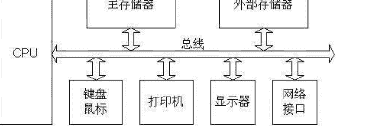

### 1.4 计算机总线结构

### ❖ 总线结构

- 总线：符合一定的标准的一组公共数据通道
- 构成：地址总线、数据总线、控制总线
- 单总线结构
- 多总线结构

### ❖ 标准总线

- ISA---Industry Standard Architecture（工业标准结构）
- EISA----Extended ISA（扩展工业标准结构）
- PCI----Peripheral Connection Interface（周边元件扩充接口）
- SCSI----Small Computer System Interface（小型计算机系统接口）
- …………


### 1.4 计算机总线结构

#### 单总线结构

总线 (BUS)

地址总线

控制总线

数据总线

运算器

控制器

存储器

I/O部件

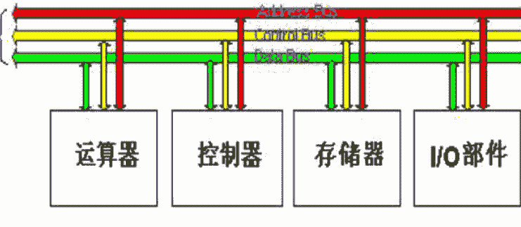

1946年，冯·诺依曼与同事开始研制 IAS。该机结构被公认为随后发展起来的通用计算机的原型。


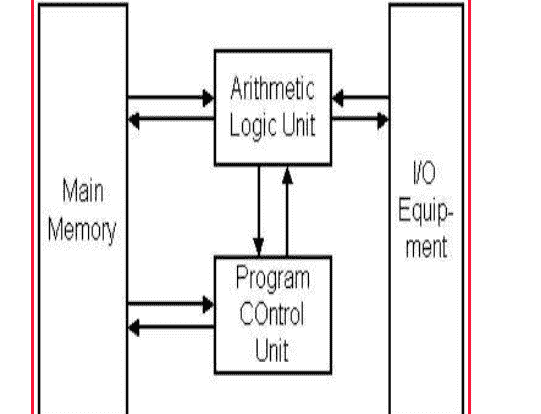

#### 普通PC（PC/XT）的内部结构

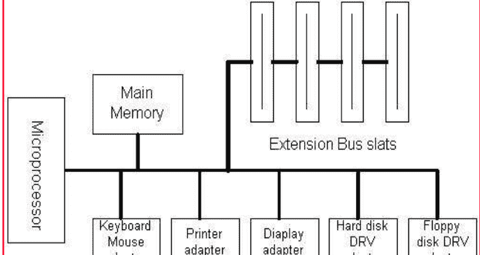

#### 普通PC（Pentium）的内部结构（多总线结构）

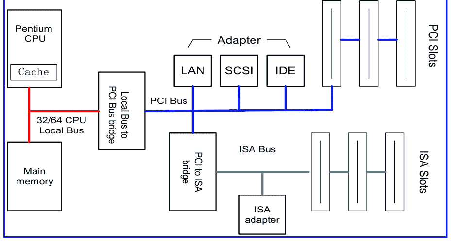

#### Sun SPARCstation20（RISC）多总线结构

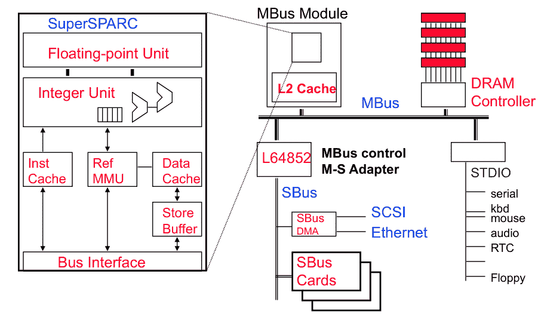

### 2.1 计算机的工作过程

机器指令：计算机硬件可以执行的表示一种基本操作的二进制代码。

- 指令格式：操作码 + 操作数（操作数地址）
- 操作码：指明指令的操作性质
- 操作数（地址）：指令操作数的位置（或操作数本身）

| 操作码 | 操作数地址 |
|---|---|
| 11010101 10000100 01010001 10100000 | |

程序：在此特指一段机器指令序列。

- 完成一定的功能，采用某种算法，具备一定的流程；
- 计算机按照程序所规定的流程和指令顺序，一条一条地执行指令，达到完成程序所规定的功能的目的。
- 计算机采用程序计数器（Program Counter）来决定指令执行的顺序。

### 2.2 指令的执行过程

#### 机器结构简化图

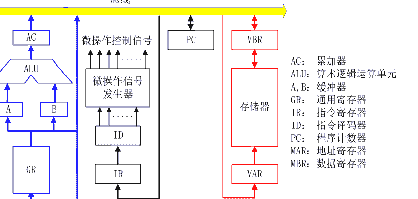

AC: 累加器
ALU: 算术逻辑运算单元
A, B: 缓冲器
GR: 通用寄存器
IR: 指令寄存器
ID: 指令译码器
PC: 程序计数器
MAR: 地址寄存器
MBR: 数据寄存器

取指令

指令译码

取操作数

执行

结果保存

下一条指令

保存指令结果

在控制信号的作用下取操作数送运算器

运算器执行指令功能

指令译码器译码（解释指令），形成微操作控制信号

形成下条指令的地址并送PC

根据PC内容从存储器取指令送IR

- 1. 根据PC内容从存储器取指令送IR；
- 2. 指令译码器译码（解释指令），形成微操作控制信号；
- 3. 在控制信号的作用下取操作数送运算器；
- 4. 运算器运行；
- 5. 保存结果；
- 6. 形成下一条指令地址送PC。

#### 示例

Y=ax²+bx-c 假定a,b,c,x均为已知数，且存放在内存中，求y。

假定指令系统：16位指令系统

| Opcode | Address |
| 8 | 8 |

| 指令 | 操作码 | 说明 |
| ADD | 00H | AC ← (AC)+Mem(Add) |
| LD | 01H | AC ← Mem(Add) |
| SUB | 02H | AC ← (AC) — Mem(Add) |
| MUL | 03H | AC ← (AC)×Mem(Add) |
| ST | 04H | Mem(Add) ← (AC) |

| 内存 | 地址 |
|  | 00H |
|  | 02H |
|  | 04H |
|  | 06H |
|  | 08H |
|  | 0AH |
|  | 0CH |
|  | 0EH |
| 结果y将存放在此 | 10H |
| 值a | 12H |
| 值b | 14H |
| 值c | 16H |
| 值x | 18H |

Y=ax²+bx-c 假定a,b,c,x均为已知数，且存放在内存中，求y。

| 指令 | 操作码 | 说明 |
| --- | --- | --- |
| ADD | 00H | AC ← (AC)+Mem(Add) |
| LD | 01H | AC ← Mem(Add) |
| SUB | 02H | AC ← (AC) — Mem(Add) |
| MUL | 03H | AC ← (AC)×Mem(Add) |
| ST | 04H | Mem(Add) ← (AC) |

内存

地址

|  | 地址 |
| --- | --- |
|  | 00H |
|  | 02H |
|  | 04H |
|  | 06H |
|  | 08H |
|  | 0AH |
|  | 0CH |
|  | 0EH |
| 结果y将存放在此 | 10H |
| 值a | 12H |
| 值b | 14H |
| 值c | 16H |
| 值x | 18H |

程序如下

| 指令 | 代码 | |
| --- | --- | --- |
| LD a | 0112H | AC ← a |
| MUL x | 0318H | AC ← ax |
| ADD b | 0014H | AC ← ax + b |
| MUL x | 0318H | AC ← ax²+bx |
| SUB c | 0216H | AC ← ax² + bx - c |
| ST y | 0410H | Mem ← (AC) |

AC = ax²+bx−c

程序如下

| 指令 | 代码 |
|---|---|
| LD a | 0112H |
| MUL x | 0318H |
| ADD b | 0014H |
| MUL x | 0318H |
| SUB c | 0216H |
| ST y | 0410H |

AC ← a

AC ← ax

AC ← ax + b

AC ← ax²+bx

AC ← ax² + bx − c

Mem ← (AC)

开始PC

- PC 00H
- PC 02H
- PC 04H
- PC 06H
- PC 08H
- PC 0AH
- PC 0CH

内存

| 地址 | 内容 |
|---|---|
| 00H | 0112H |
| 02H | 0318H |
| 04H | 0014H |
| 06H | 0318H |
| 08H | 0216H |
| 0AH | 0410H |
| 0CH | |
| 0EH | |
| 10H | ax²+bx−c |
| 12H | 值a |
| 14H | 值b |
| 16H | 值c |
| 18H | 值x |

### 计算机系统的层次

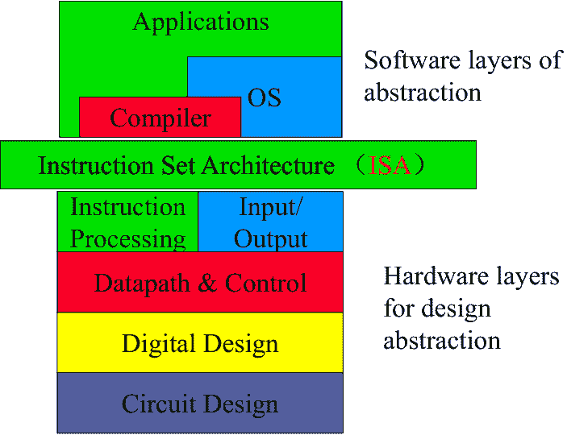

### ENIAC (1946)

- > ENIAC：十进制（而非二进制）计算机，用十个真空管（一个ON，其余OFF）表示一位十进制数，算术运算按十进制的方式完成。
- > 占地170平方米，重30吨，耗电140千瓦，共用18000个真空管，每秒可进行5000次加减法运算。

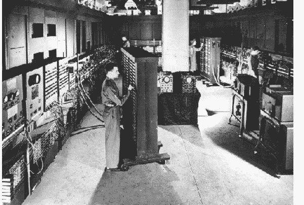

### IBM Circa (1959,第一台流水线计算机)


硬件工程师正在操作 IBM Stretch

### Intel Pentium (1993.3)

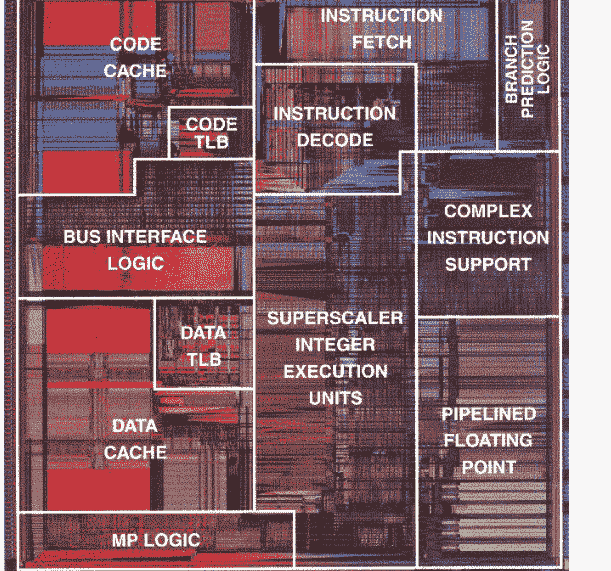

### 摩尔定律


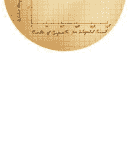

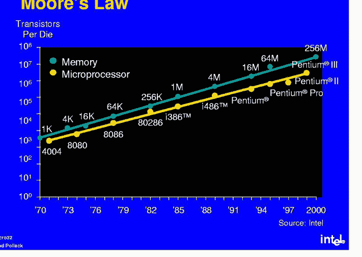

### MOORE'S LAW

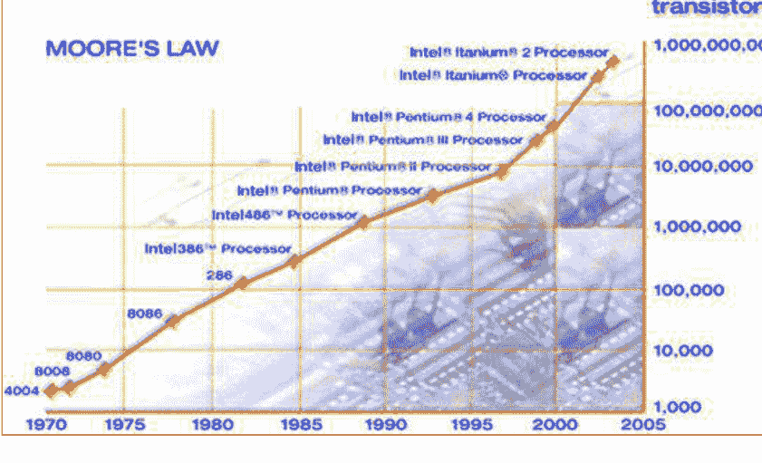


## 第二部分 存储系统

- 一. 存储系统概述
- 二. 主存储器的组成与工作原理
- 三. 高速缓冲存储器的结构与工作原理
- 四. 辅助存储器（磁表面存储器）
- 五. 虚拟存储系统

### 1.1 存储系统概述

#### 存储器分类

- 按介质分类：
  - 半导体存储器
  - 磁介质存储器
  - 光盘存储器
- 按访问方式分类：
  - 随机访问存储器（Random Access Memory—RAM）
  - 只读存储器（Read Only Memory—ROM）
  - 顺序访问存储器（Tape）
  - 直接访问存储器（Disk）
  - 联想存储器（某些Cache）
- 按功能分类：
  - 高速缓冲存储器
  - 主存储器
  - 辅助存储器
  - 控制存储器

#### 存储器的性能指标

- 访问时间（Access Time）：Tₐ
  - 随机访问存储器：访问时间指读或写操作所用时间，即从给定地址到存储器完成读或写操作所需时间。
  - 其他类型：指将读写机构定位到目标位置所需的时间。
- 存储周期（Cycle Time）：T₍c₎
  - 仅对RAM而言，指两次访问存储器单元之间的最小时间间隔。
  - T₍c₎ > Tₐ
- 带宽（Bandwidth）/ 数据传输率（Transfer Rate）
  - 一般的随机访问存储器：1 / Cycle Time；
  - 其他类型：Tₙ = Tₐ + N / R
    - Tₙ：读写N Bits所需的平均时间
    - Tₐ：访问时间
    - N：N Bits
    - R：存储部件的数据传输率（bits / s）

#### 存储器的层次性能特征

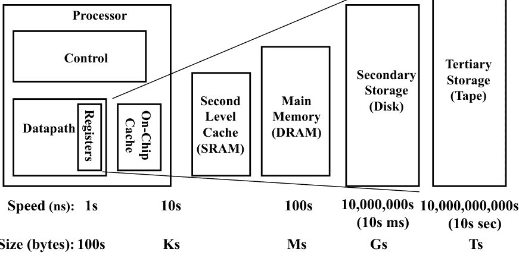

### 处理器

- 逻辑容量：每年约增长30%
- 时钟频率：每年约增长20%

### 存储器

- DRAM容量：每年约增长60%（每3年4倍）
- 存储速度：每年约增长10%
- 每比特成本：每年约改善25%

### 磁盘

- 容量：每年约增长60%

### 1.1 存储系统概述

#### 存储器的层次结构

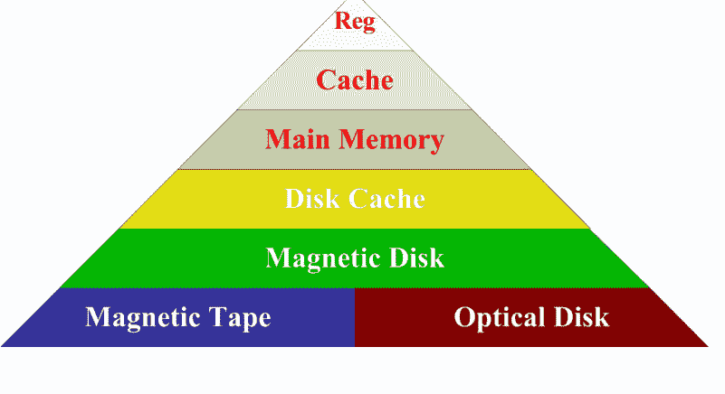

二级存储系统指：高速缓冲存储器（Cache）＋主存储器

### 1.2 半导体存储器

#### 随机访问存储器（RAM）

- **SRAM（静态随机访问存储器）**：静态存储器，相对动态而言，集成度低，但不必刷新。
- **DRAM（动态随机访问存储器）**：动态存储器，需要刷新，相对而言，集成度高。
- **FPM（快速页模式）DRAM**：串行访问方式，传统的DRAM类型（RAS,CAS选择型）。
- **EDO（扩展数据输出）DRAM**：可并行访问的DRAM类型（实际上是一种简单的流水线型存储器类型。上一地址访问结束前可以开展下一个地址访问，提高了整个存储器的带宽）。FPM DRAM、EDO DRAM均属于非同步型DRAM。
- **SDRAM（同步动态随机访问存储器）**：同步DRAM（与CPU保持同步），由系统时钟驱动的DRAM，在存储器完成存取操作期间，CPU可以进行其他工作，从而提高了系统的性能。而非同步型DRAM，在存取操作期间，CPU只能处于等待状态。
- **DDR（双倍数据速率）DRAM**

#### 只读存储器（ROM）

- 固定掩膜（Masks）ROM
- PROM（可编程只读存储器）：一次性可编程
- EPROM（可擦除可编程只读存储器）：可擦除可编程（紫外线擦除）
- EEPROM（电可擦除可编程只读存储器）：电擦除（字节一级）
- 闪存：电擦除（块级）

### 2.1 存储单元电路

#### 基本要求

- 具有两种稳定（或半稳定）状态，用来表示二进制的 1 和 0；
- 可以实现状态写入（或设置）；
- 可以实现状态读出（或感知）。

#### SRAM存储单元电路（六管单元电路）

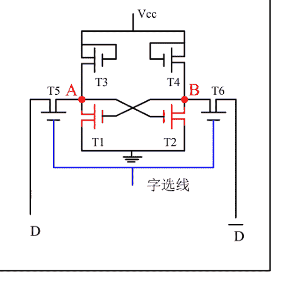

MOS管功能：

- T1，T2：工作管；
- T3，T4：负载管；
- T5，T6：门控管；

稳定状态：

- “1”：T1 截止，T2 导通
- “0”：T2 截止，T1 导通

保持状态：

字选线低电平，T5 和 T6 截止，内部保持稳定。

#### SRAM存储单元电路工作原理（读出）

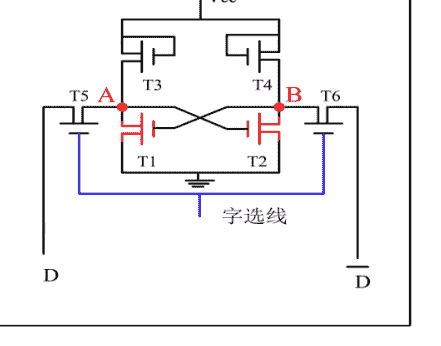

稳定状态：

- “1”：T1 截止，T2 导通
- “0”：T2 截止，T1 导通

保持状态：

字选线低电平，T5 和 T6 截止，内部保持稳定。

读出操作：

- 输入条件：字选线高电平
- T5 和 T6 导通，如果存储单元原来保存信息是“1”，D线则“读出”了内部状态（A点电平），则为高，否则为低。

#### SRAM存储单元电路工作原理（写入）

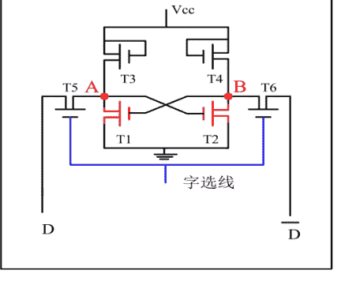

稳定状态：

- “1”：T1 截止，T2 导通
- “0”：T2 截止，T1 导通

保持状态：

字选线低电平，T5 和 T6 截止，内部保持稳定。

写入操作：

写1：D线高电平，D̅线低电平，字选线高电平，T5 和 T6 导通，T1截止，T2导通，写入1。

写0：D线低电平，D̅线高电平，字选线高电平，T5 和 T6 导通，T2截止，T1导通，写入0。

#### DRAM存储单元电路（单管单元电路）

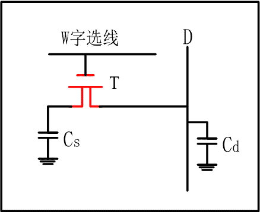

- Cs电容 << Cd电容
- Cs上有电荷表示‘1’
- Cs上无电荷表示‘0’
- 保持状态：字选线低电平，T截止，理论上内部保持稳定状态。

> **注意：** 在保存二进制信息“1”的状态下，Cs有电荷，但Cs存在漏电流，Cs上的电荷会逐渐消失，状态不能长久保持。在电荷泄漏到威胁所保存的数据性质之前，需要补充所泄漏的电荷，以保持数据性质不变。这种电荷的补充称之为刷新（或再生）。

#### DRAM存储单元电路工作原理（读出）

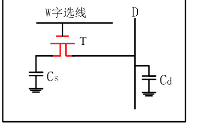

读出时：D 线先预充电到 Vpre=2.5V，然后字选线高电平，T导通

- 若电路保存信息1，Vcs=3.5V，电流方向从单元电路内部向外；
- 若电路保存信息 0，Vcs=0.0V，电流方向从外向单元电路内部；
- 因此根据数据线上电流的方向可判断单元电路保存的是 1还是 0。
- 读出过程实际上是Cs与Cd上的电荷重新分配的过程，也是Cs与Cd上的电压重新调整的过程。Cd上的电压，即是D线上的电压。

#### DRAM单管单元电路的工作特征

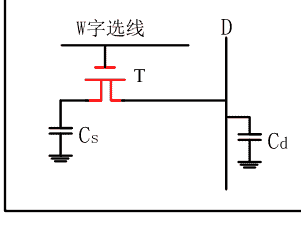

V_D'：D线在读出调整后的电压
Vcs：Cs原来的电压
ΔV：D线上读出过程前后的变化量

ΔV = V_D' - Vpre = (Vcs - Vpre) × Cs / (Cs + Cd)

由于Cd要比Cs大一两个数量级，所以ΔV不会太大（1%到10%），一般为100mV左右。

D线上的电压在读出过程中的变化量实例计算：

假定 Cs = 1pf ， Cd = 50pf ， Vpre = 2.5V
存储 1时，Vcs = 3.5V，存储 0时，Vcs = 0V
则：

ΔV(1) = (3.5V - 2.5V) × 1pf / (1pf + 50 pf) = 19.6 mV
ΔV(0) = (0V - 2.5V) × 1pf / (1pf + 50 pf) = -49 mV


### 2.1 存储单元电路
#### DRAM存储单元电路的信号刷新问题

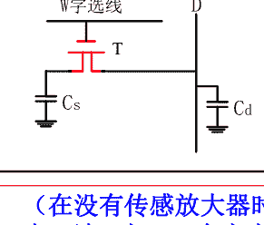

- 1. 由于读出过程D线电压变化量较小，需要对变化量进行放大才能得到有效的数据，所以单管存储单元电路中D线上必须增加传感放大器(Sense Amplifier)。
- 1. （在没有传感放大器时）读出操作是一种破坏性操作，读1时，Cs在放电；读0时，Cs在充电；所以读出操作后，原保存在Cs上的数据（电荷）被破坏，应该立即进行恢复（重写或刷新）。
- 2. 在保持状态下，T管截止，Cs与外部隔开，但Cs两级间存在漏电流，所以，Cs上的电荷也会出现变化，必须在一个时间内重写数据，这个时间称为单元电路的刷新周期，一般为4ms、8ms。
- 2. 刷新由传感放大器在读出过程中同时完成。在D线上增加了传感放大器后读过程实际上就是一次刷新过程。事实上，DRAM的刷新就是通过这样的读操作来实现的。

### 2.1 存储单元电路
#### DRAM单管单元电路

D线上的电压在读出过程中的变化情况

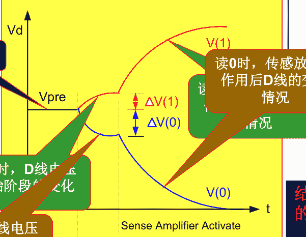

预充电

读1时，D线电压开始阶段的变化

读0时，D线电压开始阶段的变化

读0时，传感放大器作用后D线的变化情况

结论：DRAM的读过程就是刷新过程

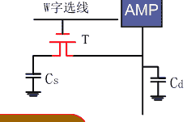

### 2.1 存储单元电路
#### 存储单元的符号表示

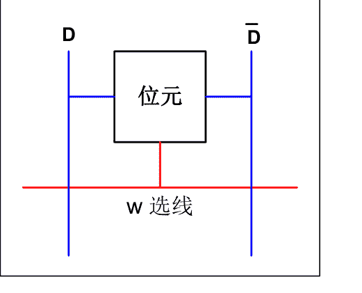

### 2.2 存储芯片内部结构
#### 存储芯片容量的基本描述（字单元数×每个字单元的位数）

- > 1K × 2：1024 个字单元，每个字单元 2 位（二进制位）。意味着任一时刻可以（也只能）访问1024个独立字单元中的任意一个字，每次读写的数据位数是一个字的容量（2位）。
- > 64K×8：65536（64K）个字单元，每个单元8位。

### 2.2 存储芯片内部结构
#### 存储芯片结构（二维地址结构）

1024×2：1024 个字单元，每个字单元 2 个二进制位。

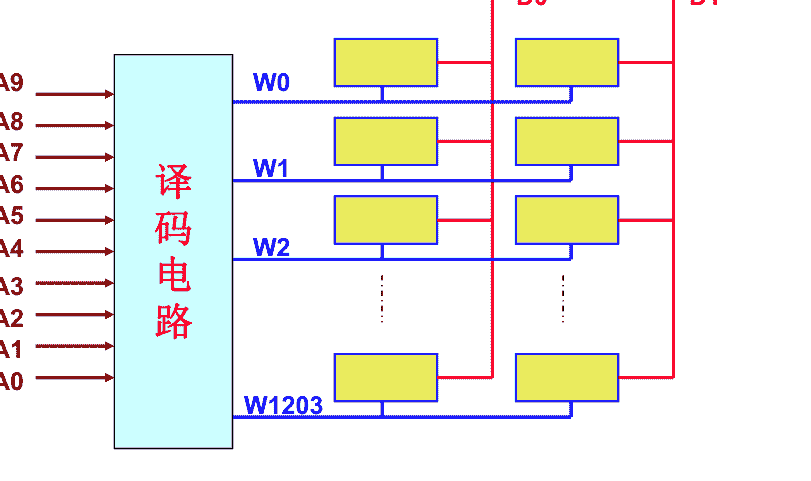

### 2.2 存储芯片内部结构
#### 存储芯片结构（二维地址结构）

1024*1：1024 个字单元，每个字单元 1 个二进制位。

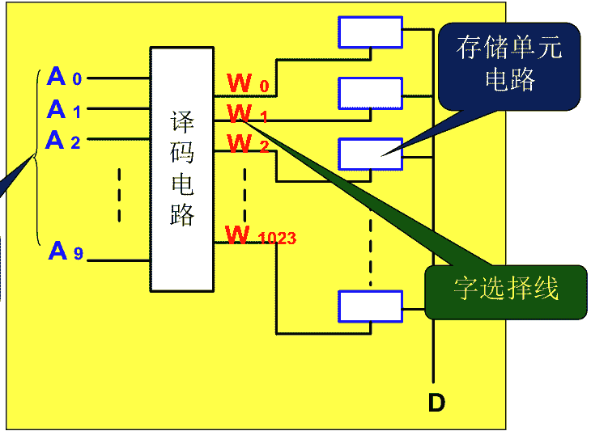

### 2.2 存储芯片内部结构
#### 二维地址结构（SRAM）：4096*4：4096 个字，每个字 4 位。

128 X 128存储单元矩阵
行地址数与列地址数不等

行地址

列地址

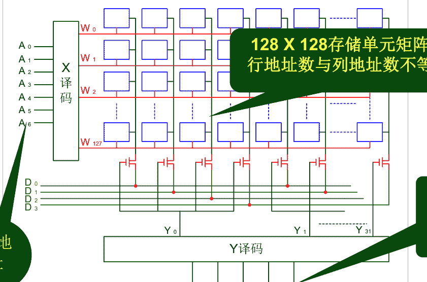

### 2.2 存储芯片内部结构
#### 二维地址结构（DRAM）：4096*4：4096 个字，每个字 4 位。

64 X 256 存储单元矩阵
行地址数与列地址数相等

行地址

列地址

X译码

Y译码

A0 A1 A2 A3 A4 A5

A6 A7 A8 A9 A10 A11

D0 D1 D2 D3

W0 W1 W2 W63

预充电

Sense Amp

Y0 Y1 Y63

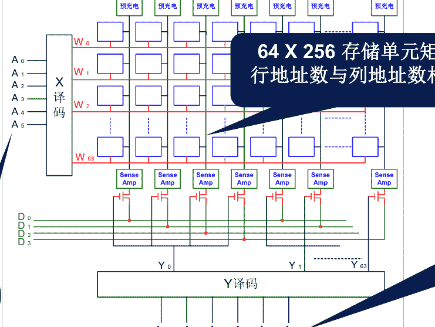

### 存储芯片结构示例
#### SRAM 2114(1024*4)芯片结构

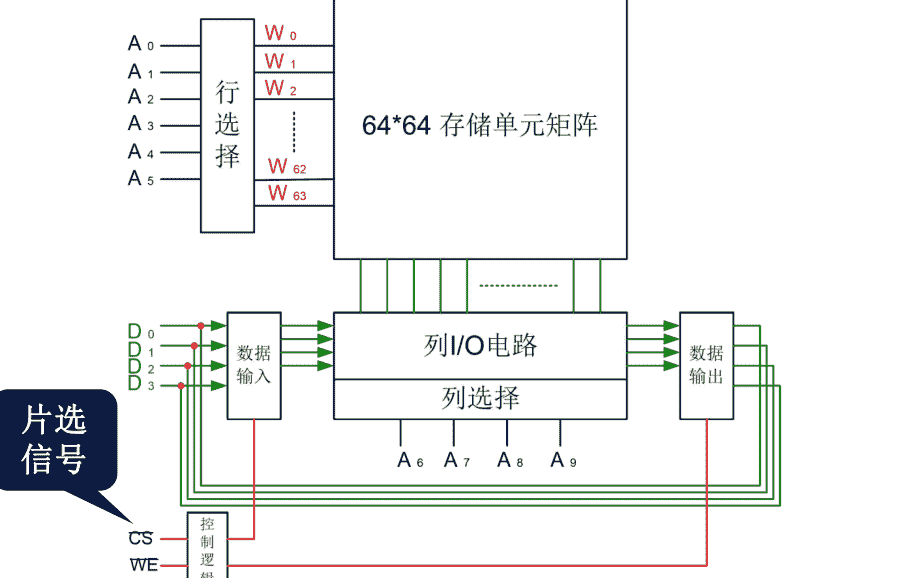

### 存储芯片结构示例
#### ❖ DRAM 4M*4 DRAM芯片结构（内部包含刷新电路）

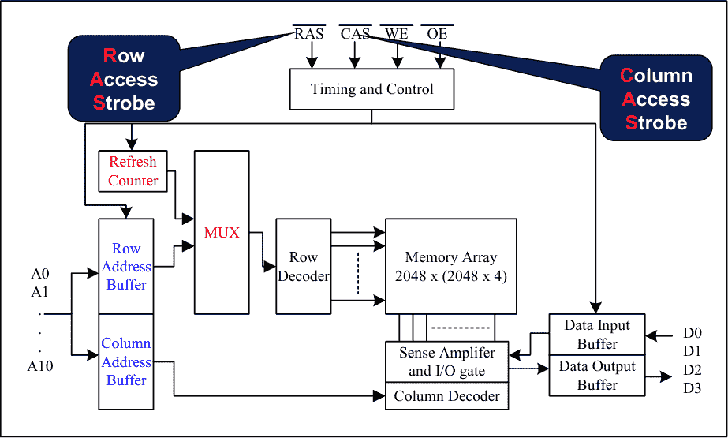

### 存储芯片外特性
#### SRAM 4096×8 存储芯片

- - 4096个字 → 12位地址
- 信号输入端A11～A0;
- 每个字8位 → 8位数据双向接入端D7～D0;
- 片选信号输入端CS;
- 读写信号输入端WE;

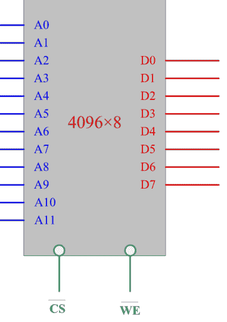

### 2.3 RAM 读写时序
#### ◆ intel 2114 SRAM的读时序

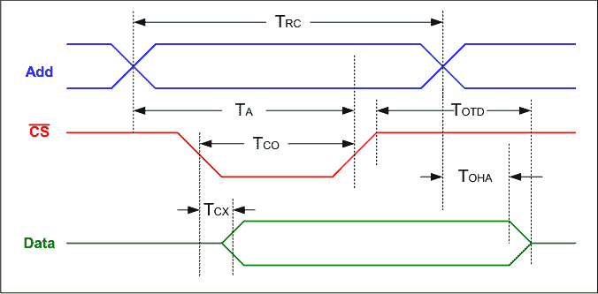

- - **T_RC**：读周期
- - **T_A**：读出时间
- - **T_CO**：从片选有效到输出数据稳定所需时间
- - **T_CX**：片选有效到输出有效（不一定稳定）所需的时间
- - **T_0TD**：片选无效到输出数据维持的时间
- - **T_OHA**：地址改变后输出数据的维持时间

### 2.3 RAM 读写时序
#### Intel 2114 SRAM的写时序

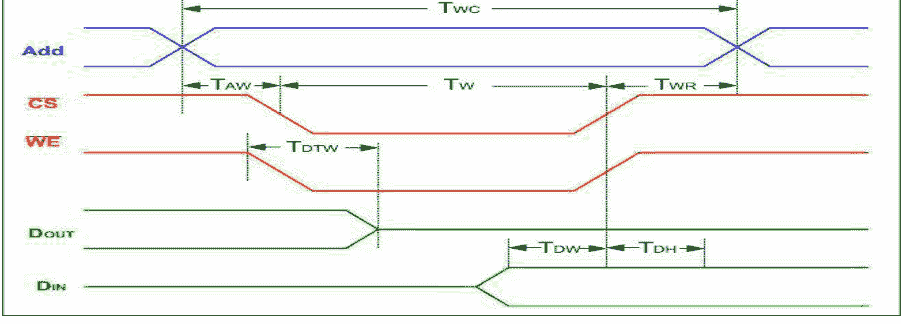

TWC：写周期

TAW：写周期滞后时间； Tw：写入时间； TWR：写恢复时间

TDW：从写入数据有效到写信号撤销所需的时间

TDH：从写信号撤销到写入数据维持所需的时间（TWR> TDH）

TDTW：从写信号有效到输出数据（上一次读出）失效的时间

### 2.3 RAM 读写时序
#### ❖ DRAM的读时序

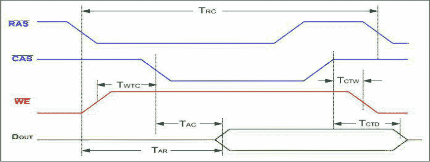

- - $T_{RC}$：读周期
- - $T_{WTC}$：读信号先于CAS有效的时间间隔
- - $T_{AR}$：从RAS有效到数据有效的时间间隔
- - $T_{AC}$：从CAS有效到数据有效的时间间隔
- - $T_{CTW}$：从CAS无效到读信号维持时间
- - $T_{CTD}$：从CAS无效后数据的维持时间

### 2.3 RAM 读写时序
#### DRAM的写时序

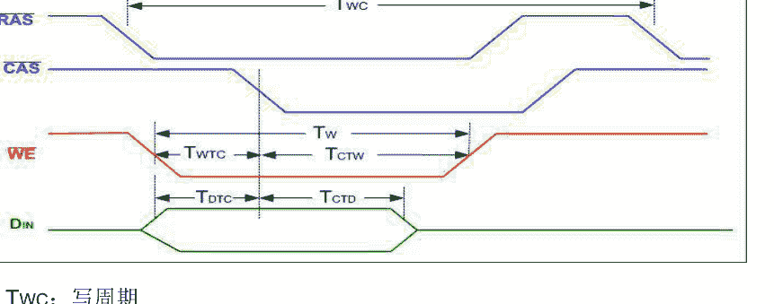

TWC：写周期

Tw：写入时间

TWTC：写信号先于CAS有效的时间间隔

TDTC：输入数据先于CAS有效的时间间隔

TCTW：从CAS有效到写信号撤销的时间间隔

TCTD：从CAS有效到输入数据撤销的时间间隔

### 2.4 存储器芯片的扩展
#### 位扩展

存储器芯片提供的字空间满足整个存储空间的字空间要求，但存储器芯片的位空间不能满足要求。

基本思路：

- - 确定每个芯片的地址管脚数、数据管脚数。
- - 整个存储空间与存储芯片的地址空间一致，所以所需的地址总线也一样。单数据总线数量不一样。
- - 计算所需存储器芯片的数量，确定每个存储器芯片在整个存储空间中的地址空间范围、位空间范围。
- - 所有芯片的地址管脚全部连接到地址总线对应的地址线上。
- - 同一字空间的存储芯片CS信号连在一起。
- - 不同位空间的数据线连接到对应的数据总线上。
- - 所有芯片的CS逻辑连接在一起。
- - 统一读写控制。

### 2.4 存储器芯片的扩展
例：1K × 4的SRAM存储芯片构造1K × 8的存储器

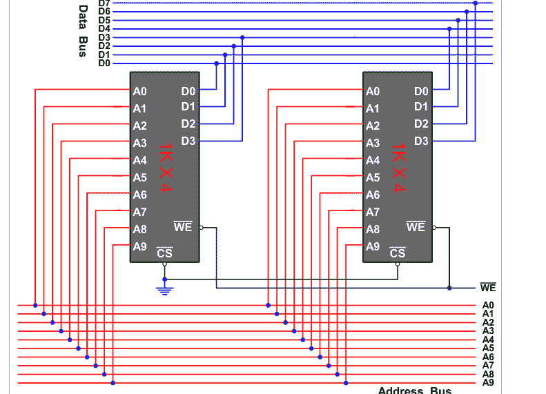

### 2.4 存储器芯片的扩展
#### ◆ 字扩展

➢ 存储器芯片提供的字空间不能满足整个存储空间的字空间要求，但存储器芯片的位空间满足要求。

➢ 基本思路：

- - 确定每个芯片的地址管脚数、数据管脚数。
- - 确定整个存储空间所需的地址总线和数据总线的数量。
- - 计算所需存储器芯片的数量，确定每个存储器芯片在整个存储空间中的地址空间范围、位空间范围。
- - 所有芯片的地址管脚全部连接到地址总线对应的地址线上。
- - 同一字空间的存储芯片 CS 信号连在一起。
- - 同一位空间的数据线连在一起，并连接到对应的数据总线上。
- - 根据每个存储器芯片的地址空间范围设计存储器芯片所需要的片选信号逻辑，CS 逻辑电路的输入一定是地址总线中没有连接到芯片的地址管脚上的哪部分地址线。
- - 统一读写控制。

### 混合扩展

存储器芯片提供的字空间不能满足整个存储空间的字空间要求，位空间也不能满足要求。

#### 基本思路：

- - 确定每个芯片的地址管脚数、数据管脚数。
- - 确定整个存储空间所需的地址总线和数据总线的数量。
- - 计算所需存储器芯片的数量，确定每个存储器芯片在整个存储空间中的地址空间范围、位空间范围。
- - 所有芯片的地址管脚全部连接到地址总线对应的地址线上。
- - 同一字空间的存储芯片CS信号连在一起。
- - 同一位空间的数据线连在一起，并连接到对应的数据总线上。
- - 根据每个存储器芯片的地址空间范围设计存储器芯片所需要的片选信号逻辑，CS逻辑电路的输入一定是地址总线中没有连接到芯片的地址管脚上的哪部分地址线。
- - 统一读写控制。


### 2.4 存储器芯片的扩展

#### 例：1K×4 SRAM存储芯片构成16K×8的存储器

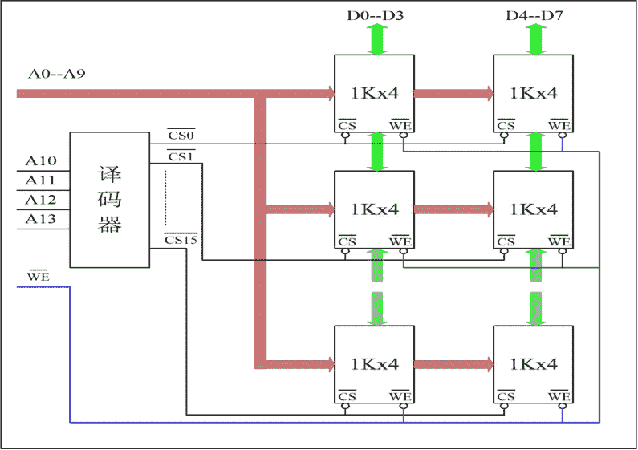

#### 例：4K×4 SRAM存储芯片构成16K×8的存储器

- 4K×4芯片：12个地址管脚 A11～A0，4个数据管脚 D3～D0，1个片选输入管脚 CS#，1个读写控制管脚 R/W#
- 芯片地址空间：000H～FFFH
- CPU向存储器提供：
  - 地址总线14根：AB13～AB0
  - 数据总线8根：DB7～DB0
  - 读写控制信号：R/W#
- 存储器地址空间：0000H～3FFFH
- 需要芯片数：（16K×8）/（4K×4）= 8片

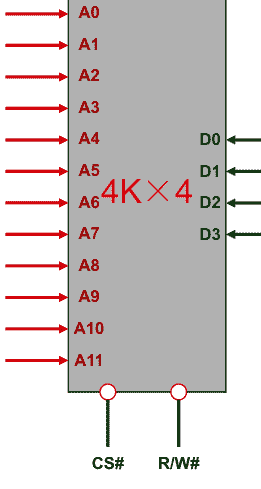

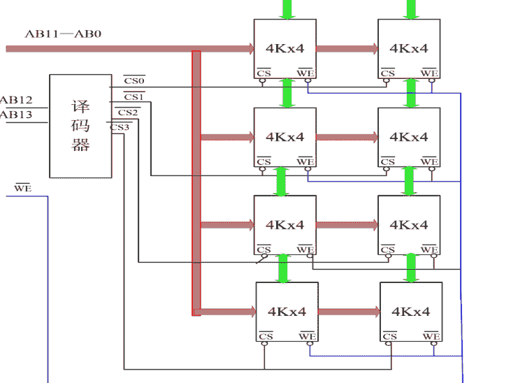

地址空间划分：

| 起始地址 | 结束地址 |
| --- | --- |
| 0000H | 0FFFH |
| 1000H | 1FFFH |
| 2000H | 2FFFH |
| 3000H | 3FFFH |

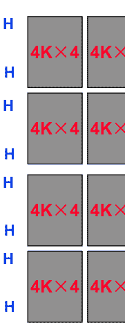

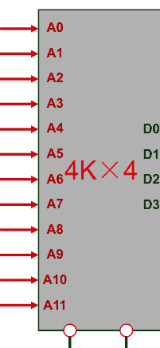

#### DRAM扩展的特殊性

- DRAM芯片地址的特殊性问题：行地址与列地址复用，行地址与列地址的定时与选通问题。CPU（或总线）提供的是完全的地址，如何将全部地址分成行地址和列地址？如何产生行选通信号RAS和列选通信号CAS？
- DRAM芯片的片选问题：行地址选通信号RAS作为片选信号。
- DRAM芯片扩展的刷新问题必须考虑：刷新由谁来完成，谁提供刷新地址，刷新的控制，刷新的定时，刷新与CPU访问内存时的冲突策略等问题。

#### 解决的方法

- 在CPU与存储器之间设计专用的DRAM存储器控制电路，完成刷新控制、刷新定时、地址划分与选通信号的产生与定时等。
- 由DRAM芯片控制器来实现上述定时、控制与刷新等操作。

#### DRAM控制器

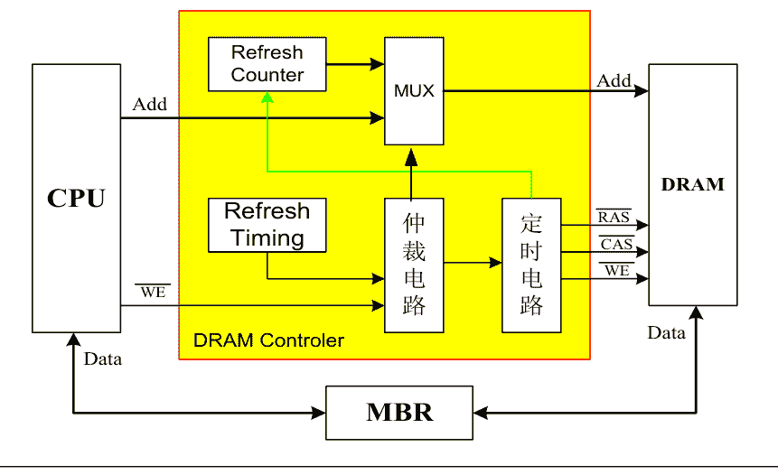

#### DRAM存储芯片的扩展

- DRAM芯片：41256A8（256K×8）芯片4个，组成1MByte存储器，同时要提供16位字访问方式和8位字节访问方式。存储器按字节编址。
- DRAM控制器：Intel 82C08，18位地址多路复用到256K存储器件的9个地址，它可控制两个存储体（BS信号决定），所以可以实现512K个地址空间。
- 按字节访问时最低位地址A0有意义，按16位字访问时，最低位地址A0没有意义。
- CPU（或总线）提供BHE信号，表明是字节访问方式还是16位字访问方式。


#### DRAM的刷新特点

- 刷新操作：读操作；
- 按行刷新、所有芯片同时进行；
- 刷新操作与CPU访问内存分开进行；
- 刷新周期：2ms, 4ms, 8ms, 16ms；
- 刷新地址及刷新地址计数器

### 2.5 DRAM的刷新方式

- 1、集中刷新方式：将刷新周期分成两部分，在一个时间段内刷新存储器所有行，此时CPU停止访问内存，另一个时间段CPU访问内存，刷新电路不工作。


- 3、分布式刷新方式：保证在一个刷新周期内将存储芯片内的所有行刷新一遍，可能等时间间距，也可能不等。


- 集中式刷新周期：cpu 访问；刷新第1行；刷新第2行；刷新最后一行。
- 分散式刷新周期：cpu 访问；刷新第1行；cpu 访问；刷新第2行；cpu 访问；刷新第3行；cpu 访问；刷新最后一行。
- 异步（分布）式刷新周期：cpu 访问；cpu 访问；刷新第1行；cpu 访问；cpu 访问；cpu 访问；刷新第2行；cpu 访问；刷新最后一行。

### 2.6 ROM（只读存储器）

#### 固定掩膜ROM单元电路


含二极管的电路表示1，不含二极管的电路表示0


含三极管的电路表示1，不含三极管的电路表示0


含MOS管的电路表示0，不含MOS管的电路表示1

#### 可编程的PROM单元电路


- 出厂时所有位均为1。
- 编程时（写入数据），对写0的单元加入特定的大电流，熔丝被烧断，变为另一种表示0的状态，且不可恢复。
- 工作时，加入正常电压。

#### 紫外线擦除可编程的EPROM单元电路


- 出厂时所有位均为1，FAMOS（栅极浮动）管G极无电荷，处于截止状态。
- 编程时（写入数据），对写0的单元加入特定的电压，FAMOS上的G极与D极被瞬时击穿，大量电子聚集到G极上，撤销编程电压后，G极上的聚集电子不能越过隔离层，FAMOS导通，表示0。
- 工作时，加入正常电压，FAMOS的状态维持不变。
- 擦除时，用紫外线照射，FAMOS聚集在G极上的电子获得能量，越过隔离层泄漏，FAMOS恢复截止状态。

#### ROM芯片的结构


### 2.7 提高存储器访问速度的措施

#### 单体多字存储器


- 一. 存储系统概述
- 二. 主存储器的组成与工作原理
- 三. 高速缓冲存储器的结构与工作原理
- 四. 辅助存储器（磁表面存储器）
- 五. 虚拟存储系统

#### 存储访问的局部性原理

- 在访问存储器时，无论是存取指令或存取数据所访问的存储单元都趋于聚集在一个较小的连续单元区域中。
- 时间局部性：最近访问的存储单元在不久的将来仍将被访问(顺序存储)
- 空间局部性：下次访问的存储单元很可能就在刚刚访问的存储单元附近(程序循环、数组等)

### 3.1 高速缓冲存储器（CACHE）的结构

#### Cache产生的前提

- 单级存储系统中，主存的存储速度与CPU的速度不匹配，造成CPU资源的浪费；
- 程序运行时，在时间上存在明显的局部性；
- 存在比主存普遍采用的DRAM速度更快的存储单元电路；
- 在CPU与内存之间设置一个高速的容量相对小的存储机构，把CPU正在执行的指令或数据附近一部分主存内容取来保存在这个存储机构中，供CPU使用。在一段时间内CPU可以减少访问内存的频度，提高运行效率。这个存储机构就是高速缓冲存储器（CACHE）。


#### Cache要解决的问题

- 提供快速访问的能力；
- 具有存取数据的能力和与主存交换数据的能力；
- 由于CPU总是以主存地址访问存储器，所以CACHE应具备判断CPU当前要访问的内容是否在CACHE中的能力，并具有将主存地址转换成CACHE地址的能力，或者具有根据主存地址在CACHE中访问到相应数据单元的能力。
- 具备在CACHE容量不够的前提下替换CACHE中的内容的决策机制。


### 3.1 高速缓存存储器(CACHE)的结构
#### Cache的基本结构

- 存储机构：保存数据，存取数据，一般采用SRAM构成。以Block（若干字）为单位；
- 地址机构：地址比较机制，地址转换机制，地址标标记（Tag），一个Block具有一个Tag(实际上可以是一个寄存器)；
- 替换机制：记录Block的使用情况，替换策略；


Cache 的基本结构

### 3.2 CACHE的工作原理
#### Cache的读操作


### 3.3 CACHE与主存之间的映射
#### 全相联映射（Associative Mapping）

- 主存分为若干Block，Cache按同样大小分成若干Block，Cache中的Block数目显然比主存的Block数少得多。
- 主存中的某一Block可以映射到Cache中的任意一Block。


#### 全相联映射的地址

- 主存的地址格式： Block Number | Offset
- Cache的Tag内容：主存中与该Cache数据块对应的数据块的块地址。

#### 全相联映射举例

- 主存：16M Bytes
- Cache：64K Bytes
- Block：16 Bytes

#### 解答

- 主存块数：16M ÷ 16 = 2²⁰ Blocks
- 主存地址：24位，其中高20位为块地址，低4位为块内地址
- Cache块数：64K ÷ 16 = 2¹² Blocks
- Cache的Tag应该为20位。


全相联映射的 Cache 组织


#### 组相联映射（Set Associative Mapping）

- 映射关系：Cache 分成 K 组，每组分成 L 块；主存的块 J 以下列原则映射到 Cache 的组 I 中的任何一块。
- I = J mod K
- 实际上主存与Cache都分成 K 组，主存每一组内的块数与Cache一组内的块数不一致，主存组M内的某一块只能映射到Cache组M内,但可以是组M内的任意一块。


#### ◆ 组相联映射

主存的地址格式：

| 组内块地址 | 组地址 | 块内偏移 |
|---|---|---|

**Cache的Tag内容**：主存中与该Cache数据块对应的数据块的组内块地址。

#### ◆ 组相联映射举例

- 主存：**1M Bytes**
- Cache：**16K Bytes**
- Block：**256 Bytes**
- Way：**4 Ways**（Cache每组包含4个Block）

#### ◆ 解答

- Cache组数 = 2¹⁴ ÷ (2⁸ × 2²) = 2⁴ = 16 组
- 主存每组块数 = 2²⁰ ÷ (2⁸ × 2⁴) = 2⁸ = 256 块/组
- 主存地址：20位，其中高8位为组内块地址，中间4位为组地址，低8位为块内地址
- Cache的Tag应该为8位。

CACHE

组0

组1

组2

组F


#### 直接映射（Direct Mapping）

- 主存中的某一块 J 映射到Cache中的固定块 K， K = J Mod M，其中M是Cache包含的块数。
- 实际上是将主存按Cache的大小分区，一个区内的各块分别与Cache的对应各块映射。


#### 直接映射

主存的地址格式：

| 区地址 | 区内块地址 | 块内偏移 |

Cache的Tag内容：主存中与该Cache数据块对应的数据块的区地址。

#### 直接映射举例

- 主存：16M Bytes
- Cache：64K Bytes
- Block：16 Bytes

#### 解答

- 主存：2^20 Blocks，分成2^8个区，每个区2^12Blocks
- Cache：2^12 Blocks
- 主存地址：24位，其中高8位区地址，中间12位为区内块地址，低4位为块内地址
- Cache的Tag应该为8位。

直接映射的 Cache 组织

Memory Address

Sec #

Block #

Offset

CACHE

Tag

Data

Block0

Block1

Blockn-1

比较
Hit

### 3.4 CACHE的替换策略
#### 替换策略

- LRU（Least-Recently Used）最近最少使用法
- FIFO（First-In-First-Out）先进先出法
- LFU (Least-Frequently Used) 最小使用频率法

### 3.5 CACHE与主存的数据一致性
#### 数据一致性的问题主要由写操作产生

- 写直达（Write Through）：写CACHE的同时写主存，效率较低；
- 写回（Write Back）：直到Block替换时才将整个Block写回主存；需要增加Block修改标志。
- 多处理器情况下共享内存的一致性问题（每个处理器具有自己的Cache）
  - Bus Watching and Write Through；
  - Non-cachable memory；


Write Through 模式的Cache结构

- 一般Write Buffer 是FIFO
- CPU对Cache实行写的频率 << 1/DRAM Cycle Time

### 3.6 CACHE的其他一些问题

- 块的大小与命中率：比较复杂，4-8个可寻址单元/Block似乎可获得较高的效率；
- Cache的层次：一级CACHE或两级CACHE；
- 统一CACHE还是分离的CACHE：比如指令Cache和数据Cache；
- 两层存储结构的存储访问时间：
  - H为Cache命中率
  - T1和T2分别为两层存储器的访问间
  - 则系统访问时间 Ts = T1 × H + (1 - H) × (T1 + T2)

#### Pentium的Cache

采用两级Cache结构。CPU内部Cache（Level 1 Cache）包括8K指令Cache和8K数据Cache，32Bytes/Line，采用两路成组映射结构和LRU替换策略，数据Cache采用Write Back写策略（可以动态配置为Write-through）；外部Cache (Level 2 Cache)256KB或512KB，32Bytes/Line，64Bytes/Line,128Bytes/Line，采用两路成组映射结构。

#### PowerPc 620 Cache

采用两级Cache结构。CPU内部Cache（Level 1 Cache）包括32K指令Cache和32K数据Cache，采用八路成组映射结构。

### 3.7 CACHE举例——三级Cache系统


CPU封装

处理器板

CPU芯片

指令 Cache

数据 Cache

统一的第2级 Cache

统一的第3级 Cache（SRAM）

主存（DRAM）

键盘控制器

图形控制器

磁盘控制器


### 3.7 Cache 示例——两路组相联 Cache 地址结构
#### Cache 的地址结构：（两路组相联 Cache 的地址结构）


### 4.1 磁表面存储原理
#### 磁头与磁记录介质
- 磁头：体积小，重量轻；
- 软盘采用接触方式，硬盘采用浮动方式（浮动磁头、薄膜磁头）
- 磁记录材料：极细的 γ-Fe₂O₃ 颗粒，涂在（或喷射在）盘面上，形成细密、均匀、光滑的磁膜。
- 片基（载体）：塑料（软盘），金属（硬盘）

#### 读写原理（自学）

### 4.2 磁记录编码方式
磁记录编码方式实际上就是写入电流的变化方式
- 归零制（RZ）
- 不归零制（NRZ）
- 调相制（PM）
- 调频制（FM）


#### 几种记录方式的特点
- 可靠性：归零制低，调相制高；
- 编码效率：用记录一位信息所需的最大磁化翻转次数表示；FM 与 PM 为 2，NRZ 为 1；
- 自同步能力：能否直接从读出的信号中提取同步信号；NRZ 没有自同步能力，PM、FM 等都具备自同步能力；

### 4.3 硬磁盘存储器的基本结构
#### 结构
- 全密封：存储机构、控制机构和机械驱动机构等密封在一起。
- 磁头：接触启停式浮动磁头，盘面分启停区和数据区；当磁盘不工作时（Power Off），磁头停留在启停区表面；磁盘工作时，由于磁盘高速旋转带动气流，使磁头漂浮在磁盘数据区表面上方，头盘间隙仅有几分之一微米；
- 读写电路：安装在磁头臂接近磁头的地方，以减少干扰；
- 旋转速度：3600 RPM、7200 RPM、10000 RPM、15K RPM；等角速度旋转


#### 硬盘的基本结构


#### 数据结构与格式
- 数据结构：
  - 磁道（柱面：Cylinder）
  - 盘面（磁头：Head）
  - 扇区（Sector）

扇区容量：512 字节

每个磁道包含的扇区数相同

最小访问单位：扇区

扇区的地址表示：


扇区地址：

| 柱面号 | 磁头号 | 扇区号 |

### 4.4 磁盘的性能参数
#### 性能参数
- 寻道时间（Seek Time）Tₛ：磁头从当前位置定位到目标磁道所需的时间（用平均值表示）；
- 寻区时间（或等待时间，Rotational Latency）T_w：磁头定位到目标磁道后，等待目标扇区旋转到磁头下方所需的时间（用平均值表示）；
- 访问时间（Access Time）T_A：T_S + T_w
- 数据传输率（Transfer Rate）D_r：单位时间内传输的数据位数（bit/second）
- 容量计算
- 数据传输率的计算

#### 磁盘的类型
- **软盘**
  - 尺寸：5.25 英寸、3.5 英寸
  - 容量：360KB、1.2MB、720KB、1.44MB
- **IDE（Integrated Drive Electronics，集成驱动电子设备）硬盘**
  - 80 年代出现，主要用于 IBM PC 兼容机，属于低价位磁盘，由系统 BIOS（Basic Input Output System，基本输入输出系统）处理磁盘的读写等操作。
  - 早期可能是 BIOS 程序员的失误，IDE 磁盘的地址被定义为：Head #（4 位，从 0 开始）、Cylinder #（10 位，从 0 开始）、Sector #（6 位，从 1 开始），因此磁盘最大容量限制为：16 × 63 × 1024 × 512 字节（528MB）。
  - 后来出现了 EIDE（Extended IDE，扩展 IDE）硬盘，支持 LBA（Large Block Address，大块地址）地址模式，扇区地址可以从 0 到 2²⁴-1。

SCSI（Small Computer System Interface，小型计算机系统接口）磁盘：数据结构和磁盘结构与 IDE 类似，但接口不同、数据传输率更高。
- 接口：DB-50（SCSI-1、SCSI-2、Fast SCSI）、HD-50（Ultra）、HD-68（Ultra2）
- 所有 SCSI 设备（不一定是磁盘）都可以同时操作，这是它与 IDE 和 EIDE 最大的不同之处。

| 名称 | 数据位 | 总线 MHz | MB/秒 |
|---|---:|---:|---:|
| SCSI-1 | 8 | 5 | 5 |
| SCSI-2 | 8 | 5 | 5 |
| Fast SCSI-2 | 8 | 10 | 10 |
| Fast & Wide SCSI-2 | 16 | 10 | 20 |
| Ultra SCSI | 16(32) | 20 | 40 |
| Ultra2 Wide SCSI | 16 |  | 80 |
| Ultra-160m/Ultra-320m | 16 |  | 160/320 |

### 4.5 RAID（磁盘阵列）
#### RAID
- **廉价磁盘冗余阵列**（Redundant Array of Inexpensive Disks）
- RAID 由多个物理磁盘构成，但被操作系统当作一个逻辑磁盘；数据分布在不同的物理磁盘上，冗余磁盘用于保存数据校验信息，校验信息可保证在磁盘损坏时有效恢复数据。
- **RAID 特点**
  - 通过将多个磁盘组织在一起作为一个逻辑卷，提供磁盘跨越功能
  - 通过将数据分成多个**块（Block）**，并行写入/读出多个磁盘，以提高访问磁盘的速度
  - 通过镜像或校验操作提供容错能力
- RAID 包括六种不同模式：RAID 0、RAID 1、RAID 2、RAID 3、RAID 4 和 RAID 5；

#### RAID 1
- 简单的镜像磁盘冗余方案，成本太高；
- 与 RAID 0 类似，用户数据和系统数据以条带化（Strip）方式分布在不同的物理磁盘上（包括镜像磁盘）。
- 读操作同时在两组磁盘中进行，数据从访问时间较小的磁盘组中获得，因此读操作性能得到改善。
- 写操作也同时在两组磁盘中进行，写操作的访问时间以速度慢的磁盘为准，因此写操作性能指标不高。
- 出现磁盘损坏时，数据恢复简单。


#### RAID 2
- 采用完全并行访问技术，所有磁盘在任何时刻都并行响应 I/O 请求；磁盘组中的物理磁盘处于完全同步状态，以保证任何时刻所有磁盘的磁头都处于相同位置。
- 数据按较小的条带（一个字或一个字节）分布在不同的磁盘上。
- 根据磁盘数据计算错误校验码（如海明码），校验码按位分布在冗余磁盘的对应位置上。
- 数据传输率高；访问效率高；
- 成本比较高（比 RAID 1 稍低）


#### RAID 3
- 与 RAID 2 一样，采用并行访问技术；
- 数据按较小的条带（一个字或一个字节）分布在不同的磁盘上。
- 校验码是简单的奇偶校验码（1 位），保存在独立冗余磁盘的对应位置上。
- 一个磁盘损坏时，可以方便地实现数据恢复；
- 数据传输率高；访问效率高；


#### RAID 4
- 采用独立访问技术，每个磁盘独立工作，分散的 I/O 请求可以得到很好的并行处理；
- 数据按较大的条带分布在不同的磁盘上。
- 校验码是简单的奇偶校验码（1 位），保存在独立冗余磁盘的对应位置上。
- 一个磁盘损坏时，可以方便地实现数据恢复；
- 写操作效率较低，因为需要计算奇偶校验位；磁盘组中一个磁盘发生写操作时，都需要读取原校验信息，重新计算校验信息，再写入校验信息。


### 4.5 光介质存储器
#### ❖ CD-ROM
- ➢ 规格：直径 **120mm**，厚度 **1.2mm**，中心孔径 **15mm**
- ➢ 结构：树脂片基，铝反射层，保护膜，印刷层
- ➢ 数据记录区：**32mm**宽的环形记录带。
- ▪ 等线速度方式：一个螺旋环环绕22188次（600环/mm，总长度约5.6km长）
- ▪ 等角速度方式
- ➢ 数据表示：凹点（Pit）表示0，Land表示1；


#### CD-ROM的数据格式

| 12 Bytes SYNCH |
| 00 | FF x 10 | 00 | 4 Bytes ID | 2048 Bytes Data | 288 Bytes ECC |
| Sector Format |

- Symbol: 14位，8位数据，6位海明校验位(看成一个Bytes);
- Frame: 42个连续Symbol（588bits），其中192位（24字节）存储数据，其余396位用于错误纠正与控制;
- Sector: 98个frame构成一个Sector（总计2352Bytes）。
- 总容量: 650MB
- 等线速度旋转时: 单速: 120cm/s（最内圈530RPM，（最外圈200RPM），75 Sectors/Sec（150KB/S）。
- 制作过程: 母板压模
- 读机制: 0.78微米波长红外激光，根据反射光的强度判断是0还是1;

#### CD-R（Recordables）

与CD-ROM的结构、规格、技术指标都一致，仅在数据记录方法上有所差别，在片基（树脂）与反射层（金）中增加了一层染料层作为数据记录层，初始状态下，染料层透明，在写入状态时，高能量（8-16mw）使照射处的染料变色，变成不透明点，不可再恢复成透明状态。读出状态下(0.5mw)，根据透明不透明判断是0还是1。


#### CD-RW（Rewritables）

与CD-R的区别是采用合金层代替染料层。一般采用银、铟、锑、碲合金。该合金具有两种稳定状态：透明状态（晶体结构）和不透明状态（无序结构），初始时为晶体结构。

CD-RW工作时采用三种不同功率的激光：
- 大功率（写）：合金熔化，由晶体结构变为无序结构；
- 中等功率（擦除）：合金熔化，由无序结构变为晶体结构；
- 小功率（读）

#### DVD（Digital Video Disk）

与CD-ROM的差别：
- Pit直径更小（0.4微米）；
- 环绕密度更高（0.74微米，CDROM是1.6微米）；
- 0.65微米波长红色激光（CDROM是0.78微米的红外激光）；
- 容量：单面单层4.7GB，单面双层8.5GB，双面单层9.4GB，双面双层17GB。
- 数据传输率：单速DVD 1.4M Bytes/Sec。

- 一．存储系统概述
- 二．主存储器的组成与工作原理
- 三．高速缓冲存储器的结构与工作原理
- 四．辅助存储器（磁表面存储器）
- 五．虚拟存储系统

### 5.1 虚拟存储系统
#### ❖ 多道程序（多进程）运行
- ➢ I/O 操作速度缓慢，单道程序运行时 CPU 不得不经常等待 I/O；
- ➢ 多道程序（多进程）运行，在一个进程处于等待 I/O 操作时，CPU 有能力转向执行另一个进程；
- ➢ CPU 的速度比 I/O 速度高得多，即使多个进程运行，CPU 仍然存在等待 I/O 的状态。
- ➢ 同时运行更多的进程，对内存的需求增大，解决办法？
  - ▪ 扩展内存，以便容纳更多的进程，充分占用 CPU 的时间；但程序（或进程）对存储空间的需求在不断增加，扩展内存总是无法满足。
  - ▪ 采用交换机制（属于操作系统的内容），进程保存在硬盘中，当内存有空间时，进程被调入，每次调入一个，当进程完成时，移出内存，以便其他进程调入。

#### ❖ 当单道程序对内存的需求量超过物理内存的容量时
- ➢ 将程序分成若干部分（段、页），每次调入一部分，其余存储在硬盘中，不断在内存和硬盘中进行交换，达到完成程序运行的目的。

#### ❖ 以上两种情况：存在一种将内存和外存视为一个整体，使外存完成内存的功能的需求。这样一种将内外存统一管理的存储管理机制就称为虚拟存储管理（虚拟存储系统）。

### 5.2 页式虚拟存储系统
#### 程序空间
- 一个大容量的存储空间，称为虚存空间
- 程序中的地址：虚拟地址、逻辑地址

#### 页式虚拟存储器
- 虚存空间和主存空间按统一大小分成若干页，虚存称为虚页，主存称为实页。
- 程序按页调入内存（某一虚页装入内存入某一实页）
- 虚存的地址格式（逻辑地址格式）：虚页号 + 页内地址
- 实存的地址格式（物理地址格式）：实页号 + 页内地址
- 页表：虚页与实页的映射，实现虚实地址的转换，页表建立在内存中，操作系统为每道程序建立一个页表。
- 页表基址寄存器：保存页表在内存中的起始地址。

| 虚页 | 实页号 | 状态位 |
|---|---|---:|
| 0 | 14 | 1 |
| 1 | 16 | 1 |
| 2 | 17 | 1 |
| 3 | 19 | 1 |
| 4 | XX | 0 |

A的页表


#### 转换后备缓冲器TLB（Translation Lookaside Buffer）
- 每次虚拟存储器的访问带来两次存储器访问，一次访问页表，一次访问所需的数据（或指令），简单的虚拟存储器速度太慢。
- 解决办法：使用Cache存储页表项，称为TLB，它包含了最近使用的那些页表项。


# 计算机组成原理与汇编语言
(2006级)

北航计算机学院      刘旭东©
Tel : 82316285
Mail: liuxd@buaa.edu.cn
liuxd@act.buaa.edu.cn

## 第二部分  指令系统
- 一、指令格式
- 二、指令系统举例
- 三、指令系统设计

### 1.1 指令系统概述
#### 指令系统的基本问题
- 操作类型：应该提供那些（多少）操作？
  - 用LD/ST/INC/BRN已经足够编写任何计算程序，但不实用，程序太长。
- 操作对象：如何表示？可以表示多少？
  - 大多数是双值运算（如A←B+C）
  - 存在单值运算（如A←~B）
- 指令格式：如何将这些内容编码成一致的格式？
  - 指令长度、字段、编码等问题

#### 机器指令的要素
- 操作码(Operation Code): 指明进行的何种操作（如 ADD, MOV, I/O）
- 源操作数地址(Source Operand Reference): 参加操作的操作数的地址，可能有多个。
- 目的操作数地址(Destination Operand Reference): 保存操作结果的地址。
- 下一条指令的地址(Next Instruction Reference): 指明下一条要运行的指令的位置，一般指令是按顺序依次执行的，所以绝大多数指令中并不显示的指明下一条指令的地址，也就是说，指令格式中并不包含这部分信息。只有少数指令需要显示指明下一条指令的地址。

#### 操作数的位置
- 存储器（存储器地址）
- 寄存器（寄存器地址）
- 输入输出端口（输入输出端口地址）

#### ■ 指令集系统结构(ISA)


#### 指令集系统结构（ISA）种类
- 大部分ISA都可归类为通用寄存器系统结构
- Register-Memory式ISA（如80X86）
  - 多种指令可以访问内存；
  - 存在寄存器操作数和内存操作数直接运行的指令；
- Load-Store式ISA（如MIPS）
  - 只有装载（LOAD）和存储（STORE）指令可以访问内存
  - 运算指令操作数全部为寄存器操作数；
  - Load-Store是ISA的一种趋势


### 1.1 指令系统概述

- **寄存器—寄存器**
  - 简单、固定长度编码、指令执行时钟数基本一致
  - 与可以访问存储单元的结构相比，需要更多指令总数
- **寄存器—存储器**
  - 数据无需预先装入就可用，可产生较好的指令密度
  - 二元操作源操作数被破坏
  - 操作数的位置可能使指令执行时钟数多样化
- **存储器—存储器**
  - 最紧凑，不会因为中间存储浪费寄存器
  - 指令长度变化大（考虑3操作数指令）
  - 存储器访问成为瓶颈

#### 通用寄存器的优势

- 寄存器比存储器快
- 寄存器便于编译器使用
- 寄存器可以保存变量
- 减少存储器访问，提高速度
- 提高代码密度，寄存器地址比存储器地址短

### 1.2 指令格式

#### 操作数的类型

- 地址（操作数地址，指令地址）
- 数值（整型数或定点数，浮点数，十进制数）
- 字符
- 逻辑型数

#### 指令的表示

- 机器表示：二进制代码

| OpCode | S. Operand Ref. | D. Operand Ref. |
|---|---|---|

- 符号化表示：助记符

```
MOV AX,BX
```

#### 地址的数目

- 三地址： Des ← (Src1) OP (Src2)

| OP | Des Add | Src1 Add | Src2 Add |
|---|---|---|---|

- 双地址： Des ← (Src) OP (Des)

| OP | Des Add | Src Add |
|---|---|---|

- 单地址： 累加器作为其中一个操作数的双操作数型，或单操作数型

| OP | Add |
|---|---|

- 无地址： 隐含操作数型，或无操作数型

| OP |
|---|

#### 操作码结构

- 固定长度操作码：操作码长度（占二进制位数）固定不变。
  - 硬件设计简单
  - 指令译码时间开销较小
  - 指令空间效率较低
- 可变长度操作码：操作码长度随指令地址数目的不同而不同。
  - 硬件设计相对复杂
  - 指令译码时间开销较大
  - 指令空间利用率较高

#### 指令长度

- 定长指令系统
- 变长指令系统：一般为字节的整数倍

#### 关于指令扩展操作码的举例

- 1. 设某机器采用固定长度指令系统，指令长度为16位，包括3地址指令15条、双地址指令10条和若干单地址指令，假设每个地址占4位，请问，该指令系统最多可以容纳多少单地址指令，并设计该指令系统的操作码编码方案。

### 基本思路

- 1. 每一条指令需要一个唯一的操作码编码。
- 2. 不同类型的指令应该具有不同的标识。
- 3. 采用扩展操作码方案。

### 1.3 寻址方式

#### 形式地址与有效地址

- 形式地址：指令中直接给出的地址编码。
- 有效地址：根据形式地址和寻址方式计算出来的操作数在内存单元中的地址。

| 操作码 | 目的地址 | 源地址 |
|---|---|---|

指令编码

形式地址

有效地址：操作数 Data 的内存单元地址 Add


#### 寻址：根据形式地址查找到操作数的过程。

#### 寻址方式

- 定义：指令代码中地址字段的一部分，指明操作数的获取方式或操作数地址的计算方式。
- 指令中每一个地址字段均有其寻址方式编码（或隐含寻址方式）


#### 指令代码和寻址描述中有关缩写的约定

- OP：操作码
- Des：目的操作数地址
- Src：源操作数地址
- A或Add：形式地址（内存地址）
- Mod：寻址方式
- Rn：通用寄存器
- Rx：变址寄存器
- Rb：基址寄存器
- SP：堆栈指针（寄存器）
- EA：有效地址
- Data：操作数
- Operand：操作数
- （X）：表示对象X的内容（值），如（Rn）表示寄存器Rn的内容（值），（A）：内存中地址为A的单元的内容。
- Imme. Data：立即数
- XXH：16进制数XX

#### 立即寻址

操作数直接在指令代码中给出。

| OP | Des | Mod | Imme. Data |
|---|---|---|---|

源操作数

#### 说明

- 立即寻址只能作为双操作数指令的源操作数。
- Operand = Imme. Data
- 例：MOV AX,1000H

#### 思考

- 立即寻址的操作数在什么地方，存储器 or 寄存器？
- 立即数的地址？

#### 寄存器直接寻址

- 操作数在寄存器中，指令地址字段给出寄存器的地址（编码）
- `EA = Rn, Operand = (Rn)`
- 例：`MOV [BX], AX`

| OP | Des | Mod | Rn |
|---|---|---|---|


#### 存储器直接寻址

- 操作数在存储器中，指令地址字段直接给出操作数在存储器中的地址
- EA = A, Operand = (A)
- 例：MOV AX, [1000H]


#### 寄存器间接寻址

- 操作数在存储器中，指令地址字段中给出的寄存器的内容是操作数在存储器中的地址。
- EA = (Rn), Operand = ((Rn))
- 例：MOV AX, [BX]

| OP | Des | Mod | Rn |
|---|---|---|---|


#### 存储器间接寻址

- 操作数在存储器中，指令地址字段中给出的存储器地址的单元内容是操作数在存储器中的地址。
- EA = (A1), Operand = ((A1))
- 例：MOV R1, @(1000H)  PDP-11的指令

| OP | Des | Mod | A1 |
|---|---|---|---|


#### 基址寻址

- 操作数在存储器中，指令地址字段给出一个基址寄存器和一个形式地址，基址寄存器的内容与形式地址之和是操作数的内存地址。
- EA = (Rb)+A, Operand = ((Rb)+A)
- 例：MOV AX, 1000H[BX]


基址寻址的作用：较短的形式地址长度可以实现较大的存储空间的寻址。

#### 变址寻址

- 操作数在存储器中，指令地址字段给出一个变址寄存器和一个形式地址，变址寄存器的内容与形式地址之和是操作数的内存地址。
- **EA = (Rx)+A, Operand = ((Rx)+A)**
- 有的系统中，变址寻址完成后，变址寄存器的内容将自动进行调整。  
  **Rx ← (Rx) + Δ（操作数Data的字节数）**
- 例：**MOV AX, 1000H[DI]**

| OP | Des | Mod | Rx | A |
|---|---|---|---|---|


变址寻址的作用：数组操作，串操作

#### 相对寻址

- 基址寻址的特例，由程序计数器PC作为基址寄存器，指令中给出的形式地址作为位移量，二者之和是操作数的内存地址。
- EA = (PC)+A, Operand = ((PC)+A)
- 例：JNE A


### 1.3 寻址方式

### 堆栈寻址

- 堆栈的结构：一段内存区域。
- 栈底，栈顶。
- 堆栈指针(SP)：是一个特殊寄存器部件，指向栈顶
- 堆栈操作：PUSH（从寄存器到堆栈），POP（从堆栈到寄存器）


### 1.3 寻址方式

### 堆栈寻址

压栈操作：**PUSH Rn**，假定寄存器Rn为16位寄存器

(SP) ← (Rn)，SP ← (SP)-2


### 1.3 寻址方式

### 堆栈寻址

出栈操作：**POP Rn**，假定寄存器Rn为16位寄存器

SP ← (SP) + 2，Rn ← ((SP))


### 1.3 寻址方式

### 页面寻址

- 将程序计算器PC的高位部分与形式地址拼接形成操作数的有效地址。
- EA = (PC)H 拼接 A
- 内存分位若干页，(PC)H 指明页地址，形式地址A表明页内的位移量


### 1.3 寻址方式

### 寻址方式使用
在具有所有寻址方式的机器上测量的3个程序

- Displacement（基址）　　　 42% 平均, 32% 至 66%
- Immediate（立即）　　　　 33% 平均, 17% 至 43%
- Register indirect:　　　　 13% 平均, 3% 至 24%
- Scaled（基址变址）　　　　7% 平均, 0% 至 16%
- Memory indirect:　　　　　3% 平均, 1% 至 6%
- Misc:　　　　　　　　　　2% 平均, 0% 至 3%

75% 为基址和立即
88% 为基址、立即和寄存器间接

### 1.3 寻址方式

#### ■ 关于立即数（Immediate）

- • 50％～60％：小于等于 8 位
- • 75％～80％：小于等于 16 位

#### ■ 关于位移量（Displacement）

- • 大部分情况为：12～16位

### 1.3 指令类型

- 数据传送指令： Move,Store,Load,Set,Clear,Exchange
- 算术运算指令： 包括定点数、浮点数运算和十进制数运算
- 逻辑运算指令： And,Or,Not,Xor,Compare,Test
- 移位指令
  算术移位，逻辑移位，循环移位
- 程序控制类指令
  几个重要的寄存器： 程序计数器PC，程序状态字PSW（或标志寄存器），堆栈指针SP
  转移指令： 无条件转移指令，有条件转移指令
  循环控制指令（LOOP）
  子程序调用与返回指令（CALL， RET）
  程序中断指令及返回（INT， IRET）
- 串操作指令（MOVSB， MOVSW）
- I/O指令： IN， OUT
- 堆栈指令： PUSH， POP

### 1.3 指令类型

### 80X86使用最多的10条指令

| Rank | instruction | Integer Average Percent total executed |
|---|---|---|
| 1 | load | 22% |
| 2 | conditional branch | 20% |
| 3 | compare | 16% |
| 4 | store | 12% |
| 5 | add | 8% |
| 6 | and | 6% |
| 7 | sub | 5% |
| 8 | move register-register | 4% |
| 9 | call | 1% |
| 10 | return | 1% |
|  | Total | 96% |

简单指令主导指令频率

### 一、指令格式

### 二、指令系统举例

### 三、指令系统设计

### 2.1 8086 / 8088指令系统:CPU与存储器结构

### 8086 / 8088CPU寄存器结构


### 2.1 8086／8088指令系统：CPU与存储器结构

### 存储器及其存储器地址结构

- 主存容量为1M（2²⁰），可直接访问的主存物理地址为20位。超过1M的存储空间通过其他方式访问。
- 8086／8088机器字长16位，所有寄存器长度位16位，数据总线16位。
- 主存采用分段的结构。
- 主存存储单元的地址构成：段基址（16 bits）：段内偏移（16 bits）。
- 可执行程序（.EXE）的存储结构：代码段（Code Segment），数据段（Data Segment），堆栈段（Stack Segment），扩展数据段（可选）。
- 命令程序（.COM）的存储结构：代码段、数据段和堆栈段必须是同一个段。所以命令程序最大为64KB存储空间。

### 存储器地址结构与计算


### 2.1 8086／8088指令系统：CPU与存储器结构

### 存储器单元结构

按字节单元编址

### 字节单元

- （2000H）=20H
- （2001H）=10H

### 字单元

- （2000H）=1020H
- （2004H）=5060H

### 双字单元

- （2000H）=30401020H

| 存储器地址 | 高字节 | 低字节 |
|---|---|---|
| 2000H | 10H | 20H |
| 2002H | 30H | 40H |
| 2004H | 50H | 60H |
| 2006H | 70H | 80H |

存储器

### 2.2 8086/8088指令系统·寄存器

### 通用寄存器：数据寄存器(Data Register)

- AX、BX、CX、DX（16位）；
- AH、AL、BH、BL、CH、CL、DH、DL（8位）
- 各寄存器原则上没有固定的应用
- AX：累加器
- BX：基址寄存器
- CX：计数器
- DX：数据寄存器

| 寄存器 | 高8位 | 低8位 |
|---|---|---|
| AX | AH | AL |
| BX | BH | BL |
| CX | CH | CL |
| DX | DH | DL |

两列均为 8 bits。


### 2.2 8086 / 8088指令系统:寄存器

### 通用寄存器：段寄存器(Segment Register)

- 代码段(Code Segment)，数据段（Data Segment），堆栈段（Stack Segment），扩展数据段（Extend data Segment）
- 代码段寄存器： CS（16 bits）
- 数据段寄存器： DS（16 bits）
- 堆栈段寄存器： SS（16 bits）
- 扩展段寄存器： ES（16 bits）


### 2.2 8086/8088指令系统·寄存器

#### ❖ 指令指针IP（Instruction Pointer）

- IP（16 bits）指向代码段中下一条要执行的指令。
- CS:IP 形成下一次要执行的指令的内存地址。

#### ❖ 标志寄存器FLAGS（Flags Register）

- 16位，记录当前CPU运行程序的各种状态
- 进位标志位 CF（Carry Flag）
- 奇偶标志位 PF（Parity Flag）
- 辅助进位标志位 AF（Auxiliary Flag）
- 零值标志位 ZF（Zero Flag）
- 符号标志位 SF（Sign Flag）
- 溢出标志位 OF（Overflow Flag）
- 单步跟踪标志位 TF（Trace Flag）
- 中断允许标志位 IF（Interrupt-enable Flag）
- 方向标志位 DF（Direction Flag）


### 2.3 8086/8088指令系统：寻址方式

#### 寄存器（直接）寻址

- MOV AX, BX（指令代码：89D8H）


#### （存储器）直接寻址

- MOV AX, [0100H]（指令代码：A10001H）
- 等价于 MOV AX, DS:[0100H]
- EA = DS:0100H


#### 基址（变址）寻址

- MOV AX, 1000H[BX]（指令代码：8B870010H）
- 等价于 MOV AX, DS:[BX+1000H]
- EA = DS:(BX)+1000H


#### 基址变址寻址

- MOV AX, 1000H[BX][SI]（指令代码：8B800010H）
- 等价于 MOV AX, DS:[BX+SI+1000H]
- EA = DS:(BX)+(SI)+1000H
- 基址寄存器只能选：BX, BP
- 变址寄存器只能选：SI, DI
- 基址寄存器BX：默认DS段
- 基址寄存器BP：默认SS段

MOV AX,10H[BX][DI] == MOV AX,DS:[BX+DI+10H]
MOV AL,20H[BP][SI] == MOV AL,SS:[BP+SI+20H]


#### 串操作寻址

- 串操作指令（MOVSB / MOVSW）隐含的寻址方式
- 源操作数地址 DS:(SI)
- 目的操作数地址 ES:(DI)
- 寻址完成后SI、DI自动调整（根据方向标志位DF调整）

```asm
MOV SI,1000H
MOV DI,3000H
MOV CX,0100H
CLD
REP MOVSB
```


#### I/O寻址

- I/O指令特有的寻址方式
- IN AL,DX
- OUT DX,AL
- I/O端口地址：16位端口地址
- I/O端口：I/O接口部件中可访问的空间（寄存器）

向COM1口发送字符 'A'：

```asm
MOV DX, 3F8H
MOV AL, 41H
OUT DX, AL
```

### 2.4 8086/8088指令系统：指令格式与编码

#### 一般双操作数指令格式与编码（续）

- **REG**：寄存器字段，指明两个操作数中寄存器直接寻址的那个操作数。与W字段配合使用。

| REG | W=1 | W=0 |
|------|-----|-----|
| 000 | AX | AL |
| 001 | CX | CL |
| 010 | DX | DL |
| 011 | BX | BL |
| 100 | SP | AH |
| 101 | BP | CH |
| 110 | SI | DH |
| 111 | DI | BH |

寄存器编码表

| Opcode | d | W | MOD | REG | R/M | Disp_Low | Disp_High | Imme. Data_Low | Imme. Data_High |
|--------|----|----|-----|-----|-----|-----------|------------|----------------|-----------------|
| 6 | 1 | 1 | 2 | 3 | 3 | 8 | 8 | 8 | 8 |

- **MOD和R/M：** 确定另外一个操作数。

| R/M | 存储器操作数有效地址(EA)：MOD=00 | MOD=01 | MOD=10 | 寄存器操作数：MOD=11，W=1 | W=0 |
|-----|----------------------------------|--------|--------|---------------------------|-----|
| 000 | (BX)+(SI) | (BX)+(SI)+Disp8 | (BX)+(SI)+Disp16 | AX | AL |
| 001 | (BX)+(DI) | (BX)+(DI)+Disp8 | (BX)+(DI)+Disp16 | CX | CL |
| 010 | (BP)+(SI) | (BP)+(SI)+Disp8 | (BP)+(SI)+Disp16 | DX | DL |
| 011 | (BP)+(DI) | (BP)+(DI)+Disp8 | (BP)+(DI)+Disp16 | BX | BL |
| 100 | (SI) | (SI)+Disp8 | (SI)+Disp16 | SP | AH |
| 101 | (DI) | (DI)+Disp8 | (DI)+Disp16 | BP | CH |
| 110 | Disp16 | (BP)+Disp8 | (BP)+Disp16 | SI | DH |
| 111 | (BX) | (BX)+Disp8 | (BX)+Disp16 | DI | BH |

- 位移量部分：8位或16位，或者无。
- 立即数：8位或16位，或者无。

#### 指令编码举例

- **MOV AX,1000H[BX][SI]**
- **MOV的操作码Opcode＝100010**
- **d=1：** 目的操作数是寄存器直接寻址
- **W=1：** 16位字操作
- **REG=000：** 表示AX
- **MOD=10，R/M=000：** 另一个操作数EA=(BX)+(SI)+1000H
- 指令前两个字节＝1000101110000000（8B80H）
- 4字节指令编码：**8B800010H**

| Opcode | d | W | MOD | REG | R/M | Disp_Low | Disp_High | Imme. Data_Low | Imme. Data_High |
|--------|----|----|-----|-----|-----|-----------|------------|----------------|-----------------|
| 6 | 1 | 1 | 2 | 3 | 3 | 8 | 8 | 8 | 8 |
| 100010 | 1 | 1 | 10 | 000 | 000 | 00000000 | 00010000 |  |  |

#### 与累加器（AX或AL）相关双操作数的指令

- AX（AL）：寄存器直接寻址
- 另一操作数：存储器直接 / 立即数
- 指令代码中省略累加器编码字段，采用特定的操作码以区别于其他双操作数指令。

- 1010001: Mem ← Acc
- 1010000: Acc ← Mem

| 7 | 1 | 8 | 8 |
|---|---|---|---|
| 1010001<br>1010000 | W | Disp_Low | Disp_High |

指令：MOV AX, [1000H]

指令代码：10100001 00000000 00010000

#### 其他指令格式

- 单操作数指令编码格式
- 与立即数相关的指令的特定格式


单操作数指令


### MIPS 寄存器的使用约定

| 0 | zero 常量 0 |
| 1 | at 为汇编器保留 |
| 2 | v0 表达式求值 & |
| 3 | v1 函数结果 |
| 4 | a0 参数 |
| 5 | a1 |
| 6 | a2 |
| 7 | a3 |
| 8 | t0 临时：调用者保存 |
| ... | （被调用者可覆盖） |
| 15 | t7 |
| 16 | s0 被调用者保存 |
| ... | （调用者可覆盖） |
| 23 | s7 |
| 24 | t8 临时（调用者保存） |
| 25 | t9 |
| 26 | k0 为操作系统内核保留 |
| 27 | k1 |
| 28 | gp 指向全局区域的指针 |
| 29 | sp 栈指针 |
| 30 | fp 帧指针 |
| 31 | ra 返回地址（硬件） |

### MIPS指令格式

- - 32位固定长度指令格式（3种格式类型）
- - 最多3地址指令：`add $t0, $s1, $s2`（$t0←$s1+$s2）
- - 对于Load/Store指令，单一寻址模式：基址 + 偏移量
- - 没有间接寻址
- - 16位立即数
- - 简单转移条件（与0比较，或者比较两个寄存器是否相等）
- - 无条件码

### 2.6 MIPS指令格式简介

### MIPS 指令格式

- - Op：6位，操作码
- - Rs：5位，第一个寄存器源操作数
- - Rt：5位，第二个寄存器源操作数
- - Rd：5位，寄存器目的操作数
- - Shamt：5位，移位量（移位指令）
- - Func：6位，功能码（另一种操作码）

| 6 | 5 | 5 | 5 | 5 | 6 |
|---|---|---|---|---|---|
| Op | Rs | Rt | Rd | Shamt | Func |

| Op | Rs | Rt | 16位地址或立即数 |

| Op | 26位地址（用于跳转指令） |

### 2.6 MIPS指令格式简介

### MIPS 寻址方式

寄存器（直接）

立即数

基址+变址

PC相对


### 2.6 MIPS指令格式简介

### MIPS 指令类型

- 算术逻辑类
- - Add, AddU, Sub, SubU, And, Or, Xor, Nor, SLT, SLTU
- - AddI, AddIU, SLTI, SLTIU, AndI, OrI, XorI, LUI
- - SLL, SRL, SRA, SLLV, SRLV, SRAV

- 存储器访问
- - LB, LBU, LH, LHU, LW, LWL, LWR
- - SB, SH, SW, SWL, SWR

### 操作数大小与用途


- - 支持以下数据大小和类型：
-     8位、16位、32位整数以及
     32位和64位IEEE 754浮点数

### 2.7 PDP-11指令格式简介

### PDP-11 寄存器

- 机器字长16位
- 8×16位 GPR（一个作SP，一个作PC）
- 指令字长：16位、32位和48位三种；
- 采用扩展操作码
- 13类指令，零地址、单地址和双地址
- 包括RR型、RS型和SS型双操作数指令（R：寄存器，S：存储器）
- 指令格式比较复杂
- 寻址方式：立即、寄存器直接、寄存器间接、存储器直接、存储器间接、基址、自增变址、自减变址、基址变址、基址变址间接等

### 2.7 PDP-11指令格式简介

#### ◆PDP－11指令格式


- 一、指令格式
- 二、指令系统举例
- 三、指令系统设计

### 设计依据

### 设计依据

- - **操作特性**：不同操作的数量，具体是什么操作，复杂程度等。
- - **数据类型**：各种操作所处理的数据的类型。
- - **指令格式**：指令长度，地址数目，指令中不同域的大小等。
- - **寄存器数目**：CPU中可以直接访问的寄存器的数目及使用方法。
- - **寻址**：操作数的寻址方式。

### 指令设计

指令编码设计首先考虑指令编码中的固定不变的部分，然后考虑可变的部分。

指令编码中的固定部分：指令系统方案确定后不可能发生变化的部分。

- - 操作码（数量，位数，编码）
- - 寻址方式（数量，位数，编码）
- - 寄存器（数量，位数，编码）
- - 不同指令所涉及的地址数量

如果代码大小至关重要：使用可变长度指令格式

如果性能至关重要：使用固定长度指令格式

### 3.1 指令系统的设计

### 指令系统设计举例

某机字长为16位，数据总线16位，内存容量64KB，8个16位通用寄存器R0~R7。指令系统基本要求是：

- 四种寻址方式：立即寻址，寄存器直接寻址，寄存器间接寻址，变址寻址；立即数和变址寻址时位移量disp均可达16位。
- 32条双操作数指令（其中必有一操作数是寄存器直接寻址）。
- 128条单操作数指令。

### 3.1 指令系统的设计

### 指令系统设计举例（续）

双操作数指令格式

0 Opcode Mod Reg Mod Reg Displacement Imme.Data

1 5 2 3 2 3 16 16

源操作数

目的操作数

双操作数指令标志

## 计算机组成原理与汇编语言
(2006级)

北航计算机学院      刘旭东©
Tel : 82316285
Mail: liuxd@buaa.edu.cn
liuxd@act.buaa.edu.cn

## 第四部分 中央处理器--运算方法

- 一、 加减法运算及其实现
- 二、 乘法运算及其实现
- 三、 除法运算
- 四、 浮点数运算
- 五、 算术逻辑运算单元

- 一、 加减法运算
- 二、 乘法运算
- 三、 除法运算
- 四、 浮点数运算
- 五、 算术逻辑运算单元

### 简单回顾—基本逻辑电路

### 与、或、非、多路选择器

AND/OR/INVERT/MUX


| a | b | Out |
|---|---|---|
| 0 | 0 | 0 |
| 0 | 1 | 0 |
| 1 | 0 | 0 |
| 1 | 1 | 1 |


| a | b | Out |
|---|---|---|
| 0 | 0 | 0 |
| 0 | 1 | 1 |
| 1 | 0 | 1 |
| 1 | 1 | 1 |

### 简单回顾——基本逻辑电路

### 与、或、非、多路选择器

AND/OR/INVERT/MUX


| a | Out |
|---|---|
| 0 | 1 |
| 1 | 0 |


| d | Out |
|---|---|
| 0 | a |
| 1 | b |


### 简单回顾——2的补码表示法

- 假设 A 由 a_{n-1} a_{n-2} … a_1 a_0 表示
- 最高位 a_{n-1} 为符号位
- a_{n-1}=0 表示 A 为正数
- a_{n-1}=1 表示 A 为负数
- A 的取值范围：[-2^{n-1}, 2^{n-1}-1]

$$A=-2^{n-1}a_{n-1}+\sum_{i=0}^{n-2}2^i a_i$$

- 1) A ≥ 0（即 a_{n-1}=0）：\(\displaystyle A=\sum_{i=0}^{n-2}2^i a_i\)
- 2) A < 0（即 a_{n-1}=1）：\(\displaystyle A=-2^{n-1}+\sum_{i=0}^{n-2}2^i a_i\)

假设 A 由 a₃a₂a₁a₀ 表示，a₃ 为符号位。

| 十进制表示 | 2的补码表示 |
|---|---|
| +7 | 0111 |
| +6 | 0110 |
| +5 | 0101 |
| +4 | 0100 |
| +3 | 0011 |
| +2 | 0010 |
| +1 | 0001 |
| 0 | 0000 |

| 十进制表示 | 2的补码表示 |
|---|---|
| −1 | 1111 |
| −2 | 1110 |
| −3 | 1101 |
| −4 | 1100 |
| −5 | 1011 |
| −6 | 1010 |
| −7 | 1001 |
| −8 | 1000 |

### 1.1 加减法运算

#### 原则（以定点整数为例说明）

$$[A+B]_{\text{补}}=[A]_{\text{补}}+[B]_{\text{补}}$$

$$[A-B]_{\text{补}}=[A]_{\text{补}}+[-B]_{\text{补}}$$

若 $[x]_{\text{补}}=x_0x_1x_2...x_{n-1}$，则

$$[-x]_{\text{补}}=\overline{x_0}\overline{x_1}\overline{x_2}...\overline{x_{n-1}}+1$$

所以有：

$$[A-B]_{\text{补}}=[A]_{\text{补}}+\overline{[B]_{\text{补}}}+1$$

#### 加法单元（全加器）


$$S_i=\overline{A_i}\,\overline{B_i}C_i+\overline{A_i}B_i\overline{C_i}+A_i\overline{B_i}\overline{C_i}+A_iB_iC_i$$

$$C_{i+1}=A_iB_i+C_i(A_i\oplus B_i)$$

#### 并行加法器——串行进位


$$C_1=A_0B_0+C_0(A_0\oplus B_0)$$

$$C_2=A_1B_1+C_1(A_1\oplus B_1)$$

$$C_3=A_2B_2+C_2(A_2\oplus B_2)$$

$$C_4=A_3B_3+C_3(A_3\oplus B_3)$$

- 串行进位的特点：
  1. 进位串行传递
  2. 进位延时较长

#### 并行加法器——并行进位（或先行进位）

令 G_i=A_iB_i，P_i=A_i⊕B_i。

$$C_1=G_0+P_0C_0$$

$$C_2=G_1+C_1P_1=G_1+G_0P_1+P_0P_1C_0$$

$$C_3=G_2+C_2P_2=G_2+G_1P_2+G_0P_1P_2+P_0P_1P_2C_0$$

$$C_4=G_3+C_3P_3=G_3+G_2P_3+G_1P_2P_3+G_0P_1P_2P_3+P_0P_1P_2P_3C_0$$

#### 并行进位的特点

- 同时产生进位
- 加法延迟缩短
- 实现相对复杂

#### 并行进位加法器


#### 分组并行进位加法器（组内并行，组间传递）


#### 分组并行进位加法器（组内并行，组间并行）


#### 加（减）溢出问题

- 产生原因：同符号数相加
- 4位二进制补码表示范围：-8…7（1000…0111）
- 正数相加溢出：7+7（0111+0111）=14（1110）
- 负数相加溢出：-8-8（1000+1000）=（0000）

#### 判断溢出的办法

- 采用双符号位：**00**（表示正数），**11**（表示负数）；符号位出现**01**或**10**，表明发生溢出。
- 4位二进制补码表示范围：-8…7（**11000**…**00111**）
- 正数相加溢出：7+7（**00111**+**00111**）=14（**01110**），发生溢出
- 负数相加溢出：-8-8（**11000**+**11000**）=（**10000**），发生溢出

- 一、加减法运算
- 二、乘法运算
- 三、除法运算
- 四、浮点数运算
- 五、算术逻辑运算单元

### 2.1 无符号数乘法

#### 笔算分析

A₃A₂A₁A₀ × B₃B₂B₁B₀（0101 × 0111）

```
0101
× 0111
-----
0101
01010
010100
+ 0000000
-----
0100011
```

| 步骤 | 结果 |
|---|---|
| P0 | 0000 |
| +A×B₀ | 0101 |
| P1 | 0101 |
| P1右移 | 0010 1 |
| +A×B₁ | 0101 |
| P2 | 0111 1 |
| P2右移 | 0011 11 |
| +A×B₂ | 0101 |
| P3 | 1000 11 |
| P3右移 | 0100 011 |
| +A×B₃ | 0000 |
| P4 | 0100 011 |
| P4右移 | 0010 0011 |

#### 机器算法改进

- 通过多次加法实现乘法
- 每次加法均在上一次加法的结果（**部分积**）的基础上进行
- 每完成一次加法，结果右移一位

#### 算法推导（以定点整数为例）

$$M=M_{n-1}M_{n-2}\cdots M_0$$

$$Q=Q_{n-1}Q_{n-2}\cdots Q_0=Q_{n-1}2^{n-1}+Q_{n-2}2^{n-2}+\cdots+Q_0 2^0$$

$$M\times Q=M\cdot\left(Q_{n-1}2^{n-1}+Q_{n-2}2^{n-2}+\cdots+Q_0 2^0\right)$$

$$=\frac{1}{2}Q_{n-1}M2^n+\frac{1}{4}Q_{n-2}M2^n+\frac{1}{8}Q_{n-3}M2^n+\cdots+\frac{1}{2^n}Q_0M2^n$$

$$=\frac{1}{2}\left\{Q_{n-1}M2^n+\frac{1}{2}\left[Q_{n-2}M2^n+\frac{1}{2}\left(Q_{n-3}M2^n+\cdots+\frac{1}{2}\left(Q_1M2^n+\frac{1}{2}Q_0M2^n\right)\cdots\right)\right]\right\}$$

变成分步算式：

$$P_0=0$$

$$P_1=\frac{1}{2}(P_0+Q_0M2^n)$$

$$P_2=\frac{1}{2}(P_1+Q_1M2^n)$$

$$\vdots$$

$$P_i=\frac{1}{2}(P_{i-1}+Q_{i-1}M2^n)$$

$$\vdots$$

$$P_n=\frac{1}{2}(P_{n-1}+Q_{n-1}M2^n)$$


### 2.1 无符号数乘法
### 逻辑实现

- 逻辑部件
  - 加法器Adder
  - 被乘数寄存器M
  - 乘数寄存器Q（乘积低位部分）
  - 累加器A（部分积，乘积高位部分）
  - 控制逻辑

- 数据通路
  - Adder ← M
  - Adder ← A
  - A ← Adder
  - A ← Shr A, Q ← Shr Q, Qₙ₋₁ ← A₀

### 2.1 无符号数乘法
### 逻辑实现结构图


### 2.2 补码乘法
### 补码乘法规则

乘积的补码＝被乘数的补码 × 乘数的真值

$[P]_{补}=[M\times Q]_{补}=[M]_{补}\times Q$

### 问题与约束

- 参加运算的操作数本身是补码形式
- 机器中不能直接表示真值
- 必须寻求一种直接利用操作数补码进行运算来实现补码乘法的算法
- 结果要求直接是补码形式

### 2.2 补码乘法（一位比较法，又称一位Booth法）
### 补码表示与真值的关系

[X]补 = x₀, x₁x₂…xₙ₋₁
X = -x₀ × 2ⁿ⁻¹ + Σᵢ₌₁ⁿ⁻¹ xᵢ × 2ⁿ⁻ⁱ⁻¹

### 比较法算法推导（以定点整数为例）

[Q]补 = Qₙ₋₁Qₙ₋₂…Q₀
Q = -2ⁿ⁻¹Qₙ₋₁ + Qₙ₋₂2ⁿ⁻² + Qₙ₋₂2ⁿ⁻³ + … + Q₀2⁰
= 2ⁿ{ -1/2 Qₙ₋₁ + 1/4 Qₙ₋₂ + 1/8 Qₙ₋₃ + … + 1/2ⁿ Q₀ }
= 2ⁿ{ 1/2(Qₙ₋₂ - Qₙ₋₁) + 1/4(Qₙ₋₃ - Qₙ₋₂) + … + 1/2ⁿ(0 - Q₀) }

### 2.2 补码乘法（一位比较法，又称一位Booth法）

令 $Q_{-1}=0$ 则
$[P]_{补}=[M×Q]_{补}$
$=[M]_{补}×Q$
$=\frac{1}{2}\left\{(Q_{n-2}-Q_{n-1})[M]_{补}2^{n}+\frac{1}{2}\left[(Q_{n-3}-Q_{n-2})[M]_{补}2^{n}+\frac{1}{2}\left(\cdots+\frac{1}{2}\left((0-Q_{0})[M]_{补}2^{n}\right)\cdots\right)\right\}$

变成分步算式：

- $P_0 = 0$
- $P_1 = \frac{1}{2}[P_0 + (Q_{-1} - Q_0)[M]_{补}2^{n}]$
- $P_2 = \frac{1}{2}[P_1 + (Q_0 - Q_1)[M]_{补}2^{n}]$
- $\vdots$
- $P_i = \frac{1}{2}[P_{i-1} + (Q_{i-2} - Q_{i-1})[M]_{补}2^{n}]$
- $\vdots$
- $P_n = \frac{1}{2}[P_{n-1} + (Q_{n-2} - Q_{n-1})[M]_{补}2^{n}]$

### 2.2 补码乘法（一位比较法，又称一位Booth法）
#### ❖ 算法规则

- 比较乘数相邻的两位：$Q_i$ 和 $Q_{i-1}$
  - $Q_iQ_{i-1}=00$ 或 $11$，上一次部分积直接右移一位形成新的部分积
  - $Q_iQ_{i-1}=01$，上一次部分积加上被乘数补码后右移一位形成新的部分积
  - $Q_iQ_{i-1}=10$，上一次部分积减去被乘数补码后右移一位形成新的部分积
- 重复 $n$ 次。
- 对于 $n$ 位数的一位比较法，需要执行 $n$ 次加法运算和 $n$ 次移位运算。

#### ❖ 举例

### 2.2 补码乘法（一位比较法，又称一位Booth法）

例：
1011×0111
B=11,011
-B=00101
A=0,111

|  | 部分积 | 乘数 |
|---|---|---|
| 部分积初值 → | 00000 | 0111 0 |
| - B | 00101 | |
| 和 | 00101 | |
| 右移一位 | 00010 | 1 011 1 |
| + 0 | 00000 | |
| 和 | 00010 | |
| 右移一位 | 00001 | 01 01 1 |
| + 0 | 00000 | |
| 和 | 00001 | |
| 右移一位 | 00000 | 101 0 1 |
| + B | 11011 | |
| 和 | 11011 | |
| 右移一位 | 11101 | 1101 |

### 2.2 补码乘法（一位比较法，又称一位Booth法）

流程图


### 2.2 补码乘法（一位比较法，又称一位Booth法）
### 逻辑实现

- 采用两位符号位（为什么？）
- 加法器ADDER（n+1位）
- 累加器A（n+1位），保存部分积，最后保存乘积高位部分
- 被乘数寄存器M
- 乘数寄存器Q，最后保存结果低位部分
- 计数器Counter，对运算次数计算
- 触发器，控制逻辑等

### 2.2 补码乘法（一位比较法，又称一位 Booth 法）
### 实现结构图


### 2.3 阵列乘法器
### 实现电路


### 2.3 阵列乘法器
### 总结：

- 对于n位的阵列乘法，需全加器n(n-1)个
- 最长路径2(n-1)个全加器延时
- 最后的串性进位可采用先行进位加法器

- 一、 加减法运算
- 二、 乘法运算
- 三、 除法运算
- 四、 浮点数运算
- 五、 算术逻辑运算单元

### 除法运算的特点

- 结果分为两个部分：商 和 余数。

- 余数分为 真余数 和 假余数，规定余数符号与被除数相同为真余数。

- 由于机器数表示范围的限制，除法开始时，应该先判断除法是否可能造成溢出，即除法的商值是否能在表示范围之内。

- 除法运算的基本思路：从被除数中试减除数，通过判断余数的真假（是否够减）来决定商的值。

### 除法溢出的条件

- B: 2n位被除数（包括符号位）

- A: n位除数

- Q: n位商

- R: n位余数

若 |B/A| ≥ 2^{n-1} 则除法溢出

### 3.1 原码除法（以定点整数正数为例）——恢复余数法

上述写成分步运算：

```
$$\begin{aligned}
R_0 &= 2B-Aq_{n-1}2^n\\
R_1 &= 2R_0-Aq_{n-2}2^n\\
&\vdots\\
R_i &= 2R_{i-1}-Aq_{n-i-1}2^n\\
&\vdots\\
R_{n-1} &= 2R_{n-2}-Aq_0 2^n
\end{aligned}$$
```

- **问题：**如何通过算法来确定商，即 $q_{n-1},q_{n-2},\ldots,q_0$
- **思路：**
  - 每一步运算后的余数 $R_i$，都是真余数；
  - 通过分析 $R_i$ 与 $q_{n-i-1}$ 的关系来确定每一位商的 $q_{n-i-1}$ 的取值。

### 3.1 原码除法（以定点整数正数为例）——恢复余数法
### 确定商的规则分析

对于任意余数 $R_i=2R_{i-1}-Aq_{n-i-1}2^n$ 均应为真余数
所以应有：$A2^n>R_i\geq 0$

- （1）假定 $q_{n-i-1}=1$，那么，$R_i=2R_{i-1}-A2^n$，则 $R_i\geq 0$（真余数）

反过来若 $R_i=2R_{i-1}-A2^n\geq 0$，则商 $q_{n-i-1}=1$，$R_i$ 为真余数

- （2）假定 $q_{n-i-1}=0$，那么 $R_i=2R_{i-1}$，则 $R_i<A2^n$（真余数），于是有 $2R_{i-1}-A2^n<0$。

反过来若 $R_i=2R_{i-1}-A2^n<0$，则商 $q_{n-i-1}=0$，$R_i$ 为假余数，调整后 $R_i'=R_i+A2^n=2R_{i-1}$ 为真余数

### 3.1 原码除法（以定点整数正数为例）——恢复余数法
### 溢出判断规则分析

商Q是一个n位的二进制机器数最高位必须是符号位不能出现有数值意义的值,所以必须有最高位q_{n-1}=0。根据上面确定商的规则 判断溢出的规则如下：
若 R₀=2B−A2ⁿ ≥0, 则除法溢出。


### 3.1 原码除法（以定点整数正数为例）——恢复余数法

### 恢复余数法运算规则

- (1) 判断溢出：被除数B左移一位后减除数。若余数为正则溢出，停止运算；否则商 Qₙ₋₁=0，恢复余数。
- (2) 余数左移一位，减除数，若余数为正，则商1，余数为真余数；否则商0，余数为假余数，恢复余数。
- (3) 重复（2）步直至最后一位

### 举例 00101101 ÷ 0111 （45 ÷7）

### 3.1 原码除法（以定点整数汇编为例）——恢复余数法

### 举例 00101101 ÷ 0111

- B=00101101
- A=0111
- −A=1001
- Q=0110
- R=0011

```
00101101
0101
1001
──────
1110 101
0111

0101101
101101
1001
──────
010001
10001
1001
──────
00011
0011
1001
──────
1100
0111
──────
0011
```

左移 −A
恢复
左移 −A
左移 −A
恢复

0 不够减
01 够减
011 够减
0110 不够减

商

余数

### 3.2 原码除法——加减交替法

◆算法：对恢复余数法的算法进行改进

商1时，下一步操作：
$R_i = 2R_{i-1} - A2^n$
商0时，下一步操作：
$R_i = 2(R_{i-1} + A2^n) - A2^n = 2R_{i-1} + A2^n$

### 加减交替法运算规则

- 1. 判断溢出：被除数B左移一位后减除数。若余数为正则溢出，停止运算；否则继续。
- 2. 若余数为负，商0，然后余数左移一位加除数，形成新的余数；若余数为正，则商1，然后余数左移一位减除数，形成新的余数。
- 3. 重复（2）步直至最后一位。
- 4. 如果最后一次的商为0，要恢复余数，即在最后的余数上加上除数。

### 3.2 原码除法——加减交替法

### 逻辑结构图


### 3.3 补码除法（加减交替法）

### 要求

- ➢ 参加运算的操作数是补码形式
- ➢ 得到的商和余数直接是补码形式

### 运算规则

- 1. 若被除数 [B]补 与除数 [A]补 同号，2[B]补−[A]补→R；
   若被除数 [B]补 与除数 [A]补 异号，2[B]补+[A]补→R；
   以上求得的 R 如果与 [B]补 同号，则除法溢出，停止运算。否则，按第 2 步继续进行。
- 2. 若 R 与 [A]补 同号，商 1，2R−[A]补→R；
   若 R 与 [A]补 异号，商 0，2R+[A]补→R
- 3. 重复 2 步，直至最后一位商
- 4. 最后一位商恒置 1。

### 3.3 补码除法（加减交替法）

### 规则说明

- 1. 商为正时，够减应商真值 1，不够减时商真值 0；
  商为负时，够减应商真值 -1，不够减时商真值 -0；
- 2. 当 [B]补 与 [A]补 同号时，商 Q 为正，Q 的真值与补码形式一致；
  当 [B]补 与 [A]补 异号时，商 Q 为负，Q 的真值与补码的关系除最后一位（恒为 1）外，其余各位补码实际上是对应真值的反码。
- 3. 关于溢出：假定第一位商的真值为 q_{n-1}，则余数 R = 2[B]补 - [q'_{n-1} × A]补 = 2[B]补 - q'_{n-1}[A]补，
  第一位商只能是 0，所以若 q_{n-1} 取 1（或 -1）时，余数仍为真余数，则溢出。也即：
  当 Q 为正时，R = 2[B]补 - [1 × A]补 = 2[B]补 - [A]补 与 B 同号溢出；
  当 Q 为负时，R = 2[B]补 - [-1 × A]补 = 2[B]补 + [A]补 与 B 同号溢出。

### 3.3 补码除法（加减交替法）

#### ❖ 规则说明（续）

- 4. 当 Q 为正时：
  - 若 R 与 `[A]补` 同号，表明 R 是真余数，应商真值 1，补码形式也是 1；根据加减交替法，下一步为 `2R + [-1×A]补 → R`，即 `2R - [A]补 → R`。
  - 若 R 与 `[A]补` 异号，表明 R 是假余数，应商真值 0，补码形式也是 0；下一步为 `2R + [1×A]补 → R`，即 `2R + [A]补 → R`。

- 5. 当 Q 为负时：
  - 若 R 与 `[A]补` 同号，表明 R 是假余数，应商真值 −0，反码形式是 1；根据加减交替法，下一步为 `2R + [-1×A]补 → R`，即 `2R - [A]补 → R`。
  - 若 R 与 `[A]补` 异号，表明 R 是真余数，应商真值 −1，反码形式是 0；下一步为 `2R - [-1×A]补 → R`，即 `2R + [A]补 → R`。

- 6. 关于最后一位恒置 1：由算法可知，最后一次诚减尝试可能出现够减和不够减两种情况，但不管够减和不够减，诚操作已经完成，算法中并没有处理是否要进行最后余数的恢复，所以，最后一位商的真值应为 1（或 −1），余数有可能是假余数。分两种情况：
  - 若 Q 为正，最后一位为 1，与恒置 1 同。
  - 若 Q 为负，最后一位真值为 −1，反码形式为 0，最后应将 Q 变成补码，最后一位也为 1，与恒置 1 同。

### 3.3 补码除法（加减交替法）

### 商和余数的修正问题

- 按照规则，所有的商均为奇数，余数可能是假余数；
- 修正规则如下：

- 1. 前提，最后一次余数为 R_{n-1}，在非恒置 1 前提下最后一位商为 Q₀
- 2. 若 R_{n-1}=0，R_{n-1} 为真余数，Q₀ 置成 1。
- 3. 若 R_{n-1} ≠ 0，
   若 Q 为正：
     如果 Q₀=0，R_{n-1} 为假余数，恢复余数 R_{n-1}+[A]补 → R_n，商不必修正。
     如果 Q₀=1，余数和商不必修正。
   若 Q 为负：
     如果 Q₀=0(反码)，R_{n-1} 为真余数，商变成补码，即 Q₀ 置成 1。
     如果 Q₀=1(反码)，R_{n-1} 为假余数，恢复余数为 R_{n-1}-[A]补 → R_n，商变成补码，即加 1。

- 一、 加减法运算
- 二、 乘法运算
- 三、 除法运算
- 四、 浮点数运算
- 五、 算术逻辑运算单元

### 4.1 浮点数的运算与实现

### 浮点数的表示

- - 阶：补码
- - 尾数：补码
- - 浮点数的表示范围：上溢、下溢（机器零）


上溢 A：`00,111111; 11.00...00`

下溢区域：`a` 与 `b` 之间，中心为 `0`。

`a`：`11,000000; 11.011...1`

`b`：`11,000000; 00.100...0`

上溢 B：`00,111111; 00.11...11`

### 4.1 浮点数的运算与实现

### 浮点数的加减法运算

- - 规格化
- - 对阶（小阶向大阶对齐）
- - 尾数加减运算
- - 结果规格化
- - 结果溢出问题

### 浮点数的乘除法运算

- - 乘法：阶码相加，尾数相乘，结果规格化。
- - 除法：阶码相减，尾数相除，结果规格化。

### 浮点数运算的实现

- - 软件实现
- - 硬件实现：定点数与浮点数共享运算部件

- 一、 加减法运算
- 二、 乘法运算
- 三、 除法运算
- 四、 浮点数运算
- 五、 算术逻辑运算单元

### 1位ALU—与或加

- - 与、或功能
- - 加法功能


### 1位ALU—与或加减

- 与、或功能

- 加法功能

- 减法（Binvert=1,且Ci=1）


### 32位ALU—与或加减功能

- - 与、或
- - 加法
- - 减法


### 32位ALU—简化控制

- - **加法**
  - Binvert=0, CarryIn=0

- - **减法**
  - Binvert=1, CarryIn=1

- - 引入 **Bnegate**


## 32位ALU－1位ALU（带比较功能）

+   - **逻辑**：与、或
+   - **算术**
+     - 加：`Binvert=0, CarryIn=0`
+     - 减：`Binvert=1, CarryIn=1`
+   - **比较**：Less（小于）


## ALU抽象表示

ALU操作选择

操作数

操作数

标志位

运算结果


## ALU芯片

+   - 74181
+     - 4位ALU
+     - 提供16种算术逻辑运算（4位运算方式选择输入）
+     - 两种工作模式：正逻辑和负逻辑

# 计算机组成原理与汇编语言
(2006级)

北航计算机学院      刘旭东©
Tel : 82316285
Mail: liuxd@buaa.edu.cn
liuxd@act.buaa.edu.cn

## 第五部分 CPU与控制单元设计

+   一、 CPU的功能与组成
+   二、 数据通路设计
+   三、 指令执行流程分析
+   四、 组合逻辑控制器设计
+   五、 微程序原理
+   六、 微程序控制器设计

+   一、 CPU的功能与组成
+   二、 数据通路设计
+   三、 指令执行流程分析
+   四、 组合逻辑控制器设计
+   五、 微程序原理
+   六、 微程序控制器设计

## 指令的执行过程回顾（第一讲）


+   1. 根据PC内容从存储器取指令送IR；
+   2. 指令译码器译码（解释指令），形成微操作控制信号；
+   3. 在控制信号的作用下取操作数送运算器；
+   4. 运算器运行；
+   5. 保存结果；
+   6. 形成下一条指令地址送PC。

## 1.1 CPU的功能与组成

## CPU的功能：控制指令执行

+   取指令：从存储器中读出指令
+     - 指令地址部件：指明当前要读取的指令在存储器中的地址
+     - 指令寄存部件：保存从存储器中取来的指令

+   分析指令：分析指令的操作性质以及操作对象的位置（地址）
+     - 译码部件：对指令进行译码

+   执行指令：实现指令应该具有的操作功能
+     - 控制信号逻辑部件：根据指令的操作性质和操作对象的地址（译码结果），在时序信号配合下，产生一系列的微操作控制信号，从而控制计算机的运算器、存储器或输入输出接口等部件工作，实现指令所表示的功能。
+     - 时序部件：提供计算机基准时序信号

## 1.1 CPU的功能与组成

## CPU的组成

+   - 运算单元：算术逻辑运算单元（ALU）
+   - 寄存器：通用寄存器组（GPRs），标志寄存器（FR，又称程序状态字PSW），临时寄存器（TR）
+   - 控制单元（CU）：
+     - 指令地址部件：程序计数器（PC）
+     - 指令寄存部件：指令寄存器（IR）
+     - 译码部件：指令译码器（ID）
+     - 控制部件：微操作控制信号产生部件
+     - 时序部件：产生时序信号
+   - 内部总线：CPU内部数据通路（Internal Bus）

## 1.1 CPU的功能与组成

+   ➢ CPU内部结构
+   ➢ 执行单元（EU）
+   ➢ 控制单元（CU）
+   ➢ 寄存器单元
+   ➢ 中断系统
+   ➢ 内部总线


## 1.1 CPU的功能与组成

#### ❖ CPU内部的寄存器

+   - **通用寄存器（General Register）**：用户可见（汇编语言可使用）
+     - 数据寄存器、基址寄存器、变址寄存器、堆栈指针、标志寄存器等
+   - **控制与状态寄存器**：用户不可见，为系统控制专用。
+     - **MAR（Memory Address Register）**：存储器地址寄存器
+     - **MBR/MDR（Memory Buffer Register，Memory Data Register）**：存储器数据缓冲器
+     - **PC（Program Counter）**：程序计数器
+     - **IR（Instruction Register）**：指令寄存器
+   - **临时寄存器（Temporary Register）**：用户不可见

## 1.1 CPU的功能与组成

## 执行单元（EU—Execution Unit）

+   执行单元的核心：算术逻辑运算单元（ALU），完成算术运算、逻辑运算、移位运算等操作；
+   寄存器：提供数据缓冲；

## 控制单元（CU—Control Unit）

+   指令寄存器IR
+   指令译码器ID（Instruction Decoder）
+   时序部件：提供各种时序信号
+   控制信号生成部件：产生计算机其他部件所需要的所有微操作控制信号，分组合逻辑和微程序两种实现方式。

## 中断系统

+   检查中断信号，中断CPU的正常程序执行，处理异常事务。

## 一、CPU的功能与组成

## 二、数据通路设计

## 三、指令执行流程分析

## 四、组合逻辑控制器设计

## 五、微程序原理

## 六、微程序控制器设计

### 2.1 模型机结构简述

+   - 单总线结构（CPU、存储器）
+   - 模型机CPU结构描述
+     - 简化的8086 / 8088结构，16位系统，内部总线连接
+     - 通用寄存器部件（AX、BX、CX、DX、SP、BP、SI、DI）
+     - 主存地址寄存器MAR
+     - 主存数据寄存器MDR
+     - 暂存器C,D,Z
+     - 程序计数器PC
+     - 指令寄存器IR
+     - 运算单元ALU
+     - 控制单元

### 2.2 模型机的指令系统

#### 双操作数指令格式


RR型或RS型，必须有一个操作数在寄存器中（寄存器直接寻址）

+   长度2～4个字节（前2个字节必须）

+   Opcode：操作码（6位）

+   d：方向字段（1位）。在第二个字节中，REG确定一个操作数（寄存器直接寻址），MOD和R/M确定零一个操作数的寻址方式。方向字段d表明REG确定的是源操作数还是目的操作数。

+   d=1, REG确定目的操作数，MOD+R/M确定源操作数

+   d=0, REG确定源操作数，MOD+R/M确定目的操作数

+   W：字/字节字段（1位）：操作数是字节（8位）还是字（16位）

+   W=1，字（16位）

+   W=0，字节（8位）

### 2.2 模型机的指令系统

#### 双操作数指令格式


寄存器编码表

| REG | W=1 | W=0 |
|---|---|---|
| 000 | AX | AL |
| 001 | CX | CL |
| 010 | DX | DL |
| 011 | BX | BL |
| 100 | SP | AH |
| 101 | BP | CH |
| 110 | SI | DH |
| 111 | DI | BH |

### 2.2 模型机的指令系统

#### 双操作数指令格式

| Opcode | d | w | MOD | REG | R/M | DataLow or DispLow | DataHigh or DispHigh |
|---|---|---|---|---|---|---|---|
| 6 | 1 | 1 | 2 | 3 | 3 | 8 | 8 |

| R/M | MOD=00 | MOD=01 | MOD=10 | MOD=11, W=1 | MOD=11, W=0 |
|---|---|---|---|---|---|
| 000 | (BX)+(SI) | (BX)+(SI)+Disp8 | (BX)+(SI)+Disp16 | AX | AL |
| 001 | (BX)+(DI) | (BX)+(DI)+Disp8 | (BX)+(DI)+Disp16 | CX | CL |
| 010 | (BP)+(SI) | (BP)+(SI)+Disp8 | (BP)+(SI)+Disp16 | DX | DL |
| 011 | (BP)+(DI) | (BP)+(DI)+Disp8 | (BP)+(DI)+Disp16 | BX | BL |
| 100 | (SI) | (SI)+Disp8 | (SI)+Disp16 | SP | AH |
| 101 | (DI) | (DI)+Disp8 | (DI)+Disp16 | BP | CH |
| 110 | Disp16 | (BP)+Disp8 | (BP)+Disp16 | SI | DH |
| 111 | (BX) | (BX)+Disp8 | (BX)+Disp16 | DI | BH |


### 2.2 模型机的指令系统

#### 单操作数指令格式


#### 指令分类

- 传送指令：MOV Dest, Src
- 算术指令：ADD Dest, Src
- SUB Dest, Src
- AND Dest, Src
- OR Dest, Src
- XOR Dest, Src
- 单操作数指令：INC Dest, DEC Dest, NEG Dest, NOT Dest
- 移位指令：SAL Dest,1；SAR Dest, 1
- 程序控制指令：转移指令，转子指令等

### 2.3 数据通路设计 （1.指令相关—组成）

控制总线（CB）

数据总线（DB）

地址总线（AB）

存储器

CPU内部

PC

IR

- 存储器：存储指令和数据
- PC：当前指令地址
- IR：存储当前指令

### 2.3 数据通路设计 （2. 指令相关—取指数据通路）

控制总线（CB）

数据总线（DB）

地址总线（AB）


CPU内部

PC

IR

存储器

- 送地址：
  `PC→AB→Mem`
- 保存指令：
  读存储器，
  `Mem→DB→IR`
- 修改PC

### 2.3 数据通路设计 （3. 寄存器/ALU相关一组成）

控制总线（CB）

数据总线（DB）

地址总线（AB）

存储器

CPU内部

ALU

PC

IR

- 通用寄存器组：
- AX、BX、CX、DX、
- SP、BP、SI、DI

算术逻辑运算单元ALU

| AH | AL |
| BH | BL |
| CH | CL |
| DH | DL |
| SP |  |
| BP |  |
| SI |  |
| DI |  |


### 2.3 数据通路设计 （4. 寄存器/ALU数据通路—寄存器输入）

控制总线（CB）

数据总线（DB）

地址总线（AB）

存储器

CPU内部

AH AL
BH BL
CH CL
DH DL
SP
BP
SI
DI

ALU

PC

IR

- ◆ 存储器到寄存器：
  Mem→DB→GPRs
- ◆ 保存ALU结果：
  ALU→GPRs
- ◆ 寄存器间传送：
  GPRs→GPRs

### 2.3 数据通路设计 （5. 寄存器/ALU数据通路—寄存器输出）

控制总线（CB）

数据总线（DB）

地址总线（AB）

存储器

CPU内部

- 保存寄存器内容：
  GPRs→DB→Mem
- 寄存器间接寻址：
  GPRs→AB
- 寄存器运算：
  GPRs→ALU


### 2.3 数据通路设计 （6.寄存器/ALU数据通路—ALU输入）

控制总线（CB）

数据总线（DB）

地址总线（AB）

存储器

CPU内部

AH AL BH BL CH CL DH DL SP BP SI DI

ALU

PC

IR

寄存器运算： GPRs→ALU

存储器： 运算 寻址计算

转移地址计算： PC→ALU

### 2.3 数据通路设计 （7. 寄存器/ALU数据通路—ALU输出）

控制总线（CB）

数据总线（DB）

地址总线（AB）

存储器

CPU内部

AH AL
BH BL
CH CL
DH DL
SP
BP
SI
DI

ALU

PC

IR

- 输出到寄存器：
  ALU→GPRs
- 结果保存到存储器：
  ALU→DB→Mem
- 操作数有效地址计算：
  ALU→AB
- 转移地址计算：
  ALU→PC

### 2.3 数据通路设计 （8.寄存器/ALU数据通路改进）

控制总线（CB）

数据总线（DB）

地址总线（AB）

存储器

CPU内部

AH AL BH BL CH CL DH DL SP BP SI DI

ALU

PC

IR

连接关系复杂

引入内部总线

- GPRs、ALU、PC之间的传送通过内部总线
- GPRs、ALU、PC、IR与DB、AB之间的传送通过内部总线

### 2.3 数据通路设计 （9. CPU内部总线）


控制总线（CB）

数据总线（DB）

地址总线（AB）

内部总线（IB）

| AH | AL |
|---|---|
| BH | BL |
| CH | CL |
| DH | DL |
| SP | |
| BP | |
| SI | |
| DI | |

ALU

PC

IR

存储器

- IB与GPRs之间：GPRs→IB、IB→GPRs
- IB与ALU之间：ALU→IB、IB→ALU
- IB与PC之间：IB→PC、PC→IB
- IB与IR之间：IB→IR

### 2.3 数据通路设计 （9. CPU内部总线）

控制总线（CB）

数据总线（DB）

地址总线（AB）

内部总线（IB）

存储器

CPU内部

AH AL BH BL CH CL DH DL SP BP SI DI

ALU

PC

IR

IB与DB之间：数据总线通过IB将数据送CPU内部部件 IB→DB、DB→IB

IB与AB之间：AB通过IB接收CPU内部计算出来的地址 IB→AB

### 2.3 数据通路设计（10. 外部总线接口）


控制总线（CB）

数据总线（DB）

地址总线（AB）

内部总线（IB）

CPU内部

MAR

MDR

| AH | AL |
|---|---|
| BH | BL |
| CH | CL |
| DH | DL |
| SP |   |
| BP |   |
| SI |   |
| DI |   |

ALU

PC

IR

存储器

> ◆ IB与AB之间：
> 地址驱动，加入MAR
> IB→MAR，MAR→AB
> 
> ◆ IB与DB之间：
> 数据缓存，加入MDR
> IB→MDR，MDR→DB
> DB→MDR，MDR→IB

### 2.3 数据通路设计（11. 内部数据缓存，临时结果保存）

控制总线（CB）

数据总线（DB）

地址总线（AB）


内部总线（IB）

MAR

MDR

C

D

ALU

Z

| 高位寄存器 | 低位寄存器 |
|---|---|
| AH | AL |
| BH | BL |
| CH | CL |
| DH | DL |
| SP | |
| BP | |
| SI | |
| DI | |

PC

IR

存储器

- ALU结果暂存：增加寄存器Z
- ALU数据输入缓存：增加寄存器D
- CPU内部数据缓存：增加寄存器C

CPU内部

### 2.3 数据通路设计 （11. 内部数据缓存，临时结果保存）

控制总线（CB）

数据总线（DB）

地址总线（AB）

内部总线（IB）

CPU内部

存储器

MAR

MDR

C

D

ALU

PC

IR

Z

AH AL BH BL CH CL DH DL SP DI

MOV CX, AX

MOV AX, 1000H[BX]

ADD AX, BX

内部数据缓存、暂存的作用：

- ADD AX, BX
- MOV AX, 1000H[BX]
- MOV CX, AX

### 2.3 数据通路设计（11. 内部数据缓存，临时结果保存）

控制总线（CB）

数据总线（DB）

地址总线（AB）


内部总线（IB）

CPU内部

MAR

MDR

SAR AX, 1

D

ALU

Z

| AH | AL |
|---|---|
| BH | BL |
| CH | CL |
| DH | DL |
| SP |   |
| BP |   |
| SI |   |
| DI |   |

PC

IR

存储器

- 调整D的数据通路：
  - 支持移位操作
  - 结果回写寄存器

### 2.3 数据通路设计 （12. 标志寄存器FR通路）

控制总线（CB）

数据总线（DB）

地址总线（AB）

内部总线（IB）

CPU内部

存储器

MAR

MDR

C

D

ALU

Z

FR

PC

IR

AH AL BH BL CH CL DH DL SP BP SI DI

标志寄存器FR：反映当前CPU状态

状态产生：ALU状态→FR、其他状态→FR

状态保存：FR→IB（如入栈）


### 2.3 数据通路设计（小结）


控制总线（CB）

数据总线（DB）

地址总线（AB）

内部总线（IB）

CPU 内部

MAR

MDR

C

D

PC

IR

| AH | AL |
|---|---|
| BH | BL |
| CH | CL |
| DH | DL |
| SP |  |
| BP |  |
| SI |  |
| DI |  |

ALU

Z

FR

存储器

+   所有可能路径
+   - 寄存器 ↔ 寄存器
+   - 寄存器 ↔ 存储器
+   - ALU ↔ 寄存器
+   - ALU ↔ 存储器

+   内部总线
+   - 规范内部互连
+   - 简化通路设计

### 2.4 控制信号设计

#### 控制信号的作用

+   - 功能部件控制信号
+     - 选择具体的操作功能，如 ALU 操作控制信号、移位寄存器移位操作控制信号等
+   - 数据通路控制信号
+     - 允许/禁止相应部件输出数据
+   - 寄存器部件写入脉冲
+     - 锁存寄存器输入数据

### 2.4 控制信号设计

#### 控制信号设计示例

+   - A→C：A输出到总线（A→BUS），同时C写入脉冲（CPC）
+   - B→C：B输出到总线（B→BUS），同时C写入脉冲（CPC）


### 2.4 控制信号设计 （1.PC相关）

控制总线（CB）

数据总线（DB）

地址总线（AB）

MAR

MDR

C

存储器

内部总线（IB）

CPU内部

AH AL BH BL CH CL DH DL SP BP SI DI

D

ALU

Z

FR

PC

IR

PC→IB

CPPC

PC+Δ

CLPC

+   ◆ PC复位：
+   CLPC
+   ◆ 自动调整：
+   PC+Δ
+   ◆ PC输出使能
+   PC→IB
+   ◆ PC写入脉冲
+   CPPC

### 2.4 控制信号设计 （2. IR相关）

控制总线（CB）

数据总线（DB）

地址总线（AB）

内部总线（IB）

MAR

MDR

C

存储器

CPU内部

AH AL BH BL CH CL DH DL SP BP SI DI

D

ALU

Z

FR

PC

IR

PC→IB

CPPC

PC+Δ

CLPC

CPIR

◆ IR写入脉冲
CPIR


### 2.4 控制信号设计 （3.通用寄存器相关）

控制总线（CB）

数据总线（DB）

地址总线（AB）

存储器

内部总线（IB）

CPU内部

MAR

MDR

C

D

ALU

Z

FR

PC

IR

AH AL BH BL CH CL DH DL SP BP SI DI

+   ◆ 寄存器选择：
+   GRAdd
+   ◆ 寄存器读使能：
+   GRRD
+   ◆ 寄存器写入脉冲
+   CPGR
+   ◆ 寄存器输出使能
+   GR→IB
+   ◆ 字/字节选择：
+   W/B#

GR→IB

GRRD

CPGR

W/B#

GRAdd

PC→IB

CPPC

CLPC

PC+Δ

CPIR

### 2.4 控制信号设计 （4. ALU相关）

控制总线（CB）

数据总线（DB）

地址总线（AB）

内部总线（IB）

CPU内部

存储器

+   ◆ ALU操作选择：
+   A+B、A-B、B+1
+   ◆ 结果写入脉冲：CPZ
+   ◆ 标志写入脉冲：CPFR
+   ◆ 结果输出使能：Z→IB
+   ◆ 标志输出使能：FR→IB


### 2.4 控制信号设计 （5.缓存器D相关）

控制总线（CB）

数据总线（DB）

地址总线（AB）

MAR

MDR

C

存储器

内部总线（IB）

GR→IB

AH AL BH BL GRRD CH CL CPGR DH DL SP BP W/B# SI DI GRAdd CPU内部

SAR SAL D CPD D→IB

A+B A-B B+1 ALU

CPZ Z Z→IB FR CPFR FR→IB

PC→IB PC CPPC PC+Δ CLPC IR CPIR

◆移位操作： SAR（右移） SAL（左移） ◆D写入脉冲： CPD ◆D输出使能： D→IB

### 2.4 控制信号设计 （6.暂存器C相关）

控制总线（CB）

数据总线（DB）

地址总线（AB）

MAR

MDR

C

CPC

存储器

内部总线（IB）

GR→IB

AH AL BH BL CH CL DH DL SP BP SI DI

GRRD

CPGR

W/B#

GRAdd

CPU内部

SAR SAL

D

CPD

D→IB

C→IB

A+B A-B B+1 ALU

Z

FR

CPZ

CPFR

Z→IB

FR→IB

PC→IB

PC

CPPC

PC+Δ

CLPC

IR

CPIR

C写入脉冲：CPC

C输出使能：C→IB

### 2.4 控制信号设计 （7.地址寄存器MAR相关）

控制总线（CB）

数据总线（DB）

地址总线（AB）

内部总线（IB）

存储器

MAR写入脉冲：CPMAR

MAR输出使能：MAR→AB

CPU内部

MAR

MDR

C

D

ALU

Z

FR

PC

IR

### 2.4 控制信号设计 （9.存储器相关）

控制总线（CB）

数据总线（DB）

地址总线（AB）

内部总线（IB）

CPU内部

存储器

◆ 存储器读 RD
◆ 存储器写 WR
◆ 字/字节选择： W/B#

### 2.4 控制信号设计（小结）

#### 功能部件的控制信号

+   - 用于功能部件的操作选择
+   - **ALU**：加、减、加1等
+   - 移位寄存器：右移、左移等
+   - 存储器：读、写等

#### 寄存器部件的共性

+   - 输出控制（输出使能）：传送至总线（IB、DB、AB）
+   - 写入脉冲（锁存脉冲）

### 2.4 模型机完整结构


+   一、 CPU的功能与组成
+   二、 数据通路设计
+   三、 指令流程与组合逻辑控制器
+   四、 微程序原理
+   五、 微程序控制器设计

### 3.1 控制方式与时序系统

#### ❖ 指令周期

+   ➢ **取指周期：** 从存储器取出指令送指令寄存器全过程，由一系列的微操作按顺序执行构成。
+   
+   ➢ **取数周期（间址周期）：** 计算操作数有效地址，取出操作数；
+   
+   ➢ **执行周期：** 执行指令的功能

❖ 每个周期（取指、取数、执行）都由一系列的微操作构成。比如取指周期微操作序列：

+   ➢ 指令地址送到MAR微操作：记为PC→MAR
+   
+   ➢ 存储器读微操作：记为1→RD
+   
+   ➢ 指令（对应的存储单元内容）通过数据总线送到MDR微操作：M(MAR)→MDR
+   
+   ➢ 调整PC以指向下一条指令地址微操作：记为PC＋△→PC
+   
+   ➢ 指令从MDR送到IR微操作：记为MDR→IR

### 3.1 控制方式与时序系统

#### 多级时序系统

+   - 主时钟脉冲：系统时序基准；
+   - 节拍：完成一个微操作所需的时间，同步控制方式下，节拍作用部分的宽度正好等于一个主时钟周期；
+   - 机器周期：指令执行过程中的一个相对基准时间，包括若干个节拍周期。

### 3.1 控制方式与时序系统

#### 控制方式

+   - 同步控制方式：以主时钟为基础
+     - 统一机器周期：所有机器周期包含相同节拍
+     - 不同节拍机器周期：机器周期的节拍数不一致
+     - 中央控制与局部控制相结合
+   - 异步控制方式

#### 同步控制方式下的时序系统

+   - 脉冲时序信号：主时钟脉冲
+   - 节拍信号：T1，T2，T3，T4
+   - 机器周期信号：M1，M2，M3，M4

#### 指令周期与机器周期、节拍周期的关系

+   - 同步控制方式下，指令周期包括多个（不一定固定）机器周期；
+   - 每个机器周期包括固定个数的节拍周期

### 3.1 控制方式与时序系统

#### 时序系统示例


### 3.1 控制方式与时序系统

#### 时序部件


### 3.2 指令流程与微操作时间表

指令周期分析（针对模型计算机及其指令系统而言）

- 取指周期的微操作流程
- MOV指令的微操作流程
- 单操作数指令的微操作流程
- 双操作数指令的微操作流程
- 其他指令的微操作流程

### 3.2 指令流程与微操作时间表

#### 指令的执行过程

- 取指：从存取器读取当前指令送到指令寄存器（IR），要根据指令编码的长度才能确定读取指令的详细流程。
- 取数：计算操作数地址，读取操作数，要根据操作数的来源与寻址方式才能确定具体的操作过程。
- 执行：执行并送结果。

### 3.2 指令流程与微操作时间表

#### 取指周期的微操作流程

- 取指流程需要4个节拍
  - 指令地址送MAR
  - 存储器读出指令
  - 指令送MDR，并调整PC
  - 指令送IR

每条指令执行过程的第一个机器周期M1都是取指周期（取到指令核心部分）

| 时间节拍 | 完成功能 | 需要的微操作信号 | 需要的写入脉冲 |
|---|---|---|---|
| M1.T1 | 指令地址送MAR ( MAR ← PC ) | IB ← PC | CPMAR |
| M1.T2 | Read Memory | AB ← MAR, RD |  |
| M1.T3 | 指令送MDR ( MDR ← 指令 ) | MDR ← DB | CPMDR |
|  | 调整PC ( PC ← PC + 2 ) | PC+△ | CPPC |
| M1.T4 | MDR（指令）送IR ( IR ← MDR ) | IB ← MDR | CPIR |

### 3.2 指令流程与微操作时间表

#### MOV AX, BX 指令执行的微操作流程

- 指令长度：16位，一次可读取完毕（指令代码：89DBH）
- 读取指令周期：机器周期M1内完成
- 执行周期：机器周期M2内完成

| 时间节拍 | 完成功能 | 需要的微操作信号 | 需要的写入脉冲 |
|---|---|---|---|
| M1.T1 | 指令地址送MAR | IB ← PC | CPMAR |
| M1.T2 | Read Memory | RD |  |
| M1.T3 | 指令送MDR | MDR ← DB | CPMDR |
|  | 调整PC | PC+ △ | CPPC |
| M1.T4 | MDR（指令）送IR | IB ← MDR | CPIR |
| M2.T1 | BX送暂存器C | IB ← GR, RDGR | CPC, BX地址 |
| M2.T2 | 暂存器C送AX | IB ← C | CPGR, AX地址 |
| M2.T3 | 无操作 |  |  |
| M2.T4 | 无操作 |  |  |

### 3.2 指令流程与微操作时间表

#### ◆ MOV AX，1000H[BX] 指令执行的微操作流程

- 指令长度：32位，分两次读取
- 读取指令周期：机器周期M1内完成（读第一个16位）
- 读变址值周期：机器周期M2内完成
- 取操作数周期：机器周期M3内完成
- 执行周期：机器周期M4内完成

| 时间节拍 | 完成功能 | 需要的微操作信号 | 需要的写入脉冲 |
|---|---|---|---|
| M1.T1 | 指令地址送MAR | IB ← PC | CPMAR |
| M1.T2 | Read Memory | RD |  |
| M1.T3 | 指令送MDR | MDR ← DB | CPMDR |
|  | 调整PC | PC+ △ | CPPC |
| M1.T4 | MDR（指令）送IR | IB ← MDR | CPIR |


### 3.2 指令流程与微操作时间表

#### 结构图

| 时间节拍 | 完成功能 | 需要的微操作信号 | 需要的写入脉冲 |
|---|---|---|---|
| 取地址值 |  |  |  |
| M2.T1 | PC送MAR | IB ← PC | CPMAR |
| M2.T2 | 从存储器读取1000H | RD |  |
| M2.T3 | 1000H送MDR | MDR ← DB | CPMDR |
|  | 调整PC | PC+ △ | CPPC |
| M2.T4 | MDR（即1000H）送D | IB ← MDR | CPD |
| 取数周期 |  |  |  |
| M3.T1 | 计算有效地址 (BX)+1000H 送 Z | IB ← GR, RDGR, ,A+B | BX地址, CPZ |
| M3.T2 | 源操作数地址 Z 送MAR | IB ← Z | CPMAR |
| M3.T3 | 读取源操作数 | RD |  |
| M3.T4 | 源操作数送MDR | MDR ← DB | CPMDR |

### 3.2 指令流程与微操作时间表

#### MOV 1000H[BX], AX 指令执行的微操作流程

- 指令长度：32位，分两次读取（指令代码：89870010H）
- 读取指令周期：机器周期M1内完成（读第一个16位）
- 读变址值周期：机器周期M2内完成
- 取操作数周期：机器周期M3内完成

| 时间节拍 | 完成功能 | 需要的微操作信号 | 需要的写入脉冲 |
|---|---|---|---|
| M1.T1 | 指令地址送MAR | IB ← PC | CPMAR |
| M1.T2 | Read Memory | RD |  |
| M1.T3 | 指令送MDR | MDR ← DB | CPMDR |
|  | 调整PC | PC+ △ | CPPC |
| M1.T4 | MDR（指令）送IR | IB ← MDR | CPIR |

取指周期

| 时间节拍 | 完成功能 | 需要的微操作信号 | 需要的写入脉冲 |
|---|---|---|---|
| M2.T1 | PC送MAR | IB ← PC | CPMAR |
| M2.T2 | 从存储器读取1000H | RD |  |
| M2.T3 | 1000H送MDR | MDR ← DB | CPMDR |
|  | 调整PC | PC+△ | CPPC |
| M2.T4 | MDR（1000H）送D | IB ← MDR | CPD |
| M3.T1 | 计算有效地址（BX）+1000H 送Z | IB ← GR, RDGR, A+B | BX地址，CPZ |
| M3.T2 | 目的操作数地址送MAR | IB ← Z | CPMAR |
| M3.T3 | AX送MDR | IB ← GR, GRRD | AX地址，CPMDR |
| M3.T4 | 写存储器 | DB ← MDR；WR |  |

取变址值

执行周期


### 3.2 指令流程与微操作时间表

#### ADD 2000H[BX], 1000H 指令执行的微操作流程

- 指令长度：48位，分三次读取
- 读取指令周期：机器周期M1内完成（读第一个16位）
- 读变址值周期：机器周期M2内完成
- 取操作数周期：机器周期M3内完成
- 取立即数,完成加法：机器周期M4内完成
- 执行周期：机器周期M5内完成

| 时间节拍 | 完成功能 | 需要的微操作信号 | 需要的写入脉冲 |
|---|---|---|---|
| M1.T1 | 指令地址送MAR | IB ← PC | CPMAR |
| M1.T2 | Read Memory | RD |  |
| M1.T3 | 指令送MDR | MDR ← DB | CPMDR |
|  | 调整PC | PC+ △ | CPPC |
| M1.T4 | MDR（指令）送IR | IB ← MDR | CPIR |

取指令周期

| 时间节拍 | 完成功能 | 需要的微操作信号 | 需要的写入脉冲 |
|---|---|---|---|
| M2.T1 | PC送MAR | IB ← PC | CPMAR |
| M2.T2 | 从存储器读变址值2000H | RD | |
| M2.T3 | 2000H送MDR | MDR ← DB | CPMDR |
| M2.T3 | 调整PC | PC+△ | CPPC |
| M2.T3 | BX送暂存器D | IB ← GR, RDGR | CPD，BX地址 |
| M2.T4 | MDR（即2000H）送ALU，加法结果送Z | IB ← MDR, A+B | CPZ |
| M3.T1 | 目的操作数地址Z送MAR，地址暂存在C | IB ← Z | CPMAR, CPC |
| M3.T2 | 读取目的操作数 | RD | |
| M3.T3 | 目的操作数送MDR | MDR ← DB | CPMDR |
| M3.T4 | 目的操作数送D | IB ← MDR | CPD |


### 3.2 指令流程与微操作时间表

| 时间节拍 | 完成功能 | 需要的微操作信号 | 需要的写入脉冲 |
|---|---|---|---|
| M4.T1 | PC送MAR | IB ← PC | CPMAR |
| M4.T2 | 从存储器读立即数1000H | RD |  |
| M4.T3 | 1000H送MDR | MDR ← DB | CPMDR |
|  | 调整PC | PC+ △ | CPPC |
| M4.T4 | 完成加法 | IB ← MDR, A+B | CPZ |
| M5.T1 | 目的操作数地址C送MAR | IB ← C | CPMAR |
| M5.T2 | 加法结果送MDR | IB ← Z | CPMDR |
| M5.T3 | 结果写存储器 | DB←MDR
WR |  |
| M5.T4 |  |  |  |

取立即数进行加法

保存结果

### 3.2 指令流程与微操作时序表

#### JNE 1200 指令执行的微操作流程

- 指令长度：假定占32位，分两次读取
- 不相等时转移，相对寻址，目标地址＝（PC）＋1200
- 读取指令周期：机器周期M1内完成（读第一个16位）
- 读转移地址周期：机器周期M2内完成

| 时间节拍 | 完成功能 | 需要的微操作信号 | 需要的写入脉冲 |
|---|---|---|---|
| M1.T1 | 指令地址送MAR | IB ← PC | CPMAR |
| M1.T2 | Read Memory | RD | |
| M1.T3 | 指令送MDR | MDR ← DB | CPMDR |
|  | 调整PC | PC+△ | CPPC |
| M1.T4 | MDR（指令）送IR | IB ← MDR | CPIR |

### 3.2 指令流程与微操作时间表

#### 结构图

| 时间节拍 | 完成功能 | 需要的微操作信号 | 需要的写入脉冲 |
|---|---|---|---|
| M2.T1 | PC送MAR | IB ← PC | CPMAR |
| M2.T2 | 从存储器读取1200H | RD |  |
| M2.T3 | 1200H送MDR | MDR ← DB | CPMDR |
|  | 调整PC | PC+ △ | CPPC |
| M2.T4 | 1200H送暂存器D | IB ← MDR | CPD |
| M3.T1 | 计算转向地址 | IB ← PC, A+B | CPZ |
| M3.T2 | 如果Z=0时转移 条件来自标志寄存器 | IB ← Z | CPPC, 标志Z=0 |
|  |  |  |  |
|  |  |  |  |

### 3.3 微操作信号的综合

译码与微操作控制信号部分逻辑图


至控制总线

微操作信号

微操作信号生成部件

时序部件

FR

MOV
ADD
SUB
JNE
RET

寻址方式

寻址方式

B/W

指令译码器（ID）

操作码

B/W

寻址方式

指令寄存器（IR）

### 3.3 微操作信号的综合

#### 例1： IB ← MDR微操作控制信号的综合

- Sₓ 表示源操作数是变址寻址, S_R 表示寄存器直接寻址（可以理解为译码器的输出端）
- Dₓ 表示目的操作数是变址寻址
- S_imm 表示源操作数是立即数寻址
- OP_Mov, OP_Add 和 OP_Jne 表示操作码译码输出

| 指令 | IB←MDR有效的时间与条件 |  |  |  |  |
| --- | 时间节拍 | 操作码译码 | 源寻址译码 | 目寻址译码 | FR |
| 示例中的所有指令 | M1.T4 |  |  |  |  |
| MOV AX,1000H[BX] | M2.T4 | MOV | Sₓ | D_R |  |
| MOV 1000H[BX],AX | M2.T4 | MOV | S_R | Dₓ |  |
| ADD 2000H[BX], 1000H | M2.T4 | ADD | S_imm | Dₓ |  |
|  | M3.T4 | ADD | S_imm | Dₓ |  |
|  | M4.T4 | ADD | S_imm | Dₓ |  |
| JNE 1200 | M2.T4 | JNE |  |  |  |

### 3.3 微操作信号的综合

#### ◆ IB ← MDR微操作控制信号的布尔表达式

| 指令 | IB←MDR有效的时间与条件 |  |  |  |  |
| --- | 时间节拍 | 操作码译码 | 源寻址译码 | 目寻址译码 | FR |
| 示例中的所有指令 | M1.T4 |  |  |  |  |
| MOV AX,1000H[BX] | M2.T4 | MOV | Sₓ | D_R |  |
| MOV 1000H[BX],AX | M2.T4 | MOV | S_R | Dₓ |  |
| ADD 2000H[BX],1000H | M2.T4 | ADD | S_imm | Dₓ |  |
|  | M3.T4 | ADD | S_imm | Dₓ |  |
|  | M4.T4 | ADD | S_imm | Dₓ |  |
| JNE 1200 | M2.T4 | JNE |  |  |  |

IB ← MDR = M₁T₄(OP_Mov + OP_Add + OP_Jne) + OP_Mov M₂T₄(SₓDᵣ + SᵣDₓ) + OP_Add S_imm Dₓ T₄(M₂ + M₃ + M₄) + OP_Jne M₂T₄

### 3.3 微操作信号的综合

#### 例2： IB ← Z微操作控制信号的综合

- MOV AX,1000H[BX]指令的 M3.T2节拍（条件：操作码译码为 MOV，源操作数寻址译码为变址寻址）。
- MOV 1000H[BX],AX指令的M3.T2节拍（条件：操作码译码为 MOV，目的操作数寻址译码为变址寻址）。
- ADD 2000H[BX], 1000H指令的M3.T1，M5.T2（条件：操作码译码为 ADD，目的操作数寻址译码为变址寻址,源操作数寻址为立即数寻址）
- JNE 1200指令的M3.T2节拍（条件为Z=0）

### 3.3 微操作信号的综合

#### 例 1B ← Z微操作控制信号的综合

- $S_x$ 表示源操作数是变址寻址（可以理解为译码器的输出端）
- $D_x$ 表示目的操作数是变址寻址
- $S_{imm}$ 表示源操作数是立即数寻址
- $OP_{Mov}$、$OP_{Add}$ 和 $OP_{Jne}$ 表示操作码译码输出

| 指令 | 时间节拍 | 操作码译码 | 源寻址译码 | 目的寻址译码 | FR |
|---|---|---|---|---|---|
| MOV AX,1000H[BX] | M3.T2 | MOV | $S_x$ | $D_R$ | |
| MOV 1000H[BX],AX | M3.T2 | MOV | $S_R$ | $D_x$ | |
| ADD 2000H[BX],1000H | M3.T1 | ADD | $S_{imm}$ | $D_x$ | |
|  | M5.T2 | ADD | $S_{imm}$ | $D_x$ | |
| JNE 1200 | M3.T2 | JNE |  |  | Z=0 |

### 3.3 微操作信号的综合

#### IB ← Z 微操作控制信号的布尔表达式

| 指令 | IB←Z 有效的时间与条件 |  |  |  |  |
| --- | 时间节拍 | 操作码译码 | 源寻址译码 | 目寻址译码 | FR |
| MOV AX,1000H[BX] | M3.T2 | MOV | Sₓ | D_R |  |
| MOV 1000H[BX],AX | M3.T2 | MOV | S_R | Dₓ |  |
| ADD 2000H[BX], 1000H | M3.T1 | ADD | S_imm | Dₓ |  |
|  | M5.T2 | ADD | S_imm | Dₓ |  |
| JNE 1200 | M3.T2 | JNE |  |  | Z=0 |

IB ← Z = M₃T₂ OP_Mov (Sₓ D_r + S_r Dₓ) + OP_Add S_imm Dₓ (M₃T₁ + M₅T₂) + OP_Jne M₃T₂ FR̅_Z

依照上述方式构造的控制器称为组合逻辑控制器（硬连线控制器）

### 3.3 微操作信号的综合

#### 微操作控制信号C的布尔函数

C = f(OPₘ, Mᵢ, Tⱼ, Sₖ, Dₗ, FRₙ)


### 3.3 微操作信号生成部件的实现

#### 控制部件的实现

- > 硬连线实现方式
- > - 组合逻辑电路
- > - 可编程逻辑阵列 PLA
- > - 可编程阵列逻辑 PAL
- > - 通用阵列逻辑 GAL
- > 微程序控制器


### 本章作业

- ◆ P387 1, 5, 7, 11

- 一、 CPU的功能与组成
- 二、 数据通路设计
- 三、 指令流程与组合逻辑控制器
- 四、 微程序原理
- 五、 微程序控制器设计

### 4.1 微程序原理

### 基本思路

- 指令的执行：按顺序执行一系列的微操作，每一个时钟周期（节拍）完成一个或多个微操作。
- 微操作：实际上是控制器送出的控制线，具有1和0两种状态。
- 将指令执行微操作序列中一个节拍内同时完成的微操作用一个二进制代码串来表示，这就是微指令。
- 微指令的执行：通过某种逻辑产生该微指令所表示的微操作控制信号，送控制总线，并维持一个时钟周期。
- 指令的执行 = 微指令的序列
- 微指令序列 = 微程序
- 一条机器指令对应一段微程序
- 将所有指令对应的微程序保存在存储器中（控制存储器）
- 基于这种思想构造的控制器：微程序控制器

### 3.1 微程序原理

| 顺序 | 完成功能 | 需要的微操作信号 | 需要的写入脉冲 |
|---|---|---|---|
| 取指周期 | 包含4条微指令的取指微程序（公共微程序） |  |  |

### 4.1 微程序原理

#### ◆ MOV 1000H[BX], AX 指令执行的微操作流程

取指微程序

| 微指令 | 完成功能 | 需要的微操作信号 | 需要的写入脉冲 |
|---|---|---|---|
| 1 | 指令地址送MAR | IB ← PC | CPMAR |
| 2 | Read Memory | AB ← MAR, RD |  |
| 3 | 指令送MDR | MDR ← DB | CPMDR |
|  | 调整PC | PC+Δ | CPPC |
| 4 | MDR（指令）送IR | IB ← MDR | CPIR |

### 4.1 微程序原理

| 微指令 | 完成功能 | 需要的微操作信号 | 需要的写入脉冲 |
|---|---|---|---|
| 1 | PC送MAR | IB ← PC | CPMAR |
| 2 | 从存储器读取1000H | AB ← MAR, RD |  |
| 3 | 1000H送MDR | MDR ← DB | CPMDR |
|  | 调整PC | PC+△ | CPPC |
| 4 | MDR（1000H）送D | IB ← MDR | CPD |
| 5 | (BX)+1000H 送 Z | IB ← GR, RDGR, ADD | BX地址, CPZ |
| 6 | 目的操作数地址送MAR | IB ← Z | CPMAR |
| 7 | AX送MDR | IB←GR,GRRD | AX地址, CPMDR |
| 8 | 写存储器 | AB←MAR, DB ←MDR WR |  |

取数和执行部分微程序序

### 4.1 微程序原理

### 控制存储器


取指公共微程序

ADD微程序

SUB微程序

AND微程序

JMP指令微程序

控制存储器结构

### 4.1 微程序原理

### 微指令的构成要素

- 操作控制字段：描述微操作控制信息，以便产生对应的控制信号；
- 顺序控制字段：通过顺序控制字段决定下一条微指令的地址（在控制存储器中的地址）。

| 操作控制字段 | 顺序字段 |
| --- | --- |
|  |  |

### 4.1 微程序原理

### 微程序控制器的原理
（微指令执行过程）

- - 根据指令译码得到该指令的第一条微指令的地址。
- - 读取微指令送微指令寄存器μIR。
- - 生成微操作信号送控制总线（执行该指令）。
- - 顺序逻辑根据顺序控制字段和标志形成下一条微指令的地址并送于CMAR，以便读取下一条微指令。


### 4.2 微指令格式

### 操作控制字段编码方式

- 直接控制编码：每一个二进制位代表1个微操作控制信号。1表示执行该微操作，0表示不执行该微操作。不需要译码。
- 分段直接编译：将微操作分组，同一组微操作互斥，不会同时执行，任何时候最多只有一个微操作被执行，组间微操作可能同时执行，组内微操作采用编码方式。从编码到微操作信息需要译码。


### 4.2 微指令格式

### 顺序控制字段

- > 条件字段：该微指令执行完后，是否要根据ALU的标志以及根据什么标志来确定下一条微指令在控制存储器中的地址。
- > 次地址字段：顺序执行时，指出下一条微指令的地址，有条件转移时，需要与条件字段配合才能确定真正要执行的下一条微指令。

| 微操作控制信息字段 | 条件字段 | 次地址字段 |

### 4.3 微指令的顺序控制

### 顺序控制技术

- - 决定下一条微指令的因素：当前微指令，条件标志，指令操作码
- - 顺序执行时：次地址字段直接给定，每条机器指令的微程序的最后一条微指令的次地址字段一定是公共取指微程序的第一条微指令在控制存储器中的地址。
- - 公共取指微程序的最后一条微指令的次地址没有什么意义，需要根据操作码的译码结果才能确定下一次要执行的微指令的地址。
- - 微指令中有条件转移是的次地址技术：
  - 双次地址字段
  - 地址逻辑生成次地址

### 4.3 微指令顺序控制

顺序执行的情况


### 4.3 微指令的顺序控制


### 4.3 微指令的顺序控制

双地址字段

控制地址寄存器CMAR

控制存储器CROM

控制字段

条件

地址1

地址2

ALU
标志

转移逻辑

地址选择

多路器

IR

### 4.3 微指令的顺序控制

生成次地址

控制地址寄存器CMAR

控制存储器CROM

控制字段

条件

次地址

ALU
标志

转移逻辑

地址

多路器

IR

### 4.4 微指令执行的时序控制

#### ➤ 串行微程序控制


#### ➤ 并行微程序控制


### 4.4 微指令执行的时序控制

并行微程序控制时当遇到需要本条微指令的执行结果决定下一条微指令的地址时，可采取如下办法：

- - 方法一：插入空微指令周期
- - 方法二：采用双体控制存储器


### 4.4 微指令执行时序控制


- 一、CPU的功能与组成
- 二、数据通路设计
- 三、指令流程与组合逻辑控制器
- 四、微程序原理
- 五、微程序控制器设计

### 5.2 微程序设计举例


### 5.2 微程序设计举例

### 控制存储器空间分配


000

003

010

017

018

020

取指公共微程序

MOV指令微程序

JNE指令微程序

控制存储器结构

### 5.2 微程序设计举例

#### ◆ MOV 1000H[BX], AX 指令的微程序

| 微指令地址 | 完成功能 | 需要的微操作信号 | 微指令编码 |
|---|---|---|---|
| 000 | 指令地址送MAR | IB ← PC，CPMAR | 40000080 0 001 |
| 001 | Read Memory | AB ← MAR，RD，W/B# | 00481000 0 002 |
| 002 | 指令送MDR | MDR ← DB，CPMDR | 00100860 0 003 |
|  | 调整PC | PC＋Δ，CPPC |  |
| 003 | MDR（指令）送IR | IB ← MDR，CPIR | 02000010 0 XXX |

公共取指微程序

| 微操作控制字段（32位） | 条件字段（4位） | 次地址字段（12位） |
|---|---|---|


### 5.2 微程序设计举例

#### MOV 1000H[BX], AX 指令的微程序

MOV指令执行微程序

| 微指令地址 | 完成功能 | 需要的微操作信号 | 微指令编码 |
|---|---|---|---|
| 010 | PC送MAR | IB ← PC, CPMAR | 40000080 0 011 |
| 011 | 从存储器读取1000H | AB ← MAR, RD, W/B# | 00481000 0 012 |
| 012 | 1000H送MDR；调整PC | MDR ← DB, CPMDR；PC+Δ, CPPC | 00100860 0 013 |
| 013 | MDR（1000H）送D | IB ← MDR, CPD | 02000004 0 014 |
| 014 | (BX)+1000H 送 Z | IB ← GR, RDGR, W/B#, A+B, CPZ | 81009008 0 015 |
| 015 | 目的操作数地址送MAR | IB ← Z, CPMAR | 20000080 0 016 |
| 016 | AX送MDR | IB ← GR, RDGR, W/B#, CPMDR | 81001040 0 017 |
| 017 | 写存储器 | AB ← MAR, DB ← MDR, WR, W/B# | 00641000 0 000 |

微操作控制字段（32位） 条件字段（4位） 次地址字段（12位）

#### JNE 1200 指令的微程序

| 微指令地址 | 完成功能 | 需要的微操作信号 | 微指令编码 |
|---|---|---|---|
| 018 | PC送MAR | IB ← PC, CPMAR | 40000080 0 019 |
| 019 | 从存储器读取1200H | AB ← MAR, RD, W/B# | 00481000 0 01A |
| 01A | 1200H送MDR；调整PC | MDR ← DB, CPMDR；PC+Δ, CPPC | 00100860 0 01B |
| 01B | 1200H送暂存器D | IB ← MDR, W/B#, CPD | 02001004 0 01C |
| 01C | 计算转向地址 | IB ← PC, A+B, W/B#, CPZ | 40009008 1 020 |
| 020 | 如果Z=0时转移，条件来自标志寄存器 | IB ← Z, CPPC | 20000020 0 000 |

微操作控制字段（32位） 条件字段（4位） 次地址字段（12位）

### 作业

- 1. 机器结构、时序系统与指令系统格式同本章讲义，写出下列指令的执行微操作流程：
  - SUB AX, 2000H;
  - DEC 0040[BX]; 减1指令
- 2. P411: 2, 5, 13, 17, 20

