# 北航编译原理课件（史晓华）


## 课程要求

- 课时：48学时（1—13周，每周2、4）
- 分为两部分：（分别计分）
- 理论基础（3学分）：课堂教学，按时交作业。
  - 作业10分（不交6分）；
  - 3~5次随堂考试，共计30分；（不提前通知，不补）
  - 期末闭卷考试，60分
- 实践部分（2学分）：上机实践（50机时）（10~12周开始上机）

## 课堂要求

- 不许使用手机
- 不许使用笔记本电脑、平板电脑
- 不许交头接耳，影响他人听课

## 课程目的

目的：

- 掌握编译的**基本理论**、常用的**编译技术**，了解编译过程及编译系统的构造（结构和原理）。
- 能运用所学技术解决实际问题，能独立编写一个小型编译系统。

## 课程间的拓扑关系

| 学期 | 课程 |
| --- | --- |
| 1学期 | 计算机导论、高等数学、线性代数 |
| 2 | 电路分析、高级程序设计语言1、离散数学、数字逻辑 |
| 3 | C语言提高、数据结构和算法 |
| 4 | 计算机原理和汇编语言、操作系统 |
| 5 | 编译技术、数据库系统、软件工程、接口与通讯、网络 |
| 6 | 信息系统、计算机图形学、计算机系统结构 |

## 教材和参考书

- 张莉、杨海燕、史晓华等，《编译原理及编译程序构造》，北航出版社
- 龙书：Alfred V. Aho, Monica S. Lam, Ravi Sethi, Compilers—Principles, Techniques, and Tools. 机械工业出版社（3rd版），2009
- 鲸书：Steven S. Muchnick, Advanced Compiler Design and Implementation
- A. W. Appel, J. Palsberg 著，《Modern Compiler Implementation in Java》
- Kenneth C. Louden 著，《编译原理及实践》，机械工业出版社，2000.3。
- 陈火旺, 刘春林, 谭庆平等编著，《程序设计语言编译原理》，国防工业出版社出版，2002.1(第3版)。
- 吕映芝, 张素琴等，《编译原理》，清华大学出版社。

## 教学意义——《编译原理》是一门非常好的课程

- Alfred V. Aho：编写编译器的原理和技术具有十分普遍的意义，以至于在每个计算机科学家的研究生涯中，本书中的原理和技术都会反复用到。
- 涉及的是一个比较适当的抽象层面上的数据变换（既抽象，又实际）。
- 一些具体的表示和变换算法。
- “自顶向下的方法”和“自底向上的方法”系统设计方法（思想、方法、实现全方位讨论）
- 一个相当规模的系统的设计（含总体结构）。
- 计算机专业最为恰当、有效的知识载体之一。

## 教学要求

- 掌握编译程序总体结构
- 在系统级上认识算法、系统的设计
  - 具有把握系统的能力
- 学习有关的原理、实现方法和技术，了解计算学科的基本方法、思想
  - 掌握典型方法。“在每一个计算机科技工作者的职业生涯中，这些原理和技术都被反复用到。”
- 兼顾语言的描述方法、设计、应用——形式化
  - 能形式化就能自动化
- 进一步培养“计算机思维能力”
  - 软件系统的非物理性质

## 学习成果——以学生为中心

- 理解和掌握编译过程各个阶段的工作原理
- 理解标准编译器各个组成部分的任务
- 熟悉编译过程各阶段所要解决的问题及其采用的方法和技术
- 应用所学的技术解决编译器构造过程中所产生的相关问题
- 理解编译器在生成代码时如何充分利用特定处理器的特征

## 教、学方法

- 教学方法
  - 整体性——从系统的角度
  - 启发式——以学生为中心
  - 应用驱动——技术、方法的应用背景
- 学习方法
  - 源程序是源泉，实践是手段。
  - 把每个阶段放到整个编译程序背景中学习
  - 认真做作业
  - 编程序

## 要求

1. 提前预习，上课认真听讲；课后及时复习，独立认真完成作业。
2. 每周一交作业。

## 助教及答疑时间

冯伟 fengwei46519@163.com
余恒洋 you_dian_tian@foxmail.com
地点：新主楼G313周二、周四晚
网址：http://compile.buaa.edu.cn
http://course.buaa.edu.cn/compile
网上答疑或现场答疑

# 第一章 概论

（介绍名词术语、了解编译系统的结构和编译过程）

- 编译的起源：程序设计语言的发展
- 基本概念
- 编译过程和编译程序构造
- 编译技术的应用

## 1.1 程序设计语言的发展

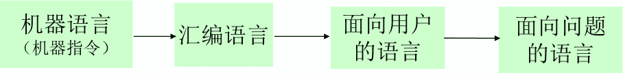

C7 06 0000 0002

MOV x, 2

x = 2

低级语言

高级语言

- 低级语言（Low level Language）
  - 字位码、机器语言、汇编语言
  - 特点：与特定的机器有关，运行效率高，但使用和编程复杂、繁琐、费时、易出错
- 高级语言
  - ——Fortran、Pascal、C、Java 语言等
  - 特点：不依赖某个具体的硬件体系结构，可移植性好、对用户要求低、易使用、易维护等。

用高级语言编制的程序，计算机不能立即执行，必须通过一个“翻译程序”加工，转化为与其等价的机器语言程序，机器才能执行。这种翻译程序，称之为“编译程序”。


## 源程序、翻译程序、目标程序 三者关系

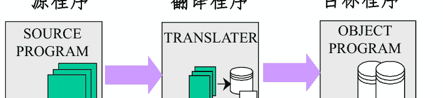

即源程序是翻译程序的输入，目标程序是翻译程序的输出

## 汇编程序与编译程序

- **汇编程序**
  若源程序用汇编语言书写，经过翻译程序得到用机器语言表示的程序，这时的翻译程序就称之为汇编程序，这种翻译过程称为“汇编”（Assemble）
- **编译程序**
  若源程序是用高级语言书写，经加工后得到目标程序，这种翻译过程称“编译”（Compile）

汇编程序与编译程序都是翻译程序，主要区别是加工对象的不同。由于汇编语言格式简单，常与机器语言之间有一一对应的关系，汇编程序所要做的翻译工作比编译程序简单得多。

## 源程序的编译和运行

| 编译或汇编阶段 | 运行阶段 |
| --- | --- |
| 源程序 | 输入数据 |
| 编译程序或汇编程序 | 目标程序 + 运行时库程序 |
| 目标程序、错误信息 | 输出数据 |

## 解释程序（Interpreter）

- 解释程序（Interpreter）：对源程序进行解释执行的程序。
- 工作过程


- 特点、与编译程序比较

## “编译-解释执行”系统

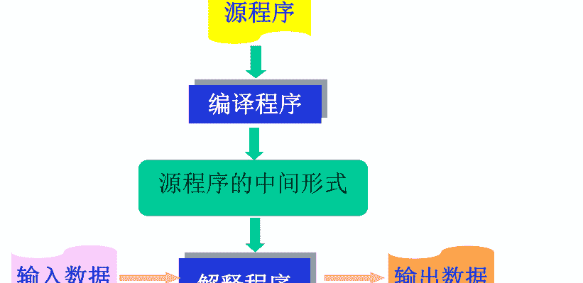

## 1.3.1 编译过程

编译过程是指将高级语言程序翻译为语义等价的目标程序的过程。

习惯上是将编译过程划分为5个基本阶段：

- 词法分析
- 语法分析
- 语义分析、生成中间代码
- 代码优化
- 生成目标程序

**一、词法分析**

任务：分析和识别单词。

源程序是由字符序列构成的，词法分析扫描源程序（字符串），根据语言的词法规则分析并识别单词，并以某种编码形式输出。

- 单词：是语言的基本语法单位，一般语言有四大类单词

对于如下的字符串，词法分析程序将分析和识别出9个单词：

X1 := ( 2.0 + 0.8 ) * C1

1 2 3 4 5 6 7 8 9

也称为线性分析。


## 二、语法分析

任务：根据语法规则（即语言的文法），分析并识别出各种语法成分，如表达式、各种说明、各种语句、过程、函数等，并进行语法正确性检查。

```
X1 := ( 2.0 + 0.8 ) * C1
```

赋值语句的文法：

```
<赋值语句>→<变量><赋值操作符><表达式>
<变量>→<简单标识符>
<赋值操作符>→:=
<表达式>→ ……
```

```
X1 := ( 2.0 + 0.8 ) * C1;

## 赋值语句

X1

:=

## 表达式

;

## 表达式

*

C1

(

## 表达式

)

2.0

+

0.8
```

也称为层次分析。

## 三、语义分析、生成中间代码

任务：对识别出的各种语法成分进行语义分析，并产生相应的中间代码。

- 中间代码：一种介于源语言和目标语言之间的中间语言形式
- 生成中间代码的目的：
  - 1. 便于做优化处理；
  - 2. 便于编译程序的移植。
- 中间代码的形式：编译程序设计者可以自己设计，常用的有四元式、三元式、逆波兰表示等。

### ★ 四元式（三地址指令）

X1 := ( 2.0 + 0.8 ) * C1

| 运算符 | 左运算对象 | 右运算对象 | 结果 |
|---|---|---|---|
| (1) + | 2.0 | 0.8 | T1 |
| (2) * | T1 | C1 | T2 |
| (3) := | X1 | T2 |  |

其中T1和T2为编译程序引入的临时工作单元

四元式的语义为：

```
T1 = 2.0 + 0.8
T2 = T1 * C1
X1 = T2
```

这样所生成的四元式与原来的赋值语句在语言的形式上不同，但语义上等价。

## 四、代码优化

**任务：** 目的是为了得到高质量的目标程序。

例如：前面的四元式中第一个四元式是计算常量表达式值，该值在编译时就可以算出并存放在工作单元中，不必生成目标指令来计算，这样四元式可优化为：

优化前的四元式：

```
(1)  +   2.0   0.8   T1
(2)  *   T1    C1    T2
(3)  :=  X1    T2
```

优化为：

```
2.0 + 0.8 → 2.8
(1) *   2.8    C1    X1
```

## 五、生成目标程序

由中间代码很容易生成目标程序（地址指令序列）。这部分工作与机器关系密切，所以要根据机器进行。在做这部分工作时（要注意充分利用目标机特性），也可以进行优化处理。

```
X1 := ( 2.0 + 0.8 ) * C1
```

```
LOAD  2.0
ADD   0.8
STO   T1
LOAD  T1
MUL   C1
STO   T2
LOAD  T2
STO   X1
```

作利用累加器的优化

```
LOAD  2.0
ADD   0.8
MUL   C1
STO   X1
```

注意：在翻译成目标程序的过程中，要切记保持语义的等价性。

## 1.3.2 编译程序构造

### 一、编译程序的逻辑结构

按逻辑功能不同，可将编译过程划分为五个基本阶段，与此相对应，我们将实现整个编译过程的编译程序划分为五个逻辑阶段（即五个逻辑子过程）。

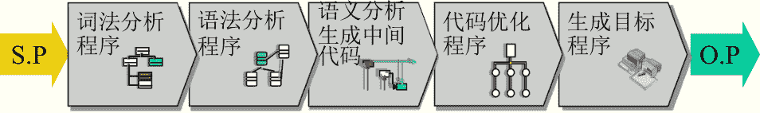

在上列五个阶段中都要做两件事：

（1）建表和查表；（2）出错处理；

所以编译程序中都要包括符号表管理和出错处理两部分

### ★ 符号表管理

在整个编译过程中始终都要贯穿着建表（填表）和查表的工作。即要及时地把源程序中的信息和编译过程中所产生的信息登记在表格中，而在随后的编译过程中同时又要不断地查找这些表格中的信息。

### ★ 出错处理

规模较大的源程序难免有多种错误，编译程序必须要有出错处理的功能。即能诊察出错误，并能报告用户错误的性质和位置，以使用户修改源程序。出错处理能力的大小是衡量编译程序质量好坏的一个重要指标。

典型的编译程序具有7个逻辑部分

```
S.P
  词法分析程序
  语法分析程序
  语义分析、生成中间代码
  代码优化程序
  生成目标程序
O.P
  符号表管理
  出错处理
```

一遍扫描即可完成整个编译工作的称为一遍扫描编译程序

其结构为：

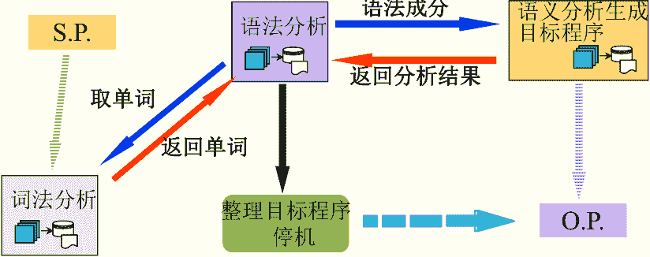

### 中间表示的重要性

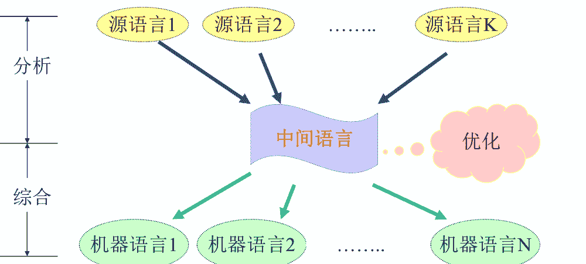

## 1.4 编译技术的应用

- 语法制导的结构化编辑器
- 程序格式化工具
- 软件测试工具
- 程序理解工具
- 高级语言的翻译工具
- 等等。

作业：第15页1、2、3题

# 第二章  文法和语言的概念和表示

- 预备知识－形式语言基础
- 文法和语言的定义
- 若干术语和重要概念
- 文法的表示：扩充的BNF范式和语法图
- 文法和语言的分类

## 2.1 预备知识

## 一、字母表和符号串

字母表：符号的非空有限集　例：Σ={a，b，c}

符号：字母表中的元素　例：a，b，c

符号串：符号的有穷序列　例：a，aa，ac，abc，…

空符号串：无任何符号的符号串（ε）

## 符号串的形式定义

有字母表Σ，定义：

- 1. ε 是Σ上的符号串；
- 2. 若x是Σ上的符号串，且a∈Σ，则ax或xa是Σ上的符号串；
- 3. y是Σ上的符号串，iff（当且仅当）y可由（1）和（2）产生。

符号串集合：由符号串构成的集合。

## 通常约定

- 用英文字母表开头的小写字母和字母表靠近末尾的大写字母来表示符号
  - 如： a, b, c, d, ..., r 和 S, T, U, V, W, X, Y, Z
- 用英文字母表靠近末尾的小写字母来表示符号串
  - 如： s, t, u, v, w, x, y, z
- 用英文字母表开头的大写字母来表示符号串集合
  - 如： A, B, C, D, ..., R

## 3. 符号串的联接

若x、y是定义在Σ上的符号串，且 x=XY， y=YX，则x和y的联接 xy=XYYX也是Σ上的符号串。

注意：一般xy≠yx，而 ε x = x ε

## 4. 符号串集合的乘积运算

令A、B为符号串集合，定义 AB = { xy | x∈A, y∈B }

例：A = {s, t}, B = {u, v}, AB = ?

{su, sv, tu, tv}

因为εx = xε = x，所以{ε}A = A{ε} = A

## 问题

{ε}A = A{ε} = A

{}A = A{} = ?

{}A = A{} = {}

## 5. 符号串集合的幂运算

有符号串集合A，定义

A⁰={ε},      A¹=A,      A²=AA,      A³=AAA,

…… …… Aⁿ=Aⁿ⁻¹A=AAⁿ⁻¹ ， n>0

## 6. 符号串集合的闭包运算

设A是符号串集合，定义

A⁺= A¹ ∪ A² ∪ A³ ∪……∪ Aⁿ ∪……

称为集合A的正闭包。

A*= A⁰ ∪ A⁺

称为集合A的闭包。

例：A={x,y}

A⁺={x,y, xx,xy,yx,yy, xxx,xxy,xyx,xyy,yxx,yxy,yyx,yyy, ……}

A*={ε, x,y, xx,xy,yx,yy, xxx,xxy,xyx,xyy,yxx,yxy,yyx,yyy, ……}

## ★ 为什么对符号、符号串、符号串集合以及它们的运算感兴趣？

若 A 为某语言的基本字符集（把字符看作符号）

$A=\{a,b,\ldots,z,0,1,\ldots,9,+,-,\times,\_,/,(),=,\ldots\}$

B 为单词集（单词是符号串）

$B=\{begin,end,if,then,else,for,\ldots,\langle\text{标识符}\rangle,\langle\text{常量}\rangle,\ldots\}$

则 $B\subset A^*$。

> （把单词看作符号，句子便是符号串）

语言的句子是定义在 B 上的符号串。若令 C 为句子集合，则 $C\subset B^*$，程序 $∈ C$。

- 若把字符看作符号，则单词就是符号串，单词集合就是符号串的集合。
- 若把单词看作符号，则句子就是符号串，而所有句子的集合（即语言）就是符号串的集合。

习题: p22 3,4

p28 1—8


## 2.2 文法的非形式讨论

## 1.什么是文法：

文法是对语言结构的定义与描述。即从形式上用于描述和规定语言结构的称为“文法”（或称为“语法”）。

例：有一句子：“我是大学生”。这是一个在语法、语义上都正确的句子，该句子的结构（称为语法结构）是由它的语法决定的。在本例中它为“主谓结构”。

- 如何定义句子的合法性
  - 有穷语言——穷举所有合法的句子
  - 无穷语言——？

## 2. 语法规则：

我们通过建立一组规则，来描述句子的语法结构。规定用“::=”表示“由…组成”（或“定义为…”）。

- `<句子> ::= <主语><谓语>`
- `<主语> ::= <代词> | <名词>`
- `<代词> ::= 你 | 我 | 他`
- `<名词> ::= 王民 | 大学生 | 工人 | 英语`
- `<谓语> ::= <动词><直接宾语>`
- `<动词> ::= 是 | 学习`
- `<直接宾语> ::= <代词> | <名词>`

## 推导方法：

从一个要识别的符号开始推导，即用相应规则的右部来替代规则的左部，每次仅用一条规则去进行推导。

```text
<句子> => <主语><谓语>
=> <代词><谓语>
=> 我<谓语>
=> 我<动词><直接宾语>
=> 我是<直接宾语>
=> 我是<名词>
=> 我是大学生
```

- `<句子> ::= <主语><谓语>`
- `<主语> ::= <代词>|<名词>`
- `<代词> ::= 你|我|他`
- `<名词> ::= 王民|大学生|工人|英语`
- `<谓语> ::= <动词><直接宾语>`
- `<动词> ::= 是|学习`
- `<直接宾语> ::= <代词>|<名词>`

例：有一英语句子： The big elephant ate the peanut.

- `<句子> ::= <主语><谓语>`
- `<主语> ::= <冠词><形容词><名词>`
- `<冠词> ::= the`
- `<形容词> ::= big`
- `<名词> ::= elephant`
- `<谓语> ::= <动词><宾语>`
- `<动词> ::= ate`
- `<宾语> ::= <冠词><名词>`
- `<名词> ::= peanut`

## Compiler

```text
<句子> => <主语><谓语>
=> <冠词><形容词><名词><谓语>
=> the <形容词><名词><谓语>
=> the big <名词><谓语>
=> the big elephant <谓语>
=> the big elephant <动词><宾语>
=> the big elephant ate <宾语>
=> the big elephant ate <冠词><名词>
=> the big elephant ate the <名词>
=> the big elephant ate the peanut
```

```text
<句子>::=<主语><谓语>
<主语>::=<冠词><形容词><名词>
<冠词>::=the
<形容词>::=big
<名词>::=elephant | peanut
<谓语>::=<动词><宾语>
<动词>::=ate
<宾语>::=<冠词><名词>
```

上述推导可写成<句子> ⇐⇒ the big elephant ate the peanut

## 说明：

- (1) 有若干语法成分同时存在时，我们总是从最左的语法成分进行推导，这称之为最左推导，类似的有最右推导(还有一般推导)。
- (2) 从一组语法规则可推出不同的句子，如以上规则还可推出“大象吃象”、“大花生吃象”、“大花生吃花生”等句子，它们在语法上都正确，但在语义上未必正确。

所谓文法是在形式上对句子结构的定义与描述，而未涉及语义问题。

## 4. 语法（推导）树：

我们用语法（推导）树来描述一个句子的语法结构。

识别符号

语法成分（在形式语言中又称“非终结符”）

单词符号（在形式语言中又称“终结符号”）

```text
<句子>
<主语> <谓语>
<冠词> <形容词> <名词> <动词> <冠词> <名词>
The big elephant ate the peanut
```

## 例：无符号整数的文法：

```text
G[<无符号整数>] = (Vn, Vt, P, Z)
Vn = {<无符号整数>, <数字串>, <数字>}
Vt = {0, 1, 2, 3, ...... 9}
P = {<无符号整数> → <数字串>,
<数字串> → <数字串><数字>,
<数字串> → <数字>,
<数字> → 0,
<数字> → 1,
..........
<数字> → 9}
Z = <无符号整数>
```

## 几点说明：

产生式左边符号构成集合Vn，且 Z ∈ Vn

有些产生式具有相同的左部，可以合在一起

文法的BNF表示
Backus-Naur Form

```text
例： <无符号整数> → <数字串>
<数字串> → <数字串><数字> | <数字>
<数字> → 0 | 1 | 2 | 3 | ...... | 9
```

给定一个文法，需给出产生式（规则）集合，并指定识别符号

```text
例： G[<无符号整数>]:
<无符号整数> → <数字串>
<数字串> → <数字串><数字> | <数字>
<数字> → 0 | 1 | 2 | 3 | ...... | 9
```

## 2.3.2 推导的形式定义

> 定义2：文法 G：v＝xUy，w＝xuy，
> 
> 其中 x、y ∈ V*，U ∈ Vₙ，u ∈ V*，
> 
> 若 U::=u ∈ P，则 v ⇒₍G₎ w。
> 
> 若 x＝y＝ε，有 U::=u，则 U ⇒₍G₎ u

根据文法和推导定义，可推出终结符号串，所谓通过文法能推出句子来。

例如： G[<无符号整数>]

```text
(1) <无符号整数> → <数字串>
(2) <数字串> → <数字串><数字>
(3) <数字串> → <数字>
(4) <数字> → 0
(5) <数字> → 1
………………
(13) <数字> → 9

<无符号整数> ⇒ <数字串> ⇒ <数字串><数字>
　　　　　　　　　　　　(1)　　　　(2)

⇒ <数字><数字> ⇒ 1<数字>
　(3)　　　　　　(4)

⇒ 10
　(5)
```

当符号串已没有非终结符号时，推导就必须终止。因为终结符不可能出现在规则左部，所以将在规则左部出现的符号称为非终结符号。

定义3：文法 G，u₀，u₁，u₂，……，uₙ ∈ V⁺

if v = u₀ ──G──> u₁ ──G──> u₂ ──G──> …… ──G──> uₙ = w

则 v ══G══> w

例：

```text
<无符号整数> ==> <数字串> ==> <数字串><数字>

==> <数字><数字> ==> 1<数字>

==>10
```

即 <无符号整数> ==> 10

定义4：文法G，有v，w ∈ V⁺

if v =>₍G₎⁺ w，或v=w，则 v =>₍G₎* w

定义5：规范推导：有xUy ==> xuy，若 y ∈ Vₜ*，则此推导为规范的，记为 xUy ⇐⇒ xuy

直观意义：规范推导=最右推导

- 最右推导：若规则右端符号串中有两个以上的非终结符时，先推右边的。
- 最左推导：若规则右端符号串中有两个以上的非终结符时，先推左边的。

若有 v = u₀ |=⇒ u₁ |=⇒ u₂ |=⇒ ...... |=⇒ uₙ = w，则 v |=⇒⁺ w

## 2.3.3 语言的形式定义

### 定义6：文法G[Z]

- (1) 句型：x是句型 ⇔ Z ⇒* x, 且 x∈V*；
- (2) 句子：x是句子 ⇔ Z ⇒+ x, 且 x∈Vt*；
- (3) 语言：L(G[Z]) = {x | x∈Vt*, Z ⇒+ x}；

文法G[Z]所产生的所有句子的集合

形式语言理论可以证明以下两点：

- (1) G → L(G)；
- (2) L(G) → G1, G2, ......, Gn；

已知文法，求语言，通过推导；

已知语言，构造文法，无形式化方法，更多是凭经验。

### 例：{ ab...ba | n≥1}, 构造其文法

```text
G1[Z]:
  Z→aBa,
  B→b | bB
G2[Z]:
  Z→aBa,
  B→b | Bb
```

定义7. G和G’是两个不同的文法，若 L(G) = L(G’)，则G和G’为等价文法。

## 2.3.4 递归文法

## 1. 递归规则：

规则右部有与左部相同的符号（非终结符）

对于 U::= xUy

若x= ε， 即U::= Uy， 左递归

若y= ε， 即U::= xU， 右递归

若x, y≠ ε， 即U::= xUy， 自嵌入递归

## 2. 递归文法：

文法G，存在U ∈Vn

if U => ...U..., 则G为递归文法；

if U => U..., 则G为左递归文法；

if U => ...U, 则G为右递归文法。


## 3. 递归文法的优点：可用有穷条规则，定义无穷语言

会造成死循环（后面将详细论述）

## 4. 左递归文法的缺点：不能用自顶向下的方法来进行语法分析

例：对于前面给出的无符号整数的文法是左递归文法，用13条规则就可以定义出所有的无符号整数。若不用递归文法，那将要用多少条规则呢？

```text
<无符号整数> → <数字串>
<数字串> → <数字串><数字> | <数字>
<数字> → 0 | 1 | 2 | 3 | ...... | 9
```


## 2.3.5 句型的短语、简单短语和句柄

定义8. 给定文法 G[Z]，w = xuy ∈ V⁺，为该文法的句型，若 Z ⇒* xUy，且 U ⇒+ u，则 u 是句型 w 相对于 U 的短语；若 Z ⇒* xUy，且 U ⇒ u，则 u 是句型 w 相对于 U 的简单短语。其中 U ∈ Vₙ，u ∈ V⁺，x, y ∈ V*。

直观理解：短语是前面句型中的某个非终结符所能推出的符号串。

任何句型本身一定是相对于识别符号 Z 的短语。

### 定义9. 任一句型的最左简单短语称为该句型的句柄。

给定句型找句柄的步骤：

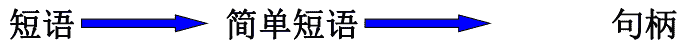

例：文法 G[〈无符号整数〉]，w = 〈数字串〉1

```text
〈无符号整数〉⇒〈数字串〉⇒〈数字串〉〈数字〉
⇒〈数字串〉1
```

求：短语、简单短语和句柄。

例：文法 G[〈无符号整数〉]，w = 〈数字串〉1

定义8. 给定文法 G[Z]，w = xuy ∈ V⁺，为该文法的句型，若 Z ⇒* xUy，且 U ⇒+ u，则 u 是句型 w 相对于 U 的短语；若 Z ⇒* xUy，且 U ⇒ u，则 u 是句型 w 相对于 U 的简单短语。其中 U ∈ Vₙ，u ∈ V⁺，x, y ∈ V*。

〈无符号整数〉 ⇒ 〈数字串〉 ⇒ 〈数字串〉〈数字〉 ⇒ 〈数字串〉1

(1) 〈无符号整数〉 ⇒ 〈无符号整数〉 ⇒ 〈无符号整数〉 ⇒ 〈数字串〉1

注意：短语、简单短语是相对于句型而言的，一个句型可能有多个短语、简单短语，而句柄只能有一个。

| 推广计划 | 固定投资回报率 30% | 周期 2个月 | 推广流量 1000万+ | 商家分成 60% | VIP会员分成 20% | 城市合伙计划 20% |
| --- | --- | --- | --- | --- | --- | --- |
| 推广计划 | 投资回报率 20% | 周期 1个月 | 推广流量 500万+ | 商家分成 50% | VIP会员分成 30% | 城市合伙计划 20% |
| 推广计划 | 固定投资回报率 40% | 周期 3个月 | 推广流量 2000万+ | 商家分成 70% | VIP会员分成 15% | 城市合伙计划 15% |

## 2.4 语法树与二义性文法

## 2.4.1 推导与语法（推导）树

### （1）语法（推导）树

句子(句型)结构的图示表示法，它是有向图，由结点和有向边组成。

- 结点：符号
- 根结点：识别符号（开始符号）
- 中间结点：非终结符
- 叶结点：终结符或非终结符

有向边：表示结点间的派生关系

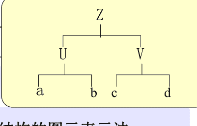

### （2）句型的推导及语法树的生成（自顶向下）

给定 G[Z]，句型 w：

可建立推导序列，Z ⇒*G w

可建立语法树，以 Z 为树根结点，每步推导生成语法树的一枝，最终可生成句型 w 的语法树。

注意一个重要事实：文法所能产生的句子，可以用不同的推导序列（使用产生式顺序不同）将其推导出。语法树的生长规律不同，但最终生成的语法树形状完全相同。某些文法有此性质，而某些文法不具此性质。

### 一般推导

G[〈无符号整数〉]：
〈无符号整数〉 → 〈数字串〉
〈数字串〉 → 〈数字串〉〈数字〉 | 〈数字〉
〈数字〉 → 0 | 1 | 2 | 3 | …… | 9

```text
<无符号整数>
(1)
<数字串>
(2)
<数字串>      <数字>
(3)          (4)
<数字>       0
(5)
1
```

### 最左推导

G[〈无符号整数〉]：
〈无符号整数〉 → 〈数字串〉
〈数字串〉 → 〈数字串〉〈数字〉 | 〈数字〉
〈数字〉 → 0 | 1 | 2 | 3 | ...... | 9

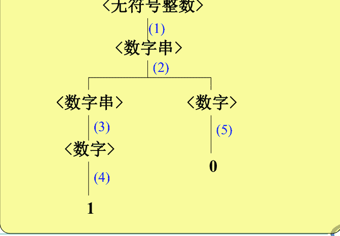

### 最右推导

G[〈无符号整数〉]：
〈无符号整数〉 → 〈数字串〉
〈数字串〉 → 〈数字串〉〈数字〉 | 〈数字〉
〈数字〉 → 0 | 1 | 2 | 3 | ...... | 9

```text
<无符号整数>
(1)
<数字串>
(2)
<数字串>   <数字>
(4)        (3)
<数字>
(5)
1
0
```

### （3）子树与短语

子树：语法树中的某个结点（子树的根）连同它向下派生的部分所组成。

定理：某子树的末端结点按自左向右顺序为句型中的符号串，则该符号串为该句型的相对于该子树根的短语。

只需画出句型的语法树，然后根据子树找短语 → 简单短语 → 句柄。

### 例：G[〈无符号整数〉]，句型 〈数字串〉1

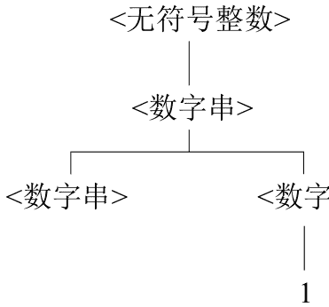

〈无符号整数〉 ⇒ 〈数字串〉
⇒ 〈数字串〉〈数字〉
⇒ 〈数字串〉1

短语：〈数字串〉1，1

简单短语：1

句柄：1

### 例：G[〈无符号整数〉]，句型 10

```text
〈无符号整数〉

（1）
〈数字串〉

（2）
〈数字串〉　　　〈数字〉

（4）
〈数字〉
（5）
1

（3）
0
```

〈无符号整数〉 ⇒ 〈数字串〉
⇒ 〈数字串〉〈数字〉
⇒ 〈数字串〉0
⇒ 〈数字〉0
⇒ 10

| 类型 | 句型 | 短语 | 简单短语 | 句柄 |
| --- | --- | --- | --- | --- |
|  | 〈数字串〉 | 〈数字串〉〈数字〉 | 〈数字串〉0 | 〈数字〉0 |
|  | 〈数字串〉 | 〈数字串〉〈数字〉 | 〈数字串〉0，0 | 〈数字〉0，〈数字〉>0 |
|  | 〈数字串〉 | 〈数字串〉〈数字〉 | 0 | 〈数字〉，0 |
|  | 〈数字串〉 | 〈数字串〉〈数字〉 | 0 | 〈数字〉 |

### （4）树与推导


### 1 由推导构造语法树

从识别符号开始，自左向右建立推导序列。


由根结点开始，自上而下建立语法树。

### 例：G[〈无符号整数〉]，句型 10

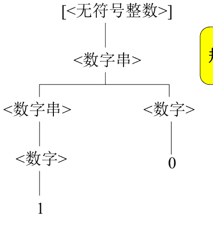

规范推导

〈无符号整数〉 ⇒ 〈数字串〉
⇒ 〈数字串〉〈数字〉
⇒ 〈数字串〉0
⇒ 〈数字〉0
⇒ 10

### 2 由语法树构造推导

自下而上地修剪子树的某些末端结点（短语），直至把整棵树剪掉（留根），每剪一次对应一次归约。


从句型开始，自右向左地逐步进行归约，建立推导序列。

通常我们每次都剪掉当前句型的句柄（最左简单短语），即每次均进行规范归约。

### 规范归约与规范推导互为逆过程

[〈无符号整数〉]

〈无符号整数〉

- ⇒ 〈数字串〉
- ⇒ 〈数字串〉〈数字〉
- ⇒ 〈数字串〉0
- ⇒ 〈数字〉0
- ⇒ 10

定义12. 对句型中最左简单短语（句柄）进行的归约称为规范归约。

定义13. 通过规范推导或规范归约所得到的句型称为规范句型。

句型〈数字〉〈数字〉是不是文法的规范句型？：

〈无符号整数〉 ⇒ 〈数字串〉
⇒ 〈数字串〉〈数字〉
=?> 〈数字〉〈数字〉

不是规范推导

## 2.4.2 文法的二义性

**定义14.1**　若对于一个文法的某一句子（或句型）存在两棵不同的**语法树**，则该文法是**二义性文法**，否则是无二义性文法。

换而言之，无二义性文法的句子只有一棵语法树，尽管推导过程可以不同。

二义性文法举例：

```text
G[E]:　　 E ::= E+E | E*E | (E) | i

　　　　 Vₙ = {E}

　　　　 Vₜ = { +，*，(，)，i }
```

对于句子 S=i+i * i ∈ L(G[E])，存在不同的规范推导：

(1) E ⇒ E+E ⇒ E+E*E ⇒ E+E*i ⇒ E+i*i ⇒ i+i * i

(2) E ⇒ E*E ⇒ E*i ⇒ E+E*i ⇒ E+i*i ⇒ i+i * i

这两种不同的推导对应了两棵不同的语法树：

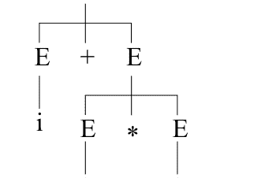

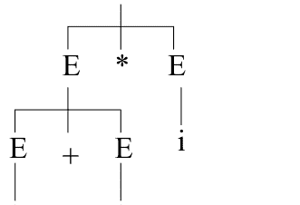


定义14.2 若一个文法的某句子存在两个不同的**规范推导**，则该文法是**二义性**的，否则是无二义性的。

+   1. `E ⟹ E+E ⟹ E+E*E ⟹ E+E*i ⟹ E+i*i ⟹ i+i*i`
+   2. `E ⟹ E*E ⟹ E*i ⟹ E+E*i ⟹ E+i*i ⟹ i+i*i`

从自底向上的归约过程来看，上例中规范句型 `E+E*i` 是由 `i+i*i` 通过两步规范归约得到的，但对于同一个句型 `E+E*i`，它有两个不同的句柄（对应上述两棵不同的语法树）：`i` 和 `E+E`。因此，文法的二义性意味着句型的句柄不唯一。

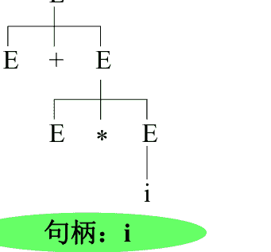

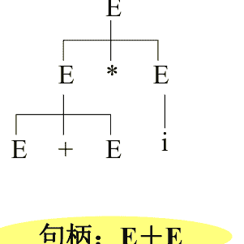

句柄: i

句柄: E+E

定义14.3 若一个文法的某规范句型的句柄不唯一，则该文法是二义性的，否则是无二义性的。

若文法是二义性的，则在编译时就会产生不确定性，遗憾的是在理论上已经证明：文法的二义性是不可判定的，即不可能构造出一个算法，通过有限步骤来判定任一文法是否有二义性。

现在的解决办法是：提出一些限制条件，称为无二义性的充分条件，当文法满足这些条件时，就可以判定文法是无二义性的。

## 例:算术表达式的文法

```
E::= E+E | E*E | (E) | i
```

```
E ::= E+T | T
T ::= T*F | F
F ::= (E) | i
```

句子： i+ i * i

E |=>> E+T |=>> E+T*F |=>> E+T*i

|=>> E+F*i |=>> E+i*i |=>> T+i*i

|=>> F+i*i |=>> i+i*i

无二义性的表达式文法：

```
E ::= E+T | T
T ::= T*F | F
F ::= (E) | i
```

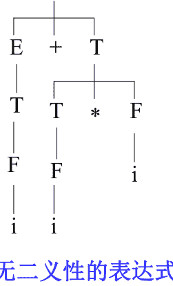

## 2.5 句子的分析

任务：给定 G[Z]：S ⊆ Vₜ*，判定是否有 S ∈ L(G[Z])？

这是词法分析和语法分析所要做的工作，将在第三、四章中详细介绍。

## 2.6 有关文法的实用限制

若文法中有如U::=U的规则，则这就是有害规则，它会引起二义性。

例如存在U::=U， U::= a | b,则有两棵语法树：

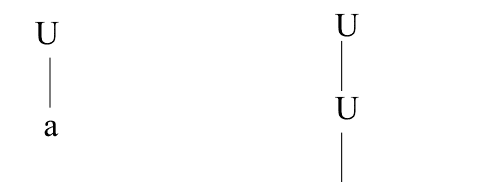

多余规则：（1）在推导文法的所有句子中，始终用不到的规则。即该规则的左部非终结符不出现在任何句型中（不可达符号）
（2）在推导句子的过程中，一旦使用了该规则，将推不出任何终结符号串。即该规则中含有推不出任何终结符号串的非终结符（不活动符号）

例如：给定G[Z]，若其中关于U的规则只有如下一条：

```
U ::= xUy
```

该规则是多余规则。

若还有U ::= a，则此规则并非多余

若某文法中无有害规则或多余规则，则称该文法是压缩过的。

## 例1： G[<Z>]：

```
<Z> ::= <B> e
<A> ::= <A> e | e
<B> ::= <C> e | <A> f
<C> ::= <C> f
<D> ::= f
```

不活动

不可达

## G'[<Z>]：

```
<Z> ::= <B> e
<A> ::= <A> e | e
<B> ::= <A> f
```

## 例2： G[S]：

```
S ::= ccc
S ::= Abccc
A ::= Ab
A ::= aBa
B ::= aBa
B ::= AD
D ::= Db
D ::= b
```

不活动

不可达

```
S ::= ccc
D ::= Db
D ::= b
```

## G'[S]：

```
S ::= ccc
```

## 2.7 文法的其它表示

```
<标识符>::=字母{字母|数字}
<无符号整数>::=数字{数字}
```

## 1、扩充的BNF表示

+   - BNF的元符号：`<`、`>`、`::=`、`|`
+   - 扩充的BNF的元符号：`<`、`>`、`::=`、`|`、`{`、`}`、`[`、`]`、`(`、`)`

## 2、语法图

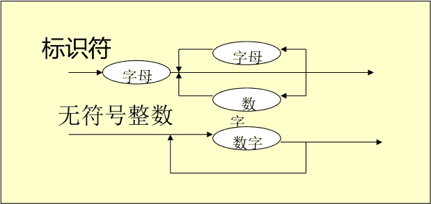

文法和语言分类：0型、1型、2型、3型
这几类文法的差别在于对产生式（语法规则）施加不同的限制。

0型： P: u ::= v
其中 u∈V+, v∈V*   V = Vn ∪ Vt

0型文法称为短语结构文法。规则的左部和右部都可以是符号串，一个短语可以产生另一个短语。

0型语言： L0  这种语言可以用图灵机(Turing)接受。

2型： P: U ::= u
其中 U∈Vn,
u∈V*

称为上下文无关文法。也即把U改写为u时，不必考虑上下文。
(1型文法的规则中x， y均为 ε 时即为2型文法)

注意：2型文法与BNF表示相等价。

2型语言： L2 这种语言可以由下推自动机接受。

## 3型文法：

（左线性）
P： U ::= t
或 U ::= W t
其中 U、W ∈ Vn
t ∈ Vt

（右线性）
P： U ::= t
或 U ::= t W
其中 U、W ∈ Vn
t ∈ Vt

3型文法称为正则文法。它是对2型文法进行进一步限制。

3型语言：L3 又称正则语言、正则集合
这种语言可以由有穷自动机接受。

+   - 根据上述讨论，L0 ⊃ L1 ⊃ L2 ⊃ L3
+   - 0型文法可以产生L0、L1、L2、L3，
+   - 但2型文法只能产生L2、L3不能产生L0、L1
+   - 3型文法只能产生L3

习题： p36—37 1,5,6,8,9
p41 3

## # 小结

+   - 掌握符号串和符号串集合的运算、文法和语言的定义
+   - 几个重要概念：推导、规约、递归、短语、简单短语和句柄、语法树、文法的二义性、文法的实用限制等。
+   - 掌握文法的表示：BNF、扩充的BNF范式、语法图。
+   - 了解文法和语言的分类。

## 消除不活动符号和不可达符号
算法

## 作业：

+   - P17: 1
+   - P19: 1, 2, 3, 4
+   - P26: 1, 2, 4, 6 ( i*i , i*(i+i) )
+   - P27: 7, 8, 9
+   - P33: 1, 2, 4, 5, 8
+   - P38: 3

# 第三章：词法分析

+   3.1 词法分析的功能
+   3.2 词法分析程序的设计与实现
+   ——状态图
+   3.3 词法分析程序的自动生成
+   ——有穷自动机

## 内容

+   - 词法分析程序的功能及实现方案
+   - 单词的种类及词法分析程序的输出形式
+   - 规则文法和状态图
+   - 词法分析程序的设计与实现
+   - 正则表达式与有穷自动机
+   - 词法分析程序的自动生成器

## 3.1 语法分析程序的功能及实现方案

## 语法分析程序的功能

+   ◆ 语法分析：根据语法规则识别及组合单词，进行语法检查。
+   ◆ 对数字常数完成数字字符串到二进制数值的转换。
+   ◆ 删除空格字符和注释。

## 实现方案：基本上 有两种

1.词法分析单独作为一遍

第一遍

单词串

第二遍

S.P.(字符串)

词法分析

S.P.(符号串)

语法分析

优点：结构清晰、各遍功能单一
缺点：效率低

2.词法分析程序作为单独的子程序

S.P.(字符串)

词法分析程序

取单词

语法分析程序

单词

优点：效率高

## 3.2 单词的种类及语法分析程序的输出形式

## 单词的种类

+   1. 保留字： begin、 end、 for、 do...
+   2. 标识符： 由用户定义，表示各种名字
+   3. 常  数： 无符号数、布尔常数、字符串常数等
+   4. 分界符： +、 -、 *、 /、 ...

## 词法分析程序的... 部形式

表示单词的种类，可用整数编码或记号表示

不同的单词不同的值

| 单词类别 | 单词值 |

几种常用的单词内部形式：

+   1、按单词种类分类
+   2、保留字和分界符采用一符一类
+   3、标识符和常数的单词值又为指示字（指针值）


## 1、按单词种类分类

| 单词名称 | 类别编码 | 单词值 |
|---|---:|---|
| 标识符 | 1 | 内部字符串 |
| 无符号常数(整) | 2 | 整数值 |
| 无符号浮点数 | 3 | 数值 |
| 布尔常数 | 4 | 0 或 1 |
| 字符串常数 | 5 | 内部字符串 |
| 保留字 | 6 | 保留字或内部编码 |
| 分界符 | 7 | 分界符或内部编码 |

## 2、保留字和分界符采用一符一类

| 单词名称 | 类别编码 | 单词值 |
|---|---|---|
| 标识符 | 1 | 内部字符串 |
| 无符号常数(整) | 2 | 整数值 |
| 无符号浮点数 | 3 | 数值 |
| 布尔常数 | 4 | 0 或 1 |
| 字符串常数 | 5 | 内部字符串 |
| BEGIN | 6 | - |
| END | 7 | - |
| FOR | 8 | - |
| DO | 9 | - |
| ........ | ........ | ..... |
| : | 20 | - |
| + | 21 | - |
| * | 22 | - |
| , | 23 | - |
| ( | ........ | -- |

## 3.3 正则文法和状态图

- 状态图的画法（根据文法画出状态图）

例如：正则文法

```
Z ::= U0 | V1
U ::= Z1 | 1
V ::= Z0 | 0
```

左线性文法。该文法所定义的语言为：

$L(G[Z])=\{B^n \mid n>0\}$，其中 $B=\{01,10\}$

## 左线性文法的状态图的画法：

1. 令 G 的每个非终结符都是一个状态；
2. 设一个开始状态 S；
3. 若 Q ::= t，Q ∈ Vₙ，t ∈ Vₜ，则：

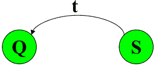

4. 若 Q ::= Rt，Q、R ∈ Vₙ，t ∈ Vₜ，则：

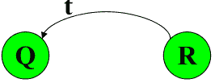

5. 按自动机方法，可加上开始状态和终止状态标志。

| 例：正则文法 |
|---|
| Z ::= U0|V1 |
| U ::= Z1|1 |
| V ::= Z0|0 |

例如：正则文法

Z::= U0 | V1

U ::= Z1 | 1

V ::= Z0 | 0

其状态图为：

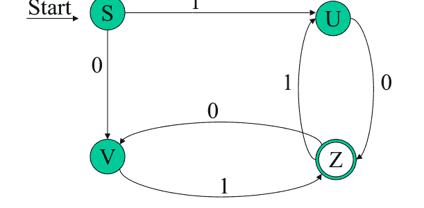

## 识别算法

利用状态图可按如下步骤分析和识别字符串x：

- 1、置初始状态为当前状态，从x的最左字符开始，重复步骤2，直到x右端为止。
- 
- 2、扫描x的下一个字符，在当前状态所射出的弧中找出标记有该字符的弧，并沿此弧过渡到下一个状态；如果找不到标有该字符的弧，那么x不是句子，过程到此结束；如果扫描的是x的最右端字符，并从当前状态出发沿着标有该字符的弧过渡到下一个状态为终止状态Z，则x是句子。

例： x=1001 和1011

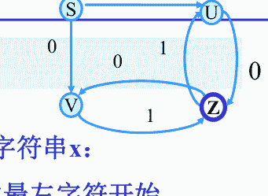

## • 问题：

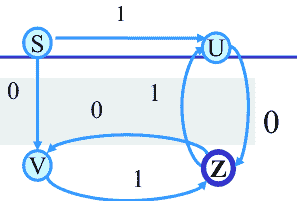

- 1、上述分析过程是属于自底向上分析？还是自顶向下分析？
- 
- 2、怎样确定句柄？

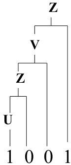

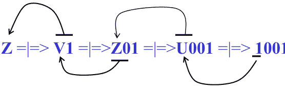

### 右线性正则文法例

S → 0U | 1V
U → 1S | 1
V → 0S | 0

L(G[S]) = { B^n | n>0 }
其中 B = { 01, 10 }


R = (01|10)(01|10)*

作业：
P56： 1、2

## 3.4 词法分析程序的设计与实现

词法规则 → 状态图 → 词法分析程序

### 3.4.1 文法及其状态图

## 语言的单词符号

- 标识符
- 保留字(标识符的子集)
- 无符号整数
- 单分界符  +  *  :  ,  ( )
- 双分界符  := 

两点说明: 1. 空格的作用    2. 实数的表示

文法：1. <标识符>::= 字母 | <标识符>字母 | <标识符>数字
2. <无符号整数>::= 数字 | <无符号整数>数字
3. <单字符分界符>::= | + | * | , | ( | )
4. <双字符分界符>::= <冒号>=
<冒号>::= :

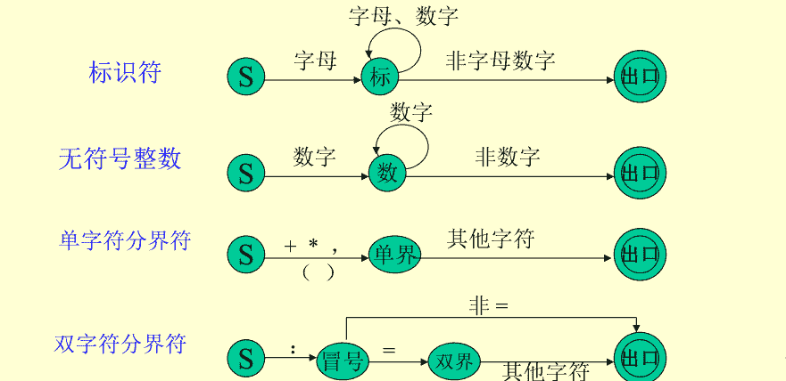

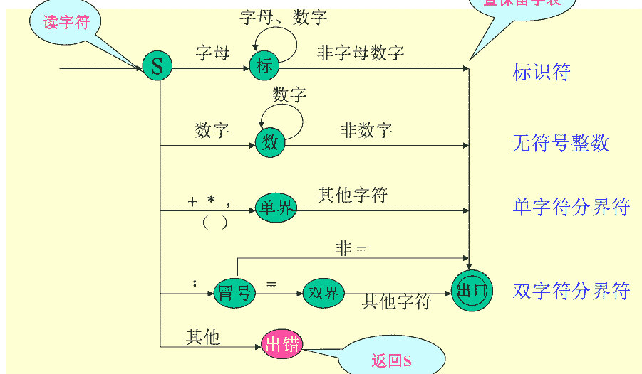

### 3.4.2 状态图的实现——构造词法分析程序

- 1. 单词及内部表示
- 
- 2. 词法分析程序需要引用的公共（全局）变量和过程
- 
- 3. 词法分析程序算法

## 1.单词及内部表示： 保留字和分界符采用一符一类

| 单词名称 | 类别编码 | 记忆符 | 单词值 |
|---|---|---|---|
| BEGIN | 1 | BEGINSY | - |
| END | 2 | ENDSY | - |
| FOR | 3 | FORSY | - |
| DO | 4 | DOSY | - |
| IF | 5 | IFSY | - |
| THEN | 6 | THENSY | - |
| ELSE | 7 | ELSESY | - |
| 标识符 | 8 | IDSY | 内部字符串 |
| 常数(整) | 9 | INTSY | 整数值 |
| : | 10 | COLONSY | - |
| + | 11 | PLUSSY | - |
| * | 12 | STARSY | - |
| , | 13 | COMSY | - |
| ( | 14 | LPARSY | - |
| ) | 15 | RPARSY | - |
| := | 16 | ASSIGNSY | - |

## 2.词法分析程序需要引用的公共（全局）变量和过程

| 名称 | 类别 | 功能 |
|---|---|---|
| CHAR | 字符变量 | 存放当前读入的字符 |
| TOKEN | 字符数组 | 存放单词字符串 |
| GETCHAR | 读字符过程 | 读字符到CHAR, 移动指针 |
| GETNBC | 过程 | 反复调用GETCHAR, 直至CHAR进入一个非空白字符 |
| CAT | 过程 | CHAR与TOKEN连接 |
| ISLETTER 和 ISDIGIT | 布尔函数 | 判断 |
| UNGETCH | 过程 | 读字符指针后退一个字符 |
| RESERVE | 布尔函数 | 判断TOKEN中的字符串是保留字, 还是标识符 |
| ATOI | 函数 | 字符串到数字的转换 |
| ERROR | 过程 | 出错处理 |

## 3、词法分析程序算法

```
START: TOKEN := '';  /*置TOKEN为空串*/
        GETCHAR; GETNBC;
CASE CHAR OF
'A'..'Z': BEGIN
    WHILE ISLETTER OR ISDIGIT DO
        BEGIN CAT; GETCHAR END;
    UNGETCH;
    C:= RESERVE;   /* 返回0，为标识符 */
    IF C=0 THEN RETURN('IDSY':TOKEN)
    ELSE RETURN (C,-)   /*C为保留字编码*/
END;
'0'..'9': BEGIN
    WHILE DIGIT DO
        BEGIN CAT; GETCHAR END;
    UNGETCH;
    RETURN ('INTSY',ATOI)
END;
'+': RETURN('PLUSSY',-);
```

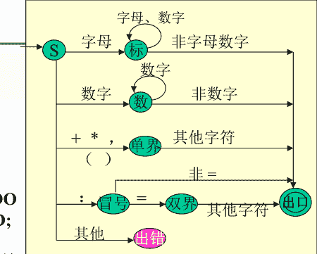

```
‘*’: RETURN(‘STARSY’,-);
‘,’: RETURN(‘COMSY’,-);
‘(‘: RETURN(‘LPARSY’,-);
‘)’: RETURN(‘RPARSY’,-);
‘:’: BEGIN
    GETCHAR;
    if CHAR=‘=‘ THEN RETURN(‘ASSIGNSY’,-);
    UNGETCH;
    RETURN(‘COLONSY’,-);
    END
END OF CASE;
ERROR;
GOTO START;
```

练习：用C语言实现上述算法。

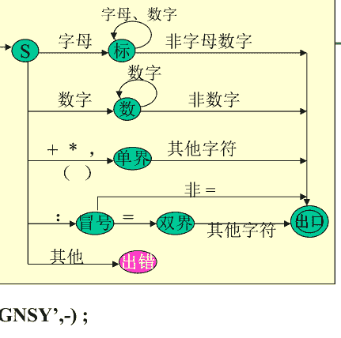


## 编程练习作业：P56：4（词法见P50~51）

## 3.5 正则表达式与有穷自动机

### 3.5.1 正则表达式和正则集合的递归定义

有字母表 Σ，定义在 Σ 上的正则表达式和正则集合递归定义如下：

1. ε和∅都是Σ上的正则表达式，其正则集合分别为：{ε}和∅；
2. 任何 a∈Σ，a是Σ上的正则表达式，其正则集合为：{a}；
3. 假定 U 和 V 是 Σ 上的正则表达式，其正则集合分别记为 L(U) 和 L(V)，那么 U∪V、U·V 和 U* 也都是 Σ 上的正则表达式，其正则集合分别为 L(U)∪L(V)、L(U)·L(V) 和 L(U)*；
4. 任何Σ上的正则表达式和正则集合均由1、2和3产生。

### 正则表达式中的运算符：

- `|` — 或（选择）
- `•` — 连接
- `*` 或 `{ }` — 重复
- `（）` — 括号

与集合的闭包运算有区别。这里 `a*` 表示由任意个 a 组成的串，而 `{a, b}* = {ε, a, b, aa, ab, ba, bb, .....}`。

### 运算符的优先级：

- 先 `*`，后 `•`，最后 `|`
- `•` 在正则表达式中可以省略。

正则表达式相等 ⇔ 这两个正则表达式表示的语言相等。

如：
`b{ab} = {ba}b`
`{a|b} = {{a} {b}} = (a*b*)*`

### 例：设 Σ = { a, b }，下面是定义在 Σ 上的正规表达式和正规集合

| 正规表达式 | 正规集合 |
| --- | --- |
| ba* | 以 b 为首，后跟 0 个或多个 a 的符号串 |
| a(a|b)* | Σ 上以 a 为首的所有符号串 |
| (a|b)*(aa|bb)(a|b)* | Σ 上含有 aa 或 bb 的所有符号串 |

### 正则表达式的性质：

设 e1、e2 和 e3 均是某字母表上的正则表达式，则有：

- 单位正则表达式：ε　　εe = eε = e
- 交换律：e1 | e2 = e2 | e1
- 结合律：e1 | (e2 | e3) = (e1 | e2) | e3；e1(e2e3) = (e1e2)e3
- 分配律：e1(e2 | e3) = e1e2 | e1e3；(e1 | e2)e3 = e1e3 | e2e3
- 此外：r* = (r | ε)*　　r** = r*；(r | s)* = (r*s*)*

### 正则表达式与3型文法等价

例如：

- 正则表达式 `ba*`，对应的3型文法：`Z ::= Za|b`
- 正则表达式 `a(a|b)*`，对应的3型文法：`Z ::= Za|Zb|a`

例：

| 3型文法 | 正则表达式 |
| --- | --- |
| S ::= aS\|aB | a*aba*a |
| B ::= bC | ba*a |
| C ::= aC\|a | a*a |

### 3.5.2 确定的有穷自动机（DFA）—状态图的形式化
（Deterministic Finite Automata）

一个确定的有穷自动机（DFA）M 是一个五元式：
M = (S, Σ, δ, s₀, Z)

其中：

1. S — 有穷状态集
2. Σ — 输入字母表
3. δ — 映射函数（也称状态转换函数）
   S × Σ → S
   δ(s,a)=s'，s, s' ∈ S, a ∈ Σ
4. s₀ — 初始状态　　s₀ ∈ S
5. Z — 终止状态集　　Z ⊆ S

#### M=(S, Σ, δ, s₀, Z) 示例

例如：M = ({0, 1, 2, 3}, {a, b}, δ, 0, {3})

- δ(0, a)=1，δ(0, b)=2
- δ(1, a)=3，δ(1, b)=2
- δ(2, a)=1，δ(2, b)=3
- δ(3, a)=3，δ(3, b)=3

状态转换函数 δ 可用一矩阵来表示：

| 状态 \ 输入字符 | a | b |
| --- | ---: | ---: |
| 0 | 1 | 2 |
| 1 | 3 | 2 |
| 2 | 1 | 3 |
| 3 | 3 | 3 |

> 所谓确定的状态机，其确定性表现在状态转换函数是单值函数！

#### DFA也可以用一状态转换图表示：

| 状态 | a | b |
| --- | ---: | ---: |
| 0 | 1 | 2 |
| 1 | 3 | 2 |
| 2 | 1 | 3 |
| 3 | 3 | 3 |

#### DFA的状态图表示：

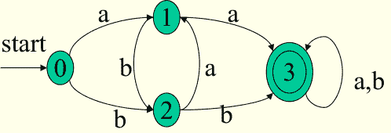

### DFA M所接受的符号串：

令 α = a₁a₂⋯aₙ，α ∈ Σ*，若 δ(δ(⋯δ(s₀, a₁), a₂)⋯, aₙ₋₁), aₙ) = sₙ，且 sₙ ∈ Z，则可以写成 δ(s₀, α) = sₙ，我们称 α 可为 M 所接受。

$$\begin{aligned}
\delta(s_0,a_1)&=s_1\\
\delta(s_1,a_2)&=s_2\\
&\cdots\\
\delta(s_{n-2},a_{n-1})&=s_{n-1}\\
\delta(s_{n-1},a_n)&=s_n
\end{aligned}$$

> 换言之：若存在一条初始状态到某一终止状态的路径，且这条路径上能有弧的标记符号连接成符号串 α，则称 α 为 DFA M（接受）识别。

DFA M所接受的语言为：L(M) = { α | δ(s₀, α) = sₙ，sₙ ∈ Z}

在当前始态，输入字母 a 时，自动机既可以向右，也可以向左。

- 如果向右，则可接受由 a 组成长度为偶数的字符串。
- 如果向左，则可接受由 a 组成长度为 3 的倍数的字符串。

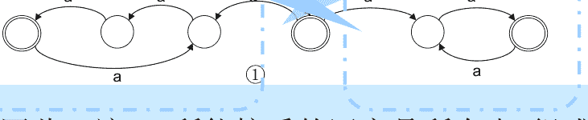

因此，该 NFA 所能接受的语言是所有由 a 组成，长度为 2 和 3 的倍数的字符串的集合。在第一次状态转换中，自动机需要选择要走的路径。只要有任何路径可匹配输入字符串，该串就必须被接受，因此 NFA 必须正确“猜测”所需的路径。

经过以 ε 标记的边无须任何字符输入。这里是接受同一语言的另一个 NFA：

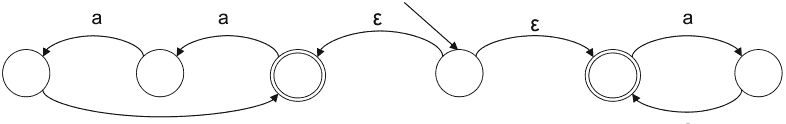

②

图示自动机需要选择沿哪一条标记有 ε 的边前进。如果一个状态同时引出以 ε 标记的边和以其它字符标记的边，则自动机可以选择处理一个输入字符并沿其对应的边前进，或者仅沿 ε 边前进。

### NFA 的形式定义为：

一个非确定的有穷自动机 NFA M' 是一个五元式：

NFA M' = (S, Σ∪{ε}, δ, s₀, Z)

其中：

- S——有穷状态集
- Σ∪{ε}——输入符号加上 ε，即自动机的每个结点所射出的弧可以是 Σ 中的一个字符或是 ε
- s₀——初态，s₀ ∈ S
- Z——终态集，Z ⊆ S
- δ——转换函数，S×(Σ∪{ε}) → 2^S
  （2^S——S 的幂集——S 的子集构成的集合）

上例题相应的状态图为：

| 状态 | ε | a | b | c |
| --- | --- | --- | --- | --- |
| 1 | {4} | {2, 3} | ∅ | ∅ |
| 2 | ∅ | {2} | {4} | ∅ |
| 3 | ∅ | ∅ | ∅ | {3, 4} |
| 4 | ∅ | ∅ | ∅ | ∅ |

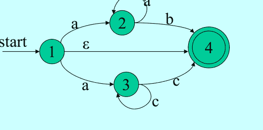

M' 所接受的语言（用正则表达式） R = aa*b | ac*c | ε

## 复习：

1. 正则表达式与有穷自动机，给出了两者的定义。用 3 型文法所定义的语言都可以用正则表达式描述，用正则表达式描述单词是为了自动生成词法分析程序。有一个正则表达式则对应一个正则集合。若 V 是正则集合，当且仅当 V = L(M)，即一个正则表达式对应一个 DFA M。

2. NFA 的定义，δ 非单值函数，或有 ε 弧，表现为非确定性。如：

- δ(s,a) = {s₁, s₂}
- δ(s,a) = {s₁, s₃}

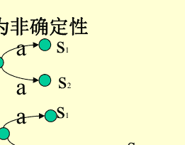

### 3.5.4 NFA 的确定化

正如我们所学到的，用计算机程序实现 DFA 是很容易的。但在不能正确猜测路径的情况下，NFA 的实现就有些困难了。

已证明：不确定的有穷自动机与确定的有穷自动机从功能上来说是等价的，也就是说能够从：

NFA M' 构造一个 → DFA M
使得 L(M)=L(M')

例：

如图所示的状态图：

令 I = {1}，求 ε-closure(I) = ?

根据定义：

ε-closure(I) = {1, 3}

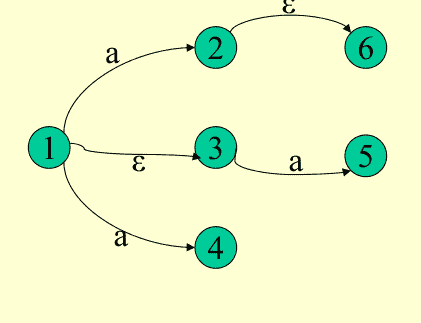


## 定义2: 令I是NFA M’的状态集的一个子集, a∈Σ

定义: Iₐ=ε-closure(J)
其中J = ∪ δ(s,a)
      s∈I

-- J是从状态子集I中的每个状态出发,经过标记为a的弧而达到的状态集合。

-- Iₐ是状态子集,其元素为J中的状态,加上从J中每一个状态出发通过 ε 弧到达的状态。

同样可以通过一例子来说明上述定义,仍采用前面给定的状态图为例

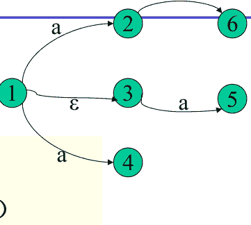

例：令 I={1}
Iₐ = ε -closure(J)
= ε -closure( δ (1, a) )
= ε -closure({2, 4})
={2, 4, 6}

根据定义1，2，可以将上述的M'确定化（即可构造出状态转换矩阵）

## 例：有NFA M’

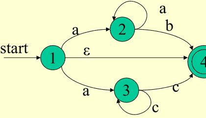

$I=\varepsilon\text{-closure}(\{1\})=\{1,4\}$

$I_a=\varepsilon\text{-closure}(\delta(1,a)\cup\delta(4,a))$

$\quad=\varepsilon\text{-closure}(\{2,3\}\cup\varnothing)$

$\quad=\varepsilon\text{-closure}(\{2,3\})$

$\quad=\{2,3\}$

$I_b=\varepsilon\text{-closure}(\delta(1,b)\cup\delta(4,b))$

$\quad=\varepsilon\text{-closure}(\varnothing)$

$\quad=\varnothing$

$I_c=\varepsilon\text{-closure}(\delta(1,c)\cup\delta(4,c))$

$\quad=\varnothing$

$I=\{2,3\},\ I_a=\{2\},\ I_b=\{4\},\ I_c=\{3,4\},\ldots$

将求得的状态转换矩阵重新编号

DFA M状态转换矩阵：

|  | I | Iₐ | Iᵦ | Iᶜ |
|---|---|---|---|---|
|  | {1,4} | {2,3} | φ | φ |
|  | {2,3} | {2} | {4} | {3,4} |
|  | {2} | {2} | {4} | φ |
|  | {4} | φ | φ | φ |
|  | {3,4} | φ | φ | {3,4} |

| 状态\符号 | a | b | c |
|---|---|---|---|
| 0 | 1 | — | — |
| 1 | 2 | 3 | 4 |
| 2 | 2 | 3 | — |
| 3 | — | — | — |
| 4 | — | — | 4 |

## DFA M的状态图：

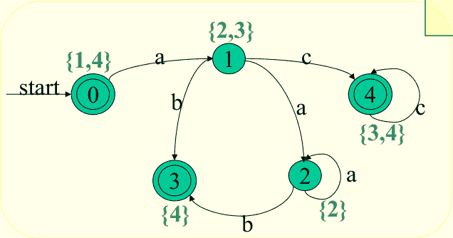

| 状态 | a | b | c |
|---|---|---|---|
| 0 | 1 | − | − |
| 1 | 2 | 3 | 4 |
| 2 | 2 | 3 | − |
| 3 | 4 | − | − |
| 4 | − | − | 4 |

**注意：** 原初始状态1的ε-closure子集为DFA M的初态，包含原终止状态4的状态子集为DFA M的终态。

## 3.5.5 正则表达式与DFA的等价性

定理：在Σ上的一个子集V（V⊆Σ*）是正则集合，当且仅当存在一个DFA M，使得V=L(M)

V是正则集合，
R是与其相对应的正规表达式    ⇔    DFA M
V=L(R)                         L(M)=L(R)

所以 正则表达式R ⇒ NFA M′ ⇒ DFA M
L(R) = L(M′) = L(M)

证明：根据定义。

## 复习

## 正则表达式和正则集合的递归定义

有字母表Σ，定义在Σ 上的正则表达式和正则集合递归定义如下：

- 1. ε和φ都是Σ 上的正则表达式，其正则集合分别为：{ε}和φ；
- 2. 任何a∈ Σ ，a是Σ 上的正则表达式,其正则集合为：{a}；
- 3. 假定U和V是 Σ 上的正则表达式，其正则集合分别记为L(U)和L(V)，那么U|V，U·V和U*也都是Σ 上的正则表达式，其正则集合分别为L(U) ∪L(V)、 L(U) • L(V)和L(U)*；
- 4. 任何Σ 上的正则表达式和正则集合均由1、2和3产生。

## Compiler

正则表达式  ε
正则集合  { ε }

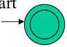

φ
φ


a
{a}

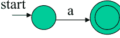

R=S | t  NFA(R)：

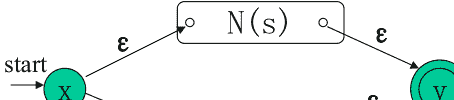

R=st  NFA(R)：


R=s*  NFA(R)：

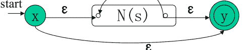

注：本证明过程也给出了将正则表达式转换为NFA的算法

## 复习：

- 1. 正则表达式与有穷自动机，给出了两者的定义。
- 用3型文法所定义的语言都可以用正则表达式描述，
- 用正则表达式描述单词是为了自动生成词法分析程序。
- 有一个正则表达式则对应一个正则集合。
- 2. NFA M’ 的定义、确定化 ➔ 对任何一个 NFA M’，都可以构造出一个 DFA M，使得 L(M) = L(M’)
- 3. 正则表达式与 DFA 的等价性
- 我们证明了对任何一个正则表达式，都可以构造出等价的 NFA.

## 3.6 词法分析程序的自动生成器——LEX（LEXICAL）

## LEX的原理：

## 正规表达式与DFA的等价性

根据给定的正则表达式自动生成相应的词法分析程序。

## LEX的功能：


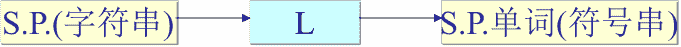

### 3.6.1　LEX源程序

一个LEX源程序主要由三个部分组成：

- 1. 辅助定义式
- 2. 识别规则
- 3. 用户子程序

各部分之间用%%隔开

## 辅助定义式是如下形式的LEX语句：

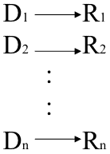

其中：

$R_1, R_2, \ldots, R_n$ 为正则表达式。

$D_1, D_2, \ldots, D_n$ 为正则表达式名字，称简称。

例： 标识符：
letter→A|B|···|Z
digit →0|1|···|9
iden → letter(letter|digit)*

带符号整数：
integer→digit (digit)*
sign → +| -|ε
sign_integer → sign  integer

## 识别规则：是一串如下形式的LEX语句：

P₁    {A₁}
P₂    {A₂}
:
:
Pₘ    {Aₘ}

Pᵢ：定义在Σ∪{D₁,D₂,``Dₙ}上的正则表达式，也称词形。

{Aᵢ}：Aᵢ为语句序列，它指出，在识别出词形为P的单词以后，词法分析器所应作的动作。

其基本动作是返回单词的类别编码和单词值。

## 下面是识别某语言单词符号的LEX源程序：

例：LEX 源程序

```
AUXILIARY    DEFINITIONS
    letter → A|B|⋯
    digit  → 0|1|⋯
%%
RECOGNITION RULES
    1.BEGIN                {RETURN(1,−)}
    2.END                  {RETURN(2,−)}
    3.FOR                  {RETURN(3,−)}
```

> RETURN是LEX过程，该过程将单词传给语法分析程序
> RETURN（C，LEXVAL）
> 其中C为单词类别编码
> LEXVAL：
> 　标识符：TOKEN（字符数组）
> 　整数常数：DTB（数值转换函数，将TOKEN中的数字串转换二进制值）
> 　其他单词：无定义


- 4. DO {RETURN(4,-)}
- 5. IF {RETURN(5,-)}
- 6. THEN {RETURN(6,-)}
- 7. ELSE {RETURN(7,-)}
- 8. `letter(letter|digit)*` {RETURN(8,TOKEN)}
- 9. `digit(digit)*` {RETURN(9,DIG)}
- 10. ":" {RETURN(10,-)}
- 11. "+" {RETURN(11,-)}
- 12. "*" {RETURN(12,-)}
- 13. "," {RETURN(13,-)}
- 14. "(" {RETURN(14,-)}
- 15. ")" {RETURN(15,-)}
- 16. ":=" {RETURN(16,-)}
- 17. "=" {RETURN(17,-)}

## LEX的工作过程：

- 扫描每条识别规则Pi，构造
- 将各条规则的有穷自动机
- 确定化
- NFA⇒DFA

生成该DFA的状态转换矩阵和控制执行程序

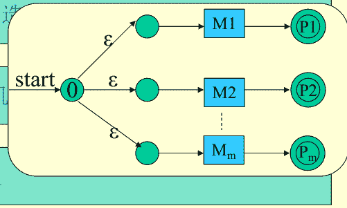

## LEX二义性问题的两条原则：

如：BEGIN, :=

- 1. 最长匹配原则：在识别单词过程中，有一字符串，根据最长匹配原则，应识别为这是一个符合Pₖ规则的单词，而不是Pj和Pi规则的单词。
- 2. 优先匹配原则：如有一字符串，有两条规则可以同时匹配时，那么用规则序列中位于前面的规则相匹配，所以排列在最前面的规则优先权最高。

例：字符串 `BEGIN`

P₁
P₈

根据原则，应该识别为关键字BEGIN，所以在写LEX源程序时应注意规则的排列顺序。另要注意的是，优先匹配原则是在符合最长匹配的前提下执行的。

可以通过一个例子来说明这些问题：

例： LEX源程序

    a    {  }
    abb  {  }
    a*bb* {  }

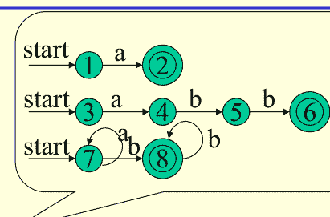

### 一.读LEX源程序，分别生成NFA，用状态图表示为：

### 二.合并成一个NFA：

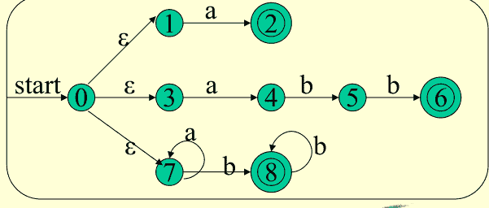

### 三、确定化    给出状态转换表

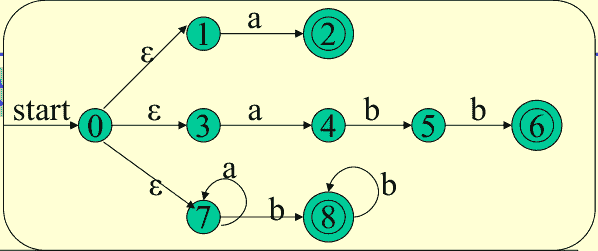

| 状态 | a | b | 到达终态所识别的单词 |
|---|---|---|---|
| 初态 {0,1,3,7} | {2,4,7} | {8} | |
| 终态 {2,4,7} | {7} | {5,8} | a |
| 终态 {8} | φ | {8} | `a*bb*` |
| {7} | {7} | {8} | |
| 终态 {5,8} | φ | {6,8} | `a*bb` |
| 终态 {6,8} | φ | {8} | abb |

在此DFA中 初态为{0,1,3,7}

终态为{2,4,7}，{8}，{5,8}，{6,8}

## 词法分析程序的分析过程

令输入字符串为aba...

- (1) 吃进字符ab
- (2) 按反序检查状态子集  
  检查前一次状态是否含有原NFA的终止状态

| 读入字符 | 进入状态 |
|---|---|
| 开始 | {0,1,3,7} |
| a | {2,4,7} |
| b | {5,8} |
| a | 无后继状态(退掉输入字符a) |

- 即检查{5,8},含有终态8，因此断定所识别的单词ab是属于`a*bb*`中的一个。
- 若在状态子集中无NFA的终态，则要从识别的单词再退掉一个字符(b)，然后再检查上一个状态子集。
- 若一旦吃进的字符都退完，则识别失败，调用出错程序，一般是跳过一个字符然后重新分析。（应打印出错信息）

## 三点说明：

- 1) 以上是LEX的构造原理，虽然是原理性的，但据此就不难将LEX构造出来。
- 2) 所构造出来的LEX是一个通用的工具，用它可以生成各种语言的词法分析程序，只需要根据不同的语言书写不同的LEX源文件就可以了。
- 3) LEX不但能自动生成词法分析器，而且也可以产生多种模式识别器及文本编辑程序等。

## 第三章作业：

P76-77： 1、 2、 4、 5

## 补充习题

- 1. 有正则表达式 `1(0|1)*101`, 构造DFA
- 2. 试将下列自动机确定化:

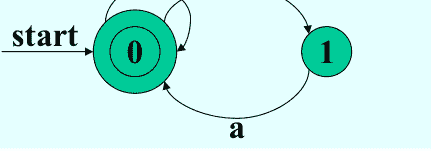

## DFA的最小化问题

## LEX的效率

## 判断题：

- 1. 对任意一个右线性文法G，都存在一个NFA M，满足L(G)=L(M) （）
- 2. 对任意一个右线性文法G，都存在一个DFA M，满足L(G)=L(M) （）
- 3. 对任何正则表达式e，都存在一个NFA M，满足L(M)=L(e) （）
- 4. 对任何正则表达式e，都存在一个DFA M，满足L(M)=L(e) （）

## 补充

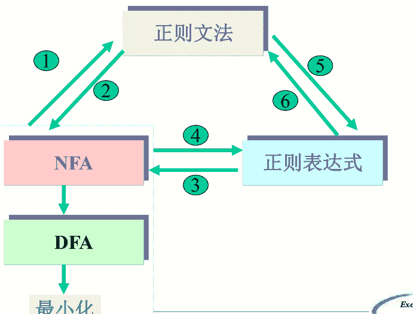

### （1）有穷自动机⇒正则文法

算法：

- 1. 对转换函数f(A, t)=B，可写成一个产生式: A→tB
- 2. 对可接受状态Z,增加一个产生式: Z→ε
- 3. 有穷自动机的初态对应于文法的开始符号(识别符号)，有穷自动机的字母表为文法的终结符号集。


### 例：给出如图NFA等价的正则文法G

G= ({A, B, C, D}, {a, b}, P, A)

其中P:

- A→aB
- A→bD
- B→bC
- C→aA
- C→bD
- C→ε
- D→aB
- D→bD
- D→ε


### 例：求与文法G[S]等价的NFA

    G[S]:
    S→aA|bB|ε
    A→aB|bA
    B→aS|bA|ε

求得：


## 左线性正则文法和右线性正则文法的等价

### 左线性正则文法例

    Z → U0 | V1
    U → Z1 | 1
    V → Z0 | 0

    L(G[Z]) = { Bⁿ | n>0 }
    其中 B= {01,10}


R = `(01|10)(01|10)*`

### 右线性正则文法例

    S → 0U | 1V
    U → 1S | 1
    V → 0S | 0

    L(G[S]) = { B^n | n>0 }
    其中 B = { 01, 10 }


R = `(01|10)(01|10)*`

### （3）正则式⇒有穷自动机

语法制导方法

- 1.(a) 对于正则式φ,所构造NFA:

    
- (b) 对于正则式ε,所构造NFA:

    
- (c) 对于正则式a,a∈Σ,则 NFA:

    

- 2. 若 s，t 为 Σ 上的正则式，相应的 NFA 分别为 N(s) 和 N(t)；
  - (a) 对于正则式 R=s|t，　　 NFA(R)

    
  - (b) 对正则式 R=st，　　 NFA(R)

    
  - 或：

    


(c) 对于正则式R=s*， NFA(R)


(d) 对R=(s)，与R=s的NFA一样。

例: 为R=(a|b)*abb构造NFA N, 使得L(N)=L(R)

从左到右分解R, 令r1=a, 第一个a, 则有 ⇒ 2 a 3


令r2=b, 则有 ⇒ 4 b 5


令r3= r1|r2, 则有


## R = (a | b)*abb

令 r4 = r3* 则有：


令 r5 = a,
令 r6 = b
令 r7 = b
令 r8 = r5 r6
令 r9 = r8 r7 则有


R=(a | b)*abb

令 r10= r4 r9 则最终得到NFA N:


分解R的方法有很多种，下面给出另一种分解方式和所构成的NFA

## R = (a | b)*abb


(a)


(b)


(c)


(d)

例：M：


解：(1) 加x, y


## （2）消除M中的所有结点


解：（1）加x, y


## （5）正则文法⇒正则式

利用以下转换规则，直至只剩下一个开始符号定义的产生式，并且产生式的右部不含非终结符。

| 规则 | 文法产生式 | 正则式 |
|---|---|---|
| 规则1 | A→xB, B→y | A=xy |
| 规则2 | A→xA \| y | A=x*y |
| 规则3 | A→x \| y | A=x \| y |

## 例:有文法G[s]

S→aA|a,

A→aA|dA|a|d

| 规则 | 文法产生式 | 正则式 |
|---|---|---|
| 规则1 | A→xB, B→y | A=xy |
| 规则2 | A→xA \| y | A=x*y |
| 规则3 | A→x \| y | A=x \| y |

于是： S=aA|a

A=(aA|dA)|(a|d)⇒A=(a|d)A|(a|d)

由规则二：A=(a|d)*(a|d)

代入:S=a(a|d)*(a|d)|a

于是:S=a((a|d)*(a|d)|ε)

## （6）正则式⇒正则文法

算法：

- 1) 对任何正则式r,选择一个非终结符S作为识别符号, 并产生产生式 S→r
- 2) 若x,y是正则式,对形为A→xy的产生式,重写为 A→xB, B→y,其中B为新的非终结符,B∈Vn
  同样：对于 A→x*y ⇒ A→xA, A→y
  A→x|y ⇒ A→x, A→y

例:将R=a(a|d)*转换成的相应的正则文法

解:
1) S→a(a|d)*

2) S→aA
A→(a|d)*

3) S→aA
A→(a|d)A
A→ε

4) S→aA
A→aA|dA
A→ε

## 补充: DFA的简化(最小化)

“对于任一个DFA，存在一个唯一的状态最少的等价的DFA”

一个有穷自动机是化简的 ⇔ 它没有多余状态并且它的状态中没有两个是互相等价的。

一个有穷自动机可以通过消除多余状态和合并等价状态而转换成一个最小的与之等价的有穷自动机

## 定义：

（1）有穷自动机的多余状态：从该自动机的开始状态出发，任何输入串也不能到达那个状态

例：

| 状态 | 0 | 1 |
|---|---|---|
| S₀ | S₁ | S₅ |
| S₁ | S₂ | S₇ |
| S₂ | S₂ | S₅ |
| S₃ | S₅ | S₇ |
| S₄ | S₅ | S₆ |
| S₅ | S₃ | S₁ |
| S₆ | S₈ | S₀ |
| S₇ | S₀ | S₁ |
| S₈ | S₃ | S₆ |

画状态图可以看出 S₄、S₆、S₈ 为不可达状态应该删除


| 状态 | 0 | 1 |
|---|---|---|
| S₀ | S₁ | S₅ |
| S₁ | S₂ | S₇ |
| S₂ | S₂ | S₅ |
| S₃ | S₅ | S₇ |
| S₅ | S₃ | S₁ |
| S₇ | S₀ | S₁ |

## (2)等价状态 ⇔ 状态s和t的等价条件是：

- 1) 一致性条件：状态s和t必须同时为可接受状态或不接受状态。
- 2) 蔓延性条件：对于所有输入符号,状态s和t必须转换到等价的状态里。

对于所有输入符号c， I_c(s)=I_c(t)， 即状态s、t对于c具有相同的后继，则称s，t是等价的。 （任何有后继的状态和任何无后继的状态一定不等价）

有穷自动机的状态s和t不等价,称这两个状态是可区别的。

## “分割法”：把一个DFA(不含多余状态)的状态分割成一些不相关的子集，使得任何不同的两个子集状态都是可区别的，而同一个子集中的任何状态都是等价的。

例：最小化


## Compiler


| 区号 | a | b |
|---:|---:|---:|
| 1 | 6 | 3 |
| 2 | 7 | 3 |
| 3 | 1 | 5 |
| 4 | 4 | 6 |
| 5 | 7 | 3 |
| 6 | 4 | 1 |
| 7 | 4 | 2 |


| 区号 | a | b |
|---:|---:|---:|
| 1 | 6 | 3 |
| 2 | 7 | 3 |
| 3 | 1 | 5 |
| 4 | 4 | 6 |
| 5 | 7 | 3 |
| 6 | 4 | 1 |
| 7 | 4 | 2 |


## 将区号代替状态号得：

|   | a | b |
|---|---|---|
| 1 | 5 | 2 |
| 2 | 1 | 4 |
| 3 | 3 | 5 |
| 4 | 5 | 2 |
| 5 | 3 | 1 |


# 第四章 语法分析

- 语法分析的功能、基本任务
- 自顶向下分析法
- 自底向上分析法

## 复习：第一章 概述

编译过程是指将高级语言程序翻译为等价的目标程序的过程。

习惯上是将编译过程划分为5个基本阶段：

- 词法分析
- 语法分析
- 语义分析、生成中间代码
- 代码优化
- 生成目标程序

## 4.1 语法分析概述

**功能：**根据文法规则，从源程序单词符号串中识别出语法成分，并进行语法检查。

**基本任务：**识别符号串S是否为某语法成分。

## 两大类分析方法：

- 1. 自顶向下分析
- 2. 自底向上分析


## 自顶向下分析算法的基本思想为：

若 Z ⇒⁺_{G[Z]} S 则 S ∈ L(G[Z]) 否则 S ∉ L(G[Z])

+   ? 主要问题：
+   > 左递归问题
+   > 回溯问题

+   主要方法：
+   - 递归子程序法
+   - LL分析法

## 自底向上分析算法的基本思想为：

若 Z ⇐⁺_{G[Z]} S 则 S ∈ L(G[Z]) 否则 S ∉ L(G[Z])

+   ? 主要问题:
+   > 句柄的识别问题

+   ■ 主要方法:
+   • 算符优先分析法
+   • LR分析法

## 4.2 自顶向下分析

### 4.2.1 自顶向下分析的一般过程

给定符号串S，若预测是某一语法成分，则可根据该语法成分的文法,设法为S构造一棵语法树，若成功,则S最终被识别为某一语法成分,即 S∈L(G[Z]), 其中G[Z]为某语法成分的文法 若不成功,则 S∉L(G[Z])

+   - 可以通过一例子来说明语法分析过程

## 例：

S = cad
G[Z]:
  Z:: =cAd
  A:: =ab|a
求解  S∈L(G[Z]) ?

分析过程是设法建立一棵语法树,使语法树的末端节点与给定符号串相匹配。

+   1. 开始:令Z为根结点

+   2. 用Z的右部符号串去匹配输入串

完成一步推导 Z⇒cAd
检查, c-c匹配
A是非终结符,将匹配任务交给A


## 自顶向下分析方法特点：

+   1. 分析过程是带预测的，对输入符号串要预测属于什么语法成分，然后根据该语法成分的文法建立语法树。
+   
+   2. 分析过程是一种试探过程，是尽一切办法(选用不同规则)来建立语法树的过程，由于是试探过程，难免有失败，所以分析过程需进行回溯，因此也称这种方法是带回溯的自顶向下分析方法。
+   
+   3. 最左推导可以编写程序来实现，但带回溯的自顶向下分析方法在实际上价值不大，效率低。

### 4.2.2 自顶向下分析存在的问题及解决方法

## 1、左递归文法：

有如下文法：
令U是文法的任一非终结符，文法中有规则
U:: =U '' '' 或者 U⇒ U '' ''

这个文法是左递归的。

自顶向下分析的基本缺点是：
不能处理具有左递归性的文法

为什么？

如果在匹配输入串的过程中，假定正好轮到要用非终结符U直接匹配输入串，即要用U的右部符号串U' '去匹配，为了用U' '去匹配，又得用U去匹配，这样无限的循环下去将无法终止。

如果文法具有间接左递归，则也将发生上述问题，只不过环的圈子兜得更大。

要实行自顶向下分析，必须要消除文法的左递归，下面将介绍直接左递归的消除方法，在此基础上再介绍一般左递归的消除方法。

## 消除直接左递归

### 方法一，使用扩充的BNF表示来改写文法

例：(1) E:: =E+T|T ⇒ E:: =T{+T}
(2) T:: =T*F|T/F|F ⇒ T:: =F{*F|/F}

+   a. 改写以后的文法消除了左递归。
+   b. 可以证明，改写前后的文法是等价的，表现在 L(G改前) = L(G改后)

如何改写文法能消除左递归，又前后等价，可以给出两条规则：

## 规则二

若有文法规则： U:: =x|y|......|z|Uv

其特点是：具有一个直接左递归的右部并位于最后，这表明该语法类U是由x或y......或z其后随有零个或多个v组成。

U⇒Uv ⇒ Uvv ⇒ Uvvv ⇒ ......
∴ 可以改写为U:: =(x|y|......|z){v}

通过以上两条规则，就能消除文法的直接左递归，并保持文法的等价性。

## 方法二，将左递归规则改为右递归规则

### 规则三

若： P:: = Pα | β
则可改写为： P:: = β P’
P’:: = αP’ | ε

## 规则一：（提取因子）

规则二： U:: =x|y|......|z|Uv, 则U:: =(x|y|......|z){v}

规则三：右递归P:: =Pα|β, 则P:: =β P’, P’:: =αP’| ε

## 例1  E:: =E+T|T

右部无公因子，所以不能用规则一。

为了使用规则二，
令E:: =T|E+T

∴由规则二可以得到
E:: =T{+T}

## 例2  T:: =T*F|T/F|F

T:: =T(*F|/F) | F 规则一

T:: =F|T(*F|/F)

T:: =F{(*F|/F)}  规则二

即T:: =F{*F|/F}

### 右递归：

T ::= FT’

T’ ::= *FT’ | /FT’ | ε

## 消除一般左递归

一般左递归也可以通过改写文法予以消除。

## 消除所有左递归的算法：

+   1. 把G的非终结符整理成某种顺序A₁， A₂， ......Aₙ，使得：
+   
+   A₁ ::= δ₁|δ₂|......δₖ
+   A₂ ::= A₁ r......
+   A₃ ::= A₂ u | A₁ v.....
+   ......

```
2. **For i:=1 to n do**
   **begin**
   &nbsp;&nbsp;&nbsp;&nbsp;**for j:=1 to i-1 do**
   &nbsp;&nbsp;&nbsp;&nbsp;把每个形如 Aᵢ::=Aᵢᵣ 的规则替换成
   &nbsp;&nbsp;&nbsp;&nbsp;Aᵢ::=(δ₁|δ₂|……|δₖ) r，
   &nbsp;&nbsp;&nbsp;&nbsp;其中 Aⱼ::=δ₁|δ₂|……|δₖ 是当前全部 Aⱼ 的规则；
   &nbsp;&nbsp;&nbsp;&nbsp;消除 Aᵢ 规则中的直接左递归
   **end**
```

3. 化简由2得到的文法即可。

例： 文法G[s]为
S ::= Qc|c
Q ::= Rb|b
R ::= Sa|a

该文法无直接左递归，但有间接左递归
S⇒Qc ⇒Rbc ⇒Sabc        ∴ S⁺⇒Sabc

## 非终结符顺序重新排列

R ::= Sa|a
Q ::= Rb|b
S ::= Qc|c

1. 检查规则 R 是否存在直接左递归　　R:: =Sa|a

2. 把 R 代入 Q 的有关选择，改写规则 Q　　Q:: =Sab|ab|b

3. 检查 Q 是否存在直接左递归

4. 把 Q 代入 S 的右部选择　　S:: =Sabc|abc|bc|c

5. 消除 S 的直接左递归　　S:: =(abc|bc|c){abc}

## 最后得到文法为：

S:: =(abc|bc|c){abc}
Q:: =Sab|ab|b
R:: =Sa|a

可以看出其中关于Q和R的规则是多余的规则
∴经过压缩后 S:: =(abc|bc|c){abc}
可以证明改写前后的文法是等价的

应该指出,由于对非终结符的排序不同,最后得到的文法在形式上可能是不一样的,但是不难证明它们的等价。

## 2、回溯问题

## 什么是回溯？

分析工作要部分地或全部地退回去

## 造成回溯的条件：

```
U ::= α₁ | α₂ | α₃
```

文法中，对于某个非终结符号的规则其右部有多个选择，并根据所面临的输入符号不能准确地确定所要的选择时，就可能出现回溯。

## 回溯带来的问题：

严重的低效率，只有在理论上的意义而无实际意义


## 效率低的原因

+   1）语法分析要重做
+   2）语义处理工作要推倒重来

设文法 G（不具有左递归性），U ∈ Vₙ
U ::= α₁ | α₂ | α₃

【定义】FIRST(αᵢ) = {a | αᵢ ⇒* a⋯, a ∈ Vₜ}


> 为避免回溯，对文法的要求是：
> 
> FIRST(αᵢ) ∩ FIRST(αⱼ) = ∅（i≠j）

## 消除回溯的途径：

### 1.改写文法

对具有多个右部的规则反复提取左因子

例1  U:: =xV|xW        U, V, W∈Vₙ,  x∈Vₜ⁺

改写为U:: =x(V|W)

更清楚地表示为：

```
U:: =xZ
Z:: =V|W
```

注意：问题到此并没有结束，还需要进一步检查V和W的首符号是否相交

若V:: =ab|cd    FIRST(V) = {a,c}
W:: =de|fg    FIRST(W) = {d,f}

只要不相交就可以根据输入符号确定目标，若相交，则要代入，并再次提取左因子。如：V::= ab  w::= ac 则：Z::= a (b|c)


## 例2：文法 G[<程序>]

```
<程序> ::= <分程序> | <复合语句>
<分程序> ::= begin <说明串>; <语句串> end
<复合语句> ::= begin <语句串> end
```

FIRST(<分程序>) = {begin}
FIRST(<复合语句>) = {begin}

改写文法：

```
<程序> ::= begin (<说明串>; <语句串> end | <语句串> end)
```

引入 <程序*>：

```
<程序> ::= begin <程序*>
<程序*> ::= <说明串>; <语句串> end | <语句串> end
```

对于 <程序*>：

```
FIRST(<说明串>; <语句串> end)
= {real, integer, boolean, array, function, procedure}

FIRST(<语句串> end)
= {标识符, goto, begin, if, for}
```

不相交。

## 2. 超前扫描

当文法不满足避免回溯的条件时，即各选择的首符号相交时，可以采用超前扫描的方法，即向前侦察各输入符号串的第二个、第三个符号来确定要选择的目标。

这种方法是通过向前多看几个符号来确定所选择的目标，从本质上来讲也有回溯的味道，因此比第一种方法费时，但是假读仅仅是向前侦察情况，不作任何语义处理工作。

## 例：

```
<程序> ::= <分程序> | <复合语句>
<分程序> ::= begin <说明串>; <语句串> end
<复合语句> ::= begin <语句串> end
```

这两个选择的首符号是相交的，故读到 begin 时并不能确定该用哪个选择，这时可采用向前假读进行侦察，此例题只需假读一次就可以确定目标。

因为 <说明串> 的首符集为 {real, integer, ......, procedure}，而 <语句串> 的首符集为 {标识符, if, for, ......, begin}。

∴ 只要超前假读得到的是“说明”的首符，便是第一个选择；若是“语句”的首符，就是第二个选择。

## 文法的两个条件

为了在不采取超前扫描的前提下实现不带回溯的自顶向下分析，文法需要满足两个条件：

- 1、文法是非左递归的；
- 2、对文法的任一非终结符，若其规则右部有多个选择时，各选择所推出的终结符号串的首符号集合要两两不相交。

[定义] 设文法 G（不具有左递归性），U∈Vₙ：

```
U ::= α₁ | α₂ | α₃
FIRST(αᵢ) = { a | αᵢ ⇒ a..., a ∈ Vₜ }
```

为避免回溯，对文法的要求是：

```
FIRST(αᵢ) ∩ FIRST(αⱼ)=φ (i≠j)
```

在上述条件下，就可以根据文法构造有效的、不带回溯的自顶向下分析器。

### 4.2.3 递归子程序法（递归下降分析法）

具体做法：对文法的每一个非终结符都编一个分析程序，当根据文法和当时的输入符号预测到要用某个非终结符去匹配输入串时，就调用该非终结符的分析程序。

下面通过举例说明如何根据文法构造该文法的语法分析程序。

如文法 G[Z]：

```
Z ::= UV
U ::= ....
V ::= ....
```

### Z 的分析程序


### U 的分析程序


### V 的分析程序


注：消除左递归后，可有其它递归：

```
U ::= ...U...
U ::= ...W...
W ::= ...U...
```

### 例：文法 G[Z]

```
Z ::= '(' U ')' | a U b
U ::= d Z | U d | e
```

### 1. 检查并改写文法

```
Z ::= '(' U ')' | a U b
U ::= (d Z | e) {d}
```

改写后无左递归且首符集不相交：

```
FIRST('(' U ')') ∩ FIRST(a U b) = φ
{d} ∩ {e} = φ
```

### 2. 检查文法的递归性

```
Z ⇒⁺ U ⇒⁺ Z
U ⇒⁺ Z ⇒⁺ U

Z ⇒⁺ Z
U ⇒⁺ U
```

因此，Z 和 U 的分析程序可编成递归子程序。

### 3. 算法框图

非终结符号的分析子程序的功能是：
用规则右部符号串去匹配输入串。

以下是以框图形式给出的两个子程序：

Compiler

```
Z ::= '(' U ')' | a U b
U ::= (d Z | e) {d}

入口

(sym)='('

读符号

U

(sym)=')'

error

读符号

出口

(sym)='a'

读符号

U

(sym)='b'

error
```

在进入某个非终结符的分析程序时，其所要分析的语法成分的第一个符号已读入 sym 中。在分析子程序的出口前，一定要读取下一个符号到 sym 中。

```
Z ::= '(' U ')' | a U b
U ::= (d Z | e) {d}

入口

(sym)='d'

F

(sym)='e'

F

error

读符号

读符号

Z

(sym)='d'

F

读符号

出口
```

### 4.2.4 用递归子程序法构造语法分析程序的例子

```
文法：
<语句> ::= <变量> := <表达式>
         | IF <表达式> THEN <语句>
         | IF <表达式> THEN <语句> ELSE <语句>
<变量> ::= i | i '[' <表达式> ']'
<表达式> ::= <项> | <表达式> + <项>
<项> ::= <因子> | <项> * <因子>
<因子> ::= <变量> | '(' <表达式> ')'
```

```
改写文法：
<语句> ::= <变量> := <表达式>
         | IF <表达式> THEN <语句> [ELSE <语句>]
<变量> ::= i ['[' <表达式> ']']
<表达式> ::= <项> {+ <项>}
<项> ::= <因子> {* <因子>}
<因子> ::= <变量> | '(' <表达式> ')'
```

语法分析程序所要调用的子程序：

- **nextsym**：词法分析程序，每调用一次读进一个单词，单词的类别码放在 sym 中。
- **error**：出错处理程序。

```
<语句> ::= <变量> := <表达式>
         | IF <表达式> THEN <语句> [ELSE <语句>]

PROCEDURE state;                 /*语句分析子程序*/
  IF sym = 'IF' THEN
    BEGIN  nextsym; expr;
      IF sym ≠ 'THEN' THEN error
      ELSE BEGIN nextsym; state;
        IF sym = 'ELSE'
          THEN BEGIN
            nextsym;
            state;
          END
      END
    END
  ELSE BEGIN  var;
    IF sym ≠ ':='
      THEN error
      ELSE BEGIN
        nextsym;
        expr;
      END
  END
```

### <变量> ::= i ['[' <表达式> ']']

```
PROCEDURE var;                 /*变量*/
    IF sym ≠ 'i' THEN error
    ELSE BEGIN nextsym;
        IF sym = '[' THEN
            BEGIN  nextsym;
                expr;
                IF sym ≠ ']'
                THEN  error
                ELSE  nextsym;
            END
    END
```

```
<语句> ::= <变量> := <表达式>
         | IF <表达式> THEN <语句> [ELSE <语句>]
<变量> ::= i ['[' <表达式> ']']
<表达式> ::= <项> {+ <项>}
<项> ::= <因子> {* <因子>}
<因子> ::= <变量> | '(' <表达式> ')'

PROCEDURE expr;                 /*表达式*/
    BEGIN  term;
        WHILE sym = '+' DO
            BEGIN  nextsym;
                term;
            END
    END;
```


## 编译器

```text
<语句>::= <变量> := <表达式>
         | IF <表达式> THEN <语句> [ELSE <语句>]

<变量>::= i['<表达式>']

<表达式>::= <项>{+<项>}

<项>::= <因子>{*<因子>}

<因子>::= <变量> | '(' <表达式> ')'
```

```pascal
PROCEDURE term;                    /*项*/
BEGIN
    factor;
    WHILE sym='*' DO
        BEGIN nextsym; factor END
END;
```

```pascal
PROCEDURE factor;                  /*因子*/
BEGIN
    IF sym='(' THEN
        BEGIN nextsym; expr;
            IF sym <> ')' THEN error
            ELSE nextsym
        END
    ELSE var;
END
```

```c
void statement()
{
    if (sym == "if") {
        getsym();
        expr();
        if (sym != "then")
            error();
        else {
            getsym();
            statement();
            if (sym == "else") {
                getsym();
                statement();
            }
        }
    }
    else {
        var();
        if (sym != ":=")
            error();
        else {
            getsym();
            expr();
        }
    }
}
```

```c
void var()
{
    if (sym != "i") error();
    else {
        getsym();
        if (sym == "[") {
            getsym();
            expr();
            if (sym != "]")
                error();
            else getsym();
        }
    }
}
```

```c
void expr()
{
    term();
    while (sym == "+") {
        getsym();
        term();
    }
}
```

```c
void term()
{
    factor();
    while (sym == "*") {
        getsym();
        factor();
    }
}
```

```c
void main()
{
    getsym();
    statement();
}
```

```c
void factor()
{
    if (sym == "(") {
        getsym();
        expr();
        if (sym != ")") error();
        else getsym();
    }
    else var();
}
```

```c
void error()
{
    printf("syntax error !\n");
}
```

## 举例分析

```text
if (i+i) then i:=i*i+i else
  i[i] := i+i[i*i]*(i+i)
```

作业：

p90: 1-3

## 编译器

```text
<语句>::= <变量> := <表达式>
         | IF <表达式> THEN <语句> [ELSE <语句>]

<变量>::= i['<表达式>']

<表达式>::= <项>{+<项>}

<项>::= <因子>{*<因子>}

<因子>::= <变量> | '(' <表达式> ')'
```

```c
void statement()
{
    if (sym == "if") {
        getsym();
        expr();
        if (sym != "then")
            error();
        else {
            getsym();
            statement();
            if (sym == "else") {
                getsym();
                statement();
            }
        }
    }
    printf(" it is a statement \n");
    ...
}
```

```c
void var()
{
    if (sym != "i") error();
    else {
        getsym();
        if (sym == "[") {
            getsym();
            expr();
            if (sym != "]")
                error();
            else getsym();
        }
    }
}
```

```c
void expr()
{
    term();
    while (sym == "+") {
        getsym();
        term();
    }
}
```

```c
printf(" it is a statement \n");
printf(" it is a variable \n");
printf(" it is a expression \n");
```

```c
void term()
{
    factor();
    while (sym == "*") {
        getsym();
        factor();
    }
}
```

```c
void main()
{
    getsym();
    statement();
}
```

```c
void factor()
{
    if (sym == "(") {
        getsym();
        expr();
        if (sym != ")") error();
        else getsym();
    }
    else var();
}
```

```c
void error()
{
    printf("syntax error !\n");
}
```

```c
printf(" it is a term \n");
printf(" it is a factor \n");
```

### 4.2.5 LL分析法

LL—自左向右扫描、自左向右地分析和匹配输入串。
∴ 分析过程表现为最左推导的性质。

### 1、LL分析程序构造及分析过程

由三部分组成：

- 分析表
- 执行程序（总控程序）
- 符号栈（分析栈）


在实际语言中，每一种语法成分都有确定的左右界符，为了研究问题方便，统一以‘#’表示。


### （1）分析表：二维矩阵 M

M[A,a] = { A::=αi 或 出错 }   αi ∈ V*   A ∈ Vn   a ∈ Vt 或 #

M[A,a] = A::=αi

表示当要用A去匹配输入串时，且当前输入符号为a时，可用A的第i个选择去匹配。
即 当αi≠ε时，有αi⇒a...；
当αi=ε时，则a为A的后继符号。

M[A,a] = 出错

表示当用A去匹配输入串时，若当前输入符号为a，则不能匹配，表示无A⇒a...，或a不是A的后继符号。

### （2）符号栈：有四种情况

- 开始状态

符号栈

```text
#E

E#
xxxxxx#
```

- 工作状态

符号栈

```text
#....X
a.....#

X....#
```

查分析表得：

X ∈ Vₙ, M[X,a] = X::=αᵢ
X ⇒ a...

X ∈ Vₜ, X = a

|   | a |
|---|---|
| X | X::=αᵢ |


出错状态

符号栈

查分析表得：

- X ∈ Vₙ，M[X,a] = error
- 无 X ⇒ a...
- X ∈ Vₜ，X ≠ a

结束状态

符号栈

## （3）执行程序

执行程序主要实现如下操作：

- 1. 把 # 和文法识别符号 E 推进栈，读入下一个符号，重复下述过程直到正常结束或出错。
- 2. 测定栈顶符号 X 和当前输入符号 a，执行如下操作：
  - (1) 若 X=a=#，分析成功，停止。E 匹配输入串成功。
  - (2) 若 X=a≠#，把 X 推出栈，再读入下一个符号。
  - (3) 若 X∈Vₙ，查分析表 M。


- (3) 若 X∈Vₙ，查分析表 M。
  - a) M[X,a] = X::=UVW，则将 X 弹出栈，将 UVW 压入。注：U 在栈顶（最左推导）。
  - b) M[X,a] = error，转出错处理。
  - c) M[X,a] = X::=ε（a 为 X 的后继符号），则将 X 弹出栈（不读下一符号），继续分析。


|   | a |   |
|---|---|---|
| X | X::=UVW |   |
|   |   |   |

### 例：文法 G[E]

```
E ::= E + T | T
T ::= T * F | F
F ::= (E) | i
```


```
E ::= T E′
E′ ::= + T E′ | ε
T ::= F T′
T′ ::= * F T′ | ε
F ::= (E) | i
```

### 分析表

|   | i | + | * | ( | ) | # |
|---|---|---|---|---|---|---|
| E | E::=TE′ |   |   | E::=TE′ |   |   |
| E′ |   | E′::=+TE′ |   |   | E′::= ε | E′::= ε |
| T | T::=FT′ |   |   | T::=FT′ |   |   |
| T′ |   | T′::= ε | T′::=*FT′ |   | T′::= ε | T′::= ε |
| F | F::= i |   |   | F::=(E) |   |   |

注：矩阵元素空白表示 Error。

|   | i | + | * | ( | ) | # |
|---|---|---|---|---|---|---|
| E | E ::= T E′ |   |   | E ::= T E′ |   |   |
| E′ |   | E′ ::= + T E′ |   |   | E′ ::= ε | E′ ::= ε |
| T | T ::= F T′ |   |   | T ::= F T′ |   |   |
| T′ |   | T′ ::= ε | T′ ::= * F T′ |   | T′ ::= ε | T′ ::= ε |
| F | F ::= i |   |   | F ::= ( E ) |   |   |

输入串为：i+i*i#

### 步骤

| 步骤 | 符号栈 | 读入符号 | 剩余符号串 | 使用规则 |
|---|---|---|---|---|
| 1 | #E | i | +i*i# |   |
| 2 | #E′T | i | +i*i# | E::=TE′ |
| 3 | #E′T′F | i | +i*i# | T::=FT′ |
| 4 | #E′T′i | i | +i*i# | F::=i |
| 5 | #E′T′ | + | i*i# | （出栈，读下一个符号） |
| 6 | #E′ | + | i*i# | T′::= ε |
| 7 | #E′T+ | + | i*i# | E′::=+TE′ |
| 8 | #E′T | i | *i# |   |
| 9 | #E′T′F | i | *i# | T::=FT′ |
| 10 | #E′T′i | i | *i# | F::=i |
| 11 | #E′T′ | * | i# |   |
| 12 | #E′T′F* | * | i# | T′::=*FT′ |
| 13 | #E′T′F | i | # |   |
| 14 | #E′T′i | i | # | F::=i |
| 15 | #E′T′ | # |   |   |
| 16 | #E′ | # |   | T′::= ε |
| 17 | # | # |   | E′::= ε |

### 推导过程

```
E ⇒ TE′ ⇒ FT′E′ ⇒ iT′E′ ⇒ iE′
  ⇒ i+TE′ ⇒ i+FT′E′ ⇒ i+iT′E′
  ⇒ i+i*FT′E′ ⇒ i+i*iT′E′
  ⇒ i+i*iE′ ⇒ i+i*i
```

最左推导。

## 复习执行程序

执行程序主要实现如下操作：

- 1. 把 # 和文法识别符号 E 推进栈，读入下一个符号，重复下述过程直到正常结束或出错。
- 2. 测定栈顶符号 X 和当前输入符号 a，执行如下操作：
  - (1) 若 X=a=#，分析成功，停止。E 匹配输入串成功。
  - (2) 若 X=a≠#，把 X 推出栈，再读入下一个符号。
  - (3) 若 X∈Vₙ，查分析表 M。


- (3) 若 X∈Vₙ，查分析表 M。
  - a) M[X,a] = X::=UVW，则将 X 弹出栈，将 UVW 压入。注：U 在栈顶（最左推导）。
  - b) M[X,a] = error，转出错处理。
  - c) M[X,a] = X::=ε（a 为 X 的后继符号），则将 X 弹出栈（不读下一符号），继续分析。


会编写算法。

## 2、分析表的构造

设有文法 G[Z]：

定义：`FIRST(α) = { a | α⇒*a…，a∈Vₜ }`

`α∈V*`，若 `α⇒*ε`，则 `ε∈FIRST(α)`。

该集合称为 α 的头符号集合。

定义：`FOLLOW(A) = { a | Z⇒*…Aa…，a∈Vₜ }`

`A∈Vₙ`，Z 为识别符号。

该集合称为 A 的后继符号集合。

特殊地：若 `Z⇒*…A`，则 `#∈FOLLOW(A)`。

### 构造集合 FIRST 的算法

设 `α = X₁X₂...Xₙ`，`Xᵢ∈Vₙ∪Vₜ`（即 `Xᵢ∈V`），求 `FIRST(α) = ?`

首先求出组成 α 的每一个符号 Xᵢ 的 FIRST 集合。

- (1) 若 `Xᵢ∈Vₜ`，则 `FIRST(Xᵢ) = {Xᵢ}`
- (2) 若 `Xᵢ∈Vₙ` 且 `Xᵢ::= a.....|ε`，`a∈Vₜ`，则 `FIRST(Xᵢ) = {a, ε}`
- (3) 若 `Xᵢ∈Vₙ` 且 `Xᵢ::= y₁ y₂ ... yₖ`，则按如下顺序计算 `FIRST(Xᵢ)`：

  `FIRST(Xᵢ) ← FIRST(y₁) - {ε}`；
  若 `ε∈FIRST(y₁)`，则将 `FIRST(y₂) - {ε}` 加入 `FIRST(Xᵢ)`；
  若 `ε∈FIRST(y₁)` 且 `ε∈FIRST(y₂)`，则将 `FIRST(y₃) - {ε}` 加入 `FIRST(Xᵢ)`；
  ......
  若 `ε∈FIRST(yₖ₋₁)`，则将 `FIRST(yₖ) - {ε}` 加入 `FIRST(Xᵢ)`；
  若 `ε∈FIRST(y₁) ~ FIRST(yₖ)`，则将 ε 加入 `FIRST(Xᵢ)`。

★ 注意：要顺序往下做，一旦不满足条件，过程就要中断进行。
★ 得到 `FIRST(Xᵢ)`，即可求出 `FIRST(α)`。

### 构造集合 FOLLOW 的算法

设 `S, A, B∈Vₙ`。

算法：连续使用以下规则，直至 FOLLOW 集合不再扩大：

- (1) 若 S 为识别符号，则把 “#” 加入 `FOLLOW(S)` 中。
- (2) 若 `A::=αBβ`（`β≠ε`），则把 `FIRST(β)-{ε}` 加入 `FOLLOW(B)` 中。
- (3) 若 `A::=αB` 或 `A::=αBβ`，且 `β⇒*ε`，则把 `FOLLOW(A)` 加入 `FOLLOW(B)` 中。

注：FOLLOW 集合中不能有 ε。


## 2、构造分析表

基本思想是：
当文法中某一非终结符
呈现在栈顶时,根据当前
的输入符号,分析表应指
示要用该非终结符的哪
一条规则去匹配输入串
(即进行一步最左推导)

根据这个思想,不难把构造分析表算法构造出来!


### 算法:

设 A：：−αᵢ 为文法中的任意一条规则，a 为任一终结符或#。

+   1、若 a ∈ FIRST（αᵢ），则 A：：= αᵢ ==> M[A,a]
      表示：A 在栈顶，输入符号是 a，应选择 αᵢ 去匹配

+   2、若 αᵢ=ε 或 αᵢ ⇒* ε，而且 a ∈ FOLLOW（A），则 A：：= αᵢ ==> M[A,a]，表示 A 已经匹配输入串成功，其后继符号终结符 a 由 A 后面的语法成分去匹配。

+   3、把所有无定义的 M[A,a] 都标上 error

|  |  |  |  |
|---|---|---|---|
|  |  |  |  |
|  |  |  |  |
|  |  |  |  |
|  |  |  |  |
|  |  |  |  |
|  |  |  |  |

非终结符

终结符号


## 求FIRST：

FIRST(F)={(,i}

FIRST(T')={*,ε}

FIRST(T)=FIRST(F)-{ε}={(,i}

FIRST(E')={+,ε}

FIRST(E)=FIRST(T)-{ε}={(,i}

∴ FIRST(TE')=FIRST(T)-{ε}={(,i}
FIRST(+TE')={+}	FIRST(ε)={ε}
FIRST(FT')=FIRST(F)-{ε}={(,i}
FIRST(*FT')={*}	FIRST(ε)={ε}
FIRST((E))={(}	FIRST(i)={i}

例：G[E]分析表的构造
E:: =TE'
E':: =+TE'|ε
T:: =FT'
T':: =*FT'|ε
F:: =(E)|i

## 求 FOLLOW

```
E  ::= −TE′
E′ ::= +TE′ | ε
T  ::= FT′
T′ ::= *FT′ | ε
F  ::= (E) | i
```

```
FIRST(F) = {(, i}
FIRST(T′) = {*, ε}
FIRST(T) = {(, i}
FIRST(E′) = {+, ε}
FIRST(E) = {(, i}
```

```
FOLLOW(E) = {#, )}  ∵ 因为E是识别符号 ∴ # ∈ FOLLOW(E)
                     又 F ::= (E) ∴ ) ∈ FOLLOW(E)

FOLLOW(E′) = {#, )}  ∵ E ::= TE′ ∴ FOLLOW(E) 加入 FOLLOW(E′)

FOLLOW(T) = {+, ), #}  ∵ E′ ::= +TE′，∴ FIRST(E′) − {ε} 加入 FOLLOW(T)
                     又 E′ ⇒ ε，∴ FOLLOW(E′) 加入 FOLLOW(T)

FOLLOW(T′) = FOLLOW(T) = {+, ), #}
                     ∵ T ::= FT′ ∴ FOLLOW(T) 加入 FOLLOW(T′)

FOLLOW(F) = {*, +, ), #}  ∵ T ::= FT′ ∴ FOLLOW(F) = FIRST(T′) − {ε}
                     又 T′ ⇒ ε，∴ FOLLOW(T) 加入 FOLLOW(F)
```

## 构造分析表

FIRST(TE')={i} FIRST(+TE')={+} FIRST(FT')={i} FIRST(*FT')={*} FIRST( ( E ) )={( 
FOLLOW(E)={#,)} FOLLOW(E')={#,)}
FOLLOW(T)={+,),#} FOLLOW(T')={+,),#}
FOLLOW(F)={*,+ ,),#}

|  | i | + | * | ( | ) | # |
|---|---|---|---|---|---|---|
| E | E::=TE' |  |  | E::=TE' |  |  |
| E' |  | E':: =+TE' |  |  | E':: =ε | E':: =ε |
| T | T::=FT' |  |  | T::=FT' |  |  |
| T' |  | T':: =ε | T':: =*FT' |  | T':: =ε | T':: =ε |
| F | F:: =i |  |  | F:: =(E) |  |  |

注意:用上述算法可以构造出任意给定文法的分析表,但不是所有文法都能构造出上述那种形状的分析表即 “M[A,a]＝一条规则或Error”。对于能用上述算法构造分析表的文法称为LL(1)文法

## 3、LL(1)文法

定义：一个文法G，其分析表M不含多重定义入口(即分析表中无二条以上规则)，则称它是一个LL(1)文法。

定理：文法G是LL(1)文法的充分必要条件是：对于G的每一个非终结符A的任意两条规则 A::=α|β，下列条件成立：

+   1、FIRST(α) ∩ FIRST(β) = Φ

+   2、若 β ⇒* ε，则 FIRST(α) ∩ FOLLOW(A) = Φ

用此构造分析表的算法,可以构造任何文法的分析表,但对于某些文法,有些M[A,a]中可能有若干条规则,这称为分析表的多重定义或者多重入口。

可以证明: 如果G是左递归的,或者是二义性的文法,则至少有一个多重入口。

## 左递归:

U:: =U...| a ...
则有： FIRST(U...)∩FIRST(a...)≠φ
∴M[U,a]={U:: =U..., U:: =a...}

## 二义文法:

对文法所定义的某些句子存在着两个最左推导,即在推导的某些步上存在多重定义,有两条规则可用,所以分析表是多重定义的。

- 有些文法可以从非LL(1)文法改写为LL(1)文法
  - 自学 ----要求

作业：p97~98: 1, 2, 6，补充题

补充题：有文法 G[S]

```
S ::= iCtSS’ | a
S’ ::= eS | ε
C ::= b
```

+   (1) 证明该文法是二义性文法
+   (2) 求FIRST和FOLLOW
+   (3) 构造LL分析表，证明该文法是非LL(1)文法

## 4、LL分析的错误恢复----补充（不要求）

当符号栈顶的终结符和下一个输入符号不匹配,或栈顶是非终结符A，输入符号a,而M[A,a]为空(即error)时，分析发现错误。

错误恢复的基本思想是: 跳过一些输入符号,直到期望的同步符号之一出现为止。

同步符号(可重新开始继续分析的输入符号)集合通常可按以下方法确定:

+   1) 把FOLLOW(A)的所有符号加入A的同步符号集合，跳过输入符号直到出现FOLLOW(A)的元素，便把A从栈中弹出，继续往下分析。
+   2) 为了避免仅按1)来确定同步符号集合会使跳读过多(如输入串中缺少语句结束符号“;”)，可将程序高层语法结构(成分)的开始符号(通常是关键词)加入到低层语法结构的同步集合中。
+   3) 把FOLLOW(A)的符号加入A的同步集合中。
+   4) 如果栈顶的非终结符号A可以产生空串,可以将A从栈中弹出。
+   5) 如果终结符在栈顶而不能匹配,则可弹出该终结符,继续分析,这好比把所有其他符号均作为该符号的同步集合元素。

## 4.3 自底向上分析

## 基本算法思想：

若采用自左向右的描述和分析输入串,那么自底向上的基本算法是：
从输入符号串开始，通过重复查找当前句型的句柄(最左简单短语)，并利用有关规则进行归约，若能归约为文法的识别符号，则表示分析成功，输入符号串是文法的合法句子，否则有语法错误。

## 分析过程是重复以下步骤：

+   1、找出当前句型的句柄 x（或句柄的变形）

+   2、找出以 x 为右部的规则 X ::= x

+   3、把 x 归约为 X，产生语法树的一枝

关键：找出当前句型的句柄 x (或其变形)，这不是很容易。

## 主要内容：

- 自底向上分析的一般过程（移进-归约分析）
- 算符优先分析法
- LR分析法

### 4.3.1 移进—归约分析（Shift-reduce parsing）

**要点：** 建立符号栈，用来记录分析的历史和现状，并根据所面临的状态，确定下一步动作是移进还是归约。


分析过程：把输入符号串按扫描顺序一一地移进符号栈（一次移一个），检查栈中符号，当在栈顶的若干符号形成当前句型的句柄时，就根据规则进行归约，将句柄从符号栈中弹出，并将相应的非终结符号压入栈内（即规则的左部符号），然后再检查栈内符号串是否形成新的句柄，若有就再进行归约，否则移进符号。分析一直进行到读到输入串的右界符为止。最后，若栈中仅含有左界符号和识别符号，则表示分析成功，否则失败。


例： G[S]:
S ::= aAcBe
A ::= b
A ::= Ab
B ::= d

输入串为:
abbcde

输入串为abbcde，检查是否是该文法的合法句子：

若采用自底向上分析，即能否一步步归约当前句型的句柄，最终归约到识别符号S。先设立一个符号栈，将符号“#”作为待分析的符号串的左右分界符。

作为初始状态，先将符号串的左分界符推进符号栈，作为栈底符号。

分析过程如下表：


例：G[S]:    S:: =aAcBe    A:: =b
                         A:: =Ab       B:: =d

| 步骤 | 符号栈 | 输入符号串 | 动作 |
|---|---|---|---|
| 1 | # | `abbcde#` | 准备,初始化 |

这一方法简单明了,不断地进行移进归约,关键是确定当前句型的句柄。

说明: 1) 例子的分析过程是一步步地归约当前句型的句柄

该句子的唯一语法树为:


## 注意两点：

- （1）栈内符号串 + 未处理输入符号串 = 当前句型
- （2）句柄都在栈顶

实际上，以上分析过程并未真正解决句柄的识别问题

## 2) 未真正解决句柄的识别。

上述分析过程是怎样识别句柄的，主要看栈顶符号串是否形成规则的右部。
这种做法形式上是正确的，但在实际上不一定正确。
举例的分析过程可以说是一种巧合。
因为不能认为： 对句型 xUy 而言
若有 U:: = u，即 U ⇒ u 就断定 u 是简单短语，u 就是句柄，而是要同时满足 Z ⇒* xUy

## 步骤  符号栈  输入符号串  当前句型

5  #aAb  cde#  aAbcde

A:: = b  ∴ A => b

A:: = Ab  ∴ A => Ab

若用A:: = b 归约，得 aAAcde

若用A:: = Ab归约，得 aAcde


S::= abABC  句子：ababab

A::= a | d  先归约a ?

B::= b | e  先归约b?

C::= ab | f  先归约ab?


## 3) 算符优先分析的特点：

仿效四则运算过程，预先规定相邻终结符之间的优先关系，然后利用这种优先关系来确定句型的“句柄”，并进行归约。

## 4) 分析器结构：


例： G[E]
E:: =E+E | E*E | (E) | i
V_T={+, *, (, ), i}
这是一个二义文法，要用算符优先法分析由该文法所确定的语言句子，如： i+i*i

### (1) 先确定终结符之间的优先关系

优先关系的定义：

设 a, b 为可能相邻的终结符

- 定义: a = b        a的优先级等于b
- a < b        a的优先级小于b
- a > b        a的优先级大于b

### 2) 矩阵元素空白处表示这两个终结符不能相邻,故没有优先关系

(2) 分析过程      i+i*i

算法：
当栈顶(或次栈顶项)终结符的优先级大于栈外的终结符的优先级，则进行归约，否则移进。

E::=E+E | E*E | (E) | i

| a \ b | + | * | i | ( | ) | # |
|---|---|---|---|---|---|---|
| + | > | < | < | < | > | > |
| * | > | > | < | < | > | > |
| i | .> | .> |  |  | .> | > |
| ( | .< | .< | < | <. | .≡ |  |
| ) | > | > | . | . | > | > |
| # | < | < | < | < |  |  |

| 步骤 | 符号栈 | 输入串 | 优先关系 | 动作 |
|---|---|---|---|---|
| 1 | # | i+i*i# | #<i | 移进 |
| 2 | #i | +i*i# | i>+ | 归约 |
| 3 | #E | +i*i# | #<+ | 移进 |
| 4 | #E+ | i*i# | +<i | 移进 |
| 5 | #E+i | *i# | i>* | 归约 |
| 6 | #E+E | *i# | +<* | 移进 |
| 7 | #E+E* | i# | *<i | 移进 |
| 8 | #E+E*i | # | i># | 归约 |
| 9 | #E+E*E | # | *># | 归约 |
| 10 | #E+E | # | +># | 归约 |
| 11 | #E | # |  | 接受 |

分析过程是从符号串开始,根据相邻终结符之间的优先关系确定句型的“句柄”,并进行归约,直到识别符号E,最后分析成功： i+i*i∈L(G[E])

出错情况：

- 1. 相邻终结符之间无优先关系
- 2. 对双目运行符进行归约时,符号栈中无足够项
- 3. 非正常结束状态

## 算符优先函数值的确定方法

- 1. 对每个终结符a（包括#），令f(a)=g(a)=1（或其它整数）
- 2. 如果a>b，而f(a)≤g(b)则令f(a)=g(b)+1
- 3. 如果a<b，而f(a)≥g(b)则令g(b)=f(a)+1
- 4. 如果a=b，而f(a)≠f(b)则令min{f(a),g(b)}=max{f(a),g(b)}
- 5. 重复1～4直到过程收敛。如果重复过程中有一个值大于2*终结符数量，则表明该算符优先文法不存在算符优先函数。

| a \ b | + | * | i | ( | ) | # |
|---|---|---|---|---|---|---|
| + | > | < | < | < | > | > |
| * | > | > | < | < | > | > |
| i | > | > |  |  | > | > |
| ( | < | < | < | < | = |  |
| ) | > | > |  |  | > | > |
| # | < | < | < | < |  |  |

|  | + | * | ( | ) | i | # |
|---|---|---|---|---|---|---|
| f(栈内) | 2 | 4 | 0 | 5 | 5 | 0 |
| g(栈外) | 1 | 3 | 6 | 0 | 6 | 0 |

f(+) > g(+)      左结合
f(+) < g(*)      先乘后加
f(+) < g( )      先括号内后括号外
:
:

## 特点：

- (1) 优先函数值不唯一
- (2) 优点：
  - 节省内存空间
    若文法有n个终结符，则关系矩阵为n²
    而优先函数为2n
  - 易于比较：算法上容易实现,数与数比,不必查矩阵。
- (3) 缺点：可能掩盖错误
  原来不存在优先级对应关系的终结符之间
  也被强制赋予了优先关系

## 三、可以设立两个栈来代替一个栈

运算对象栈(OPND)      运算符栈(OPTR)

优点：便于比较,只需将输入符号与运算符栈的栈顶符号相比较

## 四、使用算符优先分析方法可以分析二义性文法所产生的语言

二义性文法按规范分析，其句柄不唯一

```
例： G[E]
E:: =E+E|E*E|(E)|i
Vₜ={+, *, (, ), i}
```

这是一个二义性文法，
i+i*i有两棵语法树

按规范归约,句柄不唯一,E+E*i 所以整个归约过程就不唯一,编译所得的结果也将不唯一。

### 4.3.3 算符优先分析法的进一步讨论

三个问题：

- (1) 算符优先文法(OPG)
- (2) 构造优先关系矩阵
- (3) 算符优先分析算法的设计

## （1）算符优先文法（OPG－Operator Precedence Grammar）

## 算符文法（OG）的定义

若文法中无形如：`···VW···`的规则，这里 `V,W∈Vₙ`，则称 G 为 OG 文法，也就是算符文法。

## 优先关系的定义

若 G 是一 OＧ文法，`a,b∈Vₜ`，`U,V,W∈Vₙ`，分别有以下三种情况：


- 1) a=b  iff 文法中有形如 U::=...ab... 或 U::=...aVb... 的规则。
- 2) a<b  iff 文法中有形如 U::=...aW... 的规则，其中 W⇒⁺b... 或 W⇒⁺Vb...。
- 3) a>b  iff 文法中有形如 U::=...Wb... 的规则，其中 W⇒⁺...a 或 W⇒⁺...aV。

例：文法G[E]
E ::= E + T | T
T ::= T * F | F
F ::= ( E ) | i

1) a=b iff 文法中有形如 U::=...ab... 或 U::=...aVb... 的规则。
2) a<b iff 文法中有形如 U::=...aW... 的规则，其中 W⇒⁺b... 或 W⇒⁺Vb...
3) a>b iff 文法中有形如 U::=...Wb... 的规则，其中 W⇒⁺...a... 或 W⇒⁺...aV。

E ::= E + T

E => E + T
T => T * F
T => F => ( E )
T => F => i

∴ + > +
∴ + < *
∴ + < (
∴ + < i

F ::= ( E )

E => E + T

∴ + > )
∴ ( = )
∴ ( < +

## 算符优先文法（OPG）的定义

设有一OG文法，如果在任意两个终结符之间，至多只有上述关系中的一种，则称该文法为算符优先文法(OPG)

## 对于OG文法的几点说明：

- 1. 运算是以中缀形式出现的
- 2. 若文法为OG文法，则不会出现两个非终结符相邻的句型。
- 3. 算法语言中的表达式以及大部分语言成分的文法均是OG文法

## （2）构造优先关系矩阵

- 求 “=” 检查每一条规则，若有 U::=...ab... 或 U::=...aVb..., 则 a=b

- 求 “<”、“>”，需定义两个集合

FIRSTVT(U) = {b|U⇒⁺b... 或 U⇒⁺Vb..., b∈Vt, V∈Vn}

LASTVT(U) = {a|U⇒⁺...a 或 U⇒⁺...aV, a∈Vt, V∈Vn}

- 求“<”、“>”：

若文法有规则
W::=...aU...，对任何 b，b∈FIRSTVT(U)
则有：a < b

若文法有规则
W::=...Ub...，对任何 a，a∈LASTVT(U)
则有：a > b

## 构造FIRSTVT(U)的算法

1) 若有规则U::= b...或U::= Vb...(存在U⇒⁺b...或U⇒⁺Vb...) 则b∈FIRSTVT(U)

2) 若有规则U::= V...且b∈FIRSTVT(V), 则b∈FIRSTVT(U)
说明:因为V⇒⁺b...或V⇒⁺Wb..., 所以有U⇒V...⇒⁺b...或U⇒V...⇒⁺Wb...

## 具体方法如下：

```
设一个栈S和一个二维布尔数组F
F[U,b]=TRUE   iff b∈FIRSTVT(U)

PROCEDURE  INSERT(U,b)
    IF NOT F[U,b] THEN
        BEGIN
            F[U,b]:=TRUE;
            把(U,b)推进S栈   /* b∈FIRSTVT(U) */
        END
BEGIN {main}
    FOR 每个非终结符号U和终结符b DO
        F[U,b]:=FALSE;
    FOR 每个形如U::=b...或U::=Vb... 的规则 DO
        INSERT(U,b);
```

## 例：文法G[E]

E::= E + T | T

T::= T * F | F

F::= ( E ) | i

```
FOR 每个形如U::=b...或U::=Vb... 的规则 DO
    INSERT(U,b):
    WHILE S栈非空 DO
    BEGIN
        把S栈的栈顶项弹出,记为(W,b) /* b∈FIRSTVT(W) */
        FOR 每条形如X::=W...的规则 DO
            INSERT(X,b); /* b∈FIRSTVT(X) */
    END OF WHILE
END
```

FIRSTVT(E) = {+, *, (, i}
FIRSTVT(T) = {*, (, i}
FIRSTVT(F) = {(, i}

- E,i
- E,(
- E,*
- E,+

## 构造LASTVT(U)的算法

- 1. 若有规则U::=...a或U::=...aV,则a∈LASTVT(U)

- 2. 若有规则U::=...V,且a∈LASTVT(V),则a∈LASTVT(U)

```
设一个栈ST,和一个布尔数组B
PROCEDURE INSERT(U,a)
    IF NOT B[U,a] THEN
        BEGIN
            B[U,a]:=TRUE; 把(U,a)推进ST栈;
        END;
```

```
BEGIN
  FOR 每个非终结符号U和终结符号a  DO
    B[U,a]:=FALSE;
  FOR 每个形如U::=...a或U::=...aV的规则 DO
    INSERT (U,a);
  WHILE ST栈非空 DO
    BEGIN
      把ST栈的栈顶弹出,记为(W,a);
      FOR 每条形如X::=...W的规则 DO
        INSERT(X,a);
    END OF WHILE;
END;
```

例： 文法G[E]
E::= E + T | T
T::= T * F | F
F::= ( E ) | i

```
FOR 每个形如U::=...a或U::=...aV的规则 DO
    INSERT(U,a);
WHILE ST栈非空 DO
    BEGIN
        把ST栈的栈顶弹出,记为(W,a);
        FOR 每条形如X::=...W的规则 DO
            INSERT(X,a);
    END OF WHILE;
```

LASTVT(E) = {+, *, ), i}
LASTVT(T) = {*, ), i}
LASTVT(F) = {), i}

- E,i
- E,)
- E,*
- E,+

## 构造优先关系矩阵的算法

```
FOR 每条规则 U ::= x1 x2 ... xn DO
    FOR i := 1 TO n-1 DO
        BEGIN
        规则一 IF xi 和 xi+1 均为终结符 THEN 置 xi = xi+1
            IF i ≤ n-2，且 xi 和 xi+2 都为终结符号但 xi+1 为非终结符号 THEN 置 xi = xi+2
        规则二 IF xi 为终结符号, xi+1 为非终结符号 THEN
            FOR FIRSTVT(xi+1) 中的每个 b DO
                置 xi < b
        规则三 IF xi 为非终结符号, xi+1 为终结符号 THEN
            FOR LASTVT(xi) 中的每个 a DO
                置 a > xi+1
        END
```

## U::=x1x2...xn

例：文法G[E]
E::= E + T | T
T::= T * F | F
F::= ( E ) | i

IF xi和xi+1均为终结符 THEN 置 xi=xi+1

IF i≤n-2，且xi和xi+2都为终结符号但xi+1为非终结符号THEN 置 xi=xi+2

IF xi为终结符号,xi+1为非终结符号 THEN
FOR FIRSTVT(xi+1)中的每个b DO 置xi<b

IF xi为非终结符号,xi+1为终结符号 THEN
FOR LASTVT(xi)中的每个a DO 置a>xi+1

FIRSTVT(E): + * ( i

LASTVT(E): + * ) i

FIRSTVT(T): * ( i

LASTVT(T): * ) i

FIRSTVT(F): ( i

LASTVT(F): ) i

E'::=#E#

| a \ b | + | * | i | ( | ) | # |
|---|---|---|---|---|---|---|
| + | > | < | < | < | > | > |
| * | > | > | < | < | > | > |
| i | > | > |  |  | > | > |
| ( | < | < | < | < | = |  |
| ) | > | > |  |  | > | > |
| # | < | < | < | < |  |  |

## （3）算符优先分析算法的实现

先定义优先级，在分析过程中通过比较相邻运算符之间的优先级来确定句型的“句柄”并进行归约。

? --最左素短语

[定义] 素短语：文法G的句型的素短语是一个短语，它至少包含有一个终结符号，并且除它自身以外不再包含其他素短语。


## 文法的语法树：

例：文法G[E]
E::=E+T|T
T::=T*F|F
F::=(E)|i
求句型T+T*F+i 的素短语

短语：T+T*F+i, T+T*F
T（最左）, T*F, i
其中T不包含终结符，T是句柄
而T+T*F+i和T+T*F包含其他素短语。

只有T*F和i为素短语，其中T*F为最左素短语，而该句型句柄为T。


句型：T + T + i

短语：T+T+i

T+T

T

i

句柄：T

素短语：T+T, i

## 算符优先分析法如何确定当前句型的最左素短语？

设有OPG文法句型为：

#N₁a₁N₂a₂...NₙaₙNₙ₊₁#

其中Nᵢ为非终结符（可以为空）, aᵢ为终结符

定理：一个OPG句型的最左素短语是满足下列条件的最左子串： aⱼ₋₁Nⱼaⱼ...NᵢaᵢNᵢ₊₁aᵢ₊₁

其中 aⱼ₋₁ < aⱼ

aⱼ = aⱼ₊₁, aⱼ₊₁ = aⱼ₊₂, ..., aᵢ₋₂ = aᵢ₋₁, aᵢ₋₁ = aᵢ

aᵢ > aᵢ₊₁

根据该定理，要找句型的最左素短语就是要找满足上述条件的最左子串。

$N_j a_j...N_i a_i N_{i+1}$

> ★ 注意: 出现在$a_j$左端和$a_i$右端的非终结符号一定属于这个素短语, 因为运算是中缀形式给出的(OPG文法的特点) NaNaNaN ⇒ NaWaN

例：文法G[E]

E::=E+T|T
T::=T*F|F
F::=(E)|i

分析文法的句型T+T*F+i

| 步骤 | 句型 | 关系 | 最左子串 | 归约符号 |
|---|---|---|---|---|
| 1 | `#T+T*F+i#` | `#<+><*>+<i>#` | `T*F` | `T` |
| 2 | `#T+T+i#` | `#<+>+<i>#` | `T+T` | `E` |
| 3 | `#E+i#` | `#<+><i>#` | `i` | `F` |
| 4 | `#E+F#` | `#<+>#` | `E+F` | `E` |

可以看出：

- 1. 每次归约最左子串，确实是当前句型的最左素短语（语法树）
- 2. 归约的不都是真句柄（仅归约为F是句柄，但它是最左素短语）
- 3. 没有完全按规则进行归约，因为素短语不一定是简单短语

#<+<*>+<i>#

#<+>+<i>#

#<+<i>#

#<+>#

## 算符优先分析法的实现：

基本部分是找句型的最左子串（最左素短语）并进行归约。


当栈内终结符的优先级<=栈外的终结符的优先级时，移进；栈内终结符的优先级>栈外的终结符的优先级时，表明找到了素短语的尾，再往前找其头，并进行归约。

自学书上例子。

- 1. 分析过程中找素短语时，与非终结符的名字无关
- 2. 实现时，可以在符号栈中只存放终结符

习题： P110: 2(2), 4, 5

### 4.3.4 LR分析法

### 1、概述

什么是LR分析：从左到右扫描(L)自底向上进行归约(R)
（是规范归约），是自底向上分析方法的高度概括和集中
历史 + 展望 + 现状 => 句柄

### (1) LR分析法的优缺点：

- 1) 适合文法类足够大
- 2) 分析效率高
- 3) 报错及时
- 4) 可以自动生成
- 5) 手工实现工作量大

### (2) LR分析器有三部分：状态栈 分析表 控制程序

状态栈：放置分析器状态和文法符号。

分析表：由两个矩阵组成，其功能是指示分析器的动作，是移进还是归约，根据不同的文法类要采用不同的构造方法。

控制程序：执行分析表所规定的动作，对栈进行操作。


### (3) 分析表的种类

#### a) SLR分析表（简单LR分析表）

构造简单，最易实现，大多数上下文无关文法都可以构造出SLR分析表，所以具有较高的实用价值。使用SLR分析表进行语法分析的分析器叫SLR分析器。

#### b) LR分析表（规范LR分析表）

适用文法类最大，几乎所有上下文无关文法都能构造出LR分析表，但其分析表体积太大，实用价值不大。

#### c) LALR分析表（超前LR分析表）

这种表适用的文法类及其实现上难易在上面两种之间，在实用上很吸引人。
使用LALR分析表进行语法分析的分析器叫LALR分析器。

例：UNIX----YACC


### (4) 几点说明

- 1. 三种分析表对应三类文法
- 2. 一个SLR文法必定是LALR文法和LR文法
- 3. 仅讨论SLR分析表的构造方法

#S₀x₁S₁x₂.....xₘSₘ

S₀S₁.....Sₘ
\# x₁x₂.....xₘ

状态栈： S₀,S₁,...,Sₘ 状态

S₀---初始状态      Sₘ---栈顶状态

栈顶状态概括了从分析开始到该状态的全部分析历史和展望信息。

符号串：x₁x₂.....xₘ

为从开始状态(S₀)到当前状态(Sₘ)所识别的规范句型的活前缀。

**规范句型**：通过规范归约得到的句型。

**规范句型前缀**：将输入串的剩余部分与其连接起来就构成了规范句型。  
如：`X₁X₂...Xₘaᵢ...aₙ` 为规范句型

**活前缀**：若分析过程能够保证栈中符号串均是规范句型的前缀，则表示输入串已分析过的部分没有语法错误，所以称为规范句型的活前缀。

### 规范句型的活前缀：

对于句型αβt， β表示句柄，如果αβ= u1u2...ur 那么符号串u1u2...ui(1≤i<r)即是句型αβt的活前缀

例: 有文法G[E]: E→T|E+T|E-T
T→i|(E)
拓广文法G'[S]: S→E#
E→T|E+T|E-T
T→i|(E)

句型E-(i+i)#
活前缀: E, E-, E-(, E-(i 是句型E-(i+i)# 的活前缀。

### 分析表

#### a. 状态转移表（GOTO表）

## GOTO表

是一个矩阵：
行---分析器的状态
列---文法符号

| 状态\文法符号 | E | T | F | i | + | * | ( | ) | # |
|---|---|---|---|---|---|---|---|---|---|
| S₀ |  |  |  |  |  |  |  |  |  |
| S₁ |  |  |  |  |  |  |  |  |  |
| S₂ |  |  |  |  |  |  |  |  |  |
| : |  |  |  |  |  |  |  |  |  |
| Sₙ |  |  |  |  |  |  |  |  |  |

#### b. 分析动作表（ACTION表）

## ACTION表

| 状态\输入符号 | + | * | i | ( | ) | # |
|---|---|---|---|---|---|---|
| S₀ |  |  |  |  |  |  |
| S₁ |  |  |  |  |  |  |
| S₂ |  |  |  |  |  |  |
| ⋮ |  |  |  |  |  |  |
| Sₙ |  |  |  |  |  |  |

ACTION[Sᵢ,a] = 分析动作　　a ∈ Vₜ

(3) 接受(accept)
ACTION[Sᵢ,#]=accept

(4) 出错(error)
ACTION[Sᵢ,a]=error

### 控制程序: (Driver Routine)

- 1、根据栈顶状态和现行输入符号，查分析动作表（ACTION表），执行由分析表所规定的操作；
- 2、并根据GOTO表设置新的栈顶状态（即实现状态转移）。

### (2) LR分析过程

例：文法 G[E]

- 1. E ::= E+T
- 2. E ::= T
- 3. T ::= T*F
- 4. T ::= F
- 5. F ::= (E)
- 6. F ::= i

该文法是SLR文法，故可以构造出SLR分析表（ACTION表和GOTO表）


## GOTO表

| 状态 | E | T | F | i | + | * | ( | ) |
|---|---|---|---|---|---|---|---|---|
| 0(S₀) | 1 | 2 | 3 | 5 |  |  | 4 |  |
| 1(S₁) |  |  |  |  | 6 |  |  |  |
| 2(S₂) |  |  |  |  |  | 7 |  |  |
| 3(S₃) |  |  |  |  |  |  |  |  |
| 4(S₄) | 8 | 2 | 3 | 5 |  |  | 4 |  |
| 5(S₅) |  |  |  |  |  |  |  |  |
| 6(S₆) |  | 9 | 3 | 5 |  |  | 4 |  |
| 7(S₇) |  |  | 10 | 5 |  |  | 4 |  |
| 8(S₈) |  |  |  |  | 6 |  |  | 11 |
| 9(S₉) |  |  |  |  |  | 7 |  |  |
| 10(S₁₀) |  |  |  |  |  |  |  |  |
| 11(S₁₁) |  |  |  |  |  |  |  |  |

## ACTION 表

## GOTO 表

| 状态 | i | + | * | ( | ) | # | E | T | F |
|---|---|---|---|---|---|---|---|---|---|
| 0 | S5 |  |  | S4 |  |  | 1 | 2 | 3 |
| 1 |  | S6 |  |  |  | accept |  |  |  |
| 2 |  | r2 | S7 |  | r2 | r2 |  |  |  |
| 3 |  | r4 | r4 |  | r4 | r4 |  |  |  |
| 4 | S5 |  |  | S4 |  |  | 8 | 2 | 3 |
| 5 |  | r6 | r6 |  | r6 | r6 |  |  |  |
| 6 | S5 |  |  | S4 |  |  |  | 9 | 3 |
| 7 | S5 |  |  | S4 |  |  |  |  | 10 |
| 8 |  | S6 |  |  | S11 |  |  |  |  |
| 9 |  | r1 | S7 |  | r1 | r1 |  |  |  |
| 10 |  | r3 | r3 |  | r3 | r3 |  |  |  |
| 11 |  | r5 | r5 |  | r5 | r5 |  |  |  |

- 1. E ::= E + T
- 2. E ::= T
- 3. T ::= T * F
- 4. T ::= F
- 5. F ::= (E)
- 6. F ::= i

## 分析过程 i*i+i

| 步骤 | 状态栈 | 符号 | 输入串 | 动作 |
|---|---|---|---|---|
| 1 | # 0 | # | i*i+i# | 初始化 |
| 2 | # 0i5 | # i | *i+i# | S |
| 3 | # 0F3 | # F | *i+i# | r6 |
| 4 | # 0T2 | # T | *i+i# | r4 |
| 5 | # 0T2*7 | # T* | i+i# | S |
| 6 | # 0T2*7i5 | # T*i | +i# | S |
| 7 | # 0T2*7F10 | # T*F | +i# | r6 |
| 8 | # 0T2 | #T | +i# | r3 |
| 9 | # 0E1 | #E | +i# | r2 |
| 10 | # 0E1+6 | #E+ | i# | S |
| 11 | # 0E1+6i5 | #E+i | # | S |
| 12 | # 0E1+6F3 | #E+F | # | r6 |
| 13 | # 0E1+6T9 | #E+T | # | r4 |
| 14 | # 0E1 | #E | # | r1 |
| 15 |  | #E |  | accept |

## 由分析过程可以看到：

- (1) 每次归约总是归约当前句型的句柄，是规范归约。
  （算符优先分析归约最左素短语）
- (2) 分析的每一步栈内符号串均是规范句型的活前缀，与输入串的剩余部分构成规范句型。


## 分析过程 i*i+i


| 栈状态 | 符号 | 输入串 | 动作 |
|---|---|---|---|
| # 0 | # | i*i+i# | 初始化 |
| # 0 i 5 | # i | *i+i# | S |
| # 0 F 3 | # F | *i+i# | r6 |
| # 0 T 2 | # T | *i+i# | r4 |
| # 0 T 2 * 7 | # T* | i+i# | S |
| # 0 T 2 * 7 i 5 | # T*i | +i# | S |
| # 0 T 2 * 7 F 10 | # T*F | +i# | r6 |
| # 0T2 | #T | +i# | r3 |
| # 0E1 | #E | +i# | r2 |
| # 0E1+6 | #E+ | i# | S |
| # 0E1+6i5 | #E+i | # | S |
| # 0E1+6F3 | #E+F | # | r6 |
| # 0E1+6T9 | #E+T | # | r4 |
| # 0E1 | #E | # | r1 |
|  | #E |  | accept |


## 作业：P112 1, 2

## (1) 构造DFA

### ① DFA 是一个五元式

M=(S, V, GOTO, S₀, Z)

S：有穷状态集

在此具体情况下，S = LR(0) 项目集规范族。

项目集规范族：其元素是由项目所构成的集合。

V：文法字汇表

S₀：初始状态 S₀∈S

## GOTO: 状态转移函数

GOTO[Sᵢ,X]=Sⱼ
Sᵢ,Sⱼ∈S      Sᵢ,Sⱼ为项目集合
X∈Vₙ∪Vₜ
表示当前状态Sᵢ面临文法符号为X时，应将状态转移到Sⱼ

Z: 终态集合  Z = S-{S₀}
即除S₀以外，其余全部是终态

## 构造DFA:

- 一、确定S集合，即LR（0）项目集规范族，同时确定S₀
- 二、确定状态转移函数GOTO

## ② 构造LR（0）的方法

LR(0) 是DFA的状态集，其中每个状态又都是项目的集合。

项目：文法G的每个产生式（规则）的右部添加一个圆点就构成一个项目。

例：产生式: A→XYZ
项目：A→.XYZ
A→X.YZ
A→XY.Z
A→XYZ.

产生式: A→ε
项目：A→.

项目的直观意义：指明在分析过程中的某一时刻已经归约的部分和等待归约部分。

## 构造LR(0)的方法(三步)

### 1) 将文法拓广

目的：使构造出来的分析表只有一个接受状态，这是为了实现方便。

方法：修改文法，使识别符号的规则只有一条。

```
G[E]
E→…
E→…
…
拓广
G'[E']
E'→E
E→…
E→…
…
L(G[E])=L(G'[E'])
```

### 2) 根据文法列出所有的项目

### 3) 将有关项目组合成集合，即DFA中的状态

所有状态再组合成一个集合，即LR（0）项目集规范族

通过一个具体例子来说明LR(0)的构造以及DFA的构造方法。

```
例： G[E]
E→E+T | T
T→T*F | F
F→(E) | i
```

### ① 将文法拓广为G'[E']

- (0) E'→E
- (1) E→E+T
- (2) E→T
- (3) T→T*F
- (4) T→F
- (5) F→(E)
- (6) F→i

### ② 列出文法的所有项目

- (1) E'→.E
- (2) E'→.
- (3) E→.E+T
- (4) E→E.+T
- (5) E→E+.T
- (6) E→E+T.
- (7) E→.T
- (8) E→T.
- (9) T→.T*F
- (10) T→T.*F
- (11) T→T*.F
- (12) T→T*F.
- (13) T→.F
- (14) T→F.
- (15) F→.(E)
- (16) F→(.E)
- (17) F→(E.)
- (18) F→(E).
- (19) F→.i
- (20) F→i.

例：G[E]
```
E→E+T | T
T→T*F | F
F→(E) | i
```


例:G'[E']
令I={E'→.E}
closure(I)={E'→.E, E→.E+T, E→.T, T→.T*F, T→.F, F→.(E), F→.i }

```
Procedure closure(I);
begin
    将属于I的项目加入closure(I);
    repeat
        for closure(I)中的每个项目A→α.Bβ(B∈Vₙ) do
            将B→.r(r∈V*)加入closure(I)
    until closure(I)不再增大
end
```

## B. 状态转移函数GOTO的定义:
GOTO(I,X) = closure(J)

- I: 项目集合
- X: 文法符号, X∈V
- J: 项目集合

J = { 任何形如A→αX.β的项目 | A→α.Xβ ∈ I }

closure(J):项目集J的闭包, 仍是项目集合

所以,GOTO(I,X) = closure(J) 的直观意义是:

它规定了识别文法规范句型活前缀的DFA, 从状态 I(项目集)出发,经过X弧所应该到达的状态(项目集合)

## 例：
I={E'→E. , E→E.+T} 求GOTO(I , +) =?
GOTO(I , +) = closure(J)

∵J = {E→E+.T}
∴GOTO(I , +) = {E→E+.T , T→.T*F , T→.F , F→.(E) , F→.i}

- (1) E'→.E
- (2) E'→E.
- (3) E→.E+T
- (4) E→E.+T
- (5) E→E+.T

- (6) E→E+T.
- (7) E→.T
- (8) E→T.
- (9) T→.T*F
- (10) T→T.*F

- (11)T→T*.F
- (12)T→T*F.
- (13)T→.F
- (14)T→F.
- (15)F→.(E)

- (16)F→.(.E)
- (17)F→(E.)
- (18)F→(E).
- (19)F→.i
- (20) F→i.

## LR(0)和GOTO的构造算法:
```
G'→LR(0), GOTO
Procedure ITEMSETS(G')
begin
    LR(0) := {closure({E'→.E})};
    repeat
        for LR(0)中的每个项目集I和G'的每个符号X do
            if GOTO(I , X)非空,且不属于LR(0)
            then 把GOTO(I , X)放入LR(0)中
    until LR(0)不再增大
end
```

(0) E'→E    (4) T→F
(1) E→E+T    (5) F→(E)
(2) E→T    (6) F→i
(3) T→T*F

## 例:求G'[E']的LR(0)
V={E, T, F, i, +, *, (, )}

G'[E']共有20个项目

LR(0)={I₀,I₁,I₂,...I₁₁}

由12个项目集组成:

I₀: { E'→.E
E→.E+T
E→.T
T→.T*F
T→.F
F→.(E)
F→.i }

closure({E'→.E}) = I₀

I₁: E'→E.
E→E.+T

GOTO(I₀,E) = closure({E'→E.
E→E.+T})

= I₁

I₂: E→T. T→T.*F GOTO(I₀,T) = closure({E→T. T→T.*F}) = I₂

I₃: T→F. GOTO(I₀,F) = closure({T→F.}) = I₃

I₄: F→(.E) E→.E+T E→.T T→.T*F T→.F F→.(E) F→.i GOTO(I₀,() = closure({F→(.E)}) = I₄

I₅: F→i. GOTO(I₀,i) =closure({F→i.}) = I₅

GOTO(I₀,*) = φ

GOTO(I₀,+) = φ

GOTO(I₀,)) = φ

I₀: E'→.E E→.E+T E→.T T→.T*F T→.F F→.(E) F→.i

I₁: E′→E·
  E→E·+T

I₂: E→T·
  T→T·*F

I₃: T→F.

I₆:
{ E→E·+T
  T→·T*F
  T→·F
  F→·(E)
  F→·i }

GOTO(I₁,+) = closure({E→E·+T}) = I₆
GOTO(I₁,其他符号)为空

I₇:
{ T→T·*F
  F→·(E)
  F→·i }

GOTO(I₂,*) = closure({T→T·*F}) = I₇
GOTO(I₂,其他符号)为空
GOTO(I₃,所有符号)为空

## Compiler
I₄:  F→(·E)  E→·E+T  E→·T  T→·T*F  T→·F  F→·(E)  F→·i

I₅:  F→i·

I₈:
{ F→(E·)
  E→E·+T }

GOTO(I₄,E) = closure({F→(E·), E→E·+T}) = I₈
GOTO(I₄,T) = I₂ ∈ LR(0)
GOTO(I₄,F) = I₃ ∈ LR(0)
GOTO(I₄,() = I₄ ∈ LR(0)
GOTO(I₄,i) = I₅ ∈ LR(0)
GOTO(I₄,+) = φ
GOTO(I₄,*) = φ
GOTO(I₄,)) = φ
GOTO(I₅,所有符号) = φ

I₆:  E→E+·T  T→T·*F  T→·F  F→·(E)  F→·i

I₉:
E→E+T·
T→T·*F

GOTO(I₆,T) = closure({E→E+T·, T→T·*F}) = I₉
GOTO(I₆,F) = I₃
GOTO(I₆,() = I₄
GOTO(I₆,i) = I₅

I7: T→T*.F
F→.(E)
F→.i

I10:T→T*F. GOTO(I7,F)=closure({T→T*F.})=I10
GOTO(I7,()=I4
GOTO(I7,i)=I5

I8: F→(E.)
E→E.+T

I11:F→(E). GOTO(I8,))=closure({F→(E).})=I11
GOTO(I8,+)=I6

I9: E→E+T. T→T.*F

GOTO(I9,*)=I7

GOTO(I10,所有符号)=φ, GOTO(I11,所有符号)=φ

## ③ 构造DFA
```
M = (S, V, GOTO, S₀, Z)
S = {I₀, I₁, I₂, ..., I₁₁} = LR(0)
V = {+, *, i, (, ), E, T, F}
GOTO(Iₘ, X) = Iₙ
S₀ = I₀
Z = S - {I₀} = {I₁, I₂, ..., I₁₁}
```

M的图解表示如下：


## 关于自动机的说明：
①除I₀以外,其余状态都是终态,从I₀到每一状态的每条路径都识别和接受一个规范句型的活前缀

如对文法句子i+i*进行规范归约所得的规范句型的活前缀都可以由该自动机识别,如:

- I₀~I₁　识别规范句型的活前缀 E+i*i
- I₀~I₆　识别规范句型的活前缀 E+i*i
- I₀~I₉　识别规范句型的活前缀 E+T*i
- I₀~I₇　识别规范句型的活前缀 E+T*i
- I₀~I₁₀　识别规范句型的活前缀 E+T*F

I0~I1 识别规范句型的活前缀E+i*i
I0~I6 识别规范句型的活前缀E+i*i
I0~I9 识别规范句型的活前缀E+T*i
I0~I7 识别规范句型的活前缀E+T*i
I0~I10 识别规范句型的活前缀E+T*F

| 步骤 | 状态栈 | 符号 | 输入串 | 动作 |
|---|---|---|---|---|
| 1 | # 0 | # | i+i*i# | 初始化，将栈顶置0状态 |
| 2 | # 0i5 | # i | +i*i# | S |
| 3 | # 0F3 | # F | +i*i# | r6 F-->i |
| 4 | # 0T2 | # T | +i*i# | r4 T-->F |
| 5 | # 0E1 | # E | +i*i# | r2 E-->T |
| 6 | # 0E1+6 | # E+ | i*i# | S |
| 7 | # 0E1+6i5 | # E+i | *i# | S |
| 8 | # 0E1+6F3 | # E+F | *i# | r6 F-->i |
| 9 | # 0E1+6T9 | # E+T | *i# | r4 T-->F |
| 10 | # 0E1+6T9*7 | # E+T* | i# | S |
| 11 | # 0E1+6T9*7i5 | # E+T*i | # | S |
| 12 | # 0E1+6T9*7F10 | # E+T*F | # | r6 F-->i |
| 13 | # 0E1+6T9 | # E+T | # | r3 T-->T*F |
| 14 | # 0E1 | # E | # | r1 E-->E+T |
| 15 | # 0E1 | # E |  | Accept |


② 状态中每个项目对该状态能识别的活前缀都是有效的。

有效项目定义: 若项目 A→β₁.β₂ 对活前缀 α β₁ 有效，其条件是存在规范推导 E' ⇒* αA w ⇒ αβ₁β₂ w

其中 α,β1,β2 ∈ V*, w ∈ Vt*

注意：项目中圆点前的符号串成为活前缀的后缀

③ 有效项目能预测分析的下一步动作：

E→E+T. 表示已将输入串归约为E+T,下一步应该将E+T归约为E

E' ⇒* (E) ⇒ (E+T)

T→T.*F 表示已将输入串归约为T,下一步动作是移进输入符号*

注意：经移进或归约后,在栈内仍是规范句型的活前缀

## （2）由DFA构造SLR分析表

* GOTO表在求LR（0）时已求出

## GOTO表

| 状态\文法符号 | E | T | F | i | + | * | ( | ) |
|---|---|---|---|---|---|---|---|---|
| 0(S0) | 1 | 2 | 3 | 5 |  |  | 4 |  |
| 1(S1) |  |  |  |  | 6 |  |  |  |
| 2(S2) |  |  |  |  |  | 7 |  |  |
| 3(S3) |  |  |  |  |  |  |  |  |
| 4(S4) | 8 | 2 | 3 | 5 |  |  | 4 |  |
| 5(S5) |  |  |  |  |  |  |  |  |
| 6(S6) |  | 9 | 3 | 5 |  |  | 4 |  |
| 7(S7) |  |  | 10 | 5 |  |  | 4 |  |
| 8(S8) |  |  |  |  | 6 |  |  | 11 |
| 9(S9) |  |  |  |  |  | 7 |  |  |
| 10(S10) |  |  |  |  |  |  |  |  |
| 11(S11) |  |  |  |  |  |  |  |  |

## * 求ACTION表

设k为状态编号,E为原文法识别符号，
E’为扩充文法识别符号

+   1、求出文法每个非终结符的FOLLOW集合

+   2、若项目 A→α·aβ ∈ k，且 a ∈ Vₜ，则置
+      ACTION[k,a] = s（移进）

3、若项目 A→α。∈k，那么对输入符号 a，若 a∈FOLLOW(A)，则置 ACTION[k,a]=r_j，其中 A→α 为文法 G′ 的第 j 个产生式。

4、若项目 E′→E。∈k，则置 ACTION[k,#]=接受

5、ACTION 表中不能用步骤 2~4 填入信息的空白格，均置 错误

在状态中可有三种类型的项目,其中只有两种有移进或归约动作:

| 项目 | 条件 | 类型 | 分析动作 |
|---|---|---|---|
| `A→α·aβ` | `a∈Vₜ` | 移进项目 | 分析动作:移进 |
| `A→α·` |  | 归约项目 | 分析动作:归约 |
| `A→α·Bβ` | `B∈Vₙ` | 待归约项目 | 无动作 |

根据上述算法,可以构造出文法G[E']的ACTION

对文法 G'[E']

k=2（I₂）
有效项目
E→T。
T→T*F
FOLLOW(E)={#, +, )}

k=1（I₁）
E'→E。
E→E.+T
FOLLOW(E')={#}

k=0（I₀）
E'→·E
E→·E+T
E→·T
T→·T*F
T→·F
F→·(E)
F→·i

根据算法造出的ACTION表为：

## ACTION表

I₁: E'→E. E→E.+T

I₂: E→T. T→T.*F

I₀: E'→.E
E→.E+T
E→.T
T→.T*F
T→.F
F→.(E)
F→.i

| 输入符号a\状态s | i | + | * | ( | ) | # |
|---|---|---|---|---|---|---|
| 0 | S₅ |  |  | S₄ |  |  |
| 1 |  | S₆ |  |  |  | 接受 |
| 2 |  | r₂ | S₇ |  | r₂ | r₂ |
| 3 |  |  |  |  |  |  |
| 4 |  |  |  |  |  |  |
| 5 |  |  |  |  |  |  |
| 6 |  |  |  |  |  |  |
| 7 |  |  |  |  |  |  |
| 8 |  |  |  |  |  |  |
| 9 |  |  |  |  |  |  |
| 10 |  |  |  |  |  |  |
| 11 |  |  |  |  |  |  |

## 两点说明：

+   1. 由DFA构造出的SLR分析表,在造表时,只需向前看一个符号就能确定分析的动作是移进还是归约,所以称为SLR(1)分析表,简称SLR分析表,使用SLR分析表的分析器叫SLR分析器。
+   2. 对文法G,若应用上述算法所造出的分析表具有多重定义入口,分析动作不唯一,则文法G就不是SLR的,需要用别的方法来构造分析表。
      - 归约-归约冲突
      - 移进-归约冲突

## 作业

+   - P117 1
+   - P122 1 , 2
+   - P124-125: 1、2、5

## 复习第四章 语法分析

语法分析方法: { 自顶向下分析法 Z⁺⇒ S
自底向上分析法 S⁺⇐ Z }  S⊆L[Z]

## （一）自顶向下分析

## ① 概述自顶向下分析的一般过程

存在问题 { 左递归问题 —— 消除左递归的方法
回溯问题 —— { 无回溯的条件
改写文法
超前扫描 } }

② 两种常用方法：

+   (1) 递归子程序法
+    a) 改写文法,消除左递归,回溯
+    b) 写递归子程序

+   (2) LL(1)分析法
+    LL(1)分析器的逻辑结构及工作过程
+    LL(1)分析表的构造方法
+    1.构造FIRST集合的算法
+    2.构造FOLLOW集合的算法
+    3.构造分析表的算法
+    LL(1)文法的定义以及充分必要条件

## （二）自底向上分析

归约过程：

（1）一般过程：　移进-归约过程

问题:如何寻找句柄

（2）算法：

+   i) 算符优先分析法：

+   1. 分析器的构造,分析过程
+      根据算符优先关系矩阵来决定
+      是移进还是归约。

## 2.算符优先法的进一步讨论

+   1) 适用的文法类------------引出的算符优先法的定义
+   2) 优先关系矩阵的构造
+   3) 什么是“句柄”,如何找
+   由句柄引出的最左素短语的概念。
+   最左素短语的定理,如何找。

## ii)LR分析法

## 1.概述----概念、术语（活前缀、项目）

## 2.LR分析

+   1)逻辑结构
+   2)分析过程

+   状态栈
+   分析表
+   控制程序

+   GOTO表
+   分析动作表

## 3.如何构造SLR分析表

+   1)构造DFA
+   2)由DFA构造分析表

## (2)对于算符优先分析：

符号栈

栈外终结符

栈内终结符

|  |  |
|---|---|
|  | < | > |
|  | = | 错误 |

## (3)LR分析：

符号栈

| S0,S1...Sm |
| # X1...Xm |

分析表

状态转移GOTO表

分析动作表

## GOTO表

符号

状态

下一状态

根据栈顶状态和栈顶符号推导出下一状态

## 分析动作表

终结符号

状态

移进S

归约(rj)

根据栈顶状态和输入符号推导出下一动作

将GOTO表和解析动作表压缩后得：

|  | 终结符号 | 非终结符号 GOTO表 |
|---|---|---|
| 状态 | Sᵢ
rⱼ | i(下一状态数) |

+   - E::= Ua
+   - U::=a|ε （回溯？——条件是2个）
+   - a

# 第五章  符号表管理技术

+   - 概述
+   - 符号表的组织与内容
+   - 非分程序结构语言的符号表组织
+   - 分程序结构语言的符号表组织

## 5.1 概述

## (1) 什么是符号表?

在编译过程中,编译程序用来记录源程序中各种名字的特性信息,所以也称为名字特性表。

名    字: 程序名、过程名、函数名、用户定义类型名、变量名、常量名、枚举值名、标号名等。

特性信息: 上述名字的种类、类型、维数、参数个数、数值及目标地址（存储单元地址）等。

## （2）建表和查表的必要性（符号表在编译过程中的作用）

+   - 源程序中变量要先声明，然后才能引用。
+   - 用户通过声明语句，声明各种名字，并给出它们的类型、维数等信息，编译程序在处理这些声明语句时，应该将声明中的名字及其信息登录到符号表中，同时编译程序还要给变量分配存储单元，而存储单元地址也必须登录在符号表中。
+   - 当编译程序编译到引用所声明的变量时（赋值或引用其值），要进行语法语义正确性检查（类型是否符合要求）和生成相应的目标程序，这就需要查符号表以取得相关信息。


## 符号表

### 数据区

例：`int x, a, b;`

…

…

建立，分配存储

| 符号 | 类型 | 数据 |
| --- | --- | --- |
| x | 简单变量，整型 |  |
| a | 简单变量，整型 |  |
| b | 简单变量，整型 |  |
| L | 标号 |  |

`L: x := a + b;`

…

1. 语法分析和语义分析
   - 说明语句、赋值语句的语法规则
   - 上下文有关分析：是否声明
   - 类型一致性检查
2. 生成目标代码
   - `LOAD` a的地址
   - `ADD` b的地址
   - `STO` x的地址

### (3) 有关符号表的操作：填表和查表

填表：当分析到程序中的说明或定义语句时，应将说明或定义的名字，以及与之有关的信息填入符号表中。

例：`Procedure P()`

- 查表：
  - (1) 填表前查表，检查在程序的同一作用域内名字是否重复定义；
  - (2) 检查名字的种类是否与说明一致；
  - (3) 对于强类型语言，要检查表达式中各变量的类型是否一致；
  - (4) 生成目标指令时，要取得所需要的地址。

…

## 5.2 符号表的组织与内容

### (1) 符号表的结构与内容

符号表的基本结构：

| 名字 | 特性(信息) |
| --- | --- |
|  |  |
|  |  |

“名字”域：存放名字，一般为标识符的符号串，也可为指向标识符字符串的指针。

“特性”域：可包括多个子域，分别表示标识符的有关信息，如：

- 名字(标识符)的种类：简单变量、函数、过程、数组、标号、参数等
- 类型：如整型、浮点型、字符型、指针等
- 性质：变量形参、值形参等
- 值：常量名所代表的数值
- 地址：变量所分配单元的首址或地址位移
- 大小：所占的字节数
- 作用域的嵌套层次：
- 对于数组：维数、上下界值、计算下标变量地址所用的信息（数组信息向量）以及数组元素类型等。
- 对于记录（结构、联合）：域的个数，每个域的域名、地址位移、类型等。
- 对于过程或函数：形参个数、所在层次、函数返回值类型、局部变量所占空间大小等。
- 对于指针：所指对象类型等。

### (2) 符号表的组织方式

1. 统一符号表：不论什么名字都填入统一格式的符号表中。
   - 符号表表项应按信息量最大的名字设计，填表、查表比较方便，结构简单，但是浪费大量空间。
2. 对于不同种类的名字分别建立各种符号表。
   - 节省空间，但是填表和查表不方便。
3. 折中办法：大部分共同信息组成统一格式的符号表，特殊信息另设附表，两者用指针连接。

例：

```
begin
    A : real;
    B : array [1..100] of real;
    :
    :
end
```

| 名字 | 种类 | 类型 | 地址 | 指针 |
| --- | --- | --- |
| A | 简变 | 实型 | 地址 |  |
| B | 数组 | 实型 |  |  |

指针连接 补充

| 维数 | 上下界 | 首地址 |
| --- | --- | --- |
|  |  |  |

## 5.3 非分程序结构语言的符号表组织

(1) 非分程序结构语言：每个可独立进行编译的程序单元是不包含有子模块的单一模块，如FORTRAN语言。

### FORTRAN程序构造

- 主程序
- 子程序或函数
- 主程序和子程序中可定义 common 语句

### (2) 标识符的作用域及基本处理办法

1. 作用域：
   - 全局：子程序名、函数名和公共区名。
   - 局部：程序单元中定义的变量。
2. 符号表的组织：

| 符号表 |
| --- |
| 全局符号表 |
| 局部符号表 |

3. 基本处理办法：
   - `<1>` 子程序、函数名和公共区名填入全局符号表。
   - `<2>` 在子程序（函数）声明部分读到标识符，造局部符号表。
     - 查本程序单元局部符号表，有无同名？
       - 有，重复声明，报错
       - 无，造表
   - `<3>` 在语句部分读到标识符，查表：
     - 查本程序单元局部符号表，有无同名？
       - 有，即已声明
       - 无，查全局变量表
         - 有，全局量
         - 无，无定义标识符

4. 程序单元结束：释放该程序单元的局部符号表。
5. 程序编译完成：释放全部符号表。

### (3) 符号表的组织方式

1. 无序符号表：按扫描顺序建表，查表要逐项查找。
   - 查表操作的平均长度为 (n+1)/2。
2. 有序符号表：符号表按变量名进行字典式排序。
   - 线性查表：(n+1)/2
   - 折半查表：log₂n - 1
3. 散列符号表（Hash表）：符号表地址 = Hash(标识符)
   - 解决：冲突

## 5.4 分程序结构语言的符号表组织

(1) 分程序结构语言：模块内可嵌入子模块

(2) 标识符的作用域和基本处理方法：

作用域：标识符局部于所定义的模块（最小模块）

① 模块中所定义的标识符作用域是定义该标识符的子程序

② 过程或函数说明中定义的标识符（包括形参）其作用域为本过程体。

例

```
begin
    ....... procedure P(i,j);
                    begin
                        :
                        L:
                    end
    ....... goto L;
             P(3,5);
    .......
end;
```

③ 循环语句中定义的标识符，其作用域为该循环语句。

```
for .... do
begin
:
L:
end
Goto L;
:
```

不能从循环体外转到循环体内。循环语句应看作一层

### 基本处理办法

建查符号表均要遵循标识符的作用域规定进行。
建表：不能重复，不能遗漏
查表：按标识符作用域

```
real x, A, B;
integer x, y;
real x;
A:= (x) + 2.0;
...
B:= x + 2.0
```

- 定义重复错误
- 必须填表
- 查表，是本层的x
- 查表，是本层的x（外层的x）

### 处理方法

**a.** 在程序声明部分读到标识符时（声明性出现），建表：

- 查本层符号表，有无同名？
  - 有，重复声明，报错
  - 无，填入符号表

**b.** 在语句中读到标识符（引用性出现），查表：

- 查本层符号表，有无同名？（局部量）
  - 有，即已声明，取该名字信息
  - 无，是否是最外层？
    - 是，未声明标识符，报错
    - 否，转到直接外层

(n-1)

### c. 标准标识符的处理

主要是语言定义的一些标准过程和函数的名字，它们是标识符的子集。如 sin cos abs ...

- 特点：
  1. 用户不必声明，就可全程使用
  2. 设计编译程序时，标准名字及其数目已知
- 处理方法：
  1. 单独建表：使用不便，费时。
  2. 预先将标准名填入名字表中


### 例：Pascal程序的分程序结构示例如下：

```
program main (...);
var
  x, y : real;  i, k: integer;
  name: array [1..16] of char;
  :
procedure M1(ind:integer);
  var x : integer;
  procedure P2(j : real);
  :
    procedure P3;
    var
      f : array [1..5] of integer;
      test1: boolean;
      begin
      :
      end;  {P3}
begin
:
end;{P2}
procedure q2;
var r1,r2 : real;
begin
:
P2(r1+r2);
:
end; {q2}
begin
:
P2(x/y);
:
end;{M1}
begin
:
M1(i+k);
:
end {main}
```

main { M1 P2 P3 ... }

```
program main(...);
var
x, y : real; i, k: integer;
name: array [1..16] of char;
:
procedure M1 (ind:integer);
var x : integer;
procedure P2 (j : real);
:
procedure P3;
var
f : array [1..5] of integer;
test1: boolean;
begin
:
end; {P3}
begin
:
end;{P2}
procedure q2;
var r1,r2 : real;
begin
:
P2(r1+r2);
end; {q2}
begin
:
P2(x/y);
:
end;{M1}
begin
:
M1(i+k);
:
end {main}
```


```
program main();
var
  x, y : real;  i, k: integer;
  name: array [1..16] of char;
  :
procedure M1(ind:integer);
  var  x : integer
  procedure P2(j) : real);
  :
  procedure P3;
  var
    f : array [1..5] of integer
    test1: boolean;
    begin
    :
    end; {P3}
  begin
  :
  end;{P2}
procedure q2;
  var r1,r2 : real;
  begin
  :
  P2(r1+r2);
  :
  end; {q2}
begin
  :
  P2(x/y);
  :
end;{M1}
begin
  :
  M1(i+k);
  :
end {main}
```

main
M1
P2
P3
q2
0
1
2
3
2

## 栈式符号表结构

main

M1

P2

P3

q2

栈顶

主程序符号表main

M1符号表

P2符号表

main符号表

M1符号表

P2符号表

P3符号表

main符号表

M1符号表

P2符号表

main符号表

M1符号表

q2

main符号表

M1符号表

main符号表

释放符号表

## Compiler

## 符号表

|  | name | kind | type |
|---|---|---|---|
| 1 | x | var | real |
| 2 | y | var | real |
| 3 | i | var | int |
| 4 | k | var | int |
| 5 | name | var | array |
| 6 | M₁ | proc |  |
| 7 | ind | para | int |
| 8 | x | var | int |
| 9 | P₂ | proc |  |
| 10 | j | para | real |
| 11 | P₃ | proc |  |
| 12 | f | var | array |
| 13 | test1 | var | boolean |

```
program main(...);
var
x, y : real; i, k: integer;
name: array [1...16] of char;
:
procedure M1(ind:integer);
    var x : integer;
    procedure P2(j : real);
        :
        procedure P3;
            var
            f : array [1...5] of integer
            test1: boolean;
            begin
            :
            end; {P3}
        begin
        :
        end;{P2}
    procedure q2;
        var r1,r2 : real;
        begin
        :
        p2(r1+r2);
        :
        end; {q2}
    begin
    :
    P2(x/y);
    :
    end;{M1}
begin
:
M1(i+k);
:
end {main}
```

## 编译q₂说明部分后：

|  |  |  |  |  |  |
|---|---|---|---|---|---|
| 7 | ind | para | int | 1 |  |
| 8 | x | var | int | 1 |  |
| 9 | P₂ | proc |  | 1 | 参数信息 |
| 10 | q₂ | proc |  | 1 | 参数信息 |
| 11 | r₁ | var | real | 2 |  |
| 12 | r₂ | var | real | 2 |  |

```
program main(...);
var
x, y : real; i, k: integer;
name: array [1...16] of char;
:
procedure M1(ind:integer);
var x : integer;
procedure P2(j : real);
:
procedure P3;
var
f : array [1...5] of integer
test1: boolean;
begin
:
end; {P3}
begin
:
end;{P2}
procedure q2;
var r1,r2 : real;
begin
:
p2(r1+r2);
:
end; {q2}
begin
:
P2(x/y);
:
end;{M1}
begin
:
M1(i+k);
:
end {main}
```

编译完q₂过程体：

|  | ind | para | int |  |
|---|---|---|---|---|
| 7 | ind | para | int |  |
| 8 | x | var | int |  |
| 9 | P₂ | proc |  | 参数信息 |
| 10 | q₂ | proc |  | 参数信息 |

当过程和函数体编译完成后，应将与之相应的参数名和局部变量名以及后者的特性信息从符号表中删去。

要求：给出一段程序，会画出其栈式符号表

作业： P185:4, 6

## 第四章补充题

- • 补充题：有如下文法G[E]: 
- E→E+T|T
- T→E|(E)|i
- 1. 求每个非终结符的FIRSTVT和LASTVT集合
- 2. 构造算符优先关系矩阵
- 3. 判断该文法是否为算符优先文法。

# 第六章　运行时的存储组织及管理

- - 概述
- - 静态存储分配
- - 动态存储分配

## 6.1 概述

## (1) 运行时的存储组织与管理

目标程序运行时所需存储空间的组织与管理以及源程序中变量存储空间的分配。

```
例: real a, b, c;
...
a := b*c;
↓
取b
* c
送a
```

符号表
| a | 简单变量 | real |
| b | 简单变量 | real |
| c | 简单变量 | real |
| ..... |  |  |
数据区

## (2) 静态存储分配和动态存储分配

静态存储分配

在编译阶段由编译程序实现对存储空间的管理和为源程序中的变量分配存储的方法。

条 件

如果在编译时能够确定源程序中变量在运行时的 数据空间大小，且运行时不改变，那么 就可以采用静态存储分配方法。

但是并不是所有数据空间大小都能在编译过程中确定

## 动态存储分配

在目标程序运行阶段由目标程序实现对存储空间的组织与管理，和为源程序中的变量分配存储的方法。

## 特 点

- - 在目标程序运行时进行变量的存储分配。
- - 编译时要生成进行动态分配的目标指令。

## 6.2 静态存储分配

## (1) 分配策略

由于每个变量所需空间的大小在编译时已知，因此可以用简单的方法给变量分配目标地址。

- - 开辟一数据区。（首地址在加载时定）
- - 按编译顺序给每个模块分配存储空间。
- - 在模块内部按顺序给模块的变量分配存储，一般用相对地址，所占数据区的大小由变量类型决定。
- - 目标地址填入变量的符号表中。

例：有下列FORTRAN 程序段

```
real      MAXPRN, RATE
integer   IND1, IND2
real      PRINT(100), YPRINT(5,100), TOTINT
```

假设整数占4个字节大小，实数占8个字节大小，则符号表中各变量在数据区中所分配的地址为：

| 名字 | 类型 | 维数 | 地址 |
|---|---|---|---|
| MAXPRN | r | 0 | 264 |
| RATE | r | 0 | 272 |
| IND1 | i | 0 | 280 |
| IND2 | i | 0 | 284 |
| PRINT | r | 1 | 288 |
| YPRINT | r | 2 | 1088 |
| TOTINT | r | 0 | 5088 |

数据区

+8×100

+8×100×5

## （2）模块(FORTRAN子程序)的完整数据区

- - 变量
- - 返回地址
- - 形式参数
- - 临时变量

## FORTRAN子程序的典型数据区

模块n-1

模块n

模块n+1

隐式参数区

形式参数区

局部变量和临时变量区

隐式参数区:返回地址
函数返回值

形式参数区:存放相应实参信息(值或地址)


## 6.3 动态存储分配

- 编译时不能具体确定程序所需数据空间
- 编译程序生成有关存储分配的目标代码
- 实际上的分配要在目标程序运行时进行

分程序结构，且允许递归调用的语言：

栈式动态存储分配

分配策略：整个数据区为一个堆栈，
(1) 当进入一个过程时，在栈顶为其分配一个数据区。
(2) 退出时，撤消过程数据区。

例1：

```
1. BBLOCK;
     REAL X,Y; STRING NAME;

2. M1: PBLOCK(INTEGER IND);
     INTEGER X;

     CALL M2(IND+1);

     EDN M1;

3. M2: PBLOCK(INTEGER J);

     4. BBLOCK;
          ARRAY INTEGER F(J);
          LOGICAL TEST1;

          END
     END M2;

     CALL M1(X/Y);

END;
```

AR4[F，TEST1]数据区

## 运行中数据区的分配情况：

AR1 X,Y,NAME数据区 (a)

AR1 X,Y,NAME数据区 AR2 X和参数IND数据区 (b)

AR1 X,Y,NAME数据区 AR2 X和参数IND数据区 AR3 参数J (c)

AR1 X,Y,NAME数据区 AR2 X和参数IND数据区 AR3 参数J AR4 F, TEST1数据区 (d)

AR1 X,Y,NAME数据区 AR2 X和参数IND数据区 AR3 参数J (e)

AR1 X,Y,NAME数据区 AR2 X和参数IND数据区 (f)

AR1 X,Y,NAME数据区 (g)

```
BBLOCK;
    REAL X,Y; STRING NAME;
    M1: PBLOCK(INTEGER IND);
        INTEGER X;
        CALL M2(IND+1);
    END M1;
    M2: PBLOCK(INTEGER J);
        BBLOCK;
            ARRAY INTEGER F(J);
            LOGICAL TEST1;
        END ;
    END M2;
    CALL M1(X/Y);
END
```

### 6.3.1 活动记录

一个典型的活动记录可以分为三部分：

| 局部数据区 |
| 参数区 |
| display区 |

### (1) 局部数据区：

存放模块中定义的各个局部变量。

### (2) 参数区： 存放隐式参数和显式参数。

参数区
形参数据区
显式参数区(出现在用户源程序中)
prev abp
ret addr
隐式参数区(不出现在用户源程序中)
ret value

prev abp： 存放调用模块记录基地址,函数执行完时,释放其数据区，数据区指针指向调用前的位置

ret addr: 返回地址，即调用语句的下一条执行指令地址

ret value： 函数返回值(无值则空)

形参数据区： 每一形参都要分配数据空间,形参单元中存放实参值或者实参地址

### (3) display区：存放各外层模块活动记录的基地址。


对于例1中所举的程序段，模块4可以引用模块1和模块3中所定义的变量，故在模块4的display，应包括AR1和AR3的基地址。

## 变量二元地址(BL、ON)

**BL：** 变量声明所在的层次。


**ON：** 相对于显式参数区的开始位置的位移。


## 例：下面给出上述源程序的目标程序运行时，
对运行栈（数据区栈）的跟踪情况：

```
1  ( X, Y, NAME;

2  M1: ( IND );
   X;
   CALL M2;

3  M2: ( J);
4    { ARRAY F(J);
     TESTI;
   CALL M1
```


(a) 进入模块1

(b) M1被调用

```
1{ X, Y, NAME;
2 M1: ( IND );
    X;
    CALL M2;
3 M2: ( J );
    4 { ARRAY F(J);
        TEST1;
    }
CALL M1
```


(c)M2被调用


(d) 进入内模块4

（e）当模块4执行完，则abp:=prev abp，这样abp恢复到进入模块4时的情况，运行栈情况如（c）

（f）当M2执行完，则abp:=prev abp，这样abp恢复到进入M2时的情况，运行栈情况如（b）

（g）当M1执行完，则abp:=prev abp，这样abp恢复到进入M1时的情况，运行栈情况如（a）

（h）当最外层模块执行完，运行栈恢复到进入模块时的情况，运行栈空

### 6.3.2 建造 display 区的规则

从 i 层模块进入（调用）j 层模块，则：

- (1) 若 j=i+1

```text
i { j
  call
}
```

或

```text
i { j
  内模块
}
```

复制 j 层的 display，然后增加一个指向 i 层模块记录基地址的指针

| 第i−1层abp |
|---|
| ⋮ |
| 第1层abp |

*i层模块的display*


| 第j层abp |
|---|
| 第i−1层abp |
| ⋮ |
| 第1层abp |

*j层模块的display*

### (2) 若j≤i 即调用外层模块或同层模块

or

将i层模块的display区中的前面j−1个入口复制到第j层模块的display区

| 第i−1层abp |
| 第i−2层abp |
| : |
| 第1层abp |

| 第j−1层abp |
| : |
| 第1层abp |

第i层的display

第j层的display

## 6.3.3 运行时的地址计算

设要访问的变量的二元地址为：（BL，ON）

该变量在LEV层模块中引用

地址计算公式：

```
if BL = LEV then
    addr := abp + (BL-1) + nip + ON
else if BL < LEV then
    addr := display[BL] + (BL-1) + nip + ON
else
    write("地址错，不合法的模块层次")
```


作业： p166 2, 3

## 运行时的存储管理

- 全局和静态量表
- 代码段
- 运行栈
- 内存堆

• 以MS-WIN下的可执行程序为例，从高地址到低地址，自上而下的是：

- 全局和静态量表
- 代码段
- 运行栈
- 内存堆


## 运行栈

- 子程序/函数运行时所需的基本空间
- 进入子程序/函数时分配，地址空间向下生长（从高地址到低地址）
- 从子程序/函数返回时，当前运行栈将被废弃
- 递归调用的同一个子程序/函数，每次调用都将获得独立的运行栈空间

## 运行栈实例分析

- 一个典型的运行栈包括
  - 函数的返回地址
  - 全局寄存器的保存区
  - 临时变量的保存区
  - 未分配到全局寄存器的局部变量的保存区
  - 其他辅助信息的保存区
    - 例，PASCAL类语言的DISPLAY区


## 一个XScale上的Java/C/C++函数运行栈的示意图

参数（大于4的参数）

调用方（caller）的返回地址

全局寄存器保存区

临时变量保存区

未分配到全局寄存器的局部变量

保留区


## 内存堆

- 内存堆用来存放哪些数据？
  - 函数/子程序活动结束时仍需保持的数据
  - 程序运行前无法得知所需空间大小的数据
  - 并非全局量或者静态量

## 内存堆实例分析

```
25:        p = (char*)malloc(len) ;
004010A9   mov              eax,dword ptr [ebp+8]
004010AC   push             eax
004010AD   call             malloc (00401150)
004010B2   add              esp,4
004010B5   mov              dword ptr [ebp-4],eax
26:
27:        return p ;
004010B8   mov              eax,dword ptr [ebp-4]
```

eax = 0x00031000

# 第七章 源程序的中间形式

- 波兰表示
- N—元表示
- 抽象机代码

## a+b#

ab+

操作符栈

+ #

#优先级最低

## 算法：

设一个操作符栈；当读到操作数时，立即输出该操作数，当扫描到操作符时，与栈顶操作符比较优先级，若栈顶操作符优先级高于栈外，则输出该栈顶操作符，反之，则栈外操作符入栈。

## 转换算法

波兰表示   算术表达式：   F * 3.1416 * R * ( H + R )

| 操作符栈 | 输入 | 输出 |
|---|---|---|
|  | F * 3.1416 * R * ( H + R ) |  |
| * | * 3.1416 * R * ( H + R ) | F |
| * . | 3.1416 * R * ( H + R ) | F |
| * > | * R * ( H + R ) | F 3.1416 |
| * . | R * ( H + R ) | F 3.1416 * |
| * > | * ( H + R ) | F 3.1416 * R |
| * <. | ( H + R ) | F 3.1416 * R * |
| *( | H + R ) | F 3.1416 * R * |
| *( <. | + R ) | F 3.1416 * R * H |
| *( + . | R ) | F 3.1416 * R * H |
| *( + > | ) | F 3.1416 * R * H R |
| *( | ) | F 3.1416 * R * H R + * |

波兰表示： F 3.1416 * R * H R + *

## if 语句的波兰表示

if 语句 : if <expr> then <stmt₁> else <stmt₂>

波兰表示为： <expr><label₁>BZ<stmt₁><label₂>BR<stmt₂>

BZ: 二目操作符
若<expr>的计算结果为0 (false),
则产生一个到<label₁>的转移

BR: 一目操作符
产生一个到<label₂>的转移

波兰表示为： <expr><label₁>BZ<stmt₁><label₂>BR<stmt₂>

由if语句的波兰表示可生成如下的目标程序框架：

```
<expr>
BZ  label₁
<stmt₁>
BR  label₂
label₁: <stmt₂>
label₂:
```

其他语言结构也很容易将其翻译成波兰表示，使用波兰表示优化不是十分方便。

## 7.2 N-元表示

在该表示中，每条指令由n个域组成，通常第一个域表示操作符，其余为操作数。

常用的n元表示是：

- 三元式
- 四元式

三元式

| 操作符 | 左操作数 | 右操作数 |
|---|---|---|

表达式的三元式：  w * x + ( y + z )

- (1) *, w, x
- (2) +, y, z
- (3) +, (1), (2)

第三个三元式中的操作数(1)(2)表示第(1)和第(2)条二元式的计算结果。

## 条件语句的三元式：

```
if x > y then
z := x;
else z := y+1;
```

- (1) >, x, y
- (2) BMZ, (1), (5)
- (3) :=, z, x
- (4) BR, , (7)
- (5) +, y, 1
- (6) :=, z, (5)
- (7) :

其中：
BMZ: 是二元操作符,测试第二个域的值，若≤0，则按第3个域的地址转移，若>0,则顺序执行。

BR: 一元操作符，按第3个域作无条件转移。

使用三元式不便于代码优化，因为优化要删除一些三元式，或对某些三元式的位置要进行变更，由于三元式的结果(表示为编号)，可以是某个三元式的操作数，随着三元式位置的变更也将作相应的修改，很费事。

## 间接三元式：

为了便于在三元式上作优化处理，可使用间接三元式

三元式的执行次序用另一张表表示,这样在优化时，三元式可以不变，而仅仅改变其执行顺序表。

例： A:=B+C*D/E
F:=C*D

用间接三元式表示为：

| 操作 | 三元式 |
| --- | --- |
| 1. (1) | (1) *, C, D |
| 2. (2) | (2) /, (1), E |
| 3. (3) | (3) +, B, (2) |
| 4. (4) | (4) :=, A, (3) |
| 5. (1) | (5) :=, F, (1) |
| 6. (5) |  |

## 四元式表示

| 操作符 | 操作数1 | 操作数2 | 结果 |
|---|---|---|

结果：通常是由编译引入的临时变量，可由编译程序分配一个寄存器或主存单元。

例： (A + B) * (C + D) - E

- +, A, B, T1
- +, C, D, T2
- *, T1, T2, T3
- -, T3, E, T4

式中T1，T2，T3，T4 为临时变量，由四元式优化比较方便

## 7.3 抽象机代码

许多pascal编译系统生成的中间代码是一种称为 P—code的抽象代码，P—code的 “P”即 “Pseudo”

抽象机：

- 寄存器
- 保存程序指令的存储器
- 堆栈式数据及操作存储

寄存器有：

- 1. **PC**—程序计数器
- 2. **NP**—New指针，指向“堆”的顶部。“堆”用来存放由New生成的动态数据。
- 3. **SP**—运行栈指针，存放所有可按源程序的数声明直接寻址的数据。
- 4. **BP**—基地址指针，即指向当前活动记录的起始位置指针。
- 其他，（如MP—栈标志指针，EP—权限栈指针等）

计算机的存储大致情况如下：


运行P－code的抽象机没有专门的运算器或累加器，所有的运算(操作)都在运行栈的栈顶进行，如要进行d:=(a+b)*c的运算，生成P－code序列为：


```
取a    LOD a
取b    LOD b
+      ADD
取c    LOD c
*      MUL
送d    STO d
```

P－code实际上是波兰表示形式的中间代码

编译程序生成P-code指令程序后，我们可以用一个虚拟机来解释或者即时编译执行P-code。显然，生成抽象机P-code的编译程序是与平台无关的。

作业：P175　1,2,3,4

# 第八章 错误处理

- 概述
- 错误分类
- 错误的诊断和报告
- 错误处理技术

## 8.1 概述

- 1. 必备功能之一
  正确的源程序：通过编译生成目标代码
  错误的源程序：通过编译发现并指出错误
- 2. 错误处理能力
  (1) 诊察错误的能力
  (2) 报错及时准确
  (3) 一次编译找出错误的多少
  (4) 错误的改正能力
  (5) 遏止重复的错误信息的能力


### 8.2 错误分类

从编译角度，将错误分为两类：**语法错误**和**语义错误**

**语法错误**：源程序在语法上不合乎文法

如：

```
A[1, J := B +* C
```

**语义错误**主要包括：程序不符合语义规则或
超过具体计算机系统的限制

### 语义规则：

- 标识符先说明后引用
- 标识符引用要符合作用域规定
- 过程调用时实参与形参类型要一致或兼容
- 参与运算的操作数类型一致或兼容
- 下标变量下标不能越界

### 超越系统限制：

- 数据溢出错误
- 符号表、静态存储分配数据区溢出
- 动态存储分配数据区溢出

## 8.3 错误的诊断和报告

错误诊断：

- 1. 违反语法和语义规则以及超过编译系统限制的错误。
  编译程序: 语法和语义分析时
  （语义分析要借助符号表和语法树等）

- 2. 下标越界，计算结果溢出以及动态存储数据区溢出。
  目标程序: 目标程序运行时
  对此，编译程序要生成相应的目标程序作检查
  和进行处理

### 错误报告：

- 1. 出错位置： 即源程序中出现错误的位置
  实现： 行号计数器 line_no
  单词序号计数器 char_no
  一旦诊察出错误，当时的计数器内容就是出错位置

- 2. 出错性质：

  可直接显示文字信息

  可给出错误编码

### 3. 报告错误的两种方式：

#### (1) 分析完以后再报告(显示或者打印)

编译程序可设一个保存错误信息的数据区(可用记录型数组)，将语法语义分析所诊断到的错误送数据区保存，待源程序分析完以后，显示或打印错误信息。

例：A[x , y :=B+*C

| 源程序行号 | 错误序号 | 错误性质 |
| X X | 6 | 缺少 “]” |
| X X | 10 | 表达式语法错误 |

#### （2）边分析边报告

可以在分析一行源程序时若发现有错，立即输出该行源程序，并在其下输出错误信息。

```
Line-no A[x,y]     := B+*C
```

缺“）”

表达式语法错

错误编号

有时候报错不一定十分准确（位置和性质），需进一步分析

```
例  begin

       ........
       i := 1 step 1    until n do
       ..........
       end
```

## 8.4 错误处理技术

发现错误后，在报告错误的同时还要对错误进行处理，以方便编译能进行下去。目前有两种处理办法：

- 1. 错误改正：指编译诊断出错误以后，根据文法进行错误改正。

```
A[i,j] :=B+*C
```

但不是总能做到,如A:=B-C*D+E)

要正确地改正错误是很困难的

- 2. 错误局部化处理：指当编译程序发现错误后，尽可能把错误的影响限制在一个局部的范围，避免错误扩散和影响程序其他部分的分析。

### (1) 一般原则

当诊察到错误以后，就暂停对后面符号的分析，跳过错误所在的语法成分然后继续往下分析。

词法分析：发现不合法字符，显示错误，并跳过该标识符(单词)继续往下分析。

语法语义分析：跳过所在的语法成分(短语或语句)，一般是跳到语句右界符，然后从新语句继续往下分析。

### (2) 错误局部化处理的实现（递归下降分析法）

cx: 全局变量，存放错误信息。

- 用递归下降分析时，如果发现错误，便将有关错误信息（字符串或者编号）送CX，然后转出错误处理程序；

- 出错程序先打印或显示出错位置以及出错信息，然后跳过一段源程序，直到跳到语句的右界符（如：end）或正在分析的语法成分的合法后继符号为止，然后再往下分析。

例:条件语句分析：

if <B> then <stmt> [else <stmt> ];

有如下分析程序：

```
procedure if_stmt;
begin
    nextsym;                         /*读下一个单词符号*/
    B;                               /*调用布尔表达式处理程序*/
    if not class='then' then
    begin
        cx := ‘缺then’              /*错误性质送cx*/
        error;                      /*调用出错处理程序*/
    end;
    else
    begin
        nextsym;
        statement
    end;
    if class=‘else’ then
    begin
        nextsym;
        statement;
    end
end if_stmt;
```

### 局部化处理的出错程序为：

```pascal
procedure error;
begin
    write(源程序行号, 序号, cx)
    repeat
        nextsym;
    until class = ‘;’ or class = ‘end’ or class = ‘else’
end error;
```


real x, 3a, a, bcd, 2fg;

### (3) 提高错误局部化程度的方法

设 S₁：合法后继符号集 (某语法成分的后继符号)

S₂：停止符号集      (跳读必须停止的符号集)

进入某语法成分的分析程序时：

S₁:= 合法后继符号

S₂:= 停止符号

### 当发现错误时: error(S₁,S₂)

```
procedure error(S₁,S₂)
begin
    write(line_no, char_no, cx);
    repeat
        nextsym
    until(class in S₁ or class in S₂);
end
```

if<B> then <stmt>[else< stmt >]

若<B>有错,则可跳到then,

若<stmt>有错,则可跳到else。

### 3.目标程序运行时错误检测与处理。

- 下标变量下标值越界
- 计算结果溢出
- 动态存储分配数据区溢出

- 在编译时生成检测该类错误的代码。

对于这类错误,要正确的报告出错误位置很难,因为目标程序与源程序之间难以建立位置上的对应关系

一般处理办法：

当目标程序运行检测到这类错误时,就调用异常处理程序,打印错误信息和运行现场(寄存器和存储器中的值)等,然后停止程序运行。

# 第九章 语法制导翻译技术

- 翻译文法 (TG) 和语法制导翻译
- 属性翻译文法 (ATG)
- 自顶向下语法制导翻译
  - 翻译文法的自顶向下语法制导翻译
  - 属性文法的自顶向下语法制导翻译
- 自底向上的语法制导翻译（自学）

### 9.0 本章导言

词法分析，语法分析：解决单词和语言成分的识别及词法和语法结构的检查。语法结构可形式化地用一组产生式来描述。给定一组产生式，能够很容易地将其分析器构造出来。

本章要介绍的是语义分析和（中间）代码生成技术。

程序语言的语义形式化描述目前有三种基本描述方法，即：

- 操作语义
- 指称语义
- 公理语义

## 9.1 翻译文法和语法制导翻译

有上下文无关文法G[E]:
1. E → E+T
2. E → T
3. T → T*F
4. T → F
5. F → (E)
6. F → i
此文法是一个中缀算术表达式文法

翻译的任务是: 中缀表达式 → 波兰后缀表示
a+b*c → abc*+

假如翻译任务是要将中缀表达式简单变换为波兰后缀表示，只需在上述文法中插入相应的动作符号。

### 1. E → E+T @+
### 2. E → T
### 3. T → T*F @*
### 4. T → F
### 5. F → (E)
### 6. F → i @i

其中：

@+、@*、@i 为动作符号。@为动作符号标记，后面为字符串。

在本例中，其对应语义子程序的功能是要输出打印动作符号标记后面的字符串。

所以，产生式1：E→E+T@+ 的语义是分析E、+和T，输出+
产生式6：F→i @ i的语义是分析i，输出i

### 下面给出输入文法和翻译文法的概念：

输入文法： 未插入动作符号时的文法。

由输入文法可以通过推导产生输入序列。

翻译文法： 插入动作符号的文法。

由翻译文法可以通过推导产生活动序列。

- 输入序列
- 动作序列


例：(i+i)*i

可以用输入文法推导：

+   1. E → E+T
+   2. E → T
+   3. T → T*F
+   4. T → F
+   5. F → (E)
+   6. F → i

E ⇒ T ⇒ T*F ⇒ F*F ⇒ (E)*F ⇒ (E+T)*F

⇒*(i+i)*i

用相应的翻译文法推导，可得：

+   1. E → E+T @+
+   2. E → T
+   3. T → T*F @*
+   4. T → F
+   5. F → (E)
+   6. F → i @i

E ⇒ T
⇒ T*F @*
⇒ F*F @*
⇒ (E)*F @*
⇒ (E+T @+)*F @*   ⇒* (i @i + i @i @+)*i @i @*

## (i@i+i@i @+)*i@i@*

活动序列：由翻译文法推导出的符号串，由终结符和动作符号组成。

+   - 从活动序列中，抽去动作符号，则得输入序列 (i+i)*i
+   - 从活动序列中，抽去输入序列，则得动作序列，执行动作序列，则完成翻译任务：
+     @i@i@+@i@* ⇒ ii+i*

## 定义9.1

翻译文法是上下文无关文法，其终结符号集由输入符号和动作符号组成。由翻译文法所产生的终结符号串称为活动序列。

上例题中的翻译文法为：
G_T = (V_n, V_t, P, E)
V_n = {E, T, F}
V_t = {i, +, *, (, ), @+, @*, @i}
P = {E→E+T@+, E→T, T→T*F@*, T→F, F→(E), F→i@i}

符号串翻译文法：若插入文法中的动作符号对应的语义子程序是输出动作符号标记@后的字符串的文法。

语法制导翻译：按翻译文法进行的翻译。
给定一输入符号串，根据翻译文法获得翻译该符号串的动作序列，并执行该序列所规定的动作的过程。

## 语法导制翻译的实现方法：

在文法的适当位置插入语义动作符号，当按文法分析到动作符号时就调用相应的语义子程序，完成翻译任务。

翻译文法所定义的翻译是由输入序列和动作序列组成的对偶集。

如：(i+i)*i， @i@i@+@i@* →i1+i*

i1+i*i　　@i@i@i@*@+

因此，给定一个翻译文法，就给定了一个对偶集。


## 9.2 属性翻译文法

在翻译文法的基础上，可以进一步定义属性文法，
翻译文法中的符号，包括终结符、非终结符和动作符号均可带有属性，这样能更好的描述和实现编译过程。

## 属性可以分为两种：

综合属性

继承属性

## 根据给定的文法，可写出该输入序列的语法树

自底向上
的属性计算

所以，用↑表示属性计算是自底向上的，称为综合属性。


为了形式地表示上述表达式的属性求值过程，可以改写上述文法：

| 产生式 | 求值规则 |
|---|---|
| 1. `E↑p → E↑q + T↑r` | `p := q + r;` |
| 2. `E↑p → T↑q` | `p := q;` |
| 3. `T↑p → T↑q * F↑r` | `p := q * r;` |
| 4. `T↑p → F↑q` | `p := q;` |
| 5. `F↑p → (E↑q)` | `p := q;` |
| 6. `F↑p → i↑q` | `p := q;` |

## 说明：

+   - `p,q,r`为属性变量。
+   - 属性变量名局部于每个产生式，也可使用不同的名字。

+   - 求值规则：综合属性是自右向左、自底向上求值。

### 9.2.2 继承属性

考虑下列文法：G[<说明>]：

+   1. <说明> → Type id <变量表>
+   2. <变量表> → ， id <变量表>
+   3. <变量表> → ε

其中

Type: 类型名（值： int, real, bool等）

id: 变量名（值：指向该变量符号表项的指针）

上述文法所产生的语句：int A,BC

该文法的翻译任务：将声明的变量填入符号表

完成该工作的动作符号：@set_table

| 符号表 |
| A 整型 |
| BC 整型 |

## 翻译文法：

+   1. <说明> → Type id @set_table <变量表>
+   2. <变量表> → , id @set_table <变量表>
+   3. <变量表> → ε

填表时需要的信息：类型，名字，以及填的位置（可以用全程变量或指针）
如何得到？

类型和名字在词法分析时得到，可设两个综合属性。

Type ↑t        t中放类型值

id ↑n        n中放变量名

填表动作符号也可带有属性：

@set_table↓t₁,n₁        ↓t₁,n₁ 可从前面得到，所以称为继承属性，继承前面的值

<变量表> ↓t₂        ↓t₂        同上

## 属性翻译文法：

+   1. <说明> → Type↑t id↑n @set_table↓t₁,n₁ <变量表>↓t₂        t₂,t₁ := t;   n₁ := n;

+   2. <变量表>↓t₂ → , id↑n @set_table↓t₁,n₁ <变量表>↓t₃        t₃,t₁ := t₂;   n₁ := n;

+   3. <变量表>↓t₂ → ε

例： int A,BC ⇒ Type ↑int id ↑A， id ↑BC

语法树：

1.<说明> → Type↑t1 id↑n @set_table↑t1,n1 <变量表>↓t2 t2,t1 := t; n1 := n;

2.<变量表>↓t2 → , id↑n @set_table↑t1,n1 <变量表>↓t3 t3,t1 := t2; n1 := n;

3.<变量表>↓t2 → ε

<说明>

Type ↑int

id ↑A

@ set_table ↓int,A

<变量表> ↓int

,

id↑BC

@ set_table ↓int BC

<变量表> ↓int

ε

继承属性求值：自左向右，自顶向下

综合属性求值：自右向左，自底向上

### 9.2.3（1）L-属性翻译文法（L-ATG）

这是属性翻译文法中较简单的一种。其输入文法要求是LL(1)文法，可用自顶向下分析构造分析器。在分析过程中可进行属性求值。

定义9.2:

L-属性翻译文法是带有下列说明的翻译文法：

+   1. 文法中的终结符，非终结符及动作符号都带有属性，且每个属性都有一个值域。
+   2. 非终结符及动作符号的属性可分为继承属性和综合属性。
+   3. 开始符号的继承属性具有指定的初始值。
+   4. 输入符号（终结符号）的每个综合属性具有指定的初始值。
+   5. 属性的求值规则：

## 属性的求值规则。

体现自顶向下，自左向右的求值特性。

## 继承属性：

+   （1）产生式左部非终结符号的继承属性值，取前面产生式右部该符号已有的继承属性值。

+   （2）产生式右部符号的继承属性值，用该产生式左部符号的继承属性或出现在该符号左部的符号的属性值进行计算。

## 体现自底向上，自右向左的求值特性

## 综合属性：

+   （1）产生式右部非终结符号的综合属性值，取其下部产生式左部同名非终结符号的综合属性值。
+   （2）产生式左部非终结符号的综合属性值，用该产生式左部符号的继承属性或某个右部符号的属性进行计算。
+   （3）动作符号的综合属性用该符号的继承属性或某个右部符号的属性进行计算。

## 适合在自顶向下分析过程中求值

例： A→BC

求值顺序：

（2）产生式左部非终结符号的综合属性值，用该产生式左部符号的继承属性或某个右部符号的属性进行计算。

+   1) A的继承属性（若A为开始符号，则有指定值，否则由上面产生式右部符号的继承属性求得）
+   
+   2) B的继承属性（由A的继承属性求得）
+   
+   3) B的综合属性（由下面产生式中左部符号为B的综合属性求得）
+   
+   4) C的继承属性（由A的继承属性和B的属性求得）
+   
+   5) C的综合属性（由下面产生式中左部符号为C的综合属性求得）
+   
+   6) A的综合属性（由前述（2），即A的继承属性或产生式某右部符号属性计算）

int A, BC 的分析翻译过程：

<说明> ⇒ Type ↑t id ↑n1 @ set_table↓t,n1 <变量表>↓t

⇒ Type ↑t id ↑n1 @ set_table↓t,n1
, id ↑n2 @ set_table↓t,n2

## 符号表


**定义9.4**　一个L-ATG被定义为简单赋值形式的（SL-ATG），当且仅当满足如下条件：

1. 产生式右部符号的继承属性是一个常量，它等于左部符号的继承属性值或等于出现在所给符号左边符号的一个综合属性值。
2. 产生式左部非终结符号的综合属性是一个常量，它等于左部符号的继承属性值或等于右部符号的综合属性值。

因此，一个简单赋值形式的L-ATG除动作符号外，其余符号的属性求值规则其右部是属性或是常量。

**L-ATG ⇒ SL-ATG**

给定一个L-ATG，如何找一个等价的赋值形式的L-ATG？

考虑产生式：

`⟨A⟩ → a(↑R) ⟨B⟩(↑S) ⟨C⟩(↓I)　　I := f(R, S)`

**显然：**　该属性求值规则不是简单赋值形式的，因为它需要对 f 求值。

将动作符号 `@f(↓I₁,I₂ ↑S₁)` 插入产生式右部的各个位置，并写出相应的属性求值规则：

- `⟨A⟩ → @f(↓I₁,I₂ ↑S₁) a(↑R) ⟨B⟩(↑S) ⟨C⟩(↓I)`  
  `I₁ := R,　I₂ := S,　S₁ := f(I₁, I₂),　I := S₁`

- `⟨A⟩ → a(↑R) @f(↓I₁,I₂ ↑S₁) ⟨B⟩(↑S) ⟨C⟩(↓I)`  
  `I₁ := R,　I₂ := S,　S₁ := f(I₁, I₂),　I := S₁`

- `⟨A⟩ → a(↑R) ⟨B⟩(↑S) @f(↓I₁,I₂ ↑S₁) ⟨C⟩(↓I)`  
  `I₁ := R,　I₂ := S,　S₁ := f(I₁, I₂),　I := S₁`

- `⟨A⟩ → a(↑R) ⟨B⟩(↑S) ⟨C⟩(↓I) @f(↓I₁,I₂ ↑S₁)`  
  `I₁ := R,　I₂ := S,　S₁ := f(I₁, I₂),　I := S₁`

（2）右部符号的继承属性值，用该产生式左部符号的继承属性或出现在该符号左部的符号的属性值进行计算。

（3）动作符号的综合属性用该符号的继承属性或某个右部符号的属性进行计算。


`⟨A⟩ → a(↑R) ⟨B⟩(↑S) ⟨C⟩(↓I),　　I := f(R, S)`

`⟨A⟩ → a(↑R) ⟨B⟩(↑S) @f(↓I₁,I₂ ↑S₁) ⟨C⟩(↓I)`  
`I₁ := R,　I₂ := S,　S₁ := f(I₁, I₂),　I := S₁`

该文法是简单赋值形式的L-ATG。

**注意：**　无参函数过程作为常数处理，如

`⟨A⟩ → ⟨B⟩↑x ⟨C⟩↑y　　x, y := NEWT`

### 9.3 自顶向下语法制导翻译

### 9.3.1 翻译文法的自顶向下翻译——递归下降翻译器

**文法（不带动作符号）**

1. `<S> → a<A><S>`
2. `<S> → b`
3. `<A> → c<A><S>b`
4. `<A> → ε`

**文法（带动作符号）**

1. `<S> → a<A>@x<S>`
2. `<S> → b@z`
3. `<A> → c@y<A><S>@yb`
4. `<A> → @w`

**主程序（两种文法共用）**

```
if CLASS = a or b      then
    PROCS;
if CLASS ≠ 右界符      then
    ERROR;
ACCEPT;
```

**过程 PROCS（两种文法共用）**

```
case   CLASS   of
    a : P₁;
    b : P₂;
    其它: ERROR;
end   of   case;
```

**不带动作符号时的子程序**

```
P₁:    /*产生式1的代码*/

      NEXTSYM;

      PROCA;

      PROCS;

      RETURN;

P₂:    /*产生式2的代码*/

      NEXTSYM;

      RETURN;

过程 PROCA

      …
```

**带动作符号时的子程序**

```
P₁:        /*产生式1的代码*/

           NEXTSYM;

           PROCA;

           OUT(x);

           PROCS;

           RETURN;

P₂:        /*产生式2的代码*/

           NEXTSYM;

           OUT(z);

           RETURN;

过程 PROCA

           …
```


### 9.3.2 属性文法自顶向下翻译的实现——递归下降翻译器

**方法：**

- 对于每个非终结符号都编写一个翻译子程序（过程）。根据该非终结符号具有的属性数目，设置相应的参数。
- 继承属性：声明为赋值形参　`U↓x, ↑y → ...`
- 综合属性：声明为变量形参或返回值

```
Procedure U(x,y);
```

x—赋值形参

y—变量形参

- 过程调用语句的实参：
  - 继承属性：继承属性值
  - 综合属性：属性变量名（传地址，返回时有值）

- 关于属性名的约定：

  1. 产生式左部的同名非终结符使用相同的属性名。（递归下降分析法所必须）

     `⟨L⟩↑a↓b → e↓j ⟨R⟩↓j`

     `⟨L⟩↑x↓y → e↓j ⟨R⟩↓j`

     `⟨L⟩↑x↓y → ⟨H⟩↓z↓w`

  2. 具有相同值的属性取相同的属性名。

     具有简单赋值形式的属性变量名取相同的属性名，可删去属性求值规则。

     `⟨S⟩ → I↓a ⟨B⟩↓b ⟨C⟩↓c　　b, c := a`

     `⟨S⟩ → I↓x ⟨B⟩↓x ⟨C⟩↓x`

下面通过一个例子，较详细地介绍如何构造属性文法的递归下降翻译器。

**例：**　有如下属性翻译文法 `G[⟨S⟩]`：

1. `⟨S⟩↓R₁ → a↑T₁ ⟨A⟩↑Q₁ @X↓T₂,R₂ ⟨S⟩↓Q₂`
   - `R₂ := R₁`
   - `T₂ := T₁`
   - `Q₂ := Q₁`

2. `⟨S⟩↓R₁ → b @Z↓R₂,　R₂ := R₁`

3. `⟨A⟩↑P → C↑U₁ @Y↓U₂ ⟨A⟩↑Q ⟨S⟩↓z @V↓P b`
   - `U₂ := U₁`
   - `P := Q + U₁`
   - `z := U₁ - 3`

4. `⟨A⟩↑P → @w,　P := 8`

对简单赋值形式的属性变量取相同的属性名，其求值规则可以删去。开始符号的继承属性 R₁ = 7。

**全局变量和过程声明：**

```
CLASS;                 /* 存放单词类别码 */
TOKEN;                 /* 存放单词值 */
NEXTSYM;               /* 词法分析程序，每调用一次单词类别码 ⇒ CLASS，
                          单词值 ⇒ TOKEN，该符号指针指向下一个单词 */
```

**主程序：**

```
NEXTSYM;

PROCS(7);

if  CLASS  ≠  右界符      then      ERROR;

ACCEPT
```

**过程 PROCS(R)：**

```
PROCS(R)

    R;                    /* 值形参数声明 */

    case   CLASS   of
        a : P₁;
        b : P₂;
        其它: ERROR;
    end   of   case;
```


1. `⟨S⟩↓R → a↑T ⟨A⟩↑Q @X↓T,R ⟨S⟩↓Q`

**产生式1的过程 P₁：**

```
P₁:                         /* 产生式1的代码 */

  T, Q;                     /* 局部变量声明 */

  T := TOKEN;               /* 单词值赋给终结符的综合属性 */

  NEXTSYM;

  PROCA(Q);

  OUT(X↓T,R);

  PROCS(Q);

  RETURN;
```


- 2. <S>↓ᴿ ⟶ b @ z↓ᴿ
- 3. <A>↑ᴾ ⟶ C↑ᵁ @ y↓ᵁ <A>↑Q <S>↓z @ V↓ᴾ b
- 4. <A>↑ᴾ ⟶ @ w    P:=8

### P₂: /*产生式2的代码*/

```
NEXTSYM;
OUT(Z↓ᴿ);
RETURN;
```

### 过程 PROCA(P)

```
P;                /*变量形参声明*/
case  CLASS  of
C:     p3
其它:  p4
end  of    case;
```

3. <A>↑p ⟶ C↑u @ y↓u <A>↑q <S>↓z @ V↓p b
P := Q + U, z := U - 3

### P3:

```
U , Q , Z ;                 /*局部变量声明*/
U := TOKEN;
NEXTSYM;
Z := U - 3 ;                插在U已知，使用Z之前
OUT(y↓u);
PROCA(Q);                   返回时有值
P := Q+U;                   插在Q,U已知，使用P之前。
PROCS(Z);
OUT(V↓p);
if CLASS ≠ b then ERROR;
NEXTSYM;
RETURN;
```

### P4:

```
P := 8;

OUT(w);

RETURN;
```

### 一个例子

例：构造将算术表达式翻译成四元式的属性翻译文法，并写出递归下降分析程序。由该属性翻译文法来描述翻译过程。

翻译的输入： 算术表达式      a + b

翻译的输出： 四元式      ADD, Pₐ, Pᵦ, Pᵣ  // Pᵣ = Pₐ + Pᵦ
其中Pₐ, Pᵦ, Pᵣ 为变量a、b和结果单元的地址。

表达式：      (a + b) * c

输入：      ( Id ↑₁ + Id ↑₂ ) * Id ↑₄
Id由词法分析程序返回，
↑......综合属性，变量在数据区地址。

输出：
ADD, 1, 2, 3
MULT, 3, 4, 5

### 数据区：

| 序号 | 数据 |
|---|---|
| 1 | a |
| 2 | b |
| 3 | 中间结果 |
| 4 | c |
| 5 | 中间结果 |

### （1）翻译文法设计：

```
E → E+T @ADD

E → T

T → T*F @MULT

T → F

F → (E)

F → Id
```

@ADD为输出ADD四元式的动作符号
@MULT为输出MULT四元式的动作符号

对应于完成翻译的语义动作程序

在文法中的插入位置：在分别处理完成两个操作数之后

输入序列：(a+b)*c

翻译文法产生的活动序列：(a+b@ADD)*c@MULT

动作符号序列：@ADD　@MULT　　反映生成四元式的顺序，语法分析过程中语义程序的调用顺序。

### （2）属性翻译文法的设计

- 输入符号（操作数）有一个综合属性，它是该符号在数据区的地址。
- 每个非终结符有一个综合属性，该属性是由它产生的代表该子表达式（中间结果/临时变量）在数据区的地址。
- 动作符号有三个继承属性，它们分别是左右操作数和运算结果在数据区地址。

> 这样可得表达式的属性翻译文法
> 
> ——可将中缀表达式翻译成四元式

- 1. `E ↑ₓ ⟶ E ↑q + T ↑r @ADD↓y,z,p`  
  `x, p := NEWT    y := q    z := r`
- 2. `E ↑ₓ ⟶ T ↑p`  
  `x := p`
- 3. `T ↑ₓ ⟶ T ↑q * F ↑r @MULT↓y,z,p`  
  `x, p := NEWT    y := q    z := r`
- 4. `T ↑ₓ ⟶ F ↑p`  
  `x := p`
- 5. `F ↑ₓ ⟶ (E ↑p)`  
  `x := p`
- 6. `F ↑ₓ ⟶ Id ↑p`  
  `x := p`

说明：

Id的综合属性是数据区地址，NEWT为系统过程，返回一个用来存放中间结果的新临时变量。

### 反映属性求值的语法树：


语义动作程序如何设计在后面介绍

```
@ADD↓y,z,p ⇒ fprintf(objfile, “ADD %d %d %d \n”, y, z, p)
```

### (3) 写递归下降翻译程序

（留作作业）

作业： P193      1.前缀式； 2.； 3. 4. 5

### 小结：

本章介绍了语法制导翻译的概念和技术，是在抽象层次上讲的。
第十章对过程语言的编译就是采用该方法。

翻译文法：在输入文法中插入语义动作符号（完成翻译任务的语义子程序）

属性翻译文法：文法符号（包括动作符号）可带有属性，并定义相应的属性求值规则，就成为属性翻译文法。比翻译文法能更细地描述翻译过程。（属性有综合属性和继承属性之分）

程序语言的属性翻译文法都是L-属性的，一般无求值规则。

### 自顶向下的语法制导翻译（递归下降翻译）


在本章的基础上，第十章将介绍典型的过程语言的语法制导翻译。

本章未讲的部分不要求

### 例子--消除左递归

- 1. E ↑ₓ → E ↑q + T ↑r @ADD↓y,z,p
- 2. E ↑ₓ → T ↑p
- 3. T ↑ₓ → T ↑q * F ↑r @MULT↓y,z,p
- 4. T ↑ₓ → F ↑p
- 5. F ↑ₓ → (E ↑p)
- 6. F ↑ₓ → Id ↑p

### 右递归：

- 1. E↑x → E↑q A↓q
- 2. A↓q → + T↑r @ADD↓q,r,↑p A↓q
- 2. E↑x → T↑p
- 3. T↑x → T↑q * F↑r @MULT↓y,z,p
- 4. T↑x → F↑p
- 5. F↑x → (E↑p)
- 6. F↑x → Id↑p

# 第十章　语义分析和代码生成

- 10.1 语义分析的概念
- 10.2 栈式抽象机及其汇编指令
- 10.3 声明的处理
- 10.4 表达式的处理
- 10.5 赋值语句的处理
- 10.6 控制语句的处理
- 10.7 过程调用和返回

### 假设：

- 源语言： 通用的过程语言
- 生成代码： 栈式抽象机的（伪）汇编程序
- 翻译方法： 自顶向下属性翻译
- 语法成分翻译子程序参数设置：
  - 继承属性为值形参
  - 综合属性为变量形参
- 语法成分翻译动作子程序参数设置：
  - 继承属性为值形参
  - 综合属性不设形参，而作为动作子程序的返回值（由RETURN语句返回）

### 5.2.3（1） L-属性翻译文法（L-ATG）

这是属性翻译文法中较简单的一种。其输入文法要求是LL(1)文法，可用自顶向下分析构造分析器。在分析过程中可进行属性求值。

定义5.2： L-属性翻译文法是带有下列说明的翻译文法：

- 1. 文法中的终结符，非终结符及动作符号都带有属性，且每个属性都有一个值域
- 2. 非终结符及动作符号的属性可分为继承属性和综合属性
- 3. 开始符号的继承属性具有指定的初始值
- 4. 输入符号（终结符号）的每个综合属性具有指定的初始值
- 5. 属性值的求值规则：（略）

### 10.1 语义分析的概念

- 1、上下文有关分析： 例如标识符的作用域
- 2、类型的一致性检查
- 3、语义处理：
  - 声明语句： 其语义是声明变量的类型等，并不要求做其他的操作。
  - 编译程序的工作是填符号表，登录名字的特征信息，分配存储。
  - 执行语句： 语义是要做某种操作。
  - 语义处理的任务： 按某种操作的目标结构生成代码。

用上下文无关文法只能描述语言的语法结构，而不能描述其语义。

例如，对于有嵌套子程序结构的程序段：
BEGIN ... BEGIN α INT I β I END ... I ... END

若存在文法规则：VAR ::= I

BEGIN ... <BLOCK> ... I ... END

第一次I的归约正确
第二次I的归约错误

BEGIN ... δ VAR ... END

δ ∈ V* 且不包含变量I的声明

文法规则应改为：INT I β VAR ::= INT I β I


## 计算机的存储大致情况如下：

P-code指令

PC

程序指令存储器

栈底

运行栈

BP

SP

当前模块活动记录(数据段)

NP

堆

(堆底)

例：

a := b+c;

LDA (a)
LOD  b
LOD  c
ADD
STN

## 栈式抽象机指令代码如下：

| 指令名称 | 操作码 | 地址 | 指令意义 |
|---|---|---|---|
| 加载指令 | LOD | D | 将 D 的内容→栈顶 |
| 立即加载 | LDC | 常量 | 常量→栈顶 |
| 地址加载 | LDA | (D) | 变量 D 的地址→栈顶 |
| 存储 | STO | D | 存入
栈顶内容→变量D |
| 间接存 | ST | @D | 将栈顶内容→D 所指单元 |
| 间接存 | STN |  | 将栈顶内容→次栈顶所指单元 |
| 加 | ADD |  | 栈顶和次栈顶内容相加，结果留栈顶 |
| 减 | SUB |  | 次栈顶内容减栈顶内容 |
| 乘 | MUL |  |  |
| ........ |  |  |  |

| 指令名称 | 操作码 | 地址 | 指令意义 |
|---|---|---|---|
| 等于比较 | EQL |  |  |
| 不等比较 | NEQ |  |  |
| 大于比较 | GRT |  |  |
| 小于比较 | LES |  |  |
| 大于等于 | GTE |  |  |
| 小于等于 | LSE |  |  |
| 逻辑与 | AND |  |  |
| 逻辑或 | ORL |  |  |
| 逻辑非 | NOT |  |  |
| 转子 | JSR | lab |  |
| 分配 | ALC | M | 在运行栈顶分配大小为 M 的活动记录区 |

次栈顶内容与栈顶内容比较，结果（1或0）留栈顶

## 10.3 声明的处理

## 语义的表示：

给出语言结构的属性翻译文法来说明其语义及语义动作，并把这些语义动作插入属性翻译文法产生式中的适当位置。

## 编译程序的任务：

也就是说，处理声明语句主要是做填表工作(填表前先得查表，检查是否重名)。
处理对已声明的实体的引用时主要是做查表工作。

声明有常量声明，变量（包括简单变量，数组变量和记录变量等）和过程（函数）声明等，这里主要讨论常量声明和简单变量、数组声明的处理。

## 声明的两种方式：

+   1. 类型说明符放在变量的前面。如：C语言：`int a;` 在填表时已知类型和a的值（名字）：直接填入符号表。
+   2. 类型说明符放在变量的后面，如：Pascal，PL/1，Ada等，需要返填。

如PL/1声明语句：

```
DECLARE(X,Y(N),YTOTAL) FLOAT;
```

## 声明语句的输入文法为：

```
<declaration>→DECLARE ‘(’<entity list>‘)’<type>
<entity list>→<entity name> | <entity name>，<entity list>
<type>→FIXED | FLOAT | CHAR
```

## 属性翻译文法为：

```
<declaration>→DECLARE @dec_on↑x，‘(<entity list>‘)’
　　　　　　　　　<type>↑t @fix_up↓x，t
<entity list>→<entity name>↑n @name_def↓n
　　　　　　| <entity name>↑n，@name_def↓n <entity list>
<type>↑t→FIXED ↑t | FLOAT ↑t | CHAR ↑t
```

## 翻译处理过程为：

由该文法产生的一个声明实例为：
constant integer SYMBSIZE := 1024;

```
<const del> → constant <type> ↑t <entity> ↑n :=
<const expr> ↑c,s @insert↓t, n, c, s;
```

先识别类型（integer），将它赋给属性t；然后识别常量名字（SYMBSIZE）,将它赋给属性n；最后识别常量表达式，并将其值赋给c，其类型赋给属性s。

## ★ @insert 的功能是：

+   ① 检查声明的类型t 和常量表达式的类型s 是否一致，若不一致，则输出错误信息
+   ② 把名字n，类型t 和常量表达式的值c 填入符号表（常量表）中

### 10.3.2 简单变量声明处理

## ATG文法：

<svar del> → <type> ↑t,i <entity> ↑n @svardef ↓t,i,n @allocs ↓i;

<type> ↑t,i → real ↑t,i | integer ↑t,i | character ↑t(<number>) ↑i | logical ↑t,i

n: 变量名
 t: 类型值
 i: 该类型变量所需数据空间的大小

简单变量声明的例子：

real x;
integer i;
character (20) s;

<svar del> → <type> ↑t,i <entity> ↑n @svardef ↓t,i,n @allocsv ↓j

<type> ↑t,i → real ↑t,i | integer ↑t,i | character ↓t (<number>)↓i | logical ↑t,i

@svardef动作符号是把n，i 和t 填入符号表中。

```
procedure svardef(t, i, n);
    j := tableinsert ( n, t, i );   /*将有关信息填入符号表*/
    if j = 0                     //填表时要检查是否重名
    then errmsg ( duplident , statementno);
    else if j = -1               //符号表已满
        then errmsg( tblovflow, statementno);
end svardef;
```

```
procedure allocsv(i);
    codeptr := codeptr + i;   //codeptr 为分配地址指针
end allocsv;
```

@allocsv 和 @svardef 可以合并

对于变长字符串（或其它大小可变的数据实体），往往需要采用动态申请存储空间的办法把可变长实体存储在堆中。我们可通过指向存放该实体数据区的指针来引用该实体。

### 10.3.3 数组变量声明的处理

对于静态数组，即数组的大小在编译时是已知的，编译程序在处理数组声明时，可建立一个数组模板(又称为数组信息向量)以便以后的程序中引用该数组元素时，可按照该模板提供的信息，计算数组元素(下标变量)的存储地址。

对于动态数组，其大小只有在运行时才能最后确定。我们在编译时仅为该模板分配一个空间，而模板本身的内容将在运行时才能填入。

大部分程序设计语言，数组元素是按行（优先）存放在存储器中的，如声明数组 `array B(N,-2:1) char;`

|   | -2 | -1 | 0 | 1 |
|---|---|---|---|---|
| 1 |   |   |   |   |
| 2 |   |   |   |   |
| 3 |   |   |   |   |
| ⋮ |   |   |   |   |
| N |   |   |   |   |

LOC是数组首地址（该数组第一个元素的地址）

* FORTRAN 例外，它按列（优先）存放数组元素

实际数组B各元素的存储次序为：

+   LOC →
+   
+   B(1,-2)
+   B(1,-1)
+   B(1,0)
+   B(1,1)
+   B(2,-2)
+   B(2,-1)
+   ⋮
+   ⋮
+   B(N,1)

## 编译程序


$$ADR = LOC + \sum_{i=1}^{n}[V(i)-L(i)]\times P(i)\times E$$

其中

$$P(i)=\begin{cases}1,& 当\ i=n时\\[4pt]\displaystyle\prod_{j=i+1}^{n}[U(j)-L(j)+1],& 当\ 1\leq i<n\ 时\end{cases}$$

大小（字节数）

## 若令

RC = -∑_{i=1}^{n} L(i) × P(i) × E

（不变部分）

则地址 ADR = LOC + RC + ∑_{i=1}^{n} V(i) × P(i) × E

ADR = LOC + ∑_{i=1}^{n} [V(i) - L(i)] × P(i) × E

其中

P(i) = { 1 当 i = n 时
 ∏_{j=i+1}^{n} [U(j) - L(j) + 1] 当 1 ≤ i < n 时 }

RC为数组元素地址计算公式中的不变部分。因为，只要知道数组的维数和每一维的上下界值，便可求得RC值。

## 以前面所举的二维数组B为例，若N = 3

array B ( N, -2: 1 ) char ;

则 P(1) = [U(2) - L(2) + 1] = 1 - (-2) + 1 = 4

P(2) = 1

RC = -∑_{i=1}^{2} L(i) P(i) * E = -[ 1 × 4 + (-2) × 1 ] × E = -2E

## 因此，若有数组元素B( 2 , 1 ), 则它的地址为：

ADR = LOC - 2E + ∑_{i=1}^{2} V(i) × p(i) × E = LOC - 2E + (2 × 4 + 1 × 1) × E = LOC + 7 × E


## 数组模板的一般形式如下左图所示，而对于数组 B的模板如下右图所示：

```
array B (3, -2: 1) char ;
```

## 三维数组的例子

数组信息向量表


## 我们设数组的维数为n，各维的下界和上界为L(i) 和U(i)

## 我们还假设n维数组元素的下标为V(1), V(2),..., V(n)

则该数组元素的地址计算公式为：

ADR = LOC + Σ_{i=1}^{n} [V(i) - L(i)] × P(i) × E

注：E为数组元素大小（字节数）

其中

P(i) = { 1 当 i = n 时
 Π_{j=i+1}^{n} [U(j) - L(j) + 1] 当 1 ≤ i < n 时 }

ADR = LOC + RC + Σ_{i=1}^{n} V(i) × P(i) × E

## b) 数组信息向量表（模板）

功能：1、用于计算下标变量地址
2、检查下标是否越界

一般形式：

大小：3n + 2

|  |  |
|---|---|
| U(n) | 上界 |
| L(n) | 下界 |
| P(n) | 计算地址用常量 |
| ... |  |
| .... |  |
| U(1) |  |
| L(1) |  |
| P(1) |  |
| n |  |
| RC |  |

上界
下界
计算地址用常量

注：1、数组模板所需的空间大小取决于数组的维数，即3n+2
∴无论是常界或变界数组，在编译时就能确定数组模板的大小
2、常界数组，在编译时就可造信息向量表；而变界数组信息向量表要在目标程序运行时才能造。编译程序要生成相应的指令

array B ( N, -2: 1 ) char ;

## 以前面所举的二维数组B为例，若N = 3

P(2) = 1

P(1) = [U(2) - L(2) +1]
    = 1 - (-2) +1
    = 4

RC = - ∑_{i=1}^{2} L(i) P(i)
    = -[ 1 × 4 + (-2) × 1 ]
    = -2

## 数组信息向量表

| 值 | 说明 |
|---|---|
| 1 | U(2)--上界 |
| -2 | L(2)--下界 |
| 1 | P(2)--计算地址常量 |
| 3 | U(1)--上界 |
| 1 | L(1)--下界 |
| 4 | P(1)--计算地址常量 |
| 2 | n---维数 |
| -2 | RC |

## 数组声明的ATG文法：

<array del> → array ↑k @init ↓j <entity> ↑n ( <sublist> ↑j )
<type> ↑t @symbinsert ↓j, n, t

<sublist> ↑j → <subscript> @dimen# ↑j
| <subscript>, <sublist> ↑j @dimen# ↑j

<subscript> → <integer expr> ↑u @bannds ↓u
| <integer expr> ↑l : @lowerbnd ↓l
<integer expr> ↑u @upperbnd ↓u, l

+   1) 动作程序 @init 的功能为在分配给数组模板区中保留两个存储单元，用来放 RC 和 n，并将维数计数器 j 清 0。

+   2) @dimen# ↑j : j := j + 1, 即统计维数

## Compiler

```
1) @init:
p := p+2;
    j := 0;    /* 维数计数器 */
```

数组
信息表

|  |
|---|
| U(n) |
| L(n) |
| P(n) |
| ... |
| ... |
| U(1) |
| L(1) |
| P(1) |
| n |
| RC |

活动
记录

运行栈指针p

3) @bannnds 将省略下界表达式情况的 u => U(i), 但应把相应的 L(i) 置成隐含值 1, 然后计算 P(i)

实际 P(i) 计算公式可利用 P(i) = [ U(i+1) - L(i+1) +1 ] × P(i+1)

P(i) = { 1 当 i = n 时
 ∏_{j=i+1}^{n} [U(j) - L(j) +1] 当 1 ≤ i < n 时 }

注：由于 P(i) 的计算要依赖于 P(i+1), 所以实际 P(i) 的值是反填的

4) @lowerbnd 把 l => L(i)
@upperbnd 把 u => U(i), 并计算 P(i)

5) 最后的动作程序 @symbinsert 是把数组名 n, 数组维数 j 和数组元素类型 t 及数组标志 k 填入符号表中；为数组分配存储空间

## 对于变界数组：

4) @lowerbnd↓l
生成将 l => L(i) 的代码
@upperbnd↓u
生成把 u => U(i) 的代码,
生成计算 P（i）的代码;
生成将 P（i）的值送模板区的代码;

5) @symbinsert↓j, n, t
a) 把 n, j, t, 填入符号表中
b) 生成调用运行子程序代码（计算 RC, 并将计算结果和数组名一起存入模板区; 计算数组所需数据区大小, 为数组分配存储空间, 并将头地址填入符号表。）

## 10.4 表达式的处理

分析表达式的主要目的是生成计算该表达式值的中间代码。通常的做法是把表达式中的操作数装载（LOAD）到操作数栈（或运行栈）栈顶单元或某个寄存器中，然后执行表达式所指定的操作，而操作的结果保留在栈顶或寄存器中。

本章中所指的操作数栈（即操作栈）实际上应与动态运行（存储分配）栈分开。

请看下面的整型表达式ATG文法：

```
1.<expression>→<expr>
2.<expr>→<term><terms>
3.<terms>→ε
4.      | +<term>@add<terms>
5.      | - <term>@sub<terms>
6.<term>→<factor><factors>
7.<factors>→ ε
8.      | *<factor>@mul<factors>
9.      | /<factor>@div<factors>
10.<factor>→<variable>ₙ@lookupₙ↑j @pushⱼ
11.      | <integer>ᵢ@pushiᵢ
12.      | (<expr>)
```

有关的语义动作为：

```
procedure add;
    emit('ADD');
end;
```

```
procedure mul;
    emit('MUL');
end;
```

```
procedure lookup(n);
string n; integer j;
j:= symblookup( n);
/*名字n表项在符号表中的位置*/
if j < 1
then /*error*/
else return (j);
end;
```

```
procedure push(j);
integer j;
emit('LOD', symbtbl (j).objaddr);
end;
```

```
procedure pushi(i); /*压入整数*/
integer i;
emit('LDC', i);
end;
```

## 对于输入表达式 x + y * 3:

```
<expression>
=> <expr>
=> <term><terms>
=> <factor><factors><terms>
=> <variable>ₜₙ@lpₜₙf@phₜⱼ<factors><terms>
=> <variable>ₜₙ@lpₜₙf@phₜⱼ<terms>
=> <variable>ₜₙ@lpₜₙf@phₜⱼ+<term>@add<terms>
=> <variable>ₜₙ@lpₜₙf@phₜⱼ+<factor><factors>@add<terms>
=> <variable>ₜₙ@lpₜₙf@phₜⱼ+<variable>ₜₙ@lpₜₙf@hⱼ*<factors>@add<terms>
=> <variable>ₜₙ@lpₜₙf@phₜⱼ+<variable>ₜₙ@lpₜₙf@hⱼ*<factor>@mul<factors>@add<terms>
=> <variable>ₜₙ@lpₜₙf@phₜⱼ+<variable>ₜₙ@lpₜₙf@hⱼ*<integer>ₜᵢ@phiⱼ@mul<factors>@add<terms>
=> <variable>ₜₙ@lpₜₙf@phₜⱼ+<variable>ₜₙ@lpₜₙf@hⱼ*<integer>ₜᵢ@phiⱼ@mul@add<terms>
=> <variable>ₜₙ@lpₜₙf@phₜⱼ+<variable>ₜₙ@lpₜₙf@phₜⱼ*<integer>ₜᵢ@phiⱼ@mul@add
```

+   1. <expression> → <expr>
+   2. <expr> → <term><terms>
+   3. <terms> → ε
+   4.      | +<term>@add<terms>
+   5.      | -<term>@sub<terms>
+   6. <term> → <factors><factors>
+   7. <factors> → ε
+   8.      | *<factor>@mul<factors>
+   9.      | /<factor>@div<factors>
+   10. <factor> → <variable>ₜₙ@lookupₜₙⱼ @pushᵢⱼ
+   11.      | <integer>ₜᵢ@pushᵢⱼ
+   12.      | (<expr>)

+   LOD, < ll, on> x
+   LOD, < ll, on> y
+   LDC, 3
+   MUL
+   ADD


没有提供需要翻译的英文文本，请补充原文内容。


```pascal
procedure labgen
    string r;
    r := genlab;
    setlab(r);
    return (r);
end;
```

```pascal
procedure compare( a, s );
    address a;    string f, s;
    emit( 'ADD' );
    emit( 'STO', a );
    emit( 'LOD', a );
    f := genlab;
    emit( 'BGT', f );
    setlab( s );
    return( f );
end;
```

```pascal
procedure loadid( a )
    address a;
    emit( 'LOD', a);
end;
```

```pascal
procedure labprod( f )  // 即labemit
    string f;
    setlab( f );
end;
```

## 10.7 过程调用和返回

### 10.7.1 参数传递的基本形式

- 1. 传值（call by value） — 值调用

实现：

调用段（过程语句的目标程序段）：
计算实参值 => 操作数栈栈顶

被调用段（过程说明的目标程序段）：
从栈顶取得值 => 形参单元

过程体中对形参的处理：

对形参的访问等于对相应实参的访问

特点：

数据传递是单向的

如C语言，
Ada语言的in参数,
Pascal 的值参数。

```pascal
begin
    integer I;
    array A[1:10] integer;
    procedure P(x);
        integer x;
        begin
            ....
            I := I + 1;
            x := x + 5;
            ...
        end;
begin
    ...
    I := 1;
    P(A[I]);
    ...
end;
end;
```

假定：A[1] = 1  A[2] = 2

传地址：

传名：

| 传地址调用过程中的值 | 传名调用过程中的值 |
|---|---|
| I：2<br>A[1]：6 | I：2<br>A[I] := A[I] + 5 |

A[1] = 6  A[2] = 2

A[1] = 1  A[2] = 7

设过程说明的首部有如下形式：

```
procedure process_symb(string x: display+DL
```

x: display+DL

则过程体目标代码的开始处应生成以下指令，以存储返回地址和形参的值。

```
ALC, 4 + x /* x为定长视空 间 */
STO, <actrec loc1> /* 保存返回地址 */
STO, <actrec loc4> /* 保存replacestr */
STO, <actrec loc3> /* 保存cursor */
STO, <actrec loc2> /* 保存symb */
```

过程调用时，实参加载指令是把实参变量内容（或地址）送入操作数栈顶，过程声明处理时，应先生成把操作数栈顶的实参送运行栈AR中形参单元的指令。

将操作数栈顶单元内容存入运行栈（动态存储分配的数据区）当前活动记录的形式参数单元。

此时运行栈和操作数栈不是一个栈（分两个栈处理）

## 过程调用的ATG文法：

```
<proc call> → <call head>↑i,z @initm↑m <args>↓i,z @genjsr↓i
<call head>↑i,z → <id>↑n @lookupproc↓n↑i,z
<args>↓i,z → @chk length↓i,z | (<arg list>↓i,z)
<arg list>↓i,z → <expr>↑t @chk type↓t,i,m,z↑z <exprs>↓i,z
<exprs>↓i,z → @chk length↓i,z | , <expr>↑t @chk type↓t,i,m,z↑z <exprs>↓i,z
```

实参数计数，m 初值为0

过程名符号表入口位置

形参数

```
procedure lookupproc(n);
string n; integer i, z;
i := lookup(n); /*查符号表*/
if i < 1
then begin
error('过程', n, '未定义', statno);
errorrecovery(panic); /*应急处理过程 */
return ( i := 0, z:= 0);
end
else return(i , z:= symtbl [i].dim);   /* z为形参数目*/
end;
```

```
procedure chktype(t, i, m, z);
string t; integer m, i, z;
if z < 1
then begin
    error('实参数大于形参数', symtbl [i].name, statno);
    return ( z);
end
m := m+1;        /* 实参计数 */
if t ≠ symtbl [i+m].type
then error('实参和形参类型不匹配', symtbl [i+m].name, statno);
z := z-1;        /* 减去已匹配的形参数 */
return (z);      /* 剩下待匹配的形参数 */
end;
```

```
<proc call>↠ <call head>ⱼ₁,z @initmⱼ₁,m <args>ⱼ₁,z @genjsrⱼ₁
<call head>ⱼ₁,z → <id>ⱼ₁,n @lookupprocⱼₙ,i,z
<args>ⱼ₁,z → @chklengthⱼ₁,z | (<arg list>ⱼ₁,z)
<arg list>ⱼ₁,z → <expr>ⱼₜ @chktypeⱼₜ,i,m,z tz <exprs>ⱼ₁,z
<exprs>ⱼ₁,z → @chklengthⱼ₁,z
          | , <expr>ⱼₜ @chktypeⱼₜ,i,m,z tz <exprs>ⱼ₁,z
m ++, z --
```

```
LOD, (addr of symb )
LOD, (addr of cursor )
LOD, (addr of replacestr)
JSR, ( addr of process_symb)
<retaddr>:....
```

@chklenth 应检验z最后值为0。否则表示实参数目小于形参数目。
@genjsr 生成JSR指令。该指令转移地址为 symbtbl [i] .addr

## 过程说明（定义）的ATG文法如下：

形参数计数，j初值为0

```
<proc defn>→<proc defn head> @initcnt↓j
<parameters>↓j↑k @emitstores↓k
<proc defn head>→procedure↓t <id>↑n @tblinsert↓t,n
<parameters>↓j↑k → @echo↓j↑k | (<parm list>↓j↑k)
<parm list>↓j↓l → <type>↑t : <id>↑n @tblinsert↓t,n
<parms>↓j↑l → @echo↓j↑l | , <type>↑t : <id>↑n @tblinsert↓t,n
@upcnt↓j↑k <parms>↓k↑l
```

形参名填表

K := j ++

K := j

l := j

## @tblinsert 是把过程名和它的形参名填入符号表中：

```
procedure tblinsert( t, n );
string t, n; integer hloc;
if lookup ( n ) > 0
then error(‘名字定义重复’, statno);
else begin
  hloc := hashfctn(n); /*求散列函数值*/
```

```
hashtbl[hloc] := s; /*s为符号表指针（下标），为全局量*/
symbtbl [s].name:= n;
symbtbl [s].type:= t;
s := s+1;
end;
```

### 10.7.3 返回语句和过程体结束的处理

其语义动作有：

- 1) 若为函数过程，应将操作数栈（或运行栈）顶的函数结果值送入（存回）函数值结果单元

- 2) 生成无条件转移返回地址的指令（JMP RA）

- 3) 产生删除运行栈中被调用过程活动记录的指令（只要根据DL—活动链，把abp退回去即可）


选作作业：写出for语句在执行循环体之前先做循环条件测试的属性翻译文法及其处理动作程序。

+   • 原规则是：
+   <数字> ::= 0 | <非零数字>
+   <非零数字> ::= 1 | . . . | 9
+   <整数> ::= [+ | —] <非零数字> {<数字>} | 0
+   <实数> ::= [+ | —] <整数>[.<整数>]

+   • 改为
+   <数字> ::= 0 | <非零数字>
+   <非零数字> ::= 1 | . . . | 9
+   <整数> ::= [+ | —] <非零数字> {<数字>} | 0
+   <小数部分> ::= <数字> {<数字>} | <空>
+   <实数> ::= [+ | —] <整数>[.<小数部分>]

# 第十章　语义分析和代码生成

+   - 10.1 语义分析的概念
+   - 10.2 栈式抽象机及其汇编指令
+   - 10.3 声明的处理
+   - 10.4 表达式的处理
+   - 10.5 赋值语句的处理
+   - 10.6 控制语句的处理
+   - 10.7 过程调用和返回

### 假设：

+   - 源语言： 通用的过程语言
+   - 生成代码： 栈式抽象机的（伪）汇编程序
+   - 翻译方法： 自顶向下的属性翻译
+   - 语法成分翻译子程序参数设置：
+     - 继承属性为值形参
+     - 综合属性为变量形参
+   - 语法成分翻译动作子程序参数设置：
+     - 继承属性为值形参
+     - 综合属性不设形参，而作为动作子程序的返回值（由RETURN语句返回）

### 5.2.3（1） L-属性翻译文法（L-ATG）

这是属性翻译文法中较简单的一种。其输入文法要求是LL(1)文法，可用自顶向下分析构造分析器。在分析过程中可进行属性求值。

定义5.2： L-属性翻译文法是带有下列说明的翻译文法：

+   1. 文法中的终结符，非终结符及动作符号都带有属性，且每个属性都有一个值域
+   2. 非终结符及动作符号的属性可分为继承属性和综合属性
+   3. 开始符号的继承属性具有指定的初始值
+   4. 输入符号（终结符号）的每个综合属性具有指定的初始值
+   5. 属性值的求值规则：（略）

### 10.1 语义分析的概念

+   1、上下文有关分析： 即标识符的作用域
+   2、类型的一致性检查
+   3、语义处理：
+      声明语句： 其语义是声明变量的类型等，并不要求做其他的操作。
+      编译程序的工作是填符号表，登录名字的特征信息，分配存储。
+      执行语句： 语义是要做某种操作。
+      语义处理的任务： 按某种操作的目标结构生成代码。

用上下文无关文法只能描述语言的语法结构，而不能描述其语义。

例如，对于有嵌套子程序结构的程序段：
BEGIN ... BEGIN α INT I β I END ... I ... END

若存在文法规则：VAR ::= I

BEGIN ... <BLOCK> ... I ... END

第一次I的归约正确
第二次I的归约错误

BEGIN ... δ VAR ... END

δ ∈ V* 且不包含变量I的声明

文法规则应改为：INT I β VAR ::= INT I β I

## 计算机的存储大致情况如下：

P-code指令

PC

程序指令存储器

栈底

运行栈

BP

SP

当前模块活动记录(数据段)

NP

堆

(堆底)

例：

a := b+c;

LDA (a)
LOD  b
LOD  c
ADD
STN

## 栈式抽象机指令代码如下：

| 指令名称 | 操作码 | 地址 | 指令意义 |
|---|---|---|---|
| 加载指令 | LOD | D | 将 D 的内容→栈顶 |
| 立即加载 | LDC | 常量 | 常量→栈顶 |
| 地址加载 | LDA | (D) | 变量 D 的地址→栈顶 |
| 存储 | STO | D | 存入 栈顶内容→变量D |
| 间接存 | ST | @D | 将栈顶内容→D 所指单元 |
| 间接存 | STN |  | 将栈顶内容→次栈顶所指单元 |
| 加 | ADD |  | 栈顶和次栈顶内容相加，结果留栈顶 |
| 减 | SUB |  | 次栈顶内容减栈顶内容 |
| 乘 | MUL |  |  |
| ........ |  |  |  |

| 指令名称 | 操作码 | 地址 | 指令意义 |
|---|---|---|---|
| 等于比较 | EQL |  |  |
| 不等比较 | NEQ |  |  |
| 大于比较 | GRT |  |  |
| 小于比较 | LES |  |  |
| 大于等于 | GTE |  |  |
| 小于等于 | LSE |  |  |
| 逻辑与 | AND |  |  |
| 逻辑或 | ORL |  |  |
| 逻辑非 | NOT |  |  |
| 转子 | JSR | lab |  |
| 分配 | ALC | M | 在运行栈顶分配大小为 M 的活动记录区 |

次栈顶内容与栈顶内容比较，结果（1或0）留栈顶

## 10.3 声明的处理

## 语义的表示：

给出语言结构的属性翻译文法来说明其语义及语义动作，并把这些语义动作插入属性翻译文法产生式中的适当位置。

## 编译程序的任务：

也就是说，处理声明语句主要是做填表工作(填表前先得查表，检查是否重名)。
处理对已声明的实体的引用时主要是做查表工作。

声明有常量声明，变量（包括简单变量，数组变量和记录变量等）和过程（函数）声明等，这里主要讨论常量声明和简单变量、数组声明的处理。

## 声明的两种方式：

+   1. 类型说明符放在变量的前面。如：C语言：`int a;` 在填表时已知类型和a的值（名字）：直接填入符号表。
+   2. 类型说明符放在变量的后面，如：Pascal，PL/1，Ada等，需要返填。

如PL/1声明语句：

```
DECLARE(X,Y(N),YTOTAL) FLOAT;
```

## 声明语句的输入文法为：

```
<declaration>→DECLARE ‘(’<entity list>‘)’<type>
<entity list>→<entity name> | <entity name>，<entity list>
<type>→FIXED | FLOAT | CHAR
```

## 属性翻译文法为：

```
<declaration>→DECLARE @dec_on↑x，‘(<entity list>‘)’
　　　　　　　　　<type>↑t @fix_up↓x，t
<entity list>→<entity name>↑n @name_def↓n
　　　　　　| <entity name>↑n，@name_def↓n <entity list>
<type>↑t→FIXED ↑t | FLOAT ↑t | CHAR ↑t
```

## 动作程序

```
<declaration>→DECLARE @dec_on↑x ‘(’<entity list> ‘)’
<type>↑t @fix_up↓x,t
<entity list>→<entity name>↑n @name_defn↓n
| <entity name>↑n @name_defn↓n <entity list>
<type>↑t→FIXED↑t | FLOAT↑t | CHAR↑t
```

@dec_on↑x 是把符号表当前可用表项的入口地址（指向符号表入口的指针，或称表项下标值）赋给属性变量x。

@name_defn↓n 是将由各实体名所得的n继承属性值，依次填入从x开始的符号表中。

> 注：显然应有内部计数器或内部指针，指向下一个该填的符号表项。

@fix_up↓x,t 是将类型信息t和相应的数据存储区分配地址填入从 x 位置开始的符号表中。（反填）

> 当然，如果声明语句中，类型说明符放在头上，就无需“反填”处理了。

由该文法产生的一个声明实例为：
constant integer SYMBSIZE := 1024;

翻译处理过程为：

```
<const del> → constant <type> ↑t <entity> ↑n :=
<const expr> ↑c,s @insert ↓t, n, c, s;
```

先识别类型（integer），将它赋给属性t；然后识别常量名字（SYMBSIZE）,将它赋给属性n；最后识别常量表达式，并将其值赋给c，其类型赋给属性s。

★ @insert 的功能是：

+   ① 检查声明的类型t 和常量表达式的类型s 是否一致，若不一致，则输出错误信息
+   ② 把名字n，类型t 和常量表达式的值c 填入符号表中


### 10.3.2 简单变量声明处理

### ATG 文法

```text
<svar_decl> → <type> ↑t,i <entity> ↑n @svardef ↓t,i,n @allocsv ↓i ;

<type> ↑t,i → real ↑t,i | integer ↑t,i | character ↑t (<number>) ↑i | logical ↑t,i
```

- n：变量名
- t：类型值
- i：该类型变量所需数据空间的大小

简单变量声明的例子：

```text
real x;
integer j;
character(20) s;
```

动作符号 @svardef 把 n、i 和 t 填入符号表中。

```text
procedure svardef(t, i, n);
  j := tableinsert(n, t, i);   /*将有关信息填入符号表*/
  if j = 0                     //填表时要检查是否重名
    then errmsg(duplident, statementno)
  else if j = -1               //符号表已满
    then errmsg(tblovflow, statementno);
end svardef;
```

```text
procedure allocsv(i);
  codeptr := codeptr + i;   //codeptr 为分配地址指针
end allocsv;
```

动作符号 @allocsv 和 @svardef 可以合并。

对于变长字符串（或其它大小可变的数据实体），往往需要采用动态申请存储空间的办法把可变长实体存储在堆中。我们可以通过指向存放该实体数据区的指针来引用该实体，有时还应得到该实体存储空间的大小信息，并一起填入符号表内。

### 10.3.3 数组变量声明的处理

对于静态数组，即数组的大小在编译时是已知的，编译程序在处理数组声明时，可建立一个数组模板（又称为数组信息向量），以便以后的程序中引用该数组元素时，可按照该模板提供的信息，计算数组元素（下标变量）的存储地址。

对于动态数组，其大小只有在运行时才能最后确定。我们在编译时仅为该模板分配一个空间，而模板本身的内容将在运行时才能填入。

大部分程序设计语言，数组元素是按行优先存放在存储器中的，如声明数组 `array B(N,-2:1) char;`

|   | -2 | -1 | 0 | 1 |
|---|---|---|---|---|
| 1 |   |   |   |   |
| 2 |   |   |   |   |
| 3 |   |   |   |   |
| ⋮ |   |   |   |   |
| N |   |   |   |   |

LOC 是数组首地址（该数组第一个元素的地址）。

- FORTRAN 例外，它按列优先存放数组元素。

实际数组 B 各元素的存储次序为：

- LOC →
- B(1,-2)
- B(1,-1)
- B(1,0)
- B(1,1)
- B(2,-2)
- B(2,-1)
- ⋮
- ⋮
- B(N,1)


$$ADR = LOC + \sum_{i=1}^{n}[V(i)-L(i)]\times P(i)\times E$$

其中

$$P(i)=\begin{cases}1,& 当\ i=n时\\[4pt]\prod_{j=i+1}^{n}[U(j)-L(j)+1],& 当\ 1\leq i<n时\end{cases}$$

大小（字节数）

若令

$$RC = -\sum_{i=1}^{n} L(i) \times P(i) \times E$$

（不变部分）

则地址

$$ADR = LOC + RC + \sum_{i=1}^{n} V(i) \times P(i) \times E$$

$$ADR = LOC + \sum_{i=1}^{n} [V(i) - L(i)] \times P(i) \times E$$

其中

$$P(i) = \begin{cases} 1 & 当\ i = n 时\\ \prod_{j=i+1}^{n} [U(j) - L(j) + 1] & 当\ 1 \leq i < n 时 \end{cases}$$

RC 为数组元素地址计算公式中的不变部分。因为，只要知道数组的维数和每一维的上下界值，便可求得 RC 值。

以前面所举的二维数组 B 为例，若 N = 3：

```text
array B(N, -2:1) char;
```

则

$$P(1) = [U(2) - L(2) + 1] = 1 - (-2) + 1 = 4$$

$$P(2) = 1$$

$$RC = -\sum_{i=1}^{2} L(i) P(i) \times E = -[1 \times 4 + (-2) \times 1] \times E = -2E$$

因此，若有数组元素 B(2,1)，则它的地址为：

$$ADR = LOC - 2E + \sum_{i=1}^{2} V(i) \times P(i) \times E = LOC - 2E + (2 \times 4 + 1 \times 1) \times E = LOC + 7 \times E$$

数组模板的一般形式如下左图所示，而对于数组 B 的模板如下右图所示：

```text
array B(3, -2:1) char;
```

## 三维数组的例子

数组信息向量表


我们设数组的维数为 n，各维的下界和上界为 L(i) 和 U(i)。

我们还假设 n 维数组元素的下标为 V(1), V(2), ..., V(n)。

则该数组元素的地址计算公式为：

$$ADR = LOC + \sum_{i=1}^{n} [V(i) - L(i)] \times P(i) \times E$$

注：E 为数组元素大小（字节数）。

其中

$$P(i) = \begin{cases} 1 & 当\ i = n 时\\ \prod_{j=i+1}^{n} [U(j) - L(j) + 1] & 当\ 1 \leq i < n 时 \end{cases}$$

$$ADR = LOC + RC + \sum_{i=1}^{n} V(i) \times P(i) \times E$$

## b) 数组信息向量表（模板）

功能：

1. 用于计算下标变量地址。
2. 检查下标是否越界。

一般形式：

大小：3n + 2

|   |   |
|---|---|
| U(n) | 上界 |
| L(n) | 下界 |
| P(n) | 计算地址用常量 |
| ... |  |
| .... |  |
| U(1) |  |
| L(1) |  |
| P(1) |  |
| n |  |
| RC |  |

注：

1. 数组模板所需的空间大小取决于数组的维数，即 3n+2。∴ 无论是常界或变界数组，在编译时就能确定数组模板的大小。
2. 常界数组，在编译时就可造信息向量表；而变界数组信息向量表要在目标程序运行时才能造。编译程序要生成相应的指令。

```text
array B(N, -2:1) char;
```

以前面所举的二维数组 B 为例，若 N = 3：

$$P(2) = 1$$

$$P(1) = [U(2) - L(2) + 1] = 1 - (-2) + 1 = 4$$

$$RC = -\sum_{i=1}^{2} L(i) P(i) = -[1 \times 4 + (-2) \times 1] = -2$$

数组信息向量表：

| 值 | 说明 |
|---|---|
| 1 | U(2) —— 上界 |
| -2 | L(2) —— 下界 |
| 1 | P(2) —— 计算地址常量 |
| 3 | U(1) —— 上界 |
| 1 | L(1) —— 下界 |
| 4 | P(1) —— 计算地址常量 |
| 2 | n —— 维数 |
| -2 | RC |

### 数组声明的 ATG 文法

```text
<array_decl> → array ↑k @init ↓j <entity> ↑n ( <sublist> ↑j )
    <type> ↑t @symbinsert ↓j, n, t

<sublist> ↑j → <subscript> @dimen# ↑j
    | <subscript>, <sublist> ↑j @dimen# ↑j

<subscript> → <integer expr> ↑u @bounds ↓u
    | <integer expr> ↑l : @lowerbnd ↓l
      <integer expr> ↑u @upperbnd ↓u, l
```

1. 动作程序 @init 的功能为在分配给数组模板区中保留两个存储单元，用来放 RC 和 n，并将维数计数器 j 清 0。
2. @dimen# ↑j: j := j + 1，即统计维数。


## 编译器

```
1) @init:
p := p+2;
    j := 0;    /* 维数计数器 */
```

数组
信息表

|  |  |
|---|---|
| U(n) |  |
| L(n) |  |
| P(n) |  |
| ... |  |
| ... |  |
| U(1) |  |
| L(1) |  |
| P(1) |  |
| n |  |
| RC |  |

活动
记录

运行栈指针p

3) @bannnds 将省略下界表达式情况的 u => U(i), 但应把相应的 L(i) 置成隐含值 1, 然后计算 P(i)

实际 P(i) 计算公式可利用 P(i) = [ U(i+1) - L(i+1) +1 ] × P(i+1)

P(i) = { 1 当 i = n 时
 ∏_{j=i+1}^{n} [U(j) - L(j) +1] 当 1 ≤ i < n 时 }

注：由于 P(i) 的计算要依赖于 P(i+1), 所以实际 P(i) 的值是反填的

4) @lowerbnd 把 l => L(i)
@upperbnd 把 u => U(i), 并计算 P(i)

5) 最后的动作程序 @symbinsert 是把数组名 n, 数组维数 j 和数组元素类型 t 及数组标志 k 填入符号表中；为数组分配存储空间

## 对于变界数组：

4) @lowerbnd↓l
生成将 l => L(i) 的代码
@upperbnd↓u
生成把 u => U(i) 的代码,
生成计算 P（i）的代码;
生成将 P（i）的值送模板区的代码;

5) @symbinsert↓j, n, t
a) 把 n, j, t, 填入符号表中
b) 生成调用运行子程序代码（计算 RC, 并将计算结果和数组名一起存入模板区; 计算数组所需数据区大小, 为数组分配存储空间, 并将头地址填入符号表。）

- 记录、过程的声明----自学
- 作业：试设计Pascal记录变量（无变体）的属性翻译文法，并构造相应的语义动作程序。

## 10.4 表达式的处理

分析表达式的主要目的是生成计算该表达式值的代码。通常的做法是把表达式中的操作数装载（LOAD）到操作数栈（或运行栈）栈顶单元或某个寄存器中，然后执行表达式所指定的操作，而操作的结果保留在栈顶或寄存器中。

注：操作数栈即操作栈，它可以和前述的运行栈（动态存储分配）合而为一，也可单独设栈。

本章中所指的操作数栈实际应与动态运行（存储分配）栈分开。

请看下面的整型表达式ATG文法：

```
1.<expression>→<expr>
2.<expr>→<term><terms>
3.<terms>→ε
4.      | +<term>@add<terms>
5.      | - <term>@sub<terms>
6.<term>→<factor><factors>
7.<factors>→ ε
8.      | *<factor>@mul<factors>
9.      | /<factor>@div<factors>
10.<factor>→<variable>ₙ@lookupₙ↑j @pushⱼ
11.      | <integer>ᵢ@pushiᵢ
12.      | (<expr>)
```

有关的语义动作为：

```
procedure add;
    emit('ADD');
end;
```

```
procedure mul;
    emit('MUL');
end;
```

```
procedure lookup(n);
string n; integer j;
j:= symblookup( n);
/*名字n表项在符号表中的位置*/
if j < 1
then /*error*/
else return (j);
end;
```

```
procedure push(j);
integer j;
emit('LOD', symbtbl (j).objaddr);
end;
```

```
procedure pushi(i); /*压入整数*/
integer i;
emit('LDC', i);
end;
```

对于输入表达式 x + y * 3:

```
<expression>
=> <expr>
=> <term><terms>
=> <factor><factors><terms>
=> <variable>ₜₙ@lpₙᵢₙⱼ@phᵢⱼ<factors><terms>
=> <variable>ₜₙ@lpₙᵢₙⱼ@phᵢⱼ<terms>
=> <variable>ₜₙ@lpₙᵢₙⱼ@phᵢⱼ+<term>@add<terms>
=> <variable>ₜₙ@lpₙᵢₙⱼ@phᵢⱼ+<factor><factors>@add<terms>
=> <variable>ₜₙ@lpₙᵢₙⱼ@phᵢⱼ+<variable>ₜₙ@lpₙᵢₙⱼ@hᵢⱼ<factors>@add<terms>
=> <variable>ₜₙ@lpₙᵢₙⱼ@phᵢⱼ+<variable>ₜₙ@lpₙᵢₙⱼ@hᵢⱼ*<factor>@mul<factors>@add<terms>
=> <variable>ₜₙ@lpₙᵢₙⱼ@phᵢⱼ+<variable>ₜₙ@lpₙᵢₙⱼ@hᵢⱼ*<integer>ₜᵢ@phiᵢⱼ@mul<factors>@add<terms>
=> <variable>ₜₙ@lpₙᵢₙⱼ@phᵢⱼ+<variable>ₜₙ@lpₙᵢₙⱼ@hᵢⱼ*<integer>ₜᵢ@phiᵢⱼ@mul@add<terms>
=> <variable>ₜₙ@lpₙᵢₙⱼ@phᵢⱼ+<variable>ₜₙ@lpₙᵢₙⱼ@phᵢⱼ*<integer>ₜᵢ@phiᵢⱼ@mul@add
```

+   LOD, < ll, on> x
+   LOD, < ll, on> y
+   LDC, 3
+   MUL
+   ADD


<expression>→<expr> ↑t
<expr> ↑t →<term> ↑s <terms> ↓s ↑t
<terms> ↓s ↑u → @echo ↓s ↑u
| + <term> ↑t @add ↓t,s ↑v <terms> ↓v ↑u
| - <term> ↑t @sub ↓t,s ↑v <terms> ↓v ↑u

<term> → <factor> ↑s <factors> ↓s ↑u
<factors> ↓s ↑u → @echo ↓s ↑u
| * <factor> ↑t @mul ↓t,s ↑v <factors> ↓v ↑u
| / <factor> ↑t @div ↓t,s ↑v <factors> ↓v ↑u

<factor> ↑t → <variable> ↑i @type ↓i ↑t
| <integer> ↑i @push ↓i ↑t
| <real> ↑r @push ↓r ↑t

<variable> ↓j → <identifier> ↑n @lookup ↓n ↑j @push ↓j ↑t
| <identifier> ↑n @lookup ↓n ↑j @template ↓j ↑k <sublist> ↓k,j

<sublist> ↓k,j → <subscript> ↑t @offset ↓k,t ↑i <subscripts> ↓i,j
<subscripts> ↓k,j → @checkdim ↓k,j
| , <subscript> ↑t @offset ↓k,t ↑i <subscripts> ↓i,j
<subscript> ↑t → <expr> ↑t

> u := s

> 结果类型

> 越界检查，计算地址公式中的可变部分

> 符号表入口

> 加载数组模板地址
> 维数计数 k 初始化为 0

> 维数检查
> 生成指令

> 维数

> 类型

> 返回维数
> i := k++

过程template发送一条目标机指令‘TMP’，该指令把数组的模板地址加载到操作数栈顶，并将下标（维数）计数器k清0。

offset过程要确保每一个下标都是整型，而且发送一条‘OFS’指令，该指令在运行时要完成以下功能：

+   1. 检查第k个下标值是否在栈顶并且是否在上下界范围内

+   2. 使用下列递归函数，计算地址计算公式中可变部分：
+   VP(0) = 0;
+   VP(k) = VP(k-1) + V(k) *P(k)    1≤k≤n

该VP函数是由计算公式 ∑_{k=1}^{n} V(k) × P(k) 导出的

下面以数组元素B（2,1）为例，说明
（a）执行TMP指令并形成第一个下标值的情况
（b）执行第一个OFS指令并形成第二个下标值的情况
（c）执行第二个OFS指令及ARR指令后的情况
（d）执行DER指令，最后在栈顶形成下标变量B(2,1)的值

## (a)

## 栈底
操作数栈

## B的模板

## (b)

## 栈底

## (c)

## 栈底

## 数据栈

## (d)

V(1)→ 2
VP(0)→ 0
locB → locB

1
U(2)
-2
L(2)
1
P(2)
3
U(1)
1
L(1)
4
P(1)
2
#dim
-2
RC

V(2)→ 1
VP(1)→ 2*4=8
locB →

V(2)→ 1
VP(2)→ 8+1=9
locB → LOC+(-2)+9 =LOC+7

B(2,1)值


处理逻辑表达式(关系表达式) 的方法与处理算术表达式的方法基本相同。下面是逻辑表达式～( x = y & y≠z | z＜x)生成的指令序列：

```
LOD, (II, on )x
LOD, (II, on )y
EQL
LOD, (II, on )y
LOD, (II, on )z
NEQ
AND
LOD, (II, on )z
LOD, (II, on )x
LES
ORL
NOT
```

## 10.5 赋值语句的处理

```
X:= Y+X;
```

```
LDA ( II, on )x
LOD ( II, on )y
LOD ( II, on )x
ADD
STN
```

```
<assignstat>→@setL↑L<variable>↓L↑t:= @resetL↑L<expr>↑s@stor in↓t,s ;
```

置“左值”特征L为真

被赋变量类型

类型转换，生成 STN指令

置“左值”特征L为假

表达式类型

@setL是设置变量为“左值”（被赋变量），即将属性L置true

@resetL是设置变量为非被赋变量，即把属性L置成false

```
procedure setL;
    return (true );
end;
指示取变量地址
```

```
procedure resetL;
    return (false );
end;
指示取变量之值
```

```
procedure storin(t,s);
    string t, s;
    if t ≠ s
    then /*生成进行类型转换的指令*/
    emit('STN');
end;
```

## 10.6 控制语句的处理

### 10.6.1 if语句

IF <log_expr> THEN <stat list> labA: JMF, labA

IF <log_expr> THEN <stat list> ELSE labA: <stat list> labB: JMF, labA JMP, labB

其属性翻译文法及相应的语义动作程序：

- 1. <if_stat> → <if_head> ↑y <if_tail> ↓y
- 2. <if_head> ↓y → IF <log_expr> @brf ↑y THEN <stat list>
- 3. <if_tail> ↓y → @labprod ↓y | ELSE @br ↑z @labprod ↓y <stat_list> @labprod ↓z

动作程序@brf的功能是生成 JMF指令，并将转移标号返回给属性y

```
procedure brf;
    string labx;
    labx := genlab;
    /*产生一标号赋给labx*/
    emitl('JMF', labx);
    return (labx);
end;
```

动作程序@br是是生成JMP指令，并将转移标号返回给属性z

```
procedure br;
    string labz;
    labz := genlab;
    emitl('JMP', labz);
    return( labz);
end;
```

动作程序@labprod是把从继承属性y得到的标号设置到目标程序中

```
procedure labprod(y);
    string y;
    setlab(y);
    /*在目标程序当前位置设标号*/
end;
```

- 1. <if_stat>→<if_head>_{y} <if_tail>_{y}
- 2. <if_head>_{y}→IF <log_expr>@brf_{y} THEN <stat list>
- 3. <if_tail>_{y}→@labprod_{xy} |ELSE @br_{yz}@labprod_{1y}<stat_list>@labprod_{1z}

## 编译程序

```
for <id> := <expr1> to <expr2> by <expr3> do <stat list>
```

```
LDA, (<id>)
LOD, (expr1)
STN
JMP, start
loop:
LOD, (expr2)
LOD, (id)
LOD, (expr3)
ADD
STO, (id)
BGT, end_loop
start: <statement>
...
JMP, loop
end_loop:
```

```
@initload_s
@labgen_r
@loadid_a
@compare_a,s,f
@retbranch_r
@labprod_f
```


```
```pascal
procedure labgen
  string r;
  r := genlab;
  setlab(r);
  return (r);
end;
```
```

```
```pascal
procedure compare( a, s);
  address a;   string f, s;
  emit(‘ADD’);
  emitl(‘STO’, a );
  f := genlab;
  emitl(‘BGT’, f );
  setlab( s );
  return( f );
end;
```
```

```
```pascal
procedure loadid( a )
  address a;
  emitl(‘LOD’, a);
end;
```
```

```
```pascal
procedure labprod( f )  // 即labemit
  string f;
  setlab( f );
end;
```
```

## 10.7 过程调用和返回

### 10.7.1 参数传递的基本形式

- 1. 传值（call by value） — 值调用

实现：

调用段（过程语句的目标程序段）：
计算实参值 => 操作数栈栈顶

被调用段（过程说明的目标程序段）：
从栈顶取得值 => 形参单元

过程体中对形参的处理：

对形参的访问等于对相应实参的访问

特点：

数据传递是单向的

如C语言，
Ada语言的in参数,
Pascal 的值参数。

### 2. 传地址（call by reference）— 引用调用

实现：

调用段：
计算实参地址 => 操作数栈栈顶

被调用段：
从栈顶取得地址 => 形参单元

> 如：FORTRAN、Pascal 的变量形参。

过程体中对形参的处理：
通过对形参的间接访问来访问相应的实参

特点：
结果随时送回调用段

### 3. 传名（call by name）

又称“名字调用”。即把实参名字传给形参。这样在过程中引用形参时，都相当于对当时实参变量的引用。
当实参变量为下标变量时，传名和传地址调用的效果可能会完全不同。
传名参数传递方式，实现比较复杂，其目标程序运行效率较低，现已很少采用。

```
```pascal
begin
    integer I;
    array A[1:10] integer;
    procedure P(x);
        integer x;
        begin
            ....
            I := I + 1;
            x := x + 5;
            ...
        end;
begin
    ...
    I := 1;
    P(A[I]);
    ...
end;
end;
```
```

假定：A[1] = 1  A[2] = 2

传地址：

传名：

| 传地址调用过程中的值 | 传名调用过程中的值 |
|---|---|
| I：2<br>A[1]：6 | I：2<br>A[I] := A[I] + 5 |

A[1] = 6  A[2] = 2

A[1] = 1  A[2] = 7

### 10.7.2 过程调用处理

与调用有关的动作如下：

- 1. 检查该过程名是否已定义（过程名和函数名不能用错）实参和形参在类型、顺序、个数上是否一致。（查符号表）
- 2. 加载实参（值或地址）
- 3. 加载返回地址
- 4. 转入过程体入口地址

例：有过程调用：
`process_symb(symb, cursor, replacestr);`

```
LOD, (addr of symb )
LOD, (addr of cursor )
LOD, (addr of replacestr)
JSR, ( addr of process_symb)
<retaddr>:....
```

传值调用

若实参并非上例中所示变量，而是表达式，则应生成相应计算实参表达式值的指令序列。

JSR指令先把返回地址压入操作数栈，然后转到被调过程入口地址。


## 编译器

```
procedure chkty(t, i, m, z);
  string t; integer m, i, z;
  if z < 1
  then begin
    error('实参数大于形参数', symtbl [i].name, statno);
    return (z);
  end
  m := m+1;        /* 实参计数 */
  if t ≠ symtbl [i+m].type
  then error('实参和形参类型不匹配', symtbl [i+m].name, statno);
  z := z-1;        /* 减去已匹配的形参数 */
  return (z);      /* 剩下待匹配的形参数 */
end;
```

```
<proc call> → <call head> ↑ᵢ,𝓏 @initmₘ <args>ᵢ,𝓏 @genjsrᵢ
<call head>ᵢ,𝓏 → <id>ᵢ @makroprocₙₜ,ᵢ,𝓏
<args>ᵢ,𝓏 → @chk​lengthᵢ,𝓏 | (<arg list>ᵢ,𝓏)
<arg list>ᵢ,𝓏 → <expr>ᵢ @chk​typeᵢ,ₜ,ₘ,𝓏 <exprs>ᵢ,𝓏
<exprs>ᵢ,𝓏 → @chk​lengthᵢ,𝓏
                 | , <expr>ᵢ @chk​typeᵢ,ₜ,ₘ,𝓏 <exprs>ᵢ,𝓏
```

- `m ++, z --`
- `LODₜ (addr of symb)`
- `LODᵣ (addr of cursor)`
- `LODₜ (addr of replacstr)`
- `JSRᵢ (addr of process_symb)`
- `<retaddr>:.....`

> **@chk​length** 应检验 z 最后值为 0。否则表示实参数目小于形参数目。
> 
> **@genjsr** 生成 JSR 指令。该指令转移地址为 **symbtbl [i].addr**

## 过程说明（定义）的ATG文法如下：

形参数计数，j初值为0

```
<proc defn>→<proc defn head> @initcnt↓j
<parameters>↓j↑k @emitstores↓k
<proc defn head>→procedure↓t <id>↑n @tblinsert↓t,n
<parameters>↓j↑k → @echo↓j↑k | (<parm list>↓j↑k)
<parm list>↓j↓l → <type>↑t : <id>↑n @tblinsert↓t,n
<parms>↓j↑l → @echo↓j↑l | , <type>↑t : <id>↑n @tblinsert↓t,n
@upcnt↓j↑k <parms>↓k↑l
```

形参名填表

K := j ++

K := j

l := j

## @tblinsert 是把过程名和它的形参名填入符号表中：

```
procedure tblinsert( t, n );
string t, n; integer hloc;
if lookup ( n ) > 0
then error(‘名字定义重复’, statno);
else begin
  hloc := hashfctn(n); /*求散列函数值*/
```

```
hashtbl[hloc] := s; /*s为符号表指针（下标），为全局量*/
symbtbl [s].name:= n;
symbtbl [s].type:= t;
s := s+1;
end;
```

### 10.7.3 返回语句和过程体结束的处理

其语义动作有：

- 1) 若为函数过程，应将操作数栈（或运行栈）顶的函数结果值送入（存回）函数值结果单元
- 2) 生成无条件转移返回地址的指令（JMP RA）
- 3) 产生删除运行栈中被调用过程活动记录的指令（只要根据DL—活动链，把abp退回去即可）

作业：写出for语句在执行循环体之前先做循环条件测试的原生翻译文法及其处理动作程序。

作业：根据P324页的PL/0文法，构造PL/0语言的递归下降分析程序

- 1）不添加任何综合/继承属性，仅输出词法分析后得到的单词及其属性，以及分析过程；
- 2）尝试将词法分析得到的单词及其属性传递到其它产生式中。

- 布置编译课程设计的时间定在11月26日
  （周六）上午8：30—10：00，地点在主M201，整个大班讲一次
- 还有一次复习—金老师讲去年的考题。
- 12月中旬考试（初步定在12月的第二周）

# 第十一章 代码优化

- 概述
- 优化的例子
- 基本块的优化
- 循环优化

## 11.1 概述

## 代码优化（code optimization）

指编译程序为了生成高质量的目标程序而做的各种加工和处理。

目的：提高目标代码运行效率
{ 时间效率（减少运行时间）
空间效率（减少内存容量） }

原则：进行优化必须严格遵循“不能改变原有程序语义”原则。

## 分类：

从优化的层次、与机器是否有关，分为：

- **独立于机器的优化：** 即与目标机无关的优化，通常是在中间代码上进行的优化。
- **与机器有关的优化：** 充分利用系统资源，（指令系统，寄存器资源）。

从优化涉及的范围，又分为：

- **局部优化：** 是指在基本块内进行的优化。
- **循环优化：** 对循环语句所生成的中间代码序列上所进行的优化。
- **全局优化：** 顾名思义，跨越多个基本块的全局范围内的优化。因此它是指在非线性程序段上（包括多个基本块，GOTO，循环）的优化。需要进行全局控制流和数据流分析，复杂。

## 【定义】基本块（basic block）

满足以下三个条件的程序段，称为基本块：

- 只有一个入口和一个出口，且语句为顺序执行的程序段。
- 所有转移语句的目的语句都是基本块的第一条语句。
- 转移语句的下一条语句是基本块的第一条语句。
- 如果块中任一语句被执行，则该块内的所有语句也将被执行（无分支），且执行次数一样（无循环）。

## 例：书上的例子


- 1. FACTOR = 2
- 2. EXP 1 = ...
- 3. IF ( ) GO TO 10
- 4. BASE = 2.0
- 5. FACTOR = FACTOR**2
- 6. GO TO 20
- 10. BASE = ...
- 11. FACTOR ...
- 20. Q =
- 21. RETURN

（先编号，后画图→决定基本块）

- 图的左部表示只要做些简单的处理，便能得到明显的优化效果。这相当于局部优化。
- 若要进一步提高优化效果，就要逐步付出更大的代价——循环优化。
- 全局优化进一步提高。


## 为什么要优化？

- 有的大型计算程序一运行就要花上几十分钟，甚至好几小时，这时为优化即使付出些代价也是值得的。
- 另外，程序中的循环往往要占用大量的计算时间。所以为减少循环执行时间所进行的优化对减少整个程序的运行时间有很大的意义。——尤其有实时要求的程序。如市场决策，供需及求益的平衡
- 至于（像学生作业之类的）简单小程序（占机器内存，运行速度均可接受），或在程序的调试阶段，花费许多代价去进行一遍又一遍的优化就毫无必要了。

- **运算强度削弱**：用一种需要较少执行时间的运算代替另一种运算，以减少运行时的运算强度时、空开销）

如

`x**2 → x*x`

`3*x → x+x+x`

`8*x，4*x` 等换成左移运算

`x/2，x/16` 等换成右移运算

`x:=x+1` 变为INC x指令

`x/5 → x*0.2` 等

利用机器硬件所提供的一些功能，如左移、右移操作，利用它们做乘法或除法，具有更高的代码效率。

## （2）复写(copy)传播

如x:=y这样的赋值语句称为复写语句。由于x和y值相同，所以当满足一定条件时，在该赋值语句下面出现的x可用y来代替。

例如：

```
x:=y；                 x:=y；
u:=2*x；      →      u:=2*y；
v:=x+1；                 v:=y+1；
```

这就是所谓的复写传播。（copy propagation）

若以后的语句中不再用到x时，则上面的x:=y可删去。


## （3）删除公共子表达式

具有相同值的子表达式在两个以上地方出现时，称它为公共子表达式(common subexpression)

如赋值语句：

```
x := (-y + z) * z/2 - (-y + z)
```

其中：(-y+z)是公共子表达式。

可用DAG（directed acyclic graph,有向无循环图）来表示具有公共子表达式的抽象语法树。

## （4）删除冗余代码

冗余代码就是毫无实际意义的代码，又称死代码(dead code)或无用代码(useless code)。

例如： `x := x + 0;`　　`x := x * 1;`　　等

又例：　`FLAG := TRUE`

```
IF FLAG THEN…
    …
ELSE…
```

> FLAG永真

另外在程序中为了调试常有如下：

```
`if debug then …` 的语句。
```

但当debug为false时，then后面的语句便永远不会执行，
这就是可删去的冗余代码。

> （可用条件编译 #if DEBUG 编写程序，而源代码中还应留着）

除了对循环体进行优化，还有专用于循环的优化

### a) 循环不变式的代码外提

不变表达式：

不随循环控制变量改变而改变的表达式或子表达式。

```
如：FOR I := E₁ STEP E₂ TO E₃ DO
    BEGIN
        S := 0.2*3.1416*R
        P := 0.35*I
        V := S*P
        ……
```


不能外提

### b) 循环展开

循环展开是一种优化技术。它将构成循环体的代码（不包括控制循环的测试和转移部分），重复产生许多次（这可在编译时确定），而不仅仅是一次，以空间换时间。

```
例 PL/1中的初始化循环
DO I=1 TO 30
A[I] = 0.0
END
```

展开

```
I := 1
L1: IF I > 30 THEN
GOTO L2
A[I] = 0.0
I = I + 1
GOTO L1
L2:
```

代码5条语句
共执行5*30
条语句

```
A[1] = 0.0
A[2] = 0.0
......
A[30] = 0.0
```

30条语句
（指令）执行
也是30条语句

## 实现步骤：

- 1. 识别循环结构，确定循环的初值，终值和步长。
- 2. 判断。以空间换时间是否合算来决定是否展开。
- 3. 展开。重复产生循环体所需的代码个数。

## 比较复杂：

∵在对空间与时间进行权衡时，还可以考虑一种折衷的办法，即部分展开循环。如上例展为：

```
DO  I=1  TO  30
    A[I] = 0.0
END
```

```
DO  I=1  TO  30  BY  3
    A[I] = 0.0
    A[I+1] = 0.0
    A[I+2] = 0.0
END;
```

空间只多二条，但省了20次测试时间（只循环10次）

## c) 归纳变量的优化和条件判断的替换

归纳变量(induction varable): 在每一次执行循环迭代的过程中

过程中，若某变量的值固定增加（或减少）一个常量值，则称该变量为归纳变量(induction variable)。即若当前执行循环的第j次迭代。归纳变量的值应为c*j+c’，这里c和c’都循环不变式。

```
例：
for i := 1 to 10 do
    a[i] := b[i] + c[i]
```

```
1) `i := 1`
2) `labb:`
3) `if i > 10 goto labe`
4) `t₁ := 4*i`
5) `t₂ := b[t₁]`
6) `t₃ := 4*i`
7) `t₄ := c[t₃]`
8) `t₅ := t₂ + t₄`
9) `t₆ := 4*i`
10) `a[t₆] := t₅`
11) `i := i+1`
12) `goto labb`
13) `labe:`
```


```
for i := 1 to 10 do
    a[i] := b[i] + c[i]
```

```
1) `u := 4`
2) `labb:`
3) `if u > 40 goto labe`
4) `t_b := b[u]`
5) `t_c := c[u]`
6) `t := t_b + t_c`
7) `a[u] := t`
8) `u := u+4`
9) `goto labb`
10) `labe:`
```

中间变量t₁，t₃，t₆都是归纳变量　　t₁ := 4*i，t₃ := 4*i，t₆ := 4*i

### d) 其它循环优化方法

- 把多重嵌套的循环变成单层循环。
- 把n个相同形式的循环合成一个循环等。

对于循环优化的效果是很明显的。某FORTRAN 77编译程序，在进行不同级别的优化后所得的目标代码指令数为：

| 优化级别 | 循环内的指令数（包括循环条件判断） |
|---|---:|
| 0（不优化） | 21 |
| 1 | 16 |
| 2 | 6 |
| 3 | 5 |

## （7）其他，如控制流方法

如

```
BR    L                 无条件转移
...
L:
```

——为不可达代码

又如：转移到转移指令的指令

```
BR    L1                         BR    L2
...                            
L1: BR   L2                    L1: BR   L2
```


还有：

**BR<sub>CC</sub>**　　**L1**　　　　　　　　　当条件CC成立，转到L1

**BR**　　　**L2**

**L1:**　….

可改进为：

**BR’<sub>CC</sub>**　　**L2**　　　　　　　　　当条件不能成立时，转到L2

**(L1:)**　….

+   1) <expression>→ <expr> @opend
+   2) <expr>→ <term> <terms>
+   3) <terms>→ ε
+   4) | + <term> @add <terms>
+   5) | − <term> @sub <terms>
+   6) <term>→ <factor> <factors>
+   7) <factors>→ ε
+   8) | * <factor> @mul <factors>
+   9) | / <factor> @div <factors>
+   10) <factor>→ <variable> ↑ₙ @lookup ↓ₙ ↑ⱼ @enters1 ↓ⱼ | <integer> ↑ᵢ @enters2 ↓ᵢ | ( <expr> )

## 设栈s

```
S: ARRAY[1…L] OF RECORD
    c: logical             /*常量标志*/
    i: integer             /*常数值*/
    j: integer             /*变量符号表地址*/
t: integer                /*s域指针*/
```

```
@enter1 ↓ⱼ                         /*变量入栈，j为符号表地址*/

    procedure enters1(j)

            j : integer;

        begin

            t := t+1;

            s(t).c := false;

            s(t).j := j;

        end;
```

@enter2 ↓

/*常量入栈，i为常量值*/

```
procedure enters2(i);
```

```
i : integer;
```

```
begin
```

```
t := t+1;
```

```
s(t).c := true;
```

```
s(t).i := i;
```

```
...
```

```
end;
```


else if not(s(t-1).c) and s(t).c then
    emitl ( "LOD", symbtbl(s(t-1).j).addr );
    emitl ( "LDC", s(t).i );
    emit ( "ADD" );
    t := t-2;
else if not(s(t).c) and s(t-1).c then
    emitl ( "LDC", (s(t-1).i) ;
    emitl ( "LOD" ,symbtbl (s(t).j).addr );
    emit ( "ADD" );
    t := t-2;
end add;

## 总结：

优化分为两大类

与机器无关的优化，即独立于机器的（中间）代码优化

与机器有关的优化，即目标代码上的优化（与具体机器有关）

局部优化：（一个入口，一个出口，线性）——基本块

方法：
- 常数合并
- 冗余子表达式的删除等

循环优化：对循环语句所生成的中间代码序列上所进行的优化

方法：循环展开
- 频度削弱
- 循环不变表达式的外提
- 强度削弱

全局优化：顾名思义，跨越多个基本块的全局范围内的优化。因此它是在非线性程序段上（包括多个基本块，GOTO循环）的优化。

# 第十二章 编译程序生成方法和工具

- 编译程序的书写语言
- 自编译性
- 自展
- 编译程序的移植
- 编译程序的自动生成

## 12.1 编译程序的书写语言

- 机器语言或汇编语言
  - 主要优点：编出来的程序效率高。
  - 主要缺点：编程效率低，可读性差，不便于修改和移植。
- 高级程序设计语言已基本取代汇编语言
  - 优点：编程效率高，可读性好，利于移植。
  - 缺点：编译运行效率较低。

## 12.2 自编译性

**自编译性：** 如果一个高级语言能用来书写自己的编译程序，则该语言具有自编译性，并称该语言为自编译语言。

## 两点说明：

- 1. 通常用自编译语言除可编写本语言的编译程序以外，也可用来编写别的语言的编译程序。
- 2. 如果某台机器上已配备有某种自编译语言，则可利用这种语言为本台机器配置其它的高级语言。

## 例：A机上有自编译语言 L₁ 的编译程序

L₁ · A₀

L₁——语言 L₁ 的编译程序

A₀——以A机的机器指令形式给出

利用语言 L₁ 可为A机生成语言 L₂ 的编译程序


## (a)编译程序

## (b)解释程序

## (c)计算机

## (d)程序


## 12.3 自展

利用高级语言的自编译性，还可以通过自展方式生成语言的编译程序。

设 L 为自编译语言，自展生成 L.A₀（A 机目标形式的语言 L 的编译器，可在 A 机上运行）

步骤：1.首先，将语言划分为 N 个部分：

$$L = L_1 + L_2 + \cdots + L_n$$

$L_1$ —— 核心部分

$L_2 \sim L_n$ —— 扩充部分

## 滚雪球式


用自展方式进行编译，可提高生产率。因核心语言小，可用汇编实现。其余部分高级语言编写。比全用低级语言效率高。

## 12.4 编译程序的移植

**移植：** 将某台机上的成熟软件移植到另一台机器上，也就是将宿主机上的软件移植到目标机上。

具有自编译性的高级语言来书写程序，则移植是方便的。


通过移植，在B机上可得到语言L的编译程序，具B机目标形式，可在B机上运行。

## 移植步骤：

- 1. 将L.L分为两部分：
  
      一部分与机器无关 F.L　一部分与机器有关 A.L
  
      ∴ L.L = F.L + A.L

- 2. 根据目标机,用语言改写与具体机器有关的部分：
  
      A.L　 ⟶ᴸ　 B.L
  
      产生A机代码　　产生B机代码
  
      ∴交叉编译器：　I.L = F.L + B.L
  
      用A机上的L语言所写的能生成B机目标代码的语言L的编译程序。

## 3. 第一次编译

将I.L在宿主机A上用L的编译程序进行编译，生成能在宿主机A上运行的语言L的交叉编译器，它能生成目标机B的代码。


用L所写的生成目标机B代码的L语言交叉编译器源程序

宿主机A的L编译程序

语言L的交叉编译器，能在宿主机A上运行，生成目标机B的代码

## 4. 第二次编译（交叉编译）


A机

交叉编译程序：在宿主机A上运行，但所生成的目标只能在目标机B（另一台机器）上运行。

可在目标机B上运行并生成目标机B代码的L编译程序

L语言描述的交叉编译器I.L

A₀语言描述的交叉编译器I.A₀

可在B机上运行的L语言编译器L.B₀

L语言描述的交叉编译器I.L

A₀语言描述的交叉编译器I.A₀

可以设想，只要在某台机器上为某目标机配置一个L语言的交叉编译程序，就能将宿主机上的L语言所写的所有软件移植到其他目标机上。

采用软件移植的办法来开发软件，可提高软件生产率，并提高软件的可靠性。由于上述优点，所以软件的可移植性是软件开发所追求的目标之一。

目前有许多编译程序都考虑到可移植性的要求。

例如有：可移植的PASCAL编译程序。

P.J.Brown , Software Portablility.

朱关铭等译，1982.12

目前还没有一个系统能自动生成整个编译系统。

早期的工作集中在分析部分，即针对语法规则的形式化描述。对编译程序后端，即与目标机有关的代码生成与代码优化部分，需要对目标机进行形式化描述，并重新设计与机器相关的优化和代码生成部分。

- 有词法分析器的自动生成器和语法分析器的自动生成器。

## 词法分析器生成器（在第三章已作介绍） LEX:


## 语法分析器生成器：

**YACC（YET ANOTHER COMPILER’S COMPILER）**


**Bison：** GNU开发的语法分析器生成器，和YACC一样都在UNIX系统下运行。（已有PC版）

## 用yacc建立翻译程序

yacc源程序： **translate.y**

1. 链入命令：
   `yacc translate.y`

2. 生成进行LALR分析的翻译程序： **y.tab.c**

3. 对生成的分析器进行编译：
   `cc y.tab.c -ly`
   （ly为使用LR分析器的库）

生成可执行的翻译程序 **a.out**


## 声明部分

%%

## 翻译规则部分

%%

## 函数定义部分

yacc源程序 (*.y)

## 头文件

y.tab.h

## Yacc 编译程序

y.output

## 处理记录

## 语法分析表

```
yyparse()
{
语法分析函数
}
```

## 函数定义部分（拷贝）

y.tab.c

## 简单台式计算器的yacc源程序

## 简单台式计算器语法：

E → E + T | T

T → T * F | F

F → ( E ) | digit

digit为0 — 9的单个数字

yylex()为词法分析程序，它返回单词（类）和单词值
在本例中，单词为 DIGIT，
单词值存入特定的变量
yyval中。

```
%{
#include <ctype.h>
%}
%token DIGIT
%%
line : expr '\n' { printf("%d\n", $1); }
    :

expr : expr '+' term { $$ = $1 + $3; }
    | term

term : term '*' factor { $$ = $1 * $3; }
    | factor

factor : '(' expr ')' { $$ = $2; }
    | DIGIT
    |
%%
yylex() {
    int c;
    c = getchar();
    if (isdigit(c)) {
        yylval = c-'0';
        return DIGIT;
    }
    return c;
}
```

语义动作中$$表示规则左部非终结符的值，$i表示规则右部第i个符号的值


## 改进的台式计算器 yacc 源程序

**yacc 缺省的解决冲突策略：**

归约—归约冲突，按先出现的规则归约

移进—归约冲突，则移进优先

还可以在 yacc 源文件中指定终结符的优先级和结合律。这时，当需在移进符号 a 和按规则 A→β 进行归约之间进行选择时，若该规则的优先级高于 a 或优先级相同但规则是左结合时，就进行归约，否则就选择移进。

规则（产生式）的优先级与它最右边的终结符优先级相同


```
%%
#include <ctype.h>
#include <stdio.h>
#define YYSTYPE double /* double type for Yacc stack */
%}

%token NUMBER
%left '+' '-'
%left '*' '/'
%right UMINUS

%%
lines     : lines expr '\n'  { printf("%g\n", $2); }
          | lines '\n'
          | /* ε */
          ;
expr      : expr '+' expr    { $$ = $1 + $3; }
          | expr '-' expr    { $$ = $1 - $3; }
          | expr '*' expr    { $$ = $1 * $3; }
          | expr '/' expr    { $$ = $1 / $3; }
          | '-' expr %prec UMINUS { $$ = -$2; }
          | '(' expr ')'     { $$ = $2; }
          | NUMBER
          ;
%%
yylex() {
    int c;
    while ((c = getchar()) == ' ');
    if (c == '.' || isdigit(c)) {
        ungetc(c, stdin);
        scanf("%lf", &yylval);
        return NUMBER;
    }
    return c;
}
```

## 用lex建立yacc的词法分析器

lex源程序lexical.l:

```
number        [0-9]+\.?[0-9]*\.[0-9]+
%%
[ ]           { /* 跳过空格 */ }
{number}      { sscanf(yytext, "%lf", &yyval);
                return NUMBER; }
\n|.          { return yytext[0]; }
```

Yacc源程序第3部分的例程yylex()语句应由语句 #include “lex.yy.c” 替代，并键入如下命令生成台式计算器程序 a.out:

```
lex   lexical.l

yacc  translate.y

cc    y.tab.c  -ly  -ll
```

## 包含错误的台式计算器yacc源程序

## Yacc 使用出错产生式

A → . error α 进行错误恢复

A为主要非终结符

error为yacc的保留字

α为符号串

yyerrok是将语法分析器恢复为正常操作模式的yacc例程

```
%{
#include <ctype.h>
#include <stdio.h>
#define YYSTYPE double
%}
%token NUMBER
%left '+' '-'
%left '*' '/'
%right UMINUS
%%
lines : lines expr '\n' { printf("%g\n", $2); }
      | lines '\n'
      | /* empty */
      | error '\n' { yyerror ("重新输入上一行："); yyerrok; }
expr : expr '+' expr { $$ = $1 + $3; }
      | expr '-' expr { $$ = $1 - $3; }
      | expr '*' expr { $$ = $1 * $3; }
      | expr '/' expr { $$ = $1 / $3; }
      | '(' expr ')' { $$ = $2; }
      | '-' expr %prec UMINUS { $$ = - $2; }
      | NUMBER
      ;
%%
#include "lex.yy.c"
```

## 第十二章 目标代码生成

面向目标体系结构的代码生成和优化技术

## 代码生成器在编译系统中的位置


## 代码生成器的主要任务

- 目标代码地址空间的划分，目标体系结构上存储单元，例如寄存器和内存单元的分配和指派
- 从中间代码（或者源代码）到目标代码转换过程中所进行的指令选择
- 面向目标体系结构的优化

## 教学编译器架构


## 代码生成器的输入

- 源程序的中间表示
- 线性表示（波兰式）
- 三地址码（四元式）
- 栈式中间代码（P-CODE/Java Bytecode）
- 图形表示
- 符号表信息

## 代码生成器对输入的要求

- 编译器前端已经将源程序扫描、分析和翻译成足够详细的中间表示
- 中间语言中的标识符表示为目标机器能够直接操作的变量（位、整数、浮点数、指针等）
- 完成了必要的类型检查，类型转换/检测操作已经加入到中间语言的必要位置
- 完成语法和必要的语义检查，既，代码生成器可以认为输入中没有与语法或语义错误

## 12.1 现代微处理器体系结构简介

- 指令集
  - Instruction Set
- 流水线和指令级并行
  - Pipeline and Instruction Level Parallelism
- 存储结构和I/O
  - Memory Hierarchy and I/O Systems
- 多处理器和线程级并行
  - Multiprocessor and Thread Level Parallelism

### 12.1.1 指令集架构

### (a) Stack

### (b) Accumulator

### (c) Register-Memory

### (d) Register-Register /Load-Store

Processor

TOS

ALU

Memory


| Stack | Accumulator | Register (register-memory) | Register (load-store) |
| --- | --- | --- | --- |
| Push A | Load A | Load R1,A | Load R1,A |
| Push B | Add B | Add R3,R1,B | Load R2,B |
| Add | Store C | Store R3,C | Add R3,R1,R2 |
| Pop C |  |  | Store R3,C |

- Accumulator-based Architecture
  - UNIVAC-I, EDSAC, IAS, 1950s
- Stack Architecture
  - B5000, B6500, 1960s
  - ALGOL
  - JVM (1990s), PL/0
- High-Level Language Computer Architecture
  - VAX-11/780, 1970s~1980s
- Complex Instruction Set Computer
  - 80x86, 1980s~
- Reduced Instruction Set Computer
  - CRAY-1, MIPS, SPARC, Intel P6 core, 1980s~

## D=(A*B)+(B*C)

- 栈式架构
  - PUSH A
  - PUSH B
  - MUL
  - PUSH B
  - PUSH C
  - MUL
  - ADD
  - POP D
- 寄存器-寄存器架构
  - LOAD R1, A
  - LOAD R2, B
  - LOAD R3, C
  - MUL R1, R2, R4
  - MUL R2, R3, R5
  - ADD R4, R5, R5
  - STORE R5, D


## 12.1.2 存贮层次结构

寄存器、缓存、内存、硬盘的存储访问特性

| 级别 | 1 | 2 | 3 | 4 |
|---|---|---|---|---|
| 称为 | 寄存器 | 缓存 | 主内存 | 磁盘存储 |
| 典型大小 | < 1 KB | < 16 MB | < 16 GB | > 100 GB |
| 实现技术 | 多端口定制存储器，CMOS | 片上或片外 CMOS SRAM | CMOS DRAM | 磁盘 |
| 访问时间（纳秒） | 0.25–0.5 | 0.5 to 25 | 80–250 | 5,000,000 |
| 带宽（MB/秒） | 20,000–100,000 | 5,000–10,000 | 1,000–5,000 | 20–150 |
| 由...管理 | 编译器 | 硬件 | 操作系统 | 操作系统/操作员 |
| 由...支持 | 缓存 | 主内存 | 磁盘 | CD 或磁带 |


## 虚拟内存、物理内存和磁盘


## 1980～2000年，CPU性能和内存访问性能的提高


## 通过循环交换（Loop Interchange）优化提高缓存命中率

```
for (j = 0; j < 100; j = j+1)
    for (i = 0; i < 5000; i = i+1)
        x[i][j] = 2 * x[i][j];
```

**x[0][0]**, x[0][1], …, x[0][99], **x[1][0]**, x[1][1], …, x[1][99], …, **x[4999][0]**, x[4999][1], …, x[4999][99]

```
for (i = 0; i < 5000; i = i+1)
    for (j = 0; j < 100; j = j+1)
        x[i][j] = 2 * x[i][j];
```

**x[0][0]**, x[0][1], …, x[0][99], x[1][0], x[1][1], …, x[1][99], …, x[4999][0], x[4999][1], …, x[4999][99]

## 提高数据局部性!

```
/* Before */
for (i = 0; i < N; i = i+1)
    for (j = 0; j < N; j = j+1)
    {
        r = 0;
        for (k = 0; k < N; k = k + 1)
            r = r + y[i][k] * z[k][j];
        x[i][j] = r;
    }
```


```
/* After */
for (jj = 0; jj < N; jj = jj+B)
for (kk = 0; kk < N; kk = kk+B)
for (i = 0; i < N; i = i+1)
    for (j = jj; j < min(jj+B,N); j = j+1)
    {
        r = 0;
        for (k = kk; k < min(kk+B,N); k = k + 1)
            r = r + y[i][k] * z[k][j];
        x[i][j] = x[i][j] + r;
    }
```


## 12.1.3 流水线

## XScale core RISC 超流水线


| 指令 | 延迟 |
|---|---:|
| $I0$: `add R0, R5, R6` | 1 |
| $I1$: `sub R1, R7, R8` | 1 |
| $I2$: `ldr R2, [R4, 0x47]` | 3 |
| $I3$: `add R3, R2, R1` | 1 |

时钟周期：$1+1+3+1=6$

| 指令 | 延迟 |
|---|---:|
| $I2$: `ldr R2, [R4, 0x47]` | 3* |
| $I0$: `add R0, R5, R6` | 1 |
| $I1$: `sub R1, R7, R8` | 1 |
| $I3$: `add R3, R2, R1` | 1 |

时钟周期：$1+1+1+1=4$

- 多发射处理器
  - Intel PIII/P4
- 非常长指令字 (VLIW)
  - i860
- 显式并行指令计算机 (EPIC)
  - IA64

## 一个集中式共享内存多处理器


线程级并行!

## 分布式内存多处理器


## 数据级并行！

- 多核协处理器
  - GPU, GPGPU
- 异构CMP
  - 同构CMP + 多核协处理器


ATI Radeon x1900拥有48个Pixel Shader处理器，每个都可以在1个时钟周期内处理4个浮点运算。性能达到250 GFLOPS。

## 在100个处理器上想要达到80倍的加速比，串行部分的运行只能占原计算的0.25%！

Amdahl 定律为

```
Speedup = 1 / ( Fraction_enhanced / Speedup_enhanced + (1 - Fraction_enhanced) )
```

```
80 = 1 / ( Fraction_parallel / 100 + (1 - Fraction_parallel) )
```

化简该方程得到

```
0.8 × Fraction_parallel + 80 × (1 - Fraction_parallel) = 1
```

```
80 - 79.2 × Fraction_parallel = 1
```

```
Fraction_parallel = (80 - 1) / 79.2
```

```
Fraction_parallel = 0.9975
```

## 12.2.1 程序地址空间的实例分析

```
// C12P1.cpp
#include "stdafx.h"
int global_val = 0;
int foo(int n){
    static int static_val = 0;
    int i;
    for(i=0; i<100; i++){
        n = n * i + global_val + static_val;
    }
    static_val = n / 2;
    printf("static_val is %x\n", static_val);
    return n;
}
int main(int argc, char* argv){
    global_val = 99;
    int n = foo(100);
    printf("foo(100) is %x\n",n);
    return 0;
}
```

```
1       TITLE           C12P1.cpp
2       .386P
3       .model FLAT
4
5       PUBLIC              ?global_val@@3HA
                        :global_val
6       BSS                 SEGMENT
7       ?global_val@@3HA DD 01H DUP (?)
                        :global_val
8       BSS                 ENDS
9
10      PUBLIC              ?foo@@YAHH@Z
                        :foo
11      PUBLIC              ??_C@_0BC@BPOF@static_val?5is?5%SCFd?6SAA@
                        :string
12      EXTRN              printf:NEAR
13      DATA                SEGMENT
14      ??_C@_0BC@BPOF@static_val?5is?5%SCFd?6SAA@ DB 'static_val is %x', 0aH,
00H, 'string'
15      DATA                ENDS
16      _TEXT                SEGMENT
17      _t$8 = 8
18      ?foo@@YAHH@Z PROC NEAR
                        :foo
19      ... foo的函数体省略
20      ?foo@@YAHH@Z ENDP
                        :foo
21      _TEXT                ENDS
22
23      PUBLIC              __main
24      4                   P   U   B   L   I   C
25      ??_C@_0BA@OOBN?g?foo?5C100?5C?5is?5%SCFd?6%SAA@ DB 'string'
26      _DATA                SEGMENT
27      ??_C@_0BA@OOBN?g?foo?5C100?5C?5is?5%SCFd?6SAA@ DB 'foo(100) is %x',
0aH, 00H; 'string'
28      _DATA                ENDS
29      _TEXT                SEGMENT
30      _main                PROC NEAR
31      ... _main的函数体省略
32      _main                ENDP
33      _TEXT                ENDS
END
```


## 12.2.2 程序运行栈的设计

- 子程序/函数运行时所需的基本空间
- 进入子程序/函数时分配，地址空间向下生长（从高地址到低地址）
- 从子程序/函数返回时，当前运行栈将被废弃
- 递归调用的同一个子程序/函数，每次调用都将获得独立的运行栈空间

## 一个典型的运行栈包括

- 函数的返回地址
- 全局寄存器的保存区
- 临时变量的保存区
- 未分配到全局寄存器的局部变量的保存区
- 其他辅助信息的保存区
  - 例，PASCAL/PL-I类语言的DISPLAY区

## 一个典型的RISC架构上的运行栈

argₙ

...

argᵢ

sp (incoming)

lr

...

r4

Temp var

local var

...

sp

参数（大于4的参数）

调用方（caller）的返回地址

全局寄存器保存区

临时变量保存区

未分配到全局寄存器的局部变量

保留区

## 12.4 寄存器的分配和指派

- 为什么要分配和管理寄存器？
  - 某些运算只能发生在寄存器当中
  - 寄存器的访问速度是所有存储形式中最快的
  - 从程序优化的角度来说，我们希望所有指令的执行都仅在寄存器中完成

- 寄存器通常分为
  - 通用寄存器
    - X86: EAX, EBX, ECX, EDX, ESI, EDI, EBP, ESP, etc
    - ARM: R0~R15, etc
  - 专用寄存器
    - X86: 浮点寄存器栈, etc
- 通用寄存器
  - 保留寄存器
    - 例如，X86的ESP栈指针寄存器，ARM的返回寄存器LR
  - 调用方保存的寄存器——临时寄存器
    - caller-saved register
    - X86: EAX, ECX, EDX
    - ARM: R0~R3, R12, LR
  - 被调用方保存的寄存器——全局寄存器
    - callee-saved register
    - X86: EBX, ESI, EDI, EBP
    - ARM: R4~R11

### 12.4.1 全局寄存器分配

- 分配原则
  - 局部变量参与全局寄存器分配
    - 为什么全局变量/静态变量不参与全局寄存器分配？

## 寄存器专属干线!

## 如果全局/静态量参与寄存器分配？

Thread 1

Thread 2

第一次被调用

第一次被调用

a = 1

s_c = 1

```
void foo(int a)
{
    static int s_c = 0;
    s_c += a;
}
```

a = 2

s_c = 1

s_c = 3

如果s_c被分配给全局寄存器
ESI

Thread 1

Thread 2

Context switch!

第一次被调用

a = 1

s_c (ESI) = 1

```
void foo(int a)
{
    static int s_c = 0;
    s_c += a;
}
```

第一次被调用

a = 2

s_c (ESI) = 0

s_c (ESI) = 2

### 12.4.1.1 引用计数

- 原则是：如果一个局部变量被访问的次数较多，那么它获得全局寄存器的机会也较大
- 需要注意的是：出现在循环，尤其是内层嵌套循环中的变量的被访问次数应该得到一定的加权

3个局部变量，2个全局寄存器可供分配，谁将获得寄存器？

j　5次
b　4次
a　3次


### 12.4.1.2 图着色算法

- 一种简化的图着色算法
  - 步骤:
  - 1、通过数据流分析，构建变量的冲突图
  - 2、如果可供分配k个全局寄存器，那么我们就尝试用k种颜色给该冲突图着色

## 步骤1、通过数据流分析，构建变量的冲突图

—什么是变量的冲突图？

- 它的节点是待分配全局寄存器的变量
- 当两个变量中的一个变量在另一个变量定义（赋值）处是活跃的，它们之间便有一条边连接。所谓变量i在代码n处活跃，是指程序运行时变量i在n处拥有的值，在从n出发的某条路径上会被使用。
- 直观的理解，可以认为有边相连的变量，它们无法共用一个全局寄存器，或者同一存储单元，否则程序运行将可能出错
- 无连接关系的变量，即便它们占用同一全局寄存器，或同一存储单元，程序运行也不会出错

- 例：

基本块入口处的活跃变量

流图

冲突图

B1

```
S2 := a[0]
S3 := a[1]
S1 := S2 + S3
Goto B2
```

B2

```
S1 := S1 + S2
Call out(S1)
S4 := a[2]
```

B3

```
S5 := S3 + S4
Call foo(S5)
```

S1, S2, S3

S3, S4


步骤2、如果可供分配k个全局寄存器，那么我们就尝试用k种颜色给该冲突图着色

假设1： k=3， R0,R1,R2

假设2： k=2， R0,R1


## 假设1：k=3，R0, R1, R2

```
S2 := a[0]
S3 := a[1]
S1 := S2 + S3
Goto B2
```

```
S1 := S1 + S2
Call out(S1)
S4 := a[2]
```

```
S5 := S3 + S4
Call foo(S5)
```


```
R2 := a[0]
R0 := a[1]
R1 := R2 + R0
Goto B2
```

```
R1 := R1 + R2
Call out(R1)
R2 := a[2]
```

```
S5 := R0 + R2
Call foo(S5)
```

## 算法12.2 一种启发式图着色算法

- 冲突图G
  - 寄存器数目为K
    - 假设 K=3

步骤1、找到第一个连接边数目小于K的节点，将它从图G中移走，形成图G’


步骤3、在图中选取适当的节点，将它记录为“不分配全局寄存器”的节点，并从图中移走


步骤4、重复步骤1~步骤3，直到图中仅剩余1个节点


步骤5、给剩余的最后一个节点选取一种颜色，然后按照节点被移走的顺序，反向将节点和边添加进去，并依次给新加入的节点选取颜色

R0
R1
R2

### 12.4.2 临时寄存器分配

- 为什么在代码生成过程中，需要对临时寄存器进行管理？
  - 因为生成某些指令时，必须使用指定寄存器
  - 临时寄存器中保存有此前的计算中间结果
- 以X86为例，生成代码时可用的临时寄存器
  - EAX, ECX, EDX等

## 临时寄存器池的使用方法：设EAX, EDX可用

全局寄存器分配结果：

|  |  |
|---|---|
| a | EBX |
| b | ESI |
| c | EDI |

临时变量在运行栈上的保存地址：

|  |  |
|---|---|
| t3 | ESP+10H |
| t2 | ESP+0CH |
| t1 | ESP+08H |

寄存器池：

t1 := -c

|  |  |
|---|---|
| t1 | EAX |
|  | EDX |

```
mov EAX, EDI
neg EAX
```

t2 := t1 - b

|  |  |
|---|---|
| t1 | EAX |
| t2 | EDX |

```
mov EDX, EAX
sub EDX, ESI
```

t3 := t2 + t2

|  |  |
|---|---|
| t3 | EAX |
| t2 | EDX |

```
mov [ESP+08H], EAX
mov EAX, EDX
add EAX, EAX
```

a := t3

|  |  |
|---|---|
| t3 | EAX |
| t2 | EDX |

```
mov EBX, EAX
```


## 临时寄存器的分配和管理方法

- 进入基本块时，清空临时寄存器池
- 为当前中间代码生成目标代码时，无论临时变量还是局部变量（亦或全局变量和静态变量），如需使用临时寄存器，都可以向临时寄存器池申请
- 临时寄存器池接到申请后，
  - 如寄存器池中有空闲寄存器，则可将该寄存器标识为被该申请变量占用，并返回该空闲寄存器
  - 如寄存器池中没有空闲寄存器，则选取一个在即将生成代码中不会被使用的寄存器，写回相应的内存空间，标识该寄存器被新的变量占用，返回该寄存器
- 在基本块结尾，或者函数调用发生前，将寄存器池中所有被占用的临时寄存器写回相应的内存空间，清空临时寄存器池

## 12.5 指令选择

- 不同的体系结构采用了不同类型的指令集，由于体系结构和指令集的差异，使得在生成代码时需要采用不同的指令选择策略
  - RISC
    - ARM, MIPS
  - CISC
    - X86
  - VLIW/EPIC
    - Itanium

## 例

```
(1) prod := 0
(2) i := 1
(3) t1 := 4 * i
(4) t2 := a[t1]
(5) t3 := 4 * i
(6) t4 := b[t3]
(7) t5 := t2 * t4
(8) t6 := prod + t5
(9) prod := t6
(10) t7 := i + 1
(11) i := t7
(12) if i <= 20 goto B1
(13) ...
```

- RISC: ARM
  - prod = R5
  - t5 = [SP+8]
  - t6 = R2

```
ldr R3, [SP, #8]  ; R3 = t5
add R5, R2, R3   ; prod = t6 + R3
```

- CISC: X86
  - prod = EBX
  - t5 = [ESP+8]
  - t6 = ECX

```
mov ECX, EBX   ; t6 = prod
add ECX, [ESP+8] ; t6 = prod + t5
mov EBX, ECX    ; prod = t6
```

## 例

```
(1) t1 = -c
(2) t2 = t1 - b
(3) t3 = t2 + t2
(4) a = t3
```

| 变量 | 位置 | 变量 | 位置 |
| --- | --- | --- | --- |
| a | EBX | t3 | ESP+10H |
| b | ESI | t2 | ESP+0CH |
| c | EDI | t1 | ESP+08H |

逐句转换：

```
(1) mov ECX, EDI
    neg ECX
    mov [ESP+08H], ECX
(2) mov ECX, [ESP+08H]
    sub ECX, ESI
    mov [ESP+0CH], ECX
(3) mov ECX, [ESP+0CH]
    add ECX, [ESP+0CH]
    mov [ESP+10H], ECX
(4) mov EBX, [ESP+10H]
```

逐句转换+临时寄存器池：

```
(1) mov EAX, EDI
    neg EAX
(2) mov EDX, EAX
    sub EDX, ESI
(3) mov [ESP+08H], EAX
    mov EAX, EDX
    add EAX, EAX
(4) mov EBX, EAX
```

## 作业

新编教材第十二章 1,4,5,6

## 参考书

- Computer Architecture: A Quantitative Approach, 3rd edition, By John L. Hennessy and David A. Patterson
- 中文版：计算机体系结构量化研究方法，清华郑纬民等译
- Compilers: Principles, Techniques, and Tools. By Alfred V. Aho, Monica S. Lam, Ravi Sethi and Jeffrey D. Ullman
- 中文版：（龙3）编译原理，赵建华等译，机械工业出版社
- Advanced Compiler Design and Implementation. By Steven S. Muchnick.
- 中文版：高级编译器设计与实现，赵克佳，沈志宇译，机械工业出版社

## 针对 SPEC2000 中 *lucas* 和 *mcf* 施加不同级别的编译优化后的运行结果（编译器 Alpha Compiler）


| 图例 |
| --- |
| Branches/Calls |
| Fl. Pt. ALU Ops |
| Loads/Stores |
| Integer ALU Ops |

## XORP JIT Optimizations


- 全局寄存器分配
- 指令调度
- 局部子表达式删除
- 代码内联
- 有保护的代码内联
- 消除数组边界检查
- 消除空指针检查

## 下面的优化合理吗？

```
int foo(int a)
{
    int count = 0 ;
    for(int i = 1 ; i<=100 ; i++){
        count += i ;
    }
    return a + count ;
}
```

```
int foo(int a)
{
    return a + 5050 ;
}
```


## 优化方法的分类1

- 与机器无关的优化技术
  - 数据流分析
  - 常量传播
  - 公共子表达式删除
  - 死代码删除
  - 循环交换
  - 代码内联等等
- 与机器相关的优化技术
  - 面向超标量超流水线架构、VLIW或者EPIC架构的指令调度方法
  - 面向SMP架构的同步负载优化方法
  - 面向SIMD、MIMD或者SPMD架构的数据级并行优化方法等

## 优化方法的分类2

- 局部优化技术
  - 基本块内
  - 例如，局部公共子表达式删除
- 全局优化技术
  - 函数/过程内
  - 跨越基本块
  - 例如，全局数据流分析
- 跨函数优化技术
  - 整个程序
  - 例如，跨函数别名分析，逃逸分析 等

## 12.3 基本块和流图

- 基本块
  - 基本块中的代码是连续的语句序列
  - 程序的执行（控制流）只能从基本块的第一条语句进入
  - 程序的执行只能从基本块的最后一条语句离开

## 基本块的例子：划分基本块

```
（1）  prod := 0
（2）  i := 1
（3）  t1 := 4 * i
（4）  t2 := a[t1]
（5）  t3 := 4 * i
（6）  t4 := b[t3]
（7）  t5 := t2 * t4
（8）  t6 := prod + t5
（9）  prod := t6
（10） t7 := i + 1
（11） i := t7
（12） if i <= 20 goto (3)
（13） …
```

下列语句序列，哪些属于同一个基本块，哪些不属于？

- （1）~（6）
- （3）~（8）
- （7）~（13）


## 算法12.1 划分基本块

- 输入：四元式序列
- 输出：基本块列表，每个四元式仅出现在一个基本块中
- 方法：
  - 1、首先确定入口语句（每个基本块的第一条语句）的集合
    - 1.1 整个语句序列的第一条语句属于入口语句
    - 1.2 任何能由条件/无条件跳转语句转移到的第一条语句属于入口语句
    - 1.3 紧跟在跳转语句之后的第一条语句属于入口语句
  - 2、每个入口语句直到下一个入口语句，或者程序结束，它们之间的所有语句都属于同一个基本块


```
(1)  prod := 0
(2)  i := 1
(3)  t1 := 4 * i
(4)  t2 := a[t1]
(5)  t3 := 4 * i
(6)  t4 := b[t3]
(7)  t5 := t2 * t4
(8)  t6 := prod + t5
(9)  prod := t6
(10) t7 := i + 1
(11) i := t7
(12) if i <= 20 goto (3)
(13) ...
```

- 1、首先确定入口语句（每个基本块的第一条语句）的集合
- 1.1 整个语句序列的第一条语句属于入口语句
  - （1）
- 1.2 任何能由条件/无条件跳转语句转移到的第一条语句属于入口语句
  - （3）
- 1.3 紧跟在跳转语句之后的第一条语句属于入口语句
  - （13）
- 2、每个入口语句直到下一个入口语句，或者程序结束，之间的所有语句都属于同一个基本块
- 基本块：
  - （1）～（2）
  - （3）～（12）
  - （13）～…

## 流图

- 流图是一种有向图
- 流图的节点是基本块
- 如果在某个执行序列中，B2的执行紧跟在 B1之后，则从B1到B2有一条有向边
- 我们称B1为B2的前驱，B2为B1的后继
  - 从B1的最后一条语句有条件或者无条件转移到 B2的第一条语句；或者
  - 按照程序的执行次序，B2紧跟在B1之后，并且 B1没有无条件转移到其他基本块

## 13.1.1 基本块的DAG图表示

- 赋值语句： a=b*(-c) + b*(-c)


## 13.1.2 消除局部公共子表达式

```
t1 := - c
t2 := b * t1
t3 := - c
t4 := b * t3
t5 := t2 + t4
a := t5
```


```
t1 := - c
t2 := b * t1
c := c + 1 ?
t3 := - c
t4 := b * t3
t5 := t2 + t2 (t4)
a := t5
```

## 建立DAG图，例1

```
t1 := - c
t2 := b * t1
t3 := - c
t4 := b * t3
t5 := t2 + t4
a := t5
```


node(x)

|  |  |
|---|---|
| c | 1 |
| t1 | 2 |
| b | 3 |
| t2 | 4 |
| t3 | 2 |
| t4 | 4 |
| t5 | 5 |
| a | 5 |

## 建立DAG图，例2

```
t1 := - c
t2 := b * t1
c := t1
t3 := - c
t4 := b * t3
t5 := c + t4
a := t5
```


| node(x) |  |
|---|---|
| c | 2 |
| t1 | 2 |
| b | 3 |
| t2 | 4 |
| t3 | 5 |
| t4 | 6 |
| t5 | 7 |
| a | 7 |

## 13.1.3 数组、指针及函数调用

- 当中间代码序列中出现了数组成员、指针或函数调用时，算法13.1需要作出一定的调整，否则将得出不正确的优化结果

```
（1）x = a[i]
    a[j] = y
    z = a[i]
```

```
（2）x = *p
    *q = y
    z = *p
```

## 13.1.4从DAG图重新导出中间代码


```
t1 := -c
t2 := b * t1
a := t2 + t2
```

## 从DAG图重新导出中间代码


(1) t1 = a + b
t2 = c + d
t3 = e − t2
t4 = t1 − t3

(2) t2 = c + d
t3 = e − t2
t1 = a + b
t4 = t1 − t3

## 假设临时寄存器 EAX，EDX 可用

```
（1）t1 = a + b
    t2 = c + d
    t3 = e − t2
    t4 = t1 − t3

mov eax, a    ; t1 = a + b
add eax, b
mov edx, c    ; t2 = c + d
add edx, d
mov [ESP+08H], eax ; t3 = e − t2
mov eax, e
sub eax, edx
mov [ESP+0CH], edx ; t4 = t1 − t3
mov edx, [ESP+08H]
sub edx, eax
```

```
（2）t2 = c + d
    t3 = e − t2
    t1 = a + b
    t4 = t1 − t3

mov eax, c    ; t2 = c + d
add eax, d
mov edx, e    ; t3 = e − t2
sub edx, eax
mov [ESP+0CH], eax ; t1 = a + b
mov eax, a
add eax, b
mov [ESP+08H], eax ; t4 = t1 − t3
sub eax, edx
```

## 算法13.2 从DAG导出中间代码的启发式算法

- 输入：DAG图
- 输出：中间代码序列
- 方法：

1. 初始化一个放置DAG图中间节点的队列。
2. 如果DAG图中还有中间节点未进入队列，则执行步骤3，否则执行步骤5。
3. 选取一个尚未进入队列、但其所有父节点均已进入队列的中间节点n，将其加入队列；或选取没有父节点的中间节点，将其加入队列。
4. 如果n的最左子节点符合步骤3的条件，将其加入队列；并沿着当前节点的最左边，循环访问其最左子节点，最左子节点的最左子节点等，将符合步骤3条件的中间节点依次加入队列；如果出现不符合步骤3条件的最左子节点，执行步骤2。
5. 将中间节点队列逆序输出，使得到中间节点的计算顺序，将其整理成中间代码序列

## 算法13.2 从DAG导出中间代码的启发式算法


- 1、初始化一个放置DAG图中间节点的队列
- 2、如果DAG图中还有中间节点未进入队列，则执行步骤3，否则执行步骤5。
- 3、选取一个尚未进入队列，但其所有父节点均已进入队列的中间节点n，将其加入队列；或选取没有父节点的中间节点，将其加入队列
- 4、如果n的最左子节点符合步骤3的条件，将其加入队列；并沿着当前节点的最左边，循环访问其最左子节点，最左子节点的最左子节点等，将符合步骤3条件的中间节点依次加入队列；如果出现不符合步骤3条件的最左子节点，执行步骤2。
- 5、将中间节点队列逆序输出，便得到中间节点的计算顺序，将其整理成中间代码序列

中间节点队列：


## 13.2 全局优化

### 13.2.1 数据流分析

- 编译器需要了解一些非常重要的信息，例如：
  - 某个变量在某个特定的执行点（语句前后）是否还“存活”
  - 某个变量的值，是在什么地方定义的
  - 某个变量在某一执行点上被定义的值，可能在哪些其他执行点被使用

## 数据流分析方程

- `out[S] = gen[S] ∪ (in[S] − kill[S])`
  - `S`代表某条语句（也可以是基本块，或者语句集合，或者基本块集合等）
  - `out[S]`代表在该语句**末尾得到**的数据流信息
  - `gen[S]`代表该语句**本身产生**的数据流信息
  - `in[S]`代表**进入**该语句时的数据流信息
  - `kill[S]`代表该语句**注销**的数据流信息


## 数据流方程求解过程中的3个关键因素

- 当前语句产生和注销的信息取决于需要解决的具体问题：可以由 in[S] 定义 out[S]，也可以反向定义，由 out[S] 定义 in[S]
- 由于数据是沿着程序的执行路径，也就是控制流路径流动，因此数据流分析的结果受到程序控制结构的影响
- 代码中出现的诸如过程调用、指针访问以及数组成员访问等操作，对定义和求解一个数据流方程都会带来不同程度的困难

## 基本块B的到达定义数据流方程

- out[B] = gen[B] ∪ ( in[B] − kill[B] )
  - in[B]为进入基本块时的数据流信息
  - kill[B] = kill[d1] ∪ kill[d2] ... ∪ kill[dn]，d1~dn依次为基本块中的语句
  - gen[B] = gen[dn] ∪ (gen[d(n-1)] − kill[dn]) ∪ (gen[d(n-2)] − kill[d(n-1)] − kill[dn]) ... ∪ (gen[d1] - kill[d2] − kill[d3] ... - kill[dn])

## 例：

- out[B] = gen[B] ∪ ( in[B] − kill[B] )
- in[B]为进入基本块时的数据流信息
- kill[B] = kill[d1] ∪ kill[d2] ... ∪ kill[dn]，d1~dn依次为基本块中的语句
- gen[B] = gen[dn] ∪ (gen[d(n-1)] − kill[dn]) ∪ (gen[d(n-2)] − kill[d(n-1)] − ... − kill[dn]) ... ∪ (gen[d1] - kill[d2] - kill[d3] ... - kill[dn])

d1: a = b + 1

d2: a = b + 2

kill[B] = kill[d1] ∪ kill[d2] = {d2} ∪ {d1} = {d1, d2}

gen[B] = gen[d2] ∪ (gen[d1] − kill[d2]) = {d2} ∪ ({d1} − {d1}) = {d2}

out[B] = gen[B] ∪ ( in[B] − kill[B] ) = {d2} ∪ (in[B] − {d1, d2})

```text
入口

B1
d1: x = a
d2: y = b
d3: i = 0

B2
cmp i, 100

B3
d4: z = a * 10
d5: x = x + y
cmp x, z

B4
d6: x = x - y

B5
d7: y = y + 1
d8: i = i + 1

B_exit
出口

gen[B1] = {d1, d2, d3}
kill[B1] = {d5, d6, d7, d8}

gen[B2] = {}
kill[B2] = {}

gen[B3] = {d4, d5}
kill[B3] = {d1, d6}

gen[B4] = {d6}
kill[B4] = {d1, d5}

gen[B5] = {d7, d8}
kill[B5] = {d2, d3}
```

## 算法13.3 基本块的到达定义数据流分析

- 输入：程序流图，且基本块的kill集合和gen集合已经计算完毕
- 输出：每个基本块入口和出口处的in和out集合，即in[B]和out[B]
- 方法：
  1. 将包括代表流图出口基本块B_exit在内的所有基本块的out集合，初始化为空集。
  2. 根据方程in[B] = ∪_{B的前驱基本块P} out[P]，out[B] = gen[B] ∪ ( in[B] − kill[B] )，为每个基本块B依次计算集合in[B]和out[B]。如果某个基本块计算得到的out[B]与该基本块此前计算得出的out[B]不同，则循环执行步骤2，直到所有基本块的out[B]集合不再产生变化为止。

## 例：到达定义数据流分析

in[B] = ∪_{B的前驱基本块P} out[P]
out[B] = gen[B] ∪ ( in[B] − kill[B] )

```text
B1
d1: x = a
d2: y = b
d3: i = 0

B2
cmp i, 100

B3
d4: z = a * 10
d5: x = x + y
cmp x, z

B4
d6: x = x - y

B5
d7: y = y + 1
d8: i = i + 1

B_exit 出口
```

in[B1] = {}, out[B1] = {d1, d2, d3}
in[B2] = {d1, d2, d3, d4, d5, d6, d7, d8}, out[B2] = {d1, d2, d3, d4, d5, d6, d7, d8}
in[B3] = {d1, d2, d3, d4, d5, d6, d7, d8}, out[B3] = {d2, d3, d4, d5, d7, d8}
in[B4] = {d2, d3, d4, d5, d7, d8}, out[B4] = {d2, d3, d4, d6, d7, d8}
in[B5] = {d2, d3, d4, d5, d6, d7, d8}, out[B5] = {d4, d5, d6, d7, d8}
in[B_exit] = {d1, d2, d3, d4, d5, d6, d7, d8}

### 13.2.2 活跃变量分析

- 变量x在某个执行点p是活跃的
  - 在流图中沿着从p开始的某条路径中可能引用变量x在p点的值
- 数据流方程如下：
  - in[B] = use[B] ∪ (out[B] − def[B])
  - out[B] = ∪_{B的后继基本块P} in[P]
  - def[B]：变量在B中被定义（赋值）先于任何对它们的使用
  - use[B]：变量在B中被使用先于任何对它们的定义

## 与到达定义分析的区别

活跃变量分析：
in[B] = use[B] ∪ (out[B] − def[B])

到达定义分析：
out[B] = gen[B] ∪ ( in[B] − kill[B] )

- 采用use[B]代表当前基本块新生成的数据流信息
- 采用def[B]代表当前基本块消除的数据流信息
- 采用in[B]而不是out[B]来计算当前基本块中的数据流信息
- 采用out[B]而不是in[B]来计算其它基本块汇集到当前基本块的数据流信息
- 在汇集数据流信息时，考虑的是后继基本块而不是前驱基本块

## def和use

- def[B]指的是在基本块B中，在使用前被定义的变量集合
  - 在引用该变量前已经对该变量进行了赋值
- use[B]指的是在基本块B中，在定义前被使用的变量集合
  - 在该变量的任何定义之前对其引用

## 例

| 流图 | def[B] | use[B] |
| --- | --- | --- |
| 入口 |  |  |
| B1<br>d1: x = a<br>d2: y = b<br>d3: i = 0 | x, y, i | a, b |
| B2<br>cmp i, 100 | ∅ | i |
| B3<br>d4: z = a * 10<br>d5: x = x + y<br>cmp x, z | z | a, x, y |
| B4<br>d6: x = x - y | ∅ | x, y |
| B5<br>d7: y = y + 1<br>d8: i = i + 1 | ∅ | y, i |
| B_exit<br>出口 |  |  |

## 算法13.4 基本块的活跃变量数据流分析

- 输入：程序流图，且基本块的use集合和def集合已经计算完毕
- 输出：每个基本块入口和出口处的in和out集合，即in[B]和out[B]
- 方法：
  1. 将包括代表流图出口基本块B_exit在内的所有基本块的in集合，初始化为空集。
  2. 根据方程out[B] = ∪_{B的后继基本块P} in[P]，in[B] = use[B] ∪ (out[B] − def[B])，为每个基本块B依次计算集合out[B]和in[B]。如果计算得到某个基本块的in[B]与此前计算得出的该基本块in[B]不同，则循环执行步骤2，直到所有基本块的in[B]集合不再产生变化为止。

```text
for 每个基本块B do in[B] = ∅ ;
while 集合in发生变化 do
    for 每个基本块B do begin
        out[B] = ∪_{B的所有后继S} in[S]
        in[B] = use[B] ∪ (out[B] − def[B])
    end
```


## 例

流图

for 每个基本块 B do in[B] = ∅ ;
while 集合发生变化 do
for 每个基本块 B do begin
out[B] = B 的所有后继 S 的 in[S] 的并集
in[B] = use[B] ∪ (out[B] − def[B])

| 流图 | def[B] | use[B] | in[B] | out[B] | in[B] | out[B] | in[B] | out[B] |
|---|---|---|---|---|---|---|---|---|
| 入口 |  |  |  |  |  |  |  |  |
| B1<br>d1: x = a<br>d2: y = b<br>d3: i = 0 | x, y, i | a, b | a, b | a,x,y,i | a, b | a,x,y,i | a, b | a,x,y,i |
| B2<br>cmp i, 100 | ∅ | i | a,x,y,i | a,x,y,i | a,x,y,i | a,x,y,i | a,x,y,i | a,x,y,i |
| B3<br>d4: z = a * 10<br>d5: x = x + y<br>cmp x, z | z | a, x, y | a,x,y,i | x, y, i | a,x,y,i | a,x,y,i | a,x,y,i | a,x,y,i |
| B4<br>d6: x = x - y | ∅ | x, y | x, y, i | y, i | a,x,y,i | a,x,y,i | a,x,y,i | a,x,y,i |
| B5<br>d7: y = y + 1<br>d8: i = i + 1 | ∅ | y, i | y, i | ∅ | a,x,y,i | a,x,y,i | a,x,y,i | a,x,y,i |
| B_exit 出口 |  |  | ∅ | ∅ | ∅ | ∅ | ∅ | ∅ |

## 活跃变量冲突的不同定义


活跃变量： i, j, k

- 变量i和变量j在B2和B3中被分别定义，并在B5和B6中被分别使用。根据活跃变量分析结果，i和j一定同时在B4的入口处活跃


但即使i和j使用同一寄存器，程序运行结果仍符合语义

冲突图中两个节点（变量）间存在边的条件约束为：其中一个变量在另一个变量的定义点处活跃


### 13.2.3 定义-使用链和网


变量i在第一个循环中被定义和使用，执行第二个循环前，i被重新定义和使用


变量a或变量b伴随着变量i一同使用

变量i在第一个循环和第二个循环中，是否可以重命名为i1,i2，从而提高全局寄存器的使用效率？

## Define-use链

所谓变量的定义-使用链，是指变量的某一定义点，以及所有可能使用该定义点所定义变量值的使用点所组成的一个链


变量a: L1 {<B1, 1>, <B3, 1>, <B4, 1>}
L2 {<B3, 1>, <B3, 1>, <B4, 1>}

变量b: L3 {<B4, 1>, <B6, 1>}
L4 {<B6, 1>, <B6, 2>}

变量i: L5 {<B1, 2>, <B2, 1>, <B3, 1>, <B3, 2>}
L6 {<B3, 2>, <B2, 1>, <B3, 1>, <B3, 2>}
L7 {<B4, 2>, <B5, 1>, <B6, 1>, <B6, 2>}
L8 {<B6, 2>, <B5, 1>, <B6, 1>, <B6, 2>}

## 同一变量的多个定义-使用链，如果它们拥有某个同样的使用点，则合并为同一个网


变量a:
L1 {<B1, 1>, <B3, 1>, <B4, 1>}
L2 {<B3, 1>, <B3, 1>, <B4, 1>}
变量b:
L3 {<B4, 1>, <B6, 1>}
L4 {<B6, 1>, <B6, 2>}
变量i:
L5 {<B1, 2>, <B2, 1>, <B3, 1>, <B3, 2>}
L6 {<B3, 2>, <B2, 1>, <B3, 1>, <B3, 2>}
L7 {<B4, 2>, <B5, 1>, <B6, 1>, <B6, 2>}
L8 {<B6, 2>, <B5, 1>, <B6, 1>, <B6, 2>}


变量a: W1 { L1 {<B1, 1>, <B3, 1>, <B4, 1>}, L2 {<B3, 1>, <B3, 1>, <B4, 1>} }
变量b: W2 { L3 {<B4, 1>, <B6, 1>}, L4 {<B6, 1>, <B6, 2>} }
变量i: W3 { L5 {<B1, 2>, <B2, 1>, <B3, 1>, <B3, 2>}, L6 {<B3, 2>, <B2, 1>, <B3, 1>, <B3, 2>} }
W4 { L7 {<B4, 2>, <B5, 1>, <B6, 1>, <B6, 2>}, L8 {<B6, 2>, <B5, 1>, <B6, 1>, <B6, 2>} }

### 12.4.1 全局寄存器分配

- 分配原则
  - 局部变量参与全局寄存器分配
    - 为什么全局变量/静态变量不参与全局寄存器分配？

## 寄存器专属干线!

## 如果全局/静态量参与寄存器分配？

Thread 1

Thread 2

第一次被调用

第一次被调用

a = 1

s_c = 1

```
void foo(int a)
{
    static int s_c = 0;
    s_c += a;
}
```

a = 2

s_c = 1

s_c = 3

如果s_c被分配给全局寄存器
ESI

Thread 1

Thread 2

Context switch!

第一次被调用

a = 1

s_c (ESI) = 1

```
void foo(int a)
{
    static int s_c = 0;
    s_c += a;
}
```

第一次被调用

a = 2

s_c (ESI) = 0

s_c (ESI) = 2

### 12.4.1.1 引用计数

- 原则是：如果一个局部变量被访问的次数较多，那么它获得全局寄存器的机会也较大
- 需要注意的是：出现在循环，尤其是内层嵌套循环中的变量的被访问次数应该得到一定的加权

3个局部变量，2个全局寄存器可供分配，谁将获得寄存器？

- j　5次
- b　4次
- a　3次


### 12.4.1.2 图着色算法

- 一种简化的图着色算法
  - 步骤:
    - 1、通过数据流分析，构建变量的冲突图
    - 2、如果可供分配k个全局寄存器，那么我们就尝试用k种颜色给该冲突图着色

## 步骤1、通过数据流分析，构建变量的冲突图

—什么是变量的冲突图？

- 它的节点是待分配全局寄存器的变量
- 当两个变量中的一个变量在另一个变量定义（赋值）处是活跃的，它们之间便有一条边连接。所谓变量i在代码n处活跃，是指程序运行时变量i在n处拥有的值，在从n出发的某条路径上会被使用。
- 直观的理解，可以认为有边相连的变量，它们无法共用一个全局寄存器，或者同一存储单元，否则程序运行将可能出错
- 无连接关系的变量，即便它们占用同一全局寄存器，或同一存储单元，程序运行也不会出错

- 例：

基本块入口处的活跃变量

流图

冲突图

B1

```
S2 := a[0]
S3 := a[1]
S1 := S2 + S3
Goto B2
```

B2

```
S1 := S1 + S2
Call out(S1)
S4 := a[2]
```

B3

```
S5 := S3 + S4
Call foo(S5)
```

S1, S2, S3

S3, S4


步骤2、如果可供分配k个全局寄存器，那么我们就尝试用k种颜色给该冲突图着色

假设1： k=3， R0,R1,R2

假设2： k=2， R0,R1


## 假设1：k=3，R0, R1, R2

```
S2 := a[0]
S3 := a[1]
S1 := S2 + S3
Goto B2
```

```
S1 := S1 + S2
Call out(S1)
S4 := a[2]
```

```
S5 := S3 + S4
Call foo(S5)
```


```
R2 := a[0]
R0 := a[1]
R1 := R2 + R0
Goto B2
```

```
R1 := R1 + R2
Call out(R1)
R2 := a[2]
```

```
S5 := R0 + R2
Call foo(S5)
```

## 算法12.2 一种启发式图着色算法

- 冲突图G
  - 寄存器数目为K
    - 假设 K=3

步骤1、找到第一个连接边数目小于K的节点，将它从图G中移走，形成图G’


步骤3、在图中选取适当的节点，将它记录为“不分配全局寄存器”的节点，并从图中移走


步骤4、重复步骤1~步骤3，直到图中仅剩余1个节点


步骤5、给剩余的最后一个节点选取一种颜色，然后按照节点被移走的顺序，反向将节点和边添加进去，并依次给新加入的节点选取颜色

R0
R1
R2

## 作业

P273: 1,2,3

P274: 4,5,6

## + 运算强度削弱

**运算强度削弱**：用一种需要较少执行时间的运算代替另一种运算，以减少运行时的运算强度时、空开销）

如

`x**2 → x*x`

`3*x → x+x+x`

`8*x，4*x` 等换成左移运算

`x/2，x/16` 等换成右移运算

`x:=x+1` 变为INC x指令

`x/5 → x*0.2` 等

利用机器硬件所提供的一些功能，如左移、右移操作，利用它们做乘法或除法，具有更高的代码效率。

## （2）复写(copy)传播

如x:=y这样 的赋值语句称为复写语句。由于x和y值相同，所以当满足一定条件时，在该赋值语句下面出现的x可用y来代替。

例如：

```
x:=y；                 x:=y；
u:=2*x；      →        u:=2*y；
v:=x+1；                 v:=y+1；
```

这就是所谓的复写传播。（copy propagation）

若以后的语句中不再用到x时，则上面的x:=y可删去。

## （4）删除冗余代码

冗余代码就是毫无实际意义的代码，又称死代码(dead code)或无用代码(useless code)。

例如： x := x + 0;   x := x * 1;   等

又例： FLAG := TRUE
IF FLAG THEN...
...
ELSE...
} FLAG永真

另外在程序中为了调试常有如下： if debug then ... 的语句。

但当debug为false时，then后面的语句便永远不会执行，这就是可删去的冗余代码。

（可用条件编译#if DEBUG编写程序，而源代码中还应留着）

## （5）循环优化

经验规则告诉我们：“程序运行时间的80~90%是由仅占源程序10~20%的部分执行的”。这10~20%的源程序就是循环部分，特别是多重循环的最内层的循环部分。因为减少循环部分的目标代码对提高整个程序的时间效率有很大作用。

```
for i = 1 to 10
    for j = 1 to 100
        x := x + 0 ;
        y := 5 + 7 + x ;
```

优化一条，少10*100次运算

除了对循环体进行优化，还有专用于循环的优化

### a) 循环不变式的代码外提

不变表达式：

不随循环控制变量改变而改变的表达式或子表达式。

```
如：FOR I := E₁ STEP E₂ TO E₃ DO
    BEGIN
        S := 0.2*3.1416*R
        P := 0.35*I
        V := S*P
        ……
```


### b) 循环展开

循环展开是一种优化技术。它将构成循环体的代码（不包括控制循环的测试和转移部分），重复产生许多次（这可在编译时确定），而不仅仅是一次，以空间换时间。

```
例 PL/1中的初始化循环

DO    I = 1    TO    30
      A[I] = 0.0
END
```


```
I := 1

L1:  IF I > 30 THEN    代码5条语句
    GOTO    L2        共执行5*30
    A[I] = 0.0        条语句
    I = I+1
    GOTO    L1
L2:
```

```
A[1] = 0.0       30条语句
A[2] = 0.0       （指令）执行
......           也是30条语句
A[30] = 0.0
```

## Compiler

- 循环一次执行5条语句才给一个变量赋初值。展开后，一条语句就能赋一个值，运行效率高。
- 必须知道循环的终值，初值及步长。
- 但并不是所有展开都是合适的。如上例中循环展开后节省执行了转移和测试语句： 2*30=60语句（其实，还不止节省60条）。
  ∴增加29条省60条
  但若循环体中不是一条而是40条语句，则展开后将有40*30条=1200，但省的仍是60条，就未必合算了。

∴判断准则：1. 主存资源丰富 处理机时间昂贵 2. 循环体语句越少越好


循环展开有利（高性能计算）

### d) 其它循环优化方法

- 把多重嵌套的循环变成单层循环。
- 把n个相同形式的循环合成一个循环等。

对于循环优化的效果是很明显的。某FORTRAN 77编译程序，在进行不同级别的优化后所得的目标代码指令数为：

| 优化级别 | 循环内的指令数（包括循环条件判断） |
|---|---:|
| 0（不优化） | 21 |
| 1 | 16 |
| 2 | 6 |
| 3 | 5 |

## （7）其他，如控制流方法

如

```
BR    L

…
```

无条件转移

——为不可达代码

L：

又如：转移到转移指令的指令

```
BR    L1

…

L1: BR       L2
```


```
BR    L2

L1: BR       L2
```

还有：

**BR<sub>CC</sub>**　　**L1**　　　　　　　　　当条件CC成立，转到L1

**BR**　　　**L2**

**L1:**　….

可改进为：

**BR’<sub>CC</sub>**　　**L2**　　　　　　　　　当条件不能成立时，转到L2

**(L1:)**　….

## 例

for 每个基本块B do in[B] = ∅ ;
while 集合in发生变化 do
for 每个基本块B do begin
out[B] = ∪ B的所有后继S in[S]
in[B] = use[B] ∪ (out[B] − def[B])
end

| 流图 | def[B] | use[B] | in[B] | out[B] | in[B] | out[B] | in[B] | out[B] |
|---|---|---|---|---|---|---|---|---|
| B1<br>S2 := a[0]<br>S3 := a[1]<br>S1 := S2 + S3<br>Goto B2 | S1,S2,S3 | ∅ | ∅ | ∅ | ∅ | S1,S2 | ∅ | S1,S2 |
| B2<br>S4 := S1 + S2<br>Goto B3 | S4 | S1,S2 | S1,S2 | ∅ | S1,S2 | ∅ | S1,S2 | ∅ |
| B3<br>S5 := a[2]<br>Call foo(S5) | S5 | ∅ | ∅ | ∅ | ∅ | ∅ | ∅ | ∅ |

