# 北航计算机网络课件（刘轶）


## 授课时间安排

- 课程学时数：32
- 时间安排：
  - 每周4学时，周二3-4节，周四1-2节
  - 1~9周
- 成绩：作业：10%，考试：90%
- 考试安排：
  - 时间：5月底~6月上旬
  - 考试形式：笔试、闭卷

## 课程定位

- 专业必修课，主要讲授计算机网络原理
- 主要面向计算机专业三年级学生
- 先修课程：计算机组成原理、C语言

## 课程主要内容

| 章 | 学时数 |
|---|---|
| 第1章 概述 | 3 |
| 第2章 物理层 | 4 |
| 第3章 数据链路层 | 7 |
| 第4章 网络层 | 7 |
| 第5章 传输层 | 6 |
| 第6章 应用层 | 4 |
| 第7章 IPv6协议 | 0.5 |

## 教材及主要参考书

- 教材：
  - 《计算机网络》(第6版)，谢希仁编著，电子工业出版社，2013
- 主要参考书：
  - [1] 《计算机网络》(第5版)，Andrew S. Tanenbaum，严伟民译，清华大学出版社，2012
  - [2] 《计算机网络》(第5版)(英文影印版)，Andrew S. Tanenbaum，机械工业出版社，2011


## 第一章 概述


### 1.1 计算机网络定义与分类

**一、计算机网络的定义**

- 计算机网络(Computer network)的简单定义：
  - 计算机网络是一组互连的、自治的计算机的集合
  - A collection of autonomous computers interconnected by a single technology
- 网络的功能：
  - 通信性
  - 资源共享
- 计算机网络与分布式系统(distributed system)：
  - 在分布式系统中，一组独立的计算机呈现给用户好像是一个整体系统，具有单一系统的概念
  - 计算机网络似乎没有这种一致性
  - 分布式系统建立在网络之上

### 1.3 计算机网络的性能

**一、性能指标(3/3)**

- 时延(delay, latency)：指数据从网络的一端传送到另一端所需的时间，又称为延迟
- 网络时延由多个部分组成：
  - 发送时延
  - 传播时延
  - 处理时延
  - 排队时延

发送时延 = 数据块长度(b) / 发送速率(b/s)

传播时延 = 信道长度(m) / 电磁波在信道上的传播速率(m/s)

- 时延带宽积：时延带宽积 = 传播时延 × 带宽
- 往返时间(RTT—Round-Trip Time)：
  - 又称为往返时延
  - 从发送方发送数据开始，到发送方收到来自接收方的应答所需的时间
- 利用率：
  - 信道利用率和网络利用率
  - 信道利用率指出信道有百分之几时间被利用(有数据通过)
  - 网络利用率则是全网络的信道利用率的加权平均值

**二、非性能指标**

- 费用
- 质量
- 标准化
- 可靠性
- 可扩展性和可升级性
- 易于管理和维护

### 1.4 计算机网络体系结构

**一、网络体系结构概述**

计算机网络的体系结构(architecture)是计算机网络的各层及其协议的集合

- 分层原因：实现信息在网络中传输非常复杂，分层是将复杂问题简单化、局部化的有效方法
- 传输媒体：有铜缆、光纤、无线
- 连接到网络中的计算机或软件平台不相同
- 通信双方可能长距离，可能经过多个网络
- 需要提供尽可能多的服务，服务多样
- 需要各种各样的应用：文件传输、电子邮件、实时多媒体、...

**二、具有七层和五层协议的体系结构**

- (1) 物理层 (physical layer)
- (2) 数据链路层 (data link layer)
- (3) 网络层 (network layer)
- (4) 传输层 (transport layer)
- (5) 会话层 (session layer)
- (6) 表示层 (presentation layer)
- (7) 应用层 (application layer)

**数据在各层之间的传递过程**

协议数据单元PDU(Protocol Data Unit)：对等层之间传送的数据单位

有些文献将多个层次的协议称为协议栈(protocol stack)

**三、实体、协议、服务和服务访问点**

- 若干概念：
  - 实体(entity)：任何可发送或接收信息的硬件或软件进程
  - 协议(protocol)：控制两个对等实体进行通信的规则的集合
  - 服务(service)：协议的实现向下为上一层提供服务，上一层使用服务
  - 服务访问点(SAP)：层间接口，称为服务访问点SAP
- 协议的设计不仅要考虑正常情况，还要考虑各种异常情况，较为复杂
- 网络协议的经典问题：两军问题
  - 两支军队驻扎在富士山和白山之间
  - 两支军队通信使用信鸽进行，白天信鸽全部失踪
  - 两支军队只能晚上放鸽子，信鸽经过富士山的山峰时，传递的信息可能丢失
  - 蓝军1于次日午夜发起进攻，除非确知蓝2也会同时发起进攻
  - 如何保证蓝军1能够成功发起进攻？

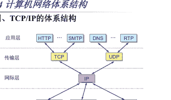

**四、TCP/IP的体系结构**

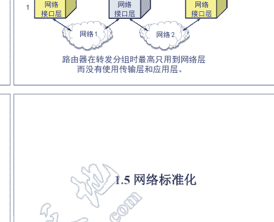

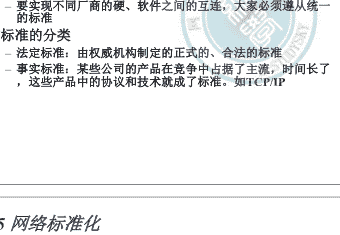

### 1.5 网络标准化

**一、概述**

- 标准化对于计算机网络至关重要
- 标准化使不同厂商的硬件、软件之间能够互连，大家必须遵循统一的规范
- 标准的分类：
  - 法定标准：由权威机构制定的正式的、合法的标准
  - 事实标准：某些公司的产品在竞争中占据了主流，时间长了，这些产品中的协议和技术就成了标准。如TCP/IP

**二、标准化组织**

- ITU-T
  - 国际电信联盟电信标准化部门(International Telecommunication Union)，前身是国际电报电话咨询委员会(CCITT)
  - 各国政府间建立的机构，主要成员是各国的邮电部门，主要负责制定电信行业的标准
- ISO
  - 国际标准化组织(International Standard Organization)
  - 由各成员国组成，主要成员是各大公司技术人员、大学教授、政府官员
  - 负责各行业的标准制定，主要贡献：ISO/OSI RM
- IEEE
  - 美国电子、电气工程师学会(The Institute of Electrical and Electronics Engineers)
  - 专业性组织，学术团体，主要贡献：IEEE 802系列局域网标准
- IETF
  - Internet工程任务组(Internet Engineering Task Force)
  - 负责Internet相关标准的制定
  - 标准形式：RFC xxxx，RFC指Request for Comments

## 第二章 物理层


### 2.2 数据通信的基础知识

**三、信道的极限容量**

- 信号失真问题
- 任何实际信道都不是理想的，在传输信号时会产生各种失真以及信道带宽有限
- 码元传输速率越高，或信号传输的距离越远，在信道的输出端波形的失真就越严重。

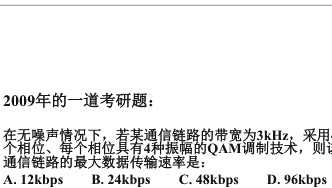

- 信道能够通过的频率范围
- 一个信道能够通过的频率范围总是有限的，高频分量往往不能通过信道
- 接收端收到的信号波形失去了码元之间的清晰界限，即“码间串扰”
- 奈奎斯特(Nyquist)定理
- 理想低通信道最大数据传输速率 = 2H log2 V (bps)
- H——信道带宽，V——信号码元的级数(信号的电平数)
- 在信道传输中，码元传输速率越高越受到上限的限制，否则会出现码间串扰的现象，使接收端无法从收到的信号中恢复出原来的信号
- 信道频率带宽越宽，能通过的信号高频分量越多，就可以用更快的速率传输码元而不出现码间串扰

2009年的一道考研题：

在无噪声情况下，若某通信链路的带宽为3kHz，采用4个相位，每个相位具有不同振幅的QAM调制技术，则该通信链路的最大数据传输速率是：

A. 12kbps  B. 24kbps  C. 48kbps  D. 96kbps

- 信噪比：
  - 信号的平均功率与噪声的平均功率之比，常记为S/N，以分贝(dB)为计算单位
  - 信噪比 = 10log10(S/N) (dB)
  - 例：S/N=10时，信噪比为10dB；S/N=1000时，30dB
- 1948年，信息论创始人香农(Shannon)推出了香农公式
- 信道的极限信息传输速率C可表示为：
  C = W log2(1+S/N) b/s
  - W：信道带宽
  - S：信号的平均功率
  - N：信道内部的高斯噪声功率
- 香农公式表明：信道带宽或信道中的信噪比越大，则信息的最大传输速率越高

### 2.3 物理层下面的传输介质

media: 介质、媒体

- 传输介质，又称为传输媒体或传输媒介，指数据传输系统发送端和接收端之间的物理通路
- 传输媒体分为两大类：
  - 导向传输介质
  - 非导向传输介质


**一、导向传输介质(1/3)**

- 双绞线(twisted pair)
- 通过将两根绝缘铜线绞合，减小相互干扰
- 分类：
  - 屏蔽双绞线 STP (Shielded Twisted Pair)
  - 无屏蔽双绞线 UTP (Unshielded Twisted Pair)
- 在网络布线时常采用无屏蔽双绞线
- 价格便宜，易于安装使用，传输距离较短
- 局域网EIA/TIA-568标准定义了非屏蔽双绞线的类别和带宽：

| 类别 | 带宽 |
|---|---|
| 3 | 16 MHz |
| 4 | 20 MHz |
| 5 | 100 MHz |
| 5e | 100 MHz |
| 6 | 250 MHz |
| 7 | 600 MHz |


**一、导向传输介质(2/3)**

- 同轴电缆(coaxial cable)
- 由内导体铜芯线外包绝缘外套，再包网状编织屏蔽层和塑料保护外套
- 抗干扰能力及传输速率均高于双绞线，但造价较高，大规模应用不便
- 广泛应用的同轴电缆分为2类：
  - 50Ω同轴电缆
  - 75Ω同轴电缆


### 2.4 信道复用技术

#### 二、波分复用(WDM—Wavelength Division Multiplexing)

- 波分复用实际上就是光的频分复用
- 专门用于光纤通信，由于光纤中光载波频率很高，人们习惯于使用波长来表示光载波

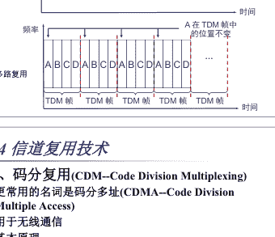


#### 三、码分复用(CDM—Code Division Multiplexing)

- 更常见的别名是码分多址(CDMA—Code Division Multiple Access)
- 用于无线通信
- 基本原理
  - 每一位比特时间间隔分为 m 个短的时间段，称为码片(chip)
  - 每个发送端分配一个唯一的 m 位码片序列，各路的码片序列必须互相正交(orthogonal)
  - 使用扩频通信(Spread spectrum)方法，每位转换成为 m 位码片
- 这种码分发送的信号有很强的抗干扰能力，其频谱类似白噪声

### 2.5 数字传输系统

#### 一、脉码调制系统(PCM—Pulse Code Modulation)

- 用于电话交换系统，在数字传输系统中进行多路话音的变换与传输
- 语音由模拟→数字的变换：对模拟话音按周期进行采样和A/D变换
  - 采样频率8000次/秒，采样数据用8bit表示
  - 话音数据速率：64kb/s
- 数字化的语音数据进行时分多路复用
  - 中国使用逐次时分复用
  - 每个时分复用包含32个时隙，其中有1个用于同步，30个用于传输语音数据，每路包含8bit，即有8×32=256 bit
  - 8000 × 256 bit = 2.048 Mb/s，称为E1，可传输30路语音
  - 北美等国家使用另一种时分复用，称为北美T1制，其中每个时隙中1bit用于信令，7bit用于承载，每帧有24个时隙，即有24 × 8 + 1 = 193 bit
  - 8000 × 193 bit = 1.544 Mb/s，称为T1，可传输24路语音

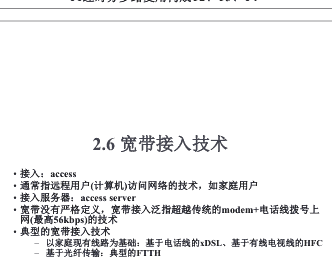

#### 二、同步光纤网SONET和同步数字系列SDH

- 用于高速数字传输，特别是光纤传输
- 1988年美国制定了SONET(Synchronous Optical Network)标准
- 同步传输，系统需要精确的主时钟
  - 主要用于光纤传输
- ITU-T以SONET为基础制定出SDH(Synchronous Digital Hierarchy)
- 可以认为SONET与SDH是同义词

| 传输速率(Mb/s) | SONET 段号 | ITU-T 段号 | 表示网络的相对速率 |
| 51.840 | OC-1/STS-1 |  |  |
| 155.520 | OC-3/STS-3 | STM-1 | 155 Mb/s |
| 466.560 | OC-9/STS-9 | STM-3 |  |
| 622.080 | OC-12/STS-12 | STM-4 | 622 Mb/s |
| 933.120 | OC-18/STS-18 | STM-6 |  |
| 1244.160 | OC-24/STS-24 | STM-8 |  |
| 2488.320 | OC-48/STS-48 | STM-16 | 2.5 Gb/s |
| 4976.640 | OC-96/STS-96 | STM-32 |  |
| 9953.280 | OC-192/STS-192 | STM-64 | 10 Gb/s |
| 39813.120 | OC-768/STS-768 | STM-256 | 40 Gb/s |

### 2.6 宽带接入技术

- 接入：access
- 通用术语是指（计算机）用户接入网络的技术，如家庭用户
- 接入服务器：access server
- 宽带常有两种定义，宽带接入还包括超高速线的modem+电话线等上网速度56kbps的技术
- 典型宽带接入技术
  - 基于电话线的接入技术：基于电话线的ADSL，基于有线电视的HFC
  - 基于光纤接入：典型的FTTH

#### 一、xDSL技术(Digital Subscriber Line)

- “最后一英里(last mile)”
- 通信运营商端局到家庭用户之间的本地回路
- 对此最后一段进行数字化改造成为宽带，对传统电话提供传输方式
- “最后一英里”被称作技术改造的瓶颈和心脏之一

xDSL技术不改变现有电话线作为传输媒体的情况下，通过改造现有的模拟电话用户线来提供高速率数据业务的接入技术。

- xDSL的几种类型
  - ADSL(Asymmetric Digital Subscriber Line)
  - HDSL(High speed DSL)
  - SDSL(Single-line DSL)
  - VDSL(Very high speed DSL)

- ADSL主要特点
  - 仍然保留电话功能，无需对现有的电话系统进行改造
  - 下行频率高于上行频率，频率分配使用不同，面向网络接入用户
  - 上行（用户→ISP）与下行（ISP→用户）业务不同，适应各种用户上网需求（多业务网，下载为主用）

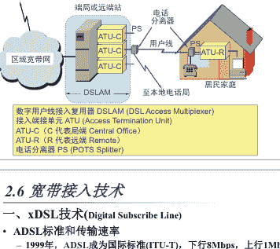

- 接入用户线路接入复用器：DSL Access Multiplexer
- 接入连接单元：ATU (Access Termination Unit)
- ATU-C（C 代表 Central Office）
- ATU-R（R 代表 Remote）
- 电话分离器：PS (POTS Splitter)

**ADSL频谱分布**

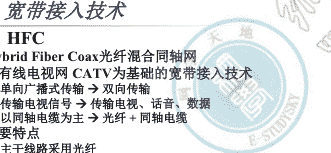

- 离散多音频 DMT (Discrete Multi-Tone)调制技术
- 采用频分复用
- 将 40kHz~1.1MHz 的频谱频段划分为许多子信道，其中 25 个子信道用于上行，249 个子信道用于下行
- 每个子信道宽为 4kHz，并使用不同的载波(即不同的音调)
- 进行数字信号传输
- 用户线彼此差别很大(距离、线材等)，ADSL 采用自适应调制技术使用户端能够传输尽可能高的数据率

- ADSL标准和传输速率
  - 1999年，ADSL1形成国际标准ITU-T，下行8Mbps，上行1Mbps
  - 2002年，ADSL2，下行12Mbps，上行1Mbps
  - 2003年，ADSL2+，下行24Mbps，上行1Mbps

ADSL定义的传输速率是可能达到的最高传输速率，实际传输速率与用户线路的质量和距离相关

#### 二、HFC

- Hybrid Fiber Coax光纤混合同轴网
- 以有线电视网 CATV为基础的宽带接入技术
- 单向广播式传输 → 双向传输
- 传输数据信号 → 传输视频、语音、数据
- 以同轴电缆为主 → 光纤 + 同轴电缆

- 主要特点
  - 主干线路采用光纤
  - 采用点对点系统结构
  - 其具有CATV网络原有的频谱，且具有双向传输功能
  - 每个家庭安装一个用户接口盒UIB (User Interface Box)

同轴电缆连接到用户端，电缆调制解调器连接用户计算机


**HFC网的结构**

**频率划分**


#### 三、基于光纤的宽带接入：FTTx

- 基于光纤传输的宽带接入技术
- FTTH(Fiber To The Home)：光纤到户
- FTTB(Fiber To The Building)：光纤到楼
- FTTC(Fiber To The Curb)：光纤到路边

- 目前用于光纤到户的技术
  - GPON(Gigabit-capable Passive Optical Network)
  - EPON(Ethernet Passive Optical Network)


**用作光纤到户的无源光网(PON)结构**

## 第2章作业

- 2-04
- 2-05
- 2-07
- 2-09
- 2-13
- 下周四交


## 3.2 Error Detection and Correction

### 1. Error-Detecting Codes

- Principle of Cyclic Redundancy Check (CRC)
- The sender divides a data segment into k-bit blocks; for each frame of k bits, it appends n redundant bits for error detection, and sends the (k+n) bits together.
- Procedure for computing the n-bit redundancy code for data M:
  - Append n zeros to M, and divide the resulting (k+n)-bit value by a selected (n+1)-bit divisor P, obtaining quotient Q and remainder R.
  - The remainder R is the n-bit redundancy code.
  - R, as the remainder, forms the transmitted data M'; the final transmitted element is 2*M - R.
  - After receiving the data, the receiver checks it.
- The receiver recomputes the redundancy code for the received (k+n) bits. A result of 0 indicates correct transmission; otherwise, a transmission error has occurred.

### Example: Compute the 3-bit CRC redundancy code for 101001

Given: M = 101001, k = 6, n = 3, divisor P = 1101  
101001 → Q (quotient)  
P (divisor) → 1101  
101001000 → 2*M (dividend)  
Let divisor P = 1101  
1101 1110 1111 0111 0000  
Dividend: 2*M = 101001000  
Result of modulo-2 operation: quotient Q = 110101, remainder R = 001  
1110 1101 0110 1100 1101 001 ← R (remainder)  
Data transmitted: 2*M + R, i.e., 101001001, with a total of (k+n) bits.

- A generator polynomial P(x) is usually used to represent the divisor P.
  Example: the generator polynomial for divisor P=1101 is P(x)=X^3+X^2+1
- Generator polynomials in wide use today:
  CRC-16=X^16+X^15+X^5+1
  CRC-CCITT=X^16+X^12+X^5+1
  CRC-32=X^32+X^26+X^23+X^22+X^16+X^12+X^11+X^10+X^8+X^7+X^5+X^4+X^2+X+1
- In practical network implementations, CRC checksums are usually generated by hardware circuits.

### 2. Error-Correcting Codes

- Error-detecting codes can only detect that an error has occurred in the data; they cannot identify which bit is wrong.
- Error-correcting codes add redundant information so that the location of the error can be detected and corrected. This is also called forward error correction.
- Discussion on error detection and correction at the data link layer:
  With error-detecting/error-correcting codes, error-free reception, or “no bit errors,” can be achieved.
  - This does not imply reliable transmission. Other errors include:
    - Frame loss, frame duplication, frame disorder.

## 3.3 Basic Data Link Protocols

### 1. Unrestricted Simplex Protocol

- Assumed channel:
  - One-way transmission
  - Never makes errors
  - Delivery capacity is bounded but unlimited
  - The receiver can process received data in a timely manner

```
void sender(void)
{
  frame a; //待发送帧
  packet buffer; //待发送数据包
  while (1)
  {
    from_network_layer(&buffer); //从网络层获得数据包
    a.info = buffer; //把数据包装入帧
    to_physical_layer(&a); //把帧传给物理层
  }
}
```

```
void receiver(void)
{
  frame r;
  event_type event; //等待事件
  while (1)
  {
    wait_for_event(&event); //等待帧到达
    from_physical_layer(&r); //从物理层获得帧
    to_network_layer(&r.info); //把帧交给网络层
  }
}
```

### 2. Simplex Stop-and-Wait Protocol

According to the “unrestricted simplex protocol,” if the receiver cannot process frames as fast as the sender sends them, frames may be lost.

Solution: add a flow control mechanism, yielding the simplex stop-and-wait protocol.
- After receiving each frame, the receiver sends an acknowledgment frame.
- After sending each frame, the sender waits for the receiver’s acknowledgment before sending the next frame.

```
void sender(void)
{
  frame s;
  packet buffer;
  event_type event;
  while (1)
  {
    from_network_layer(&buffer); //从网络层获得数据包
    s.info = buffer; //把数据包装入帧
    to_physical_layer(&s); //把帧传给物理层
    wait_for_event(&event); //等待确认帧
  }
}
```

```
void receiver(void)
{
  frame r;
  event_type event;
  while (1)
  {
    wait_for_event(&event); //等待帧到达
    from_physical_layer(&r); //从物理层获得帧
    to_network_layer(&r.info); //把帧交给网络层
    to_physical_layer(&ack); //发送确认帧
  }
}
```

### 3. Simplex Protocol for a Noisy Channel

On a noisy channel, frames may be corrupted during transmission.

Solution: ARQ (Automatic Repeat reQuest) protocol
- Checksum: enables the receiver to detect whether an error has occurred.
- Sequence number: enables the receiver to know whether the received frame is correct.
- Sequence number: enables the receiver to know whether the received frame is correct.
- Sequence number: enables the receiver to know whether the received frame is correct.
- Sequence number: enables the receiver to know whether the received frame is correct.

The two main cases considered in implementing the protocol:
1. Data frames may be corrupted.
   - The receiver receives an erroneous frame; the sender sends the next frame after receiving an acknowledgment.
2. Data frames may be lost.
   - Data frames may be lost; the sender retransmits after a timeout.
   - After receiving a duplicate frame, the receiver discards it.
3. Sequence numbers may be erroneous or lost.
   - The sender retransmits after receiving an acknowledgment; after receiving the frame, the receiver checks the sequence number.
   - If it is incorrect, it only returns an acknowledgment.

## 3.5 Point-to-Point Protocol PPP

### 3. Working States of the PPP Protocol

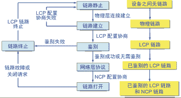

## 3.6 Medium Access Control

**media**: medium, media  
**access**: access, access  
**media access control**: medium access control, media access control

### 1. Data Link Layer of LANs

- Main characteristics of LANs:
  - The network is owned by a single organization, and both its geographical scope and number of stations are limited.

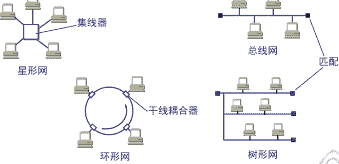

- An important issue to be solved by LANs: **Media Access Control**
  - Reason: LANs usually use broadcast channels.
  - (1) Static channel partitioning: frequency division multiplexing, time division multiplexing, wavelength division multiplexing, code division multiplexing.
  - (2) Dynamic medium access control (multi-access):
    - Random access: users may send information at any time, which may cause collisions (conflicts).
    - Controlled access: e.g., multi-point polling, or token → rarely used in LANs.

### 2. CSMA/CD Protocol

- **Carrier Sense Multiple Access with Collision Detection**
  - Note: “collision” is also translated as “冲突” (conflict).
  - It is a random access protocol.
- Several core concepts of CSMA/CD:
  - Carrier sense
  - Collision detection
  - Collision enforcement
  - Collision backoff

- Carrier sense:
  - Before sending data, a station checks whether another node on the bus is already transmitting. If so, it temporarily withholds data to avoid a collision → “listen before sending”
- Collision detection:
  - While sending data, a station checks whether a collision has occurred on the channel (by monitoring the signal on the bus) → “listen while sending”
  - Because of propagation delay on the line, carrier sense alone cannot completely avoid collisions; collisions may still occur.
  - When a collision occurs, two or more signals overlap on the bus and become unrecognizable.

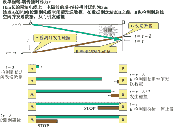

- Collision enforcement:
  - After detecting a collision, the sender immediately stops sending and transmits a 32- or 48-bit jamming signal so that all users know a collision has occurred.
- Collision backoff:
  - After a collision, a node waits for a period of time and then restarts carrier sensing and transmission.
  - To avoid another collision after backoff, the waiting times of the conflicting parties should be different.
  - Ethernet uses the truncated binary exponential backoff algorithm.
    - Backoff time: $T = 2^k\tau$
    - Multiplier: a random number from 0, 1, ..., $2^k-1$, where $k=\min(\text{retransmission count}, 10)$
    - After more than 16 retransmissions, the frame is discarded and reported to the upper layer.
- Question: What is the effect of the backoff algorithm?


### 3.6 介质访问控制

**2010年的一道考研题：**
某局域网采用CSMA/CD协议实现介质访问控制，数据传输率为100M/s，主机甲和主机乙的距离为2km。假设传播速度是200000km/s。请回答下列问题：

(1) 若主机甲和主机乙发送数据时发生冲突，则从开始发送数据到两台主机检测到冲突时为止，最短经过多长时间？最长经过多长时间？（假设主机甲和主机乙发送数据时，其他主机不发送数据）

**求解：**
甲乙间单向传输时延 = 2/200000 = 10μs
最短：无论冲突点在何处，冲突信号向甲乙方向扩散的时间不小于10μs
最长：甲发送的帧即将到达时，乙开始发送数据造成冲突，甲检测到冲突所需的时间 = 20μs

### 3.6 介质访问控制

- **争用期**
  - 一个站点开始发送数据后，最多经过时间 2τ（两倍的端-端时延）就知道是否发生了碰撞
  - 以太网的端到端时延不超过 2τ 称为争用期
  - 如果经过争用期还没有检测到碰撞，就可以肯定这次发送不会发生碰撞
- **以太网的争用期**
  - 以太网的争用期长度：51.2 μs
  - 对于10 Mb/s的以太网，在争用期内可发送512 bit，即64字节
  - 在发送数据时，若首64字节未发生碰撞，就不会发生碰撞
  - 据此规定以太网帧长度≥64字节，长度小于64字节的帧为无效帧

### 3.6 介质访问控制

**2009年的一道考研题：**
在一个采用CSMA/CD协议的网络中，传输介质是一根完整的电缆，传输速率为1Gbps，电缆中的信号传播速度是200000km/s。若最小数据帧长度减少800比特，则最远的两个站点之间的距离至少需要：

A. 增加160m　　B. 增加80m　　C. 减少160m　　D. 减少80m

### 3.6 介质访问控制

- **CSMA/CD协议的优缺点讨论**
  - 网络负载较轻时效率高
  - 网络实现简单、灵活
  - 网络负载较重时，碰撞发生概率增大，网络效率较低
- 由于存在多次冲突的可能，数据从发送方到达接收方的时间没有保证 ⇒ 实时性较差

### 3.7 以太网

#### 一、局域网技术标准(1/2)

- IEEE802标准将局域网的数据链路层分为两个子层
  - LLC (Logic Link Control) 逻辑链路控制子层
  - MAC (Media Access Control) 介质访问控制子层

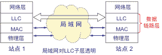

### 3.7 以太网

#### 一、局域网技术标准(2/2)

- IEEE802系列局域网标准
  - IEEE 802.1a 综述与体系结构
  - IEEE 802.1b 寻址、互联、管理
  - IEEE 802.2 逻辑链路控制(LLC)
  - IEEE 802.3 CSMA/CD介质访问控制(MAC)与物理层技术规范
    - IEEE 802.3u 快速以太网(Fast Ethernet)
    - IEEE 802.3z 千兆以太网(Gigabit Ethernet)
  - IEEE 802.4 Token Bus介质访问控制与物理层技术规范
  - IEEE 802.5 Token Ring介质访问控制与物理层技术规范
  - IEEE 802.11 无线局域网介质访问控制与物理层技术规范

**注：**令牌环网(Token Ring)和令牌总线网(Token bus)使用一种令牌为争用( token)的控制标志，当网络中结点有待发送数据时，才能够发送数据。

### 3.7 以太网

#### 二、以太网简介

- Ether：以太
- 1975年，Xerox公司Palo Alto研究中心(PARC)研制
- 1980年，DEC、Intel和Xerox公司联合推出以太网标准 DIX v1
- 1982年，DIX v2
- 1983年，IEEE802.3标准

### 3.7 以太网

#### 三、以太网物理层

- 最初的以太网为总线结构，采用 50Ω同轴电缆，传输速率10Mbps
- 帧长：最短64字节最长可达1518字节
- 长度：网络中总长度同时考虑信号衰减
- 后来发展为采用更便宜且灵活的非屏蔽双绞线，使用集线器(HUB)连接各个站点，物理上呈星形结构
- 此种物理结构为10Base-T
  - 10：10Mbps
  - Base：基带传输
  - T：双绞线(Twisted pair)
- 使用双绞线的以太网两个站点之间是一条总线
- 集线器提供一个多接口的转发器，工作在物理层

| Name | Cable | Max. seg. | Nodes/seg. | Advantages |
|---|---|---|---|---|
| 10Base5 | Thick coax | 500 m | 100 | Original cable, now obsolete |
| 10Base2 | Thin coax | 185 m | 30 | No hub needed |
| 10Base-T | Twisted pair | 100 m | 1024 | Cheapest system |
| 10Base-F | Fiber optics | 2000 m | 1024 | Best between buildings |

- 采用曼彻斯特(Manchester)编码
  - 用电平的跳变表示0或1，即每个码元都有电平跳变

#### 四、以太网的MAC层

- 以太网采用CSMA/CD介质访问控制协议
- MAC地址
  - 结点发送数据时，以太网总线结构，总线上的所有结点都能收到帧
  - 按照IEEE802.3标准，给每个结点分配唯一的MAC地址
  - MAC地址为48位，前24位为厂商标识，后24位由厂商自行分配。须保证每个网络接口具有全球唯一的MAC地址
  - 例：Physical Address：00-26-2D-FF-68-0E
- 适配器每收到一个帧就检查帧中的目的MAC地址，如果是发往本站的帧则进行处理，否则丢弃
  - “发往本站的帧”包括以下三种帧：
    - 单播(unicast)——一对一
    - 广播(broadcast)——一对全体，MAC地址为全1表示广播
    - 组播/多播(multicast)——一对多

### 3.7 以太网

- 以太网的帧格式(5个字段)
  - 目的地址、源地址：各6字节的MAC地址
  - 类型：2字节，标明上层协议类型，如：0x0800表示IP包
  - 数据：网络层数据报，长度46~1500字节
  - FCS：4字节，帧校验序列，采用CRC校验

### 3.7 以太网

#### 五、高速以太网(1/3)

- 快速以太网(Fast Ethernet)
  - IEEE802.3u标准
  - 传输速率100Mb/s
  - 仍使用 IEEE 802.3 CSMA/CD 协议(全双工模式时不用)
  - MAC 帧格式仍然是802.3 标准的规定
  - 最大帧长不变，但将一个以太网的最大电缆长度减小到100m
  - 线缆标准
    - 100BASE-TX：使用2对UTP 5类或屏蔽双绞线 STP
    - 100BASE-FX：使用光纤环
    - 100BASE-T4：使用4对 UTP类3或5类线缆

### 3.7 以太网

#### 五、高速以太网(2/3)

- 千兆以太网(Gigabit Ethernet)
  - IEEE802.3z标准
  - 传输速率1Gb/s
  - 仍使用 IEEE 802.3 CSMA/CD 协议(全双工模式时不用)
  - 线缆标准
    - 1000BASE-X：千兆光纤
      - 1000BASE-SX：SA标准光纤
      - 1000BASE-LX：LX标准光纤
      - 1000BASE-CX：CX标准光纤
    - 1000BASE-T：使用4对双绞线UTP

### 3.7 以太网

#### 五、高速以太网(3/3)

- 万兆以太网(10吉比特以太网)
  - IEEE802.3ae标准
  - 传输速率10Gb/s
  - 帧格式不变
  - 只使用光纤
  - 只工作在全双工模式，不存在争用，因此不用CSMA/CD

## 3.8 局域网互连

## 3.8 局域网互连

## 3.8 局域网互连

## 3.8 局域网互连

## 3.8 局域网互连

## 3.8 局域网互连

## 3.8 局域网互连

交换机连接举例


## 3.8 局域网互连

- **源路由网桥**
  - 源路由（source route）网桥在发送帧时将路由信息放在帧的首部中
  - 获取路由信息的方法
    - 源站以广播方式向目的站发送一个发现帧，发现帧在转发过程中记录所经过的路由
    - 发现帧到达目的站后，目的站将自己的路由返回源站
    - 源站收取返回的发现帧后，从所有可能的路由中选择出一个最佳路由
  - 与透明网桥相比
    - 源路由网桥可以获得最佳路由
    - 源路由网桥对网络中的主机不透明

- **虚拟局域网（VLAN）**
  - VLAN（Virtual LAN），在现有局域网基础上，通过将网络站点分组细分，构成若干逻辑上独立的虚拟局域网
  - 注意：帧不会在两个VLAN之间自动转发，包括广播帧
  - VLAN的用途：便于管理、控制广播风暴、安全性、……

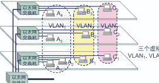

## 第3章作业

- 3-07
- 3-09
- 3-10
- 3-13
- 3-18
- 3-20
- 3-24
- 3-28
- 3-32

下下周二（4月9日）交

## 第四章 网络层


### 本章内容

- 4.1 网络层提供的两种服务
- 4.2 网际协议 IP
- 4.3 划分子网和构造超网
- 4.4 网际控制报文协议ICMP
- 4.5 路由算法及协议
- 4.6 IP组播
- 4.7 网络地址转换NAT和虚拟专用网VPN

### 4.1 网络层提供的两种服务

- 网络层应该向传输层提供怎样的服务？
  - 两种选择：面向连接 or 无连接
  - 曾引起了长期的争论
  - 争论的实质：可靠传输应由网络还是端系统来负责？
- 面向连接的服务，即虚电路（virtual circuit）
  - 通信双方在开始数据传输前，先由网络建立连接，之后的数据都通过该连接进行，由网络保证数据传输的可靠性
  - 建立好后是一种逻辑连接，分组沿着这条逻辑连接按照存储转发方式传送，而并不是真正建立了一条物理连接
  - 支持方：以电信公司为代表的一派
- 无连接的服务，即数据报（datagram）
  - 网络在发送数据时不需要先建立连接，每个分组在网络中独立传送
  - 网络不保证所服务的质量，分组可能出现错误、丢失、重复和失序，也不保证分组传送的时限
  - 支持方：以Internet为代表的一派
  - TCP/IP采用数据报服务

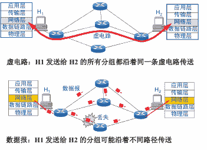

#### 虚电路与数据报的比较

| 对比的方面 | 虚电路服务 | 数据报服务 |
| --- | --- | --- |
| 思想 | 可靠通信应由网络来保证 | 可靠通信应由用户主机来保证 |
| 连接的建立 | 必须有 | 不需要 |
| 终点地址 | 仅在连接的建立阶段使用，每个分组使用终点的地址和虚电路号 | 每个分组都有终点的完整地址 |
| 分组的发送 | 属于同一条虚电路的分组按顺序沿同一路径进行转发 | 每个分组独立选择路由进行转发 |
| 当结点出现故障时 | 所有通过该结点的连接都不能继续工作 | 故障结点可能舍弃少数分组，一些路径可能发生变化 |
| 分组的顺序 | 总是按发送顺序到达终点 | 到达终点时，不保证递送顺序 |
| 拥塞的控制、流量和差错控制 | 可以由网络来做，也可以由用户主机负责 | 由用户主机负责 |

## 4.2 网际协议 IP

### 一、IP(Internet Protocol)简介

- 网际协议 IP 是 TCP/IP 体系中两个最基本的协议之一
- 与 IP 协议配套使用的还有四个协议
  - 地址解析协议ARP(Address Resolution Protocol)
  - 反向地址解析协议RARP(Reverse Address Resolution Protocol)
  - 网际控制报文协议ICMP(Internet Control Message Protocol)
  - 网际组管理协议IGMP(Internet Group Management Protocol)

| 层次 | 协议 |
| --- | --- |
| 应用层 | 各种应用层协议(HTTP, FTP, SMTP 等) |
| 传输层 | TCP, UDP |
| 网络层(网际层) | ICMP, IGMP<br>IP<br>RARP, ARP |
| 网络接口层 | 与各网络接口 |
| 物理层 | 物理硬件 |

### 二、分类的IP地址

- IP 地址
  - 分配给主机或路由器等设备的标识，目前使用的IPv4为32位IP地址
  - IP 地址分配由ICANN (Internet Corporation for Assigned Names and Numbers)负责
- IP地址的编址方法经历了三个阶段：
  - 分类的IP地址，最基本和原始方法，1981年通过标准化
  - 子网的划分，对分类编址的改进，1985年成为标准[RFC 950]
  - 无分类编址方法，比较新，1993年提出
- 分类的IP地址
  - IP地址划分为A,B,C,D,E五类，每一类地址都包含网络号(net-id)和主机号(host-id)两个字段
  - `IP 地址 ::= {<网络号>,<主机号>}`
  - 不同类别IP地址的网络号、主机号的长度不同

#### IP地址中的网络号字段和主机号字段


#### IP地址的表示方法：点分十进制记法(dotted decimal notation)

32位IP地址 10000000 00001011 00000011 00011111 采用点分十进制记法后可读性更强：128.11.3.31

- 全0、全1的IP地址都具有特殊含义
  - 全0表示本网络
  - 全1表示本网络广播
  - 全1表示广播
  - 全0表示广播

### 三、IP地址与物理地址

- IP地址
  - 网络层及以上各层使用的地址，是一种逻辑地址
  - 存放在IP数据报首部
- 物理地址
  - 数据链路层及以下各层使用的地址
  - 存放在数据链路层的帧中
  - 每一台主机只拥有一块网卡
  - IP 地址
  - 逻辑地址
  - 网络层及以上使用IP 地址
  - 物理地址
  - IP 数据报
  - 电缆
  - 链路层以下使用物理地址

### 四、ARP与RARP协议

- IP 地址与物理地址的相互转换问题
  - 例如：主机H1向主机H2发送邮件，路由器R要将邮件从网络A发送到网络B中，将包发送给主机H2，需要知道H2的物理地址
- RFC 826: An Ethernet Address Resolution Protocol


- ARP协议(Address Resolution Protocol)
- 每台主机都有一个ARP高速缓存(ARP cache)，保存本地局域网上各主机对应的IP地址和物理地址的映射表
- 当主机A欲向本局域网的主机B发送IP数据包时：
  - 先在ARP高速缓存中查是否有主机B的物理地址
  - 如果能够查出其对应的物理地址，则将该物理地址写入MAC帧，通过数据链路层发送给主机B
  - 当主机B收到ARP请求后，向主机A返回一个ARP应答，告知自己的物理地址
- 注意：
  - ARP请求是广播发送的，同一局域网中的所有主机都能收到
  - ARP完成IP地址和物理地址的映射
  - IP包最终都要通过物理地址的映射来传送
  - 若目的主机不在同一个局域网内，则要通过路由器转发；路由器也依赖ARP完成物理地址的映射

### 五、IP数据报格式

- 一个IP数据报也由头部和数据两部分组成
- 头部：20字节的固定长度 + 0到40字节的可选字段

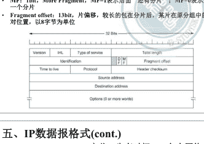

- Version字段：4bit，IP协议的版本，目前的IP协议版本号为4（即IPv4）
- IHL：4bit，IP包头长度，最小5，最大15，单位为word(32bit)。因此IP包头最短长度为20字节
- Type of service：1字节，服务类型，目前很少被路由器所识别
- Total Length：2字节，IP包的总长度（包括头部和数据），单位为字节。因此IP包的最大长度为65535字节

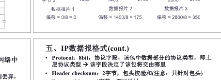

- Identification：2字节，标识，是一个计数器，用来产生IP包的标识
- 超过数据链路层MTU(Maximum Transmission Unit)时需要分片传输
- 分片后的多个包具有相同的标识，便于接收端重组
- DF：1bit，Don't Fragment，若DF=0则允许分片
- MF：1bit，More Fragment，MF=1表示后面“还有分片”，MF=0表示最后一个分片
- Fragment offset：13bit，分片偏移，指出该片在原数据包中的相对位置，以8字节为单位

**分片举例**

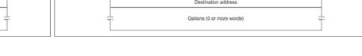

- Time to live(TTL)：1字节，生存时间，IP包在网络中可通过的路由器的最大次数
- 实际应用中，IP包每经过一个路由器的TTL减1，为0则丢弃，并向源主机发送一个“超时”包
- 最大值为255，由主机设定初始值，Windows操作系统一般为128，UNIX操作系统一般为255，Linux一般为64

- Protocol：8bit，协议字段，该包中数据部分的协议类型，即上层协议类型，该字段决定了该包将被交给哪个上层协议模块
- Header checksum：2字节，包头校验和(注意，只针对包头)
- Source address：4字节，源IP地址
- Destination address：4字节，目的IP地址
- 选项字段：以4字节为单位，最长40字节。实际网络中很少使用

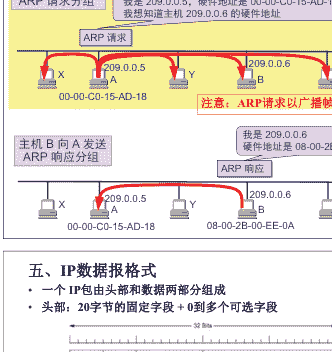

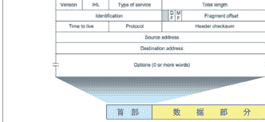


### 五、IP数据报格式(cont.)

校验和算法：对IP包头，每16位求反，循环相加（进位加在末尾），和再求反

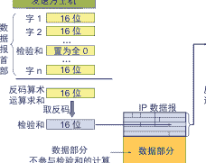

### IP包示例

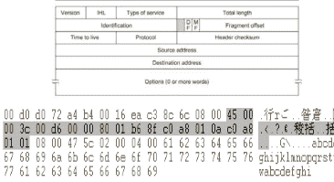

## 4.2 网际协议 IP

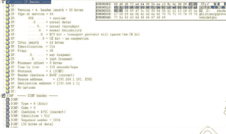

## 4.3 划分子网和构造超网

## 4.3 划分子网和构造超网

### 一、划分子网

- 分类IP地址的缺点
  - IP地址空间的利用率有时很低
    - A类地址的主机数超过1000万，B类地址也超过6万
  - 给每一个物理网络分配一个网络号会使路由表变得太大因而使网络性能变坏
  - 两级的IP地址不够灵活
  - 1985年起，增加了子网字段以扩展IP地址
    - RFC 950: Internet Standard Subnetting Procedure

### 一、划分子网

- 划分子网的基本思路
  - 拥有多个物理网络的单位可按物理网络划分为若干个子网(subnet)
  - 从主机号借用若干位作为子网号subnet-id，三级IP地址记为：

IP地址 ::= <网络号>.<子网号>.<主机号>

- 从其他网络来的IP数据报，仍然根据IP数据报的目的网络号net-id，找到本网络的路由器，此路由器收到IP数据报后，再按目的网络号net-id和子网号subnet-id找到目的子网

### 一个未划分子网的 B 类网络145.13.0.0

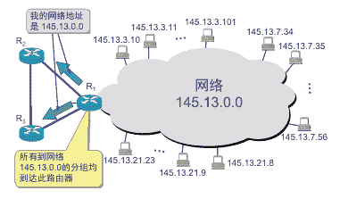

### 划分为三个子网后

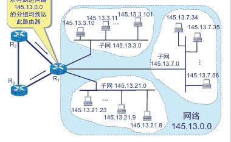

## 4.3 划分子网和构造超网

### 一、划分子网

- 子网掩码的提出
  - 在划分子网、路由器需要根据数据报发往不同的子网，从何处得知子网掩码？IP地址中并非采用通用分隔信息。
  - 解决方法：使用子网掩码（subnet mask）
  - 对目的主机的IP网络地址进行“按位与”操作，即得到子网地址

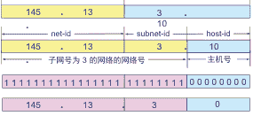

## 4.3 划分子网和构造超网

### 一、划分子网

- 子网掩码
  - Internet标准规定，所有网络都必须使用子网掩码
  - 子网掩码是一个网络或一个网段的重要属性
  - 路由器的路由表中的每个表项除了包含目的网络地址外，还要有子网掩码
  - 一个路由器连接在两个子网上，就拥有两个网络地址和两个子网掩码

## 4.3 划分子网和构造超网

**例：** IP address: 141.14.72.24  
subnet mask: 255.255.192.0  
求网络地址

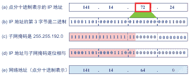

## 4.3 划分子网和构造超网

### 二、使用子网掩码的分组转发过程

- 路由器中路由表包含三项基本信息：目的网络地址、子网掩码、下一跳地址。
  
- 转发流程：
  - ① 从收到的分组的首部提取目的IP地址D
  - ② 用与该路由器直接相连的网络的子网掩码和D进行“与”运算，是否得到相应的网络地址匹配
  - ③ 若网络地址匹配，则分析直接连接的网络接口
  - ④ 对路由表中的每一行的子网掩码和D进行“与”运算，若结果与该行的目的网络地址相同，则将分组转发给该行的下一跳路由器
  - ⑤ 若路由表中有一个默认路由，则将分组发送给默认路由器
  - ⑥ 报告转发分组出错

| 目的网络 | 子网掩码 | 下一跳 |
|---|---|---|
| … | … | … |

### 例：考虑主机H2发送数据包后的转发过程

- ① 主机H1根据自身判断所目的地址在本地子网内
- ② 主机H1将数据包交给路由器R1（注意是向网内可能有ARP查询过程）
- ③ 路由器R1收到数据包后，在路由表中逐项根据子网掩码计算匹配项
- ④ 路由器R1将数据包通过子网2发送给主机H2（注意端到端可能有ARP查询过程）

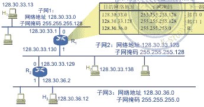

## 4.3 划分子网和构造超网

### 针对上例的说明：

- 主机发送数据包是判断目的地址是否在本地子网的方法：
  `if（目的地址 & subnet mask）==（主机地址 & subnet mask）`
  else目的地址在子网之外，应转交给路由器
- 路由器查找路由表进行逐项匹配的过程：
  `if（目的地址 & subnets mask）==目的网络地址`
  转发分组经过该项的网络接口
- 在子网内直接交付过程：
  查找ARP缓存，是否有目的IP地址对应的MAC地址；若没有，则广播ARP请求；收到ARP响应后，将分组发送到相应的MAC地址

## 4.3 划分子网和构造超网

### 三、无分类编址 CIDR

- CIDR（Classless Inter-Domain Routing）无分类域间路由
- CIDR的主要特点
  - 消除传统A类、B类和C类地址以及划分子网的概念
  - 使用各种长度的“网络前缀”（network-prefix）来代替分类地址中的网络号和子网号
  - IP地址从三级编址（使用子网掩码）又回到了两级编址：IP地址 ::= <网络前缀，<主机号>>
  - CIDR还使用“斜线记法”（slash notation），又称为CIDR记法
  - IP地址后加一个斜线“/”，后跟网络前缀所占的位数
  - 例：128.14.35.7/20表示该地址的前20位是网络前缀

## 4.3 划分子网和构造超网

### 三、无分类编址 CIDR

网络前缀相同的连续的 IP 地址组成“CIDR地址块”
例：128.14.32.0/20表示的CIDR地址块共有 2¹² 个地址
地址块的起始地址：128.14.32.0
地址块的最大地址：128.14.47.255

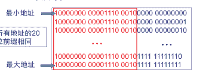

## 4.4 网络控制报文协议 ICMP

### 二、ICMP报文类型

- 差错报告报文
  - Destination unreachable: 终点不可达，由路由器或主机无法传输报文时向源主机发送此报文
  - Source quench: 源点抑制，发送由路由器或主机对拥塞丢弃报文时，向源主机发送此报文，使其放慢发送速度
  - Time exceeded: 超时时，由路由器或TTL值减为0的报文时，向源主机发送此报文
  - Parameter problem: 参数问题，路由器或主机收到的数据报中头部有非零字段时，去往源主机，并向源主机发送此报文
  - Redirect: 重定向，若路由器向主机发送报文时发现由改变网段下此数据报经过路由外的路由器

- 询问报文
  - Echo request / reply: 回声请求/回复，用于测试网络连通性
  - Timestamp request / reply: 时间戳请求/回复，可用于时间同步

## 4.3 划分子网与超网

#### 2010年的一道考研题：

若路由器R因为拥塞丢弃IP分组，则此时R可向发出该IP分组的源主机的ICMP报文的类型是（ ）
A. 路由重定向  B. 目的不可达
C. 源抑制  D. 超时

### 三、ICMP应用举例(1/2)

- Ping
  - 用来测试两个主机之间的连通性
  - 采用ICMP echo request / reply报文
  - 向目标主机发送ICMP echo request报文，对方收到后回送ICMP echo reply，根据收到的回送报文判断两台主机之间是否连通

```
D:\>ping news.sina.com.cn
Pinging hydra.sina.com.cn [218.30.108.63] with 32 bytes of data:
Reply from 218.30.108.63: bytes=32 time=11ms TTL=54
Reply from 218.30.108.63: bytes=32 time=12ms TTL=54
Reply from 218.30.108.63: bytes=32 time=12ms TTL=54
Reply from 218.30.108.63: bytes=32 time=12ms TTL=54

Ping statistics for 218.30.108.63:
    Packets: Sent = 4, Received = 4, Lost = 0 (0% loss),
Approximate round trip times in milli-seconds:
    Minimum = 11ms, Maximum = 12ms, Average = 11ms
```

### 三、ICMP应用举例(2/2)

- Traceroute / Tracert
  - 用来测试到另一台主机所经过的路由信息
  - 采用ICMP超时报文实现
  - 发送不同TTL值的报文，其IP报头中的TTL字段分别设为1,2,3,...,直到到达目的主机
  - 接收到超时报文上的源路由器会回送ICMP超时报文，从该报文可得知源路由器的IP地址

```
D:\tracert -d hydra.sina.com.cn
Tracing route to hydra.sina.com.cn [218.30.108.67]
over a maximum of 30 hops:

  1    <1 ms    <1 ms    <1 ms  192.168.1.1
  2     2 ms     2 ms     2 ms  218.143.128.128
  3    13 ms    13 ms    13 ms  218.143.128.1
  4    13 ms    13 ms    13 ms  218.141.131.13
  5    15 ms    15 ms    15 ms  218.141.130.110
  6    21 ms    21 ms    21 ms  220.181.16.130
  7    21 ms    21 ms    21 ms  218.30.25.237
  8    21 ms    21 ms    21 ms  218.30.26.70
  9    10 ms    10 ms    10 ms  218.30.104.42
 10    10 ms    10 ms    10 ms  218.30.108.67
Trace complete.
```

## 4.5 路由算法及协议

## 4.5 路由算法及协议

### 一、路由算法简介(1/4)

- 在网络中，路由器负责转发分组，路由信息是路由协议产生的信息，路由算法是路由协议的基础和核心
- 路由算法是用来生成路由信息(路由表)，不转发分组的
- 理想的路由算法应具备的特性:
  - 必须是最优的和合理的，携带出的路由能够进行网寻址
  - 在计算上应简单，不增加过多开销
  - 有自适应性，能根据网络状况和网络拓扑的变化调整路由
  - 反应灵敏性，通信链路不断稳定，能快速收敛
  - 适应性强，对应各种网络公平
  - 应该是稳定的，能找出好的路由(时延最小，吞吐量最大)

不存在理想的路由需求可能各有侧重，且网络环境不断变化，因此不存在一种绝对的最优路由算法

## 4.5 路由算法及协议

### 一、路由算法简介(2/4)

## 4.5 路由算法及协议

### 一、路由算法简介(3/4)


## 4.5 路由算法及协议

#### 二、距离向量路由与RIP协议（1/7）

- 在自治系统背景下，Internet路由器协议可以分为两类：
  - 内部网关协议IGP（Interior Gateway Protocol）
    - 自治系统内部使用的路由选择协议
    - 经常使用协议为RIP和OSPF协议
  - 外部网关协议EGP（External Gateway Protocol）
    - 若源点和目的网络在不同的自治系统中，当信息传递到一个自治系统的边界时，就需要使用EGP协议将信息传递到另一个自治系统中
    - 经常使用的协议为BGP-4
- 自治系统之间的路由选择又称为域间路由选择（interdomain routing）
- 自治系统内部的路由选择又称为域内路由选择（intradomain routing）

#### 距离向量路由（distance vector routing）简介

也称为Bellman-Ford路由算法和Ford-Fulkerson算法。

最先用于ARPANET，RIP协议采用。

距离向量路由的基本思想是：

每个路由器维护一张表，表中给出了到达目的地的已知路由的距离，并通过与邻居交换路由信息来更新表。

路由器周期性地向所有相邻路由器发送它自己的距离表，同时也接收到邻居路由器所发送的距离表。

设邻居路由器X发送的内容为：X到某目的网络Y的距离为d；本路由器到X的距离为m；则本路由器经X到Y的距离为d+m。根据不同邻居发来的信息，计算d+m，并取最小值，更新本路由器的路由表。

#### 二、距离向量路由与RIP协议（3/7）

- 距离向量路由的无穷计数问题
  - 算法的缺陷：对好消息反应迅速，对坏消息反应迟钝

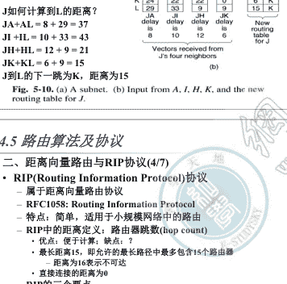

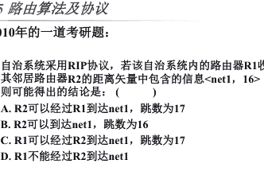

#### 二、距离向量路由与RIP协议（4/7）

- RIP（Routing Information Protocol）协议
  - 属于距离向量路由协议
  - RFC 1058: Routing Information Protocol
  - 特点：简单，适用于小型网络中的路由
  - RIP中的距离定义：路由器跳数（hop count）
    - 优点：使得计算简单
    - 缺点：只能找到最短路径，且最多包含15个跳数的路由
    - 路由跳数超过15时就认为是不可达
    - 直连网络的跳数为0
  - RIP的三个要点
    - 仅和相邻路由器交换信息
    - 交换的信息是整个网络的路由信息，即自己的路由表
    - 按照固定的时间间隔交换路由信息（每隔30秒）

#### 2010年的一道考研题：

某自治系统采用RIP协议，若该自治系统内的路由器R1收到其邻居路由器R2的距离矢量中包含的信息<net1, 16>，则可得出的结论是：

- A. R2可以经过R1到达net1，跳数为17
- B. R2可以到达net1，跳数为16
- C. R1可以经过R2到达net1，跳数为17
- D. R1不能经过R2到达net1

#### 收到相邻路由器发来RIP报文后的处理流程（注意它并没有按照距离向量算法工作）

#### RIP报文格式

#### 二、距离向量路由与RIP协议（7/7）

- **RIP优缺点**
  - 优点
    - 实现简单，开销较小
  - 缺点
    - 当网络出现故障时，要经过比较长的时间才能将此信息传送到所有的路由器（距离向量路由的固有缺点）
    - 支持的网络规模有限，最大距离为15（16表示不可达）
    - 路由器之间交换的路由信息是路由器中的完整路由表，随着网络规模的扩大，开销随之增加

#### 三、链路状态路由与OSPF协议（1/7）

- **链路状态路由（link-state routing）的基本思想**
  - 每个路由器先完成5步工作：
    1. 发现它的邻居节点，获得邻居节点的网络地址
    2. 测量邻居各链路的延迟或开销
    3. 构造一个分组，其中包含所有它所知道的信息
    4. 将这个分组发送给其他所有相邻路由器
    5. 计算出到每一个其他路由器的最短路径
  - 各路由器之间交换完整的路由状态信息，每个路由器都建立一个链路状态数据库。
  - 链路状态数据库中包含邻居路由器的相邻关系，以及该链路的“度量”（metric）。
  - 链路状态数据库实际上是全网的拓扑结构图，它在全网范围内是一致的（链路状态数据库的同步）。
  - 各路由器根据网络拓扑使用Dijkstra算法计算从本路由器到其他各节点的最短路径，生成路由表。

#### 三、链路状态路由与OSPF协议（2/7）

- 发现邻居节点，并学习它们的网络地址
  - 路由器启动后，通过发送HELLO包发现邻居路由器
  - 当两个或多个路由器连接到同一个LAN时，引入指定路由器（DR）

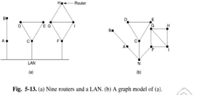

#### 三、链路状态路由与OSPF协议（3/7）

- **OSPF（Open Shortest Path First）协议简介**
  - 属于链路状态路由协议
  - RFC 2328: OSPF Version 2
  - 优点：
    - 收敛速度快：当链路状态发生变化时，结点会以洪泛（flooding）方式告知网络中其他所有结点
    - 适用于较大规模的网络：仅在链路状态发生变化时才发送洪泛信息，不会产生很大通信量

- 为了管理大规模的网络，OSPF将一个自治系统再划分为若干个区域（area）。
- 每一个区域都有一个32位的区域标识符（Area ID）。
- 采用区域的划分后，洪泛传送链路状态信息的范围局限于一个区域即可，避免了整个网络上的通信量。
- 一个区域内的路由器只知道本区域的完整网络拓扑，而不知道其他区域的网络拓扑。
- 层次结构的区域划分中，上层区域称为主干区域（backbone area），主干区域的作用是让自治系统内其他区域之间互相传递信息。
  - 主干区域的标识符规定为0.0.0.0。

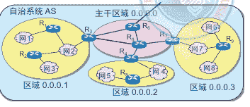

#### OSPF分组结构

（OSPF不用UDP而是直接用IP数据报传送）

| 字段 | 长度 |
| --- | ---: |
| 版本 | 8 |
| 类型 | 8 |
| 分组长度 | 16 |
| 路由器标识 | 32 |
| 区域标识 | 32 |
| 检验和 | 16 |
| 鉴别类型 | 16 |
| 鉴别 | 64 |
| 数据 | 可变 |

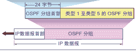

#### OSPF的5种分组

- 类型1：Hello分组
- 类型2：Database Description分组
- 类型3：Link State Request分组
- 类型4：Link State Update分组，用洪泛法对全网更新链路状态
- 类型5：Link State Acknowledgment分组

#### OSPF操作

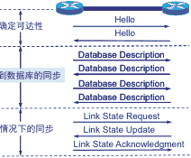

#### OSPF洪泛发送

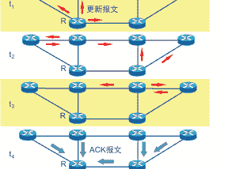

#### 四、外部网关路由协议BGP

- **BGP简介**
  - BGP是不同自治系统的路由器之间交换路由信息的协议
  - BGP-4，RFC 4271～4278，2006年

- **BGP使用环境的特性**
  - Internet的规模很大，AS之间的路由选择非常困难
    - Internet主干网络由表中包含的网络前缀达到数百万
    - 对于AS之间的路由选择，要寻找最佳路由是不现实的
    - 不同AS路径复杂且标准不同
  - AS之间的路由选择需要考虑多种因素
    - 例1：AS1到AS6的数据经过AS3在技术上最短，但AS3可能不同意
    - 例2：出于国家安全的考虑，可能不希望数据经过某些国家
  - BGP难以找到最佳路由，只能寻找一条能够到达目的网络且比较好的路由（不能兜圈子）

- **BGP发言人（speaker）**
  - 每个AS都选择一个路由器作为“BGP speaker”
  - 两个BGP发言人通过一个共享网络连接在一起
  - BGP发言人一般是AS的边界路由器，但也可以不是
  - BGP发言人与其他自治系统中的BGP发言人交换路由信息，这种交换通过TCP协议进行；两个发言人在TCP连接上交换BGP报文以建立BGP会话（session），利用BGP会话交换路由信息
  - BGP发言人除了运行BGP协议外，还要运行AS的内部网关路由协议

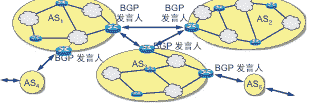

- **信息交换与路由生成**
  - BGP所交换的网络可达性信息就是要到达某个网络所要经过的路径
    - 称为路径向量（path vector）
  - BGP发言人互相交换了网络可达性信息后，就根据所采用的策略从中找出到达各AS的较好路由

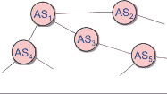

根据路由信息计算得到的通道图示例（注意无回路）

- **示例**
  - AS2的BGP发言人通知主干网的BGP发言人：要到达网络N1、N2、N3和N4可经过AS2
  - 主干网的BGP发言人还可发出通知：“要到达网络N5、N6和N7可沿路径（AS1，AS3）”

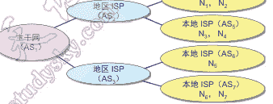

**BGP使用四种报文**

1. OPEN报文：用来与相邻的另一方BGP发言人建立关系
2. UPDATE报文：用来发送一些路由信息，以及列出需要撤销的多条路由
3. KEEPALIVE报文：用来确认OPEN报文和周期性地证实邻站关系
4. NOTIFICATION报文：用来发送检测到的错误

BGP发言人通过OPEN报文与另一发言人建立会话，对方如果同意则回应KEEPALIVE报文。

双方周期性发送KEEPALIVE报文，以确认会话未中断。

当信息发生变化时，发送UPDATE报文。

- **BGP协议特点**
  - 交换路由信息的结点数量级与自治系统个数相当，大大少于这些自治系统中网络的数目
  - 每个自治系统中BGP发言人（或边界路由器）的数目很少，使得自治系统间的路由选择不致过分复杂
  - BGP支持CIDR，因此BGP路由表包括目的网络前缀、下一跳路由器，以及到达该目的网络经过的各自治系统序列
  - 在BGP的四种报文中，只有UPDATE报文是交换路由信息的报文；当路由发生变化时才发送UPDATE报文，且只更新受影响的部分，有利于节省网络带宽和减少处理开销

#### 五、路由器（Router）

- 路由器是一种具有多个输入端口和多个输出端口的专用计算机，其任务是转发分组


- Cisco 7304高端路由器
  - LAN接口：2个10/100/1000M以太网
  - WAN模块：OC-3或OC-48
  - 包转发速率：3.5Mpps
- Cisco 2811多业务路由器
  - LAN接口：2个10/100M以太网
  - WAN模块：T1/E1/DSL等
  - 集成防火墙、支持VPN、IP语音等功能

- 路由器包含两部分
  - 路由选择部分：核心为路由选择处理机，它按照路由选择协议与其他路由器交换路由信息，构建路由表
  - 分组转发部分：包含交换结构（switching fabric）、一组输入端口和输出端口
    - 交换结构将分组转发到合适的输出端口（每发送一个分组便转发到相应输出端口）

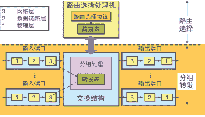

- **路由器设计的关键之一是分组的高速转发**
  - 决定报文转发速率的因素有：
    - 输入/输出端口的处理性能
    - 交换结构的性能
    - 线速（line speed或wire speed）：分组的处理速率能够达到线路上分组的传输速率
    - 衡量路由器性能的指标：pps（packets per second）
    - 如OC-48链路（2.5Gb/s），如果分组长度为256字节，则线速转发意味着每秒处理分组>100万


## 4.5 路由算法及协议

#### 输入和输出端口的处理

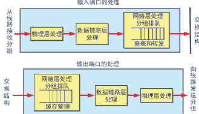

#### 五、路由器(Router)

- 交换结构

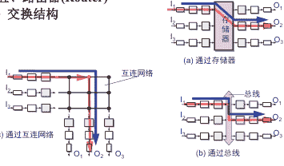

#### 2011年的一道考研题：

在下列关于IP路由器功能的描述中，正确的是：（　　）

I. 运行路由协议，设置路由表
II. 监测到拥塞时，合理丢弃IP分组
III. 对收到的IP分组头进行差错校验，确保传输的IP分组不丢失
IV. 根据收到的IP分组的目的IP地址，将其转发到合适的输出线路上

- A. I、III、IV　　　B. I、II、III
- C. 仅 I、II、IV　　D. I、II、III、IV

## 4.6 IP 组播

- 组播(multicast)又称为多播，用于实现一对多的数据传输。对于一些网络应用，采用组播可大大减少网络流量。
- 组播的典型应用示例：网络视频服务

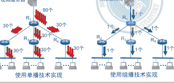

- 使用D类IP地址作为组播地址
  - 224.0.0.0～239.255.255.255
  - 组播数据报：IP包头中的目的地址为D类地址，协议类型为2(IGMP协议)
- 组播地址即为特定组播组的标识符，主机通过加入组播组来接收组播数据
- 组播可分为两种
  - 在局域网内的硬件组播
    - 将MAC地址中的特定地址段作为组播地址，并与IP组播地址形成对应关系
  - 在Internet中的组播
    - 路由器需支持组播，组播路由器
    - 主机通过IGMP协议与组播路由器通信，加入组播并接收组播
    - 组播路由器之间通过组播路由协议实现组播数据的传输

## 4.7 网络地址转换 NAT 和虚拟专用网 VPN

### 一、网络地址转换 NAT

- 专用地址(保留地址)
  - RFC1918中定义了一系列专用地址(private address)
    - 10.0.0.0 ～ 10.255.255.255（CIDR记法：10/8）
    - 172.16.0.0 ～ 172.31.255.255（CIDR记法：172.16/12）
    - 192.168.0.0 ～ 192.168.255.255（CIDR记法：192.168/16）
  - 这些地址只能用于机构的内部
  - Internet中的路由器不转发目的地址为专用地址的包
- 企业/机构内部网络使用专用地址的优点
  - 减少IP地址空间的占用
  - 可提高安全性
- 当内部网络使用专用地址时，与Internet的通信需要通过NAT（Network Address Translation）。NAT路由器使用TCP/UDP端口号，并对外部网络数据包首部中的两个IP地址进行转换。

### 二、虚拟专用网 VPN

- VPN——Virtual Private Network，虚拟专用网
- 多个企业/机构的内部网络之间通信的实践方法
  - 租用专用线路，形成专用网，但成本高
  - 利用公用网络（Internet），形成VPN
- VPN涉及的技术包括：隧道（tunnel）、加密、身份认证等
- 机构内部网络又称为Intranet（内联网）
- 外部网络称为Extranet（外联网）

## 第4章作业

- 4-09
- 4-12
- 4-15
- 4-18
- 4-20
- 4-21
- 4-22
- 4-27
- 4-28
- 4-30
- 4-35
- 4-41

下周二交

#### 2009年考研题

## 第五章 传输层

刘铁
北京航空航天大学 计算机学院

### 本章内容

- 5.1 传输层协议概述
- 5.2 用户数据报协议 UDP
- 5.3 传输控制协议 TCP 概述
- 5.4 TCP报文段的首部格式
- 5.5 TCP可靠传输的实现
- 5.6 TCP的流量控制
- 5.7 TCP的拥塞控制
- 5.8 TCP的连接管理

### 5.1 传输层协议概述

## 5.2 用户数据报协议 UDP

### 一、UDP概述

- UDP 只在 IP 的数据报服务之上增加了很少一点的功能
- 端口和差错检测
- UDP 不是可靠传输协议，但具有自身特点，与TCP分别面对不同的应用
- UDP协议的特点
  - (1) 无连接，即发送数据之前不需要建立连接
  - (2) 尽最大努力交付，即不保证数据交付，同时也不使用拥塞控制
  - (3) 是面向报文的，收发数据时保留报文边界，很适合多媒体传输的要求
  - (4) 支持一对一、一对多、多对一和多对多的交互通信
  - (5) 首部开销小，只有 8 个字节

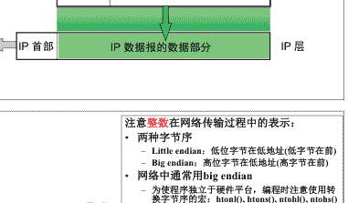

### 二、UDP首部格式

- UDP数据报包括2个字段：首部和数据字段
- 首部共4个字段，8字节
- 首部各字段
  - (1) 源端口：源端口号
  - (2) 目的端口：目的端口号
  - (3) 长度：UDP数据报长度
  - (4) 检验和：用于检测数据的正确性

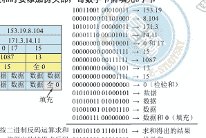

#### 注意要在网络传输过程中的表示：

- 两种字节序
  - Little endian：低字节在低地址处，高字节在前
  - Big endian：高字节在低地址处，低字节在前
- 网络中通常用 big endian
  - 例如在发送字节序列时，编码时要注意使用转换字节序的函数：htons(), htonl(), ntohl(), ntohs()

#### UDP报文示例：DNS请求

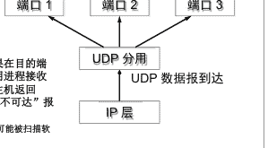

#### 校验和的计算：与IP包头校验和计算类似

- IP计算包头校验和，UDP计算整个数据报的校验和
- 计算校验和时要添加伪首部
- 伪首部字段：源IP地址、目的IP地址、协议号、UDP长度

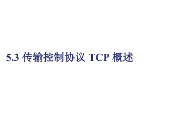

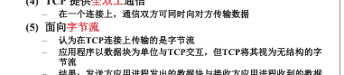

- 在接收方，如果目的端口号上没有应用程序接收数据，则该数据报就被丢弃
- ICMP的“目的不可达”报文
- 安全问题，可能导致扫描软件利用

## 5.3 传输控制协议 TCP 概述

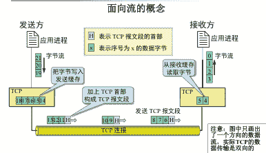

### 一、TCP的主要特点

- **要注意的几点：**
  - TCP连接是一条虚连接而不是一条真正的物理连接
  - TCP对应用进程一次把多长的报文段交到TCP的缓存中是不关心的
  - TCP根据对方给出的窗口值和当前网络拥塞的程度来决定一个报文段应包含多少个字节（UDP发送的报文长度是应用进程给出的）
  - TCP可把太长的数据块划分成短一些的再传送
  - TCP也可等待积有足够多的字节后再构成报文段发出去

### 二、TCP的连接

- TCP把连接作为最基本的抽象
- 每一条TCP连接有两个端点
- TCP连接的端点不是主机，不是主机的IP地址，不是应用进程，也不是传输层的协议端口，TCP连接的端点叫做套接字（socket）或插口
- 端口号拼接到（concatenated with）IP地址即构成了套接字

**套接字 socket ::=（IP地址，端口号）**

- 每一条TCP连接唯一地被通信两端的两个端点（即两个套接字）所确定，即：

**TCP连接 ::= {socket1, socket2} = {(IP1:port1), (IP2:port2)}**

## 5.4 TCP 报文段的首部格式

### TCP报文段的首部格式

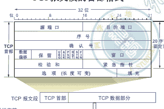

TCP报文段 = TCP首部 + TCP数据部分。图中在TCP报文段下方示意IP首部与IP数据部分。

- 源端口和目的端口字段：各2字节
- 序号字段：4字节
  - 在TCP连接中传送的数据流中的每一个字节都有序号
  - 序号字段指示本报文段所发送的数据的第一个字节的序号，以字节为单位
- 确认号字段：4字节，期望收到对方的下一个报文段的第一个字节的序号
  - 例如：收到对方的报文序号为501，数据长度为200字节，则返回报文段确认号为701
  - TCP连接是全双工的，通信双方可互相发送数据，因此也各有序号和确认号，用于确认对方的数据

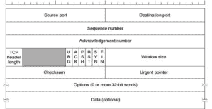

- 数据偏移（首部长度）：4bit，TCP报文段的数据起始位置的偏移，也就是首部的长度，单位是32位字（4字节）
- 保留字段：6bit，保留
- 紧急URG：1bit，为1时，紧急指针字段有效；表明有紧急数据，应尽快传送
- 确认ACK：1bit，为1时，确认号字段有效；为0时，确认号无效
- 推送PSH：1bit，为1时，接收方将尽快向应用进程交付报文段，而不是等到整个缓存填满

TCP报文段首部格式图。


- 复位RST：1bit，为1时，表明TCP连接出现严重差错（如由于主机崩溃），须释放连接后重新建立连接
- 同步SYN：1bit，为1时，表示这是一个连接请求或连接接受报文
- 终止FIN：1bit，为1时，表示要求释放TCP连接
- 窗口大小：2字节，用来让对方设置发送窗口的依据，单位为字节


- 检验和：2 字节，仍为首部+首部数据的校验和
  - 伪首部（pseudoheader）格式与 UDP 的伪首部相同


- 紧急指针（Urgent pointer）：仅当 URG=1 时有意义，指出紧急数据末尾在报文中的位置。
- 选项：长度可变，最多 40 字节。
  - 最常见的一个选择项是最大报文段长度 MSS（Maximum Segment Size），每一方在建立 TCP 连接时，双方可使用不同的 MSS。
- 填充字段：使首部长度为 4 字节的整数倍。


### TCP报文示例：HTTP


## 5.5 TCP可靠传输的实现

### 一、以字节为单位的滑动窗口

- TCP 基于滑动窗口协议实现可靠传输和流量控制，滑动窗口以字节为单位
- 发送窗口
  - 在没有收到对方应答的情况下，可以连续把窗口内的数据发送出去
  - 窗口大小的确定：根据对方通告的窗口大小进行调整控制
  - 根据收到的 TCP 报文段中的 acknowledge number 字段，窗口向前滑动
  - acknowledge number 字段表示在此序号之前的数据已经正确接收


> - A 收到 B 的报文段中“window size=20，acknowledge number=31”，窗口将前移自己的发送窗口
> - 当对方通知的窗口尺寸变小时，发送窗口前沿可能需要向后收缩，但 TCP 标准强烈不赞成这种做法

A 发送 11 字节后


- P3－P1 = A 的发送窗口（又称为通知窗口）
- P2－P1 = 已发送但尚未收到确认的字节数
- P3－P2 = 允许发送但尚未发送的字节数

- 接收窗口
  - 窗口内的数据是允许接收的
  - 窗口后沿以外是已经接收并交付上层的数据

- B 收到 31 号数据后，窗口前移 3 字节，并返回确认号 34，使接收窗口仍为 20
- A 收到确认号 34 后，窗口前移 3 字节
- B 收到 37、38、40 号数据，由于数据未按序收全，不能上交


> - A 将发送窗口中尚未发送的数据全部发送后，发送窗口已满，停止发送
> - 如果未收到 B 返回的应答，A 等待超时后将重发部分数据，直到收到应答为止

#### 2009年考研题

主机甲与主机乙之间已建立一个 TCP 连接，主机甲向主机乙发送了两个连续的 TCP 段，分别包含 300 字节和 500 字节的有效载荷，第一个段的序列号为 200，主机乙正确接收到两个段后，发送给主机甲的确认序列号是（ ）

- A. 500
- B. 700
- C. 800
- D. 1000

- 发送缓存用来暂时存储：
  - 发送应用程序要发送的 TCP 段，但尚未发出的数据
  - 已发出，但尚未收到确认的数据
- 接收缓存用来暂时存储：
  - 接收到的数据，但尚未被应用程序取走的数据
  - 接收到的数据，但尚未按顺序到达的数据
- A 的发送窗口大小是和 B 的接收窗口一样大
- TCP 要实现接收方缓存和累积确认的功能，这样可以减少传输开销

### 二、超时重传时间的选择

- TCP 的可靠传输通过发送方的超时重传实现
  - TCP 发送一个报文段，就启动一个计时器
  - 如果计时器设置的重传时间已过，但没有收到确认，就重传该报文段
- 超时重传时间设置是一个复杂的问题
  - IP 协议提供的是尽最大努力服务，每个数据报所经过的路由都可能变化
  - 传输的性能也同时变化
- TCP 采用一种自适应算法计算超时重传时间
- 加权平均往返时间 RTTs（往返时间，RTT—Round Trip Time）
- TCP 用 RTTs 表示 RTT 的加权平均往返时间，又称为平滑的往返时间
- 每次收到新的 RTT 样本，RTTs 按如下加权平均计算：
  - 新的 RTTs = (1-α)×旧的 RTTs + α×新的 RTT 样本
  - 其中 0<α<1，α 越小，新样本权重越小；α 越大，RTT 值更新越快
  - RFC 2988 推荐 α=1/8，即 0.125

问：为什么不直接用单一的 RTT？

- 超时重传时间 RTO（Retransmission Time-Out）
  - RTO 应略大于 RTTs
  - RFC 2988 建议使用下式计算 RTO：
  - RTO = RTTs + 4 × RTTd
  - RTTd 是 RTTs 的偏差的加权平均值
  - RFC 2988 建议这样计算 RTTd：
    - 第一次测量时，RTTd 值取为测得的 RTT 样本值的一半
    - 在以后的测量中，使用下式计算加权平均 RTTd：
      - 新的 RTTd = (1-β)×旧的 RTTd + β×|RTTs - 新的 RTT 样本|
      - 其中 0<β<1，推荐是 1/4，即 0.25

- 往返时间 RTT 的测量并不简单
  - TCP 发送报文段时，记录发送时间，收到该报文段 ACK 时，计算该报文段往返时间
  - 还要确定确认报文段是对哪一个报文段的确认，并对重传的报文段做判断
- Karn 法
  - 计算平均往返时间 RTTs 时，只要报文段重传了，就不采用其样本
  - 这样做可以使加权平均往返时间 RTTs、超时重传时间 RTO 较为准确
- 修正的 Karn 法
  - 报文段每重传一次，就把 RTO 增大一倍（如加倍）
  - 不再发生重传时，才开始更新往返时间 RTT 和 RTO

## 5.6 TCP的流量控制

### 一、利用滑动窗口实现流量控制

- 流量控制（flow control）就是让发送方的发送速率不要太快，使得接收方来得及接收
- 利用滑动窗口机制可以很方便地在 TCP 连接上实现流量控制
- TCP 连接建立过程中，将自己的接收窗口大小告知对方
- TCP 报头中都携带窗口大小字段，告知对方自己接收窗口的剩余大小（即可以接收的字节数）
- 发送方的发送窗口应不大于对方的接收窗口

- A 向 B 发送数据
- 在连接建立时，B 告诉 A：“我的接收窗口 rwnd = 400（字节）”

问题：如果 B 向 A 发送的这个报文丢失了，如何避免双方互相等待？

- 持续计时器（persistence timer）
- TCP 为每一个连接设置一个特殊计时器
- 只要一方收到对方的零窗口通知，就启动持续计时器
- 若持续计时器设置的时间到，就发送一个零窗口探测报文段（仅携带 1 字节的数据），而对方在确认这个探测报文段时给出当前窗口值
- 若窗口仍是零，则收到这个报文段的一方就重新设置持续计时器
- 若窗口不是零，则死锁的僵局就可以打破了

### 二、传输效率

- 可以用不同的机制来控制 TCP 报文段的发送时机
- 机制一：缓存中的数据达到一定量时就发送
  - TCP 维持一个变量，它等于最大报文段长度 MSS
  - 只要缓存中存放的数据达到 MSS 字节时，就组装成一个 TCP 报文段发出
- 机制二：应用进程控制
  - 由发送方应用程序明确要求发送报文段，即推送（push）操作
- 机制三：定时发送
  - 发送方的一个计时器周期到了，这时就把当前已有的缓存数据装入报文段（但长度不能超过 MSS）发送出去

## 5.7 TCP的拥塞控制

### 一、拥塞控制的一般原理

- 拥塞（congestion）概念和产生原因（1/2）
  - 在某段时间，某网络中同时要求传送的数据量超过了该网络所能提供的可用部分，网络的拥塞就变得明显，从而产生拥塞，即拥塞产生的条件：
    - 资源的需求 > 可用资源
    - 网络资源、链路带宽、路由器处理能力等
  - 网络拥塞是由多种原因引起的，通过简单地增加某种资源数量往往并不能消除拥塞
  - 例如：若网络中的存储容量太小，造成到达数据的频繁丢失；如果增加缓存容量，网络拥塞反而会加剧
  - 报文在网络中排队，但如果路由器处理能力和输出链路带宽增加，报文就能被及时转发，发送主机就提高发送速率，则拥塞就又会产生

- 拥塞（congestion）概念和产生原因（2/2）
  - 网络拥塞的表现：
    - 网络性能下降，具体表现为网络时延增大、报文传输时延增大、丢包增多等，用户感觉到时延变长、丢包增多等
    - 拥塞常常会引起恶化，即恶性循环。由 TCP 流量控制，如：一个网络由于拥塞，不断丢弃报文段，发送端主机超时重传，导致网络中报文段数增多，从而加剧拥塞

- 拥塞控制（congestion control）与流量控制
  - 拥塞控制：防止过多的数据注入到网络中，使网络的路由或链路不致过载
  - 拥塞控制是全网络性的问题，而流量控制是点对点通信量的控制，是端到端的问题

- 拥塞控制的作用

- 开环控制与闭环控制
  - 开环控制：在设计网络时就考虑到可能发生拥塞的因素，力求在网络工作时不产生拥塞
  - 闭环控制：基于反馈的闭环控制，有以下几种措施：
    - 监测网络系统在运行中是否出现拥塞、何处发生拥塞
    - 将检测结果的信号传递给网络的某个地方的有关机构
    - 调整网络系统的某些参数以消除或减轻拥塞
  - RFC 2581 中定义了四种拥塞控制方法：
    - 慢启动（slow-start），又称慢开始
    - 拥塞避免（congestion avoidance）
    - 快重传（fast retransmit）
    - 快恢复（fast recovery）


## 5.7 TCP的拥塞控制

二、拥塞控制方法：慢启动(slow-start)和拥塞避免

- 慢启动进行拥塞控制的基本思路
  - 开始时发送，如果把即时大量数据投入网络，可能导致拥塞
  - 因此发送不要一开始就投入过多
  - 较好的方法是：试探地从小到大增加最大发送窗口

- 拥塞窗口 cwnd (congestion window)
  - 发送方维护拥塞窗口，它是一个动态变量
  - 拥塞窗口的大小取决于网络的拥塞程度，并且动态地变化
  - 发送方让自己的发送窗口等于拥塞窗口，如果收到接收方的确认，则发送窗口就可以不小于拥塞窗口
  - 发送方控制拥塞窗口的原则
    - 只要没有出现拥塞，拥塞窗口就增大一些，以便更多的分组尽快发送
    - 一旦出现拥塞，拥塞窗口就减小一些，以减少注入到网络中的分组数

注意： cwnd+1表示一个MSS长度，不是1字节


- 慢启动的工作过程
  - 开始发送报文时，设置拥塞窗口 cwnd = 1，即设置一个最大报文段MSS的数量
  - 每收到一个对新发送报文的确认，就将拥塞窗口加1，即增加一个MSS的数量
  - 这种做法使拥塞窗口按指数规律增长，可以使分组迅速达到网络的传输速率
  - 注意：TCP中窗口大小是以字节为单位的，为方便起见，这里以MSS为单位讨论拥塞窗口大小

- 传输轮次 (transmission round)
  - 使用慢启动，每经过一个传输轮次，拥塞窗口 cwnd 就加倍
  - 一个传输轮次所经历的时间共同就是往返时间 RTT
  - 传输次数越多越逼近
  - 把前轮次 cwnd 个报文发送出去并全部被接收方收到，并得到已确认的下一个轮次的开始
  - 例如，拥塞窗口 cwnd = 4，这时往返时间 RTT 是发送方发送 4 个报文时间，并收到这 4 个报文的确认后，总共经历的

- 为防止拥塞窗口 cwnd 增长过长导致拥塞，设置一个慢启动门限 ssthresh
  - cwnd < ssthresh 时，使用慢启动算法
  - cwnd >= ssthresh 时，停止使用慢启动算法而改用拥塞避免算法
  - cwnd > ssthresh 时，使用慢启动算法改用拥塞避免算法

- 拥塞避免算法的思想
  - 让拥塞窗口 cwnd 缓慢地增大，即每经过一个往返时间 RTT 把发送方的拥塞窗口 cwnd 加 1，而不是加倍，使拥塞窗口按线性规律缓慢增长

- 拥塞发生时的处理
  - 无论是慢启动阶段还是在拥塞避免阶段，只要发送方判断网络出现拥塞(没有按时收到确认)，就把它把慢启动门限 ssthresh 设置为出现拥塞时的发送窗口值的一半(但不小于2)
  - 然后把拥塞窗口 cwnd 重新设置为 1，执行慢启动算法
  - 这样做的目的，迅速减少注入到网络中的分组数，使得发生拥塞的网络有足够的时间从拥塞状态中恢复


注意：TCP中窗口宽度和门限值均以字节为单位，本图为以MSS计数

- 乘法减小(multiplicative decrease)
  - 不论在慢启动阶段还是拥塞避免阶段，只要出现一次超时(即网络拥塞)，就把慢启动门限 ssthresh 减小到拥塞窗口的一半
  - 当网络繁忙出现拥塞时，ssthresh 值下降得很快，以大大减少注入到网络中的分组数

- 加法增大(additive increase)
  - 拥塞避免阶段，每经过一个往返时间 RTT，把拥塞窗口 cwnd 增加一个 MSS 大小，使拥塞窗口缓慢增大，以防止网络过早出现拥塞

2009年的一道考研题
一个TCP连接是发送1KB的最大长度发送TCP段，发送方有足够大的数据发送。拥塞窗口为16KB时发生了超时，如果接下来4个RTT时间内发送的TCP段都得到确认，拥塞窗口大小为？
A. 7KB B. 8KB C. 9KB D. 16KB

2010年的一道考研题
主机甲和主机乙之间建立一个TCP连接，TCP最大段长度为1000字节。主机甲的接收窗口为1000字节。在主机甲向主机乙发送数据之前，主机乙已向主机甲发送了初始序号为100的报文段。主机乙收到主机甲的第一个报文段后，确认号应为？
A. 100 B. 200 C. 300 D. 400

## 5.8 TCP的连接管理

三、拥塞控制方法：快重传和快恢复
• 快重传（fast retransmit）算法思路
  - 如果发送方在规定时间内未收到确认报文，说明网络中发生了拥塞，此时发送方就重传丢失的小段数据
  - 接收方收到一个失序的报文段，就发送重复确认，以便使发送方及早知道该报文段已被接收方收到
  - 发送方只要连续收到三个重复确认就立即重传对方尚未收到的数据报文段
• 快恢复（fast recovery）算法思路
  - 当源端收到连续三个重复的确认时，就进行“乘法减小”，把拥塞窗口ssthresh减半
  - 接下来不执行慢启动算法，而是设置cwnd为ssthresh减半值，然后执行拥塞 avoidance（“加法增大”），使拥塞窗口缓慢地线性增大
  - 只要收到从网络中传来的没有发生失序的数据（只有重复确认），因为拥塞时不会有重复数据又传回给发送方

### 快重传示例


三、拥塞控制方法：快重传和快恢复
• 发送窗口的上限值
  - 从流量控制角度考虑，发送窗口不能超过对方给出的接收窗口rwnd
  - 综合考虑流量控制和拥塞控制，发送方的发送窗口的上限应取发送方基于拥塞控制窗口rwnd和拥塞窗口cwnd两者中较小的一个
  - 发送窗口的上限值 = Min[rwnd, cwnd]
  - 当rwnd < cwnd时，是接收方的接收能力限制发送窗口的最大值
  - 当rwnd ≥ cwnd时，则是网络的拥塞限制发送窗口的最大值

一、简介
• TCP传输连接有三个阶段
  ① 连接建立
  ② 数据传输
  ③ 连接释放
• 连接建立过程中要解决三个问题：
  - 双方——可能够知道对方的存在
  - 双方——能够协商一些参数（如最大报文段长度、最大窗口大小、服务类型等）
  - 能够使连接双方进行分配（如缓存、连接表中的项目等）
• TCP 连接的建立都采用客户/服务器方式
  - 客户(client)：主动请求建立连接的应用进程
  - 服务器(server)：被动等待连接建立的应用进程

二、TCP的连接建立
• TCP连接的建立采用三次握手（three-way handshake）
  ① A发送连接请求报文段，其SYN=1，同时选择序号seq=x，并将该报文段发给B
  ② B收到连接请求报文段，若同意建立连接，则向A发送确认报文段，其ACK=1，确认号ack=x+1，同时也选择一个初始序号seq=y，并将该报文段发给A
  ③ A收到B的确认后，向B发送确认报文段，其ACK=1，确认号ack=y+1
  B收到后，TCP连接建立


二、TCP的连接建立
• 关于3次握手的讨论
  - 为什么要采用三次握手而不是两次握手？
    防止“已失效的连接请求报文段”在网络中漫游
  - 客户等待超时后，重新发送请求，服务器响应，导致建立连接，服务器建立连接后，客户若收到旧的确认报文段，会误以为连接建立
  - 安全问题，专门针对三次握手的TCP SYN Flooding攻击
  - 攻击者发送大量SYN报文段，但不向对方发送确认报文段，导致服务器资源耗尽
  - Linux采用SYN Cookies机制控制这种攻击

### 三、TCP的连接释放

- 连接的释放可由一方发起
- （假设A主动关闭连接）A发送报文，其首部的 FIN=1，序号seq=u
- B发出确认，ACK=1，确认号ack=u+1，序号seq=v

- 若发送数据，A要继续发送数据
- 若已发送完所有数据，A发送连接释放报文(FIN=1, ACK=1)
- A收到后，发出确认，其中ACK=1，确认号ack=w+1，序号seq=u+1
- TCP连接必须经过时间2MSL才真正释放掉


## 5.8 TCP的连接管理

三、TCP的连接释放
- 关于MSL
  - Maximum Segment Lifetime，报文段最大存活时间
  - RFC793中建议MSL=2分钟，一般使用更小的值
- 关闭连接前等待2MSL时间的原因
  - 为保护A发送的最后一个ACK报文段能够到达B
  - 防止“已失效的连接请求报文段”出现在本连接中
  - A在发送完最后一个ACK报文段后，再经过时间2MSL，就可使本连接持续的时间内所产生的所有报文段，都从网络中消失。这样就可以使下一个新的连接中不会出现这种旧的连接请求报文段


## 第5章作业

- 5-12
- 5-13
- 5-14
- 5-23
- 5-29
- 5-31
- 5-33
- 5-39
- 5-41
下周四交

## 第六章 应用层

刘轶
北京航空航天大学 计算机学院

### 本章内容

- 6.1 套接字编程接口
- 6.2 域名系统 DNS
- 6.3 文件传输协议
- 6.4 万维网WWW
- 6.5 电子邮件

### 应用层协议特点

- 应用层协议为了解决某一类应用问题
  - 由于网络应用的多样性，应用层的协议也种类繁多
- 应用层的许多协议都是基于客户/服务器方式
  - 客户(client)和服务器(server)都是指通信中涉及的两个应用进程
  - 客户/服务器方式所描述的是进程之间服务和被服务的关系
  - 客户是服务请求方，服务器是服务提供方


## 6.1 套接字编程接口

网络子系统作为操作系统的一部分，以应用编程接口（API, Application Programming Interface）的形式向应用程序提供调用接口。套接字（socket）是最常用的应用层编程接口，其名称源自 Berkeley UNIX 系统。经典的 socket 编程接口采用同步调用方式（又称阻塞式）。调用 `recv()` 时，调用进程被阻塞，直到数据到达为止。对于 Windows 这类基于事件驱动的系统，程序的执行由事件驱动，需要采用支持异步动作方式的套接字编程接口。Microsoft 推出 WinSock 编程接口，在阻塞式调用基础上增加了异步调用方式。在阻塞式调用模式下，WinSock 与经典的 socket 兼容。

### 应用进程通过套接字接入到网络


### 调用 socket() 创建套接字


### 常用 socket 接口函数

| 接口函数 | 功能 |
|---|---|
| SOCKET socket(int af, int type, int protocol) | 创建一个 socket |
| int bind(SOCKET s, struct sockaddr *addr, int namelen) | 绑定一个本地地址到 socket |
| int listen(SOCKET s, int backlog) | 在指定端口监听并建立连接 |
| int connect(SOCKET s, struct sockaddr *name, int namelen) | 向指定名称的服务器建立连接请求 |
| SOCKET accept(SOCKET s, struct sockaddr *addr, int *addrlen) | 接收并建立新的连接请求 |
| int send(SOCKET s, char *buf, int len, int flags) | 在连接的 socket 上发送数据 |
| int recv(SOCKET s, char *buf, int len, int flags) | 在连接的 socket 上接收数据 |
| int sendto(SOCKET s, char* buf, int len, int flags, struct sockaddr* to, int token) | 向指定目的的网络发送数据报 |
| int recvfrom(SOCKET s, char* buf, int len, int flags, struct sockaddr* from, int *fromlen) | 在 socket 上接收数据并记录地址 |

### 基于 UDP 的系统调用流程


SOCKET socket(int af, int type, int protocol);

### 基于 TCP 的系统调用流程


## 6.2 域名系统 DNS

### 一、域名系统概述

域名系统 DNS（Domain Name System）是 Internet 使用的命名系统。
RFC 1034：Domain Names - Concepts And Facilities
RFC 1035：Domain Names - Implementation and Specification
Internet 采用层次结构的命名树作为主机的名字，并使用分布式的域名系统 DNS。多个域名服务器共同运行专门的域名服务器程序，完成域名到 IP 地址的解析（resolve）。DNS 基于 UDP 协议实现。应用进程需要进行域名解析时，就调用域名解析程序（resolver），它成为 DNS 的一个客户。客户向本地域名服务器发送域名解析请求（通常包含待解析的域名）。本地域名服务器在查找域名后，返回应答报文，其中包含对应的 IP 地址。

### 二、Internet 的域名结构

Internet 采用层次结构的命名方法。
...顶级域名...二级域名...三级域名
顶级域名（TLD: Top Level Domain）
国家顶级域名，如：.cn 表示中国，.us 表示美国，.uk 表示英国，等等。
通用顶级域名：

| 域名 | 含义 |
|---|---|
| .com | 公司和企业 |
| .net | 网络服务机构 |
| .org | 非营利性组织 |
| .edu | 美国专用的教育机构 |
| .gov | 美国专用的政府部门 |
| .mil | 美国专用的军事部门 |
| .int | 国际组织 |

新增的通用顶级域名

| 域名 | 含义 |
|---|---|
| .aero | 航空运输企业 |
| .biz | 公司和企业 |
| .cat | 加泰隆人的语言和文化团体 |
| .coop | 合作团体 |
| .info | 各种情况 |
| .jobs | 人力资源管理者 |
| .mobi | 移动产品服务商和用户提供者 |
| .museum | 博物馆 |
| .name | 个人 |
| .pro | 有证书的专业人员 |
| .travel | 旅游业 |

注意：
- 域名不区分大小写
- 域名长度不超过 255 个字符


### 三、域名服务器

域名服务器分为四类：
1. 根域名服务器
   - 最高级的域名服务器，知道所有的顶级域名服务器的域名和 IP 地址。
   - 当本地域名服务器无法解析域名时，求助于根域名服务器。
2. 顶级域名服务器
   - 负责管理在该顶级域名下注册的所有二级域名。
3. 权威域名服务器
   - 负责一个区（zone）的域名服务器。
4. 本地域名服务器
   - 有时也称为默认域名服务器。

一个区的域名服务器通常分散在多台服务器上保存，其中一台为主域名服务器，其余为辅助域名服务器。

树状结构的 DNS 域名服务器


主机向本地域名服务器的查询一般采用递归查询。如果本地域名服务器不知道被查询域名的 IP 地址，那么它就以 DNS 客户的身份，向根域名服务器继续发出查询请求报文。本地域名服务器向根域名服务器的查询通常采用迭代查询。当根域名服务器收到本地域名服务器的迭代查询请求报文时，要么给出所要查询的 IP 地址，要么告诉本地域名服务器下一步应向哪一个域名服务器查询。随后，本地域名服务器进行后续的查询。

本地域名服务器采用迭代查询


域名服务器端口号：53。为提高域名查询效率，域名服务器上通常存放着高速缓存。

本地域名服务器采用递归查询（较少采用）

根域名服务器 递归查询 顶级域名服务器 dns.com 权威域名服务器 dns.abc.com 本地根域名服务器 dns.xyz.com 递归查询 y.abc.com 的 IP 地址 m.xyz.com

2010 年的一道考研题：

如果本地域名服务器无缓存，当采用递归方法解析另一网络主机域名时，用户主机、本地域名服务器发送的域名请求消息数分别为：
A. 一条、一条
B. 一条、多条
C. 多条、一条
D. 多条、多条

## 6.3 文件传送协议

RFC 959: File Transfer Protocol (FTP)
FTP 使用客户/服务器方式。一个 FTP 服务器同时可为多个客户提供服务。FTP 的服务模型采用主进程和从属进程组成：一个主进程负责监听新请求；若有新请求到来，则从主进程中派生一个从进程。

主进程的工作步骤：
1. 打开服务器端端口（端口号为 21），使客户进程能够连接上；
2. 等待客户进程发出连接请求；
3. 启动从属进程处理客户进程发来的请求。

从属进程和客户进程建立连接后可以单独工作。从属进程在运行过程中若接收到客户进程发来的请求，处理完毕后回到初始状态，继续接受其他客户进程发来的请求。主进程与从属进程的处理是并行进行的。

FTP 使用 2 个 TCP 连接：控制连接和数据连接。

控制连接：
- 在一个会话期间一直保持打开；
- FTP 客户所发出的控制信息通过控制连接发送给服务器端的控制进程，但控制连接不传输数据。

数据连接：
- 收到 FTP 客户发来的文件传输请求后，服务器端控制进程创建“数据连接进程”（如“数据传送”）。
- 数据连接用来传输文件的数据，传输完毕后关闭“数据传送连接”并结束运行。

2009 年的一道考研题：

FTP 客户和服务器间传送 FTP 命令时，使用的是连接是：
A. 建立在 TCP 之上的控制链接
B. 建立在 TCP 之上的数据链接
C. 建立在 UDP 之上的控制链接
D. 建立在 UDP 之上的数据链接

## 6.4 万维网 WWW

### 一、万维网概述

WWW——World Wide Web。
1989 年，欧洲核子研究中心提出 WWW。
1993 年，第一个浏览器 Mosaic 出现。
1995 年，Netscape Navigator 上市。
万维网是分布式的超媒体（hypermedia）系统，它是超文本（hypertext）系统的扩充。

要解决的几个问题：
- 怎样标识分布在整个网络上的万维网文档？——URL
- 用什么协议实现万维网上各种超链接的链接？——HTTP
- 如何存储和表示万维网文档？——HTML


## 6.4 万维网WWW

### 一、万维网概述


### 二、统一资源定位符URL(Uniform Resource Locator)

- URL是对Internet上资源位置和访问方法的一种简洁表示
- URL的一般形式：<协议名>://<主机名>:<端口>/<路径>
- ftp —— 文件传输协议 FTP
- http —— 超文本传输协议 HTTP
- News —— USENET 新闻
- <主机>为存放资源的主机在Internet中的域名
- <端口>和<路径>有时可省略，使用http协议时，如省略<端口>，则默认为端口号80；如省略<路径>，则指主页(home page)
- URL不区分大小写

## 三、超文本传输协议HTTP

- HTTP---HyperText Transfer Protocol
- 基于TCP协议，是万维网上可靠地交换文件的重要基础
- HTTP是面向事务的客户/服务器协议
- HTTP是无状态的(stateless)
  - 服务器不记录客户的访问活动状态
- 基本工作原理解释
  - Web服务器默认端口号是80，服务器通常在该端口上监听
  - 客户端需要请求某个页面时，与服务器建立TCP链接，然后客户端发送文件，并进行文件的传输，传输完毕后释放TCP连接

#### 万维网的工作过程


#### 鼠标点击超链接后发生的事件

- (1) 浏览器分析超链接指向的URL
- (2) 浏览器向DNS服务器请求www.tsinghua.edu.cn的IP地址
- (3) 域名系统DNS解析出清华大学Web服务器的IP地址
- (4) 浏览器与服务器建立TCP连接
- (5) 浏览器发出获取文件命令：GET /ehn/yxsz/index.htm
- (6) 服务器给出响应，把文件index.htm发给浏览器
- (7) TCP 连接释放
- (8) 浏览器显示“清华大学院系设置”文件index.htm中的所有文本
- HTTP/1.0传输一个文件都要建立一次TCP连接；HTTP/1.1进行了改进

#### 请求一个万维网文档所需的时间

- 首先建立TCP连接，需三次握手
- 在三次握手后，第3次握手数据包的第3部分可传送HTTP请求报文
- 请求文档所需时间
  - 文档传输时间
  - 2倍RTT时间
- HTTP/1.0的主要缺点
  - 每请求一个新文档都要建立一次TCP连接
  - 一个Web页通常包含若干数量众多的文件


## 三、超文本传输协议HTTP

- HTTP/1.1协议使用持续连接(persistent connection)
  - 服务器发送响应后，在一段时间内保持连接，使客户与服务器可以继续传输后续的HTTP请求报文和响应报文
  - 这并不局限于传送同一个页面上链接的文件，而是只要这些文件都在同一一个服务器上
  - 目前主流的浏览器都支持HTTP/1.1
- HTTP的报文类型：两种报文
  - 请求报文——从客户端向服务器发送请求报文
  - 响应报文——从服务器发送给客户端的回应
- HTTP是面向正文的(text-oriented)，报文中的字段都是ASCII码串，因此每个字段的长度是不确定的

- 报文由三个部分组成，即开始行、首部行和实体主体
- 在请求报文中，开始行就是请求行
方法
- 面向的对象技术中
- 使用的习惯叫做
- 方法就是就是一
- 整体请求
URL: 所请求资源的URL
版本: HTTP的版本


## 6.5 电子邮件

- 电子邮件系统的两种实体：
  - 用户代理UA(User Agent)
    - 是用户与电子邮件系统的接口，即电子邮件客户端软件
    - 用户代理的功能：撰写、显示、处理和通信
  - 邮件服务器
    - 用于发送和接收邮件，并向发件人报告递送结果(已交付、被拒绝、丢失等)
    - 邮件服务器接收邮件的服务器方工作
    - 使用发送邮件取多个不同协议，即发送邮件的SMTP协议和客户端接收邮件的POP3协议
    - 一个邮件服务器既可以作为客户，也可以用作服务器

- 发送电子邮件的主要步骤：
  ① 发件人运行自己主机中的用户代理，撰写和编辑邮件
  ② 发件人使用用户代理把邮件用SMTP协议发送给发送方邮件服务器
  ③ 邮件服务器把邮件暂时存储在邮件缓存队列中，等待发送
  ④ 发送方邮件服务器处理接收到的邮件，由SMTP客户与接收方邮件服务器SMTP服务器建立TCP连接，并将邮件发送出去
  ⑤ 运行在接收方邮件服务器中的SMTP服务器收到邮件后，把邮件放入收件人的邮箱中，等待收件人读取
  ⑥ 收件人入收信箱，运行自己主机中的用户代理，使用POP3或IMAP协议读取邮件

### 二、简单邮件传输协议 SMTP

- 简介
  - SMTP规定了两个相互通信的SMTP进程之间应如何交换信息
  - SMTP使用客户/服务器模式
    - 负责发送邮件的SMTP进程是SMTP客户
    - 负责接收邮件的SMTP进程是SMTP服务器
  - SMTP定义了命令和21种响应信息
    - 命令通常由4个字符组成，后面一个位置数字的响应码，后跟空格以
      也可携带相应的参数说明
  - SMTP建立了三个阶段
    ① 连接建立：连接在发送主机和SMTP客户和接收主机的SMTP服务器之间建立，不使用中间邮件服务器
    ② 邮件传递
    ③ 连接释放：邮件发送完毕后，SMTP释放TCP连接

### 三、电子邮件的信息格式

- RFC 2822(RFC 822)：Internet Message Format
  - 一个电子邮件分为为邮件头和内容两大部分
  - RFC 822只规定了邮件内容的首部(header)格式，而对邮件的主体(body)部分则由用户自由撰写
  - 首部中的主要字段
    - To：后面跟入一个或多个收件人的e-mail地址
    - Subject：邮件的主旨，反馈给邮件的主内容
    - Cc：抄送(Carbon copy)，表示除了主要收件人外，还发给一个邮件副本
    - From：发信人的电子邮件地址
    - Date：发信日期
    - Reply-to：对方回信地址

### 四、MIME

- MIME---Multi-purpose Internet Mail Extension
- SMTP的问题
  - 只能传送7位ASCII码
  - 不能传送二进制数据：程序、图片、音乐、东方语言、...
- MIME的思路
  - 继续使用目前的[RFC 822]格式
  - 对二进制数据进行编码，将其转换为7位ASCII码
  - 邮件首部中增加字段，定义数据类型和编码规则

### 四、MIME

- MIME新增了5种头部字段

| 字段 | 含义 |
|---|---|
| MIME-Version | MIME版本号，一般为1.0 |
| Content-Type | 报文内容的媒体类型 |
| Content-Transfer-Encoding | 报文编码规则 |
| Content-ID | 唯一的标识符 |
| Content-Description | 供人阅读的内容描述 |

- 传输编码规则：
  - base64：又称为Radix-64（数学64进制），原二进制数据中的每6bit映射成8bit(ASCII字符)
  - quoted-printable：原二进制数据的8bit字节分为2个16进制制，添加"="

## 第七章 IPv6协议

刘 轶
北京航空航天大学 计算机学院

### 本章内容

- 7.1 概述
- 7.2 IPv6地址
- 7.3 IPv6首部
- 7.4 IPv4向IPv6过渡


## 7.1 概述

随着Internet的快速发展，现IPv4已很不适用
- IP地址空间耗尽问题
- 安全性问题
- 服务质量问题
解决IP地址耗尽问题的措施：
- 采用无类别编址CIDR，使IP地址的分配更加合理
- 采用网络地址转换NAT方法以节省全局IP地址
- 采用具有更大地址空间的新版本IP协议IPv6
IETF于1992年提出下一代IP，即IPng(IP Next Generation)
IPv6于1998年成为标准草案
- RFC 2460—2463

IPv6引入的主要变化：
- 更大的地址空间
  - IPv6将地址从IPv4的32位增加到了128位
- 扩展的地址层次结构
- 灵活的首部格式
- 改进的选项
- 允许协议继续扩充
- 支持即插即用(即自动配置)
- 支持资源的预分配

## 7.2 IPv6地址

IPv6数据报的目的地址可以是三种基本类型地址之一
- 单播(unicast)：发送给点对点通信
- 组播(多播multicast)：一点发送给多个的信息
- 任播(anycast)：IPv6增加的类型，在逻辑的目的就是一组计算机集，但数据报在交付时只交付其中的一个，通常是距离最近的一个
IPv6地址为128位
- 地址空间≈3.4×10^38，地球表面每平方米×10^10个地址
IPv6地址采用冒号十六进制记法(colon hexadecimal notation)
- 每一16位的数值用十六进制值表示，各值之间用冒号分隔
- 例：68E6:8C64:FFFF:FFFF:0:1180:960A:FFFF

冒号十六进制记法
- 零压缩(zero compression)，即连续的零可以为一对冒号所取代(一个地址只能用一次)
- 例：FF05::0:0:0:B3 可以写成：FF05::B3
- 冒号十六进制记法可结合含点十进制的后缀
- 例：0:0:0:0:128.10.2.1
- 再使用零压缩即为：::128.10.2.1
CIDR的斜线表示法仍然可用
- 例：60位前缀的12AB000000000CD3可记为：
  12AB:0000:0000:CD30:0000:0000:0000:0000/60
  或12AB::CD30:0:0:0:0/60
  或12AB:0:0:CD30::/60

## 7.3 IPv6首部

### 一、IPv6数据报结构
- 首部长度固定40字节，称为基本首部(base header)
- 取掉了不必要的功能，首部字段数量减少到8个
- 取消了首部的校验和字段，加快了由路由器处理数据报的速度
- 在基本首部的后面可以有零个或多个扩展首部
- 所有的扩展首部和数据部分合起来叫做数据报的有效载荷(payload)


### 二、基本首部
- 版本(version): 4位, 协议版本, 对应IPv6数据报为6
- 流标签(traffic class): 8位, 用于区分IPv6数据报的类别或优先
- 流标签(flow label): 20位, “流”是指从特定源点到特定的一系列数据报, “流”所携带的报文在上层协议所保证的服务质量。所有数据报同一流的数据报具有相同的流标签
- 有效载荷长度(payload length): 16位, 表示数据报除基本首部以外的长度(字节), 最大值为64KB
- 下一个首部(next header): 8位, 相当于IPv4的协议段或可选字段
- 跳数限制(hop limit): 8位, 数据报发出时设定跳数限制, 路由器在转发数据报时将该数字减1, 当该数字为0时, 将此数据报丢弃
- 源地址: 128位, 数据报的发送方的IP地址
- 目的地址: 128位, 数据报的接收方的IP地址

### 三、扩展首部
简介
- 原IPv4首部中的选项功能都放在IPv6扩展首部中
- 整理提高传输过程中的安全性并实现各种增强服务功能提高首部效率, 允许路由器和目的主机处理, 路由器的处理效率更大提高
在RFC 2460中定义了六种扩展首部:
- 逐跳选项
- 路由选择
- 分片
- 目标
- 封装安全有效载荷 IPsec
- 目的站选通

## 7.4 IPv4向IPv6过渡

### 一、简介
- IPv6过渡只能采用逐步演进的方式, 还必须使新安装的IPv6系统能够与旧系统
- IPv6系统必须能够接收和转发IPv4分组, 并能够被称为IPv4分组转发路由器
- 目前实现IPv4/IPv6互操作的技术主要有两种:
  - 双协议栈(dual stack)
    - 主机或路由器装有两个协议栈, 一个IPv4和一个IPv6
    - 根据需要使用不同的协议栈进行通信
  - 隧道技术(tunneling)
    - 将IPv6数据报封装后通过IPv4网络传输, 即IPv6数据报作为IPv4数据报的数据报部分
    - 重新封装对IPv4数据报后, IPv4包头中协议类型字段为41

用双协议栈进行从IPv4到IPv6的互连

使用隧道技术从IPv4到IPv6互连

## 第8章 无线局域网(WLAN)

刘 轶
北京航空航天大学 计算机学院

- 8.1 概述
- 8.2 IEEE802.11的安全性
- 8.3 IEEE802.11的物理层
- 8.4 IEEE802.11的MAC层
- 8.5 IEEE802.11的帧结构

## 8.1 概述

802.11网络有两种使用模式
- 基础设施模式(Infrastructure mode)
  - 每个客户机通过一个接入点(AP—Access Point)连接，接入点与其它网络连接
  - 基础设施模式可以形成覆盖范围更大的802.11网络
- 自组网络模式(ad hoc mode)
  - 多台计算机直接连接形成网络，相互间发送帧
  - 无接入点

基础设施模式有架构模式(Infrastructure mode)
- 基本服务集(BSS, Basic Service Set);
  一个或多个AP) + 若干个移动站
- BSS内的站点可以通信，与BSS的通信需通过基站进行
- 每个AP分配一个≤32字节的服务集标识符SSID和一个信道
  SSID: Sevice Set Identifier ←相当于该基本服务集的名字

关联(association)：移动站与AP建立连接，加入该基本服务集
移动站与AP建立关联的方法
① 载波侦听
  移动站等待接收AP周期性发出的信标(beacon frame)
  信标帧中含有若干系统参数(如服务集标识符 SSID 以及支持的速率等)
② 主动扫描
  移动站主动发送探测请求帧(probe request frame)，等待 AP 发出的探测响应帧(probe response frame)

重新关联(Reassociation)：移动站改变其首选AP，即加入另一BSS
移动站从一个BSS漫移到另一个BSS时

Wi-Fi与802.11
- Wireless fidelity(无线保真)的缩写
- 是一个无线网络通信技术的品牌，由Wi-Fi联盟(Wi-Fi Alliance)拥有
目的
  改善基于IEEE 802.11的无线网络产品之间的互通性
- 一般认为，使用IEEE 802.11系列协议的局域网就称为Wi-Fi
- 热点(Hotspot)
  在公共场所提供Wi-Fi接入Internet服务的地点

802.11协议栈(与其他IEEE802协议类似)
- 客户端和AP的协议相同
- MAC子层决定如何分配信道
- LLC子层屏蔽IEEE802协议之间的差异，同时承上启下


## 8.2 IEEE 802.11的安全性

- **第一代安全协议：WEP（Wired Equivalent Privacy）**
    - 各方面安全性都存在缺陷
        - 通过共享密钥加密数据，密钥分配极易导致密钥流重复
        - 通过32位CRC实现完整性保护，防攻击能力很弱
    - 2002年被首次攻破
        - 目前使用免费软件可在很短时间内破解WEP
- **在此背景下，802.11从何处上马？**
    - 2003年推出WPA（WiFi Protected Access）
    - 2004年推出WPA2，成为正式标准
    - WPA是802.11i的子集
- **同一时期，中国推出了WAPI（Wireless LAN Authentication and Privacy Infrastructure），强制性国家标准→原理与802.11相似**

- 移动站在通过AP发送帧之前须进行认证（authentication）
    - 如果802.11网络是开放（open）的
        - 可直接通信，无需认证
        - 否则必须进行认证
    - WPA2的两种认证方式
        - ① 有认证服务器
            - 配置认证服务器，存有用户名和口令数据库
            - 使用802.1x实现认证
            - 适用于企业
        - ② 无认证服务器
            - 移动站和AP间使用预共享密钥（preshared key）进行认证
            - 适用于家庭和小型应用场合

- 认证握手过程：4次握手
    1. AP发出一个随机数（nonce）用于识别（nonce：仅使用一次的临时值）
    2. 客户端选取自己的临时值nonce，并使用自己的nonce、MAC地址、AP的MAC地址、主密钥参与计算会话密钥K_s，客户端将自己的临时值和消息完整性检查值（MIC）发送给AP
    3. AP分发一个组密钥K_G，并用于后续的广播/组播组
    4. 客户端确认组密钥
- 后续的通信使用AES算法加密，密钥为会话密钥K_s


## 8.3 IEEE 802.11的物理层

- **无线频段**
    - 多数无线频段由政府管理和分配，需license才可使用
    - 预留了无需许可即可免费使用的频段
        - ISM频段：ISM—Industrial, Scientific, Medical
        - 限制：发射功率 <1 Watt（WLAN一般不超过50mW）


- **802.11物理层的几种实现方法：**
    - ① 红外IR
        - 早期，已很少使用
    - ② 2.4GHz跳频扩频FHSS
        - 早期，已很少使用
    - ③ 直接扩频DSSS
        - IEEE 802.11b，速率11Mbps，广泛应用
    - ④ 正交频分复用（OFDM）
        - 2003年，IEEE 802.11g，速率54Mbps
    - ⑤ 多入多出（MIMO）-OFDM
        - 2009年，IEEE 802.11n，速率600Mbps

| 标准 | 频段 | 数据速率 | 物理层 | 优缺点 |
|---|---|---|---|---|
| 802.11b | 2.4GHz | 最高11 Mb/s | HR-DSSS | 数据速率较低；信号传播距离远，不易受阻碍物等影响 |
| 802.11a | 5 GHz | 最高54 Mb/s | OFDM | 数据速率较高；支持更多用户同时上网；信号传播距离较短，易受阻碍物影响 |
| 802.11g | 2.4GHz | 最高54 Mb/s | OFDM | 数据速率较高；支持更多用户同时上网；信号传播距离远，不易受阻碍物影响 |
| 802.11n | 2.4GHz / 5GHz | 最高600Mb/s | MIMO + OFDM | 数据速率最高 |

### TP-LINK TL-WR845N

- 无线路由
- 无线标准：IEEE 802.11b/g/n
- 无线传输速率：300Mbps
- 1个10/100M WAN口
- 4个10/100M LAN口

### TP-LINK TL-WR720N

- 迷你多功能无线路由器
- 三种工作模式：AP、Router、3G
- 无线标准：IEEE 802.11b/g/n
- 无线传输速率：150Mbps
- 1个10/100M LAN/WAN口
- 1个10/100M LAN口

## 8.4 IEEE 802.11的MAC层

- 以太网的CSMA/CD协议取得了巨大的成功
- WLAN与以太网同属IEEE 802系列标准
- 无线网络的特点使WLAN不能简单照搬CSMA/CD：
    - 无线网络中，终端设备接收到的信号能量远小于发送节点的信号强度，像CSMA/CD协议那样在发送时进行碰撞检测比较困难
    - 无线信号覆盖范围有限，即使能够进行碰撞检测，也可能检测不到问题 → 隐藏站问题
- WLAN使用CSMA/CA协议
    - CSMA/CA：Carrier Sense Multiple Access / Collision Avoidance
    - 由于无线网络的特点，难以像有线网络那样检测冲突，因此采用碰撞避免
    - 比CSMA/CD复杂得多

### 隐藏站问题（hidden station problem）


### 暴露站问题（exposed station problem）


- 一个发送帧的时序例子：
    1. A向B发送一个帧，此时B、C都准备发送，它们检测到信道忙，于是等待
    2. A收到来自B的确认（ACK），信道变为空闲
    3. B、C不同时发送，避免冲突，而信道仍处于忙
    4. C收到来自A的帧，先等待一段时间，等B发送完成帧后，继续等待，退避
- 与CSMA/CD的两个主要区别
    - 无线网络中信道忙时，有帧到达时先退避，而不是发送
    - 利用确认帧来判断是否发生冲突，无线网络中检测碰撞效果很差


- 802.11的MAC层提供两种服务
    - 分布协调功能DCF：各站点间用CSMA/CA协议竞争使用信道
    - 点协调功能PCF：集中控制方法，由AP逐一轮询各站发送数据，避免了碰撞的发生
- 在实际应用中，DCF使用较多
    - DCF需要考虑的因素：如何尽可能减少冲突


- 802.11的载波监听机制
    - 物理载波监听：检测信道上是否存在有效信号
    - 虚拟载波监听：802.11中的机制
- 虚拟载波监听（Virtual Carrier Sense）
    - 发送站把它占用信道的时间放在发送帧中，其他站在收到该信息后，将不会在一段时间内发送数据 → 冲突的几率大大减少
    - 该信息由发送帧MAC帧中的“持续时间（Duration）”字段表示
    - 本帧发送完毕后会显示出信道还要被占用多长时间，包括确认帧发送所需时间
    - 虚拟载波监听的优点是，其它站不是在收到信号时，而是在收到发送站的通知后才知道信道被占用
- 网络分配向量NAV（Network Allocation Vector）
    - 当一个站检测到正在信道中发送的MAC帧所带的“持续时间”字段时，更新自己的网络分配向量NAV（Network Allocation Vector）
    - NAV指出必须经过多长时间才能完成帧的这次传输，才能使信道转入空闲状态

- 使用CSMA/CA的虚拟载波监听
    - RTS/CTS机制与NAV配合使用，防止隐藏站在同一时间发送，减少冲突
    - ① A向B发送数据帧前，先发送一个RTS（请求发送）
    - ② B收到此请求后，返回一个CTS（允许发送）
    - ③ A开始发送数据帧，并启动一个ACK计时器
    - ④ B收到数据帧后，返回一个ACK
    - 如果ACK计时器超时而未收到ACK，则认为发生了冲突，退避后重新发送
    - 如果其他站收到RTS或CTS，会由此更新自己的NAV
    - 因此在收到时间内禁止发送


## 8.4 IEEE 802.11的MAC层

- **帧间间隔（InterFrame Space）** 详见：闲学天地（www.e-studysk...com）。咨询QQ：2696670126
  - IEEE 802.11e，2005年，扩展了CSMA/CA
  - 一帧发出后，需要保持一段时间的空闲，任何站才可以发送帧
  - 为不同类型的帧定义了不同的时间间隔
    - ① **SIFS**：Short IFS，短帧间隔，用于CTS、ACK等帧
    - ② **DIFS**：DCF IFS，DCF帧间隔，用于DCF模式下数据帧
    - ③ **AIFS1/AIFS4**：Arbitration IFS，不同优先级的帧
    - ④ **EIFS**：Extended IFS，收到坏帧时报告

- 帧间间隔机制使得在竞争式发送时，高优先级帧可以优先发送


- **CSMA/CA的退避算法**
  - 一个站要发送数据时，检测到信道空闲后，退避一段时间再检测信道并发送
    （注：退避时间与帧间隔不同）
  - 使用二进制指数退避算法：
    第 i 次退避：在 2^(i+2) 个时隙中随机选择，即：{0, 1, …, 2^(i+2)-1}
    - 第1次退避：退避时间0～7个时隙
    - 第2次退避：退避时间0～15个时隙
  - 站点每过一个时隙就检测一次信道：
    - 若检测到信道空闲，退避计数器继续倒计时
    - 若检测到信道忙，就冻结退避计时器的剩余时间，重新等待信道变为空闲并再经过时间DIFS后，从剩余时间开始继续倒计时

- **CSMA/CA主要特性总结**
  - 发送前退避
    → 同时检测到信道空闲的站退避时间长度不同
  - 发送站/接收站之间RTS/CTS握手
    → 使隐藏站也知晓数据传输
  - 虚拟载波监听NAV配合使用
    → 等待站无须持续监听信道
  - 接收站正确接收数据帧后，需返回ACK帧
    → 使发送站知道是否发生冲突
  - 不同类型的帧设置不同的帧间间隔
    → 控制帧等高优先级帧优先发送出去

> 问：按照CSMA/CA协议，网络中是否可能发生冲突？

## 8.5 IEEE 802.11的帧结构

- 802.11的帧分为三种类型：数据帧、控制帧、管理帧
- **帧控制（Frame control）**：包含11个子字段
  - Version：帧版本
  - Type和Subtype：帧类型（数据、控制、管理）和子类型（如RTS、CTS等）
  - To DS和From DS：该帧是发送到或来自于AP连接的网络
  - More Fragment：分片传输用
  - Retry：是否是重传帧
  - Power management：指明发送方进入节能模式
  - More data：发送方还有更多的帧需要发送
  - Protected frame：该帧数据部分是否被加密
  - Order：告诉接收方高层是否按顺序处理帧

| 帧控制 | 持续时间 | 地址1（接收方） | 地址2（发送方） | 地址3 | 序号 | 数据 | 校验序列 |
|---|---|---|---|---|---|---|---|
| 版本 / 类型 / 子类型 / 到DS / 来自DS / 更多分片 / 重试 / 电源管理 / 更多数据 / 受保护 / 顺序 | | | | | | | |

- **持续时间（Duration）**
  本帧及ACK帧将占用信道时间（单位：微秒）
  其它站根据该字段设置NAV，进行虚拟载波监听
- **地址（Address）**
  - 连续6个字节，802标准地址（即MAC地址）
  - 两个网络之间通信需通过AP，涉及3个地址

| 到DS | 来自DS | 地址1 | 地址2 | 地址3 |
|---|---|---|---|---|
| 0 | 1 | 目的地址 | AP地址 | 源地址 |
| 1 | 0 | AP地址 | 源地址 | 目的地址 |


| 帧控制 | 持续时间 | 地址1（接收方） | 地址2（发送方） | 地址3 | 序号 | 数据 | 校验序列 |
|---|---|---|---|---|---|---|---|
| 版本 / 类型 / 子类型 / 到DS / 来自DS / 更多分片 / 重试 / 电源管理 / 更多数据 / 受保护 / 顺序 | | | | | | | |

- **序号字段（Sequence）**：2字节，用于重复帧的检测
- **数据（Data）**：帧的有效载荷
  - 帧中数据最多2312字节
  - 一般小于1500字节
- **帧校验（Frame check sequence）**：32位CRC校验
- 管理帧格式与数据帧相同，数据内容依管理帧类型而不同
- 控制帧较短，只有一个地址，没有数据

| 帧控制 | 持续时间 | 地址1（接收方） | 地址2（发送方） | 地址3 | 序号 | 数据 | 校验序列 |
|---|---|---|---|---|---|---|---|
| 版本 / 类型 / 子类型 / 到DS / 来自DS / 更多分片 / 重试 / 电源管理 / 更多数据 / 受保护 / 顺序 | | | | | | | |

