# 北航计算理论课件


### 计算理论

### 第一章 绪论


#### 主要内容

- 计算与计算模型
- 计算能力与计算效率
- 图灵机、可计算与文法
- 演算与语言语义
- 计算逻辑与描述逻辑
- 构件计算与服务计算
- 计算理论的地位
- 参考文献

#### 1.1 计算与计算模型

- 计算：
    - 广义地说，计算是信息处理的科学名词。
    - 狭义地说，计算是指算术、代数和微积分等。
    - 科学定义：通过建立模型、进行模拟、实验、验证等研究计算。

- 上世纪初，德国大数学家希尔伯特(Hilbert)提出：

  是否存在着一个通用过程，这个过程能用来判定任意数学命题是否成立，即，输入一个数学命题，在有限时间内，得到一个证明，如果这个命题成立；或是一个反例，如果这个命题不成立。

- 图灵证明了对于平面几何来说，存在这样的过程。但是，对于一般的数学命题，不存在这样的过程。

计算的图灵机定义：

1936年由Turing给出，定义计算为：

输入—执行过程（有限步内结束）—输出

- 1946年，冯·诺依曼与宾夕法尼亚大学的工程师采用电子器件物理实现了图灵的计算模型，建成了世界的第一台计算机。
- 现在称计算机的体系结构为冯·诺依曼体系结构。

- 图灵给出了过程的科学定义，区分了可计算的问题和不可计算的问题。
- 不可计算的问题比可计算的问题要多得多，但很难给出不可计算问题的例子。

- 实际计算中，有时间需求、空间需求。计算要满足一定的需求，否则为理论上可行，但实际上不可行的计算。
- 1971年，Cook和Karp提供了实际可行的计算的标准，即多项式时间算法标准。

- Cook-Karp给出了实际可计算的算法标准，区分了实际可计算的问题和实际不可计算的问题。
- 实际可计算问题称为多项式时间可计算，实际不可计算的问题称为指数时间可计算（Cook-Karp研究的对象都是可计算问题）。

- 算法设计，设计一个过程。
- 算法分析，对设计的过程进行时间和空间需求分析。

- Church论题：任意一个算法都可以用一台图灵机来执行。
- Cook-Karp论题：一个算法实际可行当且仅当它是多项式时间可计算的。

计算模型的两个需求：

- 可以形式化地表示算法(用符号串表示算法)；
- 可以机械地执行算法。

#### 1.2 计算能力与计算效率

- 一个计算模型的计算能力是用它可计算的问题类的大小来刻画的。
- 目前人类尚未找到其它的计算模型，其可计算的问题类超过图灵机的计算能力。
- 算法的计算效率用算法的时间需求（或空间需求）来刻画。空间需求可以转化成时间需求。

#### 1.3 图灵机、可计算与文法

- 图灵机是一个通用的计算模型，是计算机的一个简单数学模型，与现今的计算机具有相同的功能。
- 图灵机由图灵1936年提出，用来研究可计算性。可计算的特点是有穷、离散、机械执行、停机。

#### 图灵关于计算装置设计思想要点

- 一套符号体系来表示信息，包括基本符号表（Alphabet）
- 证明最小的基本符号集有两个基本符号，即，用0和1可表示任意符号串（信息串）
- 读写介质，可以抽象成为一维的线性数据带
- 读写头，阅读介质上的信息
- 输入和输出
- 信息处理状态，用状态转移来表示过程的不同步骤
- 状态转移有一定的规则
- 实施的算法是一个状态的转移序列

通用图灵机能够模拟所有的图灵机。

- 用0,1对图灵机的符号进行编码
- 用0,1对图灵机的动作函数进行编码
- 用0,1符号行对图灵机和输入符号进行编码，作为通用图灵机的输入。
- 此时通用图灵机的输出与输入的图灵机相同。

可计算性理论是研究计算的一般性质的数学理论。

- 建立计算的数学模型，计算的过程就是算法的执行过程。
- 研究哪些问题是可计算的，哪些是不可计算的。

- 可计算问题可以等同于图灵可计算问题。
- 图灵机等同于各种存储指令的计算机系统。
- 算法的特征：有限性、机械可执行性、确定性、终止性。
- 图灵机是普遍接受的计算模型。

- 可判定性：
    - 一个问题，如果它的语言是递归的，则称此问题是可判定的，
    - 否则，称此问题是不可判定的。

- 计算复杂性研究算法的时间复杂性和空间复杂性。
- **P类问题：**确定性图灵机在多项式时间内可判定。
- **NP类问题：**非确定性图灵机在多项式时间内可判定。

#### NP完全问题

NP类中某些问题的复杂性与整个类的复杂性相关联，这些问题称为NP完全问题。如TSP问题等。

- 乔姆斯基最初从产生语言的角度研究语言， L⊆Σ*。
- 问题：考察一个字符串是否是某个语言的句子。
- 无穷语言的有穷描述——文法。

文法G是一个四元组： G =(V,T,P,S)

- V: 变量的非空有穷集合。 ∀A∈V，A称为语法变量或非终极符号。
- T: 终极符的非空有穷集合。 ∀a∈T，a称为终极符。 V∩T= ∅。
- P: 产生式的非空有穷集合。 产生式均具有形式 α→β，读作α定义为β。 α∈(V∪T)+，且α中至少有V中的一个元素出现。 β∈(V∪T)*。
- S: 开始符号， S∈V。

#### 文法的乔姆斯基体系

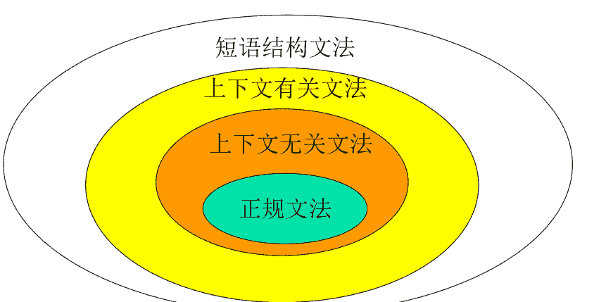

#### 1.4 演算与语言语义

- Lambda 演算（λ-演算）理论
- Lambda演算理论是一个形式系统，同Turing机一样可作为计算模型。
- Lambda演算理论是指称语义学的理论基础

- CSP（Communicating Sequential Processes）是Hoare给出的一种描述并发与分布式计算的研究模型。
- CSP是一种命令式语言形式，描述对象是进程，进程是CSP的基本成分。以通信原语描述程序的通信机制。
- 通信原语与具体的通信介质无关

- CCS（Communication and Concurrent System）是Milner给出的一种描述动态并发机制的演算。
- CCS是一种函数式语言，进程间的通信通过其端口上的通道，一对通信原语与环境进行通信。
- π演算是Milner在CCS的基础上提出的以进程间移动通信为研究重点的并发理论。

#### 形式语义

使用数学抽象工具，严格描述程序设计语言的语义，使语义形式化。根据描述方式不同，主要以下几种方式：

- 操作语义（Operational Semantics）
- 指称语义（Denotational Semantics）
- 公理语义（Axiomatic Semantics）
- 代数语义（Algebraic Semantics）

#### 1.5 计算逻辑与描述逻辑

- 计算机科学对计算逻辑已经进行了广泛研究。

描述逻辑与计算逻辑的对比关系：

| 计算逻辑 | 描述逻辑 |
| --- | --- |
| 问题求解 | 知识表示和推理 |
| 计算能力 | 描述能力 |
| 计算复杂性 | 描述复杂性 |
| 命题的可满足性 | 概念的可满足性 |
| ... | ... |

#### 1.6 构件计算与服务计算

描述逻辑在计算机软件设计中的应用，包括软件工程中的构件和服务的语义说明、构件组装与服务集成和基于本体的领域知识库与基于Web的信息系统和数据库管理等。


### 1.5 构件计算与服务计算

- 服务计算 (SOC)：
  将分布式计算、面向对象方法、构件计算等结合起来的一种网络环境下的计算模式。

- 实现互联互通、资源共享和协同工作。

- 服务流：
  - 在服务计算系统里，将基本服务看作原子单位。多个服务组合后形成一个服务流。一个应用表示为一个服务流（组合服务）。

- 主要研究：
  - 如何描述组合服务
  - 如何控制服务组合的运行

- 描述组合服务：
  - 组合服务是由多个基本服务组成的，它们之间有相互的执行和制约关系以及各个服务之间的数据流动关系，应该描述基本服务之间的控制流和数据流的方式。

- 控制服务组合的运行：
  - 系统能够在组合服务运行时控制和监视服务的运行状态，确保服务按照服务描述的方式进行。

### 1.6 计算理论的地位

| 计算环境 |
|---|
|（.NET、Web service、计算网格等）|
| 程序设计环境 |
|（Visual C++、Delphi等......）|
| 程序设计语言 |
|（Fortran语言、Pascal语言、C语言、C++语言等......）|
| 程序设计模式 |
|（结构化程序设计、面向对象式程序设计等......）|
| 计算复杂性 |
|（研究：实际可计算与实际不可计算、NP难问题、NP完全问题等......）|
| 计算模型、算法和计算模式 |
|（研究：可计算与不可计算，计算包括：移动计算、分布式计算、并行计算等......）|

### 参考书目

- 《The Design and Analysis of Computer Algorithms》，Aho, Hopcroft and Ullman
- 《计算机和难解性》，科学出版社
- 《Computer Programming Art》，Knuth
- 《数据结构与算法》，电子工业出版社
- 《可计算性与计算复杂性》，北京大学出版社

### 计算理论

### 第二章 文法与语言

#### 求解问题 与 识别语言

- 问题是多个例子的集合；
- 例子由基本符号串表示；
- 问题抽象为符号串的集合；
- 符号串称为句子，所以问题是句子的集合，可称为形式语言；

求解问题抽象为识别语言。

- **问题提出：** 如何构造可以接受及产生一个语言的计算模型？

- **语言识别器：** 对一个已经存在的字符串集合，如何判断它就是符合条件的语言？解决接受的问题。

- **语言产生器：** 怎样根据产生一个语言？解决产生的问题。

#### 主要内容

- 2.1 文法
- 2.2 正则语言
  - 正则文法
  - 有限自动机
- 2.3 上下文无关语言
  - 上下文无关文法
  - 下推自动机

#### 2.1 文法

- 文法能清晰描述语言的语法构成，易于理解。
- 文法能自动构造有效的语言识别器，检查源程序是否符合语言规定的语法形式。
- 文法定义可以了解语言的结构，有利于语言编译中的语法错误检查工作。
- 基于文法实现的语言易于扩展。

- 文法G定义为四元组(V,T,S,P)，其中
  - V 是有限的非终极符集合；
  - T 是有限的终极符集合；
  - S 是开始符，S∈T。必须在某个产生式的左边出现一次；
  - P 是产生式的集合，且具有下面的形式：
    α → β，其中 α，β∈(V ∪ T)*

#### 2.1 文法

#### 文法分类：

A,B∈V， a∈T。对文法中的产生式α→β：

- 0型文法：短语文法。α中至少含一个非终极符。

- 1型文法：上下文有关文法。它是0型文法的特例，要求|α|≤|β| (S→ε例外，S不得出现于产生式右部)。

- 2型文法：上下文无关文法。它是1型文法的特例，要求产生式左部是一个非终极符： A→β 。

- 3型文法：正则文法。它是2型文法的特例，要求产生式具有下面形式之一： A→a ， A→aB。

#### 2.1 文法

#### ▪ 文法相关定义

- **推导**：如果 A→B 是一个产生式，则对字符串 αAγ，有 αAγ ⇒ αBγ，⇒表示一步推导（用 A →β）。
- **α ⇒⁺ β**：表示 α 通过一步或多步可推导出 β
- **α ⇒* β**：表示 α 通过 0 步或多步可推导出 β

- 句型：如果有 S ⇒* β，则称符号串 β 为相应文法的句型，其中 S 是文法的开始符。
- 句子：如果 β 只包含终极符，则称 β 为相应文法的句子。
- 语言：
  L(G) = { u | S ⇒+ u , u ∈ T* }。
  文法 G 所定义的语言是其开始符所能推导的所有终极符号串 (句子) 的集合。

#### 2.2 正则语言

- 正则文法
- 有限自动机

##### 2.2.1 正则语言

- **正则文法定义：**  
  $G(V,T,P,S)$，$P$中的产生式形如$A\rightarrow a$，或$A\rightarrow aB$，$a\in T$，$A,B\in V$。

- **右范式：** 形如$A\rightarrow aB$称为右范式，其中非终极符于终极符的右边。

- **左范式：** 形如$A\rightarrow Ba$称为左范式，其中非终极符于终极符的左边。

- 正则语言
  
  正则文法G生成的语言：
  
  L(G) = { ω | ω ∈ T* 且 S ⇒⁺ ω }

- 正则语言的识别
  
  对文法S, 任给串 ω ∈ T*, S ⇒⁺ ω 成立否。

##### 2.2.1 规则语言

- 识别步骤：

任给串 ω ∈ T*， S ⇒⁺ ω 成立否。

- 任给串 ω， ω 中所有的元素是否为给定终极符集中的元素构成。

- 可否由非终极符中的S经过多步推导得到串 ω。

##### 2.2.1 正则语言

- 识别算法：设： ω=a₁…aₙ, aᵢ ∈ T。

- 若 n=1，问题等价于检查 S→a₁ ∈ P？

- 若 n≥2，则需要证明
  S → a₁B₁ ⇒⁺ a₁a₂…aₙ，
  问题变为：B₁ ⇒⁺ a₂…aₙ 是否成立。递推下去，
  B₁ → a₂B₂ ？ ⇒⁺ a₂…aₙ
  B₂ → a₃B₃ ？ ⇒⁺ a₃…aₙ
  … Bₙ₋₁ → aₙ ？
  即检查上述表达式是否均在文法集合 P 中。

#### 2.2.2 有限自动机

###### 有限自动机的构造

输入带

| a | b | a | b | a | b | a | b |

读头

有限控制器

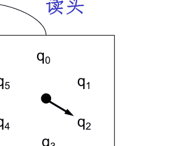

#### 2.2.2 有限自动机

- 特点：
  
  1. 以字符串作为输入，通过输入带传送字符串；
  2. 除了提示输入的字符串是否接受外，没有任何其它的输出；
  3. 它的固定中央处理器完全没有记忆功能；
  4. 类似一个语言识别器。

#### 2.2.2 有限自动机

- 组成：
  - 输入带：放字符串的装置
  - 有限控制器：含不同的内部状态
  - 读写头
- 原理：

在一定的时间间隔内，自动机根据从输入带上读入的符号和当前的内部状态，进入一个新的状态。

#### 2.2.2 有限自动机

过程：

- 读取一个符号后，读写头向右移动一个方格，读取下一个符号，有限控制器的内部状态发生改变。最终读写头到达输入串的尽头。

- 自动机将根据它所处的状态来说明它是否接受读入的字符串，如果此时的状态正好是一个最终状态，则认为该字符串是可接受的。

#### 2.2.2 有限自动机

确定有限自动机DFA：为一个五元组

M=(Q, Σ, δ, q₀, F),

其中

- Q为状态的有限集合

- Σ为有限字母表

- q₀∈Q为起始状态

- F ⊆ Q为终止状态集

- δ: Q × Σ → Q是转换函数


#### 2.2.2 有限自动机

- **格局**：机器的状态（有限控制器，读写头和输入带）的表示方式。由当前状态和字符串未输入部分决定，属于 $Q \times \Sigma^*$。
  - 例如：$(q_2, abababb)$

- 连续时刻的格局序列就是自动机在输入字符串上的**计算**（computation）。

- 若自动机M的一个格局经过一步(读写头)移动到达另一个格局，则称这两个格局之间有二元关系⊢ₘ。

- 例如，若 (q, w) 和 (q', w') 为M的格局，
  (q, w) ⊢ₘ (q', w') iff
  对某 a ∈ Σ 有 w = a w' 及 δ(q, a) = q'
  此时称 (q, w) 一步产生 (q', w').

- \(\vdash_M^*\)：\(\vdash_M\) 的自反传递闭包
  - 如 \((q,w)\vdash_M^*(q',w')\)，表示 \((q,w)\) 经过多少步（包括0步）产生 \((q',w')\)。

- 字符串 \(w\in\Sigma^*\) 被 \(M=(Q,\Sigma,\delta,q_0,F)\) 接受，当且仅当存在状态 \(q\in F\)，使得 \((q_0,w)\vdash_M^*(q,\varepsilon)\)。

- 所有由被 \(M\) 接受的字符串组成的集合即为 \(M\) 接受的语言，记为 \(L(M)\)。

- 有限自动机的表示：
  - 状态图
  - 状态表

- 例，令M为确定有限自动机(Q, Σ, δ, q₀, F)，其中Q={q₀, q₁}，Σ={a, b}，F={q₀}，δ为如右表所示

| q | w | δ(q, w) |
|---|---|---|
| q₀ | a | q₀ |
| q₀ | b | q₁ |
| q₁ | a | q₁ |
| q₁ | b | q₀ |

- 状态图

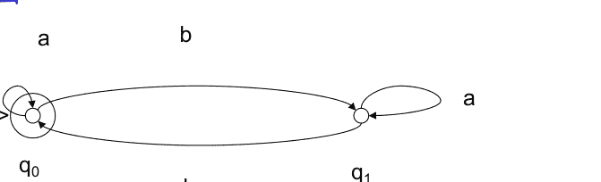

状态用结点表示，用标有a的从q指向q’的箭头表示δ(q,a)=q’，终止状态用双圆圈表示，起始状态用>表示

#### 2.2.2 有限自动机

非确定有限自动机NFA: 为一个五元组

M=(Q, Σ, δ, q₀, F),

其中

- Q为状态的有限集合
- Σ为有限字母表
- q₀ ∈Q为起始状态
- F ⊆ Q为终止状态集
- δ: Q × Σ_ε → P(Q) 是转换函数

- 例

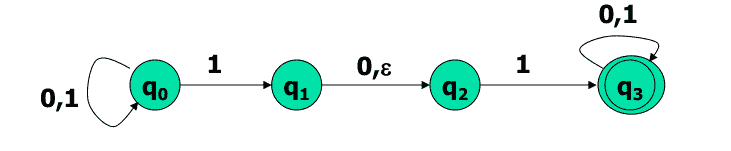

- 定理1：

每一台非确定有限自动机都等价于某一台确定有限自动机。

- 定理2：

语言是正则的，当且仅当它可以被有限自动机接受。

- 正则运算：设A和B是两个语言，定义
  - 并∪：A ∪ B = {x | x∈A 或 x ∈B }
  - 连接∘：A ∘ B = {xy| x∈A 且 y∈B }
  - 星号*：A* = {x₁…xₖ | k≥0 且 xᵢ ∈Aᵢ }

- 定理3：

正规语言在正规运算下封闭。

即：

如果A和B是正规语言，则A∪B，A∘B，A*也是正规语言。

- 正则语言的描述局限
  - 不能描述配对或嵌套结构
    - 例 {{…}}  BEGIN…END
  - 不能描述重复串
    - 例 {wcw | w是由a和b组成的串结构}

### 计算理论

### 第二章 文法与语言

#### 2.3 上下文无关语言

- 主要内容：
- 上下文无关文法
- 下推自动机

##### 2.3.1 上下文无关文法

- 上下文无关文法定义：
G(V, T, P, S), P中的产生式形如：
A→β . A∈V, β∈(V∪T)*.

- 例：
上下文无关文法G = ( V, T, P, S), 其中：
V={S},
T={a, b, e},
P={S →aSb, S→e}

- 识别：对给定的字符串是否能由文法的开始符和产生式推导出。

- 例：上例中的文法G，是否能识别字符串aaaebbb。

- 语法树

- 例：文法 G = (V, T, P, E)，其中：
  - V = {E}
  - T = {a, +, ×, (, )}
  - P = { E → E + E, E → E×E, E →(E), E→a }

判断字符串a+a×a是否能被G识别。

- 根据指定文法推导（证明）目标串的推导过程不唯一，结论唯一。

- 文法的二义性

- 如果文法G对同一字符串的识别具有不同的推导过程，则称该文法具有二义性。

- 消除二义性

- 乔姆斯基范式
  - 如果一个上下文无关文法中产生式形如：
    A → BC 或 A → a ，
    其中 a∈T，A,B,C∈V，且B,C不允许是文法的开始符，允许有空产生式 S → ε（S是文法的开始符），则称该文法为乔姆斯基范式。

- **定理：**

任一上下文无关文法都可等价转换为乔姆斯基范式形式。

- 证明：
  - 替换开始符S。
    - 增加一个新开始符S′ 和新产生式S′ → S。
  - 消除空产生式A → ε。
    - 对所有A的出现产生式形如R → αAβ，增加产生式R →αβ。
    - 若有R →A，增加R → ε，重复前一动作。

- 消除单元产生式 A → B。
  - 对所有 B 的出现产生式形如 B → α，增加产生式 A → α。
- 替换：对 A → u₁ u₂ ... uₙ， n ≥ 3。
  - 替换为 A → u₁ A₁， A₁ → u₂ ... uₙ， n ≥ 3。
  - 对 A₁ → u₂ ... uₙ， 继续前一动作。

上下文无关语言

上下文无关文法G(V,T,P,S)生成的语言：
L(G) = {ω|ω∈T*且S ⇒⁺ω}

- 上下文无关语言的识别

对文法G(V,T,P,S)，任给串ω∈T*， S ⇒⁺ω 成立否。

- **相关定义**：ω = x₁x₂…xₙ
  - **ωᵢⱼ**：ω 的子串，ωᵢⱼ = xᵢ…xᵢ₊ⱼ₋₁，j ≥ i，j ≤ n；i 表示子串的起始位置，j 表示串的长度。
  - **如**：ω₁₁ = x₁，ω₂₁ = x₂，…，ωᵢ₁ = xᵢ
  
    …
  
    ω₁ₙ = x₁x₂…xᵢ…xᵢ₊ⱼ₋₁…xₙ = ω

- **Vᵢⱼ**：Vᵢⱼ = {A | A ⇒⁺ ωᵢⱼ}，该集合中的任何一个非终极符均可以推导出 ωᵢⱼ。
  - 如：V₁₁ = {A | A ⇒⁺ ω₁₁} = {A | (A → x₁) ∈ P}
  
    …
  
    Vⱼ₁ = {A | (A → xⱼ) ∈ P}
  
    …
  
    Vₙ₁ = {A | (A → xₙ) ∈ P}

识别算法：对字符串 ω = x₁x₂…xₙ

若 n = 1，判断 S → x₁ 是否在该文法的 P 中；

若 n ≥ 2，判断 (S → BC) ∈ P，且 BC ⇒⁺ ω；
即存在 k (k ≥ 1，k ≤ n-1)，有：
B ⇒⁺ ω₁k，C ⇒⁺ ω₍k+1₎(n-k)

求 Vᵢⱼ = {A | (A → BC) ∈ P，且 B ∈ Vᵢk，C ∈ V₍i+k₎(j-k)}，其中 k > 0，k < j；
简记为 Vᵢⱼ = {→ Vᵢk V₍i+k₎(j-k)}。

判断 S ∈ V₁n，是则说明 ω 能被文法 G 识别。


##### 2.3.1 上下文无关文法

+   三角形法求V_ij：

V₁₁    V₂₁    …    Vᵢ₁    …    …
    Vₙ₁
V₁₂    V₂₂    …    Vᵢ₂    …    …    V₍ₙ₋₁₎₂
… …    …    …    …    …
V₁ⱼ V₂ⱼ    …    Vᵢⱼ    …    V₍ₙ₋ᵢ₊₁₎ⱼ
… …    …    …    …
V₁ₙ

##### 2.3.1 上下文无关文法

例： G=({A, B, C, S}, {a, b}, P, S)，P中的产生式为：

S → AB      S → BC
B → CC      B → b
C → AB      C → a
A → BA      A → a

证明串baaba是否能被文法G识别。

##### 2.3.1 上下文无关文法

+   构造Vᵢⱼ三角： ω= baaba

+   构造第一行Vᵢ₁ (i≥1, i≤5).容易有第一行：
+   {B}    {A,C}    {A,C}    {B}    {A,C}

+   构造第二行Vᵢ₂； k只能取1,有：
+   V₁₂ = {→V₁₁V₂₁} = {→BA,BC} = {A,S}
+   V₂₂ = {→V₂₁V₃₁} = {→AA,AC,CA,CC} = {B}
+   V₃₂ = {→V₃₁V₄₁}={→AB,CB}={S,C},
+   V₄₂ = {→V₄₁V₅₁} = {→BA,BC}={A,S}。

##### 2.3.1 上下文无关文法

+   构造第三行Vᵢ₃， k=1,k=2:

V₁₃={→V₁₁V₂₂}∪{→V₁₂V₃₁}
= {→BB,AA,AC,SA,SC} = Φ

V₂₃={→V₂₁V₃₂}∪{→V₂₂V₄₁}
= {→AS,AC,CS,CC,BB} = {B}

V₃₃={→V₃₁V₄₂}∪{→V₃₂V₅₁} =
{→AA,AS,CA,CS,SA,SC,CA,CC} = {B}

+   同理可构造第四行和第五行。

##### 2.3.1 上下文无关文法

{B}    {A,C}    {A,C}    {B}    {A,C}
{A,S}    {B}    {S,C}    {S,A}
{Φ}    {B}    {B}
{Φ}    {A,C,S}
{A,C,S}

##### 2.3.2 下推自动机

+   - 下推自动机（PDA）是一种抽象的计算模型。

+   - 下推自动机比有限状态自动机复杂：比自动机多一个长度不受限制的栈。

##### 2.3.2 下推自动机

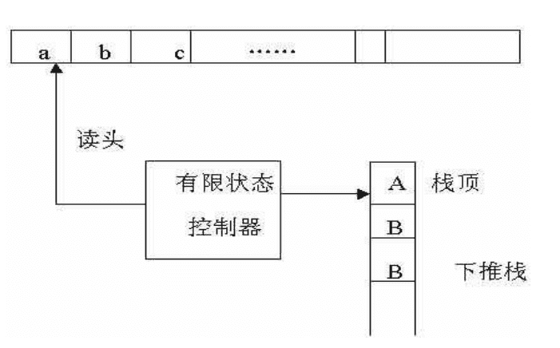

##### 2.3.2 下推自动机

+   PDM定义：
+   M=(Q, Γ, Σ,δ, q₀, Z₀, F)，其中：

Q: 有限状态集

Γ：栈符号集

Σ: 输入符号集

q₀∈Q, 初始状态

Z₀: 栈初始符号

F⊆Q, 终止状态集

δ: 转换函数.

##### 2.3.2 下推自动机

+   - 确定下推自动机：
+     转换函数: Q×(Σ×Γ*)→Q×Γ*
+   - 非确定下推自动机：
+     转换函数:Q×(Σ∪{ε}×Γ*)→P(Q×Γ*)
+   - 定理：
+     - 确定下推自动机和非确定下推自动机不等价。

##### 2.3.2 下推自动机

例： M = ({q0, q1, q2}, {a, b}, {Z, A, B}, δ, q0, Z0, {q2}) 是一个 PDA，其中 δ 由以下各式定义：

δ(q0, a, Z0) = {<q0, AZ0>},

δ(q0, a, A) = {<q0, AA>, <q1, ε>},

δ(q0, a, B) = {<q0, AB>},

δ(q0, b, A) = {<q0, BA>},

δ(q0, b, B) = {<q0, BB>, <q1, ε>},

δ(q1, a, A) = {<q1, ε>}, δ(q1, b, B) = {<q1, ε>},

δ(q1, ε, Z0) = {<q2, ε>}

##### 2.3.2 下推自动机

+   - 表示：
+     - 状态图
+     - 状态表

##### 2.3.2 下推自动机

+   格局: Q×Σ*×Γ*

+   对格局(q, ω, α)，其中 ω∈Σ*， α∈Γ*
+   q是当前状态，ω是待输入串，为空时，表示输入字符串已读完。α是下推栈中的内容，α为空时表示栈已弹空。

+   如:(q, ω, abc)，a为栈顶元素，c为栈底元素

##### 2.3.2 下推自动机

+   - 初始格局：(q₀, ω, Z₀)
+   - 接受格局:
+     - 空栈接受：(q, ε, ε)
+     - 终态接受：(q_f, ε, γ)， γ ∈ Γ*
+     - 对确定PDA，这两种接受是不等价的。
+     - 对非确定PDA，二者是等价的。

##### 2.3.2 下推自动机

+   - 格局转换↓:
+     - 对两个格局 (p, x, α) 和 (q, y, ζ)，如果存在转换
+   
+       δ(p, a, β) = (q, γ),
+   
+       且 x = a y, α = β η, ζ = γ η (η ∈ Γ*), 则说明 (p, x, α) 能一步产生 (q, y, ζ). 记为 (p, x, α) ↓ (q, y, ζ).

##### 2.3.2 下推自动机

+   上例中，输入字符串w = abba，则M的格局推导式为：

+   (q₀, abba, Z₀) ⊢ (q₀, bba, AZ₀)

+   ⊢ (q₀, ba, BAZ₀)

+   ⊢(q₀, a, BBAZ₀)

+   ⊢(q₁, a, AZ₀)

+   ⊢(q₀, ε, ABBAZ₀)

+   ⊢(q₁, ε, Z₀)

+   ⊢(q₂, ε, ε)

##### 2.3.2 下推自动机

+   - M接受字符串ω，当且仅当存在一个格局序列 C₀, C₁, ..., Cₙ(n>0)使得C₀ ⊢ₘ C₁ ⊢ₘ ... ⊢ₘ Cₙ，其中C₀是初始格局，Cₙ接受格局。
+   - M接受的语言L(M)
+     M接受的所有字符串的集合。

##### 2.3.2 下推自动机

+   格局序列C₀, C₁, ..., Cₙ满足：
+   
+   Cᵢ ⊢ₘ Cᵢ₊₁ (i=0, ..., n-1), C₀是初始格局, Cₙ接受格局。C₀, C₁, ..., Cₙ称为M进行的计算(computation),其中n称为计算的长度或步数。

##### 2.3.2 下推自动机

+   下推自动机等价定理：

+   给定两个确定 PDA A 和 B，L(A)与L(B)是否等价是可判定的。

+   对非确定 PDA NA和NB，L(NA)与L(NB)是否等价是不可判定的。

##### 2.3.2 下推自动机

+   - 定理：

语言是上下文无关的，当且仅当它可以被一台下推自动机识别。

### 计算理论

#### 第三章 计算模型

#### 3.4 Lambda演算理论

+   主要内容:
+   - 纯Lambda演算理论
+   - 纯Lambda演算实例
+   - 纯Lambda演算的扩展

#### 3.4 Lambda演算理论

+   - Lambda演算形式系统主要有两部分：
+     - 表达式的形式系统
+     - 变换规则的形式系统

#### 3.4 Lambda演算理论

+   - Lambda演算理论是一个形式系统，同Turing机一样可作为计算模型。
+   - Lambda演算理论是函数式语言的基础，也是指称语义学的理论基础。

#### 1 Lambda演算理论

+   - 纯Lambda表达式形式：主要由变量名和抽象符号 λ、‘.’以及括号等符号构成。
+   - 用E表示λ表达式，Exp表示λ表达式之集，Exp定义如下：
+     - x ∈ Exp，其中x是变量名。
+     - 若E₁ ∈ Exp，E₂ ∈ Exp，则E₁ E₂ ∈ Exp。
+     - 若E ∈ Exp，x是变量，则λx.E ∈ Exp。
+     - 若E ∈ Exp，则（E）∈ Exp。

其中，E₁ E₂型表达式称为应用型表达式，λx.E型表达式称为抽象型表达式。

#### 1 Lambda演算理论

+   λ表达式的BNF表示（x为变量，E∈Exp）：
+   E ::= x | E₁ E₂ | λx.E | (E)

+   记法约定：
+   E₁ E₂ E₃ ... Eₙ ≡ (...(((E₁ E₂)E₃))...) Eₙ
+   λx₁. λx₂. .... λxₙ. E ≡ λx₁. (... (λxₙ. E)...)
+   λx₁. λx₂. .... λxₙ. E ≡ λx₁ x₂ ... xₙ. E
+   λx₁. λx₂. .... λxₙ. E₁ ... Eₙ ≡ λx₁. λx₂. .... λxₙ.(E₁...Eₙ)


#### 1 Lambda演算理论

+   定义1 作用域

设有λ表达式λx.E，则定义λx中的x的作用域为其中的体表达式E部分。

+   定义2 约束出现 自由出现

对变量x，当它出现在表达式λx.E中时，则称x在表达式λx.E中的出现是约束出现。若它出现的位置不被表达式约束时，则称x在表达式中的出现是自由出现。

#### 1 Lambda演算理论

+   定义3 自由变量

若变量x在表达式E中是自由出现，则称变量x为表达式E中的自由变量。

+   fv(E)：表示表达式E中的所有自由变量集。

+   fv(x) = {x}

+   fv(E1 E2) = fv(E1) ∪ fv(E2)

+   fv(λx.E) = fv(E) − {x}

+   fv((E)) = fv(E)

#### 1 Lambda演算理论

##### 定义4 替换 E[E₀/x]：

将表达式E中x的自由出现用E₀代替。

+   - E ≡ x： x[E₀/x] = E₀
+   - E ≡ y，且x≠y： y[E₀/x] = y
+   - E ≡ E₁ E₂： (E₁ E₂)[E₀/x] = (E₁[E₀/x]) (E₂[E₀/x])
+   - E ≡ λx.E'： (λx.E')[E₀/x] = λx.E'
+   - E ≡ λy.E'，且x≠y,若x ∈ fv(E')：
+     - 若 y ∈ fv(E₀)： (λy.E')[E₀/x] = λz. E'[z/y] [E₀/x]
+     - 否则： (λy.E')[E₀/x] = λy. E'[E₀/x]

#### 1 Lambda演算理论

##### Lambda变换规则

+   β变换（应用规则）：
+   (λx.E) E₀ →β E[E₀/x]

+   例：
+   (λx.xy)z →β zy
+   (λx.yz)x →β yz
+   (λx.(λy.yx)z)t →β (λy.yt)z →β zt
+   (λx.(λy.yx)z)t →β (λx.zx)t →β zt

#### 1 Lambda演算理论

+   - Lambda变换规则

+   - η变换（保值变换）：
+     (λx.Mx) →η M  其中x ∉ fv(M)

+   - 归约基：

β变换和η变换的左部分别称为β归约基和η归约基，统称为归约基。

#### 1 Lambda演算理论

##### 定义5 Lambdag归约：

对Lambda表达式E中的归约基按照Lambda变换规则进行的变换称为Lambda归约，简称为归约。

##### 定义6 范式：

若一Lambda表达式E中无任何归约基，则称该表达式为范式。若一个Lambda表达式经过有限次变换能归约成范式，则称该表达式有范式。

#### 1 纯Lambda演算理论

+   - 特例：
+     - (λx. xx) (λx. xx)
+     - →β (λx. xx) (λx. xx)
+     - →β …
+     - (λx.y) ((λx.xx) (λx. xx))

#### 1 纯Lambda演算理论

+   - 定义6. 最左归约

依据归约基中λ符号出现的顺序进行的归约称为最左归约。也称标准归约。

+   - Church-Rosser定理

Lambda表达式若有范式则一定唯一，并且按最左归约一定能求到该范式。

#### 2 纯Lambda演算实例

+   - 布尔表达式
+     - 布尔值
+       - tru = λa.λb.a
+       - fls = λa.λb.b
+     - 布尔运算
+       - and = λx.λy. x y fls
+       - or = λx. λy. x tru y
+       - not = λx. x fls tru

#### 2 纯Lambda演算实例

+   整数表达式：

+   整数定义
+   λa. λb. a(a(...(ab)...)) = λa. λb. aⁿb

+   0 = λa. λb. b

+   1 = λa. λb. ab

+   2 = λa. λb. a(ab)

+   ...

+   n = λa. λb. aⁿb

#### 2 纯Lambda演算实例

+   - 整数上的运算：

令 plus m n 表示 m+n

time m n 表示 m×n

则

+   - plus = λx.λy. λa.λb. (x a)((y a)b)

+   - time = λx.λy.λa. x (y a)

##### 扩展λ-表达式

E ::= **true** | **false** | **n** | **f**

| x | E₁ E₂ | λx.E | (E)

| (E₀ → E₁, E₂)

| let x = E₀ in E

#### 3 纯Lambda演算的扩展

##### 带类型Lambda演算

+   E ::= x | E₁ E₂ | λx:T. E | (E)
+   T ::= Int | T → T

+   类型系统 (Γ表示类型上下文)

x: T ∈ Γ
------------
Γ ⊢ x: T

Γ ⊢ x: T₁, Γ ⊢ y: T₂
--------------------------------
Γ, y: T₂ ⊢ x: T₁

Γ ⊢ x: T₁, Γ ⊢ E: T₂
Γ ⊢ λx:T. E : T₁ → T₂

Γ ⊢ E₁: T₁ → T₂, Γ ⊢ E₂:T₁
Γ ⊢ E₁ E₂: T₂

### 计算理论

#### 第三章 计算模型

#### 主要内容

+   - 图灵机模型
+   - RAM机
+   - RASP机
+   - Lambda演算模型

##### 3.1 图灵机模型

+   ■ 图灵机组成:
+     ■ 线性带（读写介质）
+     ■ 基本符号表（表示信息）
+     ■ 信息处理状态
+     ■ 信息处理动作（静止，左、右移）
+     ■ 信息处理方法（规则，即程序）

##### 3.1 图灵机模型

线性带

读写头

状态控制器

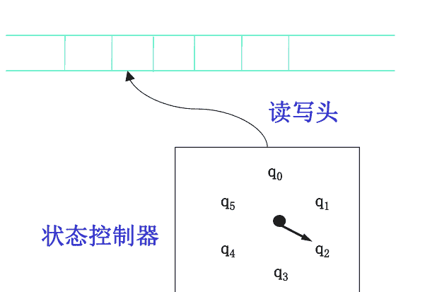

##### 3.1 图灵机模型

**定义：** 图灵机的 M=(Q, Σ, Γ, δ, B, q₀, F)，其中：

+   - Q 为状态的有限集合；
+   - Σ为有限字母表，为输入符号集；
+   - Γ为线性带符号集，Σ⊆Γ；
+   - B空符号，B∈Γ，B∉Σ；
+   - q₀∈Q为初始状态
+   - F⊆Q是终止状态集；
+   - δ：Q×Γ→Q×(Γ×{L, R, S})为转移函数。

##### 3.1 图灵机模型

例1： δ(q, a) = (p, (b, L))
说明：若当前状态为q，读写头读取a，经过δ动作后，图灵机状态改为p，线性带上a改变为b，同时读写头左移一格。

例2： δ(q, a) = (p, (a, R))
说明：若当前状态为q，读写头读取a，经过δ动作后，图灵机状态改为p，线性带上a不改变，同时读写头右移一格。

##### 3.1 图灵机模型

+   - 例3: δ(q, a) = (q, (B, S))

说明：当前状态为q，读写头读取a，经过δ动作后，图灵机状态不改变，仍为q，线性带上a被清空为null，同时读写头不动。

##### 3.1 图灵机模型

例4：有图灵机M定义如下：

M=({q₀,q₁,q₂}, {0,1}, {0,1,B}, δ, q₀, B, {q₂}),
其中δ定义为：

+   - δ(q₀, 0) = (q₀, 0, R),
+   - δ(q₀, 1) = (q₁, 1, R),
+   - δ(q₁, 0) = (q₁, 0, R),
+   - δ(q₁, B) = (q₂, B, R)。

##### 3.1 图灵机模型

+   - 表示：
+     - 图
+     - 表

##### 3.1 图灵机模型

+   布局：机器的状态的表示，由当前状态、当前带内容、读写头位置组成。属于(Γ*×Q×Γ*)。

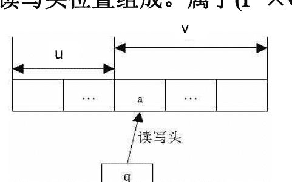

+   如（u，q，v）简记为：uqv。

##### 3.1 图灵机模型

+   - 初始格局： q₀ω， ω∈Σ*；
+   - 终止格局：
+     - 接受格局： γq_f， γ∈Γ*；
+     - 拒绝格局： 转换函数无定义。
+   - 格局转换 ⊢：

图灵机M能合法地从格局C1进入格局C2，则称格局C1产生格局C2，称这两个格局之间有二元关系⊢。记为C1 ⊢ C2。


### 计算理论

#### 第三章 计算模型

##### 3.1 图灵机模型

- 若 u q v 和 u' p v' 为图灵机 M 的格局，有：

  u q v ⊢ u' p v'   iff

  存在 a ∈ Σ, β ∈ Σ*, 有 v = a β 和 δ(q, a) = (p, (b, A)),

  u = α x, α ∈ Σ*, x ∈ Σ:

  - 若 A = L, 则 u' = α, v' = x b β;
  - 若 A = R, 则 u' = u b, v' = β;
  - 若 A = S, 则 u' = u, v' = b β.

- ⊢*:表示转换关系的自反、传递闭包。即多步转换。如 C ⊢* D，则存在 C₁...Cₖ，使得：C ⊢ C₁，C₁ ⊢ C₂，...，Cₖ ⊢ D

- 计算：q₀ω ⊢* x q_f y 称为一个以 ω 为输入，xy 为输出的计算。即：

  计算是从初始格局到终止格局按照动作函数规定的规则进行的一系列转换的格局转换序列。

- 例5：设计一台接受0与1出现次数相同且0先出现的串0...01...1的图灵机。

  基本思路：读头将第一个0改为x，右移，把找到的第一个1改为y，然后退回去直到遇到第一个x，再右移把遇到的第一个0改为x，右移，把找到的第一个1改为y，如此反复直到读头指向空白B为止。

M = ({q0, q1, …, q4}, {0, 1, B, x, y}, {0, 1}, δ, B, q0, {q4}). 其中δ定义为：

| δ | 0 | 1 | x | y | B |
|---|---|---|---|---|---|
| q0 | (q1,(x,R)) | — | — | — | — |
| q1 | (q1,(0,R)) | (q2,(y,L)) | — | (q1,(y,R)) | — |
| q2 | (q2,(0,L)) | — | (q3,(x,R)) | (q2,(y,L)) | — |
| q3 | (q1,(x,R)) | — | — | (q3,(y,R)) | (q4,(B,S)) |
| q4 | — | — | — | — | — |

给出串0011的识别过程：

```text
q₀0011 ⊢x q₁011 ⊢x0 q₁11 ⊢x q₂0y1
⊢q₂x0y1 ⊢x q₃0y1 ⊢xx q₁y1
⊢xxy q₁1 ⊢xx q₂yy ⊢x q₂xyy
⊢xx q₃yy ⊢xxy q₃y ⊢xxyy q₃B
⊢xxyyB q₄B
```

给出串0010的识别过程：

```text
q₀0010 ⊢xq₁010 ⊢x0q₁10 ⊢x0q₂0y0
⊢q₂x0y0 ⊢xq₃0y0 ⊢xxyq₁y0
⊢xxyq₁0 ⊢xxy0q₁B
```

拒绝停机

- 例6：设有图灵机 M=({q0,q1}, {0,1}, {0,1,B}, δ, q0, B, ∅)，其中转换函数 δ 定义为：

  δ(q0,0) = (q1, (0,R))

  δ(q0,1) = (q1, (1,R))

  δ(q0,B) = (q1, (B, R))

  δ(q1,0) = (q0, 0, L)

  δ(q1,1) = (q0, 1, L)

  δ(q1,B) = (q0, B, L).

  考虑输入串01，10，...

- 对输入串的不接受:
  - 拒绝状态
  - 不停机

- 定义1（可识别）：如果有图灵机识别一个语言，则称该语言是图灵可识别的。又称为递归可枚举的。

- 定义2（可判定）：如果有图灵机对所有输入都停机，则称图灵可判定。这样的语言称为图灵可判定的。简称可判定。

- 定理：
  - 图灵可判定语言都是图灵可识别的。
  - 图灵可识别的不都是图灵可判定的。

- 非确定图灵机
  - δ: Q×Γ→P(Q×(Γ×{L, R,S}))

- 定理：每一个非确定图灵机都有一个与之等价的确定图灵机。

- 证明：
  - 思路：用确定型图灵机模拟非确定型图灵机
  - 算法：以宽度优先策略搜索非确定图灵机的每个分枝，直到遇到接受格局。

- 推论1：一个语言是图灵可识别的，当且仅当有非确定图灵机识别它。
- 推论2：一个语言是可判定的，当且仅当有非确定图灵机判定它。

- 多带图灵机：

  与图灵机类似，唯一的不同在于它可以有 k (k>1) 条纸带，每条纸带上都有一个读写头。其状态转移函数δ为：

  δ: Q×Γ^k → Q×(Γ^k ×{L, R,S}^k)

  δ(q,x₁,…,xₖ) = (p,(x₁',…,xₖ',d₁,…,dₖ))

- 定理：对任意一个多带图灵机，存在一个单带图灵机与之等价。
- 证明：
  - 记录多带信息
  - 记录多带读写头位置

- 通用图灵机：它接受任意一台图灵机 M 的编码，然后模拟 M 的运作。
- 定理：任意一台图灵机都可以等价转换为一台通用图灵机。

- 与图灵机等价的计算模型：
  - 寄存器机
  - Lambda演算

- **Church—Turing论题：**

  一切直觉上能行可计算的函数都可用图灵机计算，反之亦然。

- http://218.241.236.69/

##### 3.2 寄存器机

- 寄存器机:
  - 与图灵机等价。
  - 介于图灵机与实际数字计算机之间的一种抽象机。
  - 用于分析算法效率和与机器代码相关的研究。

- 寄存器机的一般结构：
  - 寄存器
  - 指令集
  - 控制器
  - 输入输出带
  - 指令标号

- 典型寄存器机
  - 计数器机
  - 指针机
  - **RAM机**（Random Access Machine）
  - **RASP机**（Random Access Stored Program Machine）

#### 3.2.1 RAM机器

- RAM（Random Access Machine）：
  - 哈佛结构.
  - 带有间接寻址和扩充的指令集.

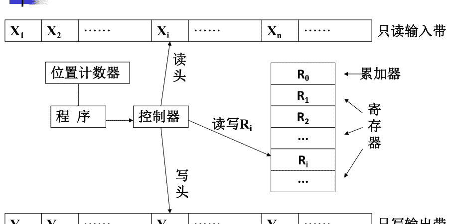

- 指令：
  - 格式：指令 操作数
  - 指令分类：
    - 寄存器存 LOAD
    - 寄存器取 STORE
    - 跳转 JUMP JGTZ JZERO
    - 运算 ADD SUB MULT DIV
    - 输入 输出 READ WRITE
    - 结束 HALT

- 操作数：
  - i表示Rᵢ寄存器的内容，记为C(i)；
  - *i表示间接寻址，操作数的地址是Rᵢ内容，j=C(i)，即其值是C(C(i))，若j<0则停机；
  - =i表示立即数i。

| 操作数 | 地址 | 值 |
|---|---|---|
| =i | — | i |
| i | i | C(i) |
| *i | C(i) | C(C(i)) |

- 操作数映射V(a):
  - V(i) = C(i)
  - V(*i) = C(C(i))
  - V(=i) = i


#### 3.2.1 RAM机器

##### RAM指令及含义：

- LOAD a : C(0) ← V(a)
- STORE a : C(a)/C(C(a)) ← C(0)
- ADD a : C(0) ← C(0)+ V(a)
- SUB a : C(0) ← C(0)- V(a)
- MULT a : C(0) ← C(0)* V(a)
- DIV a : C(0) ← C(0)/ V(a)

**READ a:** C(a)/C(C(a)) ← 输入带上读入一个符号，读头右移一位

**WRITE a:** 输出带上当前位置 ← V(a)，写后写头右移一位

**JMP l:** 位置计数器 ← l

**JGTZ l:** 若 C(0) > 0，则位置计数器 ← l

**JZERO l:** 若 C(0) = 0，则位置计数器 ← l

**HALT:** 停机

##### RAM机的初始状态

- C(i) = 0，对任意 i ≥ 0;
- 位置计数器指向程序P的第一条指令;
- 输入串放在输入带上，读头指向输入串的第一个符号;
- 输出带空白。

##### RAM程序P：

- 指令或带标号的指令的有限序列，并且最后一条指令为HALT。

- 含义：输入到输出的函数

f(x₁, …, xₙ) = (y₁, …, yₘ)

例：输入 X₁ X₂…Xᵢ…Xₙ 0，其中 Xᵢ 为 1 或 2，判断 1 和 2 出现的个数是否相同？

设计思路：读到 1 则加一，读到 2 则减一，若结果为 0 则个数相等。

- r0: 累加器
- r1:存放读入字符
- r2: 存放差值

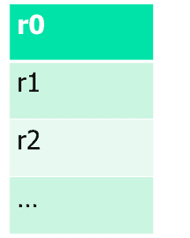

- 读入字符1:
  - LOAD 2 （将差值寄存器的数读入 累加器）
  - ADD =1 （读入的数为1，所以差值加1）
  - STORE 2 （将结果传回差值寄存器）

程序如下：

```
LOAD =0      （累加器清零）
STORE 2      （差值寄存器2清零）
READ 1       （读入第一个数）
REPEAT: LOAD 1   （将寄存器1中的数读入累加器中）
JZERO END    （如果为零，说明结束）
LOAD 1       （将寄存器1中的数读入累加器中）
SUB =1       （将读入的数减1，使得1变为0，2变为1）
JZERO ONE    （如果是零,则跳到ONE）
LOAD
SUB =1
STORE 2
JMP NEXT
```

```
ONE:    LOAD 2
        ADD =1
        STORE 2
NEXT: READ 1        （读入输入带上的下一个数）
        JMP REPEAT    （跳回REPEAT进行检查）
END: LOAD 2 (结束，将差值寄存器的值读入累加器)
    JZERO EQUAL （如果为零，说明1和2的个数相等，跳到EQUAL）
        WRITE =0        （将不相等的结果0写到输出带中）
        HALT    （程序结束，系统停机）
EQUAL:  WRITE =1    （相等，则输出1到输出带中）
        HALT        （程序结束，系统停机）
```

#### 3.2.2 RASP

- **RASP机：** 随机存取存储器
  - 冯诺伊曼结构
  - 程序存储在寄存器中，可以修改。

##### 3.2.2 RASP机器

特点：

1. 不允许间接寻址，除此之外，指令集与 RAM机器相同。

2. 每条指令占两个寄存器，第一个存放操作码，第二个存放操作地址，操作码在寄存器中表现为数值，不是符号。

例：LOAD 32

位置计数器

r_i

r_{i+1}

例：LOAD =32

位置计数器

r_i

r_{i+1}

3、除JUMP、JGTZ、JZERO外，其它指令执行完后位置计数器加2。

4、初始时刻，位置计数器指向程序的第一条指令所在的第一个寄存器。

- 定理：

对于任意一个RASP程序PS，存在一个等价的RAM程序P。

证明：如右图所示，

$r_1$：存放间接寻址的信息

$r_2$：存放RASP中的位置计数器。

$r_3$：存放RASP中的累加器的内容。

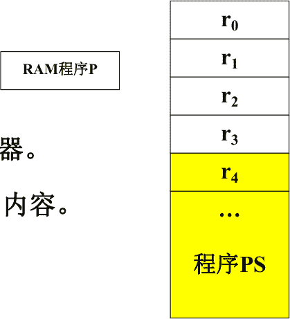

| 内容 |
|---|
| RAM程序P |

| 寄存器/区域 |
|---|
| $r_0$ |
| $r_1$ |
| $r_2$ |
| $r_3$ |
| $r_4$ |
| … |
| 程序PS |

翻译过程：

①将位置计数器加一，使其指向当前指令的下一个寄存器，取到操作数i

```
LOAD 2;
ADD =1;
STORE 2;
```
/*此时，r₂中即为SUB操作的目标数所在的寄存器编号，即SUB指令的下一个寄存器。*/

②将寄存器rᵢ映射到rᵢ₊₃（因为r₁、r₂和r₃均已被使用，程序将向后移3格）。

LOAD *2; /*取出r₂指向的值，就是所要操作的数所在的逻辑寄存器号*/

ADD =3; /*加上3，使其指向正确的实际寄存器号*/

STORE 1; /*r₁用于间接寻址，此时r₁的值即为目标数在RASP机器中物理寄存器号*/

③执行减法

```
LOAD 3; /* r₃中存放的是上一次的累加器的内容，现在恢复到累加器中
```

```
SUB *1; /* r₁中存放的是目标数的寄存器号，用间接寻址求得实际数
```

```
STORE 3; /*返回结果，并保存在r₃中，下一次需要时可恢复使用
```

④位置计数器加1，返回循环入口

```
LOAD 2;
ADD =1;
STORE 2; /*加一，使其指向下一条指令*/
JUMP A
```

小结

- 寄存器机的应用：
  - 分析算法的复杂度
  - 机器代码表示

#### 3.3 复杂度

数量级

设n为自然数，f(n)是n的一个函数。O 表示量级，令O(f(n))表示不超过f(n)数量级的量。

例如： O(n) = { 常数， 3n， 10⁸n ， ... }

O(n²) = { O(n), ..., a n²+bn+c, .... }

##### 多项式数量级

设：$f(n)=a_kn^K+a_{k-1}n^{K-1}+\cdots+a_1n+a_0$ 为 $n$ 的 $K$ 阶任意多项式，系数相对 $n$ 来说是个常数。则：$O(f(n))=O(n^K)$，称 $O(n^K)$ 为多项式数量级。

- 对数标准：
  - 每条指令需要执行的时间和空间与操作数的长度成正比。
  - 操作数的长度：
    当k=0， l(k)=1
    当k>0， l(k)=lint(log(k)) + 1 其中， lint()表示向下取整。

定理：

RAM和RASP两者在时间复杂性上的量级一致。

- 图灵机的复杂性：
  - 时间单位：一个格局转换为一个时间单位。
  - 空间单位：线性带上一格占用一个空间单位。

- 一个以 ω 为输入的计算，n=| ω |：
  - 时间复杂性为C(n)： 从初始格局到终止格局的转换次数。
  - 空间复杂性为S(n)： 格局转换过程中占用的最多格数。


#### 3.3 复杂度

- 定理：给定一台图灵机M，则存在一个RAM程序P（或RASP程序PS），使得P（或PS）与M等价，反之亦然。
- 多项式相关：若程序P₁和P₂的复杂性分别为C₁(n)、C₂(n)，存在多项式p(n)，使得：

$$C_2(n)=p(n)\cdot C_1(n)$$

则称P₁和P₂是多项式相关。
- 定理：给定一台图灵机M，则存在一个RAM程序P（或RASP程序PS），使得P（或PS）与M计算能力等价，计算时间多项式相关。
- **P问题：**
  - 可以由一个确定型图灵机在多项式时间内解决的问题。
- **NP问题：**
  - 可以由一个非确定型图灵机在多项式时间内解决的问题。

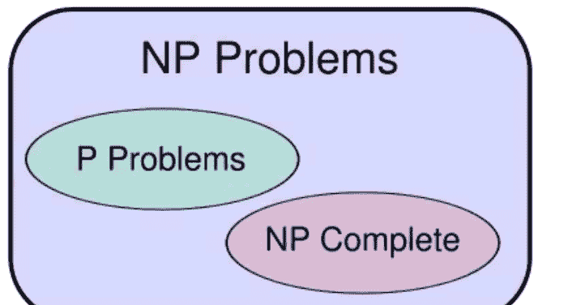

### 计算引论

### 第四章 推理与计算

- 逻辑与推理
- Horn逻辑程序
- 命题Horn逻辑中的自动推理
- 谓词Horn逻辑中的自动推理

#### 4.1 逻辑基础知识

- 符号表示：
  - 常量：小写字母 \(a,b,c,\ldots\)。
  - 函数：小写字母 \(f,g,h,\ldots\)。
  - 变量：小写字母 \(x,y,z,\ldots\)。
  - 逻辑算子（或连接词）：¬，∧，∨，→，↔。
  - 量词：∀，∃。
  - 谓词：大写字母 \(P,Q,R,\ldots\)。
- **命题**：在一阶逻辑中，命题陈述某个对象的性质，或是某些对象之间的关系，是能够分辨真假的语句。
- **原子命题**：一个语句如果不能再进一步分解成更简单的语句，并且又是一个命题，则称此命题为原子命题。

##### 命题公式的缺点

- 无法把所描述的客观事物的结构和逻辑特征反映出来
- 不能把不同事物的共同特征反映出来

##### 例如

命题P：“张三是李四的老师”

##### 谓词逻辑

在谓词逻辑中，将原子命题分解为谓词与个体两部分。

- 个体是指可以独立存在的物体，可以是抽象的或具体的。
- 谓词则是用于刻画个体的性质、状态或个体间的关系的。
- 谓词的一般形式：\(P(x_1,x_2,\ldots,x_n)\)，其中P是谓词，\(x_1,x_2,\ldots,x_n\)是个体。
- 例：“鸟会飞”可表示为canfly(bird)，其中canfly是谓词，bird是个体。

##### 谓词分类

- 一元谓词：刻画个体的性质
- 多元谓词：刻画个体之间的关系
- 一阶谓词：个体是常量、变元或函数
- 高阶谓词：个体是谓词

##### 项定义如下

- 单个的常量和变量都是项。
- 如果 f 是函数符，t₁，…，tₙ 是项，那么 f(t₁，…，tₙ) 也是项。

例如，gcd 是表示最大公约数的函数符，a+b，c×d-2 是两个项，则 gcd(a+b, c×d-2) 也是项。

##### 谓词公式

- 原子是公式
- 若 P,Q 是公式，则 P→Q, P↔Q, P∧Q, P∨Q, ¬P 是公式。
- 若 P 是公式，x 是 P 中的变量，则 (∃x)P，(∀x)P 是公式。
- 文字：若P是原子，则P、¬P称为文字。P称为正文字，¬P称为负文字。
- 子句：公式P称为子句，若P等值于L₁∨...∨Lₙ，其中L₁,...,Lₙ是文字。
- 基项、基原子、基子句：没有变量符号出现的项、原子、子句，分别称为基项、基原子、基子句。

例：
- gcd(45, b)是基项
- father(John, Peter)是基原子
- father(John, Peter) ∨ uncle(John, Peter)是基子句

##### 谓词公式的解释

设D为谓词公式P的个体域，若对P中的个体常量、函数和谓词按照如下规定赋值：

1. 为每个个体常量指派D中的一个元素；
2. 为每个n元函数指派一个从Dⁿ到D的映射，其中 Dⁿ = {(x₁, x₂, ⋯, xₙ) | x₁, x₂, ⋯, xₙ ∈ D}；
3. 为每个n元谓词指派一个从Dⁿ到{F, T}的映射；

则称这些指派为公式P在D上的一个解释。

##### 永真

- 如果谓词公式P对个体域D上的任何一个解释都取得真值T，则称P在D上是永真的。
- 如果P在每个非空个体域上均永真，则称P永真。

##### 永假（不可满足性）

- 如果谓词公式P对于个体域D上的所有解释都取得假值F，则称P在D上是永假的；
- 如果P在每个非空个体域上均永假，则称P永假。

- **可满足的**：对于谓词公式P，如果至少存在一个解释使得公式P在此解释下的真值为T，则称公式P是可满足的。
- **不可满足的**：对谓词公式P，如果不存在任何解释，使得P的取值为T，则称公式P是不可满足的。

##### 推理

指从已知事实出发，运用已掌握的知识，推导出其中蕴含的事实性结论或归纳出某些新的结论的过程。

##### 推理分类

- 自然演绎：已知事实、推理规则、结论
- 归结：否定结论、前提条件、矛盾

#### 推理相关知识

**Skolem化**：公式形式是很多样的。这就会给机器的形式化处理带来很大的麻烦。为了便于机器处理，把公式化成统一的标准形式，即Skolem标准型。

##### Skolem标准型

设P是公式，P等价于∀x₁...∀xₙ G(x₁.... xₙ)，并且

G=G₁∧...∧Gₘ，

其中G₁,...,Gₘ都是子句，则称G的子句集

S = {G₁,...,Gₘ}

为公式P的Skolem标准型。

对公式P的Skolem化的步骤如下：

1. 将P化为前束范式 (Q₁x₁)...(Qₙxₙ)H(x₁.... xₙ)，其中Q₁...Qₙ是存在量词或者全称量词，H为合取范式的形式，不含→, ↔；
2. 用如下方法消去存在量词：
   - 若Qᵢ是一个存在量词，并且它的左边没有全称量词，则用一个H中没有的常量符号代替H中所有的xᵢ，之后消去(Qᵢxᵢ)；
   - 若 \(Q_i\) 是一个存在量词，并且 \(Q_{j_1},\ldots,Q_{j_k}\) 是 \(Q_i\) 左边的全称量词，则取一个 \(H\) 中没有的函数符号 \(f\)，用 \(f(x_{j_1},\ldots,x_{j_k})\) 代替 \(x_i\)，之后消去 \((Q_i x_i)\)。
3. 公式P经过如上处理，可以化为

\(\forall x_1\ldots\forall x_n(G_1\land\ldots\land G_m)\)

的形式，其中G₁,...,Gₘ都是子句。省略全称量词，再用“，”取代合取符号，便得到公式P的Skolem标准型{G₁,...,Gₘ}。

- 任意公式都有与之对应的子句集。
- 一个公式与它的Skolem标准型未必等值，但在不可满足的意义上是一致的。

##### 置换

- 置换：是形如{t₁/x₁,..., tₙ/xₙ}的一个有限集合。其中xᵢ（i=1,...,n）是两两不同的变量符号，tᵢ是不同于xᵢ的项。
- 置换作用于表达式：给定置换θ={t₁/x₁,..., tₙ/xₙ}和表达式E，Eθ表示将E中出现的每一个xᵢ（i=1,...,n）都替换成tᵢ得到的新表达式。
- 给定两个置换 \(\theta=\{t_1/x_1,\ldots,t_n/x_n\}\)，\(\lambda=\{u_1/y_1,\ldots,u_m/y_m\}\)，将集合 \(\{t_1\lambda/x_1,\ldots,t_n\lambda/x_n,u_1/y_1,\ldots,u_m/y_m\}\) 删去以下元素：
  - \(u_i/y_i\)，当 \(y_i\in\{x_1,\ldots,x_n\}\)；
  - \(t_i\lambda/x_i\)，当 \(t_i\lambda=x_i\)。

得到的新置换表示为 \(\theta\cdot\lambda\)，称为 \(\theta\) 和 \(\lambda\) 的复合。

- 置换满足结合律：
  - \((\theta \cdot \lambda) \cdot \mu = \theta \cdot (\lambda \cdot \mu)\)
- 置换不满足交换律：
  - \(\theta \cdot \lambda \ne \lambda \cdot \theta\)
  - \(\varepsilon \cdot \theta = \theta \cdot \varepsilon = \theta\)


##### 合一置换：

给定表达式 E₁,…,Eₖ，若存在置换 θ，使得 E₁θ=…=Eₖθ，则称 θ 是 E₁,…,Eₖ 的一个合一置换。

+   例1：设E₁=g(x,y)， E₂=g(a,f(z))。令
+   θ={a/x, f(h(u))/y, h(u)/z}，
+   则E₁θ=g(a, f(h(u)))，E₂θ=g(a, f(h(u)))
+   因为E₁θ=E₂θ，所以θ是E₁与E₂的合一置换。

+   - 例2，设E₁与E₂同上，σ={a/x, f(z)/y}，则 E₁σ=g(a, f(z))=E₂σ，所以σ也是E₁与E₂的合一置换。
+   
+   显然σ比θ简单，易证θ=σ ∘ λ，其中 λ={h(u)/z}

##### 最一般合一置换求法：

+   设有公式： E1=P(x,y,z); E2= P(x,f(a),g(b))

+   从左至右查找不同的项，构成了不一致集：
+   D1={y,f(a)}

+   继续向右比较又得到一个不一致集：
+   D2={z,g(b)}

+   置换为θ = {f(a)/y, g(b)/z}

##### 求一般置换算法：令 W={E1,E2}

+   - 令 k=0, W_k=W, σ_k=ε; ε是空置换，表示不作置换。
+   - 如果 W_k 只有一个表达式，则算法停止，σ_k就是所要求的结果。
+   - 找出 W_k 的不一致集 D_k。
+   - 若 D_k 中存在元素 x_k 和 t_k，其中 x_k 是变元，t_k 是项，且 x_k 不在 t_k 中出现，则：σ_{k+1}=σ_k·{t_k/x_k}
+   - W_{k+1}=W_k{t_k/x_k}， k=k+1，然后转（2）。
+   - 算法终止，W 的一般合一置换不存在。
+   - 可以证明，如果 E1 和 E2 可合一，则算法必停止于第2步

#### 4.2 Horn逻辑程序

+   - 人工智能：
+     - 知识库：用于推理的知识
+     - 数据库：事实和论据
+     - 推理：对知识和数据的消解，获得结论

#### 4.2 Horn逻辑程序

+   - 已知的知识表示方法有
+     - 产生式表示法
+     - 语义网络表示法
+     - 逻辑表示法

产生式表示法是一类很重要的方法，知识表示成IF ... THEN ... 的形式。采用产生式方法，可以将规则与事实以统一的格式表示，即Horn子句。

#### 4.2 Horn逻辑程序

+   - 如果在一个子句中最多含有一个正文字，那么该子句称为 **Horn子句**。
+   - 若一个子句集内的子句个数有限且都是 Horn 子句，那么该子句集称为一个 **Horn逻辑程序**。

#### 4.2 Horn逻辑程序

+   - Horn子句可以表示成如下形式：

规则体→规则头

其中规则体一般是n个原子的合取，n=0,1,...。规则头可以是单个原子，也可以是空。

#### 4.2 Horn逻辑程序

+   - **规则**：规则体非空且规则头非空的子句。例如，
+     `father(z, y), father(y, x) → grandfather(z, x)`
+   - **事实**：规则体空且规则头非空的子句。例如，
+     `→father(John, Peter)`。
+   - **目标**：无规则头的子句，例如，
+     `grandfather(Smith, Peter) →`，即要查询Smith是否是Peter的祖父？

#### 4.2 Horn逻辑程序

+   - 一个Horn逻辑程序是Horn子句的集合，也就是规则和事实的集合。因此，一个Horn逻辑程序相当于一个知识库。
+   - 推理即是通过对一组子句按照一定的方式进行消解最终得到新的公式。

#### 4.2 Horn逻辑程序

+   - 自动推理的过程即给定目标子句，机器按照一定的顺序对逻辑程序中的子句进行消解，最后得到目标子句，或者得出目标不可能满足的结论。

#### 4.2 Horn逻辑程序

+   - 命题Horn逻辑的自动推理
+   - 谓词Horn逻辑的自动推理

#### 4.3 命题Horn逻辑中的自动推理

+   在命题Horn逻辑中，子句之间可以按照如下的方式消解。若有子句

S₁: A₁,...,Aₙ →

S₂: B₁,...,Bₘ → Aᵢ

则归结后的子句为

S₃: A₁,...,Aᵢ₋₁, B₁,...,Bₘ, Aᵢ₊₁,...,Aₙ →

即利用规则S₂将原目标S₁转化为新目标S₃.

#### 4.3 命题Horn逻辑中的自动推理

+   基于上述消解方式，求证一个目标
+   
+   S: A₁,...,Aₙ →
+   
+   需要逐一以S的体中的每一个原子Aᵢ作为新的目标进行求证。 A₁,...,Aₙ 也称为S的子目标。

+   在以一个原子Aᵢ为目标进行求证时，考察子句集内所有头部是Aᵢ的子句，以此子句的体作为新的目标。

#### 4.3 命题Horn逻辑中的自动推理

+   - 当某个关于A的子句体部的所有原子得到满足时，直接返回A是正确的，而不用再接着考察头是A的其他子句。

+   - 假如对于某个原子A，逻辑程序中所有头部是A的子句都无法满足，则得出A无法满足的结论。

##### 原子A的推理算法TorF(A)如下：

```
TorF(A)
i=0;
while (i<n)    // n是此Horn逻辑程序内子句的个数
{
    if（第i条规则的头部=A）  //用第i条规则考察A
    {
        if（第i条规则的体是空的）then return 1;
                                      // A是事实
        else if（TorF(A₁)=...=TorF(Aₘ)=1）
                 //A₁... Aₘ是第i条规则体内的所有原子
                 then return 1;  //由规则推出原子A的正确
    }
    i=i+1;  //第i条规则体内并非所有原子正确，从而需要考察别的规则
}
return 0;  //考察了所有的规则，都不能推出A
}
```

#### 4.4 谓词Horn逻辑中的自动推理

+   - 谓词Horn逻辑的消解要复杂一些。消解方式如下。若有子句
+   
+     \(S_1: A_1,\ldots,A_n \to\)
+   
+     \(S_2: B_1,\ldots,B_m \to B\)，
+   
+     并且 \(A_i, B\) 具有合一置换 \(\theta\)，则归结后的子句为
+   
+     \(S_3: (A_1,\ldots,A_{i-1},B_1,\ldots,B_m,A_{i+1},\ldots,A_n)\theta \to\)

+   - 与命题Horn逻辑相比，需要考虑项的匹配，即合一问题。

基于以上消解方式，求证一个目标

$S_1: A_1,\ldots,A_n \to$

时，要求得出的结果应该是一个置换的集合。集合内的每一个元素 $\theta_i$ 应该使

$A_1\theta_i,\ldots,A_n\theta_i$

成立。

#### 4.4 谓词Horn逻辑中的自动推理

将置换θ作用于表达式e的算法如下

```
Substitution(e, θ)
{
    if (e是常量符号)   then return e;
    if (e是变量符号x) then { if (t/x∈θ) then return t
                            else return e;
                        }
    if (e=f(t₁,...,tₙ)) then { t₁= Substitution(t₁, θ);
                            ...
                            tₙ= Substitution(tₙ, θ)
                            return f(t₁,...,tₙ)
                        }
}
```

#### 4.4 谓词Horn逻辑中的自动推理

对两个表达式e₁， e₂作合一的算法如下

//算法返回一个合一置换或“无法合一”的信息

```
Unify(e₁, e₂)
{ θ=空集;
    if e₁是变量符号x then θ={ e₂/x};
    else if e₂是变量符号x then θ={ e₁/x};
    else if(e₁是常量而e₂不是，或e₂是常量而e₁不是，
            或 e₁， e₂是两个不同的常量)
        then return “无法合一”
    else //此时e₁， e₂形如f(t₁,…,tₙ)和
            g(s₁,…,sₘ)； f,g为函数符号。
```


#### 4.4 谓词Horn逻辑中的自动推理

```
{ if (f≠g) then return “无法合一”;
else
  { θ₁ = Unify(t₁, s₁);
    θ = θ ∘ θ₁;
    θ₂ = Unify(Substitution(t₂, θ), Substitution(s₂, θ));
    θ = θ ∘ θ₂;
    ...
    θₙ = Unify(Substitution(tₙ, θ), Substitution(sₙ, θ));
    θ = θ ∘ θₙ;
    return θ;
  }
}
```

例：Horn逻辑程序（知识库）如下，

+   father(z, y), father(y, x)→grandfather(z, x),
+   
+   →father(John, Peter),
+   
+   →father(Smith, John)。

目标为grandfather(Smith, Peter)→，即查询Smith是否是Peter的祖父？

推理过程如下；

+   1. 首先通过合一置换θ={Peter/x, Smith/z}，将目标与知识库中第一条规则的规则头匹配，得到新目标

```
father(Smith, y), father(y, Peter) →
```

+   2. 考察知识库中第二条和第三条规则，通过合一置换σ={John/y}与知识库中的事实匹配

```
→ father(Smith, John), → father(John, Peter)
```

因此查询目标成立，并且返回置换

```
θ ∘ σ={Peter/x, John/y, Smith/z}
```

+   - 考察某个原子A的算法TorF(A)如下

TorF(A)输入A(s₁,...,sₙ), 返回置换数组Θ, 其中数组元素Θ[i]是一个置换。

```
TorF(A)
{
    i=0;
    Θ=空集;
    while(i<n)    //n是此Horn逻辑程序内子句的个数
    {if(第i条规则的头部=A(t₁,...,tₙ)  //t₁,...,tₙ是项)
        { //用第i条规则考察A
            θ = Unify(A(t₁,...,tₙ), A(s₁,...,sₙ));
            if θ = “无法合一”, goto L₁
            if(第i条规则的体是空的，即事实)
                then Θ=Θ∪{θ};
            else{// A₁... Aₘ 是第i条规则体内所有原子， m>0
                // 下面i₁, i₂,...,iₘ 初值均为1
                while(TorF(A₁θ)[i₁]!=NULL)
                {θ₁=TorF(A₁θ)[i₁];
                i₁=i₁+1;
```

```
while(TorF(A₂θ₁)[i₂]!=NULL)
{...
    while(TorF(Aₘθₘ₋₁)[iₘ]!=NULL)
    { θₘ=TorF(A₁θ)[iₘ];
        λ=θ ⊙ θ₁ ⊙ ... ⊙ θₘ;
        Θ=Θ∪{λ};
        iₘ = iₘ +1;
    }
    ...
}
}
}
}
L₁ : i=i+1; //考察下一条规则
}
return Θ;
}
```

### 计算理论

### 第四章 推理与计算

+   - 抽象数据类型
+   - 重写规则

+   - 数据类型：
+     - 若干数据域和其上的若干操作的集合。
+   - 抽象数据类型：
+     - 一类数据类型，各类型可以有不同的数据表示，但其上的操作有共同的抽象性质。

#### 标记：

+   - 标记是一个二元组 (S, Σ)，其中S是类型集合，Σ为操作符号集合， Σ∈P({f| f:ω→s, ω∈S*, s∈S})。

#### 例：自然数栈的规范可用标记表示为：

+   - S = {bool, nat, stack, error}
+   - Σ = {true:→bool, false:→bool, not: bool→bool, or: bool bool→bool 0:→nat, succ: nat →nat, eq: nat nat →bool creat: →stack, pop: stack→stack, empty: stack→bool, read: stack→nat∪error push: stack nat → stack}

+   - **项**：设 $(S,\ \Sigma)$ 是一个标记，对任意 $s\in S$，$X_s$ 表示类型 $s$ 的变量集合。

+   - $X=\{X_s\mid s\in S\}$ 称为标记 $(S,\ \Sigma)$ 的**变量集合**。

+   - **类型 $s$ 的项集合** $T_{\Sigma,s}(X)$ 定义如下：
+     - $X_s\subseteq T_{\Sigma,s}(X)$
+     - 任一 $f:s_1\cdots s_n\to s$，若 $t_1\cdots t_n$ 分别是类型 $s_1\cdots s_n$ 的项，即 $t_i\in T_{\Sigma,s_i}(X)$，$i=1,\cdots,n$，则 $f(t_1,\cdots,t_n)\in T_{\Sigma,s}(X)$

+   - $T_{\Sigma}(X)=\{T_{\Sigma,s}(X)\mid s\in S\}$ 称为标记的**项集合**。

#### 公理：

设（S, Σ）是标记，一个类型s的Σ—等式e是二元组(L, R),其中s∈S, L, R∈ TΣ,s(X).

通常将（L, R）记为L=R.若L, R ∈ TΣ,s，则称e是一基等式。称E={e1,...,en}是由n个Σ—等式e1,...,en组成的一组公理。

+   - **代数规范 (S, Σ, E) :**
+   
+     由一个标记 (S, Σ) 和其上的一组 Σ - 等式组成的公理集 E 构成。

+   - **代数规范的扩展:**
+   
+     代数规范 (S, Σ, E) 称为是另一个代数规范 (S₁, Σ₁, E₁) 的扩展，如果：
     (S, Σ, E) = (S₁+S, Σ₁+Σ, E₁+E)
     +表示集合上的不相交并。

#### Bool =

+   - S: bool
+   - Σ: true:→bool
+     false: →bool
+     not: bool →bool
+     or: bool bool →bool
+   - E: not(true)=false; not(false)= true;
+     or(true,x)=true; or(false,x)=x

#### 对表达式的求值：

(not(true) or false) or (true or not(false)

(not(true) or false) = not(true),
= false

(true or not(false) = true

原式匹配为 false or true = true

+   - 项重写：

用等式匹配的方法进行表达式求值的机制通常称为**项重写**。即可以用规则对项进行代换或重写。

+   - 字符串重写，图重写等。

+   - 项重写系统（简写为trs）是重写规则组成的集合，可以应用的领域有：
+     - 定理证明
+     - （数据类型，程序等的）代数说明
+     - 计算机代数学
+     - λ演算
+     - 声明语言的实现
+     - 程序设计语言的操作语义

#### 例：Ackerman函数 f：N×N→N

+   - **(R1)**  f(0,y)=y+1
+   - **(R2)**  f(x+1,0)=f(x,1)
+   - **(R3)**  f(x+1,y+1)=f(x,f(x+1,y))

对所有的x,y∈N。

#### 计算 f(2,1)?

+   - f(2,1)
+   - =f(1,f(2,0))  (R3,x→1,y →0)
+   - =f(1,f(1,1))  (R2,x →1)
+   - =f(1,f(0,f(1,0)))  (R3,x →0,y →0)
+   - =f(1,f(0,f(0,1)))  (R2,x →0)
+   - =f(1,f(0,2))  (R1,y →1)
+   - =f(1,3)  (R1,y →2)
+   - =...


- \(F\) 为函数符号的集合；\(X\) 为变量的集合；\(F\) 和 \(X\) 不相交。则 \(F\) 和 \(X\) 上的项的集合 \(T(F,X)\) 定义为：
  - 每个 0 元的函数符号都是项；
  - 每个变量是项；
  - 如果 \(t_1,\ldots,t_n\) 是项，且 \(f\) 为 \(n\) 元（\(n\ge 1\)）的函数符号，则 \(f(t_1,\ldots,t_n)\) 是项。
  - 0 元的函数符号通常称为常量符号。

##### 项 \(t\) 中的变量

- 已知一个项 \(t\)，用 \(\mathrm{Var}(t)\) 来表示 \(t\) 中所有出现的变量组成的集合；如果 \(\mathrm{Var}(t)=\emptyset\)，则称 \(t\) 为基项。
- 例：如果 \(t=f(x,g(y,x),z)\)，那么 \(\mathrm{Var}(t)=\{x,y,z\}\)。

##### 子项

- 已知项 \(t\)，用 \(\mathrm{Sub}(t)\) 表示 \(t\) 的所有子项的集合。
- 例：如果 \(t=f(x,g(y,x),z)\)，那么
  \[
  \mathrm{Sub}(t)=\{t,x,y,z,g(y,x)\}
  \]

##### 项重写规则

项的有序对 \(r=(t_1,t_2)\)，也可记为 \(r:t_1\to t_2\)，其中：
- \(t_1\) 不是一个变量；
- \(\mathrm{Var}(t_2)\subseteq \mathrm{Var}(t_1)\)。

\(t_1\)（或 \(t_2\)）称为 \(r\) 的左端（或右端），也可以用 \(\mathrm{lhs}(r)\)（或 \(\mathrm{rhs}(r)\)）表示。

一个非空的重写规则集就称为项重写系统。

##### 例

- \(f(x+1,0)\to f(x,1)\) 为一个重写规则；
- \(x\to f(a,a)\)、\(f(x,y)\to f(0,z)\) 不是重写规则。

##### 代换

- 代换：从 \(X\) 到 \(T(F,X)\) 的函数。
- 例：\(\sigma:X\to T(F,X)\)，可以有
  - \(\sigma(x)=f(x,x)\)，
  - \(\sigma(y)=a\)，
  - \(\sigma(z)=z\)，
  对所有的 \(z\ne x\) 且 \(z\ne y\)。
- 代换 \(\sigma\) 记为集合：
  \[
  \{x_1\to \sigma(x_1),\ldots,x_n\to \sigma(x_n)\}
  \]
- 对项 \(t\) 的代换 \(\sigma(t)\) 通常记为：
  \[
  t[x_1/\sigma(x_1),\ldots,x_n/\sigma(x_n)]
  \]

##### 合一

对代换 \(\sigma\) 和项 \(t_1,t_2\)，如果 \(\sigma(t_1)=\sigma(t_2)\)，则称 \(\sigma\) 为 \(t_1\) 和 \(t_2\) 的合一子，且 \(t_1\) 和 \(t_2\) 为可合一的。

例：设 \(\sigma:X\to T(F,X)\)，有 \(\sigma(x)=a\)，\(\sigma(y)=a\)，\(\sigma(z)=z\)，其中 \(z\ne x\) 且 \(z\ne y\)。对项 \(t_1=f(x,x)\)、\(t_2=f(a,a)\) 和 \(t_3=f(a,b)\)（\(b\ne a\)），\(\sigma\) 是 \(t_1\) 和 \(t_2\) 的合一，不是 \(t_1\) 和 \(t_3\) 的合一。

### 重写 \(\Rightarrow_R\)

- 设 \(R\) 为 TRS，定义项上的二元关系 \(t_1\Rightarrow_R t_2\) 满足：若 \(t_1=ut_0v\)，其中分解项 \(ut_0v\) 表示 \(t_0\) 是 \(t_1\) 的子项；存在规则 \(r:t\to t'\in R\)，及 \(t_0\) 与 \(t\) 的合一 \(\sigma\)，且
  \[
  t_2=u\sigma(t')v
  \]
- \(\Rightarrow_R^+\) 为 \(\Rightarrow_R\) 的传递闭包；
- \(\Rightarrow_R^*\) 为 \(\Rightarrow_R\) 的自反、传递闭包。

##### 例

设 \(R=\{r_1:f(0,y)\to y+1,\ r_2:f(x+1,0)\to f(x,1),\ r_3:f(x+1,y+1)\to f(x,f(x+1,y))\}\)，则

\[
f(2,1)\Rightarrow_R f(1,f(2,0))\Rightarrow_R f(1,f(1,1))\Rightarrow_R f(1,f(0,f(1,0)))\Rightarrow_R f(1,f(0,f(0,1)))\Rightarrow_R f(1,f(0,2))
\]

即：

\[
f(2,1)\Rightarrow_R^* f(1,f(0,2))
\]

##### 例

设 \(R=\{A\to B,\ AB\to AAB\}\)。对项 \(AAAB\) 有：

\[
AAAB\Rightarrow_R AABB\Rightarrow_R ABBB\Rightarrow_R BBBB
\]

\[
AAAB\Rightarrow_R AAAAB\Rightarrow_R AAAAAB\Rightarrow_R AAAAAAB\Rightarrow_R AAAAAAAB\Rightarrow_R\dots
\]

##### 终止性与合流性

- 设 \(R\) 为 TRS，如果不存在无穷的项序列 \(t_1,t_2,\ldots\) 满足 \(t_i\Rightarrow_R t_{i+1}\)（\(i\ge 1\)），则称 \(R\) 为可终止的。
- 如果有
  \[
  (\forall t,t_1,t_2)(t\Rightarrow_R^* t_1\land t\Rightarrow_R^* t_2\Rightarrow(\exists t')(t_1\Rightarrow_R^* t'\land t_2\Rightarrow_R^* t'))
  \]
  称 \(R\) 为合流的。

- 如果 \(R\) 既是可终止的，又是合流的，则称 \(R\) 为**典范的或完备的**。
- **典范重写系统应满足：**
  - 对每个表达式 \(E\) 和 \(F\)，\(E\) 与 \(F\) 相等当且仅当存在 \(N\)，使得 \(E\Rightarrow_R^* N\) 且 \(F\Rightarrow_R^* N\)。

##### 不可约简式与范式

- 设 \(R\) 为 TRS，\(t\) 为项。
- 如果不存在 \(t'\) 使得 \(t\Rightarrow_R t'\)，则称 \(t\) 在 \(R\) 中是不可约简式、范式或约简式。
- 如果在 \(R\) 中有 \(t\Rightarrow_R^* t'\) 且 \(t'\) 为范式，则称 \(t'\) 为 \(t\) 的范式（或约简式）。

##### 例

设 \(R=\{r_1:f(0,y)\to y+1,\ r_2:f(x+1,0)\to f(x,1),\ r_3:f(x+1,y+1)\to f(x,f(x+1,y))\}\)，则

- \(2\) 为范式；
- \(f(1,0)\Rightarrow_{r_2} f(0,1)\Rightarrow_{r_1} 2\)，因此，\(2\) 为 \(f(1,0)\) 的范式。

##### 定理 1

如果 \(R\) 为典范的项重写系统，则任意项 \(t\) 都有一个唯一的范式。

**证明：** 根据终止性质，每个项至少有一个范式。如果 \(t\) 是项，\(t_1\) 和 \(t_2\) 为 \(t\) 的范式，那么根据合流性 \(t_1=t_2\)。

在典范的 TRS \(R\) 中的项 \(t\) 的唯一范式称为 \(t\) 的典范式，用符号 \(\|t\|_R\) 表示。

##### 定理 2

如果 \(R\) 为典范项重写系统，则对任何项 \(t_1\) 和 \(t_2\)，有：

\[
R\models t_1=t_2 \iff \|t_1\|_R=\|t_2\|_R
\]

判定两个项 \(t_1\) 和 \(t_2\) 是否相等，只要利用 \(R\) 中的等式推导证明它们的典范式是否相等即可。

##### 定理 3

对有限项重写系统 \(R\) 和项 \(t\)，从 \(t\) 开始的所有计算是否可终止是不可判定的。

##### 定理 4

对有限项重写系统 \(R\)，\(R\) 是否可终止是不可判定的。

##### 等式与重写的区别

- 等式表示的是一个关系，没有方向，且对等式两端都没有限制。
- 重写规则是方向性的动作（action），如 \(X\to Y\) 表示 \(X\) 可被 \(Y\) 代替，但反之不成立。而且对 \(X\) 和 \(Y\) 都有限制，如 \(X\) 不能为一个变量，\(Y\) 不能包含不在 \(X\) 中出现的变量。

### 程序理论基础


##### § 3.1 CCS演算

- CCS：通信与并发系统。Milner 给出的一种描述动态并发机制的演算。
- CCS 是一种函数式语言，进程间的通信通过其端口上的通道，一对通信原语与环境进行通信。

CCS 的语法：

```text
进程 P ::= nil |
    (ε→P) | (α!a→P) |
    (α?x→P) | (b→P) |
    P + P | P||P |
    P\L | P[f] |
    P(a₁, ..., aₖ)
```

其中 \(nil\) 表示空进程，\(L\) 是通道名字集合，\(f\) 是重命名函数，\(P(a_1, ..., a_k)\) 表示含有参数 \(a_1, ..., a_k\) 的进程。

CCS 进程的执行规则：

- \((\varepsilon \to P) \to P\)
- \((\alpha?x \to P) \xrightarrow{\alpha?\eta} P[\eta/x]\)
- \[
  \frac{a \to \eta}{(\alpha!a \to P) \xrightarrow{\alpha!\eta} P}
  \]
- \[
  \frac{b \to \mathrm{true}\quad P \xrightarrow{\lambda} P'}{(b \to P) \xrightarrow{\lambda} P'}
  \]
- \[
  \frac{P_0 \xrightarrow{\lambda} P'_0}{P_0+P_1 \xrightarrow{\lambda} P'_0}
  \]
- \[
  \frac{P_1 \xrightarrow{\lambda} P'_1}{P_0+P_1 \xrightarrow{\lambda} P'_1}
  \]
- \[
  \frac{P_0 \xrightarrow{\lambda} P_0'}{P_0 \parallel P_1 \xrightarrow{\lambda} P_0' \parallel P_1}
  \]
- \[
  \frac{P_1 \xrightarrow{\lambda} P_1'}{P_0 \parallel P_1 \xrightarrow{\lambda} P_0 \parallel P_1'}
  \]
- \[
  \frac{P_0 \xrightarrow{\alpha!n} P_0' \quad P_1 \xrightarrow{\alpha?n} P_1'}{P_0 \parallel P_1 \xrightarrow{\varepsilon} P_0' \parallel P_1'}
  \]
- \[
  \frac{P_0 \xrightarrow{\alpha?n} P_0' \quad P_1 \xrightarrow{\alpha!n} P_1'}{P_0 \parallel P_1 \xrightarrow{\varepsilon} P_0' \parallel P_1'}
  \]


##### § 3.1 CCS演算

+   •  P --λ--> P'
+     ----------
+     P\L --λ--> P'\L   其中CName(λ) ∩ L = ∅

+   •  P --λ--> P'
+     ----------
+     P[f] --f(λ)--> P'[f]

+   •  P[a₁/x₁, …, aₖ/xₖ] --λ--> P'
+     --------------------------------
+     P(a₁, …, aₖ) --λ--> P'

##### § 3.2 π演算

+   - π演算 是米尔纳在 CCS 的基础上提出的以进程间移动通信为研究重点的并发理论。
+   - 在演算中不但可以像 CCS 传递变量和值，还可以传递通道。可用来描述结构不断变化的并发系统。

+   π演算的语法定义：

```
进程P,Q ::= 0 | P+Q
            | ȳx.P | y(x).P | τ.P
            | (x)P | !P | P||Q
            | [x=y]P | A(y₁, …, yₙ)
```

其中0表示空进程，τ 称为哑动作，表示从进程P的外部不可见的内部动作。

+   - 定义：fn(P)表示进程P中的自由名集
+     - fn(ν y(x).P) = {y} ∪ (fn(P) − {x})
+     - fn(ν xy.P) = {x,y} ∪ fn(P)
+     - fn((x)P) = fn(P) − {x}

+   - 结构等价：
+     - (x)(y)P ≡ (y)(x)P
+     - ((x)P | Q) ≡ (x)(P | Q)  if x ∉ fn(Q)
+     - x(y).P ≡ x(z).P[z/y]  if z ∉ fn(P)
+     - (y)P ≡ (z)P[z/y]  if z ∉ fn(P)

进程上的操作规则：

+   τ.P ⟶^τ P

+   ȳx.P ⟶^{ȳx} P

+   y(x).P ⟶^{y(z)} P[z/x]      z ∉ fn((x)P)

+   P ⟶^λ P'
+   ---------
+   P+Q ⟶^λ P'

+   P ⟶^λ P'
+   ---------
+   [x=x]P ⟶^λ P'

+   - $\frac{P \xrightarrow{\lambda} P'}{P \| Q \xrightarrow{\lambda} P' \| Q}$  $n(α) \cap fn(Q) = \varnothing$
+   - $\frac{P \xrightarrow{\bar{y}x} P' \quad Q \xrightarrow{y(x)} Q'}{P \| Q \xrightarrow{\tau} (x)P' \| Q'}$
+   - $\frac{P \xrightarrow{\bar{y}x} P' \quad Q \xrightarrow{y(z)} Q'}{P \| Q \xrightarrow{\tau} P' \| Q'[x/z]}$

##### § 3.2 串演算

+   - 例：P ≡ \overline{b}a.b5.P′　　 Q ≡ b(y).b(z).\overline{y}z.0
+     R ≡ a(x).R′

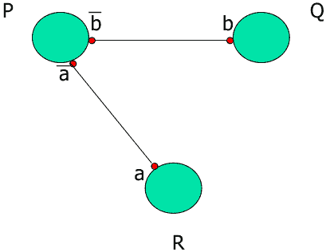

##### § 4 形式语义简介

使用数学抽象工具，严格描述程序设计语言的语义，使语义形式化。根据描述方式不同，主要以下几种方式：

+   - 操作语义（Operational Semantics）
+   - 指称语义（Denotational Semantics）
+   - 公理语义（Axiomatic Semantics）
+   - 代数语义（Algebraic Semantics）

##### § 4.1 操作语义

+   - 思想：给出程序的操作（计算）的规则。
+   - 方式：定义抽象机
+     - 给出抽象机状态结构的形式描述
+     - 给出状态转换规则的形式描述

+   - 操作语义实例—表达式求值的抽象机
+     - 表达式形式:
+       Exp e ::= n | x | e+e | e-e
+     - 状态结构: （Stack, EL, State）
+     - 初始状态: （[], el, σ）
+     - 终止状态: （v, [], σ）

状态转换规则：

+   - (s, n:β, σ) ⇒ (n:s, β, σ)
+   - (s, x:β, σ) ⇒ (σ(x):s, β, σ)
+   - (s, e1+e2:β, σ) ⇒ (s, e1:e2:+: β, σ)
+   - (s, e1-e2: β, σ) ⇒ (s, e1:e2:-: β, σ)
+   - (v1:v2:s, +: β, σ) ⇒ (v1+v2:s, β, σ)
+   - (v1:v2:s, -: β, σ) ⇒ (v1-v2:s, β, σ)

##### § 4.2 指称语义

+   - 思想：从各语法对象的功能角度形式化地说明程序的语义。
+   - 方法：给每个语法对象建立数学函数说明该语法对象的语义。
+     - 建立语义域
+     - 建立从语法域到语义域的映射（语义函数）

+   - 表达式求值例
+     - 语义域:
+       STATE = VAR → VAL
+       VAR = String
+       VAL = intV(Int) + boolV(Bool)
+     - 语义函数:
+       - Mₑ: Exp → STATE → VAL

+   - Mₑ的具体定义：
+     - Mₑ[n] σ = intV(n)
+     - Mₑ[x] σ = σ(x)
+     - Mₑ[e1+e2] σ = Mₑ[e1] σ + Mₑ[e2] σ
+     - Mₑ[e1-e2] σ = Mₑ[e1] σ - Mₑ[e2] σ

##### § 4.3 公理语义

+   - **思想：** 从变量间的逻辑关系来说明语言语义，用于系统的验证，程序的正确性证明。

+   - **方法：** 对给定语言的语句构造相应的公理系统。公理系统中的公式形式为：

```
{P} S {Q}
```

其中S是语句，P、Q是逻辑表达式，称P是前置条件，Q为后置条件，上面的公式称为验证公式。

##### 霍尔公理系统

+   - 赋值规则
   
     `{Q[E/x]}  x:=E  {Q}`

+   - 条件语句规则
   
     ```
     {P ∧ b} s1 {Q}   {P ∧ ~b} s2 {Q}
     ----------------------------------
              {P} if (b, s1, s2) {Q}
     ```

+   - 复合语句规则
   
     ```
     {P} s1 {R}   {R} s2 {Q}
     -----------------------
           {P} s1;s2 {Q}
     ```

+   - 循环语句规则：
   
     `{R ∧ b} s {R}`
     
     `{R} while(b, s) {r ∧ ¬b}`

+   - 推论规则：
   
     `P′ → P, {P} s {Q}, Q → Q′`
     
     `{P′} s {Q′}`

霍尔公理系统是可靠的，但不是完备的。

##### § 4.4 代数语义

+   - 思想：用代数方法来处理满足一个逻辑系统的各种模型。主要是考虑可靠性、完备性以及模型间的关系等。

+   - 方式：用多元关系的形式给出抽象数据类型的语法，用一组等式给出它的语义，用满足这组等式的代数作为它的模型。

表达式例：

```
type Expression =
{ INT + BOOL + IDENTIFIER +
sort exp
op  var: id → exp
    cons: int → exp
    add: exp × exp → exp
    sub: exp × exp → exp
    mul: exp × exp → exp
    eval: exp → int
```


##### § 4.4 代数语义

- `axiom eval( var(x)) = undefined`
  `eval ( cons(n)) = n`
  `eval ( add( e1, e2)) = eval(e1) + eval(e2)`
  `eval ( sub( e1, e2)) = eval(e1) - eval(e2)`
  `eval ( mul( e1, e2)) = eval(e1) × eval(e2)`
  `defined(e) = True }`

- 定理：上述的Expression是
  - 充分完备的；
  - 强等价、弱等价是可判定的；
  - 层次是一致的。

### 计算理论

### 第五章 并发模型CSP

#### § 5. 进程通信CSP

- Dijkstra的卫式命令
- Hoare的CSP（顺序通信进程）理论
- CSP应用实例

#### § 5.1 卫式命令

- 用于描述程序的不确定性，主要由算术表达式AExp和布尔表达式BExp组成。

- 形式：

```
gc ::= b → c | gc [] gc
c ::= skip | abort
      | x:=a | c;c
      | if gc fi | do gc od
```

其中 a∈ AExp，b∈BExp，符号 “[]” 称为选择构造符。

#### § 5.1 卫式命令

- **定义1 状态 STATE**
  - 对偶（变量名，变量值）的表称为状态，一般用STATE表示。
  - 形式也可定义为：
  
    `STATE = (VAR × VAL)*`
  
    或
  
    `STATE = (VAR → VAL)`
  
    对变量 x 在当前状态 σ 中的值为 σ(x)

#### § 5.1 卫式命令

定义2 卫式命令的一步执行 “→”
用格局<gc, σ>表示在当前状态σ中执行卫式命令gc，执行一步后形成新的格局或新的状态或者是特殊的fail和abortion。

- 例：
  <a, σ> → n
  -------------------
  <x := a, σ> → σ[n/x]

#### § 5.1 卫式命令

卫式命令gc的执行规则：

- <b, σ> → true
  -----------------
  <b→c, σ> → <c, σ>
- <b, σ> → false
  -----------------
  <b→c, σ> → fail
- <gc₀, σ> → <c₀, σ'>
  -----------------------------
  <gc₀ [] gc₁, σ> → <c₀, σ'>
- <gc₁, σ> → <c₁, σ'>
  -----------------------------
  <gc₀ [] gc₁, σ> → <c₁, σ'>
- <gc₀, σ> → fail  <gc₁, σ> → fail
  ----------------------------------------
           <gc₀ [] gc₁, σ> → fail

#### § 5.1 卫式命令

命令c的执行规则：

- <skip, σ> → σ

- <abort, σ> → abortion

- <a, σ> → n
  < x := a, σ> → σ[n/x]

- <c0, σ> → σ'
  < c0; c1, σ> → <c1, σ'>

- <c0, σ> → <c0', σ'>
  < c0; c1, σ> → <c0'; c1, σ'>

#### § 5.1 卫式命令

- \(<gc, \sigma> \to <c, \sigma'>\)  
  \(<if\ gc\ fi, \sigma> \to <c, \sigma'>\)
  
- \(<gc, \sigma> \to fail\)  
  \(<if\ gc\ fi, \sigma> \to \sigma\)
  
- \(<gc, \sigma> \to fail\)  
  \(<do\ gc\ od, \sigma> \to \sigma\)
  
- \(<gc, \sigma> \to <c, \sigma'>\)  
  \(<do\ gc\ od, \sigma> \to <c;\ do\ gc\ od, \sigma'>\)

#### § 5.1 卫式命令

- 例1：把x和y的最大值赋给max
  
  ```text
  if x≥y → max := x fi
  
  if x<y → max:= y fi
  ```

- 例2：求两个数的最大公约数的欧几里得算法
  
  ```text
  do  x > y → x:= x - y
  
      x < y → y:= y - x
  od
  ```

##### § 5.2 CSP理论

- CSP（Communicating Sequential Processes）：Hoare给出的一种描述并发与分布式计算的研究模型。
- CSP是一种命令式语言形式，描述对象是进程，进程是CSP的基本成分。以通信原语描述进程的通信机制。
- 通信原语与具体的通信介质无关。

##### § 5.2 CSP理论

- 基本通信原语
  - 输入语句：
    P? x
    例如：
    <P? x, σ> --P?2--> σ[2/x]
  - 输出语句：
    Q! v
    例如：
    <Q!v, σ> --Q!2--> σ

##### § 5.2 CSP理论

进程P ::
..
..
Q?x
..
..
Q!2x
..
..

进程Q ::
..
 y:=5
..
 P!y+1
..
..
..
 P?y

##### § 5.2 CSP理论

- 约定：
  - 用符号λ表示 P?x、P!v 和 空标识 ε，表示从外界能够观察到的该进程的行为。
  - 为统一规则一步执行时格局的结构形式，约定 σ ≡ <skip, σ>，并且有：
    skip;P ≡ P
    P ≡ skip || P ≡ P || skip
    skip ≡ skip || skip

##### § 5.2 CSP理论

##### CSP进程P的执行规则：

- ⟨skip, σ⟩ → σ
- ⟨abort, σ⟩ → abortion
- ⟨a, σ⟩ → n
  ⟨x := a, σ⟩ → σ[n/x]
- ⟨P?x, σ⟩ \xrightarrow{P?n} σ[n/x]
- ⟨a, σ⟩ → n
  ⟨P!a, σ⟩ \xrightarrow{P!n} σ

##### § 5.2 CSP理论

<gc, σ> --λ--> <P, σ'>
-----------------------------
< if gc fi, σ> --λ--> <P, σ'>

<gc, σ> --> fail
-----------------
< if gc fi, σ> --> σ

<gc, σ> --λ--> <P, σ'>
--------------------------------
< do gc od, σ> --λ--> <P; do gc od, σ'>

<gc, σ> --λ--> fail
-----------------
< do gc od, σ> --λ--> σ

##### § 5.2 CSP理论

<P₀, σ> --λ--> <P₀', σ'>
--------------------------------
< P₀; P₁, σ> --λ--> <P₀'; P₁, σ'>

<P₀, σ> --λ--> <P₀', σ'>
--------------------------------
< P₀ || P₁, σ> --λ--> <P₀' || P₁, σ'>

<P₁, σ> --λ--> <P₁', σ'>
--------------------------------
< P₀ || P₁, σ> --λ--> <P₀ || P₁', σ'>


##### § 5.2 CSP理论

```
<P₁, σ> --P₂?n--> <P₁', σ'>   <P₂, σ> --P₁!n--> <P₂', σ>
------------------------------------------------
<P₁ || P₂ , σ> --ε--> <P₁' || P₂', σ'>

<P₁, σ> --P₂!n--> <P₁', σ>   <P₂, σ> --P₁?n--> <P₂', σ'>
------------------------------------------------
<P₁ || P₂ , σ> --ε--> <P₁' || P₂', σ'>
```

卫式命令gc的执行规则：

```
<b, σ> → true
-------------------
< b ⇒ P, σ> → <P, σ>

<b, σ> → false
--------------------
< b ⇒ P, σ> → fail

<b, σ> → true
-----------------------------
< b;P?x ⇒ Q, σ> ⇝ⁿ <Q, σ [n/x]>

<b, σ> → false
-----------------------------
< b;P?x ⇒ Q, σ> → fail
```

- `<gC_{0,r}, σ> \xrightarrow{λ} <P_0, σ'>`

  `<gC_0 ⊔ gC_{1,r}, σ> \xrightarrow{λ} <P_0, σ'>`

- `<gC_{1,r}, σ> \xrightarrow{λ} <P_1, σ'>`

  `<gC_0 ⊔ gC_1, σ> \xrightarrow{λ} <P_1, σ'>`

- `<gC_{0,r}, σ> \xrightarrow{λ} fail   <gC_1, σ> \xrightarrow{λ} fail`

  `<gC_0 ⊔ gC_1, σ> \xrightarrow{λ} fail`

##### § 5.3 CSP简单实例

**例1 打印Fibonacci数的平方表**

```
Fibon::
    old := 0; new := 1;
    do  true ⇒ Mult ! new;
        temp:=old; old:=new; new:=new+temp
    od
||
Mult::
    do  Fibon ? val ⇒ Print ! (val, val*val)
    od
||
Print::
    ...
```

**例2 哲学家就餐问题（假设有五位哲学家）**

```
PHIL ::
    do true ⇒ THINK;
        room ! enter();
        fork(i) ! pickup();
        fork((i + 1) mod 5) ! pickup();
        EAT;
        fork (i) ! putdown();
        fork ((i + 1) mod 5) ! putdown();
        room ! exit()
    od
```

```
FORK ::
    do
        phil(i) ? pickup( ) ⇒ phil(i) ? putdown( )
        []
        phil((i-1) mod 5) ? pickup( )
            ⇒ phil((i-1) mod 5) ? putdown( )
    od
```

```
ROOM::
    occupancy := 0;
    do
        (i: 0..4) occupancy < 4; phil(i) ? enter( )
            ⇒ occupancy := occupancy + 1
        []
        (i: 0..4) phil(i) ? exit( )
            ⇒ occupancy := occupancy - 1
    od
```

- 哲学家就餐：

  ```
  room::ROOM
  ||
  fork(i:0..4)::FORK
  ||
  phil(i:0..4)::PHIL
  ```

- 问题：

  会有饿死现象

### 程序理论基础

#### 主要内容

- Lambda 演算（λ-演算）理论
- CSP进程演算理论
- Pi 演算（π-演算）理论
- 形式语义学
  - 操作语义
  - 指称语义
  - 公理语义

#### § 1. Lambda演算理论

- Lambda演算理论是一个形式系统，同Turing机一样可作为计算模型。
- Lambda演算形式系统主要有两部分：
  - 表达式的形式系统
  - 变换规则的形式系统
- Lambda演算理论是函数式语言的基础，也是指称语义学的理论基础。

主要内容：

- 纯Lambda演算理论
- 纯Lambda演算实例
- 纯Lambda演算的扩展

##### § 1.1 纯Lambda演算理论

- 纯Lambda表达式形式：主要由变量名和抽象符号λ、'.'以及括号等符号构成。

- 用E表示λ表达式，Exp表示λ表达式之集，Exp定义如下：

  - x∈Exp，其中x是变量名。
  - 若E₁∈Exp，E₂∈Exp，则E₁ E₂ ∈ Exp。
  - 若E ∈Exp，x是变量，则λx.E ∈ Exp。
  - 若E ∈ Exp，则（E）∈ Exp。

其中，E₁ E₂型表达式称为应用型表达式，λx.E型表达式称为抽象型表达式。

λ表达式的BNF表示（x为变量，E∈Exp）：

```
E ::= x | E₁ E₂ | λx.E | (E)
```

记法约定：

```
E₁ E₂ E₃ ... Eₙ ≡ (...(((E₁ E₂)E₃))...) Eₙ

λx₁. λx₂. .... . λxₙ. E ≡ λx₁. (... (λxₙ. E)... )

λx₁. λx₂. .... . λxₙ. E ≡ λx₁ x₂ ... xₙ. E

λx₁. λx₂. .... . λxₙ. E₁ ... Eₙ ≡ λx₁. λx₂. .... . λxₙ.(E₁...Eₙ)
```

- 定义1 作用域

  设有λ表达式λx.E，则定义λx中的x的作用域为其中的体表达式E部分。

- 定义2 约束出现、自由出现

  对变量x，当它出现在表达式λx.E中时，则称x在表达式λx.E中的出现是约束出现。若它出现的位置不被表达式E约束时，则称x在表达式E中的出现是自由出现。

- 定义3 自由变量

  若变量x在表达式E中是自由出现，则称变量x为表达式E中的自由变量。

  fv(E)：表示表达式E中的所有自由变量集。

  ```
  fv(x) = {x}
  fv(E1 E2) = fv(E1) ∪ fv(E2)
  fv(λx.E) = fv(E) − {x}
  fv((E)) = fv(E)
  ```

- 定义4 替换 E[E₀/x]：

  将表达式E中x的自由出现用E₀代替。

  - E ≡ x： x[E₀/x] = E₀
  - E ≡ y，且x≠y： y[E₀/x] = y
  - E ≡ E₁ E₂： (E₁ E₂)[E₀/x] = (E₁[E₀/x]) (E₂[E₀/x])
  - E ≡ λx.E′： (λx.E′)[E₀/x] = λx. E′
  - E ≡ λy.E′，且x ≠ y：
    - 若x ∈ fv(E′) ∧ y ∈ fv(E₀)： (λy.E′)[E₀/x] = λz. E′[z/y] [E₀/x]
    - 否则： (λy.E′)[E₀/x] = λy. E′[E₀/x]

Lambda变换规则

α变换（换名规则）：

λx.E →ₐ λy.E[y/x]

其中 x≠y 且 y∉fv(E)。

例：

λa.ab(λa.ab) →ₐ λa.ab(λc.cb)

λa.ab(λa.ab) →ₐ λc.cb(λa.ab)


##### § 1.1 纯Lambda演算理论

- Lambda变换规则
  - η变换（保值变换）：`(λx.Mx) →η M`，其中 `x ∉ fv(M)`
- 归约基：

  β变换和η变换的左部分别称为β归约基和η归约基，统称为归约基。
- 特例：
  - `(λx. xx) (λx. xx)`
    - →ᵦ `(λx. xx) (λx. xx)`
    - →ᵦ …
  - `(λx.y) ((λx.xx) (λx.xx))`

##### § 1.2 纯Lambda演算实例

- 布尔表达式
  - 布尔值
    - tru = λa.λb.a
    - fls = λa.λb.b
  - 布尔运算
    - and = λx.λy. x y fls
    - or = λx. λy. x tru y
    - not = λx. x fls tru
- 整数表达式:
  - 整数定义：λa. λb. a(a(...(ab)...)) = λa. λb. aⁿb
  - 0 = λa. λb. b
  - 1 = λa. λb. ab
  - 2 = λa. λb. a(ab)
  - ...
  - n = λa. λb. aⁿb

##### § 1.3 纯Lambda演算的扩展

- 扩展λ-表达式
  - `E ::= true | false | n | f`
  - `| x | E₁ E₂ | λx.E | (E)`
  - `| (E₀ → E₁, E₂)`
  - `| let x = E₀ in E`
- 扩展λ-变换规则
- 扩展数据类型

### 计算引论

图灵奖获得者对计算理论发展的影响


#### ACM A.M. 图灵奖

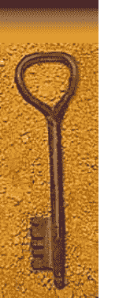


(1966-2005)

#### 图灵简介

图灵（Alan Mathison Turing），计算机逻辑的奠基者，许多人工智能的重要方法也源自于这位伟大的科学家。

他的重要贡献在于提出“图灵机”（Turing Machine）的概念，还提出了重要的机器智能衡量标准“图灵测试”。

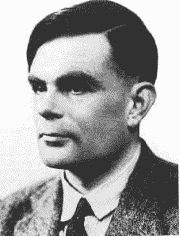

1912～1954

图灵的重要论文有：

- On Computable Numbers with an Application to the Entscheidungs Problem
- Computer Machinery and Intelligence

#### ACM简介

ACM (Association for Computing Machinery)，美国计算机学会，是全球历史最为悠久和最大的教育科学计算机学会。

自1947年开始，ACM就提供了一个影响巨大的论坛空间供大家进行信息、创意、和最新发现的交流，致力于发展在高级艺术、最新科学、工程技术和应用领域中的信息技术，强调在专业领域或在社会感兴趣的领域中培养、发展开放式的信息交换，推动高级的专业技术和通用标准的发展。


#### 图灵奖的由来

图灵奖由ACM于1966年设立，又叫“A.C.M.图灵奖”，专门奖励那些对计算机事业作出重要贡献的个人。其名称取自计算机科学的先驱、英国科学家Alan Mathison Turing，这个奖设立的目的之一是纪念这位科学家。


#### 1966年图灵奖获奖者Alan J. Perlis

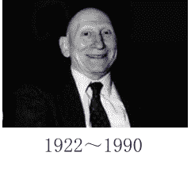

1922～1990

因在新一代编程技术和编译架构方面的贡献而获奖。

Perlis的重要著述有：

- A View of Programming Languages, Addison-Wesley, 1970
- Introduction to Computer Science, Harper&Row, 1972, 1975
- Software Reusability, ACM Pr., 1989

图灵演讲：

The Synthesis of Algorithmic Systems

#### 1967年图灵奖获奖者Maurice V. Wilkes

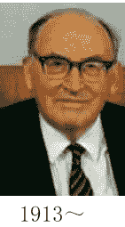

1913～

因设计出第一台具有内置存储程序的计算机 EDSAC而获奖。

Wilkes的重要著述有：

- Preparation of Programs for an Electronic Digital Computer, Addison-Wesley, 1951, 1958
- Automatic Digital Computer, Methuen, 1956
- A Short Introduction to Numerical Analysis, Cambridge Uni. Pr., 1966
- Time-Sharing Computer, Elsevier, 1968, 1975
- The Cambridge CAP Computer and Its Operating System, North Holland, 1979
- Memoirs of a Computer Pioneer, MIT Pr., 1985

图灵演讲：

Computer Then and Now

#### 1968年图灵奖获奖者 Richard Wesley Hamming

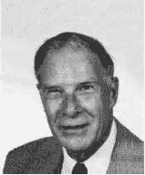

1915~1998

因在计数方法、自动编码系统、检测及纠正错误方面的贡献被授予图灵奖。

Hamming的重要著述：

- Numerical Methods for Scientists and Engineers, McGraw-Hill, 1973
- Digital Filter, Prentice-Hall, 1977, 1983, 1989
- Coding and Information Theory, Prentice-Hall, 1980, 1986
- Methods of Mathematics Applied to Calculus, Probability, and Society, McGraw-Hill, 1972
- Introduction to Applied Numerical Analysis, Hemisphere Pub., 1989
- The Art of Probability, Addison-Wesley, 1991
- The Art of Doing Science and Engineering, Gordon and Breach Science Pub., 1997

图灵演说：

One Man’s View of Computer Science

#### 1969年图灵奖获奖者Marvin Lee Minsky


因在人工智能方面的贡献而获奖。

1927～

Minsky的重要论文有：

- Computation: Finite and Infinite Machines, Prentice-Hall, 1967
- Semantic Information Processing, MIT Pr., 1968
- Perceptrons, MIT Pr., 1969; expanded edition, 1988
- A Framework for Representing Knowledge, McGraw-Hill, 1975
- The Society of Mind, Simon&Schuster, 1986
- Robotics, Anchor Pr./Doubleday, 1985

图灵演讲：

Form and Content in Computer Science


##### 1970年图灵奖获奖者 James Hardy Wilkinson

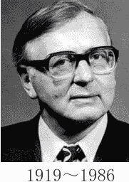

因在利用数值分析方法来促进高速数字计算机的应用方面的研究而获奖。

1919～1986

###### 重要论文有：

- Rounding Errors in Algebraic Processes, Prentice-Hall, 1964
- The Algebraic Eigenvalue Problem, Clarendon Pr., 1965
- Handbook for Automatic Computation, Vol. 2, Linear Algebra, Springer, 1971

###### 图灵演讲：

Some Comments from a Numerical Analyst


##### 1971年图灵奖获奖者 John McCarthy

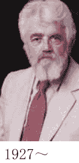

因对人工智能的贡献被授予图灵奖。

1927～

###### 重要论文有：

- Automata Studies, Princeton Uni. Pr., 1956
- Information: A Scientific American Book, Freeman, 1966
- Formalizing Common Sense: Papers by John McCarthy, Ablex Pub. Co., 1990

###### 图灵演讲：

The Present State of Research on Artificial Intelligence

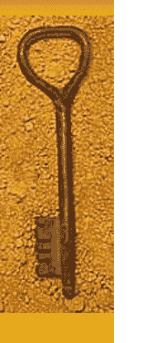

##### 1972年图灵奖获奖者 Edsger Wybe Dijkstra

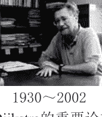

ALGOL的推广者，率先实现了ALGOL 60的编译器。他还在图论、算法和操作系统有很大的贡献。图论中的求最短路径的方法之一就是Dijkstra算法。还有操作系统中的PV操作也是他提出的。

1930～2002

###### 重要论文有：

- A Primer of ALGOL 60 Programming, Academic Pr., 1962
- A Discipline of Programming, Prentice-Hall, 1976
- The Teaching of Programming, i.e. the Teaching of Thinking, Springer, 1976
- Selected Writings on Computing: A Personal Perspective, Springer, 1982
- A Method of Programming, Addison-Wesley, 1988
- Formal Development of Programs and Proofs, Addison-Wesley, 1990
- Predicate Calculus and Program Semantics, Springer, 1990

###### 图灵演讲：

The Humble Programmer

##### 1974年图灵奖获奖者 Donald Ervin Knuth


1938～

因在算法分析和编程语言设计方面的贡献而获奖。他著有巨作“The Art of Computer Programming”。字符串匹配中KMP算法的K就是他。编译中学到的LR(k)文法也是他提出的。他还给整个西文印刷行业带来产生革命性变革的TeX排版软件。

###### Knuth的重要著述有：

- The Art of Computer Programming, Vols. 1, 2, 3, Addison-Wesley
- Computers and Typesetting
- Surreal Numbers, Addison-Wesley, 1974
- Concrete Mathematics, Addison-Wesley, 1989
- Mathematical Writing, MAA, 1989
- Mathematics for the Analysis of Algorithms, Birkhäuser, 1990
- Axioms and Hulls, Springer, 1992
- The Stanford GraphBase: A Platform for Combinatorial Computing, ACM Pr., 1993

###### 图灵演说：

Computer Programming as an Art

##### 1975年图灵奖获奖者 Herbert Alexander Simon & Allen Newell

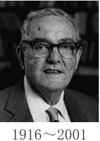

他们在人工智能、认知心理学、表处理等方面的贡献。同第一届图灵奖得主Alan J. Perlis并称为CMU三驾马车。Simon还获得了1978年诺贝尔经济学奖。

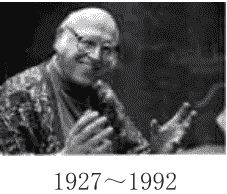

###### Herbert Alexander Simon和Allen Newell合著的重要著述有：

- The Logic Theory Machine: A Complex Information Processing System, RAND, 1956
- Human Problem Solving, Prentice-Hall, 1972

###### 图灵演讲：

Computer Science as Empirical Inquiry: Symbols and Search

##### 1977年图灵奖获奖者 John Warner Backus

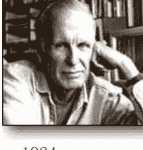

1924～

FORTRAN语言和Backus范式(BNF)的发明人。因对可用的高级编程系统设计有深远和重大的影响而获奖。

###### 重要论文有：

- Reduction Languages and Variable Free Programming, 1972

###### 图灵演讲：

Can Programming Be Liberated from the von Neumann Style? A Functional Style and Its Algebra of Programs

##### 1978年图灵奖获奖者 Robert W. Floyd

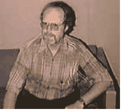

因其在软件编程的算法方面的深远影响，并开创了包括剖析理论、编程语言的语义、自动程序检验、自动程序合成和算法分析在内的多项计算机子学科而被授予该奖。

1936～

###### 重要论文有：

- Assigning Meanings to Programs, 1967

###### 图灵演说：

The Paradigms of Programming

##### 1979年图灵奖获奖者 Kenneth Eugene Iverson

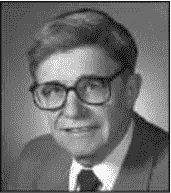

1920～

因对程序设计语言理论、互动式系统及APL的贡献被授予该奖。

###### 重要著述有：

- A Programming Language, John Wiley & Sons, 1962
- Elementary Functions, SRA, 1966
- Algebra: Algebra Analysis, APL Pr., 1976
- Automatic Data Processing, John Wiley & Sons, 1963, 1969
- An Introduction to APL for Scientists and Engineers, APL Pr., 1966

###### 图灵演说：

Notation as a Tool of Thought

##### 1980年图灵奖获奖者 Charles Richard Hoare

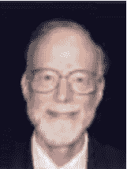

1934～

因对程序设计语言的定义和设计所做的贡献而获奖。著名的快速排序算法和case语句都是他的杰作。

###### Hoare的重要论文有：

- Operating Systems Techniques, Academic Pr., 1982
- Mathematical Logic and Programming Languages, Prentice-Hall, 1992
- Developments in Concurrency and Communication, Addison-Wesley, 1990
- Mechanized Reasoning and Hardware Design, Prentice-Hall, 1992

###### 图灵演说：

The Emperor’s Old Clothes


##### 1981年图灵奖获奖者埃德加·弗兰克·科德

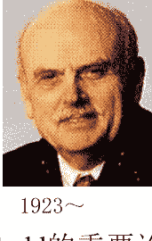

因在数据库管理系统的理论和实践方面的贡献而获奖。他第一个提出了关系模型。

1923～

###### 重要论文

- 《数据库管理的关系模型：第2版》，Addison-Wesley

###### 图灵演讲

- 《关系数据库：提高生产力的实用基础》

##### 1982年图灵奖获奖者斯蒂芬·阿瑟·库克


因奠定了NP完全理论的基础而获奖。NP完全理论的奠基人。计算复杂性中的库克定理。

1939～

###### 重要论文

- 《定理证明过程的复杂性》

###### 图灵演讲

- 《计算复杂性概述》

##### 1983年图灵奖获奖者丹尼斯·麦卡利斯泰尔·里奇与肯尼斯·莱恩·汤普森

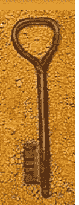

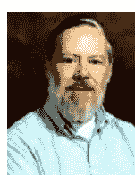

1941～

因在通用操作系统理论方面的突出贡献，特别是对UNIX操作系统的推广的贡献而获奖。C和UNIX的发明人。


1943～

###### 重要论文

- 《UNIX分时系统》，《ACM通讯》，1974.7

###### 图灵演讲

- 里奇：《软件研究反思》
- 汤普森：《对信任的信任之反思》

##### 1984年图灵奖获奖者尼古拉斯·沃斯

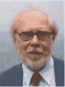

1934～

因开发了EULER、ALGOL-W、MODULA和PASCAL一系列新的计算语言而获奖。

###### 重要论文

- 《通过逐步求精进行程序开发》，《ACM通讯》

###### 图灵演讲

- 《从编程语言设计到计算机构建》

##### 1985年图灵奖获奖者理查德·曼宁·卡尔普


因对算法理论的贡献而获奖。他在最大网络流和组合优化问题上算法理论的贡献。他第一个提出P类的概念。并提出了P=?NP的问题。

1935～

###### 重要论文

- 《组合问题之间的可归约性》
- 《计算机计算的复杂性》，Plenum Press

###### 图灵演讲

- 《组合学、复杂性与随机性》

##### 1986年图灵奖获奖者约翰·爱德华·霍普克罗夫特与罗伯特·恩德雷·塔扬

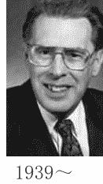

1939～

因在算法及数据结构的设计和分析中所取得的决定性成果而获奖。数据结构中学到的B树就是他们提出的。


1948～

###### 重要论文

- 霍普克罗夫特：《形式语言及其与自动机的关系》，Addison-Wesley，1969

###### 图灵演讲

- 霍普克罗夫特：《计算机科学：一门学科的出现》
- 塔扬：《算法设计》

##### 1988年图灵奖获奖者伊万·爱德华·萨瑟兰

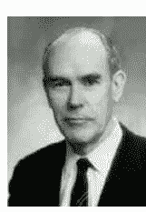

因在计算机图形学方面的贡献而获奖。他成功地开发了Sketchpad，其中许多方法今天依然在使用，如物体递归层次建模，几何变形，多边形的裁剪等等。图形学的课本上有萨瑟兰的算法。

1938～

###### 重要论文

- 《Sketchpad：人机图形通信系统》

###### 图灵演讲

未作图灵演讲，但发表了《微流水线》一文

##### 1989年图灵奖获奖者威廉·卡亨

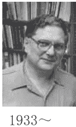

1933～

因在数值分析方面的贡献而获奖。特别是在浮点计算方面的贡献。IEEE 754标准的制订者。是卡亨求和算法的发明者

###### 图灵演讲

未作图灵演讲


##### 1990年图灵奖获奖者费尔南多·何塞·科巴托


1926～

因在开发大型多功能、可实现时间和资源共享的计算系统，如CTSS和Multics方面的贡献而获奖。

###### 重要论文

- 《兼容分时系统：程序员指南》，MIT出版社，1963
- 《高级计算机编程：课堂汇编程序案例研究》，MIT出版社，1963

###### 图灵演讲

- 《论构建终将失败的系统》

##### 1991年图灵奖获奖者罗宾·米尔纳

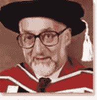

他有三个贡献：1) 形式化逻辑系统的一个数学模型LCF（可计算函数的逻辑）。2) 多态类型的元语言ML。3) 并行计算的理论CCS（通信演算）。

1934～

###### 重要论文

- 《通信系统演算》，Springer，1980
- 《通信与并发》，Prentice-Hall，1989
- 《标准ML的定义》，MIT出版社，1990
- 《标准ML评注》，MIT出版社，1991
- 《明日计算：计算机科学的未来研究方向》，剑桥大学出版社，1996

###### 图灵演讲

- 《交互的要素》

##### 1992年图灵奖获奖者巴特勒·赖特·兰普森


1943～

因他在个人计算机、工作站、网络、操作系统、显示系统、人机交互等方面的工作而获奖。开发了一个图形化的编辑器Bravo。

###### 重要论文

- 《分布式系统——体系结构与实现：高级教程》，Springer，1981

##### 1993年图灵奖获奖者尤里斯·哈特马尼斯与理查德·埃德温·斯特恩斯

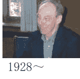

1928～

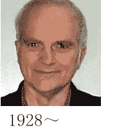

1928～

他们创立了计算复杂性理论。

###### 重要论文

- 哈特马尼斯与斯特恩斯：《论算法的计算复杂性》，《美国数学学会汇刊》，177（1965）
- 斯特恩斯：《不完全信息重复博弈》，MIT出版社，1995

###### 图灵演讲

- 哈特马尼斯：《论计算复杂性与计算机科学的本质》
- 斯特恩斯：《是时候重新考虑时间了》


##### 1995年图灵奖获奖者Manuel Blum

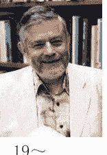

因在计算复杂性理论、应用密码学和程序测试方面的贡献而获奖。

19～

Blum的重要论文有：
- A Machine Independent Theory of the Complexity of Recursive Functions
- Designing Programs that Check Their Work
- Reflections on the Pentium Division Bug
- Software Reliability with Runtime Result-Checking

##### 1996年图灵奖获奖者Amir Pnueli

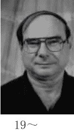

他将时序逻辑引入计算机科学，为程序和系统的检测验证方面提供一种有力的工具。

19~

Pnueli的重要论文有：
- The Temporal Logic for Reactive and Concurrent Systems: Specification, Springer, 1992
- Temporal Verification of Reactive Systems: Safety, Springer, 1995

##### 1997年图灵奖获奖者Douglas Engelbart

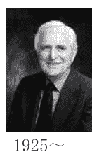

1925～

因在人机交互方面的贡献而获奖。他是鼠标的发明人和超文本系统的先驱。

Engelbart的重要论文有：
Toward High-performance Knowledge works
Toward Augmenting The Human Intellect and Boosting Our Collective IQ


##### 1998年图灵奖获奖者James Gray

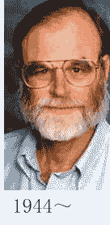

因在数据库事务处理方面的贡献而获奖。他参与过IBM System R的开发工作。后来到Microsoft开发了Sql Server 7.0。

1944～

Gray的重要论文有：
- Transaction Processing: Concepts and Techniques(Morgan Kaufman)
- The Benchmark Handbook: for Database and Transaction Processing Systems

图灵演讲：
What Next? –A Dozen Remaining IT Problems

##### 1999年图灵奖获奖者Frederick Philips Brooks, Jr.


因在计算机体系结构、操作系统和软件工程方面的贡献而获奖。IBM360的总设计师。软件工程中的瀑布模型也是他提出来的。

1931～

Brooks的重要论文有：
- Automatic Data Processing, Wiley
- The Mythical Man-Month: Essay on Software Engineering, Addison-Wesley, 1975
- Computer Architecture: Concepts and Evolution, Addison-Wesley, 1997
- Evolving the High Performance Computing and Communications Initiative to Support the National Information Infrastructure, National Academy Pr., 1995

##### 2000年图灵奖获奖者姚期智

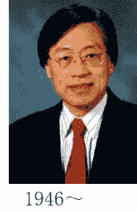

1946～

姚期智 (Andrew Chi-Chih Yao)是清华大学高等研究中心教授、普林斯顿大学计算机科学系讲座教授、美国科学院院士、中国工程院外籍院士。他的研究领域是计算机理论，包括以复杂性为基础的伪随机数字代码、密码学和通讯复杂性，因其在计算理论方面的基础性贡献获得此奖，是迄今为止获得图灵奖的唯一一位华裔科学家。

姚期智的重要论文有：
- Quantum Bit Escrow (STOC 2000:705~714)
- Quantum Cryptography with Imperfect Apparatus (FOCS 1998:503~509)
- Quantum Circuit Complexity (FOCS 1993:352~361)

##### 2001年图灵奖获奖者Ole Johan Dahl & Kristen Nygaard


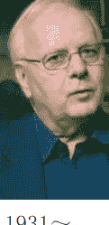

他们因在面向对象程序设计方面的贡献而获奖。他们实现了语言Simula I 和Simula 67。

1926～

1931～

Dahl & Nygaard的重要论文有：
SIMULA: An Extension of ALGOL to the Description of Discrete-Event Networks
Dahl: Structured Programming, Academic Pr., 1972


##### 2002年图灵奖获奖者Ronald L. Rivest Adi Shamir & Leonard M. Adleman


1947～

1952～

1945～

他们因在公共密钥算法方面的贡献而获奖。

Rivest, Shamir和Adleman的关于RSA算法的原始文献：
A Method for Obtaining Digital Signatures and Public-Key Cryptosystems

##### 2003年图灵奖获奖者 Alan Kay


领导开发了 Smalltalk 语言，作为先驱提出了面向对象编程语言的许多基本概念，并对个人电脑的发展提出了许多基本原则，因此获奖。

1940～

###### 图灵奖演说：
> "The best way to predict the future is to invent it."
> (预测未来的最好方法是发明未来)

##### 2004年图灵奖获奖者 Robert E. Kahn & Vinton Gray Cerf


(1938~)

互联网领域先驱性的贡献，其中包括Internet基础通讯协议的设计与实现，TCP/IP协议，和网络领域的权威性的领导地位。

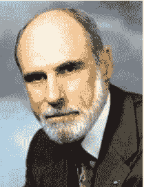

(1943~)

###### 图灵奖演说：
Assessing the Internet: Lessons Learned, Strategies for Evolution, and Future Possibilities

##### 2006 年图灵奖获奖者Fran Allen


- 获奖原因：对于优化编译器技术的理论和实践做出的先驱性贡献，这些技术为现代优化编译器和自动并行执行打下了基础。
- 创立40年来首位女性得主.
- 演讲： Compiling for Performance – A Personal Tour


##### 2007 年图灵奖获奖者

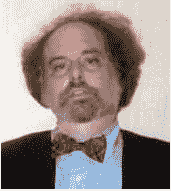

E. Allen Emerson


Joseph Sifakis

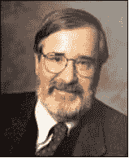

Edmund M. Clarke

- 获奖原因：给出了一种高效的用于模型检查的验证技术，广泛应用于计算机软硬件领域。

### 课程论文写法

#### 文献综述

文献综述是查阅某一专题在一段时期内的相当数量的文献资料，分析研究，归纳整理，作出综合性的描述。

- “综”是要求对文献资料进行综合分析、归纳整理，使材料更精练明确、更有逻辑层次；
- “述”是要求对综合整理后的文献进行比较专门的、全面的、深入的、系统的论述。

#### 步骤

- 选题
- 资料收集
- 阅读
- 撰写论文

#### 论文选题

- 一个领域、一个学科、一个方法、一个理论等都可作为目标。
- 不宜过大，不易把握论文的中心，归纳整理困难，造成大题小作或是文不对题。

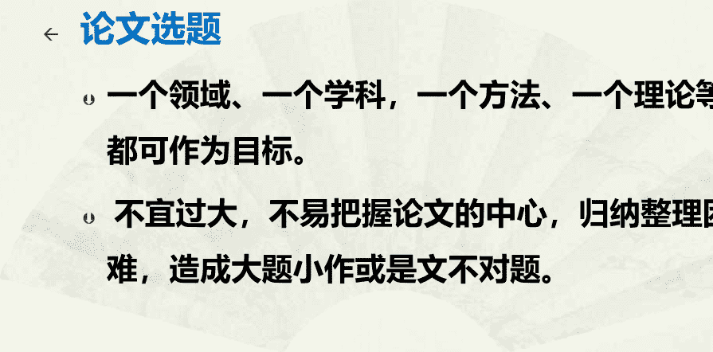

#### 资料收集

- 有检索法、年鉴法、浏览法、滚雪球法、阅读专著等等。
- 搜集文献要求越全越好，常用的方法是用检索法。
- 以最近3-5年内的最新文献为主，反映最新的研究动态。
- 选择的文献的质量高低，直接影响文献综述的水平。

#### 阅读

- 写好“读书笔记”、“读书心得”和做好“文献摘录卡片”。
- 用自己的语言写下阅读时得到的启示、体会和想法，将文献的精髓摘录下来。
- 围绕主题对文献的各种观点作比较分析，不要教科书式地对资料进行简要地汇总陈述一遍。

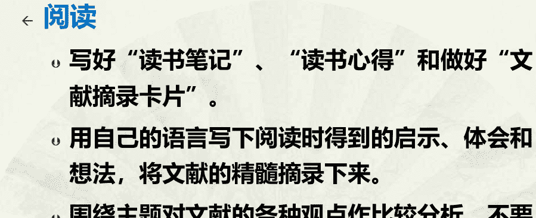

#### 撰写论文

- 前言
- 正文
- 总结
- 参考文献

#### 前言

- **简明扼要**地说明写作的目的、必要性。
- 介绍有关概念的定义，综述的范围，阐述有关问题的现状和动态，以及目前对主要问题争论的焦点等。
- 前言一般200-300字为宜，不宜超过500字。

#### 正文

- 是综述的重点，主要包括论据和论证两个部分。
- 阐明有关主题的历史背景、现状和发展方向，以及对这些问题的评述。

#### 正文形式

不固定，可按不同方式。

- **年代**：从问题发生的历史背景、目前现状、发展方向等提出文献的不同观点。
- **问题**：通过提出问题、分析问题和解决问题，比较不同学者对问题的看法及其理论依据，进一步阐明问题的来龙去脉和作者自己的见解。
- **观点**：对不同观点分别进行分析和比较。

#### 参考文献

- 是综述的重要组成部分。
- 表示对被引用文献作者的尊重及引用文献的依据，体现作者阅读文献的广度和深度。
- 为读者深入探讨有关问题提供了文献查找线索。
- 选择代表性强、具有科学性和创造性的文献。
- 参考文献的数量有不同的要求，一般以30条以内为宜，以最近3-5年内的最新文献为主。

#### 参考文献的格式

- 期刊：序号 作者.题名.刊名，年，卷（期）：起至页码。
- 专著：序号 著者.书名.版本（第一版不标注）.出版地：出版者，出版年.起至页码。
- 学位论文：序号 作者.题名：[博士或硕士学位论文].保存地：保存者，年份。

#### 注意

- 标注来源
- 逻辑合理
- 掌握第一手资料
- 忠实文献内容
- 综合和归纳
- 一般不宜超过4000字

