# 北航软件架构课件（张莉）


## 设计高层建筑


## 早期建筑

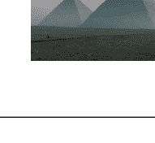

进展：
- 理论知识有限

## 现代建筑


进展：
- 新材料
- 分析技术的进步

规模：
- 两倍于万神殿的跨度
- 吉萨金字塔高度的3倍

## 建模一栋房子

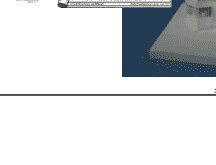

## 民用建筑中的流派

- 青铜时代/埃及（伊姆霍特普）
- 希腊/罗马（维特鲁威）
- 拜占庭/罗马式
- 哥特式
- 风格主义（米开朗基罗、帕拉第奥）
- 巴洛克
- 工程/理性/民族/浪漫
- 新艺术运动
- 现代运动（赖特、勒·柯布西耶）

建筑风格

## 民用建筑的类型

- 社区
  - 住宅、公寓、花园、教育、医院、宗教
- 商业
  - 商店、餐馆、酒店、办公楼、银行、机场
- 工业
  - 工业建筑、实验室、农场建筑
- 休闲
  - 体育、剧院

继续：参考体系结构

## 民用建筑中的力

任何时候你偏离既定做法，都要付出十倍的努力，进行十倍的调查。尤其是在一个非常大的项目上。

- 荷载类型
- 避免失效

## 软件中的力

# 第二部分 创建软件体系结构

- 理解和定义质量属性
- 软件体系结构的质量属性
- 软件体系结构和质量属性
- 软件体系结构风格
- 软件体系结构模式
- 软件体系结构构造的原子要素
- 软件体系结构案例分析
- KWIC System
- WWW
- CORBA

## 软件体系结构和质量属性

功能性需求和非功能性需求

## 功能性和体系结构

- 功能性和质量属性是正交的。
- 什么是功能性？
- 体系结构的类型
- 功能性属性：它是如何与其他质量属性交互，以及它是如何提供其他质量属性的。

## 体系结构和质量属性

必须从设计、实现到部署的整个过程中考虑质量属性。

## 在复杂系统中，决不可能以独立的方式实现质量属性。

- 任何一个质量的实现都会对其他质量属性的实现产生积极或消极的影响。
- 如：安全性和可维护性。
- 几乎每个质量属性都会对系统的性能产生消极的影响，如可移植性。

## 系统的质量属性

- Boehm模型利用分解的思想来描述软件质量

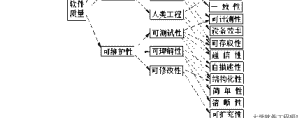

## McCall模型

- McCall模型对质量进行分解，并将质量属性按照产品的生命周期划分为三类。

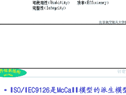

## ISO/IEC9126

McCall模型质量属性映射到ISO/IEC9126的六个特性：正确性、可维护性、可靠性、效率、易用性、完整性等

## ISO/IEC9126是McCall模型的继承模型。将软件质量分解为6个特性：

- 功能性
- 可靠性
- 易用性
- 可使用性
- 可维护性
- 可移植性

## 为了方便起见，从以下两个方面讨论质量属性：

- 通过运行可观察到的系统质量属性
  - 在运行过程中，系统是否按照规格说明的要求工作？系统运行是否达到了预期的效果？系统的输出是否及时？执行是否正确？系统是否能按要求达到预期的精度及稳定程度？当与其他系统连接时，系统工作是否正常？
- 通过运行不可观察到的系统质量属性
  - 系统的复杂性、修改软件的难易程度如何？开发的成本有多少？是否在预定时间内投入市场等？

## 软件体系结构和质量属性

我们将从以下三个方面讨论：

- 系统的质量属性
  - 能通过观察系统运行确定的质量属性
  - 不能通过观察系统运行确定的质量属性
- 受系统结构影响的非商业属性
- 与软件体系结构本身相关联的一些质量属性，如概念完整性。

## 可直接观察到的系统的运行属性

可在运行时观察确定的系统质量属性

- 性能
- 可靠性
- 可维护性
- 可扩展性
- 易用性

## 性能（Performance）

[定义]: 对外刺激（事件）做出响应所需要的时间或某个时间间隔内所处理的事件个数。

- 性能这一质量属性经常用单位时间内所能完成的处理或计算量来表示，或为完成一个处理所需要消耗的时间来表示。
- 由于通信所用的时间通常大于计算所用的时间，因此系统性能是通过系统中各个组件间进行通信或交互的数据量的函数——虽然还是软件体系结构问题。

## 安全性（Security）

[定义]: 是衡量系统在向合法用户正常提供服务的情况下，阻止非授权使用企图和拒绝服务攻击的能力。

包括：
- 指纹服务
- IP地址欺骗

软件体系结构策略：
- 认证系统
- 网络系统
- 防火墙
- 可信内核

## 可用性（Availability）

[定义]: 系统正常运行的时间比例。

- 可靠性——是否能够保证系统正常运行的能力。通过构件技术：
  - 安全冗余
  - 备份等

## 功能性

[定义]: 系统能够完成所期望的工作的能力。

## 可测试性（Testability）

- [定义] 指通过测试使软件暴露出缺陷的容易程度。
  - 可观察性
  - 可控制性

## 直接归属于系统的质量属性

- 不可通过观察系统运行确定的质量属性

| 质量属性 | 体系结构策略 |
| --- | --- |
| 可修改性 | 模块化、封装组件 |
| 可移植性 | 可移植性层 |
| 可复用性 | 减少组件的耦合 |
| 可集成性 | 可复用的交互机制；一致的组件接口； |
| 可测试性 | 使用关系允许渐进开发；模块化、封装组件； |

## 问题？

- 从设计师的角度看，以上对于系统质量属性的定义没有在下面阐述：
  - 不可操作。如果说某个系统是可修改的，这是没有意义的。
  - 问题讨论的焦点并不在于质量属性不清楚。如系统故障是可用性问题，还是安全性问题，还是易用性问题？

## 为了更好地描述质量属性

- 质量属性场景
  - 刺激源（Source of stimulus）
    - 产生刺激的实体（人、物、计算机系统或其他致动器）
  - 刺激（Stimulus）
    - 到达系统并使其需要采取某些动作的条件
  - 环境
    - 刺激在某些条件下发生。当刺激发生时，系统可能处于运行、测试或其他状态
  - 制品（Artifact）
    - 受刺激的制品，可以是整个系统，也可以是系统的一部分
  - 响应
    - 系统在刺激后所采取的行动
  - 响应度量
    - 当响应发生时，应能够以某种方式对其进行度量，以对其结果进行测试

## 质量属性场景

- 区分：
  - 一般质量属性场景：独立于系统，很可能适合任何系统的场景。
  - 具体质量属性场景：描述适合正在考虑的某个特定系统的场景。

## 质量属性场景

- 质量属性场景的6个部分

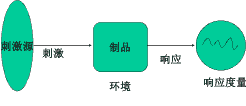


## 可用性的一般场景

刺激源：用户、系统或外部环境产生的刺激；刺激：刺激源发出的请求；环境：正常或可能降速；响应：速度、延迟、等待时间等；响应度量：响应时间、可用性、吞吐量等。

- 目标：应用场景所要达到的结果，即要执行的请求或需要满足的要求。
- 示例：在正常操作期间，进程收到一个请求并对其进行响应。

## 可用性场景示例

刺激源：系统外部事件；刺激：未预料到的请求；环境：正常操作；响应：通知操作人员或采取措施；响应度量：在规定时间内完成响应。

> 刺激源很重要，因为不同的刺激源可能要求软件作出不同的响应。

> 环境也会影响响应。例如：系统处于正常状态和降级状态时，其响应方式会有所不同。

## 可修改性场景示例

可修改性场景示例：开发人员希望改变系统的行为，以便增加新的行为。这些变更可能造成代码、数据和环境的变化。

刺激源：开发人员；刺激：提出改变用户需求；环境：设计时；响应：修改产生影响的代码。

## 生成质量属性场景

- 可以把具体场景的集合视为系统的质量属性需求。
  - 每个场景都应足够具体，从而对设计者有意义。
  - 响应的细节应足够明确，以便测试系统是否实现了该响应。
- 可采用表的方式描述。

## 例如：可用性的一般场景生成

| 场景 | 可能的值 |
|---|---|
| 源 | 系统内部、系统外部 |
| 刺激 | 错误、故障、病毒、时间、请求 |
| 制品 | 系统的处理器、通信通道、持久存储器、进程 |
| 环境 | 正常操作、降级模式 |
| 响应 | 系统检测到事件后，执行以下一个或多个活动：记录事件、通知相关方（包括用户和其他系统）、按适当规则处理事件；在指定时间范围内完成响应；进行系统资源管理 |
| 响应度量 | 系统必须在可用时间内完成响应；可用时间；系统能以降级模式运行的时间间隔 |

## 实践中的质量属性场景

- 一般场景提供了一个框架，用于生成大量通用的、独立于系统的、特定于质量属性的场景。例如：
  - 一般场景：一个要求改变功能的请求到达，必须在开发过程中的一个特定时间段内、按指定时间完成功能改变。
  - 特定于系统的场景：“一个在某天到达的系统增加新浏览器支持的请求，必须在 2 周内完成该项改变。”
- 可见，一个一般场景可能含有多个特定于系统的场景。

## 下面讨论 6 个最常见的系统质量属性

- 目的：
  — 确定质量属性描述所使用的概念；
  — 提供一个为该属性生成一般场景的方法。

### 1、可用性（Availability）

- 可用性与系统故障及其相关后果有关。
- 当系统无法提供所承诺的服务时，就出现了系统故障。
- 系统的用户（人或其它系统）可以感知到这种失效。

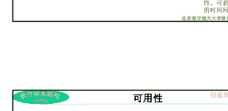

#### 可用性

- 可用性所涉及的方面：
  - 如何检测系统故障；
  - 系统故障产生的原因；
  - 此故障将导致什么样的问题；
  - 如何保证系统尽可能长时间正常运行；
  - 什么时机可以安全地出现故障；
  - 如何防止或缓解故障发生；
  - 发生故障时如何进行通知等。
- 系统出现故障后，一个重要概念是：
  - 恢复所需的时间：从出现故障到用户看不到故障的时间。

#### 可用性

- 系统的可用性：系统正常运行的时间比例。
  例如：
  “对于生产系统”
  可用性标准：至少 99.9% 的可用性，0.1% 的停机率。
- 区分：故障和错误。
- 区分故障与错误，使系统有可能实现自动恢复。
- 注意：计划内的停机和维护时间不算故障。

#### 可用性的一般场景生成

| 场景 | 可能的值 |
|---|---|
| 源 | 系统故障、系统崩溃 |
| 刺激 | 故障、错误、损坏、异常 |
| 制品 | 系统的硬件、软件、数据、持久存储、进程 |
| 环境 | 正常操作、偶发事件 |
| 响应 | 系统检测到故障，并执行以下一个或多个动作：<br>- 将其记录下来；<br>- 通知用户或其它系统；<br>- 采取措施恢复系统；<br>- 根据故障重要性采取不同措施并通知相关人员 |
| 响应度量 | 故障检测所需的时间<br>- 从故障发生到用户不再感知故障的时间<br>- 系统正常模式和降级模式下的运行时间<br>- 恢复时间 |

### 2、可修改性（Modifiability）

- 可修改性涉及更复杂的成本问题。
- 需要考虑两个方面：
  - 修改的对象（制品）是什么？例如，系统的功能、性能或结构等：
    - 修改系统的各个部分；
    - 由谁来进行修改（例如，开发者、系统用户）。
  - 系统修改的成本，包括修改后系统与其他系统保持兼容、用于各种不同环境的成本；
  - 系统修改的复杂性（例如，是否容易检查、未来是否易于再次修改等）；
  - 修改可能发生的时机和场景（例如，开发方、用户方）。
- 哪些修改更重要，以及如何设计系统的结构和实现来支持这些修改？一般来说，修改的影响越小越好、修改的代价越低越好。
  - 系统的修改应尽量局部化。
  - 系统的修改应尽量简单。
  - 系统的修改对现有功能的影响应尽量小。

#### 可修改性的一般场景生成

| 场景 | 可能的值 |
| --- | --- |
| 源 | 潜在用户、开发人员、管理员、进程 |
| 刺激 | 在修改过程中触发的修改请求、错误信息、异常 |
| 制品 | 正在开发的产品、软件、其修改后与旧版本定义的功能或性能 |
| 环境 | 运行时、维护期、测试期、设计时 |
| 响应 | 系统能够在不影响其正常运行的前提下进行修改 |
| 响应度量 | 修改所涉及元素的数量、修改成本、工作量、资源消耗，以及该修改对其他可能被修改系统造成的影响程度 |

### 3、性能

- 性能与时间有关。

#### 性能的一般场景生成

| 场景 | 可能的值 |
| --- | --- |
| 源 | 大量独立请求的发起者、可执行任务的内部 |
| 刺激 | 连续的请求、事件触发的请求 |
| 制品 | 系统 |
| 环境 | 正常模式、超载模式 |
| 响应 | 产生性能响应、调整服务周期 |
| 响应度量 | 等待时间、响应时间、吞吐量、抖动、失败率、截止时间丢失率 |

### 4、安全性（Security）

- 安全性衡量系统在向合法用户正常提供服务的同时，阻止未授权访问、抵御拒绝服务攻击或其它攻击的能力。
- 可以将安全性制品视为提供“可信性、机密性、完整性、保护、可验证性”的能力。
- 认证：验证交易（请求或信息）确实来自声称的发送方，不能被任何设备或成员冒充，例如通过 Internet 发送的请求或木马程序。
- 机密性：控制未授权访问者获取敏感数据的风险。
- 完整性：保证交易数据的完整性，防止被未经授权地篡改。
- 保护：保护交易以及参与交易的各方身份。
- 可用性：系统可供合法用户使用的属性。
- 审计：系统对异常行为进行记录的属性。

#### 安全性的一般场景生成

| 场景 | 可能的值 |
| --- | --- |
| 源 | 企图攻击、窃取或破坏系统的个人或系统，可能来自系统外部或内部 |
| 刺激 | 企图攻击、窃取或破坏系统 |
| 制品 | 系统、系统中的数据 |
| 环境 | 系统正常运行、系统维护、系统遭受攻击时 |
| 响应 | 系统能够检测到攻击并阻止攻击 |
| 响应度量 | 系统响应时间、系统可用性、安全防护有效性 |

### 5、可测试性（Testability）

- 软件的可测试性：指通过测试揭示软件缺陷的容易程度。
- 通常，测试占开发成本的 40%。
- 一般来说，系统可能处于错误状态，需要通过测试来发现。
- 可测试性意味着能够“控制”系统的内部状态和输入，并能够“观察”其输出。

#### 可测试性的一般场景

刺激源：测试人员、开发人员等
刺激：执行命令、请求
制品：被测系统
环境：相应的测试环境
响应：能够控制被测系统的内部状态和输入；输出到被测系统，且输出是可测量的
响应度量：在规定时间内完成系统输出的测量

#### 可测试性的一般场景生成

| 场景 | 可能的值 |
| --- | --- |
| 源 | 通常是开发人员，也可能是用户 |
| 刺激 | 执行测试命令、输入测试数据、提交操作请求 |
| 制品 | 设计、代码、被测软件系统 |
| 环境 | 实验室、开发环境、测试环境、部署环境、用户使用环境 |
| 响应 | 观察系统状态、输出、测量结果，以及其它被测系统的行为 |
| 响应度量 | 已执行测试动作的百分比<br>输出率<br>其它度量指标的覆盖率<br>测量率及其比较<br>测量指标的变化量 |

### 6、易用性（Usability）

- 易用性关注：对用户而言完成某项预期任务的容易程度，以及系统所支持的用户种类。
- 划分：
  - 可学习性：使系统容易被学习和使用。
  - 有效性：系统如何高效地执行用户期望的操作。
  - 可记忆性：系统如何帮助用户记住操作方法。
  - 错误处理与用户反应：如何将用户在使用错误后的反应保持在可接受范围内。
  - 反馈：系统如何向用户提供恰当的反馈。
- 有些细节不属于软件体系结构层面，例如用户在工作场所如何获取信息，这包括操作界面和系统所处的环境，以及系统是否需要提供以用户为中心的核心能力。

#### 易用性的一般场景

刺激源：用户
刺激：执行命令、请求和控制操作
制品：系统
环境：实际使用环境中
响应：系统在给定条件下作出响应
响应度量：在 18 秒内完成

#### 易用性的一般场景生成

| 场景 | 可能的值 |
| --- | --- |
| 源 | 通常是最终用户 |
| 刺激 | 想要学习某项功能、使用某项功能、使系统更易用、从系统故障中恢复 |
| 制品 | 系统 |
| 环境 | 在特定的使用时间 |
| 响应 | • 系统应在特定时间内支持用户学习使用。<br>• 系统应在特定时间内支持用户高效使用。<br>• 系统应在特定时间内支持用户记忆操作。<br>• 系统应在特定时间内支持用户处理错误。<br>• 系统应在特定时间内向用户提供反馈。<br>• 系统应在特定时间内保证用户满意度。<br>• 系统应在特定时间内支持可访问性。 |
| 响应度量 | • 用户完成任务所需的时间<br>• 错误率、成功率<br>• 用户满意度<br>• 可访问性指标 |

## 使用一般场景进行沟通

- 一般场景的用途之一是与相关人员进行沟通。
- 质量属性场景有助于理解和发现问题。

| 质量属性 | 刺激 |
| --- | --- |
| 可用性 | 不断出现问题、故障发生 |
| 可修改性 | 需求的改变、需求的增加、系统运行、维护和扩展 |
| 可靠性 | 故障率、故障恢复时间 |
| 安全性 | 系统被攻击、系统数据被篡改、系统资源被访问、系统服务被破坏 |
| 可测试性 | 系统开发和测试 |
| 易用性 | 难以学习新特性、高效使用系统、提供准确信息、降低错误率 |


# 第二部分　创建软件体系结构

课程信息：软件工程相关课程，包含授课教师及联系方式等信息。

## 理解和实现质量属性

- 软件系统的质量属性
- 软件体系结构与质量属性
- 软件体系结构设计的原子操作
- 软件体系结构战术
- 软件体系结构模式和风格

## 软件体系结构实例分析

- KWIC System（针对体系结构风格）
- WWW
- CORBA

## 实现质量属性

- 软件体系结构设计的原子操作
- 软件体系结构战术
- 设计模式
- 软件体系结构风格

## 单元操作

设计软件体系结构的基本操作

怎样在一组原则的指导下创建一个新的软件体系结构和模式

### 1. 单元操作简介

- 单元操作原始性更强，更为抽象
- 单元操作
  - 分离
  - 抽象
  - 压缩
  - 资源共享
- 质量属性之间的相互作用

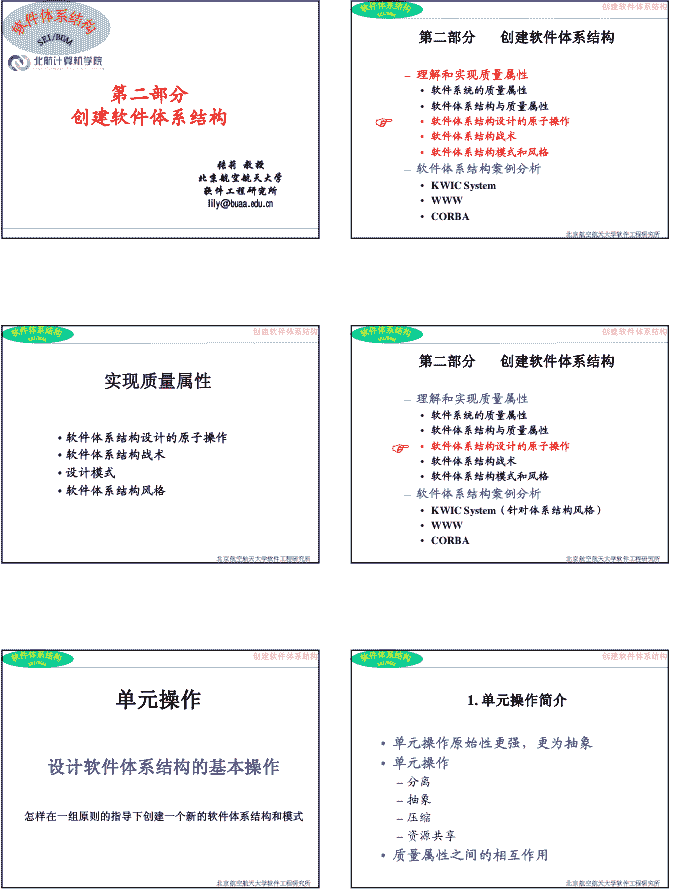

## 单元操作（1）

- **分离**
  - 性能、易用性、任务分配、可容错性、可移植性
  - 统一分离
    - 可以分解成独立的且有手动管理的功能
    - 部分—整体
    - 是一个二
  - 复制
    - 增强可靠性，提高性能
    - 运行时间复制
    - 跨节点复制

## 单元操作（2）

- **抽象——创建一个虚拟机的操作**
  - 简化创建和维护工作
  - 虚拟机：模拟功能片段
  - 一个分层系统
  - 公共接口
- **分离和抽象**

## 单元操作（3）

- **压缩**
  - 与分离相反
  - 主要目的：
    - 提高系统性能
    - 在分层不能提供所需的服务时避免层次划分
    - 加快系统的开发
  - 常用技术：
    - 宏
    - 内联过程

## 单元操作（4）

- **资源共享**
  - 创建时一般要付出较高的代价
  - 增强系统的可靠性、可移植性和可更改性
  - 例子
    - 数据库
    - 黑板
    - 集成软件工程工具环境
    - 服务器

## 质量属性之间的相互作用

| 质量属性 | 操作：抽象 | 压缩 | 部分—整体 | 复制 | 资源共享 |
|---|---|---|---|---|---|
| 可用性 | + | - | + | + | |
| 系统可修改性 | + | - | + | | |
| 可集成性 | + | - | + | + | + |
| 可移植性 | + | - | | | + |
| 易用性 | + | + | | | |
| 并行性能 | | + | + | + | |
| 容错能力 | + | - | | + | |
| 系统的额外硬件性 | + | - | + | + | |
| 组件可破坏性 | + | - | | + | + |
| 组件软件的便携性 | + | - | | + | |
| 可重用性 | + | - | | | |

## 质量属性之间的相互作用：单元操作的运作

- **示例：**
  - 可修改性—抽象
  - 容错能力—复制

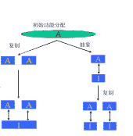

## 2. 将单元操作运用于用户界面软件

- 人机交互界面（HCI）
  - 单一架构
  - HCI 的 Seeheim 模型
  - 模型视图控制器模型（MVC）
  - Seeheim 和 MVC 构架的比较
  - 下一代开发：
    - Part 1：Seeheim 模型演化成 ARCH/SLINKY 模型
    - Part 2：MVC 模型演化成 PAC 模型
    - PAC 模型和 ARCH/SLINKY 模型的比较
  - HCI 软件构架的未来研究方向

## 将单元操作运用于用户界面软件（1）

- 单一架构


## 将单元操作运用于用户界面软件（2）

- HCI 软件的 Seeheim 模型
  - 可更改性、可移植性：抽象
- 对单一模型进行部分—整体分离操作

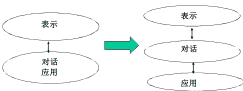

## 将单元操作运用于用户界面软件（3）

- Seeheim 的逻辑模型

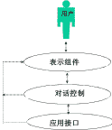

## 将单元操作运用于用户界面软件（4）

- MVC

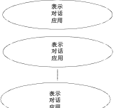

## 将单元操作运用于用户界面软件（5）

- 对表示进行分离

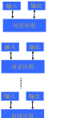

## 将单元操作运用于用户界面软件（6）

下一代开发
- 之一：Seeheim 模型演化成 ARCH/SLINKY 模型

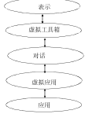

## ARCH/SLINKY

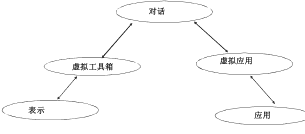

- 之二：MVC 模型演化成 PAC 模型

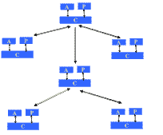

## PAC 模型与 Arch/Slinky 模型的统一：PAC-Amodeus 模型

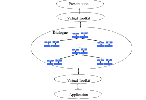

## 软件体系结构技术

- 主要讨论：设计师使用构造模式、体系结构模式、体系结构风格和设计时的“战术”。
- 概念：
  - 战术：是影响质量属性应对控制的设计决策；
  - 一个或多个集合，称为“体系结构策略”。
- 战术与体系结构模式：
  - 设计师通常会选择一个精心设计的模式或模式集合，来实现一个体系结构；
  - 因此，一个模式实现了多个战术，不管是否是所声明的。
- 战术与体系结构风格：
  - 战术是设计的基本“构建块”。

### （一）可用性技术

- **[可用性]**：系统正常运行的时间比例。

\[
a=\frac{mean\ time\ to\ failure}{mean\ time\ to\ failure+mean\ time\ to\ repair}
\]

- 系统不再提供与其规范一致的服务时，故障就发生了；系统的用户可以观察到故障。
- 错误（或错误的组合）可能会导致故障的发生。
- 恢复或修复是可用性的最后方面。

- **可用性技术的目标：**
  - 阻止错误演变成为故障，至少把错误限制在一定范围内，从而使修复成为可能。
- **维护可用性的方法：**
  - 一种类型的冗余，用来检测故障的某种类型的健康监视，以及在监控检测到故障时进行恢复。
- 分别讨论错误检测、错误恢复、错误预防。

- **错误检测：识别错误**
  - 命令/响应（ping/echo）
  - 心跳（dead man 计时器）
  - 异常
    - 当识别到前面（可用性场景）所讨论的错误类中的某一个时，就出现了异常。
    - 异常处理程序通常将错误在语义上转换为可以被处理的形式。

- **错误恢复：包括准备恢复和修复系统两个部分**
  - 表决
  - 主动冗余（热启动）
    - 所有的冗余组件都以并行的方式对事件做出响应，因此，它们处于相同的状态。
    - 仅使用一个组件的响应（通常是被叫作响应的第一个组件），丢弃其余组件的响应。
    - 错误发生时，使用最诚实的响应可将执行时间开销降到最低，因为恢复时间就是初始时间。
    - 运行时切换后备配置（数据启停管理系统）。
  - 被动冗余（温启动/双冗余/三冗余）
    - 一个组件（主要的）对事件做出响应，并通知其它组件（备用的）进行状态更新。
    - 当错误发生时，在继续提供服务前，系统必须确保备用状态是最新的。
  - 备件
    - 每个备用组件配置用于更换各种不同的故障组件。
    - 出现故障时，必须将其重新启动为适当的软件配置，并对其状态进行初始化。
    - 备用组件的启动时间通常是几分钟。

有一些硬件组件支持在修复后重新引入；当冗余组件失效时，可以在纠正组件后将其再次引入。相关技术有：

- **Shadow 操作：** 以前出现故障的组件可以在短时间内以“shadow 模式”运行，这确保在恢复组件之前，核验该组件的行为。
- **状态再同步：** 主动或被动冗余技术要求所恢复的组件在重新提供服务之前重新同步状态。重新同步方法有所不同，取决于冗余组件、更新的规模以及需要维护的状态信息数量。
- **检查点/回滚：** 检查点就是记录临时的一致状态，可以定期进行，或者在具体事件发生时进行。出现故障时，当检测到状态不一致时，通过使用上一个一致状态检查点和事务日志来恢复系统。


### （一）可用性战术（续）

- 错误预防
- 从服务中删除
- 事务
- 进程监视器

#### 可用性战术总结

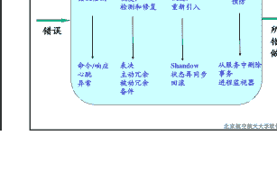

### （二）可修改性战术

- 目标：
  - 控制实现、测试和部署更改的时间和成本。

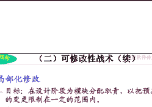

### （二）可修改性战术（续）

将可修改性战术根据目标分类：

- 局部化修改：
  - 目标：减少由某个变更直接影响的模块的数量
- 防止连锁：
  - 目标：减少单个模块的互连：
    有直接变更或间接变更的模块
    （所依赖的模块和依赖它的模块）
- 逆向映射：
  - 目标：
    和某个模块紧密相关的模块，
    所依赖者与被依赖者，必须被变更，
    其实现必须直接影响到该模块）

### （二）可修改性战术（续）

- 局部化修改
  - 目标：在设计时你为模块分配职责，以控制源的变更限制在一定的范围内。
  - 设术：
    - 维持语义的一致性：明确模块中职责的关系，
      确保所有职责能够向上合并，不为实现依赖于低级模块。
- 预测期望的变更
- 泛化该模块
- 限制可能的选择

### （二）可修改性战术（续）

防止连锁反应
—修改所产生的一个连锁反应就是需要修改该修改或有直接影响到的模块。

—例如：如果实现了模块以完成某个独立的修改，就必须修改模块，标准依赖于模块。

- 8中类型的依赖

#### 8种类型的依赖性

- (1) 语法
  - 要求：依赖关系必须以「点执行」... 由产生者中依赖其类型的名称（或...）
  - 原委：依赖关系由程序执行，由产生者中依赖的类型的名称必须与执行时所使用的类型一致。
- (2) 语义
  - 要求：依赖关系必须以... 由产生者中依赖的类型的语义必须与执行时所使用的类型一致。
  - 原委：依赖关系由程序执行，由产生者中依赖的类型的语义必须与执行时所使用的类型一致。
- (3) 顺序
  - 要求：依赖关系必须... 它必须在一个对象的生命周期中产生依赖。
  - 限制：依赖关系必须... 它必须在一个对象内部产生依赖。

#### 8种类型的依赖性

- (4) A的一个接口的身份
  - 一个对象有多个接口，要使该接口保持不变，该接口的名称及定义必须保持一致。
- (5) A的位置（运行时）
  - 要使该接口保持不变，A必须在该接口必须在同一处。
- (6) A提供服务/数据的值的质量
  - 要使该接口保持不变，A提供服务/数据的值的质量的一致性必须保持一致。
- (7) A的存在
  - 要使该接口保持不变，A必须存在
- (8) A的非行为
  - 要使该接口保持不变，A的非行为必须保持一致。

#### 可修改性技术（续）

- 防止连锁反应的技术
  - 信息隐藏：
    - 责任分离，定义public的接口
    - 目的的变更更容易在一个模块内，防止变更扩散。
    - 与“希望的变更”有关大关系。
  - 限制通信路径：
    - 限制一个特定模块使用共享的接口，减少依赖。
    - 由该模块所产生的依赖，由该模块所使用的接口的变更，以致产生由该模块所使用数据的接口的连锁。

#### 可修改性技术（续）

- 防止连锁反应的技术（续）
  - 维持现有的接口
    - 如果保持对某一接口，则保持该接口及其方法
      能够保持不变。
    - 不能解决将来以及未预期，也就形成对最任务重，
      较难提高，资源浪费和可维护性的依赖。
    - 通过将依赖与实现分离可实现接口的稳定。如创建
      抽象化的接口的稳定。
  - 实现该接口的模块有：
    - 一个接口
    - 一个抽象类
    - 我有一个接口存在A

#### 可修改性技术（续）

- 防止连锁反应的技术（续）
  - 单例的使用
    - 单例的使用有该模块在任何时候的依赖，可导致以不可预测地
      进入一个操作，以致与依赖相关操作，事件难以预测。
  - 模板（法则）：
    - 模板（法则）：在模板中定义产生依赖的事件
  - 依赖注入：
    - 依赖注入：依赖注入的依赖，依赖注入的依赖，依赖注入的依赖
      一天的工作，停止的依赖的依赖，依赖，依赖，依赖，依赖
      替代，上层扩大
  - 构造器的依赖：
    - 构造器的依赖：使依赖注入人将模块一个接口的依赖变化
  - 构造器（法则）：
    - 构造器（法则）：在模块中依赖的接口的依赖变化。
  - 依赖注入的依赖由依赖者管理：
    - 依赖注入的依赖由依赖者管理：
      依赖者管理，条件不满足时
      依赖者管理，条件不满足时
  - 构造者：如工厂模式

#### 可修改性技术（续）

- 推迟绑定时间：
  - 分开开发人员修复和运行时修改。开发者会增加
    较多的不可用时间。
  - 许多技术的目的是在开发时或运行时产生影响：
  - 适当的延迟：即延迟条件，在条件满足时防止依赖
    依赖的产生。
  - 配置文件：在启动时读取系统。
  - 多态：允许在运行时调用的接口绑定。
  - 插件机制：允许在运行时动态加载。
  - 建立自己的协议：允许独立进行运行时绑定。

### （二）可修改战术总结

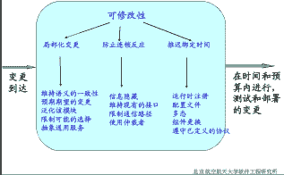

### （三）性能战术

- **性能战术的目标：**
  - 对在一定时间限制内到达系统的事件生成一个响应

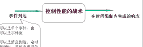

#### 性能战术（续）

- **影响响应时间的两个基本因素**
  - 资源消耗：包括 CPU、数据存储、网络通信带宽和内存，以及设计中系统确定的实体。
  - 队列时间
    - 资源争用：
      - 对同一个资源的争夺，会增加等待时间。
      - 取决于执行任务所涉及的组件和执行任务处理。
    - 资源的可用性：资源通常是短缺的，资源争夺会导致处理时间不可用。
    - 对其他计算的依赖性：可能导致等待。
  - **三类战术：资源需求、资源管理、资源仲裁**

#### 性能战术（续）

- **资源需求**
  - 事件在对资源需求的变化，需求的两个特性：
    - 事件中的事件之间的时间（在事件流中多长时间进行一次请求）。
    - 每个请求所消耗的资源数量。
  - 减少等待时间的战术之一：减少处理一个事件所需要的资源量。方法：提高计算效率、关键算法、减少计算开销。
  - 减少事件时间的战术之二：减少所处理事件的数量。方法：管理事件、去除不必要的事件、控制事件频率。
  - 用于减少管理需求的其他战术包括控制资源的使用、限制执行时间、限制队列大小。

#### 性能战术（续）

- **资源管理：** 决定系统如何对资源进行管理，有效的资源管理，也可以减少响应时间。
  - 引入并发：
    - 如果可以并行处理请求，可以减少时间。
    - 适当地将线程分配给资源（负载平衡），尽可能利用并行。
  - 维持数据或计算的多个副本：
    - 客户机和服务器为客户方提供并行的副本，减少在中央服务器上进行所有计算时出现的争用。
    - 高速缓存是在不同速度的存储设备之间作缓冲，复制数据的技术，目的减少争用。需要解决副本的一致性和同步问题。
  - 添加可用资源
    - 进行成本/性能的权衡分析

#### 性能战术（续）

- **资源仲裁：理解资源特性，合理调度资源**
  - 调度策略包括：优先级分配和分派。
  - 调度的竞争标准：
    - 最佳资源分配：请求重要性、最小化所使用资源的数量、保持请求的响应时间以及最少管理负载。
  - 常见调度策略：
    - 先进/先出：同等待时，排队模型，常规、缺点。
    - 固定优先级调度：静态分配优先级，根据优先级顺序分配资源。3个常见的优先级策略：语义重要性、时间窗口间隔、违差阈值。
    - 动态优先级调度：轮转；可限制调度量化优先级。
    - 静态调度：离线确定先后点和资源分配顺序。


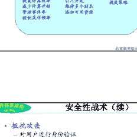

#### 性能技术总结

### （四）安全性技术
- 安全性技术的目标：
  - 从系统检测、抗攻击到从攻击中恢复过来
- 三类安全性技术
  - 与抗攻击有关的战术
  - 与检测攻击有关的战术
  - 从攻击中恢复有关的战术
- 例子：
  - 针对用户身份验证：控制安全性
  - 针对用户授权：
  - 除去用户保护：攻击恢复

#### 安全性技术（续）
- 抗攻击
  - 对用户进行身份验证
  - 对用户进行授权
  - 保护数据的机密性：对数据和通信链路进行加密
  - 保护完整性
  - 限制数据传输
  - 限制访问：防火墙
- 检测攻击：入侵检测系统
- 从攻击中恢复
  - 与抗攻击有关的战术：不可用技术中的恢复技术
  - 与检测攻击有关的战术：计算过程（预测性或预置）

#### 安全性技术总结
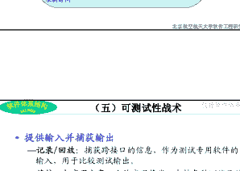

### （五）可测试性技术
- 目标：
  一允许在完成软件开发的一个增量后，较轻松地对软件进行测试


### （五）可测试性技术
- 提供入口并提高故障输出
  - 记录/回放：记录软件接口的信息，作为独立专用软件的输入，用于系统测试
  - 将软件界面规范化：允许实现规范化，使特定测试项目的软件可以轻松地测试软件
  - 特化软件接口/接口：具有特定的测试接口允许通过测试过程工作并且独立于正常操作，未被实现和指派的分支
- 内部监测
  - 内部监测接口：软件结构、性能负载、资源、安全性能等可通过接口的信息，会增加测试的工作量

#### 可测试性技术总结

一个增量
并完成

检测此错误

可测试模块
学习输入/输出
化为可测试
模块与测试者
模块可测试模块
内部结构
内部测试器

### （六）易用性技术
- 易用性与用户完成特定任务的容易程度以及系统为用户提供的支持种类有关
- 两种技术：
  - 运行时：在系统运行期间支持用户的技术
  - 基于用户接口设计的迭代性。在设计时支持接口开发人员

用户请求 → 控制易用性的技术 → 为用户提供适当的反应和帮助

### （六）易用性技术（续）
- 运行时刻：系统和用户的交互
  - “用户主动”：设计师设计结构，和实现其他功能一致
  - “系统主动”：依赖于系统对用户的估计，一个系统如用户处于危险的境地，是系统主动与系统来探测自己的行为与用户的意图的接近度。
  - 帮助系统的三个例子：帮助系统或其模块的定位，打开或上下移，以此探测了用户当前做任务，外界环境的变化，用户的第一个一个动作
  - 帮助用户的三个例子：帮助系统对用户的定位，系统产生对用户的帮助行为，改变用户内的状态
  - 帮助系统的三个例子：帮助系统对用户的定位，确定它要做的系统行为，以此帮助用户完成其任务
  - “混合主动”

### （六）易用性技术（续）
- 设计时技术：测试和集成中对接口的修改，支持接口开发人员
  - 将用户接口与应用的其他部分分开开，常用的体系结构模式：
    - 模型-视图-控制器
    - 模型-视图-控制
    - Seeheim
    - Arch/Slinky

# 软件体系结构
第二部分 创建软件体系结构
- 理解和实现质量属性
  - 软件体系结构的质量属性
  - 软件体系结构与质量属性
  - 软件体系结构设计与质量属性
  - 软件体系结构构成
  - 软件体系结构质量和风险
- 软件体系结构案例分析
  - KWIC System
  - WWW
  - CORBA

# 设计模式

## 设计模式，
可复用面向对象软件的元素
- Erich Gamma
- Richard Helm
- Ralph Johnson
- John Vlissides

由 Grady Booch 作序

## 由 Booch 作序
- 所有结构良好的面向对象体系结构都充满了模式。事实上，我衡量一个面向对象系统质量的一种方式就是判断其开发者是否仔细关注了其对象之间常见的协作。在系统开发过程中关注此类机制可以产生一个比忽略这些模式时更小、更简单、更易理解的体系结构。

## 由 Booch 作序
- 在其他学科中，人们很早就认识到模式在构建复杂系统中的重要性。特别是，Christopher Alexander 及其同事可能是最早提出使用模式语言来设计建筑和城市的人之一。他的思想以及其他人的贡献现在已在面向对象软件社区扎根。简而言之，软件中的设计模式概念为帮助开发人员利用其他熟练架构师的专业知识提供了关键。

## 由 Booch 作序
- 在本书中，Erich Gamma、Richard Helm、Ralph Johnson、John Vlissides 介绍了设计模式的原理，然后提供了一个此类模式的目录。因此，本书做出了两项重要贡献。
  - 首先，它展示了模式在构建复杂系统中的作用
  - 其次，它提供了一个非常实用的参考，包含一套经过良好设计的模式，实践中的开发人员可以将其应用于构建自己的特定应用程序。
- 我很荣幸有机会直接与本书的作者中的一些人在体系结构设计工作中合作。我从他们那里学到了很多，我怀疑在阅读本书时，你也会如此。

## 简介

本书分两部分：
- 概念 Concern the process 设计 of object creation
- 实用 Deal with the composition of classes or objects

- Creational Patterns
- Structural Patterns
- Behavior Patterns

Characterize the ways in which Classes or objects interact and Distribute responsibility

## 重要概念
- 目标：设计可重用OO软件。
- 经验的利用 ———— Pattern
- +抽象层次 ↓ design pattern

有助于重构软件的design and architecture

- Design Patterns are description of communicating objects and classes that are customized to solve a general design problem in a particular context


## 重要概念（续）

- 通常，对每个 Pattern 主要包括四个部分：
  - Pattern name
  - 要解决的 Problem
  - Solution（解答，抽象层次的描述）
  - Consequences（结果，对性能方面的影响和折中）

- 采用 MVC：
  - Model — application object
  - View — screen presentation
  - Controller — user interface reacts to user input

## 如何用它解决实际问题

1. 找到合适的 Object
2. 决定 Object 的粒度
3. 确定 Object 的接口
4. 指定 Object 的实现 — 一组 Class
5. 将重用机制付诸实践
6. 关联运行时和编译时结构
7. 为变化而设计

## 区分两个概念

- object's class — 决定 object 的实现（包括内部状态和操作的实现）
- object's type — 指 interface

∴ Class 定义了 object's type

- Class inheritance
- Interface inheritance

An object may have many types and widely different objects can share a type

Program to an interface, not an implementation

## reuse mechanisms

1. Class inheritance – white-box reuse
2. Object composition – black-box reuse
3. Delegation
4. Parameterized type
   - 功能重要的另一种技术，可在 C++ 中的 templates、Ada、Eiffel 中的 generics

### 类继承：white-box reuse

- 优点：
  1. 继承关系能够被修改，可以直接重用（因为继承关系暴露了内部细节）
  2. 能够修改重用的方式（override）

- 缺点：
  1. 不能够很好地修改父类的结构和实现
  2. 更糟的是，父类关系导致了类之间的紧密耦合，因为继承关系使子类与父类紧密关联，继承就破坏了封装性
  3. 且子类实现依赖于父类，即父类中实际的修改将破坏子类的实现
     => 降低了灵活性和最终的重用性
     => 方法众多；只从结构继承，...reuse

### 对象组装：black-box reuse

被组装的对象具有明确的定义接口

- 优点：
  1. 它是在运行时期通过对象间的动态定义（类继承是一类）
  2. Keep each class encapsulated and focused on one work
  3. 如果系统相对独立且在较小规模，不会增加管理复杂性
- 缺点：
  1. 会有更多对象，系统行为依赖于不同的对象，而非一个类的定义

### 两者的合作

- 对象组合组装对象
- 继承使对象易于生成（用于组装）

O-O design 的两个 Principles：

Program to an interface, not an implementation

Favor object composition over class inheritance

### Delegation

- 保持 Composition 的重用性与继承一样 Powerful
- 例：

类1 就重用类2 的方法有两种解释：<功能重用>

1. 类1 作为类2 的子类（继承）
2. 类1 has 类2（即类1的组成部件 — delegate）
   类1 引用类2 的方法，或说类1 将操作委托给类2

主要优点：方便地将类扩展到其它地方组合 behavior，以及其它组合方式

缺点：与静态软件子程序相比，对执行效率有影响。

### 三种重用技术比较

- Inheritance：提供操作的缺省实现，且子类可重定义
- Object Composition：可修改运行时期组合的行为，但要求间接，且可能降低效率
- Parameterized types：允许修改所操作的类型（type），但不支持运行时检查，且只能在支持 Compile-time type checking 的语言中使用

## Design for change

### 因重用主要取决于：

- 是否加入新的需求
- 是否修改已有功能
- 是否易于升级
- 避免重新设计

### 引起 redesign 的几个原因：

- Creating an object by specifying a class explicitly
- Dependence on specific operation
- Dependence on hardware and software platform
- Dependence on object representations or implementation
- Algorithmic dependencies
- Tight coupling
- Extending functionality by subclassing
- Inability to alter classes conveniently

## Design pattern 在三类软件开发中所起的作用：

- Application programs
- Toolkits
- Frameworks

# 第二部分

## 类用 Design Pattern 分类

- Creational Patterns
- Structural Patterns
- Behavioral Patterns

- Abstract Factory
- Builder
- Factory Method
- Prototype
- Singleton

- Chain of Responsibility
- Command
- Interpreter
- Iterator
- Mediator
- Memento
- Observer
- State
- Strategy
- Template
- Visitor

- Adapter
- Bridge
- Composite
- Decorator
- Facade
- Flyweight
- Proxy

### Creational Patterns

- Abstract Factory (87): 提供用于创建相关或相互依赖对象族的接口，而无需指定其具体类。
- Builder (97): 将复杂对象的构建与其表示分离，以便相同的构建过程可以创建不同的表示。
- Factory Method (107): 定义创建对象的接口，但让子类决定实例化哪个类。Factory Method 使一个类能够将实例化延迟到子类。
- Prototype (117): 使用原型实例指定要创建的对象的种类，并通过复制该原型创建新对象。
- Singleton (127): 确保一个类只有一个实例，并提供一个全局的访问点。

## Structural Patterns

- Adapter (139): 将一个类的接口转换成客户端期望的另一个接口。Adapter 使原本由于接口不兼容而无法一起工作的类能够协同工作。
- Bridge (151): 将抽象与其实现分离，以便两者可以独立变化。
- Composite (165): 将对象组合成树形结构以表示部分-整体层次结构。Composite 允许客户端统一地处理单个对象和对象组合。
- Decorator (175): 动态地为对象附加额外的职责。Decorator 为扩展功能提供了一种灵活的替代子类化的方法。
- Facade (185): 为子系统中的一组接口提供统一的接口。Facade 定义了一个更高层次的接口，使子系统更易于使用。
- Flyweight (195): 使用共享技术有效地支持大量细粒度的对象。
- Proxy (207): 为另一个对象提供代理或占位符以控制对其的访问。

## Behavioral Patterns

- Chain of Responsibility (223): 通过给多个对象机会处理请求，避免请求发送者与其接收者之间的耦合。将接收对象链接起来并沿着链传递请求，直到某个对象处理它。
- Command (233): 将请求封装为对象，从而使你可以用不同的请求参数化客户端、排队或记录请求，并支持可撤销的操作。
- Interpreter (243): 给定一种语言，为其语法定义一种表示形式以及一个解释器，该解释器使用该表示形式来解释该语言中的句子。
- Iterator (257): 提供一种顺序访问聚合对象元素的方式，而无需暴露其底层表示。


### Behavioral Patterns （续）

- Mediator (273)
  - 定义一个对象来封装一组对象的交互方式。Mediator 通过让对象不显式地相互引用来实现松耦合，并让你能够独立地改变它们的交互方式。
- Memento (285)
  - 在不违反封装的前提下，捕获并外部化一个对象的内部状态，以便以后可以将其恢复到该状态。
- Observer (295)
  - 在对象之间定义一对多的依赖关系，以便当一个对象改变状态时，所有依赖者都会被自动通知和更新。
- State (305)
  - 允许对象在其内部状态改变时改变其行为。该对象似乎改变了其类。

### Behavioral Patterns （续）

- Strategy (315)
  - 定义一组算法，将它们各自封装起来，并使它们可以互换。Strategy 使算法可以独立于使用它的客户端而变化。
- Template Method (325)
  - 在一个操作中定义算法的骨架，将某些步骤延迟到子类。Template Method 允许子类在不改变算法结构的情况下重新定义算法的某些步骤。
- Visitor (331)
  - 表示要在对象结构的元素上执行的操作。Visitor 让你可以在不改变操作所作用的元素类的情况下定义新的操作。

### For Every Pattern

- Pattern Name and Classification
- Intent（目的）
- Also Known As（别名）
- Motivation（问题的提出）
- Applicability（什么情况下使用）
- Structure（结构）
- Participants（元素）
- Collaborations —How the participants collaborate to carry out their responsibilities.

- Consequences —How does the pattern support its objectives? What are the trade-offs and results of using the pattern? What aspect of system structure does it let you vary independently?
- Implementation —What pitfalls, hints, or techniques should you be aware of when implementing the pattern? Are there language-specific issues?
- Sample Code —in C++ or Smalltalk.
- Known Uses
- Related Patterns —What design patterns are closely related to this one? What are the important differences? With which other patterns should this one be used?

### Creational Patterns

• 创建型模式处理对象的创建过程，从而使系统结构独立于对象的创建、组合和表达。类创建型模式使用继承来改变对象的类型，而对象创建型模式则将对象的实例化交给其它对象。

• 在该模式中不断出现的主题。
  —该模式解决了相互依赖的对象。
  —隔离了如何将对象组成整体的复杂性。

• 对于对象，系统提供了创建对象的特定定义接口。创建性模式在所创建的对象、创建人、创建方法时间和上提供了解耦性，从而可用用户结构上、功能上不同的对象来配置系统，配置可以是静态的，也可以是动态的。

### Creational Patterns

Abstract Factory: provide an interface for creating families of related or dependent objects without specifying their concrete classes.


#### Abstract Factory

- **何时用：**
  - a system should be independent of how its products are created, composed, and represented.
  - a system should be configured with one of multiple families of products.
  - a family of related product objects is designed to be used together, and you need to enforce this constraint.
  - you want to provide a class library of products, and you want to reveal just their interfaces, not their implementations.

#### Abstract Factory

- **结构**

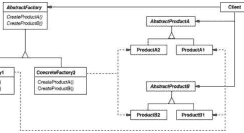

#### Abstract Factory

- **Consequences**
  1. It isolates concrete classes.
  2. It makes exchanging product families easy.
  3. It promotes consistency among products.
  4. Supporting new kinds of products is difficult.

### Creational Patterns

#### Builder

- Separate the construction of a complex object from its representation so that the same construction process can create different representations.

#### Builder

- **来源**

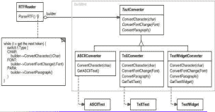

#### Builder

- 何时用：
  - the algorithm for creating a complex object should be independent of the parts that make up the object and how they're assembled.
  - the construction process must allow different representations for the object that's constructed.

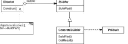


## 结果

1. 它允许你改变产品的内部表示。
2. 它将构造和表示的代码隔离开。
3. 它让你对构造过程拥有更精细的控制。

## 工厂方法

- 工厂方法
  - 定义一个用于创建对象的接口，但让子类决定实例化哪个类。工厂方法使一个类的实例化延迟到子类。
- 适用性
  - 一个类无法预知它必须创建的对象类。
  - 一个类希望其子类指定它要创建的对象。
  - 类将责任委托给几个辅助子类之一，并且你希望将哪个辅助子类是委托者的知识局部化。

## 工厂方法

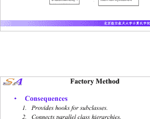

## 工厂方法


## 工厂方法

### 结果

1. 为子类提供钩子。
2. 连接平行的类层次结构。

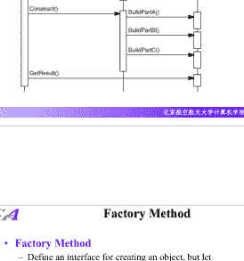

## 结构模式

结构性模式关注于如何将类和对象组合成更大的结构。结构类模式使用继承来组合接口或实现。

- 适配器
- 桥接
- 组合
- 装饰
- 外观
- 享元
- 代理

## 适配器

### 目的

将类接口转化成用户所希望的接口。适配器使原本由于不兼容接口而无法使用的类一同工作。

### 问题提出

## 结构模式 - 适配器

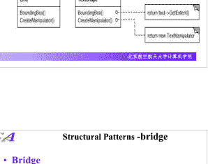

## 适配器

- 多继承
- 对象匹配

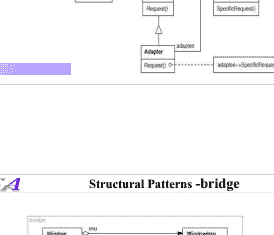

## 结构模式 - 桥接

### 桥接

将抽象与其实现解耦，使二者可以独立变化。
（使抽象和实现分离，使它们能够独立变化）

### 动机（问题提出）


## 结构模式 - 桥接

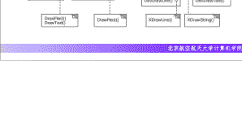

## 结构模式 - 桥接

### 结构

## 结构模式

组合：将对象组合成树状结构。组合让客户端可以统一地处理对象。

## 结构模式（二）

外观：为子系统中的一组接口提供一个统一接口。外观定义了一个更高层接口，使子系统更容易使用。

## 行为模式

- 行为模式涉及算法和对象间职责的分配。
- 行为模式不仅描述了对象和类的模式，还描述了它们之间的通讯模式。
- 分为两类：
  - 使用继承机制：如 Template Method, Interpreter
  - 使用对象组合：如 Mediator, Chain of Responsibility 等

## 行为模式——责任链

通过给多个对象处理请求的机会，避免将请求的发送者耦合到其接收者。将接收对象链式连接，并沿着链传递请求，直到某个对象处理它。

### 问题的提出

## 行为模式

### 何时使用

- 可能有多个对象处理一个请求，且处理者事先未知。处理者应被自动确定。
- 你希望向几个对象之一发出请求，而不显式指定接收者。
- 能够处理请求的对象集合应该被动态指定。

## 行为模式

### 结构

## 行为模式——命令

### 命令

将请求封装为一个对象，从而使你可以用不同的请求对客户端进行参数化、对请求进行排队或记录日志，并支持可撤销操作。

### 问题的提出

## 命令 1

## 命令 2

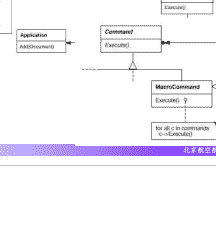

## 命令 3

### 结构

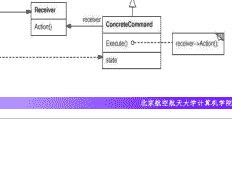

## 命令 4

### 协作

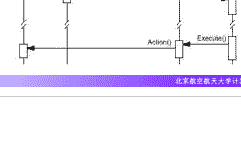

## 行为模式

### 策略

定义一系列算法，封装每一个算法，并使它们可以互换。策略让算法独立于使用它的客户端而变化。


# 软件架构：原理与实践

软件架构文档化

孙君 教授
北京计算机学院
软件工程研究所
lily@...edu.cn

## 模块目标

本模块将使参与者熟悉

- 架构视图以及它们如何用于记录软件架构
- 各种类型的视图、它们为何有用以及何时使用它们
- 常用于描述架构的记号法
- 软件架构文档应包含什么

## 为什么要记录架构？

- 架构是系统及其开发项目的蓝图。
  - 它定义了工作分配。
  - 它是质量属性的主要载体。
  - 它是早期分析的最佳工件。
  - 它是部署后维护和挖掘的关键。
- 这份蓝图若要被使用，就必须被理解；若要被理解，就必须被沟通。
- 文档代表了架构师，无论是今天、明天，还是20年后。

## 架构文档化也有助于架构过程

- 文档支持以工件驱动的方法进行软件设计。
  - 完成工件意味着我们完成了设计任务。
- 文档支持在建立/维护架构的过程中必须做出的一系列设计决策。
- 文档还能厘清架构设计决策与非架构设计决策之间的界限。
  - “非架构设计”是比“详细设计”更受青睐的术语。架构决策可以相当详细。
  - 架构决策是那些影响系统实现其行为和质量目标能力的决策。

## 那么，你如何记录软件架构？

在实践中，答案似乎是

- “使用 UML”
- “使用 JavaDoc”
- “除了 Rose 类图，我还需要什么？”
- “画方框和线条”
- “不太清楚”
- “我们通常不记录”
- “记录什么？”

## 目标

本课程的目标是

- 帮助你决定应该捕获关于架构的哪些信息。
- 为捕获必要信息提供指导和记号法，并给出示例。
- 回答这个问题：“你如何记录架构，以便其他人能够成功地使用、维护和演进它们？你如何从中构建一个系统？”

注意：我们所说的“document”并不一定指打印在纸上的信息。


#### 问题

- ◆ 你读过哪些非常好的软件文档？
- ◆ 是什么让它很好？

- ◆ 你读过哪些非常糟糕的软件文档？
- ◆ 是什么让它很糟糕？

## 良好文档的原则

良好文档的七项原则

- 1. 从读者的角度写作
- 2. 避免不必要的重复。
- 3. 避免歧义。
- 4. 使用标准组织结构。
- 5. 记录你的理由。
- 6. 保持文档最新，但不要太新。
- 7. 审阅文档。

## 良好文档的原则

- 1. 从读者的角度写作
- 2. 避免不必要的重复。
- 3. 避免歧义。
- 4. 使用标准组织结构。
- 5. 记录你的理由。
- 6. 保持文档最新，但不要太新。
- 7. 审阅文档。

## 1. 从读者的角度写作-1

- ◆ 确定读者是谁。
- ◆ 确定读者想要了解什么
- ◆ 使信息易于查找。
- ◆ 你的读者会欣赏你的努力，更有可能阅读你的文档。


## 1. 从读者的角度写作-2

- ◆ 文档为作者方便而写的迹象包括
  - ➢ “意识流”写作 -- 主题以作者随机想到的顺序呈现。
  - ➢ “执行流”写作 -- 主题以其在计算机中出现的顺序呈现。
  - ➢ 作者显然对读者已知的知识做了太多假设

## 良好文档的原则

- 1. 从读者的角度写作
- 2. 避免不必要的重复。
- 3. 避免歧义。
- 4. 使用标准组织结构。
- 5. 记录你的理由。
- 6. 保持文档最新，但不要太新。
- 7. 审阅文档。

## 避免不必要的重复

- 每种信息应只记录在一个地方。
- 这使得文档更易于使用，也更易于更改。
- 重复常常会让读者困惑，尤其是在信息以略有不同的方式重复时。读者会想知道
  - “这种差异是有意为之吗？如果是，为什么？”
  - “如果不是，哪种方式是正确的？”

## 良好文档的原则

- 1. 从读者的角度写作
- 2. 避免不必要的重复。
- 3. 避免歧义。
- 4. 使用标准组织结构。
- 5. 记录你的理由。
- 6. 保持文档最新，但不要太新。
- 7. 审阅文档。

## 3. 避免歧义 (避免歧义) -1

- 文档用于传达信息和思想。如果读者因歧义而误解，文档就失败了。
- 精确定义的符号/语言有助于避免歧义
- 如果你的文档使用图形语言，务必包含图例。图例应
  - 指向该语言的正式定义，或
  - 给出每个符号的含义（不要忘记线条！）。如果颜色或位置很重要，请定义它。
- 使图例有意义。不要只说“元素”和“关系”。不同的元素/关系类型应有不同的符号。

## 3. 避免歧义 (避免歧义) -2

- 方框连线图是常见的架构表示形式。
- 但它们是什么意思？
- 如果你使用方框连线图，务必精确定义方框和线条的含义。
- 如果你看到一个方框连线图，请询问作者它是什么意思。结果通常很有趣。
- 如果你的文档包含已知的歧义，请标记它们以便以后解决。

## 良好文档的原则

- 1. 从读者的角度写作
- 2. 避免不必要的重复。
- 3. 避免歧义。
- 4. 使用标准组织结构。
- 5. 记录你的理由。
- 6. 保持文档最新，但不要太新。
- 7. 审阅文档。

## 4. 使用标准组织结构.-1

- 建立它，确保你的文档遵循它，并确保读者知道它是什么。
- 标准组织结构
  - 帮助读者导航和查找信息。
  - 帮助作者放置信息并衡量剩余工作量。
  - 让作者在信息已知时立即记录信息，无论发现的顺序如何
  - 体现完整性规则并有助于验证


## 6. 保持文档为最新，但不要太最新。-2
- 通过让最新的文档来回答问题，帮助在你的组织中建立以文档为基础的文化。
- 对文档应能回答的问题的首次回应应该是，“你可以在文档的这里找到答案。”
- 如果信息缺失，要么更新文档，要么以提供答案为代价，要求提问者提交变更请求表。
- 确保下一个版本包含该信息。
- 这传递了一个强有力的信息，即文档是获取信息的首选、权威来源。
- 与之形成对比的是，那位每次电话响起都乐于回答问题的架构师。电话会一直响个不停。

## 6. 保持文档为最新，但不要太最新。-3
- 不要让它*太*最新：
  - 在设计过程中，决策会被频繁地考虑和重新考虑。
  - 每五分钟就修订一次文档会导致不必要的开销。发布过于频繁会让读者感到沮丧。
  - 确定开发过程中的节点，在这些节点上会发布最新的文档。
  - 遵循一种对你的项目有意义的发布策略或节奏。

## 良好文档的原则
- 1. 从读者的角度写作
- 2. 避免不必要的重复。
- 3. 避免歧义。
- 4. 使用标准的组织结构。
- 5. 记录你的理由。
- 6. 保持文档为最新，但不要太最新。
- 7. 审查文档。

## 7. 审查文档。-1
- 只有文档的预期使用者才能告诉你它是否：
  - 包含正确的信息
  - 以有用的方式呈现信息
  - 满足他们的需求。
- 计划与文档所创建的利益相关者的代表一起审查你的文档。
- *主动设计*审查是一种很好的使用技巧。

## 7. 审查文档。-2
- *主动设计审查：*
  - 避免一次全体会议
  - 使用精心挑选的审查者
  - 要求每个审查者审查文档的一部分，……

Pamas,D.L. and Weiss D. M., 1985, Active design reviews: principles and practices, in proceedings of the 8th international conference on Software engineering.

## 总结
- 某些原则适用于所有文档，而不仅仅是软件架构的文档。
- 将它们用作指南，帮助你编写高质量的文档。
- 你也可以在审查他人文档时使用它们，以帮助他们改进。

## 模块视图

Views: Decomposition, Uses, Layers, Generalization...

Elements: modules, where a module is a code unit that implements some functionality

Relation: Relations among modules can be
- A "is part of" B. This defines a part-whole relation among modules.
- A "depends on" B. This defines a dependency relation among modules.
- A "is a" B. This defines specialization and generalization relations among modules.

### 模块视图的用途是什么？
- 构造：这些视图是代码的蓝图。模块被分配给团队进行实现，并且通常是后续设计的基础，例如接口设计。
- 分析：可追溯性和影响分析依赖于实现单元。项目管理、预算、规划和跟踪通常使用模块。
- 教育：软件开发者可以通过理解模块视图来学习开发项目的结构。

### 模块视图的表示法
- 非正式：
  - box and line（嵌套可以表示“是…的一部分”）
  - 文本大纲
  - 表格
- 半正式：
  - UML 类图和包图

### 模块视图类型中的五种风格
- Decomposition style: documents how system responsibilities are partitioned across modules and how those modules are decomposed into submodules
- Uses style: tells the developer what other modules must exist for this portion of the system to work correctly.
- Generalization style: documents the "is a" relations among elements of the system.
- Layered style: documents the "allowed to use" relations among elements of the system.
- Aspect style: modules crossing concerns in object-oriented designs.

### 分解风格
- Elements: modules
- Relations:
  - "is part of" Criteria for decomposition vary:
    - Achievement of modifiability
    - Build vs. buy
    - Software product lines: common vs. unique parts
    - Developer's skills
- Topology: A child can have only one parent.
- What it's for:
  - Starting point for assigning responsibilities to modules as a prelude to subsequent, downstream design.
  - Change/impact analysis
  - Basis for work assignments
  - Basis for unit testing

### 示例 1：UML 中的模块分解视图


### 示例 2：模块分解视图（文本大纲）

**行为隐藏模块**
- 功能驱动模块
- 空气数据计算机模块
- 可听信号模块
- 计算机故障信号模块
- 多普勒雷达模块
- 飞行信息显示模块
- 前视雷达模块
- 平视显示器模块
- 惯性测量单元模块
- 面板模块
- 射频模块
- 共享服务模块
- 模式判定模块
- 面板 I/O 支持模块
- 安全边界模块
- 阶段检测模块
- 系统值模块

**软件决策模块**
- 应用数据类型模块
- 数值数据类型
- 状态转换事件模。
- 数据银行模块
- 单例值模块
- 复杂事件模块
- 过滤行为模块
- 物理模型模块
- 飞机运动模块
- 地球坐标模块
- 目标行为模块
- 武器行为模块
- 软件实用模块
- 上电初始化模块
- 数值算法模块
- 系统生成模块
- 系统生成参数模。
- 支持软件模块

### 使用风格

- **元素：** 模块
- **关系：** 使用，是“依赖于”的特化
  - A 使用 B 如果 A 依赖于 B 正确运行的存在以满足其自身（A 的）需求。
- **类型学：** 无约束（然而，循环可能在增量系统交付中造成问题。）
- **用途是什么：**
  - 规划增量开发
  - 系统扩展
  - 调试和测试
  - 衡量特定更改的影响。

### 示例 3：模块“使用”视图在 UML 中

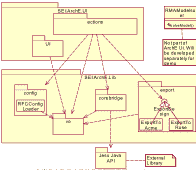

### 示例 4：模块“使用”视图（表格）

| 模块名称 | A | B | C | D | E |
|---|---|---|---|---|---|
| A |  | √ |  |  |  |
| B |  |  | √ |  |  |
| C |  |  |  |  |  |
| D |  |  |  |  |  |
| E |  |  |  |  |  |

√ = 行模块使用列模块

### 示例 5：模块泛化视图在 UML 中

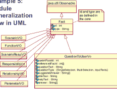

### 示例 6：模块分层视图（非正式记法）

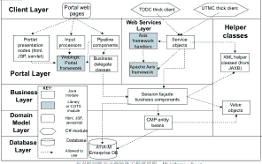

### 示例 2：共享数据视图（非正式记法）

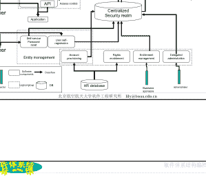

### 示例3：多层视图（非正式记法）

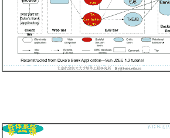

重构自 Duke 的银行应用程序—Sun JEE 1.3 教程

### 分配视图

- 视图：开发、实现、工作分配...
- 元素：
  - 软件元素（来自模块或 C&C 视图）
  - 环境元素（例如，文件、处理器、组织单元）
- 关系：软件元素分配或指派给环境元素。

### 分配视图有什么用？

- 沟通：这些风格让每个人都同意软件在其环境、生产和执行期间“存在”的位置。
- 分析：分析执行和开发环境的采购选项。开发风格能够实现详细的性能建模。
- 教育：软件开发人员可以通过工作分配风格了解团队结构。开发风格显示系统在其执行环境中的工作方式。

### 分配视图类型风格

- 部署风格
  - 将软件元素分配给处理和通信节点
  - 属性包括计算（并实现）性能和可用性所必需的属性
- 实现风格
  - 将软件元素分配给开发或生产环境文件系统中的结构
  - 属性包括文件和容量。
- 工作分配风格
  - 将软件元素分配给组织工作单元
  - 属性包括技能集。

### 示例 1：部署视图（非正式记法）


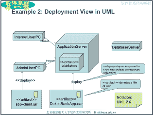

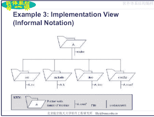

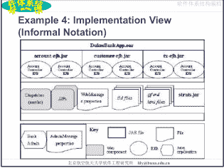

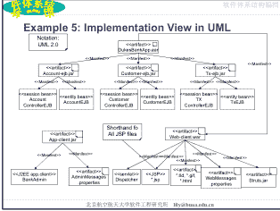

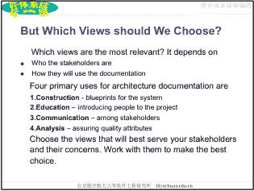

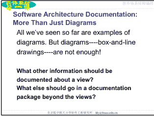


### View-1 中的信息

+   1. 主要呈现（图表、表格或大纲）
+      - 如果是图形的，始终包含一个键或引用以解释符号。
+   2. 元素目录
+      - 对主要呈现中的元素进行散文描述
+      - 包含超出该视图范围的外部元素
+      - 元素的软件接口（或通过引用纳入接口规范）
+      - 元素的行为。用例如序列图或状态图来记录此内容。

### View-2 中的信息

+   3. 其他信息
+      - 驱动架构需求
+      - 设计决策的理由（包括被拒绝的替代方案）
+      - 分析、原型和实验的结果，这些结果提供了架构适合用途的证据
+      - 内置于架构中的可变性机制——也许该架构是参考架构。可参数化的点（例如池中的实例数量）
+      - 元素可以被复制、省略或替换的地方
+      - 上下文图显示软件元素与外部实体的关系

### 超出 Views-1 的文档

+   1. 文档路线图
+      - 解释文档是如何组织的以帮助利益相关者完成工作
+      - 解释所选视图以及原因
+   2. 系统概述
+      - 对系统及其目的、功能、主要外部接口和主要质量属性的散文描述。
+      - 其目标是为新项目成员提供背景。
+      - 如果整体系统文档中存在概述，它可以指向其他地方的概述。

### 超出 Views-2 的文档

+   3. 架构上重要的需求
+      - 可能引用单独的需求文档
+      - 三种需求
+        - 功能需求（例如用例）
+        - 质量属性需求（例如场景）
+        - 设计约束；例如，“系统应使用 J2EE 开发。”
+   4. 系统概述
+      - 表格显示一个视图中的元素如何对应于另一个视图中的元素
+      - 模块映射到模块
+      - 模块映射到组件和连接器

### 超出 Views-3 的文档

+   5. 架构分析和理由
+      - 采用的主要架构方法
+      - 记录的设计决策（包括被拒绝的替代方案）
+      - 如果进行了架构评估，结果可以放在这里。
+   6. 将架构映射到需求
+      - 显示每个需求如何由架构的一个或多个元素或架构方法满足

### Module Summary-1

架构文档的主要用途包括构建、教育和分析。记录架构就是记录其视图，然后记录适用于多个视图的信息。视图是对结构的表示。有三种架构视图类型：

1. 模块视图
2. C&C 视图
3. 分配视图

### Module Summary-2

图表是不够的！图表中的元素必须得到解释。

视图本身是不够的！视图必须通过解释文档组织和整个系统来补充。

### Views

第 1 节：视图的主要呈现

第 2 节：元素目录
第 2.A 节：元素及其属性
第 2.B 节：元素目录
第 2.C 节：元素行为

第 3 节：上下文图

第 4 节：可变性指南

第 5 节：架构背景
第 5.0 节：设计理由
第 5.1 节：分析结果

第 6 节：术语表

第 7 节：其他信息

### 图 9.2：接口文档的九个部分

第 2C 节：元素接口规范

+   第 2.C.1 节：接口标识
+   第 2.C.2 节：提供的资源
+   第 2.C.3 节：资源语法
+   第 2.C.4 节：资源语义
+   第 2.C.5 节：资源使用限制

+   第 2.C.3 节：本地定义的数据类型
+   第 2.C.4 节：异常定义
+   第 2.C.5 节：提供的可变性
+   第 2.C.6 节：质量属性特征
+   第 2.C.7 节：元素需求
+   第 2.C.8 节：理由和设计问题
+   第 2.C.9 节：使用指南

### 图 9.3：跨视图文档摘要

跨视图文档

文档是如何组织的：
1.1 视图目录
1.2 视图模板

架构是什么：
2.1 系统概述
2.2 视图之间的映射
2.3 元素的列表及其出现位置
2.4 项目术语表

架构为何如此：
3.1 理由


# 软件体系结构
软件体系结构

张莉
北京航空航天大学
软件工程研究所
lily@buaa.edu.cn

## 张莉 教授，博士生导师

- 主要研究方向：智能化软件工程、软件体系结构、需求工程、系统建模和模型驱动方法、经验软件工程。

## 我们是可以互为师生。

> “孔子曰：‘三人行，必有我师。’ 是故弟子不必不如师，师不必贤于弟子。闻道有先后，术业有专攻，如是而已。”
> ——韩愈《师说》

- 教学内容
- 参考资料
- 学习方法
- 考试方法

## 学什么？

## 如何学？

## 学习的结果？

每年的教学内容会更新，作业可能不同。

## 什么是软件体系结构？

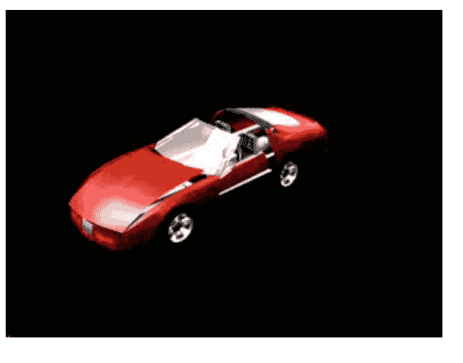

## 调查

- 你的背景
    - 你开发过的最大项目（代码、模块、人数）
    - 你对软件体系结构的理解
- 你的期望
    - 你期望的收获

## 《写了100W行的代码是啥感觉？》

我估计写到20万的时候就会突然有个疑问——“咦？我的头发呢？”

### 为啥问？

A同学：

我写两千行代码功能都像修理个两三天，一百万行真的是好多啊，最多了五年写了也就20-30万行代码左右。还是有任务在身的

B同学：

我是觉得如果说你一个工作写了一百万行代码，那你在公司的地位应该算资深员工了。如果你一个项目写了一百万行，那肯定是参与了一个比较大的项目了。如果你一个类写了一百万行，请问你用的是什么编辑器？如果你一个方法写了一百万行代码的话，请问你有没有被同事打死？


- 雷军说：“必须写够十万行代码，不要心存侥幸。没有写过足够代码量的，想成为高手是不可能的，只能纸上谈兵！”
- 大家觉得什么项目可以达到10万行代码？
- 前几年和华为合作，要求测试系统代码行数超过100万行
- 才发现工业界很多系统过100万行，不再是以前的少数。

## 代码规模

- Linux内核，早期几十万，后来100多万。
- Linux 2.6.23版本，源代码总行数大概为858万行，严格计算应该在550万行左右。
- Linux在2.6.18就超过1000万行了。也有说，Linux版本2.6.27更新后，已经超过了1000万行，但精确计算应该是600万行。
- 标准Linux-2.6.36.4内核，共13422535行代码。

## Linux 的代码规模

Linux版本2.6.27更新后，已经超过了1000万行。使用David Wheeler的SLOCCount计数程序对Linux内核代码库进行的分析发现了一些有趣的事实。分析发现只有6,399,191行源代码，因为这个计数程序没有计算空白行、注释和其它输入的信息。下面是SLOCCount程序提供的代码分类统计：

| 类型 | 行数 | 百分比 |
|---|---|---|
| 驱动程序 | 3,301,081 | 51.6 |
| 架构 | 1,258,638 | 19.7 |
| 文件系统 | 544,871 | 8.5 |
| 网络 | 376,716 | 5.9 |
| 声音 | 356,180 | 5.6 |
| Include | 320,078 | 5.0 |
| 内核 | 74,503 | 1.2 |
| 内存管理 | 36,312 | 0.6 |
| 密码学 | 32,769 | 0.5 |
| 安全 | 25,303 | 0.4 |
| 其它 | 72,780 | 1.1 |

### 标准Linux-2.6.36.4内核，共13422535行代码

| 子目录 | 行数 | 描述 |
|---|---|---|
| arch | 2670350 | 包含了所有体系结构相关的代码。对内核支持的每种处理器体系结构，都有一个独立的子目录。 |
| samples | 1947 | 和内核相关的一些范例代码。 |
| mm | 76437 | 高层的内存管理代码。与具体硬件体系结构相关的内存管理代码位于arch/*/mm目录下。 |
| sound | 624630 | 声卡的驱动程序。因为有许多针对各种不同总线的设备，该目录包含了某些总线相关的子目录，其中包含了对应的驱动程序的源代码。 |
| usr | 965 | 使用initramfs相关代码。 |
| security | 55282 | 安全框架和密钥管理。 |
| block | 18896 | 部分块设备驱动程序。 |
| virt | 5386 | Linux虚拟技术相关代码。 |
| Documentation | 354763 | 内核各方面的文档。 |
| include | 436665 | 包括编译内核所需要的大部分头文件。 |
| lib | 38783 | 包含了核心的库代码，与处理器结构相关的库代码放在arch/*/lib目录下。 |
| fs | 975380 | 所有文件系统实现的源代码。 |
| drivers | 7050171 | 设备驱动程序，每个不同的驱动占用一个子目录。 |
| firmware | 119682 | Linux下允许加载的第三方固件的代码。 |
| tools | 51976 | 一些测试程序。 |
| ipc | 7796 | 进程间通信的代码。 |
| net | 634073 | 包含了网络实现的代码，分为两部分，一个核心部分，另一部分用于实现各种网络协议。 |
| init | 4365 | 内核初始化代码（注意不是系统引导代码）。 |
| scripts | 65851 | 包含了编译内核或进行其他任务所需的所有脚本和实用程序。 |
| kernel | 167316 | 内核的核心部分，包括进程调度、定时器等。和硬件体系结构相关的一部分代码放在arch/*/kernel目录下，除非绝对必要，否则不要向该目录添加内容；凡修改该目录中文件的补丁，都会被极端谨慎地处理。 |
| crypto | 48615 | 包含了各种加密算法的实现。 |

## Windows 代码规模

- Windows 95只有1500万行代码，Windows 98有1800万行代码，Windows XP有3500万行代码，Windows Vista则达到了5000万行代码。Windows 7 大约5000万行左右；
- Google Chrome 100万行。金山的WPS代码行数约有150万行。
- Windows 7操作系统的技术研发人员总数约为2000人左右，他们又分为25个工作小组，每个小组成员总数约为100人左右，其中代码开发者40人，技术测试员40人，项目管理人员20人。（2000名开发人员和500名经理）
- Windows 8：35个开发团队
- 2018年3月，解散了Windows工程师团队。宣布了微软的部门重组，云计算和先进人工智能将成为微软的中心任务。

## 2019年同学们作业找到的大型开源项目

| 项目名称 | 项目出处 | 系统介绍 | 代码行数（万） |
|---|---|---|---|
| MeeGo | 诺基亚和英特尔合作 | MeeGo是英特尔和诺基亚合作推出的一个操作系统，在2010年巴塞罗那举办的世界移动通信大会上首次发布。 | 6712 |
| NetBSD | Chris Demetriou, Theo de Raadt, Adam Glass等 | NetBSD是一个完全开放源代码的类UNIX系统。NetBSD支持非常多的硬件架构，包括ia64、Macintosh、i386等。 | 3299 |
| asuswrt-merlin | RMerlin | Asuswrt-Merlin是华硕现代路由器所用固件Asuswrt的增强版本。 | 3075 |
| chromium | Google | Chromium是Google Chrome背后的开源项目。它基于其他开源软件项目（包括WebKit和Mozilla）的组件构成。 | 2467 |
| VoltDB | VoltDB Inc. | VoltDB是一种实时高性能内存中列式SQL RDBMS，专为海量实时一致性、高吞吐量和低延迟的应用程序设计。 | 2393 |
| Waterfox | Alex Kontos | Waterfox是一款基于Mozilla Firefox开发的第三方开放代码网页浏览器，适用于64位Microsoft Windows、macOS和Linux。 | 1779 |
| TrueOS | iXsystems | TrueOS是一个类Unix的、面向服务器的操作系统，基于FreeBSD-CURRENT的最新版本。 | 1695 |
| FreeBSD | 基于BSD Unix的源代码衍生而来的 | FreeBSD是一种用于驱动现代服务器、桌面和嵌入式平台的操作系统。 | 1673 |
| OpenBSD | OpenBSD Foundation | OpenBSD起源于加拿大，由于Theo de Raadt对NetBSD开发过程中的一些意见不统一，愤而开创OpenBSD。 | 1308 |
| Boot To Gecko Firefox |  | Boot to Gecko 是 Firefox OS 操作系统的工程代号，是由Mozilla内部的一个工程师团队和Mozilla开源社区的共同努力完成的。 | 1303 |
| Unreal Engine | Epic Games | Unreal Engine，是Epic Games公司发行的一款开源游戏引擎，广泛应用于电脑游戏、虚拟现实和电影特效。 | 1244 |
| JetBrains MPS |  | JetBrains MPS使用完整的开发环境设计自己的领域特定语言。只需单击一下，即可获得完成、语义和类的支持。 | 1026 |
| Stellarium | GPL | Stellarium是一款免费开源的GPL（自由软件基金会GNU通用公共许可证）软件，它使用OpenGL模拟天文望远镜的功能。 | 1004 |
| TrinityCore | shinDarth | TrinityCore是一个使用C++构建的MMORPG框架，并使用MySQL作为数据库内容的后端。 | 1003 |
| Solaris | SUN | SUN公司开发的开源操作系统，目前在SUN公司被收购了之后已经停止维护。 | 987 |
| VirtualBox | ORACLE公司 | VirtualBox是一款开源虚拟机软件。VirtualBox就是一款免费的虚拟机软件，它不仅具有丰富的特色，而且性能也很优异。它简单易用，可虚拟的系统包括Windows、Linux、Mac OS X、OpenBSD、Solaris、IBM OS/2甚至Android等操作系统。 | 962 |
| Mono | Xamarin | Mono是一个由Xamarin公司（先前是Novell，最早为Ximian）所主导的自由开源软件项目。该项目的目标是创建一个Microsoft .NET Framework兼容的工具集。 | 918 |
| ArangoDB | ArangoDB GmbH | ArangoDB是ArangoDB GmbH开发的原生多模型数据库系统。数据库系统支持三种数据模型（键/值、文档、图）。 | 917 |
| LVS | 阿里巴巴。本项目在1998年5月由章文嵩博士发起 | LVS是Linux Virtual Server的简称，是一个虚拟的服务器集群系统。 | 890 |
| ali-kernel | 阿里巴巴 | Linux内核的阿里巴巴定制版，基于RHEL6源代码，包含了阿里巴巴所需的一些更新和新功能。 | 857 |
| uClinux | Lineo | uClinux表示micro-control linux，即微控制器领域中的Linux系统，是Lineo公司的主打产品。 | 821 |
| OpenJDK | Oracle | OpenJDK是JDK的开放源代码版本。 | 804 |
| Bitrig | Bitrig开发团队基于OpenBSD的一个分支 | Bitrig是一个免费、快速、安全的、高度可移植的类Unix开源操作系统。 | 782 |
| RT-Thread | 中国开源社区 | RT-Thread是一个集实时操作系统（RTOS）内核、中间件组件和开发者社区于一体的技术平台，能够提供先进、灵活的实时操作系统开发能力，具有较小内核、稳定可靠、简单易用、高效低耗等特点。经过11年的累积发展，RT-Thread已经拥有一个国内最大的嵌入式开源社区，同时被广泛应用于能源、车载、医疗、消费电子等多个行业。 | 728 |


- 一个形象的比喻：

  开发一个具有一定规模和复杂性的软件系统和编写一个简单的程序大不一样。其间的差别，借用G. Booch的比喻，如同建造一座大厦和搭一个狗窝的差别。

## 设计狗舍


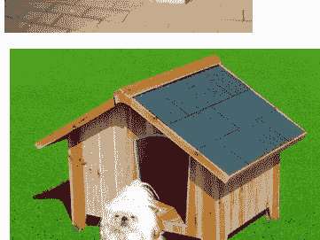

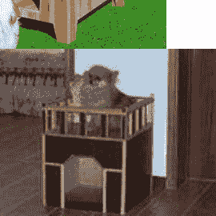

- 可由一人建造
- 需要
  - 最小化建模
  - 简单流程
  - 简单工具

## 设计房屋

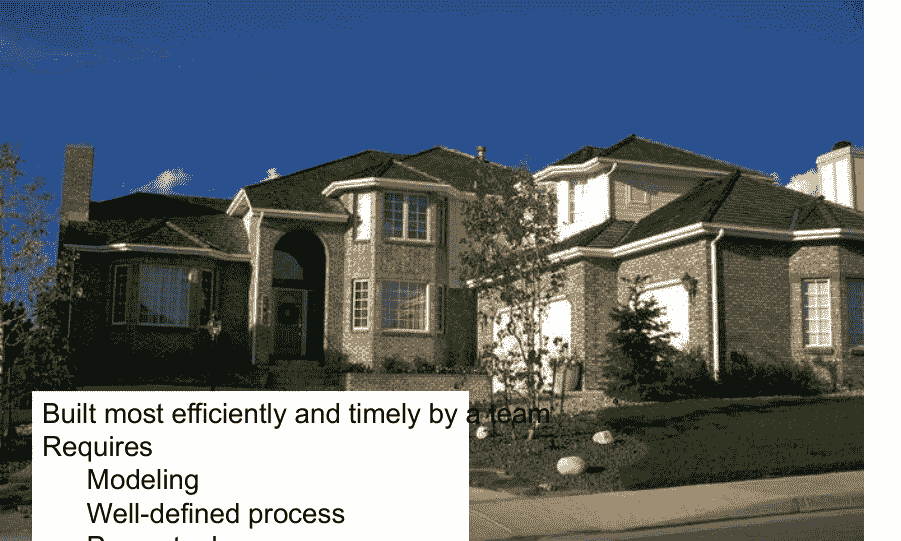

- 由团队最有效且及时建造
- 需要
  - 建模
  - 明确定义的流程
  - 电动工具

## 设计高层建筑


## IT行业的人才结构——来自微软

| 职业 | 供需情况 |
| --- | --- |
| BA、BC 体系结构设计师 | 全球短缺；在华难觅 |
| PM / SE | 西方供需基本平衡；中国供不应求 |
| 编程人员 | 在西方国家供过于求；中国情况类似；只有经验丰富者才有需求 |
| 系统管理员、DBA... | 西方世界供需平衡；中国短缺 |

## IT 行业不同职业的差别

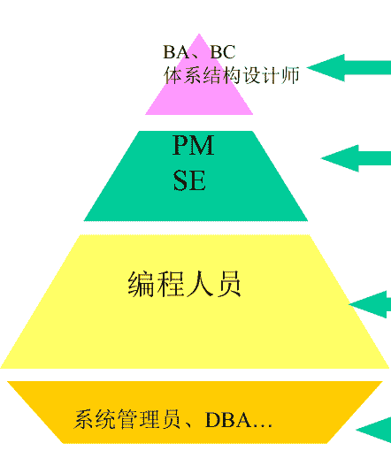

- **发现问题**  
  **寻找解决方案**
- **已知问题**  
  **寻找解决方案**
- **已知问题**  
  **已知解决方案**

## 本杰明·布鲁姆《教育目标分类：认知领域》

布卢姆的认知分类法由六种不同认知层次的思维水平所组成(Bloom 1956)。

1. 识记（knowledge）。最低层次的认知水平。要求学生回忆信息，识别事实、定义和规则。

2. 理解（comprehension）。要求学生能够改变交流的形式，能够转述或重新组织读过和讲过的知识。

3. 应用（application）。要求学生应用所知的事实、原则和归纳于新的环境。

4. 分析（analysis）。要求学生能够将问题分成几部分，并能就各个部分之间建立联系。

5. 综合(synthesis)。要求学生综合各种要素和各个部分以形成一个整体，构建出对一个问题的独特新颖的回答。

6. 评价(evaluation)。这是最高级的认知水平。要求学生能够按照一定的标准对不同的方法、思想、人物或产品的价值做出判断。

## 我们的学位培养

- 总体上鼓励大家：
  - 发现问题，寻找解决方案，去创新
- 毕业生把握：
  - 本科生： 已知问题，已知解决方案
  - 硕士生： 已知问题，寻找解决方案
  - 博士生： 发现问题，寻找解决方案
- 这种能力是可以通过训练得到的！

## “兔子理论”

- 华罗庚：比喻导师和研究生的关系是：
  - 导师负责给研究生指出兔子在哪里，并指导学生学会打兔子的本领。反之，研究生则是从导师那里了解到兔子的位置、大小、肥瘦，并采用从导师那里学到的打兔子本领擒获一只兔子（就是做完论文）。
- 有人由此衍生出本科生、硕士生、博士生、博士后之区别的“兔子理论”
  - 本科生：学习捡“死”兔子。
  - 硕士生：学习打一只在视野中奔跑的活兔子。
  - 博士生：学习打一只看不到的活兔子。
  - 博士后阶段：（兔子在哪里？）

## 软件架构师

- 软件架构师应该知道的97件事（领导力、技能、思维模式、沟通、博弈……）

O'REILLY

机械工业出版社

## 软件架构师（百度-2020）

- 所谓架构师，通俗地说就是设计师或结构设计者，这些定义如果用在建筑学上，则是很容易理解的。在软件工程领域中，软件架构师实际上就是软件项目的总体设计师，是软件组织新产品的开发与集成、新技术体系的构建者。
- 软件架构师是软件行业中一种新兴职业，工作职责是在一个软件项目开发过程中，将客户的需求转换为规范的开发计划及文本，并制定这个项目的总体架构，指导整个开发团队完成这个计划。主导系统全局分析设计与实施、负责软件架构和关键技术决策的人员。软件架构师应能迅速抓住问题要害，并做出合理的关键决定的能力，具备战略性和前瞻性思维能力，善于把握全局，能够在更高抽象级别上进行思考。

## 软件架构师-要求（百度）

1. 对项目开发涉及的所有问题领域都有经验，包括彻底地理解项目需求，开展分析设计之类软件工程活动等；
2. 具备领导素质，以在各小组之间推进技术工作，并在项目压力下做出牢靠的关键决策；
3. 拥有优秀的沟通能力，用以进行说服、鼓励和指导等活动，并赢得项目成员的信任；
4. 以目标导向和主动的方式来不带任何感情色彩地关注项目结果，构架师应当是项目背后的技术推动力，而非构想者或梦想家（追求完美）；
5. 精通构架设计的理论、实践和工具，并掌握多种参考构架、主要的可重用构架机制和模式（例如J2EE架构等）；
6. 具备系统设计员的所有技能，但涉及面更广、抽象级别更高；确定活动、用例或需求的优先级，进行构架分析，创建构架的概念验证原型，评估构架的概念验证原型的可行性、组织系统实施模型、描述系统分布结构、描述运行时刻构架、确定设计机制、确定设计元素、合并已有设计元素、构架文档、参考架构、部署模型、构架概念验证原型、接口、事件、信号与协议等。分析模型、设计模型、实施模型。

## 软件架构师-主要任务（百度）

架构师的主要任务不是从事具体的软件程序的编写，而是从事更高层次的开发构架工作。他必须对开发技术非常了解，并且需要有良好的组织管理能力。可以这样说，一个架构师工作的好坏决定了整个软件开发项目的成败。

1. 领导与协调整个项目中的技术活动（分析、设计和实施等）。
2. 推动主要的技术决策，并最终表达为软件构架。
3. 确定和文档化系统的相对构架而言意义重大的方面，包括系统的需求、设计、实施和部署等“视图”。
4. 确定设计元素的分组以及这些主要分组之间的接口。
5. 为技术决策提供规则，平衡各类涉众的不同关注点，化解技术风险，并保证相关决定被有效的传达和贯彻。
6. 理解、评价并接受系统需求。
7. 评价和确认软件架构的实现专业技能。

## 为什么大部分码农做不了软件架构师？

小团队一般 10 人左右，其中常是技术最牛的人做架构师（或 TL）。所以，架构师在广大码农中的占比大概平均不到 10%。而架构师也可以分为初级、中级、高级三档，江湖上真正高水平的软件架构师就更少了。

所以，大部分（超过九成）的码农干上许多年，还是做不了架构师，这是什么原因造成的呢？

## 85 个回答

知乎用户  
首席系统架构师  

77 人赞同该回答

其实吧，主要是大部分人没机会接触到足够的经验。现在程序员界也阶级固化了，很多人听上去牛逼的不得了，其实不过是一个组的主力而已，接触不到足够的全局，你是无法了解什么是架构的。

很多外行的人或者学生，看着这黑黑的窗口和一行行代码到底是如何变成一个软件的，这就是外行和程序员对软件的理解不同，相对的，普通程序员，也无法理解，他编的一个功能，到底在最后整体架构中有些什么作用。

## 成为软件架构师的途径

- **软件架构——巨大的知识海洋**
  - 门槛相对较高、职业生涯非常长
  - 相对独立于技术的新陈代谢
  - 适合于喜欢学习的人
- **不断学习、增加积累、注重经验**
  - 注意学习方法论、框架
  - 不断增加各种系统架构的知识
  - 经验积累非常重要
- **在与高手和同行合作中提高水平**
  - 与高手的合作是最佳途径
  - 同行之间的交流也非常有效
  - 在每一个项目中进行创新


这段文本已经是中文，无需进行翻译。我已按照您的要求，在下方以指定格式输出原文内容：

# 课程内容

## 一、软件体系结构概述

- 什么是软件体系结构，为什么研究软件体系结构？
- 软件体系结构的重要性，软件体系结构研究领域
- 一个实例

## 二、软件体系结构建模与描述

- 软件体系结构模型及建模（MDA、UML）
- 软件体系结构描述语言
- 软件体系结构文档(documentation)

## 三、创建软件体系结构

- 理解质量属性
- 实现质量属性：软件体系结构风格、软件设计模式、软件体系结构设计的原子操作、软件体系结构实现战术
- 案例分析（OS，等）

## 四、软件体系结构分析和评估

- 软件体系结构度量和评估
- 软件体系结构分析与评审
- 案例分析研讨

## 五、软件体系结构演化和维护

- 软件体系结构恢复和重构
- 案例分析、大作业展示、交流

## 六、面向领域的软件体系结构

- 特定领域的软件体系结构
- 软件产品线

可能有变动----根据教学过程调整

- Documenting Software Architectures, Paul等（中译本：软件架构编档）
- Software Product Lines, Practices and Patterns, Paul Clements, Linda Northrop
  - （软件产品线实践与模式，张莉等译）
- Evaluating Software Architectures, Paul等
  - 软件架构评估
- Design patterns-- Elements of Reusable Object Oriented Software, Erich Gamma, Richard Helm, Ralph Johnson, John Vlissides
- 《恰如其分的软件架构》 George Fairbanks, 2016年
- 还有要求大家阅读的论文。

## 课程定位

- 你能学到什么？
- 你不能学到什么？

- 你可能不能完全听懂，这时你要学会提问。
  - 具体的问题，而不是抽象的问题。
  - 给出一个例子，我们来分析。

- 强调观念的更新和思路
  - 设计在整个软件生命周期中的重要性
  - 学会如何设计一个复杂系统，学会在系统层面思考问题，学会多问为什么

- 积累靠自己

## 学习方法

今年有些特殊：前期采用网络教学

- 授课—老师讲（视频录播）
- 讨论问题—同学讲
- 回答问题—同学讲、互相讨论
- 示范作业—同学讲

你的参与是课程成功的基础

目标：知识变成你的能力

## 课堂教学

- 48学时：2-17周
- 每周四上午 9:50-12:15（少休息一次，提前5分钟下课？）
- 地点
  - 主楼 405（全国各地）改到1-316.
- 助教：李延旭 余伟伟和郭维泽（协助）
  - 地点：QQ群、微信群
  - 请大家按时提交作业、高质量完成ppt

## 课程要求

按时听课：腾讯课堂，或者QQ群、微信群

成绩组成：

作业 70-90 分 + 期末 20（待定）+ 课堂表现 10。

- 课程网站
  - https://judge.buaa.edu.cn/（校内）
  - https://e.buaa.edu.cn/（校外，通过 e1.buaa.edu.cn，找到6系教学平台）

学号登录，缺省密码：学号

### 管道和过滤器（Pipes and filters）风格

- 基本结构

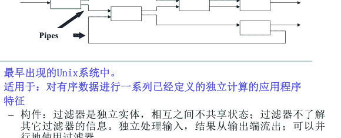

- 最早出现在Unix系统中。
- 适用于：对有序列数据进行一系列已经定义的独立计算的应用程序
- 特征
  - 构件：过滤器是独立实体，相互之间不共享状态；过滤器不了解其它过滤器的信息。独立处理输入，结果从输出端流出；可以并行地使用过滤器。
  - 连接件：管道——信息流的导作作用。
  - 每个构件都有输入输出集合，构件在输入处读取数据流，并在输出处生成数据。

### 管道和过滤器（续）(此处原文无图片，直接接续)


- 优点：
  - （1）每个构件的行为不受其它构件的影响，整个系统易于理解
  - （2）系统分解；（3）软件重用；（4）系统维护和功能增强，（5）支持并行处理；（6）支持特殊分析，如吞吐量分析、死锁分析
- 缺点：
  - 不适合交互式的应用；
  - 在处理两个独立但是相关流之间的同步时可能会遇到困难
  - 系统性能低；
  - 每个过滤器的解析输入和格式化输出任务繁琐，带来系统的复杂性上升。
- 例子：
  - Unix shell:如 cat file | grep xyz | sort | uniq > out
  - 传统编译器：词法分析→语法分析→语义分析→代码生成

### 例子


### 批处理顺序系统Batch Sequential


- 管道和过滤器风格的一个特例，此时过滤器作为一个独立的实体处理它的所有输入。
- 在批量顺序体系中，执行步骤或是各个组成部分都是独立的程序，并且设定每一步完成之后下一步才能开始。在各步骤之间每批数据都被作为一个整体转换。

### 调用返回风格

### Call and return

- 主程序与子程序
- 面向对象
- 分层风格

|  | 完整性 | 组合性 | 抽象性 | 重用性 | 构造性 | 异构性 | 可分析性 |
|---|---|---|---|---|---|---|---|
| 调用与返回 | + | + | + |  |  |  | + |

### 创建软件系统结构

### 主程序与子程序风格


- 分层分解
- 结构化控制流
- 结构化连接方式

### 主程序与子程序风格（续）

- • 优点
  - – 是程序设计语言中最基本的表现形式。几乎所有的程序设计语言都对此提供了支持。并以函数、过程、库、包等形式出现。
  - – 程序中需要多次执行的代码，可以使用函数或子过程的形式，提高代码的使用率，减少内存的使用。
  - – 合理地组织子程序和恰当的过程名为软件代码的理解和维护提供方便。
- • 缺点
  - – 难以表达构件间复杂的连接关系。只有过程间的调用关系；
  - – 软件规模增大时，造成代码可维护性和易理解性变差；
  - – 可重用层次低。主要是科学计算和数据结构经典算法的重用。

### 面向对象和抽象数据风格

- ◆ 数据及其操作被封装成抽象数据类型(对象)。对象即是构件。
- ◆ 连接件通过过程调用（方法）来实现。
- ◆ 适用于：
  - ✓ 以相互关联的数据实体的标识和保护为中心问题的应用程序


### 面向对象和抽象数据风格

### 面向对象的特点：

- ➢ **封装**：对象具有信息隐藏特性。对象负责维护本身的内部变量，其内部结构对其它对象不可见。
  
- ➢ **继承**：指从具有通用特征的对象开始，逐渐定义更具体的对象。新对象的创建可以在继承已有对象定义的基础上，加入其他定义。
  
- ➢ **多态**：指不同类型对象可以对相同的激励适当做出不同的响应。

➢ 数据抽象风格是特殊的00风格，只有封装的特点，没有继承和多态的特点。

### 面向对象风格的优点

- ➢ 封装：（1）封装提供了可重用性和易修改性；可以在不影响其它客户的情况下修改对象；（2）提供功能独立性。
  
- ➢ 继承：支持重用
  
- ➢ 多态：系统的灵活性和动态性
  
- ➢ 对象可以是单线程，也可以是多线程
  
- ➢ 支持问题分解。

### 缺点

- ➢ 过程调用依赖于对象标识的确定。和管道过滤器风格的系统不同，一个对象必须知道它要与之交互的对象的标识。
  
- ➢ 不同对象的操作关联性弱。在两个对象同时访问一个对象时，可能引起副作用。
  
- ➢ 对象的接口一旦改变，所有使用它的其它对象都需要修改。

➢ 例子：CORBA


### 架构风格简目

| 体系结构风格 | 进一步细分 |
| --- | --- |
| 数据流系统 (Data flow) | 顺序批处理 (Batch Sequential) |
|  | 管道和过滤器 (Pipes and Filters) |
| 调用-返回系统 (call and return) | 主程序和子程序 (Main program and subroutine) |
|  | OO系统 |
|  | 分层结构 (Layered) |
| 独立组件 (Independent components) | 通信进程 (Communicating Process) |
|  | 事件系统：隐式调用 (Implicit Invocation)、显式调用 (Explicit Invocation) |
| 虚拟机 (Virtual machine) | 解释器 (Interpreter) |
|  | 基于规则的系统 (Rule-Based System) |
| 数据为中心系统 (Data-centered) | 数据仓库 (Repository) |
|  | 超文本系统 (Hypertext) |
|  | 黑板 (Blackboard) |

### 分层系统风格（Layered）

- 层次化已经成为一种复杂系统设计的普遍性原则；
- 两个方面的原因：
  - 事物发生就是从简单的、基础的层次开始发生的；
  - 众多复杂软件设计的实践，大到操作系统，中到网络系统，小到一般应用，几乎都是以层次化结构建立起来的。


操作系统层次结构

### 分层系统（续）

- 优点：
  - 设计体现抽象层次，支持分解复杂问题，支持增量式设计；
  - 由于对邻接关系进行了限制，所以系统易于改进和扩展；
  - 每一层的软件都支持重用，并可为每一层提供多种可替换的实现。
- 缺点：
  - 分层可能带来效率方面的问题；
  - 接口定义标准的问题
  - 如何界定层次间的划分是较复杂的问题
- 典型实例：
  - 通讯协议，如：OSI的七层参考模型
  - 操作系统，如：Unix系统。
  - 数据库系统等

### 严格分层和松散分层

严格分层系统要求严格遵循分层原则，限制一层中的构件只能与对等实体以及与它紧邻的下面一层进行交互

- 优点：修改时的简单性
- 缺点：故障率低下

松散的分层应用程序放宽了此限制，它允许构件与位于它下面的任意层中的组件进行交互

- 优点：效率高
- 缺点：修改时困难


### 客户服务器风格（Client-Server）


- 适于应用系统的数据和处理分布在一定范围内的多个构件上，构件之间通过网络连接。
- 服务器构件：向多个用户提供服务，永远处于活跃状态，监听用户请求；
- 客户构件：向服务器构件请求服务；
- 连接件：某种进程间通讯机制，通常是基于RPC的交互协议。

### 客户服务器风格（续）

- 优点
  - 有利于分布式的数据组织
  - 构件间是位置透明的，构件间无需知道位置信息
  - 便于异质平台间的融合与匹配，构件可以运行不同的操作系统
  - 具有良好的可扩展性，易于对服务器进行修改、扩展和增加服务器。
- 缺点
  - 客户必须知道服务器的访问标识，否则很难知道有哪些服务可用。
- 例子
  - 远程文件系统、数据库服务器

### 客户服务器风格（续）

客户机/服务器：一个应用系统被分为两个逻辑上分离的部分，每一部分充当不同的角色、完成不同的功能，多台计算机共同完成统一的任务。

- 客户机（前端，front-end）：业务逻辑、与服务器通讯的接口；
- 服务器（后端，back-end）：与客户机通讯的接口、业务逻辑、数据管理。

一般的，

- 客户机为完成特定的工作向服务器发出请求；
- 服务器处理客户机的请求并返回结果。


### 客户服务器的层次

“客户机-服务器”结构的发展历程：

- 两层C/S
- 三层C/S
- 多层C/S


### 两层C/S结构


### ◇ 任务分配

- 服务器
  1. 数据库安全性的要求；
  2. 数据库访问并发性的控制；
  3. 数据库前端的客户应用程序的全局数据完整性规则；
  4. 数据库的备份与恢复。
- 客户应用程序
  1. 提供用户与数据库交互的界面；
  2. 向数据库服务器提交用户请求并接收来自数据库服务器的信息；
  3. 利用客户应用程序对存在于客户端的数据执行应用逻辑要求。

### ◇ 处理流程


### ◇ 优点

- 具有强大的数据操作和事务处理能力，模型思想简单，易于人们理解和接受。
- 系统的客户应用程序和服务器构件分别运行在不同的计算机上，系统中每台服务器都可以适合各种构件的要求，这对于硬件和软件的变化显示出极大的适应性和灵活性，而且易于对系统进行扩充和缩小。
- 系统中的功能构件充分隔离，客户应用程序的开发集中于数据的显示和分析，而数据库服务器的开发则集中于数据的管理，不必在每一个新的应用程序中都要对一个DBMS进行编码。将大的应用处理任务分布到许多通过网络连接的低成本计算机上，以节约大量费用。

### 缺点

- 开发成本较高
- 客户端程序设计复杂
- 信息内容和形式单一
- 用户界面风格不一，使用繁杂，不利于推广使用
- 软件移植困难
- 软件维护和升级困难
- 新技术不能轻易应用

### 胖客户端和瘦客户端

- 业务逻辑的划分比重：在客户端多一些还是在服务器端多一些?
  - 胖客户端：客户端执行大部分的数据处理操作
  - 瘦客户端：客户端具有很少或没有业务逻辑


### 物理结构


### 优点

- 允许合理地划分三层结构的功能，使之在逻辑上保持相对独立性，从而提高系统和软件的可维护性和可扩展性。
- 允许更灵活有效地选用相应的平台和硬件系统，使之在处理负荷能力上与处理特性上分别适应于结构清晰的三层；并且这些平台和各个组成部分可以具有良好的可升级性和开放性。
- 应用的各层可以并行开发，可以选择各自最适合的开发语言。
- 利用功能层有效地隔离开表示层与数据层，未授权的用户难以绕过功能层而利用数据库工具或黑客手段去非法地访问数据层，为严格的安全管理奠定了坚实的基础。

### 要注意的问题

- 三层C/S结构各层间的通信效率若不高，即使分配给各层的硬件能力很强，其作为整体来说也达不到所要求的性能。
- 设计时必须慎重考虑三层间的通信方法、通信频度及数据量。这和提高各层的独立性一样是三层C/S结构的关键问题。

### 浏览器/服务器风格（B/S结构）

- 浏览器/服务器(B/S)是三层C/S风格的一种实现方式。
  - 表现层：浏览器
  - 逻辑层：
    - Web服务器
    - 应用服务器
  - 数据层：数据库服务器


### B/S体系结构


### 优点

- 基于B/S体系结构的软件，系统安装、修改和维护全在服务器端解决。系统维护成本低。
  - 客户端无须任何维护，用户在使用系统时，仅仅需要一个浏览器就可运行全部的模块，真正达到了“零客户端”的功能，很容易在运行时自动升级。
  - 良好的灵活性和可扩展性：对于环境和应用条件经常变动的情况，只要对业务逻辑层实施相应的改变，就能够达到目的。
- B/S成为真正意义上的“瘦客户端”，从而具备了很高的稳定性、延展性和执行效率。
- B/S将服务集中在一起管理，统一服务于客户端，从而具备了良好的容错能力和负载平衡能力。
- B/S体系结构还提供了异种机、异种网、异种应用服务的联机、联网、统一服务的最现实的开放性基础。


### 浏览器/服务器风格

### 缺点

- B/S体系结构缺乏对动态页面的支持能力，没有集成有效的数据库处理功能。
- B/S体系结构系统扩展能力差，安全性难以控制。
- 采用B/S体系结构的应用系统，在数据查询等响应速度上，要远远地低于C/S体系结构。
- B/S体系结构的数据提交一般以页面为单位，数据的动态交互性不强，不利于在线事务处理 (OLTP) 应用。

### C/S+B/C内外有别模式

- 为了克服C/S与B/S各自的缺点，发挥各自的优点，在实际应用中，通常将二者结合起来；
- 遵循“内外有别”的原则：
  - 企业内部用户通过局域网直接访问数据库服务器
    - C/S结构；
    - 交互性增强；
    - 数据查询与修改的响应速度高；
  - 企业外部用户通过Internet访问Web服务器/应用服务器
    - B/S结构；
    - 用户不直接访问数据，数据安全；


### C/S+B/C查改有别模式

■ 选择“查改有别”的原则：

- 不管用户处于企业内外什么位置（局域网或Internet），凡是需要对数据进行更新操作的（Add、Delete、Update），都需要使用C/S结构；
- 如果只是执行一般的查询与浏览操作（Read/Query），则使用B/S结构。


### J2EE B/S+C/S Architecture

C/S与B/S的混合相当于分层风格里的“松耦合分层模式”


### 基于集群(Cluster)的C/S和B/S物理分布

- 事实上，功能层并不一定只驻留在同一台服务器上，数据层也是如此；
- 如果功能层(或数据层)分布在多台服务器上，那么就形成了基于集群(Cluster)的C/S物理分布模型。


### 集群(Cluster)

- A cluster is a group of loosely coupled servers that work together closely so that in many respects it can be viewed as though it were a single server.（一组松散耦合的服务器，共同协作，可被看作是一台服务器）
- Clusters are usually deployed to improve speed, reliability and availability over that provided by a single server, while typically being much more cost-effective than single computers of comparable speed or reliability.（用来改善速度、提高可靠性与可用性，降低成本）
- Load-balancing is a key issue in clusters.（负载平衡是集群里的一个关键要素）
- Physical cluster and logical cluster（物理集群、逻辑集群）

### 集群(Cluster)


### 集群的方法

- 集群内各服务器上的内容保持一致(通过冗余提高可靠性和可用性)


- 集群内各服务器上的内容之和构成系统完整的功能/数据，是对系统功能集合/数据集合的一个划分(通过分布式提高速度与并发性)


### A small catalog of architecture styles

| 体系结构风格 | 进一步细分 |
| --- | --- |
| 数据流系统 (Data flow) | 顺序批处理 (Batch Sequential) |
|  | 管道和过滤器 (Pipes and Filters) |
| 调用-返回系统 (call and return) | 主程序和子程序 (Main program and subroutine) |
|  | OO 系统 |
|  | 分层结构 (Layered) |
| 独立组件 (Independent components) | 通信过程 (Communicating Process) |
|  | 事件系统 | Implicit Invocation |
|  |  | Explicit Invocation |
| 虚拟机 (Virtual machine) | 解释器 (Interpreter) |
|  | 基于规则的系统 (Rule-Based System) |
| 数据为中心系统 (Data-centered) | 数据仓库 (Repository) |
|  | 超文本系统 ( Hypertext) |
|  | 黑板 ( Blackboard) |

### 独立构件风格

- Independent Components
  - Communicating Processes
  - Event Systems
    - Implicit Invocation
    - Explicit Invocation

|  | 完整性 | 组合性 | 抽象性 | 重用性 | 构建性 | 异构性 | 可分析性 |
| --- | --- | --- | --- | --- | --- | --- | --- |
| 独立构件 |  |  | + | + | + |  |  |

### 显式调用 vs. 隐式调用

- 显式调用：
  - 各个构件之间的互动是由显性调用函数或程序完成的。
  - 调用过程与次序是固定的，预先设定的。

- 隐式调用：
  - 调用过程与次序是不固定的，预先未知；
  - 各构件之间通过事件的方式进行交互。


### 事件系统的基本构成


| 功能 | 描述 |
|---|---|
| 分离的交互 | 事件发布者并不会意识到事件订阅者的存在。 |
| 多对象通信 | 采用发布/订阅消息传递，一个特定事件可以影响多个订阅者。 |
| 基于事件的触发器 | 控制流由接收者确定（基于发布的事件）。 |
| 异步 | 通过事件消息传递支持异步操作。 |

### 基于事件的隐式调用风格

### 基于事件的隐式调用风格

- 基本结构


- 特点：此类系统中，构件不直接调用一个过程，而是声明或广播一个或多个事件。系统中的其他构件可以将一过程注册为与它所关心的事件相关联。当某一个事件发生时，系统会调用所有与之关联的过程，即一个事件的激发隐含地导致了对其他模块的过程的调用。

- 构件：是这样的模块，其接口不仅提供一个过程的集合，还提供一个事件的集合。构件可以声明或广播一个或多个事件，或者向系统注册，来表明它希望相应的事件

- 连接件：有两类 — 对事件的显示或隐式调用。

- 适用于涉及低耦合构件集合的应用程序，尤其是必须动态重配置的应用程序。

- 优点：
  - 事件广播者不必知道哪些部件会被事件影响，部件之间关系弱。
  - 隐式调用有利于软件重用，因为允许任何构件注册相关事件；
  - 修改构件的接口并不影响别的构件，因而系统的演化、升级变得简单

- 缺点：
  - 构件不再拥有计算的控制权，一旦触发一个事件，它不能确定响应 的构件，也无法知道相关过程执行的顺序；在共享数据存储库的系 统中，资源管理器的性能和准确度成为十分关键的因素。
  - 数据交换问题。
  - 被调用的过程的语义依赖于被触发的事件的上下文约束，很难对系 统的正确性进行推理。

- 典型实例：
  - 最早出现在于守护进程、约束满足性检查和包交换网络等方面
  - 常用于：开发环境中集成各种工具、在用户界面中分离数据和表示
  - 典型实例：Windows的消息机制

### A small catalog of architecture styles

| 体系结构风格 | 进一步细分 |
| --- | --- |
| 数据流系统 (Data flow) | 顺序批处理 (Batch Sequential) |
|  | 管道和过滤器 (Pipes and Filters) |
| 调用-返回系统 (call and return) | 主程序和子程序 (Main program and subroutine) |
|  | OO 系统 |
|  | 分层结构 (Layered) |
| 独立组件 (Independent components) | 通信进程 (Communicating Process) |
|  | 事件系统 | Implicit Invocation |
|  |  | Explicit Invocation |
| 虚拟机 (Virtual machine) | 解释器 (Interpreter) |
|  | 基于规则的系统 (Rule-Based System) |
| 数据为中心系统 (Data-centered) | 数据仓库 (Repository) |
|  | 超文本系统 ( Hypertext) |
|  | 黑板 ( Blackboard) |

### 数据中心风格—仓库风格


The data-centered style.

- 目标：获得数据的易集成性
- 仓库 (Repositories) 风格的体系结构含两类构件:
  - 一个中央数据结构，表示当前状态
  - 一个独立构件的集合，对中央数据结构进行操作


### 示例1: 基于数据库的系统结构


### 例2: 剪贴板 (Clipboard)

剪贴板是一个用来进行短时间的数据存储并在组件/应用之间进行数据传递和交换的软件机制。

- 用来存储和传递信息和交换信息的公共区域（形成共享数据仓库）；
- 不同的应用程序通过该区域交换格式化的信息；
- 访问剪贴板的方式：copy & paste。


### 例3 注册表


#### 注册表的结构

- 最初，硬件/软件系统的配置信息均被集中存储在一个配置文件中；
- 这些文件散落在系统的各个角落，很难对其进行维护；
- 为此，引入注册表的思想，将所有 INI 文件集中起来，形成共享仓库，为系统运行起到了集中的资源配置管理和控制调度的作用。
- 注册表中存在着系统的所有硬件和软件配置信息，如启动信息、用户、BIOS、各类硬件、网络、INI 文件、驱动程序、应用程序等；
- 注册表信息影响着操作系统/应用软件的行为，应用软件安装/运行/卸载时对其进行添加/修改/删除信息，以达到改变系统功能和控制软件运行的目的。


### 仓库系统


- 分类（对数据和状态的控制方法）
- Passive Repository，如传统的数据体系结构：由输入事务选择进行何种处理，并将执行结果作为当前状态存储到中央数据结构中。此时，仓库是传统的数据体系结构。
- Active Repository，如 blackboard—黑板体系结构：由中央数据结构的当前状态决定进行何种处理。
- 黑板体系结构是仓库体系结构的特殊化。
- 传统上用于在信号处理方面进行复杂解释的应用程序，以及松散耦合的构件访问共享数据的应用程序；
- 适用于：需要解决冲突并处理可能存在的不确定性。

### 仓库系统

#### 黑板系统的组成

- 知识源：指特定应用程序知识的独立片段。知识源之间的交互只在黑板内部发生。知识源代理独立进行自己的处理，可能向黑板加知识，供其它知识源开展工作。
- 黑板数据结构：是反映应用程序求解状态的数据。知识源不断地对黑板数据进行修改，直到得出问题的解。———是知识源间的通讯机制。
- 控制器：控制（即对知识源的调用）是由黑板的状况决定的。一旦黑板数据的改变使得某个知识源成为可用，该知识源就被激活。


### A small catalog of architecture styles

| 体系结构风格 | 进一步细分 | 更进一步的细分 |
| --- | --- | --- |
| 数据流系统 (Data flow) | 顺序批处理 (Batch Sequential) |  |
|  | 管道和过滤器 (Pipes and Filters) |  |
| 调用-返回系统 (call and return) | 主程序和子程序 (Main program and subroutine) |  |
|  | OO 系统 |  |
|  | 分层结构 (Layered) |  |
| 独立组件 (Independent components) | 通信进程 (Communicating Process) |  |
|  | 事件系统 | Implicit Invocation |
|  |  | Explicit Invocation |
| 虚拟机 (Virtual machine) | 解释器 (Interpreter) |  |
|  | 基于规则的系统 (Rule-Based System) |  |
| 数据为中心系统 (Data-centered) | 数据仓库 (Repository) |  |
|  | 超文本系统 ( Hypertext) |  |
|  | 黑板 ( Blackboard) |  |

### 虚拟机结构/解释器风格

#### 基本结构


Interpreters/Virtual Machine

- 作用：常被用于建立一种虚拟机以弥合程序的语义和作为计算引擎的硬件之间的间隙。
- 构件：四个构件——作为执行引擎的状态机和三个存储器
- 连接件：过程调用和直接存储访问。

- 优点：
  - 有助于应用程序的可移植性和程序设计语言的跨平台能力
  - 可以对未实现的硬件进行仿真（因为实际测试可能是复杂、昂贵或危险的）
- 缺点
  - 额外的间接层次带来了系统性能的下降。
- 实例
  - 适用于应用程序不能直接运行在最合适的机器上，或不能直接以最适合的语言执行。
  - 典型的例子是专家系统、基于规则的系统
  - 程序设计语言的解释器，如Java、Smalltalk等
  - 脚本语言，如Awk、Perl等

### Process Control（Loop）

#### （1）背景

当软件被用来操作一个物理系统时，软件与硬件之间可以粗略地表示为一个反馈循环，这个反馈循环通过接受一定的输入、确定一系列的输出，最终使环境达到一个新的状态。

适合于嵌入式系统，涉及连续的动作与状态。

#### （2）控制系统的定义


#### （3）控制系统模型的构成

- 计算型模型
  - 过程定义：包括操作某些过程变量的机制
  - 控制算法：用来决定如何操纵过程变量
- 数据元素
  - 过程变量：指定的输入、操纵变量等
  - 设置点：受控变量的参考值
  - 传感器：用于获得控制所需的过程变量值
- 控制环模型
  - 建立控制算法之间的关系，它收集关于过程实际的和欲达到的状态，并调节过程变量，以使实际状态向目标状态发展

### “模型-视图-控制器”(MVC)

#### C/S体系结构存在的问题


- 许多应用系统的用途都是从数据库存储检索数据并将其显示给用户。
- 在用户更改数据之后，系统再将更新内容存储到数据存储中。
- 因为关键的信息流发生在数据存储和用户界面之间，所以一般倾向于将这两部分捆绑在一起，以减少编码量并提高应用程序性能。

- 但是，这种看起来自然而然的方法有一些问题。
  - 用户界面的更改往往比数据存储的更改频繁。
  - 除了数据存取功能之外，应用程序的业务逻辑中往往还会包含很多的其他业务逻辑。

...考虑(CCP) The Common Closure Principle 共同封闭原则

...考虑(SIP) The Single Responsibility Principle 单一责任原则


#### B/S体系结构存在的问题

- 不采用C/S结构，而采用纯粹的B/S结构，会不会解决这个问题？
  - ...用户界面仍然需要显式的调用功能层的业务逻辑...
  - ...仍然难以避免“用户界面的修改”→“业务逻辑的修改”的问题

#### 问题

- ——用户界面需要频繁的修改，它是“不稳定”的。
- ——业务逻辑/数据 与 用户界面 之间应尽量避免直接通信。
- 问题：如何让 Web 应用程序的用户界面与业务逻辑功能实现模块化，以使程序开发人员可以轻松地单独修改各个部分而不影响其他部分？

#### 影响因素

- 在基于 Web 的应用程序中，用户界面逻辑的更改往往比业务逻辑频繁。
  - 例如，可能添加新的用户界面页面，或者可能完全打乱现有的页面布局。

- 如果将UI代码和业务逻辑组合在一起并放在UI中，则每次更改用户界面时，都有可能引起对业务逻辑的修改。
  - 这很可能引起错误，并需要在对用户界面进行每个极小更改之后都要重新测试所有业务逻辑。

- 在某些情况下，应用程序以不同的方式显示同一数据。
  - 如果用户在一个视图中更改了数据，则系统必须自动更新该数据的其他所有视图。


- 与业务逻辑相比，用户界面代码对设备的依赖性往往更大。
  - 如果要将应用程序从基于浏览器的应用程序迁移到智能手机上，则必须替换很多用户界面代码，而业务逻辑可能不受影响。
  - 这两部分的完全分离可以使迁移更快完成，并最大限度地降低将错误引入业务逻辑的风险。

- 设计美观而有效的用户界面(如HTML、JSP等)通常要求采用一套与开发复杂业务逻辑不同的编程技能。
  - 很少有人同时具有这两种技能。
  - 将这两部分开发工作隔离开来是比较理想的。

- 通常，为用户界面创建自动测试比为业务逻辑更难、更耗时。
  - 因此，减少直接绑定到用户界面中的代码量可提高应用程序的可测试性。


### 解决方案：模型-视图-控制器 (MVC)

- • MVC风格主要处理软件用户界面开发所面临的问题。
- 界面变动大，不同系统平台不一样。

- • MVC是一种软件体系结构，它将应用程序的数据模型/业务逻辑、用户界面分别放在独立的构件中，从而对用户界面的修改不会对数据模型/业务逻辑造成很大影响。

- • MVC在传统的B/S体系结构的基础上加入了一个新的元素：控制器，由控制器来决定视图与模型之间的依赖关系。


### 模型—视图—控制器风格


构件

- - 模型(Model, M)：用于管理应用系统的行为和数据，并响应为获取其状态信息(通常来自视图)而发出的请求，还会响应更改状态的指令(通常来自控制器)；——对应于传统B/S中的业务逻辑和数据

- - 视图(View, V)：用于管理数据的显示；——对应于传统B/S中的用户界面

- - 控制器(Controller, C)：用于解释用户的鼠标和键盘输入，以通过模型和视图进行相应的更改。——在传统B/S结构中新增的元素

### MVC运行机制

模型：
封装业务逻辑/数据
将数据变化通知视图

模型
- 封装应用状态
- 提供应用功能
- 向视图通知变化

视图：
显示用户界面
将用户行为传递给控制器

视图
- 渲染模型
- 将用户手势发送给控制器
- 允许控制器选择视图

控制器
- 定义应用行为
- 将用户操作映射为模型更新
- 选择用于响应的视图
- 每种功能一个

控制器：
将用户行为映射到模型的更新上
选择需要显示的视图

功能调用
事件

### 模型—视图—控制器风格

- - 优点
  - 问题分解考虑，简化系统设计，保证系统的可扩展性；
  - 改变系统界面不影响应用程序的功能内核，易于演化，可维护性好；
  - 易于改变，甚至可能在运行时改变，提供了很好的动态机制。
- - 缺点
  - 主要局限在应用软件的用户界面开发领域
- - 典型实例
  - Windows应用程序的文档视图结构
  - 在SmallTalk和Java应用程序中常用到。

### 异质体系结构

- - 异构是不可避免的
  - 一个系统的体系结构往往是不同风格的组合。
  - 不同风格的结构适合于不同的应用场合
  - 新系统需要和老系统协调工作


### 层次异质

- - 组合的方法
  - 空间异质（Spatial/Locational heterogeneous）
    - 允许构件使用不同连接件的混合。系统以一种体系结构实现一个子系统，以另外一种体系结构实现另一个子系统。如：一个构件既可以通过其部分接口访问仓库，也可以应用管道和系统中的其他构件交互，还可以通过其它接口接受中央信息。
  - 时间异质（Temporal/Simultaneously heterogeneous）
    - 系统在不同的时间采用不同的风格。如，一个管道过滤器系统的构件被发现为一个独立进程。整个系统的运行时体系结构就会随有无此进程的参与而发生变化。
  - 层次异质（Hierarchically heterogeneous）
    - 按照层次结构组好子。采用了某种体系结构风格的系统，其构件和连接件内部可以是另外一种体系结构。例如，分层系统中的某一层可以用不同的风格实现。

### 参考书

- - 很多体系结构的教材都有“体系结构风格”
- - “面向模式的软件体系结构”，共3卷。
  机械出版社。

# 软件体系结构
软件体系结构

秘书
北京航空航天大学
软件工程研究所
lily@buaa.edu.cn

# 第一部分 软件体系结构概述

- - 什么是软件体系结构（粗略的）
- - 为什么研究软件体系结构？
- - 对软件体系结构的进一步认识
- - 软件体系结构的重要性
- - 什么是软件体系结构
- - 软件体系结构的研究领域
- - 一个实例

## 什么是软件体系结构？


## 什么是软件体系结构？

- - Dewayne Perry和Alexander Wolf于1992年正式提出软件体系结构的概念：**软件体系结构是具有一定形式的结构化元素。**
  - 结构化元素包括：进程元素、数据元素和连接元素。

- - Mary Shaw和David Garlan于1993年提出：
  - 软件体系结构是软件设计过程中的一个层次，这一层次超越计算过程中的算法设计和数据结构设计。
  - 设计和说明总体系统结构作为一个新问题正式提出来了。
  - 结构方面的因素包括总体组织和全局控制结构，通讯协议，同步，数据访问，功能分配，物理分布，设计元素的组合，性能优化以及各设计方案之间的取舍。

## 软件体系结构定义

Shaw 1995，在第一届软件体系结构国际讨论会上

Shaw 将软件体系结构分为：

- 1. 在结构模型中，软件体系结构是由一些组件，组件之间的联系以及其它方面组成。
  - 配置 (configuration)，风格（style）
  - 约束（constraints），语义(semantics)
  - 分析 (analyses)，属性(properties)
  - 基本原理（rationale），需求（requirements），stakeholder's need
- 2. 框架模型：侧重面向领域的体系结构的设计和分析方法
- 3. 动态模型：强调系统的行为质量
- 4. 过程模型：关注系统结构的构建及其步骤

# Shaw M, Garlan D, Software Architecture – Perspectives on an emerging discipline, Prentice Hall, 1996.

（软件体系结构——一门初露端倪学科的展望，清华大学出版社）


Bass L, Clements P, Kazman R, Software Architecture in Practice, 2nd Edition, Addison Wesley, 2003.

（软件架构实践，第二版，清华大学出版社）

## 什么是软件体系结构？（续）

Dewayne Perry和David Galan于1995年IEEE软件工程学报上定义：

软件体系结构是一个程序/系统各部件 (components) 的结构、它们之间的相互关系、进行设计的原则和随时间演进的指导方针。

南加州大学软件工程中心的Barry Boehm等1995指出：

- 一个软件体系结构包括：
- (1) 一个软件和系统部件、各种连接器以及约束的集合；
- (2) 一个系统需求说明的集合 (风险承担者 (stakeholder) 的需求陈述)；
- (3) 一个基本原理用以说明这一部件，连接器以及约束定义的系统可以满足系统stakeholders的需求陈述。

## 什么是软件体系结构？（续）

1997年，Bass,Clements和Kazman在《实用软件体系结构》一书中的定义：一个程序或计算机系统的软件体系结构包括一个或一组软件部件、软件部件的外部可见特性及其相互关系。

- 多个结构（structures）
- “外部可见特性”是指软件部件提供的服务、性能、特性、错误处理、共享资源使用等。
- 这一定义强调软件体系结构必须从系统中抽象出某些信息。

## 什么是软件体系结构？（续）

> ◆ Bass, Clements, and Kazman *软件架构实践*, Addison-Wesley 2003
> 
> > “一个程序或计算系统的软件体系结构是指该系统的各种结构，它包含软件组件，这些组件的外部的可见属性，以及它们之间的关系。”

> ◆ ANSI/IEEE标准1471-2000对大规模软件系统体系结构的描述建议
> 
> > “软件体系结构被定义为系统的基本组织结构，包括构件、构件之间的关系、环境以及管理系统设计和演化的原则。”

## 软件体系结构定义(续)

- ◆ Booch & Rumbaugh & Jacobson 定义
- 
  - 一个软件系统的体系结构要对以下一系列重要问题作出决定：
    - 确定软件系统的组织方案 —— Organization
    - 选择构成该系统的结构元素及其界面 —— Element Interface
    - 确定由这些元素的合作所获得的行为 —— Behavior
    - 确定这些结构与行为元素逐步至规模更大的系统的组合方案 —— Structure Composition
    - 指导组织这些元素及其界面以及它们之间的合作与组合的体系结构风格 —— Style


## 什么是软件体系结构？（续）

对软件体系结构定义的总结分析：

- > 软件体系结构定义了软件部件(Component)，包括部件间交互的定义，特别强调省略和部件相互关系无关的内容信息(content information)。
- > 软件体系结构并不说明部件的具体实现是什么、部件相互关系的具体体现是什么。
- > 每一个软件系统都有自身的体系结构，即由软件部件及其相互关系组成。
- > 软件体系结构中每一部件的行为是体系结构的一部分，反映部件间如何进行交互。
- > 软件体系结构的基本元素是部件，部件的描述信息包括：

- （1）计算功能：部件所实现的核心功能；
- （2）额外功能特性：描述部件的执行效率、处理能力、环境假设和整体特性；
- （3）结构特性：描述部件如何与其他部件集成在一起，以构成系统信息；
- （4）家族特性：描述了相同或相关部件之间的关系。

## 什么是软件体系结构？（续）

表1: 普通部件及其支持的相互作用

| 部件类型 | 部件支持的相互作用类型 |
|---|---|
| 模块(Module) | 过程调用、数据共享 |
| 对象(Object) | 方法调用 |
| 过滤器(Filter) | 数据流 |
| 过程(Process) | 消息传递、远程过程调用、通讯协议、同步 |
| 数据文件(Data file) | 读/写 |
| 数据库(Database) | 模式(Schema)、查询语言 |
| 文档(Document) | 共享表示假设 |

## 第一部分　软件体系结构概述

- - 什么是软件体系结构（粗略的）
- - 为什么研究软件体系结构？
- - 对软件体系结构的进一步认识
- - 软件体系结构的重要性
- - 什么是软件体系结构
- - 软件体系结构的研究领域
- - 一个实例

## 为什么研究软件体系结构

### 1、软件开发当前的问题

- - 规模；
- - 质量；
- - 进度；
- - 新技术、软件资产、需求……
- 怎么解决？


### 1. 计算机应用的深入及影响

- a. 软件组成的复杂化
- （新开发的代码，集成软件资产，源代码和二进制文件，静态库，动态库，不同语种、不同平台的集成）
- b. 程序规模变化（1000行 -3000万行的程序代码）
- c. 平台的多样化
- （多种操作系统、应用程序的混合、多厂商联合开发）

- d. 物理的分布（由集中到分布，由此带来技术上的考虑）
- e. 协议（各种通讯协议的混合）
- f. 功能分配（出现了多层的应用程序模式）
- g. 产品需求的更改（需求的变化，市场的变化）
- h. 算法和数据结构（退居次要地位，特别是硬件性能的提高）

如何有效的考虑软件组织，而且是从高层进行抽象？适应将来的负载？

### 2.软件市场的新趋势

- ——零时间（开发周期短）
- ——零bug（软件质量）
- ——开发方法的革新

（硬件、机械和汽车产业的启示，
基于构件的软件开发要求考虑软件的体系结构）

## 软件系统的开发已变得越来越复杂


> ➢ The challenge over the next 20 years will not be speed or cost or performance; it will be a question of complexity.

Bill Raduchel, Chief Strategy Officer, Sun Microsystems

> ➢ Our enemy is complexity, and it’s our goal to kill it.

Jan Baan

- ➢ **IBM360系统之父 F. Brooks：**复杂性是软件的固有属性
- 
- ➢ 软件复杂性不能通过任何方法彻底消除，只能采取某些手段加以控制
  - 技术创新
  - 软件开发过程改进
  - 可视化建模和模型驱动的开发
  - 提高软件设计的抽象层次

## Dimensions of software complexity


## 一个最复杂的系统

## 美国空中交通管制系统ATC(Air Traffic Control)

- - 需求:
- - 美国的航空业发达，商用飞机、私人飞机和军用飞机数量远远高于其他国家；
- - 系统要求很高的实时性、安全性和分布性
- - 对系统软件体系结构的要求
- - 极高的可用行和高性能
- - 开发性、可更改性、不断提高自系统的能力和互操作性
- - 系统
- - 架构在广域网上，综合了20世纪90年代计算机领域的各种技术
- - 系统规模

## 一个最复杂的系统（续）

## 系统规模

- - 总长度：Ada程序 > 100万行；
- - 系统分布在数百台计算机上，并嵌入了各种新的、复杂的硬件设备。
- - 所有这些都必须对不可预见的实时事件随时作出响应。

## 例子：其核心部分——初始阶段系统ISSS

- - 要求每个中途中心站能够支持最多20台控制台，控制台使用处理器的CPU是IBM RS/6000；
- - 要求每个中途中心站能够管理400到2440架飞机，每个场站需16-40台雷达，一个中途中心需要60-90个控制位置。

该系统花费10多亿美元开发，运行5年后再次请专家对它进行评审，以便决定是改进它还是抛弃它。

- - 北京首都机场每天早6点到晚9点，每3分钟一架。北京首都国际机场，为中国北京市对外主要国际机场，是全世界第二繁忙的机场，同时也是中国国际航空公司的基地机场。2006年，北京首都国际机场发展成为亚洲第二大机场（仅次于羽田机场），全球排名第9位。2008年，北京首都国际机场旅客吞吐量达到5592万人次，同比增长4.4%。2012年，首都机场旅客吞吐量超过8180万人次，仅次于美国亚特兰大国际机场。
- - 全球都是排名第二的，据了解北京首都机场一年起降次数高达597000次，而旅客吞吐量也高达9578.6万人次。来过首都机场的小伙伴应该就知道在这里基本上每时每刻都有飞机起飞或者降落。

## 软件系统的复杂性

- - 软件系统的复杂性来自多个方面（Zuse，1991）
  - 软件所描述问题域的复杂性
  - 软件系统本身多状态、多元素及其交互的复杂性
  - 人对现实事物的认知与其被认知的方式根本不同所造成的翻译过程的复杂性
  - 人在构件软件过程中的认知的复杂性
  - 软件开发过程中用户、开发者等涉众之间交互的复杂性
  - 软件项目组织管理的复杂性
  - 。。。。。。

## 我们面临的困境

- - 软件的抽象性和不可见性
- - 软件开发过程的不可见性

软件？汽车+一个光盘？


- 又如：建筑、房屋装修


## 软件开发副的問題

- - 带来的问题：
- - 需求中供需双方的交流问题
- - 方案设计和评审（难以交流、用户参与困难）
- - 开发进度的控制、问题的及时发现
- - 管理无法预见
- - 尤其是随着软件规模的增大，算法越来越不再是：算法＋数据结构时，也就越来越不再够用。


#### 问题

- - 需求分析
- - 软件项目中40%~60%的问题都是在软件需求分析阶段埋下的“祸根”。(Leffingwell 1997)
- - 软件测试、维护
- - 软件开发费用的40%~60%，还是80%

## 我们的观点

- - 改变思想，更新观点，寻求全生命周期的综合集成、整体优化。
- - 软件开发的目标:
- - 质量
- - 成本
- - 时间

需求分析 设计阶段 编码 测试 实施和维护阶段

- - 我们能做什么？
- - 需求是谁写的？质量谁定义？
- - 一个故事。
- - 隐含的需求，软件质量的定义。


## 软件开发过程----瀑布模型


## 区分三个概念

- 用户需求、系统需求和开发需求


## 我竟然是做需求的？

## 近几年博士生的工作选题

2004年评上博导，至今（2015年）

- 毕业了14个博士，有6个论文和需求有关，尤其是最近5年毕业的学生中有5个和需求有关。还有一个是09年毕业的。
- 还毕业了3个留学博士生，2个和需求有关（名字中看不出来）
  - 一个：从需求模型到设计模型，最好的文章：2008年WWW
  - 一个：从用户行为挖掘，改进质量，最好的文章：RE 2012（毕业后才采用的）
- 目前已开题的，和即将开题的，大部分和需求有关。

## 区分两个概念

- 用户需求、系统需求和开发需求


## 成本

软件项目中40%~60%的问题都是在软件需求分析阶段埋下的“祸根”。(Leffingwell 1997)

- 软件测试、维护
- 软件开发费用的40%~60%，还是80%
- 为什么？
- 一直以来重编码，轻设计。重体力劳动，轻脑力劳动。
- 早期埋下祸根。缺乏整体规划
- 怎么办？
- 考虑全生命期的费用，增加前期投入，降低整体成本。

## 时间——进度

- 磨刀不付砍柴功。
- 抓设计、重评审，可以提高进度和质量，大大缩短系统开发和调试时间。早期评审正在成为保证软件质量的重要技术手段。
- 重用：设计重用和代码重用—基于构件的软件开发：体系结构和构件是核心
- 体系结构是并行开发和外包的基础。
- 增量式开发：总体规划、分步实施。有利于占领市场、也有利于用户反馈，降低风险。成功的基础是良好的体系结构。

## 软件工程进展

- 20世纪60年代末－70年代中期：
  - 高级语言应用，结构化程序设计技术，支持工具
- 20世纪70年代中期－80年代：
  - 计算机辅助软件工程（CASE），软件工程环境。
- 20世纪80年代中期－90年代：
  - 出现面向对象语言和方法，并成为主流的软件开发技术
  - 开展软件过程及软件过程改善的研究
  - 软件构件技术、软件体系结构技术

## 越重要，耗时越长成本越高
---摘自软件工程的演进


## 需求秋千理论


## • 软件体系结构

- 1992和1993年，以【1】【2】两篇文章的发表为主要标志，软件体系结构作为软件工程中一个新兴的研究领域逐渐引起了人们的广泛关注。
- 【1】Dewayne E. Perry and Alexander L. Wolf, Foundations for the study of software architecture. ACM SIGSOFT Software Engineering Notes, 17(4):40–52, October 1992.
- 【2】David Garlan and Mary Shaw. An introduction to software architecture. In Advances in Software Engineering and Knowledge Engineering, volume 1. World Scientific Publishing Co., 1993.

软件体系结构是对软件设计层次的再一次提升

|  | 设计 | 软件体系结构设计 |
|---|---|---|
| 设计重点 | 算法+数据结构 | 系统整体组织结构 |
| 主要概念 | 过程、函数、过程调用 | 构件、连接件、端口、角色、配置 |
| 关注特性 | 单个构件的接口和行为特性 | 系统全局质量属性 |

- 软件体系结构在软件开发中的作用越来越受到开发组织重视
- 以软件体系结构为中心的开发方法逐渐被广泛采纳

## 结论

- 随着计算机应用的逐步广泛和深入，随着信息技术的突飞猛进的发展，各行各业对于大规模、密集型软件应用系统的需求越来越普遍，对软件开发的周期要求越来越短，对于软件质量保证的要求越来越高，基于软件体系结构的软件开发方法是满足这些苛刻要求的必经途径。

## 例子1: 瑞典战舰瓦萨号

- **目标：** 在1620年代，瑞典和波兰处于战争状态。瑞典国王决心迅速结束战争，因此委托建造一艘前所未有的新型战舰瓦萨号：长70米，能够搭载300名士兵，并装有令人惊叹的64门重炮，布置在两层炮甲板上。
- **建筑师 Henrik Hybertsson：** 声誉卓著
  - 他必须平衡诸多关注点：
    - 开发时间迅速至关重要
    - 其次是性能、功能、安全、可靠性及成本。
  - 他还要对多方利益相关者负责
    - 真正的客户：国王
    - 还要对将驾驶其创造物的船员负责
  - 他的经验：单层炮甲板的船 --> 当时的技术环境
- **结果：** 1628年8月10日，首次出航，从此再未返回。——“比例失调”

## 我们能从这个古老的故事中学到什么？

- 从这个古老的故事我们得到什么启发?
- 企业目标 → 需求 → 软件体系结构 → 系统。
- 体系结构源于建筑师的经验和当时的技术环境。

企业目标 → 需求 → 软件体系结构 → 系统
体系结构师的经验
当时的技术条件

## 教训

- 合理切实可行的系统结构是保证系统成功运行的首要因素。
  - Vasa战舰设计精良，但是船体比例严重失调，体系结构存在致命的缺陷
- 设计师在无前人设计、建造过配备如此多武器装备舰船的情况下，既要执行国王的命令，又要对未来的船员负责，还有考虑舰艇的性能、功能、安全性、可靠性、造价等多项指标。（见下页）
  - 勉强答应不可能的需求
- 吸取的教训：在构建任何一个应用系统之前，应对所用体系结构进行评价，以减少开发系统的风险。
- 建立软件体系结构的业务周期ABC。

## 体系结构受系统利益相关者影响


## 体系结构业务周期

客户和最终用户
开发组织
技术背景
体系结构设计师的经验
需求(质量)
体系结构设计师
体系结构
系统

- 软件体系结构受系统风险承担者的影响
- 软件体系结构受技术、组织方面因素的影响
- 软件体系结构受体系结构设计师的影响
- 体系结构影响开发组织的结构
- 体系结构影响开发组织的企业目标
- 体系结构影响后续系统的客户需求
- 该系统的创建过程影响体系结构设计师的经验。少量系统将影响，并实际改变软件工程文化

## WWW

- 技术：1986– 中心数据库
- Len Bass : 1986– 中心数据库
- Tim Berners-Lee，欧洲粒子物理实验室 CERN 的研究员
  - 1989 “信息管理：建议”
  - 1990 万维网
    - 为了在异构计算环境中促进 CERN 研究人员之间的互动。


## 什么是软件体系结构

- 软件体系结构的定义、作用
- 软件体系结构的组成

## 再考虑：什么叫软件体系结构

- **软件体系结构是什么，不是什么**
  - 软件体系结构是高层设计。
    - True enough, in the sense that a horse is a mammal. -> 真的足够，在马是哺乳动物的意义上。
  - 软件体系结构是系统的总体结构。
  - Architecture is the structure of the components of a program or system, their interrelationships, and principles and guidelines governing their design and evolution over time. -> 体系结构是程序或系统的组件的结构、它们之间的相互关系，以及指导其设计和随时间演化的原则和准则。
  - 软件体系结构是构件和连接件（components and connectors）。
  - 软件体系结构是构件、连接件和约束（constraints）。

## Why that is not enough

A system description for an underwater acoustic simulation -> 对水下声学模拟的系统描述


- What can we tell from this diagram? -> 从这张图能看出什么？
  - The system consists of four components. -> 系统由四个组件组成。
  - Three of the components might have more in common with each other because they are positioned next to each other. -> 由于这三个组件彼此相邻放置，它们可能有更多共同之处。
  - All of the components apparently have some sort of relationship with each other, since the diagram is fully connected. -> 所有组件似乎彼此之间存在某种关系，因为该图是完全连接的。
- Is this an architecture? If it is, what can we not tell from the diagram? -> 这是体系结构吗？如果是，从图中我们又不能看出什么？
- What can we not tell from the diagram? -> 从图中我们不能看出什么？
  - What is the nature of the components? -> 组件的本质是什么？
    - What is the significance of the separation? Do the components run on separate processors? Do they run at separate times? Do the components consist of processes, programs, or both? Do the components represent ways in which the project labor will be divided, or do they convey a sense of runtime separation? Are they modules, objects, tasks, functions, processes, distributed programs, or something else? -> 分离的意义是什么？组件是否在单独的处理器上运行？是否在不同的时间运行？组件是否由进程、程序或两者组成？组件是否代表项目劳动划分的方式，还是传达了运行时分离的感觉？它们是模块、对象、任务、函数、进程、分布式程序还是其他东西？
  - What is the significance of the links? -> 链接的意义是什么？
    - Do the links mean that the components communicate with each other, control each other, send data to each other, use each other, invoke each other, synchronize with each other, or some combination of these or other relations? What are the mechanisms for the communication? -> 链接是否意味着组件相互通信、相互控制、相互发送数据、相互使用、相互调用、相互同步，或这些或其他关系的某种组合？通信的机制是什么？
  - What is the significance of the layout? -> 布局的意义是什么？
    - Why is CP on a separate level? Does it call the other three components, and are the others not allowed to call it? Or was there simply not room enough to put all four components on the same row in the diagram? -> 为什么 CP 在单独的一层？它是否调用其他三个组件，而其他组件不允许调用它？还是图示中根本没有足够的空间将四个组件都放在同一行？
  - How does the architecture operate at runtime? -> 体系结构在运行时如何操作？
    - How do data and control flow through the system? -> 数据和控制如何在系统中流动？

# 第一部分 软件体系结构概述

- 什么是软件体系结构（粗略的）
- 为什么研究软件体系结构？
- 对软件体系结构的进一步认识
- 软件体系结构的重要性
- 什么是软件体系结构
- 软件体系结构的研究领域
- 一个实例

## 软件体系结构的作用（重要性）

1. 在风险承担和早期设计中的作用
   - 交流作用
   - 早期决策
   - 实现
2. 在软件开发各阶段的作用
3. 是系统分析和设计的高层复用

## 在风险承担和早期设计中的作用

1. 软件体系结构是系统开发中不同参与者进行交流和信息传播的媒介。

   ——软件体系结构建模技术

2. 软件体系结构代表了早期的设计决策成果。早期的决策最难处理、最难于改变、影响范围也最大。

   ——软件体系结构评审技术等

3. 软件体系结构可以作为一种可变换的模型。

   ——MDA

## 在风险承担和早期设计中的作用

- **1、软件体系结构是风险承担者进行交流的手段**

  - 客户：（一般）软件系统投资方。关心：方案不超预算、按期完成。
  - 用户：软件系统的使用者。关心是否可用、是否可靠。
  - 项目经理：负责软件系统开发的最高领导。关心提出的体系结构是否规范、可控，并使团队中的各小组独立、协调地实现目标。
  - 程序员：具体编程人员。关心：体系结构是否可实现。
  - 测试人员：测试系统的功能和性能是否达到设计目标。关心：系统的易测试性。
  - 维护人员：系统的维护、升级、移植等。关心系统的可修改性。

  ……

## 软件体系结构的作用（重要性）

体系结构是大家表述自己观点，协商寻找一个合理方案的研究对象。


## 软件体系结构的作用（重要性）——续

- **2 软件体系结构是早期设计决策的产品——决策点**
  - “软件体系结构体现了对系统作出的最早的设计决策。这些早期决策的正确性最难保证，而且这些决策也最难改变，它们的影响也最为深远。”
  - 要保证早期决策正确是困难的
    - 需要风险承担者的各方使用统一的概念、术语，对用户需求进行反复彻底的讨论和分析，对初步得到的体系结构进行合理性验证、对性能和功能进行评估，在进一步修改——反复迭代的螺旋式设计过程中。
  - 软件体系结构既规定了所开发应用系统的结构，也决定项目开发组的结构。
    - 对于大型系统，一般采用结构化分解方法，确定软件体系结构中构件的功能和组成、各构件间的关系、接口定义，以及整体配置的约束和必须遵循的规则。——对应于任务的分解

## 后期，对体系结构的修改是困难的

一旦对系统的构件、连接件和配置原则达成一致意见，要对其进行修改是困难的。

我们将对系统的修改分为三类：

- 对本地构件的修改（局部修改）
- 非本地构件的修改——非局部修改：可能会对较大范围的开发产生影响
- 最坏的情况，是对体系结构的修改，如对构件间交互的基本方式进行修改、系统划分的修改，可能会引起系统的全面改动。

体系结构设计就应考虑体系结构变更的问题，考虑在运行时体系结构可以变更。

## 软件体系结构的作用（重要性）

- **3 体系结构对应用系统的影响**

  软件体系结构制约着应用系统的质量属性，对整个软件的生命周期影响深远。直接影响着系统设计、开发、维护、升级、演化等后续活动。

  > “在大型软件系统中，质量属性更多的是由系统结构和功能划分来实现的，而不再仅仅是选用的算法和数据结构。”

- 软件体系结构是一种可重用的模型
  - Product lines share a common architecture。软件产品线是产业化的重要思想。提高质量、降低成本、缩短上市时间。
  - Systems can be built by using large, externally developed components——使得基于构件的开发成为可能。
    - 由于COM/DCOM、CORBA、JavaBeans的广泛应用
    - 大量构件的面市
    - 特定领域软件体系结构的研制成功
  - 提供高层次和早期的重用
  - 体系结构培训。


## 软件体系结构的作用(重要性)

- 1. 在风险承担和早期设计中的作用
- 2. 在软件开发各阶段的作用
  - ① 项目规划阶段
  - ② 需求分析阶段
  - ③ 项目设计阶段
  - ④ 项目实施阶段
  - ⑤ 测试与系统评估阶段
  - ⑥ 维护与升级阶段
- 3. 是系统分析和设计的高层复用

## 软件体系结构的作用(重要性)

- 1. 在风险承担和早期设计中的作用
  - • 交流作用
  - • 早期决策
  - • 实现
- 2. 在软件开发各阶段的作用
- 3. 是系统分析和设计的高层复用

## 软件体系结构是系统分析和设计的高层重用

- - 在需求和代码之间起到桥梁作用。理想情况，体系结构设计为整个系统提供了易驾驭的、知识性的指导。
- 易理解：抽象，简化对大型系统的理解，考虑重要问题。
- 重用：支持多种重用，构件、体系结构的重用。
- 构造：定义构件和构件之间关系，为开发提供蓝图。
- 演化：能够指出系统演化的方向
- 分析：包括对系统连接性检查、体系结构风格约束的一致性检查、质量属性一致性检查、依赖性分析，对于构建在特殊体系结构风格上的体系结构领域特定分析等。
- 管理：经验证明，成功的项目规划往往将合理可行的体系结构看成是软件开发过程的关键里程碑。某个软件体系结构的成熟性评估，将导致对需求、实施策略和潜在危机的清晰而深入的认识。
- 交流：是风险承担者之间进行的手段。


## 尤其在MDA中

- - MDA—模型驱动的软件体系结构
- 由OMG定义的软件开发框架
- MDA开发生命周期
  - 平台独立模型（Platform Independent Model, PIM）：具有高抽象层次、独立于任何实现技术。
  - 平台相关模型（Platform Specific Model, PSM）：为某种特定实现技术定做的模型。一个PIM可以转换
    成多个PSM
  - 代码：由PSM变换成代码。

# 第一部分 软件体系结构概述

- - 什么是软件体系结构（粗略的）
- - 为什么研究软件体系结构？
- - 对软件体系结构进一步认识
- - 软件体系结构的重要性
- - 什么是软件体系结构
- - 软件体系结构的研究领域
- - 一个实例

## 软件体系结构定义 - - my favorite

- - Bass, Clements, and Kazman *Software Architecture in Practice*, Addison-Wesley 1997

一个程序或计算系统的软件体系结构是指该系统的各种结构，它包含软件组件，这些组件的外部的可见属性，以及它们之间的关系。

- - Uml process

一个软件系统的体系结构要对以下一系列重要问题作出决定：

- - 确定软件系统的组织方案 ---- Organization
- - 选择构成该系统的结构元素及其界面 ---- Element Interface
- - 确定由这些元素的合作所获得的行为 ---- Behavior
- - 确定由这些结构与行为为元素逐步至规模更大的系统的组合方案 ---- Structure Composition
- - 指导组织这些元素及其界面以及它们之间的合作与组合的体系结构风格. ---- Style

## Architecture Structures

- - 模块结构
- - 概念结构，或逻辑结构 -----功能需求
- - 进程结构，或协调结构
- - 物理结构
- - 使用结构 --用于增量构建
- - 调用结构
- - 数据流
- - 控制流
- - 类结构

## Architecture Structure of a system

| 软件结构 | 单元 | 连接所表示的关系 | 适于于 |
|---|---|---|---|
| 模块 | 任务划分 | 父子模块关系；共享秘密关系 | 资源配置、项目结构与规划；信息隐藏、封装；配置控制 |
| 概念结构 | 功能 | 共享数据关系；并发执行关系 | 理解问题空间 |
| 进程结构 | 程序 | 执行关系；排队关系；先后关系 | 调度分析；性能分析 |
| 物理结构 | 硬件 | 通信关系 | 性能、可用性和安全性分析 |
| 使用结构 | 程序 | 要求正确存在 | 实现增量开发；实现扩展 |
| 调用结构 | 程序 | 带参数调用 | 性能概览；消除瓶颈 |
| 数据流结构 | 功能任务 | 可发送数据 | 功能需求的可跟踪性 |
| 控制流结构 | 系统状态或模式 | 按连接所标注的事件或条件发生变迁 | 带有定时信息，可作为自动模型模拟、时序和功能行为验证的基础 |
| 类结构 | 对象 | 实例关系；共享方法关系 | 在按面向对象设计开发的系统中，可通过使用模板快速实现。 |

## 区分几个概念

- - **体系结构风格** 是组件类型及其运行时控制和/或数据传输模式的描述。
  - 示例：client-server 是一种体系结构风格。无数体系结构都是我们所定义的 client-server 风格，但这些体系结构彼此不同。体系结构风格不是体系结构，但它仍然传达了系统的有用形象。
- - **参考模型** 是功能划分以及各部分之间的数据流。
  - 已知问题的一种标准分解，分解为协同解决问题的各部分。
- - **参考体系结构** 是将参考模型映射到软件组件（这些组件将协同实现参考模型中定义的功能）以及组件之间的数据流。

## The relationship between them


## 新词

- - 技术架构：企业界用得很多

## 信息系统

- - 信息系统
  - 应用架构
  - 程序架构
  - 数据架构
  - 技术架构
  - 流程架构


- • 1、应用架构
  - 应用架构指的是在信息系统里，所有的程序如何分组、分层地构建为整个信息系统，包括各层级间的定位与关系、层级内部各组件的定位与关系。
- • 2、程序架构
  - 指的是在信息系统里，各個程序自身的内部结构。
- • 3、数据架构
  - 数据架构指的是在信息系统里，所有数据从产生、处理、传递到应用分析等如何组织与分布，以及它们之间的关系，包括各种各样的数据（数据资源）与各种各样的程序（逻辑资源）之间的关系。
- • 4、技术架构
  - 一个信息系统，自底向上，通常由物理设施（服务器、存储器、网络等）、系统软件（操作系统、数据库）、中间件（各种软件平台）、应用系统组成。技术架构指的是在信息系统里，这些组成部分的定位与相互关系。
- • 5、流程架构
  - 随着信息系统的发展，信息系统已经几乎可以承担银行中原来由人工完成的全部工作与管理。流程架构指的是，如何在信息系统里构建流程，一方面更好地完成已知的的工作任务；另一方面，能够适应业务发展，快速定制流程，满足新业务的需要。
- • 6、基础设施架构
  - 基础设施架构指的是如何准确地理解应用与设备松耦合、与地域松耦合的概念。重根据应用需要部署各类物理设备。

## 信息系统

- • 应用架构：面向应用逻辑，功能追踪。
  - 通常是树形结构


## 技术架构

信息系统架构的其中一个维度，是系统的技术架构，本文所说的技术架构，指的是在一个可以独立部署的应用系统里，应用、应用平台、基础设施之间的关系。也就是说，技术架构探讨的是应用系统的纵向结构，而此前论述的应用架构探讨的是系统的横向架构。


# 第一部分 软件体系结构概述

- 什么是软件体系结构（粗略的）
- 为什么研究软件体系结构？
- 对软件体系结构进一步认识
- 软件体系结构的重要性
- 什么是软件体系结构
- 软件体系结构的研究领域
- 一个实例

## 软件体系结构研究现状

- 软件体系结构概念被正式提出至今已经历了20多年的发展
  - 文章、书籍
  - 国际会议和研讨会
  - 研究团体
  - 课程、认证、标准、方法、工具等不胜枚举


## 软件体系结构研究领域

- 软件体系结构模型的研究
  - 如4+1模型，结构模型、动态模型
  - 建模技术的研究
- 软件体系结构描述的研究
  - ADL语言的研究，相应的工具研究
  - 形式化机制
- 软件体系结构设计的研究
  - 体系结构设计方法
  - 体系结构风格等

## 软件体系结构研究领域（续）

- 软件体系结构分析与验证
  - 如何将软件的非功能特性转化为体系结构需求，如何分析体系结构满足期望的需求属性等
  - ATAM等方法
- 基于体系结构的软件开发方法
  - 引入体系结构的开发过程
  - 中间件技术集成
  - 基于体系结构的程序框架自动生成技术
  - 软件产品线
  - MDA, MDE

## 软件体系结构研究领域（续）

- 面向特定领域的软件体系结构研究
- 软件体系结构自身的演化、逆向构造等
- 自适应体系结构、智能体系结构
- 软件体系结构度量、坏味道
- 系统重构reconstruction、refactoring

## 关于UML的思考

## 静态建模机制

- 类图 (class diagram)
- 用例图 (use case diagram)
- 对象图 (object diagram)
- 构件图 (component diagram)
- 配置图 (deployment diagram)

## 动态建模机制

- 活动图 (activity diagram)
- 顺序图 (sequence diagram)
- 合作图 (collaboration diagram)
- 状态图 (state diagram)

## UML2.0、2.5


新增：组合结构图，包图，交互概览图，时间图

## 调查

- A: 没学过UML
- B: 学过UML，后来没用过
- C: 学过并使用过UML
- D: 学过UML，了解MOF


## 软件体系结构相关的研究团体/机构及领军人物

| 领军人物 | 研究团体/机构 | 主要研究内容及成果 |
|---|---|---|
| Barry Boehm | Center for Software Engineering at University of Southern California (CSE USC) | 该中心由Barry Boehm于1993年创建，主要从事大型系统设计和开发过程、通用以及特定领域软件体系结构、软件工程工具和环境的研发及教学工作。在软件体系结构方面，该研究组侧重于研究软件体系结构在整个软件生命周期中的作用，包括：软件体系结构设计、建模和细化、视图集成和一致性检查、软件体系结构描述语言与UML的集成、特定领域软件体系结构。<br>网址：http://sunset.usc.edu/about_center/index.html |
| Richard N. Taylor | Institute of Software Research (ISR) at University of California, Irvine | 该研究组主要研究C2风格的软件体系结构的设计、描述、动态演化以及支持工具的开发，定义了软件体系结构描述语言C2、xADL，并在ADL的分析、比较以及与UML的融合方面做了大量研究工作。<br>网址：http://www.isr.uci.edu/architecture/index.html |
| Len Bass, Rick Kazman, Paul Clements | Software Engineering Institute, Carnegie Mellon University | 该研究组重点关注对软件体系结构开发和评审技术、以及软件产品线技术的研究，提出了多种软件体系结构评审方法，如SAAM、ATAM、CBAM等，主要关注非功能属性（质量属性）对体系结构的影响，提出了属性驱动的软件体系结构设计方法ADD（Attribute Driven Design）、Quality Attribute Workshop（QAW）。这一研究组出版了大量关于软件体系结构的书籍和著作。目前，该研究组正在致力于将其软件体系结构方面的研究成果集成到一些较流行的软件开发过程方法中，如RUP、XP等。<br>网址：http://www.sei.cmu.edu/publications/publications.html |
| David Garlan, Mary Shaw | Composable Systems Group, School of Computer Science, Carnegie Mellon University | Garlan和Shaw对软件体系结构研究有非常重要的推动作用，他们的合著“Software Architecture: Perspectives on an Emerging Discipline”成为软件体系结构领域被引用最多的著作之一。该研究组在软件体系结构研究方面处于较为领先的地位，其研究内容较为广泛，包括：软件体系结构基础理论、描述语言（Aesop、Wright、Unicon、ACME）及支持工具（Aesop、AcmeStudio）、软件体系结构风格理论、软件体系结构风格整理和分类、软件体系结构学科教育和培训、动态软件体系结构、软件体系结构细化、以及软件体系结构适用文档化技术等。网址：http://www-2.cs.cmu.edu/~able/ |
| David Luckham | Program Analysis and Verification Group, Department of Electrical Engineering, Stanford University | 该研究组主要侧重基于事件的、复杂、并发、分布式系统的软件体系结构设计和描述研究，定义了软件体系结构描述语言Rapide。 |
| 唐稚松 | 中国科学院软件研究所计算机科学重点实验室 | 在软件体系结构方面的主要研究成果包括软件体系结构描述语言XYZ/ADL和软件体系结构细化方法等。 |
| 杨芙清，梅宏 | 北京大学信息科学技术学院软件工程研究所 | 该研究机构从事的研究方向主要包括软件工程基础理论、软件复用技术、面向对象方法与技术等。在软件体系结构方面的主要研究成果包括基于消息总线的软件体系结构风格及描述语言，基于软件体系结构的可复用构件制作和组装技术，基于体系结构、面向构件的软件开发方法ABC及支持工具（ABCTool、PKUAS），以及运行时软件体系结构等。网址：http://sei.pku.edu.cn |

## 工业界的关注点：建议有2-3个团队

- 中国系统架构师大会（2018 第十届）
  - IT168旗下ITPUB企业社区平台主办，2009年第一届
- ArchSummit 全球架构师峰会。
  - （主办：北京极客邦科技有限公司）两年一次？
- 全球软件架构技术大会
  - 贵！！2000-8000元，一般会有培训

服务架构、智慧云架构、云平台架构、大数据系统架构、大数据平台架构设计、高可用与高可靠、分布式架构、行业案例、架构设计与演化、数据库架构设计的前世今生、区块链、高可用业务架构设计。

## 第二页综述模板

| 领军人物 | 研究团体/机构 | 主要研究内容及成果 | 代表性成果 |
|---|---|---|---|
| Len Bass, Rick Kazman, Paul Clements | Software Engineering Institute, Carnegie Mellon University | **研究内容：**<br>- 软件体系结构方法和评估技术<br>- 软件产品线技术的研究<br>**成果**<br>- 提出了多种软件体系结构评估方法，如SAAM、ATAM、CBAM等<br>- 关注由功能性、质量属性、对象系统结构、地理分布等各种因素驱动的软件体系结构设计方法ADD (Attribute Driven Design)、Quality Attribute Workshop (QAW)。<br>- 出现了大量关于软件体系结构的书籍和著作。<br>**网站：**<br>http://www.sei.cmu.edu/publications/publications.htm | 五个代表性成果，可以是论文，也可以是系统。最好是3-5年的，如果是最新最好；最好的代表性成果是；或目前正在使用和推广的策略；后者最好引用文献。 |


# 每一个成果（论文），需要包含以下内容：

| 论文题目、作者、出处（按照引用的规范） | 含题目的中文翻译 | 10 |
| 解决的问题和意义 |  | 10 |
| 技术路线 |  | 20 |
| 验证手段 |  | 10 |
| 论文得出的结论 |  | 10 |
| 主要贡献 |  | 10 |
| 最可借鉴之处 | 给你的启发、收获 | 10 |
| 不足或待解决的问题 | 至少2条。 | 10 |
| 重要参考文献 | 经典文献，希望进一步阅读的文献 | 5 |
| 提交原文或者网址 |  | 5 |

# 每一个成果（系统），需要包含以下内容：

- 系统的名称
- 解决的问题和意义，使用场景，用户类型：给谁用、干什么用？
- 主要功能描述，可以有界面
- 典型应用案例
- 主要贡献
- 最可借鉴之处
- 不足或待解决的问题
- 系统的网址,是否开源？是否可下载？

# 软件工程的知识体系


# 国家标准化指导性技术文件

GB/Z XXXX-XXXX

软件工程 软件工程知识体系指南

Software engineering — Guide to the software engineering body of knowledge (SWEBOK) (信息技术)

(ISO/IEC TR 1979:2005, MOD)

200X-XX-XX 发布 200X-XX-XX 实施

中华人民共和国 国家质量监督检验检疫总局 发布

## 内容

- The SWEBOK knowledge are
  - Software requirements
  - Software design
  - Software
  - Software
  - Software
  - Software
  - Software
  - Software
  - Software

# Related discipline

- Computer engineer
- Computer science
- Management
- Mathematics
- Project management
- Quality management
- Software ergonomics
- Systems engineering

- 计算机工程学
- 计算机科学
- 管理
- 数学
- 项目管理
- 质量管理
- 软件人类工程学
- 系统工程


# 2013版


| Table 1.1. The 15 SWEBOK KAs |
|---|
| Software Requirements |
| Software Design |
| Software Construction |
| Software Testing |
| Software Maintenance |
| Software Configuration Management |
| Software Engineering Management |
| Software Engineering Process |
| Software Engineering Models and Methods |
| Software Quality |
| Software Engineering Professional Practice |
| Software Engineering Economics |
| Computing Foundations |
| Mathematical Foundations |
| Engineering Foundations |

# C-SEWBOK


# 软件需求


# 软件设计


# 软件工程模型与方法

# 软件工程过程

软件工程模型与方法
建模方法
建模原则
模型属性与表示
语义、语义和语用
前置条件、后置条件和不变量
模型类型
信息模型
行为模型
结构模型
模型分析
完整性分析
一致性分析
正确性分析
可追溯性分析
交互性分析
软件工程方法
启发式方法
形式化方法
快速原型法
敏捷开发方法
模型驱动开发方法

软件工程过程 Software Engineering Process
软件过程定义 Software Process Definition
软件过程管理 Software Process Management
软件过程基础设施 Software Process Infrastructure
软件生命周期 Software Life Cycles
软件过程类别 Categories of Software Processes
软件生命周期模型 Software Life Cycle Models
软件过程适应 Software Process Adaptation
实际考虑 Practical Consideration
软件过程评估和改进 Software Process Assessment and Improvement
软件过程评估模型 Software Process Assessment Models
软件过程评估方法 Software Process Assessment Methods
软件过程改进模型 Software Process Improvement Models
连续和分阶段软件过程评级 Continuous and Staged Software Process Ratings
软件度量 Software Measurement
软件过程和产品度量 Software Process and Product Measurement
度量结果质量 Quality of Measurement Results
软件信息模型 Software Information Models
软件过程度量技术 Software Process Measurement Techniques
软件工程过程工具 Software Engineering Process Tools

# 软件质量


# 软件工程经济学


# 18.计算基础知识领域(Computing Foundations Knowledge Area)


# 19.工程基础知识领域


# 第一部分 软件体系结构概述

- 什么是软件体系结构（粗略的）
- 为什么研究软件体系结构？
- 对软件体系结构进一步认识
- 软件体系结构的重要性
- 什么是软件体系结构
- 软件体系结构的研究领域
- 一个实例

# A case study
in utilizing architectural structure

# A-7E项目

# 项目目标

- 海军需求：需求降低成本 （20世纪70年代）
- 通过令人信服的案例向人们展示当时未广泛应用的软件设计和实现技术:
  - 设计中遵循信息隐藏的原则
- A-7E项目的指导思想是留下一个完整的工程模型，把相关的文档、设计方案、代码、方法和原则公之于众，供相关人员模仿使用。

# ABC of A-7E


# The A-7E’s 体系结构中的结构

| 结构 | 构件 | 构件间的关系 | 影响 |
|---|---|---|---|
| 模块结构 | 模块（任务分配） | 父子模块关系；共享秘密关系 | 更改的难易程度 |
| 使用结构 | 过程（Procedures） | 要求正确存在 | 实现子集和渐进开发的能力 |
| 进程结构 | 进程Processes; thread of procedures | 同步关系；共享CPU；互斥 | 可调度性；通过并发执行实现性能目标 |

# 模块结构

- 模块设计：基于信息隐藏原则（封装）
- 模块划分的具体目标:
  - 每个模块的结构应足够简单。能够充分理解
  - 应该能够在无需了解其他模块的具体实现，并且不影响其他模块的功能的情况下修改某个模块的内部实现
  - 对设计进行修改的容易程度应该与该修改可能发生的程度有合理的对应关系
  - 应该能够把要对软件系统做的比较大的改动分解成对各个模块的一组独立的修改


## 模块结构

| 目标 | 如何实现 |
|---|---|
| 易于使用 | 信息隐藏 |
| 理解未来可能的改动 | 正式的评审过程，以吸取相关领域专家的经验 |
| 为各开发小组分配任务，使各小组之间的交流最少 | 按层次结构组织各模块，每个开发小组负责开发一个二级模块及其所有子模块。 |

## A-7E 软件体系结构的模块视图

## 硬件隐藏模块

## 行为隐藏模块

- Extended Computer Module
  - Data Module
  - Input/Output Module
  - Computer State Module
  - Parallelism Control Module
  - Program Module
  - Virtual Memory Module
  - Interrupt Handler Module
  - Timer Module
- Device Interface Module
  - Air Data Computer Module
  - Angle of Attack Sensor
  - Audible Signal Device
  - Computer Fail Device
  - Doppler Radar Set Module
  - Flight Information Display
  - Forward Looking Radar
  - Head-up Display Module
  - Inertial Measurement
  - Input-Output Representer
  - Master Function Switch
  - Weapon Characteristic
  - Weapon Release System
- Function Driving Module
  - Air Data Computer Module
  - Audible Signal Module
  - ... Module
  - ... Display Module
  - ... Radar Module
  - ... Module
  - ... Module
- Application Data Type Module
  - Numeric Data Type Module
  - State Transition Event Module
- Data Banker Module
  - Singular Values Module
  - Complex Event Module
- Filter Behavior Module
- Physical Models Module
  - Aircraft Motion Module
  - Earth Characteristics Module
  - Human Factors Module
  - Target Behavior Module
  - Weapon Behavior Module
- Software Utility Module
  - Power-Up Initialization Module
  - Numerical Algorithms Module
- System Generation Module
  - System Generation Parameter Module
  - Support Software Module

## 一个接口规范

- 1、引言
- 2、接口概述
  - 访问过程表
  - 事件信号
- 3、本地类型字典（数据类型）
- 4、字典（术语）
- 5、不期望事件字典
- 6、系统生成参数
- 7、接口设计问题
- 8、实现备忘
- 9、假设列表
  - 基本假设
  - 关于不期望事件的假设
- 10、精度、时间和效率指南

## 使用结构 - USES STRUCTURE

区分：

Use、 interaction、 call relation.

| 目标 | 如何实现 |
|---|---|
| 增量式逐步实现和测试系统的各个功能 | 为程序员创建“被允许使用”结构，限制每个程序员所能使用的过程 |
| 提高可移植性 | 以层次结构描述使用结构 |
| 生成规模合理的使用关系指南 | 在适当的情况下，将使用关系定义为模块间的关系 |

## A-7E 的分层架构


FIGURE The layered architecture that emerges from the A-7E uses structure.

## 进程结构 - PROCESS STRUCTURE

| 目标 | 如何实现 |
| --- | --- |
| 实现从输入到输出的映射 | 每个进程都作为一个采样、输入、计算、输出的周期来实现 |
| 满足实时需求 | 通过进程结构确定进程，实现进程的非在线调度 |
| 及时提供运算量大的计算结果 | 后台计算，并在需要时将最新结果返回。 |

## 为什么需要形式化方法

- 在计算机科学，形式化方法指的是用于软件与硬件系统的说明、开发与验证的数学化方法。
- 形式化方法的特点:
  - 可以用于系统描述，且可以在不同层次上进行描述：精确的语义，消除语义模糊。
  - 在体系结构行为描述的优势:
    - 更利于机器表达和计算
    - 提供了形式化且准确的定义用于描述行为、行为模式、行为分析。如：进程代数提供了代数法则用于处理分析等
    - 对行为的分析和建模是系统验证的主要组成部分
- 形式化方法使得系统验证变得可行
  - 自动化理论证明：在给定系统描述的情况下，基于逻辑原语与推理规则来进行形式化证明
  - 模式识别：系统通过对可能到达的状态进行完全搜索的方式验证特定的属性。
- 常见的形式化方法
  - Petri网：主要用于描述分布式系统。
  - Z语言：用于计算系统的建模和描述
  - B-Method(Abrial, 1996)
  - CSP（Hoare, 2004）
  - 。 。 。 。 。 。

- 软件体系结构描述语言ADL（Architecture Description Language）
  - ADL是软件体系结构研究领域为进行软件体系结构描述和分析而专门定义的一种语言符号。
  - “ADL指用来表示和分析软件体系结构的形式化符号”。一般认为，ADL的核心元素主要包括：
    - 构件（Component）：表示系统中主要的计算元素和数据存储，如客户端、服务器、数据库等；
    - 连接件（Connector）：定义构件之间的交互关系，如过程调用、消息传递、事件广播等；
    - 软件体系结构配置（Architecture Configuration）：描述构件、连接件之间的拓扑关系。构件、连接件的外部可见特性由接口定义。

## 分类

- 根据各个ADL的研究范围，可归纳为：
  - 描述软件体系结构配置的ADL
  - 描述软件体系结构实例的ADL
  - 软件体系结构风格的ADL
- 典型的ADL有：Aesop，C2，Darwin，Rapide，SADL，UniCon，Meta-H，和Wright等。

## 部分ADL

| ADL | 研究单位和代表人物 | 适用范围 | 主要设计元素/特点 | 具备的主要能力 |
|---|---|---|---|---|
| Aesop | 美国卡内基-梅隆大学软件工程研究所、David Garlan等 | 同一设计环境中多种软件体系结构风格的应用、特定风格软件体系结构设计环境、软件体系结构的快速生成 | 定义了六种通用对象类型：构件、连接件、端口、角色、表示和绑定；以子类方式通过类型进行扩展；可定义新类型；每个对象类型用一个C++类表示，软件体系结构风格信息保存在C++类代码实现中 | 外部工具集成：语法制导的类型检查；代码编译；可执行系统的生成；循环、资源冲突、调度可性性检查 |
| C2 | 美国加利福尼亚大学圣地亚哥分校、Richard N. Taylor等 | 主要适用于分布式构件环境中、基于消息的图形用户界面应用系统的软件体系结构描述 | 主要设计元素为构件、连接件以及它们之间的拓扑关系；构件只能通过连接件访问，具有“受限的可见性”；异步通信消息和请求是构件间唯一的通信方式 | 软件体系结构演化；软件体系结构动态配置；多形式的类视图查看；设计决策过程支持；可执行代码生成 |
| MetaH | 美国霍尼韦尔公司 | 一种特定领域的ADL，支持对可靠性分析和安全性要求较高的多处理器实时嵌入式系统的创立、分析和谐验证，主要应用于航空电子子控制软件系统 | 基于形式化调度 and 数据流模型；提供定义的结构件和连接件类型，与硬件密切相关；构件包括处理器、端口、子系统、包、监视器和进程等；连接类型包括事件连接、端口连接、等价连接和存取连接等 | 软硬件绑定：实时调度；可靠性 and 安全性能分析；代码自动生成、编译和链接 |

## 部分ADL

| ADL | 研究单位和代表人物 | 适用范围 | 主要设计元素/特点 | 具备的主要能力 |
|---|---|---|---|---|
| Unicon | 美国卡内基-梅隆大学软件工程研究所、Mary Shaw等 | 一种通用类型的ADL，支持多种构件和连接件类型类型的综合应用 | 主要设计元素为构件和连接件，构件和连接件类型以类的方式预定义，并定义了构件类型和连接件类型之间的匹配规则，连接件机制在被设计工具的实现中 | 类型检查；编译、验证和可执行系统的自动生成；外部工具集成；进程调度分析 |
| Rapide | 美国斯坦福大学、David C. Luckham等 | 基于事件的、复杂、并发、分布式系统软件体系结构描述 | 主要要素由数据接口（相当于构件）和连接规则组成，接口定义描述操作、服务、行为和约束；构件的计算和交互活动通过事件集合（postsets）定义；构件的行为为集中式抽象状态和状态转移规则定义 | 软件体系结构模拟执行；模拟结果分析（约束检查、postsets覆盖率、模拟动画）；软件体系结构动态配置和代码生成 |
| Wright | 美国卡内基-梅隆大学(CMU)软件工程研究所、Robert J. Allen等 | 一种完全形式化的ADL，对连接件语言进行了形式化表示，支持用户将复杂的交互模式定义成新的连接件类型 | 主要设计元素包括构件、连接件和配置，构件定义包括端口和计算，连接件定义包括角色和胶水（Glue）；支持用户定义接口类型和风格；以CSP作为语言基础 | 用户自定义软件体系结构风格；风格约束检查；模型一致性、完整性检查；死锁分析 |


| ADL | 研究单位和代表人物 | 适用范围 | 主要设计元素特征 | 具备的主要能力 |
|---|---|---|---|---|
| Darwin | 英国科学、技术和医药皇家大学，Jeff Magee 和 Jeff Kramer 等 | 主要用来对基于消息传递的分布式系统进行描述 | 主要设计元素由构件组成，构件定义包括提供的服务和要求的服务，没有对连接提供显式的描述，构件之间的交互通过绑定关系表示；以π-calculus为语法 | 系统动态配置，代码自动生成和编译 |
| ACME | 美国卡内基-梅隆大学软件工程研究所，Garlan 等 | 一种软件体系结构交换语言，为 ADL 及其工具之间信息的共享和交换提供了一个公共的集成架构 | 主要包括几个核心设计元素：构件、连接件、系统、端口、角色、表示和表示映射 | 软件体系结构信息交换和共享 |
| XYZ/ADL | 中国科学院软件研究所，唐稚松等 | 一种通用类型的 ADL，具有较强的形式化理论基础，能够支持多种设计方法和多种软件体系结构风格的综合运用 | 主要设计元素包括构件（包括接口和计算）和连接件（接口和协议），语义基于时序逻辑语言XYZ/E，可对设计元素的静态和动态语义进行严格的形式化描述 | 支持软件体系结构验证和优化、分析和验证与自动代码的生成，支持用户自定义软件体系结构风格 |

众多的ADL及支持工具，方法和形式各不相同，强调不同侧面，作用重要。但也有负面影响：

- 各ADL都以独立的形式存在，不兼容，难以选择。
- 大多与领域相关，不利于对不同领域进行分析。
- 某些方面大同小异，有很多冗余的部分。
- 使设计人员很难选择一种合适的ADL。

## ADL与其它语言的比较

- 构造能力：ADL能够使用较小的独立体系结构元素来建造大型软件系统；
- 抽象能力：ADL使得软件体系结构中的构件和连接件描述可以只关注它们的抽象特性，而不管其具体的实现细节；
- 重用能力：ADL使得组成软件系统的构件、连接件甚至是软件体系结构都成为软件系统开发和设计的可重用部件；
- 组合能力：ADL使得其描述的每一系统元素都有其自己的局部结构，这种描述局部结构的特点使得ADL支持软件系统的动态变化组合；
- 异构能力：ADL允许多个不同的体系结构描述关联存在；
- 分析和推理能力：ADL允许对其描述的体系结构进行多种不同的性能和功能上的推理分析。

## 介绍几种典型的ADL

- Wright
- ACME
- Aesop
- C2
- UniCon
- Darwin
- Rapide
- MetaH
- XYZ/ADL
- AADL

### Wright

- Wright是美国卡内基-梅隆大学软件工程研究所的Robert J. Allen和David Garlan等人定义的完全形式化的软件系统结构描述语言。它为体系结构中的连接提供了形式化基础。
- 可以描述体系结构风格、系统族、体系结构实例和单个系统。
- 提供了对计算构件和连接件的描述。
- 关键思想：
  - 将体系结构连接件定义为明确的语义实体。这些实体用协议的集合来说明，而这些协议代表了交互中的各个参与角色及其相互作用。
- 特点：使用显式的、独立的连接件类型作为交互模式。
  - 构件定义由3部分组成：构件标识符、端口集合、表示构件计算行为的CSP进程。
  - 构件通过端口与其它构件进行交互。连接件也有类似于构件的端口。粘接规则描述参与交互各方的行为如何协调、组合。
- 符号定义如下：
  - e?x表示x是事件e的输入值。在通道e上输入x。
  - e!y表示y是事件e的输出值。在通道e上输出y。
  - e→P前缀操作符，表示一进程执行事件e，然后成为进程P。
  - P⊓Q表示一进程不确定地选择进程P或Q执行。
  - P□Q表示一进程根据与其发生交互的其它进程从进程P和进程Q中选择一个执行。
  - ✓终止操作符，表示进程可以终止。

### 例子

- 下图是一个简单的客户机/服务器模型。
  - 该模型由一个连接件和一个系统配置组成。客户的request端口和服务器的provide端口分别连接到连接件的Client和Server角色上。


- 一个简单的客户/服务器结构的体系结构

```
System SimpleExample
  Component Server =
    port provide [provide protocol]
    spec [Server specification]
  Component Client =
    port request [request protocol]
    spec [client specification]
  Connector C-S-connector =
    role client [client protocol]
    role server [server protocol]
    glue [glue protocol]
  Instances
    s: Server
    c: Client
    cs: C-S-connector
  Attachments:
    s.provide as cs.server
    c.request as cs.client
  end SimpleExample
```

第一部分：定义构件和连接件类型

第二部分：定义构件和连接件实例的集合

第三部分：定义构件和连接件实例被组合在一起的方式

### 体系结构描述和推理

- 体系结构描述包括：协议（用CSP进程表示）和协议轨迹预测说明
- 支持端口和角色的一致性检查。
- CSP（Communicating Sequential Processes）是 C. A. R. Hoare 在1978年提出的分布式程序设计原则“通信顺序进程”。它是进程代数的重要组成部分，并被广泛用于并发分布式设计的建模和分析。
- C. A. R. Hoare，Communicating Sequential Processes，Prentice Hall，1985（英国图灵奖获得者）
- CSP提供了丰富的描述进程行为的语义集，主要包括进程的语义、实施、行为、并发、通信等内容。

### CSP (Communicating Sequential Processes)

- 语言的目的：为了克服传统程序设计语言在多处理器体系上的障碍。
  - 基本单元是一系列并发的进程，同时能很方便地描述进程之间的通信和同步。
  - 一段CSP描述由一组按顺序执行的命令组成。
  - CSP可以通过并行命令生成新的进程。一个新进程不能使用进程之间共享的变量。并行命令中的进程是同步执行的。并行命令的结束是以所有进程都结束为标志的。

### 特点

- Wright只选用了CSP的一个小型子集，包括：
  - 进程与事件（Processes and Events）
  - 前缀（prefixing）
  - 选择
  - 决策
- Wright没有提供图形化的描述方式。
- 主要特点：
  - 将连接件语义进行了显式的形式化表示，支持用户将复杂的交互模式定义成新的连接件类型。
  - 支持用户自定义软件体系结构风格，并可对风格的约束进行检查。与Aesop将软件体系结构风格的约束信息内嵌到实现对象的方法中的做法不同，Wright对软件体系结构及其约束信息的定义都是显式表示的。
- Wright的语义建立在CSP基础之上，通过事件和进程来定义构件、连接件以及软件体系结构配置的行为，支持模型的一致性、完整性检查，以及构件之间连接关系的静态死锁分析。

### ACME

- ACME是一种软件体系结构交换语言
  - 目的：解决目前出现的众多软件体系结构描述语言之间的不兼容问题。
  - 可以作为体系结构设计工具中的通用交换格式，也可以作为开发新的体系结构设计和分析工具的基础。
- ACME项目开始于1995年，由卡内基-梅隆大学的David Garlan等人开发。
  - 当时的目标是在不同的体系结构开发工具之间提供一种能够相互交换体系结构描述的工具。
  - 目前，ACME语言和工具开发库（Acmelib）为软件体系结构描述、表示、生成和分析，提供了一种通用的、可扩展的基础设施。
- 尽管从严格意义上讲，ACME并不是一种体系结构描述语言，但是它包含了大量ADL特点，实用性很高。我们也做简要介绍。
- ACME语言和工具包提供3种功能：
  - 体系结构的相互交换。
    - 提供一种体系结构设计的交换格式。
    - 允许各种开发工具与其他补充工具协同工作。
  - 为新的体系结构设计和分析工具提供了可扩展的基础。
    - 体系结构设计和分析工具需要一个用于描述、存储、操纵体系结构设计表示法。
    - ACME及其开发工具提供了一个很好的基础。
  - 体系结构描述。
    - ACME本身是很好的开发语言，虽然不适合所有的应用系统。
    - ACME可以让开发者很好地认识体系结构建模，提供了一个相对容易的对简单软件系统的描述方法。


## 特点

- ACME有如下主要特点:
  - 用7种基本的设计元素来表示软件体系结构
  - 提供了一种灵活的注释机制，支持将体系结构和用子语言表示的非结构化信息结合起来。这些子语言是外部定义的。
  - 提供了一种类型机制，用于抽象出共同的、可重用的体系结构惯用法和风格。
  - 提供了一个开放的语义框架，用于体系结构描述的推理。

## ACME体系结构设计元素类型

- 7类基本元素:
  - 构件、连接件、系统、端口、角色、表述和表述图。
  - 核心是：构件、连接件和系统


- **构件**：代表系统中基本的计算元素和数据存储。
  - 典型的构件有：客户、服务器、过滤器、对象、黑板、数据库等。
- **连接件**：构件之间的通信和交互方式。
  - 例子：简单的交互形式，如管道、过程调用、事件广播等；复杂的交互，如客户/服务器协议、数据库和应用程序之间的SQL连接。
- **系统**：代表构件和连接件的配置。

- **构件的接口**：定义为端口（port）的集合。一个端口表示构件与外部环境的一个交互点。
- **连接件的接口**：可以用角色来定义。每个角色定义了连接件所代表的交互中的一个参与方。
  - 二重连接有两个角色。如RPC中的Caller和Callee；管道连接中的Reading和Writing；消息发送连接中的sender和receiver等。

### 例子


- 以C/S模型为例。图中包含两个构件和连接件。
ACME描述如下：

```
System simple_CS={
    Component Client = { Port send-request }
    Component Server = { Port receive-request }
    Connector RPC = { Roles (Caller, Callee) }
    Attachment: { Client. send-request to RPC.Caller
                  Server. receive-request to RPC.Callee
                }
}
```

- ACME支持体系结构的分层描述。每个构件或连接件都能用一个或多个更详细、更底层的描述来表示——称为一个表述（representation）。
- 表述图：当某个构件或连接件有体系结构描述时，表述图用于说明在这个表述的系统内部和此表述所代表的构件或连接件的外部接口之间，存在何种关系。

## 构件的表述和属性


- Aesop的主要特点是支持特定风格的软件系统结构设计环境的快速生成。
- 最初的目标是提供一个用于构造开放的、支持体系结构风格的体系结构环境的开发工具包。
- 基本思路：使定义新的风格变得容易，从而让设计者能够利用这些风格进行体系结构设计。
- 基于以上想法，Aesop提供下列支持：
  - 一个开发工具包，用于快速开发体系结构设计环境，着重于特定领域的体系结构风格；
  - 一个开放的工具集成框架，用于支持与其他工具的协作；
  - 一个“有限意识的”库，用于存储、检索和重用体系结构设计元素；
  - 一个可以维持体系结构设计状态的面向对象数据库，用于存储和操作体系结构设计；
  - 一个用户可定制的基于Tcl/Tk的图形用户界面

## C2

- C2是加利福尼亚大学软件研究所ISR（Institute of Software Research at University of California）的Richard N. Taylor等人定义的，主要是对C2风格的软件体系结构进行描述。
- C2风格是由ISR定义的一种软件体系结构风格
  - 主要适合于分布式异构环境中，基于消息的图形用户界面应用系统的设计。
  - 其主要的设计元素包括构件、连接件，以及它们之间的拓扑关系。
- 一个C2风格的软件体系结构，可以看作由并行构件堆接在消息路由设备上连接而成的一个具有层次性的网络。
  - 每个构件和连接件都有一个“顶层域”和一个“底层域”；
  - 构件的“顶层域”连接到某个连接件的“底层域”，构件的“底层域”连接到另一个连接件的“顶层域”，连接数目不受限制；
  - 构件之间的交互只能通过连接件进行，异步通知消息和异步请求消息是构件之间进行交互的唯一方式；
  - 连接件负责对消息进行路由或多点传送。

## C2

- C2风格的一个主要特点是其“受限的可见性”，即对于层次结构中的任何构件来说，它仅知道其上层构件的存在，而不知道其下层构件的存在。
  - 通过在构件内部定义一个消息转换器来实现的。消息转换器可以将其发送的请求消息转换为接收方可理解的形式，并把接收的通知消息转换为自身可理解的形式。
  - 这种机制提高了构件的可替换性和重用性，以及系统的可扩展性和一定的动态配置能力。
- ArchStudio是一个建立在C2基础之上的基于软件体系结构的开发环境。
  - 包含一个Java和一个C++的面向对象类框架，这两个框架为其构件、连接件和消息交互机制的实现提供了底层支持，可以从软件体系结构模型生成可执行代码。

## C2风格的货物路线系统的体系结构


- 对构件的描述

```
Component::=
  component component_name is
    interface component_message_interface
    parameters component_parameters
    methods component_methods
    [behavior component_behavior]
    [context component_context]
  end component_name;
```

- 对接口的描述

```
component_message_interface ::= 
  top_domain_interface
  bottom_domain_interface

top_domain_interface ::= 
  top_domain is
    out interface_requests
    in interface_notifications

bottom_domain_interface ::= 
  bottom_domain is
    out interface_notifications
    in interface_requests

interface_requests ::= 
  { request; } | null;
```

```
interface_notifications ::= 
  { notification; } | null;

request ::= 
  message_name (request_parameters)

request_parameters ::= 
  [to component_name][parameter_list]

Notification ::= 
  message_name[parameter_list]
```

## Unicon

- Unicon (UNiversal CONnection) 是 SEI/CMU 的 Mary Shaw 等人定义的一个通用型软件体系结构描述语言，主要目的：
  - 支持对现有组件的使用。
  - 提供对组件和连接器的统一的访问。
  - 区分不同类型的组件和连接器以便对体系结构配置进行检查。
  - 支持不同的表示方式和不同的分析工具。

- 主要元素包括构件和连接件。
  - 构件代表软件系统中的计算和数据的处所，用于将计算和数据组织成多个部分。这些组成部分都有完善定义的语义和行为。
  - 连接件代表构件间的交互作用的类。它们在构件之间的交互中起中介作用。

## Unicon

- Unicon 中构件和连接件的结构非常对称，都包括如下几个部分：
  - 名字 Name；
  - 规格说明 Specification（构件的规格说明称为构件的接口 Interface，连接件的规格说明称为连接件的协议 Protocol）；
  - 构件和连接件类型 Type；
  - 一个特性列表 Property List（每个特性用“特性名-数值”的形式表示，是对设计元素的属性、约束信息等的进一步说明，Unicon 有 35 个预定义的特性）；
  - 一系列的关联单位 Association Unit（构件的关联单位称为演员 Player，连接件的关联单位称为角色 Role）；
  - 实现 Implementation。构件和连接件的实现部分都有原子 Primitive 和复合 Composite 两种形式。原子构件直接由程序设计语言或系统外壳脚本编码实现。复合构件则通过构件和连接件的组合表示。原子连接通常实现通过编程语言或系统中的内嵌机制（如进程调用、数据共享、消息机制等）来实现。目前 Unicon 还不能对复合连接件提供支持


- Unicon以枚举的方式预定义了多种构件和连接件类型。
  - 预定义的构件类型包括Module，Computation，SharedData，SeqFile，Filter，Process，SharedProcess，General。
  - 预定义的连接类型包括Pipe，FileIO，ProcedureCall，DataAccess，PLBundler，RemoteProcCall，RTScheduler。Unicon还定义了每个构件类型的演员和每个连接件类型的角色，以及约束演员和角色匹配关系的内部规则。
- Unicon提供了图形和文本两种描述方式，可以在这两种方式之间进行转换，提供了编译器支持文本形式编译。
- Unicon将各种连接件的实现机制都内嵌到了工具的实现当中，编译器对实现构件功能的源文件或对象文件的位置进行跟踪。
  - 当模型经过解析并将所有连接关系都建立起来之后，Unicon可以产生一个类似Make文件的描述文件，然后触发目标语言的编译和链接工具来生成可执行系统。
  - Unicon提供了与外部开发工具进行集成的机制，通过集成RMA。
  - Unicon可以对实时处理过程中进程的调度情况进行分析。

## 构件的定义：

```
〈Component〉::= COMPONENT <identifier>
                         <interface>
                         <component_implementation>
                   END <identifier>
〈interface〉::= INTERFACE IS
                         TYPE <component_type>
                         <property_list>
                         <player_list>
                   END INTERFACE
〈component_type〉::= Module|Computation|SharedData|SeqFile|
                     Filter|Process|SchedProcess|General
〈component_implementation〉::= <primitive_implementation>|
                               <composite_implementation>
....................
```


- 连接件的定义：
  
  ```text
  <Connector> ::= CONNECTOR <identifier>
                  <protocol>
                  <connector_implementation>
                END <identifier>

  <protocol> ::= PROTOCOL IS
                  TYPE <connector_type>
                  <property_list>
                  <role_list>
                END PROTOCOL

  <connector_type> ::= DataAccess|FileIO|Pipe|PLBundler|
                       ProcedureCall|RemoteProcCall|RTScheduler

  <connector_implementation> ::= IMPLEMENTATION IS
                                  BUILTIN
                                  END IMPLEMENTATION
  ```

- 连接件的实现方式是UniCon语言内建的，不支持用户定义的连接件。

## Darwin

- Darwin主要用来对**基于消息传递的分布式系统**进行描述，通过π-calculus来描述结构元素的语义，对系统行为建模，利用其强类型系统进行静态检查。
- Darwin没有对连接件提供显式的描述，构件之间的交互关系通过绑定关系来表示。
  - 提供了惰性实例化（Lazy Instantiation）和显式动态构建（Explicit Dynamic Construction）两种机制来支持系统的动态配置，支持软件体系结构执行时期的演化。
- Darwin对软件体系结构风格的支持通过参数配置实现。Darwin具备**编译器**，这使得它们可以根据软件体系结构描述**生成可执行系统**。

## Rapide

- Rapide是美国Standford大学的David C. Luckham等人定义的一种可执行的软件体系结构描述语言，主要适用于对基于事件的、复杂、并发、分布式系统的软件体系结构进行描述。
- Rapide是一种基于事件的、并发的面向对象语言，为系统的体系结构建立快速原型。
- Rapide中构件的计算和交互语言通过偏序事件集（称为posets）定义。构件计算由构件接受到事件触发，并进一步产生事件传送到其他构件，由此触发其他计算。
- Rapide构件类型（称为Interfaces）的定义包括动作、服务、行为和约束，其中对动作和服务的执行和调度表现为事件的接收和发送。构件间的连接通过监视和产生事件的匹配来实现，并不能对连接件提供显示的支持。

## Rapide特点

- 与Unicon、Darwin等直接通过实现来定义构件行为的方式不同，Rapide通过抽象状态和状态转移规则来定义该类构件的行为约束。
  - 利用这种机制Rapide可以对软件体系结构进行模拟执行，模拟执行过程中可以进行模型的一致性检查和分析，模型的执行结果被表示为一系列具有因果（Causal）和时序（Timing）关系事件集合。
- Rapide具备编译器，可以根据软件体系结构描述生成可执行系统。

## Rapide

- **Rapide由5种子语言组成：**
  - **类型语言：** 定义接口类型和函数类型，支持通过继承已有的接口来构造新的接口类型。
  - **模式语言：** 定义具有因果、独立、时序等关系的事件所构成的事件模式。
  - **可执行语言：** 包含描述构件行为的控制结构。
  - **体系结构语言：** 通过定义同步和通信连接来描述构件之间的事件流。
  - **约束语言：** 定义构件行为和体系结构所满足的形式化约束，其中约束为需要的或禁止的偏序集模式。

## 对构件的描述

```
type Application is interface
    in action Request ( p: params);
    out action Request (p : params);
    behavior
       (?M in string) Receive(?M=>Results(?M);
end Application;
```

## MetaH

- MetaH是由Honeywell定义的，支持对可靠性和安全性要求较高的多处理器实时嵌入式系统的创建、分析和验证，主要适用于航空电子控制软件系统。
- MetaH的语义主要基于形式化调度和数据流模型。
  - 预定义了一些构件类型，包括事件（Event）、端口（Port）、子程序（SubProgram）、包（Package）、监视器（Monitor）和进程（Process）；
  - 预定义连接类型包括事件连接、端口连接、等价连接和存取连接等。在构件连接件的定义中嵌入了很多与领域相关的信息。
- MetaH支持实时调度、可靠性和安全性分析，以及代码的自动生成、编译和连接功能，可以根据软件体系结构描述生成可执行系统。

## AADL（Architecture Analysis and Design Language）

- AADL是一种体系结构描述语言，主要是用于对嵌入式实时系统进行建模。
- AADL的背景：
  - 在设计关键任务和实时系统时，设计师必须满足功能需求和非功能需求，如性能（吞吐量和服务质量）、保护、可靠性、时间间歇性、安全和容错等。随着嵌入式软件系统的硬件多样性和复杂性的不断提高，可以采用模型驱动的开发方法来满足开发早期阶段出现的系统集成问题。基于模型的设计方法的要点之一是要选择合适的设计语言来描述具体平台架构。


## AADL的产生

- 1991年Honeywell实验室基于嵌入式系统提出了MetaH语言
- 2001年美国汽车电子协会SAE提出了航空架构描述语言AADL（Avionics Architecture Description Language），由于以上两个语言不足以解决现实中航空系统存在的一些问题。
- 2004年SAE，卡内基梅隆大学CMU和Honeywell实验室在MetaH和AADL的基础上提出了架构分析和设计语言AADL（Architecture Analysis and Design Language）。
- 在2004年推出基于Eclipse Osate的1.0版本《Open Source AADL Tool Environment》，
- 2009年推出Osate2.0版本。

## AADL介绍

- AADL标准定义了三种模型描述的方式：文本化，XML和图形化。正是由于这种多样化的描述方式，AADL可以被许多不同的工具所使用。对UML的支持同样允许我们在UML的工具中插入AADL。
- 作为一种体系结构描述语言，AADL通过描写构件和连接来建立系统的体系结构。一个AADL的描述由一系列构件的描述组成，通过对这种描述的实例化来建立系统体系结构的模型。

## AADL描述方式（文本化、XML、图形化）


## AADL的构件

- AADL的构件的定义包括两部分：构件的类型和构件的实现。一个AADL的构件拥有一个类型（component type）以及对应的零个、一个或者很多个实现（component implementation）。
- 构件的类型描述了对外的功能接口（进出端口，属性等）。
- 构件的实现描述了构件的内部结构（子构件，其他的属性等）。
- 一个构件的类型可以有多个实现，和构件类型一样，一个实现同样可以扩展为其他的实现。

## AADL构件的种类

- AADL定义了很多构件的种类，总的来说可以分成三大类：**软件构件、执行平台构建以及组合构件**。
- **软件构件**用于软件体系结构建模，包括数据(data)、线程(thread)、线程组(thread group)、进程(process)、子程序(subprogram)构件。
- **执行平台构件**用于硬件体系结构建模，包括处理器(processor)、存储器(memory)、总线(bus)、外设(device)构件。
- **系统构件**组合所有的构件，层次化地建立系统的体系结构。


## AADL构件的描述


## AADL 的特点

- AADL 支持文本和图
- AADL可以用来描述系统的体系结构，以及输入输出）和性能关
- AADL可以用来描述输入数据和代码构建，Memory可以在... process内，也可以在...
- AADL...平台构建，通过总线和...运行体系结构的动态行为。

```
memory RAM
features
port requires bus access membus.hbus;
end RAM;

memory implementation RAM.comp.RAM
subcomponents
SRAM01: memory XRAM.1ERAM;
XRAM01: memory XRAM.1SRAM;
end RAM.comp.RAM;

memory XRAM
...

memory implementation XRAM.1SRAM
...

memory implementation XRAM.1SRAM
...

bus membus
...

bus implementation membus.hbus
...
```


## AADL研究现状

- AADL语言的研究
- AADL建模方法的研究
- AADL模型转换
- AADL模型转换
- AADL模型的验证与分析
- 基于AADL模型的自动代码生成

## AADI应用实践：

- **TOPCASED**：TOPCASED由空中客车公司（空客）提出并应用的项目，采用模型驱动开发和形式化验证相结合、多种开源工具集成的思想，支持复杂嵌入式实时系统的设计、开发与实现，以保证系统的质量属性并降低开发时间和成本。
- **COTRE**：COTRE是空中客车公司的一个项目，它的目标是在软件设计到实现的工业过程中，将形式化方法和半形式化方法相结合，定义一种实用的、工具性的建模和验证方法，并且将这种方法应用到实际生产中。
- **ASSERT**：ASSERT项目的目标是对嵌入式实时系统的开发过程的改进。AADL被用来描述所开发系统的体系结构，由于它的良好扩展性，可以用于支持那些必要的信息，特别是基于验证机制的工业系统的特别数据（验证的描述，非功能性要求，条件的可行性等等）。

## XYZ/ADL

- XYZ/ADL是中国科学院软件工程研究所唐稚松院士等定义的一种基于时序逻辑的软件体系结构描述语言。
- XYZ/ADL以时序逻辑语言XYZ/E为形式化基础，可以在统一的时序逻辑框架下描述系统静、动态语义结构，并可进行相关性质分析。
- 有一套基于XYZ/E的CASE工具集作为底层支撑，可对软件体系结构进行描述、分析、求精、验证，直至最终系统的编译实现。

## XYZ/ADL

- 特点：
  - 支持层次设计软件体系结构，设计过程从外到内部的不断求精过程。
  - 是可视化的体系结构描述语言，支持软件系统的体系结构设计。
  - 在体系结构的每步设计中，XYZ/ADL能生成相应的XYZ/ADL程序。

- XYZ/ADL的基本概念有：组件、连接件、系统、端口、角色、性质、配置、体系结构和风格，以及粘接操作和绑定操作。其中组件、连接件和系统是最主要的实体元素。
  - 组件是一个具有一定功能的逻辑单元或者存储对象。典型组件的例子有：客户机，服务器，过滤器，对象，黑板，数据库等。组件由接口和内部规范组成。
  - 组件的接口包括一组端口和一个性质描述。
  - 连接件用作定义组件之间的交互方式和规则。
  - 连接件由接口和交互协议组成。

## XYZ/ADL

组件和连接件是体系结构的基本元素，它们的构成如图所示。


## XYZ/ADL

XYZ/ADL
中体系结构
概念之间关
系直观地表
示如图。


## XYZ/ADL

- 规定图形方式作为我们的体系结构框图表示。


- 例如：假设过滤器组件Filter1用来计算输入数的阶乘。有一个数据输入端口DataIn输入整数，和一个数据输出端口DataOut输出结果，那么Filter1可描述如下：

```
%COMPONENT Filter1=[
%PORT DataIn=INT;
□ [LB₁= START⇒$0DataIn?x ∧$0LB₁=L1;
LB₁= L1 ∧ ¬ (x=EOF ) ⇒$0DataIn?x ∧$0LB₁=L1;
LB₁=L1 ∧ (x=EOF) ⇒$0LB₁=STOP
]
```

```
%PORT DataOut==INT;
□ [LB₂=START⇒$0LB₂=L1;
LB₂= L1 ∧ ¬ (y=EOF ) ⇒$0DataOut?y ∧$0LB₂=L1;
LB₂= L1 ∧ ¬ (y=EOF ) ⇒$0DataOut!EOF ∧$0LB₂=STOP
]
%PROPERTY==□ [ (x>0⇒∃(y=x!)) ∧~DataOut!y ]
%COMPUTATION==
□ [LB=START ⇒$0x=0∧$0y=0∧$0LB=L0;
LB=L0⇒$0DataIn?x∧$0LB=L1;
LB=L1∧(x=EOF ) ⇒$0LB=L2;
LB=L1∧(x=EOF ) ⇒$0LB=End;
LB=L2∧¬(x<0) ⇒∃(y=x! ∧LB=L3);
LB=L2∧(x<0) ⇒$0LB=L0;
LB=L3⇒$0DataOut!y∧$0LB=L0;
LB=End⇒$0DataOut!EOF∧$0LB=STOP
]
```

- 例如，组件Filter1的内部规范可以是上述的较抽象描述，也可以是具体的算法描述：

```
%COMPUTATION=
□ [LB =START ⇒ $OLB=L0;
LB=L0⇒ $0DataIn?x ∧ $OLB=L1;
LB=L1 ∧ ¬(x=EOF) ⇒ $OLB=L2;
LB=L1 ∧ (x=EOF) ⇒ $OLB=End;
LB=L2 ∧ ¬(x<0) ⇒ $Oi=1 ∧ $Oy=1 ∧ $OLB=L3;
LB=L2 ∧ (x<0) ⇒ $OLB=L0;
LB=L3 ∧ (i<x) ⇒ $Oy=y*i ∧ $Oi=i+1 ∧ $OLB=L3;
LB=L3 ∧ ¬(i<x) ⇒ $0DataOut!y ∧ $OLB=L0;
LB=End⇒DataOut!EOF ∧ $OLB=STOP
]
```

## ADL的发展方向

- 除此之外，还有北京大学信息科学技术学院梅宏等人提出的支持构件组装的描述语言ABC/ADL，中国东北大学软件中心定义的专门用于多智能体系统的描述语言A-ADL (Agent-Based -ADL) 等。

- 现状:

  - 当前ADL研究主要侧重于对软件体系结构分析、演化、以及代码自动生成能力的研究。
  - 每种ADL分别侧重软件体系结构设计的某些方面，适于解决不同的问题。
  - 在软件体系结构研究初期，这种“百家争鸣”的情况为人们深入理解软件体系结构不同方面的特性，以及软件体系结构设计在开发过程中的作用有积极的意义。但随着软件体系结构技术的不断发展，尤其是经历了对基本概念的收集、整理阶段，逐渐向实际项目开发中推广和应用时，这种情况长时间维持下去，将不利于软件体系结构设计工具的研发和软件体系结构技术的推广。


- 要解决这一问题，归纳起来大致存在这样几种思路：
  - 定义一种 “统一的（Unified）”ADL
    - 为此发现和定义语言的核心（Kernel），并使其具备良好的扩展能力是至关重要的。
  - ADL 工具集成
    - Garlan等人正在为这一目标而努力
  - 定义面向特定领域的ADL
  - 将ADL的概念融合到统一建模语言UML当中
  - 维持现状

## 如何采用UML
进行软件体系结构设计

孙莉 教授
北京航空航天大学
软件工程研究所
lily@buaa.edu.cn

## 内容

- 著名的“4+1”模型、统一软件开发过程
- 软件体系结构设计过程
  - 需求捕获
  - 逻辑视图设计
  - 并发视图设计
  - 过程视图设计
  - 构件视图和部署视图设计
- 渐进式开发过程
- 案例分析与设计

## 需要多少种视图？

- 简化模型以适应具体情况
- 并非所有系统都需要所有视图：
  - 单处理器：省略部署视图
  - 单进程：省略进程视图
  - 非常小的程序：省略实现视图
- 添加视图：
  - 数据视图、安全视图

## UML的价值

- 是一个开放标准
- 支持整个软件开发生命周期
- 支持多种应用领域
- 基于用户社区的经验和需求
- 受众多工具支持

## 体系结构与UML


组织
包、子系统
动态
交互
状态机

## UML的用例视图

- 从系统外部执行者的角度理解系统的功能：它描述执行者与系统的交互，其执行者可以是一个用户，也可以是另一个系统。
- 用例图面向客户、建模人员、开发人员和测试人员，是系统模型图的核心。
- 用例视图：用例图和活动图描述。
- 一张用例图是系统的一种用途的描述；一组用例图描述了整个系统所期望的用途。

## UML的逻辑视图

- **描述系统如何提供要求的功能：**
  - 静态结构：
    - 类（界面，内部结构）；对象；关系。
    - 用类图和对象图描述。
  - 动态行为：
    - 对象之间相互发送消息而引发的动态合作关系。
    - 用状态图、顺序图、合作图和活动图描述。
    - 各种特性：永久性，并发性。
- **主要是面向设计人员和开发人员。**

## UML的构件视图

- **描述实现的各个模块及其相互之间的关系：**
  - 模块的内部结构；
  - 模块间的依赖关系；
  - 关于各构件的一些附加信息：
    - 资源分配（构件的责任）；
    - 其它管理信息，如开发工作的进展报告等。
- **主要面向开发人员。**
- **构件视图：**由构件图组成，其中构件表示不同类型的代码模块。

## UML的并发视图

- 系统中进程和处理器的划分。

- 属于非功能性特性：
  - 着眼于资源的有效利用；
  - 并行执行，并发地执行多线程控制，处理线程之间的通信和同步；
  - 处理来自外部环境的同步事件。

- 面向开发人员和系统集成人员。

- 描述并发视图的主要模型图：
  - 动态图：状态图，合作图，活动图。
  - 实现图：构件图，配置图。

## UML的配置视图

- 展示系统的物理配置，如计算机和其它设备(统称结点)及其相互之间的连接关系，包括在物理的体系结构中如何配置构件的映射关系。

- 面向开发、集成和测试人员。

- 配置视图用配置图描述。

## 统一软件开发过程：USDP

- 基于4+1视图
- 迭代的
- 以体系结构为中心的
- 用例驱动的
- 抵御风险的

- 增量式的迭代过程
- 以体系结构为中心的过程
- 用例驱动的过程
- 抵御风险的过程

## 关注点随时间的变化


## 标准过程的生命周期阶段视图

初始阶段

细化阶段

构造阶段

迁移阶段

历时

初始阶段：项目范围（Scope）、效益、开发事务实例（Business Case）

细化阶段：建立项目计划，描述系统特征，捕获详细需求，建立基线体系结构

构造阶段：在基线体系结构的基础上建立系统

迁移阶段：确认测试，用户测试，向用户移交最终的软件

## 主要里程碑

初始阶段

细化阶段

构造阶段

迁移阶段

时间

愿景

基线体系结构

初始能力

产品发布

## 标准过程的迭代视图

初始阶段 细化阶段 构造阶段 移交阶段

初始迭代 ... 体素结构迭代 ... 开发迭代 开发迭代 ... 移交迭代 ...

内部提交 内部提交 内部提交 内部提交 内部提交 内部提交 内部提交 外部提交

迭代：按照确定的计划执行的一组有序的活动。当满足确定的评价值时，迭代结束。每次迭代都有一个可执行的提交

- 1. 每个阶段都有若干个迭代过程组成
- 2. 每次迭代都有产品提交（提交给开发组，所以是“内部提交”）

## 以体系结构为中心

- 模型是可视化、规约、构造和记录体系结构的载体
- 统一过程规定了可执行体系结构的逐步细化

初始阶段 细化阶段 构造阶段 迁移阶段

时间

体系结构

## 核心工作流和模型

- 需求获取
- 分析
- 设计
- 实现
- 测试


> 各个模型都采用UML的模型图来描述

> 每个核心工作流都会产生一个或多个模型

## 迭代和工作流


## 软件体系结构设计过程

从需求分析到概要设计：三个阶段、三个里程碑


## 软件体系结构渐进设计过程


## 软件体系结构渐进设计的基本思想

- 将整个软件构架设计过程划分为若干阶段
  - 保证软件构架设计可以由粗略到详细逐步推进
  - 减小设计的难度、复杂度以及风险

- 明确定义每一阶段的实施步骤
  - 整个设计过程更为透明化
  - 更容易被理解和实施

- 为每个阶段设置明确的结束准则
  - 组织对软件构架的阶段性评审，以有利于问题的及早发现和解决
  - 而不仅仅是在整个设计完成后才一次性进行分析和验证

- 每一阶段对软件构架模型描述采用相似的核心概念
  - 减少各阶段设计结果之间的语义隔阂
  - 保证各阶段之间可以进行平滑的过渡

## 需求捕获阶段

- 主要任务：
  - 确定系统的边界、捕获系统的各种需求，包括功能性的和非功能性的需求。其中，功能性需求以用例的形式来描述，与特定用例相关的非功能性需求将作为用例描述内容中的一项进行说明；不与任何特定用例相关的非功能性需求需要单独进行描述。

- 需求捕获阶段主要由6个活动步骤组成：
  - 创建系统语境图
  - 创建用例图
  - 详细描述用例
  - 捕获其它需求
  - 编写需求规格说明
  - 阶段评审。


## 1.1 创建系统语境图


### 例子


如果进出系统的信息很多，或者信息的某些特性需要引起关注，如周期性、响应时间等，也可以做一个专门的信息/事件列表，如表1。

表1. 信息/事件列表

| 序号 | 信息/事件 | 系统动作 | 流向 | 到达模式 | 同步/异步 | 响应时间 |
|---|---|---|---|---|---|---|
| 1 | 加电自检指令 | 1.SDU Dsp 加电自检；2.向 PLC 传送加电自检结果 | In（来自 PL/BC） | 随机性 | 同步 | 1s |
| 2 | 发现爆发区 | 1.SDU 调整该处理程序；2.SDU通知MM清空其已积存的数据 | In（来自 HWT） | 偶尔 | 异步 | 1s |
| 3 | 申请观测条目 | — | Out（去往 PL/BC） | 周期性 | 异步 | 3minute |

在这一活动中，需求分析人员需要详细阅读可获得的各种文档资料，并与领域专家进行面谈，或通过专题讨论会等形式进行沟通，尽量找到系统的所有执行者。这里，系统的执行者指所有可能与系统发生交互的外部对象，可能是系统的用户，也可能是其它子系统或外部系统。识别潜在执行者的一些技巧：

- 向系统发送信息的对象；
- 系统控制的对象；
- 对系统的执行结果感兴趣的对象。

## 1.2 创建用例图

这一活动的主要目的是捕获系统的所有功能性需求，并以用例图的形式进行描述。

针对每一个执行者，确定系统中应为其提供哪些服务，从而识别出与其相关的潜在用例。识别潜在用例的一些技巧：

- 针对流入系统的每一条信息，判断该信息是否会引起系统的一系列动作，这一序列动作是否可构成一个完整的功能，如果是，考虑将这一系列动作定义为一个用例；
- 针对流出系统的每一条信息，判断该信息是如何产生的？
- 系统最明显、最主要的功能是什么？

一开始可能很难详细列出系统中的所有用例，这时可以从已发现的用例入手，详细描述这些用例的执行流程。在描述过程中，可能会发现某些步骤的实现需要添加新的用例。如此迭代，直到不再有新用例添加进来。这一步骤与第2.3步是迭代进行的。

如果用例数量较多，要考虑对用例进行分包处理。对用例进行分包，可以参照这样一些原则（但不是必须要遵守的）：

- 支持同一个执行者的用例划分到同一个包中；
- 具有使用或扩展关系的用例划分到同一个包中；
- 支持一个具体业务过程的用例划分到同一个包中。

## 1.3 详细描述用例

详细描述已有用例的执行流程。这一描述可采用“白盒”形式，即描述过程中可包括用例内部对外部执行者来说不可见的内部处理过程，这一处理过程可以具体说明是由系统中哪一个组成部分完成的。但必须满足的条件是，这个组成部分必须包含在该系统的硬件或软件配置项目表中。

在对用例进行描述时最好采用文本和图形两种方式，文本方式的优点是可以描述得更详细，图形方式的优点是严谨、直观。在用例描述初期需要提供文本形式的描述（用例描述模板参见《用例描述规范》）。图形方式的用例描述可采用活动图、顺序图等手段。

使用活动图和顺序图的考虑原因：

- 侧重于理解用例的执行流程，而不关心其间具体的通信机制时用活动图。
- 希望在理解用例执行过程的同时了解系统内各组成部分的相应职责以及各部分间的通讯关系和同步情况时用交互图（顺序图和协作图）。

## 1.4 捕获非功能性需求

主要是列举与系统质量属性相关的需求，如性能要求（实时性、响应时间）、吞吐量、可靠性、安全性、鲁棒性、可扩展性等，以及各种技术约束条件（如特定技术要求和软硬件配置等）。

## 1.5 编写《软件需求规格说明》文档

需求规格说明的编写并不是到这一步骤才开始，而是在前几个活动步骤实施过程中就已经开始了。这一步骤主要是对文档进行全面的整理，形成完整、规范的需求文档。

## 1.6 评审

这一步骤主要是按照里程碑中确定的目标对需求规格说明进行评审。这一阶段里程碑的内容如下。

- **里程碑**
  - 提交《软件需求规格说明》文档；
  - 各方对系统的范围和功能达成一致；
  - 用例描述中的活动步骤顺序正确、完整、可以理解；
  - 文档的完整性：文档是否包含了所有必要的内容；
  - 文档的一致性：文档描述中不存在前后不一致的信息，具体指：
    - 在文档中没有相互矛盾的两条语句；
    - 在文档中一个给定术语、简称或缩略语始终指向相同的事情；
    - 文档中对一个给定项目或概念始终采用相同的名字或叙述。

## 2、系统分析和体系结构设计阶段

- 目标：对组成系统的各个软件模块及其接口关系做出明确的定义，作为任务划分的依据。
- 渐进式的迭代过程
- 4个视图
  - 逻辑视图
  - 并发视图
  - 开发视图
  - 物理视图（构件视图、部署视图）

### 渐进式的迭代过程

- 4个视图
  - 逻辑视图
    - 逻辑结构：包图、类图
    - 行为描述：交互图（顺序图和协作图）、状态图
  - 并发视图：
    - 活动图、交互图、状态图、时序图—时间限制
  - 开发视图
    - 开发结构：包图、类图
    - 行为描述：交互图（顺序图和协作图）、状态图
    - 内部接口关系
  - 构件视图：构件图
  - 部署视图：部署图


### 逻辑视图

主要是从满足功能需求的角度出发对系统进行分解，目的是向用户表明系统如何在功能上满足其最终的需求。

- 逻辑视图
- 逻辑结构：包图和类图
- 行为描述：交互图（顺序图和协作图）、状态图等

### 逻辑结构

从系统用户角度看到的系统结构。

逻辑结构的创建很大程度上依赖于设计师对领域知识的熟知程度，应建立在深入的领域分析基础之上。

逻辑结构可通过UML中包图和类图来描述。包表示可被进一步分解的元素，其内部可由其它包或者类组成，类表示在体系结构设计阶段不需要再对其进行分解的元素。

### 行为描述

对系统逻辑行为进行描述的目的，一方面是为了验证这种结构设计是否能够真正满足系统的功能需求，另一方面是为了将用例所代表的功能分解成粒度更小、更易于理解的形式，并分别分配到各个逻辑组成元素上。

逻辑行为可以采用交互图（顺序图和协作图）、状态图等形式来描述。

具体做法是：

1. 首先，在“XX子系统逻辑视图”包中创建一个包，命名为“用例实现”。
2. 然后，在这个包中，创建一个用例图，针对每一个用例创建一个“用例实现（Usecase Realization）”，并建立该用例实现到其对应用例的追踪关系。
3. 以逻辑视图中划分的逻辑模块做参与者和对象，通过交互来描述每个用例的实现。这样就可以将用例的功能分解为这些逻辑模块的一个职责。
4. 如果某个元素的行为比较复杂，在整个生命周期中会存在多种不同的状态，也可以用状态图对其行为进行细化。

通过创建逻辑行为模型，可以更深入的理解和交流需求，并且也为进一步的设计提供了基础。

逻辑视图仍然是在概念层次对系统进行的分析，不必过多的考虑系统实现方面的问题。

建议用协作图，因为：这时候不关心严格的时序关系，而更关心对象之间彼此的关系。


### ZL202的并发结构


### 渐进式的迭代过程

- **4个视图**
  - 逻辑视图
    - 逻辑结构：包图、类图
    - 行为描述：交互图（顺序图和协作图）、状态图
  - 并发视图：
    - 活动图、交互图、状态图、时序图—时间限制
  - 开发视图
    - 开发结构：包图、类图
    - 行为描述：交互图（顺序图和协作图）、状态图
    - 内部接口关系
  - 构件视图：构件图
  - 部署视图：部署图


### 开发视图

- 逻辑视图仍然是面向系统用户的，可以认为是系统设计人员在向用户解释系统是如何满足其功能需求的，所采用的表达方式仍然是用户易于理解的方式。
- 开发视图是从程序开发的角度描述系统中到底应该开发哪些模块，并对每个模块的规格说明做出详细的描述。
- 逻辑视图和开发视图的区别在于，逻辑视图是在用户可见的层次完成了对系统的横向分解，而开发视图则从信息隐藏、重用、易开发、易管理等开发方面的内部需求考虑了对系统的纵向分解。开发视图中的每个模块可以独立地被分配给一个或几个开发人员去实现，开发视图与开发组织的任务分解结构常常是相吻合的。
- 开发视图可以看作逻辑视图的物理实现。在开发视图中应给出对系统详细设计和实现形成约束的所有信息。


## 开发结构

开发结构是建立在经验、对相关应用领域及软硬件技术的深入了解基础之上的。在创建开发结构的过程中，各子系统的设计人员应充分交流，以便彼此互相借鉴。

当不需要考虑重用、信息隐藏、开发性等内部需求时，开发结构与逻辑结构可以存在一一映射的关系。尽管如此，还是建议单独建立一个开发视图，以便于保留逻辑层次的设计结果。

## 行为描述

采用与逻辑行为相似的方法，以开发中定义的各个元素为参与对象，描述它们如何通过相互协作，完成用例中的功能。在开发视图中描述用例的实现时，建议采用顺序图，因为这时我们更关心消息的先后顺序。

但是，开发视图中的行为描述可以不仅仅局限于用例实现，当某个模块的行为比较复杂时，也可以用状态图来详细对其行为进行刻画。

## 行为细化


## 内部接口关系

在对各模块的行为有了深入了解之后，经过整理创建详细的接口关系图，以说明每个模块提供哪些接口和要求哪些接口。提供的接口指该模块必须实现的接口，通过在类或包之间建立实现关系来表示；要求的接口指该构件为完成其功能而需要其它模块必须提供的接口。对这些接口都进行说明，使得我们可以明确地表示出每个模块与外部环境的依赖关系，从而提高了模块的独立性。


## 渐进式的迭代过程

- **4个视图**
  - 逻辑视图
    - 逻辑结构：包图、类图
    - 行为描述：交互图（顺序图和协作图）、状态图
  - 并发视图：
    - 活动图、交互图、状态图（时序图—时间限制）
  - 开发视图
    - 开发结构：包图、类图
    - 行为描述：交互图（顺序图和协作图）、状态图
    - 内部接口关系
  - 构件视图：构件图
  - 部署视图：部署图


## 构件视图

构件视图主要说明系统开发完成后将得到哪些软件制品，即最终系统将生成哪些Exe、dll或其它，并在必要时表明其间的依赖关系。在系统开发之前构件视图的主要作用是对系统最终将开发的软件制品进行的规划，作为软件打包的指导策略。在系统开发完成后，应根据实际情况进行修改，以反映实际的打包结果，为系统产品的配置管理提供依据。构件视图通过UML的构件图来描述，面向系统配置管理人员。


## 部署视图

部署视图主要描述系统的硬件拓扑结构，以及软件制品在硬件设备上部署后的情况，即描述系统中存在哪些硬件设备，它们如何相互连接，软件制品在硬件设备上如何部署。主要面向系统集成人员和维护人员。

## 如何采用UML进行软件体系结构设计


## 系统硬件及软件配置列表

| 系统名称 | 系统编号 | 硬件名称 | 硬件标识 | 类型 | 数量 | 选择网络 | 软件配置项 | 软件配置项标识 | 功能 | 备注 |
|---|---|---|---|---|---|---|---|---|---|---|
| 速度模拟系统 | ZL3 | 指挥台模拟器 | H2.06.1 | 多功能控制台 | 6台 | 作战系统网络 | 指挥设备控制台软件载荷软件 | S2.06 | 模拟指挥设备的动作、实现指挥员对某项任务的完成情况的显示。 | 配置固定设备2个、机动设备3个 |
|  |  |  | H2.18.1 | PC | 6台 | 作战系统网络 | 指挥设备单机版软件载荷软件 | S2.18 | 模拟指挥设备功能。 |  |
|  |  | 载弹台模拟器 | H2.06.3 | 多功能控制台 | 5台 | 作战系统网络 | 指挥设备控制台软件载荷软件 | S2.06 | 模拟载弹台的动作。 |  |
|  |  |  | H2.18.3 | PC | 5台 | 作战系统网络 | 指挥设备单机版软件载荷软件 | S2.18 | 模拟载弹台功能。 |  |
|  |  | 数据库模拟器 | H2.12 | PC | 4台 | 作战系统网络 | 数据库载荷软件 | S2.12 | 存储指挥系统内部各类数据库信息及相关数据库查询的软件。 |  |
|  |  | 时间设备 | H2.21 | PC | 4台 | 作战系统网络 | 时间模拟软件 | S2.21 | 模拟时间信息发送。 | 固定单点2个 |
|  |  | 信号传输模拟器 | H2.20 | PC | 6台 | 信号传输网络系统 | 信号传输软件 | S2.20 | 实现模拟网内各点间的信号传输的点对点发送。 | 机动单点1个 |

## 软件体系结构渐进设计过程

我们的一项研究
（2005年的一篇博士论文）

### 问题的提出——软件构架设计过程

- 软件构架设计是复杂的，不能一蹴而就地完成


### 问题1

- 至今关于软件构架渐进设计过程具体实施步骤的定义仍然比较模糊
- 软件构架设计主要由设计师依靠自身的经验和直觉进行
- 软件构架设计带有很大的随机性
- 软件构架设计过程难以被重用，难以获得持续不断的改进

如何采用UML进行软件体系结构设计

- 软件需求
- 软件构架概略设计
- 软件构架早期评审
- 软件构架概要模型
- 软件构架细化
- 软件构架中期评审
- 软件构架定义模型
- 软件构架向实现过渡
- 软件构架后期评审
- 可执行软件构架

弹性的、可以根据项目规模划分层次

### 软件体系结构渐进设计的基本思想

- 将整个软件构架设计过程划分为若干阶段
- 保证软件构架设计可以由粗略到详细逐步推进
- 减小设计的难度、复杂度以及风险

- 明确定义每一阶段的实施步骤
- 整个设计过程更为透明化
- 更容易被理解和实施

- 为每个阶段设置明确的结束准则
- 组织对软件构架的阶段性评审，以有利于问题的及早发现和解决
- 而不仅仅是在整个设计完成后才一次性进行分析和验证

- 每一阶段对软件构架模型描述采用相似的核心概念
- 减少各阶段设计结果之间的语义隔阂
- 保证各阶段之间可以进行平滑的过渡

## 软件构架概略设计

如何采用UML进行软件体系结构设计

### 主要目的

- 构建一个包含较少细节的初始软件构架模型
- 在深入软件构架设计工作之前，使各相关人员可对系统的高层结构产生一个大致的了解
- 以便对系统能够满足各种软件构架需求的潜在可能性做出初步评价

### 设计重点

- 识别软件构架设计策略
- 对系统的结构进行分解，功能进行分配
- 说明控制和数据在构件间传递

SAS建模语言示例

SAS模型示例


## SAS设计的具体实施步骤

- 步骤1：识别软件架构需求
  - 架构级重要用例
  - 架构级重要质量属性
- 步骤2：识别候选软件架构设计策略
- 步骤3：软件架构设计策略的权衡和取舍
- 步骤4：创建软件架构概要模型
  - 步骤4.1：结构设计
  - 步骤4.2：行为描述

## 软件架构早期评审

### 评审时机

- 获得软件架构概要模型之后

### 评审目的

- 对系统满足功能和质量需求的潜在可能性做出评价
- 不是精确预测系统的行为和质量指标
- 识别软件架构的设计风险
- 对某些重要问题还没有做出决策
- 虽然对问题做出了决策但对决策的后果还不清楚

### 评审手段

- 基于提问的方法（Checklist、场景）
- 功能需求的满足可通过用例分析来实现
- 质量需求的满足可采用SAAM、ATAM等方法通过质量场景来验证

## 软件构架早期评审 Checklist

- 所有软件构架需求都得到识别；
- 不存在代价太大而难于实现的需求；
- 软件构架覆盖了所有软件构架需求，即设计中不存在对重要设计问题的遗漏；
- 系统中所有关键构件及其间主要的连接关系都已被识别出来；
- 模型中每个构件都有一个名称和一个反映其在系统中作用的功能描述；
- 每个构架级重要的用例至少有一个交互图来反映该用例代表的功能如何得到满足；
- 针对每一个构架级重要的质量属性，能说明构架设计中为满足这一质量属性所采取的机制，包括相关的构件、连接件或约束；
- 用于实现该构架的所有技术都是可行的，即该构架在实现上不存在无法克服的技术风险。

## 软件构架细化


### 主要目的

- 对SAS模型进行细化（SAD模型）
- 以更严格的形式对软件架构作出定义
- 为系统的开发和组装提供所需的约束信息

### 设计重点

- 做出构件获取方式的决策，即确定系统中哪些构件需要购买/复用/开发
- 对大粒度构件进一步进行分解
- 将构件之间抽象的连接关系具体化
- 为系统中的开发行为设计实现机制
- 识别和完善构件接口，采用严格的规格说明对接口操作进行定义


## 如何采用UML进行软件体系结构设计

SAD建模语言元模型示例

SAD模型示例

北京航空航天大学软件工程研究所 lily@buaa.edu.cn

## 软件构架细化的实施步骤

步骤1：创建初始软件构架定义模型

步骤2：细化构件之间的交互

步骤3：定义接口并将接口分配到构件上

北京航空航天大学软件工程研究所 lily@buaa.edu.cn

## 软件构架中期评审Checklist

- 规则C1：任何构件至少有一个端口。
- 规则C2：任何构件只能通过端口与外界进行连接。
- 规则C3：一个构件至少与一个其它构件存在连接。
- 规则C4：同一构件提供的接口和要求的接口之间不能用连接件进行连接。
- 规则C5：一个操作不能同时出现在同一个构件提供的接口和要求的接口当中。
- 规则C6：跨越两个构件接口的数据类型必须得到明确的定义。
- 规则C7：每个连接件至少与两个构件相连。
- 规则C8：任何构件至少参与一个用例交互，否则该构件的功能是多余的。
- 规则C9：用例交互中每个参与对象必须属于某种类型。
- 规则C10：用例交互中，每个构件接收到的消息（通过其端口）必须是相应端口的一个提供的服务（<<providedOp>>或<<rcvdSignal>>）。

## 软件构架向实现过渡


## 主要目的

- 完成软件构架定义向特定构件实现技术和运行支撑平台的映射
- 缩短软件构架设计与实现之间的距离

## 主要任务

- 以特定构件实现技术相关的概念对软件构架进行描述

## 4 软件构架建模语言VAML

- VAML的设计思想
  - 设计目标
  - 核心概念
  - 实现手段
- UML2.0软件构架建模能力分析
  - 构件、连接件、接口/端口、行为、构架配置、模式
- VAML的定义
  - SAS Profile
  - SAD Profile
  - HPSM Profile
  - PDL Profile

## VAML的设计目标

- 为设计人员提供简单、易于使用的建模符号
  - 可视化的
  - 与设计人员在实际开发中使用的术语保持一致
  - 具备对语言进行扩展的能力
- 支持设计人员对软件构架由模糊到清晰、由粗略到详细的认知过程
  - 提供在不同层次以不同细节程度对软件构架进行描述的能力
- 具备对软件构架模式进行定义和表达的能力
  - 模式是软件构架建模过程中一个非常重要的概

## VAML中的核心概念

- **构件**
  - 构件指系统中负责进行计算或数据存储的单元
- **连接件**
  - 连接件是对构件之间通信、协调和合作机制的一种抽象
- **接口**
  - 接口是对一组公共特征和职责的声明
- **构架配置**
  - 构架配置用于定义构件和连接件实例互相连接构成的系统的拓扑结构
- **协作**
  - 协作是对构件之间交互场景的描述
- **细化映射**

## 实现手段

- VAML的定义通过对UML2.0进行扩展来实现
- UML2.0具有很多可作为软件构架建模语言的潜在优势
  - 作为一种标准建模语言，已为广大开发人员所熟知
  - 本身已具备了软件构架建模的部分支持能力
  - 设计结果与开发过程的其它阶段更容易衔接

## UML2.0软件构架建模能力分析

### ◆ 构件建模能力

- ➢ 已具有丰富的语义来表示软件构架设计中构件的概念

- ➢ UML2.0中Component是一个“大而全”的通用构件，包含了各个阶段建模所需的信息，没有针对不同设计阶段的需要给出关于构件语义的不同约束

- ➢ 容易造成不同阶段的设计信息相互混杂，或在设计早期就陷入对细节信息的关注

### ◆ 连接件建模能力

- ➢ UML2.0新增了Connector元类来建模连接件，区分为委托连接件和装配连接件

- ➢ UML2.0中Connector只是一种特征(Feature)，而不是一个独立的实体

## UML2.0软件构架建模能力分析（续）

### ◆ UML2.0行为建模能力

- ➢ 顺序图、通信图、交互概览图、时序图、状态机和活动图

- ➢ 顺序图用于描述多个构件为完成某一功能而进行的相互协作
  - 用以检验构件之间的控制流程是否合理
  - 用来辅助设计人员识别和捕获构件的潜在职责或接口需求

- ➢ 状态图主要用于在不限制任何特定行为为实现技术的条件下，强化构件、连接件、端口、接口等的合法使用场景

### ◆ 架构配置建模

- ➢ 用组装连接件来表示构件之间的装配关系

## 如何采用UML进行软件体系结构设计

## VAML的定义

VAML Profile顶层组织结构

## 如何采用UML进行软件体系结构设计

## SAS Profile中主要建模概念

- <<SASComponent>>
  主要侧重对构件功能性的描述，使设计人员可以不在考虑接口和行为为构件运行引入考虑的情况下了解构件在系统中的主要作用和职责
- <<关系>>
  侧重于描述表达构件之间控制和数据上的相互联系，而不指示构件之间交互机制的具体细节
- <<协作>>
  引入UML交互建模机制
  分析验证控制和数据在构件之间的传递流程是否合理
  不刻画控制和数据传递的具体细节

## 如何采用UML进行软件体系结构设计

## SAS Profile

| 名称 | 可视化符号 | 基类 | 描述 |
|---|---|---|---|
| <<SASComponent>> | SASComp | Component | 对构件的一种粗粒度表示，侧重于对构件功能性的描述。 |
| 关联关系 |  | Association | 表示两个构件在语义上存在某种关联系，抽象地说明两个构件之间以某种形式存在相互依赖或通信的手段。 |
| 依赖关系 |  | Dependency | 用符号表示一个构件的修改会对另一个构件产生影响。 |
| 使用关系 |  | Usage | 一种特殊形式的依赖，表示一个构件的运行以另一个构件的正确运行为前提。 |
| 控制流 |  | Association | 对构件之间控制关系的抽象描述。简要说明相关的构件之间以某种方式存在控制，但不揭示控制的具体实现机制。 |
| 数据流 |  | InformationFlow | 对构件之间信息关系的抽象描述。概括性地说明构件之间对于数据信息的产生和需求关系，不包括对数据信息的具体特性和制约，也不说明数据信息以怎样的方式实现。 |
| 信息流 |  | InformationFlow | 信息流是一种控制和数据同构的关系。控制的传递需要信息的传递。 |

构件图
对象图
交互图

## 如何采用UML进行软件体系结构设计

## SAS 建模约束规则

- 1) 每个<<SASComponent>>必须带有一个功能描述；
- 2) <<SASComponent>>没有接口；
- 3) <<SASComponent>>构件没有端口；
- 4) 一个构件至少与一个其它构件相连；
- 5) 如果构件之间用数据流连接，必须指明传递的数据；
- 6) 协作中参与交互的构件实例必须已定义构件类型的实例；
- 7) 协作中，如果两个构件实例之间存在消息传递，则这两个构件之间必须以某种关系相连；
- 8) 协作中构件实例之间传递的消息必须是接收该消息的实例所属类型的一个特征操作。

## SAD Profile

| 建模元素 | 可视化图符 | 基类 | 描述 |
|---|---|---|---|
| `<<SADComponent>>` | Processor | Component | 用于对系统中的逻辑性单元或数据存储单元进行定义。 |
| `<<SADConnector>>` | Connector | Class | 将系统组件之间进行通信、协调和合作机制进行定义。 |
| Connector | Connector | Connector | 分为两种类型：一种是紧密连接件，另一种是粗连接插件。 |
| `<<RoleBinding>>` | RoleBinding | Connector | 用于构件端口和连接件角色之间的匹配连接。 |
| Interface | Interface | Interface | 接口是对一组共特征和职责的声明，分别提供给接口和要求的接口两种类型。 |
| Port | Port | Port | 表示构件的对外交互点。 |
| `<<Role>>` | Role | Port | 角色是 UML2.0 中 Port 的扩展型，表示连接件的对外交互点。 |
| 协作 | UML 交互图建模机制 | — | — |

## SAD Profile中建模元素元模型


## SADComponent

`<<SADComponent>>`的语义元模型

`<<SADComponent>>`示意图

## SADConnector

`<<SADConnector>>`的语义元模型

`<<SADConnector>>`示意图

Connector

- `<<delegation>>`: 将构件的外部端口连接到其内部提供契约实现的部分部件。
- `<<assembly>>`: 定义一个总体的接口端口与一个或多个接口端口之间的绑定关系。

properties

- isAbstract = false
- isActive = true
- multithread = true
- max_connect = 10

properties

- isAbstract = false
- Throughput = 10kbs

## 如何采用UML进行软件体系结构设计

### SAD Profile中构架配置的描述


## 如何采用UML进行软件体系结构设计

### SAD 约束规则

- 1) 每个`<<SADComponent>>`至少有一个端口，每个端口至少与一个接口相关联；
- 2) 端口不能独立被创建，只能在拥有该端口的构件被创建之后才能创建，并随构件的删除而被删除；
- 3) 角色不能独立被创建，只能在拥有该角色的连接件被创建之后才能创建，并随连接件的删除而被删除；
- ......
- 9) 角色绑定只能用于连接构件的端口和连接件的角色；
- 10) 如果构件的端口与连接件的角色通过角色绑定来连接，则构件的端口必须提供或要求角色所要求或提供的接口；
- 11) 接口定义了一组操作，构件不能直接被实例化；

## HPSM Profile


### HPSM Profile约束

- 1. `<<EJBSessionBean>>` 必须实现 `java.ejb.SessionBean` 接口；
- 2. 每个 `<<EJBSessionBean>>` 必须至少实现一个 `<<EJBCreateMethod>>`；
- 3. `<<EJBFinderMethod>>` 返回参数的类型必须是一个代表 EJB 接口的模型元素或是一个 Java Collection 类型的元素；
- ……
- 7. `<<EJBHomeInterface>>` 中所有的方法必须是 `<<EJBHomeMethod>>`；
- 8. 一个 `<<EJBHomeInterface>>` 与实现该接口的 EJB …

## PDL Profile

PDL Profile中定义了一组用于对模式进行定义和表示的建模概念


一个模式由一组角色及这些角色在结构和行为上的约束关系组成。

每个角色代表模式的一个重要特征，如拥有的构件、连接、接口、操作、属性等。

模式被实例化时，模式角色将被实际的构件、连接、接口、操作、属性等所代替。

`<<RelationConstraint>>`定义在模式实例化时扮演相应角色的实际模型元素之间必须具有的关系

## MAP Profile

- MAP Profile中定义了对不同层次模型间细化关系进行描述的语言元素


## 各Profile中的主要建模概念

| profile 核心概念 | SAS | SAD | HPSM | PDL | MAP |
|---|---|---|---|---|---|
| 构件 | `<<SASComponent>>` | `<<SADComponent>>` | `<<EJBEnterpriseBean>>`<br>`<<EJBEntityBean>>`<br>`<<EJBMessageDrivenBean>>`<br>`<<EJBSessionBean>>` | `<<PatternTemplate>>`<br>`<<PatternRole>>`<br>`<<ComponentRole>>`<br>`<<ConnectorRole>>`<br>`<<PortRole>>`<br>`<<InterfaceRole>>`<br>`<<AttributeRole>>`<br>`<<OperationRole>>`<br>`<<RelationConstraint>>`<br>`<<PatternInteraction>>`<br>`<<LifetimeRole>>` | `<<RefinementMapping>>`<br>具体映射类型包括<br>{decomposition, sharedFunction, concretization, detailing, dangling, Orphan} |
| 连接件 | `<<Control-Flow>>`<br>`<<Data-flow>>`<br>InformationFlow<br>Association<br>Dependency<br>Usage<br>`<<call>>`<br>`<<RPC>>`<br>`<<MessagePassing>>` | `<<SADConnector>>`<br>Connector {assembly, delegation}<br>`<<RoleBinding>>` | `<<RMI>>`<br>`<<call>>` |  |  |
|  |  | Interface | `<<EJBEntityHomeInterface>>` |  |  |

## 5 软件构架建模支持工具ArchME

- 软件构架建模支持工具的设计需求
- 软件构架建模环境ArchME功能概述
- ArchME的设计和实现方案

## 软件构架建模支持工具的设计需求

### 软件构架模型的表达能力

> 能为软件构架模型的表达提供有效的建模符号
> - 应简单、易掌握、支持软件构架由抽象到具体、由粗略到详细的逐步演化
> - 最好是可视化的
> 建模语言的选择是建模工具设计中必须考虑的重要问题之一

### 不同层次设计结果的衔接

> 下层模型通常在上层模型的基础上得到
> 应提供由上层模型快速获得下层模型初始结构的机制

### 软件构架建模支持工具的设计需求（续）

### 为设计人员提供辅助决策的必要手段

帮助设计人员搜寻和产生明智的决策，增加设计决策的效率和质量

### 模型检查和分析能力

> 保证模型语法上的正确性、一致性和完备性

### 工具易用性方面的考虑

> 模型创建：减少用户因频繁地进行鼠标移动而分散设计精力的可能性
> 排版支持：允许用户以相对比较随意的方式创建模型元素
> 信息过滤：允许用户根据需要选择显示或隐藏

## MAP Profile

MAP Profile中定义了对不同层次模型间细化关系进行描述的语言元素


### MAP Profile元模型


## 各Profile中的主要建模概念

| profile核心概念 | SAS | SAD | HPSM | PDL | MAP |
|---|---|---|---|---|---|
| 构件 | `<<SASComponent>>` | `<<SADComponent>>` | `<<EJBEnterpriseBean>>`、`<<EJBEntityBean>>`、`<<EJBMessageDrivenBean>>`、`<<EJBSessionBean>>` | `<<PatternTemplate>>`、`<<PatternRole>>`、`<<ComponentRole>>`、`<<ConnectorRole>>`、`<<PortRole>>`、`<<InterfaceRole>>`、`<<AttributeRole>>`、`<<OperationRole>>`、`<<RelationConstraint>>`、`<<PatternInteraction>>` | `<<RefinementMapping>>`，具体映射类型包括：`decomposition`、`sharedFunction`、`concretization`、`detailing`、`Orphan` |
| 连接件 | `<<ControlFlow>>`、`<<Data-flow>>`、InformationFlow、Association、Dependency、Usage、`<<call>>`、`<<RPC>>`、`<<MessagePassing>>` | `<<SADConnector>>`、Connector、{assembly, delegation}、`<<RoleBinding>>` | `<<RMI>>`、`<<call>>` | 连接件相关角色及约束 | — |


# 第二部分

# 软件体系结构建模和表示

张莉 教授
北京航空航天大学
软件工程研究所
tily@buaa.edu.cn

## 内容

- 软件体系结构建模和表示
  - 概述
  - 软件体系结构建模（UML）
  - 软件体系结构描述语言（ADL）
  - 软件体系结构编档
    - Documenting

# 软件体系结构建模和表示

解决软件体系结构描述问题。

- 为什么？
- 需要描述什么？

## 这是什么？


## 假定你是Module Designer


- 你来开发A2和A3，怎么开始？

## 假定你是Consultant(顾问)


- 面对这样的图，你会有什么反应？

## 假设你是Consultant(顾问)


面对这样的图，你会有什么反应？

# 软件体系结构建模和表示

- 主要研究软件体系结构描述语言及其支持环境、体系结构描述规范。
- 主要问题：表达问题。
  - 对软件体系结构进行描述的方式主要有
    - 早期的框线图（Box-and-Line）
    - MIL (Module Interconnection Language)
    - UML (Unified Modeling Language)
    - ADL等几种方式
  - 其它一些语言如SDL (Specification & Description Language)在一定程度上具有软件体系结构层次的描述能力。
  - 还出现了关于软件体系结构描述的规范，如IEEE STD 1471-2000[48]，IBM ADS (Architecture Description Standard)等。

## IEEE 1471-2000

## 4个核心原则

- 每个系统都有自己的体系结构，每个都和其他的不同
- 软件体系结构和软件体系结构描述不同
  - 软件体系结构描述是一组对体系结构进行编档的产品
- 无论是在研究中还是在实际应用中，软件体系结构、软件体系结构描述和开发过程是分离的。
  - 可以独立研究和应用
- 在建立体系结构模型时预留下一定的自由空间，以便允许对具体的体系结构进行定制。
  - 标准只给出了应该考虑什么，没有强制性要求。

## 内容

- 软件体系结构建模和表示
  - 概述
  - 软件体系结构建模（UML）
  - 软件体系结构描述语言（ADL）
  - 软件体系结构编档
    - Documenting

## 关于UML的思考

## 静态建模机制

- 类图 (class diagram)
- 用例图 (use case diagram)
- 对象图 (object diagram)
- 构件图 (component diagram)
- 配置图 (deployment diagram)

## 动态建模机制

- 活动图 (activity diagram)
- 顺序图 (sequence diagram)
- 合作图 (collaboration diagram)
- 状态图 (state diagram)

## UML新进展：UML2.0


新增：组合结构图，包图，交互概览图，时间图

## MDA、MOF、UML简介

探讨：

- 模型驱动的方式
- 建模机制问题
- 建模语言的定义方法

MDA MOF UML
SEL/BUAA
北航计算机学院


## RATIONAL USER CONFERENCE 2001

## 内容

- 1 OMG
- 2 MDA
- 3 MOF
- 4 UML 2.0简介
- 5 建模语言的定义（构造）

## OMG及其目标

- OMG – 对象管理组织，是一个独立于各厂商的非盈利性组织，全世界最大的软件联盟。
  - *The World's Best Standardization Process*
- OMG的目标是通过提供开放的、厂商独立的交互规范来帮助计算机用户解决集成和协同工作问题。
  - Integration
  - Interoperability

## RATIONAL USER CONFERENCE 2001

## MDA的出现

- MDA（Model Driven Architecture）则是OMG用于解决以上集成和协同工作问题而提出的最新标准。并综合了OMG以往提出的多项标准。
- CORBA是OMG在中间件层次上一个显著的工作成果，然而，这个技术上的成功作品在商业应用上却称不上成功，数年之间，J2EE和DotNet相继在中间件的层面上异军突起。

## 中间件市场的多极化 - 混乱


## 困难-中间件市场的多极化

对于一个企业，很难在（或根本不可能）在一种中间件体系结构上建立起自己的系统

- 历史遗留
- 部门分化
- 技术发展
- B2B

当初OMG的所有标准都是围绕CORBA定制的，但现在，要考虑一种支持所有中间件架构的开发方法，因此就提出了MDA。

## MDA的出现

OMG开始把眼光放到更远的地方：

- 希望在更高的层面上统一这兵荒马乱的局面
- 基于OMG非常成功的工作--UML，提出了MDA的概念。

MDA成功，还因为：

- 开发者们发现，在大部分应用程序的商业逻辑和支持这种逻辑的实现机制之间，存在着明显的分界线；不管采用何种实现技术，一些基本的规则是不变的 ==》 如何抽取和表示这些规则？
- 如果这些规则被绑定到某项具体的实现中，当技术改变时，事务处理的规则会被改变，常常被动地适应技术，甚至“削足适履” ==》 呼唤二者的分离

## MDA开发生命周期


## MDA的四种核心模型

- 计算独立模型（CIM—Computing Independent Model）
  - 高的抽象层次，计算无关，面向问题域
  - 业务模型
- 平台独立模型（PIM—Platform Independent Model）
  - 具有高抽象层次、独立于任何实现技术的模型
  - 描述支撑某些业务的软件系统，建模视角：“系统如何才能最好地支撑业务”。不关心实现技术。
- 平台相关模型（PSM—Platform Specific Model）
  - 是为某种特定实现技术量身定做的。如采用EJB
  - PIM可以被变换为一个或多个PSM
- 代码
  - 最后一步，将每一个PSM变换成代码。

## MDA的核心技术

- 建模技术
- 转换技术

## MDA的基本概念

- **MDA**的关键之处是：**模型**在软件开发过程中扮演了非常重要的角色。
- 在**MDA**中，软件开发过程是由对软件系统的建模行为驱动的。

> MDA就是把建模语言当编程语言使用，
> 而不只是当作设计语言来用。

## The Languages of MDA

UML "bootstrap"

MetaObject Facility (MOF)
MOF "core"
A modeling language for defining modeling languages

General Standard UML
For general OO modeling

Common Warehouse Metamodel (CWM)
For exchanging information about business data

etc.

Real-Time profile

EAI profile

Software process profile

etc.

## MDA的核心技术：变换技术

## MDA的开发过程

PIM → 变换工具 → PSM → 变换工具 → 代码

传统：从模型到代码的变换，主要由手工完成。

一个PIM对应一个或多个PSM

MDA：变换应... 许多工具可以把PSM变换成代码，但是，MDA创新之处是把PIM到PSM的变换也自动化了。


## 对模型的要求

- 模型是以精确定义的语言对系统（或系统的一部分）作出的描述。
- 精确定义的语言是具有精确定义的形式（语法）和含义的语言，这样的语言适合计算机自动解释。

## 变换


- 变换是按照变换定义从源模型到目标模型的自动生成。
- 变换定义是一组变换规则，这些规则共同表达了用源语言描述的模型如何变换为目标语言表述的模型。
- 变换规则是对源语言中一个（或一些）构造如何变换为目标语言中一个（或一些）构造的描述。


- 变换定义描述了用源语言表达的模型如何变换为目标语言表达的模型。
- 变换工具按照变换定义为特定源模型执行变换。

## 工具分类


## MOF

- 什么是MOF？
- 什么是模型？
- 四层元模型
- MOF的应用
- MOF的核心元建模构造

## 什么是MOF？

MOF（元对象设施）是OMG组织制定的元数据管理框架。

按OMG MOF核心规范所述：MOF提供一组元数据服务，这些服务可以完成基于模型（元数据）的系统开发，及系统间的交互。

- 1997年，OMG制定了MOF1.1规范
- 自1997年开始，OMG对MOF1.1进行过较小的修订，直到2002年4月
- 2006年发布2.0

## MOF

- 什么是MOF？
- 什么是模型？
- 四层元模型
- MOF的核心元建模构造
- MOF的应用（后面讲）

## 什么是模型？

- 我国《大百科全书》把模型定义为：
  - “按照科学研究的目的，用物质形式或思维形式对原型客体本质关系的再现。通过对模型的研究获得关于原型客体的知识”
- DOD对模型的定义是：
  - “对一个系统、实体、现象或过程的物理、数学或其他逻辑表示”

简言之：“模型是对客观事物的一种抽象描述。”
将被考察的事物抽象为模型，是解决实际问题的一个基本思路。

## 飞机模型


## 电路模型


## 桥梁模型


## OO模型


## 工程师做什么

- 在建造真正的产品之前……


……他们首先构建模型

……然后从中学习


——摘自IBM

## 工程模型

- 工程模型：
  - *对某个系统的简化表示*


被建模的系统

模型

- 目的：
  - *帮助我们理解复杂的问题或解决方案*
  - *传达关于问题或解决方案的想法*
  - *驱动实现*

——摘自IBM

## 有用模型的特征

- **抽象性（Abstract）**
  - 突出重要方面，去除无关方面
- **可理解性（Understandable）**
  - 以观察者容易理解的形式表达
- **准确性（Accurate）**
  - 忠实地表示被建模的系统
- **可预测性（Predictive）**
  - 可用于推导关于被建模系统的正确结论
- **经济性（Inexpensive）**
  - 构建和研究的成本远低于被建模的系统

## 模型的使用方式

- 在投入全部资源进行全面实现之前，发现设计中的错误和遗漏
  - 通过（正式）分析和实验
  - 研究和比较备选解决方案
  - 最小化工程风险
- 与利益相关者沟通
  - 客户、用户、实现者、测试者、文档编写者等
- 驱动实现

## 模型的演化

为高层模型添加细节：


## 模型表示的统一

- 存在种类繁多的系统建模需求
- 存在各种各样的建模语言和工具
- 由于建模语言的不同，尽管有些模型内容相似，但表示方式和建模元素并不一致

需要一种以一致方式描述建模语言的方法，MOF可以完成这一任务，这也是OMG制定MOF规范的初衷。

## 横向与纵向的统一

- 横向：对某领域内现有重要的建模语言进行选取，合并成一个新的建模语言，以统一的方式描述模型构造及构造间的关系
- 纵向：提供核心的基本建模构造，定义一个开放的层次结构，通过继承和实例化等扩展机制，定制多种建模语言

## UML的形成-横向统一


## 基于MOF的纵向统一


## MOF

- 什么是MOF？
- 什么是模型？
- 四层元模型
- MOF的核心元建模构造
- MOF的应用（后面讲）


## 理性用户大会 2001

## MOF是自描述的

自描述
领域无关
领域特定
M3层
MOF
instance of
UPM元模型
UML元模型
CCM元模型
M2层
M1层
对象和数据
对象和数据
M0层

M3是谁的实例？层次止于此。MOF是自描述的。

仅在私边拷贝 www.mdasky.com

## 四层元模型体系结构

M0(Run-time instance)
aVidio

M1(user model)
Video
title: String
:Video
title = "2001: A Space Odyssey"
<<snapshot>>

M2(UML)
Attribute
Class
Instance
<<classifier>>
<<instance of>>

M3(MOF)
Class(MOF)
<<instance of>>


## MOF

- 什么是MOF？
- 什么是模型
- 四层元模型
- MOF的核心元建模构造
- MOF的应用（后面讲）

## MOF的演化

- 1997年，OMG制定了MOF1.1规范
- 自1997年开始，OMG对MOF1.1进行过较小的修订，2002年4月MOF1.4正式被采用
- 2006年发布MOF2.0正式版。
  - 内容有了很大的变化。
  - 受UML2.0的影响，与UML2.0共享核心包
  - 优点：
    - 简化元建模规则，统一建模概念（UML和MOF）
    - 更多的工具支持，基本上支持UML的工具都支持MOF建模

## 理性用户大会 2001

## MOF2.6.1


图 7-1 - MOF 从 UML 核心导入

## 包的Import与merge

- **Import**：使被导入包所包含的模型元素在导入包中可见和可使用
- **Merge**：合并包对被合并包中的模型元素进行扩展，可以增加新特征或者对原有特征进行细化

和UML中的定义一致，
在MOF中用于管理、重用、构建新的包

## 理性用户大会 2001


## MOF2.0

- MOF2.0中导入UML2.0基础设施中的核心包，实现UML2.0核心包的复用
- MOF2.0由Essential MOF（EMOF）和Complete MOF（CMOF）两个包组成
- EMOF和CMOF使不同复杂程度的元模型建模构造组织到不同包中，从而提升MOF建模元素的复用程度

## 理性用户大会 2001


## EMOF

- ◆ EMOF是MOF的核心，EMOF提供一些简单的
- 基本概念
- ◆ EMOF 模型提供了建模面向对象系统所需的最小元素集。EMOF 按原样重用 UML 2.0 基础设施库中的 Basic 包作为元模型结构且不做任何扩展，尽管它确实引入了一些约束。

## 理性用户大会 2001

## 2.0

## MOF 2.5.1

图 12.1- EMOF 模型 - 概览

## 理性用户大会 2001

- **Reflection**: 扩展模型使其具有自描述的能力。
- **Identifiers**: 提供一种扩展，用于在不依赖可能发生变化的模型数据的情况下唯一标识元模型对象。
- **Extension**: 通过名称/值对扩展模型元素的一种简单方法。

## EMOF 类


## 理性用户大会 2001


## 理性用户大会 2001

## EMOF 类型


## CMOF

- 通过扩展import或者merge扩展，EMOF可以扩展为CMOF
- CMOF为定义复杂元模型提供支持
- EMOF,CMOF,UML2.0均由CMOF中的建模元素定义

## 理性用户大会 2001

图 13.1 - CMOF 反射

PrimitiveTypes

<<import>>

Common
(from Logical View)

<<import>>

<<import>>

CMOFReflection
(from Logical View)

CMOFExtension

Element

Element
+element 0..*
+tag 0..*
Tag

图 14.3 - CMOF 扩展包

CMOF Reflection package

Classifier

Association
isDerived: Boolean = false

Property
isReadOnly: Boolean = false
isDerivedUnion: Boolean = false

Class
isAbstract: Boolean = false

Operation

## 理性用户大会 2001

## 完整的 MOF (CMOF) 模型


图 14.1 - CMOF 包

## MOF2.5.1


图 9.1 - 反射包

## 理性用户大会 2001

## MOF2.5.1

图 12.2 - EMOF 类

## MOF::Reflection::Object

get property : Property : Object(query)
=equals(element : Object) : Boolean(query)
+set property : Property, value : Object()
+isSet(property : Property) : Boolean(query)
+unset property : Property()
+invoke(op : Operation, arguments : Argument[0..*] ) : Object[0..1]

## MOF::Identifiers::Extent

+isContainment() : Boolean(query)
+elements() : ReflectiveSequence(query)

## MOF::Identifiers::URExtent

+content() : String(query)
+uri(object : Element) : String(query)
+element(uri : String) : Element(query)

## UML::Package

+URI : String[0..1]
+makeVisible(al : NamedElement) : Boolean(query)
+mustBeOwned() : Boolean(redefines mustBeOwned(query))
+nestPackage() : Package[0..*](query)
+ownedType() : Type[0..*](query)
+subElements() : PackagedElement[0..*](query)

## UML::Property

+isID : Boolean = false
+isAttribute() : String[0..1](query)
+hasAttribute(p : Property) : Boolean(query)
+isConsistentWith(redefines : RedefinableElement) : Boolean(redefines isConsistentWith(query))
+isNavigable() : Boolean(query)
+opposite() : Property(query)
+subSettingContext() : Type[0..*](query)

## ::PrimitiveTypes

## MOF::Common

## MOF::Identifiers

图 10.1 - 标识符包


# UML2.0概述

## 概述

- 为什么要建模
- 什么是UML？
- UML的设计目标
- UML的演化
- UML2.0简介

## 为什么要建模

模型从某个建模观点出发，抓住事物最重要的方面而简化或忽略其他方面。

## 模型的目的

- 捕获和精确表达项目的需求和应用领域中的知识，以使全部涉众能够理解并达成一致。
- 进行系统设计，并使具体的设计细节和需求分开。
- 生成有用的实际产品。
- 组织、查找、过滤、获取、检查及编辑大型系统的有关信息。
- 经济地研究多种解决方案。
- 全面地把握复杂的系统。

## 为什么要建模

一个形象的比喻：

开发一个具有一定规模和复杂性的软件系统和编写一个简单的程序大不一样。其间的差别，借用 G. Booch 的比喻，约同建造一座大厦和搭一个狗窝的差别。

## 建一座狗窝


- 可由一人建造
- 需要
  - 最少的建模
  - 简单的过程
  - 简单的工具

## 建一座房屋


- 由团队高效及时地建造
- 需要
  - 建模
  - 明确的过程
  - 强大的工具

## 建一座摩天大楼


## 什么是UML

- UML是一种标准化的建模语言，它统一了面向对象建模的基本概念、术语及其图形符号，为人们建立了便于交流的共同语言。
- UML是一种图形化语言，用来详细地描述、可视化地表示一个系统的构建过程，并以文档化的形式记录最终得到的系统产品。
- UML是用来描述MDA（模型驱动体系结构）的关键标准语言，这些关键标准即UML自身、元对象机制（MOF）以及公共仓库模型（CWM）。UML也用于创建MDA处理的工作结果，尤其是商业和实现模型。

## UML是一种建模语言

- 建模方法 = 建模语言 + 建模过程。建模语言定义了用于表示设计的符号（通常是图形符号）；建模过程描述进行设计所需要遵循的步骤。
- 标准建模语言UML是一种建模语言，而不是一种方法，它统一了面向对象建模的基本概念、术语及其图形符号，为人们建立了便于交流的共同语言。
- 建模能力：建模方法 + 领域知识 + 实践

## 什么是UML

- UML源于 Booch、OMT 和 Objectory 建模语言，在其基础上，集众家之长，几经修改而成。
  - 起源可以回溯到数据建模和 SDL（Specification and Description Language，规格说明与描述语言）。
- 1997年11月，OMG通过了UML 1.1版。
  - 使用最广的版本是2001年5月通过的UML 1.4版。
- 2003年7月，OMG采纳了UML 2.0规范。

# UML的设计目标

UML的设计目标是：

- 运用面向对象概念，在尽可能简单的同时，对实际需要建立的系统的各个方面建模（不仅是针对软件）
- 建立起从概念模型直至可执行体之间明显的对应关系
- 着眼于那些有重大影响的问题
- 创建一种对人和机器都适用的建模语言

# UML的演化


## UML2.0

- 改进了体系结构
- 提供了经过改进的可扩展性
- 加强了对基于构件的开发的支持
- 改进了关系建模
- 分离了状态图和活动图的语义
- 增强了模型管理
- 通用机制


- 2013年：启动UML 2.5
- 目前是UML 2.5 beta2 版本。是在2015年3月发现有两个语法错误，将在2.6版修订。

## UML2.5的目标

- 领导UML 2.5版本任务的主力军是来自微软的架构师 Steve Cook
- **UML2.5的目标：简单化。** UML本身没有改变。
- 对之前的版本进行了大范围的重写，通过**消除冗余和提升清晰度**来使得它更易读。
- 没有使用包合并。每个元类都在一个章节内完整地被定义。——**因此，章节是按照元类来组织的。**
- UML 2.5也为图表和模型的互换，第一次引入了正式规范。——解决不同工具实现之间的互换问题

# UML2.0中的图


新增图

- 图
  - 结构图
  - 行为图


# UML2.0简介

- 四层元模型体系结构
- UML2.0的构成
- UML2.0的基础设施
- UML2.0的上层结构
- 特性描述

## 四层元模型体系结构

| 层 | 描述 | 示例 |
| --- | --- | --- |
| 元-元模型（M3） | 元模型体系结构的基础结构，定义了规定元模型的语言。 | 元类、元属性、元操作 |
| 元模型（M2） | 元-元模型的实例，定义了规定模型的语言 | 类、操作、构件 |
| 模型（M1） | 元模型的实例，定义描述某一信息域的语言 | 人 |
| 用户对象（数据）（M0） | 模型的实例，定义了特定领域的值。 | `name_张三` |

事实上，多层体系结构可以有无限多的层次。


## UML 2.0 构成

- UML 2.0 基础设施
  - UML 内部结构
- UML 2.0 上层结构
  - 用户级特性
- UML 2.0 OCL
  - 约束语言
- UML 2.0 图表交换
  - 用于交换图形信息（模型图）

## UML2.0


## 基础设施

基础设施 — 定义用于规定UML并为其定制特定领域（如实时）的基本构造。

- UML规格说明是通过元模型方法来定义的（也就是，一个元模型用来定义包含UML的模型），这种方法采用了一些形式化的定义技术。
- 虽然这种方法缺乏一些形式化定义方法的严密性，但是对大多数执行人员和从业者来说，它具有更强的直观性和实效性。

UML元模型遵循以下的设计原则：

- **模块性。** 这一个原则具有高内聚性和低耦合性，可以运用它们把整个结构分为若干包，按照特征组织每一个元类。
- **层次性。** 层次性以两种方法运用于UML元模型。第一，包的层次结构使元语言核心结构独立于使用它们的高层结构。第二，四层结构的元模型体系结构模式用于隔离各抽象层的关系（尤其是实例化）。
- **可分区性。** 可分区性用于组织相同层的概念域。对于基础结构库，粒度小的分区用来提供当前和将来元建模标准所需的灵活性。对于UML元模型，为了增强包的内聚力，减弱包的耦合性，分区的粒度较大。
- **可扩展性。** UML可以以两种方式扩展：
  1. 通过使用外廓（profile）为专用平台（比如，J2EE/EJB、.NET/COM+）和领域（比如，金融，电信，航空）定制UML语言。
  2. 可以通过重用基础结构库中包的部分内容，增加适当的元类和元关系，来描述和UML相关的新语言。

  前者定义了专用的UML，后者定义了UML语言系列中的新成员。
- **重用性。** 一个细粒度、灵活的元模型库可以用来自定义UML元模型，同时也可以用来定义其他相关的元模型，比如，Meta Object Facility（元对象机制，MOF）和Common Warehouse Model（公共仓库模型，CWM）。


# Rational 用户大会 2001

## UML2.0


- 上层构造定义了UML2.0用户层的构造需求，它由定义UML2.0基础语言构造需求的基础构造补充。
- 这两部分补充的规格说明构成完整的UML2.0模型语言规格说明。
- 上层构造定义了用于各种结构图（如类图和部署图）的静态结构（如类、构件和节点制品）和动态结构。

## UML2.0


- UML图（例如类图），在典型情况下，不能求精到足以提供规范的一切有关方面。尤其需要描述模型中关于对象的附加约束。描述这些约束常常采用自然语言，但经常造成歧义。
- OCL是一种保留了易读易写特点的形式语言。它根植于Syntropy方法。
- OCL是一种纯规范语言；保证OCL表达式不带副作用。在对OCL表达式求值时，只是返回一个值。
- 系统的状态不会因OCL表达式的求值而变更，即使是OCL表达式能用于规定一个状态的变更（例如，在后置条件中）。
- OCL不是编程语言OCL是一种类型化的语言，每一OCL表达式都有一个类型。要成为良构的OCL表达式，就必须符合该语言的类型一致性规则。

## UML2.0

- OCL能用于若干不同目的：
  - 作为一种查询语言
  - 在类别模型中，规定对类别和类型的不变式
  - 规定衍型的类型不变式
  - 描述对操作和方法的前条件与后条件
  - 描述守卫条件
  - 为消息和动作规定目标（集）
  - 规定对操作的约束
  - 规定对属性的变化规则
  - 用于UML模型中的任何表达式

## UML2.0


- UML元模型没有定义一个标准方法来表现图的定义。
- 如果UML模型存储在一个UML工具中又被另一个不同的UML工具（或者甚至是同一个工具）用XML[UML]（XML元数据交换）载入，那么所有的图信息就会丢失。
- 建议用一个附加的面向图形信息的包来扩展UML元模型解决，同时完全保留当前UML模型的完整性。

## UML2.0


- 大多数UML图（类图、用例图、协作图、对象图、构件图以及部署图）都有一个到图形的自然而直截了当的映射。
- 为了保证需要交换的工具没有模型元素的概念而只有线、文本和图形，提出一种从XMI到SVG的转换机制。SVG，标量向量图形格式，是一种新的W3C标准，它承诺能够被广大的各种各样的工具所支持。它以XML为基础，能很容易地读入，处理，以及转换成其他的多种格式。它同样适合文本工具、办公套件和图形工具。此外它还适合即将直接支持它的网络浏览器。

## 语言结构

- 核心语言 + 可选的“子语言”
  - 支持针对特定需求的灵活子集
  - 用户可以“逐步掌握”更高级的功能


# Rational 用户大会 2001

## 基础构造

- 基础构造库提供了更精确的概念基础，以更好的支持 MDA。
- 基础构造库包括了建立元模型时所用到的核心概念，提供了 MOF、UML 等语言的共同核心。


## 基础构造

- 基础构造由基础构造库来描述。
- 基础结构包含定义了 UML 的可重用元语言核心与元模型扩展机制。
  - 元语言核心能够用于制定各种元模型，包括 UML、MOF 和 CWM。
  - 基础结构库还定义了一种外廓扩展机制，当某些平台和建模领域不具备元模型建模能力时，利用这种扩展机制可以为这些平台对 UML 进行定制。


## 基础构造

- 为了更好的重复使用，核心包被细分为三个子包：抽象包、基础包、构造包。它们都依赖于原子类型包中定义的数据类型。
- 原子类型包定义了包含若干预定义类型，预定义类型通常用于元模型建模，因此它们不仅用于基础结构本身，而且用于MOF和UML等元模型。


它们并不是应用领域建模中使用的数据类型。

- 抽象包定义了通用的概念，这些概念用于建立许多建模元素，如类元、注释、泛化和属性。
- 基础包定义了类元、类、数据类型和包的共同特征；
- 构造包对抽象包的内容进行精化，构造包的子包创建了可实现的概念，例如类、属性、关联和包等。

## 基础构造库


# Rational 用户大会 2001

## 基础构造

核心包的第二个作用是用来定义用于创建元模型的建模结构。这是通过基础结构库中的元类实例化来实现的。通过MOF对元类进行实例化，而基础结构类定义了一些实际的元素，这些元类用来实例化UML、MOF、CWM中的元素，实际上也是实例化基础结构库自身的元素。

从这个角度考虑，基础结构库具有自我描述功能或者说具有反射性。

## 主要设计思想

将概念细分为概念原语：

- 消除语义重叠。
- 提供更好的基础，以便精确定义概念和语义


## 基础构造：行为协调

- 所有行为共用的语义基础
  - 行为形式的选择由应用需求驱动


## 主要设计思想

取消差异：使不同种类的行为具有相同的基。


## 主要设计思想

- 关系特化——解决协变性问题，在定义元模型时大量存在（如分类器的定义）。


## 使用关系特殊化的范例


## 主要设计思想

- 包含并：
  - 为共享的概念提供共同的定义，并提供它们根据需要扩展的能力


## 使用包含并的示例

- 增量式定义概念


## 上层构造

- UML2.0的UML包
- 定义了UML的所有绘图元素，这些元素按照它们支持的图的类型排列并分为三类，分别是结构型、行为型、补充型。

## 上层构造


# Rational 用户大会 2001

# UML2.0中的图


# UML2.0中的图


## 结构型图的介绍

- 表征了模型的静态特征
  - 包括类和关联、对象和链以及协作
- 这些静态特征提供了模型的框架，在这些框架里，模型的动态元素得以执行。
  - 类定义了哪种类型的对象所能提供的行为
  - 关联定义了对象可以参与的关系的类型
  - 部署图模拟能工作的系统硬件部分（或人）
  - 构件则定义需要提交给处理器的软件或者过程。
- 可以显示系统的各个部分以及怎样将它们组装起来，但不能模拟组装后的系统的工作情况。

# UML2.0中的图


## 一般用法

- ◆ 对系统的词汇建模
  - ▹ 哪些抽象是考虑中的系统中的一部分，哪些抽象处于系统边界之外。类图详细描述这些抽象及其职责。

- ◆ 对简单协作建模
  - ▹ 协作是一些共同工作的类、接口和其他元素的群体，它们提供的一些合作行为大于所有这些元素之和。
  - ▹ 例如，在对分布式系统中的事务语义建模时，不能仅仅盯着一个单独的类来推断要发生什么，而要由相互协作的一组类来实现这些语义。用类图对这组类及它们间的关系进行可视化和详述。

- ◆ 对逻辑数据库的模式建模
  - ▹ 如果要在数据库中存储信息，可用类图建模数据库。


图 11.15 类

## 2001 年理性用户大会

图 6.1 UML 的语义区域

图 9.1 分类器

## 包图

◆ 包图的表现形式各异，是因为它们：

- ➢ 表现了系统各部分之间存在的数据和功能的依赖关系。
- ➢ 描述了系统是如何被分割为若干子系统的。
- ➢ 表现了项目的各个阶段。
- ➢ 分离了系统特定构件的功能。
- ➢ 将整个体系结构的层次分离。

## 包图——一般用法

◆ 类和包的重要区别：

- ➢ 类是从问题中或解中发现的事物的抽象
- ➢ 包完全是组织设计的机制，在系统运行时不出现。

◆ 包用来：

- ➢ 对成组的元素建模
- ➢ 对体系结构视图建模

## 2001 年理性用户大会

## 包图实例


包图中可包含如下节点和边：

- 依赖、包、包引入

## UML2.0中的图(Superstructure)


新增图

## 2001 年理性用户大会

## 对象图实例

对象图一般包括：

- 对象
- 链（即关联）


## 类图和对象图的区别

| 类(Class)图 | 对象图 |
|---|---|
| 类具有三个分栏，即名称分栏、属性分栏和操作分栏 | 对象只有两个分栏，即名称分栏和属性分栏 |
| 在类的名称分栏中，只有类名 | 对象的名称包括对象名、冒号和类名（1234:Order），并且要标以下划线。在其他UML图中也会遇到这样的表示方法。匿名类则只使用冒号和类名来表示（:Order） |
| 类的属性分栏定义了所有属性的特征 | 对象则只定义了属性的当前值，以用于测试用例或例子中 |
| 在类中列出了操作 | 对象中不包含操作，因为对于属于同一个类的对象而言，它们的的操作是相同的 |
| 类使用关联连接，关联使用名称和/或角色、多重性以及约束等确定意义。类代表的是对象的分类，所以所有必须要说明可以参与与关联的对象的数目 | 对象使用链连接，链拥有名称和/或角色，但是没有多重性。对象代表的是单独的实体，所有链都是单一对一的，因此不会用到多重性 |

# UML2.0中的图

Diagram
Structure Diagram
Class Diagram
Object Diagram
Package Diagram
Component Diagram
Composite Structure Diagram
Deployment Diagram
Behavior Diagram
Activity Diagram
Interaction Diagram
UseCase Diagram
State Machine Diagram
Sequence Diagram
Communication Diagram
Interaction Overview Diagram
Timing Diagram
新增图

## 构件图

- 购买家庭娱乐系统
  - 不可分割的单件套→一项不满意就得全部换掉
  - 部件单独购买→随意组合，按件更换
- 构件是系统中可替换的部分，它遵循并提供了一组接口的实现。
- 构件代表了逻辑系统或者物理系统的模块单元，与它的实现相比，其外部可见的行为能够被更准确的描述。
- 构件不直接依赖于其他的构件，而是依赖于其使用的接口。

## 构件图的价值

## 构件图的价值在于：

- 对现实环境中的真实软件建模。
- 通过依赖关系展示软件的构造情况。
- 把软件定义为一组可互换的模块单元，这些单元可以组装起来连续地创建更大可互换的模块单元。
- 在对系统进行改变或升级之前，提供对现有系统的精确描述。
- 有了构件图，不用阅读所有的代码就可以发现实现中的瓶颈问题。

## 构件图

## 构件图中包括如下的节点和边：

- 构件
- 接口
- 实现、实施和使用依赖
- 类
- 制品
- 端口

【构件图示例】

## 2001 年理性用户大会

## 构件示例


该示例描述了一个摄像机的端口和接口

## 构件图示例


## 2001 年理性用户大会

# UML2.0中的图


## 组合结构图

- 组合结构图可以可视化地表现类的各个部分、构件或协作，包括用来访问结构特征的交互点（被称为端口）。
- 组合结构图还可以对协作建模。协作描述某个行为、用于执行该行为的资源以及资源在行为过程中扮演的角色。

## 2001 年理性用户大会

## 组合结构图例子

Window
composite class
Composition adornment rolename & often omitted on the composite.
rolenames for multiple parts
scrollbar 2
title 0..1
body 1
Slider
Header
Panel
part classes
composition notation: oblique paths

Window
scrollbar 2
title 0..1
body 1
Slider
Header
Panel
alternate notation: grouping paths as a tree

Window
scrollbar [2]: Slider
title [0..1]: Header
body: Panel

Avoid attributes for objects unless they are unshared and implementation-based.

structured class
Window
composite name
rolename of part
scrollbar Slider 2
multiplicity of part within composite
class of part
title Header 0..1
body Panel 1
parts

# UML2.0中的图


## 部署图

- 部署图是展示运行时进行处理的节点和在节点上存在的制品的配置的图。
- 部署图对实现环境的硬件建模，部署图上的每个节点都代表某种类型的硬件。
  - 如：磁盘驱动器、客户端PC、服务器或处理器。
  - 节点也可以是一个人或者组织，更精确地说，是这个人可以执行的功能。

## 部署图的一般用法

部署图用于对系统的静态部署视图建模，用来解决构成物理系统的各组成部分的分布、提交和安装。

- 通常采用如下三种方式之一：
- 对嵌入式系统的设备和处理器建模
- 对C/S系统的结构建模
- 对全分布式系统建模：用部署图可视化系统的当前拓扑结构及制品的分布情况，并推断拓扑结构变化的影响。

## 部署图的例子


该部署图描述了银行系统的C/S结构


# UML2.0中的图


## 行为型图介绍

- 行为型的图描述了用结构型的图建模的资源是如何交互并执行其功能的。
- 行为型的图描述的是系统的动态行为，它们使资源动起来。
- 支持行为型结构图的包

## 活动图

- 建造一座房子：
  - 选择地址→委托建筑师设计→开发商开发→付款→拥有房子。
- 实际的工程是由多种活动及它们之间的协作组成的。
- 如何最好的模拟系统动态方面的工作流或操作？—— 活动图

## 活动图

- 活动图一般包括：
  - 动作
  - 活动节点
  - 流
  - 对象值
- 活动图的价值在于：
  - 表述了实现系统行为所需要的逻辑。
  - 可以描述设计所需的任何层次上的逻辑，从系统的工作流到单独的方法实现都可以。
  - 非常简单，易于掌握。
  - 用户对活动图相对而言比较熟悉。

## 活动图的一般用法

活动图用于对系统的动态方面建模，可涉及系统体系结构的任意视图中任何类型抽象的活动，这些抽象类型包括类、接口、构件和节点。

通常有两种使用活动图的方式：

- 对工作流建模——此时，要关注与系统进行协作的参与者观察到的活动。【示例1】
- 对操作建模——在这种用法中，对分支、分支和汇合状态建模特别重要。【示例2】

## 活动图示例


## RATIONAL USER CONFERENCE 2001

## 对操作建模


## 对工作流建模（泳道）


# UML2.0中的图


## 交互图

- 策划一部电影，创作故事板是一项主要活动，它可以帮助小组可视化、详述、构造和文档化电影的一个模型。
- 对系统的动态方面建模的较好方法是建立脚本的故事版。
- 可以用UML的交互图对这些故事版建模。
- 交互图只描述消息是否发生、以什么顺序发生以及发生的约束条件，不解释对象为回答问题、了解事件以及从其他对象获取信息而进行的数据处理。这些可用活动图实现。

## 带激活的顺序图

◆ 可以使用带执行规格的顺序图显示对象的激活和撤销。


## 顺序图中的结构化控制

- 序列性的消息能很好的说明单一的线性序列，但通常需要展示条件、循环和并发。
- 因而，顺序图支持结构化控制。常见的控制类型有：
  - 可选执行 (opt)
  - 条件执行 (alt)
  - 并行执行 (par)
  - 循环执行 (loop)

## RATIONAL USER CONFERENCE 2001

## 结构化控制示例


# UML2.0中的图


## 通讯图(communication Diagram)

- 通讯图强调参加交互对象的组织，只包含上下文涉及的对象，而不考虑系统中的其它对象。
- 与顺序图不同，通讯图不能显式的展示对象的生命线（尽管可以展示create和destroy消息）。另外，在通讯图中不能显式地展示控制焦点，尽管各消息的序号能够表示嵌套。

## 通讯图

- 通讯图的价值在于：
  - 反映了完成某项任务的结构需求，它明确标明了参与交互的对象，有助于确认或发现类的特征。
  - 展现了对参与交互的对象的接口的需求。
  - 标明了为满足某项交互必须进行的结构性变动。
  - 明确标明了作为交互的一部分被传递的数据，这些数据属于设计中的类的一部分，跟踪数据的来源通常会发现新的交互。
- 通讯图中的消息支持迭代表达式、并行表达式和条件表达式。

## RATIONAL USER CONFERENCE 2001

# UML2.0中的图


## 时间图(timing Diagram)

时间图是带有特殊目的的交互图，它关注的焦点是对象生命周期中事件的时间顺序。它是状态机图和交互图的混合，并增加了定时约束和持续时间约束。

时间图使用两种形式：

- 状态时间线
- 概要时间线

## 时间图示例

右侧显示了一个门控系统的时间图


## 交互图的比较

- 顺序图是基于时间的视图，它描述对象为完成某个行为目标而进行的交互。交互可以在任意抽象层次上描述，既可以是子系统的操作或行为，也可以是实例之间的交互。
- 通信图是对对象之间交互的结构图，源于UML1.4的协作图。
- 交互概览图是较高层次的视图，它将一组交互组织成一个逻辑序列，包括在交互之间导航的流控逻辑。
- 时间图是一种可选的图，它被用来规定交互中消息发送和接收的时间约束。

## RATIONAL USER CONFERENCE 2001

# UML2.0中的图


## 用例图(Usecase Diagram)

- 假设别人给你一个盒子，上面有许多按钮和一个液晶显示器。
  - 你得不到一点关于如何使用它的暗示，只能随机的按动按钮，并观察发生什么。

用例图用于对系统、子系统或类的行为进行可视化，是用户能够理解如何使用这些元素，并使开发者能够实现这些元素。

## 用例图

- ◆ 用例图包含六种元素：
  ➢ 参与者：参与系统成功操作的某个人、系统、设备甚至是企业所扮演的角色。
  ➢ 用例：标志系统的某个关键行为。如果没有该行为，系统将不能满足参与者的需求。每个用例都表达了系统必须达到的目标或必须产生的结果。
  ➢ 关联：标志参与者和用例之间的交互。每个关联成为在用例描述中加以解释的对话，而每个用例描述又提供了一组脚本，它们有助于开发测试用例。
  ➢ 包含《include》关系：标志一个可重用的用例，它可以被无条件地集成到其他的用例中，什么时候或者为什么调用该用例取决于调用它的用例。
  ➢ 扩展《extend》关系：指的是一个可重用的用例被另外一个用例有条件地扩展断开，以增加其功能。什么时候使用扩展用例取决于扩展用例。
  ➢ 泛化：指的是参与者之间或用例之间的继承关系。

## 用例图

- ◆ 用例图用来对主体的外部行为建模。
  ➢ 对主体的语境建模
  ➢ 对主体的需求建模
- ◆ 用例图的价值在于：
  ➢ 反映了用户对系统的期望。
  ➢ 描述了系统的特征。
  ➢ 描述了系统特征中的公共行为。
  ➢ 为客户观察自己的需求提供了简单易行的方法。

## 用例图示例--对话境建模


## 用例的活动图

- 活动图可以细化用例
- 如：订货过程的用例。

当收到一个订单时，我们针对订单上的每一项，检察是否有足够的货物。如果有，则把货物分配给这份订单。假设按分配的数量发放货物后，如仓库里剩下的货物数量低于库存最低限额，则要重新订购这种货物。与此同时，我们还要检查此订单是否已付款。如果此订单已付款，且库中有足够的货物，则发送货物；如果已付款但库中缺货，则让订单等待；如果未付款，则取消订单。

## 订货过程


所谓活动图的结束点是指所有被触发的活动都执行完毕，且没有待执行的活动时，活动图也就结束了。所以可以以标结束点。
图中有一个死端点：订购货物活动。该活动执行后，不进一步执行别的活动。死端点常常用在像这样没有结束点的活动图中。
如果该条件不满足，在这张图中没有提出任何办法，只能停在那里，即当仓库缺货时，必须等待直到新货入库后才能发送订单。

## 新货入库

- 另一个用例。
- 当货物入库时，我们查看未交付的订单，并判断新货物能满足哪些订单。然后给这些订单分配货物；接着交付这些订单并发送货物；发送完后把剩下的货物入库。


## RATIONAL USER CONFERENCE 2001

## 合并——活动图


收到订单和新货物入库——两个用例活动图叠加——用例间的影响

## 泳道技术举例 - 订单过程


## 活动的细化 - 付款认可的活动


# UML2.0中的图


## 状态机图

- 一个对象往往存在多个状态，比如电梯、ATM、飞机等等。
- 状态机图显示了一个状态机，它强调从状态到状态的控制流。
- 状态机在事件出现或动作产生时可能会发生转移。

## 状态机图

- 状态机图通常包括：
  - 简单状态和组合状态
  - 转移、事件和动作。
- 状态机图的价值在于：
  - 对任何可能发生于对象上的事件都指定一种应对行为。
  - 指出对象在某种状态下，对什么事件会有响应以及对什么事件没有响应。
  - 发现或确定定义对象状态所需的数据以及受状态改变影响的属性。
  - 有助于发现行为对系统内部的影响，而这些影响用基于交互的图是观察不到的。

## 状态机图的一般用法

为反应型对象建模。反应型对象通常是这样的对象：

- 接收到一个事件之前处于空闲状态；
- 接收到一个事件后，它的反应常常依赖于以前的事件；
- 作出反应后，该对象又变成空闲状态，等待下一个事件。

## 状态机图示例

状态机图可以用来对一个对象按事件排序的行为建模，如该例所示。


## 一部电梯的状态图

## 实例：订单对象的状态图

## 状态图的基状态表示法

不使用基状态的状态图

## 使用了基状态的状态图

基状态名
激活状态

## 评审状态图


## 特性描述

- 扩展UML元模型有三个基本途径：
  - 原型(stereotype)
  - 标记值(tagged value)
  - 约束(constraint)

特性描述(profile)是这三者的集合，它是一种特殊的包，为建模的特定平台或领域扩展UML。

## 原型

- 原型建立在已存在的元素基础之上，可以有它自己的图标，但信息内容与已存在的模型元素相同。
- 原型用双尖括号(《 》)包围的文字字符串表示。


## 标记值

标记定义是关于模型元素本身的一个属性的定义，即一个元属性的定义，它具有名字和类型。标记定义被原型所拥有。


## 约束

- 利用约束，可以设置对UML元素添加的附加属性，可以规范一些通常不能规范的东西。
- 例如，特性描述可以规范一种约束：用户不能在原型entity的两个类之间画上关联。

## 内容

- 1 OMG
- 2 MDA
- 3 MOF
- 4 UML 2.0简介
- 5 建模语言的定义（构造）

## 讨论两个问题

- 利用MOF能否定义一种语言？
  - 语言的构成问题
  - MOF的表达能力问题
- 如何定义一种新的语言或者扩展UML？
  - 语言的构成问题
  - 定义的原则
  - 定义的方法
  - 语言规格说明

## 基本概念

- “UML是一种可视化建模语言”
  - 自然语言——字、语法、语义、句子集合
  - UML语言——建模元素、抽象语法、语义、模型

## UML语言家族简介

- 两个问题
  - UML语言越来越庞大，越来越复杂！！！
  - 应用领域越来越广泛，庞大和复杂的UML仍然不能够满足应用的需求！！！！！！

## UML语言家族简介

### UML2.0的基本构成


## UML语言家族简介

- UML最基本的设计原则
  - 稳定的微内核—Kernel Package
  - 高可扩展性—MOF & Profile扩展机制
  - 高可重用性—Infrastructure Package

## UML语言家族简介


## 建模语言定义的构成

- 建模语言的构成及定义方法
  - 语素 —— MOF
  - 语法 —— MOF+OCL
  - 语义 —— 自然语言

## 建模语言定义的构成

- 建模语言规格说明包括的内容
  - 语素
  - 语法
  - 语义
  - 定义原则和方法
  - 建模指南
  - 图形表示
  - 数据交换格式
  - ……

## 建模语言定义的构成

### 语义的定义

利用自然语言定义语义信息。现在还没有一种形式化技术可以完全的表达软件体系结构模型的含义，所以只有利用自然语言的方式定义语义。但需要注意的是，利用自然语言时尽量使用简单无二义的句子来定义语义。

### 示例：软件体系结构建模语言中端口的说明

- 描述
  - 端口是软件体系结构的核心建模元素，表示构件在一次交互中所能提供或需要的服务。
- 约束
  - 待定
- 语义
  - 端口是构件在一次交互时与外界的交互点。在抽象角度上，端口表示了构件在完成一个关键用例时所能提供或者需要的服务，服务的类型可以由接口表示，同时端口表示了构件与外部交互的一个上下文环境；在实现角度上，端口表示一组Property实例的集合，这组Property实例是端口在运行时提供服务的提供者（或需要服务的需要者）。
- 外观
  - 用矩形框表示。见图。

## 定义UML相关语言的方法

- 参与人员及其职责
  - 建模语言专家
  - 领域专家
- 定义过程
- 定义的原则和技巧

## 定义建模语言的方法

- 定义建模语言的关键步骤
  1. 确定语言中的关键概念及其关系
  2. 确定建模语言的需求
     1. 功能需求
     2. 质量需求
  3. 确定建模语言的定义原则及方法
  4. 书写《XX建模语言规格说明》
  5. 评审

## 泰国防晒霜质量好? 但别忘这3点!

- 注意SPF值选择
- 注意PA值选择
- 注意防水性能

泰国地处热带，紫外线强烈，因此其防晒霜通常具有较高的防晒指数和良好的防水性能，质量确实不错。

> > 但是，在选择泰国防晒霜时，别忘这3点：

谢谢！

