# 北航面向对象课件（谭火彬）


## 第01章 上升到面向对象

## 面向对象方法

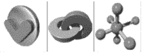

## 内容安排

- ☑ 第一个案例
- ☑ 课程介绍
- ☑ 对象技术
- ☑ 对象和类
- ☑ 对象技术相关原则
- ☑ 上升到面向对象


## 内容安排

- ☑ 第一个案例
- ☑ 课程介绍
- ☑ 对象技术
- ☑ 对象和类
- ☑ 对象技术相关原则
- ☑ 上升到面向对象

## 素数问题

**素数的定义**：除了1与本身之外，不能被其他正整数除的数，叫作素数，也叫质数

按照习惯规定，1 不算素数，最小的素数是 2，其余的是 3、5、7、11、13、17、19……等等

## 由定义判断素数

对于数 n，从 i=2, 3, 4, 5...到 n−1 判断 n 能否被 i 整除，如果全部不能整除，则 n 是素数，只要有一个能除尽，则 n 不是素数，为了压缩循环次数，可将判断范围从 2 ~ n−1 改为 2 ~ sqrt(n)

## 筛选法求素数序列

筛选法：生成 2< i <n 的素数序列，设n=50

筛掉2的倍数： 2 3 4 5 6 7 8 9 10 11 12 13 14 15 16 17 ...

筛掉3的倍数： 2 3 5 7 9 11 13 15 17 19 21 23 25 27 29 ...

筛掉5的倍数： 2 3 5 7 11 13 17 19 23 25 29 31 35 37 41 ...

筛掉7的倍数： 2 3 5 7 11 13 17 19 23 29 31 37 41 43 47 49

留下素数序列： 2 3 5 7 11 13 17 19 23 29 31 37 41 43 47

## 思考？

- ☑ 用结构化思维解决上述问题
- ☑ 用对象思维解决上述问题
- ☑ 将解决思路用合适的方式记录下来
- ☑ 思考：
  - ◆ 结构化思维与对象化思维有什么本质的不同？体现了怎样的思维差异？对象思想有何优势？
  - ◆ 如何表达设计思想：代码？图形？

## 结构化实现

```
//PrimerNumber.c
main(){
int *sieve,n;
int iCounter=2, iMax, i;
printf("Please input max number:");
scanf("%d", &n);
sieve=malloc((n-1)*sizeof(int));
for(i=0;i<n-1;i++) { sieve[i]=i+2; }
iMax = sqrt(n);
while (iCounter<=iMax) {
for (i=2*iCounter-2; i<n-1; i+=iCounter)
sieve[i] = 0;
iCounter++; }
for(i=0; i<n-1; i++)
if (sieve[i]!=0) printf("%d ",sieve[i]);
}
```

## 结构化小结

- ☑ 通过流程图（结构化建模）可以更清楚表达设计思想

- ☑ 针对过程的抽象
  - ◆ 过程（函数）是系统的核心，通过过程实现系统功能
  - ◆ 数据是静态的，由过程来控制对数据的访问

- ☑ 面向对象的方法如何解决呢？

## Java实现-是对象思维吗？

```
import java.lang.Math;
public class PrimerNumber{
    public static void main(String args[]) {
        int n=50;
        int sieve[]=new int[n-1];
        int iCounter=2, iMax, i;
        for(i=0;i<n-1;i++) {sieve[i]=i+2;}
        iMax=(int)Math.sqrt(n);
        while(iCounter<=iMax){
            for (i=2*iCounter-2; i<n-1; i+=iCounter)
                sieve[i]=0;
            iCounter++;
        }
        for(i=0; i<n-1; i++)
            if (sieve[i]!=0) System.out.println(sieve[i]);
    }
}
```

## 用对象思维解决问题？

筛选法：生成 2< i <n 的整数序列，设n=50

筛掉2的倍数：2 3 4 5 6 7 8 9 10 11 12 13 14 15 16 17 ...

筛掉3的倍数：2 3 5 7 9 11 13 15 17 19 21 23 25 27 29 ...

筛掉5的倍数：2 3 5 7 11 13 17 19 23 ...

筛掉7的倍数：2 3 5 7 11 13 17 19 23 ...

留下素数序列：2 3 5 7 11 13 17 19 23 ...

筛子：存储源数据

过滤器：表明当前过滤因子

什么是对象？对象过滤器？记录当前正在筛选的数据

## 这才是对象思维！

象基类，为程序提供多态

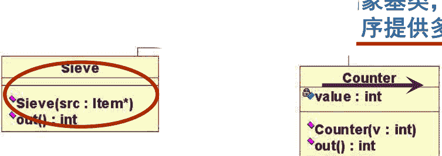

## 面向对象的编程—C++语法

```
class Item{
public:
        Item* source;
        Item (Item* src) {source=src;}
        virtual int out() {return 0;}
};

class Counter: public Item{
        int value;
public:
        int out() {return value++;}
        Counter(int v):Item(0){value=v;}
};
```

## 面向对象的编程-过滤器

```
class Filter:public Item{
    int factor;
public:
    int out(){
        while(1){
            int n=source->out();
            if (n%factor) return n;
        }
    }
    Filter(Item *src, int f):Item(src) {factor=f;}
};
```

## 面向对象的编程-筛子

```
class Sieve: public Item{
public:
    int out(){
        int n=source->out();
        source= new Filter(source, n);
        return n;
    }
    Sieve(Item *src):Item(src){}
};
```

## 验证设计方案

```
void main(){
    Counter c(2);
    Sieve s(&c);
    int next, n;
    cin>>n;
    while(1){
        next=s.out();
        if(next>n) break;
        cout<<next<<" ";
    }
    cout<<endl;
}
```

> 关键代码只有一行，筛子自己知道如何找出素数


## 对象方法小结

- 通过UML类图（面向对象建模）可以更清楚表达设计思想，并为代码实现提供框架

- 针对数据的抽象：类

- 类拥有自己的数据和行为，能够完成自身的工作职责

- 过程是类的组成部分，为类提供行为

- 通过类的对象之间的协作完成系统功能

## 对象技术的思考

- ☑ 对象思维具有更大的灵活性，更好的模块化，可以进行更大规模的设计

- ☑ 面向对象设计和开发的难度更大，面临着**对象识别**、**职责分配**、**多态抽象**等一系列问题

- ◆ 学习更多知识和技术，并掌握一系列面向对象的设计原则和模式

- ◆ 图形化工具（UML）有助于表达和交流设计思想，并简化实现的过程


## 面向对象 VS 结构化-1

☑扬弃，不是否定

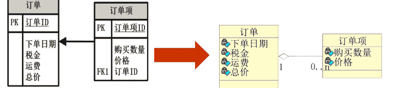

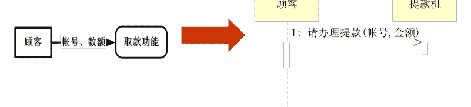

## 面向对象 VS 结构化-3

| | 传统结构化方法 | 面向对象方法(UML) |
|---|---|---|
| 需求模型 | 输入I、处理P、输出O的视角，面向功能的文档(用户需求规格说明书)需求变化，其功能变化，所以系统的基础不稳固 | 从用户和整体角度出发
使用系统抽象出用例图、活动图，获取需求；如需求变化，对象的性质相对功能稳定，系统基础稳定 |
| 分析模型 | 面向过程的数据流图DFD、实体一关系图ERD、数据字典DD表示分析模型
功能分解,数据和功能/过程分开 | 把问题作为一组相互作用的实体，显式表示实体间的关系
数据模型和功能模型一致
类、对象图表示分析模型，状态、顺序、通信、活动图细化说明 |
| 设计模型 | 功能模块(SC图)，模块之间的连接/调用是模块的附属形式 | 类和对象实现,类/对象的关联、聚集、继承等连接、连接规范和约束作为显式定义 |
| 实施模型 | 体系结构设计 | 构件图，部署图 |
| 测试模型 | 根据文档进行单元测试，集成测试,确认测试 | 单元测试采用类图，集成测试用实现图和交互图，确认测试采用用例图 |

## 内容安排

+   - ☑ 第一个案例
+   - ☑ 课程介绍
+   - ☑ 对象技术
+   - ☑ 对象和类
+   - ☑ 对象技术相关原则
+   - ☑ 上升到面向对象

# # 课程目标

# ## 三大目标：

+   - **OO**：建立**对象的思维方式**，对面向对象思想和理论有进一步的理解
+   - **UML**：能够熟练地**使用UML表达面向对象的设计思想**
+   - **Model**：运用对象技术的一般原则和模式进行应用系统的分析和设计建模


# # 课程目标(续)

☑ 三大目标之间的关系

+   - **Model**：建模是最终目的
+   - **OO**：面向对象技术是一种建模理论
+   - **UML**：统一建模语言是一种体现OO的建模语言，是将OO理论转化为实践的工具

## 关于本课程...

+   ☑ 本课程是软件工程类专业课程，侧重于工程实践能力的培养，强调分析和设计技能，不关注文档、过程、规范等，重点在建模方法的应用
+     ◆ 过程驱动：围绕分析和设计过程，关注各阶段建模技术的应用
+     ◆ 案例驱动：围绕具体案例，讲解面向对象分析和设计的思维方式和解决问题的办法

+   ☑ 课程重点不是理论或知识，而是通过实践建立对象思维方式，并培养运用UML来表达这种思维方式的技能，从而完成面向对象分析和设计
+     ◆ 通过课外阅读、作业和实践来弥补课堂不足
+     ◆ 不考概念，不需死记硬背，在实践中掌握相关理论和方法

## 为什么选择本课程？

+   ☑ 需要理由吗？
+   ◆ 我们从事软件行业
+   ◆ 面向对象是最主流的软件开发思想
+   ◆ UML是最主流的建模方法

对于今天的软件开发者来说，UML是他们的面包和黄油

UML
OOAD
→ 软件工程师的“饭碗”

## 本课程适合我？

+   ☑ 基础
+     ◆ 知识储备：软件工程、面向对象程序设计
+     ◆ 实践储备：了解工程项目的特点，最好有实际工程项目开发背景
+   ☑ 定位
+     ◆ 从事软件相关行业工作：分析、设计、编码、测试或管理、维护工作

## 课程安排

+   - ☑ 1 基础(3)：
+     上升到面向对象
+   - ☑ 2 基础(3)：
+     可视化建模技术
+   - ☑ 3 起源(2)：
+     业务建模
+   - ☑ 4 需求(4)：
+     用例建模
+   - ☑ 5 分析(3)：
+     用例分析

+   - ☑ 6 设计基础(3)：
+     面向对象设计原则
+   - ☑ 7 设计基础(3)：
+     面向对象设计模式
+   - ☑ 8 设计(3)：
+     构架设计
+   - ☑ 9 设计(3)：
+     构件设计
+   - ☑ 10 实现&展望(3)：
+     从模型到代码
+     模型技术的发展

## 学习路线图

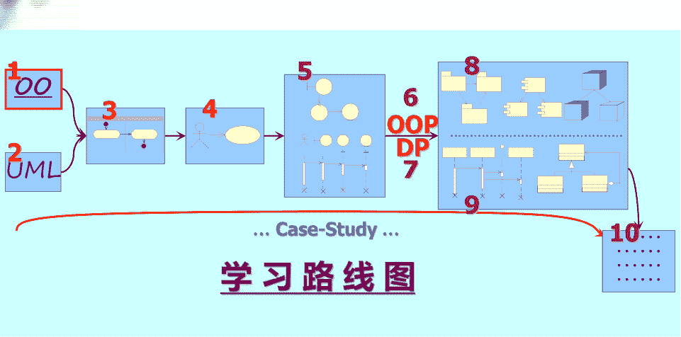

... Case-Study ...

## 学习路线图

## 参考资料

+   - UML2面向对象的分析与设计，清华大学出版社，2013.4
+   - Applying UML and Patterns - An Introduction to Object-Oriented Analysis and Design
+     - UML和模式应用-面向对象分析与设计导论
+   - Object-Oriented Analysis and Design with Applications (3rd)
+     - 面向对象分析与设计(第3版)，UML创始人Grady Booch的代表作
+   - The Unified Modeling Language User Guide（UML用户指南，第二版）
+     - Grady Booch, James Rumbaugh, Ivar Jacobson

## 对象技术

+   ☑ 是一种看待计算机软件系统的观点
+   ☑ 是一种系统分析和设计的思想
+   ☑ 是一种编程方法
+   ☑ 是一组设计原则和模式
+   ☑ 是实践者的日常工作
+   ☑ 是吹鼓手、骗子和市场人员口中的
+   “万灵丹”

## 对象技术

☑对象技术

+   - 是一系列指导软件构造的原则（如抽象、封装、多态等）
+   - 并通过语言、数据库和其它工具来支持这些原则

## 对象技术的发展历史

Simula
基本思想
1967

C++
商业化
1980s

UML
统一方法学
1997

1972
Smalltalk
实用化

1995
Java
编程方法的成熟

2011+
构件、
服务、
云计算???

## 对象技术优势-1

☑ 沟通

+   顺应人类思维习惯，让软件开发人员在解空间中直接模拟问题空间中的对象及其行为

```
PUSH EBX
MOV EBX,EDX
MOV EDX,EAX
SHR EDX,16
DIV BX
```

```
AHare.Run;
ALion.Catch(AHare);
ALion.Kill(AHare);
AHare.Dead;
ALion.Eat;
ALion.Happy;
```

在计算机中模拟现实世界的事和物

## 对象技术利益-2

☑ 稳定

+   - 较小的需求变化不会导致系统结构大的改变
+   - 当需求变化时……

稳定性增加
功能：最易变
数据：较易变
对象：较稳定

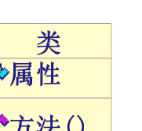

用较稳定把不稳定的包起来


## 对象技术利益-3

☑ 复用

+   ◆ 代码重用：类库、框架等重用机制
+   ◆ 能提高质量，减少由于编制新的系统代码而产生的成本
+   ◆ 通过继承、关联、封装等手段

> 软件开发组越大，组中每个成员的生产率就越低
> --Philippe Kahn, Borland公司创始人

构建大型软件(LOC/year)
15000 / ∛n

## 内容安排

+   ☑ 从结构化到面向对象
+   ☑ 课程介绍
+   ☑ 对象技术
+   ☑ 对象和类
+   ☑ 对象技术相关原则
+   ☑ 上升到面向对象

# 对象（Object）

☑对象（Object）是一个实体、一件事、一个名词，可以获得的某种东西，可以想象有自己标识的任何事物

+   ◆ 可以是物理存在的
+   ◆ 也可能是概念中的
+   ◆ 或软件中的实体

# UML中的对象


命名对象


匿名对象


仅有对象名的对象


## 类

- 类是一系列对象的抽象描述，这些对象共享相同的属性、操作、关系和语义。
  - 一个具体的对象是该类的一个实例。
- 抽象过程强调相关特征而忽略其它的特征。
  - 类抽象的过程就是将具体对象的特征和行为进行参数化，分别用类的属性（attribute）和操作（operation）来表示。

## 属性

- 属性（attribute）是类的特征或特性。
- 属性的值是某一特定对象的属性值。
- 在类中属性名必须是唯一的。
- 每一个类的实例都有为这个类定义的所有属性的值。

### 银行帐户类属性 / Mary 的银行帐户属性值

| 银行帐户类属性 | Mary 的银行帐户属性值 |
| --- | --- |
| 帐号 | 12345678 |
| 银行名称 | First National Bank |
| 拥有者 | Mary Smith |
| 金额 | $1024.48 |

## 属性取决于视点

一辆汽车具有的属性：


- 从销售人员的角度
  - 型号
  - 价格
  - 颜色
  - 里程数
- 从维修人员的角度
  - 马达类型
  - 传动类型
  - 维修记录

## 操作

- 操作（operation）访问或修改对象的属性值。
- 对象的行为是由为此对象定义的一系列操作决定的。
- 一个类可能同时存在多个实例，也可能在某一时刻没有实例。
- 一个类的所有实例都可以使用在这个类中定义的操作。


## 操作取决于视点


一辆汽车具有的操作：

- 从销售人员的角度
  - 处理客户订单
  - 准备销售合同
  - 加入清单
  - 从清单中删除
- 从维修人员的角度
  - 测试刹车
  - 修理刹车
  - 转动轮胎
  - 检查马达速度

## UML 中的类

属性

操作

| Professor |
| --- |
| name |
| employeeID |
| hireDate |
| status |
| discipline |
| maxLoad |
| submitFinalGrade() |
| acceptCourseOffering() |
| setMaxLoad() |
| takeSabbatical() |


Professor J Clark

## 内容安排

- 从结构化到面向对象
- 课程介绍
- 对象技术
- 对象和类
- **对象技术相关原则**
- 上升到面向对象


## 对象技术相关原则

对象技术基本原则

- 抽象（**Abstraction**）
- 封装（**Encapsulation**）
- 泛化（**Generalization**）
- 多态（**Polymorphism**）
- ……

## 抽象和封装

- 抽象是事物区别于其它事物的本质特征。
  - 抽象的过程取决于使用者的目的，它应该包括使用者所感兴趣的那些职责，而忽略掉其它不相关的部分。
- 封装是指对象对其客户隐藏具体的实现，是软件模块化思想的体现。
  - 通过封装实现信息隐藏和数据抽象。

## 泛化

泛化是类与类之间一种关系。

- 通过这种关系，一个类可以共享另外一个或多个类的结构和行为。
- 为了实现泛化关系，采用继承机制。
- 一个子类（subclass）继承一个或多个父类（superclass），从而实现了不同的抽象层次。
- 通过这种关系可以很容易地复用已经存在的数据和代码，并实现多态处理。
- 根据父类的个数不同，存在着单一继承和多重继承两种情况。

## 多态

多态是在同一外表（接口）下表现出多种行为的能力。

- 是对象技术的根本特征。
- 对象技术正是利用多态提供的动态行为特征，来封装变化，适应变更，以达到系统的稳定。

## 应用多态性

假设我们有一个数组 `sharr`，里面放着一排 `Shape`，但是不知道哪些是 `Rectangle`，哪些是 `Circle`。利用多态性，我们可以：

```
for (int i = 0; i < sharr.length; ++i) {
    Shape shape = (Shape)sharr[i];
    shape.draw();
}
```

遍历整个数组的过程中，各个 `Shape` 自己知道应当如何在画布上绘制自己。`shape.draw()` 这一行代码在 `shape` 指向不同的对象时表现出不同的行为，这就是所谓多态性。

## 内容安排

- 从结构化到面向对象
- 课程介绍
- 对象技术
- 对象和类
- 对象技术相关原则
- **上升到面向对象**

## OO 个人简介的 UML 表示

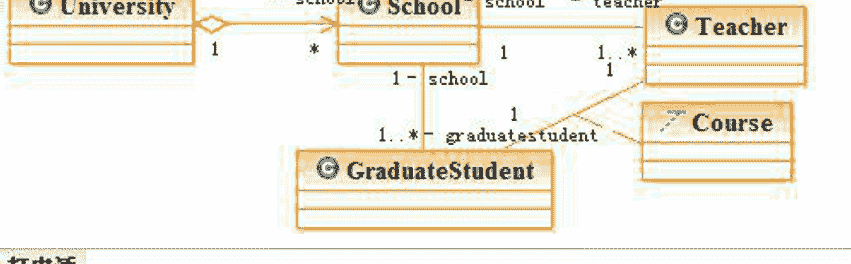

## 打电话

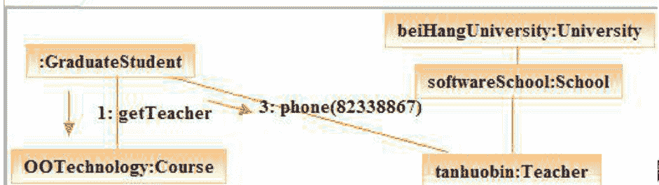

## 实例2：用对象思维分析问题


昨天我的一个朋友结婚了。

## 问题分析-1

- A. 这里面有什么东西？
  - 月老，小伙，姑娘，恋人，玫瑰花
- B. 每个东西看上去是什么样的？
  - 月老：看上去有些年纪了，挺热心的
  - 小伙：看上去很强壮，很诚实的
  - 姑娘：看上去好漂亮，还很温柔
  - 恋人：看上去很黏糊，当然就结婚了
  - 玫瑰花：火红火红的，难怪姑娘动情了

## 问题分析-2

- C. 每个东西能做点什么用？
  - 月老：牵线搭桥，介绍认识
  - 小伙：追求献花，表达爱意
  - 姑娘：仰慕倾情，以身相许
  - 恋人：拍拖，……，结婚
  - 玫瑰花：令姑娘头晕，传情示爱

## 问题分析-3

- D. 这些东西都呆在什么地方？
  - 月老：婚介所，交友网站
  - 小伙：软件园，住回龙观
  - 姑娘：人民医院，住望京
  - 恋人：情侣路，电影院，……
  - 玫瑰花：花店里，小伙手中，姑娘手中

## 问题分析-4

- E. 这些东西之间有什么关系？

| 关系 | 月老 | 小伙 | 姑娘 | 恋人 | 玫瑰 |
| --- | --- | --- | --- | --- | --- |
| 月老 |  | 干妈 | 舅妈 | 撮合者 | 没关系 |
| 小伙 | 干儿子 |  | 男友老公 | 男主角 | 买送主 |
| 姑娘 | 外甥女 | 女友太太 |  | 女主角 | 受主 |
| 恋人 | 作品 | 组成 | 组成 |  | 使用者 |
| 玫瑰 | 没关系 | 信物 | 受物心意 | 信物 |  |

## 问题分析-5

- F. 这些东西是怎么发生的？
  - 月老牵线搭桥，介绍小伙和姑娘认识。
  - 姑娘和小伙一见钟情，成为一对恋人。
  - 一对恋人开始拍拖。
  - 小伙追求献花，表达对姑娘的爱意。
  - 姑娘收到999火红玫瑰，激动得头晕目眩。
  - 小伙真心求婚，姑娘以身相许。
  - 一对恋人终于走入婚姻殿堂。

## 一、上升到面向对象——用面向对象观点观看事物


### 用对象观点认识事物

- A. 这里面有什么东西？
  - 类与对象
- B. 每个东西看上去是什么样的？
  - 类的属性
- C. 每个东西能做点什么用？
  - 类的操作
- D. 这些东西都呆在什么地方？
  - 类的行为、状态、部署
- E. 这些东西之间有什么关系？
  - 类间的关联
- F. 这些东西是怎么成事的？
  - 类间的协作（用例实现）

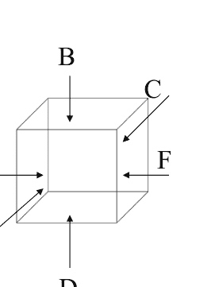


### 俗语和术语间的对应

| 俗语 | 术语 | 例子 |
|---|---|---|
| 出了什么事？ | 用例 | 我的一个朋友结了婚。 |
| 具体事物 | 对象 | 我的一个朋友,他未婚妻... |
| 事物类型 | 类 | 小伙,姑娘,玫瑰,月老... |
| 属性 | 属性 | 年龄,体格,性情... |
| 能力 | 操作 | 牵线,追求,结婚... |
| 位置 | 部署 | 软件园,情侣路... |
| 整-部关系 | 聚合关系 | 恋人-小伙,恋人-姑娘 |
| 抽-具关系 | 继承关系 | 人-小伙,人-姑娘 |
| 协作关系 | 关联关系 | 小伙-姑娘,小伙-玫瑰 |
| 成事过程 | 用例实现 | 相识,相恋,缔婚... |

### 搞清过程的活动图

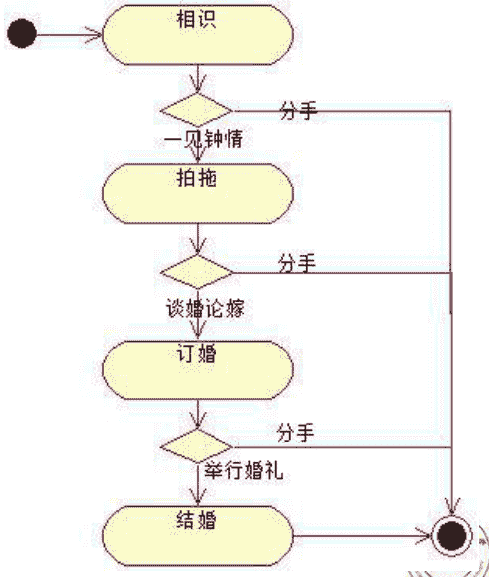

### 复述情节的顺序图

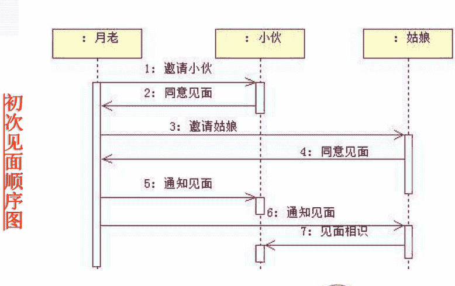

### 理清头绪的通信图

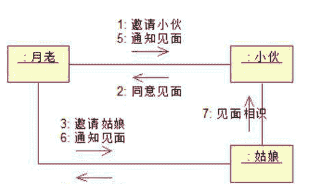

### 定点观察的状态机图

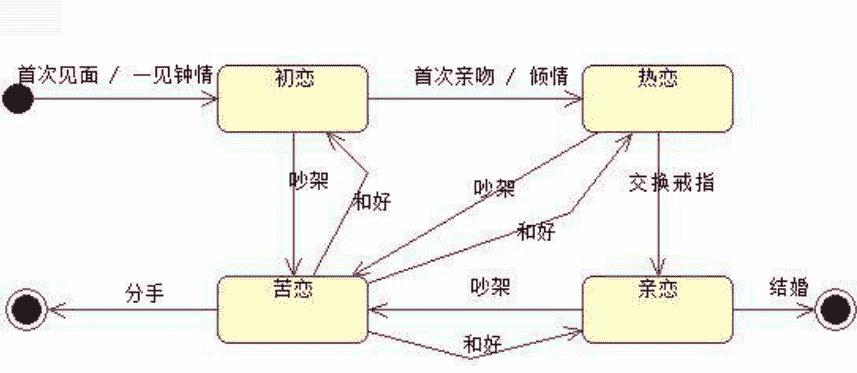

## UML2面向对象分析与设计

## 基于UML2的面向对象分析与设计

谭火彬

## 第02章 可视化建模基础

## 使用UML2的可视化建模基础

## 学习路线图

1
OO

2
UML

3

4

5

6
OOP
DP
7

8

9

... 案例研究 ...

## 学习路线图

10

## 内容安排

- ☑ 可视化建模
- ☑ UML
- ☑ UML组成结构
- ☑ UML概念模型
- ☑ 应用UML2建模

## 模型

☑模型是对现实世界的简化

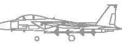

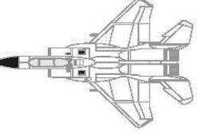

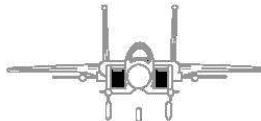


## 模型的重要性

不重要

非常重要

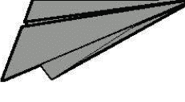

纸飞机

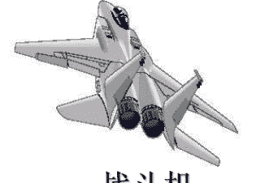

战斗机

## 建模的目的

- ☑ 模型有助于按照所需的样式可视化（**可视化**）系统
- ☑ 模型能够描述（**规定**）系统的结构和行为
- ☑ 模型提供构造（**构建**）系统的模板
- ☑ 模型可以文档化（**文档化**）设计决策

## 建模的原则

- ☑ 选择合适的模型
- ☑ 模型具有不同的精确程度
- ☑ 最好的模型是与现实相联系
- ☑ 需要从多个视角创建不同的模型，单一的模型是不够的

## 内容安排

- ☑ 可视化建模
- ☑ UML
- ☑ UML组成结构
- ☑ UML概念模型
- ☑ 应用UML2建模

## UML

- ☑ UML — 你必须学习
- ☑ UML — 统一建模语言
- ☑ UML是一种标准的图形化建模语言，是面向对象分析与设计的标准表示，它：
  - 不是一种可视化的程序设计语言，而是一种可视化的建模语言(用于分析设计)
  - 不是工具或知识库的规格说明，而是一种建模语言规格说明，是一种表示的标准
  - 不是过程，也不是方法，但允许任何一种过程和方法使用它

## 什么是UML？

☑ **UML是一种用于以下方面的语言**

- **可视化**
- **描述**

Unified Modeling Language（统一建模语言）是对象管理组织（OMG）制定的一个通用的、可视化的建模语言标准，可以用来可视化（visualize）、描述（specify）、构造（construct）和文档化（document）软件密集型系统的各种工件（artifacts，又译制品）

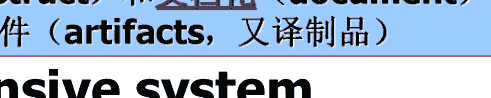

## 选择UML

☑ 很多情况下，推荐使用UML:

- ◆ 1) OO方法是项目决定采用的方法论，是整个项目或产品成功的关键
- ◆ 2) 系统规模比较复杂，需要用图形抽象地表达复杂概念，增强设计的灵活性、可读性和可理解性，以便暴露深层次的设计问题，降低开发风险
- ◆ 3) 组织希望记录已成功项目、产品的公共设计方案，在开发新项目时可以参考、重用过去的设计，以节省投入，提高开发效率和整体成功率
- ◆ 4) 有必要采用一套通用的图形语言和符号体系描述组织的业务流程和软件需求，促进业务人员、开发人员之间一致、高效地交流

## 不选择UML

☑ UML不是万能，有些场合并不适合

- 1）传统的做法已完全适用，对OOAD的要求也不高，项目非常成功，无改进必要
- 2）开发的系统比较简单，直接用源码配上少量的文字就能解决问题，软件开发文档也无需添加图形来辅助说明
- 3）开发的系统本身不属于OO方法、UML适用范围


## UML发展背景

☑ **90年代：** 面向对象分析设计方法学之战

- P. Coad和E.Yourdon提出OOA和OOD
- G. Booch提出面向对象开发方法
- Jacobson提出OOSE
- Rumbaugh提出的OMT
- ……

☑ **UML的出现结束了这场方法学战争**

## UML发展历程


UML 合作伙伴的专业知识

UML 2.4.1
(2011)

UML 2.0
(2005)

UML 1.5
(2003年3月)

UML 1.1
(1997年9月)

UML 1.0
(1997年1月)

UML 0.9
(1996年6月) 和 UML 0.91
(1996年10月)

统一方法 0.8
(OOPSLA '95)

Booch '93 OMT - 2

Booch '91

OMT - 1

OOSE

其他方法

公众反馈

工业化
标准化
统一化
分散的各部分


## UML现状

### ☑ UML 1.x

- 目前应用较为普及，包括从1.1~1.5
- 2003年3月发布的UML 1.5

### ☑ UML 2

- 分为基础结构和上层结构
- 2005年7月正式发布UML 2.0
- 2007年8月、11月UML2.1.1&2.1.2
- 2009年2月UML 2.2，2010年5月UML 2.3
- 2011年8月UML2.4.1，2012年5月 ISO/IEC 19505-1:2012，ISO/IEC 19505-2:2012


## UML的统一

☑ 统一了什么？

- 开发生命周期
- 应用领域
- 实现语言和平台
- 开发过程
- 本身的内部概念

## 内容安排

- ☑ 可视化建模
- ☑ UML
- ☑ UML组成结构
- ☑ UML概念模型
- ☑ 应用UML2建模

## UML基础结构和上层结构

### ☑ UML基础结构(Infrastructure)

- 即UML元模型
- 使之更加模块化，更易于扩展
- 与UML其它规范更加保持一致(MOF)

### ☑ UML上层结构(Superstructure)

- 是指普通用户使用的UML语法、语义以及符号表示
- 使UML更具可用性


## UML是基于MOF四层模型

- 元元模型层(M3)
  - 包含了定义建模语言所需的元素(UML基础结构)
  - MetaClass, MetaAttribute, MetaOperation
- 元模型层(M2)
  - 定义了一种建模语言的结构和语法(UML上层结构)
  - 如UML: Class, Attribute, Operation
- 模型层(M1)
  - 定义了一个具体的系统的模型
  - 如采用UML表示的某系统模型
- 运行时(M0)
  - 包含了一个模型的对象在运行时的状态等
  - 如某系统运行时的对象和数据模型

## 四层元模型结构实例

M3(MOF)

M2(UML)

M1(User Model)

M0(Run-time instances)

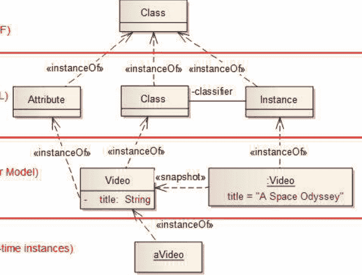

## UML基础结构和上层结构

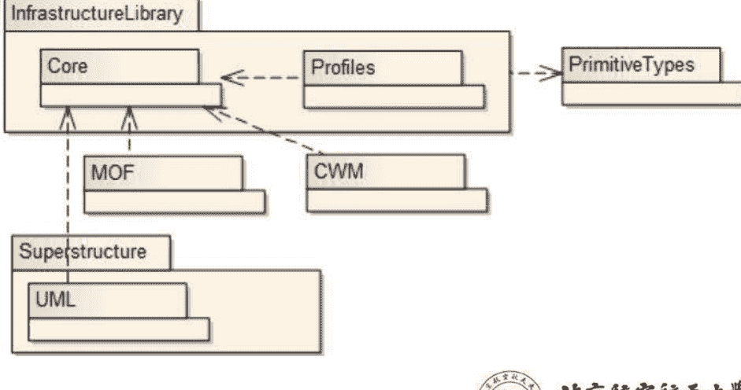

## UML基础结构中的Core包

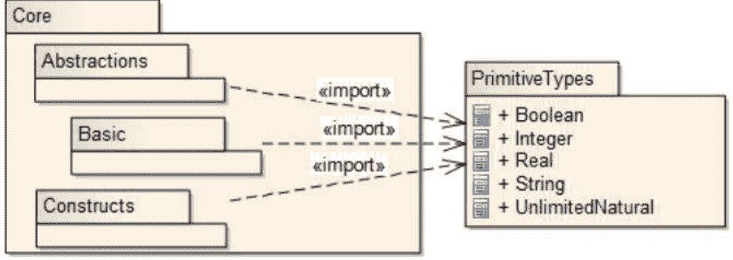

## 内容安排

- 可视化建模
- UML
- UML组成结构
- UML概念模型
- 应用UML2建模

## UML2概念模型

UML上层结构
Superstructure

构造块
building blocks

通用机制
common mechanisms

构架
architecture

基本UML建模元素、关系和图

达到特定目标的通用UML方法

系统架构的UML视图

## 构造块

- 构造块(building blocks)
- 事物(things)
  - 结构、行为、分组、注释
- 关系(relationships)
  - 依赖、关联、泛化、实现
- 图(diagram)
  - 静态(7种): 类图、对象图、构件图、部署图、包图、组合结构图、外廓图
  - 动态(7种): 顺序图、通信图、时间图、交互纵览图、活动图、状态机图、用例图

## 事物(things)

- 结构(structural)事物
  - 类、接口
  - 用例、协作
  - 构件、工件、节点
- 行为(behavioral)事物
  - 交互、状态机、活动
- 分组(grouping)事物
  - 包、框架、模型、子系统...
- 注释(annotational)事物

## 关系

关系 relationships

- 依赖 dependency
- 关联 association
- 泛化 generalization
- 实现 realization

## 通用机制

- 规格说明(Specifications)
  - 文本维度的模型描述
- 修饰(Adornments)
  - 描述建模元素的细节信息
- 通用划分(Common Divisions)
  - 建模时对事物的划分方法
- 扩展机制(Extensibility Mechanisms)
  - 构造型、约束、标记值

## 规格说明(Specifications)

- UML模型至少具有两种维度：
  - 图形维度：使用图和图标可视化模型
  - 文本维度：各种建模元素的规格说明
- 规格说明
  - 模型元素的特征和语义的文本描述
  - 形成了承载模型的语义背板（semantic backplane），赋予模型意义，各种图仅仅是该背板的视图或者可视化投影
  - death by diagram(由于图形而死亡)

## 修饰(adornments)

UML表示法中的每一个元素都有一个基本符号，可以把各种修饰细节添加到这些符号上

只有在修饰增强了图的整体清晰性和可读性或者突出模型的某些重要特征时，才应该表示那些修饰

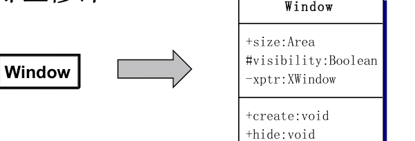

## 通用划分(续)

- 类型和角色的分离(UML2新增)

  任何作为其它实体结构的一部分实体(如属性)都具有两个方面的特性：

  - 从固有类型派生出来的含义
  - 在语境中的角色派生出来的含义

- 类型声明了实体的种类(如对象、属性、参数)
- 角色描述了实体在语境(如类、构件、协作、组合结构)中的含义

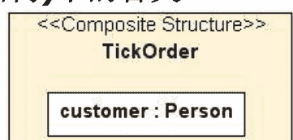

## 扩展机制

- 构造型(stereotypes)
  - 基于已有的建模元素引入新的建模元素
- 标记值(tagged value)
  - 扩展UML构造型的特性，可以用来创建构造型的详述信息
- 约束(constraint)
  - 扩展UML构造块的语义，可以用来增加新的规则或修改现有的规则
- 外廓(profile)
  - 提供了一组预定义的构造型、标记值、约束和基类，以用于特定领域的建模

## 示例：扩展机制

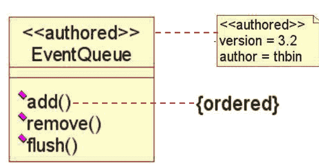

## 构造型(stereotypes)

### 构造型(stereotypes, 衍型)

- 根据已有的模型元素定义一个新元素
- 建立在UML已定义的模型元素基础上
- 可以用于所有的UML模型元素，如类、关联、用例、构件等
- UML规范提供了一些预定义的构造型

## 构造型的几种表现形式

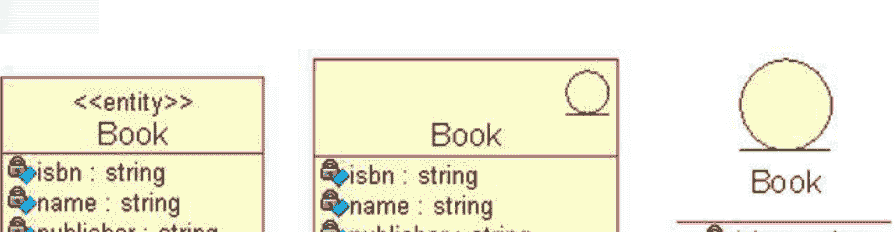

## OMG提供的Profile

OMG基于Profile机制扩展UML应用

- SoaML (Service oriented architecture Modeling Language)
- SysML (OMG Systems Modeling Language)
- EAI (UML Profile for Enterprise Application Integration)
- MARTE (UML Profile for Modeling and Analysis of Real-time and Embedded Systems)
- UML Profile for System on a Chip (SoC)
- UML Testing Profile
- ……

## 外廓图（Profile Diagram）

UML2.2新增的Profile Diagram专门用于可视化描述外廓以及构造型、标记值、约束等

### 主要概念

- **Profile:** 一个包，代表一个外廓
- **Stereotype:** 定义一种针对元类的扩展
- **Metaclass:** 可被扩展的元素
- **Extension:** 构造型和元类之间的关系
- **ProfileApplication:** Profile和应用模型之间的关系

## 应用Profile Diagram

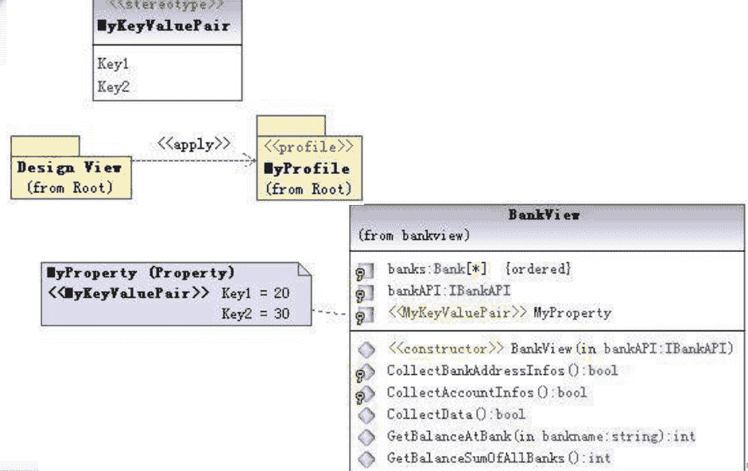

## 架构：4+1视图(from RUP)

Logical View
Implementation View
Use-Case View
Process View
Deployment View
Analysts/Designers
Structure
End-user
Functionality
Programmers
Software management
System integrators
Performance
Scalability
Throughput
System engineering
System topology
Delivery, installation communication

## 4+1视图(续)

### Use Case View

- End-user: Functionality

这些视图由用例视图所统一，它描述项目干系人（stakeholder）的需求；所有其他视图都是从用例视图派生而来，该视图把系统的基本需求捕获为用例并提供构造其他视图的基础

### Logical View

- Analysts/Designers: Structure

系统功能和词汇；描述问题域的词汇，作为类和对象的集合。重点是展示对象和类是如何组成系统、实现所需系统行为


## 4+1视图(续)

+   ☑ Process View
+     ◆ System integrators: Performance, Scalability, Throughput
+     ◆ 系统性能、可伸缩性和吞吐量；建模在我们系统中的可执行线程和进程作为活动类。其实，它是逻辑视图面向进程的变体，包含所有相同的制品

+   ☑ Implementation View
+     ◆ Programmers: Software Management
+     ◆ 系统组装和配置管理；对组成基于系统的物理代码的文件和组件进行建模。它同样展示出组件之间的依赖，展示一组组件的配置管理以定义系统的版本

+   ☑ Deployment View
+     ◆ System engineering: System Topology, Delivery, Installation, Communication
+     ◆ 系统的拓扑结构、分布、移交和安装；建模把组件物理地部署到一组物理的、可计算节点上，如计算机和外设上。它允许你建模横跨分布式系统节点上的组件的分布

## 内容安排

+   - ☑ 可视化建模
+   - ☑ the UML
+   - ☑ UML组成结构
+   - ☑ UML概念模型
+   - ☑ 应用UML2建模

## UML2.4中的14种图

静态模型
(系统结构)

UML2.4-图
Diagrams

动态模型
(系统行为)

类图
Class Diagrams

顺序图
Sequence Diagrams

对象图
Object Diagrams

通信图
Communication Diagrams

构件图
Component Diagrams

时间图
Timing Diagrams

部署图
Deployment Diagrams

交互纵览图
Interaction Overview Diagrams

包图
Package Diagrams

活动图
Activity Diagrams

组合结构图
Composite Structure Diagrams

状态机图
State Machine Diagrams

外廓图
Profile Diagrams

用例图
Use Case Diagrams

## UML2主要改进(与UML1.x相比)

+   - 新增(5种)
+     - 包图(Package Diagram)
+     - 组合结构图(Composite Structure Diagram)
+     - 交互纵览图(Interaction Overview Diagram)
+     - 时间图(Timing Diagram)
+     - 外廓图(Profile Diagram, UML2.2新增)
+   - 改进(3种)
+     - 顺序图(Sequence Diagram)
+     - 活动图(Activity Diagram)
+     - 构件图(Component Diagram)
+   - 改名(2种)
+     - 通信图(Communication Diagram)
+     - 状态机图(State Machine Diagram)

## UML2.4 14种图-结构模型

+   ☑ **类模型**
+     - **类图**：类、接口以及它们之间的关系
+     - **包图**：包以及它们之间的依赖关系
+     - **对象图**：对象以及它们之间的链接关系

+   ☑ **构件模型**
+     - **构件图**：构件以及之间的依赖关系

+   ☑ **组合结构模型**
+     - **组合结构图**：系统某一部分（组合结构）的内部结构

+   ☑ **部署模型**
+     - **部署图**：构件在节点上的部署情况

+   ☑ **外廓模型**
+     - **外廓图**：外廓以及所包含构造型、标记值、约束和基类等

## UML2.4 14种图-行为模型

+   - ☑ 活动模型
+     - ◆ 活动图：动作及活动执行的控制流或数据流
+   - ☑ 交互模型
+     - ◆ 顺序图：对象间交互序列的执行顺序
+     - ◆ 通信图：对象间的协作以及交互序列
+     - ◆ 时间图：对象交互中真实的时间信息
+     - ◆ 交互纵览图：多个交互之间的执行顺序
+   - ☑ 状态机模型
+     - ◆ 状态机图：对象所经历的状态迁移过程
+   - ☑ 用例模型
+     - ◆ 用例图：以外部用户视角描述系统能力

## UML建模工具

## IBM Rational Suite

## Rational Rose 2003

+   - 经典的UML建模工具，目前仍有广泛的应用
+   - 不支持UML2.0

## Rational Software Architecture

+   - IBM兼并Rational之后，重新基于Eclipse平台构建的集成开发平台，提供从业务建模、需求分析、设计到系统实现的完整环境

## IBM Rational Rhapsody

+   - IBM兼并另一家UML建模工具后重新发布的产品
+   - 主要用于嵌入式领域建模，涉及软硬件等各个层次的模型

## UML建模工具(续)

+   - ☑ Enterprise Architect
+   - ☑ Sybase PowerDesigner
+   - ☑ Microsoft Visio
+   - ☑ 数以百计的各类共享/开源工具
+     - ◆ ArgoUML
+     - ◆ StarUML
+     - ◆ Kant&Plato X
+     - ◆ …

## 示例：图书馆管理系统

+   - ☑ 某图书馆管理系统
+     - 是一个基于**Web**的计算机应用系统
+     - 读者可以查询图书信息以及借阅信息
+     - 读者可以通过系统预约所需的图书
+     - 图书馆工作人员利用该系统完成读者的借书、还书业务
+     - 图书馆工作人员可以对图书信息、读者信息等进行维护
+     - 对于到期的图书，系统会自动向读者发送催还信息
+     - 管理员会定期进行系统维护
+     - ……

## 用例图

+   - 用例图（Use Case Diagram）是被称为参与者(Actor)的外部用户所能观察到的系统功能的模型图
+     - 列出系统中的用例和参与者
+     - 显示哪个参与者参与了哪个用例的执行

+   - 核心概念
+     - 用例：系统中的一个功能单元，可以被描述为参与者与系统之间的一次交互作用
+     - 参与者、参与者泛化
+     - 用例与参与者之间的关系：关联
+     - 用例之间关系：扩展、包括、泛化

+   - 推荐使用场合
+     - 业务建模、需求获取、定义

## 图书馆管理系统用例图

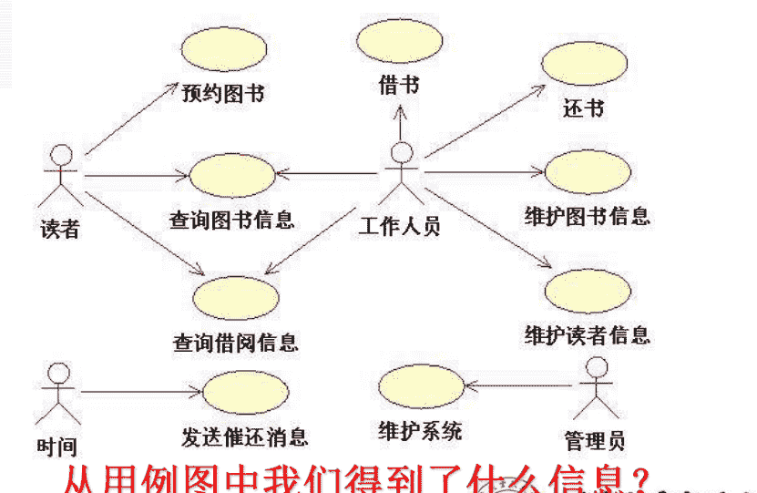

从用例图中我们得到了什么信息？
得不到什么信息？

## 活动图

+   - ☑ 活动图（Activity Diagram）
+     - 通过动作来组织，主要用于描述某一方法、机制或用例的内部行为

+   - ☑ 核心概念
+     - 活动、组合活动
+     - 对象、对象流
+     - 转移、分支，并发、同步
+     - 分区

+   - ☑ 推荐使用场合
+     - 业务建模、需求、类设计

## “借书”业务的活动图

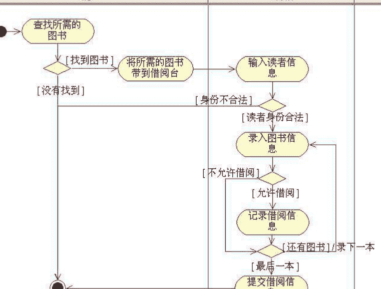

## 静态结构图

+   - ☑ 类图(Class Diagram)
+     - ◆ 是软件的蓝图，详细描述了系统内各个对象的相关的类，以及这些类之间的静态关系
+   - ☑ 对象图(Object Diagram)
+     - ◆ 表示在某一时刻类的对象静态结构和行为
+   - ☑ 包图(Package Diagram)
+     - ◆ 展现有模型本身分解而成的组织单元(包)以及它们的依赖关系
+   - ☑ 组合结构图(Composite Structure Diagram)
+     - ◆ 描述系统中某一部分(组合结构)的内部结构，包括该部分与系统其它部分的交互点

## 静态结构图(续)

### ☑ 核心概念

+   - 类图：类、接口、依赖、关联、泛化、实现
+   - 对象图：对象、链接、多重性
+   - 包图：包（框架、层、子系统）、依赖
+   - 组合结构图：组合结构、部件、端口、协议

### ☑ 推荐使用场合

+   - 系统静态结构建模的核心模型
+   - 业务建模、分析、设计、实现


## 包图展示系统分层结构

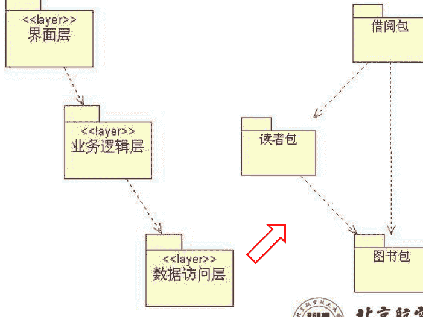

## 类图展示实体类的静态关系

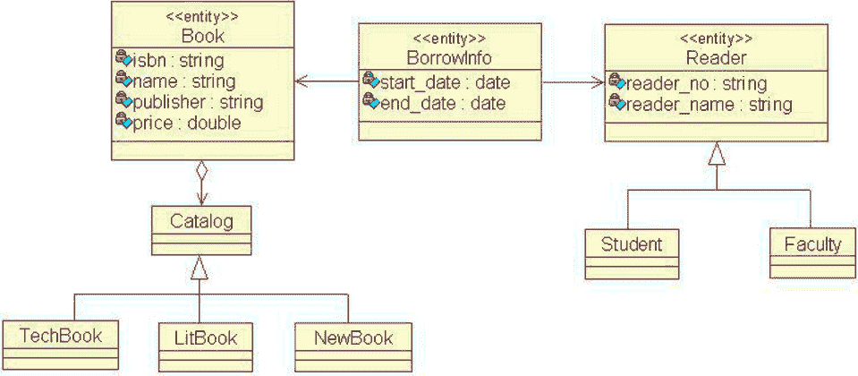

| 实体类 | 属性 |
|---|---|
| Book | isbn: string<br>name: string<br>publisher: string<br>price: double |
| BorrowInfo | start_date: date<br>end_date: date |
| Reader | reader_no: string<br>reader_name: string |

继承关系：Catalog → TechBook、LitBook、NewBook；Reader → Student、Faculty。

## 对象图展示我当前借书情况

| thbin | |
|---|---|
| **:Faculty** | |
| reader_no="012345" | reader_name="thbin" |

| myInfo |
|---|
| **:BorrowInfo** |

| book1 |
|---|
| **:NewBook** |
| isbn="7-115-14833-3" |
| name="UML用户指南(第2版)" |
| taxonomy="TP.5442" |

| book2 |
|---|
| **:TechBook** |
| isbn="7-302-06851-8" |
| name="模式的乐趣" |
| taxonomy="TP.5082" |

| book3 |
|---|
| **:TechBook** |
| isbn="7-218-03451-1" |
| name="C++大学教程" |
| taxonomy="TP.312" |

| book4 |
|---|
| **:LitBook** |
| isbn="4-218-13280-3" |
| name="长征" |
| taxonomy="I204" |

## 组合结构图展示借书内部结构

工作人员

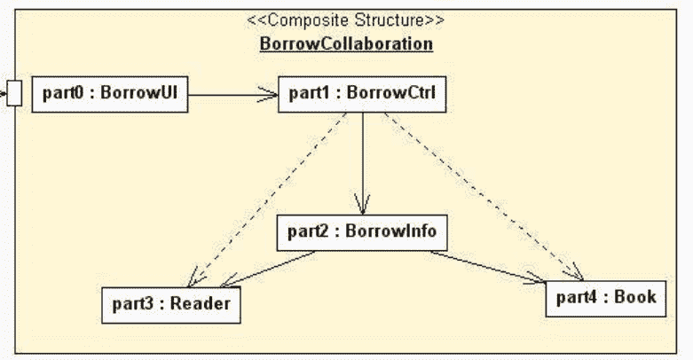

## 顺序图

- ☑ 顺序图（**Sequence Diagram**）
  - ◆ 用于显示对象间的交互活动
  - ◆ 关注对象之间消息传送的时间顺序

- ☑ 核心概念
  - ◆ 对象、生命线、激活、交互、消息
  - ◆ 交互片段(**Interaction Frame**)

- ☑ 推荐使用场合
  - ◆ 用例分析、用例设计

## “借书”用例实现的顺序图

: 工作人员

: BorrowUI

: BorrowCtrl

: Reader

: BorrowInfo

: Book

1.//录入读者信息

1.1.//验证读者信息

1.1.1.//验证读者信息

2.//[for each]录入图书信息

2.1.//录入图书信息

2.1.1.//验证图书是否可借

2.1.2.//生成借阅信息

3.//确认本次借阅信息

3.1.//保存借阅信息

3.1.1.//保存借阅信息

3.1.1.1.//修改图书状态

如果当前图书不可借，则不记录该借阅信息，继续录入下一本

## 交互纵览图

- ☑ 交互纵览图(Interaction Overview Diagram)
  - ◆ 活动图和顺序图的混合物
  - ◆ 直观地表达一组相关顺序图之间的流转逻辑
- ☑ 核心概念
  - ◆ 交互片段
  - ◆ 分支、转移
- ☑ 推荐使用场合
  - ◆ 用例分析、用例设计

## 交互纵览图组织多个顺序图

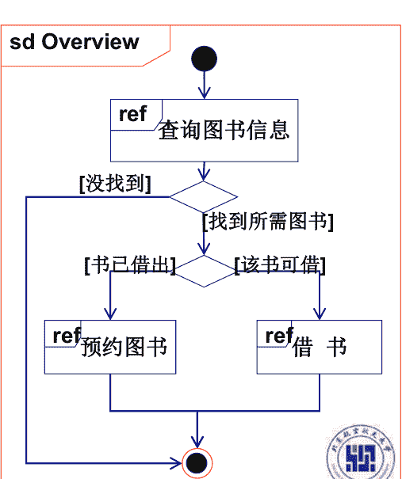

## 通信图

- ☑ 通信图(Communication Diagram)
  - ◆ UML 1.x中称为协作图 (Collaboration Diagram)
  - ◆ 表示一组对象间关系以及交互活动

- ☑ 核心概念
  - ◆ 对象、协作角色
  - ◆ 协作、交互、消息

- ☑ 推荐使用场合
  - ◆ 用例分析、用例设计

## “借书”用例实现的通信图

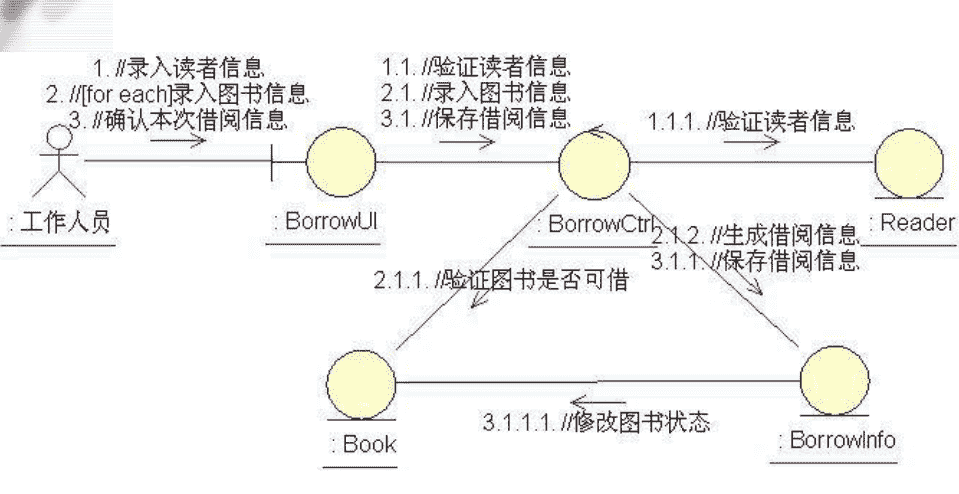

## 时间图

☑ 时间图(Timing Diagram)

- 一种交互图，展现消息跨越不同对象或角色的实际时间信息
  - 具体描述单个或多个对象状态变化的时间点以及维持特定状态的时间段
  - 顺序图是表示交互的主要手段，可以在顺序图中增加时间约束来表明对象状态变化的时间点以及维持特定状态的时间段

☑ 核心概念

- 时间约束、持续时间约束、生命线
- 状态、条件、事件

## "打电话" 顺序图的时间约束

s : Caller
: Switch
c : Conversation
r : Caller
liftReceiver()
setDialTone()
[loop]
dialDigit(int)
dial()
routeCall(Caller, int)
<<create>>
ring()
liftReceiver()
connect(Caller, Caller)
connect(Caller)
{<=30sec}

## 利用时间图描述时间约束

sd User_DialPhone

:Switch
Calling
Connecting
Dialing
Toned
Idle

{<=30sec}

Lift
Digit
Dial
OK
Hang

timing ruler

sd User_DialPhone

:Switch

{<=30sec}

Idle
Toned
Dialing
Connecting
Calling
Idle

## 状态机图

- ☑ 状态机图(State Machine Diagram)
  - ◆ UML1.x为状态图(Statechart Diagram)
  - ◆ 利用状态和事件描述对象本身的行为

- ☑ 主要概念
  - ◆ 状态、初态、终态、复合状态
  - ◆ 事件、转移、动作
  - ◆ 并发

- ☑ 推荐使用场合
  - ◆ 类设计

## “图书”类的状态机图

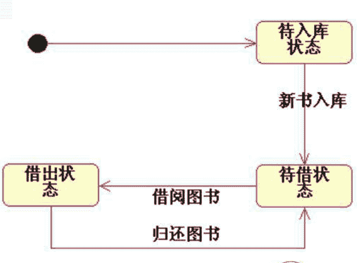

## 构件图

☑ 构件图 (Component Diagram)

- 封装类为构件
- 描述在系统实现环境中的软件构件和之间的关系

☑ 主要概念

- 构件、工件、接口（所供接口、所需接口）
- 依赖、实现

☑ 推荐使用场合

- 系统设计、实现、部署


## 构件图描述类的实现环境

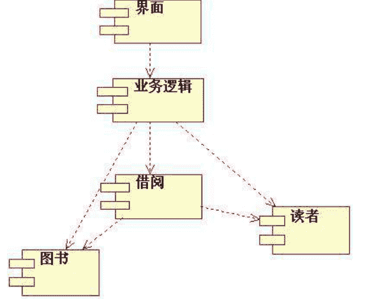

## 构件图(UML2新特性)

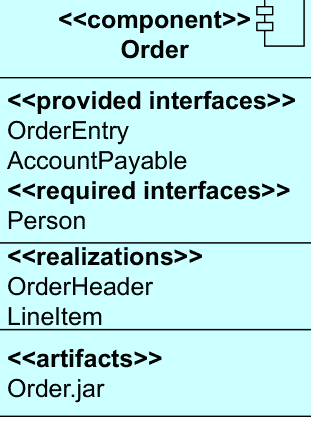

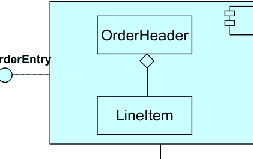

## 部署图

- ☑ 部署图（Deployment Diagram）
  - ◆ 描述系统所需的硬件构件的物理部署
- ☑ 主要概念
  - ◆ 节点、构件、位置
  - ◆ 连接、依赖
- ☑ 推荐使用场合
  - ◆ 系统设计、实施、部署

## 部署图描述系统部署情况

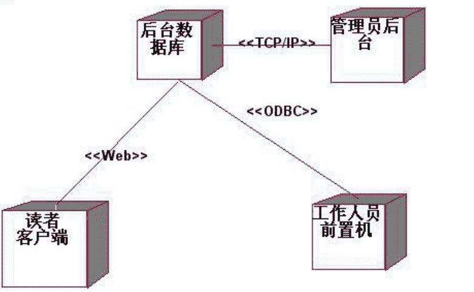

## 附录2-1. UML元语

## 用例图元语

| 结构元素 | 图形符号 | 关系元素 | 图形符号 |
|---|---|---|---|
| 用例<br>(Use Case) | 椭圆形用例图形 | 关联<br>(Association) | 实线 |
| 参与者<br>(Actor) | 小人形图标<br>Actor | 扩展<br>(Extend) | `<<extend>>` 虚线箭头 |
| 系统边界<br>(System Boundary) | 矩形边界<br>System | 包含<br>(Include) | `<<include>>` 虚线箭头 |
|  |  | 泛化<br>(Generalization) | 实线空心三角箭头 |
| 注释<br>(Note) | 便签形状<br>Note | 注释连接<br>(Note link) | 点线 |


## 活动图元语

| 元素 | 图形符号 | 元素 | 图形符号 |
|---|---|---|---|
| 活动/动作 (Activity/Action) | Activity | 起点 (InitialNode) | ● |
| 对象 (Object) | Object | 终点 (FinalNode) | ◎ |
| 发送事件 (SendEvent) | Event | 流结束 (FlowFinal) | ⊗ |
| 接收事件 (AcceptEvent) | Event | 分叉/合并 (Fork/Join) | — |
| 分区 (Partition) |  | 控制流 (ControlFlow) | → |
| 决策点 (Decision) | ◇ | 对象流 (ObjectFlow) (UML1.x 中为虚线) | → |

## 类图、对象图、包图元语

| 结构元素 | 图形符号 | 关系元素 | 图形符号 |
|---|---|---|---|
| 类 (Class) | Class | 依赖 (Dependency) | .........> |
| 包 (Package) | Package | 关联 (Association) | — |
| 接口 (Interface) | «interface» Interface 或 Interface | 聚合 (Aggregation) | ◇— |
|  |  | 组合 (Composition) | ◆— |
| 对象 (Object) | Object : Class | 泛化 (Generalization) | → |
|  |  | 实现 (Realization) | -----> |

## 顺序图元语

| 元素 | 图形符号 | 元素 | 图形符号 |
|---|---|---|---|
| 对象/生命线 (Object/Lifeline) | Object1 : Class ⋮ | 同步消息 (Synchronous Message) | → |
| 交互片段 (Interaction Frame) | alt [Condition1] ──────── [Condition2] | 异步消息 (Asynchronous Message) | → |
| 控制焦点 (Focus of Control) | ▷▯ | 返回消息 (Return Message) | ← - - - - - |
| 状态不变式 (State Invariant) | (State Invariant) | 创建消息 (Create Message) | - - → Object |

## 通信图元语

| 元素 | 图形符号 | 元素 | 图形符号 |
|---|---|---|---|
| 对象/生命线 (Object/Lifeline) | Object : Class | 同步消息 (Synchronous Message) | → |
| 链接 (Link) | — | 异步消息 (Asynchronous Message) | ⇢ |
|  |  | 返回消息 (Return Message) | ← ---- |

## 交互纵览图元语

| 元素 | 图形符号 | 元素 | 图形符号 |
|---|---|---|---|
| 片段 (Frame) | sd interaction | 起点 (InitialNode) | ● |
| 交互引用 (Interaction Use) | ref Sequence Diagram | 终点 (FinalNode) | ◎ |
| 决策点 (Decision) | ◇ | 控制流 (ControlFlow) | → |

## 状态机图元语

| 元素 | 图形符号 | 元素 | 图形符号 |
|---|---|---|---|
| 状态 (State) | State | 初态 (Initial State) | ● |
| 浅度历史 (Shallow History) | H | 终态 (Final State) | ◎ |
| 深度历史 (Deep History) | H* | 转移 (Transition) | e[g]/a → |
| 选择 (Choice) | ◇ | 分叉/合并 (Fork/Join) | — |

## 构件图元语

| 结构元素 | 图形符号 | 关系元素 | 图形符号 |
|---|---|---|---|
| 构件 (Component) | Component | 装配连接 (Assembly connector) |  |
| 所供接口 (Shallow History) | ProvidedInterface | 委托连接 (Delegate connector) |  |
| 所需接口 (Required Interface) | RequiredInterface | 依赖 (Dependency) |  |

## 部署图元语

| 结构元素 | 图形符号 | 关系元素 | 图形符号 |
|---|---|---|---|
| 节点 (Node) | Node | 通信路径 (Communication Path) | — |
| 制品 (Artifact) | Artifact | 依赖 (Dependency) | ..........> |
| 部署规范 (Deployment specification) | «deployment spec» DeploymentSpecification | 部署 (Deploy) | <<deploy>> ----------> |
|  |  | 承载 (Manifestation) | <<manifest>> ----------> |

## 外廓图

| 结构元素 | 图形符号 | 关系元素 | 图形符号 |
|---|---|---|---|
| 构造型 (Stereotype) | <<stereotype>> Name | 扩展 (Extension) | → |
| 元类 (Metaclass) | <<metaclass>> Name | 外廓应用 (ProfileApplication) | <<apply>> ---→ |
| 外廓 (Profile) | <<profile>> Name | 引用 (Reference) | <<reference>> ---→ |

## UML2面向对象分析与设计

## 使用 UML2 进行面向对象分析与设计

谭火彬

## 学习路线图

... 案例研究 ...

## 学习路线图

1 面向对象

2 UML

3

4

5

6 面向对象编程 设计模式 7

8

9

10 ...

## 内容安排

- ☑ 分析设计过程简介
- ☑ 业务建模基础
- ☑ 业务建模流程
  - ◆ 识别业务参与者
  - ◆ 识别业务用例
  - ◆ 详述业务用例
  - ◆ 建立业务对象模型
- ☑ 业务建模实践
- ☑ 从业务模型到系统模型

## 分析设计过程简介

- UML2提供的5类14种图
- 不同的软件工程过程定义了不同阶段
  - 过程是一种“战术”，而UML则是基本的“作战技能”
  - 是一种多对多的关系，没有严格的对应，但有些最佳实践
  - 过程只是一个模板，每个团队都有自己的特点，根据这个模板定义自己的过程


## 本书的核心过程

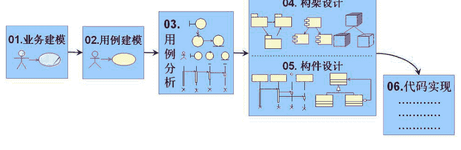

## 开发过程解析

- 业务建模：用软件建模方法描述业务流程；其目标是认识业务本质，该业务本质是后续用例建模的基础
- 用例建模：采用UML用例建模技术描述软件需求，该需求模型将为后续用例分析提供输入
- 用例分析：采用UML用例分析技术分析软件需求，建立软件系统的分析模型
- 架构设计：在系统的全局范围内，以分析模型为基础，设计系统的架构
- 构件设计：根据架构设计的成果，将分析模型细化，设计系统构件的实现细节
- 代码实现：将系统构件映射到目标语言上

## 内容安排

- ☑ 分析设计过程简介
- ☑ 业务建模基础
- ☑ 业务建模流程
  - ◆ 识别业务参与者
  - ◆ 识别业务用例
  - ◆ 详述业务用例
  - ◆ 建立业务对象模型
- ☑ 业务建模实践
- ☑ 从业务模型到系统模型


## 业务建模

### ☑ 业务建模的目的(RUP)
- 理解将要实施的系统的组织结构和动态特性
- 理解当前在目标组织中的问题，并明确改进的潜力
- 确保客户、最终用户和开发人员对目标组织有统一的理解
- 获取用于支持目标组织的系统需求

### ☑ 业务建模关注
- 机构的核心价值
- 机构的边界
- 机构的参与者
- 机构中的工作流及如何优化

## 业务建模方法
- ☑ 研究对象
  - ◆ 软件要改进的业务单元
- ☑ 研究目标
  - ◆ 定义业务本质
- ☑ 研究方法
  - ◆ 用例观点：把业务看成对外提供价值的价值流

## 内容安排
- ☑ 分析设计过程简介
- ☑ 业务建模基础
- ☑ 业务建模流程
- ◆ 识别业务参与者
- ◆ 识别业务用例
- ◆ 详述业务用例
- ◆ 建立业务对象模型
- ☑ 业务建模实践
- ☑ 从业务模型到系统模型

## 业务建模流程
- ☑ 0. 建立业务用例模型
  - ◆ 1. 识别业务参与者
  - ◆ 2. 识别业务用例
  - ◆ 3. 详述业务用例
- ☑ 4. 建立业务对象模型

## 1.业务参与者(Business Actor)
- ☑ 识别业务参与者
- ◆ 在业务之外，与业务进行交互的人或组织

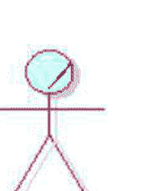

看清楚了，我是业务参与者

## 区分业务工人(Business Worker)
- ☑ 业务参与者在业务外面
- ☑ 业务工人在业务里面

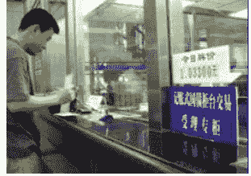


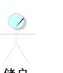


## 2.业务用例(Business Use Case)
- ☑ 识别业务用例
- ◆ 业务为业务参与者提供的价值
- ◆ 体现企业业务本质，是有意义的目标


看清楚了，我就是业务用例

## 业务用例与业务参与者


储户

存款

取款

转帐

企业

贷款


食客

吃饭


## 识别业务用例的方法
- 直接获得：从业务参与者的角度，从外部推导出出来
- 拼装：从里面往外面看，内部业务流程的目标是什么

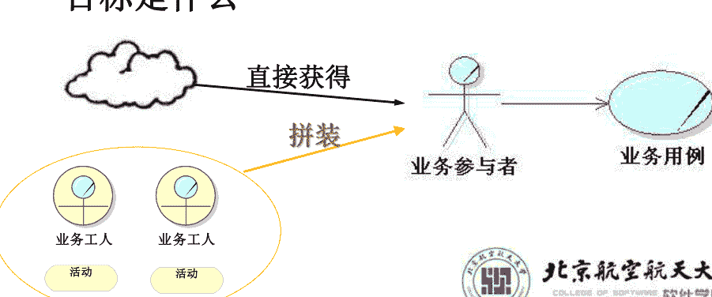

## 从业务流程拼装业务用例
☑ 业务流程
- 1. 收款人在支票背后签名，写上身份证件号码，把支票和身份证件交给营业员
- 2. 营业员核对印章正确且证件有效
- 3. 营业员操作营业受理系统，办理支票兑现手续
- 4. 营业员把现金和证件交给收款人

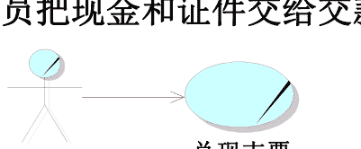

## 识别业务用例-支持性事件
- 不要遗漏支撑性业务流程背后的业务用例
- 支持性事件
  - 人员的发展与维护
  - 业务内部IT的开发与维护
  - 办公室的设立与维护
  - 安全性
  - 法律活动
- 例：公司为什么要举行足球比赛？

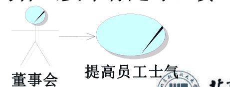

## 3. 详述业务用例
- ☑ 业务用例是对业务流程的封装，在业务建模过程中需要逐一描述其内部细节，即详述业务用例
- ☑ 目的
  - ◆ 详细说明业务用例的工作流程
  - ◆ 说明业务用例的工作流程，以便于客户、用户和涉众理解

## 三种可选技术
文字

活动图

顺序图

## 选择合适的技术
- ☑ 只有文字
  - 不生动，不便于和客户交流
- ☑ 只有活动图
  - 难以表达所有细节
- ☑ 业务用例文档中插入活动图
- ☑ 活动图中插入文字(+注释+基本路径)
- ☑ 顺序图(需要涉及到业务对象模型)

## 细说活动图(1)
- ☑ 起点、终点
  - ◆ 活动的一种特殊形式，各自只有一个
  - ◆ 起点：只有离开的转移
  - ◆ 终点：只有进入的转移
  - ◆ 存在从起点出发，到达终点的路径
- ☑ 活动和动作
  - ◆ 有进有出
  - ◆ 动宾结构
  - ◆ 可以简单，可以复杂
- ☑ 分区
  - ◆ 定义活动的负责人

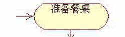

## 细说活动图(2)
☑ 控制流
- ◆ 向外转移的条件之和必须是完备集
- ◆ 向外转移的条件之间不能重叠
☑ 决策点
- ◆ 注意和流程图的区别
- ◆ 误把活动当决策
- ▸ 图中判断“技术可行性”需要单独的活动来完成

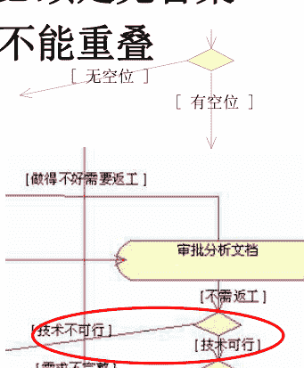

## 细说活动图(3)
- ☑ 并发(concurrent)
- ☑ 同步条(synchronization bar)的分叉(fork)与合并(join)
- ◆ 有分必有合
- ◆ 有分必有进
- ◆ 有合必有出
- ◆ 并发≠同时

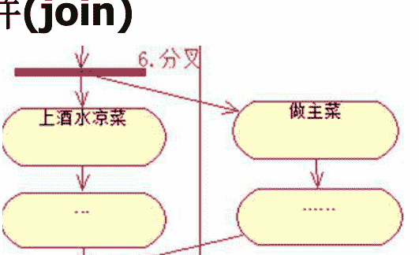

## 活动图中的对象流
☑ 指定活动操作的数据（对象）以及数据的流向（对象流）
- 业务对象（business objects）、对象流（object flows）
- 指出对某些业务实体的操作，类似结构化中的数据流图
- UML2 中对象流由原来的虚线改为实线

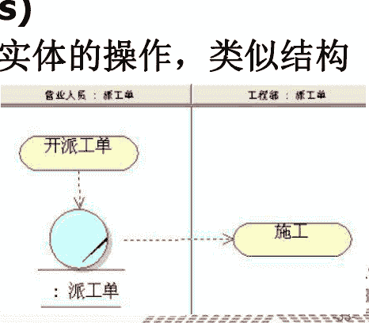

## 活动图的分层
☑ 活动可以简单可以复杂，复杂的活动可以进一步细化：分层
- 顶层有起点终点，下层可以没有
- 出入平衡


## 4.业务对象模型

## ☑业务对象模型(Business Object Model)
- ◆ 勾勒出实现业务关系中的人、事物、设备、资源以及它们之间的关系；即业务工人和业务实体之间的静态关系
- ◆ 从另一个视角描述现实
- ◆ 使用UML类图描述
- ◆ 不要和待开发系统中的分析设计类相混淆

## 餐馆的业务对象模型


雇员

领位员

服务员

厨师

负责

菜肴

1

1..*

## 内容安排
- 分析设计过程简介
- 业务建模基础
- 业务建模流程
  - 识别业务参与者
  - 识别业务用例
  - 详述业务用例
  - 建立业务对象模型
- 业务建模实践
- 从业务模型到系统模型


## 业务建模实践：建模指南

- 业务模型不是UML标准直接支持的，但是通过UML的扩展机制可以很方便的建立业务模型

- 主要构造型(stereotype)
  - 业务用例模型
    - 参与者的构造型：业务参与者(Business Actor)
    - 用例的构造型：业务用例(Business Use Case)
  - 业务对象模型
    - 类的构造型：业务工人(Business Worker)、业务实体(Business Entity)

## 建模指南：模型的组织

- 利用“包”组织模型

- 用例视图中
  - “业务用例模型”
  - 每个业务用例的“状态/活动模型”

- 逻辑视图中
  - “业务对象模型”


## 建模指南：使用构造型

- ☑ 业务用例模型是在 **UML** 的用例模型（用例图）基础上添加构造型来实现的
  
- ☑ 业务对象模型是在 **UML** 的对象模型（类图）基础上添加构造型来实现的
  
- ◆ 利用已有元素添加构造型
  
- ◆ **Rose** 直接支持这些构造型


## 业务建模实践：实例分析

☑ 研究对象：某旅店

☑ 业务现状：

- 某旅店可对外开放 **50个双人间** 和 **20个单人间**，房间费用视情况按季节调整，但周一到周五提供半价（周末全价）折扣
- 旅客可以直接入住房间（如果有空房），也可提前预订；入住和预订都需要登记个人信息
- 旅客提前预订房间时，需提交一定的订金；入住时间24小时之外的旅客可以取消预订，并退回所有订金，24小时以内则不退还订金
- 退房时缴纳全部的住宿费用
- 服务员每月为经理提供房间的预订情况和入住情况的详细信息


## 实例分析：业务用例模型


旅店的本质就是为旅客提供住宿服务，其它的只是为达到这个目标而采用的手段
（用例观点：把业务看成对外提供价值的价值流）

## 实例分析：旅客住宿业务流程


## 实例分析：检查业务用例模型

- ☑ 该业务用例模型体现了整个旅店的业务需求吗？
- ☑ 如何考虑这项业务：服务员每月为经理提供房间的预订情况和入住情况的详细信息？
- ◆ 经理是什么，如何体现在业务建模过程中？
- ◆ 是业务参与者还是业务工人？体现怎样的业务本质的差异？

## 实例分析：业务对象模型


## 业务模型为系统模型提供素材

- ☑ 为用例视图和逻辑视图提供输入

- ◆ 对于每个将被系统实现的业务用例，在用例视图中确定一个系统用例或用例包（或单独的子系统）来实现该业务

- ◆ 为需要支持自动化业务确定相应的用例

- ◆ 对于业务对象模型中的业务实体，可以在系统模型中定义对应的实体类

- ☑ 为系统构架提供一些重要的构架机制

- ◆ 在软件构架中定义专用层来实现复杂的业务逻辑

## 业务模型映射到系统模型

- ☑ 从业务改进点入手，结合系统远景，可以帮助获取系统模型

- ☑ 可能的对应关系（并非一一对应）
  
  - ◆ 业务用例 → 系统(子系统)
  
  - ◆ 业务参与者 → 系统参与者
  
  - ◆ 业务工人 → 系统参与者
  
  - ◆ 业务工人的操作(活动) → 系统用例
  
  - ◆ 业务实体 → 实体类


## UML2面向对象分析与设计

### Object-Oriented Analysis & Design with UML2

谭火彬

## 学习路线图


... Case-Study ...

## 学习路线图

## 内容安排

- ☑ 理解需求
- ☑ 从业务模型获取需求
- ☑ 建立用例模型
- ☑ 编写用例文档
- ☑ 重构用例模型
- ☑ 其它问题

## 需求——建造“正确”的系统

☑ 需求：客户可接受的、系统必须满足的条件或具备的能力

☑ RUP中的FURPS+软件质量准则

- 功能性（Functionality）
- 使用性（Usability）
- 可靠性（Reliability）
- 性能（Performance）
- 可支持性（Supportability）
- +

非功能性需求


## 需求工程的主要活动

- ☑ 定义需求
  - ◆ 理解用户的需要，建立用户可理解的系统需求模型（第四章）

- ☑ 分析需求
  - ◆ 根据需求模型，建立开发者无二义性解释的分析模型（第五章）

- ☑ 需求管理

## 需求难在何处：石头问题

- ☑ 我要一块石头...
- ☑ 差不多，但我要小一点的...
- ☑ 很好，不过我要蓝色的...
- ☑ 啊，没有那么小...
- ☑ 咳，还是原来那个好了...

难捕获，易变！

小一点的蓝色大理石

## 需求：也需要开发

客户/用户的要求/想法/期望

软件产品

有价值的软件需求

软件设计

开发

分析和设计

验收

编码和测试

## 需求问题：对策

难捕获 → 从用户视角看问题
易变 → 合理的结构
→ 用例

## 用例的昨天

## Use Cases — Yesterday, Today and Tomorrow (Ivar Jacobson, The Rational Edge, 2003.3)

- 萌芽期（1967-1986）
  - Ivar Jacobson在爱立信，把各种不同类型的电话呼叫情况称为traffic case，而完成所有呼叫则需要交换机具备相应的功能function或特征feature
  - 1986年，提出术语use case
  - 1987年，OOPSLA’86采用Jacobson论文，用例诞生

- 成熟期（1987-1992）
  - Objectory AB公司，以用例内容为核心的Objectory Process（对象工厂过程）

- 发展期（1992-）
  - 用例在面向对象方法中的应用，并成为UML的...部分

## 内容安排

- ☑ 理解需求
- ☑ 从业务模型获取需求
- ☑ 用例建模流程

- 获取原始需求
- 构建初始用例模型
- 编写用例文档
- 重构用例模型

## 从业务模型获取需求

- ☑ 有业务模型
  - ◆ 从业务用例模型中寻找系统改进点
  - ◆ 结合系统远景，获取系统用例来表达需求
- ☑ 采用需求启发技术，从涉众获得

## 从业务模型获取需求

☑ 从业务用例模型中获取系统需求，来构建系统用例模型

- ◆ 1. 寻找业务改进点
- ◆ 2. 定义项目远景
- ◆ 3. 导出系统需求

## 1. 业务改进点

☑业务模型描述业务现状，这些现状：

- 有些可能一直运转的很好，不需要改进，也就没有必要作为软件需求来由系统实现

- 而另外可能更多的业务在运转过程中存在这样或那样的问题，这些问题就成为业务待改进的改进点，也就很可能作为软件需求而存在


抱歉，您提供的“需要翻译的文本”是中文，并非英文，因此无法按“英译中”的指示进行翻译。请确认文本来源或提供英文原文；若需要将这段中文翻译成英文，也请明确告知。


## 参与者之间的关系：泛化

☑ 参与者可以通过泛化关系来定义，在这种泛化关系中，一个参与者的抽象描述可以被一个或多个具体的参与者所共享

- ◆ 如系统中经理可以参加雇员的所有用例


## 参与者地位

- ☑ 识别用例之前很重要
  - 有助于识别用例，宁多勿少
- ☑ 开始书写用例文档以后不重要
  - 涉及的参与者太多
- ☑ 测试和部署阶段很重要
  - 需要从参与者的角度考虑

## 3 识别用例

- ☑ 关键词：价值

- ☑ 定义
  - ◆ 用例实例是系统执行的一系列动作，这些动作将生成特定参与者可观测的结果值
  - ◆ 一个用例定义一组用例实例（场景）

- ☑ 简洁：参与者使用系统达到某个目标

记住，我是(系统)用例

## 用例要点

- ☑ 可观测→用例止于系统边界
- ☑ 结果值→用例是有意义的目标
- ☑ 系统执行→结果值由系统生成
- ☑ 由参与者观测→业务语言、用户观点
- ☑ 一组用例实例→用例的粒度

## 要点：有意义的目标


## 要点：结果值由系统生成


系统需要处理的，由系统生成

## 要点：用户观点而非系统观点

会员
查询商品
订购商品
用户观点

会员
显示商品信息
处理订购
系统观点

## 用例的命名

☑ 参与者视角：

- ◆ （状语）动词+（定语+）宾语


## 要点：用例粒度-1

- ☑ 用例是一组用例实例的抽象；其内部要有路径，路径要有步骤

- ☑ 最常犯错误：粒度过细，陷入功能分解

- ◆ 通过执行用例，参与者完成想做的事情（最终的目的），并为参与者产生价值

- ◆ 过细的粒度，一般都会导致技术语言的描述，而不再是业务语言


## 用例粒度-2

☑把步骤当用例


会员

输入用户名


会员

登录

<<include>>

验证用户名和密码

☑把系统活动当用例


<<include>>

建立数据库连接

查询订单

<<include>>

## 用例粒度-3

☑ “四轮马车”

- ◆ **C(Create)**
- **R(Read)**
- **U(Update)**
- **D(Delete)**

- 所有业务最终都会成为 **CRUD**？

- **CRUD** 能为Actor提供价值？

- **CRUD掩盖业务，**蜕变成关系数据库的建模：
  - “系统就是数据的增删改查” 查询用户
  - 关心数据的存储和维护，反而忽略了用户的目的


## 用例粒度-4

☑ 如果确实是CRUD？

- 如果CRUD不涉及复杂的交互，一个用例“管理××”即可
- 不管是C、R、U、D，都是为了完成“管理”目标
- 甚至很多种的基本数据管理都可以用一个用例表示


## 用例粒度-5

☑ 灵活处理CRUD


可以把包含复杂交互的路径独立出去形成用例

## 找出用例的思路

☑ 用例要考虑如下要点来寻找。

- 参与者工作是什么
- 参与者的角色(作用)是什么
- 参与者是否生成、参照、删除系统信息
- 参与者是否需要把外部变更通知给系统
- 系统是否需要把内部事情通知给参与者
- 是否存在进行系统维护的用例

☑ 用例数量的参考基准

- 1个系统中存在十几个用例(或更少)
- 1个用例中有多个用例实例(场景)

## 实例分析：旅游业务申请系统

☑ 阅读“旅游业务申请系统”问题陈述

- 识别系统参与者
- 识别系统用例
- 构建用例图

## 获取系统参与者

| 抽取角度 | 外部事物种类 | 主要日常工作 | 使用目标系统职责 | 参与者 | 典型代表 |
| --- | --- | --- | --- | --- | --- |
| 相关用户 | 前台招待顾客的员工 | 洽谈客户事宜并为客户办理各种申请和取消手续、完成费用支付 | 办理申请手续以及相关的取消、支付等后续业务 | 前台服务员 | 具体用户代表 |
|  | 负责催款的员工 | 打印和邮寄旅游确认书和交款单 | 打印旅游确认书和交款单 | 收款员工 | ... |
|  | 旅行社内的会计人员 | 财务记帐 | 不使用本系统，不是参与者 |  | ... |
|  | 宣传和路线管理员工 | 制作宣传资料、定期维护旅游路线和活动 | 维护旅游路线和旅游活动 | 路线管理员 | ... |
| 其他外部事物 | 财务系统 | 记帐等财务操作 | 接收本系统中与现金相关的财务信息 | 财务系统 | ... |
|  | 外部激励 | 关注或影响系统的运行 | 定期自动导出财务信息 |  |  |

## 从参与者的角度获取用例

| 参与者 | 主要工作 | 是否使用系统 | 用例 |
| --- | --- | --- | --- |
| 前台服务员 | 向申请人介绍申请情况 | 否 |  |
| 前台服务员 | 为申请人办理申请手续 | 是 | 办理申请手续 |
| 前台服务员 | 对申请参加人的增、删、改、查等日常维护 | 是 | 管理参加者 |
| 前台服务员 | 记录申请人支付信息 | 是 | 完成支付 |
| 前台服务员 | 为申请人取消申请 | 是 | 取消申请 |
| 收款员工 | 打印旅游确认书和余额交款单 | 是 | 打印旅游确认书和余额交款单 |
| 收款员工 | 邮寄旅游确认书和余额交款单 | 否 |  |
| 路线管理员 | 制作宣传资料 | 否 |  |
| 路线管理员 | 设计旅游路线 | 是 | 管理路线 |
| 路线管理员 | 设计旅游团（活动） | 是 | 管理旅游团 |
| 路线管理员 | 调整旅游团价格 | 是 | 设定价格 |
| 财务系统 | 记账等财务操作 | 否 |  |
| 财务系统 | 接收与现金相关的财务信息 | 是 | 导出财务信息（被动） |
| 时间 | 定期导出财务信息 | 是 | 导出财务信息 |
| 辅助用例 | 系统要区分各种不同的用户身份，并提供不同的功能 | 是 | 登录 |

## 旅游业务申请系统参考用例图


## 内容安排

- ☑ 从业务模型获取需求
- ☑ 建立用例模型
- ☑ 编写用例文档
- ☑ 重构用例模型
- ☑ 其它问题

## 有层次的需求组织形式

- ☑ 用例（取款）
- ◆ 路径（正常取款）
- ➢ 步骤（系统验证取款金额合法）
- ✓ 补充约束（取款金额必须为50元的倍数）

低精度，稳定

高精度，不稳定

## 涉众利益


- ☑ 同样是“取钱”

- ◆ 为什么家里的抽屉不用密码，取款机要用？

- ◆ 为什么取了钱以后要“系统扣除账户金额”

- ☑ 还有一些因素没有考虑...


## 从涉众利益角度定义用例

☑Cockburn：用例是涉众之间达成的契约，以参与者为达成特定目标和系统交互的方式演绎


## 用例平衡涉众之间的利益

- 用例平衡涉众之间的利益
- 涉众是受系统影响的，有自己主张的人或组织，可能的涉众有：
  - 最终用户、客户、政府、法律
  - 开发者、管理人员、竞争对手、...
- 对于用户在ATM取钱的用例
  - 用户：希望方便
  - 银行：希望安全
  - 法律：保护财产


## 涉众利益的冲突

- ☑ 用例相当于参与者在台上表演，而最重要的是台下的观众(涉众)的利益
- ☑ 编写用例文档的过程就是描述如何满足涉众之间的利益，达到涉众利益的平衡
- ☑ 涉众有轻重缓急


## 寻找涉众的思路

- ☑ 区分涉众与参与者
  - 涉众是与当前用例存在利益关系的人或组织
  - 参与者是启动或参与用例执行过程的人或外部事物
- ☑ 可能的涉众有：
  - 当事人
  - 上游下游
  - 操作对象的主人
  - …


## 前置、后置条件

- ☑ 前置条件约束在用例开始前系统的状态
  - 作为用例的入口限制，它阻止参与者触发该用例直到满足所有条件
  - 说明在用例触发之前什么必须为真
- ☑ 后置条件约束用例执行后系统的状态
  - 用例执行后什么必须为真
  - 对于存在各种分支事件流的用例，则可以指定多个后置条件


## 定义前置、后置条件

- ☑ 前置、后置条件必须是系统能检测到的

- ☑ 前置条件必须是系统在用例开始前就能检测到的


前置条件
客户打来电话

前置条件
客服部人员已经登录

前置条件
ATM用户的账户里有足够的金额

## 应用前置、后置条件

- ☑ 某些用例依赖于其他用例
  - 一个用例在离开系统时，可能是另一个用例的前置条件（例如：“登录”和“管理系统”）
- ☑ 有助于识别漏掉的用例
  - 如果一个用例的前置条件不能由执行其他用例满足，可能意味着丢失了用例（例如：“管理订单”却没有“登录”用例）

## 事件流描述-用例交互四部曲

1. 动作

   系统

2. 验证

3. 处理

4. 响应

重点写：1和4（可观测的、体现客户利益的文字）

## 事件流描述要点

☑ 事件流描述要使用户和开发人员互相理解用例的功能，要注意以下几点：

- 使用业务语言：使用用户平时所使用的语言进行描述
- 要明确参与者与系统所交互的信息
- 不使用[例如]、[等]这样的不清晰的表达
- 不要细化GUI
- 不要描述计算机内部的处理，要描述从系统外部所看到的活动
- 除了基本流程，还要描述替代流程
- 要明确描述用例的开始和结束

## 例1：使用业务语言

- ☑ 技术语言：无法与用户沟通
  - 系统通过 **JDBC** 建立数据库连接，传送 **SQL** 查询语句，从“商品表”查询商品的详细信息…
- ☑ 业务语言（用户语言）
  - 系统按照查询条件搜索商品的详细信息

## 例2：描述参与者与系统交互过程

- ☑ 以参与者或系统作为主语描述
  - 参与者......
  - 系统......
- ☑ 示例
  - 出纳员接收顾客的付款—顾客的付款数可能高于商品总额
  - 出纳员录入顾客所付的现金总额
  - 系统显示出应找还给顾客的余额，打印付款收据

## 例3：不细化GUI

### ☑ 过细的GUI描述

- 会员从下拉框中选择类别
- 会员在相应文本框中输入查询条件
- 会员点击“确定”按钮

## 例4：分支和循环的描述

- ☑分支：放到备选路径中
  - 参与者的选择
  - 另一条成功线路
  - 系统进行验证
  - ……
- ☑循环：直接描述

## 用例文档中的补充约束

☑ 用例重点在于描述功能需求，而其它方面的补充约束：

- 与特定用例相关的补充约束，作为该用例文档中一部分来描述
- 一些全局性的补充约束，单独形成一份独立的文档，如“补充需求规约”文档

☑ 补充约束

- 字段列表
- 业务规则
- 非功能需求
- 设计约束

## 实例分析：撰写用例文档

- ☑ 用例文档参考模板
- ☑ 旅店预订系统用例文档
  - “UC01-预订房间” 用例文档
  - “UC02-取消预订” 用例文档
- ☑ 旅行申请系统用例文档
  - “UC01-申请旅游团” 用例文档

## 内容安排

- ☑ 从业务模型获取需求
- ☑ 建立用例模型
- ☑ 编写用例文档
- ☑ 重构用例模型
- ☑ 其它问题

## 重构用例模型

☑ 利用用例建模高级技术重构用例模型

- **用例关系**
  - 通过用例关系将复杂的用例进行适当的分解，以便于提高需求的复用性和可扩展性等，从而使用例模型的结构更合理
- **用例分级**
  - 可以根据用例的重要程度进行分级，以便后续迭代计划的制定，高级别的用例优先考虑
- **用例分包**
  - 将相关的用例打包，通过分包的方式可以将用例图分层表示，以用于大规模系统的用例建模


## 用例关系

<<extend>> → 扩展

<<include>> → 包含

→ 泛化

## 通过关系整理文档

- ☑ **Extend(扩展)**
  - 通过扩展用例对基用例增加附加的行为
- ☑ **Include(包含)**
  - 基用例中复用被包含用例的行为
  - 提取公共步骤，便于复用
- ☑ **Generalization(泛化)**
  - 派生用例继承泛化用例的行为并添加新行为

## 用例关系：扩展

扩展：某个用例在特定情况下，包含其他用例(扩展用例)的行为，表示功能被扩展

- 扩展使用带有<<extend>>的虚线表示。此时，箭头由扩展的用例指向原用例，通过扩展点指明在原用例中的扩展位置


## 用例关系：包含

☑ 包含：表示某个用例中包含了其他用例的行为

- 包含用带有 <<include>> 的虚线来表示。此时，箭头由原有的用例指向被包含部分的用例


## 扩展 VS. 包含-1

- 包含：由用例A连向用例B，表示用例A中使用了用例B中的行为或功能
  - 包含关系的提出一般是基于用例行为复用的考虑，这也意味着被包含的用例往往被多个基用例引用
- 扩展：由用例B连向用例A，表示用例A描述了一项基本需求，而用例B则描述了该基本需求的特殊情况，即一种扩展
  - 扩展用例的提出是为了将基用例的一些特殊情况分离出来，在保持基用例本身相对完整的情况下（即一般情况都能处理）来处理这些特殊行为


## 用例关系：泛化

☑ 泛化：表示子用例继承了父用例

- 用例间的泛化关系表明子用例继承父用例中定义的所有属性、行为序列和扩展点，并且参与父用例中所有的关系


## 旅游申请系统重构后的用例模型


## 用例分包

+   - ☑ 对用例进行分包
+     - 让用例图能够更为清晰地表现出系统的业务逻辑关系和层次
+     - 对系统进行模块的分割，这将影响到今后的开发和系统的最终表现形式

+   - ☑ 常见的分包方式
+     - 按参与者分包
+     - 按主题分包
+     - 按开发团队分包
+     - 按发布情况分包

先按主题分包，主题内再按开发团队和发布情况分包

## 用例分级

用例和迭代开发

+   - 迭代开发中开发周期的定义是围绕用例来组织的
+   - 一个迭代周期要被指派一个到多个用例，如果完全版本的用例在一个迭代周期中处理起来太复杂的话，那就采用简化版本的用例


## 用例分级实施策略-1

☑ 可以使用一个简单的但是有些不精确的分类方法，如将用例划分成高、中、低三个等级

| 类别 | 用例 | 划分理由 |
|---|---|---|
| 高 | 购买商品 | 系统的核心业务 |
| 中 | 退还商品 | 重要过程，影响记账 |
| 中 | 管理用户 | 影响安全性子问题域 |
| 中 | 登录 | 影响安全性子问题域 |
| 低 | 启动系统 | 独立于其它用例 |


## 用例分级原则

+   ☑ 用例分级的一个基本原则
+     ◆ 高级别用例是那些对系统核心架构影响最大的用例

+   ☑ 提高用例级别的特性：
+     ◆ a. 对架构设计有重要影响的用例，如在领域层中增加多个类的用例或者需要持久化的用例
+     ◆ b. 不需要花费很多努力就可以从中获得重要信息和线索的那些用例
+     ◆ c. 含有开发风险、时间紧迫或功能复杂的用例
+     ◆ d. 涉及到重要技术研究或者新技术和高风险的用例
+     ◆ e. 代表主要在线业务流程的用例
+     ◆ f. 能产生直接经济效益或者降低成本的用例

## 用例分级实施策略-2

☑ 依照上述的影响用例级别的特性给用例打分（特性也可能带有权值）

| 用例 | a | b | c | d | e | f | 总计 |
|---|---|---|---|---|---|---|---|
| 购买商品 | 5 | 3 | 2 | 0 | 5 | 3 | 18 |
| ..... |  |  |  |  |  |  |  |

## 内容安排

+   - ☑ 从业务模型获取需求
+   - ☑ 建立用例模型
+   - ☑ 编写用例文档
+   - ☑ 重构用例模型
+   - ☑ 其它问题

## 用例建模中常见的问题

+   - 用例不是功能分解
+   - 用例图不是流程图
+   - 用例关系的误用

## 何时适用用例建模

+   - 用例是从参与者角度捕获系统功能，当系统只有一个或者没有参与者时，显然不是非常有效的
+   - 用例捕获功能需求，因此对于系统的非功能需求不是有效
+     - 当遇到下述情况时，用例是需求捕获的最好选择
+       - 系统由功能需求所主导
+       - 系统具有很多类型的用户，系统对他们提供不同的功能
+       - 系统具有很多接口
+     - 当遇到下述情况时，用例是一个糟糕的选择：
+       - 系统由非功能需求所主导（如： google）
+       - 系统具有很少的用户
+       - 系统具有很少的接口（非内部功能）
+       - 如：嵌入式系统、算法复杂但接口少的系统等

## UML2面向对象分析与设计

## UML2面向对象分析与设计

谭火彬

## 学习路线图


… Case-Study …

## 学习路线图

## 第05章 用例分析

用例分析

## 内容安排

+   - ☑ 理解分析
+   - ☑ 从用例开始分析
+   - ☑ 构架分析
+   - ☑ 构造用例实现
+   - ☑ 定义分析类

## 分析

+   ☑ 分析
+     ◆ 为了满足需求模型中所描述的功能，系统内部应该有什么样的业务核心机制(做什么？)

+   ☑ 分析的目标开发一系列模型，以描述机软件核心成分，从而满足客户定义的需求：
+   分析模型

+   ◆ 包括两个层次：构架分析和用例分析

+   ◆ 包括两类模型：静态结构(包图、类图)和动态交互(顺序图、通信图)

+   ◆ 模型元素按照构架来组织，各类视图按照用例实现(协作)来组织

## 分析与需求的关系

+   ☑ 分析是建立在需求收集的基础上
+     ◆ 分析模型建立在用例模型的基础上
+     ◆ 用例模型确定了分析模型的结构（通过用例实现(协作)来组织分析模型）
+     ◆ 用户视角理解用户问题过渡到开发团队视角分析用户问题
+       ➢ 与需求一样，它还是在问题域中
+       ➢ 从用户视角跨入开发团队视角
+     ◆ 分析与需求捕获在很大程度上重叠，这两个活动常常相辅相成，为了澄清和找出任何遗漏或歪曲的需求，常常需要在需求之上作一些分析

## 分析的“度”

+   ☑ 面向对象分析是以对象的视角去理解业务问题

+   ◆ 不同于以自然语言描述的需求
+   ◆ 也不同于以技术语言去表达的设计

+   ☑ 如何把握这种介于业务和技术之间的分析活动的“度”是非常关键的

+   ◆ 过渡的分析会陷入设计误区，从而难以有效的达到分析的目标
+   ◆ 不够深入的分析则容易遗漏那些重要的信息，从而无法及早发现并处理需求中的问题

## 把握分析的“度”

+   ☑ 把整个分析活动限制在业务问题域词汇，而不考虑任何技术领域的实现策略
+   
+   ◆ 保持对系统结构和行为的精确和简单陈述
+   
+   ◆ 所有与实现相关内容都留给设计和实现阶段来考虑

+   ☑ 一些具体的分析原则：
+   
+   ◆ 分析模型使用业务语言
+   
+   ◆ 分析类和关系等应该是业务中明确存在的
+   
+   ◆ 分析是对需求模型的重新表述，是以理想化的方式来实现用例行为，不考虑技术实现
+   
+   ◆ 分析侧重于系统主要部分，关注核心的业务场景；对支撑性行为、非功能需求等不做深入的分析

## 内容安排

+   - ☑ 理解分析
+   - ☑ 从用例开始分析
+   - ☑ 构架分析
+   - ☑ 构造用例实现
+   - ☑ 定义分析类

## 分析模型与用例模型

用例：外观

类协作：内部机理


## 从用例开始分析迭代

+   - UP方法中最重要的思想就是迭代，而迭代的基础就是用例
+   - 从用例开始分析基本思路
+     - 根据用例图和用例文档来确认需求定义是可靠的、一致的
+     - 用例分级：根据风险、重要性以及项目组的能力确定用例以及用例相关路径的优先级

## 实例-旅游申请系统迭代1


## 分析阶段的用例—用例实现

☑ 用例实现(UML2中的协作)是设计(分析)模型中一个系统用例的表达式

+   - 使用构造型<<use-case realization>>
+   - 描述了对象间的协作以完成用例目标
+   - 将用例模型中的用例和设计(分析)模型中的类和关系连接在一起
+   - 说明了每个用例必须用那些类来实现

☑ 用例实现提供了从分析和设计到需求的可跟踪性

## 创建用例实现

用例模型

分析（设计）模型

用例

用例实现

用例

顺序图

协作图

类图

## 实例-旅店预订系统的迭代和用例实现

服务员

预订房间

取消预订

逻辑视图

分析模型

取消预订-用例实现

可追溯图

预订房间-用例实现

可追溯图

预订房间
(来自用例模型)

预订房间-用例实现

取消预订
(来自用例模型)

取消预订-用例实现


## 内容安排

- ☑ 理解分析
- ☑ 从用例开始分析
- ☑ 构架分析
- ☑ 构造用例实现
- ☑ 定义分析类

## 构架分析

☑构架分析的过程就是定义系统高层组织结构和核心构架机制的过程

- ◆ 1. 定义系统高层组织结构—备选构架
- ◆ 2. 确定系统通用构架机制—分析机制
- ◆ 3. 提取系统的关键抽象以揭示系统必须能够处理的核心概念—关键抽象
- ◆ 4. 创建用例实现来启动用例分析—用例实现

## 1.定义备选构架

☑ 定义备选构架

- 构架的初始草图
- 初步定义系统的分层与组织
- 初步定义一组在构架方面具有重要意义的元素，以作为分析的基础
- 初步定义一组分析机制
- 定义要在当前迭代中处理的用例实现

## 备选构架模式

构架模式表示了对软件系统的一个基础结构组织形式。它提供了一套预定义子系统，详细说明它们的职责，并且包括组织它们之间的规则和指南

- 层
- 模型-视图-控制器(M-V-C)
- 管道和过滤器
- 黑板

## 分析阶段备选分层构架B-C-E


Boundary Layer

边界层，负责与参与者和外部设备进行交互

Control Layer

控制层，负责协调用例内部的处理流程

Entity Layer

实体层，负责存储和访问系统内部实体信息

## B-C-E三层构架解析

- ☑ 以构造型 <<layer>> 表示系统不同层次
- ☑ 以 B-C-E 三层划分系统三类处理逻辑
  - ◆ 边界层 (Boundary) 负责系统与参与者之间的交互
  - ◆ 控制层 (Control) 处理系统的控制逻辑
  - ◆ 实体层 (Entity) 管理系统使用信息
- ☑ 层之间建立依赖关系

# 2.构架机制

- ☑ 构架机制是对通用问题的决策、方针和实践

- ◆ 构架机制描述了针对一个经常发生的问题的一种通用解决方案

- ◆ 作为系统构架的一部分，构架机制常常集中和定位在系统的非功能需求上

- ☑ 三类构架机制

- ◆ 分析机制（概念）

- ◆ 设计机制（具体）

- ◆ 实现机制（实际）

## 为什么使用分析机制


> 唉！不好了，我发现有一组类具有需要永久保存的数据。如果我现在还不知道将使用什么数据库的话，我如何去设计它们呢？

> 没关系，这就是我们为什么要有一个持久性分析机制的原因。我们了解得还不充分，我们可以先标记下来，设计时再仔细定义其的存储结构和方式

分析机制用于在分析阶段中向设计人员提供复杂行为的简短表示，从而减少分析的复杂性并提高分析的一致性

## 常见的分析机制

- ☑ 持久性(Persistency)
- ☑ 遗留接口(Legacy Interface)
- ☑ 分布(Distribution)
- ☑ 安全性(Security)
- ☑ 事务管理(Transaction Management)
- ☑ 进程控制和同步(Process Control and Synchronization)
- ☑ 通信(Communication)
- ☑ ……

## 分析机制特性

☑分析机制特性定义了一些系统的非功能性需求

☑例：持久性机制特性

- **粒度**：对象大小
- **容量**：对象数量
- **持续时间**：对象保存的时间
- **存取机制**：对象的标识和检索
- **访问频率**
- **可靠性**

# 3.关键抽象

☑ 关键抽象是一个通常在需求上被揭示的概念，系统必须能够对其处理

- 来源于业务，体现了业务的核心价值，即业务需要处理哪些信息
- 这些信息所构成的实体即可作为初步的实体分析类
- 具体来源有需求描述、词汇表、特别是业务对象模型
- 通过一个或多个类图来展示关键抽象，并为其编写简要的说明

## 旅游申请系统中的关键抽象

| 关键抽象 | 含义 | 相关概念 |
|---|---|---|
| 路线 | 包含具体旅游安排和介绍的旅游路线 |  |
| 旅游团 | 各个旅行路线的具体组团；各个线路可组织多次不同的旅游团 | 路线 |
| 申请 | 参加人提交的旅游团申请表 | 旅游团 |
| 支付明细 | 与申请相关的订金、旅费、退费等费用支付信息 | 申请 |
| 参加人 | 某申请的参加人员信息，分责任人和普通人员两种角色；具体人员还需要区分大人的小孩 | 申请 |
| 联系人 | 参加人指定的联系人信息 | 参加人 |

## 构造用例实现

- ☑ 构造用例实现是分析最核心的工作
  - ◆ 获得实现用例行为所必须的分析类
  - ◆ 利用这些分析类来描述其实现逻辑
- ☑ 针对每一个用例实现：
  - ◆ 1. 完善用例文档
  - ◆ 2. 识别分析类
    - ➤ 边界类、控制类和实体类
  - ◆ 3. 分析交互
    - ➤ 交互图分析用例实现
  - ◆ 4. 完成参与类类图
    - ➤ 参与用例实现的类的类图
  - ◆ 5. 处理用例关系

## 1.完善用例文档

- ☑ **需求阶段的用例文档是从用户角度看待用户问题，侧重描述交互的1、4步**

- ☑ **分析阶段则需要从系统角度看待用户问题，重点关注交互的2、3步：即系统如何响应用户请求；此时可以对需求阶段用例文档中系统的处理流程进一步细化**

- 🔹 获取理解系统必要的**内部行为**所需的其他信息：从“黑盒”到“白盒”的过渡

- 🔹 有些情况下，可能找到一些不正确或不易理解的需求；此时，原始的用例事件流也需要进行更新

## 示例：完善用例文档

- ● 系统显示旅行费用的总额和申请订金金额

- ● 系统根据旅游团价格和参加人情况计算费用总额以及订金金额


## 什么是分析类

- 分析类代表了“系统中必须具备职责和行为的事物”的早期概念模型
- 分析类处理主要的功能需求，模型化问题域对象
- 根据备选构架定义三类分析类
  - 边界类：系统及其参与者的边界
  - 控制类：系统的控制逻辑
  - 实体类：系统使用信息

## 边界类

- 边界类表示系统与参与者之间的边界
  - 代表系统与环境的交互
  - 是接口和外部事物的中间体
  - 构造型 <<boundary>>
- 两类边界类
  - 用户界面类
  - 系统和设备接口类


## 示例：识别边界类

☑每对参与者/用例定义一个边界类


## 指南：边界类

- ☑ 关注职责，而不是细节
- ☑ 用户界面类
  - ◆ 关注展示给用户的信息
  - ◆ 不关注用户界面细节
- ☑ 系统和设备接口类
  - ◆ 关注系统必须定义的协议
  - ◆ 不关注协议如何实现

## 控制类

- 控制类表示系统的控制逻辑
  - 系统行为的协调器
  - 构造型 <<control>>
- 识别控制类
  - 在系统开发早期，为一个用例定义一个控制类，负责该用例的控制逻辑
  - 针对复杂用例，可为备选路径分别定义不同控制类


## 示例：识别控制类

通常，每个用例定义一个控制类

随着分析的继续，一个复杂用例的控制类可以发展为多个


### 实体类

- 实体代表了待开发系统的核心概念
- 实体类提供了另一个理解系统的观点
  - 显示了系统的逻辑数据结构
  - 传统的面向对象方法就是从这个角度进行分析 和 设计
- 使用构造型 <<entity>>
- 可以从以下中找到实体类
  - 用例事件流(需求)、业务模型(业务建模)、词汇表(需求)


## 识别实体类

☑分析用例事件流中的**名词、名词短语**，找出系统所需的实体对象，这些名词可能是：

- 对象、对象的特征和状态
- 参与者、描述信息、系统之外的

☑从这些名词、名词短语中进行筛选，抽取出系统对象，并抽象成类

- 综合考虑在系统中的意义、作用和职责

☑对于所识别的类进行命名

## 指南：名词筛选法识别实体类

名词筛选法识别实体类的基本思路：

- 将用例文档作为输入，找出文档中的名词或名词性短语，形成了实体类初始候选列表
- 合并那些含义相同的名词
- 删除那些系统不需要处理的名词
- 删除作为参与者的名词
- 删除与实现相关的名词
- 删除那些作为其它实体类属性的名词
- 对剩余的名词，综合考虑它在当前用例以及整个系统中的含义、作用以及职责，并基于此确定合适的名字，作为初始实体类存在

## 实体类的其它来源

除了用例文档之外，从与用户和专家进行的访谈中得到的信息，也可作为实体类的来源

◆ 系统原始需求书/问题描述
◆ 该领域相关文献、专家意见或个人知识
◆ 过去的类似系统

在后面的职责分配中可能识别一些新的实体类

实体类的命名要用该领域中最经常使用的名称

## 示例：候选实体类

☑ “支付”用例基本路径中的候选实体类


## 示例：总结：分析类

## 用例模型


## 分析模型


会员

支付

银行支付系统

会员支付界面类

支付控制类

银行支付系统接口类

支付信息

会员账号

## 总结：从用例中识别分析类


## 实例-旅游申请系统中的分析类

前台服务员

办理申请手续

管理参加人

完成支付

时间

导出财务信息

财务系统

收款员工

打印旅游确认书和余额交款单

登录

路线

旅游团

申请

支付明细

参加人

联系人

用户

申请界面类

增加参加人界面类

完成支付界面类

登录界面类

发确认书界面类

导出财务信息界面类

财务系统接口类

申请控制类

增加参加人控制类

完成支付控制类

发确认书控制类

登录控制类

导出财务信息控制类

## 顺序图 顺序图

☑顺序图是一种交互图，描述对象之间的动态交互关系，着重体现对象间消息传递的时间顺序

◆ 对象(对象): 对象、对象的生命线、对象的控制焦点和对象的删除

◆ 消息(消息): 简单消息、同步消息、异步消息、返回消息

◆ 交互片段(交互片段): 分支、循环

## 顺序图剖析

客户端对象

供应商对象

:客户端

:供应商

替代框架

对象生命线

alt

[布尔表达式]

1.执行职责

消息

自反消息

1.1 另一职责

控制焦点

层次化消息编号

停止


## 利用顺序图进行职责分配

- 以**B-C-E**的方式绘制顺序图，并以**控制**类将控制逻辑隐藏起来
- 可以将对象之间的信息传递以“//”的方式标记，表明初步进行类的职责分配，该项信息尚未制定完全
- 可以利用白话的方式将信息进行的说明，在信息长度不够时，可以加上**UML**的注释来做说明
- 分析阶段顺序图中所找到的对象可以放置到分析阶段的类图上，反之，也可以由分析阶段的类图上找出顺序图中所需的对象

## 指南：将职责分配到分析类

☑以分析类的构造型作为分配标准

- **边界类**：负责与参与者进行通信的职责
- **控制类**：负责协调用例参与者与数据操作之间交互的职责
- **实体类**：负责对被封装数据操作的职责

## 指南：将职责分配到分析类(续)

☑ 谁有需要用来执行该职责的数据(专家模式)

◆ 如果一个类有这个数据，就将职责分配给这个类

◆ 如果多个类有这个数据

　➢ 将职责分配给其中的一个类，并对其它类增加一个关系

　➢ 将职责放在控制类中，并对需要该职责的类增加关系

　➢ 创建一个新类，将职责分配给该类，并对需要该职责类增加关系

## 实例：进行职责分配

: 服务员 : ReservationUI ReservationController : Room : Reservation : Payment : Customer 1. //查询可预定房间信息 1.1. //查询可预定房间信息 1.1.1. //获取可预定的房间信息 1.1.2. //可用房间信息 1.2. //显示可用房间列表 2. //选定预定房间 2.1. //预定房间 2.1.1. //计算总费用和定金 3. //确认预定房间 3.1. //确认预定的房间 3.1.1. //记录预订信息 3.1.2. //记录客户信息 3.1.3. //记录支付信息 3.1.4. //修改房间信息 3.2. //显示预定成功 3.3. //打印收据 3.3.1. //打印收据

## 实例：进行职责分配

：前台服务员：申请界面类：申请控制类：旅游团：路线：申请负责人：参加人：支付明细
1. //录入路线代码和出发日
1.1.1 //查询旅游团和路线
1.1.2 //生成旅游团信息
1.1.2 //生成路线信息
1.1.3 //设置路线信息
1.1.4 //旅游团和路线
1.2. //显示旅游团和路线
2. //录入申请信息 录入申请信息
2.1.1. //生成申请信息
2.1.2. //设置申请旅游团
2.1.3. //生成负责人信息
2.1.4. //设置申请负责人
2.1.5. //计算支付信息
2.1.5. //计算费用和订金
2.1.5.3. //支付明细
3+4-6-2] //生成支付信息
2.2. //显示申请和支付明细
3. //录入订金支付信息
3.1. //记录支付并提交申请
3.1.1. //更新申请信息
3.1.1.1. //更新支付信息

## 通过多个交互图分析用例


基本流程

备选流程 1

备选流程 2

备选流程 3

备选流程 4

备选流程 5

备选流程 n

AF1

AF2

AF3

## 4. VOPC图

- 对于每个“用例实现”都存在若干张交互图进行描述，而这些交互图中会使用到各种分析类的对象
- 对于每一个“用例实现”，需要绘制与之相关的类图，即 **VOPC图**
  - 参与类类图（VOPC，参与类视图类图）
  - 类图中的元素来自于交互图中的对象
  - 类图中的关系来自于交互图中的消息（和业务对象模型），分析阶段主要使用关联关系，也可根据业务模型引入泛化、聚合等关系

## 实例：绘制VOPC类图

- 逻辑视图
- 分析模型
- 取消预订-用例实现
- 可追溯图
- VOPC
- 基本流程
- 预订房间-用例实现
- 可追溯图
- VOPC
- 基本流程

ReservationUI
(from 边界)

ReservationController
(from 控制)

Payment
(from 实体)

Customer
(from 实体)

Reservation
(from 实体)

Room
(from 实体)


## 实例：绘制VOPC类图

申请界面类
(from Boundary Layer)

申请控制类
(from Control Layer)

路线
(from Entity Layer)

旅游团
(from Entity Layer)

申请
(from Entity Layer)

参加人
(from Entity Layer)

支付明细
(from Entity Layer)

## 5. 处理用例间的关系

- 前面的过程是针对单个用例开展的
- 用例间存在关系时，两个用例的分析过程互相影响

- 包含关系表达了基用例对子用例的直接引用
- 这种引用在分析阶段即表现为基用例实现对子用例实现的交互的引用
- 可以采用UML2所提供的ref片段来表达：即在基用例实现的顺序图中通过ref引用子用例的顺序图片段，以包含子用例实现的行为

- 包含关系具体分析过程如下：
- 为子用例定义一个边界类，该边界类可以看做是基用例对子用例的调用接口，由基用例的控制类来启动该边界类
- 基用例实现通过横向分拆或纵向分拆的方式引用子用例实现的交互

## 处理用例间的关系

- 扩展关系中基用例并不知道子用例的存在，而是通过扩展点描述了可扩展的行为接口，由子用例去实现这些扩展点
- 对于用例分析来说，扩展关系中的基用例实现定义并使用指定的接口来描述其所需要的行为
- 相应地，其子用例实现则是来实现这些接口所描述的行为

- 扩展关系的具体分析过程如下所示：
- 为基用例的每一个扩展点定义一个边界类；该边界类是一个系统接口类，描述了基用例所需扩展行为
- 针对每一个扩展用例，以该边界类的职责作为启动消息，分析职责的内部实现

## 定义分析类

## 定义分析类

- 最终目标是从系统的角度明确说明每一个分析类的职责和属性以及类之间的关系，从而构造系统的分析类视图

- 并根据这些视图来描述和理解目标系统，从而为后续的设计提供基本的素材

- 在构造用例实现的过程中已经获得了分析类的基本定义，但那是在单个用例实现的基础上完成的，主要关注的是用例事件流的交互过程，而对单个类自身的特征和行为缺少统一的考虑

## 定义分析类的过程

☑ 从单个分析类入手，完成如下工作：

- ◆ **1.** 定义职责
- ◆ **2.** 定义属性
- ◆ **3.** 定义关系
  ➢ **3.1** 关联关系
  ➢ **3.2** 聚合关系
  ➢ **3.3** 泛化关系
- ◆ **4.** 限定分析机制
- ◆ **5.** 统一分析类


## 1. 定义分析类的职责

- ☑ 责任是要求某个对象所要执行的事务契约，在设计中将演化为类的操作（一个或多个）
- ☑ 获取类的职责
  - ◆ 从交互图中的消息得到
  - ◆ 从非功能需求中得到
- ☑ 分析阶段表示类的职责
  - ◆ “分析”操作，约定分析操作前加“//”
  - ◆ 文本描述

## 实例：利用分析操作表示职责

#### 《boundary》申请界面类
*（from Boundary Layer）*

- //录入路线代码和出发日()
- //显示旅游团和路线()
- //录入申请信息()
- //显示申请费支付明细()
- //录入订金支付信息()

#### 《control》申请控制类
*（from Control Layer）*

- //查询旅游团和路线()
- //录入申请信息()
- //记录支付并提交申请()

#### 《entity》申请
*（from Entity Layer）*

- //设置申请旅游团()
- //设置申请责任人()
- //计算申请信息()
- //计算费用和订金()
- //更新申请信息()

#### 《entity》旅游团
*（from Entity Layer）*

- //设置路线信息()

#### 《entity》支付明细
*（from Entity Layer）*

- //更新支付信息()


## 利用文本方式描述职责

- 可以直接利用文字描述单个类的职责
- 传统的面向对象方法提供了一种“CRC卡”的技术可以更好地描述类的职责
- CRC卡由三部分组成，即类(Class)、职责(Responsibility)、协作(Collaborator)

| 类名 |  |
|---|---|
| 职责1 | 职责1的协作 |
| 职责2 | 职责2的协作 |
| ... | ... |

## 保持类职责的一致性

从每个用例实现中发现类的职责，之后，要从系统整体角度定义类的职责

- 跨类的职责冗余
- 类中的互不相干职责
- 一个职责的类
- 没有职责的类
- 行为的更佳分配
- 与许多其它类交互的类

## 2. 定义分析类的属性

☑ 属性(Attribute)用来存储对象的数据信息，是没有职责的原子事物

- 属性名是一个名词，清楚地表达了属性保留的信息
- 可以利用文字详细说明属性中将要存储的相关信息
- 属性类型应来自业务领域，与编程语言无关

☑ 从以下几个方面来定义属性：

- 识别分析类的过程中，也可同时发现类的属性，包括：接在所有格后面的名词或形容词（即某某的属性），不能成为类的名词以及字段列表中所描述的数据需求
- 作为一般业务常识，是否有从类职责范围考虑所应包括的属性
- 该业务领域的专家意见以及过去的类似系统

## 实例：为分析类添加属性

<<entity>>
路线
(from Entity Layer)
代码
名称：字符串
天数：整数

<<entity>>
申请
(from Entity Layer)
申请编号
大人人数：整数
小孩人数：整数
申请状态
申请日期：日期

<<entity>>
支付明细
(from Entity Layer)
金额：费用
截止日期：日期
支付日期：日期
支付状态

<<entity>>
旅游团
(from Entity Layer)
出发日期：日期
截止日期：日期
可申请人数：整数
大人价格：费用
小孩价格：费用

<<entity>>
参加人
(from Entity Layer)
姓名：字符串
性别
出生日期：日期
电话号码：字符串
联系地址：字符串
邮政编码：字符串
email：字符串

## 3. 定义分析类的关系

对象不能孤立地存在，它们之间需要频繁地通过消息进行交互从而执行有用的工作，并达到用例的目标

为此，相应的类之间也应该存在特定的关系来支持这种交互过程

- 3.1 关联关系：协作关系
- 3.2 聚合关系：整体-部分
- 3.3 泛化关系：抽象-具体

## 3.1 关联关系

- 关联是类之间的一种结构化关系，是类之间的语义联系
  - 表明类的对象之间存在着链接
  - 对象是类的实例，而链接是关联的实例
- 识别关联的基本思路
  - 从交互模型中发现对象之间的链接，从而在相应的类上建立关联关系：如VOPC图中关联关系
  - 从业务领域出发，分析领域中所存在的实体类之间的语义联系，为那些存在语义联系的类之间建立关联关系：如实体类之间的各种语义联系

## 实例：实体类之间的关联关系


## 细化关联关系

关联具有：名称、端点和角色名、多重性

- ◆ 名称：动词短语
- ◆ 端点和角色名
- ◆ 多重性表达式：*，1..*，1-40，5，3,5,8，...


## 自反关联

☑ 自反关联是指一个类自身之间存在关联，它表明同一个类的不同对象之间存在链接


## 关联类

## 关联类 (Association Class)

- 是一种被附加到关联上的类，用来描述该关联自身所拥有的属性和行为
- 当某些属于关联自身的特征信息无法被附加到关联两端的类时，就需要为该关联定义关联类


## 3.2 聚合关系

☑ 聚合(Aggregation)关系是一种特殊的关联关系

- ◆ 除了拥有关联关系所有的基本特征之外
- ◆ 两个关联的类还分别代表 “整体” 和 “部分”，意味着整体包含部分

☑ 可以在已有的关联关系基础上，通过分析两个关联的类之间是否存在如何语义来识别聚合关系

- ◆ A（整体）由 B（部分）构成
- ◆ B（部分）是 A（整体）的一部分


## 3.3 泛化关系

- ☑ 泛化是指类间的结构关系、亲子关系
  - ◆ 子类继承父类所具有的属性、操作和关联
- ☑ 分析阶段的泛化关系主要来自于业务对象模型，针对实体类，结合业务领域的需求，从两个方面来提取泛化关系：
  - ◆ 是否有类似的结构和行为的类，从而可以抽取出通用的结构和行为构成父类
  - ◆ 单个实体类是否存在一些不同类别的结构和行为，从而可以将这些不同类别的结构抽取出构成不同的子类

## 实例：实体类间的聚合和泛化


## 4. 限定分析机制

### 建立分析类和分析机制的对应图

| 分析类 | 分析机制 | 说明 |
|---|---|---|
| 申请控制类 | 分布 | 前台服务员可以通过本地客户机访问服务器上的旅游团和路线信息 |
| 导出财务信息控制类 | 遗留接口 | 导出的财务信息需要导入到遗留的财务系统 |
| 旅游团、路线申请 | 持久性<br>持久性 | 旅游团和路线信息需存储在数据库中<br>申请相关信息需存储在数据库中 |
| 支付明细 | 持久性、安全性、遗留接口 | 支付明细信息需存储在数据库中，并不允许随意修改，同时要与外部财务系统保持一致 |
| 参加人、联系人 | 持久性 | 参加人和联系人等信息需存储在数据库中 |

### 描述分析机制特性

| 类 | 分析机制 | 特征 | 特征值 |
|---|---|---|---|
| 申请类 | 持久性 | 粒度 | 单个申请数据约1到5KB |
| 申请类 | 持久性 | 容量 | 每天约1000个申请，高峰时约5000个 |
| 申请类 | 持久性 | 访问频率 | 读取：每天5000次，写入：每天1000次，更新：每天1000次，删除：每天1000次 |
| 申请类 | 持久性 | 访问机制 | 主要按申请编号查询，也可能按申请日期、申请人、旅游团编号等信息进行查询 |
| 申请类 | 持久性 | 存储时间 | 永久保存，不删除，已完成的申请也需要保留历史信息 |

## 5. 统一分析类

- ☑ 类体现了系统的静态结构，通过分析类图体现软件静态结构
- ☑ 统一分析类的目的是确保每个分析类表示一个单一的明确定义的概念，而不会职责重叠
- ☑ 在分析工作完成之前，需要过滤分析类以确保创建最小数量的新概念

## 示例：统一分析类

Register for Courses  
Close Registration  
RegisterFor CoursesForm  
Course Catalog System  
Registration Controller  
Student  
Course Offering  
Schedule  
CloseRegistration Form  
Course Catalog System  
Billing System  
CloseRegistration Controller  
Student  
Course Offering  
Schedule  
RegisterFor CoursesForm  
Registration Controller  
Course Offering  
Student  
Course Catalog System  
Schedule  
CloseRegistration Controller  
CloseRegistration Form  
Billing System

## 再说分析类图

- 分析阶段的重点在于找出体现系统核心业务所需数据的实体类，而界面和业务逻辑细节分别由边界类和控制类隐藏
- 在很多UML模型中，分析阶段的工作就是找到这些实体类
- 这些实体类组成系统概念模型（分析类图）
- 通过各个用例的VOPC图，删除那些没有引用的实体类，即可得到由实体类组成的分析类图，这些是分析的关键

## 实例：旅店预订系统实体类类图


## 实例：旅游申请系统实体类类图


## UML2面向对象分析与设计

### Object-Oriented Analysis & Design with UML2

谭火彬

## 学习路线图


1. 100
2. UML
3
4
5
6. OOP / DP
7


... Case-Study ...

## 学习路线图

10...

## 第06章 面向对象的设计原则

### Object-Oriented Design Principles

### 从问题开始！

#### 长方形与正方形

- ◆ 假如我们有一个类：长方形 (Rectangle)
- ◆ 我们需要一个新的类，正方形 (Square)
- ◆ 问：可否直接继承长方形？

没问题，因为数学上正方形就是长方形的子类！

## 开始设计：正方形

```java
public class Rectangle {
    private int width;
    private int height;
    public void setWidth(int w) {
        width = w;
    }
    public int getWidth() {
        return width;
    }
    public void setHeight(int h) {
        height = h;
    }
    public int getHeight() {
        return height;
    }
}
```

```java
public class Square extends Rectangle {
    public void setWidth(int w){
        super.setWidth(w);
        super.setHeight(w);
    }
    public void setHeight(int h) {
        super.setWidth(h);
        super.setHeight(h);
    }
}
```


## 设计方案正确吗？

```java
public static void resize(Rectangle r) {
    while (r.getHeight() <= r.getWidth()) {
        r.setHeight(r.getHeight() + 1);
    }
    System.out.println("It's OK.");
}
```

```java
Rectangle r1 = new Rectangle();
r1.setHeight(5);
r1.setWidth(15);
resize(r1);
```

```java
Rectangle r2 = new Square();
r2.setHeight(5);
r2.setWidth(15);
resize(r2);
```

- ✓ 使用父类（长方形）时，程序正常运行
- ✓ 使用子类（正方形）时，程序陷入死循环
- ✓ 设计出问题了？继承出问题了？

## 为什么会出现问题？

违背了面向对象的设计原则！


## 面向对象的设计原则

- ☑ 面向对象的设计原则
  - 是面向对象设计的基本指导思想
  - 是评价面向对象设计的价值观体系
  - 是设计模式的出发点和归宿

☑ 面向对象的设计原则是构造高质量软件的出发点

## 设计目标

- ☑ 构造出高质量软件，以保持系统稳定
- ☑ 设计目标
  - ◆ 可扩展性（**Extensibility**）
  - ◆ 灵活性（**Flexibility**）
  - ◆ 可插入性（**Pluggability**）
  - ◆ ……

## 设计质量：培养灵敏的嗅觉

- ☑ 糟糕的设计总是散发出臭味，让人不悦
  - ◆ 判断一个设计的好坏，主观上能否让你的合作方感到心情愉悦，是最直观的标准
- ☑ 设计开发人员要培养嗅觉，当你看到 UML 图或者代码，感到杂乱、繁琐、郁闷的时候，你可能正面对一个糟糕的设计
- ☑ 这种嗅觉是在实践开发中培养起来的，而面向对象设计原则对此加以归纳和总结


## 设计质量：坏的设计

### ☑ 什么是坏的设计？

- **僵硬性（Rigidity）**：刚性，难以扩展
- **脆弱性（Fragility）**：易碎，难以修改
- **牢固性（Immobility）**：无法分解成可移植的组件
- **不必要的复杂性（Needless Repetition）**：Ctrl C + Ctrl V
- **晦涩性（Opacity）**：不透明，很难看清设计者的真实意图

## 设计质量：好的设计

☑ 什么是好的设计？

- 容易理解
- 容易修改和扩展
- 容易复用
- 容易实现与应用
- 简单、紧凑、经济适用

☑ 让人工作起来心情愉快的设计

☑ 设计原则是提高设计质量的基本原则

## 面向对象的基本设计原则

- ☑ **LSP：** Liskov 替换原则
- ◆ **The Liskov Substitution Principle**
- ☑ **OCP：** 开放-封闭原则
- ◆ **The Open-Close Principle**
- ☑ **SRP：** 单一职责原则
- ◆ **The Single Responsibility Principle**
- ☑ **ISP：** 接口隔离原则
- ◆ **The Interface Segregation Principle**
- ☑ **DIP：** 依赖倒置原则
- ◆ **The Dependency Inversion Principle**
- ☑ ……

### ☑ LSP (The Liskov Substitution Principle, Liskov 替换原则)

- ◆ “若对于类型 S 的任一对象 o₁，均有类型 T 的对象 o₂ 存在，使得在 T 定义的所有程序 P 中，用 o₁ 替换 o₂ 之后，程序的行为不变，则 S 是 T 的子类型”

- ◆ 如果在任何情况下，子类（或子类型）或实现类与基类都是可以互换的，那么继承的使用就是合适的。为了达到这一目标，**子类不能添加任何父类没有的附加约束**

- ◆ “子类对象必须可以替换基类对象”

## 违背 LSP 原则


- ✓ Square 类针对 height、width 添加了 Rectangle 所没有的附加的约束（即要求 height=width），这样 Square 类（子类）不能完全替换 Rectangle（父类）
- ✓ 违背了 LSP 原则
- ✓ 带来潜在的设计问题（使用 resize 方法时，子类出错！）

## 怎么办？

在可能的情况下，由抽象类（接口）继承

## 解决方案


## OCP 的关键在于抽象

☑ OCP 的关键在于抽象

- 抽象技术： abstract class, Interface
- 抽象预见了可能的所有扩展（闭）
- 由抽象可以随时导出新的类（开）


## 范例：手与门

- ☑ 如何在程序中模拟用手去开门和关门？
- ☑ 行为：
  - ◆ 开门（open）
  - ◆ 关门（close）
  - ◆ 判断门的状态（isOpened）

## 设计实现


```
public class SmartTest {
    public static void main(String[] args) {
        Hand myHand = new Hand();
        myHand.door = new Door();
        myHand.do();
    }
}
```

```
public class Door {
    private boolean _isOpen=false;
    public boolean isOpen(){
        return _isOpen;
    }
    public void open(){
        _isOpen = true;
    }
    public void close(){
        _isOpen = false;
    }
}
```

```
public class Hand {
    public Door door;
    void do() {
        if (door.isOpen())
            door.close();
        else
            door.open();
    }
}
```

## 新的需求......

需要手去开关抽屉，冰箱......？

我们只好去修改程序！

## 解决新的需求：修改设计

```
public class Hand {
public Door door;
public Drawer drawer;
void do(int item) {
switch (item){
case 1:
if (door.isOpen())
door.close();
else door.open();
break;
case 2:
if (drawer.isOpen())
drawer.close();
else drawer.open();
break;
}
}
```

```
public class SmartTest {
public static void main(String[] args) {
Hand myHand = new Hand();
myHand.door = new Door();
myHand.drawer = new Drawer();
myHand.do(1);
}
}
```

手被改了！
主（使用手）程序也被改了！

## 符合 OCP 的设计方案


```
public interface Executable
{
    public boolean isOpen();
    public void open();
    public void close();
}
```

## 新的需求......

需要手去开关冰箱......?

- ✓ 为冰箱实现 Executable 接口
- ✓ 不需要修改任何原有的设计和代码

```
public class Refrigerator implements Executable {
    private boolean _isOpen = false;
    public boolean isOpen() {
        return _isOpen;
    }
    public void open() {
        _isOpen = true;
    }
    public void close() {
        _isOpen = false;
    }
}
```

## 关于 OCP

- ☑ **OCP 是 OOD 中很多说法的核心**
  - 如果这个原则应用得有效，应用程序就会具有更多的可维护性、可重用性以及可健壮性
  - 很多设计模式都是遵从这个原则而提出来的

- ☑ **LSP 是 OCP 成为可能的主要原则之一**
  - 正是子类型的可替换性才使得使用基类类型的模块在无需修改的情况下就可以扩展

### ☑ SRP（The Single Responsibility Principle，单一职责原则）

- ◆ 就一个类而言，应该仅有一个引起它变化的原因

☑ 有关类的职责分配问题，是面向对象设计中最重要的基本原则

## SRP 本质

☑ **SRP 体现了内聚性（Cohesion）**

- ◆ 内聚性：一个模块的组成元素之间的功能相关性

☑ 类的职责定义为“变化的原因”，每个职责都是变化的一个轴线；

- ◆ 当需求变化时，该变化会反映为类的职责的变化
- ◆ 如果一个类承担了多于一个的职责，那么引起它变化的原因就会有多个

## 违反 SRP 的案例


Rectangle 类会因为两方面的原因而变化：计算几何方面的原因和用户界面设计方面的原因。其中一个发生变化后，必须修改 Rectangle 类，而这种修改则可能导致另一个应用程序出错
除此之外，违反 SRP 还会带来物理依赖的缺点


## 解决方案

增加新的类，使得每个类仅有一个职责


### ISP(The Interface Segregation Principle, 接口隔离原则)

- 客户不应该依赖他们不用到的方法，只给每个客户它所需要的接口
- 为了避免 “肥接口(fat interface)”，应当以一个类实现多个接口，而各客户仅仅获知必须的接口

#### 接口污染


#### 解决方案：分离接口

- 使用委托分离接口：**Adapter模式**
- 使用多重继承(实现)分离接口


#### ISP本质

- 使用多个专门的接口比使用单一的接口好
- 一个类对另一个类的依赖性应当是建立在最小的接口上的
- 避免接口污染(Interface Pollution)

### DIP(依赖倒置原则，The Dependency Inversion Principle)

- 高层模块不依赖于低层模块，二者都依赖于抽象
- 抽象不依赖于细节，细节依赖于抽象
- 针对接口编程，不要针对实现编程
- 又称控制反转(IoC，Inversion of Control)、依赖注入

Booch：所有结构良好的面向对象架构都具有清晰的层次定义，每个层次通过一个定义良好的、受控的接口向外提供了一组内聚的服务

#### 传统的依赖关系


#### 符合DIP的系统

依赖的方向

依赖的方向


#### 启发式原则

“依赖于抽象”——程序中所有依赖关系都应该终止于抽象类或者接口。

启发式原则：

- 任何变量都不应该拥有指向具体类的指针或者引用
- 任何类都不应该从具体类派生
- 任何方法都不应该改写其任何基类中已实现的方法

#### DIP经典案例-Mark IV咖啡机

Mark IV咖啡机最多可以一次煮好12杯咖啡。使用者首先将滤网（filter）放入滤网支架（filter holder）中，将咖啡粉末放入滤网内，将滤网支架滑入托座中。然后，使用者向烧水壶（boiler）内加入最多12杯冷水，按下“加热（Brew）”键，水被加热至沸腾。蒸汽压力将迫使水漫过咖啡粉末，咖啡通过滤网的过滤，流入咖啡壶（pot）中。咖啡壶放在保温托盘（warmer plate）上，从而可以在一段时间内保持温度。只有壶中有咖啡时，保温托盘才处于工作状态。如果将壶从保温托盘上拿开，水流将立刻停止，这样煮沸的咖啡就不会溢出到保温托盘上。


#### 硬件设施

- 用于烧水壶的加热部件。它可以被开启和关闭
- 保温托盘的加热部件。它可以被开启和关闭
- 保温托盘上的传感器。它有三个状态：
  - warmerEmpty, potEmpty和potNotEmpty
- 烧水壶中的传感器。它有两个状态：
  - boilerEmpty和boilerNotEmpty
- “加热”键。这个键指示加热过程。它上面有一个小指示灯，当加热过程结束，咖啡已经煮好之后，这个灯亮起来
- 一个压力阀门，当它开启时，烧水壶中的压力降低。压力下降，则经过滤网的水流立刻停止。该阀门可以处于“开启”和“关闭”

#### 开始分析、设计工作…

您找到了哪些对象？

您的基本设计想法是怎样的？

#### 常见的设计方案


#### 泡泡类（Vapor Classes）

- 所谓泡泡类，就是没有带来任何好处的类
- 封装成类的目的是什么？

考虑Light类：

```
public class Light {
    public void turnOn() {
        CoffeeMakerAPI.api.setIndicatorState(CoffeeMakerAPI.INDICATOR_ON);
    }
    public void turnOff() {
        CoffeeMakerAPI.api.setIndicatorState(CoffeeMakerAPI.INDICATOR_OFF);
    }
}
```

这种类的存在似乎只是让代码变得简洁好看一些。

从实际作用来看，毫无价值。

#### 无用的抽象

- 考虑UML类图中的两个继承关系，试着为两个基类（或接口）写出代码

```
public interface Heater {
    public void turnOn();
    public void turnOff();
}
public interface Sensor {
    public int sense();
}
```

看上去似乎很不错，问题是：谁会使用这两个类？

#### 上帝类(God Classes)

- 全部逻辑都集中在**CoffeeMaker**类中，这个类就是整个程序，其他的类都是臆想出来的、没有用的、多余的
- 这种集中了程序全部或几乎全部逻辑的类，称为上帝类（**God Classes**）
- 如果你的设计中出现了上帝类，那说明设计得很糟糕

#### 问题出在哪里？

- 我们按照规范说明来寻找对象，根据对象间的关系来创作类图，这中间出了什么问题呢？
- 即使我们按照 “用例→交互图→类图” 的步骤来设计，所得到的结果即使有所改善，也不会很明显

抽象！

#### 抽象：把握现实世界的本质

- 如何认识世界，这是个哲学认识论的命题，在面向对象设计里却有着至关重要的地位
- 面向对象的设计目标是提高系统的可维护能力，而如何找到系统的稳定状态呢？

#### 抽象：找到系统的本质特征

#### 什么是真正的抽象？

- 复读机：实际上是两台相互协作的录音机
- 洗衣机：水源、衣物、盆、搓衣板、洗衣粉...
- 电视机：信号源、转换和解释器、屏幕、音箱
- 会计系统：会计人员、账本、数字、记账规则...
- 平面排版系统：纸张、文字、图像、格式...
- 咖啡机：...

#### 我们怎么冲咖啡？

- 最简单的冲咖啡方式：人工冲泡
  - 热水
  - 杯子
- 最基本的对象：
  - HotWaterSource — 提供热水
  - ContainmentVessel — 容纳冲好的咖啡

#### 有了UI的咖啡机

- 我们可以通过系统界面（UI）来完成工作。因此，我们得到最基本的三个对象：
  - : UserInterface
  - : HotWaterSource
  - : ContainmentVessel

#### 这三个对象能解决需求吗？

- 该系统的需求是什么，用例？

- **用例1：加热-基本路径**
  - 1. 用例起始于用户按下加热键
  - 2. 系统开始检查水源、咖啡壶已经准备好
  - 3. 系统开始加热
  - 4. 加热完成后，系统显示指示灯，提醒用户
  - 异常路径：3a.加热过程中，用户拿走咖啡壶，则停止加热，同时停止供水

- **用例2：保温**
  - ...

#### 通信图 Communication Diagram

通信图描述对象之间消息的连接关系，侧重说明哪些对象之间有消息传递。

- 通信图中对象用对象图符表示，箭头表示消息发送的方向，编号标明消息的执行顺序。
  - 顺序法：简单编号方案，从1开始，由小到大，顺序排列
  - 层次法：小数点制编号方案
- 与顺序图相比，通过编号来看消息的执行顺序比较困难，但通信图中对象间灵活的空间布局可以更方便地展示动态连接关系等有用信息

#### 通信图剖析

对象

链接

消息

1: performResponsibility()

c : Client

: Server

与顺序图中的元素有什么差别？


## 通信图推荐的使用场合

通信图是一种交互图，而交互图主要用于

- 描述对象之间的动态协作关系（通信图）以及协作过程中的行为次序（顺序图）
- 常常用来描述一个用例的行为，显示该用例中所涉及的对象以及这些对象之间的协作和消息传递情况

## 通信图与顺序图对比

- 功能完全相同，可以利用工具进行互相转换
- 侧重点不同，根据实际情况选择一种合适的图进行用例分析和设计

### 顺序图 / 通信图

- 显示了消息的明确顺序
- 更适用于全部流的可视化
- 更适用于实时规约和复杂场景
- 显示除交互之外的关系
- 更适用于协作模式的可视化
- 更适用于一个既定对象上的所有效果的可视化
- 更易于头脑风暴讨论使用

### 用例分析：“加热”用例-2

#### “加热”步骤4：加热结束

加热结束后，指示灯应当点亮，停止供应热水。加热结束的消息也应该让ContainmentVessel知道，因为当用户再次将空咖啡壶放到保温托盘上，它必须负责通知UI熄灭指示灯，表明无咖啡可供饮用。

HotWaterSource和ContainmentVessel都有责任通知其他对象加热结束。因为加热结束既有可能是因为烧水壶空了，也有可能是因为咖啡壶满了。


#### 异常路径：加热中拿走咖啡壶

在加热过程中，用户突然把咖啡壶从加热托盘上拿开。则ContainmentVessel应当立刻通知HotWaterSource停止继续供应热水（想象在冲咖啡的时候，突然有人把下面的杯子拿开，则你应当立刻停止倾倒热水）


## 用例分析：更多用例……

“保温”用例中的备选路径：**咖啡耗尽**

用户将咖啡壶中的咖啡倒光，然后将空咖啡壶放到保温托盘上，咖啡机应当将指示灯关闭，表示没有咖啡可供饮用


## 我们得到的是“咖啡机”

- 所有这三个类与“Mark IV咖啡机”这一特殊产品没有任何直接关系
- 这正是我们所期望的——我们得到了真正的抽象，把握住了问题的本质
- 下面要做的，是根据这个抽象来实现 **Mark IV咖啡机**

## 以MarkIV角度审视用例

“加热”用例的路径“开始加热”中，用户按下“加热”键，导致一系列动作，这些动作在MarkIV中如何实现？

### start(), isReady()如何实现？


## 添加操作后的系统类图


## 操作如何实现具体？

- 要是系统运行在MarkIV型咖啡机上，则必须调用相应的硬件接口！
- Start:
  - UserInterface如何知道“加热”键被按下？显然是通过调用CoffeeMakerAPI.getBrewButtonStatus()得到的
- IsReady
  - HotWaterSource和ContainmentVessel都不知道如何判断，所以其中isReady方法都只能是抽象方法
- 为了实现这些操作，必须添加相应的硬件API代码，而这些代码实现应该放在何处

## 利用泛化(实现)关系添加细节


抽象类的抽象操作，保持该类的稳定性，满足OCP

具体的代码实现交由具体类来实现

## 解决方案


## 这就是DIP


《abstract》
**UserInterface**
- start()

《abstract》
**HotWaterSource**
- isReady()

《abstract》
**ContainmentVessel**
- isReady()

**MarkIVUI**
- start()

**MarkIVCV**
- isReady()

**MarkIVHWS**
- isReady()

## DIP的本质

- 通过抽象提取业务本质，并建立一个稳定的结构描述这个本质
- 对于具体的业务规则的处理是在这个本质的基础上的扩展
- 技术、工具、意识形态等的发展可能使业务规则不断变化，但本质不变；而DIP则帮助我们轻松的适应这些变更

## UML2面向对象分析与设计

### Object-Oriented Analysis & Design with UML2

谭火彬

## 学习路线图


... Case-Study ...

## 第07章 面向对象的设计模式

Object-Oriented Design Patterns

## 内容安排

- 模式与设计模式
- GoF设计模式及应用
- GRASP职责分配模式
- 模式与编程语言
- 模式与重构

## 内容安排

- 模式与设计模式
- GoF设计模式及应用
- GRASP职责分配模式
- 模式与编程语言
- 模式与重构

## 模式无处不在

- 好莱坞电影模式
  - 社会题材、动作片、言情片、历史题材片...
- 中国象棋开局
  - 当头炮、顺炮、列炮、屏风马...
- 围棋布局
  - 星小目、三连星、中国流、宇宙流...
- 古代行军布阵
  - 八阵图、天门阵、一字长蛇阵...
- 建筑、服装、交通、社会、文化...诸多模式

## 计算机中的模式？

### 如何在已排序的列表中查找一个数？

1. 将列表一分为二。将要查找的值与中间元素的值相比较。如果相等，就找到我们要查找的值。如果要查找的值小于中间元素的值，将中间点设置为列表的新顶点（并再次将列表一分为二）。如果要查找的值大于中间元素的值，将中间点设置为列表的新尾点。然后再将列表一分为二。继续这种分割过程，直到列表不能再分为止。此时，如果要查找的值不在最后两个元素中，它就不在这个列表中
2. 使用折半查找

## 模式

- 来自建筑行业
  - Christopher Alexander
  - 1977年《A Pattern Language》
  - Each pattern describes a problem which occurs over and over again in our environments, and then describes the core of the solution to that problem, in such a way that you can use this solution a million times over, without ever doing it the same way twice.
- 通用问题的解决方案

## 模式的三大要素

C. Alexander: Each pattern is a three-part rule, which expresses a relation between a certain **context**, a **problem**, and a **solution**

- 背景（**context**）：那些适合运用该模式的可重现情形
- 问题（**problem**）：出现在背景中的一系列影响力，即目标与约束
- 解决方案（**solution**）：可用于解决问题的经典设计形式或设计规则


## 模式的形式（模板）

- ☑ 名字
  - 作为模式的标识或句柄
- ☑ 问题
  - 陈述问题，描述模式的意图与目标
- ☑ 背景
  - 描述模式中问题及其解决方案可重现的前提，决定了模式的可应用性
- ☑ 影响力
  - 描述相关的因素与约束，以及它们与设计目标之间的交互与冲突
  - 揭示了问题复杂性，并定义了不同设计结果的折衷

## 模式的形式（续）

- ☑ 解决方案
  - ♦ 描述了解决问题的静态关系与动态规则
  - ♦ 还可描述注意事项以及模式的变形和特化
- ☑ 例子
- ☑ 结果
  - ♦ 运用模式后得到的系统状态或配置
- ☑ 基本原理
- ☑ 相关模式
- ☑ 已知应用

## 模式简史-1

1964 Christopher Alexander出版了Notes on the Synthesis of Form，该书尝试从一个不同的角度来看建筑的过程

1977 Christopher Alexander出版了A Pattern Language一书

1987 Ward Cunningham和Kent Beck开始将一些建筑学概念应用到使用SmallTalk语言的软件开发中

1992 Jim Coplien出版了Advanced C++: Programming Style and Idioms一书，将模式引入到程序设计领域

1992 Peter Coad在ACM上发表了他在分析模式方面的研究成果

1993 Erich Gamma的博士论文以及John Vlissides、Ralph Johnson和Richard Helm的其它研究成果在ECOOP 93上发表

1993 Kent Beck、Grady Booch、Jim Coplien以及其他人组成了Hillside小组，提供一个讨论模式的论坛

## 模式简史-2

1994 第一次编程模式语言（Pattern Language of Programming, PLoP）大会举行

1994 Design Patterns: Elements of Reusable Object-Oriented Software出版，使模式在设计领域得到广泛应用

1996 Frank Buschmann与其他人合作出版了Pattern-Oriented Software Architecture: A System of Patterns一书

1997 Martin Fowler出版了Analysis Patterns: Reusable Object Models一书，将模式引入分析领域

1999 Martin Fowler与其他人合作出版了Refactoring: Improving the Design of Existing Code一书

......

## 设计模式

☑什么是设计模式？

- 设计就是解决方案—对某个问题的解决
- 如果某个解决方案对某类问题都很有用
- 这时就把它总结出来
- 这就产生了设计模式

## 设计模式

- ☑ 是：
  - ◆ 优秀的设计范例
  - ◆ 从优秀设计方案中发现和总结出来的经验
  - ◆ 在实践中反复出现的设计问题的优秀解决方案
  - ◆ 设计者相互交流的基本术语： 设计语言
  - ◆ 培养优秀设计师的一条捷径
- ☑ 不是：
  - ◆ 面向对象设计的框架
  - ◆ 可供简单组合的设计元件
  - ◆ 发明创造出来的创新思路
  - ◆ 解决面向对象设计问题的完整方案

## 设计模式相关术语

- ☑ 设计模式 vs 模式
- ☑ 设计模式 vs 设计原则
- ☑ 设计模式 vs 软件体系结构
- ☑ 设计模式 vs 习惯用法

## 设计模式 vs 模式

- 模式的含义更广，可用于各类背景
  - 设计模式是一种模式
  - 除设计模式外，在软件领域还有其他的模式
    - 分析模式、组织模式、过程模式、领域模式
- 设计模式是关于面向对象设计微结构的模式
  - 这种微结构又称为对象结构
  - 微结构指对象及其类之间的静态或动态关系

## 设计模式 vs 设计原则

- ☑ 设计原则是面向对象设计的指导思想
  - ◆ 设计模式只是更好地遵循这一指导思想的手段之一
- ☑ 设计模式是面向对象设计的具体技术
  - ◆ 设计模式抽象出成功设计的共性，并进行分类与标识
  - ◆ 设计模式通过描述对象、协作和职责将设计中的意图抽取出来

## 设计模式 vs 软件体系结构

- 软件体系结构所研究的对象粒度更大
  - 软件体系结构可以是为单个应用而设计
  - 设计模式通常是为了多个软件产品的生产线而设计
- 某些专家也将软件体系结构看作抽象层次更高的模式
  - 体系结构模式（宏模式）、设计模式（微模式）与习惯用法三个层次

## 设计模式 vs 习惯用法

☑ 习惯用法（idiom）所讨论的对象粒度更小

- 习惯用法通常是与特定的程序设计语言有关
- 设计模式通常只与特定的程序设计方法有关

☑ 习惯用法可看作抽象层次更低的模式

## 内容安排

- 模式与设计模式
- **GoF设计模式及应用**
- **GRASP**职责分配模式
- 模式与编程语言
- 模式与重构

## GoF设计模式

- 时间
  - 1994
- 人物
  - Erich Gamma、John Vlissides、Ralph Johnson、Richard Helm
  - 合称GoF (Gang of Four)
- 事件
  - Design Patterns: Elements of Reusable Object-Oriented Software (设计模式-可复用面向对象软件的基础) 的出版
  - 提出23种设计模式，统称为GoF模式

## GoF模式分类-1

☑ 根据模式的目的(用来完成什么工作的)

- 创建型模式
- 结构型模式
- 行为型模式

☑ 根据模式的作用范围(是处理类还是处理对象的):

- 类模式
- 对象模式

## GoF模式分类-2

- ☑ 创建型模式
  - 创建型类模式将对象的部分创建工作延迟到子类
  - 创建型对象模式将它延迟到另一个对象中
- ☑ 结构型模式
  - 结构型类模式使用继承机制来组合类
  - 结构型对象模式描述了对象间的组装方式
- ☑ 行为型模式
  - 行为型类模式使用继承描述算法与控制法
  - 行为型对象模式则描述一组对象怎样协作完成单个对象无法完成的工作

## GoF设计模式

### GoF 23种设计模式

| | 创建型 | 结构型 | 行为型 |
|---|---|---|---|
| 类 | Factory Method | Adapter (Class) | Interpreter<br>Template Method |
| 对象 | Abstract Factory<br>Builder<br>Prototype<br>Singleton | Adapter (Object)<br>Bridge<br>Composite<br>Decorator<br>Facade<br>Flyweight<br>Proxy | Chain of Responsibility<br>Command<br>Iterator<br>Mediator<br>Memento<br>Observer<br>State<br>Strategy<br>Visitor |

## 创建型模式

- ☑ 1 工厂方法 factory method
  - 定义一个用于创建对象的接口，让子类决定实例化哪一个类
- ☑ 2 抽象工厂 abstract factory
  - 提供一个接口，不必指定具体类即可创建一族相关的或相依赖的对象
- ☑ 3 生成器 builder
  - 将一个复杂对象的构造与它的表示分离，从而同一构造过程可以创建不同的表示
- ☑ 4 原型 prototype
  - 利用一个原型实例指定创建对象的类别，从而创建该原型的新的对象副本
- ☑ 5 单例 singleton
  - 保证一个类只有一个实例，并提供访问它的一个全局访问点

## 结构型模式

- ☑ 6 适配器 adapter
  - ◆ 将一个类的接口转换成客户希望的另外一个接口，使接口不兼容的类可以互相工作
- ☑ 7 桥 bridge
  - ◆ 将抽象部分与实现部分分离，使之可以独立的变化
- ☑ 8 组合 composite
  - ◆ 将对象组合成树型结构表示“部分-整体”层次结构，允许客户程序以统一方式处理单个对象与组合对象
- ☑ 9 装饰 decorator
  - ◆ 动态地给一个对象增加附加职责


## 结构型模式（续）

### ☑10 外观 façade

+   ◆ 为一个复杂的子系统提供一个简单的、统一的接口，这一接口使得子系统更易使用

### ☑11 享元 flyweight

+   ◆ 运用共享技术有效支持大量细粒度对象

### ☑12 代理 proxy

+   ◆ 为一个对象提供一个代理或占位符，从
+   而控制对该对象的访问

## 行为型模式

### ☑ **13 解释器 interpreter**

+   - 设计一种语言，定义其语法表示并提供一个基于该语法的解释器

### ☑ **14 模板方法 template method**

+   - 定义一个操作的算法框架，而将一些步骤延迟到子类中表达；即允许子类重定义算法中的某些步骤，而无需改变算法的结构

### ☑ **15 职责链 chain of responsibility**

+   - 使多个对象都有机会处理请求，从而避免请求的发送者与接收者之间的耦合关系
+   - 将接收对象连成一条链，并沿着这条链传递请求，直到有一个对象处理这个请求为止

## 行为型模式

+   ☑ 16 命令 command
+     ◆ 将一个请求封装为对象，从而以不同请求将客户程序参数化；
+     可以将请求排队或是记录请求日志，并支持undo操作

+   ☑ 17 迭代器 iterator
+     ◆ 提供一种方法顺序访问一个聚合对象中各个元素，而又不暴露该对象的内部表示

+   ☑ 18 中介者 mediator
+     ◆ 用一个中介者来封装一系列的对象交互。使各对象不需要显式的相互引用，从而使耦合松散，而且可以独立改变它们的交互

+   ☑ 19 备忘录 memento
+     ◆ 在不破坏封装性的前提下，获取对象的内部状态并将其外部化，从而对象可以在以后恢复到原状态

## 行为型模式

+   ☑ 20 观察者 observer
+     ◆ 在对象之间定义一对多依赖，从而一个对象改变状态时其依赖对象都可被通知并自动地更新

+   ☑ 21 状态 state
+     ◆ 当对象的内部状态改变时，允许该对象改变其行为，就好像更换了类一样

+   ☑ 22 策略 strategy
+     ◆ 定义一系列的算法，然后把它们封装起来，使它们可以相互替换。即算法可独立于使用它的客户而变化

+   ☑ 23 访问者 visitor
+     ◆ 对一个对象结构的所有元素执行操作，无须改变所操作元素的类即可定义一个新操作

## GoF应用 - State模式 - 1

```
```cpp
LegoSystem::ProcessColor(){
    switch (color) {
        case RED:
            RedProcess();
            break;
        case GREEN:
            GreenProcess();
            break;
        case YELLOW:
            YellowProcess();
            break;
    }
};
```
```

```
```cpp
//修改LegoSystem源代码
case BLUE:
    BlueProcess();
    break;
```
```

## # State模式-2

+   ☑ **目的：**允许一个对象在其内部状态改变时改变其行为

+   ☑ **结构**


+   ☑ **适用性：**

+   - 一个对象的行为取决于它的状态，并且它必须在运行时刻根据状态改变它的行为
+   - 一个操作中含有庞大的多分支的条件语句，且这些分支依赖于该对象的状态。这个状态通常用一个或多个枚举常量表示
+   - **State模式**将每一个条件分支放入一个独立的类中；这使得可以根据对象自身的情况将对象的状态作为一个对象，这一对象可以不依赖于其他对象而独立变化

## State模式-4

```
LegoSystem::ProcessColor(){
    Color->Process();
};
CColor{ public:
    virtual void Process();
}
void CRed::Process(){
    RedProcess();
};
void CGreen::Process(){
    GreenProcess();
};
void CYellow::Process(){
    YellowProcess();
};
```

## State模式满足OCP

```
//仅需要增加新的类，
//原有代码不需要任何变动
void CBlue::Process(){
    BlueProcess();
};
```

## 汉堡店-1

Sandwich

Basic Hamburger
- Meat patty
- Bun

增加奶酪？

Sandwich

Basic Hamburger
- Meat patty
- Bun

Basic Cheeseburger
- Cheese

加入洋葱？

## 汉堡店 - 2


加入洋葱？

加入西红柿？

## 汉堡店-3

加入西红柿？

Sandwich

Basic Hamburger
Meat patty
Bun

Basic Cheeseburger
Cheese

Basic Hamburger with Onion
Onion

Basic Hamburger with Tomato
Tomato

Basic Cheeseburger with Onion
Onion

Basic Cheeseburger with Tomato
Tomato

Basic Hamburger with Tomato and Onion
Tomato

Basic Cheeseburger with Tomato And Onion
Tomato

## 汉堡店-4：问题

+   ☑ 类爆炸性增长（指数级别：$2^n$）
+     - 再增加一种调料（如生菜），则多出8个类
+     - 继续增加一种调料（如番茄酱），则多出16个类

+   ☑ 破坏单点维护能力
+     - 如添加一个简单的 **getPrice** 方法，将会受到严重的影响？

+   ☑ 实际情况呢？
+     - 我们可以把每层调料都看作是在普通汉堡或三明治上附加的装饰物


## GoF: Decorator模式

+   目的：动态地给一个对象添加一些额外的职责
+   （就增加功能来说，Decorator 模式相比生成子类更为灵活）

+   结构：

+   适用性：
+   在不影响给单个
+   处理
+   当不能

+   可能...需要生成大量的子类，使得子类数目呈爆炸性增长
+   可能是因为类定义被隐藏，或类定义不能用于扩展


## 汉堡店：Decorator模式


| 类 | 成员 |
|---|---|
| Sandwich | `getPrice()` |
| BasicHamburger | `getPrice()` |
| SandwichDecorator | `sandwich : Sandwich`、`getPrice()`、`SandwichDecorator()`、`getSandwich()` |

## 应用Decorator模式


## 学习和使用设计模式

+   ☑ 设计模式根本的意图是适应需求变更
+     ◆ 在需求频繁变更的地方（变化点）引入设计模式应对变更

+   ☑ 实践设计模式
+     ◆ “无招胜有招”
+     ◆ 不是简单的背诵和抄袭的过程。每个设计模式都有其应用背景（意图）和解决方案，只有在需要的场合选择合适的模式才能有效地发挥模式的作用，过度地滥用模式也会陷入过度设计

## “拨电话”的协作图

消息1~3循环进行，直到收到消息4


## 根据类图试写Button代码

```java
public class Button {
    private Dialer myDialer;
    public Button(Dialer dialer) {
        myDialer = dialer;
    }
    public void buttonPressed(String token) throws NumberFormatException {
        int digit = Integer.parseInt(token);
        myDialer.digit(digit);
    }
}
```

Button与Dialer之间出现耦合，从而破坏了Button的可复用性。

我们考虑增加一个间接层来解决？

## 添加一个间接层？

- 添加一个怎样的类？
- 两个关系是怎样的？


## 改进设计—将行为赋予接口


面向对象设计对付类耦合的基本对策：将两个类之间的关联转变为一个类与一个接口之间的关联，或者两个接口之间的关联。

## 新的问题？

```java
interface ButtonListener {
    public void buttonPressed(int token);
}

public class Dialer implements ButtonListener {
    public void buttonPressed(int token) { ... }
}
```

新问题：Dialer需要实现ButtonListener接口，即要实现buttonPressed()方法？并要求Dialer能够接受int型的数值并组装为电话号码进行拨号？如果Dialer是已经做好的配件，只接受一个字符串表示的电话号码，又该怎么办？这种设计限制了Dialer的可复用性。

## 再增加一个间接层


## GoF：适配器（Adapter）模式

目的：将一个类的接口转换成客户希望的另外一个接口；适配器模式使得原本由于接口不兼容而不能一起工作的那些类可以一起工作。

**结构：**

**适用性：**

- 你想使用一个已经存在的类，而它的接口不符合你的需求；
- 你想创建一个可以复用的类，该类能够与不相关的类，即一些没有预期接口的类协同工作；
- 你想使用一些已经存在的子类，但是不可能对每一个都进行子类化以匹配它们的接口。对象适配器可以适配它的父类接口。


## 代码实现

```java
interface ButtonListener {
    void buttonPressed(int digit);
}

public class Dialer {
    public void dial(String pno) { radio.connect(pno); }
}

public class ButtonDialerAdapter implements ButtonListener {
    StringBuffer myPho = new StringBuffer();
    Dialer myDialer;
    ...
    public void buttonPressed(int digit) {
        if (digit == DIAL_SIGNAL)
            myDialer.dial(myPho.toString());
        else
            myPho.append(digit);
    }
}
```

## 引发潜在问题


既然Dialer只在拨号时反应，那么按下数字键时，如何让Speaker发声？

## 如法炮制


现在的关键问题是，Button必须可以在被按下的时候，通知数量未知的监听者，或者说“观察者（observer）”。

## GoF：观察者（Observer）模式

- 目的：定义对象间的一种一对多的依赖关系，当一个对象的状态发生改变时，所有依赖于它的对象都得到通知并被自动更新。
- 结构：
- 适用性：
  - 当一个对象必须通知其它对象，而它又不能假定其它对象是谁。换言之，你不希望这些对象紧密耦合。


## 实现观察者模式

```java
public class Button {
    private int myDigit = INVALID_DIGIT;
    private LinkedList observers = new LinkedList();

    boolean addObserver(ButtonListener bl) {
        return observers.add(bl);
    }

    void pressed() {
        ListIterator li = observers.listIterator();
        while (li.hasNext()) {
            ButtonListener bl = (ButtonListener) li.next();
            bl.buttonPressed(myDigit);
        }
    }
}
```

## 换个思路


对于Button本身来说，它只需要知道自己是否被按下，如果被按下，则触发一个操作，而具体触发什么操作应该由相应的实施该操作的类来实现。

## GoF：命令（Command）模式

目的：将一个请求封装为一个对象，从而使你可用不同的请求对客户进行参数化；对请求排队或记录请求日志，以及支持可撤消的操作。

**结构：**

**适用性：**

- 抽象出待执行的动作以参数化对象。
- 在不同的时刻指定、排列和执行请求。
- 支持撤消操作。
- 支持修改日志，这样当系统崩溃时，这些修改可以被重做一遍。
- 用构建在原语操作上的高层操作构造一个系统。


## 运用命令模式的Button

```java
interface Command { public void do(int signal); }

public class Button {
    Command cmd = null;
    int digit = 0;
    public Button(Command cmd) { this.cmd = cmd; }
    public Command setCommand(Command cmd) {
        Command old = this.cmd;
        this.cmd = cmd;
        return old;
    }
    public final void pressed() {
        cmd.do(digit);
    }
}
```

## 更多的模式....

- 空对象（Null Object）
- 抽象服务器（Abstract Server）
- 主动对象（Active Object）
- ......

## 空对象（Null Object）模式

```java
Employee e = DB.getEmployee("Bob");
if (e != null && e.isTimeToPay(today))
    e.pay();
```


```java
Employee e = DB.getEmployee("Bob");
if (e.isTimeToPay(today))
    e.pay();
```

## 内容安排

- ☑ 模式基础
- ☑ 设计模式
- ☑ GoF设计模式及应用
- ☑ GRASP职责分配模式
- ☑ 模式与编程语言
- ☑ 模式与重构

## 责任

☑ 责任（Responsibility）：一个类或类型的契约或者义务；它与对象在行为上的义务密切相关；可分为两类职责：

- **“知道”型职责**
  - 知道自己的私有的、封装了的数据
  - 知道与自己相关联的对象信息
  - 知道自己派生出来或者计算出来的事物
- **“做”型职责**
  - 自己完成某件任务
  - 发起其他对象执行动作
  - 控制和协调其他对象内的活动


## 责任和方法

implies Sale objects have responsibility to print themselves

print()

:Sale

1*: [for each] sli := next()

:SalesLineItem

2: print()

sli:SalesLineItem

## 方法实现职责(操作)

## GRASP

- GRASP（General Responsibility Assignment Software Pattern，通用职责分配软件模式）
- GRASP模式描述了将职责分配给对象的基本原则，这些原则被表示成模式

## 9种GRASP模式

☑ Craig Larman, Applying UML and Patterns (2nd)

- 信息专家（Information Expert）
- 创建者（Creator）
- 高内聚（High Cohesion）
- 低耦合（Low Coupling）
- 控制者（Controller）
- 多态（Polymorphism）
- 纯虚构（Pure Fabrication）
- 中介者（Indirection）
- 受保护变化模式（Protected Variations）

## GRASP：信息专家模式

☑ 将职责分配拥有履行一个职责所必需信息的类，即信息专家

◆ 专家模式在职责分配中的应用比任何其他模式都广泛，它是面向对象的设计中的一个基本指导原则

◆ 专家不是一个模糊或者新奇的设计概念，它表达了最普遍的一种“直觉”，即对象所能完成的工作要依赖于它所掌握的信息

☑ 优点：

◆ 封装能够得以维持，因为对象只使用他们自己包含的信息来完成任务（低耦合）

◆ 系统行为只分布在具有所需信息的类中（高内聚）

☑ 别名：

◆ 把责任交给数据；谁知道谁来干；拟人化；信息专家做…

## GRASP: 受保护变化

☑ 识别可预知的变化或不稳定点；通过分配职责来创建围绕它们的稳定接口

◆ PV 是大多数编程和设计的基础机制和模式的基本动机之一，它使得系统能适应和隔离变化

◆ PV 与开放-封闭原则思想是一样的，只是侧重点稍异

☑ 优点

◆ 低耦合

## Demeter准则

- 作为PV模式的一个特例，Demeter准则 是获得受限结构变化的一种机制，它给出了在一个方法内应该向哪些对象发送消息的限制
- Demeter准则（Law of Demeter）：在那些需要在其上发送消息的对象上面放置一些限制条件，它表明在一个方法中，消息只能发往下面的对象
  - 对象本身
  - 方法的一个参数
  - 对象本身的属性
  - 对象本身的一个属性集合中的元素
  - 该方法内创建的对象
- 别名：不要和陌生人讲话

## 示例：不要和陌生人讲话


```
class Application{
    private Form form;
    public void execute(){
        form.getPanel().getButton().doSomething();
        //...
    }
    //...
}
```

## 内容安排

- ☑ 模式基础
- ☑ 设计模式
- ☑ GoF设计模式及应用
- ☑ GRASP职责分配模式
- ☑ 模式与编程语言
- ☑ 模式与重构

## 模式与编程语言

- ☑ 模式不依赖于编程语言
- ☑ 某种程度上来说，模式构成了一种设计语言，它比编程语言更进一步，使开发人员可以彼此交流设计思想
- ☑ 可以用任何语言实现任何设计模式
  - ◆ 对于特定的模式，用某些语言要比用其他语言更容易实现

## GoF: Observer模式的实现


## Java实现Observer模式

## 内容安排

- 模式基础
- 设计模式
- **Go**设计模式及应用
- **GRASP**职责分配模式
- 模式与编程语言
- 模式与重构


## 关于重构

☑ 重构源于Smalltalk，Smalltalk中提供了Refactoring Browser来支持重构

☑ 重构成为XP(eXtreme Programming)中最重要的实践过程

◆ 开始时，如果没有看出抽象的必要，可以先实现一个简单的，当第一次被需求触发而显现出抽象的必要时，这时机会就来了，需要运用设计原则或模式，提取抽象接口

☑ 重构的目标：使软件模块（类、构件等）具有它合适的职责

◆ 运行起来所完成的功能

◆ 应对变化

◆ 和阅读它的人进行沟通

## 设计模式与重构

☑ 设计模式为重构提供了目标

- 重构工作依据设计模式来进行

☑ 重构使设计模式重新闪现光辉

- 追求完美的设计却无法写出实用的代码，而“实用”使软件压倒一切的要素
- Joshua Kerievsky 在《模式与XP》中指出：在设计前期使用模式常常会导致过度工程
- 简单设计，再重构
- 重构到模式（Refactoring to Patterns）

## 重构实践：影片出租店

```
public String statement() {……
    switch(each.getMovie().getPriceCode()){
        case Movie.REGULAR:
```

影片出租店管理程序：计算每一位顾客的消费金额并打印报表（**statement**）。操作人员告诉程序：顾客租了那些影片、租期多长，程序便根据租赁时间和影片类型计算费用。影片分为三类：普通片、儿童片和新片。除了计算费用外，还要为常客计算点数；点数会随着“租片种类是否为新片”而有所不同！

```
……
if ((each.getMovie().getPriceCode() == Movie.NEW_RELEASE) &&
    each.getDaysRented() > 1)
    frequentRenterPoints ++;
……}
```

## 重构： GoF-策略模式


## 重构后的statement交互图


