# 北邮C语言课件

## C语言程序设计课程简介

C语言是当今使用最广泛的高级语言，是操作系统、编译系统等大型复杂系统的首选语言。实践证明，用该语言编写的程序，灵活、方便、简洁、高效、数据结构丰富、功能齐全。C语言自问世以来，很快就流行于全世界，并为各种规模的通用计算机所必备。

同时，C语言以其灵活方便的特点，成为培养学生计算机语言思维，了解计算机编程思想的最佳语言，它已被当今国内外众多主要高校列为各理工科专业必修课程。


## 课时安排

- 1. 第一章：C语言程序设计概述　　　　　　　　　2课时
- 2. 第二章：基本数据类型与表达式　　　　　　　　4课时
- 3. 第三章：顺序程序设计　　　　　　　　　　　　2课时
- 4. 第四章：选择结构程序设计　　　　　　　　　　4课时
- 5. 第五章：循环结构程序设计　　　　　　　　　　6课时
- 6. 第六章：函数与编译预处理　　　　　　　　　　4课时
- 7. 第七章：数组　　　　　　　　　　　　　　　　4课时
- 8. 第八章：指针　　　　　　　　　　　　　　　　4课时
- 9. 第九章：结构体与共用体　　　　　　　　　　　2课时
- 10. 第十章：文件　　　　　　　　　　　　　　　2课时
- 11. 第十一、十二章　　　　　　　　　　　　　　选讲


# 第1章 C语言程序设计概述

- 1.1　程序与程序设计语言
- 1.2　算法及其描述
- 1.3　C语言的发展及特点
- 1.4　C语言程序的基本结构
- 1.5　C语言字符集、标识符与关键字
- 1.6　C语言程序的开发环境

## 1.1　程序与程序设计

明白三个概念：语言、程序、算法

什么是语言？

自然语言：

人与人之间交流的工具，通过自然语言实现人与人之间的沟通，使别人能够明白的按照语言的表达来办事、工作。如：汉语、英语、德语、法语、日语等。。。

计算机语言：（又叫程序设计语言）

人与计算机之间交流的工具，通过计算机语言实现人与计算机之间的沟通，使计算机能明白的按照语言的表达来办事、工作。如：C语言、foxpro、basic、java、汇编语言、机器语言等。。。

什么是程序？

程序就是按照计算机语言的语法规则、语句格式，编制成的一段能够让计算机理解并按照执行的语句的集合。类比的说，计算机程序就好比于自然语言的一段话，或一篇文章，可以让他人理解并执行。

通俗的讲，程序就是一个用计算机语言描述的，可以由计算机执行的某一问题的解决步骤。


程序设计

人们常把编写程序的过程称为程序设计。

按照不同种计算机语言的语法编写的程序，我们把它称为某一种语言的程序。

用C语言编写的程序，我们称为C语言程序。类似的有机器语言程序、汇编语言程序、basic语言程序等。

程序设计语言的种类很多，从其发展历史以及功能情况来划分可以大致划分成五个阶段：

- 1、 机器语言：
- 计算机可以直接识别和执行的二进制语言。
- 如： 加法指令： 10000000
- 减法指令： 10010000
- 特点：计算机可以直接识别和执行，效率高，节省内存；但难以阅读和记忆。

### 2、汇编语言

用“助记符”来表示机器指令。

如：

```text
ADD  A, B
SUB  A, B
```

计算机不能直接识别和执行用汇编语言编写的源程序，它必须经过一个叫汇编程序的系统软件翻译成机器语言程序（即目标程序）后才能执行。

### 3、算法语言（又称为面向过程的语言）

即高级语言，不依赖于机器，降低了编程的难度。

如：C、PASCAL、FORTRAN等，用“+”和“-”来表示加减运算。

计算机也不能直接执行算法语言描述的源程序，必须先经过编译程序或解释程序翻译成目标程序后，才能由计算机执行。

### 4、面向任务的程序设计语言：

是非过程化的语言，不需要知道问题是如何求解的。

例如：要从某学生表SS用数据库（SQL）查询语言获取表中记录的信息，采用SELECT语句，描述如下：

```
```sql
SELECT SSNO, SSNAME, SSAGE, SSSEX FROM SS。
```
```

### 5、面向对象的程序设计语言：

认为系统是由许多对象组成的，对象通过消息相互联系和相互作用，从而完成系统的功能。如C++，设计的程序更易懂，更适合更大规模的程序开发。

## 1.2 算法及其描述

什么是算法？

学好程序设计语言的两步：

- 第一步：掌握语言的语法规则，包括标识符、关键字、句法规则等。并能正确的运用这些语法规则编成计算机能识别的程序。

这类似于学习英语中的单词与句法，并正确的运用语法规则写成文章。但是光是语法规则正确的文章，并不见得准确无误的传达了作者的意思，也有可能表错了意。程序也是一样，语法规则正确的程序，却不一定正确的描述了所要解决的问题。

第二步：掌握解决问题的办法和步骤。

用程序语言编程，就是用计算机看得懂的语言向计算机描述解决某个问题的方法和步骤，计算机就是按照程序的描述，一步一步执行相应操作的。所编写的程序，不但要求语法准确无误，更要求提供的步骤也准确无误，计算机才能按照要求执行出正确的结果。

我们把对某一特定问题的求解步骤的一种描述，称为该问题的算法。

拿到一个需要解决的问题，在编程之前，我们首先要确定的就是解决该问题的算法，只有先得出了正确的算法，才能进一步把该算法用程序语言的形式编写出来。

正确的语法+正确的算法=正确的程序

算法应当具备以下几个方面的特点：

- 1、一个算法必须保证执行有限步之后结束；
- 2、算法的每一个步骤必须具有确切的定义；
- 3、应对算法给出初始量；
- 4、算法具有一个或多个输出；
- 5、算法的每一步都必须是计算机能进行的有效操作。

算法的描述方法

我们可以自然语言来描述一个问题的解决步骤（对于程序而言即是这个程序的算法），也可以用其他一些约定的描述工具，算法的描述一般有以下方法：

- 1、自然语言：
- 使用人们日常进行交流的语言。如：
- 问题：从a,b中找出一个大的数给max。
- 自然语言的算法描述：
- 第一步：从键盘输入两个数a和b；
- 第二步：如果a比b大，则把a的值给max，否则把b的值给max；
- 第三步：输出max的值。

- 2、专用工具：
- 借助于有关图形工具或代码符号来描述。常用的工具有流程图、N-S图等。

如用N-S图来描述从a和b中找大数的问题。

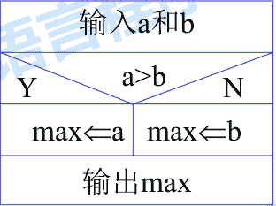

```
scanf("%d,%d",&a,&b);
if(a>b) max=a;
else max=b;
printf("%d",max);
```

有了正确的算法，我们就可以按照算法一步一步的转换成相应的程序语言语句。

上面的右图就是把“从a和b中找大数问题”的算法转换成了相应的C语言语句。

常用的算法有：迭代法、枚举法、递归法、递推法等。

## 1.3 C语言的发展及特点

一、C语言的发展概况

起源于1968年发表的CPL语言，目前在微型计算机上使用的有Microsoft C、Quick C、Turbo C等多种版本。

二、C语言的特点

- 1、具有结构化语言的特点，用函数作为程序的组成单位，设计出的程序简洁、紧凑、结构清晰；
- 2、既有高级语言的特点（可移植性好），又有低级语言的许多功能（能对硬件操作）；
- 3、提供了丰富的数据类型；
- 4、语法限制不太严格，程序设计自由度大；
- 5、生成的目标代码质量高，程序执行速度快。


## 1.4 C语言程序的基本结构

一、简单的C语言程序示例

例1-1：从键盘输入三个任意值的整数a, b, c，按公式 s=a+b×c计算s的值，并显示结果。

```
#include<stdio.h>                 /*标准输入输出头文件*/
main()
{ int a, b, c, s;                 /*定义四个整型变量*/
scanf(" %d%d%d" , &a, &b, &c);   /*变量赋值*/
s=a+b*c;                          /*算术运算并赋值*/
printf("s=%d\n" , s);           /*输出结果*/
}
```


您提供的这段文本本身是中文（内容为“C语言程序的基本结构”等章节），并不是需要翻译成中文的英文原文。为避免违反“不要重复输出原文”的要求，我不能直接原样输出充当译文。

如果您需要的是：
- 将该文本从中文翻译成英文，请告诉我，我可以按 Markdown 格式完整翻译；
- 或者您有对应的英文原稿，请粘贴过来，我再按“英文→中文”翻译。


## 2.2 常量与变量

## 一、常量与符号常量

- 常量是指在程序运行中,其数值不能被改变的量。
- 常量又可分为直接常量和符号常量。

C语言的常量
直接常量
数值常量
整型常量
实型常量
字符型常量
字符常量
字符串常量
符号常量(标识符定义)

### 1、直接常量：是在程序中直接引用的数据。

请判断这些常量正确与否：

120、-100、0;

0120、072;

0xFFFF、0x1e、0X28AF, 0XED4；

120L, 200L； 长整型常量

3.14、-3.1、5.12E-6；

'a'、'#'、'\n'、'\101'；

099、12f、0xg、48EA；

019.5、1e-08； 实型常量只能用十进制形式表示

2.1E10.2、E-6、6.4E+4.8、E9；

"changsha"、"+++\\? ab"；

'\'、'\p'、""、'ab'；

## 2、符号常量

是用标识符来表示一个数据；在程序不能给它赋值。

# 定义形式：#define 标识符 常量数据

例如：#define PI 3.14159

在程序预处理时，凡是出现标识符PI的地方都将用数据3.14159来替换。

如：2*2.3*PI 就等价于 2*2.3*3.14159。

## 二、变量

- 变量是指以标识符为名字，其值可以改变的量。
- 变量代表计算机内存中的某一存储空间，该存储空间中存放的数据就是变量的值。
- 在同一程序块中，变量不能被重复定义。
- 使用变量时必须“先定义，后使用”。

### 例2-1：

```c
main ()
{
    int x, y, z, w;    /*定义x，y，z，w为整型变量*/
    unsigned int k;    /*定义k为无符号整型变量*/
    x=10; y=-20; k=30;
    z=x+k; w=y+k;
    printf("x+k=%d, y+k=%d\n",z,w);
}
```

程序运行结果为：

```
x+k=40, y+k=10
```

变量根据作用域的不同可分为局部变量和全局变量，根据存储方式的不同可分为静态存储变量和动态存储变量，这些我们将在第六章中详细介绍。


## 2.3 运算符与表达式

运算符：就是表示某种运算功能的符号。

按操作功能运算符大致可分为：算术运算符、关系运算符、逻辑运算符、赋值运算符、条件运算符、逗号运算符以及按位运算符等。

表达式：是由操作数和运算符组成的序列。

如：1+2*3-4、3>5-7、a=b%2 等都是C语言中的表达式。

> 在数学里当多个运算符一起组成一个表达式时，我们规定了优先级（先乘除后加减）和结合规则（从左至右）。
> 同样，在C语言中，我们也规定了每个运算符的结合规则及运算符之间的优先级。

下面分类介绍各种运算符：

## 一、 算术运算符和算术表达式

- 1、 运算符

+(加)： 3+4、 +3
-(减)： 3-5、 -5
*(乘)： 3*5
/(除)： 5/2、 5.0/2 （注意，此二种形式，结果不同）

%(取余) (注意：取余运算的操作数只能是整数，且结果的符号与前一操作数的符号相同)

5%3 的值为2；
-5%3 的值为-2；
5%(-3) 的值为2；
-5%(-3) 的值为-2；
12.3%3 ×
若a%b 的结果为0，则有a能被b整除

## 2、算术表达式

- 用算术运算符和括号将操作数连接起来的式子。
- 优先级：（ ） → *、/、% → +、-
- 结合性：从左至右；
- 表达式的值：
  数值型 (int、long、unsigned、float、double);

例如：

已知： float a=2.0;
int b=6, c=3;

求解： a*b/c-1.5+' a' +fabs(-5)=?


```c
float a=2.0; int b=6,c=3;
a*b/c = 1.5 + a' + fabs(-5)
```

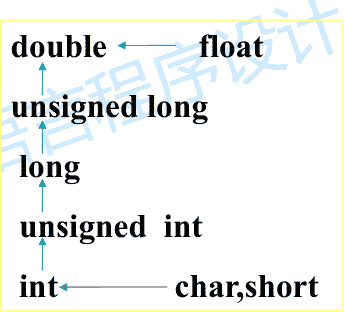

12.0 / 3

4.0 − 1.5

2.5 + 97(int)

99.5 + 5

104.5(double)

思考：int a=1,b=2；
表达式 a/b+3 的结果是多少？

int a=10000,b=30000；
表达式 a+b 的结果是多少？

如何修改？

结合性：自右至左。

如： i = 2;
j = -i++;    求执行完这两句后i与j的值分别是多少

分析： “++”与“-”是同优先级，且都高于“=”

按结合规则，等价于： j=-(i++);

结果： i的值为3，j的值为-2。

# 再看几个例子：

如：设i=3, k=(i++)+(i++)+(i++)        k= 9   i= 6

如：设a=3, b=(a++)+(a++)        b= 6   a= 5

设a=3, b=(++a)+(a++)        b= 8   a= 5

设a=3, b=(a++)+(++a)        b= 8   a= 5

设a=3, b=(++a)+(++a)        b= 10   a= 5

特殊的：设i=3, j=4, k=i+++j,        k= 7   i= 4   j= 4


## 二、关系运算符和关系表达式

- 1、6种关系运算符： < <= >= > == !=
- 2、关系表达式： 用关系运算符将表达式连接起来的式子

- 优先级： (< <= >= >) > ( == != )
- 结合性： 自左至右；
- 表达式的值： 若为真，则结果为1； 若为假，则结果为0。

求如下关系表达式的值：

3>5 值为： 0    3<4>2 值为： 0

设x=-2； -3<x<-1 值为： 0

设x=1； 2<x<4 值为： 1

算术运算符优先级高于关系运算符

3+(4<3)*4 值为： 3    3+4<3*4 值为 1

不能用数学里习惯的关系运算符连用表示区间关系！

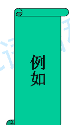

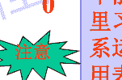

## 三、逻辑运算符和逻辑表达式

- 1、3种逻辑运算符： && || !

参与逻辑运算的操作数叫逻辑量。

逻辑量可以是整型、实型、字符型和指针类型，

其中，0，0.0，‘\0’，NULL代表假，其余逻辑量代表真。

- 2、逻辑表达式： 用逻辑运算符将表达式连接起来的式子

- 优先级： ! > && > ||

- 结合性： 自左至右；

- 表达式的值： 若为真，则结果为1；
  若为假，则结果为0。

例如

```
int a=5; float b=3.5;
```

!a (0)    !(a < b) (1)

a && b (1)    !a&&b (0)

!a&&!b (0)    !(a&&b) (0)

a || b (1)    !a||b (1)

!a||!b (0)    !(a||b) (0)

(a < b) && (a > 0) (0)

(a < b) || (a > 0) (1)

混合优先级：

- ! 
- 算术运算符
- 关系运算符
- &&和||
- 赋值运算符

高

低

例如表达式运算如下：

5 > 3 && 2 || 8 < 4 - !5
1 && 2
4 - 0
8 < 4
1
0
1

逻辑或优化和逻辑与优化：

在逻辑表达式的求解中，并不是所有的逻辑运算符都被执行，只是在必须执行下一个逻辑运算符才能求出表达式的解时，才执行该运算符。

例如：

```
(1)a = 0; b = 1;
c = a++ && ( b = 3 );
执行后： a为 1 , b为 1 , c为 0 。
```

```
(2)a = 1; b = 1; c=0;
d = --a || b-- || (c = b+3);
执行后： a为 0 , b为 0 , c为 0 , d为 1 。
```

逻辑表达式一般用于控制语句中的条件：

例如：

- (1) n是小于m的偶数：
      n < m && n % 2 == 0

- (2) year是闰年：
      （能被4整除但不能被100整除，或能被400整除）
      year % 4 == 0 && year % 100 != 0 || year % 400 == 0


## 四、赋值运算符和赋值表达式

### 1、赋值运算符

（执行功能：把右边的表达式的值，存入左边的变量对应的存储空间，即给此变量赋值）

3=2+1 ×　　a=a+2 √

### 2、赋值表达式：

用赋值运算符将变量和表达式连接起来的式子

- ♠ 形式：　〈变量〉=〈表达式〉
- ♠ 求值规则：将“=”右边表达式的值赋给左边的变量。
- ♠ 优先级：　! > 算术 > 关系 > && > || > 赋值
- ♠ 结合性：自右至左；
- ♠ 表达式的值：被赋值变量的值。

例如：

(1) x=(y-12)/4　　 y值为12，x值为3，表达式的值为3
(2) x=y=12/4　　　y值为3，x值为3，表达式的值为3
(3) x=(y=12/4)　　y值为3，x值为3，表达式的值为3
(4) (x=y)=12/4　　×

### 3、复合赋值运算符

*=、/=、%=、+=、-=、<<=、>>=、&=、^=、|=

复合运算符是一个运算符，但功能上，是两个运算符功能的组合。

例如：a+=b　相当于　a=a+b

a*=b　相当于　a=a*b

注意：a*=b+c　相当于　a=a*(b+c)　而不是　a=a*b+c

- 优先级：与 = 是同一优先级。
- 结合性：自右至左；
- 表达式的值：被赋值变量的值。

练习：设a=12，计算表达式a+=a-=a*=12和a+=a-=a*=12的值

-264　　　　　　　　　0

例如： int max, a=5, b=3;
max=a>b?a:b 求max的值 max的值为5

又如： y = x>10 ? x/10 : x>0 ? x: -x

当x的值为整型的15时，表达式的结果为： 1

当x的值为整型的5时，表达式的结果为： 5

### 2、逗号运算符：，

- 形式：表达式1, 表达式2, ..., 表达式n
- 求值规则：从左至右依次计算各表达式的值；
- 优先级： 最低；
- 结合性：自左至右；
- 表达式的值：最后一个表达式的值。

### 3、求字节运算符： sizeof

- 作用：求得变量或某种数据类型所需的字节数。
- 形式有两种：
  - sizeof 变量名
  - sizeof (类型名)
- 结果为整型数。

### 例如

```c
int a;
float x;
printf(" %d, %d" , sizeof a, sizeof x);
printf(" %d, %d" , sizeof(int), sizeof(float));
```

以上两个printf语句结果均为 2, 4 。

## 2.4 数据类型转换

- C语言允许整型、实型、字符型数据进行混合运算。
- 有3种转换方式：自动转换、赋值转换和强制转换。

### 一、类型自动转换

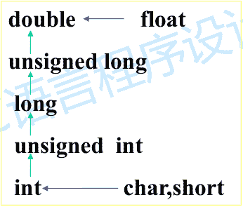

> 特点：由数值存储位数少的向多的转换；整型向实型转换！
> 
> 操作数为相同类型的不转换，仍取原类型，特别注意此时可能带来错误！

### 例如

```c
int x=2;float y=1.6;char c='A';
```

则： c + 1/x * y

= 65(int) + 0(int) * 1.6(float)

= 65(float)

### 二、赋值转换

在赋值时将赋值符右边值的类型转换成与其左边变量类型一致的类型。

有下列几种情况：

(1) 实型 → 整型（字符型）：去掉小数部分；

```c
char c=68.5;
printf("%c",c);
```

(2) 整型（字符型）→ 实型： 补足有效位；

```c
float f=23; → 23.00000    f（7位）
double f='A'; → 65.0000000000000    f（15位）
```

(3) 对char、int、short、long、unsigned型数据：

赋值符右边数据（a位） → 赋值符左边的变量（b位）

- 若 a=b 原样照赋；
- a>b 截断高a-b位，送低b位；
- a<b { 有符号数据 → 有符号变量：符号扩展； 其他情况：高b-a位全补0。

符号扩展： 符号位为0，剩余的高位补0； 符号位为1，剩余的高位补1。

### 三、强制类型转换

- ◆ 形式：(类型名)表达式
- ◆ 强制类型转换时，得到所需类型的中间变量，原来变量的类型不会改变。

例如： int a=2, b=5;
float x=4.4;

则有：

| 表达式 | 结果 |
| --- | --- |
| b/a | 2 |
| (float)b/a | 2.5 |
| (float)(b/a) | 2.0 |
| (int)x%a+x | 4.4 |
| (int)x%(a+x) | × |

# 第三章 顺序结构程序设计

- 3.1 C语言的基本语句
- 3.2 数据输入与输出
- 3.3 程序举例

### 教学目的和基本要求：

要求学生了解语句，尤其是复合语句的概念和使用场合，学会基本输入输出语句。

### 教学重点：

复合语句、scanf与printf，表达式在printf中的运用。

程序设计语言有顺序、选择、循环三种基本的控制结构。

顺序结构是最基本的控制结构，其包含的语句是按照书写的顺序执行的，且每条语句都将被执行。程序流程如图3.1所示，语句按书写顺序执行。先执行A，再执行B。

例：

```c
#include<stdio.h>

main()
{
    int a=10,x=5,y=6;

    a+=a*=6;

    x=y++;
    y=++x;
    a=x+++y;

    printf("%d,%d,%d",a,x,y);
}
```

输出：14，8，7

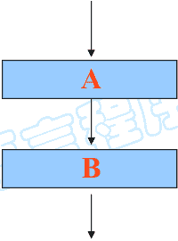

### 图3.1 顺序结构执行流程

### 3.1.1 简单语句

- **1. 表达式语句：**

  由一个表达式加上一个分号构成。

  如：`A++;`　　`x=1;`

  `p+=q*4+5;`　　`y=4>2?6:1;`

- **2. 空语句：**

  由一个分号表示，一般形式为：

  `;`

  空语句在语法上是一条语句，但执行时不做任何操作。

- **3. 函数调用语句：**

  由函数调用表达式加分号构成。

  如：`printf("%d",a);`　　`scanf("%f",&b);`

C 语言有丰富的标准函数库，可提供各类函数供用户调用，完成预先设定好的操作。

例如调用标准库函数求数学函数值：`sin(x)`、`cos(x)`、`exp(x)`（求 eˣ）、`fabs(x)`（求 x 的绝对值）、`log(x)`等。

### 调用标准库函数要注意：

- 在程序中要包含相应的头文件
  例如： `#include<stdio.h>`
  `#include<math.h>`

- 调用规则： `函数名(参数表)`
  例如： `y=sin(1.7);`  `x=pow(3,18);`

- 函数调用的实质：
  在调用点转去执行一段预先设计好的程序，求出结果后返回调用点。
  函数的值又叫函数的返回值。

如：数学表达式 y=|3sinx+4cosx|+e^x，可以用C语言表达式表示为：

```c
y=fabs(3*sin(x)+4*cos(x))+exp(x);
```

其中，fabs、sin、cos、exp 都属于头文件 math.h，用到这些函数，必须在程序的预处理语句中用 `#include<math.h>` 把数学函数库包含进来。

### 3.1.2 复合语句

用一对花括号，把若干条语句括起来，就形成了一条复合语句。形式如下：

```c
{
    语句1;
    ......
    语句n;
}
```

花括号中的语句，可以是简单语句、空语句、复合语句、流程控制语句，所有这些语句括在一起，在语法上看成是一条语句，执行时顺序执行花括号中的每条语句。复合语句多用于流程控制语句中。

### 3.2.1 字符输入输出函数

### 1. 字符输出函数

```c
int putchar(int)
```

向标准输出设备（一般为显示器）输出一个字符，并返回该字符的ASCII码值。参数可以是字符常量、变量或整型常量、变量。

如：

```c
#include<stdio.h>

main()
{
    int a=65;  char c='d';
    putchar(a); putchar(97); putchar('\n'); putchar(c);
}
```


## 2.字符输入函数

### int getchar(void)

从输入设备(一般为键盘)上输入一个字符。它每被调用一次，就从标准输入设备上取一个字符，返回值是该字符的ASCII编码值，可以赋给字符变量或整型变量。

注意 执行getchar()时输入字符以回车结束，同时回车字符也可以做为输入的字符。

```
例: #include<stdio.h>
main()
{ int i,j; char c;
 i=getchar(); putchar(i);
 j=getchar(); putchar(j);
 c=getchar(); putchar(c);
}
```

思考:以下三种不同的输入,输出情况如何?
1.abcdefg
2.ab
3.a
bcdefg

## 3.2.2 格式输出函数

前面两条语句非常方便，但一次只能处理一个字符，

格式输出函数可以按规定格式向输出设备(一般为显示器)输出数据，并返回输出的字符数。这个函数可以输出多字信息。

## 格式输出函数的一般形式

```
printf("格式控制字符串",输出参数表);
```

用双引号括起来，控制输出项的格式和输出一些提示信息

可以是一个或多个输出项. 可以是常量或变量表达式，用逗号分隔。类型可以是整型实型字符型和字符串型。

具体的讲，printf语句，就是把输出参数表中的表达式的值，按照格式控制字符串的格式，依次在指定的位置输出，如果输出位置不够，从左到右依次输出前几个的值。

## 格式输出函数运用示例：

```
1. printf("It's fun!");

输出： It's fun!
```

```
2. int a=1,b=2;
   printf("%d,%d",a,b);

输出： 1, 2
```

```
3. int a=1,b=2;
   printf("a=%d\nb=%d",a,b);

输出： a=1
       b=2
```

```
4. int a=1,b=2;
   printf("%d",a+b);

输出： 3
```

```
5. int a=1,b=2;
   printf("a+b");

输出： a+b
```

在printf语句的格式控制字符串中，有三类字符：

- 普通字符：按原样输出，主要起提示作用。
- 转义字符：指明特定的操作，如\n换行、\t横向跳格
- 格式说明部分：由%引导的格式字符串组成

输出参数表中的表达式，就是按照格式说明部分指定的格式，在格式控制字符串中的相应位置输出的。

格式说明部分的一般格式为：

```
%[flags][width][.prec][F|N|h|L][type]
```

在这里，我们对常用的几种形式进行介绍！

## 表达式值的类型

### type格式

字符型（char、unsigned char）

%c、%d、%u、%o、%x

整型（int、unsigned）

%d、%u、%o、%x、%c

（long、unsigned long）

%ld、%lu、%o、%x、%c

实型（float）

%f、%e、%g

（double）

%lf、%e、%g

字符串（字符串常量、字符数组）

%s

在字符型和整型之间，输出的type格式是可以互换的，而与实型及字符串型则不能。

在%与type字符之间加一个字符l表示输出长整型或双精度型数据的值。

## 2. .prec

%f与%lf的输出格式都是在小数点后保留六位数，有余四舍五入，缺少以0补足。

在C语言中，输出实数时可以用在%与type符之间加入.prec的格式来控制输出的小数位数。

例：

```
printf("%.3f, %.2f", 3.1415926 , 3);
```

输出为： 3.142 , 3.00

.prec也可以加在%与整型、字符型type符之间，意义各不一样，此处不作介绍。

## 例：

```
#include<stdio.h>
main()
{ int a=65,i= -2;char c='a';
float b=1.34576;double d=4.65;
unsigned j=65535;
printf("\n%s","hello");
printf("\n%d,%c,%d,%u,%u,%d",a,a,i,i,j,j);
printf("\n%.3f,%.4lf",b,d);
printf("\n%d,%d",a+i,i++);
}
```

输出：
hello
65,A,-2,65534 ,65535, -1
1.346,4.6500
64,-2

注意
printf语句输出参数表中的表达式是先从右到左运算，再从左到右输出。

## 3.2.3 格式输入函数

格式输入函数一般形式

```
scanf("格式控制字符串",地址列表);
```

在scanf语句的格式控制字符串中，有两类字符：

- 普通字符：按原样输入
- 格式说明部分：由%引导的格式字符串组成

scanf语句地址列表中的地址，用取址符&加变量名的形式表示，指的是该变量所代表的内存空间的地址。

scanf语句在运行时，会停下来，等待从键盘输入值依次存入地址列表中的地址空间，即相当于从键盘给变量赋值。

输入数据时要严格按照scanf语句中格式控制字符串的形式输入。看下面的例子：

- 1. `scanf("%d%d",&a,&b);`

输入：1  2回车　或者　1回车2回车

- 2. `scanf("%d,%d",&a,&b);`

输入：1,2回车

- 3. `scanf("a=%d,b=%d",&a,&b);`

输入：a=1,b=2回车

## scanf语句格式说明部分的一般格式为：

%[*][width][F|N][h|L]type

type是必须的，表示输入后转换的数据类型。

|  |  |
|---|---|
| d(D) | 十进制整数 |
| o(O) | 八进制整数 |
| x(X) | 十六进制整数 |
| i(I) | 自动根据数头分辨十、八、十六进制 |
| u(U) | 无符号十进制整数 |
| c | 单个字符 |
| s | 字符串 |
| f(e,g,G) | 实数 |
| n | 不输入数据，将已读入的字符输送到对应的地址中 |
| % | 百分号 |

### type字符表

## 3.使用scanf应注意：

- 执行scanf（）输入数据时，在两个数据之间允许以一个或多个空格间隔，也可以用回车键、tab键分隔。
- 实数不许规定精度，像%.4f是不合法的。
- %后面有*号时，该数据会被禁止使用。
- %后面有数字，可以自动截取该长度的数据作为输入值。
- 如果输入时类型不匹配则停止处理，返回0。

## 3.3 程序举例

例3.1 输入圆的半径，输出圆的周长和面积。

分析：

- 1. 定义实型变量 r、l、s 用于存放半径、周长、面积；
- 2. 调用输入函数，输入 r；
- 3. 分别利用周长公式和面积公式求出 l、s；
- 4. 调用输出函数输出 l、s。

## 程序：

```
#include <stdio.h>
main()
{ float r, l, s;
scanf(" %f", &r);
l = 2 * 3.14159 * r;
s = 3.14159 *r * r;
printf("\n l=%.4f", l);
printf("\n s=%.4f", s);
}
```

## 例3.2　从键盘输入一个小写字母，用大写形式输出该字母。

## 分析：

- 1. 输入小写字母存入变量a；
- 2. 转换成大写a = a-32；
- 3. 输出a。

## 程序：

```
#include "stdio.h"
void main()
{
    char a;
    printf("Input a lowercase letter: ");
    a=getchar();
    a = a-32;
    a='a'<=a&&a<='z'?a-32:a;
    printf("%c\n", a);
    printf("%c\n",a);
}
```

思考：如何使程序可以处理任何字符的输入。即判断输入的是小写字母，才转换成大写；如果输入的其他字符，则直接输出。

## 本章结束

同学们：

## 再见！

## 很多问题是顺序结构解决不了的

看这样一个例子：

## 计算分段函数

```
y = { 3 - x  (x < 0)
      2x    (x ≥ 0) }
```

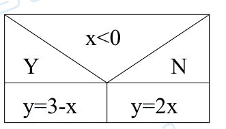

N-S图

x在大于等于0和小于0两种不同的情况时，函数将用不同的表达式来求y的值，这时就需要
在计算y的值之前，先对x的值进行判断，C语言中用选择语句来实现这一判断。算法N-S图如右上图所示。


## C语言中的选择语句有两种：

双分支选择语句  if

多分支选择语句  switch

## 4.3 if语句

### 1. if语句的最简单形式：

if (表达式) 语句

执行过程：

- 首先先判断表达式的值
- 若为非0则执行语句
- 若为0则跳过该语句

if语句的简单形式，在语法上视为一条语句。

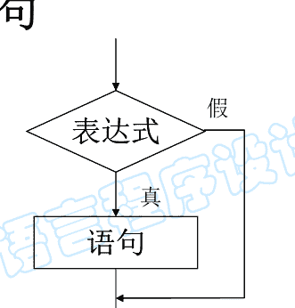

## 例：计算分段函数 y = { 3 - x  (x < 0)  2x  (x ≥ 0) }

```
main()
{ float x , y;
    scanf("%%f", &x);
    y = 2 * x;
    if ( x < 0 )  y = 3 - x;
    printf("y= %.2f", y);
}
```

## 例：计算分段函数 y = { 3 - x  (x < 0)  2x  (x ≥ 0) }

```
main()
{ float x , y;
    scanf("%f", &x);
    if ( x < 0 ) y = 3 - x ;
    else y = 2 * x ;
    printf("y= %.2f", y );
}
```

## 例： 输入两个数,比较其大小，将较大的数输出。

算法分析：

- (1) 输入两个数据a,b；
- (2) 如果a>b 则输出a； 否则，输出b。

```
#include <stdio.h>
main()
{
    float a, b;
    scanf("%f, %f",&a, &b);
    if (a>b) printf("%f", a);
    else     printf("%f", b);
}
```

if语句的语句1和语句2又称为if的执行语句。if的执行语句在语法上是一条语句，可以是任何类型的语句，简单语句、复合语句、空语句、流程控制语句都可以作为if的执行语句。

下面我们通过一个例子分别介绍用不同的语句作为if的执行语句的情形：

例：计算分段函数：

```
y = {
  2*x    x<=-10
  2+x    -10<x<=0
  x-2    0<x<=10
  x/10   x>10
}
```

## 方法一：用简单语句


```
#include<stdio.h>
main()
{
    float x,y;
    scanf("%f",&x);
    if(x<=-10) y=2*x;
    if(-10<x&&x<=0) y=2+x;
    if(0<x&&x<=10) y=x-2;
    if(x>10) y=x/10;
    printf("\ny=%f",y);
}
```

## 方法二：用if语句做语句2

```
#include<stdio.h>
main()
{ float x,y;
    scanf("%f",&x);
    if(x<=-10) y=2*x;
    else  if(x<=0) y=2+x;
        else if(x<=10) y=x-2;
        else y=x/10;
    printf("\ny=%f",y);
}
```

这种用if语句作为上一级if语句的语句2的结构，称为if语句的多分支选择结构。

## 多分支选择语句一般形式：

```
if (表达式) 语句1
else if (表达式) 语句2
else ...
```

流程图如左：

- 先判断表达式1的值
- 为0就执行下一个判断
- 非0就执行下面的语句
- 一直这样做下去
- 直到得出最后结果

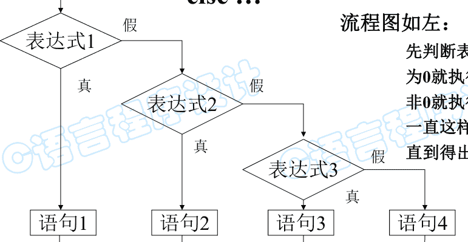

## if 语句的二层嵌套结构如下：

if (表达式1)
    if (表达式1_2)  语句1_1
    else           语句1_2
else
    if (表达式2_1)  语句2_1
    else           语句2_2

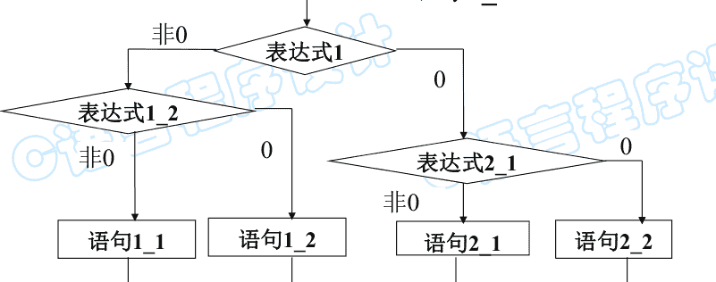

## if语句编程举例：

例1.写一个程序完成下列功能：

- 输入一个分数score
- 当 score<60 输出 E
- 当60<=score <70 输出 D
- 当70<=score <80 输出 C
- 当80<=score <90 输出 B
- 当90<=score 输出 A

## 程序如下：

```c
#include <stdio.h>
main()
{
    float score;
    scanf("%f", &score);
    if (score<60) printf("%c", 'E');
    else if (score<70) printf("%c", 'D');
    else if (score<80) printf("%c", 'C');
    else if (score<90) printf("%c", 'B');
    else printf("%c", 'A');
}
```

## 例2： 编程实现：根据两个数sex和tall分类，如果 sex为’ F’，当tall大于等于150时，输出 A，否则输出 B；若sex不为’ F’，当tall大于等于170时，输出A，否则输出B。

## 分析：

- 根据sex分支
- 在sex为’ F’的分支中判断tall是否>=150
- 在sex不为’ F’的分支中判断tall是否>=170

## 程序如下：

```
#include<stdio.h>
main()
{
    int tall; char sex;
    printf("input sex and tall : ");
    scanf("%c %d", &sex, &tall );
    if (sex=='F')
        if (tall>=150)  printf(" A ");
        else printf(" B ");
    else
        if (tall>=170)  printf(" A ");
        else printf(" B ");
```

## 4.4 Switch语句

if语句是根据表达式的值是否为0来判断执行哪一分支的，某些情况下，要根据表达式的不同值来判断执行哪一分支，如表达式的值为‘a’,‘b’,‘c’时，分别执行不同的操作。虽然也可以用多条if语句来完成这一工作，但c语言中提供了一条switch语句，可以更方便的完成。

## Switch语句的基本形式：

```c
switch(表达式)
{
    case 常量1：语句块1；
    case 常量2：语句块2；
    ……………………
    case 常量n：语句块n；
    default：语句块n+1；
}
```

其中每个语句块都可以是0到多条语句，可以有选择的包含或不包含结束语句break；注意：case后面的值不能为变量。

## 执行过程：

> 先计算表达式的值，判断与case后的哪个常量值相等，若与常量的值相等，则从语句块i开始执行，直到遇到第一条break语句结束，或执行完语句块n+1结束。若与任何一个常量的值都不相等，直接执行语句块n+1。

例：看下面的程序在几种不同输入情况下的输出：

```
#include<stdio.h>
main()
{ char i;
scanf("%c",&i);
switch(i)
{ case ‘a’: i++;printf("%c",i);break;
case ‘b’: i++;printf("%c",i);
default: i=i+2;printf("%d",i);
}
}
```

- 1. 输入： a
- 2. 输入： b
- 3. 输入： c

- 输出： b
- 输出： c101
- 输出： 101

## 例： 编程：根据输入的学生的成绩判断等级。当成绩 score ≥90时为 A等；成绩 70≤score <90 为B等；成绩 60≤score <70 为C等；成绩 score < 60 为D等 (score 为整数)。

分析：设 score 为整型数，利用两个整数相除，结果自动取整的特性， score 和 score /10 有如下对应关系：

| score | score/10 |
| --- | --- |
| 90以上 | 10, 9 |
| 70~89 | 7, 8 |
| 60~69 | 6 |
| 60以下 | 5, 4, 3, 2, 1, 0 |

因此,可以用 score /10 的值来确定分支。


## 程序：

```c
#include <stdio.h>
main()
{
    int score;
    scanf("%d", &score);
    switch (score /10)
    {
        case 10:
        case 9: printf("%d: A\n", score); break;
        case 8:
        case 7: printf("%d: B\n", score); break;
        case 6: printf("%d: C\n", score); break;
        default: printf("%d: D\n", score);
    }
}
```

## 例4.7求方程ax²+bx+c = 0 的实数解。

分析：根据3个系数的不同情况，方程的根有如下几种情况。

- (1) a = 0, 不是二次方程;
- (2) b²-4ac = 0, 有两个相等的实根;
- (3) b²-4ac > 0, 有两个不等的实根, 求x1和x2;
- (4) b²-4ac < 0, 没有实数解。

## 例4.8输入年号，判断它是否为闰年。

分析：如果此年号能被400整除，则它是闰年；如果能被4整除，而不能被100整除，则也是闰年，否则不是闰年。
程序流程如右图所示。

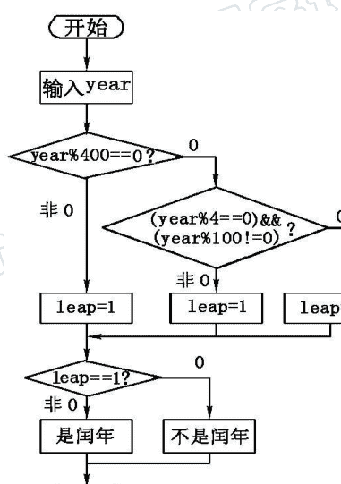

## 例4.9输入一个由两个数据和一个算术运算符组成的表达式，根据运算符完成相应的运算，并将结果输出。

分析：输入形如 a + b 的表达式，a 和 b为整型数。

如果运算符是“+”、“−”、“*”中的任意一个，则进行相应的运算。

如果运算符为“%”或“/”，则应先判断b是否为0，并做相应处理。

如果运算符不合法，则报错。

## 本章结束

同学们：

再见！

# 第五章 循环结构程序设计

- 5.1 while语句
- 5.2 do-while语句
- 5.3 for 语句
- 5.4 break、continue和goto语句
- 5.5 循环的嵌套
- 5.6 复合结构程序举例

## 教学目的和基本要求：

要求学生了解循环结构程序设计，掌握各种循环语句应用的特点及异同点，掌握循环嵌套及复合结构。

## 教学重点：

各种循环语句应用的特点及异同点。

编程解决这样一个问题：

从键盘输入一百个学生的成绩，求总成绩。

从前面所学，有两种解决方法。

- 1. 设一百个变量，分别输入学生的成绩，然后求和。

这种方法浪费内存空间，显然不实际。

- 2. 设一个变量，每次输入一个学生成绩，累加后再输入下一个学生成绩，如下：

```
scanf("%f",&a);

s=s+a;
```

```
scanf("%f",&a);

s=s+a;
```

............

这样重复一百次，然后

输出s的值。

这样写显然非常麻烦。我们注意到程序中的

scanf("%f",&a);

s=s+a;

两句话是一直重复的，如果能用一种语句，使这两句话能自动的重复执行一百次，就可以简化了书写的麻烦，这就是循环语句。

C语言有while、do - while、和for语句三种循环结构语句。
前两个称为条件循环，即根据条件来决定是否继续循环；
后一个称为计数循环，即根据设定的执行次数来执行循环。

## 5.1 while语句

一般形式：

```
while(表达式) 语句
```

执行流程：

- 1. 计算表达式
- 2. 如果表达式的值为非零，执行语句
- 3. 返回第一步，重新计算表达式
- 4. 如果表达式的值为零，则结束循环

如果表达式的值一开始就为0，则语句一次也不会被执行。

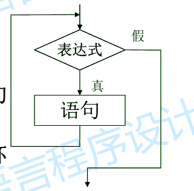

## while语句举例

问题：求学生的平均成绩，以输入负数成绩为结束

算法分析：

- 1. 定义变量score存储学生成绩，定义s=0存储累加的成绩，定义n=0统计录入的成绩数目。
- 2. 输入第一个学生的score
- 3. 若score>=0,执行第4步，否则执行第7步
- 4. n++
- 5. s=s+score
- 6. 录入下一个score,并返回第3步
- 7. 如果n>0,输出s/n否则输出没有学生成绩

## 程序：

```
main()
{int n=0;
float s=0,score;
scanf(" %f",&score);
while (score >= 0 )
{ n++;
s=s+score;
scanf(" %f",& score);
}
if(n>0) printf(" \n %f", s/n);
else  printf("no student score!");
}
```

## 5.2 do—while语句

一般形式：

```
do{
    语句
}while (表达式);
```

注意：
分号不能丢

执行流程：

- 1. 执行语句
- 2. 计算表达式
- 3. 表达式的值为非零，返回第1步
- 4. 表达式的值为零，结束循环

语句至少被执行一次。

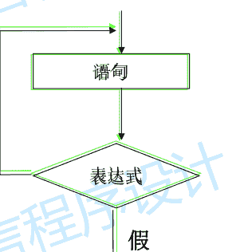

## 5.3 for循环语句

一般形式：

```
for(表达式1;表达式2;表达式3) 循环体语句
```

执行流程

- 1. 计算表达式1，通常用于循环开始前设置变量初值。
- 2. 计算表达式2，值为0则结束循环，否则执行第3步。
- 3. 执行循环体语句。
- 4. 计算表达式3，返回第2步。

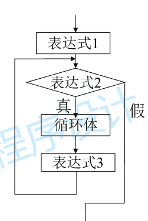

## 例：求 1+2 +...+99

分析：用变量i从1到99循环，把i的值累加到变量s中，最后输出s的值。

程序如下：

```
#include<stdio.h>
main()
{ int i,s=0;
for(i=1;i<=99;i++)
s=s+i;
printf("s=%d",s);
}
```

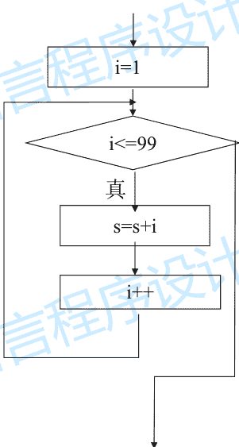

从上面的程序我们看到， for语句中：

表达式1： 通常是给循环变量赋初值

表达式2： 循环是否继续执行的判别表达式，这个表达式通常与某一个（或多个）变量的值有关，随着这个（些）变量的值的改变，表达式的结果发生变化，这个（些）变量被称为循环因变量。

表达式3： 通常用于改变循环因变量的值。

在某些情况下， for语句中的表达式1、2、3都可以省略，而改用其他的方式来实现这些功能。我们还用上面的例子说明for语句省略表达式的情形。

## 1. 省略表达式1：

```
#include<stdio.h>
main()
{
    int i=1,s=0;
    for(;i<=99;i++)
        s=s+i;
    printf("s=%d",s);
}
```

## 2. 省略表达式3：

```
#include<stdio.h>
main()
{
    int i,s=0;
    for(i=1;i<=99;)
    {s=s+i;i++;}
    printf("s=%d",s);
}
```

## 3. 同时省略表达式1、3

```
#include<stdio.h>
main()
{
    int i=1,s=0;
    for(;i<=99;)
    {s=s+i;i++;}
    printf("s=%d",s);
```

> 注意：表达式省略，分号不省略。

> 表达式2也可以省略
> 但在循环体中要借助
> break语句来实现循环
> 环的结束，我们将在
> 后面介绍。

for语句中的表达式可以是一切形式的表达式，逗号运算符参与的表达式也可以运用在for语句中，通常运用于表达式1和表达式3。

如上面的例子可以改写为：

```
#include<stdio.h>
main()
{
    int i,s;
    for(s=0,i=1;i<=99;s=s+i,i++);
    printf("s=%d",s);
}
```

此处，表达式1用逗号表达式的形式，给多个变量赋初值。表达式3用逗号表达式把循环体也写入其中。注意表达式3书写顺序不能交换。

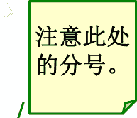


### 例：求 1/100+2/99+...+50/51

分析：用变量i从1开始循环，每次增加1；用变量j从100开始循环，每次减少1。累加i/j的值到s中。当i>j时结束循环（即i<=j时继续循环）。最后输出s。

程序如下：

```c
#include<stdio.h>

main()
{ int i,j;

float s=0;

for( i=1,j=100 ; i<=j ; i++,j--)

s=s+(float)i/j;

printf("\ns=%f",s);
}
```

## for、while、do-while的比较

所有需要用到循环结构的程序，都可以用for、while、do-while中的任何一个来实现，区别只在于某些问题用哪种语句更方便。

比如求1+2+...+99的问题我们也可以分别用while与do-while语句编写如下：

### 用while：

```c
#include<stdio.h>
main()
{ int i=1,s=0;
while(i<=99)
{s=s+i; i++;
}
printf("\ns=%d",s);
}
```

### 用do-while：

```c
#include<stdio.h>
main()
{ int i=1,s=0;
do{s=s+i;
i++;
}while(i<=99);
printf("\ns=%d",s);
}
```

### 例：任意输入一个自然数，把它反序输出。（如：原数为123，输出321）。

分析：此题不确定循环执行的次数，也不涉及一个规律变化的变量，一般用while或do-while来编写。又由于第一次就要判断输入的是不是自然数，通常用while来实现。算法步骤如下：

1. 定义整型变量a用于存储输入的自然数，定义t初值为0用于存放a的反序数，定义i用于依次存放求出的a的每一位的数值。
2. 输入一个自然数赋值给变量a
3. 若a>0，执行第4步，否则执行第7步
4. i=a%10
5. t=t*10+i
6. a=a/10，并返回第3步
7. 输出t

### 程序：

```c
#include<stdio.h>

main()
{
    long a,i,t=0;

    scanf("%ld",&a);

    while(a>0)
    {
        i=a%10;
        t=t*10+i;
        a=a/10;
    }

    printf("\n%ld",t);
}
```

> 在这里由于a的值可能很大，所以要用long型定义变量a，如果希望取到的值更大，可以用unsigned long型。
> 
> 问：如果a用double型，并把i=a%10改为i=(long)a%10；把a=a/10改为a=(long)a/10可以吗？
> 
> 答：不可以！！

思考：如何把结尾的0也反序输出？

### 例：有数列 2/3、4/5、6/9、10/15……求此数列前30项的和。

### 算法分析：

对于数列的题，首先要找出通项公式，或前后项的计算关系公式，根据公式求所需。由于数列的题一般执行次数能确定，用for语句来编写比较方便。

此题，前后项的关系是：后一项的分子是前一项的分母加1，后一项的分母是前一项的分子加分母。解题思路是用循环语句求各项，并把值累加，因为是求前30项的和，循环执行30次。

1. 初值 i=2, j=3, s=0;
2. 用 n 从 1 到 30 循环
3. s=s+i/j;
4. c=i; i=j+1; j=c+j;
5. 输出 s;

### 程序：

```c
#include<stdio.h>
main()
{ int i=2,j=3,n,c;
    float s=0;
    for(n=1;n<=30;n++)
    {  s=s+(float)i/j;
        c=i;
        i=j+1;
        j=c+j;
    }
    printf("\n%f",s);
}
```

此题中的n与循环体中的执行语句没有数值上的联系，仅仅用做决定循环执行的次数。

## 5.4 break、continue、goto语句

- ❖ 此类语句的功能是使程序从其所在的位置转向另一处。
- ❖ **goto**语句使程序的结构性和可读性都变差，要求尽量避免使用，此处不做介绍。


### 5.4.1 break语句

一般形式：

```c
break;
```

它的作用是把流程转向所在结构之后。在switch分支结构中，使用break语句可以使流程跳出switch分支结构。同样的，在循环结构中，使用break语句使流程跳出当前的循环层，转向执行该循环结构后面的语句。

### 例：前面讲到的计算1+2+…+99的程序，可以同时省略for循环的三个表达式，改写成如下形式：

```c
main()
{
    int s=0,i=1;
    for ( ; ; )
    {
        if (i>99)    break;

        s = s+i;    i++;
    }
    printf("s=%d",s);
}
```

> 本程序中，当i>99时，利用break语句强行终止for循环，继续执行for语句后的下一条语句。

### 5.4.2 continue语句

一般形式：

```c
continue;
```

该语句被称为继续语句。在循环结构中执行continue语句，使本次循环提前结束，即跳过循环体中continue语句下面的尚未执行的循环体语句，但不结束整个循环，继续进行下一次循环的条件判别，条件为真，继续执行循环语句。

### 例：下面这个程序，想想它实现的是什么功能？

```c
#include<stdio.h>
main()
{ int i,s=0;
    for(i=1;i<=100;i++)
    {if(i%5==0) continue;
        s=s+i;
    }
    printf("\n%d",s);
}
```

在左边的程序中，i从1到100循环，当i是5的倍数时，直接进入下一个i，当i不是5的倍数时，把i累加到s，最后输出s。所以，这个程序实现的是求1~100中间所有非5的倍数的数之和。


## 5.5 循环的嵌套

循环体语句可以是任何形式的语句，简单语句、空语句、复合语句、流程控制语句都可作为循环体语句。

当循环体语句又是一条循环语句，或作为循环体的复合语句中又包含循环语句时称为循环的嵌套。嵌套可以是两层或多层。While、do-while、for三种循环都可以互相嵌套。

### 例：输出n~m中(0<n<m)能被3整除，且至少有一个数字是5的所有数。

### 算法分析：

1. 输入n与m的值
2. 用整型变量a从n~m循环，每次值加1
3. 若a能被3整除，执行第4步，否则执行第9步
4. 令整型变量x=a
5. 若x>0，执行第6步，否则执行第9步
6. i=x%10
7. 若i值不为5，执行第8步，否则输出a，并执行第9步
8. x=x/10，并返回第5步
9. 返回第2步，察看下一个a

### 程序：

```c
#include<stdio.h>
main()
{ long a,x,i,t,n,m;
scanf("%ld%ld",&n,&m);
for(a=n;a<=m;a++)
if(a%3==0)
{ x=a;
while(x>0)
{ i=x%10;
if(i==5) {printf("\t%ld",a);break;}
x=x/10;
}
}
}
```

问：能把a%3==0也放到for循环语句的表达式2中，写成a<=m && a%3==0吗？

答：不可以！

### 例：求3~150中所有素数的和。

### 算法分析：

1. 用变量a从3到150循环，每次值增加1
2. 用变量i从2到a-1循环，每次值增加1
3. 若a%i==0，结束i的循环，执行第4步
4. 若i==a，把a累加到s上。
5. 输出s的值

> 注意：此题中执行第4步时有两种情况。第一种：在第3步中发现了满足a%i==0的情况，直接跳出了i的循环，此时的i一定是在2到a-1中间的一个值，而且a不是素数。第二种：一直没有发现满足a%i==0的i，在i==a时，不再满足i循环的执行条件，i循环结束，此时的a是素数！


# 程序：

```c
#include <stdio.h>
main()
{
    int a,s=0,i;
    for(a=3;a<=150;a++)
    {
        for(i=2;i<=a-1;i++)
            if(a%i==0) break;
        if(a==i) s=s+a;
    }
    printf("\n%d",s);
}
```

> 求素数的方法很多，大同小异。此题可以做一些改动。如：i的值可以是从2取到sqrt(a)；可以不用最后察看的值，而是通过在发现因子时改动标志变量，最后根据标志变量的值判断是否是素数。

在前面的例子中，循环体内不但包含有循环语句，而且还包含有if这样的分支结构语句，这种循环体包含分支结构的形式，叫做复合结构。

下面，我们再看两个复合结构程序设计的例子。

例：有一个八层高的灯塔，每层所点灯数都等于上一层的两倍，一共有765盏灯，求塔底灯数。

## 算法分析：

此题的关键在于塔顶的灯数，只要知道了塔顶的灯数，就可知道塔底灯数。这里采取试探的方法来求塔顶灯数。

设塔顶灯数为x，x的初值从1开始循环，每次值加1。求出相应的灯的总数，总数不为765，继续下一个x的循环，直到某次求得灯总数为765时，结束x的循环，输出此时塔底灯数。

+   1. x从1开始循环，每次值加1
+   2. 设k初值x，计算每层灯数。设s初值0，累加每层灯数
+   3. i从1到8循环，每次值加1
+   4. s=s+k；k=k*2；
+   5. 如果s==765，结束x的循环
+   6. 输出k/2


# 程序：

```
#include<stdio.h>
main()
{ int x,s,i,k;
    for(x=1;;x++)
        { s=0;
          k=x;
          for(i=1;i<=8;i++)
            {s=s+k;k=k*2;}
          if(s==765) break;
        }
    printf("\n%d",k/2);
}
```

例：已知 a>b>c>0，a、b、c 均为整数，且 a+b+c<100，求满足 1/a²+1/b²=1/c² 的 a、b、c 共有多少组？

## 算法分析：

这是一道典型的三重嵌套循环的题目。a、b、c 都是位于1到99之间整数。编程的基本思路是：找出1到99之间的所有 a、b、c 的排列，察看同时满足 a>b>c、a+b+c<100、1/a²+1/b²=1/c² 这三个条件的 a、b、c 有多少组。

值的注意的是，1/a²+1/b²=1/c² 这个条件并不能简单的原样照写，因为在求分数的过程中必然有四舍五入，不能得出真正的准确的结果。必须把条件变形成：c²(a²+b²)=a²b²才能得出正确的结果。

+   1. a从1到99循环
+   2. b从1到99循环
+   3. c从1到99循环
+   4. 若 a>b && b>c && a+b+c<100 && c*c*(a*a+b*b)==a*a*b*b，统计找到了 一组
+   5. 输出找到的组数

# 程序：

```
#include<stdio.h>
main()
{ long a,b,c,n=0;
for(a=1;a<=99;a++)
    for(b=1;b<=99;b++)
        for(c=1;c<=99;c++)
            if(a>b && b>c && a+b+c<100 && c*c*(a*a+b*b)==a*a*b*b)
                n++;
printf("\n%ld",n);
}
```

> 此题可做改进，在循环时确保a>b>c，而不需要再在if中判断。
> 改进如左所示：

> 特别注意此题中变量不能定义成int型。

# 编程练习

1.[10，130]之间，所有整数的平方和。

分析：用变量i从10到130循环，用变量s求和，s初值为0，每次循环，s=s+i*i；

```c
#include<stdio.h>
main()
{
    long int I,s=0;
    for(I=10;I<=130;I++)
        s=s+I*I;
    printf("\n%d",s);
}
```

注意：i一定要是 long int 型。


# 2. [10，150]奇数的平方和。

分析：用变量s求和，s初值为0。用变量I从10到150循环，如果I是奇数（I%2!=0），则s=s+I*I

```
#include<stdio.h>
main()
{
    long int I, s=0;
    for(I=10;I<=150;I++)
        if(I%2!=0) s=s+I*I;
    printf("\n%ld",s);
}
```


# 3．[10，150]之间，能被3或7整除的数的平方和。

分析：用变量s求和，s初值为0。用变量I从10到150循环，如果I能被3或7整除（I%3==0||I%7==0），则s=s+I*I

```c
#include<stdio.h>

main()
{
    long int I,s=0;
    for( I=10;I<=150;I++)
        if(I%3==0||I%7==0)
            s=s+I*I;
    printf("\n%ld",s);
}
```

# 4.[1， 800]中能被3和8整除的数的个数。

分析：用变量n求个数，n初值为0。用变量I从1到800循环，如果I能被3和8整除（I%3==0&&I%8==0）,则n++

```
#include<stdio.h>
main()
{ int I,n=0;
    for(I=1;I<=800;I++)
        if(I%3==0&&I%8==0) n++;
    printf("\n%d",n);
}
```

# 5.s=1+1/(2*2)+1/(3*3)+....+1/(m*m),求 m=50时的s(结果保留4位小数)

分析：用变量s求和，s初值为0。用变量I从1到50循环，s=s+1/(I*I)

```
#include<stdio.h>
main()
{
    int I;
    float s=0;
    for(I=1;I<=50;I++)
        s=s+1.0/(I*I);
    printf("\n%.4f",s);
}
```

# 7.a1=1 a2=1/(1+a1) an=1/(1+an-1),求a25(结果保留10位小数)

分析： 用变量a求项， a初值为1。 用变量I从2到25循环， a=1/(1+a)

```
#include<stdio.h>
main()
{
 int I;
 float a=1;
 for(I=2;I<=25;I++)
 a=1/(1+a);
 printf("\n%.10f",a);
}
```


# 8.1/1!+1/2!+....+1/10!(结果保留10位小数)

分析：用变量s求和，s初值为0。用变量a求阶乘，a初值为1。用变量I从1到10循环，a=a*I,s=s+1/a。

```
#include<stdio.h>
main()
{
    int I;
    long int a=1;
    float s=0;
    for(I=1;I<=10;I++)
    {
        a=a*I;
        s=s+1.0/a;
    }
    printf("\n%.10f",s);
}
```

# 9.求s=1+1/3+(1*2)/(3*5)+...+(1*2*...*n)/(3*5*...*(2*n+1))当n=40时的值。（结果保留10位小数）

分析：用变量s求和，s初值为1。用变量a用来求项的分子，变量b求项的分母，a、b初值均为1。用变量n从1到40循环，a=a*n,b=b*(2*n+1),s=s+a/b。

```
main()
{ float s=1;
int n;
long int a=1,b=1;
for(n=1;n<=40;n++)
{ a=a*n;
b=b*(2*n+1);
s=s+(float)a/b;
}
printf("\ns=%.10f",s);
}
```


10. 数列 1,1,2,3,5,8……有 f(n)=f(n-1)+f(n-2), f(1)=1, f(2)=1, 求 f(40)

分析：用变量 f1、f2、f 作为数列相邻的三项，初值 f1=1,f2=1。用变量 n 从3到40循环，f=f1+f2,f1=f2,f2=f。

```c
#include<stdio.h>

main()
{
    long int f1=1,f2=1,f,n;
    for( n=3;n<=40;n++)
    {
        f=f1+f2;
        f1=f2;
        f2=f;
    }
    printf("\nf=%ld",f);
}
```

思考：求14万字内的最大的 f（n）。

## 11. Sn=1-1/3+1/5-1/7+…+1/(2n-1) 求s(100)（保留4位小数）

分析：用变量求和，s初值为0。用变量n从1到100循环，如果n是奇数（n%2!=0），s=s+1/(2*n-1)，否则s=s-1/(2*n-1)。

```c
#include<stdio.h>

main()
{
    int n;
    float s=0;
    for(n=1;n<=100;n++)
        if(n%2!=0) s=s+1.0/(2*n-1);
        else s=s-1.0/(2*n-1);
    printf("\n%.4f",s);
}
```

例：用牛顿迭代法求方程$f(x)=2x^3-4x^2+3x-7=0$在$x=2.5$附近的实根，直到满足$|x_n-x_{n-1}|<10^{-6}$为止。

牛顿迭代公式为：$x_n=x_{n-1}-f(x_{n-1})/f'(x_{n-1})$

### 算法分析：

牛顿迭代法认为，以任意一个$x$的初值开始，都可以根据牛顿迭代公式$x_n=x_{n-1}-f(x_{n-1})/f'(x_{n-1})$求出一串$x$的序列，这个序列将越来越趋向于某一个值，这个值就是方程$f(x)$的一个实根。

```c
#include<stdio.h>
#include<math.h>
main()
{
    float x=2.5,x0,f,f2;
    do{
        x0=x;
        f=2*x0*x0*x0-4*x0*x0+3*x0-7;
        f2=6*x0*x0-8*x0+3;
        x=x0-f/f2;
    }while(fabs(x-x0)>=1e-6);
    printf("%f",x);
}
```

12. 求1000以内最大的20个素数之和。
分析：用变量s求和，s初值为0。用变量I统计以求得素数的个数，I初值为0。用变量a从1000到1循环，如果a是素数，则s=s+a，I++。当值等于20时，跳出循环。

```c
main()
{
    int a,s=0,I=0,j;
    for(a=1000;a>=1;a--)
    {
        for(j=2;j<a;j++)
            if(a%j==0) break;
        if(j==a)
        {
            s=s+a; I++;
            if(I==20) break;
        }
    }
    printf("\n%d",s);
}
```

13. [200,1000]的双胞胎数的对数。双胞胎数：两素数差为2称为双胞胎数。
分析：用变量n统计以求得双胞胎数的对数，n初值为0。用变量a从200到998循环，如果a是素数，则令变量b=a+2；如果b也是素数，则n值增1。素数判别法同前，用变量I循环

```c
main()
{
    int a,b,n=0,I;
    for(a=200;a<=998;a++)
    {
        for(I=2;I<a;I++)
            if(a%I==0) break;
        if(a==I)
        {
            b=a+2;
            for(I=2;I<b;I++)
                if(b%I==0) break;
            if(b==I) n++;
        }
    }
    printf("\n%d",n);
}
```

## 14.求[10,200]间可以被其因子的个数整除的整数的个数。

分析：用变量n统计所求的整数个数，n初值为0。用变量a从10到200循环，如果a可以被其因子的个数整除，则n值增1。判断a是否可以被其因子的个数整除：用变量c求a的因子的个数，c初值为0,用变量I从1到a循环，如果a%I==0，则c值增1。得出c值后，若a%c==0,则a是所求整数。

```c
main()
{ int a,c,n=0,I;
    for( a=10;a<=200;a++)
    { c=0;
        for(I=1;I<=a;I++)
            if( a%I==0) c++;
        if(a%c==0) n++;
    }
    printf("\nn=%d",n);
}
```

## 15.求1000以内最大的完数。完数就是其真因子的和等于其本身的数。

分析：用变量a从1000到1循环，如果a等于其真因子的和，则循环结束。判断a是否等于其真因子的和：用变量s求a的真因子的和，s初值为0，用变量I从1到a-1循环，如果a%I==0，则s=s+I。得出s值后，若a==s,则a为所求。

```c
main()
{
    int a,I,s;
    for(a=1000;a>=1;a--)
    {
        s=0;
        for(I=1;I<a;I++)
            if(a%I==0) s=s+I;
        if(a==s) break;
    }
    printf("\n%d",a);
}
```

思考：求1000以内所有完数的和。

## 16. S=sqrt(ln(1)+ln(2)+...+ln(n)),n=50（结果保留6位小数）

分析：开平方数及自然对数都是math.h函数库中已定义的函数。可
用n从1到50循环直接求得。注意函数定义的数据类型。

```c
#include<stdio.h>
#include "math.h"
main()
{
 double s,a=0,n;
 for( n=1;n<=50;n++)
 a=a+log(n);
 s=sqrt(a);
 printf("\ns=%.6lf",s);
}
```

## 17.0<a<b,a*b=2698,且a+b 最小，求b.

分析：用变量a从1到sqrt（2698）-1循环。变量s初值为6000。若2698%a==0,则b=2698/a,若s>a+b,则s=a+b,并保存b的值在变量t.

```c
#include<math.h>
main()
{
    int a,b,s=6000,t;
    for(a=1;a<sqrt(2698);a++)
    {
        if(2698%a==0)
        {
            b=2698/a;
            if(s>(a+b))
            {
                s=a+b;
                t=b;
            }
        }
    }
    printf("\n%d",t);
}
```

## 18. 用数值积分法求函数 $f(x)=1/(1+x)$ 在 $x=1$ 到 $x=10$ 之间的积分的近似值。

分析：对于函数积分，可以把积分分成 $n$ 份，每一份看成是一个近似的面积为 $f(x)\,dx$ 的矩形（此题中 $dx=(10-1)/n$），把所有 $n$ 份矩形面积相加，即为积分的近似值。

此题的关键是 $n$ 的取值不能确定。这里用循环法求 $n$。设 $n$ 的初值为 10，每次加一，当相邻两次 $n$ 值算得的积分值相差不超过 $10^{-7}$ 时，认为已经取到了合适的 $n$ 值。

```c
#include<math.h>
main()
{
    long n; double f,d,x,s=0,t;
    for(n=10;;n++)
    {
        d=(double)9/n;  t=s;
        for(s=0,x=1;x<=10-d;x+=d)
        {
            f=1/(1+x);
            s=s+f*d;
        }
        if(fabs(s-t)<1e-7) break;
    }
    printf("\n%lf",s);
}
```


# 第六章 函数与编译预处理

- 6.1 模块化程序设计与函数
- 6.2 函数的定义与调用
- 6.3 函数的递归调用
- 6.4 变量作用域与存储方式
- 6.5 编译预处理
- 6.6 函数设计举例

### 教学目的和基本要求：

要求学生了解模块化程序设计的思想，掌握函数的定义及调用，理解变量的作用域与存储方式的概念，理解编译预处理的概念。

### 教学重点：

函数的定义及调用、递归调用、变量的作用域。

### 6.1 模块化程序设计与函数

### 模块化程序设计

- **基本思想：**

  将一个大的程序按功能分割成一些小模块，把复杂任务细分成多个问题的过程，就叫程序的模块化。模块化程序设计是靠设计函数和调用函数实现的。

- **特点：**
  - 各模块相对独立、功能单一、结构清晰、接口简单
  - 控制了程序设计的复杂性
  - 缩短开发周期
  - 避免程序开发的重复劳动
  - 易于维护和功能扩充

- **开发方法：** 自上向下，逐步分解，分而治之

### 模块与函数

C语言程序由基本语句和函数组成，每个函数可完成相对独立的任务，依一定的规则调用这些函数，就组成了解决某个特定问题的程序。

任务、模块与函数的关系：

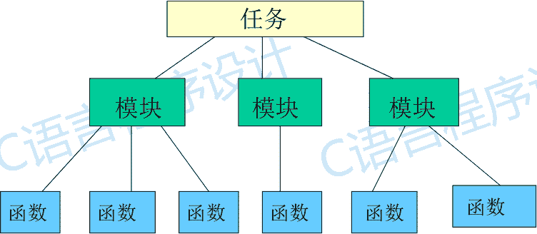

### 看一个简单的函数调用例子：

输出右图所示图形，其中，第一行为一个\*，第二行为两个\*，第n行为n个\*。

算法：编写一个在一行输出x个\*的函数。在主函数中调用此函数实现右边图形的输出。

```c
void f( long x )
{
    long i;
    for(i=1; i<=x; i++)
        printf("* ");
    printf("\n");
}

main()
{
    long n, i;
    void f(long x);
    scanf("%ld", &n);
    for(i=1; i<=n; i++)
        f(i);
}
```

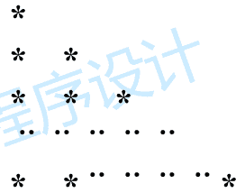

> 在左边的程序中，f是一个自定义函数，实现的功能是输出x个\*号，其中x的值由该函数被调用时赋予的值来确定。
>
> main函数中，用i从1到n循环，每次调用f(i)，即把i的值赋给函数中的x，实现输出i个\*的功能。

### 函数调用形式各部分名称说明：

```c
void f(long x)
{
    long i;
    for(i=1; i<=x; i++)
        printf("* ");
    printf("\n");
}
```

```c
main()
{
    long n, i;
    void f(long x);
    scanf("%ld", &n);
    for(i=1; i<=n; i++)
        f(i);
}
```

- 自定义函数
- 返回值类型
- 形式参数
- 主函数
- 函数的声明
- 函数调用点

形式参数的初值在自定义函数中是待定的，只有在函数被调用的时候，由函数调用点的实参值决定。

一个程序中的所有自定义函数都要在main函数中声明，除非自定义函数写在main函数前面，声明可以省略。这是调用库函数，与调用自定义函数的区别。

其中的i被称为此次函数调用的实参，它的值将在函数调用时被赋给自定义函数的形参x作为x的初值。在被调函数运行中改变形参的值，对实参没有任何影响。对于此次函数调用，main函数被称为主调函数，f函数称为被调函数。

在有自定义函数的程序中，程序从main函数开始执行，执行到函数调用点时，转而执行被调用的自定义函数，被调用函数执行完毕后转回主调函数的函数调用点，继续执行主调函数中函数调用点后的其他语句。

在前一个程序中，自定义函数执行的是一个输出x个\*的操作，函数执行完，没有数值返回主调函数，所以函数返回值类型定义成void型（空类型）。

下面我们看一个有返回值的自定义函数的例子：

### 例：求1!+2!+3!+...+10!

算法：编写一个求x的阶乘的自定义函数jc，从main函数中调用函数jc。

```c
long jc(long x)
{
    long i, a=1;
    for(i=1; i<=x; i++)
        a = a * i;
    return a;
}

main()
{
    long n, s=0;
    long jc(long x);
    for(n=1; n<=10; n++)
        s = s + jc(n);
    printf("\n%ld", s);
}
```

有返回值的自定义函数，用return语句向主调函数的函数调用点返回一个值，即把return语句后面的表达式的值作为函数的返回值传回函数调用点，并在执行完return语句后结束自定义函数的执行，返回主调函数的函数调用点继续往下执行。若return后表达式的类型与函数返回值类型不一致，自动转化成函数返回值类型再返回函数调用点。


### 看看下面这段程序的执行结果：

```c
#include<math.h>
int f(int n)
{
    return sqrt(n);
}

main()
{
    int i, s=0;
    int f(int n);
    for(i=1; i<=100; i++)
        s = s + f(i);
    printf("\n%d", s);
}
```

这段程序的自定义函数 f 的返回值为 int 型。虽然 return 后的表达式 sqrt(n) 的值为 double 型，也要转化成 int 型后返回函数调用点，所以此段函数求的是 1 到 100 中所有数开平方的整数部分的和。

注意：若函数返回值类型省略，不表示没有返回值，而是默认返回值为 int 型。

### 看看下面这段程序的执行结果：


```c
double a(int n)
{
    double x;
    x = n - 1;
    return x;
}

main()
{
    double i, s=0;
    double a(int n);
    for(i=1; i<=100; i++)
        s = s + a(1/i);
    printf("\n%lf", s);
}
```

这段程序的自定义函数 a 的形式参数n的类型为int型。虽然在函数调用点的实参表达式1/i的值为double型，在参数值传递时，也要转化成int型后存入形参n，所以此段函数的输出为-99。

### 例：求200以内的最大的10个素数的和。

```c
int sushu(long n)
{
    long i;
    for(i=2; i<=n-1; i++)
        if(n % i == 0) return 0;
    return 1;
}
```

```c
main()
{
    long i, s=0, n=0;
    int sushu(long n);
    for(i=200; ; i--)
    {
        if(sushu(i))
        {
            s = s + i;
            n++;
        }
        if(n == 10) break;
    }
    printf("\n%ld", s);
}
```

C语言中允许在同一个程序的不同函数中定义相同名字的变量，这些变量在不同的函数中，作为完全不同的变量各自执行，互不干扰影响。

如此程序中，main函数与sushu函数中都分别定义了变量i与n，不同函数中的i与n独立执行，互不影响。

此程序的sushu函数中有两条return语句，函数将在第一次执行到某条return语句时结束，返回函数调用点，之后的语句将不再被执行。

### 例：求大于200的最小的一个自然数，该数既是素数，又是回文数。

算法：定义一个自定义函数sushu判断素数，定义一个自定义函数hws判断回文数，从main函数调用sushu与hws。

```c
int sushu(long n)
{
    long i;
    for(i=2; i<=n-1; i++)
        if(n % i == 0) return 0;
    return 1;
}
```

```c
int hws(long n)
{
    long x = n, t = 0, i;
    while(x > 0)
    {
        i = x % 10;
        t = t * 10 + i;
        x = x / 10;
    }
    if(t == n) return 1;
    else return 0;
}
```

```c
main()
{
    long i;
    int sushu(long n);
    int hws(long n);
    for(i=201; ; i++)
        if(sushu(i) && hws(i))
            break;
    printf("\n%ld", i);
}


## 6.3 函数的递归调用

函数调用它本身，称为递归。直接在函数内调用自己为直接递归，通过别的函数调用自己为间接递归。

```
void a()
{
    ......
    a();
    ......
}
```

直接递归

```
void a()
{
    ......
    b();
    ......
}

void b()
{
    ......
    a();
    ......
}
```

间接递归

## 递归方法求n!

算法：由于 n! = n*(n-1)! 是递归定义
且 0! 值为1
递归调用求n!如下：

```
long jc(long x)
{ long a;
if(x==0) a=1;
else a=x*jc(x-1);
return a;
}
main()
{ long n;
scanf("%ld",&n);
printf("\n%ld",jc(n));
}
```

函数jc是求x的阶乘，由于x!=x*(x-1)!(当x!=0)，在函数jc中又调用了函数jc本身，这就是函数的递归调用。

## 例：求兔子问题

第1个月有1对兔子

每对兔子从出生后第3个月起，就可每个月生1对兔子

问第n个月有多少对兔子？

## 算法分析：设第n个月有 f(n) 对兔子

根据题意有 $f(1)=0， f(2)=1$

```
$$f(n)=f(n-1)+f(n-2)$$
```

可看出每个月兔子的个数也是一种递归定义

可以用递归法编写函数 f 求第 x 个月的兔子的个数

程序如下：

```
long f(long x)
{ long l;
if(x==1||x==2) l=1;
else l=f(x-1)+f(x-2);
return l;
}

main()
{ long n;
scanf("%ld",&n);
printf("\n%ld",f(n));
}

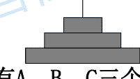

```

## 汉诺塔问题

汉诺塔是一个很繁杂的游戏，但可以用递归的方法异常简单的完成。
有A、B、C三个柱子，其中一个柱子上从上到下，按从小到大的顺序叠放着n个盘子，要想把法把所有盘子从A柱移动到C柱，也按从小到大的顺序从上到下叠放。

- 规则：
- (1) 一次只能移动一个盘子
- (2) 大的不能放在小的上面
- (3) 只能在三个柱子中移动

假设盘子按从小到大的顺序编号为1到n，要求编程按操作顺序把每次移动的盘子的编号及移动方式（从哪个柱子到哪个柱子）输出。

要把n个盘子从A通过B移动到C，分为三步：

- 1. 把n-1个盘子从A通过C移动到B
- 2. 把第n个盘子从A移动到C
- 3. 把n-1个盘子从B通过A移动到C

我们注意到，在这三步中的第1步和第3步，是把n-1个盘子从一个柱子通过一个柱子移动到另一个柱子的过程。

抽象的看，把x个盘子从I柱通过K柱移动到J柱的过程，分为以下步骤：
（其中x、I、J、K为待定值，x的范围是1~n，I、J、K的范围均是A、B、C）

- 当x!=1时，步骤为三步：
- 1. 把x-1个盘子从I通过J移动到K
- 2. 把第x个盘子从I移动到J
- 3. 把x-1个盘子从K通过I移动到J

当x==1时，把第x个盘子从I移动到J

这是一个递归定义的过程！

通过上面的分析，我们定义函数f（long x,char I,char K,char J），其作用是实现把x个盘子从I柱通过K柱移动到J柱的过程。程序见下：

## 汉诺塔程序如下：

```
void f(long x,char I,char K,char J)
{ if(x==1)
    printf("\t%d %c→%c",x,I,J);
  else
  { f(x-1,I,J,K);
    printf("\t%d %c→%c",x,I,J);
    f(x-1,K,I,J);
  }
}
main()
{ long n;
  void f(long x,char I,char K,char J);
  scanf("%ld",&n);
  f(n,'A','B','C');
}
```

## 6.4 变量作用域与存储方式——
胖丫

## 一、变量的作用域

### 变量的有效范围

1. 变量按作用域分为全局变量和局部变量

| 全局变量（外部变量） | 局部变量（内部变量） |
|---|---|
| **定义位置：** 函数体外 | 函数体内 |
| **作用域：** 从定义处到本源文件结束 | 从定义处到本函数结束 |
| **举例：** 所有函数体外定义的变量 | （1）所有在函数体内定义<br>（2）形式参数 |

注意与局部变量同名的处理

局部变量屏蔽全局变量

不同函数中同名局部变量互不干扰

## 3、局部变量

- ♣ C语言程序是由函数组成的，有且只能有一个main函数。
- ♣ 变量定义可以出现在函数内，亦可出现在函数外或者是函数的参数中。

### 按照变量定义语句出现的位置，可以分为：

**局部变量**：在函数或复合语句内定义；
只在该函数或复合语句中才能使用。

**全局变量**：在函数外定义；
从它被定义的位置起，在之后的所有函数中有效。

**形式参数**：定义为函数的参数；
只在该函数中才能使用。

在函数内部说明的变量或者在复合语句中定义的变量称为局部变量。其作用范围是其所在的函数或复合语句。

```
float f1(a)    /*函数 f1*/
int a,
{ int b,c;
M
}

char f2(x,y)    /*函数 f2*/
int x,y;
{ int i,j;
M
}
```

局部变量 a,b,c 有效范围

局部变量 x,y,i,j 有效范围

上一页

下一页

## 4、全局变量

又称全程变量或外部变量，在函数外部说明。其作用范围从它被定义的位置起，在之后的程序段中都是起作用的。

```
int x=2, y=8;
/*外部变量 x,y*/
float f1(a)
/*定义函数 f1*/
int a;
{
int b,c;
...
}
char c1, c2;
/*外部变量 c1, c2*/
char f2(s,t)
/*定义函数 f2*/
int s,t;
{
int i,j;
...
}
main()
/*主函数*/
{
...
}
```

全局变量 x,y的作用范围

全局变量 c1,c2作用范围

如果在全局变量定义之前的函数想引用该外部变量，则应该在该函数中用关键字extern作“外部变量说明”。

```
int max(x,y)          /*定义 max 函数*/
int x,y;              /*局部变量 x,y,z*/
{ int z;
    z=x>y?x:y;
    return(z);
}

main()
{ extern int a,b;      /*外部变量说明*/
    printf(" %d", max(a,b));
}

int a=20, b=-10;       /*外部变量定义在主函数之后*/
```

```
```c
int a, b;
void swap()
{
    int t;
    t = a; a = b; b = t;
    printf("swap:a=%d,b=%d\n", a, b);
}
main()
{
    printf("Enter a,b:");
    scanf("%d,%d", &a, &b);
    swap();
    printf("main:a=%d,b=%d", a, b);
}
```
```

# 运行结果

Enter a,b: 5,3

swap:a=3,b=5
main:a=3,b=5

```
void swap()
{ int t;
    t = a; a = b; b = t;
    printf("swap:a=%d, b=%d\n", a, b);
}
main()
{
    printf(" Enter a, b:");
    scanf("%d,%d", &a, &b);
    swap();
    printf ("main:a=%d, b=%d", a, b);
}
```

运行结果
程序在编译时，屏幕将提示有错误：
Undefine symbol ‘a’
Undefine symbol ‘b’

int a, b;

```
```c
void swap()
{
    int t;
    t = a; a = b; b = t;
    printf("swap:a=%d, b=%d\n", a, b);
}

main()
{
    int a,b;
    printf("Enter a,b:");
    scanf("%d,%d", &a, &b);
    swap();
    printf("main:a=%d, b=%d", a, b);
}
```

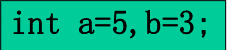


```
# 运行结果

Enter a,b: 5,3

swap:a=3, b=5

main:a=5, b=3

若将程序改为：

```
#include <stdio.h>
int a=2,b=4;        /*a, b为全局变量*/
void f1()
{ int t1,t2;
 t1 = a * 2;
 t2 = b * 3;
 b = 100;
 printf ( "t1=%d, t2=%d, b=%d\n" , t1, t2,b);
}
main()
{ int b=4;                /* 此b是局部变量，赋值 */
 f1();                   /* 调用函数f1() */
 printf ( "a=%d,b=%d" , a, b);
}
```

程序输出结果为：
t1=4, t2=12, b=100
a=2, b=4

结论:全局变量与局部变量同名时,局部变量起作用，全局变量被屏蔽（不影响）,应小心使用

## 二. 变量的存储特性

### 1. 变量按存在时间分

- 静态变量
- 动态变量

静态存储类型的变量的生存期为程序执行的整个过程，在该过程中占有固定的存储空间，通常称它们为永久存储。

动态存储类型变量只生存在某一段时间内。例如，函数的形参和函数体或分程序中定义的变量，只是在程序进入该函数或分程序时才分配存储空间，当该函数或分程序执行完后，变量对应的存储空间又被撤销了。

### 2. C语言中每一个变量有两个属性：数据类型、存储特性

完整的变量定义：[存储特性][数据类型] 变量名;

## 例1:分析执行结果

```
f(int a)
{int b=0; static int c=3;
 b++;
 printf("%5d%5d%5d",a,b,c);
 return(a+b+c);
}
main()
{int a=2,k;
 for(k=0;k<3;k++)
 printf("%5d\n",f(a));
}


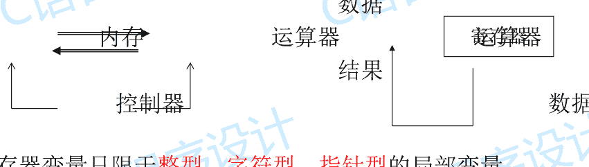

```

静态变量只初始化一次

结果:

- 2 1 4  (a,b,c)
  7       (f(a))
- 2 1 5
  8
- 2 1 6
  9

### (3) register型

- 将使用频率高的变量定义为register型，可以提高运行速度。
寄存器变量只限于整型、字符型、指针型的局部变量。

寄存器变量是动态变量，而且数目有限，一般仅允许说明两个寄存器变量。

例如：

```
register int d;
```

```
register char c;
```

### (4)extern型

- 引用：extern 类型 变量名;
- 如果某个模块文件中要用到另一个模块文件中的全局变量，就要用extern说明

例如：程序模块file1.c中定义了全局变量

```
int s;
```

而在另一个程序模块file2.c中的函数fun1()中需要使用这个变量s。为此，可以在file2.c的函数fun1()中加上外部变量说明语句：

```
fun1()
{ extern int s; /*表明变量s是在其他文件定义的*/
......
}
```

- 定义时分配内存,其他文件引用时不再分配内存.

## 6.5编译预处理

“编译预处理”是C语言编译系统的一个组成部分。是在编译前由编译系统中的预处理程序对源程序的预处理命令进行加工。

源程序中的预处理命令均以“#”开头，结束不加分号，以区别源程序中的语句，它们可以写在程序中的任何位置，作用域是自出现点到源程序的末尾。

- 预处理命令包括执行宏定义(宏替换)、包含文件和条件编译。

## 一. 宏定义

- 简单宏定义

### 1. 一般形式为：

```
#define 宏名 串 (宏体)
```

如： #define PI 3.14159

```
/*定义后,可以用PI来代替串3.14159*/
```

### 2. 宏定义的作用

在宏定义之后,该程序中宏名就代表了该字符串。

### 3. 说明

- ① 可以用 #undef 命令终止宏定义的作用域。例如： #undef PI
- ② 宏定义的嵌套使用

```
# define R 3.0
# define PI 3.1415926
# define L 2*PI*R      /*宏体是表达式*/
# define S PI*R*R
```

```
```c
main（）
{
    printf（"L=%f\nS=%f\n", L, S）;
    /*2*PI*R替换L，PI*R*R替换S*/
}
```
```

程序运行结果如下：

L=18.849556

③双引号内与宏同名的字母不作展开.(见上例)

### 带参数的宏定义

1.带参数的宏定义的一般形式为

```
```c
#define 宏名(参数表) 字符串
```
```

如：

```
```c
#define S(a,b) a*b
#define PR(x) printf(" s=%f\n", x)
```
```

### 2.带实参的宏名被展开

宏名被所定义的宏体替换，宏体中的形参按从左到右的顺序被实参替换。

例如： area = S (3,2);
PR(area);

展开为：

```
area=3*2;
```

PR(area) 展开的结果是： printf(" s=%f\n", area);

- 宏定义与函数的区别

  - (1) 引用宏只占编译时间，不占运行时间。
  - (2) 引用宏没有返回值。如： #define squ(n) n*n

```
void main (void)
{ printf ( " %f\n " ,27.0/squ(3.0));
}
```

程序输出结果为：
27.000000

注意，展开为27.0/3.0*3.0 不是27.0/(3.0*3.0)

### (3) 宏替换的形参无类型

### (4) 实参为表达式的情况

函数调用是先计算出实参的值，再将值传递给形参；宏的引用是用表达式替换形参。

例如：

```
#define S(a,b) a*b
```

引用：                 S(a+c,b+c)

展开后的表达式为：a+c*b+c

## 三、条件编译

1. 控制条件为常量表达式的条件编译，有以下几种形式：

```
```c
（1）#if  常量表达式
    程序段
#endif
```
```

功能：常量表达式为非 0 时，程序段被编译。否则，程序段不被编译。

```
```c
（2）#if  常量表达式
    程序段1
#else
    程序段2
#endif
```


```

功能：常量表达式为非 0，程序段 1 被编译。否则，编译程序段 2。
```
(3) #if 常量表达式1
    程序段1
    #elif 常量表达式2
    程序段2
    ……
    #elif 常量表达式n
    程序段n
    #else
    程序段n+1
    #endif
```

2. 控制条件为定义标识符的条件编译

```
1） #ifdef 标识符
    程序段
    #endif
```

功能：当标识符在该条件编译结构前已定义过时，程序段被编译，否则，程序段不被编译。

```
（2）#ifdef 标识符
    程序段1
#else
    程序段2
#endif
```

功能：当标识符在该条件编译结构前已定义过时，程序段1被编译。否则，编译程序段2。

```
（3）#ifndef 标识符
    程序段1
#else
    程序段2
#endif
```

功能是，当标识符在该条件编译结构之前没有被# define定义过时，程序段1被编译；否则，编译程序段2

## 6.6函数设计举例

1。以下程序求1000以内的所有的完全数之和，请将程序补充完整，并给出正确结果，填入相应窗口。”完全数”是 指：一个数如果刚好与它所有的真因子（不包括该数本身） 之和相等，如：6=1+2+3，则6就是一个完全数。

```
#include <conio.h>
#include <stdio.h>
#include <math.h>
main()
{
    int sum,n,m,s,k;
    sum=0;
```


```
```c
for (n=3;n<=1000;n++)
{
    s=0;
    k=n/2+1;
    for (m=1;m<k;m++)
        if (n%m==0)
            ________;
        if (s==n)
        {
            ____________________
        }
}
printf("\nThe sum=%d",sum);
}
```

2．以下程序求[10,1000]之间能被3或5或8整除的数之和。请将程序补充完整，给出正确程序运行结果，填入相应窗口。

```
```c
#include <conio.h>
#include <stdio.h>
#include <math.h>
main()
{
    ____________
    long sum;
    sum=0;
    for (i=10;i<=1000;i++)
    {
        if (____________)
            sum+=i;
    }
    clrscr();
    printf("%ld\n",sum);
}
```

3: 下面程序求[3,750]之间同构数之和，请将程序补充完整，并给出正确结果，填入相应窗口。同构数是：一自然数平方的末几位与该数相同时，称此数为自构数，例如：5*5=25，则称5为自同构数。

```
#include <conio.h>
#include <stdio.h>
#include <math.h>
main()
{
    long sum,n,m,s,k;
    sum=0;
    for (n=3;n<=750;n++)
    {
        if (n<10) k=10;
        else
            if (n<100) k=100;
            else k=1000;
        s=n*n;
```

```
if(s%k==0)
{
    [内容被水印遮挡]
}
printf("\n The sum = %d",sum);
}
```

6. 下面程序是求[50,450]之间的能被3和5整除的数的平方和。请将程序补充完整，并给出正确结果，填入相应窗口。

```
#include <conio.h>
#include <stdio.h>
#include <math.h>
main()
{
    long sum;
    ________;
    sum=0;
    for (i=50;i<=-450;i++)
    {
        if (fmod(i,3)==0 && fmod(i,5)==0)
        {
            ________
        }
    }
    clrscr();
    printf("%ld\n",sum);
```

7. 下面的程序是求[2, 500]之间的所有的素数的个数。请将程序补充完整，并给出正确结果，填入相应窗口。

```
#include <conio.h>
#include <stdio.h>
#include <math.h>
int prime(int n)
{ int yes, i;
    if(n<=1) {return 1;}
    yes=1;
    for(i=2; i<=sqrt(n); i++)
        if(n%i==0){ yes=0; break;}
    
}
```

```
main()
{ int count=0, i;
clrscr();
for(i=2;i<=500; i++)
if(prime(i))
printf("%d\n", count);
}
```

8．下面的程序是求表达式的值：

s=1+1/3+(1*2)/(3*5)+(1*2*3)/(3*5*7)+......+(1*2*3*......*n)/(3*5*7*......*(2*n+1))请将程序补充完整，并给出当 n=20 时，程序的运行结果（按四舍五入保留10位小数）。

```
```c
#include <conio.h>
#include <stdio.h>
#include <math.h>
double fun(int n)
{
    double s, t; int i;

    __________
    t=1.0;
    for(i=1;i<=n;i++)
    { t=t*i/(2*i+1);
    __________
    }
    return s;
}
```

```
```c
main()
{
    printf("\n %12.10lf", fun(20));
}
```

9. 下面的程序是求如下表达式的值。
S=sqrt(ln(1)+ln(2)+ln(3)+......+ln(n))将程序补充完整，当 n=60时，给出程序运行结果（按四舍五入保留6位小数）。

```
#include <conio.h>
#include <stdio.h>
#include <math.h>
double fun(int n)
{
    ________________
    int i;
    for(i=1;i<=n;i++)
    s+=log(1.0*i);
    s=sqrt(s);
    return s;
}


```
```
main()
{
    clrscr();
    printf(________________);
}
```

```
```c
main()
{
    int sum=0,i;
    clrscr();
    for(i=2;i<=500; i++)
        if(prime(i)) sum+=i;
    printf("%d\n", sum);
}
```

2．下面的程序中，函数fun的功能是：根据形参m，计算下面公式的值。T=1+1/(2*3)+1/(3*4)+……+1/(m*(m+1))。请改正程序中的错误，并运行改正后的程序。当从键盘输入70时，给出程序运行的正确结果（按四舍五入保留6位小数）。

```
```c
#include <conio.h>
#include <stdio.h>

double fun(int m)
{
    double t=1.0;
    int i=2;
    for(i=2;i<=m;i++)
        t+=1.0/i*(i+1);
    return ;
}
```

```
main()
{ int m;
clrscr();
printf("\n 请输入一个整数:");
scanf("%d",&m);
printf("\n 结果是: %lf\n", fun(m));
}
```

3. 下面的程序中，函数fun的功能是：根据形参m，计算下面公式的值。 T=1/1!+1/2!+1/3!+......+1/m! 请改正程序中的错误，并运行改正后的程序。当从键盘输入10时，给出程序运行的正确结果（按四舍五入保留10位小数）。

```
#include <conio.h>
#include <stdio.h>
double fun(int m)
{ double fac, t=0.0;
int i=1, j;
for(i=1;i<=m;i++)
{ fac=1.0;
for(j=1; j<=m; j++) fac=fac*i ;
t+=1.0/fac;
}
return t;
}
```

```
```c
main()
{
    int m;
    clrscr();
    printf("\n请输入整数：");
    scanf("%d", &m);
    printf("\n结果是：%12.10lf\n", fun(m));
}
```

4. 下面的程序中，函数fun的功能是：根据形参m，计算下面公式的值。T=1+1/(1*2)+1/(2*3)+......+1/(m-1)*m 请改正程序中的错误，并运行改正后的程序。当从键盘输入70时，给出程序运行的正确结果（按四舍五入保留6位小数）。

```
#include <conio.h>
#include <stdio.h>
double fun(int m)
{ double t=1.0;
int i=2;
for(i=2;i<=m; i++)
    t+=1.0/(i*(i+1));
return ;
}
```


```
main()
{ int m;
clrscr();
printf("\n 输入整数: ");
scanf("%d", &m);
printf("\n 结果是: %lf\n",fun(m));
}
```

```
```c
main()
{
    int k;
    clrscr();
    printf("\\n 请输入整数:");
    scanf("%d", &k);
    printf("\\n 结果是: %d\\n", fun(k));
}
```
```

6．下列程序的功能是：求出以下分数序列的前30项之和，
2/1,3/2,5/3,8/5,13/8,21/13,……请改正程序中的错误，并运行修改后程序，
给出程序结果（按四舍五入保留6位小数）。

```
```c
#include <conio.h>
#include <stdio.h>
main()
{
  long a,b,c,k;
  double s;
  clrscr();
  s=0.0; a=2; b=1;
  for(k=1;k<=30;k++)
    s=s+a/b;
  c=a; a=a+b; b=c;
  printf("\\n 结果：%lf\\n", s);
}
```
```

8.下面的程序是计算： s=f(-30)+f(-29)+......+f(-1)+f(0)+f(1)+......+f(30)的值。 其中函数定义如下： f(x)=(x+1)/(x-2) if x>=1； f(x)=0 if x=0 or x=2； f(x)=(x-1)/(x-2) if x<0。 请改正程序中的错误，并给出正确程序的运行结果(按四舍五入保留6位小数)。

```
#include <conio.h>
#include <stdio.h>
#include <math.h>
double f(double x)
{ if(x==0 && x==2)
    return 0.0 ;
    else if(x<0.0)
    return (x-1)/(x-2);
    else
    return (x+1)/(x-2);
}
```

```
```c
double fsum(int n)
{
    int i; double s=0.0, y;
    for(i=~n; i<=n; i++)
    {y=f(1.0*i); s+=y;}
    return y;
}

main()
{
    clrscr();
    printf("%lf\n", fsum(30));
}
```
```

9. 下面的程序是计算如下公式的 A15 值。 A1=1，A2=1/(1+A1)，A3=1/(1+A2)，A4=1/(1+A3)，……请改正程序中的错误，并给出程序运行的正确结果（按四舍五入保留10位小数）

```
```c
#include <conio.h>
#include <stdio.h>

double fun(int n)
{
    int A=1.0; int i;
    for(i=2; i<=n; i++)
        A+=1.0/(1+A);
    return A;
}

main()
{
    clrscr();
    printf("%12.10lf\n", fun(15));
}
```
```

# 第七章 数组

- 7.1 一维数组
- 7.2 二维数组
- 7.3 数组的应用
- 7.4 字符数组与字符串
- 7.5 数组作为函数的参数
- 7.6 程序举例


## 教学目的和基本要求：

要求学生理解数组下标，掌握初始化数组的方法，学会参数传递数组，并基本掌握二维数组及字符数组的使用。

## 教学重点：

一维数组使用，参数传递数组。

## 1. 数组的引入：

回顾第五章时我们所讲过的一个程序：

从键盘输入一百个学生的成绩，求总成绩。

当时我们由此引入了循环结构。如果这个程序不是要求和，而是要把这一百个学生的成绩按从高到低的顺序排列，则必须要把这一百个学生的成绩都同时记录下来，也就是说，必须要设定一百个变量。

在C语言中，提供了一种方便的同时设定多个变量的数据类型，这就是数组！前提是，这多个变量必须具有相同的数据类型，比如同为int、long、float、char等等。

数组有一维数组、二维数组和多维数组。

## 2.数组的概念

数组：具有相同类型的数据组成的序列，是有序集合。

数组中的每一个数据称

- 数组元素
- 数组分量
- 下标变量

数组元素 由其所在的位置序号（称数组元素的下标）来区分。一个数组元素就是一个相对独立的变量

注意：数组的有序性，是指数组元素存储的有序性，而不是指数组元素值有序。利用这种有序性，在后面的章节中，我们可以方便的用指针解决一些问题。

## 7.1 一维数组

### 7.1.1 一维数组的定义

一维数组：只有一个下标的数组。

定义格式：

存储类别 类型标识符 数组名[元素个数];

说明：

- 1. 存储类别：说明数组的存储属性，即数组的作用域与生成期，可以是静态型（static），自动型（auto）及外部型（extern）。当使用auto型时可以省略。我们现在所用都是auto型，故省略。
- 2. 类型标识符：数组元素的类型。Int、long、char、float、double等。
- 3. 数组名的命名规则：与标识符的命名规则相同。
- 4. 数组“元素个数”：即数组长度，只能是一个整型常量表达式。可以是符号常量。

## 例： int a[5];

定义了一个auto型整型数组：

数组的元素为整型；数组名为a；元素个数为5，分别叫做：

a[0]、a[1]、a[2]、a[3]、a[4];注意：没有a[5]这个数组元素。

下面是合法的数组定义：

- ① char str[20]; /* 定义一个有20个元素的字符型数组str */
- ② float score[8];/* 定义一个有8个元素的浮点型数组score */
- ③ #define N 5
  long data[N]; /* 定义一个有5个元素的长整型数组data */
  short z[4*N]; /* 定义了一个有20个元素的短整型数组z */

其中③的数组长度使用的是符号常量

下面的定义是非法的：

```
int n=10;
char c[n]; /* 数组长度不能使用变量 */
```

## 例：试判断下列数组定义是否合法：

```
int student[35];
char name[20];
float score[35];
#define student 35
float n_student[student];
int score_student[student*3];
int person(10);
int n=10, a[n];
```

定义了数组以后，就可使用它了。
但不能利用数组名来整体引用一个数组，只能单个的使用数组元素。

数组元素的描述：由数组名加方括号中的下标组成。

即：**数组名[下标]**

下标：数组元素在数组中的顺序号，使用整型表达式。

取值范围：从0到元素个数-1。C语言不对下标越界作语法检查。

```
int a[5];
```

则数组的元素分别为：a[0]、a[1]、a[2]、a[3]、a[4]；但a[5]不是。

每个元素都可作为一个整型变量来使用。如：

```
a[0]=5;  a[3]=a[1]+4;  a['D'-'B']=3;\nscanf("%d",&a[4]);
```

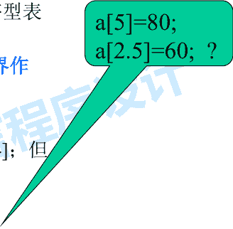

### 7.1.2 数组元素的引用

定义了数组以后，就可使用它了。
但不能利用数组名来整体引用一个数组，只能单个的使用数组元素

数组元素的描述：由数组名加方括号中的下标组成，即：

**数组名[下标]**

下标：数组元素在数组中的顺序号，使用整型表达式。
取值范围：从0到元素个数-1。C语言不作下标越界检查。

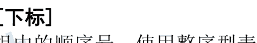

若有定义：`int a[5];`
则数组a的元素分别为：a[0]、a[1]、a[2]、a[3]、a[4]；但a[5]不是。
每个元素都可作为一个整型变量来使用。如：

```
a[0]=5;  a[3]=a[1]+4;  a['D'-'B']=3;  scanf("%d",&a[4]);
```


根据数组的有序性，往往使用循环语句来对数组进行处理，用循环控制变量作为数组下标，从而可以以统一的方式来访问数组元素。

## 例7.1 从键盘输入15个整数，再反序输出。

问：不用数组能否完成，如何实现？假设是1000个数据呢？

```
#include <stdio.h>
main()
{ int n,a[15];
for(n=0;n<15;n++) scanf("%d",&a[n]);
printf("\n");
for(n=14;n>=0;n--) printf("%4d",a[n]);
}
```

注意：
1. 循环控制变量的初值、终值及控制条件。
2. 不能整体输入/输出数组 如： printf("%d",a);
学会如何对数组进行输入输出

输入： 1 2 3 4 5 6 7 8 9 10 11 12 13 14 15 ↳

输出： 15 14 13 12 11 10 9 8 7 6 5 4 3 2 1

## 7.1.3 一维数组的存储结构与初始化

## 1. 一维数组的存储结构

数组变量在内存中分配一片连续的存储单元，数组元素按数组下标从小到大连续存放。a代表首地址（数组起始地址），每个元素字节数相同，因此，根据数组元素序号可以求得数组各元素在内存的地址，并可对数组元素进行随机存取。

数组元素地址=数组首地址+元素序号×元素字节数。设a的首地址为1000，数组存储示意图如下图所示。

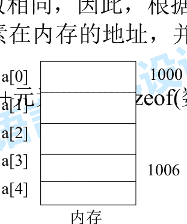

a[3]的地址=1000+3×2=1006

## 2. 一维数组的初始化

含义：在定义数组的同时，对数组各元素指定初值。
初始化是 编译阶段完成。

注意：用赋值语句或输入语句也可给数组素指定初值，
是在运行时完成。

初始化数组格式：

```
[static] <类型标识符> <数组名[元素个数]>= {<初值列表>};
或 <类型标识符> <数组名[元素个数]>= {<初值列表>} ;
```

说明：

+   ① <初值列表> 是用逗号分隔的数组元素的初始值(常量)。
+   ② <初值列表> 中数值的类型必须与 <类型标识符> 一致。

## 对数组初始化的几种方法：

①在定义数组时，对全部数组元素赋予初值。

```
int a[5]={0, 1, 2, 3, 4};
```

②在定义数组时，对部分数组元素赋予初值。

```
int a[5]={1, 2}; 等价 a[0]=1, a[1]=2; 其余赋0
```

③对全部数组元素赋初值时，可省数组长度，系统自动确定。

```
a[5]={0,1,2,3,4}
```

若不对auto数组进行初始化，则其初值是不可知的。

若一个static或外部数组未进行初始化，则对数值型数组元素，初值为0，而对字符型数组元素，初值为空字符 '\0'。

| a[0] | 0 |
| a[1] | 1 |
| a[2] | 2 |
| a[3] | 3 |
| a[4] | 4 |

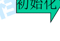

## 例7.2 数组初始化与未初始化比较

```
#include <stdio.h>
main()
{int i,a[5]={3,4,5},b[5];
    printf("\narray a is:")
    for(i=0;i<5;i++) printf("%6d",a[i]);
    printf("\narray b is:")
    for(i=0;i<5;i++) printf("%6d",b[i]);
}
```

运行结果：

array a is:3    4    5    0    0

array b is:-32  1398  40  1170  454

> 考虑：数组b的值的含义？

## 7.2 一维数组

若一个一维数组，它的每一个元素亦是类型相同的一维数组时，便构成二维数组。

**数组的类型相同：**是指数组大小、元素类型相同。

**数组的维数：**是指数组的下标个数，一维数组元素只有一个下标，二维数组元素有两个下标。

## 7.2.1 二维数组的定义

+   1. 定义形式：

**存储类别  类型标识符  数组名[行数][列数]；**

```
float b[5][3];
```

定义了一个5×3的数组b，即数组为5行3列，可存放15个实型数据。

## 3. 多维数组的定义

+   - 根据二维数组的定义，我们可以类推出多维数组的定义。
+     `static int b[2][2][3];  /*定义了一个 3 维的静态整型数组*/`
+     `float c[2][3][2][2];    /*定义了一个 4 维浮点型数组*/`

+   - 在数组定义时，多维数组的维从左到右第一个[]称第一维，第二個[]称第二维，依此类推。多维数组元素的顺序仍由下标决定。下标的变化是先变最右边的，再依次变化左边的下标。

+   - 三维数组b的12个元素是：

b[0][0][0]  b[0][0][1]  b[0][0][2]
b[0][1][0]  b[0][1][1]  b[0][1][2]
b[1][0][0]  b[1][0][1]  b[1][0][2]
b[1][1][0]  b[1][1][1]  b[1][1][2]

## 7.2.2 二维数组元素的引用

+   1. 二维数组元素的引用形式：

数组名[下标1][下标2]

下标 1 称第一维下标（或称行），下标 2 称第二维下标（或称列）。下标从 0 开始变化，其值分别小于数组定义中的常量表达式 1 与常量表达式 2。

在二维数组中，一个元素的位置由其下标决定。

对 float a[4][3]; 其 12 个元素是：

+   第（0）行： a[0][0], a[0][1], a[0][2]

+   第（1）行： a[1][0], a[1][1], a[1][2]

+   第（2）行： a[2][0], a[2][1], a[2][2]

+   第（3）行： a[3][0], a[3][1], a[3][2]

二维数组的每一个元素都可以作一个变量来使用。

```
printf("%d", a[0][0]); scanf("%d", &a[1][1]);
```

```
a[1][0] += a[0][0] + 3 * a[0][1];
```

## 例7.4 二维数组输入输出

```
main
{int a[2][3];
printf("\nInput array a:");
for (j=0;j<2;j++)
    for (k=0;k<3;k++)
        scanf(" %d", &a[j][k]);/*输入数据到二维数组中*/
printf("\nOutput array a:\n");
for (j=0;j<2;j++)
{for (k=0;k<3;k++)    /*循环三次，输出一行共三个元素*/
printf(" %4d",a[j][k]);
printf("\n");        /*输出一行后换行，再输出下一行*/
}
```

输入： Input array a:1 2 3 4 5 6
输出： Output array a:
    1 2 3
    4 5 6

对二维数组的输入输出多使用二层循环结构来实现。外层循环处理各行，循环控制变量j作为数组元素的第一维下标；内层循环处理一行的各列元素，循环控制变量k作为元素的第二维下标。

## 7.2.3　二维护组的存储结构

设有定义 `int a[2][3];`　`float b[3][2];`

系统为数组在内存中分配一片连续的内存空间，将二维数组元素按行的顺序存放在所分配的内存区域。数组a与b的各元素的存储顺序如右图所示

| 元素 |
|---|
| a[0][0] |
| a[0][1] |
| a[0][2] |
| a[1][0] |
| a[1][1] |
| a[1][2] |

| 第0行 | 第1行 | 第2行 |
|---|---|---|
| B[0][0] | b[1][0] | b[2][0] |
| b[0][1] | b[1][1] | b[2][1] |

元素 `a[i][j]` 的地址：

`a + (i × n + j) × 元素字节数`

```
#include <stdio.h>
main()
{ int i,j,a[3][3];
for(i=0;i<3;i++)    /*输入数组*/
for(j=0;j<3;j++)
{ printf("a[%d][%d]=",i,j);
scanf("%d",&a[i][j];
}
for(i=0;i<3;i++)    /*输出数组*/
for (j=0;j<3;j++)
if(i==1||j==1) printf("%-6d",a[i][j]);
else printf("%-6c",' ');
printf("\n");
```

运行结果

|   |   |   |
|---|---|---|
| 2 |   |   |
| 4 | 5 | 6 |
|   | 8 |   |


# 例7.6 用如下的3×3矩阵初始化数组a[3][3], 求矩阵的转置矩阵。

1 2 3
4 5 6
7 8 9

1 4 7
2 5 8
3 6 9

转置矩阵：是将原矩阵元素按行列互换形成的矩阵

# 方法1：转置矩阵是将原矩阵元素按行列互换形成的。

1 2 3
4 5 6
7 8 9

1 4 7
2 5 8
3 6 9

主对角线

# 方法2：沿主对角线将对称位置元素互换即可。

程序如下：

```
#include <stdio.h>
main()
{int j,k;
    int a[3][3]={1, 2, 3, 4, 5, 6, 7, 8, 9}, b[3][3];
    for (j=0;j<3;j++)
        for(k=0;k<3;k++) b[j][k]=a[k][j];
    for(j=0;j<3;j++)
    {for(k=0;k<3;k++)
        printf("%6d",b[j][k]);
        printf("\n");
    }
```

# 7.3 数组的应用

# 1.利用数组求斐波那契数列的前n项

例7.7 求斐波那契数列的前20项：

f₀=1

f₁=1

⋮

fᵢ = fᵢ₋₁ + fᵢ₋₂ (i=2, 3, ...n)

将前20项输出到屏幕上，每行五项。

分析：根据这个数列的组成规律：从第三项开始，每个数据项的值为前两个数据项的和，采用递推方法来实现。可以用一个一维整型数组fib[20]来保存这个数列的前20项。

# 2.利用数组处理批量数据

例7.8 从键盘上输入若干学生（不超过100人）的成绩，计算平均成绩，并输出高于平均分的人数及成绩。输入成绩为负时结束。

分析：

根据题意，可以定义一个有100个元素的一维数组 score，先将成绩输入到数组中，并计算平均成绩。然后，将数组中的成绩值一个个与平均值比较，输出高于平均分的成绩。

# 程序如下：

```
#include <stdio.h>
main()
{ float score[100],ave,sum=0,x;
int i,n=0,count;
printf("Input score:");
scanf("%f",&x);
while (x>=0&&n<=100)
{ sum+=x; score[n++]=x; /*输入的成绩保存在数组score中*/
scanf("%f",&x);
}
ave=sum/n;
printf("average= %f\n",ave);  /*输出平均分*/
```

```
/*接上页*/
for (count=0,i=0;i<n;i++)
    if (score[i]>ave)
    { printf("%f\n",score[i]);      /*输出高于平均分的成绩*/
        count++;                     /*统计高于平均分成绩的人数*/
        if (count%5==0) printf("\n");
                              /*每行输出成绩达5个时换行*/
    }
    printf("count=%d \n",count);     /*输出高于平均分的人数*/
}
```

# 3. 利用数组排序

# 例7.9 从键盘上输入10个整数，用选择法将其按由小到大的顺序排列并输出

基本思想：

+   (1) 从第 0 个位置到第 9 个位置中选择出 最小的一个与第 0 个位置的数交换。
+   (2) 从第 1 个位置到第 9 个位置中选择出最小的一个与第 1 个位置的数交换。
...
+   (9) 从第 8 个位置到第 9 个位置中选择出最小的一个与第 8 个位置的数交换。

# 输入数据：

5 13 3 9 32 22 8 1 23 21

# 排序过程如下：

5 13 3 9 32 22 8 1 23 21

① 1 13 5(3) 9 32 22 8 3(1) 23 21

② 1 3 13 9 32 22 8 5 23 21

③ 1 3 5 9 32 22 8 13 23 21

④ 1 3 5 8 32 22 9 13 23 21

⑤ 1 3 5 8 9 22 32 13 23 21

⑥ 1 3 5 8 9 13 32 22 23 21

⑦ 1 3 5 8 9 13 21 22 23 32

⑧ 1 3 5 8 9 13 21 22 23 32

⑨ 1 3 5 8 9 13 21 22 23 32

```
#include <stdio.h>
main()
{
int I,j,t,a[10];
for(I=0;I<10;I++) scanf("%d",&a[I]); /*输入数据到数组*/

for(I=0;I<9;I++)
    for(j=I+1;j<10;j++)
        if(a[I]>a[j])
        {t=a[I];a[I]=a[j];a[j]=t;}

printf("\\n");
for(I=0;I<10;I++)printf("%6d",a[I]); /*输出排序后的数据*/
}
```

> 内循环：在（I,10）内选择最小数

> 外循环：控制选择的次数

# 分析：

从程序可知：

+   1. 程序使用两重循环来实现排序。
+   2. 外循环控制排序趟数。若数组有N个元素，则共进行N-1趟排序。第一趟，I=0；第二趟，I=1，……
+   3. 内循环完成在I，9的区间内选择最小数。比较次数随趟数增大而减少。
+   4. 在每一趟选择中，当后面元素较小时，马上进行交换。而这种交换是不必要的。事实上，只要记住较小元素的位置，即下标，在内循环结束后做一次交换即可，这样可大大节省程序运行时间。

# 改进排序过程如下：

5 13 3 9 32 22 8 1 23 21

① 1 13 3 9 32 22 8 5 23 21

② 1 3 13 9 32 22 8 5 23 21

③ 1 3 5 9 32 22 8 13 23 21

④ 1 3 5 8 32 22 9 13 23 21

⑤ 1 3 5 8 9 22 32 13 23 21

⑥ 1 3 5 8 9 13 32 22 23 21

⑦ 1 3 5 8 9 13 21 22 23 32

⑧ 1 3 5 8 9 13 21 22 23 32

⑨ 1 3 5 8 9 13 21 22 23 32

改进后的程序见下页，注意与前一程序比较

```
#include <stdio.h>
main()
{int I,j,k,a[10];
for(I=0;I<10;I++) scanf("%d",&a[I]);
for(I=0;I<9;I++)
{k=I;
for(j=I+1;j<10;j++)
if(a[k]>a[j]) k=j;
if(k!=I){t=a[I];a[I]=a[k];a[k]=t;}
}
printf("\n");
for(I=0;I<10;I++)printf("%6d",a[I]);
```

内循环

外循环

K是最小元素之下标

# 4. 利用数组进行数据查找--折半查找法介绍

适应情况：在一批有序数据中查找某数

基本思想：选定这批数中居中间位置的一个数与所查数比较，看是否为所找之数，若不是，利用数据的有序性，可以决定所找的数是在选定数之前还是在之后，从而很快可以将查找范围缩小一半。以同样的方法在选定的区域中进行查找，每次都会将查找范围缩小一半，从而较快地找到目的数

例7.10 假设在数组a中的数据是按由小到大顺序排列的：

-12 0 6 16 23 56 80 100 110 115，从键盘上输入一个数，判定该数是否在数组中，若在，输出所在序号；若不在，输出相应信息。

# 查找过程如下：

第一步：设low、mid和high三个变量，分别指示数列中的起始元素、中间元素与最后一个元素位置，其初始值为low=0,high=9,mid=4，判断mid指示的数是否为所求，mid指示的数是23，不是要求得80，须继续进行查找。

[-12  0  6  16  23  56  80  100  110  115]
↑low        ↑mid                ↑high

第二步：确定新的查找区间。因为80大于23，所以查找范围可以缩小为23后面的数，新的查找区间为[56  80  100  110  115]，low,mid,high分别指向新区间的开始、中间与最后一个数。实际上high不变，将low（low=mid+1）指向56,mid（mid=(low+high)/2）指向100,还不是要求得80，仍须继续查找。

-12  0  6  16  23  [56  80  100  110  115]
               ↑low   ↑mid      ↑high


# 继续查找：

第三步：上一步中，所找数80比mid指示的100小，可知新的查找区间为[56 80]，low不变，mid与high的值作相应修改。mid指示的数为56，还要继续查找。

-12  0  6  16  23  [ 56    80 ]  100  110  115
↑low  ↑high
↑mid

第四步：根据上一步的结果，80大于mid指示的数56，可确定新的查找区间为[80]，此时，low与high都指向80，mid亦指向80，即找到了80，到此为止，查找过程完成。

-12  0  6  16  23  56  [ 80 ]  100  110  115
↑low
↑mid
↑high

若在查找过程中，出现low>high的情况，则说明，序列中没有该数，亦结束查找过程。

# 程序为：

```
#define M 10
#include<stdio.h>
main()
{static int a[M]={-12,0,6,16,23,56,80,100,110,115};
int n,low,mid,high,found;
low=0;  high=M-1;  found=0;
printf("Input a number to be searched:");
scanf("%d",&n);
```

```
while(low<=high)
{mid=(low+high)/2;
if (n==a[mid]) {found=1;break;}/*找到，结束循环*/
else if (n>a[mid]) low=mid+1;
else high=mid-1;
}
if (found==1) printf("The index of %d is %d:",n,mid);
else printf("There is not %d",n);
}
```

## 7.4 字符数组与字符串

### 7.4.1 字符数组的定义与初始化

### 1. 字符数组的定义

字符数组：其元素类型为字符类型的数组，其定义与前面介绍的数组定义相同。

例如：

```
char str[40];
```

定义一个有40个元素的字符数组,每个元素相当于一个字符变量。

### 2. 字符数组的初始化

方法：将字符常量以逗号分隔写在花括号中

①在定义字符数组时进行初始化

```
ch[7]={ 's','t','u','d','e','n','r','t' };
```

②在对全部元素指定初值时，可省写数组长度。

```
ch[]={ 's','t','u','d','e','n','r',
```

## 7.4.2 字符串的概念及存储

### 1.字符串的概念

字符串： 若干有效字符的序列；

可包含转义字符、ASCII码表中的字符；

形式为： 用双引号括起来的字符序列；

例： "I am a student." ， "Hello"

"a[5]="； "%f\n"。

字符串的结束标志： ‘\0’。

注： C语言无字符串类型，字符串是存放在字符数组中的。

### 2. 用字符串来直接初始化字符数组

可直接把字符串写在花括号中来初始化字符数组。

```
如： char ch[9] = { "student" };
```

| s | t | u | d | e | n | t | \0 |
|---|---|---|---|---|---|---|-----|

系统将双撇号括起来的字符依次赋给字符数组的各个元素，并自动在末尾补上字符串结束标志字符'\0'。

几点说明：

+   （1）字符串结束标志'\0'仅用于判断字符串是否结束，输出字符串时不会输出。

+   （2）在对有确定大小的字符数组用字符串初始化时，数组长度应大于字符串长度。如： char s[7] = {"student"}; 是错误的。

+   （3）在初始化一个一维字符数组时，可以省略花括号。如： char s[8] = "student";

+   （4）不能直接将字符串赋值给字符数组。下面的操作是错误的。 s = "student";

## 7.4.3 字符串的输入输出

### 1.字符串的输出方法

#### (1) 用printf函数

用printf输出字符串时，要用格式符“%s”,输出时从数组的第一个字符开始逐个字符输出，直到遇到第一个‘\0’为止。

例：

```
char st[15]="I am a boy!"
printf("st=%s,%c,%c",st,st[3],st[7]);
```

输出结果：

I am a boy!mb

### 例7.11 字符串输出示例

```
#include<stdio.h>
main()
{ static char str[20]=" How do you do ?";
    int k;
    printf(" %s",str);                /*输出str中的字符串*/
    for (k=0;str[k]!='\0';k++)
        printf(" %c",str[k]);   /*一个一个地输出字符*/
}
```

输出结果为：How do you do ? How do you do ?

使用printf() 函数的"%s"格式符来输出字符串，从数组的第一个字符开始逐个输出，直到遇到第一个'\0'为止。

使用" %c" 格式时，用循环实现每个元素的输出。

#### （2）用puts函数输出字符串

**函数原型：** `int put(char *str);`

**调用格式：** `puts(str);`

**函数功能：** 将字符数组str中包含的字符串或str所指示的字符串输出，同时将 '\0' 转换成换行符。

例：`char ch[]="student";`

```
puts(ch);    puts("Hello");
```

将字符数组中包含的字符串输出，然后再输出一个换行符。因此，用puts()输出一行，不必另加换行符 '\n'。

函数puts每次只能输出一个字符串，而printf可以输出几个：`printf("%s%s",str1,str2);`

### 2. 字符串的输入

（1）使用scanf函数输入字符串

例：char st[15];
    scanf("%s",st);

但：scanf("%s",&st);是错误的；
因为st就代表了该字符数组的首地址。

注：输入时，以回车或空格作为结束标志；
即：用scanf输入的字符串中不能含有空格。

若按如下方法输入：
How do you do?↲
执行语句： scanf("%s",st)；则s 的内容为：How\0

使用格式字符串"%s"时会自加结束标志'\0'。第一个空格后的字符没有输入st中。

（2）使用函数gets()输入字符

函数原型：char *gets(char *str);

调用格式：gets(str); str是一个字符数组或指针。

函数功能：从键盘读入一个字符串到str中，并自动在末尾加字符串结束标志符‘\0’。

输入字符串时以回车结束输入，这种方式可以读入含空格符的字符串

如：

```
char s[14];
gets(s);
```

若输入的字符串为： How do you do?↲

则s 的内容为： How do you do?\0

### 例7.12 字符串输入输出示例

```
#include<stdio.h>
main()
{char s[20],s1[20];
scanf(" %s",s);
printf(" %s\n",s);
scanf(" %s%s",s,s1);
printf(" s=%s,s1=%s",s,s1);
puts("\n");
gets(s);  puts(s);
}
```

程序运行过程:
How do you do?✓
How
How do you do?✓
s=How,s1=do
How do you do?✓
How do you do?

## 7.4.4 字符处理函数

C语言库函数中除了前面用到的库函数gets()与puts()之外，还提供了一些常用的库函数，其函数原型说明在string.h中

+   1. 字符串拷贝函数： strcpy()

调用格式： strcpy(d_str,s_str);

功    能： 将源字符串s_str复制到目标字符数组d_str中。

说    明： d_str的长度应不小于s_str的长度，d_str必须写成数组名形式。s_str可以是字符串常量或字符数组名形式。

例： char s1[10], s2[8]= “student” , s3[6];
    strcpy(s1, s2); strcpy(s3,”okey”);

将s2中的”student”赋给s1(连同结束标志 ‘\0’ )， “okey”赋给s3; s2的值不变。

注意： 不能直接使用赋值语句来实现拷贝或赋值。

如： s1=s2; s1= “student” ； 都是不允许的

### 2. 字符串连接函数strcat()

调用格式：strcat(d_str, s_str);

功能：将s_str连同 ‘\0’ 连接到d_str的最后一个字符（非 ‘\0’ 字符）后面。结果放在 d_str中。

例： char s1[14]= “I am a” };
char s2[5]= “boy.” ;
strcat(s1 s2).

连接前： s1:

s2:

连接后： s1


## 3. 字符串比较函数strcmp()

调用格式： strcmp(str1, str2);

功能： 若str1=str2，则函数返回值为0；
若str1>str2，则函数返回值为正整数；
若str1<str2，则函数值返回为负整数。

### 比较规则：

- 两个字符串自左至右逐个字符比较，直到出现不同字符或遇到 ‘\0’ 为止。
- 如字符全部相同，则两个字符串相等；
- 若出现不同字符，则遇到的第一对不同字符的ASCII大者为大。

比较两字符串是否相等一般用以下形式：

```
if (strcmp(str1, str2)==0) {...};
```

而 if(str1==str2) {...}; 是错误的。

## 4. 字符长度函数strlen()

调用格式： strlen(字符串)；

功能： 求字符串的实际长度即所含字符个数（不包括'\0'）。

例：

```
char str[10]="student";
int length,strl;
length=strlen(str);    (=7)
strl=strlen("very good"); (=9)
```

结果： length=7
strl=9

## 例7.13 从键盘上输入两个字符串，若不相等，将短的字符串连接到长字符串的末尾并输出。

```
#include<stdio.h>
#include<string.h>
main()
{int len1,len2
char s1[80],s2[80];
gets(s1);gets(s2);
if(strcmp(s1,s2)!=0)
{ if(strlen(s1)>strlen(s2)) {strcat(s1,s2);puts(s1);}
else {strcat(s2,s1);puts(s2);}
}
```

输入： you
Thank

输出： Thank you

## 7.5 数组作为函数的参数

数组作为函数参数主要有两种情况：

- 数组元素作为函数的实参：这种情况与普通变量作实参一样，是将数组元素的值传给形参。形参的变化不会影响实参数组元素，我们称这种参数传递方式为“值传递”。
- 数组名作实参：要求函数形参是相同类型的数组或指针，这种方式是把实参数组的起始地址传给形参数组，形参数组的改变也是对实参数组的改变，称这种参数传递方式为“地址传递”。

## 1. 数组元素做函数实参

数组元素作为函数实参与简单变量相同，是将元素的值传递给函数形参，是单向值传递；函数形参使用简单变量。

## 例7.13 从键盘上输入两个字符串，不用字符串函数 strcmp() 比较两者的大小

### 分析：

- (1) 输入两个字符串，分别存放在str1与str2中；
- (2) 设计函数compstr()比较两字符，返回ASCII码之差，赋给主函数的变量flag；
- (3) 用do......while循环依次比较两个字符串的对应字符，结束的条件是两字符串至少有一个结束，或者比较字符不相等。
- (4) 当循环结束时flag 的值为0或为第一个不相等的字符的ASCII码值之差，由此可以判断出字符串的大小。

### 程序如下：

```
#include <stdio.h>
main()
{int i, flag;
    int compstr(char, char );
    char str1[80], str2[80];
    gets(str1);    gets(str2);
    i=0;
    do
    { flag=compstr(str1[i], str2[i]); /*数组元素作实参*/
      i++;
    }while((str1[i]!='\0')&&(str2[i]!='\0')&&(flag==0));
                /*只要有一个字符串到了末尾比较结束*/
```

```
if (flag==0) printf("%s = %s",str1,str2);
else if (flag>0) printf("%s > %s",str1,str2);
else printf("%s < %s",str1,str2);
}
```

```
int compstr (char c1, char c2)
{
    int t;
    t=c1-c2;
    return t;
}
```

输入： very well
very good

输出:very well>very good

## 2、数组名作函数参数

- 数组名作函数参数时形参与实参都应使用数组名，且分别在被调用函数与主调函数中的说明。
- 实参与形参类型要一致。
- 实参数组与形参数组大小可以不一致，形参数组可不指定大小。C编译程序不检查形参数组的大小。

(1)在二维形参数组名后面可只跟一对空方括号。
为在被调用函数中处理数组元素的需要，可另设一参数来传递数组元素个数。如：
int lenstr(char str1[],int k);/*k为要处理的字符数*/

(2)对多维数组而言，形参的第一维可不指定，但其它维必须指定。如： char grade(float score[][4],int k);k为数组行数

数组名做函数参数时是把实参数组的起始地址传给了形参数组，即：**形参数组和实参数组对应同一段内存单元**。利用这个特点，可用数组返回多个值。

## 例7.13 用冒泡法将10个数按由小到大排序

冒泡法的基本思想：**相邻两数比较，若前面数大，则两数交换位置，直至最后一个元素被处理，最大的元素就“沉”到最下面，即在最后一个元素位置。这样，如有n个元素，共进行n-1轮，每轮让剩余元素中最大的元素“沉”到下面，从而完成排序。**

事实上，n-1轮是最多的排序轮数，只要在某一轮排序中没有进行元素交换，说明已排好序，可以提前退出外循环，结束排序。

### 程序如下：

```
#include<stdio.h>
#define N 80
main()
{int a[N];
    int i, m;
    void sort(int b[], int k);
    void print(int b[], int k);
    printf("\n\nInput m(<80):");
    scanf("%d",&m);        /*输入要排序的元素的个数*/
    for (i=0; i<m; i++)
        scanf("%d", &a[i]); /*输入m个元素到数组a中 */
    sort(a, m);
    print(a, m);
}
```

```
void sort(int b[], int k)
{int i, j, t, flag;
for (j=0; j<k-1; j++)
{flag=0;
for (i=0; i<k-j-1; i++)
if (b[i]>b[i+1]) { t=b[i];    /*相邻元素交换位置*/
    b[i]=b[i+1];
    b[i+1]=t;
    flag=1; /*有元素交换, 标志置1*/
}
if (flag==0) break;    /*没有交换元素, 结束循环*/
}
}
```

```
void print(int b[], int k)
{ int i;
for (i=0; i<k; i++)
{
    if (i%4==0) putchar(' \n');
    printf("% -6d", b[i]);
}
}
```

输入： Input m(<80): 8
1  20  -4  0  81  53  44  -24
输出： -24  -4  0  1
      20  44  53  81

## 例7.14 求数组元素的最大值与最小值，并把它们分别放在第一、第二个元素中

```
#include <stdio.h>
maxmin(int b[][4])
{int I,j,max,min;
max=min=b[0][0];
for(I=0;I<3;I++)
for(j=0;j<4;j++)
if (b[I][j]>max)max=b[I][j];
else if(b[I][j]<min)
min=b[I][j];
b[0][0]=max;b[0][1]=min;
return(max);
}
```

```
main()
{int a[3][4]={1,0,-32,21,10,4,
4,4,345,2,12,0};
printf("max=%d\n",maxmin(a));
printf("max=%d",a[0][0]);
printf("min=%d",a[0][1]);
}
```

## 7.6 程序举例

从键盘上输入一个正整数,判断其是否为回文数。所谓回文数是顺读与反读都一样的数，如：12321, 23455432都是回文数。

### 解题的基本思想：

- 将数n按位对10求模，求出每一位数字并按顺序保存在数组digit中；
- 根据回文数的特点，将分解出的数字序列的左、右两端数字两两比较，并向中间靠拢；
- 用i,k两个变量记录两端数字序号，若直到位置重叠时各位数字都相等，则为回文数，否则，不是。


# 程序如下：

```
#include "stdio.h"
#include "string.h"
main()
{ int i,k, digit[10];
    long n,m;
    puts("输入一个正整数:");
    scanf("%ld",&n);
    m=n;  k=0;
    do
    { digit[k++]=m%10;
      m/=10;
    } while (m!=0);
    k--;
```


# 接上页：

```
for (i=0; i<k; i++, k--)
    if (digit[i]!=digit[k]) break;
/* 不相等，则不是回文数，退出循环 */
if (i<k) printf("%ld 不是一个回文数",n);
    else printf("%ld 是一个回文数",n);
}
```

输入： 134431

输出： 134431 是一个回文数

# 例7.16 输入一行字符，统计其中有多少个单词，单词之间用空格隔开。

```
#include <stdio.h>
main()
{char c, string[81];int i, num=0, word=0;
gets(string);
for(i=0;(c=string[i])!='\0';i++)
    if(c== ' ') word=0;
    else if(word==0){ word=1;
        num++;}
printf("There are %d words in the line.\n", num);
}
```

运行情况：

输入： I am a boy.

输出： There are 4 words in the line.

# C语言程序设计教程

# 第 8 章 指针

- 1. 8.1 指针与指针变量
- 2. 8.2 指针与函数
- 3. 8.3 指针与数组
- 4. 8.4 指针与字符串
- 5. 8.5 指针数组与命令行参数
- 6. 8.6 程序举例

## 8.1 指针与指针变量

### 8.1.1 指针的概念

#### 1. 内存与变量地址

内存地址：内存是计算机用于存储数据的存储器，以一个字节作为存储单元，为了便于访问，给每个字节单元一个唯一的编号，第一字节单元编号为0，以后各单元按顺序连续编号，这些单元编号称为内存单元的地址。

变量地址：变量所分配存储空间的首字节单元地址（字节单元编号）。

在程序中，对变量的操作实际上是通过地址来完成的。

- 定义时：定义变量→分配内存单元（按类型）→地址（即内存中的编号）
- 存取操作：程序 →变量名 →内存单元 →存取
- 实际上：程序 →编译 →变量名 →变量的地址

#### 2. 访问方式

- 直接存取：把直接按变量名或地址存取变量值的方式称为“直接存取”方式。
- 间接存取：通过定义一种特殊的变量专门存放内存或变量的地址，然后根据该地址值再去访问相应的存储单元。

# 第8章 指针

系统为特殊变量p（用来存放地址的）分配的存储空间地址是4800，p中保存的是变量a的地址,即4000，当要读取a变量的值12345时，不是直接通过a变量,也不是直接通过保存12345的内存单元的地址4000去取值，而是先通过变量p得到p的值4000，即a的地址，再根据地址4000读取它所指向单元的值12345。

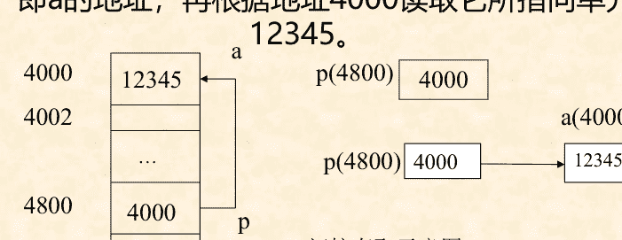

这种间接的通过变量p得到变量a的地址，再存取变量a的值的方式即为“间接存取”。

通常称变量p指向变量a，变量a是变量p所指向的对象

#### 3. 指针的概念

- 在C语言中，用指针来表示一个变量指向另一个变量这样的指向关系。
- 所谓指针即地址。
- 一个变量的指针即该变量的地址，如4000就是指向变量a的指针。

指针变量：专门存放地址的变量，如p即是一个指针变量，它存放的是a的地址4000。

指针变量有三个属性：

- （1）该指针变量名
- （2）该指针变量指向的变量的类型；
- （3）该指针变量指向哪一个变量，即该指针变量的值是多少。

#### 2. 指针变量初始化

(1) 指针运算符与地址运算符

与指针引用有关的两个运算符：&与*。

&: 取地址运算符

*: 指针运算符或称指向运算符、间接访问运算符。

指针指向的对象的表示形式：

*指针变量

注意*的使用：

- 定义时表明该变量为指针变量
- 使用时为指针（取值）运算符，是访问指针所指向对象的运算符。

#### (2) 指针变量初始化

若有定义： int a,*p;

语句仅仅定义了指针变量p，但指针变量并未指向确定的变量(或内存单元)。因为这些指针变量还没有赋给确定的地址值，只有将某一具体变量的地址赋给指针变量之后，指针变量才指向确定的变量（内存单元）。

指针变量初始化:在定义指针时同时给指针一个初始值

```
如： int a,*pa=&a;
```

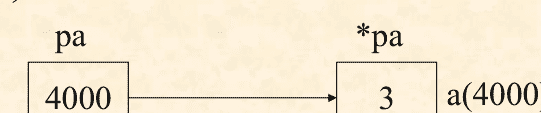

#### (3) 指针变量的引用

- ① *指针变量名——代表所指变量的值。
- ② 指针变量名——代表所指变量的地址。

有定义： int a,*p=&a;

用*p来表示p指向的对象a,*p与a是等价的。

*p可以象普通变量一样使用。 例如：

```
a=12;
*p=12;
scanf("%d",&*p);  scanf("%d",p);
printf(" %d%d" ,*p,a);
```

注意：*与&具有相同的优先级，结合方向从右到左。这样，&*p即&(*p),是对变量*p取地址，它与&a等价；p与&(*p)等价，a与*(&a)等价。

## 8.1.3 指针运算

指针运算实际上是地址的计算，包括赋值运算、算术运算、关系运算三种。

#### 1. 指针的赋值运算

（1）将变量地址值赋给指针变量，使指针指向该变量。

设有如下定义：

```
int a,b,*pa,*pb;
float *pf;
```

第一行定义了整型变量a,b及指针变量pa,pb。pa、pb还没有被赋值，因此pa、pb没有指向任何变量，下面语句完成对pa,pb的赋值：

```
pa=&a;    pb=&b;
```

```
例如：
int j,k;
int *pointer1,*pointer2;
pointer1=&j;
pointer2=&k;
```

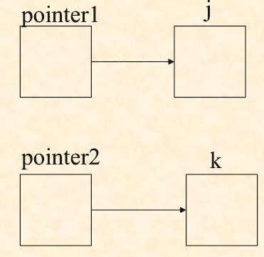

#### （2）相同类型的指针变量间的赋值

pa与pb都是整型指针变量，它们间可以相互赋值，如：pb=pa；即 pa、pb 都指向变量a，此时 a、*pa、*pb 是等价的。指针指向变化如下图：

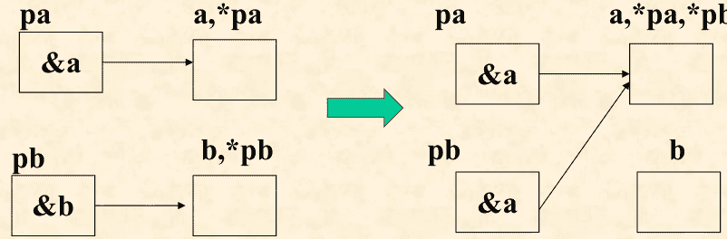

**注意：** 只有相同类型的指针变量才能相互赋值，如pf=pa；是不允许的。因为pa是整型指针，pf是浮点型指针。

#### （3）给指针变量赋空值

给指针变量赋空值，说明该指针不指向任何变量。

“空”指针值用NULL表示，NULL是在头文件stdio.h中预定义的常量，其值为0，在使用时应加上预定义行,如：

```
#include "stdio.h"
int *pa=NULL;
```

亦可以用下面的语句给指针赋“空值”：

```
pa=0; 或: pa='\0';
```

这里指针pa并非指向0地址单元，而是具有一个确定的“空值”，表示pa不指向任何变量。

注意：指针虽然可以赋值0，但却不能把其它的常量地址赋给指针。例如： pa=4000; 是非法的。

# 例 8.1 指针定义与赋值

```
main()
{int a,b;
int *pointer_1,*pointer_2;
a=100;b=10;
pointer_1=&a;
pointer_2=&b;
printf("%d,%d\n",a,b);
printf("%d,%d\n",*pointer_1,*pointer_2);
}
```

程序运行结果：
100, 10
100, 10

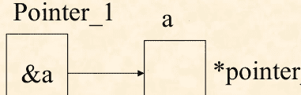

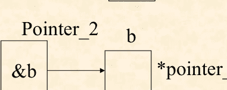

# 例8.2 从键盘上输入两个整数到a、b，按由大到小输出。

```
#include <stdio.h>
main()
{ int a,b,*pa=&a,*pb=&b,*p;
/*定义指针变量pa、pb,如下页图a*/
    scanf("%d%d",&a,&b);
    if (*pa<*pb) { p=pa;    /*进行指针交换,如下页图b,c*/
        pa=pb;
        pb=p;
    }
    printf("\n a=%d,b=%d\n",a,b);
    printf("\n max=%d,min=%d",*pa,*pb);
    /* pa指向大数， pb指向小数*/
}
```


若输入：12 22↵  
输出结果：a=12，b=22  
max=22，min=12

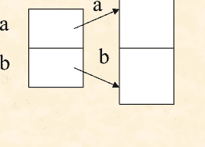

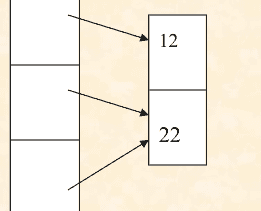

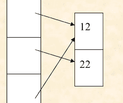

### 指针变化示意图

(a)

(b)

(c)

### 2. 指针的算术运算

指针变量做 `++`、`--`、`+`、`-` 等运算，指针增量的运算不是单纯的算术运算，而是地址按数据个数增加所指目标变量字节个数。

（1）加减运算：一个指针可以加、减一个整数 n，其结果与指针所指对象的数据类型有关。指针变量的值应增加或减少“n×sizeof(指针所指对象的类型)”。

加减运算常用于数组的处理，对指向一般数据的指针，加减运算无实际意义。

例如：

```c
int a[10], *p = a, *x;

x = p + 3; /* 实际上是 p 加上 3*2 个字节赋给 x */
```

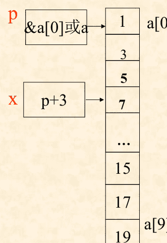

### 说明：

对于不同基类型的指针，指针变量“加上”或“减去”一个整数 n 所移动的字节数（= sizeof(指针所指对象的数据类型)）是不同的。

例如：

```c
float a[10], *p = a, *x;
x = p + 3; /* 实际上是 p 加上 3*4 个字节赋给 x，x 依然指向数组的第三个分量 */
```

### (2) 自增自减运算

指针变量自增、自减运算具有上述运算的特点，但有前置后置、先用后用的考虑，务请小心。例如：

```c
int a[10], *p = a, *x;
```

```c
x = p++; /* x 指向第一个元素分量，p 指向第二个元素 */
```

```c
x = ++p; /* x、p 均指向数组的第二个分量 */
```

- `*p++` 相当于 `*(p++)`。
- `(p++)` 与 `(*p)++` 含义不同，前者表示地址自增，后者表示当前所指向的数据自增。

### 小结：

设 px 与 py 是指向具有相同类型且连续存储的一组数据的指针，n 代表整数，则指针可以进行加减运算有：`px+n`、`px-n`、`px++`、`++px`、`px--`、`--px`、`px-py`。

- (1) 指针加或减一个整数 n，计算结果仍然是一个地址量，它是以运算数的地址量为基点，前方或后方第 n 个数据的地址。
- (2) 指针的算术运算只允许加减运算，不允许乘除及移位运算，不允许两个指针之间进行加运算，也不允许指针加减实型数据。
- (3) 两个指针允许进行相减运算，结果是一个整数，表示这两个指针所指地址之间数据个数。

### &、* 使用说明：

（1）已知 `p1=&i1`；`&*p1` 为：

`&`、`*` 优先级相同，但为右结合性（单目运算符）

∴ `&*p1` ⟹ `&i1`，即变量 `i1` 的地址。

（2）`*&i1` 的含义

`*&i1` ⟹ `*p1` ⟹ `i1`，即变量 `i1`。

（3）`(*p1)++` ⟹ `i1++`

`*` 与 `++` 同一级别，为右结合性。

而 `*p1++` 相当于 `*(p1++)`，先得 `p1` 所指向的变量的值，然后 `p1+1`，`p1` 不再指向 `i1` 了。

### 3. 指针的关系运算

两指针之间关系运算表示它们所指向的地址位置关系。指针的关系运算符包括：`==`、`!=`、`<`、`<=`、`>`、`>=` 6种。

指向同一数据类型的指针，才有可能进行关系运算。若 p、q 是两个同类型的指针变量，则：`p>q`、`p<q`、`p==q`、`p!=q`、`p>=q` 都是允许的。

指针的关系运算在指向数组的指针中得到广泛的运用，假设 p、q 是指向同一数组的两个指针，执行 `p>q` 的运算，其含义为，若表达式结果为真（非0值），则说明 p 所指元素在 q 所指元素之后。或者说 q 所指元素离数组第一个元素更近些。

注意：在指针进行关系运算之前，指针必须指向确定的变量或存储区域，即指针有初始值。

### 8.1.4 多级指针

把指向指针型数据的指针变量称为指向指针的指针，或称多级指针。

二级指针的定义形式如下：

```c
数据类型 **指针变量
```

例如：

```c
int a, *p, **pp;
a = 22;
p = &a;
pp = &p;
```

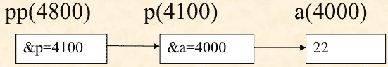

假设变量 a 的地址为 4000，指针 p 的地址为 4100，二级指针 pp 的地址为 4800。a、p、pp 三者的关系如上图。

## 8.2 指针与函数

### 8.2.1 指针作为函数参数

利用指针作函数参数，可以实现函数之间多个数据的传递，当形参为指针变量时，其对应实参可以是指针变量或变量地址（存储单元地址）。

例8.3 编写一个交换两个变量的函数，在主程序中调用，实现两个变量值的交换。

```c
#include <stdio.h>
void swap(int *p1, int *p2)
{
    int temp;
    temp = *p1;   /* 交换指针 p1、p2 所指向的变量的值 */
    *p1 = *p2;
    *p2 = temp;
}

main()
{
    int a, b;
    int *pa, *pb;
    scanf("%d%d", &a, &b);
    pa = &a;              /* pa 指向变量 a */
    pb = &b;              /* pb 指向变量 b */
    swap(pa, pb);
    printf("\na=%d,b=%d\n", a, b);
}
```

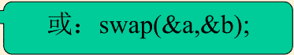

程序运行结果如下：

输入：12  22↵  
输出：a=22，b=12

### 两点说明：

(1) 若在函数体中交换指针变量的值，实参 a、b 的值并不改变，指针参数亦是传值。例如：

```c
int *p;
p = p1;
p1 = p2;
p2 = p;
```

不要期望如此完成处理。

(2) 函数中交换值时不能使用无初值的指针变量作临时变量。例如：

```c
int *p;
*p = *p1;
*p1 = *p2;
*p2 = *p;
```

p 无确定值，对 p 的使用可能带来不可预期的后果。

3. 调用形式：`指针函数名`（实参表列）；

例8.3 分析如下程序

```c
main()
{
    int a, b, *p;
    int *max(int x, int y);
    scanf("%d,%d", &a, &b);
    p = max(a, b);
    printf("max=%d", *p);
}

int *max(int x, int y)
{
    static int m;
    if (x > y) m = x;
    else m = y;
    return (&m);
}
```

### 8.2.3 指向函数的指针

- 一个函数包括一组指令序列，存储在某一段内存中，这段内存空间的起始地址称为**函数的入口地址**。
- 称函数入口地址为**函数的指针**。**函数名**代表函数的入口地址。
- 可以定义一个指针变量，其值等于该函数的入口地址，指向这个函数，这样通过这个指针变量也能调用这个函数。这种指针变量称为**指向函数的指针变量**。

1. 函数指针定义的一般形式为：

`类型标识符 (*指针变量名)();`

- 指针变量名两边的 `()` 不能省，它表示指针变量名先与 `*` 结合，是指针变量，然后再与后面的 `()` 结合，表示该指针变量指向函数。

例如：

```c
int (*p)();   /* 指针变量 p 可以指向一个整型函数 */
int *p()      /* 函数 p 的定义，其返回值是指向整型变量的指针 */
```

刚定义的指向函数的指针变量，亦象其它指针变量一样要赋以地址值才能引用。当将某个函数的入口地址赋给指向函数的指针变量，就可用该指针变量来调用所指向的函数。

给函数指针赋初值：将函数名（函数的入口地址值）赋给指针变量。

例如：

```c
int m, (*p)();
int max(int a, int b);
```

则可以：

```c
p = max; /* p 指向函数 max() */
```

### 指针调用函数的一般形式为：

```c
(*指针变量)(实参表);
```

如上例：

```c
m = (*p)(12, 22); /* 相当于 m = max(12,22); */
```

### 例 8.4 函数max()用来求一维数组的元素最大值，在主调函数中用函数名调用该函数与用函数指针调用该函数来实现。

```c
#include "stdio.h"

#define M 8
main()
{
    float sumf, sump;
    float a[M] = {11, 2, -3, 4.5, 5, 69, 7, 80};
    float (*p)();            /* 定义指向函数的指针 p */
    float max(float a[], int n); /* 函数声明 */
    p = max;                 /* 函数名（函数入口地址）赋给指针 p */
    sump = (*p)(a, M);       /* 用指针方式调用函数 */
    sumf = max(a, M);        /* 用函数名调用 max() 函数 */
    printf("sump=%.2f\n", sump);
    printf("sumf=%.2f\n", sumf);
}
```


```
float max(float a[],int n)
{  int k;
    float s;
    s=a[0];
    for (k=0;k<n;k++)
        if (s<a[k]) s=a[k];
    return s;
}
```

程序运行结果： sump=80.00
sumf=80.00

用函数指针调用函数是间接调用，没有参数类型说明，C编译系统也无法进行类型检查，因此，在使用这种形式调用函数时要特别小心。实参一定要和指针所指函数的形参类型一致。

函数指针可以作为函数参数，此时，当函数指针每次指向不同的函数时，可执行不同的函数来完成不同的功能

# 第8章 指针

```c
#include <stdio.h>
int add(int a, int b)
{
    return a+b;
}
int sub(int a, int b)
{
    return a-b;
}
int compute(int x, int y, int (*func)())
{
    int result;
    result=(*func)(x, y);
    return result;
}
void main()
{
    int x=10,y=5;
    printf("%d+%d=%d\n", x, y, compute(x, y, add));
    printf("%d-%d=%d\n", x, y, compute(x, y, sub));
}
```

结果：

10+5=15

10-5=5

### 指向函数的指针的使用步骤：

- （1） 定义一个指向函数的指针变量，形如：

```
float (*p)();
```

- （2） 为函数指针赋值，格式如下：

```
p=函数名;
```

注意：赋值时只需给出函数名，不要带参数。

- （3） 通过函数指针调用函数，调用格式如下：

```
s=(*p)(实参);
```

## 8.3 指针与数组

### 8.3.1 指向一维数组的指针

数组名是一个常量指针，它的值为该数组的首地址

- 1. 指向数组的指针的定义方法与指向基本类型变量的指针的定义方法相同，例如：

```
int a [10] = {1, 3, 5, 7, 9};
int *p;
p=&a[2]; (把数组元素a[2]的地址赋给指针变量p)
p=a;  (把数组的首地址赋给指针变量p)
```

C语言规定：数组名代表数组首地址,是一个地址常量。

因此，下面两个语句等价：

```
p=&a[0];
p=a;
```

在定义指针变量的同时可赋初值：

```
int a[10], *p=&a[0]; (或 int *p=a;)
```

等价于： int *p;

```
p=&a[0]; 两句。
```

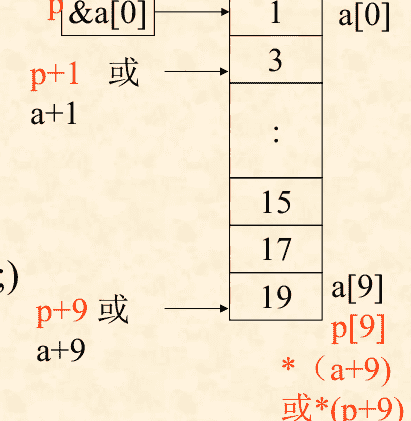

### 2. 通过指针引用数组元素

```
*p=5;
```

表示对p当前所指的数组元素赋以一个值5。

C规定:p+1指向数组的下一元素(而不是将p值简单地加1)。p+1意味着使p的原值（地址）加d个字节（d为一个数组元素所占的字节数）。

引用的形式：

如果p的初值为&a[0],则：

- （1） p+i和a+i就是a[i]的地址，或者说它们指向a数组的第i个元素（见下页图）。
- （2） *(p+i)或*(a+i)是p+i或a+i所指向的数组元素，即a[i]。
- （3） 指向数组的指针变量也可以带下标，如p[i]与*(p+i)、a[i]等价。

# a数组

p

p+1,a+1

a[0]

a[1]

a[2]

p+i, a+i

*(p+i) a[i]

p+9, a+9

a[9]

- 综上所述，引用一个数组元素有二法：
- （1）下标法：如a[i]形式；
- （2）指针法：如*(a+i)或 *(p+i)。其中a是数组名，p是指向数组的指针变量，其初值p=a。

### 例8.5 用三种方法输出数组全部元素。

(1) 下标法

```
main()
{
int a[10];
int i;
for (i=0;i<10;i++)
scanf("%d",&a[i]);
printf("\n");
for (i=0;i<10;i++)
printf("%d", a[i]);
}
```

# (2)通过数组名计算数组元素地址,输出元素的值

```
main()
{int a[10];
int i;
for (i=0;i<10;i++)
scanf("%d",&a[i]);
printf("\n");
for (i=0;i<10;i++)
printf("%d", *(a+i));
}
```

# （3）用指针变量指向数组元素

```
main()
{int a[10];
int *p,i;
for (i=0;i<10;i++)
scanf("%d",&a[i]);
printf("\n");
for (p=a;p<(a+10);p++)
printf("%d",*p);
}
```

- • 三种方法的比较：

用下标法比较直观，能直接知道是第几个元素；

而用指针法则执行效率更高。

### 使用指针变量时，应注意：

- （1）指针变量可实现使本身的值改变。
- P++合法；但a++不合法（a是数组名，代表数组首地址，在程序运行中是固定不变的。）

- （2）要注意指针变量的当前值。

```
main()
{int a[10];
int *p, i;
p=a;
for ( ;p<a+10;p++)
    scanf("%d",p);
printf("\n");
for ( ;p<(a+10);p++)
printf("%d", *p);
}
```

不能&p

增加： p=a;

| 表达式 | 含义 |
|---|---|
| p++ | 指向下一个元素a[1] |
| *p++ | 相当于*(p++)，先得p指向的变量的值，p再加1 |
| *++p | 先p+1，再取*p |
| (*p)++ | p所指向的元素的 值加1 |
| *(++p) | 同*++p |

若p=a，则输出*(p++)是先输出a[0]，再让p指向a[1]；
输出*(++p)是先使p指向a[1]，再输出p所指的a[1]。

### 8.3.2 二维数组的指针表示法

### 1. 二维数组元素的地址

为了说明问题，我们定义以下二维数组：

```
int a[3][4]={{0,1,2,3},{4,5,6,7},{8,9,10,11}};
```

a为二维数组名，此数组有3行4列，共12个元素。但也可这样来理解，数组a是一个一维数组，由三个元素组成：a[0], a[1], a[2]。而它其中每个元素又是一个一维数组，且都含有4个元素（相当于4列），例如，a[0]所代表的一维数组所包含的4个元素为a[0][0], a[0][1], a[0][2], a[0][3]。如下图所示：

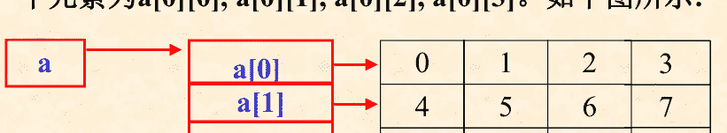

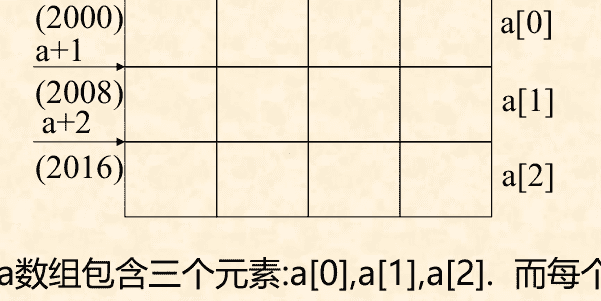

上图 a数组包含三个元素:a[0],a[1],a[2]. 而每个元素又是一个一维数组,它包含4个元素(即4个列元素)
如:a[0]又包含:a[0][0],a[0][1],a[0][2],a[0][3].
a代表第0行的首地址,a+1代表第1行的首地址,a+2代表第2行的首地址.每行存放4个整型数据(即1个元素占2个字节),因此,这里+1的含义是:+4*2=+8个字节.

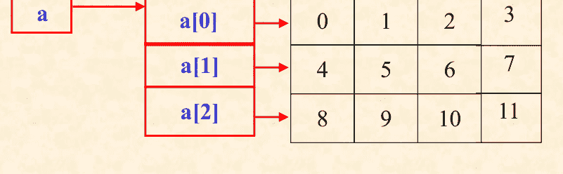

既然我们把a[0], a[1], a[2]看成是一维数组名，可以认为它们分别代表它们所对应的数组的首地址，也就是说，a[0]代表第0行中第0列元素的地址,即&a[0][0], a[1]是第1行中第0列元素的地址，即&a[1][0], 根据地址运算规则,a[0]+1即代表第0行第1列元素的地址,即&a[0][1], 一般而言, a[i]+j即代表第i行第j列元素的地址,即&a[i][j]。

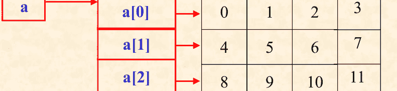

另外，如前所述，在一维数组中a[0]与*(a+0)等价，a[1]与*(a+1)等价，因此a[i]+j就与*(a+i)+j等价，它表示数组元素a[i][j]的地址。

因此，二维数组元素a[i][j]可表示成*(a[i]+j)或*(*(a+i)+j)，它们都与a[i][j]等价。

# 第8章 指针

数组名a代表整个二维数组的首地址：

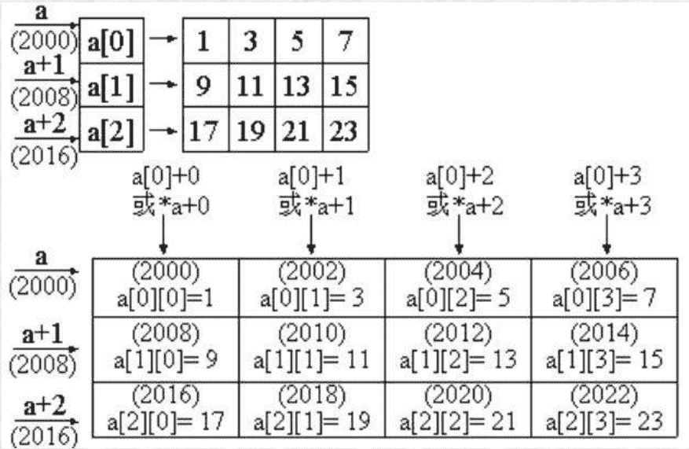


- 一维数组名a[i]: 代表第i行的首元素地址，即第i行中第0列元素的地址（即&a[i][0]）。
- a[i]+j: 代表第i行中的第j个元素的地址,即为&a[i][j]。
- 注意地址变化的单位数值在不同的场合的实际字节数是不同的：
  “a+1”中的“1”实际代表数组中一行元素所占的总字节数；
  “a[i]+1”中的“1”代表数组中一个元素所占的字节数。

## 例8.6 用指针表示法输出二维数组的各元素。

```c
#include<stdio.h>

main()
{ static int a[2][3]={{0,1,2},{3,4,5}};
  int k,j,*p;
  for (j=0;j<2;j++)        /* 方式1 */
  { for (k=0;k<3;k++)
      printf("%5d",*(a[j]+k));
    /* a[j]是行首地址，a[j]+k是行k列元素的地址*/
    putchar('\n');
  }
  putchar('\n');
}
```

```
for (j=0;j<2;j++)
    /* 方式2 */
{ for (k=0;k<3;k++)
    printf("%5d",*(*(a+j)+k));
    /* *(a+j)是j行首地址，*(a+j)+k是j行k列元素的地址 */
    putchar( '\n' );
}
p=a[0];
    /* p指向数组的第一个元素 */
for (j=0;j<2;j++)
    /* 方式3 */
{ for (k=0;k<3;k++)
    printf("%5d",*(p++)); /* 输出p所指示的元素 */
    putchar( '\n' );
}
```

输出的结果是：
0 1 2
3 4 5
0 1 2
3 4 5
0 1 2
3 4 5

## 2. 指向二维数组的指针变量

有两种情况：一是直接指向数组元素的指针变量；二是指向一个含有m个元素的一维数组。

这两种不同形式的指针变量，其使用方法不同。

(1) 指向数组元素的指针变量，即简单指针变量，如：

```c
int *p,a[3][4];
p=&a[1][2];
```

(2) 指向由m个元素组成的一维数组的指针变量

定义形式：　类型　（*指针变量）[元素个数]

```c
如：　int (*p)[4];
```

## 例8.12

```c
main()
{int a[3][4]={1,3,5,7,9,11,13,15,17,19,21,23};
int *p;
for(p=a[0];p<a[0]+12;p++)
{if((p-a[0])%4==0) printf("\n");
printf("%4d", *p); }
}
```

运行结果: 1    3    5    7
          9   11   13   15
         17   19   21   23

## 例8.13

```c
main()
{int a[3][4]={1,3,5,7,9,11,13,15,17,19,21,23};
int (*p)[4], i, j;
p=a;
scanf("i=%d,j=%d",&i, &j);
printf("a[%d,%d]=%d\n", i, j, *(*(p+i)+j));
}
```

运行结果: i=1,j=2

a[1,2]=13

## 注意：

（1）int (*p)[4]; 定义一个指针变量p ,p 指向包含4个元素的一维数组。

（2）p+i与 *(p+i)的区别：

p+i是指向第i行的指针（第i行的首地址）;

*(p+i)是指向第i行第1个元素的地址;

两者数值相等，但含义不同：p+i 的增值将以行长为单位，而*(p+i)增值将以元素长度为单位。

即： p+i+1将指向第i行再下一行的首地址，而*(p+i)+1 将指向第i行首元素的下一个元素地址。(见下图)

设 int a[3][4],(*p)[4];

```
p=a;
```

如果p先指向a[0],则p+1不是指向a[0][1],而是指向a[1]

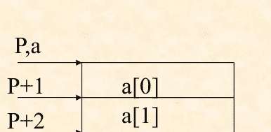

## 8.4 指针与字符串

### 8.4.1 字符串的指针表示法

在C程序中访问一个字符串有两种方法：**字符数组**和**字符指针**

- 1. 用字符数组来存放字符串，然后输出该字符串；

```c
main()
{
    static char string[]="I Love China!";
    printf("%s\n",string);
}
```

运行时输出：I Love China!

- 2. 用字符指针指向一个字符串：

字符指针可以指向字符数组，也可以指向字符串。字符指针的定义、赋值、引用与数组指针基本相同。

通常称char型指针为字符串指针或字符指针。

用字符指针指向字符串：

字符指针变量的定义： char *指针变量；

如： char *p;

(1) 在定义时初始化指针变量使指针指向一个字符串。

```c
main()
{char *string="I Love China!"; (初始化string)
printf("%s\n", string);
}
```

运行时也输出：

I Love China!

```
char *str = "I love china", str1[40];
```

等价于下列两句：

```
char *str ;
str = "I love china" ;
```

以上语句的含义：

定义str为指针变量，它指向字符型数据，且赋值语句把字符串 “I love china ”的首地址赋给了指针变量str。

对字符串的整体输出实际上还是从指针所指示的字符开始逐个显示（系统在输出一个字符后自动执行p++），直到遇到字符串结束标志符 ‘\0’为止。而在输入时，亦是将字符串的各字符自动顺序存储在p指示的存储区中，并在最后自动加上 ‘\0’。

```
Str1 = "I love china";
??
```

### （2）用指针变量来实现对字符串的访问

## 例8.8 将一已知字符串第n个字符开始的剩余字符复制到另一字符串中。

```c
main()
{int i,n;
char a[]="computer";
char b[10],*p,*q;

p=a;
q=b;
scanf("%d",&n);
if (strlen(a)>=n) p+=n-1;
/*指针指到要复制的第一个字符 */
```

# 第8章 指针

```
for (;*p!='\0';p++,q++)
    *q=*p;
*q='\0';  /* 字符串以 '\0' 结尾 */
printf("String a :%s\n",a);
printf("String b :%s\n",b);
}
```

输入：3k

输出：computer
      mputer

考虑一下，若输出语句改为如下语句会如何？

```
printf("string a is :%s\n",p);
printf("string b is %s\n",q);
```

注意：其它类型的数组，是不能用数组名来一次性输出它的全部元素的，只能逐个元素输出。

例如：

```
int array[10]={.....};
```

......

```
printf("%d\n",array);    /*这种用法是非法的*/
```

## 3. 字符指针变量与字符数组之比较

虽然用字符指针变量和字符数组都能实现字符串的存储和处理，但二者是有区别的，不能混为一谈。

- （1）存储内容不同。

字符指针变量中存储的是字符串的首地址，而字符数组中存储的是字符串本身（数组的每个元素存放一个字符）。

## 8.4.2 字符串数组

字符串数组：是指数组中的每个元素都是一个存放字符串的数组。

字符串数组可以用一个二维字符数组来存储。

例如：`char language[3][10];`

数组的第一个下标决定字符串的个数，第二个下标是字符串的最大长度（实际最多9个字符，‘\0’占一位置）。

可以对字符串数组赋初值。例如：

```
char language[3][10]={“Basic”, “c++”, “pascal”}
```

## 8.5 指针数组与命令行参数

### 8.5.1 指针数组

指针数组：是指针变量的集合。即它的每一个元素都是指针变量，且都具有相同的存储类别和指向相同的数据类型。

指针数组的定义形式为：

类型标识符 *数组名[数组长度说明];

例如： int *p[10];

由于[]比*的优先级高，因此p先与[10]结合成p[10]，而p[10]正是数组的定义形式，共10个元素。最后p[10]与*结合，表示它的各元素可以指向一个整型变量。

注意:指向一维数组的指针变量int (*p)[4];
与指针数组int *p[4];的区别


指针数组广泛应用于对字符串的处理

例如有定义：

```
char *p[3];
```

定义了一个具有三个元素p[0]，p[1]，p[2]的指针数组。每个元素都可以指向一个字符数组，或字符串。

若利用数组初始化，则：

```
char *p[3] = {"Basic", "c++", "pascal"};
```

P[0]指向字符串 “Basic”；

P[1]指向字符串 “c++”；

P[2]指向字符串 “pascal”；

### 例8.9　字符指针数组的赋值

```c
#define NULL 0
main( )
{
    static char a[ ]="Fortran";
    static char b[ ]="COBOL";
    static char c[ ]="Pascal";
    int i;  char *p[4];
    p[0]=a; p[1]=b; p[2]=c; p[3]=NULL;
    for (i=0;p[i]!=NULL;i++)
        printf("Language %d is %s\n",i+1,p[i]);
}
```

### 例8.10 有若干本书，将书名按字典顺序排序

```c
#include<stdio.h>
#include<string.h>
main()
{ char *bname[]={"Programming in ANSI C","BASIC","Visual C++ 6.0 Programming ","TRUBO C 2.0"};
int i,m;
void sort(char *name[],int);
m=sizeof(bname)/sizeof(char *); /*字符串个数*/
sort(bname,m);        /* 排序，改变指针的连接关系*/
printf("\n");
for (i=0;i<m;i++)     /*输出排序结果*/
printf("%8s",bname[i]);
}
```

# 第8章 指针

```c
void sort(char *name[], int n)  /*选择排序*/
{char *t;
 int i,j,k;                         /* k记录每趟最小值下标 */
 for (i=0;i<n-1;i++)
   {k=i;
      for (j=i+1;j<n;j++)
        if (strcmp(name[k],name[j])>0) k=j;  /* 第j个元素更小 */
        if (k!=i)   /* 最小元素是该趟的第一个元素则不需交换 */
          { t=name[i];name[i]=name[k];name[k]=t;}
   }
}
```

输出结果为:

BASIC Programming in ANSI C  TRUBO C 2.0
Visual C++ 6.0 Programming

### 8.5.2 指针数组与命令行参数

在操作系统命令状态下，可以输入程序或命令使其运行，称命令行状态。输入的命令（或运行程序）及该命令（或程序）所需的参数称为命令行参数。

main函数是可以有参数的，但与普通函数不同。

带形参的main()函数的一般形式是：

```
main (int argc, char *argv[])
{ ... }
```

形参argc记录命令行中字符串的个数，argv是一个字符型指针数组，每一个元素顺序指向命令行中的一个字符串。

### 1.main()函数的形参与实参

main（ ）函数由系统自动调用，而不是被程序内部的其它函数调用，main()函数所需的实参不可能由程序内部得到，而是由系统传送。

main（ ）函数所需的实参与形参的传递方式也与一般函数的参数传递不同，实参是在命令行与程序名一同输入，程序名和各实际参数之间都用空格分隔。

格式为：执行程序名  参数1  参数2  ……  参数n

- **形参argc**为命令行中参数的个数（包括执行程序名），其值大于或等于1，而不像普通C语言函数一样接受第一个实参。
- **形参argv**是一个指针数组，其元素依次指向命令行中以空格分开的各字符串。

即：第一个指针argv[0]指向的是程序名字符串，argv[1]指向参数1，argv[2]指向参数2，……，argv[n]指向参数n。

### 2.命令行参数的传递示例

例8.11 分析下列程序，指出其执行结果，该程序命名为exam.c，经编译连接后生成的可执行程序为exam.exe

```
#include <stdio.h>
main (int argc, char * argv[])
{ int i=0;
    printf("argc=%d\n",argc);
    while (argc >=1)
    { printf("\n参数%d: %s",i,*argv);
        i++; argc--; argv++;
    }
}
```

若运行时的命令行输入的是:
exam Turbo_c C++ Vc

输出结果:
argc=4
参数0: exam
参数1: Turbo_c
参数2: C++
参数3: Vc

程序开始运行后，系统将命令行中字符串个数送argc,将四个字符串实参：exam、Turbo_c、C++、Vc的首地址分别传给字符指针数组元素argv[0]、argv[1]、argv[2]、argv[3]。

### 8.6 程序举例

例8.12 输入一个十进制正整数，将其转换成二进制、八进制、十六进制数输出

分析：

- (1) 将十进制数n转换成r进制数的方法是：n除以r取余数作为转换后的数的最低位。若商不为0，则商继续除以r，取余数作为次低位……，以此类推，直到商为0为止。
- (2) 对于十六进制数中大于9的六个数字是用A, B, C, D, E, F来表示。
- (3) 所得余数序列转换成字符保存在字符数组a中。
- (4) 字符 ‘0’ 的ascii码是48，故余数0~9只要加上48就变成字符 ‘0’ ~ ‘9’ 了；余数中大于9的数10~15要转换成字母，加上55就转换成 ‘A’、‘B’、‘C’、‘D’、‘E’、‘F’ 了。
- (5) 由于求得的余数序列是低位到高位，而屏幕显示先显示高位，所以输出数组a时要按顺序逆序输出

```c
#include "stdio.h"
main()
{
    int i,radix;
    long n;
    char a[33];
    void trans10_2_8_16(char *b,long m,int base);
    printf("\nInput radix(2,8,16):");/* 输入转换基数 */
    scanf("%d",&radix);
    printf("\nInput a positive integer:");/* 输入被转换的数 */
    scanf("%ld",&n);
    trans10_2_8_16(a,n,radix);
    for (i=strlen(a)-1;i>=0; i--)    /*逆向输出字符串*/
        printf("%c",*(a+i));        /* *(a+i) 即a[i] */
    puts("\n");
}
```

# 第8章 指针

```c
void trans10_2_8_16(char *p,long m,int base)
{
    int r;
    while (m>0)
    {
        r=m%base;        /* 求余数 */
        if (r<10) *p=r+48;  /* 小于10的数转换成字符后送p指向的元素 */
        else *p=r+55;       /* 数10~15转换成A~F后送p指向的元素*/
        m=m/base;
        p++;        /*指针下移*/
    }
    *p='\0';  /*在最后加上字符串结束标志*/
}
```

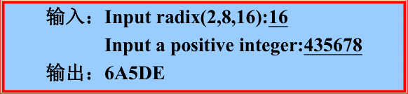

# 第九章 结构体与链表

### 内容提要

- 结构体类型的定义
- 结构体类型变量
- 结构体类型数组
- 结构体类型指针
- 结构体与函数
- 链表


### 结构体概述(1)

- 结构体
  1. 什么叫结构体：把不同类型的数据组合成一个整体的自定义数据类型，是一种构造数据类型。
  2. 结构体类型定义

```
struct [结构体名]
{
    类型标识符   成员名1;
    类型标识符   成员名2;
    ............
};
```

struct是关键字，不能省略

合法标识符
可省:无名结构体

成员类型可以是基本型或构造型


## 结构体概述（2）

- • 定义结构体类型，描述下列数据

  (1) 学生情况：包含学生的学号、姓名、性别、年龄、C语言课程成绩：

```
struct student
{int no;                 /*学号*/
 char name[10];          /*姓名*/
 char sex;               /*性别*/
 int age;                /*年龄*/
 float score;            /*C成绩*/
};
```

注：‘;’不能省

> 结构体类型定义描述结构的组织形式，不分配内存

如考虑10门课程成绩，加上总成绩与平均成绩，可作如下定义：

```
struct student
{int no;                 /*学号*/
char name [10] ;        /*姓名*/
char sex;               /*性别*/
int age;                /*年龄*/
float score [10] ;      /*10门课程成绩*/
float tcj, acj;         /*总成绩，平均成绩*/
};
```

- - 定义结构体类型，描述下列数据
  - (2)个人数据：包含姓名、性别、年龄、身高、体重、住址：

```
struct person
{char name [20] ;  /*姓名*/
char sex;          /*性别*/
int age;           /*年龄*/
float height;      /*身高*/
float weight;      /*体重*/
char addr [50] ;   /*住址*/
};
```

## 结构体类型变量的定义(1)

- • 先定义结构体类型，再定义结构体变量

一般形式：

```
struct 结构体名
{
    类型标识符 成员名;
```

```
例 struct student
{
    int num;
    char name
    char sex;
    int age;
    float score
    char addr[
};
struct student
```

```
例 #define STUDENT struct student
STUDENT
{
    int num;
    char name[20];
    char sex;
    int age;
    float score;
    char addr[30];
};
STUDENT stu1,stu2;
```

## 结构体类型变量的定义(2)

- • 定义结构体类型的同时定义结构体变量

一般形式：

```
例  struct student
{  int num;
    char name[20];
    char sex;
    int age;
    float score;
    char addr[30];
}stu1,stu2;
```

```
struct 结构体名
{
    类型标识符  成员名;
    类型标识符  成员名;
    ............
}变量名表列;
```

## 结构体类型变量的定义(3)

- 直接定义结构体变量（匿名定义）

一般形式：

```
例  struct
{
  int num;
  char name[20];
  char sex;
  int age;
  float score;
  char addr[30];
}stu1,stu2;
```

```
struct
{
  类型标识符  成员名;
  类型标识符  成员名;
  ..........
}变量名表列;
```

用无名结构体直接定义变量只能一次

## 结构体类型声明的说明

- - 说明
  - 结构体类型与结构体变量概念不同
    - 类型:不分配内存； 变量:分配内存
    - 类型:不能赋值、存取、运算； 变量:可以

同变量名可相同，不会混淆

作用域与生存期

```
例 struct date
{
  int month;
  int day;
}
```

```
例 struct student
{
  int num;
  char name[20];
  struct date
  {
    int month;
    int day;
    int year;
  }birthday;
}stu;
```

| num | name | birthday |
|     |      | month | day | year |

| num | name | birthday |
|     |      | month | day | year |

## 结构体变量的使用(1)

- 由结构体变量名引用其成员

结构体变量不能整体引用,只能引用变量成员

引用方式： 结构体变量名.成员名

可以将一个结构体变量赋给另一个结构体变量

```
例 struct student
{ int num;
}
```

```
例 struct stu
{ int num;
char nam
struct da
{ int mo
int day
int year;
}birthday;
}stu1,stu2;
```

```
例 struct student
{ int num;
char name[20];
char sex;
int age;
float score;
char addr[30];
}stu1,stu2;
```

```
成员(分数线)运算特点
赋值：1
特性：从左向右
stu1.num=10;
stu1.score=85.5;
```

```
s("%d %s %c %f %s\n",stu1); (×)
```

```
stu1=stu2; (×)
```

```
stu1.score+=stu2.score;
```

```
stu1.age++;
```

```
lin",'M',19,87.5,"DaLian"); (×)
```

```
stu2=stu1; (√)
```

| birthday |
| num | name | month | day | year |

## 结构体变量的初始化（1）

- - 形式一：

```
struct　结构体名
{
    类型标识符　成员名;
    类型标识符　成员名;
    ...............
};
struct 结构体名 结构体变量={初始数据};
```

```
例  struct student
    {
        int num;
        char name[20];
        char sex;
        int age;
        char addr[30];
    };
struct student stu1={112,"Wang Lin",'M',19,"200 Beijing Road"};
```

## 结构体变量的初始化（2）

- - 形式二：

```
struct 结构体名
{
    类型标识符  成员名;
    类型标识符  成员名;
}
}结构体变量={初始数据};
```

```
例  struct student
    {
        int num;
        char name[20];
        char sex;
        int age;
        char addr[30];
    }stu1={112, “Wang Lin”, ‘M’, 19, “200 Beijing Road”};
```

## 结构体变量的初始化（3）

- 形式三：

```
struct
{
    类型标识符  成员名;
    类型标识符  成员名;
    ...
}结构体变量={初始数据};
```

例

```
struct
{
    int num;
    char name[20];
    char sex;
    int age;
    char addr[30];
}stu1={112,"Wang Lin",'M',19,"200 Beijing Road"};
```

## 结构体变量存储分配示意图

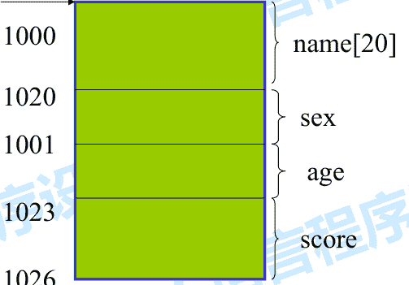

`stru1`

1000

1020

1001

1023

1026

`name[20]`

`sex`

`age`

`score`

## 例 9.1 求某同学上学期8门课程的总成绩与平均成绩。

程序如下：

```
main ()
{ int i;
    struct st
    {char xm [8] ;
    float cj [9] ;
    float tcj, acj;
    } stu;
```


## 结构体类型数组

- 结构体数组的定义

三种形式：

形式一：

形式二：

形式三：

```
struct
{
  int num;
  char name[20];
  char sex;
  int age;
}stu[2];
```

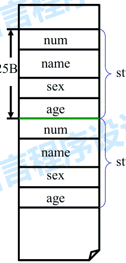

## 结构体数组初始化与引用

- 结构体数组初始化
- 结构体数组引用

引用方式：结构体数组名[下标].成员名

```c
struct student
{
    int num;
    char name[20];
}str[3];
```

```c
struct student
{
    int num;
    char name[20];
    char sex;
    int age;
}str[3];
```

```c
str[0] = {1, "Wang Lin", 'M', 20};
str[1] = {2, "Li Gang", 'M', 19};
strcpy(str[0].name, "Zhao Da");
```

```c
stu[1].age++;
```

全部初始化时维数可省

## 例 统计候选人选票

```c
struct person
{
    char name[20];
    int count;
}leader[3]={"Li",0,"Zhang",0,"Wang",0};
main()
{
    int i,j; char leader_name[20];
    for(i=1;i<=10;i++)
    {
        scanf("%s",leader_name);
        for(j=0;j<3;j++)
            if(strcmp(leader_name,leader[j].name)==0)
                leader[j].count++;
    }
    for(i=0;i<3;i++)
        printf("%5s:%d\n",leader[i].name,leader[i].count);
}
```

| name | count |
|---|---:|
| Li | 0 |
| Zhang | 0 |
| Wang | 0 |


## 总结：结构体成员变量引用方式

- ①结构体变量.成员名
- ②(*p).成员名
- ③p->成员名

其中，->称为指向运算符

请分析下列几种运算：

- ①p->n
- ②p->n++
- ③++p->n

## 指向结构体数组元素的指针

例 指向结构体数组的指针

```c
struct student
{ int num;
char name[20];
char sex;
int age;
}stu[3]={{10101,"Li Lin",'M',18},
{10102,"Zhang Fun",'M',19},
{10104,"Wang Min",'F',20}};
main()
{ struct student *p;
for(p=stu;p<stu+3;p++)
printf("%d%s%c%d\n",p->num,p->name,p->sex,p->age);
}
```

## 结构体变量作为函数参数

- 用结构体变量的成员作参数——值传递
- 用指向结构体变量或数组的指针作参数——地址传递
- 用结构体变量作参数——多值传递，效率低

## 链表概述（1）

- 所谓链表是指若干个数据项按一定的原则连接起来。
- 每个数据项都包含有若干个数据和一个指向下一个数据项的指针，依靠这些指针将所有的数据项连接成一个链表。
- 每个数据项称为一个“结点”。

## 链表概述（2）


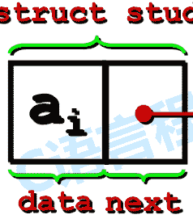

```c
struct student {
    long num;
    float score;
    struct student *next;
};
struct student *head;
```

## 一个简单链表示例：

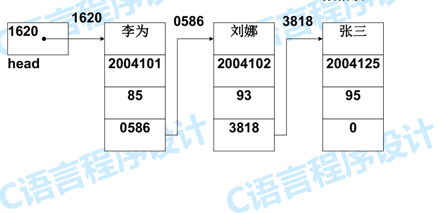

## 链表的基本操作

- 链表的建立
  - 从链尾到链头：新节点插入到链头
  - 从链头到链尾：新节点插入到链尾
- 链表的插入操作
  - 根据一定的条件，把新节点插入到指定位置
- 链表的删除操作
  - 根据一定的条件，删除一个或多个结点
- 链表的输出操作
- 链表的查找操作

## 建立链表操作（从链尾到链头）

① for(i=0; i<n; i++)

head

a_{i+1}

a_i

```c
④ head = p;
```

```c
③ p->next = head;
```

p

```c
② p = malloc(sizeof(struct node));
p->data = a[i];
```

## 建立链表操作（从链头到链尾）

① for(i=0; i<n; i++)

```c
⑤ p = q;
```

```c
④ p->next = q;
```

```c
③ q->next = NULL;
```

```c
② q = malloc(sizeof(struct node));
q->data = a[i];
```

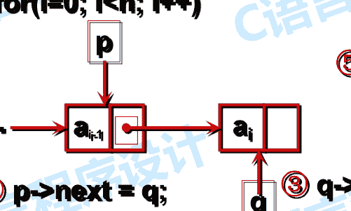

## 链表的插入操作

① if(p满足插入条件)


```c
② q = malloc(sizeof (struct node));
   q->data = x;
```

```c
③ q->next = p->next;
```

```c
④ p->next = q;
```

## 链表的删除操作

① if(p->next满足删除条件)

```c
② q = p->next;
```

```c
④ free(q);
```

```c
③ p->next = q->next;
```


## 链表的输出操作

① while(p)

```c
③ p = p->next;
```

```c
② printf("%d", p->data);
```


## 链表的查找操作

① while(num!=p1->num && p1!=NULL )

```c
③ p2=p1;p1=p1->next;
```

```c
② printf ("find: %ld %5.2f\n", num, p1->score);
```


(main)

| 变量 | 值 |
|---|---:|
| a | 27 |
| b | 3 |
| c | 30 |

arg

copy

(main)

| 变量 | 值 |
|---|---:|
| a | 27 |
| b | 3 |
| c | 30 |

(func)

| 参数 | 值 |
|---|---:|
| a | 27 |
| b | 3 |
| c | 30 |

arg

parm

(main)

| 变量 | 值 |
|---|---:|
| a | 27 |
| b | 3 |
| c | 30 |

(func)

| 参数 | 值 |
|---|---:|
| a | 18 |
| b | 5 |
| c | 90 |

arg

parm

(main)

| 变量 | 值 |
|---|---:|
| a | 27 |
| b | 3 |
| c | 30 |

arg


## 内存动态管理函数

- 动态分配存储
  - 根据需要开辟或释放存储单元

- 相关函数
  - `malloc`函数
  - `calloc`函数
  - `free`函数

- 说明
  - 应包含`malloc.h`或`stdlib.h`

## malloc函数

- 函数原型
  - `typedef unsigned size_t;`
  - `void *malloc(size_t size);`

- 参数
  - `size`: 分配存储空间的字节数

- 返回值
  - 若成功，返回指向分配区域起始地址的指针
  - 若失败，返回 `NULL`

## calloc函数

- 函数原型
  - `void *calloc(size_t n, size_t size);`
- 参数
  - `n`：分配内存的项目数
  - `size`：分配内存的每个项目的字节数
- 返回值
  - 若成功，返回指向分配区域起始地址的指针
  - 若失败，返回 `NULL`

## free函数

- 函数原型
  - void free(void *ptr);
- 参数
  - ptr:要释放的内存区地址
- 说明
  - 释放prt指向的内存区
  - 释放后的内存区能够分配给其他变量使用

## realloc函数

- 函数原型
  - void *realloc(void *ptr, unsigned int size)
- 参数
  - ptr: 需要改变存储空间的内存区地址
  - size: 将ptr所指的存储区的大小改为size个大小
- 说明
  - 用来使已分配的空间ptr改变大小，即重新分配

## 本章结束

同学们

# 再见！


# 第十章　文件

- 11.1　文件概述
- 11.2　标准文件操作

## 二、数据文件的存储形式

数据文件用于保存数据，其读写往往由应用程序实现。

- 1、**字符文件：**也称文本文件或正文文件，其数据以字符的形式出现，每个字符用一个 ASCII 代码（占一个字节）表示。

- 2、**二进制文件：**以数据在内存中的形式原样存于磁盘。

在 Turbo C 中，二进制文件中，整型数用2个字节表示，长整型用4个字节表示，实型数（浮点数）用4个字节，双精度数用8个字节表示。

## 第10章 文件

例: 十进制整数10000，在内存中占两字节，其存放形式是：0010,0111,0001,0000。在二进制文件中也按这种方式存放，占2个字节。在ASCII文件中，存放为31H、30H、30H、30H、30H，占5个字节，它们分别是1、0、0、0、0字母的ASCII码。


## 比较：

- 字符文件的每1个字节存储1个字符，因而便于对字符进行逐个处理。但一般占用存储空间较多，而且要花费转换时间（二进制与ASCII码之间的转换）。
- 二进制文件是把内存中的数据，原样输出到磁盘文件中。可以节省存储空间和转换时间，但1个字节并不对应1个字符，不能直接输出字符形式。

## 三、标准文件与非标准文件

1、标准文件系统：利用缓冲区将对磁盘文件进行操作的文件系统称为缓冲（或高层）文件系统，用户使用方便。

从内存向磁盘输出数据时，必须首先输出到缓冲区中。待缓冲区装满后，再一起输出到磁盘文件中。

从磁盘文件向内存读入数据时，则正好相反：首先将一批数据读入到缓冲区中，再从缓冲区中将数据逐个送到程序数据区。

2、非标准文件系统：不使用缓冲区的磁盘文件系统称为非缓冲（或低层）文件系统。编程难度较大，但程序的执行效率高，占用内存资源较少。

## 11.2 标准文件操作

## 一、标准文件FILE结构指针

要调用一个文件，需要有以下的信息：

- 文件当前的读写位置
- 与该文件对应的内存缓冲区的地址
- 文件操作方式等

1、每个被使用的文件都在内存中开辟一个区，用来存放文件的有关信息。这些信息是保存在一个结构体类型的变量中。该结构体类型是由系统定义的，取名为FILE。

2、标准文件系统借助FILE数据结构对文件进行管理，利用文件指针读写文件。每当程序成功打开一个文件，系统就在内存建立一个与该文件对应的FILE结构体变量，并返回该变量的指针（地址）。

## 第10章 文件

3、在程序中定义一个**指针变量**，用以**保存已打开文件**所对应的**FILE结构在内存的地址**，此后用户程序就可用此FILE指针来实现对指定文件的存取操作。定义文件指针变量的一般形式为：

```
FILE *文件结构指针变量名
例如：FILE *fp;
```

**注意：**

- 1) 只有通过文件指针，才能调用相应的文件。
- 2) 对文件操作的库函数，函数原型均在头文件stdio.h中。
- 3) 文件操作的过程：对磁盘文件的操作必须“先打开，再读写，最后关闭”。

## 二、标准文件的打开操作

“打开”文件的含义：以某种方式从磁盘上查找指定的文件或

创建 一个新文件。

## 1、文件的打开(fopen)函数

形式： FILE * fopen ( char *filename, char *mode) ;

- filename: 文件名(可以包含驱动器、路径、文件名、扩展名)
- mode: 打开方式
- FILE *: 返回值

1)如果成功打开，返回一个指向被打开文件的文件信息区的起始地址；

2)如果打开失败，返回一个NULL指针。

## 第10章 文件

## 2、文件打开方式参数

- “r”　　（只读）　为输入打开一个文本文件
- “w”　　（只写）　为输出打开一个文本文件
- “a”　　（追加）　向文本文件尾增加数据
- “rb”　 （只读）　为输入打开一个二进制文件
- “wb”　 （只写）　为输出打开一个二进制文件
- “ab”　 （追加）　向二进制文件尾增加数据
- “r+”　 （读写）　为读/写打开一个文本文件
- “w+”　 （读写）　为读/写建立一个新的文本文件
- “a+”　 （读写）　为读/写打开一个文本文件
- “rb+” （读写）　为读/写打开一个二进制文件
- “wb+” （读写）　为读/写建立一个新的二进制文件
- “ab+” （读写）　为读/写打开一个二进制文件

## 第10章 文件

## 4、**说明：**

- 1) 用“r”方式打开的文件应该已经存在，如果不存在则打开失败；
- 2) 用“w”方式打开的文件，如果不存在该文件，则新建立一个；如果存在该文件，则在打开时将该文件删去，然后重新建立一个新文件；
- 3) 如果希望向文件末尾添加新的数据（不希望删除原有数据），则应该用“a”方式打开；
- 4) 如果不能实现“打开”的任务，fopen 函数的返回值是一个 NULL 空指针。（其值在头文件 stdio.h 中被定义为 0）

## 第10章 文件

为增强程序的可靠性，常用下面的方法打开一个文件：

```
if((fp=fopen("文件名","操作方式"))==NULL)
{
    printf("can not open this file\n");
    exit(0);
}
```

## 关于exit()函数

- 1）用法：`void exit([程序状态值]);`
- 2）功能：关闭已打开的所有文件，结束程序运行，返回操作系统，并将“程序状态值”返回给操作系统。当“程序状态值”为0时，表示程序正常退出；非0值时，表示程序出错退出。

## 三、关闭标准文件

程序对文件的读写操作完成后，必须关闭文件，以保证文件的完整性。

格式： fclose（文件指针）;

- 1、 fclose(fp);

关闭 fp所指的文件，并返回一个整数值。

若成功地关闭了文件，则返回一个0值；否则返回一个非零值。

- 2、 fcloseall();

同时关闭程序中已打开的多个文件（标准设备文件除外），将各文件缓冲区未装满的内容写到相应的文件中去，并释放这些缓冲区，返回关闭文件的数目。


## 四、标准文件的读写操作

### 1、字符读写函数 fgetc 和 fputc

- int fputc(int c, FILE *fp) —— 把字符 c 写入 fp 所指的文件。
- int fgetc(FILE *fp) —— 从 fp 所指的文件中读一个字符，返回读得的字符。
- 对于文本文件，遇文件尾时返回 EOF（其值在头文件 stdio.h 中被定义为 -1）。
- 对于二进制文件，用 feof(fp) 判别是否遇文件尾。feof(fp)==1 说明遇文件尾。

## 第10章 文件

### 例1、函数 fgetc 和 fputc 的使用

```c
#include "stdio.h"
#include "conio.h"
main()
{
    FILE *fp1,*fp2;
    char file1[20],file2[20];
    char ch;
    clrscr();
    printf("please input file1's name:");
    scanf("%s",file1);
    fp1=fopen(file1,"r");
    if(fp1==NULL)
    { printf("can not open this file\n");
        exit(0);
    }
    printf("please input file2's name:");
    scanf("%s",file2);
    fp2=fopen(file2,"w");
    if(fp2==NULL)
    { printf("can not open this file\n");
        exit(0);
    }
    ch=fgetc(fp1);
    while(ch!=EOF)
        { fputc(ch,fp2); ch=fgetc(fp1); }
    fclose(fp1);
    fclose(fp2);
}
```

### 例2、函数 fputs 和 fgets 的使用

```c
#include <stdio.h>
main()
{
    FILE *fp;
    char *ch1="How are you!";
    char ch2[20];
    clrscr();
    fp=fopen("d:\\infile.txt","w+");
    if(fp==NULL)
    { printf("can not open this file\n");
      exit(0);
    }
    fputs(ch1,fp);
    rewind(fp);     /*用于把文件指针移到文件的开头。*/
    fgets(ch2, strlen(ch)+1, fp);
    printf("%s", ch2);
}
```

## 第10章 文件

### 3、格式化读写函数 fscanf 和 fprintf

- 格式：`fprintf(文件指针，格式控制，变量列表);`  
  `fscanf(文件指针，格式控制，变量地址列表);`
- 除增加“文件指针”外，与 `scanf()` 和 `printf()` 函数的功能相似。
- 例如：

```
int i=3; float f=9.80;
```

……

### 例3、函数 fscanf 和 fprintf 的使用

```c
main()
{
    FILE *fpr,*fpw;
    int j;
    clrscr();
    fpr=fopen("d:\\creatr.txt","r");
    fpw=fopen("d:\\creatw.txt","w");
    if(fpr==NULL || fpw==NULL)
    {printf("can not open file\n");
      exit(0);
    }

    for(j=0;j<number;j++)
        fscanf(fpr,"%ld,%s,%d",&test[j].num, test[j].name,&test[j].age);
    for(j=0;j<number;j++)
        fprintf(fpw,"%ld,%s,%d\n",test[j].num,test[j].name,test[j].age);
}
```

```c
#define number 3
#include <stdio.h>
#include <conio.h>
typedef struct
{
    long num;
    char name[10];
    int age;
}student;
student test[number];
```

## 第10章 文件

```c
int fread(void *buffer, unsigned size, unsigned count, FILE *fp);
```

从文件 fp 中读入 count 次，每次读 size 字节，读入的信息存在 buffer 指针指向的缓冲区。函数返回值等于实际读入的次数（可能少于 count）。

```c
typedef struct
    { long num;
      char name[10];
      int age;
    } student;
student test[3];
```

```c
for (j=0; j<number; j++)
```

```c
fread(&test[j], sizeof(student), 1, fp);
```

作用：按数据项（即数据块）进行操作，通过它们可以方便地对程序中的数组、结构体数据进行整体输入输出。函数操作完成后，将返回读出或写入的数据项项数。


### 读／写函数的选用原则：

从功能角度来说，fread() 和 fwrite() 函数可以完成文件的任何数据读／写操作。但是为方便起见，依下列原则选用：

1) 读／写 1 个字符（或字节）数据时：选用 fgetc() 和 fputc() 函数。

2) 读／写 1 个字符串时：选用 fgets() 和 fputs() 函数。

3) 整体读／写结构体或数组时：选用 fread() 和 fwrite() 函数。

4) 读／写 1 个（或多个）合格式的数据时：选用 fscanf() 和 fprintf() 函数。

## 四、标准文件的定位函数

文件中有一个位置指针，指向当前读写的位置。我们可以使用有关函数来改变其位置，以完成文件的随机读写。

### fseek() 函数：

调用形式为：fseek（文件类型指针，位移量，起始点）

说明：位移量一般是 long 型数据；起始点用 0、1 或 2 表示；

| 起始点具体位置 | 符号代表 | 数字代表 |
| --- | --- | --- |
| 文件的开头 | SEEK-SET | 0 |
| 文件指针现行位置 | SEEK-CUR | 1 |
| 文件尾 | SEEK-END | 2 |

函数的作用：是使文件指针移动到所需的位置；若调用成功，返回值为 0；否则返回一个非零值。

例如：
```c
fseek(fp,20L,0);
```
把文件指针从文件开头移到第 20 个字节处。

```c
fseek(fp,-20L,2);
```
把文件指针从文件尾向前移动 20 个字节。

### ftell() 函数：

调用形式为：ftell(文件类型指针)

函数的作用：得到文件指针离开文件起点的字节数。若调用不成功，返回 -1L，表示出错。

例如：
```c
long i;
i=ftell(fp); if(i==-1L) printf("error\n");
```

### rewind() 函数：

调用形式为：rewind(文件类型指针)

函数的作用：用于把文件指针移到文件的开头。移动成功时，返回值为 0，否则返回一个非零值。

