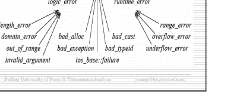
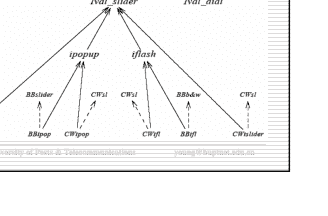
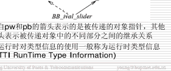

# 北邮C++课件（唐晓晟）


- 参考资料：  
  C++程序设计语言（特别版）裘宗燕（北京大学）译 Bjarne Stroustrup 机械工业出版社 ISBN 7-111-10202-9/TP.2424 85RMB C++ Primer, Lippman
- 课时：34学时（17周）
- 教学网站：  
  http://202.112.10.142/  
  http://teach.academy.net.cn/


- 书本结构
- 学习C++
- C++的设计
- 历史注释
- C++的使用
- C和C++
- 忠告


- 导论：1-3章，有关C++语言、所支持的关键性程序设计风格、有关C++标准库的综述
- 第一部分：4-9章，C++内部类型
- 第二部分：10-15章，使用C++做面向对象和通用型程序设计
- 第三部分：16-22章，C++标准库
- 第四部分：23-25章，设计和软件开发


- 最重要的事情：关注概念，不要迷失在语言的技术细节中
- C++支持多种不同的程序设计风格
- C++支持一种逐步推进的学习方式
- 直接学习C++，而不是先学习C
- 大量查阅资料，每一种至少参考两个来源


- 重要设计原则：简单性、与C的高度兼容
- 无内部高级数据类型，没有高级的基本操作
- 尽量避免了那些即使不用也会带来运行时间或者空间开销的特征
- 能够使用传统的编译和运行时的环境
- C++的类型检查和数据隐藏特征依赖于编译时对程序的分析，以防止因为意外而破坏数据的情况


- C++以C为基础开发设计，大量维护了C作为一个子集。C++可以使用与C一样的函数调用及返回序列或者其他效率更高的方式，而C的一个初始目标是在大部分时刻的系统程序设计中代替汇编
- C++中特别强调程序的结构，这反映了C以来程序规模增大的情况
- 本程序语言主要是提供通用功能、普遍有用的类型、库等的各种技术


- 程序设计语言要服务于两个相互关联的目的：1 为程序员提供一种描述所需执行的动作的载体，这样要求一种“尽可能接近机器”的语言
- 2 为程序员提供一组概念，使他们能利用这些概念去思考什么东西是能够做的，这要求该语言“尽可能接近需要解决的问题”
- C++的类概念已经证明是一种极为强有力的概念工具


- C++主要源于[C Kernighan, 1978]
- 其前驱为BCPL[Richards, 1980]（//注释）
- 一些灵感来自Simula67[Dahl, 1970, 1972]（如类的概念、派生和虚函数）
- Algol68[Woodward, 1974]，如重载运算符和自由的将声明放在可以出现语句的任何位置
- 模板机制功能部分受到Ada中generic的启发，部分受到Clu语言参数模块的影响

- 异常处理机制部分受到Ada、CLU[Liskov, 1979]和ML[Wikstrom, 1987]语言的影响
- C++语言从1980年开始被研究组织使用，研究组织之外的最初使用起于1983年
- C++读做 C plus plus
- 名称意义：C、C++、++C、D
- C++设计的主要用途是为了个人程序员

- 87年，爆炸性使用导致了标准化工作的开始
- AT&T的贝尔实验室允许作者将C++参考手册的草稿和各种论文版本进行分发和共享
- ANSI的X3J16委员会1989年12月在HP的建议下建立起来
- 1991年ANSI C++标准化变成ISO的C++标准化工作的一部分
- 标准化草案1995年4月公开阅览，ISO C++标准1998年最终被批准（ISO/IEC 14882）


- C++被应用到几乎每个领域
- 高效率使得C++被用来写操作系统或者驱动程序
- 可靠性、可管理、易扩充、易测试使得C++被用于银行、贸易、保险、通信以及军事领域
- 由于编写用户界面，C++也被用于很多数值的、科学的以及工程计算中


- 对于教学基本概念而言足够清晰
- 对于深刻的项目而言是够现实、高效和灵活
- 对依赖各种不同开发和执行环境的组织或者研究机构而言，使用起来足够方便
- 对作为较高层级和技术的媒介而言，足够的容易理解
- 对作为从学习到非学习使用的工具语言，是够商业化


- C被选做C++的基础语言的原因
  - 通用的、简洁的、相对低级的
  - 适合用于大部分系统的程序设计工作
  - 可以在每个平台的任何系统运行
  - 适应于UNIX程序设计环境


- 存在着成百万行的C代码可能比C++串装，免获条件是不必将他们用C++重写
- 存在着成百万行的C写出的库函数和功能软件代码可以从C++里使用，尤其象伴是C++能够与C连接兼容，语法相似
- 存在着数以千万计的程序员先了解C，这样他们能够很快速的学会C++
- C++和C将在很多年中被同一些人用于同样的系统，因此其差异必须很小、或者很大，以最大限度地减少错误和混乱的发生


- C++里几乎不需要宏（const, enum定义明显的常量，inline避免函数调用开销，template刻画一组函数或类型，namespace避免名字冲突）
- 使用变量时及时随时声明
- 不要用malloc（new或者vector）
- 避免使用void*，指针算术，联合和强制
- 少用数组和C风格的字符串（string，vector）


- C++在不断发展中，应该章引进新的特征，很多以前看来是全新的程序设计技术现在已经变成可行的东西了
- 不断的学习（作者本人有写这本书的过程中就学到了不少东西）


- 编程是在为某个问题的解决方案中的思想建立起一种具体表示
  - 如果能够把“看成一个独立的概念，将其作为一个类
  - 如果能够把它看成一个独立的实体，将它当成某类的一个对象
  - 如果两个类有共同的界面，将此界面做成一个抽象类
  - 如果两个类的实现有某些显著的共同东西，将这些共性做成一个基类
  - 如果一个类是一样对象的容器，将它改成一个模板
  - 如果一个函数实现某些容器的一个算法，将它实现为对一族容器可用的模板函数
  - 如果一组类、模板等相互之间有逻辑关系，将它们放进一个名字空间

- 在定义一个并不是实现某个像矩阵或复数这样的数学对象类的时候，或者定义一个低层的类型时：
  - 不要使用全局数据（使用成员）
  - 不要使用全局函数
  - 不要使用公用数据成员
  - 不要使用友元
  - 不要在一个类里面放“类型域”；采用虚函数
  - 不要使用内联函数，除非有效果显著的优化


- 类型
- 布尔量
- 字符类型
- 整数类型
- 浮点类型
- 大小
- void
- 枚举
- 声明
- 忠告
- 练习


- C++中，每个名字都有一个与之相关联的类型，类型决定了可以对其进行怎样的操作，并决定这些操作如何解释
- 基本类型有：
- 布尔、字符、整数、浮点、枚举、void、指针、数组、引用、数据结构和类
- 可以分为内置类型和用户自定义类型


- 布尔量bool，可以具有两个值false或者true，用于表示逻辑运算的结果。
- 根据定义true = 1，false = 0，实际上，非0即true
- bool变量和整数（包括指针）可以相互转换

```
void f(int a, int b)
{
  bool bl = a == b;
  // ...
}

bool b = 7;

int i = true;

void g()
{
  bool a = true;
  bool b = true;
  bool x = a + b;
  bool y = a + b;
}
```


- 类型为char的变量可以保存具体实现所用的字符集里面的一个字符
- 常用字符类型都至少包括8bit,可以保存出256种不同的数值
- 字符集一般都采用ISO-646的某个变形,比如说ASCII(ANSI3.4-1968)


- 8位字符集中共有不超过127个字符(有的字符集提供了255个字符)
- 不存在超出英语的字符(大部分欧洲语言提供更多的字符)
- 字符序列是连续排列的(EBCDIC在“和”和“”之间留有空隙)
- 写C++所需要的每个字符都是可用的(有些国家的字符集中没有提供{}和[]，C++提供的解决方法有关键字、二联符和三联符)


| 关键字(keywords) C++ | 二联符(digraph) C++ | 三联符(trigraph) C |
|---|---|---|
| and | && | <% | ??= | # |
| and_eq | &= | %> | ??( | [ |
| bitand | & | <: | ??/ | \ |
| bitor | \| | :> | ??< | { |
| compl | ~ | %: | ??! | \| |
| not | ! | %:%: | ??) | ] |
| or | \|\| | | ??' | ^ |
| or_eq | \|= | | ??! | \| |
| xor | ^ | | ??! | \| |
| xor_eq | ^= | | ??- | ~ |
| not_eq | != | | | |


```
例II C++ trigraph
#include <stdio.h>
void main(int argc, char *argv??(??)?)
{?
    if (argc-1 && argv??(??)??(??)? != NULL)
        printf("Hello, %s!\n",argv??(1??)?);
    else printf("Hello, world!\n");
    return 0;
}?
```

```
例I C++ digraph
#include <stdio.h>
main(int argc, char *argv<::>)
<%
    if (argc-1 and argv<:0:> != NULL)
        printf("Hello, %s!\n",argv<:1:>);
    else
        printf("Hello, world!\n");
    return 0;
%>
```


| 名称 | ASCII名字 | C++符号 |
|---|---|---|
| 换行符 | NL(LF) | \n |
| 水平制表符 | HT | \t |
| 垂直制表符 | VT | \v |
| 退格符 | BS | \b |
| 回车符 | CR | \r |
| 换页符 | FF | \f |
| 警铃符 | BEL | \a |
| 反斜线符 | \ | \\ |
| 引号 | " | \" |
| 单引号 | ' | \' |
| 双引号 | " | \" |
| 八进制转义 | ooo | \ooo |
| 十六进制转义 | hhh | \xhhh |


- char, signed char, unsigned char
- char和int之间的相互转换(由实现决定)
- wchar_t类型，用于保存更大的字符集里的字符，如Unicode，具体大小由实现决定，该名字来源于C语言，是一个typedef
- 对字符类型可以进行算术和逻辑运算
- 字符文字量(字符常量)，如'a','0','\n'等
- 宽字符文字量形式为L'ab'，引号中的字符个数由wchar_t决定，其类型是wchar_t


八进制 十进制 十进制 ASCII 大写解释
\x5 \x6 6 ACK \uXXXX 或 \UXXXX
\x60 \x30 48 '0' \u12b
\x137 \x05f 95 '...' \uXXXX等价于\U0000XXXX

```
char v1[] = "a\xah\129";
char v2[] = "a\xah\127";
char v3[] = "a\xad\127";
char v4[] = "a\xad\0127";
```


```
char c = 255; // 0xff
int i = c;
// 值 i = ? // 不同编译环境值不同
解释方法：使用unsigned char 或 signed char标记
但这是依赖于实现而非char类型

void f(char c, signed char sc, unsigned char uc)
{
    char * pc = &uc;
    signed char * psc = pc;
    unsigned char * puc = pc;
    psc = puc;
    // 以上四条语句均可产生歧义
}
```


- 三种形式：int, signed int (signed)，unsigned int (unsigned)
- 三种大小：short int (short), int, long int (long)
- 与char不同，默认的int总是带符号的
- 整数文字量：7, 1234, 1234567890000
- 十六进制：0x3f 八进制：022
- L(大小写)写尾表示long，U(大小写)写尾表示unsigned。如：100UL


- 表示浮点数：即包括小数部分的数据
- 三种大小：float, double, long double
- 浮点文字量：1.23 .23 0.23 1. 1.2e10
- 注意：浮点文字量的串间不能出现空格
- 以F(大小写)结尾表示float，不加后缀缺省表示为double类型，若需要long double类型的数字，可以加上L(大小写)后缀


- C++基本类型的某些方面是由实现确定的，比如说int
- 为了保证程序的移植性，建议在所有的可能之处都使用标准库的功能
- 提供多种整数类型、无符号类型、浮点类型的原因是希望程序员能够利用各种硬件特性。因为不同的硬件对不同的基本类型处理时，存储的需求、存储访问时间与计算速度方面存在明显的差异。


C++对大多数char的大小的假设表示：定义char的大小为1。
则其他数据类型的大小可以用sizeof运算符获得
1 <= sizeof(char) <= sizeof(short) <= sizeof(int) <= sizeof(long)
1 <= sizeof(bool) <= sizeof(long)
sizeof(char) <= sizeof(wchar_t) <= sizeof(long)
sizeof(float) <= sizeof(double) <= sizeof(long double)
sizeof(N) = sizeof(signed N) = sizeof(unsigned N)


```
#include <limits>
#include <iostream>
using namespace std;
int main()
{
    cout << "largest float == " <<
    numeric_limits<float>::max()
    << " char is signed == " <<
    numeric_limits<char>::is_signed
    << endl;
}
```


- `void`类型是一个语法上的基本类型
- `void`可以用来声明一个函数并不返回数值，这可以理解为一个“伪返回类型”，可以加强语法的规范性
- 也可以用指向不明类型的对象的指针的基类

例如：
```cpp
void f(); // error
void f();
void* pv;
```


- 枚举是一种类型，可以保存一组由用户刻画的值，一旦定义，便用起来像枚举类型
- 例如：
- `enum{ ASM, AUTO, BREAK };`
  - 定义三个枚举类型常量，默认方式下，数值从0开始
  - `ASM = 0, AUTO = 1, BREAK = 2`
  - 枚举也可命名，如 `enum keyword { ASM, AUTO, BREAK };` 这样产生一个新的数据类型 keyword


- 如果某个枚举串的所有枚举符的值均非负，该枚举的表示范围就是“0”到“2”的次幂第一，即能够使得所有枚举符号都在此范围内的最小的2的幂
- 如果存在负的枚举符号值，该枚举的取值范围就是负的2的幂到正的2的幂-1之间

```
enum e1 {dark, light}; // 0:1
enum e2 {a = 3, b = 9}; // 0:15
enum e3 {min = -10, max = 1000000}; // -1048576:1048576
```


- 一个整型数可以显式地转换到一个枚举值（前提是转换的结果不于该枚举范围之内，否则是无定义的）
- 默认情况下，枚举值可以被转换到整数参加算术运算。此外，由于枚举是用户自定义类型，用户可以为枚举定义自身的操作，例如定义++或--


```
enum flag { x=1, y=2, z=4, e=8}; // 0:15

flag f1 = 5; // wrong

flag f2 = flag(5); // ok

flag f3 = flag(z | e); // ok, z|e = 12

flag f4 = flag(99); //not defined
```


- 一个名字（标识符）在被使用之前必须声明，以为组清楚它的类型，避免编译器这个名字所引用的是哪一类实体，如：double d;
- 通常，大部分声明同时也是定义
- C++中，每个命名实体必须有给对一个定义，当然，也许有很多声明，但是所有声明中必须是完全一致

```
int error_number = 1;        int count;
extern int error_number;     int count; // Error
extern int error_number;     extern short error_number;
```
## 4.9.1 声明的结构

- 声明包括两部分：可选的“描述符”、基础类型、声明符，可选的初始值

描述符：virtual extern等，表明被声明的某些类型的属性
char* king[] = {"Seloucers", "Ptolemy"};
基础类型是：char
声明符是：*king[]，常用的声明符有*、const、&等前缀，以及[]、()等后缀，前缀和后缀的声明顺序能影响声明实体的含义
例如定义：{...}

```
注意，声明中不能没有类型
const c=7; // Error
gt(int a, int b){ return (a>b)?a:b; } //Error
```
## 4.9.2 声明多个名字

- 单个声明中可以有多个名字，多个名字可以使用逗号分隔
- 例如：`int x,y; // int x; int y;`
- 需要注意：运算符只作用于一个单独的名字，不是同一声明中随后声明的所有名字
- 例如：`int* p,y; // int* p; int y; 不是 int* y;`
## 4.9.3 名字

- 名字(标识符)由一系列字母和数字组成，第一个字符必须是字母(包括下划线)
- C++对于名字中的字符个数没有任何限制，但是字符数目可能会受编译器或者连接器的限制
- 由下划线开头的名字是保留变量
- 编译器读程序时，总是设法寻找最长的能够组成一个名字的字符序列

- C++中，大写字母与是区分的，选择名字时，尽量避免选择字符容易区分的字符，比如说1,I,l,L,0,O等
- 较少使用的名字可以选择相对比较长、频繁使用的名字可以选择比较短的
- 名字的选择应该反映一个实体的意义，而不是实现方式(phone_book比number_list更好)
- 设法保持统一风格


- 一个声明将一个名字引入一个作用域
- 作用域指这个名字的有效范围，包括局部作用域({}语句块)和全局作用域(整个文件内部可用，如果是在所有函数、类、名字空间之外定义)
- 注意同名局部变量和全局变量之间的覆盖问题


```cpp
int x;
void f2()
{
    int x;
    x = 1;
    {
        int x;
        x = 2;
    }
    x = 3;
}

int* p = &x;

int x;
void f2()
{
    int x = 1;
    x = -2;
    //...
}

int x = 1;
void f()
{
    int y = x;
    int x = 22;
    y = x;
}

void f5(int x)
{
    int x;
}
```


- 如果为一个对象提供了初始式，这个初始式将确定对象的初始值。如果没有，全局的、名字空间的、局部静态的对象被自动初始化为适当类型的0
  - `int a; // a = 0`
  - `double d; // d = 0.0`
- 局部对象（自动对象）在自由存储区内建立的对象（动态对象或堆对象）不会用默认值被初始化
  - `void f()`
    ```cpp
    {
        int x; // x没有定义良好的值
    }
    ```


- 一个对象就是存储中一片连续的区域
- 左值就是对某个对象的表达式，其原本意思是“某个可以放在赋值号左边的东西”，但已用于子表达式的左值除外
- 没有被声明为常量的左值通常被称作可修改的左值
- 左值在很多语法书中或者C++语言中称为 lvalue


- `typedef`就是为类型声明一个新名字，而不是声明一个指向某种类型的对象，更不是生成新的类型
  - `typedef char* Pchar;`
  - `Pchar p1, p2;`
  - `char* p3 = p1;`
- `typedef`的另一个用处是将对某个类型的值按其限制集到一个地方
  - `typedef int int32;`
  - `typedef short int16;`


- 指针
- 数组
- 到数组的指针
- 常量
- 引用
- 指向void的指针
- 结构
- 忠告


- 对于类类型T, T*是‘到T的指针’, 也就是说, 一个类型为T*的变量能保存一个类类型T的对象的地址
- 对指针的基本操作是dereference, 书中翻译为间接引用, 间接运算符是(前缀的)*

```cpp
char c = 'a';      char e = 'a';
char* p = &c;      char* p = &e;
// 指针的地址      // *p = 'b';
// *p = 'a';       // c2 = *p;
```


- 0是一个整数，可以用于任意整型、浮点类型、指针、指向成员的指针的常量等，其类型由具体环境确定
- 没有任何地址会被分配到地址0。所以0被当成一个指针常量，表示该指针没有指向任何对象
- C中，使用NULL代表0指针，C++中则使用数字0。可以const int NULL = 0;


- 对于类型T, T[size]就是“具有size个类型元素的数组”类型，元素下标从0到size-1
- 数组元素的个数必须是一个常量表达式
- 多维数组就是表示为数组的数组

```cpp
float v1[] = {v0, v1, v2}
char a[32]; // 32 个char的数组
// a[0] ... a[31]

int d2[10][20];
int bad[2,5]; // Error
```

```cpp
void f(int i)
{
  int v1[]; // Error
  vector<int> v2();
}
```


```cpp
int v1[] = {1, 2, 3, 4}; // Size = 4
char v2[] = {'a', 'b', 'c', 0}; // Size = 4
char v3[2] = {'a', 'b', 0}; // Error
char v4[3] = {'a', 'b', 0}; // ok
int v5[8] = {1, 2, 3, 4};
char* int v5[8] = {1, 2, 3, 4, 0, 0, 0};
```

注意: 不在生存时初始化和相应值赋给

```cpp
void f()
{
  v4 = {'c', 'd', 0}; // Error
}
```

可以使vector或者valarray进行简化


- 字符串字面量是用双引号括起来的字符序列
- 一个字符串字面量里包含的字符个数比它看起来多一个字符值是0，它总是由一个空字符\0结束，空字符值为0
- 例如: sizeof("test")=5. 但是strlen("test")=4
- 字符串字面量的类型是常量字符指针const字符串的数组，所以“test”的类型是const char[5]。此为常数，而且只能静态分配
- 可以用字符串字面量给一个char*赋值，若修改一个字符串，可以先将其复制到一个数组中去


```cpp
void f()
{
  char* p = "Plato";
  p[3] = 'e'; // Error
  // 结果未定义
}

void f2()
{
  char p[] = "Zeno";
  p[0] = 'R'; // ok
}
```

```cpp
const char* error_msg()
{
  ...
  return "range error";
  // ok
}
const char* p = "Heraclitus";
const char* q = "Heraclitus";

void g()
{
  if(p==q) cout << "One!";
  // 结果由编译器实现决定
}
```


```cpp
字符串中不能有真正的换行，比如
char str[] = "this is a two
lines string";
//Error

char str[] = "this is a two \n lines string";

可以, char alpha[] = "abcdefg hijklmn"
"opqrstuvwxyz";

等价于
char alpha[] = "abcdefghijklmn opqrstuvwxyz";

另有: char str[] = "Jers\0\0Munk"; // \0 之后的将会忽略
```


- 数组名字可以被用作它的开始元素的指针
- 注意：取得“开始元素之前的一个位置”没有任何意义，因为数组常常被分配在机器地址的边界上
- 数组名可以被隐式地转换为数组的开始元素的指针(这在C风格代码的函数调用中被广泛使用)，但是这将丢失数组的大小信息，vector和string没有此类问题


```cpp
int v[] = {1, 2, 3, 4};
int* p1 = v;
int* p2 = &v[0];
int* p3 = &v[4];
//最后一个元素的下一个位置

extern "C" int strlen(const char*); // string.h
void f()
{
    char v[] = "Annemarie";
    char* p = v; // 隐式地从char[]转换到char*
    strlen(p);
    strlen(v);   // 隐式地从char[]转换到char*
    v = p;       // Error: 不能赋值给数组值
}
```


```cpp
void f(char v[])
{
    for(int i = 0; v[i] != 0; i++) use(v[i]);
}
等价于
void f(char v[])
{
    for(char* p = v; *p!=0; p++) use(*p);
}
```

需要注意的是：普通数组(例如 char 类型的数组)不具备指针描述，当传递时，需要提供数组长度

```cpp
#include <iostream>
int main()
{
    int vi[10];
    short vs[10];
    std::cout << &vi[0] << " " << &vi[1] << endl;
    std::cout << &vs[0] << " " << &vs[1] << endl;
}
```

可能输出
0x7ffae f0 0x7ffae f4
0x7ffae dc 0x7ffae de


- 假设T* p;
- p++相当于p变为指向类型为T的下一个元素的地址，即p和p++之间的实际距离为sizeof(T)
- 只有两个指针指向同一个数组的元素时，指针相减才有意义，结果为两个指针之间数组元素个数(一个整数)
- 指针相加没有意义，是不允许的


```cpp
void f()
{
    int v1[10];
    int v2[10];

    int i1 = &v1[5] - &v1[3]; // i1 = 2
    int i2 = &v1[5] - &v2[3]; // 结果无定义

    int* p1 = v2 + 2; // p1 = &v2[2]
    int* p2 = v2 - 2; // p2无定义
}
```


- const是为描述概念“不变化的值”
- 常量在编程中非常有用:
  - 许多对象在初始化之后就不再改变自己的数值
  - 采用符号常量写出的代码更容易维护
  - 指针常常是边读边移动，而不是边写边移动
  - 许多函数参数是只读不写的


```
const int model = 90;
const int v[] = {1, 2, 3, 4};
const int x; // Error

void f()
{
    model = 200; // Error
    v[2] += 1;   // Error
}
```

```
void g(const X* p)
{
    // 不能通过修改*p
}

void h()
{
    X v; // v 可以被修改
    g(&v); // ok
    //...
}
```

编程中，应系统化地使用符号常量，以避免出现“神秘的数值”（magic numbers）。


+   □ 使用一个指针时涉及到两个对象：指针本身和被它所指的对象。
+   
+   □ 要将指针本身而不是被指对象声明为常量，必须使用声明运算符 `const`，而不能只是简单地用 `const`。


```
char* const cp;
// 指向 char 的 const 指针
char const* pc;
// const char 的指针
const char* pc2;
// 对 const char 的指针

对于 const 对象，从右向左读有助于我们理解
例如：
cp2 是一个 const 指针指向 char
pc2 是一个指针指向 const char

void f1(char* p)
{
    char s[] = "Gorm";
    char* const cp = s; // 指向常量
    pc[3] = 'g'; // Error
    pc = p; // Error

    char* const cp = s; // 常量指针
    cp[3] = 'a'; // Error
    cpc = p; // Error
}
```


```
char* strcpy(char* p, const char* q);
// const 表示 strcpy 函数的执行不会修改 q

可以将一个变量的地址赋给一个指向常量的指针，因为这不会修改变量；但是不能将常量的地址赋给一个本来能修改的指针，因为这样将会允许修改该对象的值。

void f4()
{
    int a = 1; const int c = 2;
    const int* p1 = &c; // ok
    const int* p2 = &a; // ok
    int* p3 = &c; // Error
    int* p3 = &a; // Error
}
```


+   - 一个引用就是某对象的另一个名字，引用的主要用途是为了描述函数的参数和返回值，特别是为了达算符的重载
+   - 记法 &X 表示到X的引用
+   - 为了确保引用总是某个对象的名字（总能束到某个对象），必须对引用进行初始化，而且一旦被初始化后就不可可能改变了
+   - 引用的另一种最显的实现方式是作为一个（常量）指针，每次使用它时都动态地做间接访问


```
void f()
{
    int i = 1;
    int& r = i;
    // 声明了一个整型数据
    int r2 = r; // x = 1
    r = 2; // i = 2
}

int i = 1;
int& r1 = i; // ok
int r2 = i; // Error, 没有初始化
 extern int& r3;
 // ok r3 允许延迟初始化
```

```
void g()
{
    int ii = 0;
    int& rr = ii;
    rr += 1; // 被增加1
    int* pp = &rr; // pp指向ii
}

void increment(int& aa)
{ aa++ ; }
void f()
{
    int x = 1;
    increment(x); // x = 2
}
```

为提高程序的可读性，通常允许函数可通过参数传递过来参数，和按值传递相比会增加运行速度。一个，或者若干参数传递给函数，使用引用参数，会给他人一种该参数被改写这个参数的强int next(int p) { return p+1; }

```
void incr(int* p) { (*p)++; }
void g()
{
    int x = 1;
    increment(x); // x = 2
    x = next(x); // x = 3
    incr(&x); // x = 4
}
```

```
另外一种惯用的声明形式
double& dr = 1;
// Error, cannot convert from const int to double &
const double& cdr = 1;
// ok
```


+   - 一个指向任何对象类型的指针（不包括函数指针和成员指针）都可以赋给类型为void*的变量
+   - void* 可以赋给类型为一个void*
+   - 两个void* 可以比较相等与否
+   - 可以是其他类型都可以转换为另一个类型
+   - 其他任何操作都是不安全的
+   - void* 最重要的用途是需要向函数传递一个指针，却又不想不对对象类型做任何假设，或者从函数数据返回一个大块数据的类型。注意：使用前必须经过显式的类型转换


```
void f(int* pi)
{
    void* pv = pi; // ok
    *pv; // Error
    pv++; // Error
    int* pi2 = static_cast<int*>(pv); // ok
    double* pd1 = pv; // Error
    double* pd2 = pi; // Error
    double* pd3 = static_cast<double*>(pv); //不安全
}
```


+   - 数组是相同类型的元素的一个集合，struct则是(几乎)任意类型数据的一个集合
+   - 结构类型对象的大小未必是其成员的大小之和，这是因为计算机要将对象分配在某种与机器系统结构有关的边界上，比如说机器的字边界，这种情况下，对象被称为是具有对齐的性质


```
struct address {
    char* name;
    long int number;
    char* street;
    char* town;
    char state[2];
    long zip;
}; //数据类型大小：sizeof(address)是24
address jd;
jd.name = "Jim Dandy";
jd.number = 61;

address jd = {"Jim Dandy", 61, "South St", "New Providence", {"N", "J"}, 7974};
```

```
address* p;
cout << p->name;
cout << p->number;
p->name
等价于
(*p).name
```


+   - 类型的名字在声明完毕即可以使用，不必等到看到完整声明，但是在完整声明被看到之前，不能去声明这个结构类型的新对象

```
struct Link{
    Link* previous;
    Link* successor;
}; // ok

struct No_Good{
    No_Good member;
}; // Error
```

```
struct List{
    Link* member_of;
};

struct List{
    Link* head;
};
```

## 5.7.1 类型等价

两个结构总是不一样的类型，即使它们有相同的成员。此外，结构类型与名字和基本类型不同，每个结构在程序里都是唯一的。

```
struct S1 { int a; };
struct S2 { int a; };

S1 x;
S2 y = x; // Error

int i = x; // Error
```

## 5.8 忠告

+   - [1] 避免非平凡的指针计算
+   - [2] 当心，不要超出数组的界限去写
+   - [3] 尽量使用00而不是NULL
+   - [4] 尽量使用vector代替array而不是数组
+   - [5] 尽量使用string而不是以0结尾的char数组
+   - [6] 尽量少用普通的函数参数
+   - [7] 避免void*，除了在某些极低级代码中
+   - [8] 避免在代码中使用非平凡的文字量(magic number)，相反，应该定义和使用符号常量

## C++编程(4)

唐晓晟
北京邮电大学电信工程学院

## 第六章 表达式和语句

+   - 一个桌面计算器
+   - 运算符概览
+   - 语句概要
+   - 注释和缩进编排
+   - 忠告

## 6.1 一个桌面计算器

+   - 该计算器能够完成输入运算表达式的求解
+   - 由分析器、输入函数、符号表和一个驱动程序构成，可以看作是一个很小的编译器

## 6.2 运算符概览

+   - 在表格中，class_name表示类名，member表示一个成员的名字，object表示一个能产生出类对象的表达式，pointer是一个能产生指针的表达式，expr是表达式，lvalue是一个表示常量的表达式
+   - 表格中给出的只适合于内部类型的运算对象
+   - 每个间隔里的运算符具有相同优先级，上面间隔里的运算符比下面间隔的运算符优先级更高


## 运算符概览(1)

| 作用域解析 | class_name::member | 全局 | ::name |
| 作用域解析 | namespace_name::member | 全局 | ::qualified-name |
| 成员选择 | object.member | 下标 | pointer[expr] |
| 成员选择 | pointer->member | 模板 | type(expr_list) |
| 值或引用 | expr(expr_list) | 后置++ | lvalue++ |
| const转换 | const_cast<type>(expr) | 后置-- | lvalue-- |
| 类型查询 | typeof(type) | 不恰当的转换 | reinterpret_cast<type>(expr) |
| 强制类型识别 | type(expr) | 不恰当的转换 | <type>(expr) |
| 强制在静态的转换 | static_cast<type>(expr) |  |  |
| 运行时的检查的转换 | dynamic_cast<type>(expr) |  |  |

## 运算符概览(2)

| 对象大小 | sizeof expr | 容量量 | +=lvalue |
| 类型大小 | sizeof(type) | 容量量 | -=lvalue |
| 地址 | &lvalue | 指针 | -expr |
| 间接访问 | *expr | 一元(常数) | +expr |
| 建造(分配) | new type | 一元符号 | -expr |
| 建造(初始化标准化) | new type(expr-list) | 一元符号 | +expr |
| 建造(放置) | new (expr)type |  |  |
| 建造及放置(初始化标准化) | new (expr-list)type(expr-list) | 强制类型转换 | (type)expr |
| 销毁(释放) | delete pointer | 删除数组 | delete []pointer |

## 运算符概览(3)

| 成员选择 | object.*pointer-to-member |  |  |
| 成员选择 | pointer->*pointer-to-member |  |  |
| 乘(求积) | expr*expr | 除 | expr/expr |
| 取余 | expr%expr | 加(求和) | expr+expr |
| 减(求差) | expr-expr |  |  |
| 左移 | expr << expr | 右移 | expr>>expr |
| 小于 | expr < expr | 小于等于 | expr <= expr |
| 大于 | expr > expr | 大于等于 | expr >= expr |

## 运算符概览(4)

| 等于 | expr == expr | 不等于 | expr!=expr |
| 按位与 | expr&expr |  |  |
| 按位或 | expr|expr |  |  |
| 按位异或 | expr^expr |  |  |
| 逻辑与 | expr&&expr |  |  |
| 逻辑或 | expr||expr |  |  |

## 运算符概览(5)

| 条件表达式 | `expr?expr:expr` |
|---|---|
| 前缀赋值 | `lvalue=expr` |
| 后缀赋值 | `lvalue*=expr` |
| 前置增量 | `++lvalue` |
| 后置增量 | `lvalue++` |
| 前置减量 | `--lvalue` |
| 后置减量 | `lvalue--` |
| 按位与赋值 | `lvalue&=expr` |
| 按位或赋值 | `lvalue|=expr` |
| 按位异或赋值 | `lvalue^=expr` |
| 左移赋值 | `lvalue<<=expr` |
| 右移赋值 | `lvalue>>=expr` |
| 逗号运算 | `expr,expr` |
| 抛出异常 | `throw expr` |
| 逗号（序列） | `expr,expr` |

## 运算符示例

```
a+b*c // a+(b*c)
*p++ //先取p所指向的数据的数值，然后p指针+1

一元运算符合赋值运算符是右结合的，其他运算符是左结合的
a=b=c // a=(b=c)
a=b+c // (a=b)+c

有不多的几条语法规则无法通过优先级和结合性来说明
a=b<c ? (d==e) : (f==g)
// a=((b<c)? (d==e) : (f==g))
```

## 6.2.1 结果

- 算术运算符的结果类型由一组称为“普通算术转换”的规则确定
  - 例如：一元运算符有一个是浮点数，那么计算就将通过浮点数来进行；如果有一个long运算对象，那么运算结果用长整型来算，结果就是long，比int小的运算对象在运算作用之前将被转换到int
  - 关系运算符，`==`、`<=`等产生布尔值
  - `sizeof`的结果是一个无符号整型`size_t`，指针减的结果是一个有符号整型`ptrdiff_t`，这些类型在`<cstddef>`中定义

## 结果示例

```
void f(int x, int y) {
    int j = x = y;  // x == y的值赋值给x的值
    int* p = &x++;  // p指向x
    int* q = &x++;  // &(x,x=x+1,t)
    //错误：x++不是一个左值(它不是存储着x里的值)
    int* pp = &(x = y ? x : y) // 模式的那个地址
}
void f() {
    int i = 1;
    while (0<i) i++;
    cout << "i has become negative" << i << endl;
}
```

## 6.2.2 求值顺序

- 在一个表达式里，子表达式的求值顺序是没有定义的
- 运算符、逗号、&&，和||保证了位于它们左边的运算对象一定在右边运算对象之前求值（对于&&和||，注意短路算法）
- 括号可以用作强制性的套组

## 求值顺序示例

```
int x = f(2) + g(3) // 定义f()和g()哪个先被调用

int i=1;
v[i] = i++; // 结果无定义

b = (a=2, a+1) // b = 3

f1(v[i], i++)    // 两个参数
f2((v[i], i++))  // 一个参数 i++

a*b/c // (a*b)/c
// !a == a*(b/c)
```

## 6.2.3 运算符优先级

- 优先级层次和结合性影响到最普通的使用情况
- 对于程序员来说，如果对某些规则不清楚，就应该使用括号
- 编译器对于很多包含不规范甚至错误使用运算符的表达式可以提出警告

## 运算符优先级示例

```
if(i<=0 || max<i) // if (i<=0) || (max <i)
// NOT if(i<= (0||max) < i)

if (i&mask ==0)
// if (i& (mask==0)) 确实如此,20051012

if(0<=x<=99) // if ((0<=x) <= 99)
// if (0<=x && x<=99)

if(a=7) // 条件中的常量赋值 应该用==
```

## 6.2.4 按位逻辑运算符

- 按位逻辑运算符&（交）、|（或）、^（异或）、~（补）、>>和<<可以应用于整型和枚举（bool, char, short, int, long, enum）
- 方便的操作有可能非常重要，但是，为了可靠性、可维护性、可移植性等，应该将它保持在系统的底层中
- 位域也可以用于非在一个机器字里移位和掩盖，以便抽取一段二进制位的方便方式

## 按位逻辑运算符示例

```
enum ios_base :: iostate {
    goodbit=0, eofbit=1, failbit=2, badbit=4
};

state = goodbit;
//...
if(state & (badbit|failbit)) // stream有问题

unsigned short middle(long a)
{
    return (a>>8) & 0xffff;
} // 获取a中的第8bit到第23bit
```

## 6.2.5 增量和减量

- ++运算符用于直接表示加法，使人不必通过加和赋值的组合去同时表示两个操作，例如：n += 1的意思是value = value + 1，nvalue = nvalue + 1。减量也类似地采用--运算符
- 运算符++都可以用作前缀或者后缀运算符，++x的值是（增量之后的）新值。例如：y=x++等价于y=(x+=1)，x++的值是x原有的值，例如：y=x++等价于y=(t=x,x+=1)，其中t是一个与x同类型的变量

## 增量和减量

- 运算符++和--也可以用到在对数组元素进行操作的指针上：p++，使指向下一个元素

```
void cpv(char* p, const char* q){
    while(*p++ = *q++);
}

int length=strlen(q);
for(int i=0;i<=length;i++)
    p[i] = q[i]
// q被遍历了两遍，效率低
```


## 增量和减量示例

```
int i;
for(i=0;q[i]=0;i++)
    p[i] = q[i];
p[0] = 0;
//如果下标越界可以去掉

while(*q!=0){
    p++ = *q++;
}
p = Q;
//由于p++的值也就是*q

while(*q!=0){
    *p = *q; p++; q++;
}
p = Q;
//如果需要复制指针就可以使用
//先解引用，然后再增加它

while((*p++ = *q++)!=0)
{}
//不需要复制block
//也不需要和0进行比较

while(*p++=*q++);
```

## 6.2.6 自由存储

- 一般命名对象的生存时间由它的作用域决定
- 能使用new操作符创建起生存时间不依赖于建立作用域的对象。类对象被称为是“在自由存储里的”或者是“堆对象”或者是在动态存储中分配
- 新创建的对象一直存在，直到使用delete运算符显式地销毁
- delete操作只能用new返回的指针或者0，对0操作不会造成任何影响

### 6.2.6.1 数组

- 可以用new建立对象的数组，例如: char* s = new char[32];
- 删除数组需要使用delete []，比如delete []s;
- 为了释放new分配的空间，delete和delete[]需要能够确定对象分配的空间大小，这意味着通过new[]分配的对象将会占用比静态对象稍微大一点的空间
- delete[]运算符只能应用于new返回的数组指针，应用于0不会产生任何影响

### 6.2.6.2 存储耗尽

- 自由存储运算符通过一些在头文件<new>里描述的函数实现:
  - void* operator new(size_t);
  - void operator delete(void*);
  - void* operator new[](size_t);
  - void operator delete[](void*);
- new的标准实现并不对返回的存储做初始化
- 当new无法找到分配的空间时，函数将抛出一个bad_alloc异常

## 存储耗尽示例

```
void f() {
    try { for(;;) new char[10000]; }
    catch(bad_alloc) { cerr << "Memory exhausted!"; }
}
我也可以实现存储耗尽时new应该做什么
void out_of_store() {
    cerr << "operator new failed: out of store";
    throw bad_alloc();
}
int main() {
    set_new_handler(out_of_store);
    for(;;) new char[10000];
    cout << "done!";
}
```

## 6.2.7 显式类型转换

有时我们需要处理“原始的数据”，也就是那种保存或者将要保存某种对象的存储，而编译器并不知道对象的类型。例如：一个存储器分配程序可能返回一个不断分配存储的void*指针，或者我们希望把某一个整数转换成一个I/O设备的地址等。

```
void* malloc(size_t);

void f() {
    int* p = static_cast<int*>(malloc(100));
    IO_device* d = reinterpret_cast<IO_device*>(0xff00);
}
```

## 显式类型转换

- 显式类型转换常常被称做强制
- `static_cast`完成相关类型之间的转换，例如整型到枚举、浮点型等的转换
- `reinterpret_cast`处理互不相干类型之间的转换，例如从整数到指针等的转换
- 其他的类型转换形式还有`dynamic_cast`（运行中检查）和`const_cast`（清除const和volatile限定符）

## 显式类型转换

- C++从C中继承来T(e)记法，这种形式可以执行诸如`static_cast`、`reinterpret_cast`、`const_cast`的组合表达，使从表达式e出发去做一个T类型的值
- 这种C风格的强制说法上的命名转换更危险，因为在C的程序里这种语法极难看清楚
- 总之，若感到要使用显式类型转换，请花一些时间考虑是否确实有必要

## 6.2.8 构造函数

- 从值 e 构造出一个类型 T 的值可以用函数记法 T(e) 表示，比如: int i = int(1.3)，这种结构有时被称作函数风格的强制
- 对于内部类型而言，T(e) 等价于 T{e}，不安全
- 构造函数记法 T() 用于描述类型 T 的默认值，例如: int j = int(); complex z = complex();
- 对于内部类型，得到的是将 0 转换到该类型

## 6.3 语句概览

```
语句语法:
statement:
  declaration
  { statement-list_opt }
  try { statement-list_opt } handler-list
expression_opt ;

if ( condition ) statement
if ( condition ) statement else statement
switch ( condition ) statement

while( condition ) statement
do statement while ( expression ) ;
for ( for-init-statement condition_opt ; expression_opt ) statement
```

```
语句语法
case constant-expression : statement
default : statement
break ;
continue ;

return expression_opt ;

goto identifier ;
identifier : statement

statement-list:
statement statement-list_opt
```

```
语句语法
condition:
expression
type-specifier declarator = expression

handler-list:
catch { exception-declaration } { statement-list_opt }
handler-list handler-list_opt
```

## 6.3.1 声明作为语句

- 一个声明也是一个语句，除非一个变量被声明为static。否则它的初始化的执行就将在控制流经过这个声明的时候执行
- 允许在所有写语句的地方写声明，是为了使程序员能够最大限度地减少由于未初始化的变量而导致的错误，并使得代码得到更好的局部化

## 6.3.2 选择语句

- if语句或者switch语句可以检测一个条件表达式的值，并以该值作为条件来决定需要执行哪句话
- 比较运算符== != < <= > >= 返回true或者false
- 逻辑运算符&& ||除了在必要时，不会去对第二个运算对象求值
- 有时，使用三目表达式或者switch语句能够得到更简洁的代码

## 选择语句示例

```
if(x) { ...
相当于(x==0) { ...
对于指针p
if(p) { ...
相当于 if(p!=0) { ...
if(p && p->count > 1)
// 危险算法
if(a<=b) max = b;
else max = a;
max = (a <= b) ? b : a;
switch (val) {
case 1:
f();
break;
case 2:
g();
break;
default:
h();
break;
}
switch (val) {
case 1:
cout << "case 1";
case 2:
cout << "case 2";
default:
cout << "default";
}
```

## 6.3.2.1 在条件中的声明

- 为了避免意外地错误使用变量，在最小的作用域里引入变量是一个很好的想法，这样可以避免因为使用未初始化的变量而造成的麻烦
- 在条件中的声明只能声明和初始化单个的变量或者const

## 在条件中的声明示例

```
if (double d = prim(true)) {
    left /= d;
    break;
}
```

//上述则是同一个最优靠的效用

```
double d;
//...
d2 = d;
if(d=prim(true)){
    left /= d;
    break;
}
//...
d = 2.0;
//d仍处于全局作用域的使用
//此为传递方式
```

## 6.3.3 迭代语句

- 循环语句可以用for,while或者do语句表述，这些语句都将反复执行一个称为受控语句或者循环体的语句，直到条件变为假，或者程序员要求以其他方式跳出该循环
- 根据作者经验，do语句是错误和混乱的一个根源

```
while ( condition ) statement
do statement while { expression };
for(for-init-statement; condition_opt; expression_opt)
statement
```

## 6.3.3.1 for语句里的声明

- 可以在for语句的初始化部分中声明变量

```
void f(int v[], int max)
{
    for (int i = 0; i < max; i++)
        v[i] = i*;
}
```

//i的值在for循环的整个过程中均有效

## 6.3.4 goto

- C++拥有臭名昭著的goto语句
- goto句在高级程序设计中极少有用，但是在那些不是由人写的，而是由某个程序生成出来的C++代码就有可能很有用处
- 此外，在一些优化性能极端重要的程序中，goto也可能非常重要，例如：在某些实时应用的内存循环中
- 标号(label)的作用域是它所在的那个函数


## 6.4 注释和缩进编排

- 明智地使用注释、一致性地使用缩进编排形式，可以使阅读和理解一个程序的工作变得更轻松愉快
- 注释信息只对读者有用，编译器不会去理解注释的内容
- 糟糕的注释还不如没有

### 糟糕的注释示例

```
// 变量 "v" 必须初始化
// 变量 "v" 仅由函数 "init()" 使用
// 在调用这一文件中的任何其他函数之前调用函数 "init()"
// 在你的程序最后调用函数 "cleanup()"
// 不要使用函数 "weird()"
// 函数 "f()" 有两个参数

a = b + c; // a设为 b + c
count++; // count 加1
```

### 作者的偏爱

- 为每个源文件写一个注释，一般性的陈述在它里面有些啰嗦声明，对有关非绑定引用，为维护而提供的一般性提示，如此等等
- 对每个类、模板和名字空间写一个注释
- 对每个非平凡的函数写一个注释，阐述其用途、所用到的算法（除非算法非常明显），已经可能有关的对其它平台所做的假设
- 对每个文件和它的名字空间的变量和常量写一个注释
- 在非明显或不可移动的代码处少量注释
- 极少其他的東西

## 6.5 忠告

- [1]尽量可能使用标准库，而不是其他的库和“手工打造的”
- [2]避免过于复杂的表达式；
- [3]如果运算符号的优先级有疑问，加括号；
- [4]避免显示类型转换（强制）；
- [5]若必须强制显示类型转换，提倡使用特殊强制运算符，而不是C风格的强制。
- [6]只对定义良好的构造使用T(e)记法；
- [7]避免带有无定义求值顺序的表达式；
- [8]避免goto语句；
- [9]避免do语句；
- [10]声明变量时，最好同时进行初始化；
- [11]使注释简洁、清晰、有意义；
- [12]保持一致的缩进编辑风格；
- [13]倾向于去定义一个成员函数operator new()去取代全局的operator new()；
- [14]在读入的时候，总是考虑异常形式的输入；

## C++编程(5)

唐晓晟
北京邮电大学电信工程学院

## 第七章 函数

- 函数声明
- 参数传递
- 返回值
- 重载函数名
- 默认参数
- 未确定数目的参数
- 指向函数的指针
- 宏
- 忠告

## 7.1 函数声明

- 函数编程员为了完成某一任务而编写的可以被重复使用的代码
- 函数只有在预先声明之后才能被调用
- 函数声明中，需要给出函数的名字、返回值类型以及调用该函数时必须提供的参数个数和类型
- 参数传递的语义等同于初始化的语义，必须时，会进行隐式的类型转换
- 函数声明中可包含参数的名字，但是编译器将忽略这样的名字

### 函数声明示例

```
Elem* next_elem();
char* strcpy(char* to, char* from);
void exit(int);

double sqrt(double);

double sr2 = sqrt(2);
double sr3 = sqrt("three"); // Error

double sqrt(double temperature);
```

## 7.1.1 函数定义

- 程序中调用的函数必须在某个地方定义(仅一次)，函数定义相当于给出了函数体的函数声明
- 函数的定义和对它的所有声明都必须描述了同样的类型，因为参数名字不是类型的一部分，所以参数名不必保持一致
- 函数可以被定义为inline(内联)的

### 函数定义示例

```
extern void swap(int*, int*); // 声明

void swap(int* p, int* q) // 定义
{
    int t = *p;
    *p = *q;
    *q = t;
}

inline int fac(int n)
{
    return (n<=2) ? 1 : n*fac(n-1);
}
```

## 7.1.2 静态变量

- 局部变量将在运行线程达到其定义时进行初始化，这种情形发生在函数的每次被调用时，且每次调用都有自己的一个局部变量副本
- 若局部变量被声明为static，那么将只有一个唯一的一个被懒惰分配的对象，在该函数的所有调用中该对象唯一，这个对象在该函数第一次被调用时被初始化

### 静态变量示例

```
void f(int a)
{
    while(a--)
    {
        static int n = 0; //初始化仅一次
        int x = 0; //每次f()被调用都初始化
        cout << "n="<<n++<<",x="<<x++<<"\n";
    }
}

int main()
{
    f(3);
}
```

输出结果:
n=0,x=0
n=1,x=0
n=2,x=0

## 7.2 参数传递

- 当一个函数被调用时，将按其形式参数所需要的存储，并用实际参数对其进行初始化，必要时需要进行类型转换
- 传递一个引用参数，一般意味着要修改这个参数，为减少效率因传递引用参数，可以将其声明为const类型，显示表明将不对其实值进行修改
- 字面量、常量和需要转换的参数都可以传递给const&参数，但不能传递给非const引用

### 参数传递示例(1)

```
void f(int val, int& ref)
{
    val ++; ref ++;
}

void g()
{
    int i = 1;
    int j = 1;
    f(i,j);
    // 此时，i 仍为1，j变为2
}

int strlen(const char*);
// 求出构造的字符串的长度
char* strcpy(char* to, const char* from);
// 复制C风格的字符串
int strcmp(const char*, const char*);
// 比较C风格的字符串
```

### 参数传递示例(2)

```
float fsqrt(const float&); // 要求类型是常引用类型
void g(double d)
{
    float r = fsqrt(2.0f); // 传递的是临时存储2.0值时的引用
    r = fsqrt(r); // 传递的是引用
    r = fsqrt(d); // 传递的是存储float(d)的临时值的引用
}
void update(float& r); // 要求参数为普通引用类型
void g(double d, float r)
{
    update(2.0f); // Error: 传递的参数是const
    update(r); // 传递的是引用
    update(d); // Error: 需要类型转换，否则update将会
    // 更新临时存储float(d)的值
}
```

## 7.2.1 数组参数

- 如果将数组作为函数的参数，传递的就是到数组的首元素的指针，即：类型T[]作为参数传递给函数时将被转换为一个T*
- 对数组参数的某个元素的赋值，将改变实际参数数组中的那个元素的值，也就是说，数组不会(也不能)按值的方式传递
- 传递数组时，注意数组参数的大小问题

### 数组参数示例

```
int strlen(const char*);
void f()
{
    char v[] = "an array";
    int i = strlen(v);
    int j = strlen("Nicholas");
}

void compute1(int* vec_ptr, int vec_size); // 一种方法

struct Vec{
    int* ptr;    // 另一种方法
    int size;
}
```

## 7.3 返回值

- 没有被声明为void的函数都必须返回一个值，void函数不能有返回值
- 返回值由返回语句(return)描述，一个函数中可以有多个返回语句，返回值语句义和初始化的语句相同
- 不要返回指向局部变量的指针

### 返回值示例

```
int f1(){} // Error: 无返回值        double f() { return 1; }
void f2() {} // ok                    // 1被隐式转换为double(1)
int f3() { return 1; } // ok
int f4() { return 1.2; } // Error    int* fp() { int local = 1;
int f5() { return; } // Error        return &local; }
void f6() { return; } // ok            // Error

int fac(int n)                       int& fr() { int local = 1;
{ return (n>1) ? n*fac(n-1):1; }      // Error // return local; }
// 返回自己递归函数作为递归函数

int fac2(int n) {                     void g(int* p);
if(n>1) return n*fac2(n-1);           void h(int* p) { /* ... */ }
return 1; // 可以有多个返回语句    return g(p); } // ok
```

## 7.4 重载函数名

- 两个在不同类型对象上执行概念相同的工作时，可以给两个函数起相同的名字，叫做重载
- 当被重载的函数被调用时，编译器必须弄清楚应该调用具有名字相同的唯一的一个函数。依据是：实际参数的类型与哪个函数的形参列表匹配最好，就调用哪个，如果找不到匹配最好的函数，则给出编译错误
- 重载使得程序员不必为解决类问题记住过多的函数名称


## 编译器的匹配判断原则

- 完全匹配：无论任何转换或拷贝只要能被平凡转换（数组到指针、函数到指针、T到const T等）的匹配
- 提升匹配：即包含整型提升（bool到int、char到int、short到int以及相应的无符号版本）以及从float到double的提升
- 使用标准转换（int到double、double到int、double到long double、Derived*到Base*、T*到void*、int到unsigned int）的匹配
- 利用用户定义转换的匹配
- 和在表达式中常用的省略匹配
- 若在匹配的某个步骤上同时发现两个匹配，这个调用将被作为歧义而被拒绝

## 重载函数名示例

```cpp
void print(double);
void print(int);
void print(long);
void print(const char*);

void f()
{
    print(1L); // print(long)
    print(1.0); // print(double)
    print(t);
    print(1); // Error:歧义
}

void h(char c, int i, short s, float f)
{
    print(c); print(i); // 准确匹配
    print(s); // 整型提升; print(int)
    print(f); // float到double提升
    print('a'); print(49); // 准确匹配
    print('a'); // 准确匹配; print(int)
    print("a"); // 准确匹配: print(const char*)
}
```

## 7.4.1 重载和返回类型

重载解析中不考虑返回类型，其理由是，保持对重载的解释只是针对单独的运算符或者函数调用，与调用的环境无关

```cpp
float sqrt(float);
double sqrt(double);
void f(double d, float f)
{
    float fl = sqrt(d); // sqrt(double)
    double db = sqrt(d); // sqrt(double)
    fl = sqrt(f); // sqrt(float)
    db = sqrt(f); // sqrt(float)
}
```

## 7.4.2 重载与作用域

在不同的非名字空间作用域里声明的函数不算是重载

```cpp
void f(int);
void g()
{
    void f(double);
    f(1); // 调用f(double)
}
```

## 7.4.3 手工的歧义性解析

- 对一个函数，声明的重载版本太多（或者过少）都可能导致歧义性
- 只要可能，应该做的是将该函数的重载版本集合作为一个整体来考虑；有关问题通常可以通过增加一个消除歧义性的版本来解决
- 此外，也可以增加一个显式类型转换的方式去掉某个特定调用的问题，但是这样做通常只是权宜之计

### 手工的歧义性解析示例

```cpp
void f1(char);
void f1(long);
void f2(char*);
void f2(int*);
void k(int i)
{
    f1(); // 歧义
    f2(0); // 歧义
}
```

解决方案

```cpp
void f1(int n)
{
    f1(long(n));
}
f2(static_cast<int*>(0));
```

## 7.4.4 多参数的解析

基于上述重载解析规则，可以保证，当所涉及到的不同类型在计算效率或者精度方面存在明显差异时，被调用的将会是最简单的方法（函数）

### 多参数的解析示例

```cpp
int pow(int,int);
double pow(double,double);
complex pow(double,complex);
complex pow(complex,int);
complex pow(complex,double);
complex pow(complex,complex);
void k(complex z)
{
    int i = pow(2,2); // pow(int,int)
    double d = pow(2.0,2.0); // pow(double,double)
    complex z2 = pow(2,2); // pow(double,complex)
    complex z3 = pow(z,2); // pow(complex,int)
    complex z4 = pow(z,2); // pow(complex,complex)
}
```

注意：
double d = pow(2.0,2);
将会引起歧义

## 7.5 默认参数

- 一个通用函数所需要的参数常常比处理简单情况时所需要的参数更多一些
- 默认参数的使用可以为编程增加灵活性
- 默认参数的类型将在函数声明时检查，在调用时求值
- 只能对排在最后的那 些参数提供默认参数

### 默认参数示例

```cpp
void print(int value, int base = 10);
void f() {
    print(31);
    print(31,10);
    print(31,16);
    print(32,2);
}

void print(int value, int base) {
    // ...
}
```

```cpp
void f(int x = 7);
void f(int x = 7); // Error: 参数重复
void f(int = 8); // Error: 参数位置改变
void g() {
    void f(int x = 9);
    // ok
}
```

```cpp
int f(int, int =0, char* =0); // ok
int g(int =0, int =0, char* =0); // Error
int h(int =0, int =0, char* =0); // Error
int nasty(char* =0); // Syntax Error
```

## 7.6 未确定数目的参数

- 有些函数，无法确定在各个调用中所期望的所有参数的个数和类型，声明这种函数的方式就是在参数表的最后用省略号(...)结束，表示还可能有另外一些参数
- 对于省略号省略的参数，编译器在编译时无法对其进行参数检查，即：可能编译通过，但是运行出错。C++中可以通过重载函数和使用默认参数避免此类问题
- <cstdarg>里提供了一组标准宏，专门用于在这种函数里访问未加描述的参数

### 未确定数目的参数示例

```cpp
int printf(const char* ...);

printf("Hello, world\n");
printf("My name is %s %s\n", first_name, last_name);
printf("%d %d = %d\n", 2,3,5);

#include <cstdio.h>
int main() {
    printf("My name is %s %s\n",2);
} // 最后的调用, 会有一种怪异的输出

int fprintf(FILE*, const char* ...);
int execv(const char* ...);
```


## 7.7 指向函数的指针

- 对一个函数只能做两件事：调用它或者取得它的地址
- 通过取一个函数的地址而得到的指针即为函数指针，可以在后面用来调用这个函数
- 在指向函数的指针的声明中需要给出参数类型，就像函数声明一样，在指针赋值时，完整的函数类型必须完全匹配

### 函数指针示例

```
void error(string s) { /* ... */ }
void (*efct)(string); // 设函数指针
void f() {
    efct = &error; // efct指向error
    efct("error"); // 调用error
    // 不需要取地址符&
}
void (*f1)(string);
void f1(string);
int f2(string);
void f3(int*);
void (*pf)(string);
pf = f1; // ok
pf = &f1;
pf = &f2; // Error: 返回值不匹配
pf = &f3; // Error
pf("Hera"); // ok
pf(1); // Error
int i = pf("Zeus"); // Error: void赋值给int
```

### 其他函数指针示例

```
// 摘自<signal.h>
typedef void (*SIG_TYP)(int); // 比此 typedef char * PCH;
typedef void (*SIG_ARG_TYP)(int);
SIG_TYP signal(int,SIG_ARG_TYP);

typedef void (*PF)();
PF edit_ops[] = { &cut, &paste, &copy, &search };
PF file_ops[] = { &open, &append, &close, &write };

PF* button2 = edit_ops;
PF* button3 = file_ops;
```

请参考书中p141, qsort函数实现，以及p142中其他的调用举例。

button2[2](); // 调用按钮2的第3个函数

### 函数指针示例

- 关于重载函数的指针，可以通过赋值或者初始化指向重载指针的方式，取到一个重载函数的地址
- 通过指向重载函数的指针调用的函数，其参数类型和返回值类型必须与指针的要求完全一致
- 当函数指针对指针赋值或初始化时，没有隐含的参数或者返回类型转换

```
void f(int);
int f(char);

void (*pf1)(int) = &f; // void f(int)
int (*pf2)(char) = &f; // int f(char)
void (*pf3)(char) = &f; // Error
```

## 7.8 宏

- 第一规则：绝不应去使用它，除非你不得不这么做
- 几乎每个宏都表明了程序设计语言中、或者程序里、或者程序员的一个缺陷
- 宏使得编译器在真正处理正文之前需要进行预处理操作，编译器看到的是宏展开后的结果，可能导致非常难以理解的错误

### 关于宏使用中的注意事项

- 宏预处理器不能处理递归的宏
- 宏的名字不能重载
- 在宏中，引用全局名字时一定要使用作用域解析运算符::；并在所有可能的地方将出现的宏参数都用括号圈起来
- 宏中的注释请使用/* */方式
- 通过##宏运算符可以拼接起两个串，构造出一个新串

### 宏的示例(1)

```
#define NAME rest of line
named = NAME
// named = rest of line

#define MAC(x,y) arg x arg y
expanded = MAC(foo bar, yuk yuk)
// expanded = arg: foo bar arg: yuk yuk

#define PRINT(a,b) cout << (a) << (b)
#define PRINT(a,b,c) cout << (a) << (b) << (c) // Error
#define FAC(n) (n>1)?n*FAC(n-1):1 // Error

#define MIN(a,b) ((a) < (b)) ? (a) : (b)
#define M2(a) something(a) /* 慎重的注释 */
```

### 宏的示例(2)

```
可能有用的宏 #define FOREVER for(;;)
没有必要的宏 #define PI 3.14159
很危险的宏 #define SQUARE(a) a*a
// int xx = 0; int y = square(xx+2);

#define NAME2(a,b) a##b
int NAME2(hack,cah)();
// 将产生 hackcah();

#undef X
// 保证不再有名为X的有定义的宏
```

## 7.8.1 条件编译

- 根据条件决定某一段代码是否被编译器编译
- `#ifdef identifier` 条件性地导致随后的输入被忽略，直到遇到一个 `#endif` 指令

```
int f(int a
#ifdef arg_two
, int b
#endif
);
```

```
将产生 int f(int a, int b); // 编译器参数 arg_two 存在
```

## 7.9 忠告

- [1]质疑那些非 `const` 的常参数：如果你想要一个函数去修改其参数，请使用指针或者返回值
- [2]当你需要尽可能减少参数复制时，应该使用 `const` 引用参数
- [3]广泛而一致地使用 `const`
- [4]避免宏
- [5]避免不确定数目的参数
- [6]不要返回局部变量的指针或者引用
- [7]当一些函数对不同的类型执行概念上相同的工作时，请使用重载
- [8]在各种整数上重载，通过提供函数去消除常见的歧义性
- [9]在考虑使用指向函数的指针时，请考虑虚函数或模板是否是更好的选择
- [10]如果你必须使用宏，请使用带有许多大写字母的丑陋的名字

## 8.2 名字空间

- 名字空间是一种描述细节分组的机制，如果有一些声明按照某种规则在逻辑上属于同一个集团，就可以将它们插入同一个名字空间内
- 名字空间描述了一个程序的某些部分；一般情况下，它和数据的具体实现是分离开来
- 成员可以在名字空间的定义里声明，而后再声明 namespace-name::member-name 是限定名
- 不能在名字空间定义之外用限定前缀形式为名字空间引入新成员
- 一般而言，程序中的每个声明都必须位于某个名字空间内，但是main()函数例外

### 理想情况下，一个名字空间应该

- 描述一个具有逻辑统一性的特征集合
- 不为用户提供对无关特征的访问
- 不给用户强加任何明显的记忆负担

### 示例

```
namespace Parser {
    double expr(bool);
    double prim(bool get) { ... }
    double term(bool get) { ... }
    double expr(bool get) { ... } // 声明和定义同时进行
}

namespace Parser {
    double expr(bool);
    double prim(bool);
    double term(bool);
} // 实现与声明分离
double Parser::expr(bool get) { ... }
double Parser::prim(bool get) { ... }
double Parser::term(bool get) { ... }
```

名字空间的成员必须采用如下写法引入：

```
namespace name {
    // 声明和定义
}
void Parser::logical(bool);
// Error: Parser中没有logical
// 也无法引入名字logical
void Parser::prim(int);
// Error: prim的参数不匹配
```

## 8.2.1 限定词的名字

- 名字空间是作用域，普通的作用域规则也对名字空间成立
- 如果一个名字先前已经在本名字空间里或者其外围作用域里声明过，就可以直接使用。
- 也可以使用来自另外一个名字空间的名字，但需要该名字所属的名字空间作为限定词

### 带限定词的名字示例

```
namespace Lexer { // 另一个 namespace
  enum Token_value { NAME, NUMBER, END, MUL='*' };
  Token_value curr_tok;
  double number_value;
  string string_value;
  Token_value get_token() { /* ... */ }
}

double Parser::term(bool get) // Parser作用域
{
  double left = prim(get); // 不需要限定词
  for(;;) switch(Lexer::curr_tok) { // Lexer
    case Lexer::NAME:
      left *= prim(true); // 不需要限定词
      // ...
  }
  /* ... */
}
```

## 8.2.2 使用声明

当编程中频繁使用另外一个名字空间中的变量时，可以通过使用声明语句来避免反复书写名字空间限定词

```
double Parser::prim(bool get)
{
  if(get) Lexer::get_token();
  switch(Lexer::curr_tok){
    case Lexer::NUMBER:
      Lexer::get_token();
      /* ... */
  }
}

double Parser::prim(bool get)
{
  using Lexer::get_token;
  using Lexer::curr_tok;
  if(get) get_token();
  switch(curr_tok){
    case NUMBER:
      get_token(); // ...
  }
}
```

也可以把相关的使用说明放在 Parser 名字空间的定义里

```
namespace Parser{
  double prim(bool);
  double term(bool);
  double expr(bool);

  using Lexer::get_token;
  using Lexer::curr_tok;
  using Error::error;
}

double Parser::term(bool get)
{
  double left = prim(get);
  switch(curr_tok){
    case Lexer::MUL:
      left *= prim(true);
      break;
    case Lexer::DIV:
      if(double d = prim(true))
        { left /= prim(true); break; }
      return error("divided by 0");
  }
  /* ... */
}
```

## 8.2.3 使用指令

一个使用指令能把来自一个名字空间的所有名字都变成可用

```
namespace Parser{
  double prim(bool);
  double term(bool);
  double expr(bool);

  using namespace Lexer;
  using namespace Error;
}
```


## 8.2.4 多重界面

+ 对于名字空间，编程者看到的用户界面往往是没有任何变化的，用户看到的界面通常要比编程者所看到的简单的多

```
//给实际的界面
namespace Parser{
    double prim(bool);
    double term(bool);
    double expr(bool);
}
```

+ 一般情况下，编程界面变化比较缓慢

```
using namespace Lexer;
using namespace Error;
```

+ 设计界面时要考虑两种界面，同时尽量避免编程界面的变化影响到用户界面

```
//你使用者的界面
namespace Parser{
    double expr(bool);
}
```

### 8.2.4.1 界面设计的各种选择

+ 界面的作用就是尽可能减少程序不同部分之间的相互依赖，最小的界面将会使程序易于理解，有很好的数据隐藏性质，容易修改，也编译的更快

+ 对于上面描述的两种界面(用户和编程)，我们希望能做到：显示一个易于理解的用户界面，该界面尽可能少受编程界面的影响(至少表面上是这样)

## 界面设计的两种选择

```
//编程界面
namespace Parser{
    ...
    double expr(bool);
}
//用户界面
namespace Parser_interface{
    using Parser::expr;
}
```

```
//编程界面太变
//用户界面
namespace Parser_interface{
    double expr(bool);
}
```

```
double Parser_interface::expr(bool get){
    return Parser::expr(get);
}
```

若上，用户界面还是很容易受到编程界面的伤害，原本希望能提供更好的隔离

现在所有的依赖性就已最小化了，当...对于我们所做的太大部分来说，这将解决了太多问题了

## 8.2.5 避免名字冲突

+ 名字空间就是为了表示逻辑结构

+ 最简单的这种类结构的应用就是为了清楚一个写人的代码和另一个写人的代码

+ 一般情况下，若只使用一个单独的名字空间，当从一些相互独立的部分组合一个程序时，就可能遇到一些不必要的困难，比如同名函数或者变量的冲突问题

## 避免名字冲突示例

```
///my.h
char f(char);
int f(int);
class String{
    /** ... */
};

//you.h
char f(char);
double f(double);
class String{
    /** ... */
};
```

```
解决方法：
namespace My{
    char f(char); int f(int);
    class String{ /** ... */ };
}
namespace You{
    char f(char); double f(double);
    class String{ /** ... */ };
}
使用时：
1 using My::f(char), You::f(double)
2 using My::f; using You::String;
3 using namespace My; 或者
  using namespace You;
```

一般情况下，第三方很难同时使用 my.h 和 you.h。

### 8.2.5.1 无名名字空间

+ 有时，将一组声明包在一个名字空间内部就是为了避免可能的名字冲突
+ 这样做的目的是为了保持代码的高阶性，而不是为了给用户提供界面
+ 此时，我们可以使用无名名字空间

## 无名名字空间示例

```
#include "header.h"
namespace Mine{
    void f(){ /*...*/ }
    int g(){ /*...*/ }
}

//使用无名名字空间
#include "header.h"
namespace{
    int a;
    void f(){ /*...*/ }
    int g(){ /*...*/ }
}

相当于：
#include "header.h"
namespace $$${
    int a;
    void f(){ /*...*/ }
    int g(){ /*...*/ }
}
```

## 8.2.6 名字查找

+ 一个取T类型参数的函数常与T类型本身定义在同一个名字空间中。如果在使用一个函数的环境中无法找到它，我们就去查看它的参数所在的名字空间

```
namespace Chrono{
class Date{
public:
    bool operator==(const Date&,
                    const Date&);
};
}

void f(Chrono::Date d, int){
    std::string s = format(d);
    //Error: 找不到使用int输入
    format(const Date&); //参数的format()版本
}
```

## 名字空间示例

+ 名字若提取能够使程序员节省许多输入，同时也不必使用using语句导入名字字面，这个规则对于运算对象和模板参数特别有用
+ 需要注意的是，名字空间本身必须在作用域里，函数必须在它被寻找和使用之前声明

```
void f(Chrono::Date d, std::string s)
{
    if(d==s) { //...
    }
    else if(d == "August 4, 1914") { //...
    }
}//此函数最后会调用Chrono名字空间里的operator==
```

## 8.2.7 名字空间别名

+ 用户给名字空间取很短的名字(例如 namespace A)可能会出现冲突，但是如果给名字空间取很长名字(例如namespace American_Telephone_and_Telegraph)又很不实用
+ 可以通过为长名字提供较短的别名的方式解决此类问题

## 名字空间别名

```
namespace ATT = American_Telephone_and_Telegraph;
ATT::String s3 = "Grieg";
ATT::String s4 = "Nielsen";

namespace Lib = Foundation_library_v2r11;
//...

Lib::set s;
Lib::String s5 = "Sibelius";
//如果某Foundation库版本更新了，只需要修改别名
//Lib的别名化就可以并不会导致源代码修改，最大简化了升级工作
//在工作中，如果过多使用别名会引起混乱
```

## 8.2.8 名字空间组合

+ 有时候我们需要从现有的界面出发组合出新的界面

```
namespace His_string{
    class String{/*...*/};
    String operator+(const String&, const String&);
    String operator+(const String&, const char*);
    void fill(char);
}
namespace Her_vector{
    template<class T> class Vector{/*...*/};
}
namespace My_lib{
    using namespace His_string;
    using namespace Her_vector;
    void myfct(String&);
}
```

## 命名空间组合示例

```
void f() {
  My_lib::String s = "Byron";
  // 这样我们得到的是
  // My_lib::His_string::String
}
using namespace My_lib;
void g(Vector<String>& vs) {
  // ...
  my_fct(vs[5]);
  // ...
}
// Vector 以及 String 都是 My_lib
// 从中可以得到 His_string::String
```

仅当我们想要从定义东西去东西时，才会混淆到一个实体真正所属的各名字空间
void My_lib::His_string::fill(char c){
} // Error
void His_string::fill(char c){
} // ok
void My_lib::my_fct(String& v) {
} // ok String& My_lib::String
// His_string::String

### 8.2.8.1 选择

有时我们只是从一个名字空间里选取几个名字，可以通过写一个仅包含我们想要的声明的名字空间来达到这个目的

```
namespace His_string { // 只是 His_string 的一部分
  class String {/*...*/};
  String operator+(const String&, const String&);
  String operator+(const String&, const char*);
} // 注意，此处的 His_string 是一个新声明
```

但是，这种做法会引起混乱，任何对原来 His_string 的实现部分做修改在那里无法体现出来(比如说：添加一个 + 的重载函数)

## 改善方案

通过 using 语句，使从名字空间里选择某些特征的事变得更加明确

```
namespace My_string{
  using His_string::String;
  // 如果 His_string 改变，这条声明就会有变化
  using His_string::operator+;
  // 余 using 语句就可以将 operator+ 的所有重载都包含进来
}
```

## 8.2.8.2 组合和选择

将组合(通过 using 指令) 和选择(通过 using 声明) 结合起来能产生更多的灵活性，这些都是真实世界的例子所需要的

```
namespace My_lib{
  class String {/*...*/};
  template<class T> class Vector {/*...*/};
}
namespace Her_lib{
  template<class T> class Vector {/*...*/};
  class String {/*...*/};
}
```

```
namespace My_lib{
  using namespace His_lib;
  using namespace Her_lib;
  using His_lib::String;
  // 以避免 His_lib 的方式解析
  // 彼此间的冲突
}
namespace Her_lib::Vector;
// 以上
template<class T> class list {/*...*/};
```


### 组合与选择

查看一个名字空间时，其中显式声明的名字（包括通过using指令声明的名字）优先于在其他作用域里的那些通过using指令才能访问的名字

例如：对于String和Vector名字冲突的解析将分别偏向于His_lib::String和Her_lib::Vector。此外，My_lib::List总会被使用，和Her_lib或者His_lib中是否提供了List没有任何关系

## 8.2.9 名字空间和老代码

现有数以百万行计的C和C++代码，我们若想使用这些代码，必须通过名字空间缓和这种代码之间的名字冲突问题

幸运的是，对于C代码，我们可以继续使用它们（就像它们是在名字空间里定义的一样），但是，对于C++代码无法做到这一点，只能尽力减少由于设计时名字空间的引入给已有的C++程序带来的破坏

### 8.2.9.1 名字空间和C

```cpp
#include <cstdio.h>      // cstdio.h：恰恰你看不见一大堆名字都能够直接使用的人
int main()               // 名字都能够直接使用的人
{
    printf("Hello, world!\n");
}
```

```cpp
// 标准C中 stdio.h 可以如下定义
namespace std {
    int printf(const char *...);
    ...
}
using namespace std;
```

```cpp
// 在纯C++标准库中 stdio.h
// #include <cstdio.h>
using std::printf;
```

### 8.2.9.2 名字空间和重载

重载可以跨名字空间工作

```cpp
// 老式 A.h
void f(int);
// 老式 B.h
void f(char);
// 老式 user.c
#include "A.h"
#include "B.h"
void g() {
    f('a'); //调用B.h中的f()
}
```

```cpp
// 新式 A.h
namespace A {
    void f(int);
}
// 新式 user.c
#include "A.h"
using namespace A;
void g() {
    f('a'); //调用A.h中的f()
}
```

```cpp
// 新的 B.h
namespace B {
    void f(char);
}
// 新式 user.c
#include "B.h"
using namespace B;
void g() {
    f('a'); //调用B.h中的f()
}
```

### 8.2.9.3 名字空间是开放的

可以通过多个名字空间声明给它加入名字

```cpp
namespace A{ int f(); } // A中没有g()
namespace A{ int g(); } // A中既有f()和g()
void A::f() { ... }
```

注意，当定义一个名字空间中已经声明过的成员时，安全的方法是采用语法形式 `A::member`。

```cpp
void A::f() { ... }
// Error: A没有g()
// 不要使用如下方式：
namespace A{ void g() {...}; } // 这个声明会引入一个前置声明g()，而不是
                               // 实现已经声明过的g()。请注意，编译器不检查。
```

## 8.3 异常

当一个程序是由一些相互分离的模块组成时，特别是当这些模块来自某些独立开发的库时，错误处理的工作就需要分成两个相互独立的部分

- 一方报告那些无法在局部解决的错误
- 另一方处理那些在其他地方被查出来的错误

异常(exception)机制是C++中用于将错误报告与错误处理分开的手段

## 8.3.1 抛出和捕捉

异常概念是为了帮助处理错误的报告

基本思想是：如果函数发现了一个自己无法处理的问题，它就抛出(throw)一个异常，希望它的(直接或间接)调用者能够处理这个问题。如果一个函数想处理某个问题，它就可以说明自己要捕捉(catch)用于报告这种问题的异常

### 异常处理示例

```cpp
struct Range_error{
    int i;
    Range_error(int ii)
        :i(ii){}
};

char to_char(int i)
{
    if (i < numeric_limits<char>::min()
        || i > numeric_limits<char>::max())
        throw Range_error(i);
    return i;
}
```

```cpp
void g(int i)
{
    try {
        char c = to_char(i);
        ...
    } catch(Range_error x){
        cerr << "oops\n";
        cerr << x.i << endl;
    }
}
```

其中catch(...){...}为异常处理器，它只能作为try语句块的最后一个处理器，或者（如果后面还有其他处理器）后续处理器将不会执行。

### 异常的处理过程

- 如果在一个try块中的任何代码（或者由那里调用的函数）抛出了一个异常，代码马上会从产生异常的地方跳转到try后面的第一个异常处理器
- 如果所抛出的异常属于某个处理器所描述的类型，这个处理器就被执行
- 如果try未抛出异常，这些异常处理器都将被忽略
- 如果抛出了一个异常，而又没有catch块捕捉它，整个程序就将终止

## 8.3.2 异常的辨识

- 典型情况下，一个程序中可能存在多种不同的运行时错误，可以将这些错误映射到一些具有不同名字的异常，为每一种异常取一个系统中唯一的名字是比较好的解决办法
- 处理器中不需要break语句
- 一个函数不必捕捉所有可能的异常
- 异常处理器也可以嵌套

### 异常的辨识示例

```cpp
struct Zero_divide{};
struct Syntax_error {
    const char* p;
    Syntax_error(const char* q)
    { p = q; }
};

try {
    //...
    expr(false);
    //...
}
catch(Syntax_error se){
    //处理语法错误
}
catch(Zero_divide zd){
    //处理除零问题
}
//在expr执行过程中没有异常
//或者出现异常并且被捕捉到
//程序仍然将执行到这里
```

## 8.3.3 计算器中的异常

- 利用异常处理机制来完成以前计算器程序中的错误处理
- 这样做的好处是减少原来代码中程序各个部分的耦合程度，主要是其他部分和错误处理部分的耦合程度
- 原来的那种方式不能很好的用到由分别开发的库混合而成的程序中
- 例子见课本p170和p171

### 8.3.3.1 其他的错误处理策略

- 状态变量是混乱和错误的一个常见根源，特别是当它们可重置并影响程序中较大的片段时
- 一般而言，使处理错误的代码与“正常”代码分离是一种很好的策略
- 在导致错误的代码的同一个抽象层次上处理错误是非常危险的（完成错误处理的代码有可能又产生了引起错误处理的那个错误）
- 修改“正常”的代码，加上错误处理代码，所需的工作量比增加单独的错误处理例程更多

## 8.4 忠告

- [1] 用名字空间表示逻辑结构
- [2] 将每个非局部的名字放到某个名字空间里，除了 main()之外
- [3] 名字空间的设计应该让你能很方便地使用它，而又不会意外地访问了其他的无关名字空间
- [4] 避免对名字空间使用很短的名字
- [5] 如果需要，通过名字空间别名来缓和长名字空间的影响
- [6] 避免给名字空间的用户添加太大的记法负担

### 忠告

- [7] 在定义名字空间的成员时使用 namespace::member 的形式
- [8] 只有在转换时，或者在局部作用域里，才用 using namespace
- [9] 利用异常去松弛“错误”处理代码和正常代码之间的联系
- [10] 采用用户定义类型作为异常，不要使用内部类型
- [11] 当局部控制结构足以应付问题时，不要使用异常

## C++编程(7)

唐晓敏
北京邮电大学电信工程学院

### 第九章 源文件和程序

- 分别编译
- 连接
- 使用头文件
- 程序
- 总结

## 9.1 分别编译

- 文件是传统的存储单位和传统的编译单位
- 通常，将一个完整的程序放入一个文件是不可能的（标准库和操作系统），而且不实际、不方便，将程序组织成一些文件的方式，可以强调它的逻辑结构，帮助读者理解程序
- 这种方式，可帮助编译器去强迫实施这种逻辑结构，也能节省编译时间
- 源文件(source file)提交给编译器后进行预处理(处理宏、#include等)，形成编译单位

### 分别编译

- 为了使分别编译能够工作，程序员必须提供各种声明，为孤立地分别编译一个编译单位提供有关程序其他部分的类型信息
- 在一个由许多分别编译的部分组成的程序里，这些声明必须保持一致。连接器(linker，有时也被混乱地称作装载器loader)能检查许多类型的不一致
- 连接工作可以在程序开始运行之前完全做好，另外也允许程序开始运行后为其加入新代码(动态连接)


## 9.2 连接

- 在所有的编译单位中，对所有函数、类、模板、变量、名字空间、枚举和枚举符号的名字的使用必须保持一致
- 所有名字空间、类、函数等都应该在它们出现的各个编译单元中有适当的声明，而且所有声明都应该一致地出现在一个实体
- 如果一个名字可出现在其定义所在的编译单元不同的地方使用，就说它是有“外部连接”的，否则就称其为具有“内部连接”的

### 连接示例(1)

```
/*file1.c*/
int x = 1;
int f(){/*...*/}

/*file2.c*/
extern int x;
int f();
void g(){x=f();}

//ok
//file2.c使用了file1.c
//中x和f的定义

/*file1.c*/
int x = 1;
int b = 1;
extern int c;

/*file2.c*/
int x;
int g(){return f();}
extern double b;
extern int c;

//会导致错误
//定义了两次
//类型不一致
//只有声明，没有实现
```

### 连接示例(2)

//默认情况下
//const和typedef具有“内部连接”
//file1.c
  typedef int T;
  const int x=7;

//file2.c
  typedef void T;
  const int x=8;

//ok
//与每个const相同
//应该被放在文件中
//extern const int a = 77
//显式声明使const具有“外部连接”

//无名名字空间的效果很像“内部连接”
//file1.c
  namespace {
    class X{/*...*/};
    void f();
    int i;
  }
//file2.c
  class X{/*...*/};
  void f();
  int i;
//可以，但是有些麻烦
//无名空间static也具有“内部连接”

## 9.2.1 头文件

- 为达到在不同的编译单元中声明的一致性而使用的不完整但足够简单的方法，使用头文件
- `#include`机制是一种正文操作的概念，用于将源程序片段收集到一起
- `#include "to_be_included"`将用文件`to_be_included`的内容取代这行，该文件内容应该为源代码

### 头文件示例

```
#include <iostream>
// 来自标准库包含其
#include "myheader.h"
// 来自当前目录
```

```
#include <iostream>
// <>或""中的空格也是
// 有意义的
```

头文件上
头文件采用后缀.h，而包含函数或数据定义的文件又用.c后缀。
其他约定：比如 .C、.cc、.cpp文件常常可以看见

// 头文件通常会，有时候
// 要避免重复包含。不让头
// 文件中重复声明，没有
// 要避免详细深入分析
// 的代码。此外，提供
// C++ 实现能够提供头文件
// 之前的预编译形式

### 头文件中可以包括

|  |  |
|---|---|
| 命名空间声明 | namespace N{...}; |
| 结构定义 | struct Point {int x,y;}; |
| 模板声明 | template <class T> class Z; |
| 模板定义 | template <class T> class V{...} |
| 函数声明 | extern int strlen(const char*); |
| 数据定义 | const int a; |
| 静态定义 | const int a = 10; |
| 名字空间 | class Matrix; |
| 包含指令 | #include <algorithm> |
| 条件编译 | #ifdef __cplusplus |
| 注释 | // check for end of file */ |
| 宏定义 | #define VERSION 12 |

### 头文件中绝对不可以包括

|  |  |
|---|---|
| 常规的函数定义 | char get(char *p){return *p++;} |
| 变量定义 | int a; |
| 聚合量(aggregate)定义 | short tbl[] = {1,2,3}; |
|  |  |
| 名字空间声明 | namespace {...} |
| 特殊的(exported)模板定义 | export template <class T> {T t(...)} |

## 9.2.2 标准库中的头文件

- 标准库的功能是通过一组标准头文件给出的
- 标准库中的头文件不需要后缀，但并不意味着这些头文件采用了某种特殊的存储方式

- 使用标准库中的头文件需要用#include <...> 而不是#include "..."

- 相对于每一个C标准库文件<X.h>，存在着一个与之对应的标准C++头文件<cX>，例如#include <stdio.h>和#include <cstdio>

### 标准库中的头文件示例

```
#ifndef __cplusplus
// 如果是 C++ 程序
namespace std {
  extern "C" {
  // 见 9.2.4
#endif
/* ...... */
int printf(const char* ...);
#endif __cplusplus
}
using namespace std;
#endif
```

左边代码每一块具体的
实际内部都是相同的，但
是有相同名字同时需要
为不同语言，以此把 C++
能与其它头文件
<stdio.h> 在起来的样子

## 9.2.3 单一定义规则

在一个程序里，任一个类、枚举和模板等都必须只定义唯一的一次。这种规则需要以一种复杂和精细的方式来描述，被称为“单一定义规则(One-Definition Rule, ODR)

- 也就是说，一个类、模板或其内联函数 的两个定义能够被接受为同一个唯一定义的实例，当且仅当
- 它们出现在不同的编译单位里
- 它拥有一个相同的对照相同
- 这些条件的意义在两个编译单位中也完全一样

### 单一定义规则(ODR)示例

```
//file1.h
struct S {int a; char b;};
void f(S*);

//file2.c
struct S {int a; char b;};
void f(S*) { /*...*/ }

// ok
// 两个不同的文件都声明了两次
// 重点是
// 堆指针 file2.c 人们不想要得到 S
// 在不同文件被声明了两次
// 或者认为可以自由地修改它
```

```
//s.h
struct S {int a; char b;};
void f(S*);

//file1.c
#include "s.h"

//file2.c
#include "s.h"
void f(S* p) { /*...*/ }
// 基于 ODR 的设计
```

### 单一定义规则的错误示例

```
//file1.h
struct S {int a; char b;};
//file1.c
struct S {int a; char b;};
// Error 重复定义

//file2.h
struct S2 {int a; char b;};
//file2.c
class Point { /*...*/ };
// Error 成员不匹配

//file1.c
typedef int X;
struct S3 {X a; char b;};
//file2.c
typedef def char X;
struct S3 {X a; char b;};
// Error X 的含义被改变了
```

//s.h
struct S {int a; char b;};
//file1.c
#define Point int
#include "s.h"
//...
//file2.c
#include "s.h"
class Point { /*...*/ };
//...
// 假如上面是正确的
// 可能会导致编译器通过
// #include 包含来同时的含义
// 导致在不同的编译单位中
// 比如，在 s.h 中定义 X Point

## 9.2.4 与非C++代码的连接

- 一个C++程序可能由多个部分组成，这些部分不一定都使用C++语言编写
- 不同语言写出的程序片段，或者是同一种语言，但是由不同的编译器编译的片段之间的协作比较困难，为了能让C++使用，可以在extern声明中给出有关其连接约定
- 这种声明能够提醒编译器应该如何去连接这片代码（例如：寄存器使用方式、参数传入的顺序、整数等内部类型的布局）

### 与非C++代码的连接示例(1)

extern "C" 提供给其他一种连接约定。非显式声明的函数，例如声明为extern "C"时函数仍遵循C++的类规则和参数传递规则，而不是C的规则

```
extern "C" char* strcpy(char*, const char*);
// 与 extern char* strcpy(char*, const char*);
// 的区别在于这里没有定义
```

```
extern "C" int f();

extern g() { return f(); } // Error f()函数没有参数
```

```
extern "C" {
    char* strcpy(char*, const char*);
    int strncmp(const char*, const char*);
} // 这对符号的连接约定为块
```

### 与非C++代码的连接示例(2)

```
extern "C" {
#include <string.h>
}

// ||extern "C"将整个文件包起来来
// 以使所有文件能被C++使用

#ifdef __cplusplus
extern "C" {
#endif
char* strcpy(char*, const char*);
int strncmp(const char*, const char*);
#ifdef __cplusplus
}
#endif
#endif // __cplusplus是一个预定义名

## 9.2.5 连接与指向函数的指针

- 当一个程序中混合使用C和C++代码片段时，有时会希望把在一个语言里定义的函数指针传递到另一个语言中定义的函数里
- 在这种情况下，注意不同语言之间的连接约定是否一致


### 链接与指向函数的指针示例

```
typedef int (*FT)(const void *, const void *); // FT: C++指针
extern "C" {
typedef int (*CFT)(const void *, const void *); // CFT: C链接
void qsort(void *p, size_t n, size_t sz, CFT cmp); // cmp: C链接
}
void isort(void *p, size_t n, size_t sz, FT cmp); // cmp: C++链接
void xsort(void *p, size_t n, size_t sz, CFT cmp); // cmp: C链接
int compare(const void *, const void *); // compare: C++链接
void f(char *v, int sz)
{
    qsort(v, sz, 1, &compare); // Error
    qsort(v, sz, 1, &acomp); // ok
    isort(v, sz, 1, &compare); // ok
    isort(v, sz, 1, &acomp); // Error
}
```

## 9.3 使用头文件

- 单一头文件方式
- 对将一个程序划分成几个文件的最简单解决方案就是将所有定义放在合适数目的.c文件里，在一个头文件里声明这些.c文件之间通信所需要的类型，并让它们中的每个都#include该头文件
- 对于小程序，这种风格的物理划分很合适，但是如果程序大一些，这种方式就无法工作了，对公共头文件的修改就会导致对整个程序的重新编译。此外，几个程序员去修改一个头文件也极易导致错误

### 多个头文件方式

- 让每一个逻辑模块有自己的头文件，其中定义它所提供的功能
- 这样，每个.c文件用一个对应的.h文件描述它所提供的东西(界面)。其中：为用户提供的界面放在它的.h文件中，为实现部分所用的界面放在以_impl.h(这个后缀可以随便起名)为后缀的文件里，而模块中的函数，变量等的定义则放在.c文件里
- 多个头文件的组织方式能够适应比我们这个具体的分析器大几个数量级的模块，以及比我们有的计算机大几十个数量级的程序，基本原因就是它提供了我们所关心的更好的局部性
- 实际应用中，具体选择哪一种头文件的组织方式要根据实际情形来决定，过多过少都不好

## 9.3.3 包含保护符

- 为了避免某个头文件被多次包含，可以使用包含保护符的方案解决此类问题
- 为了避免潜在的类的名称的冲突，包含保护符通常取比较长的非常难看的名字

```
//error.h
#ifndef CALC_ERROR_H
#define CALC_ERROR_H

namespace Error{/* ... */}

#endif //CALC_ERROR_H
```

## 9.4 程序

- 一个程序就是由链接器组合到一起的一组分别编译的单位
- 在这一节中所使用的每个函数、对象、类模板等都必须有唯一的定义
- 程序中必须包含恰好一个名字为main的函数，作为程序执行的入口，程序通过此函数返回而结束，main函数返回的int数值被传递给调用main的系统，作为程序的结果

## 9.4.1 非局部变量的初始化

- 原则上说，在所有函数之外定义的变量（即那些全局的、名字空间的和类的static变量）应该在main()调用之前完成初始化，在一个编译单位内的这种非局部变量将按照它们定义的顺序进行初始化，若某个变量没有显式的初始式，它将被初始化为有关类型的默认值

```
double x = 2;
double y; //初始化为0
double sqx = sqrt(x*y); // sqx = sqrt(2)
```

- 不同编译单位的全局变量，其初始化的顺序没有任何保证。此外，也没有办法捕捉到由于全局变量的初始化式抛出的异常，一般来说，尽量减少全局变量的使用

```
int& use_count()
{
    static int uc = 0;    // use_count()在第一次调用时初始化
    return uc;
}

void f(){
    cout << ++use_count();
}
```

### 9.4.1.1 程序终止

- 程序可以以多种方式终止
- 通过main()返回
- 通过调用exit(), 函数类型void exit(int)
- 通过调用abort()
- 通过抛出一个不被捕获的异常
- 若程序通过exit()终止，所有带有构造函数的静态对象和静态局部变量将被销毁(调用它们的析构函数及其成员对象的析构函数)；然而，如果程序使用abort()终止，那么析构函数就不会被调用
- 注意：析构函数里面调用exit()有可能导致无法到达
- 调用exit(int)时，其参数将被作为程序的值返回给系统(一般用0表示程序成功结束)
- 一般情况下，最好通过抛出一个异常的方式脱离一个环境，让异常处理器来决定该做什么
- 可以通过使用atexit函数让程序在终止之前执行一些代码
- exit(), abort(), atexit()在<cstdlib>里

## 9.5 忠告

- [1] 利用头文件去表示界面和源代码结构
- [2] 用#include将头文件包含到实现有关功能的源文件里
- [3] 不要在不同编译单元里定义具有相同名字、意义，但类型又不同的全局实体
- [4] 避免在头文件里定义非inline函数
- [5] 只在全局作用域和名字空间里使用#include
- [6] 只用#include包含完整的定义
- [7] 使用包含保护符
- [8] 用#include将C头文件包含到名字空间里，以避免全局名字
- [9] 将头文件做成自给自足的
- [10] 区分用户界面和实现界面
- [11] 区分一般用户界面和专家用户界面
- [12] 在有意用于非C++程序组成部分的代码中，应避免需要运行时间初始化的非局部对象

## C++编程(8)

唐晓晟
北京邮电大学电信工程学院

## 第十章 类

- 引言
- 类
- 高效的用户定义类型
- 对象
- 析构

## 10.1 引言

- C++里类的概念的目标是为程序员提供一种建立新类型的工具，使这些新类型的使用能够像内置类型一样方便
- 类是某个概念的一个体现，类实例就是一种用户定义类型
- 如果一个程序里提供的类型与应用中的概念有直接的对应，与不具有这种情况下的程序相比，这个程序很可能就更容易理解，也更容易修改
- 定义新类型的基本思想就是将实现中那些并非必然的细节(例如，用户存取该类型的对象所采用的数据的布局)，与那些对这个类型的正确使用至关重要的性质(例如，能够访问其中数据的完整函数系列)区分开来
- 表达这种划分的最好方式就是提供一个特定的界面，另外对于数据结构以及内部维护例程的所有使用都通过这个界面进行

## 10.2 类

- 成员函数
- 访问控制
- 构造函数
- 静态成员
- 对象的复制
- 普通成员函数
- 自引用
- 结构和类
- 在类内部的函数定义

## 10.2.1 成员函数

考虑用struct实现日期

改进版本，将函数加入到struct中

在一个类中声明的函数称为成员函数(struct也是一种类)

```
struct Date {
    int d,m,y;
};
void init_date(Date& d, int,int,int);
void add_year(Date& d,int n);
void add_month(Date& d,int n);
void add_day(Date& d,int n);
// 函数和数据之间没有任何联系
```

```
struct Date {
    int d,m,y;
    void init(int,int,int);
    void add_year(int n);
    void add_month(int n);
    void add_day(int n);
};
// 这样做
```

成员函数只能通过适当类型的特定变量，采用标准的结构成员访问语法形式调用

```
Date today;
Date my_birthday;
void f() {
    today.init(16,10,1996);
    my_birthday.init(30,12,1950);
    Date tomorrow = today;
    tomorrow.add_day();
}
```

```
void Date::init(int dd,int mm,int yy) {
    d = dd; // 或直接用this->d
    m = mm;
    y = yy;
}
// d、m、y 是被调用函数所属对象的成员
// 每个对象的成员
```

### 类定义

class X { ... }; 被称为一个类定义，因为它定义了一个新类型。

由于历史的原因，一个类定义也常常被说成是一个类声明。

就像其他不是定义的声明一样，类定义可以由于#include的使用而在不同的源文件里重复出现，这并不违反唯一定义规则。


## 10.2.2 访问控制

通过struct Date声明，提供了一组操作Date的函数，然而，它却没有清楚地说明这些函数就是直接依赖于Date表示的全部函数，而且也是仅有的能够直接访问Date类的对象的函数。

这些限制可以通过用class替代struct而描述清楚。

### 访问控制

struct的public成员还分两个部分：其中第一部分（由用符号{}分隔的成员函数组成）被限定。前一部分（由成员变量组成）形成了该类的对应的公共界面：struct也是class。不论此处的认识方式如何，共同认识到各个成员界面。

```cpp
class Date { //成员变量声明
  int d, m, y;
  public:
    void init(Date& d, int, int, int);
    void add_year(int n)
    {
      y += n;
    }
    void add_year(Date& d, int n);
    void add_month(Date& d, int n);
    void add_day(Date& d, int n);
};
```

```cpp
//非成员函数被禁止访问对象的成员
void timewrap(Date& d)
{
  d.y -= 200; // Error
}
```

这和预期的一样。1. 与声明的成员函数必然是由成员函数组成的；2. 普通的用于客户使用一个类，但必须要求变成成员函数定义。又这样一个init函数的问题：1. 有一个类被初始化的对象信息是有用的；2. 数据的封装性要求我们这么做。

## 10.2.3 构造函数

采用init一类的函数提供对类对象的初始化，这么做既不优美又容易出错（比如说，忘记调用）。

更好的途径是让程序员有能力去声明一个函数，其声明目的就是去完成对对象的初始化，此类函数称为构造函数。

构造函数具有与类相同的名字。

### 构造函数

```cpp
class Date{
//
Date(int,int,int);
//默认构造函数
// ctor
};
```

```cpp
Date today = Date(23,6,1983);
Date xmas(25,12,1990);
Date my_birthday;
// Error 构造函数缺失
Date release1_0(10,12);
// Error 一个参数
```

对于一个类，这个类的所有对象的构造都通过类的构造函数进行。构造函数可以完成对象的初始化工作。

### 构造函数

```cpp
class Date {
int d, m, y;
public:
Date(int dd=0,
int mm=0, int yy=0);
//
};
Date::Date(int dd, int mm, int yy)
{
d = dd? dd : today.d;
m = mm? mm : today.m;
y = yy? yy : today.y;
}
```

也可以用带默认参数的函数来模拟重载函数。

## 10.2.4 静态成员

- 为Date提供默认值的方式隐藏着一个重要问题：Date类现在依赖一个全局变量today
- 如果这是一个全局变量，而只在Date类中使用，用户会遇到很多意想不到的事情，而且维护工作也变得棘手
- 对此的解决办法是：创建一个static静态成员，可以获得全局变量的方便，而又无需受到访问全局变量之累
- 对于所有对象，静态成员只有一个副本
- 使用一个静态成员，不必依赖任何对象

### 静态成员

```cpp
class Date{
int d, m, y;
static Date default_date;
public:
Date(int dd=0,
int mm=0, int yy=0);
//
static void set_default(int,int,int);
};
```

```cpp
void f()
{
Date::set_default(4,5,1945);
}
Date::Date(int dd, int mm, int yy)
{
d = dd? dd : default_date.d;
m = mm? mm : default_date.m;
y = yy? yy : default_date.y;
}//Date()相当于Date::default_date
```

```cpp
void Date::set_default(int d,
int m, int y)
{
Date::default_date = Date(d,m,y);
}
```

### this示例

```cpp
Date& Date::add_year(int n)        Date::Date(int y, int m, int d)
{
    if(this->d==29 && this->m==2){
        if(leapyear(this->y+n)){
            this->d = 1;
            this->m += 1;
        } else {
            this->m = m;
            this->d = d;
        }
    }
    this->y += n;
    return *this;
}
// 使用this的例子
```

## 10.2.7.1 物理的和逻辑的常量性

- 偶尔有这种情形，一个成员函数在逻辑上是const，但它却仍然需要改变某个成员的值。对于用户而言，这个函数看似没有改变其对象的状态，然而，它却可能更新某些用户不能直接访问的细节，这通常被称为逻辑的常量性。
- 例如：Date类可能有一个函数，返回该日期的字符串表示，构造字符串是相对费时的，实现中可以为其保留一个副本。重复需要时返回该副本即可。

### 逻辑的常量性

```cpp
class Date{
    bool cache_valid;
    string cache;
    void compute_cache_value() const;
    //...
public:
    string string_rep() const;
    //检查一次缓存是否有效
};

// 头文件解决一点点类似，也无法保证绝对能工作，例如
Date d1;
const Date d2;
string s1 = d1.string_rep(); // ok
string s2 = d2.string_rep(); // 不允许变为const
```

## 10.2.7.2 可变的—mutable

- 为了解决上述const限制，可以将所涉及的变量声明为mutable。

```cpp
class Date{
    mutable bool cache_valid;
    mutable string cache;
    void compute_cache_value() const;
    //...
public:
    string string_rep() const;
};

Date d1;
const Date d2;
string s1 = d1.string_rep(); // ok
string s2 = d2.string_rep(); // ok
```

### 延迟求值(lazy evaluation)

- 若某个类中只有一部分内容改变时，将这些成员声明为mutable是合适的。但是如果大量或频繁修改，最好将该数据放入另外一个独立的对象里，并间接访问它。

```cpp
struct cache{
    bool valid;
    string rep;
}

class Date{
    cache* c;
    void cache_value() const;
public:
    string rep() const;
};

string Date::rep() const
{
    if(!c->valid){
        cache_value();
        c->valid = true;
    }
    return c->rep;
}
```

这种技术可以用于类成员的延迟求值。

## 10.2.8 结构体和类

- 按定义，struct与class是一样的，但是成员默认是公用的，也即：struct S { ... } 等价于 class S { public: ... } 的简写形式。
- 一般情况下，struct被用来存放具有或几乎是公用的数据表。
- 这种类是不完整的类，不足以构成数据表。
- 结构中也可以有构造函数。

```cpp
class Date1 {
    int d, m, y;
public:
    int day() const;
    void add_year(int n);
};
class Date2{
    private:
    int d, m, y;
public:
    Date2(int dd, int mm, int yy);
    void add_year(int n);
};
```

上述两类声明了各自不同但完全等价的类。

## 10.2.9 类内部定义的函数定义

- 如果一个函数是在类内定义的（不是简单的声明），那么这个函数就被作为内联函数处理。
- 换句话说，在类内部定义的函数应该是很小的、频繁使用的函数。

```cpp
class Date{
    int d, m, y;
public:
    int day() const
    { return d; }
}; // 声明和函数都在首部
class Date{
public:
    int day() const;
private:
    int d, m, y;
};
inline int Date::day() const
{ return d; }
```

## 10.3 高效的用户定义类型

前边所提及的是设计一个Date类的各种细节，本部分主要内容是讨论设计一个简单而高效的Date类，并阐明语言的各种特性如何支持这种设计。

- 应用系统中会频繁地使用很多种抽象，例如：字符、整数、复数、向量、数组等，但C++直接支持其中一些最常见的抽象，但是，C++提供了使用用户定义类型的机制。


## 一个更好的Date类

```
class Date{
public:
    enum Month{ jan=1, feb, mar, apr, may, jun, jul, aug, sep, oct, nov, dec};
    // Month类枚举常量，保存月份
    // 取消年、月、日数据成员，保存到私有数据成员中
    class Bad_date{}; // 异常类用于处理
    Date(int dd, Month mm, int yy=0); // 构造函数，默认参数，允许省略
    int day() const;
    int month() const;
    int year() const;
    string string_rep() const;
    void char_rep(char s[]) const; // C风格
    static void set_default(int, Month, int);
    // 构造函数/析构函数
    Date& add_year(int n);
    Date& add_month(int n);
    Date& add_day(int n);
private:
    int d, m, y;
    static Date default_date;
};
Date::default_date(22, jan, 1901);
```

## 使用Date类示例

```
void f(Date& d)
{
    Date lvb_day = Date(16, Date::dec, d.year());
    if(d.day() == 29 && d.month() == Date::feb)
    {
        // ...
    }
    if(midnight()) d.add_day(1);
    cout << "day after:" << d << "\n";
}
```

变量Date会产生一个不带参数的Date的默认构造函数。完全可以不用单独为Date提供构造函数。Date的默认构造在每个类中，最能使程序简洁易于理解

## 10.3.1 成员函数

```
Date::Date(int dd, Month mm, int yy)
{
    if(yy==0) yy=default_date.year();
    if(mm==default_date.month());
    if(dd==0) dd=default_date.day();
    int max;
    switch(mm) {
    case feb:
        max = 28 + leapyear(yy);
        break;
    case apr: case jun: case sep: case nov:
        max = 30;
        break;
    default:
        max = 31;
    }
    if(dd<1 || max<dd)
        throw Bad_date;
    y = yy; m = mm; d = dd;
}
case jan: case mar: case may:
case jul: case aug: case oct:
case dec: max = 31;
break;
// 构造函数实现此代码的目的是
// 一旦完成，此代码就很少使用
// 尤其是构造函数和析构函数
// 对于它们，还需要很大的灵活性
```

## 10.3.2 协助函数

- 一个类通常与一些与其相关的函数，但它们没有被定义为类成员，放在单独的文件中，它们的使用与Date的使用在同一个文件里（例如.h文件）。此外，我们也可以将这些函数作为协助函数包在一个头文件中。
- 一般情况下，一个名字空间内的内容比下述Chrono要多的多

```
namespace Chrono {
    class Date { ... };
    int diff(Date a, Date b);
    bool leapyear(int y);
    Date next_weekday(Date d);
    Date next_saturday(Date d);
}
```

## 10.3.3 重载的运算符

- 增加一些具有习惯形式的函数很有用，比如，使用 `==` 来判断两个 `Date` 对象是否相等

```cpp
bool operator==(Date a, Date b)
{
    return a.day() == b.day() && a.month() == b.month()
        && a.year() == b.year();
}
```

类似的：

```cpp
bool operator!=(Date, Date);
bool operator<(Date, Date);
bool operator>(Date, Date);
Date operator+(Date d, int n);
Date operator-(Date d, int n);
```

## 10.3.4 具体类型的意义

- 像 `Date` 这样的简单用户定义类型称作具体类型。对于一个记住了抽象类型与实现细节，同时也是为了强调这种类型与内部 `int` 或者 `char` 等内部类型的相似性。
- 这种类型有时也被称为值类型
- 定义良好的一组这种类型（小而有效）能够为应用提供一个基础，提高程序开发效率

## 10.4 对象

- 对象的建立有多种可能，有的对象是局部变量，有的是全局变量，有的是类的成员等。本部分讨论这方面的不同情况。统筹着它们的规则，初始化对象所用的构造函数，以及在它们变得不可用之前清理他们的构造函数

## 10.4.1 构造函数

- 构造函数完成对象的初始化，因此，在类中需要一个函数完成对对象的清理工作，并且该函数能够象构造函数一样被自动调用，这个函数称为析构函数（destructor）
- 析构函数通常完成一些清理和释放资源的工作，一般情况下，用户不需要显式地调用它
- 对于没有析构函数的类型，可以简单认为这种类型有一个什么都不做的析构函数

## 析构函数示例

```
class Name{ const char* s; };
class Table{
Name* p;
size_t sz;
public:
Table(size_t s = 15) { p = new Name[s=s]; }
~Table() { delete []p; }
Name* lookup(const char*);
bool insert(Name*);
};
```

## 10.4.2 默认构造函数

- 可以以为大部分类型都有一个默认构造函数
- 默认构造函数就是调用时不必提供参数的构造函数。上例中，Table::Table(size_t)就是默认构造函数。
- 若用户没有声明构造函数，并且有必要，编译器会生成去生成一个
- 编译器生成的默认构造函数略式地为类类型(class type)的成员和基类调用有关的默认构造函数

## 默认构造函数

```
struct Tables{
int i;
int v[10];
Table t1;
Table v[10];
};
Tables tt;

struct X{
const int a;
const int& r;
};
X x; // Error
```

tt将利用一个生成或来自默认构造函数的方式初始化。诸如数组为tt.t1以及tt.v[i]每个元素调用Tables(15)。但是它们不会初始化tt.i或tt.v[i]。只有它们的class type

由于const引用必须被初始化，包含const成员引用类型的类不能被默认构造。数组、结构或类也可以被显示调用(10.4.10)。再类实例也有默认构造函数

## 10.4.3 构造和析构

- 对象可以有各种不同方式
- 10.4.4 一个具名的自动对象
- 10.4.5 一个自由存储对象
- 10.4.6 一个非静态成员对象
- 10.4.7 一个数组元素
- 10.4.8 一个局部静态对象
- 10.4.9 一个全局对象
- 10.4.10 一个临时对象
- 10.4.11 一个由用户函数获得在存储器放置的对象
- 10.4.12 一个union成员

## 10.4.4 局部变量

- 对一个局部变量的构造函数将在控制线程每次通过该变量的声明时执行
- 该变量所在的块结束时，就会去调用它的析构函数
- 局部变量的析构函数将按照构造它们的相反顺序执行

```
void f(int i)
{
  Table aa;
  Table bb;
  if(i==0) { Table cc; }
  Table dd;
}
```

## 10.4.4.1 对象的复制

- 对象复制的默认含义是对对象按成员逐个复制到另外一个中
- 在例子中，构造函数被调用2次，而析构函数被调用3次
- 为避免这类情形，可以将Table复制的意义定义清楚（复制构造函数，复制赋值）

```
void h()
{
  Table t1;
  Table t2 = t1; // 复制构造函数
  Table t3;
  t3 = t2; // 复制赋值
}
```

## 对象的复制

```
class Table
{
  ...
  Table(const Table&);
  Tables operator= (const Tables);
};
Table::Table(const Table& t)
{
  p = new Name[sz=t.sz];
  for(int i=0;i<sz;i++)
    p[i]=t.p[i];
}
Tables::operator=(const Table& t)
{
  if(this != &t) { // 防止自赋值
    delete []p;
    p = new Name[sz=t.sz];
    for(int i=0;i<sz;i++)
      p[i]=t.p[i];
  }
  return *this;
}
// Table t1;
// Table t2 = t1; // 复制构造函数
// Table t3;
// t3 = t2; // 复制赋值
```

## 10.4.5 自由存储

- 使用new的方式建立对象时，这些对象在自由存储里。该对象将一直存在直到将delete函数用于指向它的指针
- 有些编程语言可以自动进行内存管理

```
int main() {
  Table* p = new Table;
  Table* q = new Table;
  delete p;
  delete p; // 行行为不定义
}
```


## 10.4.6 类对象作为成员

```
class Club{
    string name;
    Table members;
    Table officers;
    Date founded;
    Club(const string &
        Date fd){
    }
};
Club::Club(const string &
    Date fd): name(n),
    member(officers),
    founded(fd)
    //先构造member
    //后officers()也可无
```

- 包含类成员的类的构造或析构
- 成员初始化列表由一个冒号开始，用逗号分隔
- 成员的构造数据在容器类的构造数据被调用前（严格按照在类中声明的顺序执行）
- 成员类的析构函数后于容器类的析构函数执行，并且按与构造时相反的顺序被调用

## 10.4.7 数组

- 如果在构造某个类的对象时可以不必提供其默认的构造函数，那么就可以定义这个类的数组
- 例如：Table tbl[10];
- 将建立一个10个Table的数组，并用默认参数15调用Table::Table()。对每个Table进行初始化
- 也可以使用指针。例如：Table* p1 = new Table[10];
  注意此时需要用delete[] p1来回收空间
- 而Table *p1=new Table;只需要delete p1;

## 10.4.8 局部静态存储

- 对于局部静态对象，构造函数是在控制程序第一次通过该对象的定义时调用
- 局部静态对象的析构函数将按照它们被构造的相反顺序一调用，没有预先确定的时间

```
void f(int i)
{
    static Table tbl;
    f(){
        static Table tbl2;
    }
}

int main()
{
    f(0);
    f(1);
    f(2);
}
```

## 10.4.9 非局部存储

- 在所有函数之外的定义及变量（全局变量、名字空间的变量，以及各个类的static变量），在main()被激活之前完成构造初始化(构造)
- 对于已经构造好的所有这些变量，其析构函数在退出main()之后调用
- 在一个编译单位里，对非局部变量的构造将按照它们的定义顺序进行，析构函数则按相反顺序被调用
- 不同编译单位的非局部变量，构造和析构的顺序没有保证

## 非局部存储示例

```
class X{
    //...
    static Table memtbl; // 注释这个成员
};
Table tbl; // 第一个载构造
Table X::memtbl; // 第二个载构造
namespace Z{
    Table tbl2; // 第三个载构造
}
```

## 10.4.10 临时对象

- 临时对象最经常作为算术表达式的结果出现，例如：x*y+z过程中的某一点
- 除非一个临时对象被约束到某个引用，或者被用于做命名对象的初始化，否则它将总在建立它的那个完整表达式结束时销毁
- 完整表达式就是那些不是其他表达式的子表达式的表达式

## 临时对象示例

```
void f(string& s1, string& s2, string& s3)
{
    const char* cs = (s1+s2).c_str();
    // s1与s2连接后产生一个临时对象
    // 临时对象被绑定到cs所指的常量字符序列
    cout << cs;
    if(strlen(cs==(s2+s3).c_str()) <= 8
        && cs[0] == 'a') { // 在这里使用 cs
    }
}

void f(Shape& s, int x, int y)
{
    s.move(Point(x,y));
    // Point对象
    // Shape::move()
    // ...
}
```

## 10.4.11 对象的放置

- 按照默认方式，运算符new在自由存储区创建对象，但是，也可以再其他地方分配对象

```
class X{
public:
    X(int);
    void* operator new(size_t, void* p){ return p; }
};

void* buf = reinterpret_cast<void*>(0xf00);
X* p2 = new(buf) X; // 放置new
// (buf)被预分配，operator new(sizeof(X), buf)
// 详见第15.6节
```

## 10.4.12 联合

- 命令联合的定义方式同struct，其中的各个成员将具有同样的地址
- 联合可以有成员函数，但不能有静态成员
- 一般来说，编译器无法知道被使用的是联合的哪个成员，因此，联合就不能包含构造函数或者析构函数的成员，因为无法保证其中的对象以防止被破坏，也不可能保证在联合离开作用域时能调用正确的析构函数

## 10.5 忠告

- [1] 尽量表示概念
- [2] 对public或private(struct)用在实际场合上仅是数据，却针对其数据成员或其成员存在不变性的说明
- [3] 一个具体类型最好是简单的，如果运用得好，就应该能够用基本类型来代替，而不要采用更复杂的类，也不要采用简单的数据结构
- [4] 只要需要继承访问类的表述函数作为成员函数
- [5] 类名各子空间，彼此与其成员数据之间的关系更明确
- [6] 将那些不被改变的数据成员或成员函数声明为const
- [7] 将那些需要动态的表示，但无须针对特定调用的成员数据或static成员数据

## 忠告

- [8] 通过构造函数建立起类的不变式
- [9] 如果构造函数的声明需要资源，新构造数据应该释放资源
- [10] 如果一个类具有指针成员，它就需要有复制操作（包括析构函数和复制函数）
- [11] 如果一个类有引用成员，它就可能需要有复制操作（复制构造函数和复制赋值）
- [12] 几乎每一个类都需要复制操作和析构函数，它们几乎都需要有构造函数、析构函数、复制构造函数、赋值操作和复制函数
- [13] 在复制函数里检查自我赋值

## 忠告

- [14] 在写复制构造函数时，请小心地复写每个需要复制的成员（也许就包括默认构造）
- [15] 在某个类中添加新成员时，一定要仔细检查它是否需要更新用户定义的构造函数，以确保它能被初始化或被赋新值
- [16] 在类声明中需要定义变量常量时，请使用权常
- [17] 在构造同一个和名字空间的对等时，应避免顺序依赖
- [18] 运用一次开关去避免依赖性问题
- [19] 请记住，临时对象将会建立它们自己的那个完整表达式结束时销毁

## C++编程(9)

唐晓威
北京邮电大学电信工程学院

## 第11章 运算符重载

- 引言
- 运算符函数
- 一个复数类型
- 转换运算符
- 友元
- 大型对象
- 基本运算符
- 下标
- 函数调用
- 间接
- 增量和减量
- 一个字符串类
- 忠告

## 11.1 引言

- 每个技术领域都发展了一套习惯性的简化记述形式，以使使涉及到复杂概念的说明和讨论更加方便，例如：x+y*z
- 对于C++，已经为内部类型提供了一组运算符
- C++的用户希望也能在自己创建的新的类型(类)上也能使用这些运算符
- C++中解决类似问题的技术叫做运算符重载

## 示例

```
class complex {
    double re, im;
public:
    complex(double r, double i) : re(r), im(i) {}
    complex operator+(complex);
    complex operator*(complex);
};

void f() {
    complex a = complex(1,3.1);
    complex b = complex(1.2,2);
    complex c = b;
    a = b+c;
    b = b*c*a; // 运算符优先级仍然有效
    c = a*complex(1,2);
}
```

## 11.2 运算符函数

| 运算符重载规则 |
|---|
| 以下运算符可以被重载，但不能改变运算符的语意 |
| `+` `-` `*` `/` `%` `^` `&` |
| `|` `~` `!` `=` `<` `>` `+=` |
| `-=` `*=` `/=` `%=` `^=` `&=` `|=` |
| `<<` `>>` `>>=` `<<=` `==` `!=` |
| `<=` `>=` `&&` `||` `++` `--` |
| `->` `[]` `()` `new` `new[]` `delete` `delete[]` |
| 以下操作符不能被重载 |
| `::` `.` `.*` | 这些操作符的名字不是函数名或第二个参数 |
| `?:` `sizeof` `typeid` |

## 11.2.1 二元和一元运算符

- 二元运算符可以定义为取一个参数的非静态成员函数，也可以定义为取两个参数的非成员函数
- 对于任何一元运算符 `@`，`aa@bb` 可以解释为 `aa.operator@(bb)`，或者解释为 `operator@(aa,bb)`，如果两者都有定义，那么按照重载解析来确定究竟应该调用哪个定义

## 二元和一元运算符

- 对于一元运算符，无论它是前缀的还是后缀的，都可以定义为无参的非静态成员函数，或者定义为取一个参数的非成员函数
- 对任何前缀一元运算符 `@`，`@aa` 可以解释为 `aa.operator@()` 或者 `operator@(aa)`
- 对任何后缀一元运算符 `@`，`aa@` 可以解释为 `aa.operator@(int)` 或者 `operator@(aa,int)`

## 二元和一元运算符示例

```
class X {
public:
    void operator+(int);
    X(int);
};

void operator+(X, X);
void operator+(X, double);

void f(X a)
{
    a+1;       // a.operator+(1)
    1+a;       // operator+(1,a)
    a+1.0;     // operator+(a,1.0)
}

class X { // 具有各种this指针
    X* operator+();      // 前缀一元运算符
    X operator&();       // 一元运算符
    X operator++(int);   // 后缀一元运算符
    X operator+(X, X);   // 二元运算符
};

void operator+(X, X);
void operator+(X, double);
```


## 名字空间里的运算符示例

```
namespace std{
    class ostream{
        char* p = "Hello";
        ostream& operator<<(const char*);
    };
    extern ostream cout;
    class string{
        // ...
    };
    ostream operator<<(ostream&, const string&);
}
```

## 一元运算符的解析方式

- 考虑一元运算符@，如果x的类型为X而y的类型为Y，x@y将按照如下方式解析
  - 若@类是，查询作为X的成员函数或者Y的某个基类的成员函数的operator@()声明
  - 在函数@()的环境中查询operator@的声明
  - 若在名空间内里定义了@，在全局查询operator@的声明
- 当查询到operator@重载时，按照重载规则处理
- 一元运算符的解析方式与二义类似

## 11.3 一个复数类型

- 我们希望实现一个复数类，可以进行如下操作
- 此外，还希望提供一些运算符，例如一些比较、<<输出等

```
void f()
{
    complex a=complex(1,2);
    complex b=3;
    complex c=a+2.3;
    complex d=2+b;
    complex e=-b-c;
    b=c*2*c;
}
```

## 11.3.1 成员运算符和非成员符

- 作者喜欢让尽量少的函数能直接去操作对象的表示，因此，作者只允许本类去定义那些本质上需要修改第一个参数值的运算符，如十=，而像+这样基于参数的值简单产生新值的运算符，则在类之外利用基本运算符来定义

## 成员运算符和非成员示例

```
class complex {
{
    double re, im;
public:
    complex&
    operator+=(complex a);
};

complex operator+(
    complex a, complex b)
{
    complex r=a;
    return r+=b;
}

complex& complex::operator+=(
    complex a)
{
    re += a.re; im += a.im;
    return *this;
}

void f(complex x, complex y,
        complex z)
{
    complex r1=x+y+z;
    // r1 = operator+
    // (operator+(x,y), z)
    complex r2=x;
    r2+=y;
    // r2+=y;
    r2+=z;
}
```

## 11.3.2 混合模式算术

- 为了处理complex d=2+b，我们需要能够接受不同类型的运算符的运算等，为此，可以简单地增加运算符的版本来解决这个问题

```
class complex {
{
    double re, im;
public:
    complex& operator+=(
        complex a)
    {
        re += a.re; im += a.im;
        return *this;
    }
};

complex operator+=(
    double a);
{
    re += a;
    return *this;
}
```

## 混合模式算术示例

```
complex operator+=(complex a, complex b)
{
    complex r=a;
    return r+=b; // 调用complex::operator+=(complex)
}

complex operator+=(complex a, double b)
{
    complex r=a;
    return r+=b; // 调用complex::operator+=(double)
}

complex operator+=(double a, complex b)
{
    complex r=b;
    return r+=a; // 调用complex::operator+=(double)
}
```

## 11.3.3 初始化

- 我们可以使用标准对象complex变量进行初始化和赋值。为此，可以定义一个具有一个参数的构造函数来解决这个问题

```
class complex {
    double re, im;
public:
    complex(double r) : re(r), im(0) {}
    complex(): re(0), im(0) {}
};

complex b = 3; // b.re = 3, b.im = 0
complex(3)
complex c;
```

## 11.3.4 复制

除了显式的构造函数之外，complex还按照默认规定，得到了一个定义好的复制构造函数。默认的构造函数就是简单地复制成员，这对于complex类来说已经足够好

```
class complex{
    double re, im;
public:
    complex(const complex& c) : re(c.re), im(c.im) {}
};
```

## 11.3.5 构造函数和转换

前面的例子中，我们为每个标准的算术运算定义了三个版本
complex operator+(complex, complex);
complex operator+(complex, double);
complex operator+(double, complex);

若函数中需要处理的每个参数有三种类型，那么一个参数的函数就需要3个版本，两个参数的需要9个版本，三个参数就需要27个版本，而且这些不同版本的函数代码实现将会非常相似

依靠类型转换可以大大简化此类问题

## 构造函数和转换示例

例如：complex类提供了一个构造函数，能够将double转换为complex。因此，我们就只需要为complex的==运算符定义一个版本

```
bool operator==(complex,complex);
void f(complex x, complex y)
{
    x == y; // operator==(x,y)
    x == 3; // operator==(x, complex(3))
    3 == x; // operator==(complex(3), x)
}
```

## 11.3.6 文字量

不能为类制定文字量(例如：double类惯的1.2或者12e3等)

但是，我们常常可以利用内部类型的文字量。只要通过类的成员函数对其提供一种解释

当构造函数很简洁并且被内联时，把这种以文字量为参数的构造函数就看成是文字量也是相当合理的

例如：可以把complex(3)看成是complex类类型的文字量，虽然从技术上说它并不是

## 11.3.7 另一类成员函数

- 为了使得complex更好的工作，还可以定义复数相等函数，比如说：检查实部和虚部的值，然后利用这些函数进行各种有用的运算

```
class complex{
    double re, im;
public:
    double real() const { return re; }
    double imag() const { return im; }
};
inline bool operator==(complex a, complex b)
{
    return a.real()==b.real() && a.imag()==b.imag();
}
```

## 11.3.8 协助函数

- 将所有的东西集中到一起，complex就变成了

```
class complex
{
    double re, im;
public:
    complex(double r=0, double i=0) : re(r), im(i) {}
    double real() const { return re; }
    double imag() const { return im; }
    complex& operator+=(complex);
    complex& operator-=(double);
    // ==, !=, *, / == ...
};
```

## 协助函数

- 除此之外，还必须提供一批协助函数
  - complex operator+(complex, complex);
  - complex operator+(complex, double);
  - complex operator+=(double, complex);
  - // -, *, /, ...
  - complex operator+(complex); // 一元正号
  - complex operator-(complex); // 一元负号
  - bool operator==(complex, complex);
  - bool operator!=(complex, complex);
  - ostream& operator<<(ostream&, complex&);
  - ostream& operator>>(ostream&, complex&);

## 11.4 转换运算符

- 虽然通过构造函数来进行类型转换确实很方便，但是构造函数也无法达到
  - 从用户类型到一个内部类型的转换（因为内部类型不是类）
  - 从类类型到某个已有类型的转换（而不是修改那个已有类的声明）
- 这些问题可以通过为派生类定义转换运算符的方式解决
- 成员函数X::operator T()，其中T是一个类型名，定义了一个从X到T的转换


## 转换运算符示例

```
class Tiny
{
    char v;
    void assign(int i)
    {
        if (i & -70) throw Bad_range(); v = i;
    }
public:
    class Bad_range{};
    Tiny(int i) { assign(i); }
    Tiny& operator=(int i)
    {
        assign(i); return *this;
    }
    operator int() const { return v; }
    // 转换到int的函数，不需要声明返回值
    // 注意：int operator int() const { return v; } 是错误的
};
```

## 转换运算符示例

```
int main()
{
    Tiny c1 = 2;
    Tiny c2 = 62;
    Tiny c3 = c1-c2; // c3 = 60
    Tiny c4 = c3; // 不检查值域(没必要)
    int i = c2+c2; // 1

    c1 = c1+c2; // 对错误，c1不能是64
    i = c3-64; // i = -4
    c2 = c3-64; // 对错误，c2不能是-4
    c3 = c4; // 不需要检查值域
}
```

## 11.4.1 歧义性

如果同时存在用户定义转换和用户定义运算符，那么都可能产生用户定义运算符和内置运算符之间的歧义性问题

```
int operator+(Tiny, Tiny);
void f(Tiny t, int i)
{
    t+i; // 错误：歧义，operator+(t,Tiny(i)) 或 int(t)+i ?
}
// 因此，对于一个类型而言，最好走或者都采用用户定义转换
// 或者都采用用户定义运算符，但不要两者都用
```

## 歧义性示例

```
class X { /*...*/ X(int); X(char*); };
class Y { /*...*/ Y(int); };
class Z { /*...*/ Z(X); };

X f(X); Y f(Y); Z g(Z);

void k1() {
    f(1); // 错误：歧义的f(X(1))或f(Y(1))?
    f(X(1)); // ok
    f(Y(1)); // ok
    g("Mack");
    // 错误：需要两次用户定义转换，不能经过g(Z(X("Mack")))
    g(X("Doc")); // ok: g(Z(X("Doc")))
    g(Z("Suzy")); // ok: g(Z(X("Suzy")))
}
```

## 歧义性示例

- 只有在解析一个调用时有需要，才会考虑用
- 定义的转换

```
class XX { /* ... */ XX(int); };

void h(double);
void h(XX);

void k2()
{
    h(1); // 调用h(double(1))还是h(XX(1))?
    // 结果是调用h(double(1))，因为这一选择只使用了标准转换
}
```

## 歧义性示例

```
class Quad
{
public:
    Quad(double);
};
Quad operator+(Quad, Quad);
void f(double a1, double a2)
{
    Quad r1 = a1+a2; // 双精度加法
    Quad r2 = Quad(a1) + a2; // 需要求Quad算术
}
```

## 11.5 友元

- 一个常规的成员函数声明描述了一律在逻辑上相同不再的事情
- 
- - 该函数能访问类声明的私用部分
- - 该函数位于类的作用域之中
- - 该函数必须经过一个对象去激活（有一个this指针）
- 
- static函数具有前两种性质
- 友元(friend)则只具有第一种性质

## 友元示例

- 比如说，我们希望定义一个运算符类Matrix和Vector的乘法。然而，我们所要做的这个乘法矩阵不可能同时成为两者的成员函数。此外，我们也不希望提供一个此领域访问函数，使每个用户都能对Matrix和Vector的完整表示进行读写操作

```
class Matrix;
class Vector;
float v[4];
friend Vector operator*(const Matrix&, const Vector&);

class Matrix{
    Vector v[4];
    friend Vector operator*(const Matrix&, const Vector&);
};
```

## 友元示例

- - `friend`声明可以放在类的任何部分（私用或公用），放在哪里都没有关系
- - 一个类的成员函数可以是另一个类的友元
- - 某个类的所有函数可以全都是另一个类的友元

```
class List_iterator{
    int* next();
};

class List{
    friend int* List_iterator::next();
};
```

## 11.5.1 友元的寻找

- - 像成员的声明一样，一个友元声明不会给外围的作用域引进一个名字

```
class Matrix{
    friend class Xform;
    friend Matrix invert(const Matrix&);
};

Xform x; // 错误：在外围域里无Xform
Matrix (*p)(const Matrix&) = &invert;
// 错误：作用域里无invert()
```

## 友元的寻找示例

- - 一个友元类必须或者是在外围作用域或是在外围作用域里进行声明的
- - 或者是在友元为友元的那个类的直接外围且不是类的非类作用域里
- - 在外围的域内另名字空间作用域块之外的作用域中不存在声明

```
class X{/*...*/}; // Y的友元
namespace N{
    class Y{
        friend class X;
        friend class Z;
        friend class AE;
    };
}
class Z{/*...*/}; // Y的友元
class AE{/*...*/}; // Y的友元
```

## 友元的寻找示例

- - 友元函数可以像友元类一样明确地声明，此外，还可以通过它的类参数找到，即使如果它并没有在外围最近的作用域里声明

```
void f(Matrix& m)
{
    invert(m);
} // Matrix的友元invert()
```

## 11.5.2 友元和成员

- 什么时候选用友元函数，什么时候成员函数刻画一个运算符才好？

- 应该尽可能地减少访问类表面的函数数目

- 尽可能地将能访问的函数集合做小

## 11.6 大型对象

前面complex的运算符被定义为以类complex为参数，意味着对于每一个这个运算符，各个运算对象都需要复制。为了避免过度的复制，我们需要定义以引用为参数的函数

```
class Matrix{
    double m[4][4];
public:
    Matrix();
    friend Matrix operator+(const Matrix&, const Matrix&);
    friend Matrix operator*(const Matrix&, const Matrix&);
};
```

## 大型对象实例(一种避免复制的技术)

- 使用静态对象的缓冲

```
const int max_matrix_temp=7;
Matrix& get_matrix_temp()
{
    static int nbuf = 0;
    static Matrix buf[max_matrix_temp];
    if(nbuf==max_matrix_temp) nbuf=0;
    return buf[nbuf++];
}

Matrix& operator+(const Matrix& arg1, const Matrix& arg2)
{
    Matrix& res=get_matrix_temp();
    //...
    return res;
}
```

## 11.7 基本运算符

一般说来，对于类X，复制构造函数X(const X&)负责完成从对象到另一个对象出发的初始化。如果类X有一个完成非平凡工作的析构函数，这样类很可能需要一个完整的互补和完整的类来控制构造、析构和复制

对于一个类，如果用户没有显式地声明复制构造函数或复制构造函数通过默认，编译器就会生成默认的操作

```
class X{
    X(SomeType);
    X(const X&);
    X& operator=(const X&);
    ~X();
};
```


## 11.7.1 显式构造函数

按照规则，具有一个参数的构造函数也就定义了一个隐式转换，例如：

```
complex z = 2; // 用 complex(2) 初始化
```

但是有时我们也不希望进行隐式转换，例如，我们可以用一个 `int` 作为大小初始化一个 `string`，但是，某人或许会写出：

```
string s = "a"; // 将 s 做成一个包含有 "a" 个元素的 string
```

通过将构造函数声明为 `explicit`（显式）的方式可以抑制隐式转换。

### 显式构造函数示例

```
class String
{
  explicit String(int n);
  String(const char* p);
};

String s1 = "a";        // 错误
String s2(10);          // 可以
String s3 = String(10); // 可以
String s4 = "Brian";    // 可以
String s5 = "flawly";

void f(String);

String g()
{
  f(10);          // 错误
  f(String(10));  // 可以
  f("Arthur");    // 可以
  f(s1);

  String* p1 = new String("Eric");
  String* p2 = new String(10);

  return 10;
} // 错误
```

### 显式构造函数示例

```
class Year
{
  int y;
public:
  explicit Year(int y) : y(y) {}
  operator int() const { return y; }
};

class Date
{
public:
  Date(int d, Month m, Year y);
};

Date d3(1978, feb, 21);        // 错误
Date d4(21, feb, Year(1978));  // 可以
```

由于 `operator int()`，根据隐式规则 `Year` 可以转换成为 `int` 类型。将构造函数声明为 `explicit`，就可以禁止 `int` 到 `Year` 的隐式转换。其它的转换要求在必须的地方进行。

类的构造函数可以用于定义返回该类型对象时的转换方式。

## 11.8 下标

+   函数 `operator[]` 可以用于为类的对象定义下标运算的意义。
+   `operator[]` 的第二个参数（下标）可以具有任何类型，这就使我们可以去定义 `vector`、关联数组等。
+   `operator[]()` 必须是成员函数。

### 下标示例

```
class Assoc {
    struct Pair {
        string name;
        double val;
        Pair(string n = "", double v = 0) : name(n), val(v) {}
    };
    vector<Pair> vec;
    Assoc(const Assoc&);            // 禁止拷贝
    Assoc& operator=(const Assoc&); // 禁止复制
public:
    Assoc();
    const double& operator[](const string&);
    double& operator[](string& s);
    void print_all() const;
};
```

### 下标示例

```
double& Assoc::operator[](string& s){
    // 若 s 已存在则返回其对应值
    // 否则新建 Pair 项并把值设为 0
    for(vector<Pair>::const_iterator p = vec.begin();
        p != vec.end(); ++p)
        if(s == p->name) return p->val;
    vec.push_back(Pair(s,0));
    return vec.back().val;
}

void Assoc::print_all() const{
    for(vector<Pair>::const_iterator p = vec.begin();
        p != vec.end(); ++p)
        cout << p->name << ":" << p->val << "\n";
}
```

### 下标示例

```
int main()
{
    // 统计每个单词在输入时出现的次数
    string buf;
    Assoc vec;
    while(cin >> buf) vec[buf]++;
    vec.print_all();
}
```

## 11.9 函数调用

+   函数调用，记法为 `expression(expression-list)`，也可以解释为一种二元运算符，其中将 `expression` 作为左运算对象，而 `expression-list` 作为右运算对象，该运算符 `()` 也可以被重载。
+   运算符 `()` 最常见、或许也是最重要的一种用途是为对象提供函数调用的语法形式。它可能被重载以提供与函数类似的调用方式，不过它总是把对象作为第一个参数，即函数对象，或简称为函数对象（伪函数对象）。
+   `operator()` 的另外一种普遍进行的应用是作为子串运算符，以及作为多维数组的下标运算符。
+   `operator()` 必须作为成员函数。

### 函数调用示例

```
template<class Iter, class F> F for_each
    (Iter b, Iter e, F f)
{
    while(b != e) f(*b++);
    return f;
}
// for_each 是一个模板，它反复地应用第三个参数的 ()

void negate(complex<double>& c) { c = -c; }

void f(vector<complex>& aa, list<complex>& ll)
{
    for_each(aa.begin(), aa.end(), negate);
    for_each(ll.begin(), ll.end(), negate);
}
```

### 函数调用示例

```
void add23(complex c)
{
    c += complex(2,3);
}

void g(vector<complex>& aa, list<complex>& ll)
{
    for_each(aa.begin(), aa.end(), add23);
    for_each(ll.begin(), ll.end(), add23);
}
// 解决向一个向量或者列表中所有元素施加一个固定的值的问题
```

### 函数调用示例

```
class Add{
    complex val;
public:
    Add(complex c) { val = c; }
    Add(double r, double i) { val = complex(r,i); }
    void operator()(complex& c) const { c += val; }
};

void h(vector<complex>& aa, list<complex>& ll, complex z)
{
    for_each(aa.begin(), aa.end(), Add(z,3));
    for_each(ll.begin(), ll.end(), Add(z));
}
// 解决向一个向量或者列表中所有元素施加一个任意的值的问题
```

## 11.10 间接（Dereferencing）

间接（键类）运算符 `->` 可以被定义为一个一元的后缀运算符，由括号括起来：

```
class Ptr{
    /**/
    X* operator->();
};

void f(Ptr p)
{
    p->m = 7; // (p.operator->())->m = 7
    // m 是类 X 的成员
}
```

### 间接

+   从对象指针 `p` 到指针 `p.operator->()` 的转换并不依赖于被指向对象的成员 `m`。这也是 `->` 被看作是一元后缀运算符的理由。但是，无论如何这里并没有引入一种新语法形式，所以在 `->` 之后仍然要求写一个成员名字。

```
void g(Ptr p)
{
  X* q1 = p->;          // 错误语法
  X* q2 = p.operator->(); // ok
}
```

### 间接

+   间接是一个很重要的概念。
+   迭代器是这个说法的一个重要佐证。
+   认识运算符 `->` 的另一种方式是把它看成 C++ 里提供的一种受限的，但也非常有用的委托（delegation）机制。
+   运算符 `->` 必须是成员函数，如果使用，它的返回类型必须是一个指针，或者是一个你可以使用 `->` 运算符的类对象。

### 间接示例

+   重载 `->` 的最有用之处就是创建所谓的“灵巧指针”，也就是一种行为像是指针的对象。

```
class Rec_ptr {
  const char* identifier;
  Rec* in_core_address;
public:
  Rec_ptr(const char* p) : identifier(p), in_core_address(0) {}
  ~Rec_ptr() { write_to_disk(in_core_address, identifier); }
  Rec* operator->();
};

Rec* Rec_ptr::operator->() {
  if(in_core_address == 0)
    in_core_address = read_from_disk(identifier);
  return in_core_address;
}
```

### 间接示例

```
struct Rec
{
  string name;
};

void update(const char* s)
{
  Rec_ptr p(s); // 构造得到一个 Rec_ptr
  p->name = "Roscoe";
  // 使用时，如果需要，第一次将从磁盘读取
}
// 正常使用时，Rec_ptr 像整个载体，而 Rec 类型则是在它的参数
// 此处，类程序可能需要包含诸如读取或写磁盘等
```


## 间接示例

- 对于等概率的一般使用一元参数队伍的某些重用开发意义较大，有了`p->`共同层级，即可安全地完成对象的成员访问。
- 对于用户自己定义的`->`运算符，不保证这些关系，但若必要，并中间也提供这些部分指针。

```
class Ptr_to_Y{
    Y* p;
public:
    Y& operator=(){ return p;}
    Y& operator*(){ return *p;}
    Y& operator[](int i){ return p[i];}
};
```

## 11.11 增量和减量

- 一旦归定义`class Ptr_to_T`，一旦对指针的增量和减量进行重载，就可以像使用内置指针一样使用它。

```
class Ptr_to_T{
    T* p;
public:
    Ptr_to_T(T* p, T* v, int s);
    Ptr_to_T& operator++(); // 前缀
    Ptr_to_T& operator++(int); // 后缀
    Ptr_to_T& operator--(); // 前缀
    Ptr_to_T& operator--(int); // 后缀
    T& operator*();
};
```

## 增量和减量示例

```
void f1(T a)
{
    T y[200];
    T* p=&v[0];
    *p--;
    *p=a;
    // p越界，没有捕捉到
    ++p;
    *p=a; // ok
}

void f2(T a)
{
    T y[200];
    Ptr_to_T p(&y[0], y, 200);
    p--; // p.operator--(0);
    p=a;
    // p.operator*() = a;
    ++p;
    *p=a; // ok
}
```

## 11.12 一个字符串类

- 一个更实际的String类版本
- 提供了一种语言义、字符读写操作、检查和不检查的访问、流I/O、用字符串字面量作为文字量、相等和拼接运算符，字符串表示为C风格的、用0结束的字符数组，并利用引用计数尽可能地减少复制

## 11.13 忠告

- [1] 定义运算符重载主要是为了模仿对操作数使用方式
- [2] 对于大型运算对象，请使用const引用参数类型
- [3] 对于大型的结果，请考虑优化返回方式
- [4] 如果默认复制操作对一个类很合适，最好是直接用它
- [5] 如果默认复制操作对一个类不合适，重新定义它，或禁用它
- [6] 对于需要返回引用的操作，优先考虑作为成员函数而不是作为重载函数
- [7] 对于不妨碍表示的操作，优先考虑作为成员函数而不是作为成员函数

## 忠告

- [8] 用名字空间将协助函数与它们的“类”联系起来
- [9] 对于对象类型的动态数组采用非成员函数
- [10] 用()作为多维数组的下标
- [11] 将其有一个大小参数的构造函数做成 explicit
- [12] 对于非特殊的使用，最好是用标准string而不是自己定义的练习
- [13] 要避免隐式转换的问题
- [14] 用成员函数表达那些需要在作为其左值运算对象的运算

## C++编程(10)

唐晓晟
北京邮电大学电信工程学院

## 第12章 派生类

- 引言
- 派生类
- 抽象类
- 类层次结构的设计
- 类层次结构和抽象类
- 忠告

## 12.1 引言

- C++从Simula那里借用了类以及类层次结构的概念。此外，还有关系系统设计思想
- 概念不会孤立的存在，它总与一些相关的概念共存，用类来描述概念，不可避免的需要用类描述概念之间的关系
- 派生类的概念及其相关的语言机制使得我们能够表达一种层次性的关系，即：表达一些类之间的共性

- 例如，圆和三角形概念之间有关系，因为它们都是形状，即它们共同有形状这个概念
- 若在程序中表示一个圆和一个三角形，但是却没有涉及到形状的概念，就应该认为是丢掉了某些最基本的东西
- 这个简单的思想就是面向对象程序设计的基础

## 12.2 派生类

考虑假设一个例子：处理某公司雇员的人事

```
struct Employee
{
  string first_name;
  string family_name;
  char middle_initial;
  Date hiring_date;
  short department;
};
```

```
struct Manager
{
  Employee emp;
  // 经理的雇员记录
  list<Employee*> group;
  // 雇员的大众
  short level;
};
```

程序员很容易知道Employee和Manager之间的关系，但是确信谁是谁则一无所知

如果程序方法能够把Manager总是Employee的事实明确地表达出来

## 派生类示例

```
struct Manager : public Employee
{
  list<Employee*> group;
  short level;
}; // 注意：Employee必须在Manager之前定义，不能只声明
```

此Manager是从Employee派生(继承)出来的，也就是：Employee是Manager的一个基类，而Manager则是Employee的一个子类。

类Manager中包含了类Employee中的所有成员，再加上一些它自己的成员

## 派生类的实现方式

一种常见的实现方式，就是将派生的对象也表示为一个基类的对象，只是某些特别属于派生类的信息附加在最后

| Employee: | Manager: |
| first_name | first_name |
| family_name | family_name |
| ... | ... |
|  | group |
|  | level |
|  | ... |

```
void f(Manager ml, Employee e1)
{
  list<Employee*> elist;
  elist.push_front(&ml); // 可以，因为Manager也是Employee
  elist.push_front(&e1); // 可以
  // 注意：反之则不行，Employee不一定是Manager
}
```

## 派生类示例

可以用Derived*给Base*类型的变量赋值，不需要显式转换，而相反的方向，则必须显式转换

```
void g(Manager mm, Employee ee)
{
  Employee* pe = &mm; // 可以
  Manager* pm = &ee; // 错误
  pm->level = 2; // 错误：pm没有level变量
  pm=static_cast<Manager*>(pe); // 强制，可以
  pm->level = 2; // 正确
}
```

## 12.2.1 成员函数

对于派生类，只能使用基类中的公用的和保护(protected)的成员，但是派生类不能使用基类的私用名字。

```
class Employee{
    string first_name, family_name;
    char middle_initial;
public:
    void print() const;
    string full_name() const
    {
        return first_name + " " + middle_initial + " " + family_name;
    }
};

class Manager : public Employee
{
public:
    void print() const;
};
```

## 派生类中调用基类的同名函数

```
void Manager::print() const
{
    Employee::print();
    // 打印Employee的信息
    cout << level;
    // 打印Manager的特殊信息
}

void Manager::print() const
{
    print(); //错误，无穷递归调用
}
```

## 12.2.2 构造函数和析构函数

```
class Employee{
    string first_name, family_name;
    short department;
public:
    Employee(const string & n, int d);
};
class Manager : public Employee
{
    list<Employee *> group;
    short level;
public:
    Manager(const string & n, int d, int l);
};
```

```
Employee::Employee(const
string & n, int d)
    : family_name(n),
      department(d) {}

Manager::Manager(const
string & n, int d, int l)
    : Employee(n, d), level(l) {}
// 错误，无法访问
```

构造是自下而上进行：基类、派生类。若受封则顺序相反。

## 12.2.3 复制

- 类对象的复制由复制构造函数和赋值操作定义
- 注意，如果没有为Manager定义复制构造等，编译器会为你生成一个，也即：该类等于是不能继承的，构造函数也会复制

```
class Employee
{
    Employee& operator=(const Employee&);
    Employee(const Employee&);
};
void (const Manager& m)
{
    Employee e=m; // 从m的Employee部分创建e
    // 这种情况下调用切片(slicing)
    e = m; // 用m的Employee部分给e赋值
}
```


## 12.2.4 类层次结构(Class Hierarchies)

+   派生类也可以做为基类

```
class Employee{...};
class Manager:public Employee{...};
class Director:public Manager{...};
```

+   一组相关的类按照习惯被称为一个类层次结构

```
class Temporary{...};
class Secretary:public Employee{...};
class Tsec:public Temporary, public Secretary{...};
class Consultant:public Temporary, public Manager{...};
```

+   C++可以表示类的有向无环图

## 12.2.5 类型域

为了使派生类不仅仅是一种完成声明的方便简写形式，必须解决如下问题：对于给定的类型为Base*的指针，被指的对象到底属于哪个派生类？

+   四种基本的解决方案

+   (1) 保证被指的只能是唯一类型的对象
+   (2) 在基类里安排一个类型域，供函数检查
+   (3) 使用 dynamic_cast
+   (4) 使用虚函数

## 方案2的示例

```
struct Employee
{
  enum EmpL_type{M,E};
  EmpL_type type;
  Employee():type(E){}
  string ...
};
struct Manager:public Employee
{
  Manager():type(M)
  list<Employee*> group;
  ...
};
void print_employee(const Employee* e)
{
  switch(e->type){
    case Employee::E:
      cout << e->family_name << e->department;
      break;
    case Employee::M:
      cout << e->family_name << e->department;
      const Manager* p =
        static_cast<const Manager*>(e);
      cout << p->level;
      break;
  }
}
```

## 方案2的示例

+   这种方式可以工作，特别是当由一个人维护的小型项目里

+   致命弱点：程序员按照特定的方式来继续这些类型，这种方式是编译器无法检查的

+   如果引入Employee的新的派生类，需要改动太多的原有代码，维护麻烦

+   对数据隐藏以及信息隐藏原则是一个很大的破坏，基类是类“公信信息”的展台

## 12.2.6 虚函数

+   - 虚函数能克服类型域解决方案的缺陷，它使得程序员可以在基类中声明一个能够被各个派生类重写的函数，编译器却根据指针所指对象调用属于它们的函数。
+   - 派生类里，相关函数的参数类型必须和基类完全相同
+   - 虚函数第一处声明的那个类里，必须对其进行定义，除非为纯虚函数

```
class Employee{
    string first_name, family_name;
    short department;
public:
    Employee(const string& n, int d);
    virtual void print() const; // 指明print()的作用就是一个界面
};
```

## 虚函数示例

```
void Employee::print() const{
    cout << family_name << " "
         << department;
}
class Manager:public Employee {
    list<Employee*> group;
    short level;
public:
    Manager(const string& n, int d,
            int l);
    void print() const;
};
void Manager::print() const {
    Employee::print();
    cout << level;
}

void print_list(const
list<Employee*>& s) {
    for(list<Employee*> *>
        const_iterator p=s.begin();
        p!=s.end(); ++p)
        (*p)->print();
}
int main() {
    Employee *e;
    Employee e("Brown",1234);
    Manager m("Smith",1234,2);
    list<Employee*> a;
    empl_push_front(&e);
    empl_push_front(&m);
    print_list(emp);
```

## 虚函数进一步说明

+   - 主述例子完全可行，即使print_list()是在派生类Manager之前写好并编译好的，这是类机制中最关键的一个方面
+   - 从Employee的函数中取得正确的行为，而又不依赖于实际使用的到底是哪个Employee，就是所谓的多态性
+   - 一个带有虚函数的类类型称为是一个多态类型，要在C++中取得多态性的行为，被调用的函数就必须是虚函数

## 12.3 抽象类

+   - 有些可以作为其他类的基类，但是不需要从为这种类生成一个实际的对象，或者说，该类仅仅提供了一种概念上的抽象
+   - 可以使用纯虚函数来表达这种抽象

```
class Shape
{
public:
    virtual void rotate(int){error("Shape::rotate");}
    virtual void draw(){error("Shape::draw");}
};
Shape s; // 基类的声明，对s的任何操作都是错误
```

## 抽象类

+   - 将类 `Shape` 声明为纯虚函数
+   - 如果一个类中存在一个或者几个纯虚函数，这个类就是一个抽象类
+   - 不能创建抽象类的对象，只能使用该类作为其他类的基类

```
class Shape
{
public:
    virtual void rotate(int) = 0;
    virtual void draw() = 0;
    virtual bool is_closed() = 0;
};
Shape s; // 错误
```

## 抽象类示例

```
class Point{/*...*/};
class Circle : public Shape
{
public:
    void rotate(int){}
    void draw(){}
    bool is_closed(){return true;}
    Circle(Point p, int r);
private:
    Point center;
    int radius;
};
```

一个未派生类是类定义的纯虚函数仍然是一个纯虚函数，也使得该类成为一个抽象类，这就使得该类不可分配对象。

## 12.4  类层次结构的设计

+   - 一个简单的设计问题：为某个程序提供一种方式，通过它可以从某种用户界面取得一个整数
+   - 想法：采用一个 `val_box`，它知道能够接受的输入值的取值范围，程序可以向 `val_box` 要求一个值。必要时要求它去提示用户输入。此外，程序可以询问 `val_box`，有看程序最后一次查看之后用户是否修改过有关的值。

## 12.4.1 一个传统的层次结构

```
class lval_box {
protected:
    int val;
    int low, high;
    bool changed;
public:
    lval_box(int ll, int hh)
        : low(ll), high(hh) { val = ll; }
    virtual void reset_value(int i) {
        changed = false;
        val = i;
    }
    virtual void prompt() {}
    virtual bool was_changed() const {
        return changed;
    }
    virtual int get_value() {
        changed = false;
        return val;
    }
};
```

## Ival_box的使用

```
void interact(Ival_box* pb)
{
    pb->prompt();
    int i = pb->get_value();
    if(pb->was_changed()){
        //...
    }
    else {
        //...
    }
}
```

```
class Ival_slider:public Ival_box{};
void some_fct()
{
    Ival_box* p1 = new Ival_slider(0,5);
    interact(p1);
    Ival_box* p2 = new Ival_dial(1,12);
    interact(p2);
}
```

大部分图形界面系统都提供了一个类，其中定义了屏幕实体的基本性质，如果采用"Big Bucks Inc"的系统，各个类定义如下

```
class Ival_box : public BBWindow{/*...*/};
class Ival_slider : public Ival_box{/*...*/};
class Ival_dial : public Ival_box{/*...*/};
class Flashing_ival_slider : public Ival_slider{/*...*/};
class Popup_ival_slider : public Ival_slider{/*...*/};
```

## 12.4.1.1 评论

+   - 缺点1：使用BBWindow作为Ival_box的基类（BBWindow）是一个实现细节，如果把Ival_box使用在其他的系统中，必须定义又不相同的版本
+     class Ival_box : public BBWindow{/*...*/};
+     class Ival_box : public CWindow{/*...*/};
+     class Ival_box : public IWindow{/*...*/};
+     class Ival_box : public LSWindow{/*...*/}
+   - 缺点2：每个派生类都共享着Ival_box里声明的基本数据，也即在Ival_box中不应包含具体数据
+   - 缺点3：修改BBWindow将使得很多程序就其重新相关代码
+   - 缺点4：无法在一个混合式的环境(多种图形界面系统)里使用

## 12.4.2 抽象类

+   - 解决上述问题
+     - 用户界面系统应该是一个实现细节，对于不希望了解细节的用户应该是隐藏的
+     - 类Ival_box应该不包括数据
+     - 在用户界面修改后，不应该要求重新编译那些使用Ival_box这一族类的代码
+     - 针对不同界面系统的Ival_box应该能在我们的程序库里共存
+   - 本小节介绍的是一种能够最清晰地映射到C++语言中的途径


## 将 Ival_box 设计为一个抽象界面

```
class Ival_box {
public:
    virtual int get_value() = 0;
    virtual void set_value(int i) = 0;
    virtual void reset_value(int i) = 0;
    virtual void prompt() = 0;
    virtual bool was_changed() const = 0;
    virtual ~Ival_box() {}
};

class Ival_slider : public Ival_box,
                    protected BBwindow
{
public:
    Ival_slider(int, int);
    ~Ival_slider();
    int get_value();
    void set_value(int i);
    //...
protected:
    //...
```

## 其他

- 虚析构函数最好用在需要清理工作的类中；这样，用户就可以通过基类指针调用派生类的析构函数。
- 现在的类层次结构如下：

```
class Ival_box { /*...*/ };
class Ival_slider : public Ival_box, protected BBwindow { /*...*/ };
class Ival_dial : public Ival_box, protected BBwindow { /*...*/ };
class Flashing_ival_slider : public Ival_slider { /*...*/ };
class Popup_ival_slider : public Ival_slider { /*...*/ };
```

## 12.4.3 其他实现方式

- 与传统方式相比，这种设计更加清晰，也更容易维护，而且并不低效。
- 但它没有解决版本控制问题。
- 一个明显的解决方案是采用不同的名字，定义几个不同的 Ival_slider：

```
class Ival_box { /*...*/ };
class Ival_slider : public Ival_box, protected BBwindow { /*...*/ };
class BB_ival_slider : public Ival_box, protected BBwindow { /*...*/ };
```

## 其他实现方式(2)

- 更进一步，可以将 Ival_box 与实现细节隔离开来，从 Ival_box 派生出一个抽象的 Ival_slider 类，然后从它派生出针对各个系统的 Ival_slider 类。
- 通常还可以利用实现层次结构中的某些更专门的类，把设计做得更好。

```
class Ival_box { /*...*/ };
class Ival_slider : public Ival_box, protected BBwindow { /*...*/ };
class CW_ival_slider : public Ival_slider, protected CWslider { /*...*/ };

class BB_ival_slider : public Ival_slider, protected BBslider { /*...*/ };
class CW_ival_slider : public Ival_slider, protected CWslider { /*...*/ };
```

## 其他实现方式(3)

最终，完整的类层次结构可以是我们原来的面向应用的接口层次结构与各界面实现层次结构的结合。

```
class Ival_box { ... };
class Ival_box : public Ival_box { ... };
class Ival_dial : public Ival_box { ... };
class Flashing_ival_slider : public Ival_slider { ... };
class Popup_ival_slider : public Ival_slider { ... };

class BB_ival_slider : public Ival_slider, protected BBSlider { ... };
class BB_flashing_ival_slider : public Flashing_ival_slider, protected BBWindow_with_bells_and_whistles { ... };
class BB_popup_ival_slider : public Popup_ival_slider, protected BBSlider { ... };

class CW_ival_slider : public Ival_slider, protected CWSlider { ... };
```

### 12.4.3.1 评论

这种抽象类设计非常灵活，而且与那种依赖于一个定义用户界面系统的公共基类的等价设计相比，处理起来几乎同样容易。

从应用的角度看，这两种设计是等价的；几乎所有的代码都能不加修改，以同样的方式使用。

使用抽象类设计，几乎所有的用户代码都得到了保护，能够抵御实现层次结构的变化，而且在这种变化之后不需要重新编译。

## 12.4.4 对象创建的局部化

对象的创建必须通过特定于实现的类名来完成，例如 CW_ival_dial 和 BB_flashing_ival_slider。我们希望尽可能减少这些特定名称出现的位置。

解决方法是引入一个接口（可以通过多种方式实现）。一种简单的方式是引入一个抽象类，用来表示一组创建操作：

```
class Ival_maker {
public:
    virtual Ival_dial* dial(int)=0; // 纯虚函数
    virtual Popup_ival_slider* popup_ival_slider(int,int)=0;
}; // 这个类被称为一个工厂(factory)。它的存在有时被称为
// 强制的编译时多态(运行时多态)
```

## 对象创建的局部化

```
class BB_maker : public Ival_maker // 假BB版本
{
public:
    Ival_dial* dial(int);
    Popup_ival_slider*
    popup_ival_slider(int,int);
};
class LS_maker : public Ival_maker // 假LS版本
{
public:
    Ival_dial* dial(int);
    Popup_ival_slider*
    popup_ival_slider(int,int);
};
```

## 对象创建的局部化

```
Ival_dial* BB_maker::dial(int a, int b)
{
    return new BB_ival_dial(a,b);
}

Ival_dial* LS_maker::dial(int a, int b)
{
    return new LS_ival_dial(a,b);
}

void user(Ival_maker* pim)
{
    Ival_box* pb=pim->dial(0,99);
    ...
}

BB_maker BB_impl;
// 为BB
LS_maker LS_impl;
// 为LS
void driver()
{
    user(&BB_impl);
    user(&LS_impl);
}
// 为LS
```

## 12.5 类层次结构和抽象类

- 一个抽象类就是一个界面。
- 类层次结构是一种逐步建立类的方式；其中的类一方面为用户提供有用的功能，另一方面也作为实现更高级或更专门类的构造基块。这种层次结构非常适合以逐步求精方式进行的程序设计。
- 抽象类的层次结构是清晰而有力地表达概念的方法，不会被实现细节或运行时开销所模糊。

## 类层次结构和抽象类

- 虚函数调用是廉价的，与它所跨越的抽象边界种类无关；调用抽象类的成员函数时，与调用任何其他虚函数一样，具有完全相同的优化余地。
- 结论：一个系统展现给用户的应当是一个抽象类的层次结构，而其实现所使用的则是一个传统的层次结构。

## 12.6 忠告

- [1] 避免类层次结构。
- [2] 用指针和引用避免切割问题。
- [3] 用抽象类把设计集中在提供清晰的界面上。
- [4] 用类层次结构使代码复制量最小化。
- [5] 用抽象类使用户免受实现细节的影响。
- [6] 用虚函数使实现可以更新，而又不影响用户代码。
- [7] 用层次结构减少代码复制。
- [8] 用抽象类使不同的实现能够共存。
- [9] 有虚函数的类应当有虚析构函数。
- [10] 抽象类通常不需要拷贝构造函数。
- [11] 同一个概念可以采用不同的表示。


## C++编程(11)

唐晓威
北京邮电大学电信工程学院

## 第13章 模板

- 引言
- 一个简单的string模板
- 函数模板
- 用模板参数描述策略
- 专门化
- 派生和模板
- 源代码组织
- 忠告

## 13.1 引言

- 模板提供了一种很简单的方式来表达范围广泛的一般性概念，以及一组包含它们的简单方法，利用模板产生出来的类和函数，在运行时和空间效率方面，可以与手工写出的更特殊的代码媲美
- 模板直接支持采用类型作为参数的程序设计
- 这里对于模板的介绍将集中关注与标准库的设计、实现和使用有关的各种技术

### 引言

- 标准库要求的是更高水平的通用性、灵活性和效率
- 每个主要的标准库抽象都被表示为一个模板（string、ostream、complex、list和map等），所有的关联操作（string比较、输出运算符<<、complex的加法、取得list的下一个元素、sort()等）也是如此
- 下面通过一些小例子阐述模板的各种基本技术

- 13.2 定义和使用类模板的基本机制
- 13.3 函数模板，函数重载和类型推断
- 13.4 用模板参数多通用型算法的策略
- 13.5 通过多个定义为一个模板提供多种实现
- 13.6 派生和模板（运行时的和编译时的多态性）
- 13.7 源代码组织

## 13.2 一个简单的String模板

- 串是一个能够保存一些字符的类，而且提供了各种串的基本操作。
- 实际应用中，我们可能希望为多种不同种类的字符（有符号字符、无符号字符、中文字符、希腊字符）提供这样的功能，因此希望能够以最大存储于特定字符集的方式输出串的概念。
- 因此可以将以前的char类型的串抽象为一个更具普遍性的串类型

### 一个简单的String模板

```
template<class C> class String
{
    struct Srep;
    Srep* rep;
public:
    String();
    String(const C*);
    String(const String&);
    C& operator[](int);
    C read(int) const;
    //...
};
```

template<class C>前缀说明当前正在声明的是一个模板，它有一个将在声明中使用的类型参数C。C的作用域将一直延伸到这个template<class C>作为直接前缀的结束处。C代表了一种类型，不应该是某个类的名称。

### 示例

```
String<char> cs;                 // 统计输入各个字母出现的次数
String<unsigned char> us;       int main()
String<wchar_t> ws;              {
class uchar{                         String<char> buf;
    String<char> buf;                map<String<char>,int> m;
    map<String<char>,int> m;         while(cin>>buf) m[buf]++;
    while(cin>>buf) m[buf]++;    }
};
String<uchar> js;                   // 以下按宽版
                                    int main()
                                    {
                                        String<char> buf;
                                        map<String<char>,int> m;
                                        while(cin>>buf) m[buf]++;
                                    }
```

### 示例

```
// 标准库提供了 一个模板类basic_string，其中，string被定义为 basic_string<char>，构造又可 typedef basic_string<char> string;

int main()
{
    string buf;
    map<string, int> m;
    while(cin>>buf) m[buf]++;
}
```

## 13.2.1 定义一个模板

- 一个由类模板生成的类也是一个完全正常的类
- 方法：先做好特定的类，如String，并排除其中错误，然后再将它转化为String<C> 一类的模板
- 模板类中成员的声明和定义与在非模板类里完全一样，模板类的成员也不一定要在类内部定义，可以在外部定义，成员本身也是模板参数化的

### 定义一个模板示例

```
template<class C> class String
{
    struct Srep;
    Srep* rep;
public:
    String();
    String(const C*);
    String(const String&);
    C read(int i) const;
    //...
};

template<class C> struct String<C>::Srep {
    C* s;
    int sz;
    int n;
};

template<class C> String<C>::String(const C* s) {
    return rep->s[i];
}

template<class C> String<C>::String()
{
    rep = new Srep(0,C());
};
```

### 定义一个模板示例

类模板的名字不能重载

```
template<class T> class String{...};
class String{...}; // 错误，重复定义
```

## 13.2.2 模板实例化

- 从一个模板类和一个模板参数生成一个类声明的过程通常被称为模板实例化
- 该说法同样用于由模板函数加上模板参数产生一个函数的过程
- 针对一个特定模板参数的模板版本被称为是一个专门化

### 模板实例化

一般来说，具体的实现负责验证对所用的每个模板参数能够生成模板函数的相关版本。程序员不必考虑该问题

下例中，实现应该生成String<char>和String<Jchar>的声明、与它们对应的Srep类、构造和析构函数、以及赋值String<char>::operator=(char*)，其他的成员函数没有被使用，也就不应该生成

```
String<char> cs;
String<Jchar> js;
cs = "It's the implementation's job to figure out what code needs to be generated.";
```

## 13.2.3 模板参数

- 模板的参数可以有常规类型参数如int。也可是模板参数，一个模板也可以有多个参数，例如：一个模板参数可以用以定义随后的模板参数
  template<class T, T def_val> class Cont{...};
- 整数模板参数常用于提供大小或者界限，必须为常量

### 模板参数示例

```
template<class T, int sz> class Buffer
{
    T v[sz];
public:
    Buffer():sz(){}
};
Buffer<char,127> cbuf;
Buffer<Record,9> rbuf;
// 当运行效率和存储特性非常重要时，可以使用Buffer类及类容纳特定大小为参数值。可是Buffer的实际处理使用由自由存储(例如vector和string)
```

模板参数可以常常表示泛型，其有外部定义的函数或变量的指针，或者是类的指针或成员的指针。模板参数可以常常表示泛型，其有外部定义的函数或变量的指针，或者是类的指针或成员的指针。模板参数可以常常表示泛型，其有外部定义的函数或变量的指针，或者是类的指针或成员的指针。

## 13.2.4 类型等价

给出一个模板，可以为它提供模板参数，以生成一些类型

```
String<char> s1;
String<unsigned char> s2;
String<int> s3;
```

对于同一模板使用同一模板参数，将总是指示同一个生成出来的类

```
typedef unsigned char Uchar;
String<Uchar> s4;
String<char> s5;
```

typedef声明引入新类型。
所说String<Uchar>和String<unsigned char>是同一种类型（或等价）

```
Buffer<String<char>,10> b1;
Buffer<char,10> b2;
Buffer<char,20-10> b3;
```

模板参数对应于表达式值。
左边10和20-10同样的数据类型

## 13.2.5 类型检查

模板定义时，要检查这个定义的语法错误，编译器可以帮助捕捉一些简单的语法错误

与模板参数的使用有关的错误在模板使用之前不可能检查出来

与模板参数相关的错误能被检查出来的最早位置，也就是在这个模板针对该特定模板参数的第一个使用点，被称为第一个实例化点

### 类型检查示例

```
template<class T> class List {
struct Link { Link *pre; Link *suc; T val;
Link(Link *p, Link *s, const T& v) : pre(p), suc(s), val(v) {}
}; // 链接
Link *head;
public:
List() : head(7) {} // 构造函数
List(const T& t) : head(new Link(0,0,t)) {} // 构造函数
void print_all() const {
for(Link *p=head; p!=0; p=p->suc)
cout << p->val << "\n";
}}
class Rect { ... }
void f(const List<int>& li, const List<Rect>& lr) {
li.print_all(); // ok
lr.print_all();
} // 此时 Rect 存在定义与声明符号冲突
```

## 13.3 函数模板

一般在应用了容器类(basic_string, vector, vector, list, map)后，就会提出对于模板函数的要求

在调用模板函数时，函数参数的类型决定到底应使用模板的哪个版本


## 函数模板的参数示例

累积描述的最常见用途是为模板参数提供返回值类型

可以将 implicit_cast 解释为隐式转换的一个显式模板

```
template<class T, class U> T implicit_cast(U u) {return u;}
void g(int i)
{
    implicit_cast(i); // 拷贝, 无转换, T 推导
    implicit_cast<double>(i); // T 为 double, U 为 int
    implicit_cast<char>(double(i)); // T 为 char, U 为 double, 可以
    implicit_cast<char*>(int(i)); // T 为 char*, U 为 int
    // 错误, 无法将 int 转换为 char*
}
```

## 13.3.2 函数模板的重载

可以声明多个具有同样名字的函数模板，甚至可以声明具有同一个名字的多个函数模板和常规函数数组的组合

```
template<class T> T sqrt(T);
template<class T> complex<T> sqrt(complex<T>);
double sqrt(double);

void f(complex<double> z)
{
    sqrt(2); // sqrt<int>(int)
    sqrt(2.0); // sqrt(double)
    sqrt(z); // sqrt<double>(complex<double>)
}
```

### 模板函数重载规则

找出了与这一重载解析的二维模板参数的专门化。例如，sqrt(z)产生候选函数 sqrt<double>(complex<double>) 和 sqrt<complex<double>>(complex<double>)

如果两个模板函数都可用，而其中一个比另外一个更专一，在随后的步骤中就只有那一个最专一的模板函数被考虑。例如，sqrt(z)意味着 sqrt<double>(complex<double>) 而非 sqrt<complex<double>>(complex<double>)

### 模板函数重载规则

在某些函数上被重载解析，包括那些常规函数，如果某个函数参数数据已经通过模板参数推断确定下来，这个参数就不能同时通过模板推断、标准转换或者用户定义的转换。对于 sqrt(2)， sqrt<int>(int) 是精确匹配，优先于 sqrt(double)

如果一个函数和一个专门化具有相同的匹配，那么就选用函数，因此，sqrt(2.0) 将选用 sqrt(double) 而不是 sqrt<double>(double)

如果找不到匹配者或找到多个匹配，都产生错误

## 模板函数重载示例

```
template<class T> T max(T,T);
const int s = 7;
void f() {
    max(1,2); // max<int>
    max('a','b'); // max<char>
    max(2.7,4.9); // max<double>
    max(3,7); // max<int>(s,7)
    max('a',1); // 错误，歧义
    max(2.7,4); // 错误，歧义
}
void f() { // 显式限定，避免歧义
    max<int>('a',1);
    max<double>(2.7,4);
}
```

### 模板函数重载示例

也可以增加适当的声明来避免歧义

```
int max(int i, int j) { return max<int>(i,j); }
double max(int i, double d) { return max<double>(i,d); }
double max(double d, int i) { return max<double>(d,i); }
double max(double d1, double d2)
{ return max<double>(d1,d2); }

void g() {
    max('a',1); // max(int('a'),1)
    max(2.7,4); // max(2.7,double(4))
}
```

### 模板函数重载示例

重载解析规则保证模板函数能够正确地与继承机制相互作用

```
template<class T> class B{/*...*/};
template<class T> class D : public B<T>{/*...*/};
template<class T> void f(B<T>*);

void g(B<int>* pb, D<int>* pd)
{
    f(pb); // f<int>(pb)
    f(pd); // f<int>(static_cast<B<int>*>(pd))
}
```

### 模板函数重载示例

在对模板参数的推断中未涉及到的那些函数参数，亦完全会按照其模板所求的参数处理。特别是可以使用普通的转换规则

```
template<class T, class C> T get_nth(C& p, int n);
// 取容器C中的第n个元素并将其返回
struct Index {
    operator int();
};
void f(vector<int>& v, short s, Index i)
{
    int i1 = get_nth<int>(v, 2); // 确定匹配
    int i2 = get_nth<int>(v, s); // 标准转换，short到int
    int i3 = get_nth<int>(v, Index); // 用户定义转换，Index到int
}
```

## 13.4 用模板参数描述策略

- 考虑字符串排序，涉及到三个概念：串(容器)、元素类型和排序算法
- 一般来说，无法将排序算法编码到容器中，而且也无法将排序算法编码到元素类型
- 通用解决方法是使用通用的方式描述排序算法，并且该算法可以用于各种类型的数据排序

```
template<class T, class C>
int compare(const String<T>& str1, const String<T>& str2) {
  // 使用中缀表达式的方式进行比较
  for(int i=0; i<str1.length() && i<str2.length(); i++)
    if(C::eq(str1[i],str2[i])) return C::lt(str1[i],str2[i]) ? -1 : 1;
  return str1.length()-str2.length();
}
```

### 用模板参数描述策略示例

```
template<class T> class Cmp { // 采用从此比较
public:
  static int eq(T a, T b) {return a==b;}
  static int lt(T a, T b) {return a<b;}
}
class Literate {
public:
  static int eq(char a, char b){return a==b;}
  static int lt(char,char);
}; // 忽略大小写输入他们的名字

void f(String<char>* swede1,
       String<char>* swede2) {
  compare<char, Cmp<char> >(swede1, swede2);
  compare<char, Literate>(swede1, swede2);
}
```

将比较操作作为模板参数有两个优点：可通过一个参数传递给函数；没有任何运行时额外开销

## 13.4.1 默认模板参数

- 每次调用都需要显式地给出比较准则也会使人厌烦，为此，可以使用函数重载，也可以使默认模板参数

```
// 取消参数
template<class T, class C=... > // 默认比较
int compare(const String<T>& str1, const String<T>& str2);
template<class T> // 默认Cmp<T>比较
int compare(const String<T>& str1, const String<T>& str2);

template<class T, class C=... > // 默认按字符比较
int compare(const String<T>& str1, const String<T>& str2) {
  for(int i=0; i<str1.length() && i<str2.length(); i++)
    if(C::eq(str1[i],str2[i])) return C::lt(str1[i],str2[i]) ? -1 : 1;
  return str1.length()-str2.length();
}
```

### 默认模板参数示例

```
// 然而我们也可以为函数调用使用compare
void f(String<char>* swede1, String<char>* swede2) {
  compare(swede1, swede2); // 默认Cmp<char>
  compare<char, Literate>(swede1, swede2); // 用Literate
}
```

- 通过模板参数支持执行策略，以及在此基础上采用默认值支持最常用策略的技术在标准库中广泛使用
- 用于表示策略的模板参数常被称为“特征”(traits)，例如：标准库string依赖于char_traits，标准算法依赖于迭代器特征，所有标准库容器依赖于allocator


## 13.5 专门化

- 用户可以提供多个模板定义实例，编译器在实际应用中根据模板参数来进行选择。
- 一个模板的多个可以互相替代的定义被称为对用户的专门化，或者简称为用户专门化。

```cpp
template<class T> class Vector {
    T* v;
    int sz;
public:
    Vector();
    explicit Vector(int);
    T& elem(int i) { return v[i]; }
    T& operator[](int i);
};
// 大致分离 Vector 中继承系统并
// 重新定义从它继承过来的方法
Vector<int> vi;
Vector<Shape*> vps;
Vector<string> vs;
Vector<char> vpc;
Vector<Node*> vpn;
```

### 专门化

- 大部分 C++ 实现的方式是为模板函数建立代码段的副本，这可能导致严重的代码膨胀。
- 可以通过设计，使得所有指针容器都能够共享同一份实现代码，这可以通过专门化做到。
- 首先，定义一个 `void*` 的（专门化）`Vector` 版本。
- 而后这个专门化就会被用作所有指针的 `Vector` 的共同实现，因为所有特定的指针类型都可以被转化为 `void*`。

### 专门化示例

- `template<>` 表示这是一个专门化，不需要模板参数；`<void*>` 表示这个定义应该用在所有的 `T` 是 `void*` 的 `Vector` 实现中。
- `Vector<void*>` 将用于如下定义的 `Vector`：`Vector<void*> vpv;`

```cpp
template<> class Vector<void*> {
    void** p;
    void*& operator[](int i);
};
```

### 专门化示例

- 为了使得该专门化能够用于所有指针的 `Vector`，且仅用于指针的 `Vector`，需要一个部分专门化（partial specialization）。
- 名称后面的 `<T*>` 表明这个专门化将被用于每一个指针类型。

```cpp
template<class T> class Vector<T*> : private Vector<void*> {
public:
    typedef Vector<void*> Base;
    Vector() : Base() {}
    explicit Vector(int i) : Base(i) {}
    T*& elem(int i) { return reinterpret_cast<T*&>(Base::elem(i)); }
    T*& operator[](int i) { return reinterpret_cast<T*&>(Base::operator[](i)); }
}; // 部分专门化
```

### 专门化示例

- 上面的定义将用于每一个模板参数能够表达为 `T*` 的 `Vector`。
- 现在可以使得所有指针的 `Vector` 共享同一个实现，`Vector<T*>` 实际上是 `Vector<void*>` 的接口，完全通过派生结构扩展实现。
- 实际应用表明，这种技术在控制代码膨胀方面非常有效。

```cpp
Vector<Shape*> vps; // T* = Shape*，即 T 是 Shape
// 注意，这里的基类部分本身就是一个专门化（针对某些模板参数）
// 这说明此处模板参数 T 不是 Shape*
Vector<int*> vpi; // T* = int*，所以可以使用这个专门化
```

## 13.5.1 专门化的顺序

- 一个专门化比另一个更专门的意思是：能够与它匹配的每个实际参数表也能与另外的那个专门化匹配，但是反之则不行。
- 更专门可以被理解为更特殊。
- 在声明对象、指针等的时候，做重载解析时，最专门化的那个版本都会比一般的版本优先被选中。

```cpp
template<class T> class Vector; // 一般情况
template<class T> class Vector<T*>; // 对指针的专门化
template<class V> class Vector<void*>; // 对 void* 的专门化，最专门
```

## 13.5.2 模板函数的专门化

- 专门化对于模板函数也非常有意义，考虑前面提到过的 `shell` 排序，其中需要比较元素。
- 一个更好的定义是使用模板函数 `less()` 替代比较符号。
- 可以通过 `less()` 对 `const char*` 的一个专门化来做好这类比较。

```cpp
template<class T> bool less(T a, T b) { return a < b; }
// 对于 char*，无法正确比较
template<> bool less(const char* a,
                    const char* b) {
    return strcmp(a, b) < 0;
}
```

### 模板函数的专门化

```cpp
// 模板参数可以从函数的实际参数表推断，不需要显式描述
template<> bool less<>(const char* a,
                       const char* b) {
    return strcmp(a, b) < 0;
}
// 给出了 template<> 后，函数名后面的 <> 就多余了
template<> bool less(const char* a,
                     const char* b) {
    return strcmp(a, b) < 0;
}
```

## 13.6 派生和模板

- 模板和派生都是从已有类型创建新类型的机制，通常被用于写出各种共性的代码。
- 从一个具体类派生出一个模板类，这是为一组模板提供一个通用实现的办法，例如：

```cpp
template<class T> class Vector<T*> :
    private Vector<void*> {};
```

- 从模板派生模板类也很有效，如果某个基类的成员依赖于派生类的模板参数，那么这个基类本身也必须参数化。

```cpp
template<class T> class vector { /* ... */ };
template<class T> class Vec : public vector<T> { /* ... */ };
```

## 13.6.1 参数化和继承

- 模板是将一个类型或者一个函数用其他的类型进行参数化，该模板对于所有参数类型的代码实现都是相同的。
- 抽象类定义了一个接口。抽象类的不同实现中的许多代码可以被该类层次结构所共享，同时，利用抽象类的大部分代码不依赖于它的具体实现。
- 两者都在于实现一次，然后被应用于多种不同类型，因而非常相似，可用多态来描述。

### 参数化和继承

为了区分，将继承提供的东西称为运行时多态性（run-time polymorphism），而模板提供的多态性称为编译时多态性（compile-time polymorphism）或者参数式多态性（parametric polymorphism）。

选择继承或者模板的依据：若所操作的一组对象之间不需要类型层次的关系，选择模板；若编译时无法得知这些对象的类型，选择抽象类；若对运行效率要求严格，选择模板，因为它可以格外方便地内联化。

## 13.6.2 成员模板

- 一个类或者模板的成员也可以是模板。
- 但是成员模板不能是 `virtual`。

```cpp
template<class Scalar> class complex {
    Scalar re, im;
public:
    template<class T> complex(const complex<T>& c) :
        re(c.real()), im(c.imag()) {}
};

complex<float> cf(0.0);
complex<double> cd = cf; // 允许：使用 float 到 double 的转换

class Quad {
public:
    Quad(int); // 允许从 int 转换
};

complex<Quad> cq;
complex<int> ci = cq; // 错误：没有从 Quad 到 int 的转换
```

## 13.6.3 继承关系

- 可以将类模板理解为一种有关如何生成特定类的规范。
- 因此，类模板有时也被称作类型生成器（type generator）。
- 如果只考虑 C++ 的规则，由同一个类模板生成的两个类之间并不存在任何关系。

### 继承关系示例

```cpp
class Shape { /* ... */ };
class Circle : public Shape { /* ... */ };
```

基于上述声明，人们会有疑问，能否将 `set<Circle*>*` 当成 `set<Shape*>*` 使用？但这是错误的。`Circle` 是 `Shape`，但是 `Circle*` 的集合并不构成 `Shape*` 的集合。

```cpp
class Triangle : public Shape { /* ... */ };

void f(set<Shape*>*& s) {
    s->insert(new Triangle()); // 可以
}

void g(set<Circle*>*& s) {
    f(s); // 错误：类类型不匹配，s 是 set<Circle*>*，不能转换为 set<Shape*>*
    // 不存在从 set<Circle*>* 到 set<Shape*>* 的隐式转换，也不应该有这种转换。
    // set<Circle*>* 应该能保证所存放的就一定是 Circle*。
}
```

### 13.6.3.1 模板转换

- 模板生成的各个类之间没有默认的关系。然而对于某些模板，我们可能希望能表达这种关系。

```cpp
template<class T> class Ptr {
    T* p;
public:
    Ptr(T*);
    Ptr(const Ptr&);
    template<class T2> operator Ptr<T2>();
    // 把 Ptr<T> 转换为 Ptr<T2>
};

void f(Ptr<Circle> pc) {
    Ptr<Shape> ps = pc; // 允许转换
    Ptr<Circle> pc2 = ps; // 需要类型信息检查
}
```

### 模板转换

- 我们希望在上例中，只有当 `Shape` 是 `Circle` 的直接或间接基类时，才能进行指针的转换。
- 当且仅当 `p` 的类型 `T*` 可以作为 `T2*` 时，下面的返回语句才能编译：

```cpp
template<class T> // 模板的模板参数表
template<class T2> // 模板成员的模板参数表
operator Ptr<T2>() { return Ptr<T2>(p); }
```

```cpp
void f(Ptr<Circle> pc) {
    Ptr<Shape> ps = pc; // 可以。Circle* 可以转换为 Shape*
    Ptr<Circle> pc2 = ps; // 错误。Shape* 不能转换为 Circle*
}
```


## 13.7 源代码组织

- 使用了模板的代码有两种明显的组织方式
- 在使用模板的编译单位最前面包含(include)有关模板的定义
- 只有在使用模板的编译单位最前面包含(include)有关模板的声明，并且分别编译它们的模板定义
- 此外，模板函数有时是首先声明，然后使用，最后在一个编译单位里定义

## 两种源代码组织方式示例(1)

```
//out.c
#include <iostream>
template<class T> void out(const T& t) { std::cerr<<t; }

//user1.c
#include "out.c"

//user2.c
#include "out.c"
```

out()的定义和它所依赖的有声明都# include在几个不同的编译单位里。(X)在需要对T生成代码时，会增大编译器必须处理的信息量同时也使得out()中的代码和用户代码相混。此外，某些源代码文件的读取过程将产生工作量和编译器额外负担。

## 两种源代码组织方式示例(2)

```
// out.h
template<class T> void out(const T& t);
// out.c
#include <iostream>
#include "out.h"
export template<class T> void out(const T& t){std::cerr<<t;}

//user1.c
#include "out.h"

//user2.c
#include "out.h"
```

这种模板被“放置”的处理与非内联函数处理一样。out()定义被单独进行编译。在需要该定义时，实际必须负责找到某一处的定义

## 源代码组织的理想方式

- 无论作为一个单独编译，还是分成一些独立的编译单元，这些代码都应该以同样的方式工作
- 接近这种理想的方式应该是限制模板定义对其环境的依赖性，而不是在进入实例化过程时为它的定义带上尽可能多的环境信息

## 13.8 忠告

- [1] 用模板描述需要用到许多多类类型上去的算法
- [2] 用模板表述容器
- [3] 为指针的容器提供专门化，以减小代码规模
- [4] 总是在专门化之前声明模板的一般形式
- [5] 在专门化的使用之前先声明它
- [6] 尽量减少所指定对于实例化环境的依赖性
- [7] 定义你所声明的每一个专门化
- [8] 考虑一个模板是否需要有针对C风格字符串和数据的专门化

## 忠告

- [9] 用走迷策略的对象进行参数化
- [10] 用专门化和重载为同一概念的针对不同类型的实现提供统一界面
- [11] 为简单情况提供简单界面，用重载和默认参数去表达还不常见的情况
- [12] 在模板为通用模板时，在具体实例上排除程序错误
- [13] 如果模板定义需要在其地细节单位里调用，请记住 export
- [14] 对大模板和带有非平凡坏境依赖性的模板，应采用分开编译的方式
- [15] 用模板表示转换，但要非常小心地定义这些转换

## 忠告

- [16] 如果需要，用 constraint() 成员函数给模板的参数增加限制
- [17] 通过显示实例化减少编译和连接时间
- [18] 如果运行时效率非常重要，那么最好用模板而不是派生类
- [19] 如果增加各种变形而又不重新编译是很重要，最好用派生类而不是模板
- [20] 如果无法定义公共的基类，最好用模板而不是派生类
- [21] 当有兼容性约束的内部类型和结构非常重叠时，最好用模板而不是派生类

## C++编程(12)

唐晓晟
北京邮电大学电信工程学院

## 第14章 异常处理

- 错误处理
- 异常的结组
- 捕捉异常
- 资源管理
- 不是错误异常
- 异常的描述
- 未捕捉的异常
- 异常和效率
- 处理错误的其他方式
- 标准异常
- 忠告

## 14.1 错误处理

- 前页8.3节，已经介绍了异常处理的基本语法、语言和使用风格等方面的问题
- 异常的概念就是为了帮助程序员更好的进行错误处理，其基本想法是：让一个函数在发现自己无法处理的错误时抛出(throw)一个异常，希望它的直接或者间接调用者能够处理这个问题，希望处理这类问题的函数可以表明它将要捕捉(catch)这个异常

## 错误处理

- 异常处理机制提供了一种更规范的错误处理风格，能够明显地把错误代码从正常代码中分离出来，使程序更容易读，也更易于工具进行处理，也能简化分别写出的代码片段之间的相关关系
- 异常处理机制可以看作是编译时类型检查和歧义性控制机制在运行时的对应物，使得设计过程更为重要，显著需要做的工作增加，但也使得代码的可用性大为提高
- 错误处理仍然是一件很困难的工作

## 14.1.1 关于异常的其他观点

- C++异常处理机制的设计是为了处理错误和其他非正常的情况。特别的，希望能够支持由分离开发的组件组合而成的程序中的错误处理
- 这个机制的设计只是为了处理同步异步的，例如数据传输的检查和I/O错误。异步问题的处理不能由这种机制处理(有些系统提供了信号机制)
- 标准C++中没有线程或者超越的概念，但是C++的异常处理设计能够有效地用于并行程序，要求程序员遵守基本的并发规则
- 抛出大量异常会使程序结构模糊

## 14.2 异常的结组(Grouping of Exceptions)

- 一个异常也就是某个用于表示异常发生的类的一个对象
- 一个throw的作用就是导致堆栈的一系列回退，直到找到某个适当的catch
- 异常经常可以自然地形成一些类，意味着可以借助于继承来描述异常的结构
- 异常的类层次结构表示对于代码的健壮性可能很重要，考虑：若没有结组机制，如何处理来自数学库的所有异常

## 异常的结组示例

```
class Matherr{};
class Overflow:public Matherr{};
class Underflow:public Matherr{};
class Zerodivide:public Matherr{};
void f(){
    try{
        //...
    }
    catch(Overflow){
        // 处理Overflow或者任何由Overflow派生的异常
    }
    catch(Matherr){ // 处理所有不是Overflow的Matherr
    }
}
```

## 异常的结组示例

```
void g()
{
    try
    {
        //...
    }
    catch(Overflow){
        //...
    }
    catch(Underflow){
        //...
    }
    catch(Zerodivice){
        //...
    }
}

// 注释：
// 1. 忘记处理某个异常
// 2. 当增加新的异常时，每段代码都要修改；如果代码没有被修改，其异常就不会被处理。
// 注意：
// 尤其是内部的数学库，还基本
// 的数学库，假设没有基本派生类
// 为数学库（如在许多多媒体和
// 媒体系统等中都非常重要的操作）
```

## 14.2.1 派生的异常

- 由于异常的类层次结构，很多情况下，异常抽象代码块只针对基类(而不是特定的子类)异常进行捕捉

- 捕捉和命名异常的语法等同于函数接受参数语法

## 派生的异常示例

```
class Matherr {
    //...
    virtual void debug_print() const {
        cerr << "Math error";
    }
};

class Int_overflow:public Matherr {
    const char* op;
    int a1, a2;
public:
    Int_overflow(const char* p,int a,int b){
        op = p; a1 = a; a2 = b; }
    virtual void debug_print() const {
        cerr << op << a1 << a2; }
};

void f() {
    try { g(); }
    catch(Matherr m){...}
}
```

调用f()的客户端实际上是一个Int_overflow。这意味着即使Matherr构造函数，也能捕捉Int_overflow所提供的附加信息将是不可访问的

若要避免附加信息丢失，catch后面声明中声明为Matherr的引用或指针者将

## 14.2.2 多个异常的组合

- 并不是每个异常都具有树形结构，也常有一个异常同时属于两个组的情形，如下，这样的一个Netfile_err异常能够被处理网络的异常捕捉，也能被处理文件系统异常的函数捕捉

- 对于错误处理的这种非层次性结构的组织形式很复杂，奇则用户或许根本意识不到自己捕捉了某个异常

```
class Netfile_err:public Network_err, public File_system_err
{...};
```

## 14.3 捕捉异常

```
void f() {
    try {
        throw E();
    }
    catch(H()) {
        //如何进行到这里？
    }
}
```

此外，还可以用于捕捉异常的类是异常的公共基类。异常进行到能捕捉到的异常

1. 如果H和E是同类型的类
2. 如果H和E是公共基类
3. 如果H和E是无关类，[1]或[2]对派生引用或指针类型成立
4. 如果H和E是无关类，[1]或[2]对H所引用的类型成立


## 14.3.1 重新抛出

- 在捕捉到了一个异常之后，很多情况下，处理者并不能完成对这个错误的全部处理，典型的方式是：该处理者能够局部做到的事情，然后再一次抛出这个异常，这将使得错误恢复动作分布在几个处理器里。
- 重新抛出用一个不带运算对象的throw语句。
- 重新抛出的异常就是当初捕捉到的那个异常，而不仅仅是异常处理器能够访问到的那个部分。

### 重新抛出示例

```
void h() {
    try { // 可能抛出Matherr的代码
        // ...
    }
    catch(Matherr){
        if(can_handle_it_completed){
            //处理Matherr
            return;
        }
        else{
            //完成这里做的事情
            throw;
        }
    }
}
```

## 14.3.2 捕捉所有异常

- 对于函数，省略号"..."表示"任何参数"。同样，catch(...)表示要捕捉所有异常。

```
void m() {
    try {
        // 一些代码
    }
    catch(...) { // 处理所有异常
        // 报告工作
        throw;
    }
}
```

### 14.3.2.1 处理器的顺序

- 派生异常可能被多于一个异常类型的处理器捕捉，因此，在try语句中处理器的排列顺序非常重要。

```
void f0() {
    try{
        ...
    }
    catch(std::ios_base::failure){
        //处理标准I/O信息
    }
    catch(std::exception& e){
        //处理所有标准异常
    }
    catch(...){
        //处理其他异常
    }
}
```

### 处理器的顺序

```
void f() {
    try {
        //...
    }
    catch(...) {
        //处理任何其他异常
    }
    catch(std::exception& e){
        //处理所有标准异常
    }
    catch(std::bad_cast){
        //处理dynamic_cast失败
    }
}
```

如果次序安排得不好，有些异常处理代码将永远不会运行。左例中，bad_cast部分将永远不被执行，即使catch(...)部分去掉也不行。

## 14.4 资源管理

- 当函数请求了某种资源（打开文件或者分配空间）时，一个很重要的问题就是需要正确释放这些资源。
- 但是如果程序在运行过程中产生了异常，就会导致程序的流程不是所希望那样，此时要特别注意资源问题。
- 异常产生时，实现会向上穿越堆栈去为某个异常查找对应处理器，叫做“堆栈回退”，此时，会对所有局部对象调用析构函数。

### 资源管理示例

```
void use_file(const char* fn) {
    FILE *f = fopen(fn,"r");
    //使用资源
    fclose(f);
}
//若在使用资源的过程中产生了异常，则fclose(f)将不会被调用，资源将不会被释放
```

```
void use_file(const char* fn) {
    FILE *f = fopen(fn,"r");
    try { //使用时
        ...
    }
    catch(...){
        fclose(f);
        throw;
    }
    fclose(f);
}
//一种解决办法，但是非常罗嗦
```

### 资源管理示例

考虑问题的一般形式：定义一个类File_ptr

```
class File_ptr {
    FILE* p;
public:
    File_ptr(const char* n, const char* a) { p = fopen(n, a); }
    File_ptr(FILE* pp) { p = pp; }
    ~File_ptr() { if(p) fclose(p); }
    operator FILE*() { return p; }
};
```

一般按照申请的顺序反向释放资源。也就是说，上述例子中只需要用`File_ptr f(fn,"r");`保护资源，析构函数就会被调用，资源就会被释放。

## 14.4.1 构造函数和析构函数的使用

- 利用局部对象管理资源的技术通常被称为“资源申请即初始化（resource acquisition is initialization）”。
- 只有在一个对象的构造函数执行完毕时，这个对象才被看作已经建立起来了。只有在此之后，异常产生时的堆栈回退才为该对象调用析构函数。
- 一个由子对象组成的对象的构造将一直持续到它所有的子对象都完成了构造。

### 示例

```
class X {
    File_ptr aa;
    Lock_ptr bb;
public:
    X(const char* x, const char* y)
        :aa(x,"rw"), // 申请x
         bb(y) // 申请y
    {}
};
```

考虑X，构造该类需要两种资源：文件x和锁y。这些资源都可能失效并抛出异常。若设计不当，程序容易出现异常。为此，可以使用两个（子对象）类来处理x、y。这保持程序结构不会改变也不会漏掉任何异常情况。若在创建aa()之后、bb()之前抛出了异常，aa()的析构函数将被调用，bb()则不会。

### 示例

```
class Y {
    int* p;
    void init();
public:
    Y(int s) {
        p = new int(s);
        init();
    }
    ~Y() { delete[] p; }
    //...
};
```

```
class Z {
    vector<int> p;
    void init();
public:
    Z(int s) : p(s) { init(); }
    //...
}; // 改造后的代码
```

// 若仅使用class Y那样的代码，可能导致内存泄漏

## 14.4.2 auto_ptr

- 标准库提供的auto_ptr支持“资源申请即初始化”的技术。
- 下例中，Rectangle和由pc所指向的Circle都将被删除，无论是否有异常被抛出。

```
void f(Point p1, Point p2, auto_ptr<Circle> pc, Shape* pb)
{
    auto_ptr<Shape> p(new Rectangle(p1,p2)); // 指向一个矩形
    auto_ptr<Shape> pbox(pb);
    p->rotate(45); // auto_ptr<Shape> 会释放 Shape* 指针
    //...
    if(in_a_mess) throw Mess();
} // 此时，p和pbox所指向的对象将被删除
```

### auto_ptr

- 为了获得这种所有权语义（ownership semantics），也常被称为破坏性复制语义（destructive copy semantic），auto_ptr具有与常规指针很不一样的复制语义：在将一个auto_ptr复制给另一个之后，原来的auto_ptr将不再指向任何东西。
- 因为复制auto_ptr将导致对它自身的修改，所以const auto_ptr就不能复制。

### auto_ptr的声明

```
template<class X> class std::auto_ptr {
public:
    typedef X element_type;
    explicit auto_ptr(X* p = 0) throw() { ptr=p; }
    ~auto_ptr() throw() { delete ptr; }
    auto_ptr(auto_ptr& a) throw() : ptr(a.ptr) { a.ptr=0; }
    template<class Y> auto_ptr(auto_ptr<Y>& a) throw() : ptr(a.ptr) { a.ptr=0; }
    auto_ptr& operator=(auto_ptr& a) throw() { delete ptr; ptr=a.ptr; a.ptr=0; }
    template<class Y> auto_ptr& operator=(auto_ptr<Y>& a) throw() { delete ptr; ptr=a.ptr; a.ptr=0; }
};
```

```
// 构造析构
X& operator*() const throw() { return *ptr; }
X* operator->() const throw() { return ptr; }
X* get() const throw() { return ptr; }
X* release() throw() { X* t=ptr; ptr=0; return t; }
// 放弃所有权
void reset(X* p=0) throw() { if (ptr!=p) { delete ptr; ptr=p; } }

auto_ptr(auto_ptr<X>& x) throw(); // auto_ptr复制
template<class Y> auto_ptr(auto_ptr<Y>& x) throw(); // 复制构造函数
template<class Y> operator auto_ptr<Y>() throw(); // auto_ptr隐式转换
```

### auto_ptr说明

- auto_ptr_ref的用途就是为普通auto_ptr实现破坏性复制语义，这使得const auto_ptr不可复制。
- 如果指针D*能转换到B*，那么这里的模板构造函数也能够将auto_ptr<D>转换到auto_ptr<B>。


## 示例

```
void* operator new(size_t size) // 某类new的实现
{
    for(;;){
        if(void* p = malloc(size)) return p; // 申请内存
        if(_new_handler == 0) throw bad_alloc(); // 无处理器
        _new_handler(); // 正常情况，如果我们找不到内存
    }               // 就会抛出一个异常。否则就先循环
    // _new_handler()是new无法申请到内存时，系统内定的处理
    // 器。当然，也可以由自己的函数替代之
    // set_new_handler(&my_new_handler);
    // 每个C++实现都保证内存是存在的，在任何情况下都抛出
    // bad_alloc。当然，全部根据情形而可能发生的
```

## 示例

```
void my_new_handler();
void f(){
    void(*oldh)() = set_new_handler(&my_new_handler);
    try{
        // ...
    }
    catch(bad_alloc){
        // ...
    }
    catch(...){
        set_new_handler(oldh); // 重新处理器
        throw; // 重新抛出
    }
    set_new_handler(oldh); // 置空处理器
    // 也可利用异常中初始化和技术使避免使用catch语句
```

## 14.4.6 构造函数里的异常

异常也是从构造函数里报告出错的问题提供一个解决方案，构造函数无法返回一个独立的值提供用户程序检查，传统的解决方法有

- 返回一个处于错误状态的对象，相信用户无法检查出来
- 设置一个后备变量，指出创建失败，相信用户能去检查这个变量
- 在构造函数中本身就初始化，依靠用户在第一次使用对象前查看是否有个初始化函数
- 将对象标记为“未完成初始化”，让这个构造函数用的下一个构造函数去完成实际的初始化工作，并且在它在初始化失败时报告错误

## 构造函数里的异常

异常处理机制使构造失败的信息能从构造函数内部传出来

```
class Vector{
public:
    class Size{};
    enum {max = 32000};
    Vector(int sz){
        if(sz<0 || sz>max) throw Size();
    } // ...
};

Vector* f(int i){
    try{
        Vector* p = new Vector(i);
        return p;
    }
    catch(Vector::Size){
        // 处理异常
    }
}
```

## 14.6.1 异常和成员初始化

- 当成员的初始化抛出异常，该异常将传到调用这个成员的类的构造函数的位置
- 构造函数可以通过将完整的函数体包含在一个 try块里，自己设法捕捉这种异常

```
class X{
    Vector v;
public:
    X(int);
};

X::X(int s)
    :v(s) { // 用s初始化v
    }
catch(Vector::Size){
    // ...
}
```

## 14.4.6.2 异常和复制

- 与其他构造函数一样，复制构造函数也可以通过抛出异常的方式发出一个失败信号
- 在这种情况下，实际上并没有创建对象
- 在抛出异常之前，复制构造函数就需要释放它已经申请到的所有资源
- 复制赋值函数与复制构造函数类似

## 14.4.7 析构函数里的异常

- 从异常处理的角度看，析构函数可能在两种情况下被调用
- 正常调用
- 在异常处理中被调用

对于后一种情况，绝不能让析构函数里抛出异常，如果抛出了，就将被认为是指异常处理机制的一次失败，并调用std::terminate()，这会使原来的异常没有任何一种普通有效的方式来确定应该向处理哪个异常（导致析构函数被调用的异常和析构函数抛出的异常）

## 析构函数里的异常

- 如果类析构函数调用一个可能抛出异常的函数，它可以保护自己
- 如果有异常已经被抛出，但是尚未被捕捉，标准库函数uncaught_exception()就会返回true，析构函数能够根据此信息进行不同的动作

```
X::~X()
try {
    // ...
}
catch(...){
}
```

## 14.5 不是错误的异常

- 有些异常是预期内的，如果捕捉到也不会对程序行为产生不良影响

```
void f(Queue<X>& q) {
    try {
        for(;;) {
            X x = q.get();
            // ...
        }
    }
    catch(Queue<X>::Empty) {
        return;
    }
}
```

换一种看法，我们也可以为异常处理机制根本不是另一种控制结构。

需要注意的是，异常处理是一种结构化更差的机制，通常在实际应用中效率也更低。

## 示例

- 有时候，采用异常作为返回方式是一种很优雅的技术
- 任何有助于维持一套关于一个错误是什么以及它应该如何处理的清晰模型，都是非常必要的

```
void find(Tree* p, const string& s) {
    if(s==p->str) throw p;
    if(p->left) find(p->left,s);
    if(p->right) find(p->right,s);
}

void find(Tree* p,
          const string& s) {
    try { find(p,s); }
    catch(Tree* q) {
        return q;
    }
    return 0;
}
```

## 14.6 异常的描述

- 将可能抛出的异常集合称作为函数声明的一部分是有价值的，它可以有效的为调用者提供一种保证

```cpp
void f(int a) throw(x2,x3);
// 保证函数只会抛出x2、x3以及从这些类型派生的异常
```

- 若函数不遵循自己作出的保证，这个调用将会被转换为一个对std::unexpected()的调用，其默认意义是std::terminate()，通常将被转为对abort()的调用

## 异常的描述

```
void f() throw(x2,x3)
{/*...*/}

等价于
void f()
try
{
    // ...
}
catch(x2){throw;}
catch(x3){throw;}
catch(...){
    std::unexpected();
}
```

这里最重要的优点在于函数的声明贴于界面，而强制函数要声明异常可以看到的。

另外，函数的定义一般是不可用的东西，即使有编译，也不会理经常去查。

最后，带有异常描述的函数也能手工写出的等价版本要更漂亮。

## 14.6.1 对异常描述的检查

编译时不可能捕捉到所有违反界面描述的情况，但是编译时可以完成大部分工作

```
int f() throw(std::bad_alloc);
int f(); // 报错：缺少异常描述
{/*...*/}

void f() throw(X);
void (*pf1)() throw(X) = &f; // ok
void (*pf2)() throw() = &f; // 错误：f() 不如 pf2() 那么宽限

void g(); // 可抛出任何异常
void (*pf3)() throw(X) = &g; // 错误：g() 不如 pf3() 那么宽限
```

## 对异常描述的检查

```
class B{
public:
    virtual void f();
    virtual void g() throw(X,Y);
    virtual void h() throw(X);
};

class D : public B{
public:
    void f() throw() // ok
    void g() throw(X); // 可以，更宽限
    void h() throw(X,Y); // 错误
};
```

异常描述不是函数类型的部分，typedef 也不能有异常描述
typedef void (*PF)() throw(X); // Error

## 14.6.2 未预期的异常

异常描述可能导致调用 unexpected()，这就是设计者所不希望看到的

一个设计良好的子系统 Y 常常将它的所有异常都从一个类 Yerr 派生出来

```
class Some_Yerr : public Yerr {/*...*/};
void f() throw(Yerr, Yerr, exception);
// 能使所有 Yerr 继承它的期间间，这就 f() 中 Yerr 都不会触发 unexpected()
```

标准库抛出的所有异常都是从 exception 派生出来的

## 14.6.3 异常的映射

有时，希望能将 unexpected() 的行为方式修改为其他的能够接受的方式，而不是简单的终止程序

最简单方式是将标准库异常 std::bad_exception 加入某个异常描述，此时，unexpected() 将直接抛出一个 bad_exception，而不是去调用某个试图应对困难的函数

```
class X { class Y{};
void f() throw(X, std::bad_exception)
{
    throw Y();
}
```

如果没有调用 terminate()，bad_exception 异常帮助提供真相，特别是在去了解引起问题的更大范围的异常信息


## 14.6.3.1 异常的用户映射

本段描述异常的默认 unexpected_handler 决定，它是通常 override 中 std::set_unexpected() 设置的

重新定义 unexpected() 激活时，我们先使用资源申请即初始化技术。为 unexpected() 搞设定一个类 STC

```
typedef void(*unexpected_handler)();
 unexpected_handler set_unexpected(unexpected_handler);
 class STC{
  unexpected_handler old;
 public:
  STC(unexpected_handler f){old=set_unexpected(f);}
  ~STC(){set_unexpected(old);}
 };
```

## 异常的用户映射示例

假设 void g() throw(Yerr) 是可能调用 unexpected() 的函数。数据发送失败原因是发送到网络环境中...

定义一个类，使它具有希望的 unexpected() 定义

```
class Yunexpected:public Yerr{};
 void throwY() throw(Yunexpected){ throw Yunexpected();}
 // 在使用 unexpected() 请设置时，throwY 抛出具有未预期异常类型为 Yunexpected
 void networked_g() throw(Yerr){
  // STC xx(&throwY); // 并且在反向描述 Yerr 产生的
  // 因为 Yunexpected 是从 Yerr 派生的
  g();
 } // 现在 unexpected() 抛出 Yunexpected，但丢去了异常的类型
```

## 14.6.3.2 找回异常的类型

```
class `Unexpected:public Yerr{
 public:
  Network_exception* pe;
  Yunexpected(Network_exception* p):pe(p?p->clone():0){}
  ~Yunexpected(){delete pe;}
 };
// clone() 在有异常时为异常提供一个拷贝，当异常是对象时存在
 void throwY() throw(Yunexpected){
  try{
   throwY(); // throw 出 Yunexpected 时
   throw; // 需要保持原有异常
  }
  catch(Network_exception& p){
   throw Yunexpected(&p);
  }
  catch(...){
   throw Yunexpected(0);
  }
 }
```

实际的异常是 Network_exception

## 14.7 未捕捉的异常

如果抛出的一个异常未被捕捉，那么就会调用函数 std::terminate()

未捕捉的异常由 _uncaught_handler 确定，它由 <exception> 里的 std::set_terminate() 设置

提出 terminate() 的原因是，少数情况下，设强制能用不那么精确的错误处理技术终止异常处理过程

如果希望在发生未捕捉异常时保证进行清理工作，可以为 main() 添加一个捕捉一切的处理器 (但是仍然无法捕捉在全局变量的构造和析构中抛出的异常)

## 14.8 异常和效率

- 原则上说，当没有异常时，异常处理的实现在运行时没有任何开销。此外，也可以做到使抛出错异常并不比调用函数的开销更大
- 尽管异常处理会影响效率，但是，那些能够代替异常的条条也并不是没有代价的
- 需要系统化地处理错误的地方，最好使用异常处理机制
- 异常描述可能非常有助于改进所生成的代码

## 14.9 处理错误的其他方式

- 使用异常处理方式，需要一种整体策略
- 异常处理策略最好在设计的初始阶段予以考虑，而且必须是很简单而明确的
- 成功的计算机系统只能是多层次的，不可能有某种单一机制能够处理所有错误
- 将系统划分为一些独立的子系统，使它们或是成功结束，或是以某种定义良好的方式失败，是至关重要的

## 14.10 标准异常

- 标准异常、抽出它们的函数、运算符和一般性功能

| 标准异常(由语言抛出) |
|---|---|---|---|
| 名字 | 抛出 | 参考 | 头文件 |
| bad_alloc | new | 6.2.6.2 19.4.5 | <new> |
| bad_cast | dynamic_cast | 15.4.1.1 | <typeinfo> |
| bad_typeid | typeid | 15.4.4 | <typeinfo> |
| bad_exception | 异常描述 | 14.6.3 | <exception> |

## 标准异常

| 标准异常(由标准库抛出) |
|---|---|---|---|
| 名字 | 抛出 | 参考 | 头文件 |
| out_of_range | at()\nbitset<>::operator[]() | 3.7.2 16.3.3\n20.3.3.1 | <stdexcept>\n<stdexcept> |
| invalid_argument | 放置或读取构造数 | 17.5.3.1 | <stdexcept> |
| overflow_error | bitset<>::to_ulong() | 17.5.3.3 | <stdexcept> |
| ios_base::failure | ios_base::clear() | 21.3.6 | <ios> |

## 标准异常

所有异常都是同一个类层次结构中的部分，其根是标准异常类exception

```
class exception{
public:
    exception() throw();
    exception(const exception&) throw();
    exception& operator=(const exception&) throw();
    virtual ~exception() throw();
    virtual const char* what() const throw();
private:
    // ...
};
```

## 标准异常类层次结构图



## 14.11 忠告

- [1] 用异常做错误处理
- [2] 当更高层的控制机构足以应对时，不要使用异常
- [3] 采用“资源申请即初始化”技术去管理资源
- [4] 并不是每个程序都要求具有异常时的安全性
- [5] 采用资源申请即初始化技术和异常处理器去维持不变式
- [6] 尽可能少用 try...，用资源申请即初始化技术，而不要显示的处理器代码
- [7] 并不是每个函数都需要处理每个可能的错误
- [8] 在构造函数里通过抛出异常表明出现失败

## 忠告

- [9] 在从构造函数中抛出异常之前，使操作对象处于合法状态
- [10] 避免从析构函数里抛出异常
- [11] 让 main() 抛弃并报告所有的异常
- [12] 使正常处理代码和错误处理代码相互分离
- [13] 在构造资源里抛出异常之前，应保证释放在此构造资源里申请的所有资源
- [14] 使资源管理具有层次性
- [15] 对于主要界面使用异常描述

## 忠告

- [16] 当心通过 new 分配的内容在发生异常时没有释放，并由此而导致存储的流失
- [17] 如果一函数可能抛出某个异常，就应限定它一定会抛出这个异常
- [18] 不要假定所有异常都是由 exception 类派生出来
- [19] 库不应该单方面终止程序。相反，应该抛出口异常，让调用者去做决定
- [20] 库不应生成或向最终用户的错误信息。相反，它应该抛出异常，让调用者去做决定
- [21] 在设计的前期开发出一种错误处理策略

## C++编程(13)

唐晓威
北京邮电大学电信工程学院

## 第15章 类层次结构

- 引言和概述
- 多重继承
- 访问控制
- 运行时类型信息
- 指向成员的指针
- 自由存储
- 忠告

## 15.1 引言和概述

- 本章讨论派生类和虚函数如何与其他语言功能相互作用，例如访问控制、多重寄生、自存储管理、构造函数、指针和类型转换等

## 15.2 多重继承

- 一个类可以有多个直接基类，采用多个直接基类的情况通常称为多重继承
- 假设Satellite从Task和Displayed多重继承，那么在实际应用中，就可以将一个Satellite传递给那些期望Task或者Displayed的函数


## 15.2.3.1 覆盖

重复基类中的虚函数可以由派生类里的函数覆盖

```
class Storable{
public: virtual void write() = 0; virtual void read()=0;
virtual const char* get_file() = 0;};
class Transmitter: public Storable{ public: void write();};
class Receiver:public Storable{ public: void write();};
class Radio:public Transmitter, public Receiver{
void Radio::write(){
Transmitter::write();
Receiver::write();
}
// 新派生的类 Radio 派生自两个类 Transmitter 和 Receiver。
// 当在 Radio 中调用 write() 时，编译器在调用此类的版本前，热衷于
// 在父类中寻找相应的工作
```

## 15.2.4 虚基类

```
class Storable{
public:
Storable(const char* s);
virtual void read() = 0;
virtual void write() = 0;
virtual ~Storable();
private:
const char* store;
Storable(const Storable&);
Storable& operator=(const Storable&);
};
class Transmitter:public virtual Storable{
public: void write();};
class Receiver:public virtual Storable{
public: void write();};
```

```
class Radio: public Transmitter, public Receiver{
public:
void write();
};
```

Storable 构件被存储，带来大麻烦
它，以避免被多次实例化
为了避免重复字节浪费
解决方法是使用虚基类

## 15.2.4.1 用虚基类的程序设计

在为存在虚基类的类定义函数时，一般来说，程序员并不知道这个基类是与其它派生类共享的

在实现某种服务，其中要求调用基类的某个函数恰好一次时，这种情况就可能引起问题

### 用虚基类的程序设计示例

```
class A{ /*...*/}; // 无构造函数
class B{ public: B();}; // 无默认构造函数
class C{ public: C(int);}; // 无默认构造函数
class D:virtual public A, virtual public B, virtual public C{
D(int...){...} // 派生, 没有调用基的构造函数
D(int i):C(0){...}; // ok
};
```

若构造函数对一个基类的构造函数调用恰好一次
虚基类的构造函数将从最终派生的构造器里调用，而只要在派生类的构造函数之前调用

### 用虚基类的程序设计示例

```
class Window {
    virtual void draw();
    class Window_with_border;
    public virtual Window_with_border;
    // 边框功能
    void own_draw(); // 显示边框
    void draw();
};
class Window_with_menu:
    public virtual Window
{
    // 菜单功能
    void own_draw(); // 显示菜单
    void draw();
};
// own_draw()不必是虚函数
它只是在draw()调用，由draw()知道调用哪一个
```

### 用虚基类的程序设计示例

```
void Window_with_border::draw(){
    Window::draw();
    own_draw();
}

void Window_with_menu::draw(){
    Window::draw();
    own_draw();
}

void Clock::draw(){
    Window::draw();
    Window_with_border::own_draw();
    Window_with_menu::own_draw();
}

借助own_draw()
就等于没有每个类
draw()的调用者都
只定义：
Window::draw()
这样只一次，便可
避免重复调用Window
的draw()
```

## 15.2.5 使用多重继承

- 多重继承的最简单最明显的应用，就是利用它将两个原本不相干的类“粘合”起来，作为一个类的实例的一部分。
- 回顾以前讲过的BB_ival_slider的多重继承实现方式，其一个基类作为公用的抽象基类，提供界面，另外一个则是投保的具体类，提供细节。
- 多重继承使兄弟类之间能够共享信息，而又不会在程序里引进另一共产的依赖性，通常被称为“钻石型继承diamond-shaped inheritance”，如闹钟型的Radio和Clock。

### 使用多重继承

- 如果虚基类或者虚基类直接派生的类是抽象类，钻石型继承将特别容易解决。
- 将此思想进一步推广，得到的逻辑结论就是，组成应用的界面的抽象类的所有派生都应该是虚的，这是最符合逻辑、最具有一般性、也是最灵活的解决方案。
- 但是，由于历史的原因，作者没有这么设计。

## 15.2.5.1 覆盖虚基类的函数

- 派生类可以覆盖其直接基类或者间接基类中的虚函数。特别地，四个不同的类也可能覆盖了来自同一个基类的不同虚函数
- 不同的派生类可能覆盖其基类中的同一个函数，这当且仅当各个覆盖类是从覆盖此函数的类派生，才可以这么做
- 如果两个类覆盖了同一个虚基类中的函数，但是它们又不覆盖，这个类层次结构就是错乱的
- 一个基类提供部分实现(但并非全部实现)的常见通常被称为混入类(mixin.)

## 15.3 访问控制

- 类中的一个成员可以是private,protected 或者public
- private:它的名字只能由其声明所在类的成员函数和友元使用
- protected:它的名字只能由其声明所在类的成员函数和友元，以及由该类的派生类的成员函数和友元使用
- public:它的名字可以由任何函数使用

## 15.3.1 保护成员

派生类可能访问其基类对其他基类中的保护成员，这能防止由于一个派生类被放到了另一个派生类中而产生的问题错误

```
class Buffer{
  protected: char a[128];
};
class Linked_buffer:public Buffer{...};
class Cyclic_buffer:public Buffer{
  void f(Linked_buffer* p){
    a[0]=0; //可以。自己在保护成员
    p->a[0]=0; //不可以。其他对象的保护成员
  }
};
```

## 15.3.1.1 保护成员的使用

- 简单的public/private模型能够很好的满足具体类型概念的需要。派生的引入使得这种模型无法迎合派生类的特殊需要
- 声明一些protected数据成员通常都是设计错误，将位于一个公共类的大量数据提供给派生类使用，将使这些数据容易遭到破坏
- private通常是更好的选择，也是默认情况
- 以上所有观点对于protected函数都不重要，protected是描述派生类使用的操作的较好方式

## 15.3.2 对基类的访问

象成员一样，基类也可以是private, protected或者public

```
class X:public B{};
class Y:protected B{};
class Z:private B{};
```

public派生使得派生类成为基类的一个子类型，protected在经常需要进一步派生的类层次结构中非常有用，private则提供更强的限制

### 对基类的访问

考虑基类B派生的类D

如果B是private基类，那么它的public和protected成员只能由D的成员和友元访问，只有D的成员和友元能够D*转换为B*

如果B是protected基类，那么它的public和protected成员只能由D的成员和友元访问，以及由D派生的类的成员和友元访问。其它D的成员和友元以及由D派生的类的成员和友元可能将D*转换为B*

如果B是public基类，那么它的public成员可以由任何商数函数、其它，它的protected成员可以由D的成员和友元，以及由D派生的类的成员和友元访问。任何时候都能够将D*转换为B*

## 15.3.2.1 多重继承和访问控制

在一个派生类的继承层次中，如果一个类或基类可以从多条路径到达，那么若有一条路径使它能够访问，它就是可访问的

```
struct B{
int m;
static int sm;
};
class D1:public virtual B(...);
class D2:public virtual B(...);
class DD:public D1, private D2(...);
DD* pd = new DD;
B* pb = pd; //可以：通过D1访问
int i1 = pd->m; //可以：通过D1访问
```

### 多重继承和访问控制示例

如果一个实体可以通过多条路径到达，我们还是可能歧义地引用它

```
struct B{
int m;
static int sm;
};
class X1:public B(...);
class X2:public B(...);
class XX:public X1,public X2(...);
XX* pxx = new XX;
int i1 = pxx->sm; //可以：静态
int i2 = pxx->m; //错误：有XX两个B::sm
```


## 15.3.2.2 使用声明和访问控制

不能通过使用声明(using)取得对要多信息的访问权, using语句只是一种能使信息的使用更方便的机制

```
class B{
  private: int a;
  protected: int b;
  public: int c;
}
class D:public B{
public:
  using B::a; // 转换: B::a 为 private
  using B::b; // 转换: B::b 为整个类 D 可以继承
};
```

## 15.4 运行时类型信息



## 运行时类型信息

考虑以前设计过的Ival_box类层次结构

一般使用方式是将Ival_box的派生类生成的对象指针传递给一个需要Ival_box类型指针的控制系统进行控制。系统对系统进行控制，程序一些调用后，系统将对象返回给应用程序。但是，用户系统对Ival_box一无所知，这是显然是必须的，也是正确的。但是，我们确实会遇到将传递给系统而后又被返回我们的对象的类型

## 运行时类型信息示例

要将同一个对象遗失的类型，需要能够以某种方式去恢复给其其类型。dynamic_cast做的就是这表事相关

注意，在下例中，pw的实际类型应该是基类特殊的Ival_box，比如说Ival_slider或者BBslider等

```
void my_event_handler(BBWindow* pw){
  if(Ival_box* pb = dynamic_cast<Ival_box*>(pw)){
    pb->do_something();
  } // 若pw为一个Ival_box，则do_something()
  else{
    //...
  }
}
```

## 运行时类型信息示例

动态pb = dynamic_cast<Ival_box*>(pw)可以表示为



由pw和pb的箭头表示的是被传递的对象指针，其他箭头表示被传递对象中的不同部分之间的继承关系

在运行时刻对类型信息的使用一般称为运行时类型信息(RTTI RunTime Type Information)

## 运行时类型信息示例

从基类到派生类的强制转换通常被称为向下强制(downcast)，因为一般画继承树时，根在上面

从派生类向基类的强制转换称为向上强制(upcast)

从一个基类向其兄弟类的强制，例如上图中从BBwindow到Ival_box，称为交叉强制(crosscast)

## 15.4.1 dynamic_cast

dynamic_cast与以前讲过的static_cast类型，都是有两个参数

```
class BB_ival_slider:public Ival_slider, protected BBslider(){
void f(BB_ival* p){
Ival_slider* p1 = p; // ok
Ival_slider* p1 = dynamic_cast<Ival_slider*>(p); // ok
BBslider* pbb1 = p; // 错误：BBslider是保护的基类
BBslider* pbb2 = dynamic_cast<BBslider*>(p);
// 转换失败，pbb2为0
}
// 注意下面的情况：dynamic_cast也并不绕过private/protected基类的保护
```

## dynamic_cast

dynamic_cast的专长是处理那些编译器无法确定转换正确性的情况

dynamic_cast<T*>(p)将查看p指向的对象，如果这个对象属于类T或有唯一的类型为T的基类，则返回指向该对象的类T*的指针；否则就返回0(要求该转换能唯一确定一个对象，否则转换失败，返回0)

## 15.4.2.1 静态和动态强制(casts)

dynamic_cast能从多态性的基类指针到某个派生类或者兄弟类，而static_cast不检查被强制的对象，所以它做不到这些

```
void g(Radio& r){
Receiver* prec = &r; // Receiver是Radio的常见基类
Radio* pr = static_cast<Radio*>(prec); // 可行，不检查
pr = dynamic_cast<Radio*>(prec); // 可行，运行时检查
Storable* ps = &r; // Storable是Radio的另一基类
pr = static_cast<Radio*>(ps); // 错误，不能跨基类强制
pr = dynamic_cast<Radio*>(ps); // 可行，运行时检查
}
```

## 静态和动态强制(casts)

dynamic_cast要求多态性的操作对象，这是因为在非多态对象里没有存储有关信息，而从一个对象触及到它可以作为基类对象的那些派生对象，需要这种信息

所以还存在一种static_cast进行的类层次结构的变化，这是因为在某些情况下互换的代价是动态_cast可以使用的那部分由，大都是C风格强制来保证合法性，常常造成潜在的错误

因此，尽量dynamic_cast有一些运行的开销，在所有可能的地方，还是应该去用更安全的dynamic_cast

## 静态和动态强制(casts)示例

编译器不能对void*所指向的存储提供任何保证，这意味着dynamic_cast不能从void*出发进行强制，因为它必须去查看对象，以确定其类型

这种情况下使用static_cast

dynamic_cast和static_cast都遵守const和访问控制规则

```
Radio* f(void* p){
Storable* ps = static_cast<Storable*>(p);
// 指针类型是！
return dynamic_cast<Radio*>(ps);
}
```

## 15.4.3 类对象的构造和析构

一个类对象并非简单地就是一块存储

类对象是通过其构造函数从“原始存储”中构建起来的，并通过其析构函数的执行使它重归于“原始存储”

构造是一个自下而上的过程，析构则自上而下

一个类对象也就是在它能够以构造或析构的意义上才称其为对象

## 15.4.4 `typeid`和扩展的类型信息

- 有时候，需要知道一个对象的确切类型，此时，可以使用`typeid`运算符。它取得一个对象，该对象代表着对应对象的类型
- `typeid`返回一个到标准库类型`type_info`的引用。该类在头文件`typeinfo`里面定义
- `typeid()`经常被用于找出一个引用或者指针所引用的对象的确切类型

## `typeid`和扩展的类型信息

- 如果`typeid`是个函数，其声明大致如下：
  
  ```cpp
  class type_info;
  const type_info& typeid(const_name) throw();
  const type_info& typeid(const type_info&) throw(bad_typeid);
  ```
- 如果一个多态类型的指针或者引用的操作对象的值是0，`typeid`将抛出一个`bad_typeid`异常
- 如果`typeid()`的操作对象的类型不是多态的，或者它不是一个lvalue，其结果将在编译时确定

## `typeid`和扩展的类型信息

```
class type_info{
public:
    virtual ~type_info(); // 多态的
    bool operator==(const type_info&) const; // 可以比较
    bool operator!=(const type_info&) const;
    bool before(const type_info&) const; // 有序
    const char* name() const; // 类型名
private:
    type_info(const type_info&); // 禁止复制
    type_info& operator=(const type_info&); // 禁止赋值
};
#include <typeinfo>
void g(Component* p){
    cout << typeid(*p).name();
}
```

## 15.4.4.1 扩展的类型信息

- 典型情况下，我到一个对象的确切类型，只不过是我在我获取有关该类型的更详细信息的第一步
- 用户可以使用任何方式来对这些信息进行处理和建立关联

## 15.7 忠告

- [1] 利用常规的多重继承表达特性的合并
- [2] 利用多重继承完成实现细节与界面的分离
- [3] 用 virtual 基类表达在类层次结构里对某些类（不是全部类）共同的东西
- [4] 避免显式的类型转换（强制）
- [5] 在不可避免地需要漫游类层次结构的地方，使用 dynamic_cast
- [6] 尽量用 dynamic_cast 而不是 typeid

## 忠告

- [7] 尽量用 private 而不是 protected
- [8] 不要声明 protected 数据成员
- [9] 如果某个类定义了 operator delete(), 它也应该有虚析构函数
- [10] 在构造和析构期间不要调用虚函数
- [11] 尽量少用为解析成员名而写的显式限定词，最好是在覆盖数据里用它


# C++编程(14)

唐晓晟
北京邮电大学电信工程学院

## 第16章 库组织和容器

- 标准库的设计
- 容器设计
- 向量
- 忠告

## 16.1 标准库的设计

### C++标准库

- 提供了对一些语言特征的支持，例如存储管理。
- 提供了由实现确定的语言相关的一些信息，例如最大的 `float` 值。
- 提供了那些无法在每个系统上由语言本身最优实现的函数，例如 `sqrt()`。
- 提供了一些基本功能，使程序员可以依赖它们实现可移植性，例如列表、映射。
- 为扩展它所提供的功能提供了一个基本框架。
- 为其他库提供了公共基础。

## 16.1.1 设计约束

- 标准库所扮演的角色为它的设计提出了许多约束。
- 对于每个学生、每个专业程序员，以及其他库的构造者来说，它都应该是极其宝贵而又能够负担得起的。
- 每个程序员在与库相关的各项工作都会直接或间接地使用它。
- 它必须足够高效，能够成为其他库实现中手工编写的函数、类或模板的真正替代品。

## 标准库组织

| 算法 |  |
|---|---|
| `<algorithm>` | 通用算法——第18章 |
| `<cstdlib>` | bsearch（`qsort`）——§18.11 |

本章中的通用算法可用于任意具有相同有效类型元素的序列。C++ 标准库中定义的 `qsort()` 和 `bsearch()` 代码可用于元素为任意类型的内置数组，只要该元素类型没有用户自定义的复制构造函数和析构函数。

| 诊断 |  |
|---|---|
| `<exception>` | 异常类——§14.10 |
| `<stdexcept>` | 标准异常——§14.10 |
| `<cassert>` | 断言宏——§24.3.7.2 |
| `<cerrno>` | C 风格错误处理——§20.4.1 |

## 标准库组织

| 字符串 |  |
|---|---|
| `<string>` | T 的字符串——第20章 |
| `<cctype>` | 字符分类——§20.4.2 |
| `<cwtype>` | 宽字符分类——§20.4.2 |
| `<cstring>` | C 风格字符串函数——§20.4.1 |
| `<cwchar>` | C 风格宽字符字符串函数——§20.4 |
| `<cstdlib>` | C 风格字符串函数——§20.4.1 |

- 头文件 `<cstring>` 中声明了 `strlen()`、`strcpy()` 等一系列函数，`<cstdlib>` 中声明了 `atof()` 和 `atoi()`，它们用于将 C 风格的字符串转换为数值。

## 标准库组织

| 输入/输出 |  |
|---|---|
| `<iosfwd>` | I/O 设施的向前声明——§21.1 |
| `<iostream>` | 标准 iostream 对象与操作——§21.2.1 |
| `<ios>` | iostream 基类——§21.2.1 |
| `<streambuf>` | 流缓冲区——§21.6 |
| `<istream>` | 输入流模板——§21.3.1 |
| `<ostream>` | 输出流模板——§21.3.1 |
| `<iomanip>` | 操纵器——§21.4.6.2 |
| `<sstream>` | 基于字符串的流——§21.5.3 |
| `<cstdlib>` | 字符分类函数——§20.4.2 |
| `<fstream>` | 从文件或向文件的流——§21.5.1 |
| `<cstdio>` | `printf()` 系列 I/O——§21.8 |
| `<cwwchar>` | 宽字符的 `printf()` C 风格 I/O——§21.8 |

## 标准库组织

| 本地化 |  |
|---|---|
| `<locale>` | 表示文化差异——§21.7 |
| `<clocale>` | 表示文化差异的 C 风格——§21.7 |

- 一个区域设置（locale）使一些特征本地化，如日期的输出格式、表示货币的字符、字符串的排列规则；这些特征体现了不同自然语言和文化之间的差异。

## 标准库组织

| 语言支持 | | |
|---|---|---|
| `<limits>` | 数值极限 | §22.5 |
| `<climits>` | C 风格数值标量极限宏 | §22.1 |
| `<cfloat>` | C 风格数值浮点极限宏 | §22.1 |
| `<new>` | 动态内存管理 | §16.1.3 |
| `<typeinfo>` | 运行时类型识别支持 | §15.4.1 |
| `<exception>` | 异常处理支持 | §14.10 |
| `<cstddef>` | C 库语言支持 | §6.2.1 |
| `<stdarg>` | 变长函数参数列表 | §18.6 |
| `<cstdlib>` | C 风格栈展开 | §18.7 |
| `<cstdarg>` | 程序终止 | §9.4.1.1 |
| `<ctime>` | 系统时钟 | §18.7 |
| `<csignal>` | C 风格信号处理 | §18.7 |

□ `<cstddef>` 定义了表示文件大小的 `size_t`、指针类型的 `ptrdiff_t`，以及 `NULL` 宏。

## 标准库组织

| 数值计算 | | |
|---|---|---|
| `<complex>` | 复数及运算 | §22.5 |
| `<valarray>` | 数值向量及运算 | §22.4 |
| `<numeric>` | 通用数值运算 | §22.6 |
| `<cmath>` | 标准数学函数 | §22.3 |
| `<cstdlib>` | C 风格随机数 | §22.7 |

□ 由于历史的原因，`abs()`、`fabs()` 和 `div()` 位于 `<cstdlib>` 中，而不是与其他数学函数一起位于 `<cmath>` 中。

## 标准库组织

- 用户或者库的实现者都不允许在标准头文件里添加或删除任何内容。试图通过在包含头文件之前定义一些宏来修改头文件的内容，或者通过在自己的环境中写入声明来改变头文件中的声明含义，都是不可接受的。
- 为了使用标准库的功能，必须包含相应的头文件。

## 16.2 容器设计

- 容器就是能保存其他对象的对象，例如：表、向量和关联数据。
- C++ 标准库容器的设计依据两条准则：在各个容器的设计中提供尽可能大的自由度，同时，又使各种容器能够向用户呈现一个公共界面。这样既能达到最佳的容器实现效率，也能让用户写出不依赖于所使用的特定容器类型的代码。

## 16.2.1 专门化的容器和迭代器

要提供向量和表，最直接的方式就是按各自理想的方式对它们分别进行定义：

```
template<class T>class Vector{
public:
    explicit Vector(size_t n);
    T& operator[](size_t i);
};
template<class T>class List{
public:
    class Link{...};
    List();
    void put(T*);
    T* get();
};
```

这些结构对每个元素执行相同的操作。对于每个操作，这些结构在操作上是相同的，但我们可能为每个类提供不同的实现，而这些实现通常很容易。现成的实现版本已经过裁剪。

## 专门化的容器和迭代器

对于大多数容器，一种常见的使用方式是迭代式地遍历整个容器，逐个查看元素。这通常可以通过定义适合容器类型的迭代器类来实现。

最理想的情况是：一个迭代器类能够用于各种容器类。

```
template<class T>class Itor { // 公共界面
public:
    virtual T* first() = 0; // 返回第一个元素指针
    virtual T* next() = 0; // 返回下一个元素指针
};
```

## 专门化的容器和迭代器

现在可以为 `Vector` 和 `List` 提供迭代器。

```
template<class T>class Vector_itor:public Itor<T>{
    Vector<T>& v;
    size_t index;
public:
    Vector_itor(Vector<T>& v):v(v),index(0){}
    T* first(){ return (v.size())? &v[index=0]:0; }
    T* next(){ return (++index<v.size())? &v[index]:0; }
};
template<class T>class List_itor:public Itor<T>{
    List<T>& lst;
    List<T>::Link* p;
public:
    List_itor(List<T>& lst):lst(lst){
    }
    T* first(){ T* next(); }
};
```

## 专门化的容器和迭代器

编写在容器上迭代的代码：

```
int count(Tor<char>& s, char term)
{
    int c = 0;
    for(char* p = ii.first(); p; p=ii.next()) if(*p==term) c++;
    return c;
}
```

注意，这种方式会引起一次虚函数调用。即使在最糟糕的情况下，这种额外开销也无关大局，但这种方式不适用于标量。

本例中，`Itor` 甚至可以在 `Vector` 和 `List` 设计和实现很久之后才提供。


## 16.2.2 有基类的容器

- Simula采用如下风格定义了它的标准容器

```
struct Link{
  Link* pre; Link* suc;
};
class List{
  Link* head;
  Link* curr;
public:
  Link* get();
  void put(Link*);
};
// List在链表中
// ...
class Ship:public Link{...};
void f(List* list){
  while(Link* po=list->get()){
    if(Ship* ps = dynamic_cast<Ship*>(po)){
      ...
    } else {
      ...
    }
  }
}
```

- 常见做法是定义一个公共容器类型

```
class Container:public Object{
  // 公共容器接口
public:
  virtual Object* get();
  virtual void put(Object*);
  virtual Object* operator[](size_t);
}; // 派生类
class List:public Container{
public:
  Object* get();
  void put(Object*);
};
class Vector:public Container{
public:
  Object* operator[](size_t);
};
```

用于实现多态。其中，被继承的成员函数被特化为具体类型而构成的基类，对一个很复杂的单一容器来说是个大麻烦（fat interface）。

这样声明并不需要更复杂的接口，却增加了某些运行时间开销，也限制了可以放入其中的类型范围，与标准库相悖。

## 16.2.3 STL容器

- 标准库容器和迭代器（STL框架）可以认为是一种能够同时取得前面所述的这两种传统模型的优点的途径；STL是一心一意追求真正高效和通用的算法而编写的框架。
- 考虑到效率因素，STL中推崇采用内联函数而非虚函数去实现小且使用频繁的访问函数。
- 为了避免在公共基类中包含那些无法在所有集合中有效实现的操作。
- 为每个容器提供自己的迭代器，并让这些迭代器都支持同一组标准的迭代器操作。
- 标准容器不是从一个公共基类派生出来的，而是每个容器实现了完整的标准容器接口。
- 也不存在公共的迭代器基类，这样，在使用标准容器或者迭代器时就不会涉及任何显式或隐式的运行时类型检查。
- 最重要也是最困难的问题是如何为所有容器提供公共的服务。这个问题是通过模板参数化的分配器（allocator）处理，没有通过公共基类。
- STL还深入地依赖模板机制，为避免大量的代码重复，通常需要采用专门化的方式，为保存指针的容器提供共享的实现。

## 16.3 向量(vector)

- 作为标准库的一个完整例子，除非另有说明，关于vector所说的情况都适用于每种标准容器。
- 17章将描述list, set, map等的专有特征。

对vector的介绍分几个步骤进行：成员类型、迭代器、元素访问、构造函数、堆栈操作、表操作、大小和容量、辅助函数、以及 vector<bool>。

## 16.3.1 类型

```
template <class T, class A = allocator<T>> class std::vector {
public: // 类型
typedef T value_type; // 元素类型
typedef A allocator_type; // 内存分配模型
typedef typename A::size_type size_type; // 对象的大小
typedef typename A::difference_type difference_type; // ptrdiff_t
typedef implementation-defined1 iterator; // T* （迭代器）
typedef implementation-defined2 const_iterator; // const T*
typedef std::reverse_iterator<iterator> reverse_iterator;
typedef std::reverse_iterator<const_iterator> const_reverse_iterator; // 反向迭代器
typedef typename A::pointer pointer; // 元素指针
typedef typename A::const_pointer const_pointer;
typedef typename A::reference reference; // 元素引用
typedef typename A::const_reference const_reference;
};
```

使用容器的代码必须在作为模板参数的成员类型名之前加typename。不加的话，编译器无法判断。

```
template<class C> typename C::value_type sum(const C& c)
{
typename C::value_type s = 0;
typename C::const_iterator p = c.begin(); // 从头开始
while (p!=c.end()) { // 遍历迭代器
s += *p; // 累加元素的值
++p; // 指向下一个元素
}
return s;
}
```

## 16.3.2 迭代器

```
template <class T, class A = allocator<T>> class vector {
public:
iterator begin(); // 指向元素
const_iterator begin() const;
iterator end(); // 指向尾元素的下一个位置
const_iterator end() const;
reverse_iterator rbegin(); // 指向反向序列的第一个元素
const_reverse_iterator rbegin() const;
reverse_iterator rend(); // 指向反向(end())
const_reverse_iterator rend() const;
};
```

```
template<class C>
typename C::iterator find_last(const C& c, typename C::value_type v) {
// 用vector反向迭代器，找到第一个值为v的位置
typename C::reverse_iterator ri = find(c.rbegin(), c.rend(), v);
if(ri == c.rend()) return c.end(); // 找不到则返回
typename C::iterator i = ri.base();
return --i;
}
```

对reverse_iterator，ri.base()返回一个iterator，指向所指位置之后的一个位置，若没有reverse_iterator，必须使用迭代器写一个显式的循环来完成同样的任务。

注意：C::reverse_iterator和C::iterator不是同一个类。

## 16.3.3 元素访问

与其他容器相比，vector的一个重要特点就是可以方便高效地按照任意顺序访问其中的元素。

```
template <class T, class A = allocator<T> > class vector {
public:
reference operator[](size_type n) ; // 不检查下标的访问
const_reference operator[](size_type n) const;
reference at(size_type n) ; // 运行时检查下标
const_reference at(size_type n) const;
reference front() ; // 返回第一个元素
const_reference front() const;
reference back() ; // 返回最后一个元素
const_reference back() const;
...
```

#### 元素访问示例

- 下标访问通过operator[]和at()完成，at()进行下标检查，越界时抛出out_of_range异常。
- 访问函数返回类型是const_reference或者reference，对于vector<X>，reference就是X&。

```
void f(vector<int>& v, int i1, int i2) {
try {
for(int i = 0; i < v.size(); i++) {
// 已经越界访问，运行时可能不检查v[i]
}
v.at(i1) = v.at(i2); // 检查下标
} catch(out_of_range& e) {
// 抛出: out_of_range
}
}
```

#### 元素访问示例

- 在各种标准序列中，只有vector和deque支持下标。
- 试图创建一个越界引用的效果是未定义的。

```
void f(vector<double>& v) {
double d = v[v.size()]; // 无定义: 下标越界
list<char> lst;
char c = lst.front(); // 无定义: 表为空
}
```


## 16.3.4 构造函数

```
template <class T, class Allocator = allocator<T> > class vector {
public:
    explicit vector(const A& a = A());
    explicit vector(size_type n, const T& val = T(), const A& a = A());
    // n个val的副本
    template <class In> // In 依赖输入迭代器（§19.2.1）
    vector(In first, In last, const A& a = A()); // first到last迭代器
    vector(const vector& x);
    vector& operator=(const vector& x);
    template <class In> // In 依赖输入迭代器（§19.2.1）
    void assign(In first, In last); // 将[first,last)范围迭代
    void assign(size_type n, const T& val); // n个val副本
    // ...
};
// vector提供了完整的一组构造、析构和赋值操作
```

### 构造函数示例

vector提供了两种有元素的构造访问，但是修改它的值的作用是相当昂贵的，因此我们在创建vector时通常给出一个初始大小。

```
vector<Record> vr(10000);
void f(int &i, int s) {
    vector<int> vi(s);
    vector<double>* p = new vector<double>(s2);
}
// 这种方式在vector元素都不是默认构造的类型时构造效率很低。
// 如果没有默认构造函数，就不能创建这个类型的空vector的副本
class Num {
public:
    Num(long);
};
vector<Num> v1(1000); // 错误：无法默认构造
vector<Num> v2(1000, Num(0)); // ok
```

### 构造函数示例

vector的大小也可以通过初始元素的集合隐式给定，这样做需要给vector提供一个值的序列。此时，vector的构造函数会调整vector的大小。

```
void f(const list<X>& lst)
{
    vector<X> v1(lst.begin(), lst.end()); // 从列表构造
    char p[] = "...";
    vector<char> v2(p, p + sizeof(p)-1); // 从C风格字符串构造
}
```

### 构造函数示例

复制构造函数和复制赋值运算符将拷贝vector的所有元素。其代价可能会很高，所以vector通常采用引用传递。

```
void f(vector<int>&); // 非常规
void f2(const vector<int>&); // 常见风格
void f3(vector<int>); // 非常规
void h()
{
    vector<int> v(10000);
    // ...
    f1(v); // 传递引用
    f2(v); // 传递引用
    f3(v); // 至少复制10000个元素的副本操作
}
```

### 构造函数示例

- assign函数可以被用来一次性地为vector中的各个元素赋值，这样做时，没有与其大小的构造函数或者拷贝构造函数
- 注意：赋值将完全改变一个向量里的全部元素，所有的老元素都被删除，重新装入

```
class Book {
public:
  void f(vector<Num>& vn, vector<char>& vc,
         vector<Book>& vb, list<Book>& lb)
  {
    vn.assign(10, Num(0)); // 对10个Num(0)的vn赋值
    char s[] = "literal";
    vc.assign(s, &s[sizeof(s)-1]); // 用literal给vc赋值
    vb.assign(lb.begin(), lb.end()); // 用重复的元素赋值
  }
};
```

## 16.3.5 堆栈操作

- 最常见的情况是，我们把vector看作一种可以直接通过下标访问元素的连续数据结构
- vector的push_back将想象地导致vector的size()增长，所以不会溢出，但是可能扩容

```
template <class T, class A = allocator<T> > class vector {
public:
  void push_back(const T& x); // 在最后加入
  void pop_back(); // 删除最后元素
  // ...
};
```

### 堆栈操作

- 每次调用push_back时vector就增长一个元素，这个元素被加到最后，所以s.size()就是元素个数
- vector可以被看为realloc()的更通用、更优美而且经常降低效率的替代机制

```
void f(vector<char>& s){
  s.push_back('a');
  s.push_back('b');
  s.push_back('c');
  s.pop_back(); // 注意，并不返回数值，只是弹出
  if (s.size()!=1) error("impossible");
  s.pop_back();
  if (s.back() != 'a') error("should never happen");
}
```

## 16.3.6 表操作

- push_back()、pop_back()和back()操作使vector可以有效地作为堆栈使用
- 然而，在vector的中间增加元素，从vector里删除元素时也很有用

```
template <class T, class A = allocator<T> > class vector {
public:
  iterator insert(iterator pos, const T& x); // 在pos游标处插入x
  void insert(iterator pos, size_type n, const T& x); // 在pos插入n个x
  template <class In> void insert(iterator pos, In first, In last);
  // 从范围插入迭代器[first,last)中的元素
  iterator erase(iterator pos); // 删除pos处的元素
  iterator erase(iterator first, iterator last); // 删除一段元素
  void clear(); // 删除所有元素
  // 如果insert或erase使指向部分元素的迭代器失效，则所有失效的迭代器指向被删除的最后元素之后的那个元素，这两种操作都有可能导致迭代器指向另外的元素
```

### 表操作

```
vector<string> fruit;
fruit.push_back("peach");
fruit.push_back("apple");
fruit.push_back("kiwi");
fruit.push_back("pear");
fruit.push_back("starfruit");
fruit.push_back("grape");
sort(fruit.begin(), fruit.end()); // 排序
vector<string>::iterator p1 =
find_if(fruit.begin(), fruit.end(), ...);
vector<string>::iterator p2 =
find_if(p1, fruit.end(), initial_not_p);
// 接下来一个Up为水果结束
fruit.erase(p1, p2);
// 如果p1和p2的位置无关，就是在包括p2
```

注意：erase()要求两个参数，第一个参数是迭代器，iterator与reverse_iterator不是同一个类型，不能混用。删除元素不会改变vector的大小，仅于删除元素之后，vector的迭代器失效。
如果要insert()插入元素，迭代器位置移动，迭代器位置移动，考虑使用list容器

## 16.3.7 元素定位

- 一般来说，insert或者erase的目标是某个明确的位置(begin()或end())，或者通过查找操作得到的结果(find())，或者在迭代中确定的某个下标
- 实际应用中，也可直接使用数值下标(比如数字7)作为索引，方法是c.erase(c.begin()+7)

### 元素定位示例

```
template<class C, void f(C& c){
c.erase(c.begin()+7); // ok
// 但是不支持迭代器的类型不能这样用，list不支持c.begin()+7
c.erase(&c[7]); // 更好
// 但是c[7]可能越界，其它类型如map，vector等不支持
// 比如对于map，迭代器是mapped_type&，value_type&，不能直接用
c.erase(c.begin()+7); // 错误：容器中7没有意义
c.erase(c.back()); // 错误：c.back()返回引用，不是迭代器
c.erase(c.end()-2); // 可以
c.erase(c.begin()+2);
vector<>::reverse_iterator r; // vector::iterator的类型不同
c.erase((c.rbegin()+2).base()); // 转换，但行(§19.2.5)
}
```

## 16.3.8 大小和容量

- 通常，vector在需要时自动增长。然而，我们也可以直接提供vector增长时所使用的增长因子
- 任何时候，vector中的元素个数都可以通过size()获得，并可通过resize()来改变其大小(realloc()类函数)

```
template <class T, class A = allocator<T> > class vector {
public:
size_type size() const; // 元素个数
bool empty() const { return size()==0; } // 是否为空
size_type max_size() const; // 元素最大个数
size_type max_size() const; // 元素最大个数
void resize(size_type n, const T& val = T()); // 改变大小
size_type capacity() const; // 容器已分配存储的大小
void reserve(size_type n); // 改变容器的容量，大小和容量
// keep_max_size()，如果长度error
};
```


## 大小和容量

- `reserve(n)` 的调用保证，在 `v` 的大小增加到 `v.size()` 时之前不需要再做存储空间分配

```cpp
struct Link {
    Link* next;
    Link(Link* n = 0) : next(n) {}
};
vector<Link> v;
void chain(size_t n) { // 构造 n 个 link，每个 link 指向前一个
    v.reserve(n);
    v.push_back(Link(0));
    for (int i = 1; i < n; ++i) v.push_back(Link(&v[i]));
}
```

## 大小和容量

- 为后面工作预留空间有两个优点
  - 即使是没有多余的实现也可以分配足够的空间，以避免在工作过程中搬移数据。这样情况下可能会使得效率有所提高
  - 只有通过调用 `reserve()`，而同时要保证过程中不再出现分配，才能保证 `vector` 的元素会始终在正确的链接
- 此外，还可以确保容量在存储我对范围和那些分配器的元素重新分配时，只有在对象的内部范围变化时发生，而不会有那些旧的运行时间约束的程序，这些数为重要

## 大小和容量

- `reserve()` 并不改变 `vector` 的大小，就是说，并没有要求文件任何元素都初始化
- `capacity()` 给出当前保留的所有存储位置的个数，`c.capacity()-c.size()` 就是在不改变容器的情况下，可以插入的元素数
- 减少 `vector` 的大小不会减少其容量，这样做只能为 `vector` 随后的增长多留下一些空间

## 16.3.9 其他成员函数

- 许多算法涉及到元素的交换，通常交换元素就是简单的复制
- 然而，`vector` 常常是用一种类似于元素组的句柄的结构实现的，这样，交换两个 `vector` 的工作可以通过交换它们的句柄的方式更有效的实现

```
template <class T, class A = allocator<T> > class vector {
public:
    // ...
    void swap(vector&);
    allocator_type get_allocator() const;
};
```

## 16.3.10 协助函数

- 用==和!=可以比较两个vector

```
template <class T, class A>
bool std::operator==(const vector<T,A>& x, const vector<T,A>& y);
template <class T, class A>
bool std::operator!=(const vector<T,A>& x, const vector<T,A>& y);
```

- 标准库还提供了!=、<=、>=等协助函数

## 16.3.11 vector<bool>

- 标准库还提供了专门化vector(bool)，作为bool类里的紧凑vector，bool变量可以寻址，所以它至少要占一个字节

- 通常的vector操作都可对vector(bool)使用，而且保持了它们原来的意义

- 标准库还提供布尔值集合bitset，带有一组布尔集合运算

## 16.4 忠告

- [1] 利用标准库功能，以维持可移植性
- [2] 不要自行定义标准库的功能
- [3] 决不要认为标准库比什么都好
- [4] 在定义一种新功能时，应考虑它是否能够纳入标准库所提供的框架中
- [5] 记过标准库功能都定义在名字空间std
- [6] 通过包含标准库头文件声明其功能，不要自行另行显示声明

## 忠告

- [7] 利用后插抽取的优点
- [8] 避免免费的午餐
- [9] 与自己写按照反向顺序的显式循环相比，最好是用引用反向迭代器的算法
- [10] 用base()从reverse_iterator抽出iterator
- [11] 通过引用传递容器
- [12] 用迭代器类型，如list<char>::iterator，而不要采用索引容器元素的指针

## 忠告

- [13] 在不需要修改容器元素时，使用 `const` 迭代器
- [14] 如果希望检查访问可范围，请（直接或间接）使用 `at()`
- [15] 多用容器和 `push_back()` 或 `resize()`，少用数组和 `realloc()`
- [16] `vector` 改变大小之后，不要使用指向其中的迭代器
- [17] 利用 `reserve()` 避免使迭代器非法
- [18] 在需要的时候，`reserve()` 可以使执行情况更容易预测

## 操作综述

容器可以看成是按照该容器的 iterator 所定义的顺序形成的序列，或按逆向顺序形成的序列。对于关联容器，这个顺序则基于容器的比较准则(默认为<=)

| Iterators (§16.3.2) |
|---|
| begin() | Points to first element |
| end() | Points to one-past-last element |
| rbegin() | Points to first element of reverse sequence |
| rend() | Points to one-past-last element of reverse sequence |

| Element Access (§16.3.3) |
|---|
| front() | First element |
| back() | Last element |
| [] | Subscripting, unchecked access (not for list) |
| at() | Subscripting, checked access (not for list) |

## 操作综述

向栈和队列类提供对它们的元素序列中首/尾元素的访问操作。表和双端队列还对它们的序列提供等价的操作。

| Stack and Queue Operations (§16.3.5, §17.2.2.2) |
|---|
| push_back() | Add to end |
| pop_back() | Remove last element |
| push_front() | Add new first element (for list and deque only) |
| pop_front() | Remove first element (for list and deque only) |

各种容器都提供如下的表操作

| List Operations (§16.3.6) |
|---|
| insert(p,x) | Add x before p |
| insert(p,n,x) | Add n copies of x before p |
| insert(first,last) | Add elements from [first,last) before p |
| erase(first,last) | Erase [first,last) |
| clear() | Erase all elements |

## 操作综述

所有容器都提供与元素个数有关的各种操作和若干其它操作

| Other Operations (§16.3.8, §16.3.9, §16.3.10) |
|---|
| size() | Number of elements |
| empty() | Is the container empty? |
| max_size() | Size of the largest possible container |
| capacity() | Space allocated for vector (for vector only) |
| reserve() | Reserve space for future expansion (for vector only) |
| resize() | Change size of container (for vector, list, and deque only) |
| swap() | Swap elements of two containers |
| get_allocator() | Get a copy of the container's allocator |
| == | Is the content of two containers the same? |
| != | Is the content of two containers different? |
| < | Is one container lexicographically before another? |

## 操作综述

容器提供了各种构造函数和赋值操作

| Constructors, etc (§16.3.4) |
|---|
| container() | Empty container |
| container(n) | n elements default value (not for associative containers) |
| container(n,x) | n copies of x (not for associative containers) |
| container(first,last) | Initial elements from [first,last) |
| container(x) | Copy constructor, initial elements from container x |
| ~container() | Destroy the container and all of its elements |

| Assignments (§16.3.4) |
|---|
| operator=(x) | Copy assignment, elements from container x |
| assign(n,x) | Assign n copies of x (not for associative containers) |
| assign(first,last) | Assign from [first,last) |


## 操作综述

- 关联容器提供如下基于关键码的检索操作

| 关联操作（§17.4.1） |  |
|---|---|
| `operator[]` | 访问关键码为 k 的元素（适用于具有唯一关键码的容器）。 |
| `find(k)` | 查找关键码为 k 的元素。 |
| `lower_bound(k)` | 查找关键码 ≥ k 的第一个元素。 |
| `upper_bound(k)` | 查找关键码 > k 的第一个元素。 |
| `equal_range(k)` | 查找关键码为 k 的下界和上界元素。 |
| `key_comp()` | 关键码比较对象的副本。 |
| `value_comp()` | 映射值比较对象的副本。 |

## 17.1.2 容器综述

**标准容器操作**

| | 表操作 | 前端操作 | 后端（栈）操作 | 迭代器 |
|---|---|---|---|---|
| vector | const | const | const+ | Ran |
| list | const | const | const+ | Bi |
| deque | O(1) | const | const+ | Ran |
| stack |  |  | const+ |  |
| queue |  | const | const+ |  |
| priority_queue | O(log(n)) |  | O(log(n)) |  |
| map | O(log(n)) |  |  | Bi |
| multimap | O(log(n)) |  |  | Bi |
| set | O(log(n)) |  |  | Bi |
| multiset | O(log(n)) |  |  | Bi |
| string | O(n) | O(n) | const+ | Ran |
| array | const | const | const+ | Ran |
| valarray | const | const |  | Ran |
| bitset | const | const |  | Ran |

- 主表中，迭代器列的Ran表示随机访问，Bi表示双向迭代。
- 表中各项表示的都是操作的效率，`const`表示该操作所用的时间不依赖于容器中元素的数目（相当于O(1)），后缀+表明偶尔会出现显著的额外时间开销，注意基本操作中没有特别昂贵的操作，比如说O(n²)。
- 有关复杂性和代价的度量值都是上界。

## 17.1.3 表示

- 标准并没有为各种标准容器预先设定任何特定的实现方式。相反，标准只是描述了各种容器的界面，并提出了一些复杂性要求。
- 实现者将选择适当的，一般也是经过最聪明地优化过的实现方式，以满足这些普遍要求。
- 例如：vector(数组)、list(链表)、map(平衡树)、string(11章所描述的方式或者数组)。

## 17.1.4 对元素的要求

- 容器里的元素是被插入对象的副本。
- 一个对象要想成为容器的元素，它就必须属于某个允许容器的实现对它进行复制的类型。
- 容器可以使用复制构造函数或赋值运算符来完成元素的复制工作，在两种情况下，都要求复制结果是一个等价的对象。

### 17.1.4.1 比较

- 关联容器要求其元素是有序的，许多可以应用于容器的操作也是这样（例如，sort()）。
- 按照默认方式，这个序由 `<` 运算符定义，如果不合适，程序员必须另外提供合适的比较操作。
- 排序准则必须定义一种严格的弱序（strict weak ordering），即小于和等于操作必须具有传递性。

### 比较示例

```
template<class Ran> void sort(Ran first, Ran last);
template<class Ran, class Comp> void sort(Ran first,
                                Ran last, Comp cmp);

class Nocase{
public: bool operator()(const string& x, const string& y) const{
    string::const_iterator p = x.begin();
    string::const_iterator q = y.begin();
    while(p!=x.end() && q!=y.end() && toupper(*p)==toupper(*q)){
        ++p; ++q;
    }
    if(p == x.end()) return q!=y.end();
    if(q == y.end()) return false;
    return toupper(*p) < toupper(*q);
}
};
```

- 使用上面的比较准则调用sort()，例如，给定fruit：apple pear Apple Pear lemon。
- 用sort(fruit.begin(), fruit.end(), Nocase())将产生 fruit：Apple apple lemon Pear pear。
- 而简单地用sort(fruit.begin(), fruit.end())将给出 fruit：Apple Pear apple lemon pear。

### 17.1.4.2 其他关系运算符

- 默认情况下，容器和算法在需要小于比较时都采用 `<`，如果默认方式不合适，程序员必须提供一个比较准则。
- 标准库在名字空间std::rel_ops里定义了各种比较运算符，并通过`<utility>`给出：

```
template<class T> bool rel_ops::operator!=(const T& x, const T& y) { return !(x==y); }
template<class T> bool rel_ops::operator>(const T& x, const T& y) { return y<x; }
template<class T> bool rel_ops::operator<=(const T& x, const T& y) { return !(y<x); }
template<class T> bool rel_ops::operator>=(const T& x, const T& y) { return !(x<y); } // 注意以上运算符假设x<y定义在类中或有转换
```

## 17.2 序列

- 序列是vector所描述的模式的一般化。
- 标准库提供的基本序列包括：vector、list、deque。
- 从它们出发，通过定义适当的界面，生成了stack、queue、priority_queue。
- 这几个序列被称为容器适配器(container adapters)、序列适配器(sequence adapters)、或简称适配器。

## 17.2.1 向量—vector

- 前面已经描述了vector的细节。
- 只有vector提供预留空间的功能。
- 按默认规则，用`[]`的下标操作不做范围检查，如果需要检查，请用at()。
- vector提供随机访问迭代器。

## 17.2.2 表—list

- list是一种最适合于做元素插入和删除的序列。
- 由于下标访问操作太慢（与vector相比），list没有提供下标操作，也因为这个原因，list提供的就是双向迭代器。
- list给出了vector所提供的几乎所有成员类型和操作，例外的是下标、capacity()和reserve()。

### 17.2.2.1 拼接、排序和归并

list提供了若干特别适合于对表进行处理的操作，这些操作都是稳定的。

```
template <class T, class A = allocator<T> > class list {
public:
    // 表的拼接、排序和归并操作
    void splice(iterator pos, list& x);
    // 将x的所有元素移到本表pos之前，且不改变顺序
    void splice(iterator pos, list& x, iterator p);
    // 将x中的p移到本表的pos之前，且不改变顺序
    void splice(iterator pos, list& x, iterator first, iterator last);
    void merge(list& x);
    template <class Cmp> void merge(list& x, Cmp cmp);
    void sort();
    template <class Cmp> void sort(Cmp cmp);
};
```

例如：输出

fruit: apple pear
citrus: orange grapefruit lemon

我们可以：

```
list<string>::iterator p = find_if(fruit.begin(), fruit.end(), initial('p'));
fruit.splice(p, citrus, citrus.begin());
fruit.splice(p, citrus, citrus.begin(), citrus.end());
```

注意，这里的迭代器参数必须是合法的迭代器，确实指向它们所声称来自的某个list。

```
list<string>::iterator p = find_if(fruit.begin(), fruit.end(), initial('p'));
fruit.splice(p, citrus, citrus.begin()); // OK
fruit.splice(p, citrus, fruit.begin()); // 错误：fruit.begin()并不指向citrus
citrus.splice(p, fruit, fruit.begin()); // 错误：p不是指向citrus
```

- merge()将两个排序好的表组合起来，方式是把一个list的元素搬进另一个，并维持正确的顺序。
- 如果一个表未排序，merge()仍然能够产生一个表，其中包含两个表的元素的并集，只是顺序未作保证。

```
f1: apple quince pear
f2: lemon grapefruit orange lime
归并：
f1.sort();
f2.sort();
f1.merge(f2); // merge也不改变顺序
其结果是：
f1: apple grapefruit lemon lime orange pear quince
f2: <empty>
```

### 17.2.2.2 前端操作

- list也提供一些针对第一个元素的操作，与每个容器都提供的针对最后元素的操作相对应。
- 对list而言，前端操作与后端操作一样方便高效，如果可以选择的话，最好是用后端操作，这样写出来的代码也较短。

```
template <class T, class A = allocator<T> > class list {
public:
    // 元素访问
    reference front(); // 访问第一个元素
    const_reference front() const;
    void push_front(const T& x); // 加入新的第一个元素
    void pop_front(); // 删除第一个元素
};
```


### 17.2.2.3 其他操作

- 对 list 的插入和删除操作效率特别高。当这类操作非常频繁时，会使得人们倾向于使用 **list**，反过来，它又甚至直接支持某些删除元素的通用方法，这很有价值。

```cpp
template <class T, class A = allocator<T> > class list {
public:
    void remove(const T& val); // 删除所有值为 val 的元素
    template <class Pred> void remove_if(Pred p);
    void unique(); // 根据相邻元素的重复元素
    template <class BinPred> void unique(BinPred p);
    // 根据部分删除重复元素
    void reverse(); // 元素顺序反转
};
```

## 17.2.3 双端队列—deque

- **deque**（其发音记作“deck”）就是一种双端的队列，也就是说，deque 是一个优化了的序列，对其两端的操作效率类似于 list，而其下标操作具有接近 vector 的效率。
- 注意：在 deque 的中间插入和删除元素具有与 vector 一样的低效率，而不是类似 list 的效率。

## 17.3 序列适配器

- vector、list 和 deque 序列不可能互为实现的基础而同时又不损失效率，另一方面，stack 和 queue 则都可以在这三种基本序列的基础上优雅而高效地实现。
- 因此，stack 和 queue 就没有定义为独立的容器，而是作为基本容器的适配器（adapter）。
- 容器适配器所提供的是原来容器的一个受限的界面（特别是适配器不提供迭代器，提供它的意图就是为了只经过它们的专用界面使用）。

## 17.3.1 堆栈—stack

stack 容器在 `<stack>` 中定义。

```cpp
template <class T, class C = deque<T> > class std::stack {
protected: C c;
public:
    typedef typename C::value_type value_type;
    typedef typename C::size_type size_type;
    typedef T& reference;
    explicit stack(const C& = C());
    bool empty() const { return c.empty(); }
    size_type size() const { return c.size(); }
    value_type& top() { return c.back(); }
    const value_type& top() const { return c.back(); }
    void push(const value_type& x) { c.push_back(x); }
    void pop() { c.pop_back(); }
};
```

stack 就像是容器的一个简单界面。容器类作为参数模板参数适配器 stack，stack 所做的全部事情就是从它的容器的界面中删除所有非 stack 操作，并将 back()、push_back() 和 pop_back() 改为它们习惯的名字 top()、push() 和 pop()。

top() 函数只读取，pop() 操作只删除栈顶元素。

按默认设定，stack 使用一个 deque 来保存自己的元素，但也可以采用任何提供了 back()、push_back() 和 pop_back() 的序列。

```cpp
stack<char> s1; // 用 deque<char> 作为 char 类型的元素
stack<int, vector<int>> s2; // 用 vector<int> 作为 int 类型的元素
```

## 17.3.2 队列—queue

queue 在概念上也是一个容器类适配器。该类接受元素在 back() 处进入队列，且能从 front() 处取出来。

```cpp
template <class T, class C = deque<T> > class std::queue {
protected: C c;
public:
typedef typename C::value_type value_type;
typedef typename C::size_type size_type;
typedef C container_type;
explicit queue(const C& c0 = C()) : c(c0) {}
bool empty() const { return c.empty(); }
size_type size() const { return c.size(); }
value_type& front() { return c.front(); }
const value_type& front() const { return c.front(); }
value_type& back() { return c.back(); }
const value_type& back() const { return c.back(); }
void push(const value_type& x) { c.push_back(x); }
void pop() { c.pop_front(); }
};
```

按照默认规则，queue 用 deque 保存自己的元素，但是任何提供了 front()、back()、push_back() 和 pop_front() 的序列都可以用（vector 没有提供 pop_front()，所以不能作为 queue 的基础容器）。

对于 queue，也是使用 push() 添加元素，使用 pop() 删除元素。

## 17.3.3 优先队列—priority_queue

```cpp
template <class T, class C = vector<T>,
          class Cmp = less<typename C::value_type> > class std::priority_queue {
protected: C c; Cmp cmp;
public:
typedef typename C::value_type value_type;
typedef typename C::size_type size_type;
typedef C container_type;
explicit priority_queue(const Cmp& a1 = Cmp(), const C& a2 = C())
: c(a2), cmp(a1) {}
template <class It>
priority_queue(It first, It last, const Cmp& a1 = Cmp(), const C& a2 = C());
bool empty() const { return c.empty(); }
size_type size() const { return c.size(); }
const value_type& top() const { return c.front(); }
void push(const value_type&);
void pop();
};
```

- 按默认设定，priority_queue 简单地用 < 运算符做比较，top() 返回最大的元素。
- 实现 priority_queue 的一种有用方式是采用一个树结构保存元素的相对位置，这能给出 O(log(n)) 的 push() 和 pop() 操作。
- 按默认设定，priority_queue 用一个 vector 保存其中的元素，对任何能提供 front()、push_back() 和 pop_back()，并能使用随机访问迭代器的序列都可以使用。
- priority_queue 最可能是用一个 heap 实现。

## 17.4 关联容器

- 关联容器是类型定义类群中最常见的也最有用的 一种。
- 关联容器也常被称作映射(map)，有时也被称作字典(dictionary)；其中每个元素都是对。
- 给定一个标有关键码的值，我们就访问一个称为映射的值。
- 可以将关联数据想象为一个下标不必是整数的数组。
- map、set 类型的关联容器，multiset 允许元素表中出现重复关联键，set 和 multiset 可以看成是关联的类数组，其中没有与关键码相关联的值。

```cpp
template<class K, class V> class Assoc {
public:
  V& operator[](const K&); // 返回对应于K的V的引用
};
```

## 17.4.1 映射—map

- 一个 map 就是一个(关键码-值)对偶的序列。
- map 提供基于关键码的快速提取操作，关键码具有唯一性，map 提供双向迭代器。
- map 要求其关键码类型提供一个小于操作，以保持自己元素的有序性。
- 对于没有明显顺序的元素，或者不必保持容器有序的情况，可以考虑用 hash_map。

## 17.4.1.1 类型

```cpp
template<class Key, class T, class Cmp = less<Key>,
  class A = allocator<pair<const Key, T>> > class std::map
{
public:
  typedef Key key_type; // 关键码
  typedef T mapped_type; // 映射值
  typedef pair<const Key, T> value_type; // 元素：是pair
  typedef Cmp key_compare, value_compare;
  typedef typename A::reference reference;
  typedef typename A::const_reference const_reference;
  typedef implementation_defined iterator;
  typedef typename A::size_type size_type;
  typedef typename A::difference_type difference_type;
  typedef std::reverse_iterator<iterator> reverse_iterator;
  typedef std::reverse_iterator<const_iterator> const_reverse_iterator;
};
```


## 17.4.1.2 迭代器的对偶

map提供了一组在pair<const Key, mapped_type>为元素类型的容器。

```
template <class Key, class T, class Cmp = less<Key>,
          class A = allocator<pair<const Key, T> > > class map
{
public:
    // 迭代器
    iterator begin();
    const_iterator cbegin() const;
    iterator end();
    const_iterator cend() const;
    reverse_iterator rbegin();
    const_reverse_iterator crbegin() const;
    reverse_iterator rend();
    const_reverse_iterator crend() const;
    // ...
};
```

### 迭代器的对偶

我们可以用如下方法实现一个迭代器的逆向端：

```
void f(map<string, string> s) {
    typedef map<string, number>::const_iterator CI;
    for (CI p = s.begin(), q = s.end(); p != q; ++p)
        cout << p->first << '\t' << p->second << '\n';
}

template <class T1, class T2> struct std::pair {
    typedef T1 first_type;
    typedef T2 second_type;
    T1 first;
    T2 second; // 下面为构造函数
    pair();
    pair(const T1& x, const T2& y);
    template <class U, class V> pair(const pair<U,V>& p) : first(p.first), second(p.second) {}
};
```

## 17.4.1.3 下标

map的特征检索就是采用下标运算符提供的关联查找，当没有找到关键字时，map的下标操作将增加一个默认元素，如果仅仅希望进行查找操作，可以使用find()。

```
template <class Key, class T, class Cmp = less<Key>,
          class A = allocator<pair<const Key,T> > > class map
{
public:
    mapped_type& operator[](const key_type& k);
};

void f() {
    map<string,int> m; // map开始为空
    int x = m["Henry"]; // 新建键Henry，初始化为0，返回0
    m["Harry"] = 7; // 创建新键Harry，赋值为7
    int y = m["Henry"]; // 返回Henry值7
    m["Harry"] = 9; // Harry关键字对应的值改为9
}
```

## 17.4.1.4 构造函数

复制一个容器隐含着为它的所有元素分配空间，并完成每个元素的复制工作，迭代可能非常高。

```
template <class Key, class T, class Cmp = less<Key>,
          class A = allocator<pair<const Key,T> > > class map
{
public:
    // 构造、复制、析构函数
    explicit map(const Cmp& c = Cmp(), const A& a = A());
    template <class In> map(In first, In last, const Cmp& c = Cmp(),
                            const A& a = A());
    map(const map&);
    ~map();
    map& operator=(const map&);
};
```

## 17.4.1.5 比较

- 1. 为了能在map中找到对应于确定关键码的元素，map必须能够做关键码比较，此外，迭代器也会按照递增的方式遍历map，因此，插入元素时通常也需要元素比较
- 2. 按默认规定，关键码比较采用<，map的value_type是(关键码, 值)对偶，因此提供了value_compare()来进行比较

### 比较

```
template <class Key, class T, class Cmp = less<Key>,
          class A = allocator<pair<const Key, T> > > class map
{
public:
    typedef Cmp key_compare;
    class value_compare : public
        binary_function<value_type,value_type,bool> {
        friend class map;
    protected:
        Cmp cmp;
        value_compare(Cmp c) : cmp(c) {}
    public:
        bool operator()(const T& x, const T& y) const
        { return cmp(x.first, y.first); }
    };
    key_compare key_comp() const;
    value_compare value_comp() const;
};
```

### 比较

```
map<string,int> m1;
map<string,int> m2; // 通过比较类（§17.4.1.4）
map<string,int, Cmp> m3; // 明确比较类（§17.4.1.4）
map<string,int> m4(String cmp(literary)); // 传递比较对象

有关key_comp()和value_comp()成员函数，算法可以按其对一个map的关键码和值做各种比较

需要注意是有另外一个容器没有这种比较机制但仍能遍历map
void f(map<string,int>& m)
{
    map<string,int> mm; // 按默认方式使用关键比较
    map<string,int> mm(m.key_comp()); // 使用m的方式比较
    // ...
}
```

## 17.4.1.6 映射操作

```
template <class Key, class T, class Cmp = less<Key>,
          class A = allocator<pair<const Key, T> > > class map {
public:
    // 散射操作
    iterator find(const key_type& k); // 查找关键码为k的元素
    const_iterator find(const key_type& k) const;
    size_type count(const key_type& k) const; // 关键码为k的元素个数
    iterator lower_bound(const key_type& k); // 首个键为大于等于k的元素
    const_iterator lower_bound(const key_type& k) const;
    iterator upper_bound(const key_type& k); // 首个键为大于k的元素
    const_iterator upper_bound(const key_type& k) const;
    pair<iterator,iterator> equal_range(const key_type& k);
    ...
};
```

### 映射操作

```
void f(multimap<string,int>&m)
{
    multimap<string,int>::iterator lb = m.lower_bound("Gold");
    multimap<string,int>::iterator ub = m.upper_bound("Gold");
    for (multimap<string,int>::iterator p = lb; p != ub; ++p) {
        // ...
    }
}

// 使用两个函数查找Gold出现的上界和下界
void f(multimap<string,int>&m)
{
    pair<multimap<string,int>::iterator, multimap<string,int>::iterator> MI;
    pair<MI, MI> = m.equal_range("Gold");
    for (MI p = MI.first; p != MI.second; ++p) {
        // ...
    }
}
```

## 17.4.1.7 表操作

```
template <class Key, class T, class Cmp = less<Key>,
          class A = allocator<pair<const Key,T> > > class map
{
public:
    pair<iterator,bool> insert(const value_type& val);
    // 插入元素到表中
    iterator insert(iterator pos, const value_type& val);
    // ...
    template <class In> void insert(In first, In last);
    void erase(iterator pos); // 删除指针所指的元素
    size_type erase(const key_type& k); // 删除关键字为k的所有元素
    void erase(iterator first, iterator last); // 删除指定范围的元素
    void clear(); // 删除所有元素
};

// 这一组函数为关联容器所共有，用于对元素进行插入和删除操作
// phone_book["Order department"] = 8226339;
// m["bj"] = "...";
```

### 表操作

```
void f(map<string,int>&m)
{
    pair<string,int> p99("Paul",99);
    pair<map<string,int>::iterator,bool> p = m.insert(p99);
    if (p.second)
    {
        // "Paul"被插入
    }
    else
    {
        // "Paul"已经存在
    }
    map<string,int>::iterator i = p.first; // 指向 m["Paul"]
    // ...
}

// m.insert(val)的返回值是pair<iterator,bool>，如果val被实际插入，
// bool值为true，iterator引用的是m中一个元素，保存着val的关键字
// val.first
```

## 17.4.1.8 其他函数

- map提供了一些处理元素个数的常用函数
- 此外，map还提供了一些 <、<=、>、>= 和 swap()，它们都作为非成员函数

```
template <class Key, class T, class Cmp = less<Key>,
          class A = allocator<pair<const Key,T> > > class map
{
public:
    // capacity:
    size_type size() const; // number of elements
    size_type max_size() const; // size of largest possible map
    bool empty() const { return size()==0; }
    void swap(map&);
};
```


## 17.4.2 多重映射—multimap

- multimap很像map，但是允许重复的键码
- 注意到insert函数总是真正的插入，所以返回值为iterator，而不是pair

```cpp
template <class Key, class T, class Cmp = less<Key>,
    class A = allocator<pair<const Key, T> > > class std::multimap
{
public:
    // 类似map, 除了:
    iterator insert(const value_type&); // 返回iterator, 不是pair
    // ...[省略]
};
```

## 17.4.3 集合—set

- 一个set也可以被看作是一个map，其中的信息全是关键字，所以可以保留关键字，这就只引起了用户界面上的少许改变
- 将value_type定义为Key类型，使得map和set的代码在大部分情况下完全一样

```cpp
template <class Key, class Cmp = less<Key>,
    class A = allocator<Key> > class std::set
{
public:
    // 类似map, 除了:
    typedef Key value_type; // 关键点本身就是值
    typedef Cmp value_compare;
    // ...[省略]
};
```

## 17.4.4 多重集合—multiset

- multiset是一种允许重复关键码的set

```cpp
template <class Key, class T, class Cmp = less<Key>,
    class A = allocator<Key> > class std::multiset
{
public:
    // 类似set, 除了:
    iterator insert(const value_type&); // 返回iterator, 不是pair
};
```

## 17.5 拟容器—Almost Containers

- 内部数组、string、valarray和bitset里也保存元素，因此，很多情况下也可以将它们看作容器
- 它们中的每个都缺乏标准容器的这些或那些特性，所以，这些拟容器并不像完全的容器那样具有完全互换性

## 17.5.1 串—string

- basic_string提供下标操作、随机访问迭代器以及容器所能提供的几乎所有记法上的方便之处
- 不像容器那样支持广泛的元素类型选择
- 特别作为字符串的使用做了优化

## 17.5.2 值向量—valarray

- 为数值计算而优化的向量
- 提供了许多有用的数值操作
- 只提供了标准容器中的size()和下标操作
- 到valarray中的元素指针是一种随机访问迭代器

## 17.5.3 位集合—bitset

- C++可以通过整数上的按位运算，有效地支持小的标志集合的概念
- 类bitset<N>推广了这个概念，并通过提供在N个二进制位上的下标操作(下标从0到N-1)上各种算术操作提供进一步的方便，这里N需要在编译时已知
- 对于无法放置long int的二进制位集合，使用一个bitset比直接用一整型数方便的多，对于更小的集合，这样做有一个效率上的改善
- 如果元素被二值化命名，而不给它们编号，请考虑使用set、枚举、或者位域(C.8.1)

## 位集合—bitset

- bitset<N>是一个N个二进制位的数据组，与vector<bool>的不同之处在于它的大小是固定的，与set的不同点在于它通过下标索引其中的二进制位，而不是通过关联下标。
- 与vector<bool>、bitset不同的地方在于它提供了同时对多二进制位进行逻辑的操作
- 通过内部指针不能直接访问单个的位，因此，bitset位引用类产生，这是种解释性的技术，用于某些原因而使内部指针不能使用的对象字段
- bitset模板在std名字空间定义，通过<bitset>给出

