# 北邮信息安全课件（谷利泽）（一）

## 信息安全研究的内容

信息安全是一门交叉学科，涉及多方面的理论和应用知识。除了数学、通信、计算机等自然科学外，还涉及法律、心理学等社会科学。我们只从自然科学的角度介绍信息安全的研究内容。

信息安全研究大致可以分为基础理论研究、应用技术研究、安全管理研究等。基础研究包括密码研究、密码应用研究；应用技术研究则包括安全实现技术、安全平台技术研究；安全管理研究包括安全标准、安全策略、安全测评等。

## 信息安全研究内容及相互关系

安全目标：机密性、完整性、认证性、不可否认性

平台安全：
物理安全 数据安全
网络安全 边界安全
系统安全 用户安全

密码应用：
身份认证
访问控制
审计追踪
安全协议

安全技术：
防火墙技术
漏洞扫描技术
入侵检测技术
防病毒技术
攻击防范技术

密码理论：数据加密、数字签名、消息摘要、密钥管理

安全管理：安全标准 安全策略 安全测评

## 课程主要内容（一）

- 结论
- 密码学基础和对称密码
- 哈希函数和公钥密码
- 数字签名与密钥管理
- 密码技术应用

## 课程主要内容（二）

- 认证技术
- 访问控制、审计、备份
- 计算机病毒及其防治
- 防火墙技术
- 入侵检测技术

## 课程目标

- 认识信息安全的重要性
- 了解密码学基础知识及其应用技术
- 理解网络安全技术的核心思想
- 增强信息安全的意识

## 第一讲 绪论

### 本讲内容

- 信息安全含义
- 信息安全的目标
- 信息安全的重要性
- 信息安全的内容
- 信息安全的发展过程

### 产生信息安全的主要原因

- 操作系统的漏洞；
- 应用系统的漏洞；
- 网络协议的缺陷；
- 恶意攻击，包括内部合法用户；
- 物理设备的缺陷；
- 其他，如自然灾害等；

### 安全性攻击的主要形式

信源

信宿

攻击者

截取

信源

信宿

攻击者

伪造

信源

信宿

攻击者

篡改

信源

信宿

否认

### 信息安全的目标

- 机密性
- 完整性
- 认证性
- 不可否认性

#### 机密性

机密性是指保证信息不能被非授权访问，即使非授权用户得到信息也无法知晓信息内容，因而不能使用。通常通过访问控制阻止非授权用户获得机密信息，通过加密变换阻止非授权用户获知信息内容。

#### 完整性

完整性是指维护信息的一致性，即信息在生成、传输、存储和使用过程中不应发生人为或非人为的非授权篡改。一般通过访问控制阻止篡改行为，同时通过**消息摘要算法**来检验信息是否被篡改。

#### 认证性

认证性是指确保一个消息的来源或消息本身被正确地标识，同时确保该标识没有被伪造，分为实体认证和消息认证。

消息认证是指能向接收方保证该消息确实来自于它所宣称的源。

实体认证是指在连接发起时能确保这两个实体是可信的，即每个实体的确是它们宣称的那个实体，使得第三方不能假冒这两个合法方中的任何一方。

#### 不可否认性

不可否认性是指能保障用户无法在事后否认曾经对信息进行的生成、签发、接收等行为，是针对通信各方信息真实性同一性的安全要求。一般通过数字签名来提供抗否认服务。

#### 其它特性

- **可控性：** 对信息及信息系统实施安全监控，以及对网络信息的传播及内容具有控制能力。
- **可审查性：** 使用审计、监控和防抵赖等安全机制，使得使用者（包括合法用户、攻击者、破坏者和抵赖者）的行为有证可查，并能够对信息出现的安全问题提供调查依据和手段。
- **可靠性：** 信息系统能够在规定条件下和规定的时间内完成规定的功能的特性。
- **可用性：** 是指保障信息资源随时可提供服务的能力特性，即授权用户根据需要可以随时访问所需信息。

### 信息安全的重要性

- 社会信息化提升了信息的地位
- 社会对信息技术的依赖性增强
- 虚拟的网络财富日益增长
- 信息安全已成为社会的焦点问题

#### 社会信息化提升了信息的地位

在国民经济和社会各个领域，不断推广和应用计算机、通信、网络等信息技术和其他相关智能技术，达到全面提高经济运行效率、劳动生产效率、企业核心竞争力和人民生活质量的目的。信息化是工业社会向信息社会的动态发展过程。在这个过程中，信息产业在国民经济中所占比例上升，工业化与信息化的结合日益密切，信息资源成为重要的生产要素。

#### 社会对信息技术的依赖性增强

信息化已经成为当今世界经济和社会发展的趋势，这种趋势主要表现为：

- 信息技术突飞猛进，成为新技术革命的领头羊
- 信息产业高速发展，成为经济发展的强大推动力
- 信息网络迅速崛起，成为社会和经济活动的重要依托。

#### 虚拟的网络财富日益增长

网络的普及，使得财产的概念除金钱、实物外，又增加了的网络财富，网络帐号、各种银行卡、电子货币等都是人们的财产体现，而这些虚拟财产都以信息形式在网络中流通并使用，网络信息安全直接关系到这些财产的安全，当然，这种形式的财产保护也对我们现今的法律提出了新的要求。

#### 信息安全已成为社会的焦点问题

信息比例的加大使得社会对信息的真实程度、保密程度的要求不断提高，而网络化又使因虚假、泄密引起的信息危害程度呈指数增大。

在信息化时代的今天，信息化引发的信息安全问题越来越受到广泛的关注和重视。因为信息安全不仅仅涉及到国家的经济、金融和社会安全，也涉及到国防、政治和文化的安全。可以说，信息安全就是国家安全。

### 信息安全原则

- **信息安全的必然性**
  - 人的因素、信息系统的开放性、信息系统复杂性
- **信息安全的配角特色**
  - 安全应为应用服务
- **信息安全的动态性**
  - 信息安全是持续过程

### 信息安全的发展

信息安全已经历了漫长的发展过程。从某种意义上说，从人类有信息交流开始就涉及信息的安全问题。从古代烽火传信到今天的通信网，只要存在信息交流，就可能存在信息欺骗。可以将信息安全的发展划分为经典信息安全阶段和现代信息安全阶段。经典信息安全阶段主要是通过对文字信息进行加密变换来保护信息；现代信息安全阶段则充分应用了计算机、通信等现代科技的手段。

- 经典信息安全
- 现代信息安全

#### 经典信息安全

在这一阶段，人们似乎更关注信息通信的保密性。通常采用一些简单的替代或置换来保护信息。这些变换是密码学的雏形。这一阶段发展了很多密码算法，但基本的方法都是将字母编号后进行平移、旋转、置换、扩展等变换。例如，将字母编号平移产生了凯撒密码。其他的算法还有单表置换算法、维吉利亚Vigenere算法、维尔南Vernam算法等、希尔Hill算法等。此外，还发展了密码分析和破译方法。

#### 现代信息安全

随着数学、计算机和通信技术的发展，信息的处理能力和传输能力大大提高，靠传统的密码变换已不能满足信息化的要求。因此，信息安全的发展速度也在加速，出现了现代密码理论、计算机安全和通信安全的新理论和新技术。

- 计算机安全
- 网络安全
- 信息保障

#### 计算机安全

第一台计算机的出现是1946年，那时人们的精力都在关注提高计算机的功能和性能，还没有意识到计算机安全的重要性，只考虑到了物理安全问题。随着多用户、多进程计算机的出现，众多的用户在同一台计算机上工作，出现了计算机帐户管理和资源分配等需求，因此身份认证和访问控制出现，开始在操作系统中设置专门的用户口令文件和用户帐户文件，并在用户登录时触发身份认证进程。计算机还为不同的用户设置专用目录和公用目录，根据预先分配用户的权限来控制其访问的范围。70年代初出现的UNIX操作系统就具备了这样的安全机制。

到了1988年，第一个计算机病毒Morris蠕虫开始出现，病毒防护开始成为计算机安全的主要任务之一。至今，防止网络环境下病毒的扩散仍然是计算机安全的重要内容。

#### 网络安全

计算机网络的发展给信息安全提出了新的挑战，尤其是Internet的出现使信息安全在学术界，产业界以及主管部门都掀开了新的一页。
从20世纪90年代开始，计算机网络安全研究进一步加强。尽管信息安全的学科建设还不完善，但信息安全作为一个独立的交叉学科其重要地位越来越明显。

- 首先，安全通信协议的研究成果明显，出现了IPSec、SSL、SHTTP、SET等安全协议。
- 其次，安全技术研究也开始加强，出现了漏洞扫描技术、入侵检测技术、防火墙技术、VPN技术等，并开发出相应的产品。
- 第三，安全操作系统的需求也越来越明显，出现商用C2、B1级操作系统。
- 第四，安全标准的制定也开始加速，出现了TCSEC、ITSEC、CC等安全标准。

#### 信息保障

美国人提出 (Information Assurance):
为了保障信息安全，除了要进行信息的安全保护，还应该重视提高安全预警能力、系统的入侵检测能力，系统的事件反应能力和系统遭到入侵引起破坏的快速恢复能力。

- 保护（Protect）
- 检测（Detect）
- 反应（React）
- 恢复（Restore）

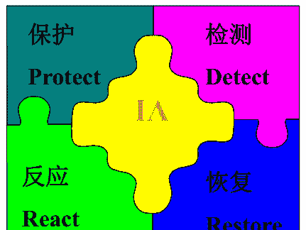

### 总结

目前，国际研究前沿已将信息安全上升到信息保障的高度，提出了计算环境安全、通信网安全、边界安全及安全支撑环境和条件的概念。并开始研究信息网络的生存性等课题。

总之，信息安全还没有形成完整的学科概念，但其发展速度正在加快，信息安全研究人员正在增加，信息安全作为独立产业的形态开始显现，主管部门的也在加大管理力度，并加紧制定信息安全法律法规。信息安全学科正应时代需要发展和完善。

### 本讲小结

- 理解信息安全的含义
- 认识到信息安全的重要性
- 清楚信息安全目标（机密性、完整性、认证性、不可否认性）
- 了解信息安全的内容
- 了解信息安全的发展过程（信息安全保障:保护、检测、反应、恢复）

### 谢谢！

用户：is_bupt@sina.com

口令：bupt123

### 上讲重点

- 理解信息安全的含义
- 认识到信息安全的重要性
- 清楚信息安全的目标（机密性、完整性、认证性、不可否认性）
- 了解信息安全的内容
- 了解信息安全的发展过程（信息安全保障：保护、检测、反应、恢复）

## 第二讲 密码学基础、 对称密码

## 本讲的主要问题

- 现代密码学的两次飞跃是什么？
- 密码系统的构成是什么？
- 柯克霍夫（Kerckhoffs）原则是指什么？
- 现有密码系统的安全性是指什么安全？
- 现有密码系统的完全破译是指获取什么？
- 密码体制的基本原则是什么？
- 流密码的核心是什么？
- 分组密码的基本原理是什么？
- 对称密码的优缺点是什么？

### 密码学发展简史

密码学的应用历史可以追溯到几千年前，可以说，自从人类社会有了战争，就有了保密通信，也有了密码的应用。不过在1949年之前，密码的研究与应用一直没有形成一门科学，仅是一门文字变换技术，因而只能称为密码技术，简称密码术。1949年，Shannon发表了“保密系统的通信理论（Communication Theory of Secrecy Systems）”一文，为密码学的发展奠定了坚实的数学基础，于是，密码技术的研究迈上了科学的轨道，因而从严格的意义上讲，此后的密码技术才真正称得上密码学。

#### 密码学的发展阶段

密码学发展大致分为三个阶段：

- 古典密码时期
- 近代密码时期
- 现代密码时期

#### 古典密码时期

- 起始时间：从古代到19世纪末，长达几千年。
- 密码体制：纸、笔或者简单器械实现的替代及换位，是一种艺术（富有创造性的方式、方法）。
- 技术工具：手工。
- 通信手段：信使。

#### 近代密码时期

- 起始时间： 从20世纪初到20世纪50年代，即一战及二战时期。
- 密码体制： 手工或电动机机械实现的复杂的替代及换位，仍是一门艺术。
- 技术工具： 机械。
- 通信手段： 电报通信。

#### 现代密码时期

- 起始时间：从20世纪50年代至今。
- 密码体制：分组密码、序列密码以及公开密钥密码，有坚实的数学理论基础。成为一门科学。
- 技术工具：计算机。
- 通信手段：无线通信、有线通信、计算网络等

### 密码系统（体制）

一个密码系统（体制）至少由明文、密文、加密算法和解密算法、密钥五部分组成。

- 信息的原始形式成为明文（Plaintext）。
- 经过变换加密的明文称为密文（Ciphertext）。
- 对明文进行编码生成密文的过程称为加密（Encryption），编码的规则称为加密算法。
- 将密文恢复出明文的过程称为解密（Decryption），解密的规则称为解密算法。
- 密钥（Key）是唯一能控制明文与密文之间变换的关键，分为加密密钥和解密密钥。

#### 密码系统的简化图形描述

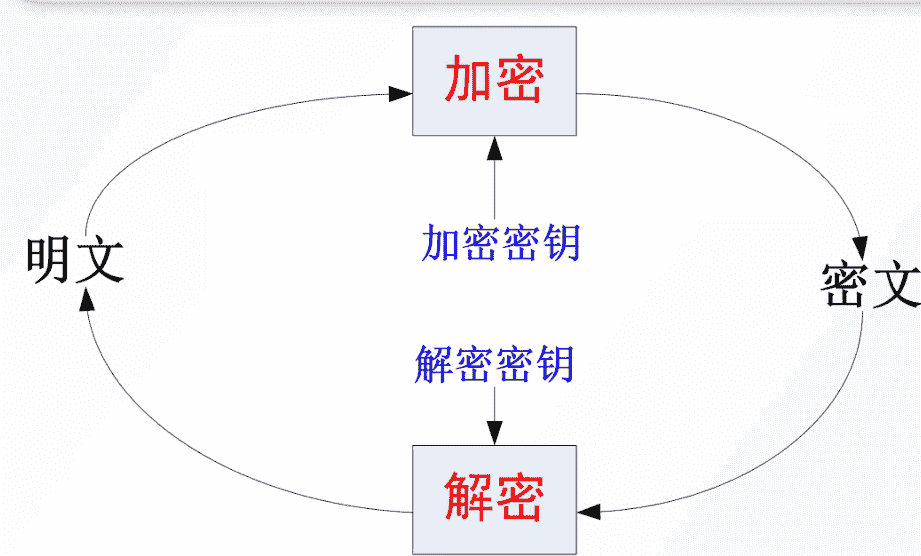

#### 密码体制的分类

- 对称密码体制（Symmetric Syetem）
  加密密钥和解密密钥相同，或者虽然不相同，但由其中的任意一个可以很容易地推出另一个，又称传统密码体制、秘密密钥体制或单密钥体制。
- 非对称密码体制（Asymmetric System）
  加密密钥和解密密钥不相同，并且从一个很难推出另一个，又称公开密钥体制。公开密钥体制用一个密钥进行加密，而用另一个进行解密。其中一个密钥可以公开，成为公开密钥(pulic key)，简称公钥；另一个密钥成为私人密钥（private key），简称私钥。

#### 柯克霍夫（Kerckhoffs）原则

密码学领域存在一个很重要的事实：“如果许多聪明人
都不能解决的问题，那么它可能不会很快得到解决。”这暗
示很多加密算法的安全性并没有在理论上得到严格的证明，
只是这种算法思想出来以后，经过许多人许多年的攻击并没
有发现其弱点，没有找到攻击它的有效方法，从而认为它是
安全的。

密码系统中的算法即使为密码分析者所知，也无助于用来推导出明文或密钥。也就是说，密码系统的安全性不应取决于不易改变的算法，而应取决于可随时改变的密钥。

#### 密码分析学

- 密码分析学：研究如何分析或破解各种密码编码体制的一门科学。
- 密码分析俗称为密码破译，是指在密码通信过程中，非授权者在不知道解密密钥和通信者所采用的密码体制细节的条件下对密文进行分析，试图得到明文或密钥的过程。
- 解密和密码破译都是设法将密文还原成明文的过程，但具备的条件是不同的。

#### 破译算法的分类（递减）

- **全部破译**
  - 密码分析者找到密钥Key。
- **全盘推导**
  - 密码分析者找到一个代替算法A，在不知道密钥Key的情况下，等价于 $D_{key}(C)=P$。
- **实例（或局部）推导**
  - 密码分析者从获的密文中找出明文。
- **信息推导**
  - 密码分析者获得一些有关密钥或明文的信息。这些信息可能是密钥的几个位、有关明文格式的信息等。

#### 密码体制的安全性（无条件）

- 不论提供的密文有多少，密文中所包含的信息都不足以惟一地确定其对应的明文；
- 具有无限计算资源（诸如时间、空间、资金和设备等）的密码分析者也无法破译某个密码系统；

#### “一次一密”密码系统

不失一般性，假设明文、密文、密钥都是二元数字序列，即

明文 $m=(m_1,m_2,\cdots,m_L)$

密钥 $k=(k_1,k_2,\cdots,k_R)$

密文 $c=(c_1,c_2,\cdots,c_S)$

令 $L=R=S$，并假定明文空间与密钥空间统计独立，且密钥 $k$ 为一随机数字序列。

定义加密变换为：$c=E_k(m)=m\oplus k$

定义解密变换为：$m=D_k(c)=c\oplus k$（⊕是按位模2加或异或）

因此，解密变换确实可以还原加密过的密文。

可以证明，上面的密码体制是**无条件安全的**。

#### 密码体制的安全性（有条件）

#### 计算上的安全

计算出和估计出破译它的计算量下限，利用已有的最好的方法破译该密码系统所需要的努力超过了破译者的破译能力（诸如时间、空间、资金等资源）。

#### 有条件上的安全

- 破译算法的代价大于加密数据的价值
- 破译算法所需的时间比加密数据保密的时间更长
- 用单密钥加密的数据量比破译算法需要的数据量少的多

#### 可证明的安全

从理论上证明破译它的计算量不低于解已知难题的计算量。

#### 复杂性理论

- 复杂性理论提供了一种分析不同密码技术和算法的计算复杂性的方法，对密码算法及技术进行对比，然后确定它们的安全性。
- 计算复杂性是密码分析技术中分析计算需求和研究破译密码的固有难度的基础。密码的强度是破译该密码所用的算法的计算复杂性决定的。
- 算法的计算复杂性由它所需的时间和空间量级来度量，其优点是独立于所用的系统并且使人们看到时间和空间的需求随输入的规模n而增长。
- 通常按时间T（或空间）复杂性对算法进行分类。

##### 算法的计算复杂性

- 若对某个常数 t，算法的运行时间 T=O(n^t)，则称该算法是多项式时间的。（可解的）
- 若对某个常数 t(>1) 和多项式 h(n)，算法的运行时间 T=O(t^{h(n)})，则称该算法是指数时间的。（难解的）

##### 不同时间复杂度算法的时间需求量级

当 n 增大时，算法的时间复杂度显示了算法是否实际可行方面的巨大差别。假设有一台计算机，它可以在 1 秒内执行 10⁶ 个基本操作，在输入规模 n=10⁶ 的条件下，下表列出了在这台机器上执行不同时间复杂性类型的算法的运行时间。

| 算法类型 | 复杂度 | 操作次数 | 时间需求 |
|---|---|---|---|
| 常数的 | O(1) | 1 | 1微秒 |
| 线性的 | O(n) | 10⁶ | 1秒 |
| 二次方的 | O(n²) | 10¹² | 11.6天 |
| 三次方的 | O(n³) | 10¹⁸ | 3200年 |
| 指数的 | O(2ⁿ) | 10^301030 | 3×10^301016年 |

注：1年=31536000秒≈3×10⁷秒，宇宙的年龄10¹⁰（2³⁴）年

##### 计算机速度提高对算法处理能力的影响

下表列出在计算设备处理速度提高时对不同时间复杂性算法处理能力（即在1小时内可解的问题实例的最大规模）的影响。

| 时间复杂度 | 现在的计算机（10⁶个基本操作/s） | 速度快100倍的计算机 | 速度快10000倍的计算机 |
|---|---|---|---|
| O(n) | N₁=3.6×10⁹ | 100N₁ | 10000N₁ |
| O(n²) | N₂=6×10⁴ | 10N₂ | 100N₂ |
| O(n³) | N₃≈1.5×10³ | 4.64N₃ | 21.5N₃ |
| O(2ⁿ) | N₄≈32 | N₄+6.64 | N₄+13.29 |

注：计算机的计算能力每18个月翻倍

#### 密码体制的基本原则

- 密码体制是不可破的（理论上不可破，实际上不可破）；
- 密码体制的安全性是依赖密钥的保密，而不是依赖于对加密体制的保密；
- 加密和解密算法适用于密钥空间中的所有元素；
- 密码体制既易于实现又便于使用。
- 密钥空间应足够大，使得试图通过穷举密钥空间进行搜索的方式在计算上不可行。

### 对称密码算法

对称密码算法有时又叫传统密码算法，就是加密密钥能够从解密密钥中推算出来，反过来也成立。在大多数对称算法中，加密解密密钥是相同的。这些算法也叫秘密密钥算法或单密钥算法，它要求发送者和接收者在安全通信之前，商定一个密钥。对称算法的安全性依赖于密钥，泄漏密钥就意味着任何人都能对消息进行加密解密。只要通信需要保密，密钥就必须保密。

#### 对称密钥加解密的模型

- **明文**：原始信息。
- **加密算法**：以密钥为参数，对明文进行变换，结果为密文。
- **密钥**：加密与解密算法的参数，直接影响对明文进行变换的结果。
- **密文**：对明文进行变换的结果。
- **解密算法**：加密算法的逆变换，以密文为输入、密钥为参数，变换结果为明文。

#### 对称密码算法的分类

- 序列密码
- 分组密码

#### 序列密码的简介

序列密码可以认为是起源于20世纪20年代的维尔南（Vernam）体制，当Vernam体制中的密钥序列是随机的（0，1）序列时，它就是“一次一密”密码体制。香农已经证明“一次一密”密码体制在理论上是不可破译的。由于随机的密钥序列的产生、存储以及分配等方面存在一定的困难，Vernam体制在当时并没有得到广泛的应用。随着微电子技术和数学理论的发展和完善，基于伪随机序列的序列密码得到长足的发展和应用。在序列密码中，加密和解密所用的密钥序列都是伪随机序列。伪随机序列的产生比较容易，并且有比较成熟的数学理论工具。目前，序列密码是世界各国的军事和外交等领域中使用的主要密码体制之一。

##### 序列密码的原理

- 将明文划分成字符（如单个字母），或其编码的基本单元（如0，1数字），字符分别与密钥流作用进行加密，解密时以同步产生的同样的密钥流实现。
- 设明文为 $p=p_0p_1p_2\cdots$，$p_i\in GF(2)$，$i\geq0$
- 设密钥为 $k=k_0k_1k_2\cdots$，$k_i\in GF(2)$，$i\geq0$
- 设密文为 $c=c_0c_1c_2\cdots$，$c_i\in GF(2)$，$i\geq0$
- 则加密变换为 $c_i=E_{k_i}(p_i)$，$i\geq0$
- 则解密变换为 $p_i=D_{k_i}(c_i)$，$i\geq0$

##### 序列密码的破解

如果对不同的明文使用不同的密钥，则这时序列密码为“一次一密”密码，在理论上是不可破译的。

如果存在不同的明文使用相同的密钥，则流密码就比较容易破译。

如当对手获得了一个密文 C₁C₂⋯Cᵢ⋯ 所对应的明文 p = p₁p₂⋯pᵢ⋯，容易得到密钥 k = k₁k₂⋯kᵢ⋯，因为 kᵢ = pᵢ ⊕ cᵢ。因此，如果密钥 k 重复使用，对手可以立即得到相应的明文。

##### 序列密码的关键点

- 安全核心问题
  - 密钥流生成器的设计：序列密码强度完全依赖于密钥流产生器所生成序列的随机性（Randomness）和不可预测性（Unpredictability）
- 密钥管理
- 同步流密码可靠解密的关键问题
  - 保持收发两端密钥流的同步

##### 序列密码的优点（相对分组密码）

- 在硬件实施上，序列密码的速度一般要比分组密码快，而且不需要有很复杂的硬件电路。
- 在某些情况下（例如某些电信上的应用），当缓冲不足或必须对收到字符进行逐一处理时，序列密码就显得更加必要和恰当。
- 序列密码有较理想的数学分析。
- 序列密码能较好地隐藏明文的统计特性。

#### 分组密码的简介

- 分组密码（block cipher）是现代密码学中的重要体制之一，也是应用最为广泛、影响最大的一种密码体制，其主要任务是提供数据保密性，也可以用在许多方面，如构造伪随机数生成器、流密码、认证码和哈希函数等。
- 分组密码又分为对称分组密码和非对称分组密码（公钥密码），习惯上，分组密码一词在很多场合指的是对称分组密码，简称分组密码。
- 由于分组密码加解密速度较快，安全性能好，以及得到许多密码芯片的支持，现代分组密码发展非常快，在许多研究和应用领域得到了广泛的应用。

##### 分组密码

也称块密码，它是将明文消息经编码表示后的二进制序列 m₀,m₁,...,mᵢ,... 划分成若干固定长度的组（或块） m=(m₀,m₁,...,mₗ₋₁)，各组分别在密钥 k=(k₀,k₁,...,kₜ₋₁) 的控制下转换成长度为 n 的密文分组 c=(c₀,c₁,...,cₙ₋₁)。其本质是一个从明文空间（l 长的比特串的集合）M 到密文空间（n 长的比特串的集合）C 的一一映射。（一般而言，l=n=t）

##### 分组密码的算法要求

- **分组长度足够大**
  - 当分组长度 n 较小时，攻击者可以有效地穷举明文空间，得到密钥。
- **密钥量足够大**
  - 如果密钥量小，攻击者可以有效地通过穷举密钥，对密文进行解密，以得到有意义的明文。
- **密码变换足够复杂**
  - 使攻击者除了穷举法攻击以外，找不到其他简洁的数学破译方法。

##### 分组密码原理

- 扩散
- 混乱

###### 扩散

所谓扩散，是指要将算法设计得使每一比特明文的变化尽可能多地影响到输出密文序列的变化，以便隐藏明文的统计特性；扩散的另一层意思是将每一位密钥的影响也尽可能迅速地扩展到较多的输出密文比特中去。即扩散的目的是希望密文中的任一比特都要尽可能与明文、密钥相关联，或者说，明文和密钥中任何一比特发生改变，都会在某种程度上影响到密文值的变化，以防止将密钥分解成若干个孤立的小部分，然后各个击破。

## 扩散的举例说明

####### 无扩散技术的加密

| 明文 | 密文 |
|---|---|
| p₁: 00000000 | c₁: xxxxxxx01 |
| p₂: 00000001 | c₂: xxxxxxx11 |

####### 有扩散技术的加密

| 明文 | 密文 |
|---|---|
| p₁: 00000000 | c₁: 01011010 |
| p₂: 00000001 | c₂: 11101011 |

###### 混乱

所谓混乱，是指在加密变换过程中使明文、密钥以及密文之间的关系尽可能地复杂化，以防密码破译者采用统计分析法进行破译攻击。

混乱可以用“搅拌机”来形象地解释，将一组明文和一组密钥输入到算法中，经过充分混合，最后变成密文。同时要求，执行这种“混乱”作业的每一步都必须是可逆的，即明文混乱以后能得到密文，反之，密文经过逆向的混乱操作以后能恢复出明文。

###### 混乱的举例说明

明文序列P
00100001

密文序列K
01101011

密文序列C
10110100

（1）加密混乱过程

密文序列C
10110100

密文序列K
01101011

明文序列P
00100001

（2）解密混乱过程

###### 乘积密码

依次使用两个或两个以上的基本密码，所得结果的密码强度将强于所有单个密码的强度，即乘积密码是扩散和混乱两种基本密码操作的组合变换，这样能够产生比各自单独使用时更强大的密码系统。选择某个较为简单的密码变换，在密钥控制下以迭代方式多次利用它进行加密变换，就可以实现预期的扩散和混乱效果。

##### DES概述

- 分组加密算法：明文和密文为64位分组长度。
- 对称算法：加密和解密除密钥编排不同外，使用同一算法。
- 密钥长度：56位，但每个第8位为奇偶校验位，可忽略。
- 密钥可为任意的56位数，但存在弱密钥，容易避开。
- 采用混乱和扩散的组合，每个组合先替代后置换，共16轮。
- 只使用了标准的算术和逻辑运算，易于实现。

##### 公开征集密码算法标准的要求

- 算法必须安全的（具有加密保护信息安全的能力）；
- 算法必须是公开的（有完整的算法说明、容易理解、能为所有用户使用）；
- 能够经济、有效的硬件实现；
- 能够得到批准（是合法的）；
- 可出口；

##### DES加密过程

输入64比特明文数据

初始置换IP

在密钥控制下
16轮迭代

交换左右32比特

初始逆置换IP⁻¹

输出64比特密文数据

##### DES加密过程

i: 表示迭代次数，

⊕: 表示逐位模2求和

f: 为加密函数

L₀R₀ ← IP(< 64bit输入码 >)

Lᵢ ← Rᵢ₋₁                     i = 1,2,…,16

Rᵢ ← Lᵢ₋₁ ⊕ f(Rᵢ₋₁, kᵢ)    i = 1,2,…,16

< 64bit密文 > ← IP⁻¹(R₁₆L₁₆)

##### 初始置换IP和初始逆置换IP⁻¹

| 初始置换 IP | 初始逆置换 IP⁻¹ |
|---|---|
| 58 50 42 34 26 18 10 2 | 40 8 48 16 56 24 64 32 |
| 60 52 44 36 28 20 12 4 | 39 7 47 15 55 23 63 31 |
| 62 54 46 38 30 22 14 6 | 38 6 46 14 54 22 62 30 |
| 64 56 48 40 32 24 16 8 | 37 5 45 13 53 21 61 29 |
| 57 49 41 33 25 17 9 1 | 36 4 44 12 52 20 60 28 |
| 59 51 43 35 27 19 11 3 | 35 3 43 11 51 19 59 27 |
| 61 53 45 37 29 21 13 5 | 34 2 42 10 50 18 58 26 |
| 63 55 47 39 31 23 15 7 | 33 1 41 9 49 17 57 25 |

##### IP和IP⁻¹

M₂₀→M₁₄

M₁₄→M'₂₀

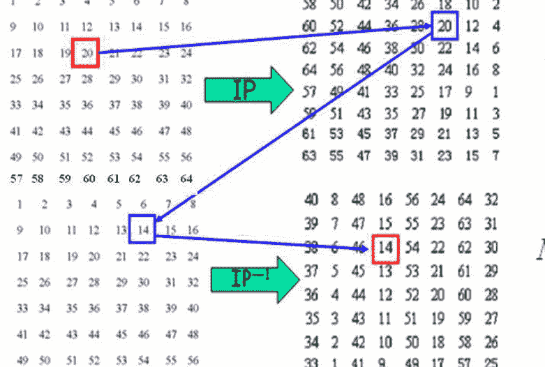

##### DES的一轮迭代

L_{i-1}（32比特）

R_{i-1}（32比特）

选择扩展运算E

48比特寄存器

子密钥K_i（48比特）

48比特寄存器

选择压缩运算S

32比特寄存器

置换运算P

L_i（32比特）

R_i（32比特）

L_i=R_{i-1}

##### 扩展置换 E-盒—32位扩展到48位

| 01 | 02 | 03 | 04 |  | 32 | → | 01 | 02 | 03 | 04 | 05 |
|---|---|---|---|---|---|---|---|---|---|---|---|
| 05 | 06 | 07 | 08 |  | 04 |  | 05 | 06 | 07 | 08 | 09 |
| 09 | 10 | 11 | 12 |  | 08 |  | 09 | 10 | 11 | 12 | 13 |
| 13 | 14 | 15 | 16 |  | 12 |  | 13 | 14 | 15 | 16 | 17 |
| 17 | 18 | 19 | 20 |  | 16 |  | 17 | 18 | 19 | 20 | 21 |
| 21 | 22 | 23 | 24 |  | 20 |  | 21 | 22 | 23 | 24 | 25 |
| 25 | 26 | 27 | 28 |  | 24 |  | 25 | 26 | 27 | 28 | 29 |
| 29 | 30 | 31 | 32 |  | 28 |  | 29 | 30 | 31 | 32 | 01 |

##### DES中的子密钥的生成

PC-1
57 49 41 33 25 17 9
1 58 50 42 34 26 18
10 2 59 51 43 35 27
19 11 3 60 52 44 36
63 55 47 39 31 23 15
7 62 54 46 38 30 22
14 6 61 53 45 37 29
21 13 5 28 20 12 4

64位密钥

置换选择 1

C0 (28 位)

D0 (28 位)

循环左移

循环左移

C1 (28 位)

D1 (28 位)

循环左移

循环左移

C i (28 位)

D i (28 位)

密钥表的计算逻辑

循环左移：
1 1 9 1
2 1 10 2
3 2 11 2
4 2 12 2
5 2 13 2
6 2 14 2
7 2 15 2
8 2 16 1

置换选择 2 (48 位)

k1

56 位

去掉第9, 18, 22, 25, 35, 38, 43, 54位

PC-2
14 17 11 24 1 5
3 28 15 6 21 10
23 19 12 4 26 8
16 7 27 20 13 2
41 52 31 37 47 55
30 40 51 45 33 48
44 49 39 56 34 53
46 42 50 36 29 32

置换选择 2 (48 位)

k i

56 位

##### 压缩替代S-盒—48位压缩到32位

48 比特寄存器

6 比特

S₁ S₂ S₃ S₄ S₅ S₆ S₇ S₈

共8个S盒

4 比特

32 比特寄存器

选择压缩运算 S

## S盒的规则

####### S-盒1

####### S-盒2

####### S-盒3

####### S-盒4

####### S-盒5

####### S-盒6

####### S-盒7

####### S-盒8

###### S-盒的构造

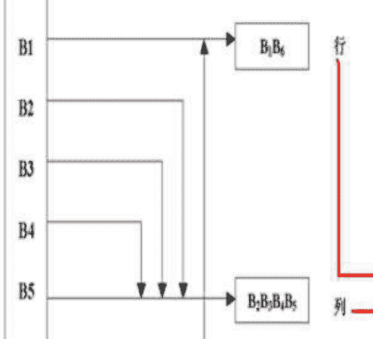

| 行\列 | 0 | 1 | 2 | 3 | 4 | 5 | 6 | 7 | 8 | 9 | 10 | 11 | 12 | 13 | 14 | 15 |
|---|---|---|---|---|---|---|---|---|---|---|---|---|---|---|---|---|
| 0 | 12 | 1 | 10 | 15 | 9 | 2 | 6 | 8 | 0 | 13 | 3 | 4 | 14 | 7 | 5 | 11 |
| 1 | 10 | 15 | 4 | 2 | 7 | 12 | 9 | 5 | 6 | 1 | 13 | 14 | 0 | 11 | 3 | 8 |
| 2 | 9 | 14 | 15 | 5 | 2 | 8 | 12 | 3 | 7 | 0 | 4 | 10 | 1 | 13 | 11 | 6 |
| 3 | 4 | 3 | 2 | 12 | 9 | 5 | 15 | 10 | 11 | 14 | 1 | 7 | 6 | 0 | 8 | 13 |

b1b2b3b4b5b6
110011 ⇒ 行: b1b6 = 11₂ = 3
列: b2b3b4b5 = 1001₂ = 9 ⇒ S6-盒子 3行9列
值: 14 = 1100

##### DES解密过程

$i$：表示迭代次数，

$\oplus$：表示逐位模2求和

$f$：为加密函数

$R_{16}L_{16} \leftarrow IP(\langle 64bit密文\rangle)$

$R_{i-1} \leftarrow L_i \qquad i=16,15,\cdots,1$

$L_i \leftarrow R_{i-1} \oplus f(R_{i-1},k_i) \qquad i=16,15,\cdots,1$

$\langle 64bit明文\rangle \leftarrow IP^{-1}(R_0L_0)$

## DES问题讨论

### DES的强度：56比特的密钥长度

- 理论上的强度，1997年$10000的机器可以在6小时内用穷举法攻破DES。
- 实际攻破的例子，1997年1月提出挑战，有人利用Internet的分布式计算能力，组织志愿军连接了70000多个系统在96天后攻破。

这意味着随着计算能力的增长，必须相应地增加算法密钥的长度。

- 最近的一次评估是在1994年1月，当时决定1998年12月以后，DES不再作为联邦加密标准。

- AES（128位）取代DES。

## 对称密码算法的优缺点

**优点：**

- 加解密效率高，适合加密大量数据；
- 密钥相对比较短；
- 硬件容易实现；

**缺点：**

- 需要以安全方式进行密钥交换；
- 密钥管理复杂，如每个人需持有许多密钥；

## 本讲的主要问题

- 现代密码学的两次飞跃是什么？
- 密码系统的构成是什么？
- 柯克霍夫（Kerckhoffs）原则是指什么？
- 现有密码系统的安全性是指什么安全？
- 现有密码系统的安全破译是指获取什么？
- 密码体制的基本原则是什么？
- 流密码的核心是什么？
- 分组密码的基本原理是什么？
- 对称密码的优缺点是什么？

### 谢谢！

## 第三讲 Hash函数及公钥密码

主讲人：谷利泽

Email: glz_bupt@263.net

Tel: 010-62283134

### 上讲的主要问题

- 现代密码学的两次飞跃是什么？
- 密码系统的构成是什么？
- 柯克霍夫（Kerckhoffs）原则是指什么？
- 现有密码系统的安全性是指什么安全？
- 现有密码系统的完全破译是指获取什么？
- 密码体制的基本原则是什么？
- 流密码的核心是什么？
- 分组密码的基本原理是什么？
- 对称密码的优缺点是什么？

#### 本讲主要内容

- 掌握哈希函数的特点
- 了解哈希函数的应用
- 了解消息认证的过程
- 掌握公钥体制的含义
- 掌握公钥密码的优缺点

#### 哈希函数的前言

在一个开放通信网络的环境中，攻击者可以随意地窃听、截取、重发、**修改、伪造或插入**消息。当攻击者插入了修改过的或伪造的消息，并试图欺骗目标接收者，使其相信该消息来自某个其他合法的主体。**数据完整性**技术就是抗击对消息未授权修改的安全服务。

现代密码学中的数据完整性与通信学的检错码有密切的联系，并由其演变而来。检错码是检测由于**通信的缺陷**而导致消息发生错误的方法，完整性是用来检查被**恶意方式**修改过消息的技术。

## 哈希（Hash）函数的简介

也称散列函数，是一种单向密码体制，即它是一个从明文到密文的不可逆映射，即只有加密过程，不能解密。同时，Hash函数可以将任意长度的输入经过变换以后得到固定长度的输出。Hash函数的这种单向特征和输出数据的长度固定的特征使得它可以生成消息或其他数据块的“数据指纹”（也称消息摘要或散列值），因此在数据完整性认证和数字签名等领域有广泛的应用的，哈希函数在现代密码学中起着重要作用。

## 哈希(Hash)算法的概述

对不同长度的输入消息，产生固定长度的输出。这个固定长度的输出称为原输入消息的“散列”或“消息摘要”（Message digest）。

公式表示形式：

h=H(M)

M：任意长度的消息。

H：哈希（Hash）函数或杂凑函数或散列函数。

h：固定长度的哈希值。

## 哈希算法的性质(特点)

- 压缩：消息是任意有限长度，哈希值是固定长度。
- 容易计算：对于任意给定的消息，容易计算其哈希值。
- 单向性：对于给定的哈希值h，要找到M使得H(M)=h在计算上是不可行的。
- 弱抗碰撞：对于给定的消息M₁，要发现另一个消息M₂，满足H(M₁)=H(M₂)在计算上是不可行的。
- 强抗碰撞：找任意一对不同的消息M₁，M₂，使H(M₁)=H(M₂)在计算上是不可行的。

#### MD5的简介

目前，人们已设计出了大量的Hash算法。在众多Hash算法中MD5(128位)和SHA(160位)是最著名的两个算法。

Ron Rivest于1990年设计了一个称为MD4的Hash算法，该算法的设计没有基于任何假设和密码体制，这种直接构造法构造的Hash算法因其运行速度快、非常实用等特点受到了人们的广泛亲睐。但后来人们发现MD4存在安全性缺陷，于是，Ron Rivest在1991年对MD4作了六点改进，改进后的算法就是MD5。

## MD5的结构

消息M

填充使分组恰好512位

M₁

M₂

Mₜ

初始值

f

f

f

哈希值

注：填充方法是附一个1在消息后面，后接所要求的多个0，然后在其后附上64位的消息长度（填充前）。

## MD5的主循环

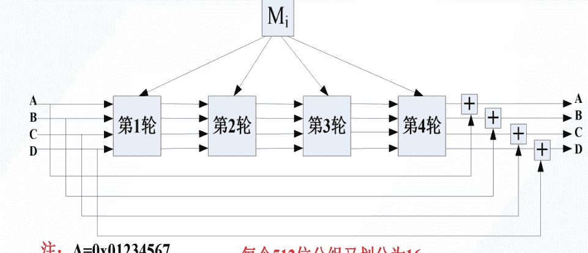

注：
A=0x01234567
B=0x89abcdef
C=0xfedcba98
D=0x76543210

每个512位分组又划分为16个32位子分组，每轮很相似，每轮进行16次操作。

## MD5的一个执行过程

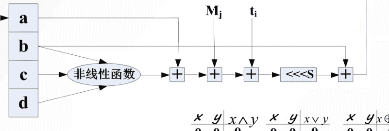

非线性函数：

F(x, y, z) = (x ∧ y) ∨ (¬x ∧ z)
G(x, y, z) = (x ∧ z) ∨ (y ∧ (¬z))
H(x, y, z) = x ⊕ y ⊕ z
I(x, y, z) = y ⊕ (x ∨ (¬z))

| x | y | x ∧ y |
|---|---|-------|
| 0 | 0 | 0 |
| 0 | 1 | 0 |
| 1 | 0 | 0 |
| 1 | 1 | 1 |

| x | y | x ∨ y |
|---|---|-------|
| 0 | 0 | 0 |
| 0 | 1 | 1 |
| 1 | 0 | 1 |
| 1 | 1 | 1 |

| x | y | x ⊕ y |
|---|---|-------|
| 0 | 0 | 0 |
| 0 | 1 | 1 |
| 1 | 0 | 1 |
| 1 | 1 | 0 |

| x | ¬x |
|---|----|
| 0 | 1 |
| 1 | 0 |

t_i = ⌊2³² × abs(sin(i))⌋

其中i的单位是弧度；
⌊x⌋ 表示取x的整数部分；

## 第二轮

GG(a,b,c,d,M_j,s,t_i)表示a = b + ((a + (G(b,c,d) + M_j + t_i) << (s)

GG(A,B,C,D,M₁,5,0xf61e2562)    GG(A,B,C,D,M₉,5,0x2e1cde6)
GG(D,A,B,C,M₆,9,0xc040b340)    GG(D,A,B,C,M₁₄,9,0xc33707d6)
GG(C,D,A,B,M₁₁,14,0x265e5a51)    GG(C,D,A,B,M₃,14,0xf4d50d87)
GG(B,C,D,A,M₀,20,0xe9b6c7aa)    GG(B,C,D,A,M₈,20,0x455a14ed)
GG(A,B,C,D,M₅,5,0xd62f105d)    GG(A,B,C,D,M₁₃,5,0xa9e3e905)
GG(D,A,B,C,M₁₀,9,0x02441453    GG(D,A,B,C,M₂,9,0xfcef8f8)
GG(C,D,A,B,M₁₅,14,0xd8a1e681)    GG(C,D,A,B,M₇,14,0x676f02d9)
GG(B,C,D,A,M₄,20,0xe7d3fbc8)    GG(B,C,D,A,M₁₂,20,0x8d2a4c8a

## 第三轮

$HH(a,b,c,d,M_j,s,t_i)$表示$\bar{a}=b+((a+(H(b,c,d)+M_j+t_i)<<<s)$

$HH(A,B,C,D,M_5,4,0xfffa3942)$

$HH(A,B,C,D,M_{13},4,0x289b7ec6)$

$HH(D,A,B,C,M_8,11,0x8771f681)$

$HH(D,A,B,C,M_0,11,0xeaad27fa)$

$HH(C,D,A,B,M_{11},16,0x6d9d6122)$

$HH(C,D,A,B,M_3,16,0xa4ef3085)$

$HH(B,C,D,A,M_{14},23,0xfde5380c)$

$HH(B,C,D,A,M_6,23,0x0488fd05)$

$HH(A,B,C,D,M_1,4,0xa4beea44)$

$HH(A,B,C,D,M_9,4,0xda9d4039)$

$HH(D,A,B,C,M_4,11,0x4bdecfc9)$

$HH(D,A,B,C,M_{12},11,0xe6db99e5)$

$HH(C,D,A,B,M_7,16,0xf6bb4b60)$

$HH(C,D,A,B,M_{15},16,0x1fa27cf8)$

$HH(B,C,D,A,M_{10},23,0xbebfbc70)$

$HH(B,C,D,A,M_2,23,0xc4ac5665)$

#### Hash的应用

- 数字签名
- 实现信息的完整性
- 用于口令的传输和存储

##### 哈希算法的应用（文件完整性）

“网站卫士”是一个基于Windows的网络安全软件产品。该软件运行在 Windows 95/98/NT/2000 上，该系统的主要功能是通过网络扫描网站的网页，监测网页是否被修改，当发现网页被修改后，系统能够自动报警和恢复。“网站卫士”可以同时监测多个站点。“网站卫士”所监测的Web服务器操作系统可以是Windows NT、Linux和UNIX。

##### 哈希算法的应用（系统结构）

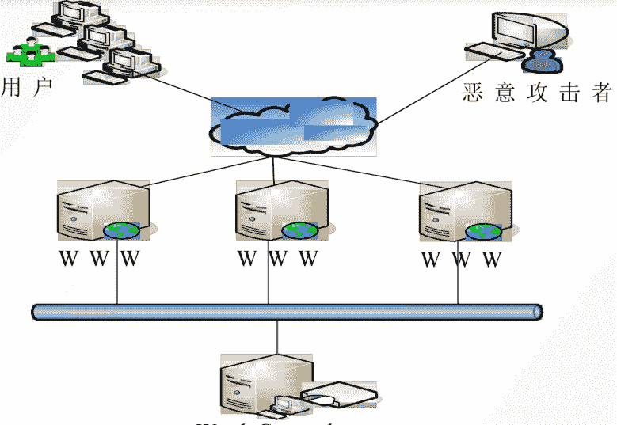

用户
恶意攻击者
WWW
WWW
WWW
WebGuard

##### 哈希算法的应用（实现原理）

###### 初始化过程

1. 对监视网站的文件备份到监控主机上。
2. 对每个备份的文件生成一个结构：文件位置、文件的哈希值。

###### 监控过程

监控主机对监控网站进行轮回扫描，对扫描的文件进行如下操作：

1. 计算文件的哈希值，并与备份的文件的哈希值进行比较，如果相同，转（4）步。
2. 如果不同，上传备份文件替换网站现有文件，转（4）步。
3. 如果备份文件不存在，则删除网站上这个文件，转（4）步。
4. 监控程序扫描下一文件。

#### 口令的传输和存储

- 系统不存储明文。
- 明文不在网上传输。
- 根据摘要无法推出口令。
- 管理员不知道用户口令。

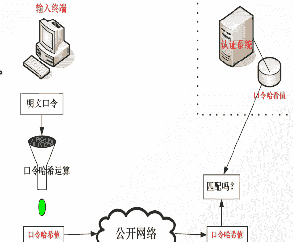

#### 消息认证的概述

网络系统安全一般要考虑两个方面：一方面，加密保护传送的信息，使其可以抵抗被动攻击；另一方面，就是要能防止对手对系统进行主动攻击，如伪造、篡改信息等。认证是对抗主动攻击的主要手段，它对于开放的网络中的各种信息系统的安全性有重要作用。

认证可分为**实体认证**和**消息认证**。

#### 消息认证的目的

- 验证信息的来源是真实的，而不是伪造的，此为消息源认证。
- 验证消息的完整性，即验证信息在传送或存储过程中是否被篡改。

#### 消息认证码

- 消息认证码（MAC，Message Authentication Codes），是与密钥相关的单向散列函数，也称为消息鉴别码或是消息校验和。
- MAC与单向散列函数一样，但是还包括一个密钥。不同的密钥会产生不同的散列函数，这样就能在验证发送者的消息没有经过篡改的同时，验证是由哪一个发送者发送的。

#### 消息认证的实现过程

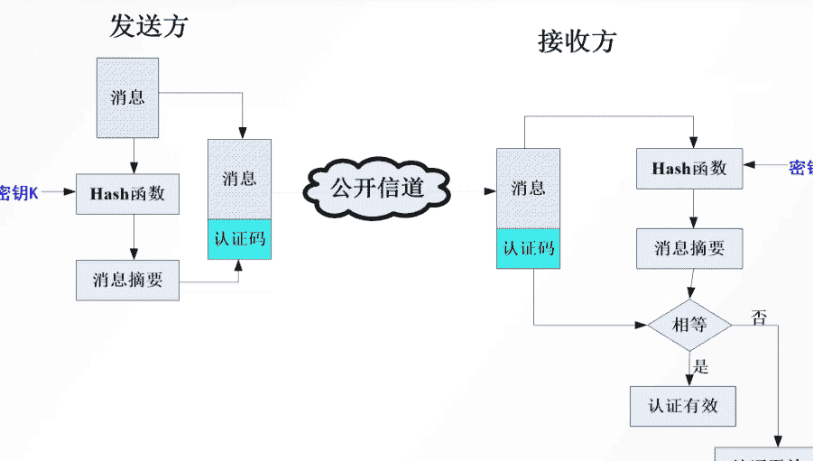

#### 问题？

- 消息认证往往与对称密钥相关联？
- 实体认证往往与数字签名技术相关联？

#### 公钥体制的前言

在公钥密码体制以前的整个密码学史中，所有的密码算法，包括原始手工计算的、由机械设备实现的以及由计算机实现的，都是基于**代换**和**换位**这两个基本工具。

而公钥密码体制则为密码学的发展提供了新的理论和技术基础，一方面公钥密码算法的基本工具不再是代换和换位，而是**数学函数**；另一方面公钥密码算法是以非对称的形式使用两个密钥，两个密钥的使用对保密性、密钥分配、认证等都有着深刻的意义。可以说公钥密码体制的出现在密码学史上是一个最大的而且是惟一真正的革命。

#### 对称密码体制的缺陷

- **密钥分配问题**

  通信双方要进行加密通信，需要通过秘密的安全信道协商加密密钥，而这种安全信道可能很难实现；

- **密钥管理问题**

  在有多个用户的网络中，任何两个用户之间都需要有共享的秘密钥，当网络中的用户 *n* 很大时，需要管理的密钥数目是非常大 (*n*(n-1)/2)。

- **难实现签名功能**

  当主体A收到主体B的电子文档（电子数据）时，无法向第三方证明此电子文档确实来源于B，并事后B不能否认。

#### 公钥密码体制的基本概念

- 公开密钥（public-key），可以被任何人知道，用于加密或验证签名；
- 私钥（private-key），只能被消息的接收者或签名者知道，用于解密或签名；
- 由私钥及其他密码信息容易计算出公开密钥；
- 由公钥及算法描述，计算私钥是不可行的；
- 公钥可以发布给其他人；

#### 公钥体制加解密模型

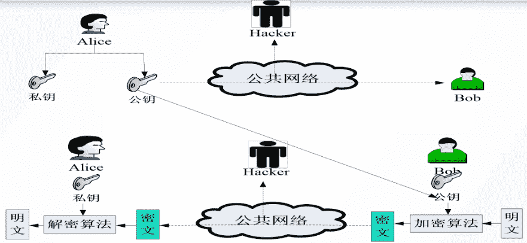

- Bob查找Alice的公钥。
- Bob采用公钥加密算法以Alice的公钥作为加密密钥对明文加密。
- Bob通过非安全信道将密文发送给Alice。
- Alice收到密文后使用自己的私钥对密文解密还原出明文。

#### 公钥密码体制的要求

- 产生一对密钥在计算上是可行的。
- 已知公钥和明文，产生密文是容易的。
- 接受方利用私钥来解密密文在计算上是可行的。
- 对于攻击者，利用公钥来推断私钥在计算上是不可行的。
- 已知公钥和密文，在不知道私钥的情况下，恢复明文在计算上是不可行的。

#### 公钥密码算法的分类

- 基于大整数因子分解问题：RSA、Rabin等。
- 基于有限域乘法群上的离散对数问题：ElGamal（DSA）。
- 椭圆曲线上的离散对数问题：ECC。
- 背包问题：Merkle-Hellman、Chor-Rivest。
- 基于代数编码中的线性解码问题：McEliece。

#### RSA公钥密码简介

在Diffie和Hellman提出公钥的设想后两年，先后有Merkle和Hellman提出了MH背包公钥密码，Rivest、Shamir、Adleman联合提出了简称为RSA的公钥密码系统。RSA虽稍后于MH背包公钥系统，但它到目前为止仍不失为最有希望的一种公钥密码。RSA的基础是数论的欧拉定理，它的安全性依赖于大整数的因数分解的困难性。即已知两个大素数p和q，求n=p*q十分容易，但若由n，求p和q是十分困难的事情，这就是大整数分解困难性问题。

##### 欧拉函数

给定一个正整数 n，用 $\varphi(n)$ 表示比 n 小但与 n 互为素数的正整数的个数，也称 $\varphi(n)$ 为欧拉函数。

$\varphi(n) = r_1^{a_1-1}(r_1-1) \cdot r_2^{a_2-1}(r_2-1) \cdots r_k^{a_k-1}(r_k-1)$

其中 $n = r_1^{a_1} \cdot r_2^{a_2} \cdots r_k^{a_k}$。

例如：$24 = 2^3 \times 3$，$\varphi(24) = 2^{3-1}(2-1) \times 3^{1-1}(3-1) = 8$

{1, 5, 7, 11, 13, 17, 19, 23}

$35 = 5 \times 7$，$\varphi(35) = (5-1)(7-1) = 24$

##### 欧拉定理

若整数 $a$ 和 $n$ 互素，则 $a^{\varphi(n)} \equiv 1 \pmod n$

证明：设 $\varphi(n)=k$。又设 $r_1,r_2,\cdots,r_k$ 是小于 $n$ 并与 $n$ 互素的数，且由于 $a$ 是与 $n$ 互素的数，则 $a r_1, a r_2, \cdots, a r_k$ 也和 $n$ 互素且两两不同。

若：$a r_i \equiv a r_j \pmod n$

则根据数论定理，因 $a$ 与 $n$ 互素，所以存在 $\tilde a$ 满足：

$\tilde{a}a \equiv 1 \pmod n$

$\tilde{a} a r_i \equiv \tilde{a} a r_j \pmod n$

即：$r_i \equiv r_j \pmod n$（与假定矛盾）

所以，$\{r_1,r_2,\cdots,r_k\}=\{a r_1, a r_2, \cdots, a r_k\}$

所以，等式 $a^k r_1 r_2 \cdots r_k \equiv r_1 r_2 \cdots r_k \pmod n$ 成立。

但 $r_1,r_2,\cdots,r_k$ 和 $n$ 互素，故 $a^k \equiv 1 \pmod n$

##### 举例说明

5^φ(24) ≡ 1 (mod 24)

φ(24)=8。又 1,5,7,11,13,17,19,23 是小于 24 并与 24 互素的数。

1×5 ≡ 5 (mod 24)　　5×5 ≡ 1 (mod 24)　　7×5 ≡ 11 (mod 24)

11×5 ≡ 7 (mod 24)　　13×5 ≡ 17 (mod 24)　　17×5 ≡ 13 (mod 24)

19×5 ≡ 23 (mod 24)　　23×5 ≡ 19 (mod 24)

{1,5,7,11,13,17,19,23} = {5×1, 5×5, 5×7, 5×11, 5×13, 5×17, 5×19, 5×23} (mod 24)

(5×1)(5×5)(5×7)(5×11)(5×13)(5×17)(5×19)(5×23) ≡ 1×5×7×11×13×17×19×23 (mod 24)

5^8 ≡ 1 (mod 24)，即：5^φ(24) ≡ 1 (mod 24)。

##### RSA的密钥对生成算法

- 1. 选取两个大素数 **p** 和 **q**，两个数长度接近，1024位；
- 2. 计算 **n = p × q**，**φ(n) = (p − 1)(q − 1)**；
- 3. 随机选取整数 **e**（**1 < e < φ(n)**），满足 **gcd(e, φ(n)) = 1**；
- 4. 计算 **d**，满足 **d × e ≡ 1 (mod φ(n))**。

注：n公开，p和q保密。

e为公钥，d为私钥。

##### 举例说明

设 p=7，q=11，取 e=13，求 n、φ(n) 及 d。

解：

n = 7×11 = 77

φ(n) = (7−1)×(11−1) = 60

因 e=13，满足 1<e<φ(n) 且满足 gcd(e, φ(n))=1，所以可以取加密密钥 e=13。

通过公式 e×d ≡ 1 (mod 60)，求出 d=37。

##### RSA的加解密过程

加密算法：c = E(m) = m^e (mod n)

解密算法：m = D(c) = c^d (mod n)

证明：

c^d = (m^e)^d = m^(ed) = m^(kφ(n)+1) = m^(kφ(n))·m = m·(m^(φ(n)))^k = m·1 = m (mod n)

明文 m 的长度小于 log₂ n 位，即 m < n。

##### 举例说明

明文 2 → 加密过程：2¹³ (mod 77)=30，公钥 (13,77) → 密文 30 → 解密过程：30³⁷ (mod 77)=2，私钥 (37,77) → 明文 2

##### RSA的加解密举例说明

p=43，q=59，n=p×q=43×59=2539，φ(2539)=42×58=2436。

取 e=13，解方程 d×e ≡ 1 (mod 2436)，得：d=937。

若有明文：public key encryptions。

先将明文分块为：pu bl ic ke ye nc ry pt io ns。

如利用英文字母表的顺序，即 a=00，b=01，…，z=25，将明文数字化得：

1520　0111　0802　1004　2404

1302　1724　1519　0814　1418

利用加密的密文：

0095　1648　1410　1299　1365

1379　2333　2132　1751　1289

##### RSA的安全性

RSA的安全性是基于分解大整数的困难性假定，之所以为假定是因为至今还未能证明分解大整数就是难解问题，也许有尚未发现的多项式时间分解算法。

如果RSA的模数 n 被成功地分解为 p×q，则立即获得 φ(n)=(p−1)(q−1)，从而能够确定 e 模 φ(n) 的乘法逆元 d，即 d ≡ e⁻¹ (mod φ(n))，因此攻击成功。

随着人类计算能力的不断提高，原来被认为是不可能分解的大数已被成功分解，在现有计算水平，RSA密钥长度1024位被认为是安全的。

##### RSA公钥密码的小结

- 第一个较完善的公开密钥算法。
- 目前使用最多的一种公钥密码算法。
- RSA的基础是数论的欧拉定理。
- RSA的安全性依赖于大整数的因数分解的困难性。
- 密码分析者既不能证明也不能否定RSA的安全性。
- 既能用于加密也能用于数字签名。
- RSA算法在美国申请了专利（2000年9月30日到期），但在其他国家无专利。

#### ElGamal公钥密码体制

ElGamal公钥密码体制是由ElGamal在1985年提出的，是一种基于离散对数问题的公钥密码体制。该密码体制既可用于加密，又可以用于数字签名，是除了RSA之外最有代表性的公钥密码体制之一。由于ElGamal体制有较好的安全性，所以得到了广泛的应用。著名的美国数字签名标准DSS（Digital Signature Standard），就是采用了ElGamal签名方案的一种变形。

##### 离散对数问题DLP（Discrete Logarithm Problem）

给定一个大素数 p，p−1 含有另一个大素数因子 q，则域 Z_p 的乘法群 Z_p^* 是一个 p−1 阶循环群。设 g 是 Z_p^* 的一个生成元，1<g<p−1。已知 x，容易计算出 y=g^x mod p。若已知 y、g、p，求 x 使得 y=g^x mod p 是十分困难的事情，这就是求解离散对数的困难问题。

##### 密钥生成

首先随机选择一个大素数 p，且要求 p−1 有大素数因子。g ∈ Z_p^*（Z_p 是一个有 p 个元素的有限域，Z_p^* 是 Z_p 中的非零元构成的乘法群）是一个本原元。然后再选一个随机数 k（1≤k<p−1），计算 y=g^k mod p，则公钥为 (y,g,p)，私钥为 k。

##### 加解密的过程

**加密过程**

待加密的消息为 m ∈ Z_p。首先选择随机数 r ∈ Z_{p-1}，然后计算：c₁ = g^r mod p，c₂ = m·y^r mod p，则密文为 (c₁, c₂)。

**解密过程**

收到密文 (c₁, c₂) 后，计算：m = c₂ / c₁^k mod p，则消息 m 被恢复。

**正确性**

因为 y = g^k mod p，所以

c₂ / c₁^k = m·y^r / g^(kr) = m·g^(kr) / g^(kr) ≡ m (mod p)

##### ElGamal公钥密码体制的举例

- 选取素数 p=19，生成元 g=13；
- 用户 B 选择一个整数 x=10 作为自己的私钥，计算用户 B 的公开密钥 y：y = g^x mod p = 13^10 mod 19 = 6；
- 假设用户 A 想秘密地发送编码为 m=11 的消息给用户 B，用户 A 将执行下述加密过程：
- 首先用户 A 选择一个随机数 r，假设 r=7，并计算：c₁ = g^r mod p = 13^7 mod 19 = 10。同时，A 还需要计算：c₂ = m·y^r mod p = 11×6^7 mod 19 = 4。最后，用户 A 把元组 (10,4) 发送给用户 B。
- 用户 B 接收到后，计算：c₂ × (c₁^x)⁻¹ mod 19 = 4×(10^10)⁻¹ mod 19 = 4×17 mod 19 = 11。

#### 公钥密码体制的优缺点

**优点：**
- 解决密钥传递的问题；
- 大大减少密钥持有量；
- 提供了对称密码技术无法或很难提供的服务（数字签名）；

**缺点：**
- 计算复杂、耗用资源大；

#### 本讲主要内容

- 掌握哈希函数的特点
- 了解哈希函数的应用
- 了解消息认证的过程
- 掌握公钥体制的含义
- 掌握公钥密码的优缺点

### 谢谢！

## 第四讲 数字签名和密钥管理

主讲人：谷利泽

Email: glz_bupt@263.net

Tel: 010-62283134

### 上讲主要内容

- 掌握哈希函数的特点
- 了解哈希函数的应用
- 了解消息认证的过程
- 掌握公钥体制的含义
- 掌握公钥密码的优缺点

### 本讲的主要内容

- 数字签名的简介
- 数字签名技术的实现
- 密钥管理的简介（思想、层次结构、密钥类型）
- 密钥的生命周期（生成、存储、分配和协商、使用、备份/恢复、更新、撤销和销毁）
- 密钥的分配和协商

### 数字签名的前言

手写签名是一种传统的确认方式，如写信、签订协议、支付确认、批复文件等。在数字系统中同样有签名应用的需求，如假定 A 发送一个认证的信息给 B，如果没有签名确认的措施，B 可能伪造一个不同的消息，但声称是从 A 收到的；或者为了某种目的，A 也可能否认发送过该消息。很显然，数字系统的特点决定了不可能再沿用原先的手写签名方法来实现防伪造或抵赖，这就提出了如何实现数字签名的问题。

数字签名是电子信息技术发展的产物，是针对电子文档的一种签名确认方法，所要达到的目的是：对数字对象的合法性、真实性进行标记，并提供签名者的承诺。随着信息技术的广泛使用，特别是电子商务、电子政务等快速发展，数字签名的应用需求越来越大。

### 手写签名与数字签名的区别

- 手写签名是所签文件的物理组成部分；数字签名必须与所签文件捆绑在一起。
- 手写签名通过与标准签名比较或检查笔迹来验证，伪造签名比较容易；数字签名是通过公开的验证算法来验证。好的数字签名算法应该伪造签名十分困难。
- 手写签名不易复制；数字签名是一个二进制信息，十分容易复制，所以必须防止数字签名重复使用。

### 数字签名的理解

- 数字签名由公钥密码体制发展而来，作为密码学基本元语，它在网络安全，包括身份认证、数据完整性、不可否认性等方面有着重要应用。

- 数字签名的目的是提供一种手段，使得一个实体把他的身份与某个信息捆绑在一起。一个消息的数字签名实际上是一个数，它仅仅依赖于签名者知道的某个秘密，也依赖于被签名信息的本身。

- 数字签名基于两条基本的假设：一是私钥是安全的，只有其拥有者才能获得；二是产生数字签名的惟一途径是使用私钥。

### 数字签名满足的条件

- 签名是可以被确认的；
  - 接受者能够核实发送者对消息的签名。
- 签名是不可伪造的；
  - 除了发送者，任何人（包括接受者）不能伪造消息的签名。
- 签名是不可重用的；
  - 同一消息不同时刻其签名是有区别的。
- 签名是不可抵赖的；
  - 发送者事后不能抵赖对消息的签名，出现争议时，第三方可解决争端；

### 数字签名及其扩展

- 普通的数字签名
  
  由签名算法和验证算法组成。

- 数字签名的扩展
  
  用于特殊的目的，如代理签名、盲签名、群签名、多重签名、门限签名、不可否认签名等。
  
  不仅包括签名算法和验证算法，还需要附加的算法。

### 数字签名方案的组成

数字签名方案是由五元组组成的，即{P,S,K,Sig,Ver}。

- P:明文空间；
- S:签名空间；
- K:密钥空间；
- Sig:签名算法；
- Ver:验证算法；

### 数字签名的过程

- **系统初始化过程：**
  生成数字签名方案用到的所有参数。
- **签名生成过程**
  用户利用给定的算法对消息产生签名 s=Sig(m)。
- **签名验证过程**
  验证者利用公开的验证方法对给定消息的签名进行验证，得出签名的有效性。Ver(s, m)=0或1。

### 数字签名的原理图

#### 发方A

#### 收方B

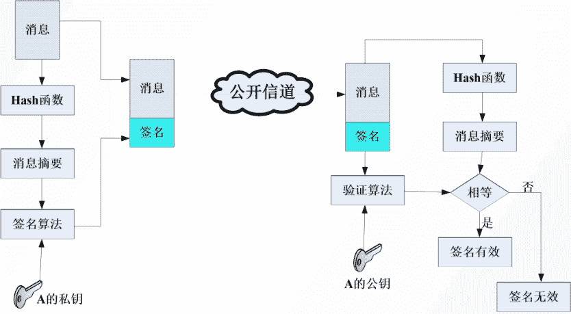

消息

Hash函数

消息摘要

签名算法

A的私钥

消息

签名

> 公开信道

消息

签名

验证算法

A的公钥

Hash函数

消息摘要

相等

是

否

签名有效

签名无效

### RSA数字签名方案(签名和验证算法)

#### 签名算法

- 1. 利用一个安全的Hash函数h来产生消息摘要h(m)。
- 2. 用签名算法计算签名s=Sigₖ(m)=h(m)ᵈ mod n。

#### 验证算法

- 1. 首先利用一个安全的Hash函数h计算消息摘要h(m)。
- 2. 用检验等式h(m) mod n = sᵉ mod n 是否成立，若相等签名有效，否则，签名无效。

### RSA数字签名方案(正确性)

由于 s=h(m)^d mod n
 d*e=1 (mod ψ(n))

所以 s^e mod n = h(m)^{ed} mod n
 = h(m)^{k(p-1)(q-1)+1} mod n
 = h(m)^{kψ(n)+1} mod n
 = h(m) * h(m)^{kψ(n)} mod n
 = h(m) * (h(m)^{ψ(n)})^k mod n
 = h(m)

### Schnorr签名体制（签名）

初始化：
首先选择一个大素数p，使在Zp中求解离散对数困难。然后选择一个生成元g∈Zp*，计算y=g^x mod p，则公开密钥y, g, p，私钥x。

签名算法：
用户选择随机数k，对消息进行如下计算得签名值(e, s).
r=g^k mod p
e=h(r, m)
s=x e + k mod p-1

### Schnorr签名体制(验证)

#### 验证算法：

接受方在收到消息m和签名值(e, s)后，进行以下步骤：

计算 r₁ = g^s y^{-e} mod p

计算 h(r₁, m)

验证等式： h(r₁, m) = e

如果等式成立，接受签名，否则签名无效。

### Schnorr签名体制(正确性)

#### 签名体制的正确性证明：

r₁ = gˢ y⁻ᵉ mod p
= gˢ g⁻ˣᵉ mod p
= gˢ⁻ˣᵉ mod p
= gˣᵉ⁺ᵏ⁻ˣᵉ mod p
= gᵏ mod p
= r

h(r₁, m) = e

r = gᵏ mod p; e = h(r, m); s = (x e + k) mod q;

### 数字签名的小结

- 可信（认证）：签名使文件的接收者相信签名者是慎重地在文件上签字的。
- 不可伪造：签名证明是签名者而不是其他人慎重地在文件上签字。
- 不可重用：签名是文件的一部分，不法之徒不可能将签名移到不同的文件上。
- 不可改变：在文件签名后，文件不能改变的。
- 不可抵赖：在签名者否认自己的签名时，签名的接收者可向可信的第三方申请仲裁。

### 密钥管理的前言

密钥是密码系统中的可变部分。现代密码体制要求密码算法是可以公开评估的，整个密码系统的安全性并不取决对密码算法的保密或者是对密码设备等保护，决定整个密码体制安全性的因素是密钥的保密性。也就是说，在考虑密码系统的设计时，需要解决的核心问题是密钥管理问题，而不是密码算法问题，密钥管理是密码学许多技术（如机密性、实体身份验证、数据源认证、数据完整性和数据签名等）的基础，在整个密码系统中是极其重要的。

### 密钥管理的简介

密钥管理就是在授权各方之间实现密钥关系的建立和维护的一整套技术和程序。密钥管理是密码学的一个重要分支，也是密码学最重要、最困难的部分，在一定的安全策略指导下完成密钥从产生到最终销毁的整个过程，包括密钥的生成、存储、分配和协商、使用、备份/恢复、更新、撤销和销毁等。

### 密钥管理的简介（续）

密钥管理是一门综合性的系统工程，要求管理与技术并重，除了技术性的因素外，还与人的因素密切相关，包括密钥管理相关的行政管理制度和密钥管理人员的素质。

密码系统的安全强度总是取决于系统最薄弱的环节（木桶原理），因此，再好的技术，如果失去了必要管理的支持，终将使技术毫无意义。管理只能通过健全相应的制度以及加强对人员的教育、培训来解决。

### 密钥管理的层次结构

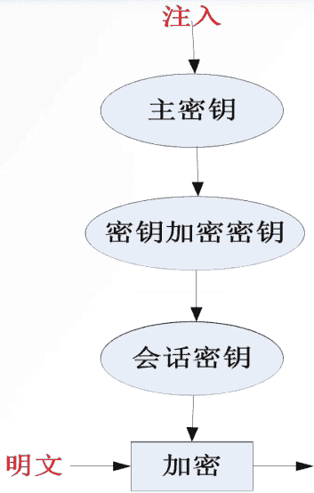

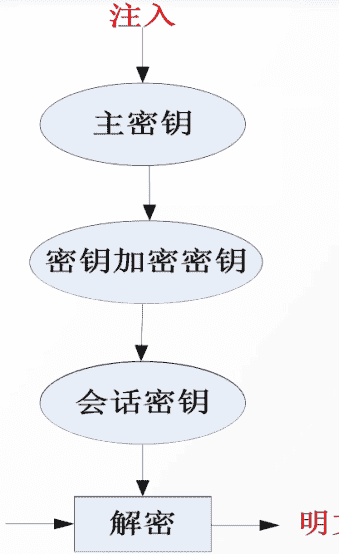

### 密钥类型

- 会话密钥（Session Key）
  在一次通信或数据交换中，用户之间所使用的密钥，是由通信用户之间进行协商得到的。它一般是动态地、仅在需要进行会话数据加密时产生，并在使用完毕后立即进行清除掉的，也称为数据加密密钥(Data Encrypting Key)。
- 密钥加密密钥（Key Encrypting Key）
  一般是用来对传输的会话密钥进行加密时采用的密钥，又称为二级密钥(Secondary Key)。密钥加密密钥所保护的对象是实际用来保护通信或文件数据的会话密钥。
- 主密钥（Master Key）
  对应于层次化密钥结构中的最高层次，它是对密钥加密密钥进行加密的密钥，主密钥应受到严格的保护。
- 在公钥体制下还有公开密钥、秘密密钥、加密密钥、签名密钥之分。

### 密钥的生命周期

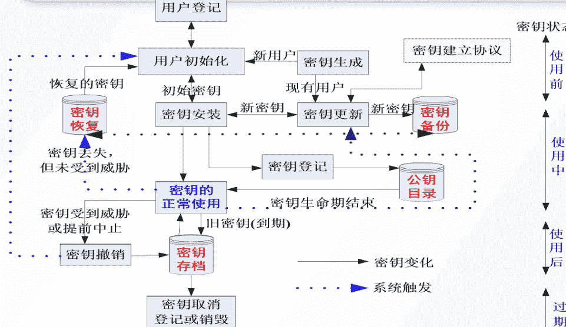

### 密钥状态

- 使用前状态：密钥不能用于正常的密码操作。
- 使用状态：密钥是可用的，并处于正常使用中。
- 使用后状态：密钥不再正常使用，但为了某种目的对其进行离线访问是可行。
- 过期状态：密钥不再使用，所有的密钥记录已被删除。

### 密钥的生命周期

- 生成
- 存储
- 分配
- 使用
- 备份/恢复/存档
- 更新/撤销/销毁

### 密钥的生成

- 密钥的大小与产生机制直接影响密码系统的安全，所以，对于一个密码体制，如何产生好的密钥是很关键的，密钥生成是密钥生命周期的基础阶段。
- 密钥的生成一般首先通过密钥生成器借助于某种噪声源产生具有较好统计分析特性的序列，以保障生成密钥的随机性和不可预测性，然后再对这些序列进行各种随机性检验以确保其具有较好的密码特性。
- 用户可以自己生成所需的密钥，也可以从可信中心或密钥管理中心申请，密钥长度要适中。
- 不同的密码体制，其密钥的具体生成方法一般是不相同的，与相应的密码体制或标准相联系。

### 密钥的存储

- 密钥的安全存储实际上是针对静态密钥的保护；
- 对静态密钥的保护常有两种方法：
  - 基于口令的软保护；
  - 文件形式或利用确定算法来生成密钥。
  - 基于硬件的物理保护；
  - 存入专门密码装置中（存储型、智能型）。

### 密钥的使用

利用密钥进行正常的密码操作，如加密、解密、签名等，通常情况下，密钥在有效期之内都可以使用。应注意使用环境对密钥的安全性的影响。

### 密钥的备份/恢复/存档

- **密钥备份：** 指密钥处于使用状态时的短期存储，为密钥的恢复提供密钥源，要求安全方式存储密钥，防止密钥泄露。
- **密钥恢复：** 从备份或存档中获取密钥的过程称为密钥恢复。若密钥丧失但未被泄露，就可以用安全方式从密钥备份中恢复。
- **密钥存档：** 当密钥不再正常时，需要对其进行存档，以便在某种情况下特别需要时（如解决争议）能够对其进行检索。存档是指对过了有效期的密钥进行长期的离线保存，密钥的后运行阶段工作。

### 密钥的更新/撤销/销毁

- **密钥更新：** 在密钥有效期快结束时，如果需要继续使用该密钥，为保证密钥的安全性，该密钥需要由一个新的密钥来取代，这就是密钥更新。密钥更新可以通过再生密钥取代原有密钥的方式来实现。
- **密钥撤销：** 若密钥丢失或在密钥过期之前，需要将它从正常使用的集合中删除。
- **密钥销毁：** 对于不再需要使用的密钥，要将其所有复本销毁，而不能再出现。

### 密钥分配

- 密钥分配就是一种机制，通过这种机制，通信双方中的一方或密钥分配中心选取一个秘密密钥，然后将其传送给通信双方中的另一方。
- 密钥分配技术是在不让其他人（除密钥分配中心）看到密钥的情况下将一个密钥传递给希望交换数据的双方的方法。
- 一个密码编码系统的安全强度依赖于密钥分配技术。

#### 密钥的分配

- 无中心的密钥分配模式
- 中心化密钥分配模式
- 公钥密码体制的密钥分配

#### 无中心的密钥分配模式

- (1) A向B发出建立会话密钥的请求和一个一次性随机数N₁。
- (2) B用与A共享的主密钥对应答的消息加密，并发给A，应答的消息中包括B选取的会话密钥、B的身份，f(N₁)和另一个一次性随机数N₂。
- (3) A用新建立的会话密钥加密f(N₂)并发送给B。

问题：为什么分配密钥需要随机数？

#### 密钥分配方法的分析

如果所有用户都要求支持加密服务，则任意一对希望通信的用户都必须有一共享密钥。如果有n个用户，每个用户需要存储n-1个密钥，这对每个用户都是一个沉重的负担，另，密钥数目为n(n-1)/2，密钥分配也是一个难题。

建立一个负责为用户分配密钥的密钥分配中心，这时每一用户必须和密钥分配中心有一个共享密钥，称为主密钥。通过主密钥分配给一对用户的密钥称为会话密钥，用于这一对用户之间的保密通信。通信完成后，会话密钥即被销毁。如上所述，如果用户数为n，则会话密钥数为n(n-1)/2，但主密钥数却只需n个。

#### 中心化密钥分配模式

(1)A向密钥分配中心KDC（Key Distribute Center）发出会话密钥请求。请求内容包括A与B的身份以及一次性随机数N₁。

(2)KDC为A的请求发出应答。应答内容包括：一次性会话密钥Ks、A的请求、用B与KDC的共享密钥加密一次性会话密钥Ks和A的身份，其中应答信息是用A与KDC的共享密钥加密。

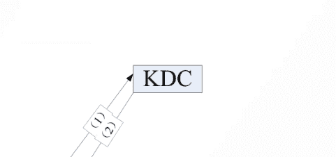

#### 中心化密钥分配模式(续)

(3)A存储会话密钥，并向B转发用B与KDC的共享密钥加密一次性会话密钥Ks和A的身份。

(4)B使用会话密钥Ks 加密另一个一次性随机数N₂，并将加密结果发送给A。

(5)A使用会话密钥Ks 加密f(N₂)，并将加密结果发送给B。

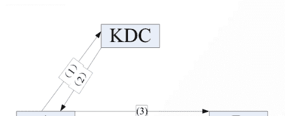

#### 利用公钥密码体制实现密钥分配

1. E_{yb}(N_1\|ID_A)

2. E_{ya}(N_1\|N_2)

用户 A

用户 B

3. E_{yb}(N_2)

4. Sign_{xa}E_{yb}(K_s)

注：xa表示用户A的私钥；
ya表示用户A的公钥，来自用户A的证书；
yb表示用户B的公钥，来自用户B的证书；

### 本讲的主要内容

- 数字签名的简介
- 数字签名技术的实现
- 密钥管理的简介(思想、层次结构、密钥类型)
- 密钥的生命周期(生成、存储、分配和协商、使用、备份/恢复、更新、撤销和销毁)
- 密钥的分配和协商

## 第五讲 密码技术应用

主讲人：谷利泽

Email: glz_bupt@263.net

Tel: 010-62283134

### 上讲的主要内容

- 数字签名的简介
- RSA和Schnorr数字签名技术
- 密钥管理的简介(思想、层次结构、密钥类型)
- 密钥的生命周期(生成、存储、分配和协商、使用、备份/恢复、更新、撤销和销毁)
- 密钥的分配和协商

### 一个同学的问题

- 1. 课上您讲数字签名是可以复制的，那么如何保证其安全性呢？还有签名是不可重用的是不是与数字签名可以复制相矛盾？
- 2. 对于实体认证和消息认证，到底有什么区别，在网上，无论你是一个实体还是一个具体的消息，计算机最终进行认证的都会是一些具体的消息，既使你是一个实体，它也不可能在现实中一样看看你到底是什么样子来认证，只可能还是通过消息来认证的。
  
  另外一方面对于实体认证为什么要用数字签名，消息认证为什么要用HASH函数和对称密钥来认证我还是不太明白，除了根据实体多少来区分外还有别的不同之处吗？
- 3. 会话密钥基本上是用一次就会换一个，那么它在一定程度上和一次一密的对称密钥有什么区别吗？
  
  由于会话密钥在用了几次后便要换了，那么就会需要很多会话密钥，这样会不会加大密钥管理的负担呢？

### 本讲的主要内容

- 简介PKI技术
- 密码技术应用举例
- 一个安全产品的介绍
- 布置第一次课堂练习

### 逻辑安全的主要威胁

非法用户截获通信网络的数据

非法用户假冒合法用户身份获取敏感信息

非法用户改动所截获的信息和数据

通信的单方或多方事后否认曾经参与某次活动

信源

信宿

攻击者
截取

信源

信宿

攻击者
假冒

信源

信宿

攻击者
篡改

信源

信宿

否认

### 常见的解决方法

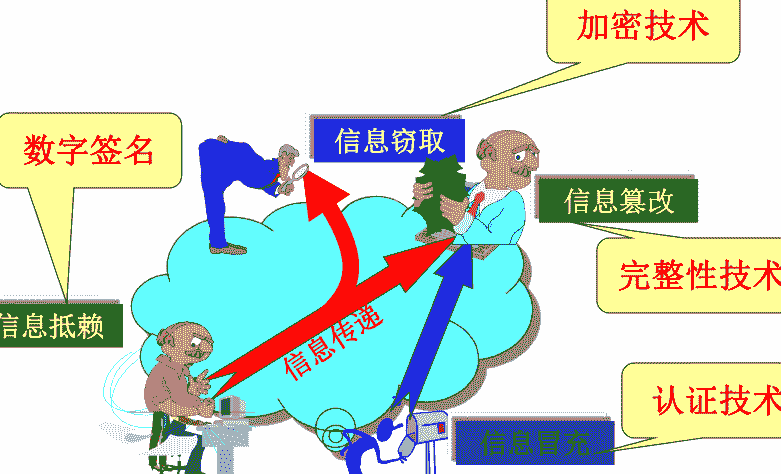

### 要求实现的安全功能

- **保密性**
  - 我与你说话时,别人不能偷听？
- **认证**
  - 我不认识你！
  - 你是谁？
  - 我怎么相信你就是你？
  - 要是别人冒充你怎么办？
- **完整性**
  - 收到的传真不太清楚？
  - 传送过程中别人篡改过没有？
- **防抵赖**
  - 我收到货后,不想付款,想抵赖,怎么样？
  - 我将钱寄给你后,你不给发货,想抵赖,如何？

### 中间人攻击

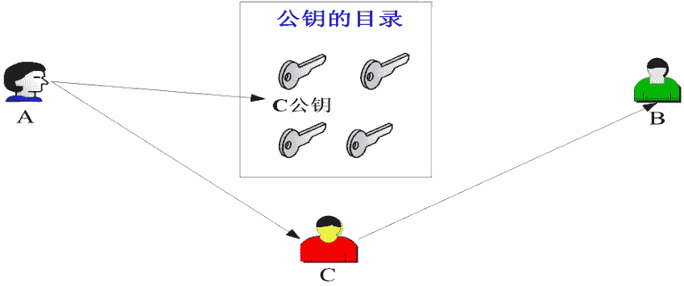

### 公钥的目录

- 1. C将公共目录中的B的公钥替换成自己的公钥。
- 2. A将他认为的B的公钥提取出来，而实际上那是C的公钥。
- 3. C现在可以读取A送给B的加密信息。
- 4. C将A的信息解密并阅读，然后他又用真实的B的公钥加密该信息并将该信息送给A，这样他就不会发现。

### PKI的引入

借助电力供应和计算机网络等基础设施的思想，实现公钥基础设施（PKI，Public Key Infrastructure），使得只要PKI具有良好的接口，用户或应用无需精通密码理论，只需要知道如何接入PKI平台就可以获得安全服务，就能够实现保密、认证、完整性、防抵赖等功能。

### PKI的含义

PKI（Public Key Infrastructure）是一个用公钥概念与技术来实施和提供安全服务的具有普适性的安全基础设施。基础服务最主要用来支持公钥密码体制为基础的加密和数字签名技术的广泛应用。

PKI是生成、管理、存储、分发和吊销基于公钥密码学的公钥证书所需要的硬件、软件、人员、策略和规程的总和。

### PKI的内容描述

PKI技术以公钥技术为基础，以数字证书为媒介，结合对称加密和非对称加密技术，将个人、组织、设备的标识信息与各自的公钥捆绑在一起，其主要目的是通过自动管理密钥和证书，为用户建立起一个安全、可信的网络运行环境，使用户可以在多种应用环境下方便地使用加密和数字签名技术，在互联网上验证用户的身份，从而保证了互联网上所传输信息的真实性、完整性、机密性和不可否认性。PKI是目前为止既能实现用户身份认证，又能保证互联网上所传输数据安全的惟一技术。

### PKI的理解

- 基于**公开密钥**理论和技术建立起来的安全体系。
- 一个被广泛认识并且被普遍接受的**标准化**的结构。
- 提供信息安全服务的具有**普适性**的安全基础设施。
- CA认证、数字证书、目录服务(证书库)以及相关安全应用组件**模块**的集合。
- 核心是要解决信息网络空间中的**信任**问题，确定可信赖的数字身份。
- 似乎可以解决绝大多数网络安全问题，并初步形成了一套完整的解决方案。

### PKI技术发展现状及趋势

- 自20世纪90年代初期以来，作为电子商务信息安全的关键和基础性技术的PKI逐步得到了许多国家的政府和企业的广泛重视，PKI技术由理论研究进入到商业化应用阶段。
- PKI技术经过近十年的发展已日趋成熟，许多新技术还在不断涌现，CA之间的信任模型、使用的加解密算法、密钥管理的方案等也在不断变化中。
- PKI的应用涉及电子商务、电子政务、电子事务等诸多领域，PKI具有非常广阔的市场应用前景。
- 我国的PKI行业起步较晚，PKI行业的建立还只有不到五年的时间，但其发展还是十分迅速的。
- 国内的这些认证中心可分为三大类：行业性认证中心、区域性认证中心和纯商业性认证中心。

### PKI的优势

- 节省费用
- 透明性和易用性
- 可扩展性
- 多用性
- 支持多平台

### 数字证书的概述（一）

简单地讲，数字证书是一种包含了重要信息的载体，它证明了证书所有人和所持有的公钥的真实性，由一个可信的中介机构进行签名，这可以使获得证书的人只要信任这个可信的中介机构，就可以相信他所获得的证书了。

### 数字证书的概述（二）

数字证书也称为公钥证书，是将证书持有者的身份信息和其所拥有的公钥进行绑定的文件。证书文件还包含签发该证书的权威机构认证中心CA对该证书的签名。通过签名保障了证书的合法性和有效性。证书包含的持有者公钥和相关信息的真实性和完整性也是通过CA的签名来保障的。这使得证书发布依赖于对证书本身的信任，也就是说证书提供了基本的信任机制。证书（和相关的私钥）可以提供诸如身份认证、完整性、机密性和不可否认性等安全服务。证书中的公钥可用于加密数据或验证对应私钥的签名。

### 数字证书的内容

- **版本号**：用来区分X.509的不同版本，v3(2)。
- **序列号**：由CA给予每一个证书的分配惟一的数字型编号。
- **认证机构标识**：颁发该证书的机构惟一的CA的X.500名字。
- **主体标识**：证书持有者的名称。
- **主体公钥信息**：和该主体私钥相对应的公钥。
- **证书有效期**：证书有效时间包括两个日期：证书开始有效期和证书失效期。
- **密钥/证书用法**：描述该主体的公/私密钥对的合法用途。
- **扩展**：说明该证书的附加信息。
- **认证机构签名**：用认证机构的私钥生成的数字签名。

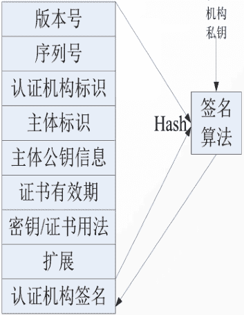

### 数字证书的安全性

- 证书是公开的，可复制的。
- 任何具有CA公钥（根证书/CA证书，自签名证书）的用户都可以验证证书有效性。
- 除了CA以外，任何人都无法伪造、修改证书。
- 证书的安全性依赖于CA的私钥。

### PKI主要组件

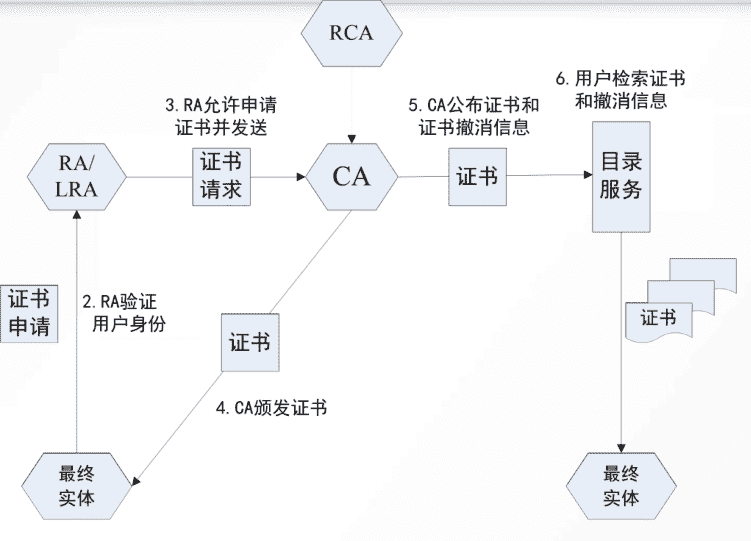

#### PKI主要组件的简介

- 公钥证书：由可信实体签名的电子记录，记录将公钥和密钥（公私钥对）所有者的身份捆绑在一起。公钥证书是PKI的基本部件。
- 根CA：一个单独的、可信任的根CA是PKI的基础，生成一个自签名证书，亦称CA证书或根证书。
- 注册机构和本地注册机构：接受个人申请，检查其中信息并发送给CA。RA可设计成CA的代理处，分担CA的一定功能以增强可扩展性。
- 目录服务（证书库）：PKI的一个重要组成部分，主要用于发布用户的证书和证书作废列表（黑名单）。
- PKI应用接口系统：为各种各样的应用提供安全、一致、可信任的方式与PKI交互，确保所建立起来的网络环境安全可靠，并降低管理成本。

#### CA的简介

CA机构，又称为证书授权(Certificate Authority)中心，作为电子商务交易中受信任的第三方，承担公钥体系中公钥的合法性检验的责任。CA中心为每个使用公开密钥的用户发放一个数字证书，数字证书的作用是证明证书中列出的用户合法拥有证书中列出的公开密钥。CA机构的数字签名使得攻击者不能伪造和篡改证书。它负责产生、分配并管理所有参与网上交易的个体所需的数字证书，因此是安全电子交易的核心环节。

#### 认证中心（CA）组成

- **签名和加密服务器**：对于数字证书和被撤销的数字证书，应有认证机构的数字签名。
- **密钥管理服务器**：与签名加密服务器连接，按配置生成密钥、撤销密钥、恢复密钥和查询密钥。
- **证书管理服务器**：主要完成证书的生成、作废等操作控制。
- **证书发布和CRL发布服务器**：用于将证书信息按一定时间间隔对外发布，为客户提供证书下载和CRL下载等服务。
- **在线证书状态查询服务器**：证书用户随时都知道某个证书的最新状态。
- **Web服务器**：用于证书发布和有关数据认证系统政策的发布。

#### CA的核心功能

- 接受验证最终用户数字证书的申请。
- 确定是否接受最终用户数字证书的申请（证书审批）。
- 向申请者颁发、拒绝颁发数字证书（证书发放）。
- 接受、处理最终用户的数字证书更新请求（证书更新）。
- 接受最终用户数字证书的查询、撤销。
- 产生和发布证书注销列表（CRL）。
- 数字证书的归档。
- 密钥归档。
- 历史数据归档。

#### 注册中心（RA）

- 注册中心是数字证书注册审批机构。
- RA 系统是CA系统的证书发放、管理的延伸，是整个 CA中心得以正常运营不可缺少的一部分。
- 但有的系统中，将RA合并在CA中。
- 一般而言，注册中心控制注册、证书传递、其他密钥和证书生命周期管理过程中主体和PKI间的交换。
- 在任何环境下，RA都不发起关于主体的可信声明。

#### RA的功能

- 主体注册证书的个人认证。
- 确定主体所提供信息的有效性。
- 对被请求证书属性确定主体的权利。
- 在需要撤销时报告密钥泄露或终止事件。
- 为识别身份的目的分配名字。
- 在注册初始化和证书获得阶段产生共享秘密。
- 产生公私钥对。
- 认证机构代表主体开始注册过程。
- 私钥归档。
- 开始密钥恢复处理。
- 包含私钥的物理设备的分发。

#### CA的策略

- CA私钥的保护。
- 证书申请时密钥对的产生方式。
- 用户私钥的保护
- CRL的更新频率
- 通知服务：对于用户的申请和证书过期、废除等有关事宜的回复。
- 保护CA服务器。
- 审计和日志检查

#### API接口

- 签名函数
- 验证函数
- 加密函数
- 解密函数
- 随机数生成函数
- 散列函数
- 证书有效性验证函数
- 验证CRL 有效性的函数
- OCSP 查询函数
- TSA 申请函数
- TSA 验证函数

#### CA的系统结构

信息安全中心

BuptISC

密钥管理中心

KMC 服务器

加密机

DB

KMC 管理终端

OCSP 服务器

在线证书状态查询

签发系统

签发服务

DB

LDAP

系统管理终端

业务管理终端

审计终端

注册系统

注册服务

DB

系统管理终端

业务管理终端

业务处理终端

审计终端

加密机

主

从

收发服务器

证书发布系统

制证终端

证书用户

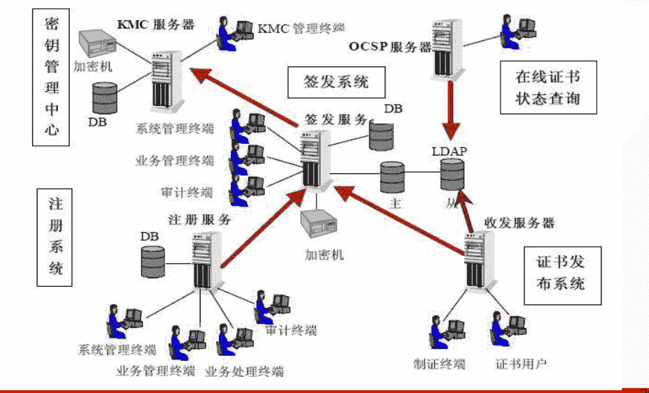

#### 密钥生命周期

密钥产生

证书签发

密钥使用

证书检验

密钥过期

密钥更新

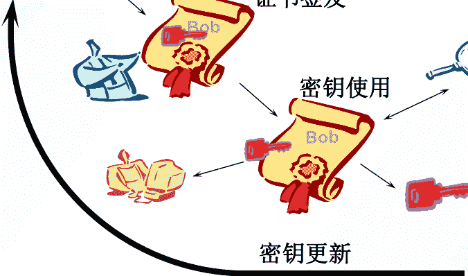

#### 证书管理

- 证书注册
- 证书存放
- 证书撤销
- 证书验证
- 证书状态查询

#### 证书注册

- 申请人提交证书请求。
- RA对证书请求进行审核。
- CA生成证书。
- 下载并安装证书
- 证书发布

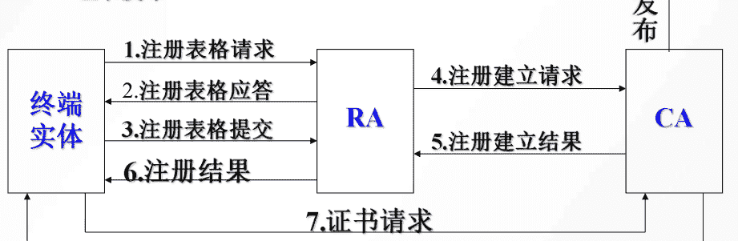

#### 证书的更新

- 最终实体证书更新
  - 证书过期
  - 一些属性的改变
  - 发放新证书
- CA证书更新
  - 旧用新证书
  - 新用旧证书

#### 证书存放

- 使用IC卡存放
- 直接存放在磁盘或自己的终端上
- USB Key
- 证书库

#### 证书撤销

当条件（雇佣关系结束、证书中信息修改等）要求证书的有效期在证书结束日期之前终止，或者要求用户与私钥分离时（私钥可能以某种方式泄露），证书被撤销。

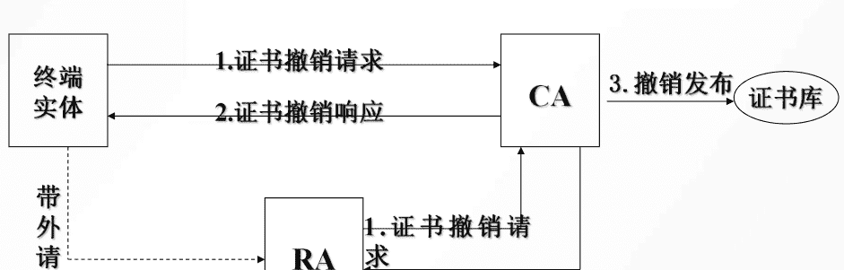

#### 证书撤销列表

用户在使用一个证书之前，必须检查证书是否已被撤销

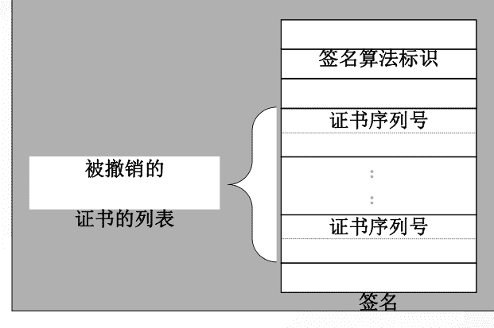

证书撤销列表（CRL）会无限增加吗？

#### 证书验证

- 使用CA证书验证终端实体证书有效性。
- 检查证书的有效期，确保该证书是否有效。
- 检查该证书的预期用途是否符合CA在该证书中指定的所有策略限制。
- 在证书撤销列表（CRL）中查询确认该证书是否被CA撤销。

#### 证书状态查询

- 定期下载证书撤销列表（CRL）。
- 在线证书状态协议OCSP（Online Certificate Status Protocol），其目的为了克服基于CRL的撤销方案的局限性，为证书状态查询提供即时的最新响应。OCSP使用证书序列号、CA名称和公开密钥的散列值作为关键字查询目标的证书。

### 网络数据加密常见的方式

- 链路加密
- 节点加密
- 端到端加密

#### 链路加密

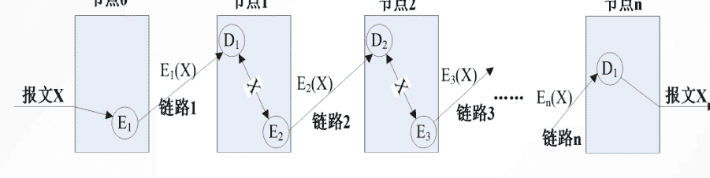

- 所有消息在被传输之前进行加密；
- 防止对通信业务进行分析；
- 要求链路两端的加密设备同步；
- 链路端（节点）必须是安全的；
- 增加密钥连续分配或维护的费用；

#### 节点加密

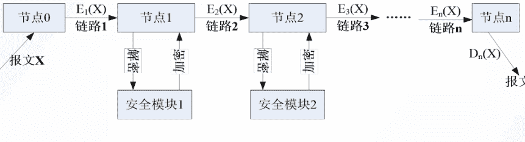

- 在信息传输路过的节点处透明地进行加解密；
- 报头和路由等信息以明文形式传输；
- 不允许消息在网络节点以明文形式存在；
- 防止攻击者分析通信业务是脆弱的；
- 节点加密与链路加密有共同密钥分配的缺点；

#### 端到端加密

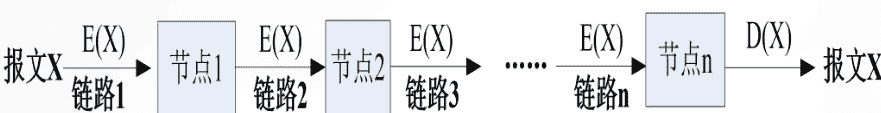

- 数据从源点到终点的传输过程中始终以密文形式存在；
- 报头和路由等信息以明文形式传输；
- 避免上两种加密系统固有的同步问题；
- 即使有节点被攻击也不会使信息泄露；
- 价格便宜，更容易设计、实现和维护；
- 防止攻击者分析通信业务是脆弱的；

### 数字证书的应用（续）

（7）乙收到甲传送过来的密文和加过密的DES密钥，先用自己的私钥（SK）对加密的DES密钥进行解密，得到DES密钥。

（8）乙然后用DES密钥对收到的密文进行解密，得到明文的数字信息，然后将DES密钥抛弃（即DES密钥作废）。

（9）乙获得甲的证书，并用CA证书验证及检查证书撤销列表验证甲证书是否有效、检查证书是否过期、是否符合用途。

（10）乙用甲的公钥（PK）（来自证书）对甲的数字签名进行解密，得到信息摘要。

（11）乙用相同的hash算法对收到的明文再进行一次hash运算，得到一个新的信息摘要。

（12）乙将收到的信息摘要和新产生的信息摘要进行比较，如果一致，说明收到的信息没有被修改过。

### 电脑安全锁的功能

- 文件保密柜；
- 开机登录 自动锁屏；
- 自动禁网；
- 完全删除；

### 谢谢！

## 第六讲 认证技术

主讲人：谷利泽

Email：glz_bupt@263.net

Tel：010-62283134

### 上讲的主要内容

- 简介PKI技术
- 密码技术应用举例
- 一个安全产品的介绍

### 本讲的主要内容

- 认证的简介
- 基于口令的认证
- 基于密码技术的认证
- 基于生物特征的认证

### 引言

认证活动一直贯穿于人类的学习与生活：新生入学时，学校要查看他们的入学录取通知书，这是学校对于学生的认证，以便识别你是张三而不是李四；去银行取钱时，要出示用户的存折卡，一般还要输入用户的密码，这是银行对储户的认证。上述情况都是认证活动在我们生活中的体现。简单说，信息认证也是对我们现实世界的数字模拟。

在计算机网络中，在进行交流和通信前，也要弄清楚对方是谁，确定对方的身份。认证一般分两种情形：身份认证（确定某一实体的身份）；消息认证（鉴定某个消息来源于某个特定的实体）。

#### 认证的说明

- 在现实生活中，我们个人的身份主要是通过各种证件来确认的，比如：身份证、户口本等。计算机网络信息系统中，各种计算资源（如：文件、数据库、应用系统）也需要认证机制的保护，确保这些资源被应该使用的人使用。
- 在大多数情况下，认证机制与授权和审计也紧密结合在一起。身份认证是对网络中的主体进行验证的过程，用户必须提供他是谁的证明。
- 身份认证往往是许多应用系统中安全保护的第一道设防，它的失败可能导致整个系统的失败。

### 用户对资源的访问过程

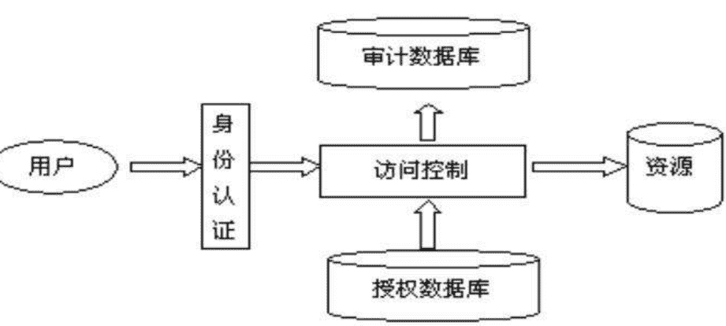

### 认证模型

- 单向认证：指通信双方中只有一方向（如客户端）另一方（如服务器）进行认证。
- 双向认证：指通信双方相互进行认证。
- 多方认证：指通信多方相互进行认证。

### 身份认证系统的组成

身份认证系统包含下列三项主要模块或设备：

- (1) 认证服务器(Authentication Server)
负责进行使用者身份认证的工作，服务器上存放使用者的私有密钥、认证方式及其他使用者认证的相关资讯。

- (2) 认证系统用户端软件(Authentication Client Software)
认证系统用户端通常都是需要进行登陆(login)的设备或系统，在这些设备及系统中必须具备可以与认证服务器协同运作的认证协议。也有一些情况下认证服务器与认证系统用户端软件是集成在一起的。

- (3) 认证设备(Authenticator)(可选)
认证设备是使用者用来产生或计算密码的软硬件设备。

### 身份识别协议的简介

- 一方是出示证件的人，称作示证者P（Prover），又称声称者（Claimant）。
- 另一方为验证者V（Verifier），检验声称者提出的证件的正确性和合法性，决定是否满足要求。
- 一个安全的身份识别协议至少应满足以下两个条件：
  1. 示证者P能向验证者V证明他的确是P。
  2. 在示证者P向验证者V证明他的身份后，验证者V没有获得任何有用的信息，V不能模仿P向第三方证明他是P。

（零知识）

### 零知识的基本思想

你向别人证明你知道某种事物或具有某种东西，而且别人并不能通过你的证明知道这个事物或这个东西，也就是不泄露你掌握的这些信息。

注：P(rover)：示证者；V(erifier)：验证者。

- (1) V站在A点；
- (2) P进入洞中任一点C或D；
- (3) 当P进洞之后，V走到B点；
- (4) V叫P:(a)从左边出来，或(b)从右边出来；
- (5) P按要求实现(以咒语打开门)；
- (6) P和V重复执行(1)～(5)共n次。

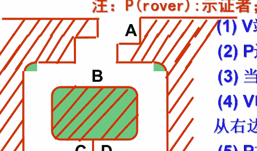

### 身份认证的分类

- 所知（基于口令的认证方式）
  密码、口令等。
- 所有（基于智能卡的认证方式）
  身份证、护照、密钥盘、Usb Key等。
- 所是（基于生物特征的认证方式）
  指纹、笔迹、声音、虹膜、DNA等

#### 口令

由于口令易实现、成本低、使用方便等特点，成为当前最常用的认证方式，尤其在安全性要求不是很高的应用场合。

- 散列口令认证
- 口令更改

#### 改进方案（一）

输入终端

明文口令

口令散列

摘要

质询

响应

使用摘要作为密钥加密质询产生响应

随机数

认证系统

摘要

质询

匹配吗？

摘要

质询'

响应

使用摘要作为密钥解密响应产生质询'

#### 改进方案（二）

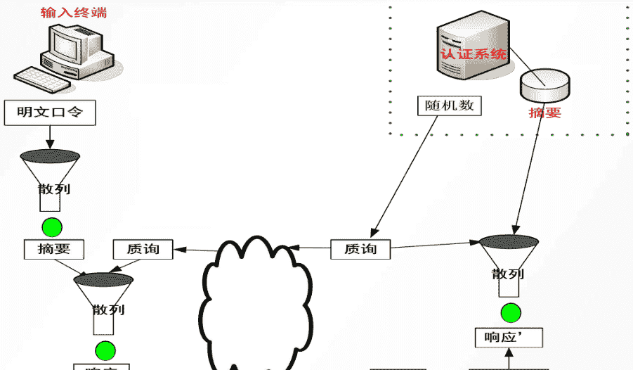

#### 口令更新

对于大部分系统而言，初始化时，系统管理员给每个用户指定一个通过数列计算出来的临时口令，认证数据库中保存临时口令的摘要。然后，管理员通过某些带外的方式，如邮件或者电话，告诉用户的口令。

##### 用户口令应定期修改

##### 口令更新的实现

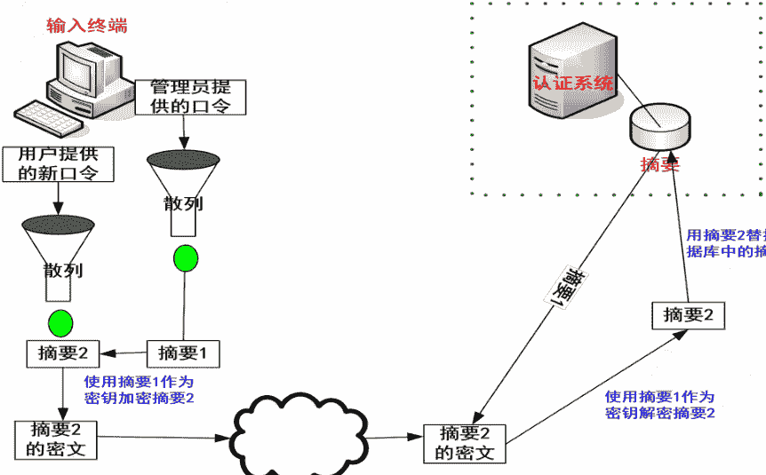

输入终端

用户提供的新口令

管理员提供的口令

散列

散列

摘要1

摘要2

摘要2的密文

使用摘要1作为密钥加密摘要2

摘要2的密文

摘要2

认证系统

摘要

用摘要2替换数据库中的摘要1

使用摘要1作为密钥解密摘要2

#### 验证码的介绍

#### 用户登录

用户名：

密码：

验证码： 3508

登录

注册

找回密码

#### 验证码

验证码其实就是一串随机产生的数字或符号，使用时生成一幅图片，在图片里加一些干扰像素，现由用户肉眼识别，然后提交给网站验证，验证成功后才能使用某项功能。验证码一般是防止有人利用程序自动批量注册，对特定的注册用户用特定的程序进行暴力破解，如果攻击方不断地进行登录，将可能导致服务中断或不能有效地提供服务。因为验证码是一个混合了数字或符号的图片，人眼看起来都费劲，程序识别起来更加困难。

#### 基于动态口令的身份认证

动态口令是指用户登录系统验证身份的过程中，输入用户终端的验证数据是动态变化的。其基本思路：在登录过程中加入不确定因素，例如，随机数或时间，系统根据某种密码算法计算登录密码，产生一个不断变化、没有重复的、无法猜测的动口令来代替传统的静态口令，系统接收到登录口令后做一个验算即可验证用户的合法性，从而避免了口令泄密带来的安全隐患，解决了由传统口令泄露而导致入侵问题。

##### 认证令牌

- 认证令牌是简单口令最常见的替代品。
- 认证令牌就是为每一次认证产生一个用于认证的新值的设备。
- 认证令牌一般是由一个处理器、一个液晶显示屏（LCD）和一块电池组成的。
- 每个令牌都用称为种子唯一值的编程，种子可确保每个令牌产生唯一的输出代码。
- 认证服务器必须知道每个令牌的编程种子数。
- 令牌认证是双因子认证（口令是单因子）。

##### 认证令牌类型

- 质询/响应令牌。
- 时间令牌。

##### 质询/响应令牌

质询/响应令牌

认证系统

随机数

种子数

通过令牌小键盘输入质询

使用种子数作为密钥加密质询产生响应

从令牌LCD中读取响应并在登录提示符下将其输入

种子数

质询

响应

质询

匹配吗？

种子数

质询'

响应

使用种子数作为密钥解密响应产生质询'

###### 质询/响应令牌（续1）

质询/响应令牌

认证系统

随机数

种子数

通过令牌小键盘输入质询

使用种子数运行相同的加密算法

种子数

使用相同方法截取加密结果

响应’

匹配吗？

响应

从令牌LCD中读取响应并在登录提示符下将其输入

使用种子数作为密钥加密质询

按需要截取适当长度的字符串作为响应

种子数

质询

质询

响应

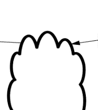

###### 质询/响应令牌（续2）

信息安全中心
BuptISC

质询/响应令牌

通过令牌小键盘输入质询

从令牌LCD中读取响应并在登录提示符下将其输入

按需要截取适当长度的字符串作为响应

认证系统

种子数

随机数

种子数

质询

散列

使用相同方法截取加密结果

响应

匹配吗？

响应

质询

种子数

散列

响应

##### 时间令牌

- 质询/响应令牌的缺陷：
  用户认证必须准确地读取两个不同值（质询和响应）
  正确地输入三个不一样的数值（PIN、质询、响应）
- 时间令牌是更容易的令牌

##### 时间令牌的实现

时间令牌

09129155

令牌有内内部时钟

种子数

散列

按需要截取适当长度的字符作为响应

通行证

从令牌LCD中读取通行证并在登录提示符下将其输入

服务器时钟和令牌时钟各自独立运行

认证系统

种子数

种子数

散列

使用相同方法截取加密结果

通行证’

匹配吗？

通行证

##### 基于动态口令认证的举例

信息安全中心
BuptISC

根据时间、令牌产生一个动态一次性口令A

将认证信息送至应用服务器（LGET认证代理）

用户标识+口令A
发送至LGET认证服务器

LGET认证代理

对应用户标识，认证服务器在数据库中找 到令牌并与时间序列 一起生成口令(B)，与口令(A) 进行比较

LGET认证服务器

将肯定或否定码送至应用服务器（LGET认证代理）

##### 时钟的同步

- 令牌时钟在生产过程时对其初始化并植入了校对因子。
- 令牌每60秒产生一个新的通行字。
- 认证服务器通过以服务器时钟为中心点，加上或减去几分钟的滑动窗口来尝试和查找认证通行码，同时调整时间偏移量。
- 如果通行码在内部窗口未获匹配，则在大窗口内查找，若匹配，用户需再输入一次确保用户不是伪造的，再次匹配，认证通过并同时调整时间偏移量，否则，认证不通过。

##### 认证令牌小结

- 认证令牌主要有两种类型：质询/响应和时间令牌。
- 认证令牌引入了双因素认证的概念
- 基于口令的质询/响应方案需要对产生的伪随机数进行截取。
- 时间令牌关键在于时钟同步、校对、窗口设置。

#### 基于对称密钥的认证

- 利用随机数实现单向身份识别
- 利用随机数实现双向身份识别

前提条件：双方拥有共享密钥。

##### 利用随机数实现单向身份识别

- (1) 验证者V选取随机数rᵥ发送给示证者P。
- (2) 示证者P计算Eₖ(rᵥ, IDᵥ)并发送给验证者V。
- (3) 验证者V解密rᵥ求出IDᵥ，验证IDᵥ是自己的身份信息，rᵥ是前一次自己选取的。

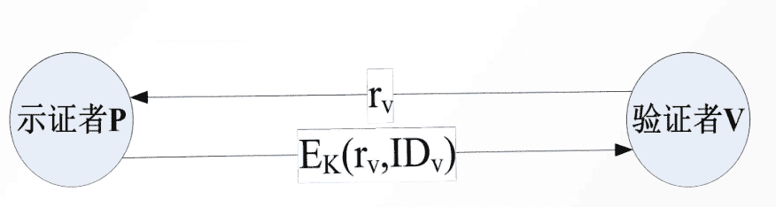

##### 利用随机数实现双向身份识别

- 1. 用户B选取随机数 $r_B$ 发送给用户A。
- 2. A选取随机数 $r_A$ 作为询问，计算 $E_K(r_A,r_B,ID_B)$ 并发送给B。
- 3. B解密，求出 $(r_A,r_B)$，经核实正确，知道对方为掌握密钥K的实体。B再计算 $E_K(r_A,r_B)$ 发送给A。
- 4. A解密，求出 $(r_A,r_B)$，经核实正确，知道对方为掌握密钥K的实体。

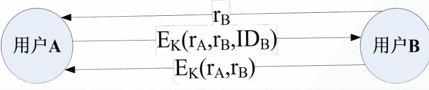

#### 基于公钥证书的认证

- 利用签名实现单向身份识别
- 利用签名实现双向身份识别

前提条件是有PKI环境。

##### 利用签名实现单向身份识别

- (1) 用户B选取随机数r_B，计算h_B=hash(r_B)，发送(ID_B, h_B)给用户A。
- (2) A收到(ID_B, h_B)后，计算签名S_SkA(h_B, ID_A, ID_B)并连同ID_A和A的公钥证书一起发送给B。
- (3) B验证A公钥证书的有效性并取A的公钥PK_A验证签名是否正确，若正确，则B确认与之通信的就是A。

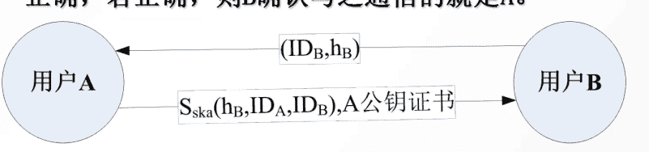

注：ska表示用户A的私钥。

##### 利用签名实现双向身份识别

- (1) 用户B选取随机数r_B发送(ID_B, r_B)给用户A。
- (2) A选取随机数r_A，计算签名S_ska(r_A, r_B, ID_B)并连同r_A、ID_A和A的公钥证书一起发送给B。
- (3) B验证A公钥证书的有效性并用A的公钥PK_A验证签名是否正确，若正确，则B确认与之通信的就是A。并计算S_skb(r_A, r_B, ID_A)，连同B的公钥证书一起发送给A。
- (4) A同上一步，验证成功则说明对方就是B。

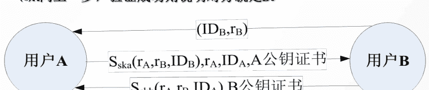

注：ska表示用户A的私钥，skb表示用户B的私钥。

#### 举例

为了对使用者的身份进行识别或认证，保障网络信息的安全，大多数系统都是采用键盘输入口令的模式（采用“用户名”+“密码”的认证机制对用户进行身份认证）来进行操作管理，且每个系统采用方法不同，没有一个统一的操作管理模式，并且这种单因子身份认证不能够提供足够强的安全性，存在着一定的安全隐患——可能因为系统中的密码过于繁多而难于记忆或由于设置的密码过于简单而被轻易破解。

针对目前Browser/Server结构，利用存储在USB钥匙中的用户证书信息，来完成用户访问Web服务器时的身份认证，同时也兼容原有的应用系统。任意一把USB钥匙都是唯一的，它通过与用户(身份)绑定，代表唯一一个用户。

#### 实现的功能

- 使用Usb Key来代表用户的身份，实现双因子认证。
- 灵活设定安全Web服务器，并实现客户端与安全Web服务器之间保密通信。
- 与原有应用系统兼容。

注：前提条件是PKI环境。

##### 实现的方案

- IE浏览器
- 其它Web服务器，如新浪、百度等
- 代理
- 网关
- Web服务器
- CA服务器
- 会话密钥
- 参数设置，如安全服务器地址、代理端口等。

###### 用户会话密钥表

| 用户标识 | 会话密钥 |
| --- | --- |
|  |  |

###### 数据库

| 用户标识 | 最新访问时间 |
| --- | --- |
|  |  |

#### 实现流程

- (1) 客户端通过IE发出访问Web服务器的请求。代理接收到客户端浏览器发来的请求信息后，根据参数设置判断是否为安全Web服务器的访问，若是，代理读Usb Key获得用户标识，如果会话密钥ks存在，进入第(2)步，否则按(a)(b)(c)建立会话密钥后进入(2)步。若不是对安全Web服务器的访问，把请求访问直接发给相应Web服务器，然后把返回的结果送给客户端IE浏览器，这个访问请求结束。
  - (a) 代理通过UsbKey对用户的认证信息（用户ID+当前时间）进行签名，然后把认证信息、其签名值及用户证书（来自Usb Key）发给网关。
  - (b) 网关通过CA验证用户证书的有效性，再利用用户证书的公钥验证认证信息签名的有效性，并通过数据库查询验证认证信息的当前时间是否最新时间，若都验证通过，此用户身份认证通过并确定一个新的连接。生成会话密钥ks，并用用户标识和ks填写用户会话密钥表，用用户的公钥加密ks，并把加密结果E_y(ks)发给代理。
  - (c) 代理通过UsbKey的用户私钥x解密E_y(ks)，保存会话密钥ks。
- (2) 代理使用会话密钥ks加密这个访问请求，加密结果发送给网关。
- (3) 网关使用会话密钥ks解密代理发送的密文，解密的结果（明文）发送给Web服务器。
- (4) 网关接收Web服务器返回的结果。
- (5) 用会话密钥ks加密这个返回结果并把它传回代理。
- (6) 代理使用会话密钥ks解密网关发送的密文，并把解密的结果（明文）发送给IE浏览器。

#### 生物特征认证

- 虹膜识别技术（眼睛中瞳孔内的织物状的各色环状物）
- 视网膜识别技术(激光照射眼球的背面以获得视网膜特征)
- 面部识别技术
- 声音识别技术
- 指纹识别技术

##### 生物特征数据

- 生物统计学用于测定用户的一些物理特征。
- 系统在用户每次出示生物特征时采集到的特征数据是不同的。
- 生物认证并不是“真正”的匹配。
- 系统没有生物特征的完整记录，而只拥有一些典型特征数据。
- 生物认证的关键技术在于生物特征值的提取和匹配。

##### 两个重要性能指标

- 错误接受率（False Accept Rate, FAR）
  - 衡量用户本应该遭到拒绝却被系统接受的可能性。
- 错误拒绝率（False Reject Rate, FRR）
  - 衡量用户本应该被系统接受却遭到拒绝的可能性。

##### 生物特征认证的优点

- 易用的生物特征的解决方案。
  - 一对一匹配
  - 一对多匹配
- 基于安全的生物特征解决方案。
  - 双因子认证
  - 3因子认证

##### 指纹一对多匹配举例

图例：

- 登记
- 验证

- 1 输入ID
- 2 出示指纹
- 3 计算特征值
- 4 保存ID与特征值
- 5 逐一比对
- 6 匹配时输出ID

用户ID、用户指纹、指纹库、指纹特征值、指纹特征值、比对、用户ID

一对多指纹登记与辨识系统示意图

##### 指纹应用举例

图例：

- 指纹特征值数据
- 交易数据

- 指纹读取设备
- 交易终端
- 比对指纹
- 匹配 / 不匹配
- 交易处理
- 银行主机

- Chip XXXX银行
  123 456 987 000
  张文武 11/99
- Chip XXXX银行
  123 456 987 000
  张文武 11/99
- Chip XXXX银行
  123 456 987 000
  张文武 11/99

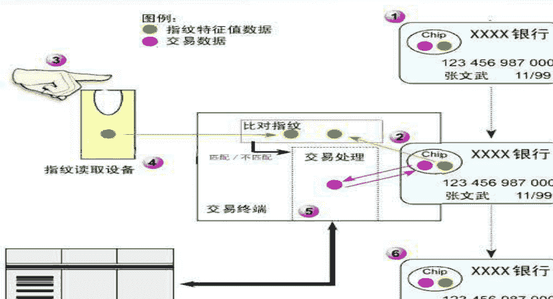

##### 生物识别技术小结

- 生物识别技术是目前最为方便与安全的识别系统，它不需要你记住像身份号和密码，也不须随身携带像智能卡之类的东西。生物测定学就是你，没有什么能比此更安全或更方便了。
- 生物识别大多进行了这样四个步骤：抓图、抽取特征、比较和匹配。抓图方式有接触和非接触。
- 生物识别系统捕捉到生物特征的样品，唯一的特征将会被提取并且被转化成数字的符号，接着，这些符号被存成那个人的特征模版，这种模版可能会在识别系统中，也可能在各种各样的存储器中，如计算机的数据库、智能卡或条码卡中，人们同识别系统交互进行他或她的身份认证，以确定匹配或不匹配。

### 本讲的主要内容

- 认证的简介
- 基于口令的认证
- 基于密码技术的认证
- 基于生物特征的认证

### 谢谢！

### 上讲的主要内容
- 认证的简介
- 基于口令的认证
- 基于密码技术的认证
- 基于生物特征的认证

## 第七讲 访问控制、审计、备份

主讲人： 谷利泽

Email: glz_bupt@263.net

Tel: 010-62283134

### 主要内容
- 访问控制
- 安全审计
- 数据备份和恢复
- 安全级别的简介

### 访问控制的简介
- 访问控制是在保障授权用户能获取所需资源的同时拒绝非授权用户的安全机制。
- 访问控制是指主体依据某种控制策略或权限对客体或资源进行的不同授权访问。
- 身份认证是访问控制的前提条件。
- 访问控制是应用系统不可缺少的重要部分。
- 访问控制包含3个要素：主体、客体和控制策略。

### 访问控制的相关概念

- 主体（Subject）：是指一个提出请求或要求的实体，是动作的发起者，但不一定是动作的执行者。通常指用户或代表用户执行的程序。
- 客体（Object）：是指接受其它实体访问的被动实体，是规定需要保护的资源，又称作目标。既可以是信息、文件、记录，也可以是硬件设备。
- 控制策略：是主体对客体的操作行为集和约束条件集。简单讲，控制策略是主体对客体的访问规则集，体现了一种授权行为，也就是客体对主体的权限允许，这种允许不得超过规则集。

### 访问控制的目的

通过访问控制策略显式地准许或限制主体的访问能力及范围，从而有效的限制和管理合法用户对关键资源的访问，防止和追踪非法用户的侵入，以及合法用户的不慎操作等行为所对权威机构造成的破坏。

访问控制是一个二元函数 f(主体,客体,授权)

### 访问控制与其他安全措施的关系模型

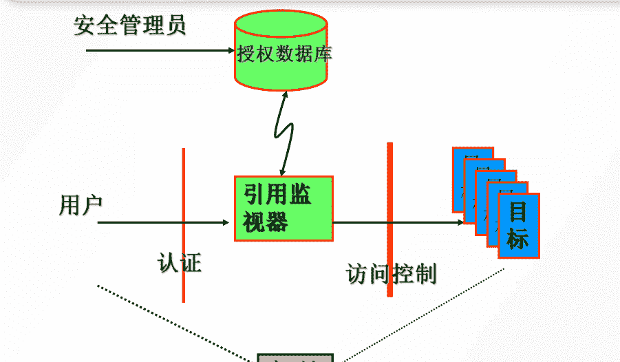

### 访问控制模型基本组成

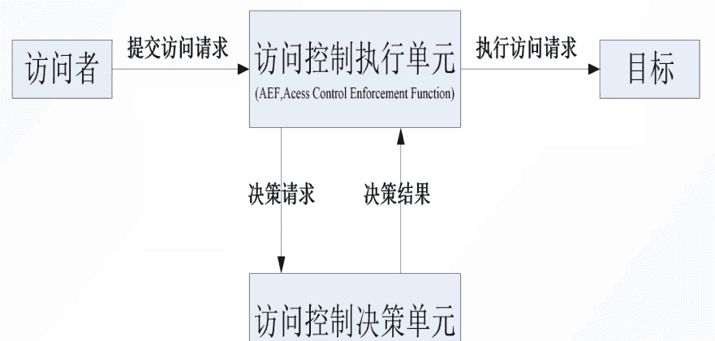

### 访问控制决策单元

决策请求

决策结果

访问者信息

目标信息

访问请求信息

上下文信息

访问控制策略规则

### 访问控制决策单元
(AEF, Access Control Decision Function)

保留信息

### 访问控制分类
- 自主访问控制（Discretionary Access Control）简称DAC。
- 强制访问控制(Mandatory Access Control) 简称 MAC。
- 基于角色的访问控制(Role Based Access Control)简称RBAC。

### 访问控制模型

### 访问控制

自主
访问控制

强制
访问控制

基于角色
访问控制

### 自主访问控制简介

自主访问控制是指根据用户的身份或组成员身份，允许合法用户访问策略规定的客体，同时阻止非授权用户访问客体，有些用户还可以自主地把自己所拥有的客体的访问权限授予其它用户。

- 根据主体的身份及允许访问的权限进行决策。
- 自主是指具有某种访问能力的主体能够自主地将访问权的某个子集授予其它主体。

### 自主访问控制模型的应用
- 自主访问控制又称为任意访问控制，是一种常用的访问控制方式。UNIX、Windows SERVER版本的系统都提供自主访问控制的功能。
- 在实现上，首先要对用户的身份进行鉴别，然后按照访问控制列表所赋予用户的权限，允许和限制用户使用客体的资源。
- 主体控制权限的修改通常由特权用户（管理员）或是特权用户组实现。

### 访问控制表（Access Control List）
- 以客体为中心建立的访问权限表。
- 根据访问者（主体）的请求（客体信息），结合访问者身份在访问控制表中查找访问者的权限，判断访问者是否具有操作客体的能力。

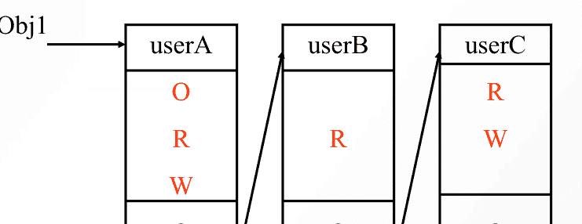

### 访问能力表（Access Capabilities List）
- 以主体为中心建立访问权限表
- 根据访问者（主体）的身份，结合请求（客体信息）信息在访问能力表中查找访问者的权限，判断访问者是否具有操作客体的能力。

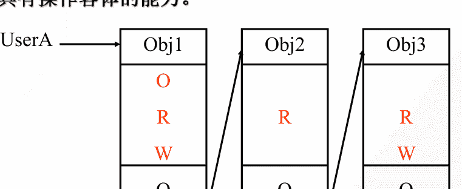

### 实现举例
- 通过矩阵形式表示访问控制规则和授权用户权限的方法。
- 对每个主体而言，都拥有对哪些客体的哪些访问权限；而对客体而言，又有哪些主体对他可以实施访问；将这种关联关系加以阐述，就形成了控制矩阵。
- 特权用户或特权用户组可以修改主体的访问控制权限。
- 如果主体和客体很多，控制矩阵将会成几何级数增长，会有大量的空余空间。
- 按列看是访问控制表内容
- 按行看是访问能力表内容

|          | Objects |   |   |
|----------|---------|---|---|---|
| Subjects | O₁      | O₂ | O₃ |
| S₁       | Read/write |   |   |
| S₂       |         | Write |   |
| S₃       | Execute |   | Read |

### 强制访问控制

根据客体的敏感度、用户是否在合适的安全级别进行操作和用户是否有访问客体的权限实现对客体的访问控制。

- 主体和客体都被赋予一定的安全级别，如，绝密级，机密级，秘密级，无密级。用户不能改变自身和客体的安全级别，只有管理员才能够确定用户和组的访问权限。
- 在实施访问控制时，系统先对访问主体和受控客体的安全级别属性进行比较，再决定访问主体能否访问该受控客体。

### 强制访问控制模型的应用
- 强访问控制将安全级别进行排序，规定高级别可以单项访问低级别，也可以规定低级别单项访问高级别。
- 下读/上写策略，保障信息机密性。
- 上读/下写策略，保障信息完整性。

### 自主/强制访问的问题
- 自主访问控制
  - 配置的粒度小
  - 配置的工作量大，效率低
- 强制访问控制
  - 配置的粒度大
  - 缺乏灵活性

例：1000主体访问10000客体须1000万次配置，如每次配置需1秒，每天工作8小时，就需10,000,000/ 3600*8 =347.2天。

### 基于角色的访问控制（RBAC）

根据分配给主体的角色来管理访问和权限的处理过程。

- 角色是与一个特定活动相关联的一组动作和责任。
- 系统中主体担任角色，完成角色规定的责任，具有角色拥有的权利。
- 一个主体可以同时担任多个角色，它的权限就是多个角色权限的总和。
- 基于角色的访问控制就是通过各种角色的不同搭配授权来尽可能实现主体的最小权限。
- 系统的访问控制机制只看到角色，而看不到用户。

### RBAC实现过程

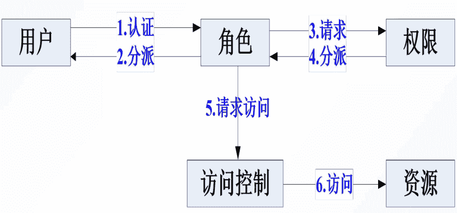

### 基于角色访问控制的特点
- 提供灵活的授权管理途径。即改变客体的访问权限、改变角色的访问权限以及改变主体所担任的角色。
- 灵活、高效的授权管理。企业的组织结构或系统的安全需求有变化，系统管理员只变更角色权限即可。
- 角色的关系可以实现层次化，便于管理。可以用面向对象的方法（类和继承等概念）来表示角色之间层次关系。
- 主体与客体无直接联系。角色由系统管理员定义，角色成员的增减也只能由系统管理员来执行，主体只有通过角色才享有的权限，从而访问相应的客体。

### 安全审计
- 审计的简介
- 审计跟踪概述
- 审计内容

### 审计的简介

根据一定的策略，通过记录、分析历史操作事件发现和改进系统性能和安全。

- 审计的基础在于事件记录：
  系统活动记录；
  用户活动记录；

审计是对访问控制的必要补充，是访问控制的一个重要内容，审计是实现系统安全的最后一道防线。

