# 北邮信息安全课件（谷利泽）（二）


## 审计的作用

- 对潜在的攻击者起到震摄或警告。
- 对于已经发生的系统破坏行为提供有效的追纠证据。
- 为系统管理员提供有价值的系统使用日志从而帮助系统管理员及时发现系统入侵行为或潜在的系统漏洞。
- 有助于提供对数据恢复的帮助。

## 审计子系统工作流程图


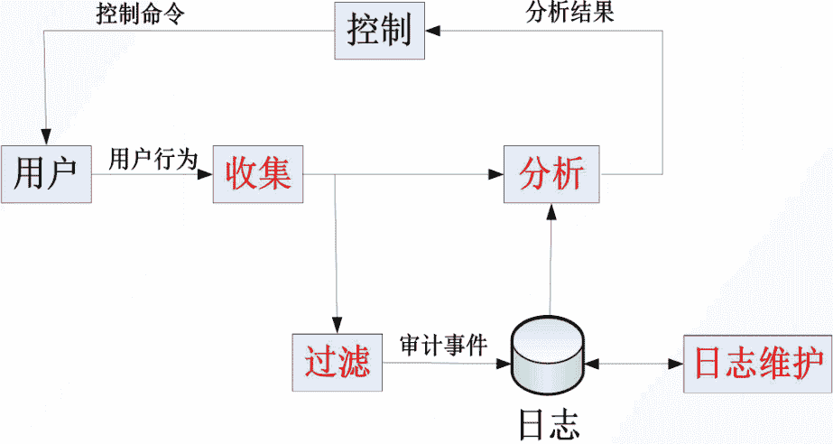

用户

用户行为

收集

过滤

审计事件

日志

分析

分析结果

控制

控制命令

日志维护

## 审计过程

- 收集审计事件，产生审计记录；
- 根据记录进行安全事件的分析；
- 采取处理措施；

## 应用举例

确定记录事件类型：

- 登录及注销；
- 文件及对象访问；
- 用户权力的使用，用户及组管理；
- 安全性规则更改；
- 重新启动关机及系统；
- 进程追踪等

## 应用举例（续）

确定记录事件内容：

- 时间；
- 来源；
- 状态（成功、失败）；
- 类型；
- 用户；
- 对象等

## 应用举例（续）

- **Windows日志文件**（/WINNT/SYSTEM32/CONFIG/）：
  - AppEvent.evt（**应用程序**）
  - SecEvent.evt（**安全性**）
  - SysEvent.evt（**系统**）
  - **控制面板/管理工具/计算机管理/事件查看器**


## 注意问题

审计需占用系统大量的时间与空间，在实际系统中为不使系统效率大幅度下降，往往不能对所有的事件进行收集和审计，这就必须取其重，弃其轻。根据安全策略，关注重要的安全事件，同时，根据时间，对安全事件进行汇总和删减。

只有审计员（往往不是系统管理员）才能察看审计数据。

## 备份

- 备份的简介
- 备份方式
- 恢复

## 备份的原因

- 灾难事故，如火灾、地震、洪水等重大意外事故；
- 系统故障，包括软硬件故障；
- 误操作或病毒等引起的故障；
- 人为的破坏，例如，黑客、恶意员工等的破坏。

## 备份的理解

- 备份是系统不可缺少的部分；
- 备份需要代价的，有时影响系统正常运行；
- 备份贵在坚持，尤其系统一直稳定运行时，一旦出现故障，备份能使损失降到最少；
- 备份是为恢复做准备；
- 备份要有专人负责；
- 备份计划依赖备份策略，备份策略依赖系统的功能；

## 备份策略

- 备份的范围是多少？
  数据、应用程序、操作系统、硬件设备（双机热备份）等
- 备份执行的频率是多少？
  自动还是手工，一般选择系统最闲时（如下半夜两点）
- 执行备份的过程是怎样的？
- 谁将负责生成正确的备份？
  由专人或小组负责、检查、管理。

## 备份策略（续）

备份储存在哪里？

切忌存放在同一物理设备上，同时要求防窃、防磁、防火、防泄密、异地。

备份需要维护多长时间？

考虑介质老化和兼容问题。

需要维护多少份副本？

多种方式存储，提高备份数据的安全性。

## 不同数据备份类型对比

|  | 完全备份 | 差量备份 | 增量备份 |
|---|---|---|---|
| 存储空间 | 大 | 中等 | 小 |
| 消耗时间 | 长 | 中等 | 短 |
| 执行频率 | 长 | 中等 | 短 |
| 恢复过程 | 简单 | 简单 | 复杂 |

## 恢复

恢复也称为重载或重入，是指当磁盘损坏或系统崩溃时，通过转储或卸载的备份重新安装数据或系统的过程。

恢复技术依赖于备份技术；

## 安全级别

依据身份认证、访问控制、审计以及备份等安全机制，计算机系统的安全级别一般分为：

- D
- C（C1、C2）
- B（B1、B2、B3）
- A

## D级

- D级别是最低的安全级别，对系统提供最小的安全防护。
- 系统的访问控制没有限制。
- 无需登陆系统就可以访问数据。
- 这个级别的系统包括 **DOS，WINDOWS98** 等。

## C级

- C级有两个安全子级别：C1和C2。
- C1级称为选择性保护级：可以实现自主安全防护，对用户和数据的分离，保护或限制用户权限的传播。
- C2级具有访问控制环境的权力
  - 比C1的访问控制划分的更为详细，能够实现受控安全保护、个人帐户管理、审计和资源隔离
  - 这个级别的系统包括UNIX、LINUX和WindowsNT系统。

## B级

B1级即标志安全保护（labeled security protection），是支持多级安全（例如秘密和绝密）的第一个级别，这个级别说明处于强制性访问控制之下的对象，系统不允许文件的拥有者改变其许可权限。

B2级称为结构保护级别：要求访问控制的所有对象都有安全标签以实现低级别的用户不能访问敏感信息，对于设备、端口等也应标注安全级别。

B3级别称为安全域保护级别：这个级别使用安装硬件的方式来加强域的安全，比如用硬件来防止无授权访问。B3级别可以实现：
- 引用监视器参与所有主体对客体的存取，以保证不存在旁路。
- 审计跟踪能力强，可以提供系统恢复过程。
- 支持安全管理员角色。
- 用户终端必须通过可信话道才能实现对系统的访问。
- 防止篡改。

## A级（验证设计级）

- 目前最高的安全级别
- 在A级别中，安全的设计必须给出形式化设计说明和验证，需要有严格的数学推导过程，同时应该包含秘密信道和可信可信分布的分析，也就是说要保证系统的部件来源有安全保证，例如对这些软件和硬件在生产、销售、运输中进行严密跟踪和严格的配置管理，以避免出现安全隐患。

## 谢谢！


## 上节的主要内容

- 访问控制的简介
- 访问控制的模型
- 安全审计
- 数据备份和恢复
- 安全级别

# 第八讲计算机病毒基础知识

主讲人： 谷利泽

Email: glz_bupt@263.net

Tel: 010-62283134

## # 主要内容

- 计算机病毒的简介
- 计算机病毒的基本原理
- 计算机病毒的检测技术
- 计算机病毒的清除、预防

## 计算机病毒的由来(续)

1977年，美国著名的AT&T贝尔实验室中，三个年轻人(道格拉斯·麦耀莱、维特·维索斯基和罗伯特·莫里斯)在工作之余，很无聊的玩起一种游戏:彼此撰写出能够吃掉别人程序的程序来互相作战。这个叫做“磁芯大战”的游戏，进一步将电脑病毒“感染性”的概念体现出来。

1983年11月3日，美国计算机安全学家弗雷德·科恩博士研制出一种在运行过程中可以复制自身的程序。伦·艾德勒曼将其命名为“计算机病毒”（computer virus）。8小时后专家们在VAX11/750计算机系统上运行第一个病毒实验获得成功，从而在实验上验证了计算机病毒的存在。

## 计算机病毒的由来(续)

到了1987年，第一个电脑病毒C-BRAIN终于诞生了（这不是一件值得庆祝的事）。一般而言，业界都公认这是真正具备完整特征的电脑病毒始祖。这个病毒程序是由一对巴基斯坦兄弟：巴斯特和阿姆捷特所写的，他们在当地经营一家贩卖个人电脑的商店，由于当地盗拷软件的风气非常盛行，因此他们的目的主要是为了防止他们的软件被任意盗拷。只要有人盗拷他们的软件，C-BRAIN就会发作，将盗拷者的硬盘剩余空间给吃掉。

这个病毒在当时并没有太大的杀伤力，但后来一些有心人士以C-BRAIN为蓝图，制作出一些变形的病毒。而其他新的病毒创作，也纷纷出笼，不仅有个人创作，甚至出现不少创作集团。各类扫毒、防毒与杀毒软件以及专业公司也纷纷出现。一时间，各种病毒创作与反病毒程序，不断推陈出新，如同百家争鸣。

## 计算机病毒的概念

- 目前最流行的定义：计算机病毒是一段附着在其他程序上的、可以自我繁殖的程序代码。

- 在《中华人民共和国计算机信息系统安全保护条例》中的定义为：“指编制或者在计算机程序中插入的破坏计算机功能或者数据，影响计算机使用并且能够自我复制的一组计算机指令或者程序代码”。此定义具有法律性、权威性。


## 病毒程序与正常程序的区别

- 正常程序是具有应用功能的完整程序，以文件形式存在，具有合法文件名；而病毒一般不以文件的形式独立存在，一般没有文件名，它隐藏在正常程序和数据文件中，是一种非完整的程序。
- 正常程序依照用户的命令执行，完全在用户的意愿下完成某种操作，也不会自身复制；而病毒在用户完全不知的情况下运行，将自身复制到其他正常程序中，而且与合法程序争夺系统的控制权，甚至进行各种破坏。


## 计算机病毒产生的原因

- **本质原因：** 计算机软硬件系统的脆弱性是病毒产生的根本技术原因。
- **客观原因：** 计算机的广泛应用是计算机病毒产生的必要环境。
- **主观原因：**
  - 研究、兴趣等目的。
  - 游戏、恶作剧、表现欲等目的。
  - 破坏、报复目的。
  - 软件保护目的。
  - 用于特殊目的。

## 计算机病毒特征

- 可执行性： 病毒是一段可执行程序，但不是一个完整的程序；
- 传染性： 病毒的基本特征，必备的特征；
- 非授权性： 强调病毒程序的执行对用户是未知的；
- 依附性： 病毒的寄生方式（静态）；
- 潜伏性： 由可触发性决定的（动态）；
- 可触发性： 病毒在一定条件下激活或发作；
- 不可预见性： 指病毒的实现机制；
- 针对性： 病毒一般是对特定的操作系统的；
- 破坏性： 病毒的表现特征；

## 计算机病毒的生命周期

- **创造期：** 编制者花数日数周努力研究出一种可广为散布的有害程序，新病毒诞生。
- **孕育期：** 病毒被放在一些容易散播的地方。
- **潜伏感染期：** 病毒不断地繁殖与传染。
- **发作期：** 一切条件形成，病毒开始破坏行动。
- **发现期：** 一旦病毒发作，也就是它被发现的时期。
- **根除期：** 使用了能检测及控制这种病毒的杀毒软件，病毒就有可能被根除。

## 计算机病毒的常见传播途径

- 网页
- 电子邮件Email
- 局域网共享或共享的个人计算机
- 盗版软件、文件下载
- 系统漏洞、协议漏洞
- 移动存储设备：软盘、磁带、CD-ROMs、U盘等

## 计算机病毒的组成

- **引导模块**：病毒的初始化部分，它随着系统或宿主程序的执行而进入内存；
- **感染模块**：病毒进行感染动作的部分，负责实现感染机制。
- **触发模块**：根据预定条件满足与否，控制病毒的感染或破坏动作。（可选）
- **破坏模块**：负责实施病毒的破坏动作。
- **主控模块**：在总体上控制病毒程序的运行。


## 计算机病毒的分类

- 按照操作系统分：
  - DOS系统的病毒、Windows系统的病毒、Unix/Linux系统的病毒、OS/2系统的病毒等。
- 按照链接方式分：
  - 源码型病毒、嵌入型病毒、Shell病毒、译码型病毒、操作系统型病毒等。
- 按照破坏情况分：良性病毒和恶性病毒。
- 按传播媒介分：单机病毒和网络病毒。
- 按寄生方式和传染途径分：
  - 引导型病毒、文件型病毒、引导型兼文件型病毒。

## 计算机病毒基本原理的思考

- 传播途径
- 寄生方式
- 激活方式

## 计算机病毒基本原理的举例

- 引导型病毒
- 文件型病毒
- 宏病毒
- 脚本病毒
- 蠕虫病毒

## 引导型病毒

## 计算机启动流程

加电

BIOS

主引导区
0柱0道0扇区

操作系统

- 通过软盘传播，修改13INT
- 寄生对象引导扇区
- 激活方式系统启动
- 典型病毒：大麻病毒、小球病毒、火炬病毒等

## 文件型病毒

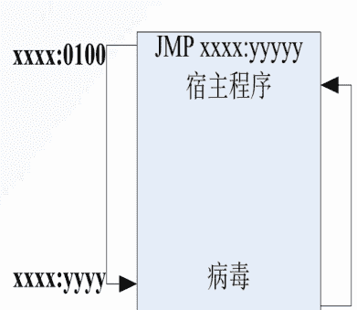

- 通过文件复制传播。
- 寄生对象可执行文件。
- 激活方式文件执行。
- 典型病毒：变色龙病毒、1575病毒等

## 宏病毒

修改FileSave宏

感染通用模板
Normal.dot

打开或创建文件时都感染病毒

宏就是能够组织在一起的，可以作为一个独立命令来执行的一系列Word命令。

通过文件复制传播。

寄生对象Office文件。

激活方式文件打开。

典型病毒：美丽莎、七月杀手、13号病毒等。

## 脚本病毒

脚本语言是介于HTML和Java、C++和Visual Basic之类的编程语言之间的语言。脚本语言需要一个脚本语言引擎解释执行脚本语言编写的程序。

- 通过网页、Email等传播。
- 运行网页中ActiveX控件。
- 欺骗性，如邮件附件采用双后缀。
- 寄生对象可网页文件、Email附件
- 激活方式系统启动自动加载

```
HKEY_LOCAL_MACHINE\Software\Microsoft\Windows\CurrentVersion\Run
```

- 典型病毒：美丽公园病毒、爱虫病毒、库尔尼科娃病毒等

## 蠕虫病毒

蠕虫(Worm)是一个程序或程序序列，通过分布式网络来扩散传播特定的信息或错误，进而造成网络服务遭到拒绝并发生死锁或系统崩溃。

- 通过系统漏洞传播。
- 寄生对象系统目录。
- 激活方式系统启动自动加载。
- 典型病毒：冲击波病毒、求职信息病毒等。

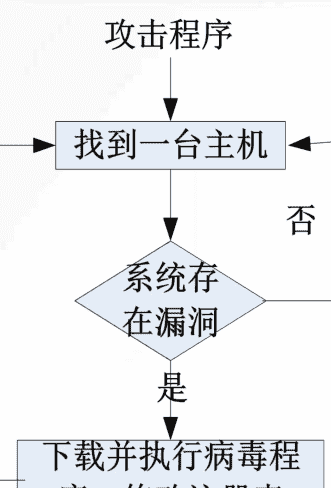

## 病毒检测技术

- 特征值检测技术
- 校验和检测技术
- 行为监测技术
- 启发式扫描技术
- 虚拟机技术

## 特征值检测技术

- 病毒标识是指计算机病毒本身在特定的寄生环境中确认自身是否存在标记符号。
- 病毒特征值是指一种病毒有别于另一种病毒的字符串。
- 许多抗病毒软件都采用了计算机病毒特征值检测技术的鉴别办法。
- 检测速度快、准确，误报率低。
- 不能检测未知病毒。

## 校验和检测技术

- 计算正常文件的内容和正常的系统扇区的校验和，将该校验和数据库保存。
- 这种方法既能发现已知病毒，也能发现未知病毒。
- 对隐蔽性病毒无效。
- 常常有误报警。

## 其它检测技术

- **行为监测技术**
  
  计算机病毒不论伪装得如何巧妙，它总存在着一些和正常程序不同的行为。
- **启发式扫描技术**
  
  分析文件中的指令序列，根据专家识别病毒的经验和知识，判断该文件是否染上病毒。
- **虚拟机技术**
  
  也称软件模拟法，是一种软件分析器，用软件方法来模拟和分析程序的运行，而且程序的运行不会对系统产生实际的危险。
- 可能误报警、可发现未知病毒。

## 病毒的清除

- 病毒的清除，又称杀毒，就是将染毒的文件或系统的病毒摘除，使之恢复为可正常运行的健康文件或系统。
- 大多数情况下，使用杀毒软件恢复受感染的文件或系统。
- 如果时间紧迫，有时不得不手工杀毒或恢复。
- 不是所有文件都可以杀毒，也不是所有病毒系统都能够驱除病毒使之康复，可能出现不可预料的结果，做好数据备份。

## 病毒的预防

- 检查外来文件
- 局域网预防
- 购买正版软件
- 小心运行可执行文件
- 及时给系统打补丁
- 周期性备份工作文件
- 留心计算机出现的异常
- 及时升级抗病毒工具的病毒特征库和有关的杀毒引擎
- 建立健全的网络系统安全管理制度，严格操作规程和规章制度

## 影响防病毒的不良习惯

- 随意开放共享并且设置最大权限
- 系统补丁不及时更新
- 使用盗版软件
- 随意安装系统和软件
- 随意下载并执行（或打开）网上的软件
- 浏览一些不良的恶意网站
- 杀毒软件不及时升级
- 网络安全意识薄弱......

## 网络时代，计算机病毒的特点

主动通过网络和邮件系统传播。

从当前流行的计算机病毒来看，其中多数病毒是利用邮件系统和网络进行传播。它们虽然不能主动通过网络传播，但是，传播速度极快。譬如，很多人员使用Office系统创建和编辑文档，然后通过电子邮件交换信息。

危害性极大。

“冲击波”、“美丽杀”以及CIH等病毒都给世界计算机信息系统和网络带来灾难性的破坏。有的造成网络拥塞，甚至瘫痪；有的造成重要数据丢失；还有的造成计算机内储存的机密信息被窃取；甚至还有的计算机信息系统和网络被人控制。


## 网络时代，计算机病毒的特点(续)

### 难以控制

利用网络传播、破坏的计算机病毒，一旦在网络中传播、蔓延，很难控制。往往准备采取防护措施时候，可能已经遭受病毒的侵袭。除非关闭网络服务，但是这样做很难被人接受，同时关闭网络服务可能会蒙受更大的损失。

### 难以根治、容易引起多次疫情

“美丽杀”病毒最早在99年三月份爆发，人们花了很多精力和财力控制住了它。但是，今年在美国它又死灰复燃，再一次形成疫情，造成破坏。之所以出现这种情况，一是由于人们放松了警惕性，新投入使用系统未安装防病毒系统；再者是使用了保存旧的染病毒文档，激活了病毒再次流行。

### 具有病毒、蠕虫和后门（黑客）程序的功能

计算机病毒的编制技术随着网络技术的普及和发展也在不断提高和变化。过去病毒最大的特点是能够复制自身给其它的程序。现在，计算机病毒具有了蠕虫的特点，可以利用网络进行传播，如：利用E-mail。同时，有些病毒还具有了黑客程序的功能，一旦侵入计算机系统后，病毒控制者可以从入侵的系统中窃取信息，远程控制这些系统。呈现出计算机病毒功能的多样化，因而，更具有危害性。

## 对计算机病毒应持有的态度

- 客观承认计算机病毒的存在。
- 不要惧怕病毒。
- 树立计算机病毒意识，善于总结经验，积极采取预防措施。
- 掌握必要的计算机病毒知识和病毒防治技术，对用户至关重要。
- 发现病毒，冷静处理。

## 本讲主要内容

- 计算机病毒的简介
- 计算机病毒的基本原理
- 计算机病毒的检测技术
- 计算机病毒的清除、预防

## 谢谢！


# 第九讲 防火墙技术

主讲人：谷利泽

Email: glz_bupt@263.net

Tel:010-62283134

## 主要内容

- 防火墙基本知识
- 防火墙技术
- 防火墙的接入方式
- 防火墙应用举例
- 防火墙的发展
- 防火墙的其它问题


## 防火墙基本知识

- 防火墙产生背景
- 防火墙逻辑结构示意图
- 防火墙概念
- 网络协议简介
- 防火墙的主要功能
- 防火墙分类

### 防火墙的产生背景

- 互联网的迅猛发展；
- 网络协议的脆弱性；
- 企业业务的需要；
- 信任边界复杂，缺乏有效管理；

### 防火墙逻辑位置结构示意图

外部客户机C

内部客户机A

Web服务器A

Web服务器B

Internet

Intranet

防火墙

两个网络安全域间通信流的唯一通道

外部客户机D

数据库服务器

Email服务器

内部客户机B

| 源主机 | 目的主机 | 授权 | 协议 |
| --- | --- | --- | --- |
| 主机A | WebB | 允许 | TCP |
| 主机B | WebB | 拒绝 | UDP |
| 主机C | WebA | 允许 | HTTP |
| 主机D | WebA | 拒绝 | IP |

根据访问控制规则表限定进出网络的行为

### 防火墙概念

- 最初含义：当房屋还处于木制结构的时候，人们将石块堆砌在房屋周围用来防止火灾的发生。这种墙被称为防火墙。
- 防火墙是一种高级访问控制设备，置于不同网络安全域之间的一系列部件的组合，它是不同网络安全域间通信流的唯一通道，能根据企业有关的安全政策控制（允许、拒绝、监视、记录）进出网络的访问行为。
- 在逻辑上，防火墙是一个分离器，一个限制器，也是一个分析器，它有效地监控了内部网和Internet之间的任何活动，保证了内部网络的安全。

### 开放式系统互联参考模型（OSIRM）

| 功能层次 | 功能描述 | 其它 |
| --- | --- | --- |
| **应用层** | 与用户应用进程的接口 | 做什么？HTTP、FTP协议等 |
| 表示层 | 数据格式的转换 | 对方看起来像什么？ |
| 会话层 | 会话的管理与数据传输的同步 | 轮到哪方传输，从何处开始传输？ |
| **传输层** | 从端对端经网络透明地传送报文 | 对方在何处？TCP、UDP协议等 |
| **网络层** | 分组传送、路由选择和流量的控制 | 数据如何到达对方？IP协议等 |
| 链路层 | 在链路上无差错的传送数据帧 | 每一步该怎么走？ |
| 物理层 | 将比特流送到物理媒体 | 信息实际如何传送？ |

### 数据的实际传递过程

发送进程

数据

接收进程

7 6 5 4 3 2 1

H7 H6 H5 H4 H3 H2 H1

7 6 5 4 3 2 1

数据实际传送通路

物理媒体

### 防火墙的主要功能

- 防火墙是网络安全的屏障；
- 防火墙可以强化网络安全策略；
- 对网络存取和访问进行监控审计；
- 防止内部信息外泄；
- 防火墙的抗攻击能力；

### 防火墙分类

- 防火墙组成：软件防火墙、硬件防火墙。
- 防火墙技术实现平台：Windows防火墙、Linux防火墙。
- 防火墙被保护对象：主机防火墙、网络防火墙。
- 防火墙自身网络性能：百兆防火墙、千兆防火墙

## 防火墙技术

- 包过滤
- 网络地址转换
- 代理服务
- 状态检查

### 包过滤原理

- 根据流经防火墙的数据包头信息，决定是否允许该数据包通过。
- 创建包过滤规则
- 打算提供何种网络服务，并以什么方向提供这些服务？
- 需要限制任何内部主机与因特网连接的能力吗？
- 因特网上是否有可信任的主机，可以某种形式访问内部网络吗？

### 包过滤检测的内容

数据包过滤一般要检查网络层的IP头和传输层的头：

- IP源地址
- IP目标地址
- 协议类型（TCP包、UDP包和ICMP包）
- TCP或UDP包的目的端口
- TCP或UDP包的源端口
- ICMP消息类型
- TCP包头的ACK位
- TCP包的序列号、IP校验和等

### 包过滤技术的优缺点

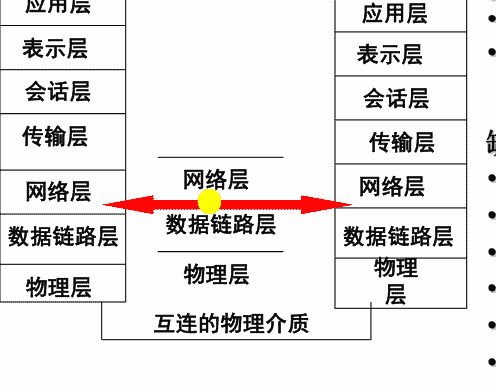

**优点：**
- 速度快，性能高
- 对用户透明

**缺点：**
- 维护比较困难(需要对TCP/IP了解)
- 安全性低（IP欺骗等）
- 不提供有用的日志，或根本就不提供
- 不防范数据驱动型攻击
- 不能根据状态信息进行控制
- 不能处理网络层以上的信息
- 无法对网络上流动的信息提供全面的控制

### 网络地址转换技术

目前合法的IP地址已经远远不够使用，许多公司内部使用的都是内部的IP地址，无法直接与外界相连。防火墙能够将内部使用的IP地址与对外真正的IP作转换。使内部的IP无需变动，也能够与外界相通。

防火墙提供一对一及多对一的地址转换，可保护及隐藏内部网络资源并减少由于架设网络防火墙所引起的IP地址变动，方便网络管理，并可以解决IP地址不足的问题。

**NAT (Network Address Translation) 示意图**

Internet

140.133.1.1

192.168.200.200

WWW Server

192.168.200.100

192.168.200.1

192.168.200.2

**NAT实现简介**

将内部网地址转换成网关地址

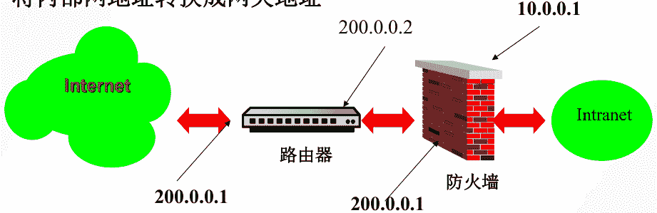

问题：所有返回数据包目的IP都是200.0.0.1，防火墙如何识别并送回真正主机？

**方法：**
1. 防火墙记住所有发送包的目的端口；
2. 防火墙记住所有发送包的TCP序列号

解决方法：网络地址转换器就是在防火墙上装一个合法IP地址集。

- 当内部某一用户要访问Internet时，防火墙动态地从地址集中选一个未分配的地址分配给该用户；
- 同时，对于内部的某些服务器如Web服务器，网络地址转换器允许为其分配一个固定的合法地址。

**好处：**
- 缓解IP地址匮乏问题；
- 对外隐藏了内部主机的IP地址，提高了安全性。


## 代理服务技术

- 代理服务的条件是具有访问因特网能力的主机才可以作为那些无权访问因特网的主机的代理，这样使得一些不能访问因特网的主机通过代理服务也可以完成访问因特网的工作。
- 代理服务是运行在防火墙主机上的专门的应用程序或者服务器程序。不允许通信直接经过外部网和内部网。
- 将所有跨越防火墙的网络通信链路分为两段。
- 防火墙内外计算机系统间应用层的“链接”，由两个代理服务器上的“链接”来实现
- 外部计算机的网络链路只能到达代理服务器，从而起到了隔离防火墙内外计算机系统的作用。

## 代理实现的基本过程

代理服务器

实际上连接

感觉上连接

用户

外部服务器

## 代理服务的优缺点

- 代理服务的优点
  - 代理服务允许用户“直接”访问因特网
  - 代理服务适合于做日志
- 代理服务的缺点
  - 代理服务落后于非代理服务(性能)
  - 代理服务对某些服务来说是不合适的（如RPC）

## 状态检测技术

- 状态检测原理：对于新建立的应用连接，状态检测型防火墙先检查预先设置的安全规则，允许符合规则的连接通过，并记录下该连接的相关信息，生成状态表。对该连接的后续数据包，只要是符合状态表，就可以通过。
- 监测引擎：一个在防火墙上执行网络安全策略的软件模块。
- 监测引擎采用抽取有关数据的方法对网络通信的各层（网络层之上）实施监测，抽取状态信息，并动态地保存起来作为以后执行安全策略的参考。
- 当用户访问请求到达防火墙时，监测引擎要抽取有关数据进行分析，结合网络配置和安全规定作出接纳、拒绝、报警等处理动作。

## 状态检测示意图

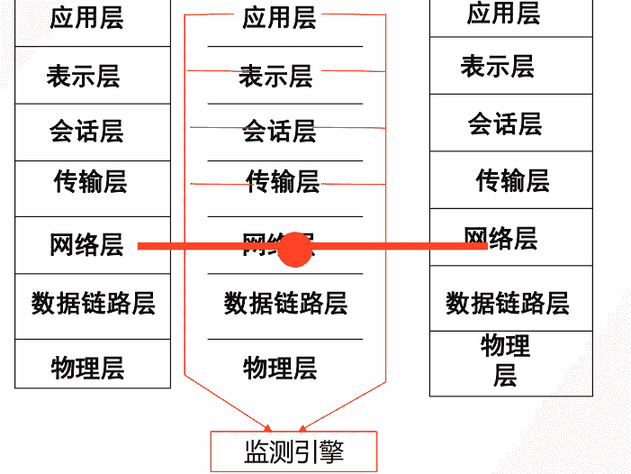

## 状态检测的优缺点

- 优点：
  - 提供了完整的对传输层的控制能力。
  - 根据从所有应用层中提取的与状态相关信息来做出安全决策，使得安全性也得到进一步的提高。
- 缺点：
  - 降低网络速度
  - 配置比较复杂

## 防火墙接入方式

- 透明接入
- 路由接入
- 混合接入

## 透明接入

受保护网络

主机B: 192.168.0.2
MAC:00-50-04-BB-71-A6

主机A

主机C

主机D: 192.168.0.4
MAC:00-50-04-BB-71-B8

默认网关 = 192.168.0.254

透明模式下，这里不用配置IP地址

如果防火墙支持透明模式，则内部网络主机的配置不用调整

透明模式下，这里不用配置IP地址

同一网段

192.168.0.254

因特网

透明模式下防火墙相当于网桥，原网络结构没有改变

## 路由接入

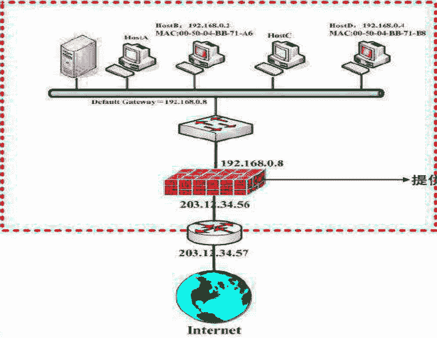

主机B：192.168.0.1，MAC00-50-04-B7-1A-46

主机C

主机D：192.168.0.4，MAC00-50-04-B7-1B-8

默认网关：192.168.0.8

192.168.0.8

提供简单的路由功能

203.11.34.56

203.11.34.57

因特网

## 混合接入

202.11.22.1/24 网段

两接口在不同网段，防火墙处于路由模式

ETH0: 202.11.22.1

ETH1: 192.168.0.102

ETH2: 192.168.0.2

192.168.0.100/24 网段

两接口在同一网段，防火墙处于透明模式

两接口在不同网段，防火墙处于路由模式

192.168.0.1/24 网段

此时整个防火墙工作于透明+路由模式，我们称之为综合模式或者混合模式

## 应用模式

内部网

非军事区（DMZ）

服务器

服务器

服务器

以太网

工作站

工作站

邮件服务器

集线器

Web服务器

FTP服务器

NetHawk 防火墙

路由器

因特网

外部网

## 防火墙的外观

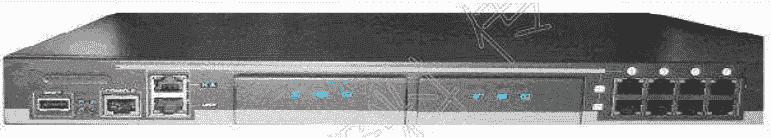

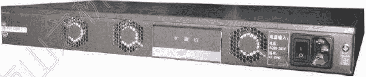


## 对象定义

| 名称 | 协议 | 源端口 | 目的端口 | TCP标志 | ICMP类型 | 描述 | 操作 |
|---|---|---|---|---|---|---|---|
| http | TCP |  |  | 设置: 不设置: 无 | -- | http | 修改 删除 |
| ftp | TCP | 1024: | 21 | 设置: 不设置: 无 | -- | ftp... | 修改 删除 |

### 添加服务对象

| 名称 | 时刻 | 星期 | 说明 | 设置 |
|---|---|---|---|---|
| tt | 15:00 -> 15:30 | 1,2,3,4,5,6,7 | work_time | 修改 删除 |
| ss | 16:00 -> 18:00 | 1,2,3,4,5,6,7 |  | 修改 删除 |

### 添加时间对象

| 命名 | IP地址(掩码) | MAC地址 | 说明 | 设置 |
|---|---|---|---|---|
| nx12001 | 192.1.1.213/32 |  | nx12001 | 修改 删除 |
| gg | 172.18.0.163 |  | 描述 | 修改 删除 |

### 添加主机对象

### 内部网

### 外部网

### DMZ

## 接口参数设定

### 接口参数

### 路由

|  |  |  |  |
|---|---|---|---|
| 内部网 (eth0) | 192.1.1.100 | 掩码 | 255.255.255.0 |
| 外部网 (eth1) | 192.1.2.100 | 掩码 | 255.255.255.0 |
| 非军事区 (eth2) | 192.1.3.100 | 掩码 | 255.255.255.0 |
| 多地址绑定 | 确定 | 重设 | 重启网络 |

### 接口参数

### 路由

- 内部网(eth0)路由设置
- 外部网(eth1)路由设置
- DMZ(eth2)路由设置

## 设置过滤策略

| 源地址 | 目的地址 | 服务 | 策略 | 选项 | 设置 |
|---|---|---|---|---|---|
| firewall_dmz | tk-2000 | t | 接受 |  | 修改 删除 |

| 源地址 | 目的地址 | 服务 | 策略 | 选项 | 设置 |
|---|---|---|---|---|---|
| tk-2000 | firewall_dmz | udp_all | 接受 |  | 修改 删除 |

## 设置网络地址转换

SNAT（添加规则）

| 源地址 | 目的地址 | 服务 | 目标动作 | 源地址转换方 | 源端口转换方 | 网络接口 | 伪装成端口 | 设置 |
|---|---|---|---|---|---|---|---|---|
| nx12001 | gg | http | MASQUERADE | ---- | ---- | 内部网-eth0 | 2223 | 修改 删除 |
| nx12001 | ldp |  | MASQUERADE | ---- | ---- | 外部网-eth1 |  | 修改 删除 |

DNAT（添加规则）

| 源地址 | 目的地址 | 服务 | 目的地址转换方 | 目的端口转换方 | 设置 |
|---|---|---|---|---|---|
| nx1_2002 | out_01 | tcp | 192.1.5.1 | 234 | 修改 删除 |

## 管理员日志

| 序号 | 操作时间 | 登陆用户 | 登陆主机 | 操作行为 |
|---|---|---|---|---|
| 1 | 2002/08/02 12:38:33 | admin | 192.1.1.213 | 成功登陆 |
| 2 | 2002/08/02 11:23:00 | admin | 192.1.1.201 | 网络地址转换规则设置 |
| 3 | 2002/08/02 11:22:58 | admin | 192.1.1.201 | 网络地址转换规则设置 |
| 4 | 2002/08/02 11:22:22 | admin | 192.1.1.201 | 成功登陆 |
| 5 | 2002/08/02 10:46:34 | admin | 192.1.1.213 | 对象管理 |
| 6 | 2002/08/02 10:41:20 | admin | 192.1.1.213 | 对象管理 |
| 7 | 2002/08/02 10:00:00 | admin | 192.1.1.213 | 网络地址转换规则设置 |
| 8 | 2002/08/02 10:30:19 | admin | 192.1.1.213 | 网络地址转换规则设置 |
| 9 | 2002/08/02 10:27:43 | admin | 192.1.1.213 | 包过滤规则设置 |
| 10 | 2002/08/02 10:27:32 | admin | 192.1.1.213 | 包过滤规则设置 |
| 11 | 2002/08/02 10:27:19 | admin | 192.1.1.213 | 包过滤规则设置 |
| 12 | 2002/08/02 10:22:46 | admin | 192.1.1.213 | 成功登陆 |
| 13 | 2002/08/02 10:22:33 | zhou liang | 192.1.1.213 | 警告失败 |
| 14 | 2002/08/02 10:22:25 | zhou liang | 192.1.1.213 | 登陆失败 |
| 15 | 2002/08/02 10:22:24 | admin | 192.1.1.213 | 成功登陆 |


## 防火墙日志详情表单

打印时间: 2002-8-7 17:21:05

打印者: ______

| 防火墙名称 | 时间 | 源地址 | 源端口 | 目的地址 | 目的端口 | 协议 | ICMP类型 | 包长度 | 规则编号 | 网段 | 流向方向 |
|---|---|---|---|---|---|---|---|---|---|---|---|
| nethawk_RD | 2002-8-5 20:09:05 | 192.1.2.203 | 0 | 192.1.1.213 | 0 | ICMP | 请求回显 | 60 | 接收 | 内部网 | 输入 |
| nethawk_RD | 2002-8-5 20:09:06 | 192.1.2.203 | 0 | 192.1.1.213 | 0 | ICMP | 请求回显 | 60 | 接收 | 内部网 | 输入 |
| nethawk_RD | 2002-8-5 20:09:57 | 192.1.2.203 | 0 | 192.1.1.213 | 0 | ICMP | 请求回显 | 60 | 接收 | 内部网 | 输入 |
| nethawk_RD | 2002-8-5 20:09:58 | 192.1.2.203 | 0 | 192.1.1.213 | 0 | ICMP | 请求回显 | 60 | 接收 | 内部网 | 输入 |
| nethawk_RD | 2002-8-5 20:09:59 | 192.1.2.203 | 0 | 192.1.1.213 | 0 | ICMP | 请求回显 | 60 | 接收 | 内部网 | 输入 |
| nethawk_RD | 2002-8-5 21:00:00 | 192.1.2.203 | 0 | 192.1.1.213 | 0 | ICMP | 请求回显 | 60 | 接收 | 内部网 | 输入 |
| nethawk_RD | 2002-8-5 21:00:01 | 192.1.2.203 | 0 | 192.1.1.213 | 0 | ICMP | 请求回显 | 60 | 接收 | 内部网 | 输入 |
| nethawk_RD | 2002-8-5 21:00:02 | 192.1.2.203 | 0 | 192.1.1.213 | 0 | ICMP | 请求回显 | 60 | 接收 | 内部网 | 输入 |
| nethawk_RD | 2002-8-5 21:00:03 | 192.1.2.203 | 0 | 192.1.1.213 | 0 | ICMP | 请求回显 | 60 | 接收 | 内部网 | 输入 |
| nethawk_RD | 2002-8-5 21:00:04 | 192.1.2.203 | 0 | 192.1.1.213 | 0 | ICMP | 请求回显 | 60 | 接收 | 内部网 | 输入 |
| nethawk_RD | 2002-8-5 21:00:05 | 192.1.2.203 | 0 | 192.1.1.213 | 0 | ICMP | 请求回显 | 60 | 接收 | 内部网 | 输入 |
| nethawk_RD | 2002-8-5 21:00:06 | 192.1.2.203 | 0 | 192.1.1.213 | 0 | ICMP | 请求回显 | 60 | 接收 | 内部网 | 输入 |
| nethawk_RD | 2002-8-5 21:00:07 | 192.1.2.203 | 0 | 192.1.1.213 | 0 | ICMP | 请求回显 | 60 | 接收 | 内部网 | 输入 |
| nethawk_RD | 2002-8-5 21:00:08 | 192.1.2.203 | 0 | 192.1.1.213 | 0 | ICMP | 请求回显 | 60 | 接收 | 内部网 | 输入 |
| nethawk_RD | 2002-8-5 21:00:09 | 192.1.2.203 | 0 | 192.1.1.213 | 0 | ICMP | 请求回显 | 60 | 接收 | 内部网 | 输入 |
| nethawk_RD | 2002-8-5 21:00:10 | 192.1.2.203 | 0 | 192.1.1.213 | 0 | ICMP | 请求回显 | 60 | 接收 | 内部网 | 输入 |
| nethawk_RD | 2002-8-5 21:00:11 | 192.1.2.203 | 0 | 192.1.1.213 | 0 | ICMP | 请求回显 | 60 | 接收 | 内部网 | 输入 |

## 第一代：基于路由器的防火墙

称为包过滤防火墙，其特征：

- 以访问控制表方式实现分组过滤
- 过滤的依据是IP地址、端口号和其它网络特征
- 只有分组过滤功能，且防火墙与路由器一体

缺点：

- 路由协议本身具有安全漏洞
- 路由器上的分组过滤规则的设置和配置复杂
- 攻击者可假冒地址
- 本质缺陷：一对矛盾，防火墙的设置会大大降低路由器的性能。
  - 路由器：为网络访问提供动态灵活的路由
  - 防火墙：对访问行为实施静态固定的控制


## 第三代：建立在通用操作系统上的防火墙

- 是近年来在市场上广泛可用的一代产品。
- 特征
  - 包括分组过滤或借用路由器的分组过滤功能；
  - 装有专用的代理系统，监控所有协议的数据和指令；
  - 保护用户编程空间和用户可配置内核参数的设置；
  - 安全性和速度大为提高。
- 实现方式：软件、硬件、软硬结合。
- 问题：
  - 作为基础的操作系统及其内核的安全性无从保证。
  - 通用操作系统厂商不会对防火墙的安全性负责；
  - 从本质上看，第三代防火墙既要防止来自外部网络的攻击，还要防止来自操作系统漏洞的攻击。
  - 用户必须依赖两方面的安全支持：防火墙厂商和操作系统厂商。

## 第四代：具有安全操作系统的防火墙

- 防火墙厂商具有操作系统的源代码，并可实现安全内核；
- 对安全内核实现加固处理：即去掉不必要的系统特性，强化安全保护；
- 对每个服务器、子系统都作了安全处理；
- 在功能上包括了分组过滤、代理服务，且具有加密与鉴别功能；
- 透明性好，易于使用。


## 防火墙的主要性能参数

- **吞吐量**：是指防火墙在不丢帧的情况下转发数据包的最大速率。
- **时延**：是指防火墙对数据包的存储转发时延，体现它处理数据的速度。
- **丢包率**：是指防火墙在连续负载的情况下，由于资源不足应转发而未转发的帧百分比。该指标与吞吐量有一定的关联性，吞吐量比较高的防火墙帧丢失率一般比较低。
- **并发连接数**：是指穿越防火墙的主机之间或主机与防火墙之间能同时建立的最大连接数目，主要用来测试被测防火墙建立和维持TCP连接的性能，同时也体现防火墙接受客户端TCP连接请求的响应能力。
- **平均无故障时间（MTBF）。**
- **最大允许加载规则数**：允许最多加载访问控制规则的条数。

## 防火墙的争议和不足

- 防火墙给人虚假的安全感。
- 可能带来传输延迟、瓶颈及单点失效。
- 不能替代防火墙内的安全措施。
  - 不能防范来自内部的攻击；
  - 不能防范不通过它的连接；
  - 不能防范利用标准协议缺陷进行的攻击；
  - 不能阻止被病毒感染的程序或文件的传递；
  - 不能防范策略配置不当或错误配置引起的安全威胁；
  - 不能防范本身安全漏洞的威胁；

## 选购防火墙需考虑的因素

- 防火墙自身的安全性
  主要体现在系统自身设计方面。
- 系统的稳定性
  - 从权威的测评认证机构获得
  - 实际调查该防火墙的使用量、用户评价。
  - 自己试用
  - 厂商实力、研制历史
- 高性能
  从性能指标判断
- 可靠性
  设计的可靠性及冗余度;

## 选购防火墙需考虑的因素（续）

- 管理配置方便、简便
- 是否可以抵抗拒绝服务攻击
- 是否可以针对用户身份过滤
- 是否可扩展、可升级
- 部署方便性

从提供的管理配置界面及方法上看。

目前常用的是一次性口令验证机制，保证用户在登录防火墙时，口令不会在网络上泄露。

支持透明、路由及混合模式。

## 防火墙技术的发展趋势

- 智能化的发展
- 速度上的发展
- 体系结构上的发展
- 功能上的发展
  - 保密方面、过滤方面、服务方面、管理方面、安全方面等
- 专业上的发展


## 上讲主要内容
- 防火墙基本知识
- 防火墙技术
- 防火墙的接入方式
- 防火墙应用举例
- 防火墙的发展
- 防火墙的其它问题

# 第十讲 攻击与防范
主讲人：谷利泽

Email: glz_bupt@263.net

Tel: 010-62283134

## 主要内容
- 常用攻击简介
  - 拒绝服务攻击
  - 缓冲区溢出攻击
  - 木马攻击
- 漏洞、补丁
- 漏洞扫描器

## 本讲的目标和难点
目标：
- 理解攻击的基本原理，增强安全防范意识；
- 认识漏洞的危害性，增强打补丁的意识；
- 连接漏洞扫描器产品的基本功能；

难点：
- 理解掌握缓冲区溢出攻击的基本原理；
- 理解掌握漏洞扫描器的基本原理；

## 攻击的含义
- 攻击可以是未授权的个人访问或者修改信息的尝试，欺骗系统使一个未授权的人接管授权会话，或者中断对授权用户的正常服务。
- 破坏：使攻击目标不能正常工作，但不能随意控制目标上的系统运行。
- 入侵：通过获得一定的权限来达到控制攻击目标的目的。

## 常用的攻击
- 拒绝服务攻击
- 缓冲区溢出攻击
- 木马攻击
- 其它攻击

## 攻击的理解（对比病毒）
- 攻击一般有明确的对象，如服务器、特定的主机等，而病毒传染不区分对象；
- 针对的对象不同，攻击的目标有区分，如攻击对象不能正常工作、窃取信息、欺骗等等，而病毒程序的破坏是无区分的；
- 针对的对象不同，攻击的手段有差异的，如DOS、植入木马、漏洞等等，而同种病毒的传染手段基本一致。

## 黑客
简单说，黑客利用技术手段进入其权限以外的计算机系统的人。

黑客”是一个精通计算机（包括网络）某方面技术的特殊群体。可分为3类：
- “侠客（Hackers）”，他们多是好奇者和爱出风头者；
- “骇客（Crackers）”，他们是一些不负责任的恶作剧者；
- “入侵者（Intruder），他们是有目的的破坏者。

## 典型攻击一般过程
隐藏自己

预攻击探测

收集信息，如OS类型，提供 的服务端口

采取攻击行为

破解口令文件，或利用缓存溢出漏洞

获得攻击目标的控制权

寻找网络中其它主机的信息和漏洞

继续渗透网络，直至获取机密数据

消灭踪迹

## 拒绝服务攻击简介
拒绝服务攻击的主要企图是借助于网络系统或网络协议的缺陷和配置漏洞进行网络攻击，使网络拥塞、系统资源耗尽或者系统应用死锁，妨碍目标主机和网络系统对正常用户服务请求的及时响应，造成服务的性能受损甚至导致服务中断。

拒绝服务攻击是目前黑客常用的攻击手法，由于可以通过使用一些公开的软件进行攻击，它的发动较为简单，能够迅速产生效果，同时要防止这种攻击又非常困难。从某种程度上可以说，拒绝服务攻击永远不会消失，而且从技术上目前还没有根本的解决办法。

## Dos攻击举例
SYN洪水是Dos攻击的一种形式，它基于TCP/IP网络的工作原理，可以用于解释任何Dos攻击的原理。SYN洪水利用了在两个系统之间建立连接的TCP三次握手。在正常的情况下，客户端向它希望与之通信的服务器发送SYN数据包，如果服务器能够接受这个请求的话，则用SYN/ACK响应。当客户端从服务器收到SYN/ACK时，它就响应一个ACK数据包，通信就可以进行了。

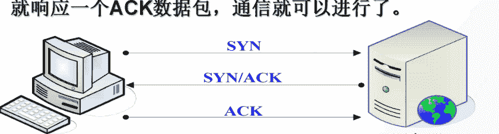

## Dos攻击手段举例
在SYN洪水攻击中，攻击者向目标系统发送虚假的通信请求。这些请求会被目标系统所响应，然后等待第三次握手。因为请求是虚假的（在请求中使用的是不存在的IP地址，以至于目标系统向一个不存在的系统作出响应），目标系统等待的响应永远也不会发生。在超过一个特定的时间周期之后，目标系统将终止这些连接，但是如果攻击者发送请求的速度要比清除它们的速度快，系统很快就会被这些请求填满。一个系统能够支持的连接的数量是有限的，所以当进来的请求超过能够处理的请求的时候，系统的所有连接很快就被虚假请求所占满。在这一点上，任何进一步的请求简单地被中断（忽略），希望与目标系统建立连接的合法用户也无法连接到目标系统，因而对系统的使用也被拒绝。

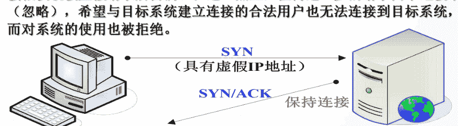

## 缓冲区溢出攻击
- 缓冲区溢出攻击是一种通过往程序的缓冲区写入超出其长度的内容，造成缓冲区溢出，从而破坏程序的堆栈，使程序转而执行其他预设指令，以达到攻击目的的攻击方法。
- 缓冲区溢出是一种相当普遍的缺陷，也是一种非常危险的缺陷，在各种系统软件、应用软件中广泛存在。缓冲区溢出可以导致程序运行失败、系统死机等后果。如果攻击者利用缓冲区溢出使计算机执行预设的非法程序，则可能获得系统特权，执行各种非法操作。


| ADDRESS | HEX VAL | ASCII |
|---|---|---|
| 0012FCD8 | 34333231 | 1234 |
| 0012FCDC | 38373635 | 5678 |
| 0012FCE0 | 32313039 | 9012 |
| 0012FCE4 | 36353433 | 3456 |
| 0012FCE8 | 30393837 | 7890 |
| 0012FCEC | 34333231 | 1234 |
| 0012FCF0 | 38373635 | 5678 |
| 0012FCF4 | 00313039 | 901(null terminator) |
| 0012FCF8 | CCCCCCCC |  |
| 0012FCFC | 0012FEDC |  |
| 0012FD00 | 00411B36 |  |
| 0012FD04 | 0012FDD8 |  |
| 0012FD08 | . | . |
| 0012FD0C | . | . |

← 当前栈顶指针

← 当前栈底指针

← 上级过程栈底指针

← flowingover()函数后面第一指令的返回地址

← 参数 s1 的地址

| ADDRESS | HEX VAL | ASCII |
|---|---|---|
| 0012FCD8 | 34333231 | 1234 |
| 0012FCDC | 38373635 | 5678 |
| 0012FCE0 | 32313039 | 9012 |
| 0012FCE4 | 36353433 | 3456 |
| 0012FCE8 | 30393837 | 7890 |
| 0012FCEC | 34333231 | 1234 |
| 0012FCF0 | 38373635 | 5678 |
| 0012FCF4 | 32313039 | 9012 |
| 0012FCF8 | 58585858 | XXXX |
| 0012FCFC | 58585858 | XXXX |
| 0012FD00 | 58585858 | XXXX |

← 当前栈顶指针

← 当前栈底指针

← flowingover()函数后面第一指令的返回地址

## 木马的简介
- 源于特洛伊木马（Trojan house）的简称，其名称源自古希腊神话传说。
- 指附着在应用程序中或者单独存在的一些恶意程序，可以利用网络远程响应网络另一端的控制程序的控制命令，实现对感染木马程序的计算机的控制，或者窃取感染木马程序的计算机上的机密资料。
- 木马程序一般利用TCP/IP协议，采用C/S结构，分为客户端和服务器端两个部分，并一般运行于网络上不同的两台计算机上。服务器端程序运行于被攻击的计算机上。而客户端程序在控制者的计算机上。客户端程序可以同时向多个服务器端程序发送命令以控制这些计算机。客户端程序一般提供友好的操作界面，以便于用户操作，其功能可能很多。

## 木马的简介（续）
- 木马常被伪装成工具程序或者游戏等诱使用户打开带有木马程序的邮件附件或从网上直接下载，一旦用户打开了这些邮件的附件或者执行了这些程序之后，它们就会在计算机系统中隐藏一个可以在启动时悄悄执行的程序。这种远程控制工具可以完全控制受害主机，危害极大。
- 对木马程序而言，它一般包括两个部分：客户端和服务器端。
- 客户端程序是控制者所使用的，用于对受控的计算机进行控制。服务器端程序和客户端程序建立起连接就可以实现对远程计算机的控制了。
- 木马运行时，首先服务器端程序获得本地计算机的最高操作权限，当本地计算机连入网络后，客户端程序可以与服务器端程序直接建立起连接，并可以向服务器端程序发送各种基本的操作请求，并由服务器端程序完成这些请求，也就实现对本地计算机的控制了。


## Main Implementation Techniques of Trojan Horses

### Auto-Start Technology

Apart from the first run when a user must execute it, a Trojan program generally loads its server-side program automatically every time the user starts the system.

### Hiding Technology

To prevent Trojan programs from being discovered, Trojan designers will adopt as many hiding methods as possible and will not show themselves in the system. Trojan programs are generally very small in size and do not consume too many resources when executed.

### Remote Monitoring Technology

Remote monitoring is the main function of a Trojan and also its ultimate purpose. It includes monitoring the target host's mouse, keyboard, screen display, and even network communication traffic direction; it also includes collecting information about the target computer's system; it can also control the target machine to run programs or disable functions on the attacked computer according to the attacker's will.

## Examples of Trojans

- Remote access Trojans are currently the most widespread type of Trojan horse. They can access the victim's hard drive and control it. This type of Trojan is very simple to use: as long as a user runs the server program and the attacker obtains the user's IP address, the attacker can access the user's computer. This Trojan allows a remote controller to do anything on the local machine, such as keystroke logging, upload and download functions, screen capture, and so on. Famous Trojans of this type include BO (Back Office) and the domestic Glacier (Binghe).
- Password-sending Trojans aim to find all hidden passwords and send them to a designated mailbox without the victim's knowledge. Most Trojans of this type do not restart every time Windows restarts, and most of them use port 25 to send e-mail.
- Keystroke-logging Trojans are very simple: they do only one thing—record the victim's keystrokes and keep a complete record in a log file. This type of Trojan starts with Windows and records everything while the victim is online.
- The sole function of destructive Trojans is to destroy and delete files. This makes them very simple and easy to use. They can automatically delete all .DLL, .INI, or EXE files on the user's computer.
- FTP Trojans open port 21 on the user's computer (the default port used by FTP), allowing anyone with an FTP client program to connect to the computer without a password and perform uploads and downloads with the highest privileges.

## Trojan Intrusion Process on the Server Side

| Client C | Server S |
| --- | --- |
| Implantation | Install, hide, open port for listening |
| Connection request | Respond |
| Remote control | Monitor, file operations, system manipulation |

## Other Attacks

### Spoofing Attacks

Spoofing attacks are an important means of network attacks. Common spoofing methods include DNS spoofing, e-mail spoofing, Web spoofing, IP spoofing, and so on.

### Attacks Exploiting Program Errors (Vulnerabilities)

As a complete system, no matter how much its security is strengthened, it still has security vulnerabilities of varying degrees to a greater or lesser extent, let alone the various other types of software commonly used. In a sense, errors in programs are almost inevitable. Any small oversight or mistake by software developers gives intruders an opportunity.

## Meaning of Vulnerabilities

- A vulnerability is a defect in hardware, software, or policy that allows attackers to access or control a system without authorization.
- A vulnerability is a defect that was not considered during software development; it is also called a software bug.
- A vulnerability refers to inherent defects or configuration errors in computer system hardware and software, including operating systems and applications. These defects and errors can be easily exploited by hackers to attack computer systems.

## Understanding Vulnerabilities

- Vulnerabilities generally refer to (security) flaws in software.
- Vulnerabilities exist in common software.
- Vulnerabilities are unknown in advance and discovered afterwards.
- Vulnerabilities are security risks; if exploited, the consequences are unpredictable.
- Vulnerabilities can generally be exploited remotely.
- Vulnerabilities can generally be patched.


## Causes of Vulnerabilities

- Design flaws
- Considerations of interest
- Software is becoming increasingly complex

## An Example of a Vulnerability (RPC Overflow Vulnerability)

Release date: 2003-07-14

Severity: High

Threat level: Remote administrator privileges

Hazard description: Remotely enter the system and execute arbitrary code

Error type: Design error

Exploitation method: Server mode

CVE ID: CAN-2003-0352

Affected systems: Windows series (NT, 2000, XP, 2003)

## RPC Overflow Vulnerability

By writing content beyond the length of a program's buffer, a buffer overflow is caused, thereby corrupting the program's stack and causing the program to execute other instructions, thus achieving the purpose of an attack.

Remote Procedure Call (RPC) is a remote procedure call protocol used by the Windows operating system. The RPC protocol provides an interactive interprocess communication mechanism that allows program processes on a local machine to seamlessly run code in remote systems. The predecessor of this protocol was the OSF RPC protocol, but Microsoft added some of its own extensions.

## Causes of the RPC Vulnerability

- The DCOM interface of RPC is responsible for handling DCOM object activation requests, but it cannot correctly handle malformed messages.
- Its essence is the failure to effectively check its parameters.

## Common Ways to Apply Patches

- Version upgrade.
- Directly run the patch program.
- Modify settings.
- Disable unnecessary services (ports).

## Time Relationship Among Vulnerabilities, Attack Programs, Patches, and Viruses

Virus name: Blaster

Vulnerability exploited: Windows RPC vulnerability

Microsoft advisory: MS03-026 (2003.7.14)

Patch release date: 2003.7.16

Attack code discovery date: 2003.7.24

Virus appearance date: 2003.8.13

Remediation time: 8 days / 27 days

## Classification of Security Vulnerabilities

- Network protocols: TCP/IP, NetBIOS
- Operating systems: Windows, Linux, Unix
- Application services: FTP, POP3, HTTP
- Application software: Databases
- Configuration settings: Password settings, anonymous settings, registry
- Network devices: Routers, firewalls


## Classification Rules for Vulnerability Risk Levels

High:
- Attackers can remotely execute arbitrary commands or code.
- Attackers can remotely obtain administrative privileges of application systems.
- Remote denial-of-service attacks.

Medium:
- Attackers can remotely create, modify, or delete files.
- Attackers can obtain sensitive system information, such as usernames and password information.
- Attackers can read arbitrary files and directories.
- Attackers can read specific files and directory contents.
- Issues that may potentially lead to medium-risk vulnerabilities.

Low:
- Attackers can obtain information about certain systems or services, such as operating system type, physical paths, and service version information.
- No known security issues, but may be unnecessary services.

Note: The threat level of a vulnerability can be measured by the prevalence of the affected program. The wider its applicability, the higher the threat.

## Vulnerability Scanners

- A vulnerability scanner is software that performs risk analysis and assessment of the security of networks and hosts. It is a program package that can automatically detect security weaknesses and hidden dangers in remote or local host systems.
- Vulnerability scanning is the inspection of important computer information systems to discover vulnerabilities that can be exploited by hackers. The result of vulnerability scanning is essentially an assessment of system security performance; it indicates which attacks are possible and therefore becomes an important part of a security solution.
- Vulnerability scanning is an important technology in network security defense.

## Vulnerability Scanner Schematic Diagram

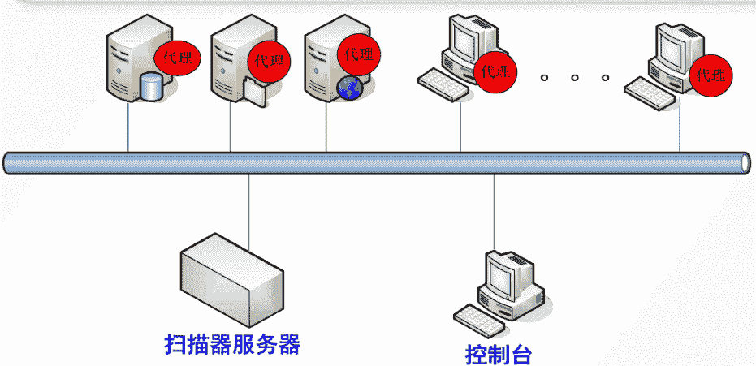

Scanner server

Console

Agent

Agent

Agent

Agent

Agent

Note: Vulnerability scanners are divided into network-based and host-based types; network-based vulnerability scanners do not include agents.

## Principles, Targets, and Results

Principle: Use simulated attacks to check one by one for known security vulnerabilities that may exist in the target.

Targets: Workstations, servers, switches, database applications, and other objects.

Results: Provide system administrators with thorough and reliable security analysis reports, serving as an important basis for improving the overall level of network security.

## Advantages of Vulnerability Scanners

In the construction of a network security system, security scanning is a tool that is low-cost, effective, fast to take effect, relatively independent of network operation, and simple to install and run. It can greatly reduce the manual labor of security administrators and help maintain the consistency and stability of security policies across the entire network.

## Classification of Vulnerability Scanners

- Network-based vulnerability scanning
- Host-based vulnerability scanning

Note: Their implementation principles are basically the same, but their architectures differ greatly.

## Components of Network Vulnerability Scanning

- Vulnerability database module
- User configuration console module
- Scan engine module
- Result storage and report generation tools

## Basic Principles

Generally speaking, network-based vulnerability scanning tools can be regarded as vulnerability information collection tools. Based on the characteristics of different vulnerabilities, they construct network packets and send them to one or more target machines on the network to determine whether a specific vulnerability exists.

## Implementation Process

1. Determine the scan targets and which vulnerabilities to check according to the settings of the **console**.
2. Send the packets assembled by the **scan engine** to the target machine, receive the returned results, and compare them with the characteristic values in the **vulnerability database**.
3. Generate a scan report using the scan results returned by the **scan engine**.


## 网络漏洞扫描优点

- 价格方面。相对来说比较便宜。
- 不需要涉及到目标系统的用户。
- 维护简便，尤其网络发生了变化的时候。
- 基本满足安全需求。

## 网络漏洞扫描不足

- 一些漏洞不能检测到。
- 不易能穿过防火墙。
- 扫描服务器与目标主机之间安全传输问题。

## 网络漏洞扫描(举例)


技术参数：

- 功耗：约100W
- 外形尺寸：长×宽×高：44.0×31×4.5（单位：厘米）
- 工作环境：
  - 工作温度：0—40°C
  - 储存温度：-10—85°C

## 应用模式

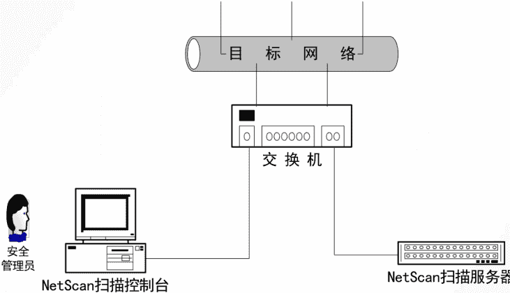

目标网络

交换机

安全管理员

NetScan扫描控制台

NetScan扫描服务器

## 主界面

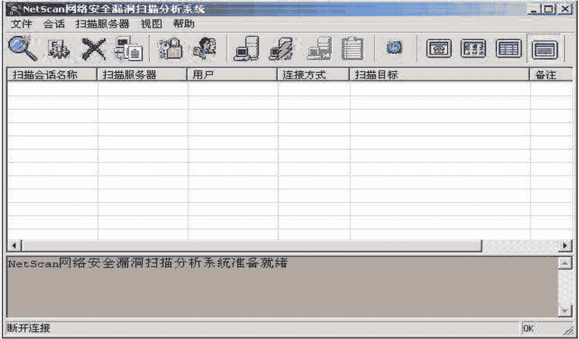

| 扫描会话名称 | 扫描服务器 | 用户 | 连接方式 | 扫描目标 | 备注 |
|---|---|---|---|---|---|

NetScan网络安全漏洞扫描分析系统准备就绪

断开连接

OK

## 执行扫描


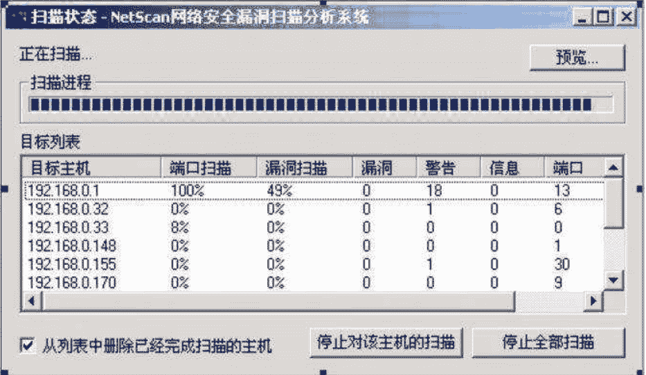

## 基于主机的漏洞扫描

- 基于主机的漏洞扫描器，扫描目标系统的漏洞的原理，与基于网络的漏洞扫描器的原理类似，但是，两者的体系结构不一样。基于主机的漏洞扫描器通常在目标系统上安装了一个代理（Agent）或者是服务（Services），以便能够访问所有的文件与进程，这也使得基于主机的漏洞扫描器能够扫描更多的漏洞。
- 基于主机的漏洞扫描工具是由控制台、管理器和代理三部分组成的。
- 当代理收到管理器发来的扫描指令时，代理单独完成本目标系统的漏洞扫描任务；扫描结束后，代理将结果传给管理器；最终用户可以通过控制台浏览扫描报告。

## 基于主机的漏洞扫描的优点

第一、扫描的漏洞数量多。由于通常在目标系统上安装了一个代理（Agent）或者是服务（Services），以便能够访问所有的文件与进程，这也使得基于主机的漏洞扫描器能够扫描更多的漏洞。

第二、集中化管理。基于主机的漏洞扫描器通常都有个集中的服务器作为扫描服务器。所有扫描的指令，均从服务器进行控制，这一点与基于网络的扫描器类似。服务器下载到最新的代理程序后，再分发给各个代理。这种集中化管理模式，使得基于主机的漏洞扫描器的部署上，能够快速实现。

第三、网络流量负载小。由于管理器与代理之间只有通讯的数据包，漏洞扫描部分都有代理单独完成，这就大大减少了网络的流量负载。当扫描结束后，代理再次与管理器进行通讯，将扫描结果传送给管理器。

第四、通讯过程中的加密机制。所有的通讯过程中的数据包，都经过加密。由于漏洞扫描都在本地完成，代理和管理器之间，只需要在扫描之前和扫描结束之后，建立必要的通讯链路。因此，对于配置了防火墙的网络，只需要在防火墙上开放管理器所需的端口，管理器即可完成漏洞扫描的工作。

## 基于主机的漏洞扫描的不足

首先是价格方面。基于主机的漏洞扫描工具的价格，通常由一个管理器的许可证价格加上目标系统的数量来决定，当一个企业网络中的目标主机较多时，扫描工具的价格就非常高。通常，只有实力强大的公司和政府部门才有能力购买这种漏洞扫描工具。

其次，基于主机的漏洞扫描工具，需要在目标主机上安装一个代理或服务，而从管理员的角度来说，并不希望在重要的机器上安装自己不确定的软件。

第三，随着所要扫描的网络范围的扩大，在部署基于主机的漏洞扫描工具的代理软件的时候，需要与每个目标系统的用户打交道，必然延长了首次部署的工作周期。

## 谢谢！


## 上一讲主要内容

- 常用攻击简介
  - 拒绝服务攻击
  - 缓冲区溢出攻击
  - 木马攻击
- 漏洞、补丁
- 漏洞扫描器

# 第十一讲 入侵检测技术

主讲人：谷利泽

Email: glz_bupt@263.net

Tel: 010-62283134

## 主要内容

- 入侵检测基本知识
- 入侵检测的原理
- 入侵检测基本结构
- 入侵检测的分类
- 入侵检测的展望

## 本讲的目标和难点

### 目标：

- 理解入侵检测技术的基本功能；
- 区分入侵检测产品与其它安全产品的不同；
- 掌握入侵检测产品应用模式；

### 难点：

- 掌握入侵检测技术的基本原理；
- 认识入侵检测技术的不足及今后的发展方向；

## 入侵检测的概念

- 入侵：是指对信息系统的未授权访问及（或）未经许可在信息系统中进行操作。这里，应该包括用户对于信息系统的误用。
- 入侵检测：是指对企图入侵、正在进行的入侵或已经发生的入侵进行识别的过程。它通过在计算机网络或计算机系统中的若干关键点收集信息并对收集到的信息进行分析，从而判断网络或系统中是否有违反安全策略的行为和被攻击的迹象。
- 入侵检测系统 (IDS, Intrusion Detection System)，将电子数据处理、安全审计、模式匹配及统计技术等有机地融合在一起，通过分析被检测系统的审计数据或直接从网络捕获数据，发现违背安全策略或危及系统安全的行为和活动。

## 入侵检测系统的描述

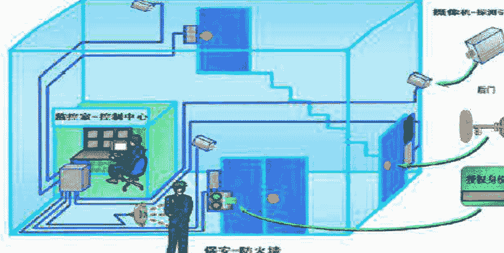

形象地说，它就是一台网络摄像机，能捕获并记录网络上的所有数据；同时它也是智能摄像机，能够分析网络数据并提取出可疑的、异常的网络数据；它还是X光摄像机，能穿透一些巧妙的伪装，抓住实际的内容。它还不仅仅只是摄像机，还包括保安员的摄像机。

## 入侵检测系统的理解

- 安全体系的一种防范措施，需要更多的智能。
- 近十余年发展起来的一种监测、预防或抵御系统入侵行为的动态安全技术。
- 一种实时或事后处理方案。
- 防火墙之后的第二道安全闸门，不仅可以检测来自外部的攻击，同时也可以监控内部用户的非授权行为。

## IDS的实现过程描述

智能发现攻击
记录并发出报警信息
启动响应动作

交换机

防火墙

路由器

内部网

internet

## IDS的主要功能

- 监测并分析用户和系统的活动；
- 核查系统配置和漏洞；
- 评估系统关键资源和数据文件的完整性；
- 识别已知的攻击行为；
- 统计分析异常行为；
- 对操作系统进行日志管理，并识别违反安全策略的用户活动。
- 针对已发现的攻击行为作出适当的反应，如告警、中止进程等。

## IDS各个组成部分的逻辑图


关键文件

网络信息流

日志文件

特征数据库

通信流收集器

分析引擎

用户界面

警报存储器

报告

## 入侵检测系统的主要部件简介

- 信息流收集器：即信息获取子系统，用于收集来自于网络和主机的事件信息，为检测分析提供原始数据；
- 分析引擎：即分析子系统，是入侵检测系统的核心部分，用于对获取的信息进行分析，从而判断出是否有入侵行为发生并检测出具体的攻击手段；
- 用户界面和事件报告：即响应控制子系统，这部分和人交互，在适当的时候发出警报，为用户提供与IDS交互和操作IDS的途径；
- 特征数据库：即数据库子系统，存储了一系列已知的可疑或者恶意行为的模式和定义；

## 入侵检测、防火墙、漏洞扫描器之间关系

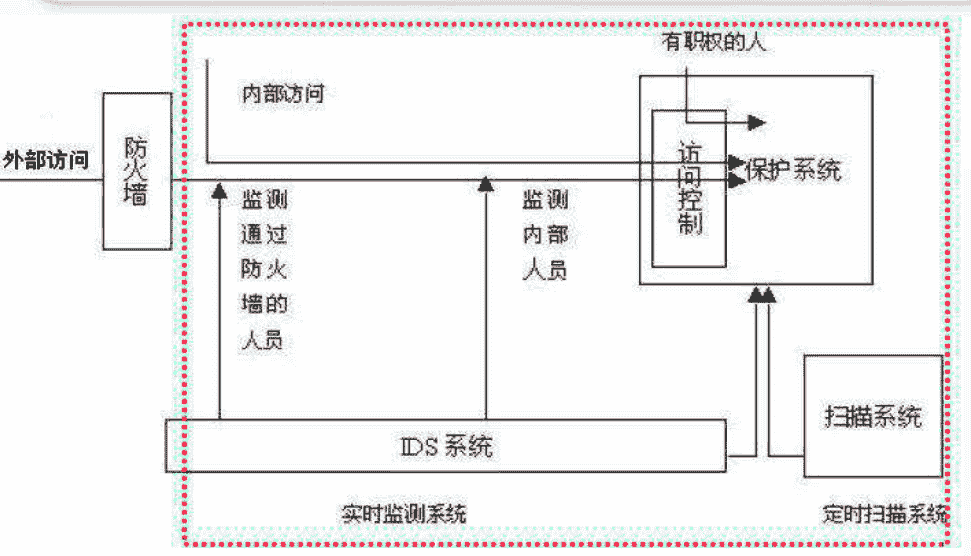

## 入侵检测性能关键参数

- **误报率(false positive)：**
  - 检测系统在检测时把系统的正常行为判为入侵行为的错误被称为误报；
  - 检测系统在检测过程中出现误报的概率称为系统的误报率。
- **漏报率(false negative)：**
  - 检测系统在检测时把某些入侵行为判为正常行为的错误现象称为漏报；
  - 检测系统在检测过程中出现漏报的概率称为系统的漏报率。


## 应具备的特点

- 实时性
- 可扩展性
- 适应性
- 安全性
- 有效性


## 入侵检测原理

- 基于特征的检测技术
- 基于原理的检测技术

### 基于特征的检测模型

基于特征的检测模型：收集非正常操作的行为特征，建立相关的特征库，当监测的用户或系统行为与库中的记录相匹配时，系统就认为这种行为是入侵。

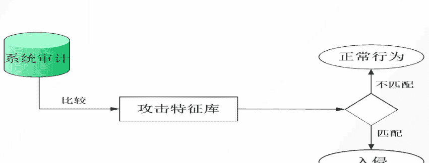

### 基于特征检测的简单描述

- 1. 前提：所有的入侵行为都有可被检测到的特征。
- 2. 攻击特征库：当监测的用户或系统行为与库中的记录相匹配时，系统就认为这种行为是入侵。
- 3. 过程：
  监控 → 特征提取 → 匹配 → 判定
- 4. 指标：误报低、漏报高。

### 基于特征检测模型分析

**优势：** 简单、扩充迅速，对各类新攻击的应变速度更快。

**劣势：**

- 仅能识别已知的攻击；
- 检测面窄，每个特征应对的攻击数少；
- 攻击特征不惟一，不宜精确识别；
- 抗变种能力弱；

**特点：** 特征变，检测方法就要变。

静态的检测，以不变应万变，精确阻断，扩充复杂。

### 基于原理的检测模型

基于原理检测模型首先总结正常操作应该具有的特征（用户轮廓），当用户活动与正常行为有重大偏离时即被认为是入侵。

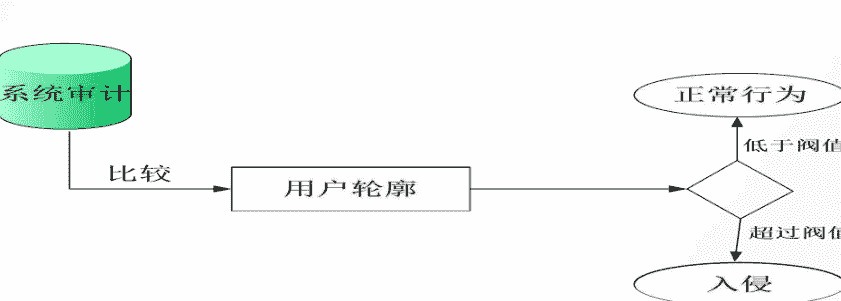

### 基于原理检测的简单描述

- 1. 前提：入侵是异常活动的子集。
- 2. 用户轮廓(Profile)：通常定义为各种行为参数及其阈值的集合，用于描述正常行为范围。
- 3. 过程：
  监控 ⇒ 量化 ⇒ 比较 ⇒ 判定
  修正
- 4. 指标：漏报率低，误报率高

### 基于原理检测模型分析

**优势：**

- 能识别同原理的未知攻击；
- 不受变形攻击的影响；
- 检测面广，每个原理应对攻击数多；
- 能精确识别特征不惟一的攻击；

**劣势：** 由于技术门槛高，扩充复杂，应对新攻击速度有限。

**特点：** 特征变，检测方法不变。

*动态的检测，以变应万变，精确阻断全面。*

## IDS的基本结构

- 🔴 **IDS控制中心：** 显示和分析事件以及策略定制等工作；
- 🔴 **引擎：** 读取原始数据和产生事件；

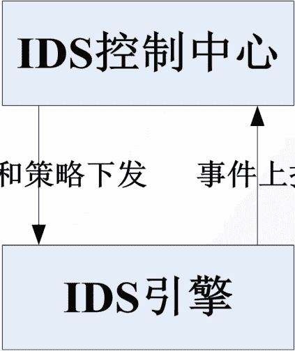

### 探测引擎

- 采用旁路方式全面侦听网上信息流，实时分析。
- 将分析结果与探测器上运行的策略集相匹配。
- 执行报警、阻断、日志等功能。
- 完成对控制中心指令的接受和响应工作。
- 探测器是由策略驱动的网络监听和分析系统组成。

### 引擎的功能结构


- 通信
- 事件响应处理
- 响应策略匹配
- 策略库
- 事件产生
- 事件库
- 原始数据分析
- 原始数据读取

### 控制中心

- 提供报警显示。
- 提供对预警信息的记录和检索、统计功能。
- 制定入侵监测的策略。
- 控制探测器系统的运行状态。
- 收集来自多台引擎的上报事件，综合进行事件分析，以多种方式对入侵事件做出快速响应。


### 控制中心的功能结构

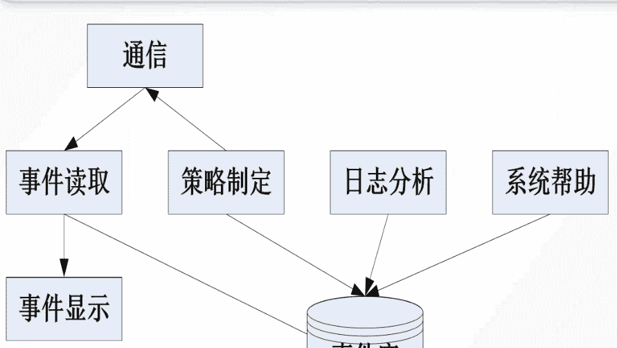

### 分布式结构图

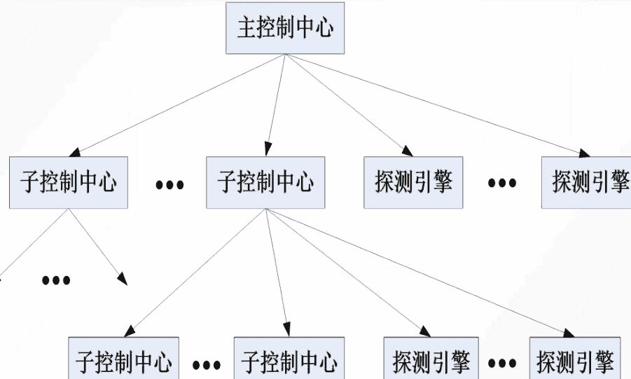

## 基于主机的IDS

运行于被检测的主机之上，通过查询、监听当前系统的各种资源的使用运行状态，发现系统资源被非法使用和修改的事件，进行上报和处理。

**特点：**

- 安装于被保护的主机中
  - 系统日志
  - 系统调用
  - 文件完整性检查
- 主要分析主机内部活动
- 占用一定的系统资源

### 基于主机入侵检测系统的实现


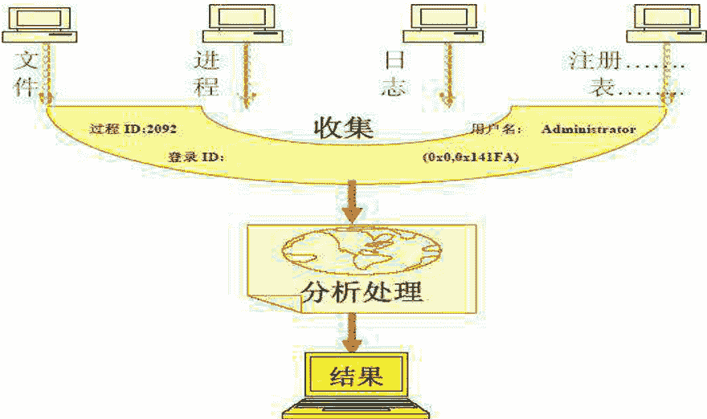

收集：事件、进程、日志、注册表……

进程 ID: 2003

登录 ID:

用户名：Administrator

(0x0,0x141FA)

分析处理

结果

### HIDS的优点

- 更准确地确定入侵攻击是否成功；
- 监视特定的系统活动；
- 检测到NIDS无法检测的攻击；
- 非常适用于加密和交换环境；
- 不需要额外的硬件；


## 基于网络的NIDS

通过在共享网段上对通信数据的侦听采集数据，分析可疑现象。这类系统不需要主机提供严格的审计，对主机资源消耗少，并可以提供对网络通用的保护而无需顾及异构主机的不同架构。

特点：

- 安装于被保护的网段（通常是共享网络）中
- 混杂模式监听
- 分析网段中的所有数据包
- 实时检测和响应

### 基于网络入侵检测系统的实现

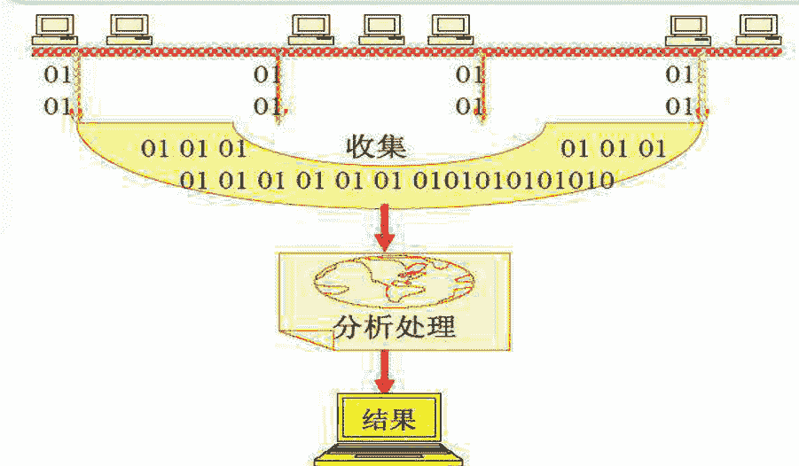

### NIDS的优点

- 成本低、隐藏性好、不影响被保护主机的性能、易维护；
- 攻击者转移证据很困难；
- 实时检测和应答；
- 能够检测未成功的攻击企图；
- 操作系统独立；

### NIDS的不足

- 不适合处理加密数据；
- 防入侵欺骗的能力较差；
- 如何适应高速网络环境；
- 非共享网络上如何采集数据；

### 共享媒介HUB

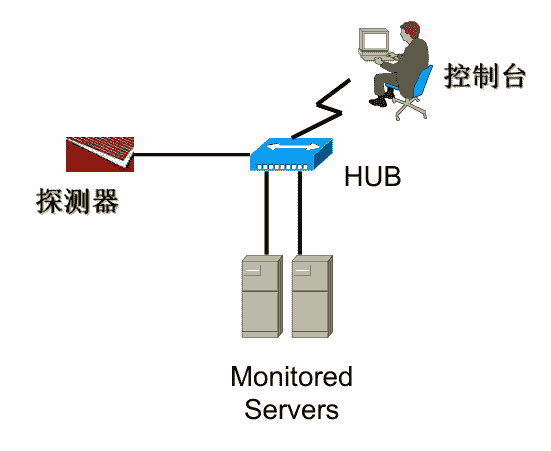

### 交换环境

探测器

交换机

控制台

Monitored Servers

通过端口镜像实现 (SPAN / Port Monitor)

## 面临问题

- (1) 随着能力的提高，入侵者会研制更多的攻击工具，以及使用更为复杂精致的攻击手段，对更大范围的目标类型实施攻击；
- (2) 入侵者采用加密手段传输攻击信息；
- (3) 日益增长的网络流量导致检测分析难度加大；
- (4) 缺乏统一的入侵检测术语和概念框架；
- (5) 不适当的自动响应机制存在着巨大的安全风险；
- (6) 存在对入侵检测系统自身的攻击；
- (7) 过高的漏报率和误报率，导致很难确定真正的入侵行为；
- (8) 采用交换方法限制了网络数据的可见性；
- (9) 高速网络环境导致很难对所有数据进行高效实时分析；

## 发展方向

- 1. 更有效的集成各种入侵检测数据源，包括从不同的系统和不同的传感器上采集的数据，提高报警准确率；
- 2. 在事件诊断中结合人工分析；
- 3. 提高对恶意代码的检测能力，包括email攻击，Java，ActiveX等；
- 4. 采用一定的方法和策略来增强异种系统的互操作性和数据一致性；
- 5. 研制可靠的测试和评估标准；
- 6. 提供科学的漏洞分类方法，尤其注重从攻击客体而不是攻击主体的观点出发；
- 7. 提供对更高级的攻击行为如分布式攻击、拒绝服务攻击等的检测手段；


## “蜜罐”技术

蜜罐（Honeypot）有时也称为数字沙箱。从本质上讲，蜜罐是一个让攻击者进入并且观察他们的人工环境，避免对真正的系统造成危害。好的蜜罐看起来像一个真正的网络、应用服务器、用户系统和网络流量等，但是通常是由一个或几个系统运行特定的软件模拟大多数目标网络的用户和网络通信流。


## 小结

入侵检测作为一种积极的安全防护技术，提供了对内部攻击、外部攻击和误操作的实时保护，在网络系统受到危害之前拦截和响应入侵。从网络安全立体纵深、多层次防御的角度出发，入侵检测系统理应受到人们的高度重视，这从国外入侵检测产品市场的蓬勃发展就可以看出。在国内，随着上网的关键部门、关键业务越来越多，迫切需要具有自主版权的入侵检测产品。但现状是入侵检测仅仅停留在研究和实验样品（缺乏升级和服务）阶段，或者是防火墙中集成为初级的入侵检测模块。可见，入侵检测产品具有较大的发展空间；从技术途径来讲，除了完善常规的、传统的技术（模式识别和完整性检测）外，应重点加强统计分析的相关技术研究。

目前，国际顶尖的入侵检测系统IDS主要以模式发现技术为主，并结合异常发现技术。IDS一般从实现方式上分为两种：基于主机的IDS和基于网络的IDS。一个完备的入侵检测系统IDS一定是基于主机和基于网络两种方式兼备的分布式系统。另外，能够识别的入侵手段的数量多少，最新入侵手段的更新是否及时也是评价入侵检测系统的关键指标。

## 谢谢！


## 上讲的主要内容

- 入侵检测基本知识
- 入侵检测的原理
- 入侵检测基本结构
- 入侵检测的分类
- 入侵检测的展望


## 主要内容

- 安全协议的简介
- SSL协议
- SET协议简介

## 本讲的目标和难点

### 目标：
- 掌握安全协议的作用和其实现的基本功能；
- 了解SSL协议的组成、实现功能、实现流程；
- 了解SET协议的组成和主要实现流程；

### 难点：
- 掌握SSL协议的基本原理；
- 理解和掌握双重数字签名算法的实现过程；

## 协议简介

协议是指两方或多方为完成一项任务所进行的一系列步骤，而每一步必须依次执行，在前一步完成之前，后面的步骤都不能执行。

### 协议特点：
- 协议中的每一方都必须了解协议，并且预先知道所要完成的所有步骤；
- 协议中的每一方都必须同意并遵循它；
- 协议必须是清楚的，每一步必须明确定义，并且不会引起误解；
- 协议必须是完整的，对每种可能的情况必须规定具体的动作；

## 网络协议的简介

计算机网络中的多个互连的计算机或网络设备之间不断交换数据，为使相互通信的两个计算机或网络设备高度协调地进行数据交换，每台计算机或网络设备就必须在信息内容、格式和传输顺序等方面遵守事先预定好的规则。这些为进行网络中数据通信而制定的规则、标准或约定就是俗称的网络协议。

## 网络参考模型OSI

开放系统互联OSI（Open System Interconnection）参考模型描述信息如何从一台计算机的应用层软件通过网络媒体传输到另一台计算机的应用层软件，它是由7层协议组成的概念模型，每一层都说明了特定的网络功能。在上述七层中，上五层一般由软件实现，而下面的两层是由硬件和软件实现的。

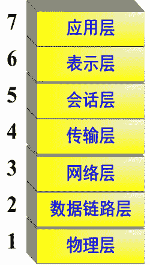

## 数据封装

| 发送进程 | 数据 | 接收进程 |
| --- | --- | --- |
| 应用层 | H7 数据 | 应用层 |
| 表示层 | H6 H7 数据 | 表示层 |
| 会话层 | H5 H6 H7 数据 | 会话层 |
| 传输层 | H4 H5 H6 H7 数据 | 传输层 |
| 网络层 | H3 H4 H5 H6 H7 数据 | 网络层 |
| 数据链路层 | H2 H3 H4 H5 H6 H7 数据 | 数据链路层 |
| 物理层 | H1 H2 H3 H4 H5 H6 H7 数据 | 物理层 |
| 物理层 | 0101101010110001010110101010001 | 物理层 |

## TCP/IP分层结构

互联网协议（IP）和传输控制协议（TCP）是互联网协议族中最为有名的两个协议，其应用非常广泛，它能够用于任何相互连接的计算机网络系统之间的通信，对局域网（LAN）和广域网（WAN）都有非常好的效果。其分层模型如下：

- 1. 应用层：向用户提供一组常用的应用程序。
- 2. 传输层（TCP和UDP）：提供应用程序间的通信，提供了可靠的传输（UDP不能提供可靠的传输）等。
- 3. 网络层（IP）：负责数据包的寻径功能，以保证数据包可靠到达目标主机，若不能到达，则向源主机发送差错控制报文。
- 4. 网络接口层：这是TCP/IP软件的最低层，负责接收IP数据包并通过网络发送之，或者从网络上接收物理帧，抽出IP数据包，并把它交给IP层。

## TCP/IP数据封装

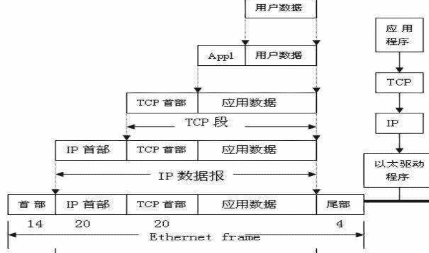

## 安全协议的必要性

随着计算机网络技术向整个经济社会各层次的延伸，各企业间信息交互的不断增加，人们对Internet、Intranet等的依赖性越来越大。这样，任何一种网络应用和增值服务的使用程度必将取决于所使用网络的信息安全有无保障，网络安全已成为现代计算机网络应用的最大障碍，也是急需解决的难题之一。

为了保证计算机网络环境中信息传递的安全性，促进网络交易的繁荣和发展，各种信息安全标准应运而生，SSL、SET等都是在电子交易活动中常用的系统安全协议，为网络信息交换提供了强大的安全保护。

## 安全协议的含义

在网络协议中使用加密技术、认证技术等密码技术以保证信息交换的安全的网络协议。具体地说就是建立在密码体系上的一种互通协议，为需要安全的各方提供一系列的密钥管理、身份认证及信息完整性等措施以保证通信或电子交易的完全完成。

## 安全协议的理解

- **安全协议首先是协议**
  - 标准程序
  - 语义、语法规则
  - 双方或多方
  - 数据交换
- **安全协议是**
  - 协议中与安全相关的部分
  - 同安全相关的协议
- **安全协议的基石**
  - 通信技术
  - 加密、摘要计算、公开密钥加密和数字签名技术的组合应用
  - 加密原语、安全服务、安全机制

## 网络信息安全协议的种类

- **密钥安全协议**：指参与协议的双方或多方之间建立的通信中的会话密钥。
- **认证协议**：主要用来在信息交换过程中防止信息的假冒、被篡改或否认。
- **密钥交换和认证协议**：将密钥技术与认证技术相结合，同时完成信息的加密与认证的功能。

## 网络信息安全协议的特点

- 使用加密技术来保证信息在传输中安全。
- 使用数字摘要技术来保证信息的完整性。
- 使用认证技术来保证信息的认证性。
- 使用第三方认证保证交易双方的不可否认性。
- 可直接在Internet上使用，特别是能够在HTTP页面上使用（透明性）。

## SSL的简介

SSL（Secure Socket Layer，即安全套接层）协议是网景（Netscape）公司于1994年最先提出来的。SSL被设计成使用TCP来提供一种可靠的端到端的安全服务，是一种基于会话的加密和认证Internet协议，它在两实体——客户和服务器之间提供了一个安全的管道。为了防止客户/服务器应用中的监听、篡改、消息伪造等，SSL提供了服务器认证和可选的客户端认证。通过在两个实体间建立一个共享的秘密，SSL提供保密性。

SSL工作在传输层（TCP）和应用层之间，与应用层协议无关，应用层数据（HTTP、FTP、Telnet等）可以透明地置于SSL之上。


## SSL协议提供的主要服务

- 加密处理，加密数据以防止数据中途被窃取；
- 维护数据的完整性，确保数据在传输过程中不被改变；
- 认证服务，认证用户（可选）和服务器，确保数据发送到正确的客户机（可选）和服务器。

## SSL协议的协议层次

| 协议层次 |
| --- |
| 应用层（HTTP、FTP、Telnet等） |
| SSL层 |
| 传输层（TCP） |
| 网络层（IP） |

## SSL安全协议的组成

| 协议层次 |
| --- |
| 握手协议、修改密码规程协议、告警协议、HTTP |
| SSL记录协议 |
| 传输层（TCP） |
| 网络层（IP） |

注：SSL不是单层的协议，而是两层协议。

## SSL的两个重要概念

- **SSL连接（connection）**
  - 一个连接是一个提供一种合适类型服务的传输；
  - SSL的连接是点对点的关系；
  - 连接是暂时的，每一个连接和一个会话关联。
- **SSL会话（session）**
  - 一个SSL会话是在客户与服务器之间一个关联；
  - 会话由SSL握手协议创建。会话定义了一组可供多个连接共享的加密安全参数；
  - 会话用以避免为每一个连接提供新的安全参数所需昂贵的谈判代价。


## SSL实现举例（服务器端）

## 导入IIS网站证书

选择控制台窗口的“Internet信息服务” ->（机器名）->默认Web站点，单击鼠标右键，选择菜单项“属性”。打开“默认Web站点属性”对话框，选择“目录安全性”页，单击“服务器证书(S)...”按钮，这时弹出“挂起的证书请求”对话框，选择“处理挂起的请求并安装证书”选项，点击“下一步”后，指定好刚才导出的IIS网站证书文件的位置，接着指定SSL使用的端口，建议使用默认的“443”，最后点击“完成”按钮。

## 配置IIS服务器

完成了证书的导入后，IIS网站这时还没有启用SSL安全加密功能，需要对IIS服务器进行配置。在“目录安全性”标签页，点击安全通信栏的“编辑”按钮，选中“要求安全通道（SSL）”和“要求128位加密”选项，最后点击“确定”按钮即可。接着点击“身份验证和访问控制”栏的“编辑”按钮，在对话框中取消“启用匿名访问”和“集成Windows身份验证”选项，这里要选中“基本身份验证”选项，最后点击“确定”按钮。

## SSL实现举例（客户端）

打开IE浏览器，在地址栏输入https://xxx.xxx.xxx.xxx（IIS服务器所在机器的IP地址或机器名）。
首先会弹出“安全警报”窗口。该窗口对服务器方的证书进行验证，并将验证结果通知用户，由用户确定是否要继续。安全警报有三个项目：服务器证书是否可信，服务器证书是否有效，服务器证书的名称是否有效。标记了绿色钩的项目说明该项目验证通过，标记了黄色惊叹号的项目说明该项目验证没有通过。用户也可以忽略警告，点击“确定”按钮，继续进入站点。

## SSL实现举例（续）

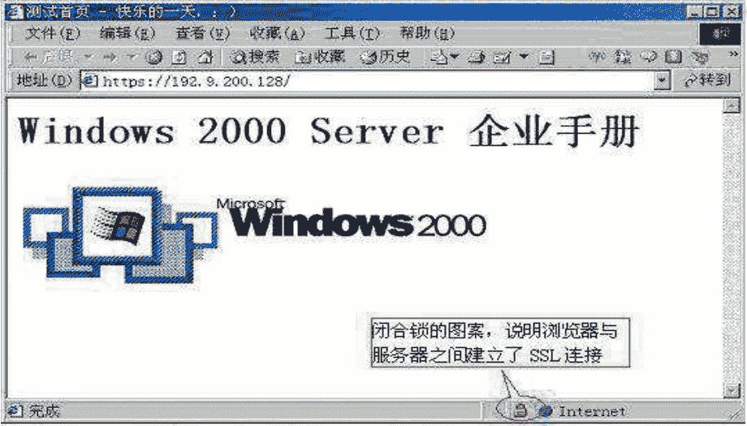

> 闭合锁的图案，说明浏览器与服务器之间建立了 SSL 连接

## SSL安全协议

- 记录协议
- 修改密码规程协议
- 告警协议
- 握手协议

## SSL记录协议层的功能

- 为高层协议提供基本的安全服务。
- 记录层封装各种高层协议。
- 具体实施压缩解压缩、加密解密、计算和校验 MAC 等与安全有关的操作。

## SSL记录协议的操作过程

应用数据

分段

压缩（可选）

增加MAC

MAC

加密

添加SSL记录头部

## SSL记录首部的组成

- 主要类型：用来说明封装的数据段的更高层的协议。已定义的内容类型有：修改密文规程协议、告警协议、握手协议和应用数据；
- 主要版本：指示使用SSL的主要版本号；
- 次要版本：指示使用的次要版本号；
- 压缩长度：明文数据段以字节为单位的长度（如果使用压缩就是压缩数据段）。

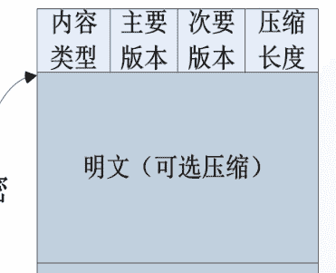

## 修改密码规程协议

- 位于SSL记录协议之上，所以，它用到了SSL记录协议的处理过程。
- 仅定义了一个由单个字节“1”构成的消息报文； 1字节 1
- 该消息将改变了连接所使用的加密规约。
- 用途：切换状态，把密码参数设置为当前状态。在握手协议中，当安全参数协商一致后，发送此消息。

## 告警协议

- 一种通过**SSL**记录协议进行传输的特定类型报文。
- 主要作用:规定了告警的级别和告警的类型，在 **SSL**协议执行过程中通过告警协议来显示信息交换过程中所发生的错误。
- 组成：

| 1字节 | 1字节 |
| --- | --- |
| 级别 | 类型 |

| 级别 | 告警名称 | 含义 |
|---|---|---|
| 1 | 警告 | 表示一个一般警告信息。 |
| 2 | 致命错误 | 表示出现了致命的错误,立即终止当前连接,同一会话的其它连接还可继续,不会再产生其它新的连接。 |

## 握手协议

SSL中最复杂的部分，负责建立当前会话状态的参数，使得服务器和客户能够协商一个协议版本、选择密码算法和哈希算法、压缩方法、会话ID等并且使用公钥加密技术通过一系列交换信息在客户和服务器之间生成共享的密钥。在使用会话传输任何数据之前，必须先用握手建立连接，实现相互验证，协商加密算法和生成密钥等内容。

握手协议由一系列在客户和服务器间交换的报文组成。每个报文由3个字段组成：报文类型、以字节为单位的报文长度以及这个报文有关的参数内容。

| 1字节 | 3字节 | ≥0字节 |
|---|---|---|
| 类型 | 长度 | 内容 |

## 握手协议的过程

- 客户与服务器交换Hello消息，包括协议版本、会话ID、密码组（密钥交换方法、数据传输加密算法、计算消息验证码的消息摘要）、压缩方法等。
- 密钥交换过程，包括服务器证书消息、服务器密钥交换消息、客户证书消息、客户密钥交换消息等。
- 证书校验
- 客户发送改变自身状态消息，同样服务器也发送改变自身状态消息，双方使用新的密码组规范进行操作。

## 握手协议定义的消息类型(1)

| 消息类型 | 说明 | 参数 |
|---|---|---|
| hello_request | 握手请求，服务器可在任何时候向客户端发送该消息。若客户端正在进行握手过程就可忽略该消息。否则客户端发送cleint hello消息，启动握手过程。 | 无 |
| client_hello | 客户启动握手请求，该消息时当客户第一次连接服务器时向服务器发送的第一条消息。该消息中包括了客户端支持的各种算法。若服务器端不能支持，则本次会话可能失败。 | 版本、随机数、会话ID、密文族、压缩方法 |
| server_hello | 其结构与client hello消息，该消息是服务器对客户端client_hello消息的恢复。 | 版本、随机数、会话ID、密文族、压缩方法 |
| server_certificate | 服务器提供的证书。如果客户要求对服务器进行认证，则服务器在发送server_hello消息后，向客户端发送该消息。证书的类型一般是X.509v3。 | X.509v3证书链 |
| server_key_exchange | 服务器密钥交换。当服务器不使用证书，或其证书中仅提供签名而不提供密钥时，需要使用本消息来交换密钥。 | 参数、签名 |

## SSL协议实现过程（2）

4. 客户机利用数字信封技术为将要进行的会话创建会话预密钥 pre_master_secret，并用服务器的公钥加密它，然后向服务器发送加密的会话预密钥；

5. 当客户端能被成功认证后，服务器会使用它的私人密钥解密从客户端得到的会话预密钥 pre_master_secret，并生成真正的会话密钥 master_secret。同时客户端也从相同的 pre_master_secret 开始得到相同的 master_secret。会话密钥 master_secret 是对称密钥用于加密和解密在 SSL 会话期间交换的信息，并验证信息的完整性；

6. 会话密钥生成后，客户端向服务器发送消息，通知服务器以后从客户端来的消息将用会话密钥加密，这表明握手的客户端部分已经完成；

## SSL工作过程（会话密钥已建立）

## 发送方的工作过程

- 从上层接收要发送的数据（包括各种消息和数据）；
- 对信息进行分段，成若干记录；
- 使用指定的压缩算法进行数据压缩数据（可选）；
- 使用指定的MAC算法生成MAC；
- 使用指定的加密算法进行数据加密；
- 发送数据。

## 接收方的工作过程

- 接收数据；
- 使用指定的解密算法解密数据；
- 使用指定的MAC算法校验MAC；
- 使用压缩算法对数据解压缩（在需要时进行）；
- 将记录进行数据重组；
- 将数据发送给高层。

## 电子商务简介

电子商务(Electronic Commerce)是在Internet开放的网络环境下，基于浏览器/服务器应用方式，实现消费者的网上购物、商户之间的网上交易和在线电子支付的一种新型的商业运营模式。

电子商务是Internet爆炸式发展的直接产物，是网络技术应用的全新发展方向。Internet本身所具有的开放性、全球性、低成本、高效率的特点，也成为电子商务的内在特征，并使得电子商务大大超过了作为一种新的贸易形式所具有的价值，它不仅会改变企业本身的生产、经营、管理活动，而且将影响到整个社会的经济运行与结构。

## SET协议的概述

- 虽然SSL协议已广泛应用在电子商务活动中来保证数据传输的安全性，但是SSL还存在一些不足。如无法对交易信息进行抗抵赖保护，也无法保证消费者的个人信息、信用卡信息对商家的保密性。
- 世界两大信用卡商Master Card和Visa联合开发，于1997年5月推出了安全电子交易协议SET（Secure Electronic Transaction），该协议主要用于保障Internet上信用卡交易的安全性。利用SET给出的整套安全电子交易过程的规范，可以实现电子商务交易中的机密性、认证性、数据完整性和不可否认性等安全功能。


## SET协议的概述（续）

- 安全电子交易协议SET是目前国际上公认的最安全、也是最成熟的电子支付协议之一，已日益成为电子商务的安全基础。
- SET协议是一个应用层协议，在相关应用中比SSL协议具有更多优点，也是更复杂的密码应用协议。
- SET协议是一种基于信用卡网上电子商务交易的安全标准，主要是为了解决用户、商家和银行之间通过信用卡支付的交易安全而设计的，用以保证支付信息的机密、支付过程的完整、商户及持卡人的合法身份以及互操作性。SET协议的核心技术包括电子安全证书、电子数字签名、电子信封等。

## SET协议涉及的实体

- **持卡人**：一般指某信用卡的合法拥有者。在电子商务中指参与电子交易活动的消费者，可指个人或团体消费者。持卡人通过 Internet或其他公开网络与商家进行商品交易，并利用发卡银行颁发的信用卡进行付款结算。
- **发卡银行**：指金融机构，它为每个建立了银行账户的个人或单位颁发信用卡。发卡银行依据信用卡的类型及相关规定，处理信用卡账户的申请、建立，并对用户的最终债权、债务负责。
- **收单银行**：指为参与电子交易的商家提供处理信用卡的授权与支付服务的金融机构。
- **商家**：指提供网上购物的电子商务或提供电子交易服务的企业。
- **认证中心**：指负责向信用卡用户及电子商家发行与管理 X.509v3 公开密钥证书的认证机构。
- **支付网关**：指由收单银行或特定的第三方操作的一个计算机软件系统，用于处理Internet与收单银行之间的数据信息转换。它专门负责处理来自Internet上的支付信息。在整个支付过程中，需要消费者（持卡者）、商家和银行或其他能够提供清算服务的机构（例如金融电子结算中心）三方参与。

## SET协议的运行模式

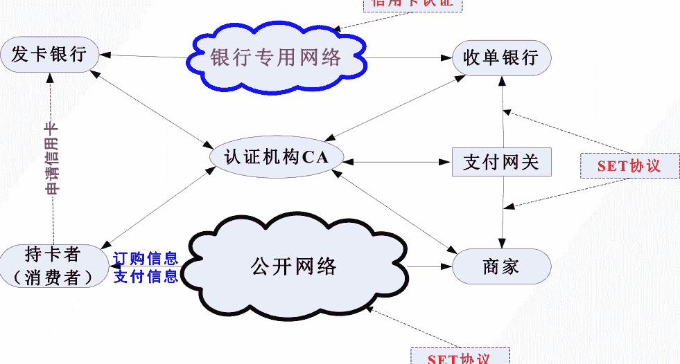

## SET协议基本运行流程示意图

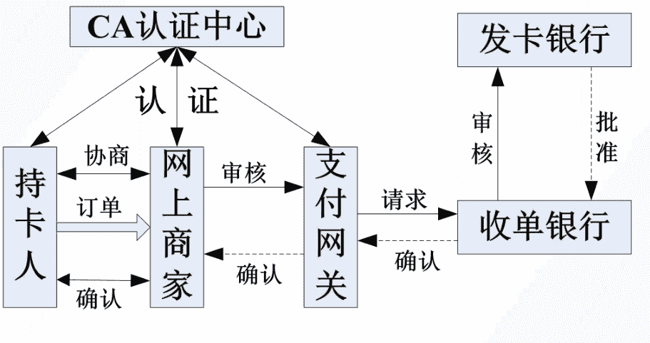

## 双重数字签名

所谓双重数字签名就是在有的场合，发送者需要寄出两个相关信息给接收者，对这两组相关信息，接收者只能解读其中一组，另一组只能转送给第三方接收者，不能打开看其内容。这时发送者就需分别加密两组密文，做两组数字签名，故称双重数字签名。

在电子商务应用中，参与方为持卡人、商户和结算银行。当持卡人客户登录商户网站，提出申请购物时，持卡人要向商户提出两组信息：向商户直接提出订购信息的同时，还必须向银行提出付款信息，以便授权银行付款。但其中处理过程要有两个要点，即：持卡人不希望商户知道自己的银行支付账号的有关信息；同时也不希望银行方面知道具体的购物内容，只需按金额贷记或借记账户就可。

## 持卡人实现过程

A:持卡人  B:商户  C:开户银行  MD:哈希计算  DS:数字签名
OI:订货信息  PI:支付信息  PV:私钥  PB:公钥  EM:密文  DE:数字信封

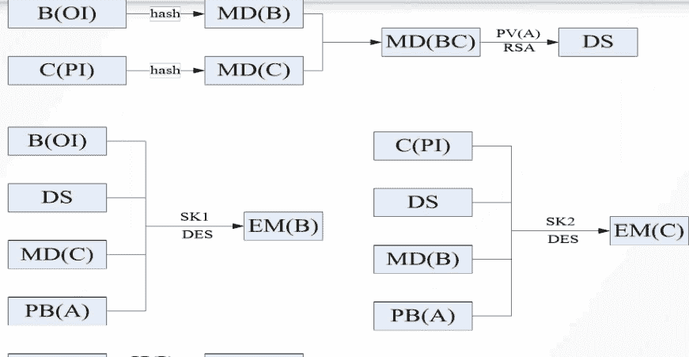

## 商户实现过程

A:持卡人  B:商户  C:开户银行  MD:哈希计算  DS:数字签名
OI:订货信息  PI:支付信息  PV:私钥  PB:公钥  EM:密文  DE:数字信封

## 银行实现过程

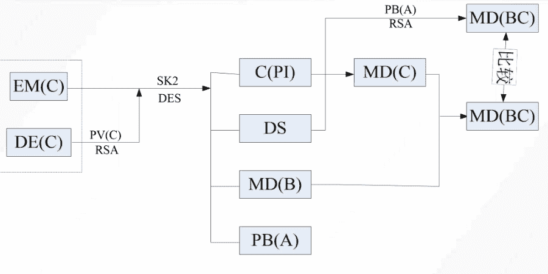

A:持卡人 B:商户 C:开户银行 MD:哈希计算 DS:数字签名
OI:订货信息 PI:支付信息 PV:私钥 PB:公钥 EM:密文 DE:数字信封

## SET支付处理

- 购买请求
- 支付授权
- 支付兑现

## SET协议的工作流程

- (1) 在运行SET协议之前，消费者先向发卡银行申请信用卡成为持卡人。
- (2) 持卡人向商家发送订购信息和支付信息。利用双重数字签名技术，使得商家获得订购信息，无法得知支付信息，而收单银行得到支付信息，不知订购信息，同时保证订购信息和支付信息的关联性。
- (3) 商家解密和认证订购信息，收单银行解密和认证支付信息。收单银行获得的信息是由支付网关转发的。
- (4) 收单银行向发卡银行查询，确信持卡人是否是该有效信用卡账号的合法使用者。
- (5) 发卡银行经确认信用卡账号与持卡人一致后，认可并签证该笔交易。
- (6) 收单银行验证商家并签证此交易。
- (7) 商家发送确认订购信息给持卡人，随后向持卡人传送货物和收据。
- (8) 交易成功后，商家向收单银行请求支付货款。
- (9) 收单银行依据支付信息将货款从发卡银行划给商家。
- (10) 发卡银行定期向持卡人寄去信用卡消费账单。

## SET的目标

- 机密性；
- 保护隐私；
- 完整性；
- 多方认证性；
- 标准性；


## SET协议和SSL协议的比较

- 从采用的加密技术来看两者是相同的；
- 从协议在网络中的层次看两者是不同的；
- 从数字证书的使用看SET协议比SSL协议更安全；
- 从协议应用领域看SSL协议比SET协议更广泛；
- 从支付系统的流程看SET协议（多方）比SSL协议（双方）更复杂；
- 从客户隐私的保护上看，SET协议比SSL协议更安全；
- 从相关产品看，SSL协议的产品要比SET协议产品多；
- 从安全机制上看SET协议更安全。

## 主要内容

- 安全协议的简介
- SSL协议
- SET协议简介

## 谢谢！


## 上讲的主要内容

- 安全协议的简介
- SSL协议
- SET协议简介

# 第十三讲信息安全其他技术及信息安全管理简介

主讲人：谷利泽

Email：glz_bupt@263.net

Tel：010-62283134

## 本讲的目标和难点

### 目标：

- 了解其他安全技术所解决的实际安全问题；
- 了解信息安全总体思想，从工程角度来考虑信息安全问题；

### 难点：

- 理解其他安全技术的基本原理；
- 建立整体信息安全管理思想；

## VPN应用背景

随着信息时代的到来，企业内部和企业之间数据通信的数量在不断地增加，企业纷纷建立起自己的内部网络（Intranet），甚至企业之间也建立起专用的外部网（Extranet）以方便信息交换。传统的Internet在分支机构与中心网络的连接上，最早的方式是架设自己的专用线路，但是只有极少数企业能有这样的经济实力实现跨区域的远程连接。随着因特网的普及，主干网络速度越来越快，企业开始租用数据专线通过广域网实现连接，但租用专线的成本仍居高不下，而且总部与各分支机构都必须租用各自的专线才能实现连接和数据通信。因特网存在的安全问题同样会对这样连接的Intranet产生影响。费用和安全因素成为限制企业Intranet发展的主要障碍。


## VPN的含义

- 虚拟专用网（VPN, Virtual Private Network）是指通过一个公共网络建立一个临时的、安全的连接，是一条穿越混乱的公用网络的安全、稳定的隧道，能提供与专用网络一样的安全和功能保障。
- 虚拟是指用户不再需要拥有实际的长途线路，而是使用互联网、公众数据网络的长途数据线路。
- 专用网络是指用户可以为自己定制一个最符合自己需求的网络。
- 公共网络主要指互联网。
- 虚拟专用网是对企业内部网的延伸。

## 典型VPN的构成

安全隧道
VPN 网关，隧道端点
远程用户
分支机构 LAN
总部 LAN
VPN
移动用户
分支机构 LAN
Internet

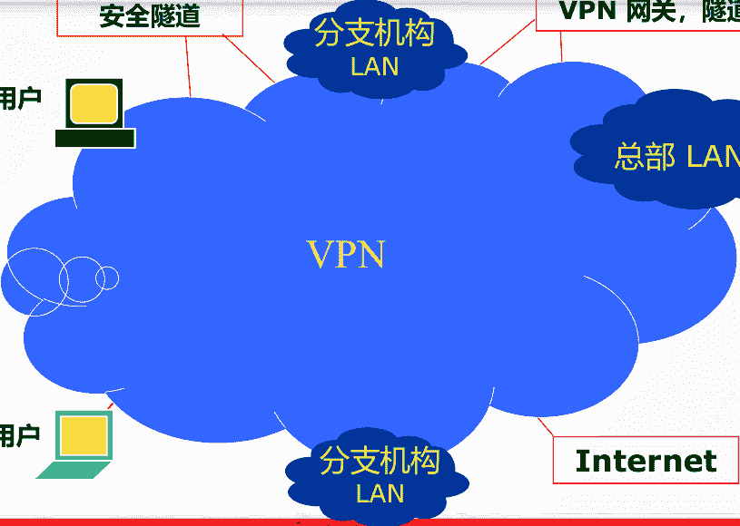

## VPN的分类

### Intranet VPN

- 用于集团的总部和多个分支机构之间；
- 分支机构网络是集团总部网络的可靠延伸；

### Extranet VPN

- 为集团的供货商、重要客户和消费者等商业伙伴提供访问权限；
- 电子商务是Extranet VPN的一种特殊形式；

### Access VPN

- 为移动用户远程访问集团总部网络提供服务；


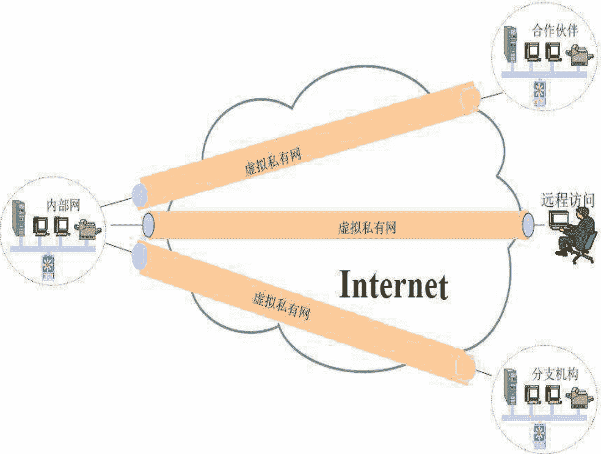

## Internet

内部网

合作伙伴

分支机构

远程访问

虚拟私有网

虚拟专有网

虚拟私有网

## VPN的基本功能

- **身份鉴别：** 包括验证用户的身份，限制非授权用户的访问，并做好审计和记账工作，以显示什么人，什么时候访问了什么资源。不同的用户对不同的资源应有不同的访问权限；
- **地址管理：** 为每个客户分配一个地址，并保证地址对虚拟专用网外的不可见性；
- **数据加密：** 保证通过公共网络传送的信息即使被他人截获也不会泄密；
- **密钥管理：** 能够为VPN的客户和服务器生成和更新加密密钥；
- **多协议支持：** VPN必须能够处理公共网络常用的各种协议，包括IP、IPX等等；


## VPN小结

- VPN的发展代表了互联网今后的发展趋势，它综合了传统数据网络的安全和服务质量，以及共享数据网络结构的简单和低成本，建立安全的数据通道。VPN在降低成本的同时满足了用户对网络带宽、接入和服务不断增加的需求，因此，VPN必将成为未来网络发展的主要方向。
- 安全协议是构筑VPN的首要特性；
- IPSec VPN方兴未艾；
- VPN管理有待加强；

## 无线网络安全简介

随着无线通信技术的发展，无线网络的应用范围不断扩大，已经应用到了公司、工厂、学校，甚至家庭等。由于无线网络的应用与公司、企业和个人经济活动紧密相连，人们对无线网络的安全性的关注与日俱增。

无线网络的数据是利用无线电或微波在空气中进行辐射传播的。只要在访问点（AP）覆盖的范围内，所有的无线终端都可以接收到无线信号。因此，无线网络安全问题就显得尤为突出。

## 无线网络的简单结构举例

终端设备

终端设备

无线网络接口

工作站

服务器

## 无线网络的优点

- 灵活性
- 漫游性
- 移动性
- 成本可承受性
- 美观性
- 能提高工作效率


## 无线网络的安全

- 保护无线设备
- 抵御中间人攻击
- 防止窃听
- 抵御假冒身份攻击和非授权攻击
- 抵御接管式攻击
- 抵御DoS攻击

## 信息隐藏技术

信息隐藏是集多学科理论与技术于一身的新兴技术领域，它是利用人类感觉器官对数字信号的感觉冗余，将一个消息隐藏在另外一个普通消息中，而由于隐藏后消息的外部表现的只是普通消息的外部特征，故并不改变普通消息的本质特征和使用价值。

隐藏的载体包括图像、音频、视频、文本等媒体。

## 信息隐藏技术模型


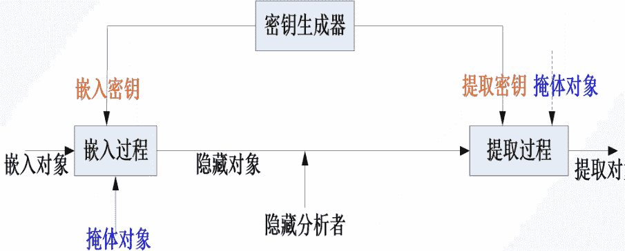

## 信息隐藏的特点

- 不可见性
- 鲁棒性
- 稳定性
- 不可测性
- 安全性

## 信息隐藏的应用

- 数据保密
- 数据的不可抵赖性
- 数字作品的版权保护
- 防伪
- 数据的完整性

## 数字水印

数字水印是信息隐藏技术研究领域的重要分支，它的出现主要是为了解决多媒体信息在网络上的版权保护问题。数字水印主要是通过在原始资料中嵌入秘密信息——水印(watermark)来证实资料的所有权。嵌入的水印是有特殊意义的信息，如文字、序列号、公司标志、声音等，用来识别多媒体信息的作者、版本、所有者、发行者、合法使用者对数字产品的拥有权等，并携带有版权保护信息和论证信息。数字水印最终保护的是载体信息，它要比一般信息隐藏有更高的健壮性、安全性和透明性。

## 数字水印技术模型

水印

原始数字作品

嵌入算法

密钥

带水印的数字作品

水印嵌入过程图

密钥

水印与（或）原始数字作品

检测算法

待检测的数字作品

水印或存在性

检测和提取水印过程图

## 数字水印的特点

- 鲁棒性
- 安全性
- 隐蔽性
- 确定性

## 数字水印的应用

- 版权保护
- 盗版跟踪
- 拷贝保护
- 标题与注释
- 认证和完整性
- 票据防伪

## 物理安全的内容

- 环境安全
- 电源系统安全
- 设备安全
- 通信线路安全

## 电源系统安全

- 供电系统安全（UPS）
- 防静电
- 接地与防雷

- 硬件设备的维护与管理
- 电磁兼容和电磁辐射
- 信息存储媒体的安全管理

## 通信线路安全

- 防止搭线窃听
- 电磁泄露
- 电磁干扰等

## 信息安全工程

- 信息安全不单单是技术问题，而是策略、管理技术的有机结合，是一项复杂的系统工程。
- 采用工程的概念、原理、技术和方法，研究、开发、实施与维护企业级信息与网络系统安全的过程，是将经过时间考验证明是正确的工程实施流程、管理技术和当前能够得到的最合适的技术方法相结合的过程。
- 目前存在的主要现象：
  - “头痛医头，脚痛医脚”；
  - 简单的安全产品的堆砌；


## 信息安全工程应考虑的因素

- 信息安全具有全面性

  系统安全程度取决于系统最薄弱的环节。

- 信息安全具有生命周期性

  一个不断往复和上升的螺旋式的安全模型。

- 信息安全具有动态性

  系统处于不断更新、不断完善、不断进步的动态过程中。

- 信息安全具有层次性

  用多层次的安全技术、方法与手段、分层次地化解安全风险。

- 信息安全具有相对性

  安全是相对的，没有绝对的安全。

## 信息系统的安全周期

任何安全过程都是一个不断重复改进的循环过程，它主要包含风险管理、安全策略、方案设计、安全要素实施、安全管理和安全检查等。信息安全过程如下图所示。

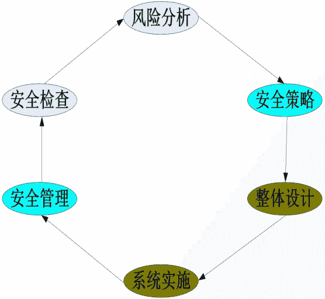

## 信息安全周期（二）

### 系统实施

包括安全方案设计中的各项安全要素的有效执行，以实现企业的安全计划和目标；

### 安全管理

按照安全策略以及安全方案进行安全管理与维护，包括事件管理、风险管理和配置管理；

### 安全检查

为了保证信息安全方案的有效性，每隔一定时期检测网络环境中的异常或入侵情况，并对信息系统的安全记录、安全策略复审，必要时开始新的风险分析。

## 信息安全策略

信息系统的安全策略是为了保障系统一定级别的安全而制定和必须遵守的一系列准则和规定。它包括入侵者可能发起的任何攻击，以及为使系统免遭入侵和破坏而必然采取的措施。

不同组织机构开发的信息系统在结构、功能、目标等方面存在着巨大的差别，因而对于不同的信息系统必须采取不同的安全措施，同时还要考虑到保护信息的成本、被保护信息的价值和使用的方便性之间的平衡。一般地，信息的安全策略的制定要遵循以下总的原则：

### 信息安全策略遵循的原则（一）

1. 整体性原则

   一个网络信息系统的安全，不是哪一个人、哪个部门的工作职责，也不是某个技术可以实现的，它必须是“全体动员，人人有责”，网络信息系统中的每一个管理者、工作人员和参与者，包括用户都必须提高安全意识，充分运用已有的、成熟的安全技术来共同完成这个安全工作。

2. 平衡分析原则

   对任一网络信息系统来说，绝对安全难以达到，也不一定必要。对网络信息系统面临的威胁及可能承担的风险进行定性与定量相结合的分析，然后制订规范和措施，确定本系统的需求、风险、代价平衡分析的原则，以及安全防范策略，使保护成本与被保护信息价值平衡。

### 信息安全策略遵循的原则（二）

3. 综合性、系统性原则

   运用系统工程的观点和方法，分析网络信息系统的安全问题，并制订具体措施。一个较好的安全措施往往是多种方法适当综合的应用结果。一个网络信息系统包括人员、设备、软件和数据等环节。它们在网络信息系统中的地位和影响作用，只有从系统综合的整体角度去看待和分析，才可能获得有效可行的措施。

4. 一致性原则

   这主要是指网络信息系统安全问题应与整个系统的工作周期（或生命周期）同时存在，制订的安全体系结构必须与网络信息系统的安全需求相一致。实际上，在网络信息系统建设之初就考虑系统的安全对策。


## 信息安全策略遵循的原则（三）

### 5. 易操作性原则

安全措施要由人来完成，如果措施过于复杂，对人的要求过高，本身就降低了安全性。其次，采取的措施不能影响系统正常运行。

### 6. 适应性和灵活性原则

安全措施必须能随着网络信息系统性能及安全需求的变化而变化，适应安全要求，并容易调整。

### 7. 多重保护原则

任何安全保护措施都不是绝对安全的，都可能被攻破。但是建立一个多重保护系统，各层保护相互补充，当一层保护被攻破时，其它层的保护仍可保护整个网络信息系统的安全。

## 信息安全设计和实施的基本原则（一）

### 1. 规范原则

信息系统的规划、设计、实现、运行要有安全规范要求，要根据本机构或部门的安全要求制定相应的安全政策。要根据需要选择采用必要的安全功能，选用必要的安全设备，不应盲目开发、自由设计、违章操作、无人管理。

### 2. 预防原则

在信息系统的规划、设计、采购、集成、安装中应该同步考虑安全政策和安全功能具备的程度，以预防为主的指导思想对待信息安全问题，不能心存侥幸。

### 3. 立足国内原则

安全技术和设备首先要立足国内，不能未经许可、未经消化改造直接应用境外的安全保密技术和设备。

## 信息安全设计和实施的基本原则（二）

### 4. 选用成熟技术原则

成熟的技术提供可靠的安全保证，采用新的技术时要重视其成熟的程度。

### 5. 重视实效原则

不应盲目追求一时难以实现或投资过大的目标，应使投入与所需要的安全功能相适应。

### 6. 系统化原则

要有系统工程的思想，前期的投入和建设与后期的提高要求要匹配和衔接，以便能够不断扩展安全功能，保护已有投资。

### 7. 均衡防护原则

人们经常用木桶装水来形象地比喻应当注意安全防护的均衡性，木桶的木板中只要有一块短板，水就会从那里泄漏出来。

### 8. 分权制衡原则

重要环节的安全管理要采取分权制衡的原则，要害部位的管理权限如果只交给一个人管理，一旦出现问题，就将全线崩溃。分权可以相互制约，提高安全性。

### 9. 应急原则

安全防护不怕一万就怕万一，因此要有安全管理的应急响应预案，并且要进行必要的演练，一旦出现相关的问题马上采取对应的措施。

### 10. 灾难恢复原则

越是重要的信息系统越要重视灾难恢复。在可能的灾难不能同时波及的地区设立备份中心。要求实时运行的系统要保持备份中心和主系统的数据一致性。一旦遇到灾难，立即启动备份系统，保证系统的连续工作。

## 安全管理的主要内容

- 建立信息安全的机构和队伍
- 制定信息安全管理制度
- 举办安全教育培训
- 信息安全法律保障

## 信息安全的机构和队伍

### 信息安全领导小组

是机构中信息安全工作的最高领导决策机构，不隶属任何部门，直接对组织最高领导层负责。是常设机构，有例会工作制度，负责本组织、本系统信息安全工作的宏观领导。

### 信息安全顾问委员会（非常设机构）

定期或不定期为信息安全管理提供最新的安全动态、面临的风险、技术、改进建议和应对措施，并为组织提供咨询服务。

### 信息安全领导小组办公室（信息中心）

在信息安全领导小组直接领导下，负责处理本组织信息安全管理的日常工作。

### 信息安全队伍

主要包括信息安全员、系统安全员、网络安全员、设备安全员、数据库安全员、数据安全员、防病毒安全员等。

## 信息安全管理制度

信息安全管理制度是保证信息安全的基础，需要通过一系列规章制度的实施，来确保各类人员按照规定的职责行事，做到各司其责，避免责任事故的发生和防止恶意侵犯。

常用的信息安全管理制度主要包括：人员安全管理制度、设备安全管理制度、运行安全管理制度、安全操作管理制度、应急维护制度、安全等级保护制度；有害数据及计算机病毒防范管理制度；敏感数据保护制度、安全技术保障制度、安全计划管理制度等。

## 安全教育培训

根据用户的不同层次制定相应的教育培训计划以及培训方案。为了将安全隐患减到最低，不仅需要对安全管理人员进行专业性的安全技术培训，还需要加强对一般办公人员的信息安全教育，普及信息安全基本知识，通过对用户的不断教育和培训，增强全体工作人员的信息安全意识、法制观念和技术防范水平，确保网络的安全运行。

## 信息安全法律保障

网络已深入到社会的各个角落，黑客和病毒给社会带来的负面影响也随着网络功能的增强而扩大，网络的安全性随之上升到国家安全、公共安全的层面，世界各国亦越来越倾向依靠法律——这个强有力的国家工具来保障网络安全。各国信息安全的立法虽各不相同，但各国信息安全专家对这一点的认识是相同的，即保障信息网络安全必须构建一个全方位、立体化的防御体系。

从我国现有的计算机信息系统安全保护法律来看，我国已初步形成了一个保护网络安全的法律体系。


## 本讲主要内容

- VPN技术
- 无线网络安全的简介
- 信息隐藏和数字水印
- 物理安全
- 信任工程的介绍
- 信任管理的简介


## 谢谢！


