# 北邮操作系统课件（李文生）


大家好！

我叫 Li WenSheng。
很高兴认识你们。

你可以通过以下方式联系我：
电子邮件：wenshli@bupt.edu.cn
或电话：010-62282929


## 课程计划（续）

+   - **64 学时：** 48 + 16
+   - **形式：**
+     - 讲授
+     - 作业
+     - 课堂讨论
+     - 实践
+   - **助教：**
+     - 
+     - 
+   - **答疑**
+     - **时间：**
+     - **地点：**


## 要求

+   - 预习
+   - 记笔记
+   - 复习
+   - 作业
+   - 思考、讨论与实践
+   - 答疑

## 成绩评定原则

+   - 作业 20%
+   - 期中 20%
+   - 期末 60%

## 努力学习
并
不断进步！

# 第 1 章 引言


教学学时：4 小时

## 重点：

+   - 操作系统的定义和功能
+   - 操作系统的主要组成部分
+   - 操作系统的种类及其特点

## 本章目标

+   - 概览操作系统的主要组件
+   - 介绍基本的计算机系统组织

## 内容

+   1.1 操作系统做什么
+   1.2 计算机系统组织
+   1.3 计算机系统体系结构（*）
+   1.4 操作系统结构
+   1.5 操作系统操作
+   1.6 进程管理
+   1.7 内存管理
+   1.8 存储管理
+   1.9 保护与安全
+   1.10 分布式系统（*）
+   1.11 专用系统（*）
+   1.12 计算环境

## 1.1 操作系统做什么？

+   - **操作系统是一种系统程序，充当计算机用户与计算机硬件之间的中介**
+     - 控制应用程序执行的程序
+     - 应用程序/用户与硬件之间的接口

+   - **操作系统的目标：**
+     - **方便性**
+       - 执行用户程序，使解决用户问题更加容易。
+       - 使计算机系统使用更方便
+     - **效率**
+       - 有效利用计算机硬件
+     - **演进能力**
+       - 允许在不影响服务的情况下，有效地开发、测试和引入新的系统功能

## 计算机系统组件

+   1. 硬件
+   提供基本计算资源，如 CPU、内存、I/O 设备。
+   2. 操作系统
+   控制并协调各应用程序和用户对硬件的使用。
+   3. 应用程序
+   定义如何使用系统资源来解决用户的计算问题（编译器、数据库管理系统、数据库系统、文字处理器、视频游戏、商业程序）。
+   4. 用户
+   人、机器、其他计算机

## 计算机系统结构

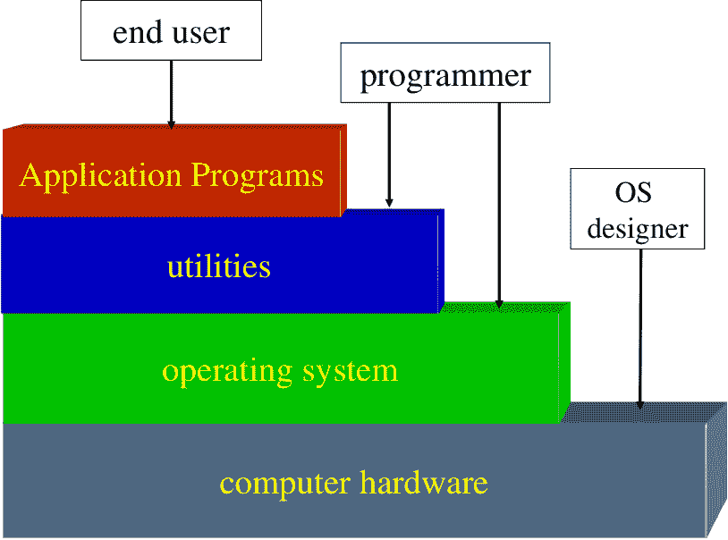

### 1.1.1 用户视角

+   - 根据所使用的界面而有所不同。
+   - 不同操作系统的设计目标
+     - 个人计算机
+       - 易用性、性能
+     - 大型机、小型机
+       - 最大化资源利用率
+     - 工作站
+       - 可用性和资源利用率
+     - 手持计算机
+       - 个人可用性、单位电池电量的性能
+     - 嵌入式计算机
+       - 几乎没有用户视角


#### 操作系统提供的服务。

- 程序开发
  - 编辑器和调试器
- 程序执行
- 访问 I/O 设备
- 受控访问文件
- 系统访问
- **错误检测和响应**
  - 内部和外部硬件错误
    - 内存错误
    - 设备故障
  - 软件错误
    - 算术溢出
    - 访问禁止的内存位置
  - 操作系统无法满足应用程序的请求
- **记账**
  - 收集统计信息
  - 监控性能
  - 用于预测未来增强
  - 用于用户计费

#### 操作系统的定义

操作系统是计算机系统中的一个系统软件，是一些程序模块的集合，它们能以尽量有效、合理的方式组织和管理计算机的软硬件资源，合理地组织计算机的工作流程，控制程序的执行，向用户提供各种服务功能，使得用户能够灵活、方便、有效地使用计算机，使整个计算机系统能高效地运行。

## 1.2 计算机系统组织

- 一个或多个 CPU，设备控制器通过提供对共享内存访问的公共总线连接
- CPU 和设备并发执行，竞争内存周期

### 现代计算机系统

- 磁盘
- 磁盘
- 打印机
- 磁带驱动器
- 在线
- CPU
- 磁盘控制器
- 打印机控制器
- 磁带驱动器控制器
- USB 控制器
- 内存控制器
- 内存

寄存器类型？

### 计算机启动

- **引导程序**在加电或重启时加载
  - 通常存储在 ROM 或 EEPROM 中，通常称为**固件**
  - 初始化系统的各个方面
    - 从 CPU 寄存器到设备控制器到内存内容
  - 加载操作系统内核并开始执行
- OS 开始执行第一个进程，例如“init”并等待某些事件发生
  - 来自硬件的中断
    - 通过系统总线向 CPU 发送信号
  - 来自软件的中断
    - 执行系统调用

#### 1.2.1 计算机系统操作

- I/O 设备和 CPU 可以并发执行。
- 每个设备控制器负责一种特定类型的设备。
- 每个设备控制器都有一个本地缓冲区。
- CPU 将数据从/向主内存移动到/来自本地缓冲区
- I/O 是从设备到控制器的本地缓冲区。
- 设备控制器通过引起*中断*通知 CPU 其操作已完成。


##### 中断时间线

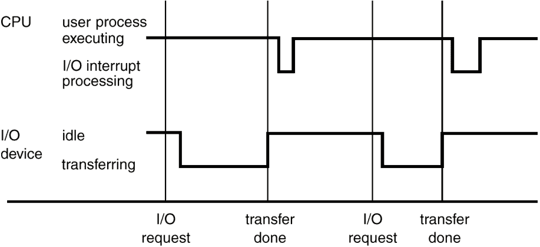

##### 补充：无中断和有中断的程序控制流

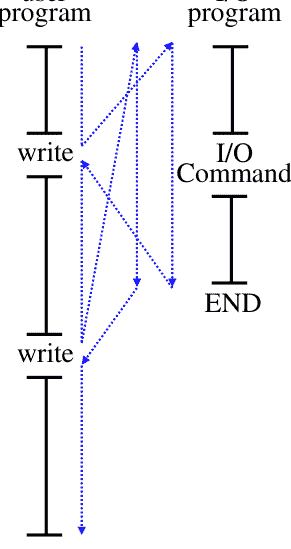

无中断

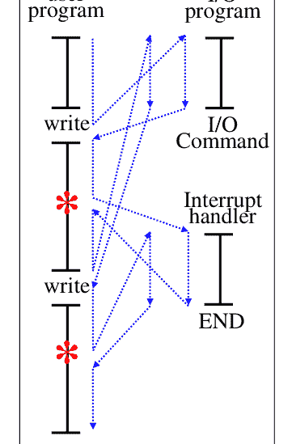

中断，短 I/O 等待

#### 1.2.2 存储结构

- 主内存 – 处理器可以直接访问的唯一大存储区域。
- 辅助存储 – 提供大容量非易失性存储容量的主内存扩展。
- 磁盘 – 覆盖有磁性记录材料的刚性金属或玻璃盘片
  - 磁盘表面在逻辑上被划分为*磁道*，磁道又细分为*扇区*。
  - *磁盘控制器*确定设备与计算机之间的逻辑交互。
- 磁带 - 用于备份，用于存储不经常使用的信息

##### 补充：移动头磁盘机构

编号：从上向下 0, 1, ..., T-1

编号：依次为 0,1,...,S-1

编号：从外向内 0, 1, ..., C-1

磁盘块编号：从0柱面、0磁道的0扇区开始，依次为0,1,......,S-1; 再对0柱面、1磁道的S个扇区依次编号为S,S+1,......,2S-1; 依次类推，对柱面0的所有磁道所有扇区进行编号; 然后，对1柱面的0磁道的各个扇区进行编号,...; 直到对所有柱面上所有磁道的所有扇区编完为止。

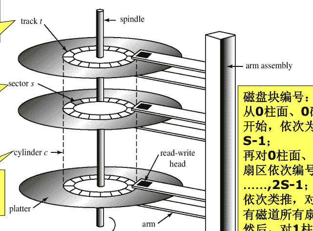

##### 存储层次结构

- 存储系统按层次组织。
  - 速度
  - 成本
  - 易失性
- 易失性存储在断电时丢失其内容。
- 设计计算机内存系统的原则
  - 仅使用必要的昂贵内存
  - 提供尽可能多的廉价、非易失性内存。


### 存储设备层次结构

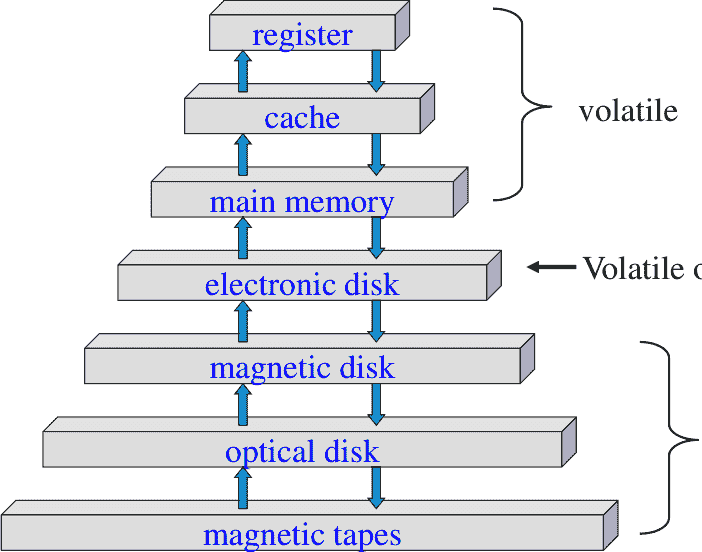

- 寄存器
- 缓存
- 主存储器
- 电子磁盘
- 磁盘
- 光盘
- 磁带

易失性

易失性或非易失性

非易失性

#### 1.2.3 I/O 结构

- 程序化 I/O
- 中断驱动 I/O
  - 同步 I/O
  - 异步 I/O
- DMA


### I/O 操作

- **设备控制器**
  - 本地缓冲存储
  - 一组专用寄存器
  - 在设备与其本地缓冲存储之间移动数据
- **设备驱动程序**
  - 每个设备控制器对应一个
  - 向设备提供统一的接口
- **I/O 操作**
  - 设备驱动程序加载控制器内的寄存器
  - 控制器检查寄存器的内容以确定要采取什么操作
  - 控制器开始在设备与其本地缓冲区之间传输数据
  - 完成后，控制器通过中断通知驱动程序
  - 驱动程序将控制权连同数据如果为‘读’则返回给操作系统

## 1.3* 计算机系统架构

- **单处理器系统**
  - 一个主 CPU 执行通用指令集
  - 专用处理器运行有限的指令集且不运行用户进程，例如控制器、I/O 处理器
- **多处理器系统/并行系统**
  - 两个或多个处理器紧密通信，共享计算机总线和时钟、内存及 I/O 设备
  - 优点
    - 吞吐量提高
    - 规模经济
    - 可靠性提高

## 多处理器系统

- **对称多处理**
  - 每个处理器在操作系统内执行所有任务
  - 所有处理器都是对等关系
- **非对称多处理**
  - 每个处理器被分配特定任务
  - 一个主处理器控制系统
  - 其他从处理器向主处理器寻求指令或具有预定义任务
  - 主处理器调度并将工作分配给从处理器
- **多核 CPU**
  - 单个芯片上多个计算核心
  - 双路芯片正成为主流

## 计算机系统架构（续）

### 集群系统

- 集群计算机共享存储并通过局域网或更快的互连如 InfiniBand 紧密连接。
- 用于提供高可用性服务
- 一层集群软件在集群节点上运行
- 非对称集群
  - 一台机器处于热备份模式而另一台运行应用程序
  - 热备份主机机器除了监控活动服务器外什么都不做
- 对称集群
  - 两个或多个主机正在运行应用程序并相互监控

## 1.4 操作系统结构

- 批处理系统
- 分时系统
- 实时系统

## 补充：简单批处理系统的内存布局

常驻监控程序

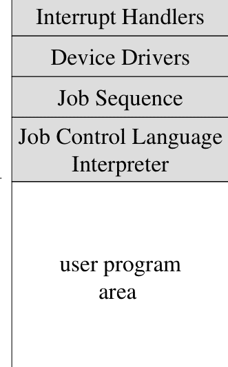

## 补充：问题与解决方案（续）： spooling

- **S**imultaneous **P**eripheral **O**peration **O**n **L**ine
- 使一个作业的 I/O 与另一个作业的计算重叠。在执行一个作业时，操作系统会
  - 从卡片阅读机读取下一个作业到磁盘上的存储区域（作业队列）。
  - 将前一个作业的打印输出从磁盘输出到打印机。
- *作业池* – 数据结构，允许操作系统选择下一个运行的作业以提高 CPU 利用率。

## 补充：spooling（续）

- 系统/用户进程
  - 输入请求
- 卡片阅读机
- 操作系统
  - 输入进程
- 内存
- 作业池
- 系统/用户进程
  - 输出请求
- 行式打印机
- 操作系统
  - 输出进程

## 为提高效率需要多道程序设计

- 单个用户无法始终使 CPU 和 I/O 设备保持忙碌
- 多道程序设计组织作业（代码和数据），使 CPU 总是有可执行的作业
- 系统中总作业的子集保留在内存中
- 通过 **作业调度** 选择并运行一个作业
- 当它需要等待时（例如等待 I/O），操作系统切换到另一个作业。

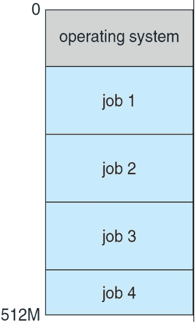


## 补充：多道程序设计

- 当一个作业需要等待 I/O 时，处理器可以切换到另一个作业。
- 两个程序的多道程序设计

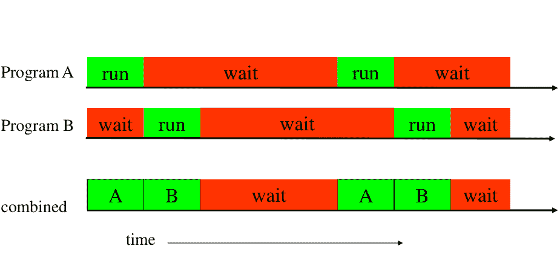

## 补充：示例

## 一台计算机：

256KB 内存，一块磁盘，一个终端，和一台打印机

|  | Job1 | Job2 | Job3 |
|---|---|---|---|
| 作业类型 | 重计算 | 重 I/O | 重 I/O |
| 持续时间 | 5 分钟 | 15 分钟 | 10 分钟 |
| 所需内存 | 50K | 100K | 80K |
| 需要磁盘？ | 否 | 否 | 是 |
| 需要终端？ | 否 | 是 | 否 |
| 需要打印机？ | 否 | 否 | 是 |

### 补充：利用率直方图

(a) 单道程序设计

(b) 多道程序设计

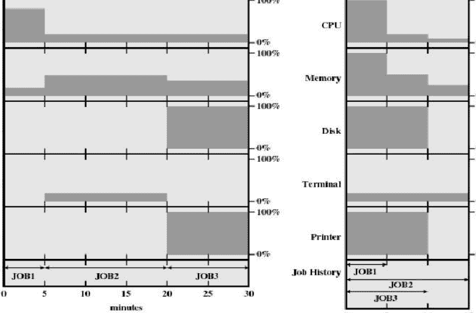

## 补充：
多道程序设计所需的 OS 功能

- 系统提供的 I/O 例程。
- 内存管理 – 系统必须为多个作业分配内存。
- CPU 调度 – 系统必须在多个准备运行的作业中进行选择。
- 设备分配。

### 补充：分时系统

- **分时（多任务）** 是逻辑上的扩展，其中 CPU 频繁切换作业，使得用户可以在作业运行时与每个作业交互，从而实现 **交互式** 计算
  - **响应时间** 应 < 1 秒
  - 每个用户至少有一个程序在内存中执行 ⇒ 进程
  - 如果同时有多个作业准备运行 ⇒ **CPU 调度**
  - 如果进程不适合内存，**交换** 会将它们移入移出以运行
  - **虚拟内存** 允许执行未完全在内存中的进程

## 补充：
分时系统（续）

- 使用多道程序设计处理多个交互式作业
- CPU 在保存在内存和磁盘中的多个作业之间复用（复用）
  - 处理器的时间在多个用户之间共享
  - 仅当作业在内存中时 CPU 才分配给该作业。
- 一个作业被交换进出内存到磁盘。
- 许多用户同时共享计算机。
  - 在用户和系统之间提供在线通信；
  - 多个用户通过终端同时访问系统；
  - 当操作系统完成一个命令的执行时，它寻求下一个“控制语句”不是来自卡片阅读机，而是来自用户的键盘。
- 在线系统必须可供用户访问数据和代码。

## OS 功能
分时系统所需

- 系统提供的 I/O 例程。
- 内存管理 – 系统必须为多个作业分配内存。
- 虚拟内存 – 允许执行未完全在内存中的作业。
- 磁盘管理 – 必须提供文件系统，它驻留在磁盘集合上。
- CPU 调度 – 并发执行、作业同步和通信的机制，避免死锁。
- 资源分配。

## 补充：
批处理多道程序设计与分时

|  | 批处理多道程序设计 | 分时 |
|---|---|---|
| 主要目标 | 最大化处理器使用 | 最小化响应时间 |
| 操作系统指令来源 | 与作业一起提供的作业控制语言命令 | 在终端输入的命令 |

## 1.5 操作系统操作

- 由硬件驱动的中断
- 软件错误或请求产生 **异常** 或 **陷阱**
  - 除以零，请求操作系统服务
- 其他进程问题包括无限循环，进程相互修改或修改操作系统
- **双模式** 操作允许 OS 保护自身和其他系统组件
  - 提供硬件支持以区分至少两种操作模式。
    1. *用户模式* – 代表用户执行的执行。
    2. *监控模式*（也称 *内核模式* 或 *系统模式*）– 代表操作系统执行的执行。

## 双模式操作

- 由硬件提供的 **模式位**
  - 监控（0）或用户（1）
  - 提供区分系统正在运行用户代码还是内核代码的能力
  - 一些指令被指定为 **特权**，只能在内核模式下执行
  - 系统调用将模式更改为内核，返回调用时将其重置为用户

当中断或故障发生时，硬件切换到监控模式。


## 从用户模式到内核模式的转换

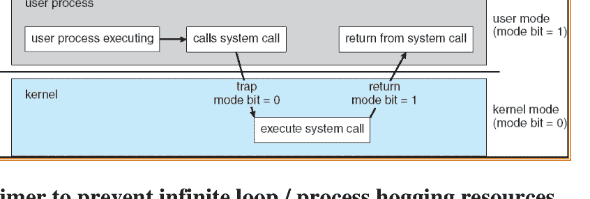

### 防止无限循环 / 进程占用资源的计时器

- 在特定周期后设置中断
- 操作系统递减计数器
- 当计数器为零时，产生中断
- 在调度进程之前设置，以便重新获得控制权或终止超出分配时间的程序
- 修改计时器内容的指令是特权的。

## 1.6 进程管理

- 进程是正在执行的程序，是系统中的工作单元，是可以分配给处理器并在其上执行的实体。
- 程序是*被动实体*，进程是*主动实体*。
- 进程需要资源来完成其任务
  - CPU、内存、I/O、文件、初始化数据
- 进程终止需要收回(归还)任何可重用的资源
- 单线程进程有一个*程序计数器*，指定要执行的下一条指令的位置
  - 进程按顺序执行指令，一次一条，直到完成
- 多线程进程每个线程有一个程序计数器
- 通常系统有许多进程，一些是用户进程，一些是操作系统进程，在一个或多个 CPU 上并发运行
  - 通过在进程/线程之间复用 CPU 实现并发

### 进程管理活动

操作系统负责与进程管理相关的以下活动：

- 创建和删除用户和系统进程
- 挂起和恢复进程
- 提供进程同步机制
- 提供进程通信机制
- 提供死锁处理机制

## 1.7 内存管理

- 现代计算机系统运行的核心
  - 所有数据在处理前后的内存中
  - 所有指令在内存中以便执行
- CPU 能够寻址和直接访问的唯一大容量存储设备
- 内存管理决定何时在内存中有什么
  - 优化 CPU 利用率和计算机对用户的响应
- 内存管理活动
  - 跟踪内存的哪些部分当前正在被使用以及被谁使用
  - 决定将哪些进程（或其部分）和数据移入和移出内存
  - 根据需要分配和释放内存空间

### 补充：虚拟内存

- 允许程序员从逻辑角度寻址内存
- 当一个进程被写出到二级存储而后继进程被读入时，没有间隙（裂缝）

### 补充：分页

- 允许进程由多个固定大小的块组成，称为页
- 虚拟地址是一个页号和页内的偏移量
- 每个页可以位于主内存中的任何位置
- 主内存中的实际地址或物理地址
- 地址映射

### 补充：虚拟内存概念

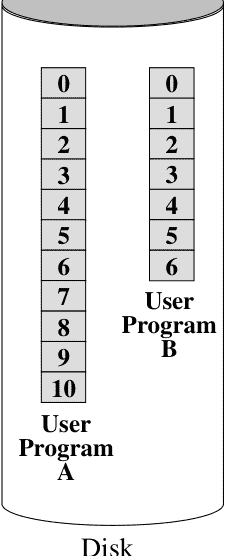

Disk

|   |   |   |   |
|---|---|---|---|
| A.1 |   |   |   |
|   | A.0 | A.2 |   |
|   | A.5 |   |   |
|   |   |   |   |
| B.0 | B.1 | B.2 | B.3 |
|   |   |   |   |
|   |   |   |   |
|   |   |   |   |
|   |   | A.7 |   |
|   | A.9 |   |   |
|   |   |   |   |
|   |   | A.8 |   |
|   |   |   |   |
|   |   |   |   |
|   |   |   |   |
| B.4 | B.5 | B.6 |   |
|   |   |   |   |

Main Memory

主内存由多个固定长度的帧组成，其大小等于页的大小。对于程序的执行，其一些或全部页必须在主内存中。

二级存储（磁盘）可以容纳许多固定长度的页。用户程序由若干页组成。所有程序的页加上操作系统都在磁盘上，文件也是如此。

## 1.8 存储管理

- 操作系统提供信息存储的统一、逻辑视图
  - 将物理属性抽象为逻辑存储单元 - 文件
  - 每个介质由设备控制（即磁盘驱动器、磁带驱动器）
    - 不同的属性包括访问速度、容量、数据传输率、访问方法（顺序或随机）


## 文件系统管理

- 文件通常组织在目录中
- 大多数系统上都有访问控制来确定谁可以访问什么
- 操作系统的活动包括
  - 创建和删除文件和目录
  - 操作文件和目录的原语（原语）
  - 将文件映射到二级存储
  - 将文件备份到稳定（非易失性）存储介质上

## 大容量存储管理

- 通常磁盘用于存储不适合主内存的数据或必须保存“较长时间”的数据。
- 适当的<|message|> 管理至关重要
- 整个计算机运行速度取决于磁盘子系统及其算法
- 操作系统活动
  - 空闲空间管理
  - 存储分配
  - 磁盘调度
- 某些存储不需要很快
  - 三级存储包括光学存储、磁带
  - 仍需管理
  - 在 WORM（一次写入，多次读取）和 RW（读写）之间变化

### 磁盘缓存

- 主内存的一部分用作缓冲区，暂时保存磁盘的数据
- 磁盘写入是簇（簇）
- 一些写入的数据可能会再次被引用。数据是从软件缓存中快速检索，而不是缓慢地从磁盘检索

### 缓存内存（高速缓存）

- 对操作系统不可见
- 增加内存速度
- 处理器速度快于内存速度

### 一致性和相干性

- 相同的数据可能出现在存储系统的不同层级中。
- 从磁盘到寄存器的 A 的迁移


- 计算环境
  - 仅一个进程一次执行
  - 多任务环境
  - 多处理器环境 — 缓存相干性
  - 分布式环境

### 补充：缓存内存

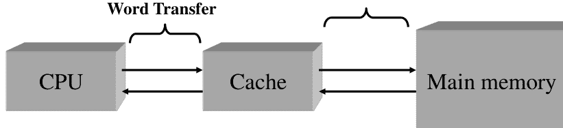

- 包含主内存的一部分
- 处理器首先检查缓存
- 如果在缓存中未找到，则包含所需信息的内存块会被移动到缓存中

### 补充：缓存/主内存结构

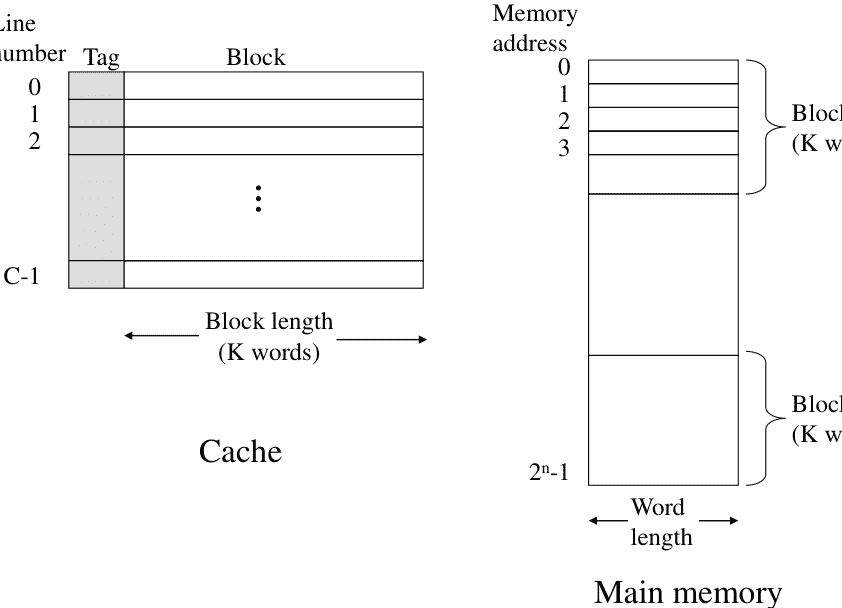

### 补充：**缓存设计**

- **缓存大小**
  - 小缓存对性能有显著影响
- **块大小**
  - 缓存与主内存之间交换数据的单位
  - 命中意味着信息在缓存中找到
  - 块大小越大命中次数越多，直到使用新获取数据的概率小于重用已移出缓存的数据的概率

### 补充：缓存设计（续）

- **映射函数**
  - 确定块将占据的缓存位置
- **替换算法**
  - 确定要替换哪个块
  - 最近最少使用（LRU）算法
- **写策略：内存写操作发生的时间**
  - 可以在每次块更新时发生
  - 仅在块被替换时发生
    - 最小化内存操作
    - 使内存处于过时（陈旧的）状态

## I/O 子系统

- 操作系统的一个目的是隐藏硬件设备的特殊性（特性）对用户
- I/O 子系统负责
  - I/O 的内存管理，包括
    - **缓冲**（在数据传输时临时存储数据），
    - **缓存**（为性能将数据部分存储在更快的存储中），
    - ** spooling **（将一个作业的输出与另一个作业的输入重叠）
  - 通用设备驱动程序接口
  - 特定硬件设备的驱动程序

## 1.9 保护和安全

- **保护** – 操作系统定义的任何用于控制进程或用户对资源访问的机制
- **安全** – 系统抵御内部和外部攻击的防御
  - 范围巨大，包括拒绝服务、蠕虫、病毒、身份盗窃、服务盗窃
- **访问控制**
  - 规范用户对系统的访问
- **信息流控制**
  - 规范系统内数据的流动及其向用户的交付
- **认证**
  - 证明访问和流控制按照规范执行


## Protection and Security (Cont.)

- 系统通常首先区分用户，以确定谁可以做什么
    - 用户身份（**user IDs**，安全 ID）包括姓名和相关编号，每个用户一个
    - 用户 ID 然后与该用户的所有文件、进程相关联以确定访问控制
    - 组标识符（**group ID**）允许定义一组用户并管理控制，然后也与每个进程、文件相关联
    - **权限提升**允许用户更改为具有更多权限的有效 ID

## 1.10* Distributed Systems

- 在多个物理处理器之间分配计算。
- *松耦合系统 -- 分布式系统*
    - 每个处理器都有自己的本地内存；
    - 处理器通过各种通信线路相互通信，例如高速总线或电话线。
- 分布式系统的优点。
    - 资源共享
    - 计算加速 – 负载共享
    - 可靠性
    - 通信

### Basic concept

- 需要网络基础设施。
- 局域网（LAN）或广域网（WAN）
- 可能是客户端-服务器或点对点系统。

### General Structure of Client-Server

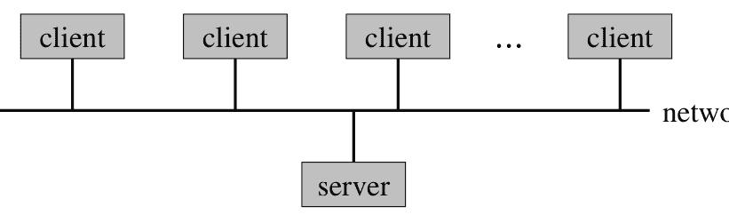

- **网络操作系统**
    - 在网络上提供文件共享
    - 提供通信方案，允许不同计算机上的不同进程交换消息。
    - 独立于网络上的其他计算机运行
- **分布式操作系统**
    - 计算机之间的自主性较低
    - 给人一种网络由单一操作系统控制的印象。

## Real-Time Systems

- 当处理器操作或数据流存在严格的时间要求时使用。
- 通常用作专用应用中的控制设备，例如控制科学实验、医学成像系统、工业控制系统和某些显示系统。
- 具有明确定义固定的时间约束。内核延迟需要有界。
- 实时系统分为两类
    - 硬实时系统
    - 软实时系统。

## Multimedia systems

- 多媒体数据包括音频和视频文件以及常规文件

## Handheld systems

- **个人数字助理（PDAs）**
    - Palm 和 Pocket PCs 以及蜂窝电话
    - 使用专用嵌入式 OS
- **问题：**
    - 内存大小有限
    - 处理器速度慢
    - 显示屏小。

## 1.12* Computing Environments

- **传统计算机**
    - **随时间模糊**
    - **办公环境**
        - PC 连接到网络，终端连接到大型机或小型机提供批处理和分时
        - 现在门户允许网络化和远程系统访问相同资源
    - **家庭网络**
        - 以前是单一系统，然后是调制解调器
        - 现在是防火墙，网络化

### Client-Server Computing

- 哑终端被智能 PC 取代
- 现在许多系统都是**服务器**，响应由**客户端**生成的请求
    - 计算服务器为客户端提供接口以请求服务（即数据库）
    - 文件服务器为客户端提供接口以存储和检索文件

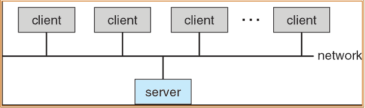

### Peer-to-Peer Computing

- **另一种分布式系统模型**
- **P2P 不区分客户端和服务器**
    - 相反所有节点都被视为对等体
    - 可能各自充当客户端、服务器或两者
    - 节点必须加入 P2P 网络
        - 在网络上的中央查找服务上注册其服务，或
        - 广播服务请求并通过 *discovery protocol* 响应服务请求
    - **示例包括 *Napster* 和 *Gnutella***


## Review: Processor Registers

- **User-visible registers**
    - 使程序员能够通过优化寄存器使用来最小化主存引用
- **Control and status registers**
    - 用于控制处理器的操作
    - 用于操作系统例程控制程序的执行

## Review: User-Visible Registers

- 可被机器语言引用
- 可供所有程序使用 — 应用程序和系统程序
- 寄存器类型
    - 数据
    - 地址
        - 索引：通过将索引加到基值上来获取地址
        - 段指针：当内存被划分为段时，内存由段和偏移量引用
        - 栈指针：指向栈顶。

## Review: Control and Status Registers

- **Program Counter (PC)**
    - 包含要取出的指令的地址
- **Instruction Register (IR)**
    - 包含最近取出的指令
- **Program Status Word (PSW)**
    - condition codes
    - Interrupt enable / disable
    - Monitor (/Supervisor) / user mode
- **Condition Codes or Flags**
    - 位由处理器硬件作为操作结果设置
    - 程序可以访问但不能更改
    - Examples
        - positive result, negative result, zero
        - Overflow

## Review: Basic Instruction Cycle

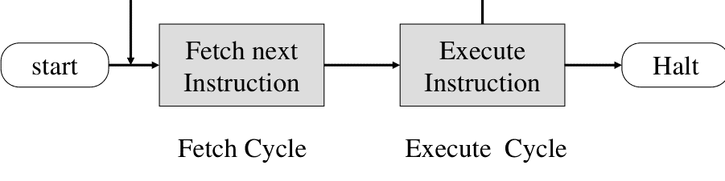

- 处理器从内存中取出指令
    - 取出的指令被放入指令寄存器
- 程序计数器 (PC) 持有下一个要取出的指令的地址
- 每次取指后程序计数器递增

## Review: Types of Instructions

- **Processor-memory**
    - 在处理器和内存之间传输数据
- **Processor-I/O**
    - 数据传输到或来自外围设备
- **Data processing**
    - 对数据进行算术或逻辑操作
- **Control**
    - 改变执行顺序


## Review: Example of Program Execution

### Instruction Form

Operation Code Address

- 0001: LOAD data from Memory to AC
- 0010: MOVE data from AC to Memory
- 0101: ADD data in Memory to AC

### Example

M1+M2⇒M2

Memory

CPU Registers

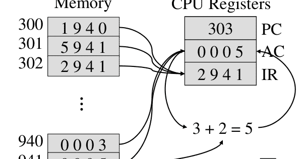

## Review: Classes of Interrupts

Reasons that can cause an interrupt?

- Program
    - arithmetic overflow
    - divided by zero
    - execute illegal instruction
    - reference outside user’s memory space
- Timer
- I/O
- Hardware failure

trap

interrupt

## Review: Common Functions of Interrupts

- 中断通常通过 *interrupt vector* 将控制转移到中断服务程序，该向量包含所有服务程序的地址。
- 中断体系结构必须保存被中断指令的地址。
- 在处理另一个中断时，传入的中断会被 *disabled* 以防止 *lost interrupt*。
- *trap* 是由错误或用户请求引起的软件生成的中断。
- 操作系统是 *interrupt* 驱动的。

## Review: Interrupt Handling

- 操作系统通过存储寄存器和程序计数器来保存 CPU 的状态。
- 确定发生了哪种类型的中断：
    - *Polling* (轮询)
    - *vectored* interrupt system
- 代码的独立段确定应为每种类型中断采取什么操作

## Review: 2) Interrupt-Driven I/O

- 当 I/O 模块准备好交换数据时处理器会被中断
- 处理器可以自由执行其他工作
- 无需无谓等待
- 消耗大量处理器时间，因为每个读写的字都必须经过处理器

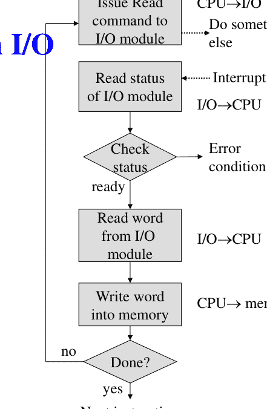


## Review: Interrupt-Driven I/O (Cont.)

- **Synchronous I/O**----在 I/O 开始后，只有在 I/O 完成时控制才返回到用户程序。
- **Asynchronous I/O**----在 I/O 开始后，控制在无需等待 I/O 完成的情况下返回到用户程序。
- **对于同步 I/O，CPU 等待 I/O 完成时可以使用两种方法：**
  - 等待指令使 CPU 空闲直到下一个中断
  - 等待循环（竞争（竞争）内存访问）。
- 同时最多只有一个 I/O 请求处于未完成状态，不能同时进行 I/O 处理。
- **为了提高 CPU 和 I/O 设备的利用率，我们需要：**
  - *系统调用* – 请求操作系统以允许用户等待 I/O 完成。
  - *设备状态表* 包含每个 I/O 设备的条目，指示其类型、地址和状态。
  - 操作系统索引到 I/O 设备表以确定设备状态并修改表条目以包含中断。

## Review: Two Methods

### Synchronous

### Asynchronous

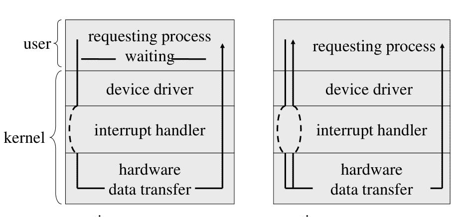

## Review: Device-Status Table

| Device | Status |
|---|---|
| keyboard | idle |
| laser printer | busy |
| mouse | idle |
| disk unit 1 | idle |
| disk unit 2 | busy |
| ⋮ | ⋮ |

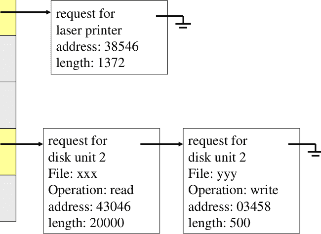

## Review:

### 3) Direct Memory Access Structure

- 直接将数据块传输到内存或从内存传输。
- 用于能够以接近内存速度传输信息的高速度 I/O 设备。
- 在为 I/O 设备设置缓冲区、指针和计数器之后，设备控制器在无需 CPU 干预的情况下直接将数据块从缓冲区存储传输到主内存。
- 每块仅产生一次中断，而不是每字节一次中断。
  - 任务完成后发送中断
  - 处理器仅在传输开始和结束时参与

## Review: Direct Memory Access (Cont.)

CPU 在设备控制器执行 DMA 传输时可用于完成其他工作

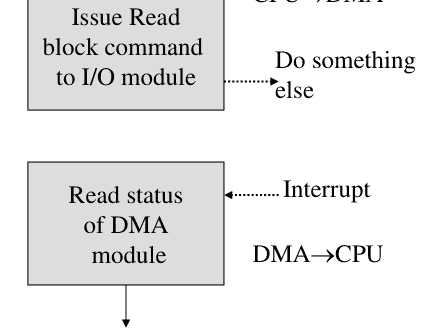

## Review: 4) I/O通道控制方式

- 是DMA方式的发展，进一步减少了CPU的干预。
- 完成一组数据块的读（或写）操作之后产生一次中断。
- 实现了CPU、通道和I/O设备三者的并行操作。
- CPU对通道的管理是通过I/O指令实现的。
  - I/O指令属于特权指令，仅能由操作系统使用。
  - 在I/O指令中需指定通道号、设备号，以及通道程序的内存地址。
- 当CPU要完成一组相关的读（或写）操作及有关控制时，只需向I/O通道发送一条I/O指令，以给出其所要执行的通道程序的首址和要访问的I/O设备，通道接到该指令后，通过执行通道程序便可完成CPU指定的I/O任务。

## Review:通道指令

- 通道指令也称为通道命令字(CCW, Channel Command Word)
  - 对设备进行初始化、读、写、查询、转移等
  - 使用CCW可以编写对各种不同设备进行管理控制的通道程序
  - 一个通道可以以分时方式同时执行几个通道程序
  - 通道指令在进程要求数据时自动生成
- 指令格式: OP P R 计数 内存地址
  - OP: 读、写、或控制
  - P: 通道程序结束标志
    P='1'，本条指令为最后一条指令。
  - R: 记录结束标志
    R='0'，本指令与下一条指令所处理的数据属于同一条记录
    R='1'，本指令是处理某记录的最后一条指令。
  - 计数: 本条指令所要处理数据的字节数
  - 内存地址:
    读操作: 数据要写入的内存地址
    写操作: 要写出的数据在内存中的起始地址

## Review:通道程序举例

OP　P　R　计数　内存地址

- `read 0 0 250 1850`
- `read 1 1 250 720`

- `write 0 0 80 813`
- `write 0 0 140 1034`
- `write 0 1 60 5830`
- `write 0 1 300 2000`
- `write 0 0 200 1650`
- `write 1 1 300 2720`


## Chapter 2
Operating-System Structures


Teaching hours: 4h

### Strong point:

- system components
- operating system service and system call
- system structure
- virtual machines

## Chapter Objectives

- To describe the services an operating system provides to users, processes, and other systems
- To discuss the various ways of structuring an operating system
- To explain how operating systems are installed and customized and how they boot

## Contents

- 2.1 Operating System Services
- 2.2 User Operating System Interface
- 2.3 System Calls
- 2.4 Types of System Calls
- 2.5 System Programs
- 2.6 Operating System Design and Implementation(*)
- 2.7 Operating System Structure
- 2.8 Virtual Machines
- 2.9 Operating System Generation(*)
- 2.10 System Boot(*)


## 2.1 操作系统服务

- **用户界面**：几乎所有操作系统都有用户界面
  - 命令行（CLI）、图形用户界面（GUI）
  - API（系统调用）

- **程序执行**：系统必须能够将程序加载到内存中并运行该程序，以及正常或异常地结束执行。

- **I/O 操作**：正在运行的程序可能需要 I/O，这可能涉及文件或 I/O 设备。

- **文件系统操作**：文件系统尤其重要。显然，程序需要读写文件和目录，创建和删除它们，搜索它们，列出文件信息，权限管理。

## 操作系统服务（续）

- **通信**——进程可以在同一台计算机上或通过网络在不同计算机之间交换信息
  - 通信可以通过共享内存或消息传递（由操作系统移动的数据包）进行
- **错误检测**——操作系统需要时刻意识到可能的错误
  - 可能发生在 CPU 和内存硬件、I/O 设备、用户程序中
  - 对于每种类型的错误，操作系统都应采取适当的措施以确保正确且一致的计算
  - 调试工具可以极大地增强用户和程序员高效使用系统的能力

## 操作系统服务（续）

- 另一组操作系统功能用于通过资源共享确保系统本身的高效运行
  - **资源分配** - 当多个用户或多个作业并发运行时，必须为每个用户或作业分配资源
    - 多种类型的资源 - 有些资源（如 CPU 周期、主内存和文件存储）可能有特殊的分配代码，其他资源（如 I/O 设备）可能有通用的请求和释放代码。
  - **记账** - 跟踪哪些用户使用了多少以及何种计算机资源

## 操作系统服务（续）

- **保护与安全** - 存储在多用户或网络计算机系统中的信息的所有者可能希望控制该信息的使用，并发进程不应相互干扰
  - **保护**涉及确保对系统资源的所有访问都受到控制
  - 系统对外的**安全**需要用户身份验证，并扩展到防御外部 I/O 设备免受无效访问尝试
  - 如果要保护系统并确保其安全，必须在整个系统中采取预防措施。链条的强度取决于其最薄弱的环节。

## 2.2 用户操作系统接口

- 命令行（CLI）
- 图形用户界面（GUI）

## 用户操作系统接口 - CLI

- 允许直接输入命令

- **命令解释器**是用户与操作系统之间的接口。

- 有时在内核中实现，有时由系统程序实现

- 有时实现多种变体——**shell**

- 主要从用户获取命令并执行
  - 有时命令是内建的，有时只是程序的名称
    - 如果是后者，添加新功能不需要修改 shell

## 用户操作系统接口 - GUI

- **用户友好的桌面隐喻界面**
  - 通常使用鼠标、键盘和显示器
  - **图标**代表文件、程序、操作等
  - 在界面中的对象上点击不同的鼠标按钮会引发各种操作（提供信息、选项、执行功能、打开目录（称为**文件夹**））
  - 发明于 Xerox PARC（帕洛阿尔托研究中心）
- **许多系统现在同时包含 CLI 和 GUI 界面**
  - Microsoft Windows 是带有 CLI“命令”shell 的 GUI
  - Apple Mac OS X 采用“Aqua”GUI 界面，底层是 UNIX 内核，并提供 shell
  - Solaris 是 CLI，可选 GUI 界面（Java Desktop、KDE）


## 2.3 系统调用

- **操作系统所提供服务的编程接口**
- 通常用高级语言（C 或 C++）编写
- 程序大多通过高级应用程序编程接口（API）访问，而非直接使用系统调用
- 最常见的三种 API 是
  - 用于 Windows 的 Win32 API
  - 用于基于 POSIX 的系统的 POSIX API（包括几乎所有版本的 UNIX、Linux 和 Mac OS X）
    - POSIX：可移植操作系统接口（Portable Operating System Interface for computer environment）
  - 用于 Java 虚拟机（JVM）的 Java API
- 为什么使用 API 而不是系统调用？


## 系统调用示例

- 编写一个简单的程序，从文件中读取数据并将其复制到另一个文件。
  - 程序需要输入文件和输出文件的名称。
  - 打开输入文件，创建输出文件。
  - 循环：从输入文件读取并写入输出文件。
  - 关闭两个文件，向控制台写入一条消息，然后正常终止。

## 将一个文件的内容复制到另一个文件的系统调用序列

源文件

目标文件

示例系统调用序列
获取输入文件名
向屏幕写入提示
接受输入
获取输出文件名
向屏幕写入提示
接受输入
打开输入文件
如果文件不存在，则中止
创建输出文件
如果文件已存在，则中止
循环
从输入文件读取
写入输出文件
直到读取失败
关闭输出文件
向屏幕写入完成消息
正常终止

## 标准 API 示例

- 考虑 Win32 API 中的 ReadFile() 函数——一个用于从文件读取数据的函数

```
return value
↓
BOOL  ReadFile  (HANDLE      file,
                  LPVOID      buffer,
                  DWORD       bytes To Read,
                  LPDWORD     bytes Read,
                  LPOVERLAPPED ovl);
↑
function name
parameters
```

- 对传递给 ReadFile() 的参数说明

  - HANDLE file——要读取的文件
  - LPVOID buffer——数据将被读入和写出的缓冲区
  - DWORD bytesToRead——要读入缓冲区的字节数
  - LPDWORD bytesRead——上一次读取期间读取的字节数
  - LPOVERLAPPED ovl——指示是否正在使用重叠 I/O

## 标准 C 库示例

- C 程序调用 printf() 库函数，该函数调用 write() 系统调用

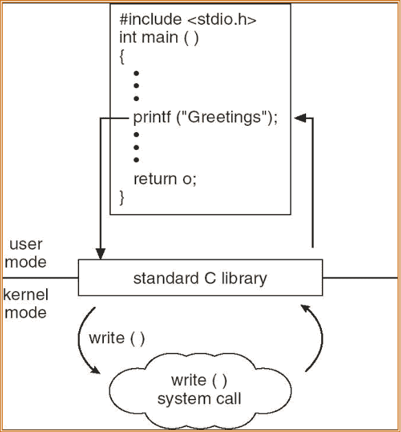

```c
#include <stdio.h>
int main ()
{
  ⋮
  printf ("Greetings");
  ⋮
  return 0;
}
```

用户模式

内核模式

标准 C 库

write()

write() 系统调用

## 系统调用参数传递

- 通常，所需的信息不仅仅是所需系统调用的标识
  - 信息的确切类型和数量因操作系统和调用而异
- 向操作系统传递参数有三种常用方法
  - 最简单：将参数放在*寄存器*中
    - 某些情况下，参数可能比寄存器还多
  - 参数存储在内存中的*块*或表中，并将块的地址作为参数通过寄存器传递
    - 这种方法被 Linux 和 Solaris 采用
  - 参数由程序放置或*推入*到*栈*中，并由操作系统从栈中*弹出*
  - （块和栈的方法不限制所传递参数的数量或长度）

## 通过表传递参数

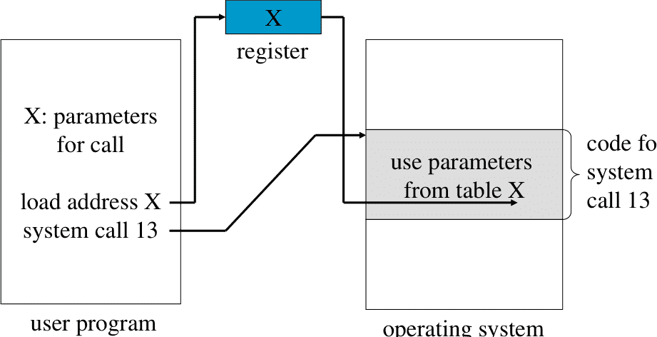

X：调用参数

加载地址 X
系统调用 13

X
寄存器

使用表 X 中的参数

系统调用 13 的代码

用户程序

操作系统

## 2.4 系统调用的类型

- 进程控制
- 文件管理
- 设备管理
- 信息维护
- 通信

## 进程控制

- 结束、中止
- 加载、执行
- 创建进程、终止进程
- 获取进程属性、设置进程属性
- 等待时间
- 等待事件、信号事件
- 分配和释放内存

## 设备管理

- 请求设备、释放设备
- 读、写、重新定位
- 获取设备属性、设置设备属性
- 逻辑上附加或分离设备

## 信息维护

- 获取时间或日期、设置时间或日期
- 获取系统数据、设置系统数据
- 获取进程、文件或设备属性
- 设置进程、文件或设备属性

## 通信

- 创建、删除通信连接
- 发送、接收消息
- 传输状态信息
- 附加或分离远程设备
- 两种常见的通信模型
  - **消息传递模型**：信息通过操作系统提供的进程间通信设施（IPC）进行交换。
  - **共享内存模型**：进程使用映射内存系统调用获取对其他进程所拥有的内存区域的访问权限。


## 2.5 系统程序

系统程序为程序开发和执行提供了一个方便的环境。它们可以分为：

- 文件管理
- 状态信息
- 文件修改
- 编程语言支持
- 程序加载和执行
- 通讯
- 系统实用程序 / 应用程序

大多数用户对操作系统的看法是由系统程序定义的，而不是实际的系统调用。

### 状态信息

- 有些程序向系统请求信息 - 日期、时间、可用内存量、磁盘空间、用户数量
- 其他程序提供详细的性能、日志和调试信息
- 通常，这些程序将输出格式化并打印到终端或其他输出设备
- 一些系统实现注册表 - 用于存储和检索配置信息

### 文件修改

- 文本编辑器用于创建和修改文件
- 特殊命令用于搜索文件内容或执行文本转换

### 编程语言支持

- 编译器、汇编器、调试器和解释器有时会提供

### 程序加载和执行

- 绝对装载器、可重定位装载器、链接编辑器和覆盖装载器，以及用于高级语言和机器语言的调试系统

### 通讯

- 提供创建进程、用户和计算机系统之间虚拟连接的机制
  - 允许用户相互发送消息到对方屏幕、浏览网页、发送电子邮件、远程登录、从一台机器向另一台机器传输文件

## 2.6 操作系统设计与实现

- 操作系统的设计和实现并非“可解”，但某些方法已被证明是成功的
- 不同操作系统的内部结构可能差异很大
- 首先通过定义目标和规范开始
- 受硬件选择、系统类型的影响
- *用户*目标和*系统*目标
  - **用户目标** – 操作系统应方便使用、易于学习、可靠、安全且快速
  - **系统目标** – 操作系统应易于设计、实现和维护，同时具有灵活性、可靠性、无错误和高效性
- 重要的原则是将**策略**与**机制**分离
  - **策略**：将做什么？
  - **机制**：如何做？
- 机制决定如何做某事，策略决定将做什么
  - 将策略与机制分离是一个非常重要的原则，如果以后要更改策略决策，它允许最大程度的灵活性

### 2.7.1 简单结构

MS-DOS 系统结构

- MS-DOS – 编写时旨在在最小空间内提供最多的功能
  - 未仔细划分为模块。

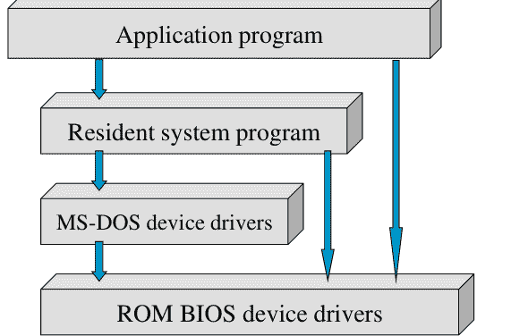

- 尽管 MS-DOS 有一定的结构，但其接口和功能级别并未很好地分离

### UNIX 系统结构

- **UNIX – 受硬件功能限制，原版 UNIX 操作系统具有有限的结构。**
- **UNIX 操作系统由两个可分离的部分组成**
  - 系统程序
  - 内核，其进一步分为一系列接口和设备驱动程序。
    - 由系统调用接口以下和物理硬件之上的所有内容组成
    - 提供文件系统、CPU 调度、内存管理和其他操作系统功能；一个层级包含大量功能。
- **系统调用定义了 UNIX 的 API，通常可用的系统程序集定义了用户界面。**

```
(the user)

shells and commands
compilers and interpreters
system libraries

system-call interface to the kernel

signals terminal handling
character I/O system
terminal drivers

file system
swapping block I/O system
Disk and tape drivers

CPU scheduling
page replacement
demand paging
virtual memory

kernel interface to the hardware

terminal controllers
terminals

device controllers
disks and tapes

memory controllers
physical memory
```


## 2.7.2 分层方法

- 操作系统被划分为若干层（级别），每一层都建立在较低层之上。最底层（第 0 层）是硬件；最高层（第 N 层）是用户界面。
- 操作系统层是对抽象对象的实现，该抽象对象是对数据的封装，以及可以操作这些数据的操作。
- 通过模块化，各层被选择为每一层仅使用较低层的功能（或操作）和服务。

### 补充：总结 — 分层系统结构

- 将系统视为一系列级别
- 每个级别执行相关的功能子集
- 每个级别依赖于下一较低级别来执行更原始的功能
- 这将问题分解为若干更易管理的子问题

## 2.7.3 微内核

- 将尽可能多的内容从内核移至“*用户*”空间。
  - 小型操作系统核心
  - 仅包含基本的操作系统功能
    - 地址空间
    - 进程间通信（IPC）
    - 基础调度
- 传统上包含在操作系统中的许多服务现在是外部子系统
  - 设备驱动程序
  - 文件系统
  - 虚拟内存管理器
  - 窗口系统
  - 安全服务

- 微内核的主要功能是为客户端程序与在用户空间运行的各种服务之间提供通信设施。
- 通信通过消息传递在用户模块之间进行。

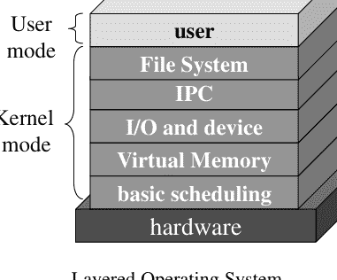

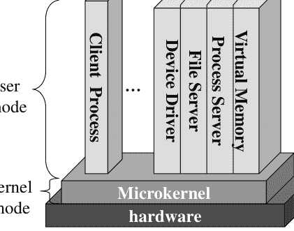

### 微内核组织的优点

- **进程请求上的统一接口**
  - 所有服务均通过消息传递提供
- **可扩展性**
  - 允许添加新服务
- **灵活性**
  - 添加新功能
  - 可以减去现有功能
- **可移植性**
  - 将系统移植到新处理器所需的更改在微内核中进行，而非在其他服务中
- **可靠性**
  - 模块化设计
  - 小型微内核可以严格测试
- **分布式系统支持**
  - 发送消息时无需知道目标机器是什么
- **面向对象的操作系统**
  - 组件是具有明确定义接口的对象，可以相互连接形成软件
- **弊端：**
  - 用户空间到内核空间通信的性能开销

## 2.7.4 模块

- 大多数现代操作系统实现内核模块
  - 使用面向对象的方法
  - 每个核心组件都是独立的
  - 每个组件通过已知接口相互通信
  - 每个组件可根据需要在内核中加载
- 总体上与分层类似，但灵活性更高

### Solaris 模块化方法

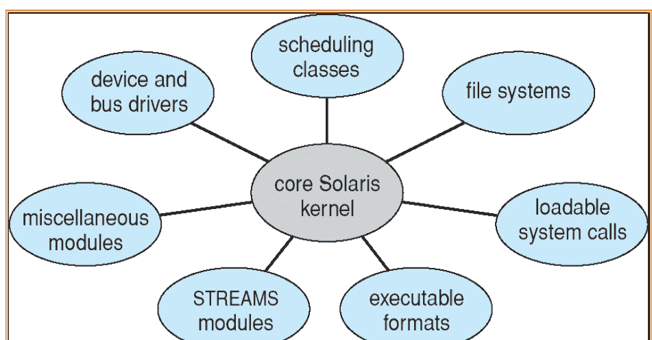

### 混合结构：Mac OS X 结构

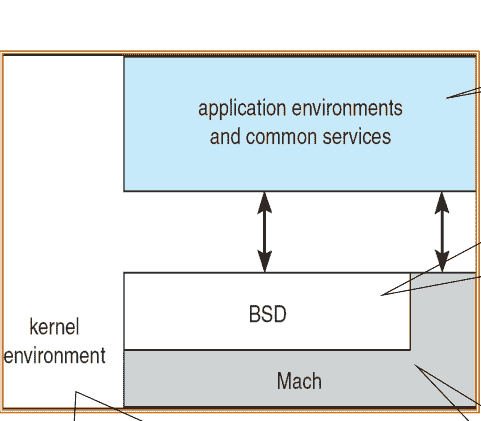

| 组件 | 详情 |
|---|---|
| 应用程序环境和通用服务 | 图形界面 |
| BSD | CLI、网络、文件系统、POSIX API 的实现，包括 Pthreads |
| Mach | 内存管理；对 RPC 和 IPC 的支持；消息传递；线程调度 |
| 内核环境 | 用于开发设备驱动程序和动态可加载模块（内核扩展）的 I/O kit |

## 2.8 虚拟机（VM）

- *虚拟机*将分层方法推向逻辑的极致。它将硬件和操作系统内核视为硬件。
- 虚拟机提供与底层裸硬件*相同*的接口。
- 操作系统创造出多个进程的幻觉，每个进程都在其自己的处理器上执行，并拥有其自己的（虚拟）内存。
  - 通过 CPU 调度
  - 通过虚拟内存


## 虚拟机（续）

- 物理计算机的资源被共享以创建虚拟机。
  - CPU 调度可以分配 CPU，营造出用户拥有自己的处理器的假象。
  -  spooling 和文件系统可以提供虚拟卡片阅读器和虚拟行式打印机。
  - 普通的用户分时终端充当虚拟机操作员的控制台。

## 系统模型

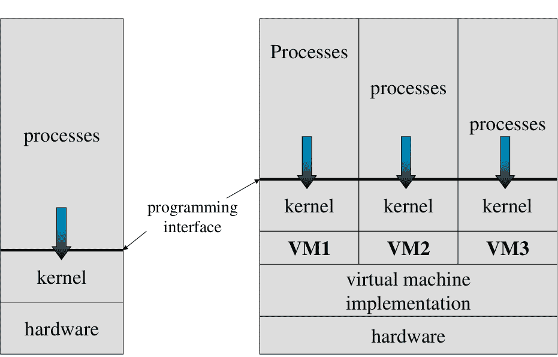

programming interface

Nonvirtual machine

Virtual machine

## 虚拟机优缺点 (1/2)

- 虚拟机概念提供了对系统资源的完全 **保护**，因为每个虚拟机都与其他所有虚拟机隔离。然而，这种隔离不允许直接共享资源。
- 虚拟机系统是进行操作系统研究和开发的完美 **载体**。系统开发是在虚拟机上进行的，而不是在物理机上，因此不会干扰正常的系统操作。
- 虚拟机作为解决 **系统兼容性问题** 的手段越来越受欢迎。

## 虚拟机优缺点 (2/2)

- 虚拟机概念 **难以实现**，因为需要付出努力来提供与底层机器 *完全* 相同的副本。
  - **虚拟用户模式** 和 **虚拟监控模式** 在物理用户模式下运行。
  - 在真实机器上导致从用户模式转移到监控模式的操作，在虚拟机上也必须导致从虚拟用户模式转移到虚拟监控模式。

## example

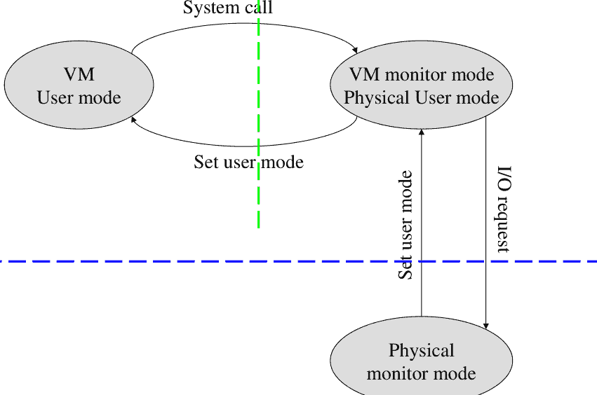

## VMware 架构

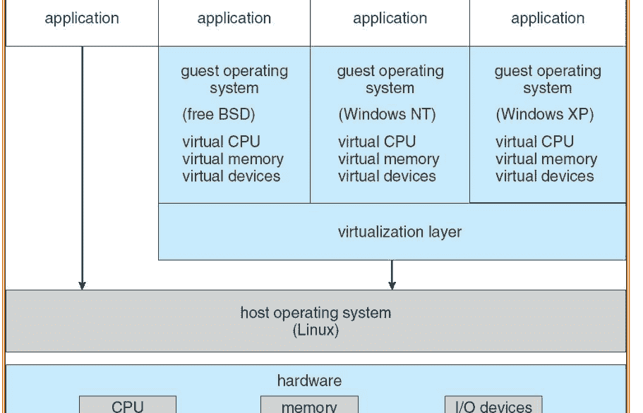

## Java 虚拟机

- 编译后的 Java 程序是平台中立的字节码，由 Java 虚拟机 (JVM) 执行。
- JVM 由以下部分组成：
  - 类加载器
  - 类验证器
  - 执行架构中立字节码的 Java 解释器。
- JVM 通过执行垃圾回收自动管理内存。
- Java 解释器可能是：
  - 一个逐条解释字节码的软件模块
  - 一个即时编译器 (JIT)，将架构中立的字节码转换为主机计算机的本地机器语言。

## 2.9 操作系统生成

- 操作系统设计为可在某一类机器上运行；系统必须为每个特定的计算机站点进行配置。
- SYSGEN 程序获取有关硬件系统特定配置的信息。
- *引导* – 通过加载内核来启动计算机。
- *引导程序* – 存储在 ROM 中的代码，能够定位内核，将其加载到内存中并启动其执行。

## 2.10 系统引导

- 操作系统必须使硬件可用，以便硬件可以启动它。
  - 一小段代码 – **引导加载程序** – 定位内核，将其加载到内存中并启动它。
  - 有时是一个两步过程，其中固定位置的 **引导块** 加载引导加载程序。
  - 当系统通电初始化时，执行从固定内存位置开始。
    - 固件用于保存初始引导代码。

## Linux与Windows的命令控制界面

### 命令控制界面

- 传统的字符界面
  - 用户在系统给出的提示符下敲入特定的命令
  - 系统接受用户输入的命令，并执行
  - 系统向用户报告执行结果，并等待用户输入新的命令
- 图形用户界面（GUI）
  - 多窗口
  - 命令被开发成用鼠标点击的菜单或者图标
  - Linux的图形化界面：X Window

## Linux的命令控制界面

- 命令位置：/usr/sbin、/usr/bin、/sbin、/bin
- Linux命令分类
  - 系统维护及管理：如date, setenv等
  - 文件操作及管理：如ls, find等
  - 进程管理：如kill, at等
  - 磁盘及设备管理：如df, du, mount等
  - 用户管理：如adduser, userdel等
  - 文档操作：如csplit, sort等
  - 网络通信：如netstat, ifconfig等
  - 程序开发：如cc, link等
  - X Window管理：如startx, XF86Setup等
- man命令：显示某命令的联机帮助

## Linux shell

- 交互型命令解释程序、Shell程序解释系统
- Shell程序：带形参的批命令文件
- Shell程序的组成
  - 命令或其他shell程序
  - 位置参数
  - 变量及特殊字符
  - 表达式比较
  - 控制流语句
  - 函数


```bash
mkdir backup
for file in '1s'
do
    cp $file backup/$file
    if [$? -ne 0] then
        echo "copying $file error"
    fi
done
```

在当前目录下创建子目录

## Windows的命令控制界面

- **Windows命令控制界面分两部分**
  - 命令解释程序cmd.exe：接受键盘输入的命令
  - 窗口：通过鼠标或键盘进行操作
- **命令：Dos基本命令＋Windows自有命令**
  - 系统信息命令，如time, date, mem
  - 系统操作命令，如shutdown, taskkill
  - 文件系统命令，如copy, del, mkdir
  - 网络通信命令，如ping, netstat, route

## 命令组合运算

- & 命令分隔符
  - Cmd1 & cmd2
- && 若前面的命令成功，则执行后面的命令
  - Cmd1 && cmd2
- || 若前面的命令失败，则执行后面的命令
  - Cmd1 || cmd2
- () 命令分组或嵌套
  - Cmd1 || (cmd2 & cmd3)
- ; 命令参数分隔符
  - Cmd param1;param2

## 命令的使用

- 直接在命令行输入命令
  - 运行cmd.exe进入命令行界面
  - 在命令行提示符下输入命令
- 编制批处理文件
  - 扩展名为.bat或.cmd的文本文件
  - 在命令行提示符下输入批处理文件名
- 批处理文件可以带有参数
  - %1 表示第一个参数

## 批处理文件示例

- Example1.bat
  @echo off
  mem> %1\meminfo.txt
  Echo generate memoryinfo ok!

- Example2.bat
  @echo off
  Type %1\*.txt
  Echo type ok!

Example3.bat
@echo off
Mk dir bate xample
Call exam1.bat test
Call exam2.bat test
Echo call ok!
pause


# 第3章 进程


教学时长：4小时

## 重点：

- 进程概念
- 进程操作
- 协作进程
- 进程间通信

## 本章目标

- 介绍进程的概念——一个正在执行的程序，它构成了所有计算机的基础
- 描述进程的各种特性，包括
  - 调度
  - 创建和终止
  - 通信
- 描述客户机-服务器系统中的通信

## 3.1 进程概念

- 操作系统执行各种程序：
  - 批处理系统——作业
  - 分时系统——用户程序或任务
- 术语 *作业* 和 *进程*
- 进程——一个正在执行的程序；进程执行必须以顺序方式进行。
- 进程包括：
  - 程序代码，称为文本段
  - 数据段，包含全局变量。
  - 当前活动，由程序计数器的值和处理器寄存器的内容表示。
  - 进程栈，包含临时数据。

## 内存中的进程

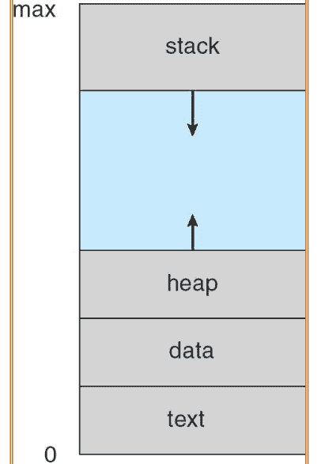

## 补充：

典型进程实现

主存

处理器寄存器

进程列表

i

j

进程A

上下文

数据

代码

进程B

b
h

上下文

数据

代码

进程索引
i

PC

基址
限长
b
h

其他寄存器

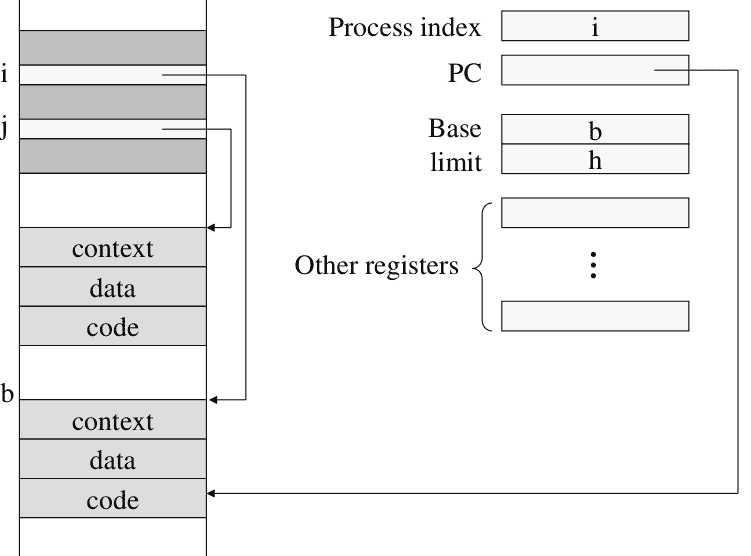

## 进程状态

- 随着进程的执行，它会改变*状态*
  - **新建**：进程正在被创建。
  - **运行**：正在执行指令。
  - **等待**：进程正在等待某个事件发生。
  - **就绪**：进程正在等待被分配给处理器。
  - **终止**：进程已完成执行。
- 这些状态名称是任意的，在不同的操作系统中会有所不同。
- 在任何时候，任何一个处理器上只能有一个进程在运行，尽管许多进程可能处于*就绪*和*等待*状态。

## 进程状态图

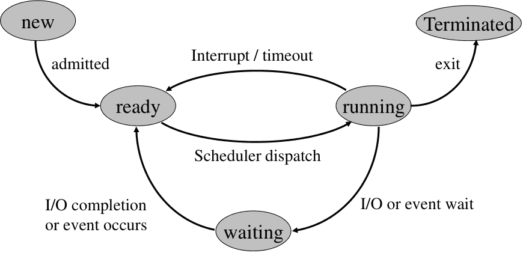

## 进程控制块（PCB）

- PCB 也称为*任务控制块*
- PCB 包含与每个进程关联的多项信息。

| 指针 | 进程状态 |
|---|---|
| 进程号 | |
| 程序计数器 | |
| CPU寄存器 | |
| 内存限制 | |
| 打开文件列表 | |
| : | |

## PCB（1/5）

■ 进程标识

— 标识符：可以与进程控制块一起存储的数字标识符包括：

- 本进程的标识符
- 创建此进程的进程（父进程）的标识符
- 用户标识符

■ 处理器状态信息

## — 用户可见寄存器

• 用户可见寄存器是可以通过处理器执行的机器语言引用的寄存器。通常有 8 到 32 个这样的寄存器，尽管一些 RISC（精简指令集计算机）实现有超过 100 个。


## PCB (2/5)

## 处理器状态信息

## 控制和状态寄存器

这些是用于控制处理器操作的各种处理器寄存器。其中包括

- *程序计数器：* 包含要获取的下一条指令的地址
- *条件码：* 最近一次算术或逻辑操作的结果（例如，符号、零、进位、相等、溢出）
- *状态信息：* 包括中断使能/禁用标志、执行模式

## 堆栈指针

- 每个进程都有一个或多个与其关联的后进先出（LIFO）系统堆栈。堆栈用于存储过程和系统调用的参数和调用地址。堆栈指针指向堆栈顶部。

## PCB (3/5)

## 进程控制信息

### 调度和状态信息

这是操作系统执行其调度功能所需的信息。典型信息项包括：

- *进程状态：* 定义进程被调度执行的就绪程度（例如，运行、就绪、等待、终止）。
- *优先级：* 可使用一个或多个字段来描述进程的调度优先级。在某些系统中，需要多个值（例如，默认、当前、最高允许）
- *调度相关信息：* 这取决于所使用的调度算法。示例是进程等待的时间量以及进程上次运行时执行的时间量。
- *事件：* 进程在可以恢复之前正在等待的事件的标识

## PCB (4/5)

## 进程控制信息

### 数据结构化

- 一个进程可能通过队列、环或其他结构链接到其他进程。例如，所有处于特定优先级级别等待状态的进程可能链接在队列中。一个进程可能与另一个进程表现出父子（创建者-被创建者）关系。进程控制块可能包含指向其他进程的指针以支持这些结构。

### 进程间通信

- 两个独立进程之间通信可能关联各种标志、信号和消息。这些信息中的一些或全部可能保存在进程控制块中。

### 进程特权

- 进程被授予特权，涉及可以访问的内存和可以执行的指令类型。此外，特权可能适用于系统实用程序和服务的使用。

## PCB (5/5)

## 进程控制信息

### 内存管理

- 本节可能包括指向描述分配给此进程的虚拟内存的段和/或页表的指针。
- 基址和界限寄存器的值

### 资源拥有和利用

- 进程控制的资源可以被指示，例如已打开的文件。
- 处理器或其他资源的利用历史也可能包含在内；
- 调度程序可能需要此信息。

## 补充：何时切换进程

- **时钟中断**
  - 进程已执行了最大允许的时间片
- **I/O 中断**
- **内存故障**
  - 内存地址在虚拟内存中，因此必须将其调入主内存
- **陷阱**
  - 发生错误
  - 可能导致进程被移至终止/退出状态
- **系统调用**
  - 例如文件打开

## 调度队列(续)

设备队列 – 等待 I/O 设备的进程集合。

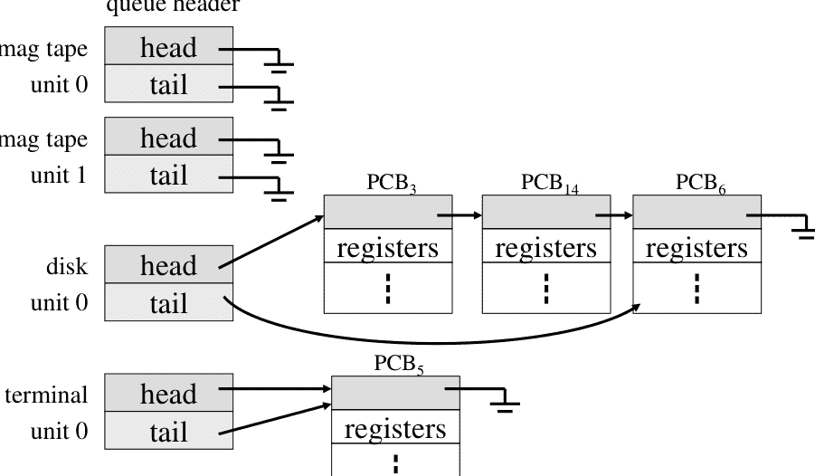

## 进程调度的表示

进程在各个队列之间的迁移。

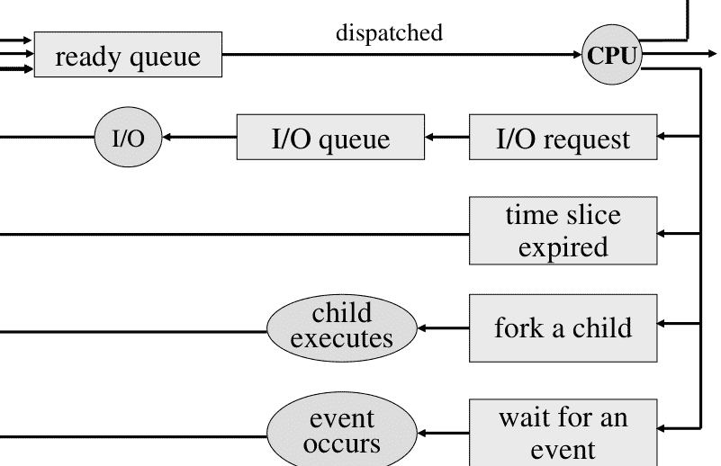

## 3.2.2 调度程序

- 长期调度程序（或作业调度程序） – 选择应引入就绪队列的进程。
- 短期调度程序（或 CPU 调度程序） – 选择应接下来执行的进程并分配 CPU。
- 主要区别：执行频率。
  - 短期调度程序被非常频繁地调用（毫秒） ⇒ （调度程序必须快速）。
  - 长期调度程序被非常不频繁地调用（秒、分钟） ⇒ （调度程序可以较慢）。
  - 长期调度程序控制多道程序设计的程度。内存中的进程数。


## 调度器（续）

- **进程可以描述为以下两种类型之一：**
  - *I/O 密集型进程* – 花在 I/O 操作上的时间多于计算，CPU 突发次数多且都很短。
  - *CPU 密集型进程* – 花在计算上的时间多；CPU 突发次数少但都很长。
- **选择一个良好的进程组合。**
  - 如果所有进程都是 I/O 密集型的，准备队列几乎总是空的，CPU 调度程序将几乎没有工作可做。
  - 如果所有进程都是 CPU 密集型的，I/O 等待队列几乎总是空的，设备将处于未使用状态。

## 中期调度的加入

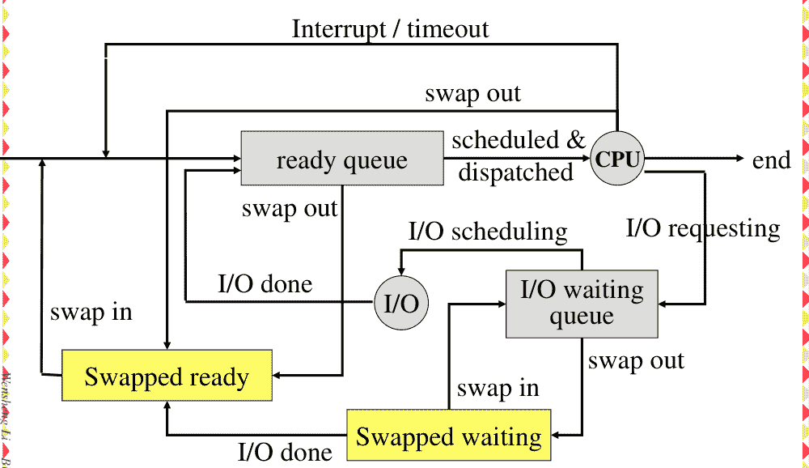

## 补充：挂起的进程

- 处理器比 I/O 快，因此所有进程都可能在等待 I/O
- 将这些进程交换到磁盘以释放更多内存
- 等待状态在被交换到磁盘时变为交换等待
- 两个新的状态
  - 交换等待（挂起等待/阻塞）
  - 交换就绪（挂起就绪）

## 补充：两种交换状态

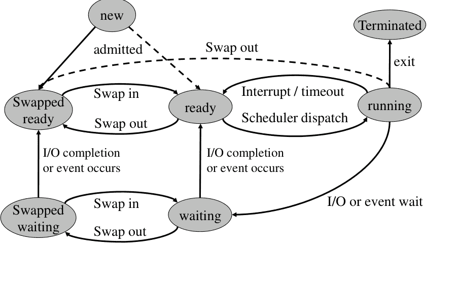

## 补充：进程被交换出的原因

| 原因 | 描述 |
|---|---|
| 交换 | 操作系统需要释放足够的内存以引入一个准备执行的进程。 |
| 其他操作系统原因 | 操作系统可能会挂起一个后台或实用程序进程，或被怀疑导致问题的进程。 |
| 交互式用户请求 | 用户可能希望暂停程序的执行以进行调试或与资源的使用相关。 |
| 定时 | 进程可能定期执行（例如，记账或系统监控进程），并在等待下一个时间间隔时被挂起。 |
| 父进程请求 | 父进程可能希望挂起一个后代进程以检查或修改该挂起进程，或协调各个后代的活动。 |

## 3.2.3 上下文切换

当 CPU 切换到另一个进程时，系统必须保存旧进程的状态并加载新进程的保存状态。称为**上下文切换**。

- 保存处理器上下文，包括程序计数器和其他寄存器
- 更新当前运行进程的进程控制块（PCB）
- 将进程控制块（PCB）移动到适当的队列 - 就绪、等待
- 选择另一个进程执行（--调度）
- 更新所选进程的进程控制块（PCB）
- 更新内存管理数据结构
- 恢复所选进程的上下文

## 上下文切换

- 进程的上下文在该进程的 PCB 中表示。
- 上下文切换时间是开销；切换期间系统不做任何有用工作。
- 上下文切换时间取决于硬件支持。

## 3.3 进程操作

## 进程创建与进程终止

## 进程创建的原因

- 批处理作业的提交
- 用户登录
- 创建以提供服务，例如打印
- 进程创建另一个进程

## 进程创建

父进程创建子进程，而子进程又创建其他进程，形成一个进程树。

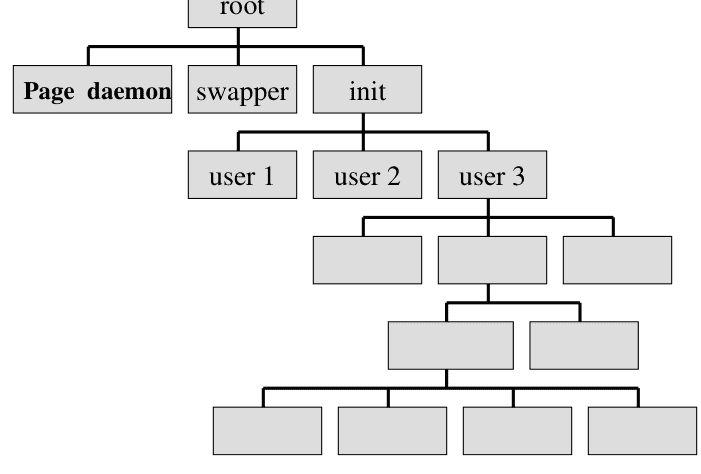

## 典型 Solaris 上的进程树

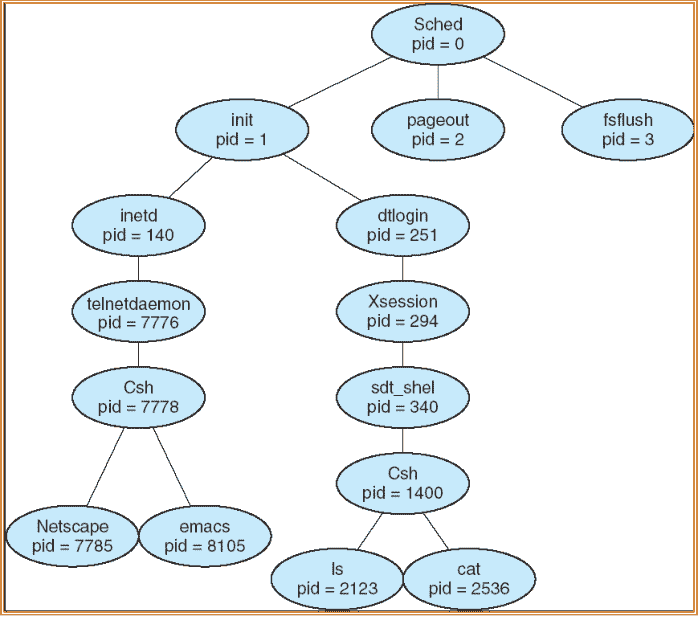

## 进程创建（1/3）

- 分配一个唯一的进程标识符
- 为进程分配空间
- 初始化进程控制块（PCB）
- 设置适当的链接
  - 例如，将新进程添加到用于调度队列的链表中
- 创建或扩展其他数据结构
  - 例如，维护一个记账文件

## 进程创建（2/3）

- **资源共享**
  - 父进程和子进程共享所有资源。
  - 子进程共享父进程资源的一个子集。
  - 父进程和子进程不共享任何资源。

进程创建时，它会获得初始化数据，该数据可能从父进程传递给子进程。

- **执行**
  - 父进程和子进程并发执行。
  - 父进程等待其部分或全部子进程终止。


## 进程创建 (3/3)

- **地址空间**
  - 子进程是父进程的副本。
  - 子进程中加载了程序。

- **UNIX 示例**
  - 每个进程都由其进程标识符标识，这是一个唯一的整数
  - 系统调用 **fork** 创建新进程
  - 系统调用 **exec** 在 fork 之后使用，用来用新程序替换子进程的内存空间。

## 用于 fork 分离进程的 C 程序

```
#include <sys/types.h>
#include <stdio.h>
#include <unistd.h>
void main()
{
pid_t pid;
pid=fork();  // fork another process
if (pid<0) {  // error occurred
fprintf(stderr, "Fork failed");
exit(-1);
}
else if (pid==0) {  // child process
execlp("/bin/ls", "ls", NULL);
} else {  // parent process
wait(NULL);  /* parent process will wait for the child to complete */
printf("Child Complete");
exit(0);
}
}
```

## 进程创建

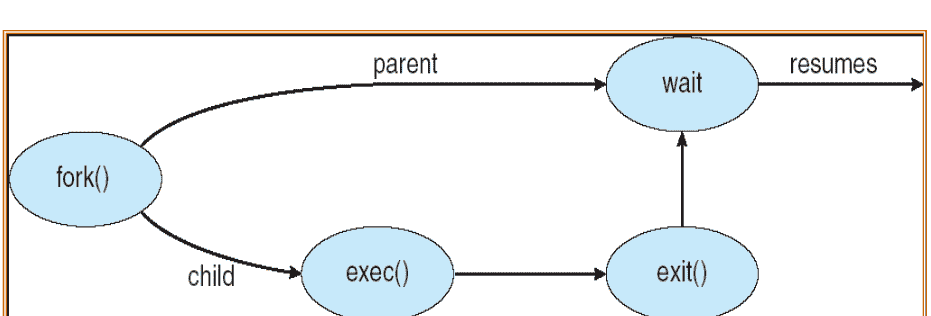

## 使用 win32 API 创建一个单独的进程

```c
#include <windows.h>
#include <stdio.h>
int main( VOID )
{
    STARTUPINFO si;
    PROCESS_INFORMATION pi;
    ZeroMemory( &si, sizeof(si) ); // allocate memory
    si.cb = sizeof(si);
    ZeroMemory( &pi, sizeof(pi) );
```
```

```c
// Start the child process.
if( !CreateProcess( NULL,  // No module name (use command line).
    "C:\\WINDOWS\\system32\\mspaint.exe",        // Command line.
    NULL,        // Process handle not inheritable.
    NULL,        // Thread handle not inheritable.
    FALSE,       // Set handle inheritance to FALSE.
    0,           // No creation flags.
    NULL,        // Use parent's environment block.
    NULL,        // Use parent's starting directory.
    &si,         // Pointer to STARTUPINFO structure.
    &pi )        // Pointer to PROCESS_INFORMATION structure.
{
    printf( "CreateProcess failed (%d).\n", GetLastError() );
    return -1;
}

// Wait until child process exits.
WaitForSingleObject( pi.hProcess, INFINITE );
printf( "parent exit" );
// Close process and thread handles.
CloseHandle( pi.hProcess );
CloseHandle( pi.hThread );
```
```

## 进程终止

- 批处理作业发出 *Halt* 指令
- 用户注销
- 退出一个应用程序
- 错误和故障条件

## 补充：
### 进程终止原因 (1/2)

- 正常完成
- 超时
- 内存不可用
- 边界违规
- 保护错误
  - 示例 写入只读文件
- 算术错误
- 时间超限
  - 进程等待某个事件的时间超过了指定的最大值

## 补充：
### 进程终止原因 (2/2)

- I/O 失败（例如 文件未找到）

- 无效指令
  - 当尝试执行数据时发生

- 特权指令

- 数据误用（例如 类型错误）

- 操作系统干预
  - 例如 当发生死锁时

- 父进程终止因此子进程终止

- 父进程请求

## 进程终止

- 进程执行最后一条语句并请求操作系统删除它（通过 `exit`）。
  - 从子进程向父进程输出数据（通过 `wait`）。
  - 进程的资源由操作系统释放。

- 父进程可能因多种原因终止其子进程的执行（通过 `abort`）：
  - 子进程超出了其已分配资源的使用量。
  - 分配给子进程的任务不再需要。
  - 父进程正在退出。
    - 如果其父进程终止，操作系统不允许子进程继续。
    - 级联终止，通常由操作系统发起。

## 3.4 进程间通信

- **_独立_** 进程不能影响也不能被其他进程的执行所影响。
- **_协作_** 进程可以影响或被其他进程的执行所影响
- 进程协作的优点
  - 信息共享
  - 计算加速
  - 模块化
  - 便利性
- 两种基本模型
  - 共享内存
  - 消息传递


## 通信模型 (1/2)

- 通信可以通过消息传递或共享内存进行。

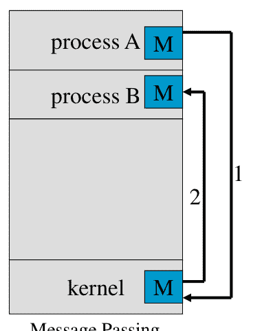

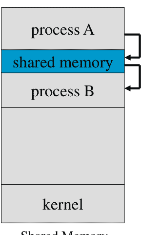

## 通信模型 (2/2)

- **消息传递**在需要交换的数据量较小时很有用，因为无需避免冲突。
- 对于计算机间通信，消息传递更容易实现。
- **共享内存可以实现最大速度和通信便利性。**
  - 在计算机内部，它可以以内存速度进行。

## 3.4.1 共享内存系统

### 生产者-消费者问题

- 协作进程的一种常见范式：*生产者*进程产生信息，由*消费者*进程消费。
- 我们必须有一个缓冲区，其中的项目可以由*生产者*填充，并由*消费者*清空。
  - *生产者*可以在*消费者*消费另一个项目的同时产生一个项目。
  - *生产者*和*消费者*必须**同步**。
- 使用了两种类型的缓冲区：
  - *无界缓冲区*对缓冲区的大小没有实际限制。
  - *有界缓冲区*假定缓冲区大小固定。

## 有界缓冲区问题的共享内存解决方案

### 共享数据

```
#define BUFFER_SIZE 10
typedef struct {
...
} item;
item buffer[BUFFER_SIZE];
int in = 0;
int out = 0;
```

- **in** 指向缓冲区中下一个空闲位置；
- **out** 指向缓冲区中第一个已满位置；
- 当 **in == out** 时缓冲区为空；
- 当 **((in + 1) % BUFFER_SIZE) == out** 时缓冲区已满；
- 该解决方案是正确的，但只能使用 **BUFFER_SIZE-1** 个元素。

## 共享缓冲区——环形数组

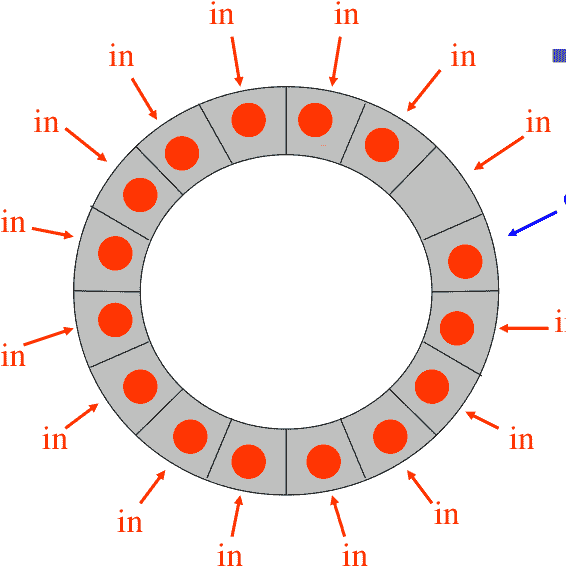

- 当 `in == out;` 时缓冲区为空；
- 当 `(in + 1) % BUFFER_SIZE == out.` 时缓冲区已满。

解决方案是正确的，但只能使用 BUFFER_SIZE-1 个元素。

### 有界缓冲区——*生产者进程*

```
item nextProduced;
while (1) {    /* produce an item in nextProduced */
              while (((in + 1) % BUFFER_SIZE) == out)
                    ; /* do nothing */
              buffer[in] = nextProduced;
              in = (in + 1) % BUFFER_SIZE;
            }
```

### 有界缓冲区——*消费者进程*

```
item nextConsumed;
while (1) {  while (in == out) ; /* do nothing */
              nextConsumed = buffer[out];
              out = (out + 1) % BUFFER_SIZE;
              /* consume the item in nextConsumed */
            }
```

## 实现问题

- 直接/间接通信？
- 同步/异步通信？
- 自动/显式缓冲？
- 链路如何建立？
- 一条链路可以关联两个以上的进程吗？
- 每对通信进程之间可以有多少条链路？
- 链路的容量是多少？
- 链路能够容纳的消息大小是固定的还是可变的？
- 链路是单向的还是双向的？

## 直接通信——命名

- **进程必须显式地相互命名：**
  - `send(P, message)` – 向进程 P 发送消息
  - `receive(Q, message)` – 从进程 Q 接收消息
- **通信链路的属性**
  - 链路自动建立。
  - 一条链路恰好关联一对通信进程。
  - 每对进程之间恰好存在一条链路。
  - 链路可以是单向的，但通常是双向的。
- **缺点**
  - 所生成的进程定义的模块化程度有限

## 间接通信（1/3）

- 消息通过邮箱（也称为端口）发送和接收。
  - 每个邮箱都有唯一的 id。
  - 进程只有在共享邮箱时才能通信。
- 原语定义如下：
  - `send(A, message)` – 向邮箱 A 发送消息
  - `receive(A, message)` – 从邮箱 A 接收消息
- 通信链路的属性
  - 只有当进程共享一个公共邮箱时，才会建立链路。
  - 一条链路可以关联多个进程。
  - 每对进程可以共享多条通信链路。
  - 链路可以是单向的或双向的。


## 间接通信(2/3)

+   **邮箱共享**
+   - P₁、P₂ 和 P₃ 共享邮箱 A。
+   - P₁ 发送；P₂ 和 P₃ 接收。
+   - 谁会收到消息？

+   **解决方案**
+   - 允许一个链接最多关联两个进程。
+   - 允许一次只有一个进程执行接收操作。
+   - 允许系统任意选择接收者。发送者会被通知接收者是谁。

## 间接通信(3/3)

+   - **如果邮箱由一个进程拥有**
+     - 所有者只能通过此邮箱接收消息
+     - 用户只能向邮箱发送消息
+   - **如果邮箱由操作系统拥有**
+     - 邮箱是独立的
+     - 不附加到任何特定进程
+   - **操作系统提供机制允许进程执行以下操作**
+     - 创建一个新的邮箱
+     - 通过邮箱发送和接收消息
+     - 删除一个邮箱

## 缓冲

附加到链接的消息队列；以三种方式之一实现。

+   - **零容量** – 0 条消息  
     发送者必须等待接收者（握手）。  
+   - **有界容量** – *n* 条消息的有限长度  
     如果链接已满，发送者必须等待。  
+   - **无界容量** – 无限长度  
     发送者永不等待。

## Supplement: pipeline(管道)

+   - 管道是一条在进程间以字节流方式传送数据的通信通道。
+   - 由OS核心的缓冲区（通常几十KB）来实现，是单向的；
+   - 常用于命令行所指定的输入输出重定向和管道命令。
+   - 使用前要建立相应的管道，然后才可使用。
+   - 管道逻辑上可以看作管道文件，物理上则是由文件系统的高
     速缓存区构成。
+   - 管道分为有名管道和无名管道
+   - 管道按先进先出（FIFO）的方式传送消息，且只能单向传
     送消息。
+   - 管道操作
     - 发送进程利用文件系统的系统调用 write（fd[1], buf, size）
       把buf中长度为size字符的消息送入管道入口fd[1];
     - 接收进程利用文件系统的系统调用 read（fd[0], buf, size）
       从管道出口fd[0]读出size字符的消息放入buf中。

## Supplement: 管道应用示例

```
```c
#include<stdio.h>
main()
{
  int pid,fd[2];
  char buf[30],s[30];
  pipe(fd);
  while((pid=fork())==-1);
  if (pid==0) {
    sprintf(buf, "this is an example\n");
    write(fd[1],buf,30);
    exit(0);
  }
  else {
    wait(0);
    read(fd[0],s,30);
    printf("%s",s);
  }
}
```
```

## 3.5 IPC 系统示例

## C 程序说明 POSIX 共享内存 API

```
#include <stdio.h>
#include <sys/shm.h>
#include <sys/stat.h>
int main()
{
    int segment_id;                 // the id for the shared memory segment
    char* shared_memory;            // a pointer to the shared memory segment
    const int segment_size = 4096; // the size of the shared memory segment

    /** allocate a shared memory segment */
    segment_id = shmget (IPC_PRIVATE, segment_size, S_IRUSR | S_IWUSR);

    /** attach the shared memory segment */
    shared_memory = (char *) shmat (segment_id, NULL, 0);

    printf("shared memory segment %d attached at address %p\n", segment_id, shared_memory);
}
```

```
/** write a message to the shared memory segment */
sprintf(shared_memory, "Hi there!");

// now print out the string from shared memory
printf("*%s*\n", shared_memory);

/** now detach the shared memory segment */
if ( shmdt(shared_memory) == -1)
{
    fprintf(stderr, "Unable to detach\n");
}

/** now remove the shared memory segment */
shmctl(segment_id, IPC_RMID, NULL);

return 0;
}
```

## Windows XP 中的消息传递设施 -- LPC

+   - LPC 在同一台机器上的两个进程之间通信。
+   - 端口对象用于在两个进程之间建立和维护连接。
+   - 两种类型的端口：
+     - 连接端口
       命名对象，对所有进程可见；
       用于设置通信通道。
+     - 通信端口
+   - 通信工作方式
+     - 客户端打开对子系统连接端口对象的句柄
+     - 客户端发送连接请求
+     - 服务器创建两个私有通信端口并将其中一个的句柄返回给客户端
+     - 客户端和服务器使用相应的端口句柄发送消息或回调并监听回复

## 两种消息传递技术

+   - 用于小消息（最多 256 字节）
     最简单。
     使用端口的消息队列作为中间存储并将消息从一个进程复制到另一个进程。
+   - 段对象（用于大消息）
     设置一个共享内存区域。
     发送一条包含段对象指针和大小信息的小消息。

## 回调机制

+   - 可在客户端或服务器无法立即响应请求时使用。
+   - 允许执行异步消息处理。


## 3.6 客户端-服务器系统中的通信

- 套接字
- 远程过程调用（RPC）
- 远程方法调用（RMI，Java）

### 套接字

- 套接字被定义为*用于通信的端点*。
- 套接字是 IP 地址和端口的组合。
- 套接字 161.25.19.8:1625 指的是主机 161.25.19.8 上的端口 1625。
- 通信发生在一对套接字之间。

### 使用套接字进行通信

主机 X (146.86.5.20)  
套接字 (146.86.5.20/1625)  
Web 服务器 (161.25.19.8)  
套接字 (161.25.19.8/80)

所有连接必须是唯一的。

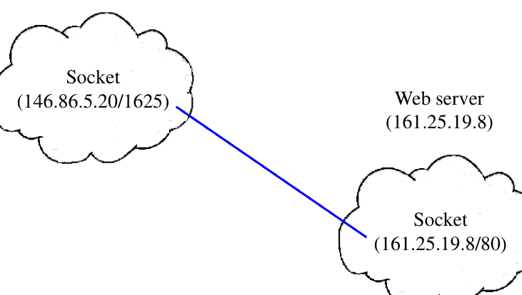

### RPC——远程过程调用

- 远程过程调用（RPC）抽象了网络系统中进程之间的过程调用。
- RPC 的语义允许客户端像在本地调用过程一样，在远程主机上调用过程。

通过在客户端提供一个存根（stub）：

- **存根**——服务器上实际过程的客户端代理。
- **客户端存根**定位服务器上的端口并*编组*参数。
- **服务器端存根**接收此消息，解包已编组的参数，并在服务器上执行过程。返回值使用相同技术传回客户端。

### 远程过程调用（续）

- 与机器无关的数据表示：外部数据表示（XDR）。
  - 客户端：将机器相关的数据转换为 XDR。
  - 服务器：解组 XDR 数据并将其转换为机器相关的表示。
- 调用的语义：
  - 为每条消息附加时间戳。
  - 服务器必须保留其已处理消息的所有时间戳的历史记录。
- 服务器与客户端之间的通信：
  - 绑定信息可以是预先确定的（固定端口地址）。
  - 绑定可以通过会合机制动态完成。

### RPC 的执行

| 客户端 | 消息 | 服务器 |
|---|---|---|
| 用户调用内核向过程 X 发送 RPC 消息 | | |
| 内核向匹配器发送消息以查找端口号 | 从：客户端到服务器；端口：匹配器；关于：RPC X 的地址 | |
| | | 匹配器接收消息，查找答案 |
| | 从：服务器到客户端；端口：内核；关于：RPC X 端口：P | 匹配器向客户端回复端口 P |
| 内核将端口 P 放入用户 RPC 消息中 | | |
| 内核发送 RPC | 从：客户端到服务器；端口：端口 P；`<contents>` | |
| | | 监听端口 P 的守护进程接收消息 |
| | | 守护进程处理请求并发送输出 |
| | 从：RPC 端口 P；到：客户端；端口：内核；`<output>` | |
| 内核接收回复，并将其传递给用户 | | |

### RMI——远程方法调用

- 远程方法调用（RMI）是一种类似于 RPC 的 Java 机制。
- RMI 允许一台机器上的 Java 程序调用远程对象上的方法。

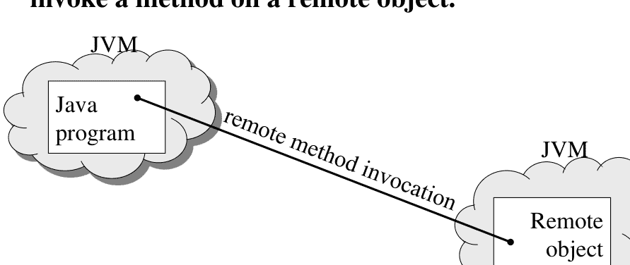

### 参数编组

**客户端**

```
val = server.someMethod(A, B)
```

**远程对象**

```
Boolean someMethod(Object x, Object y)
{
    implementation of someMethod
    ...
}
```

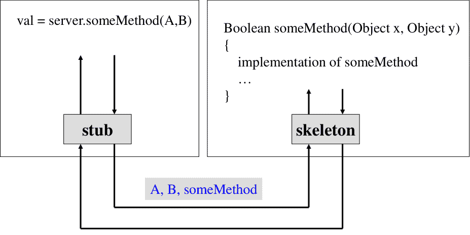

存根  
骨架  
A, B, someMethod  
布尔返回值

### 参数传递行为规则

- 如果编组的参数是本地对象，则通过一种称为对象序列化的技术按副本传递。如果参数是远程对象，则按引用传递。
- 如果本地对象要作为参数传递给远程对象，则它们必须实现接口 `java.io.Serializable`。

### RPC 与 RMI 之间的区别

- RPC 支持过程式编程，其中只能调用远程过程或函数。
- RMI 是基于对象的；它支持对远程对象方法的调用。
- RPC 中远程过程的参数是普通数据结构；而 RMI 可以将对象作为参数传递给远程方法。
- RMI 使用存根和骨架实现远程对象，因此远程方法对客户端和服务器都是透明的。
  - 存根是远程对象的代理，驻留在客户端。
  - 骨架负责解组参数并在服务器上调用所需的方法。


## 作业（第116页）

3.1    3.2    3.4

### 1. 在有 n 个 CPU 的系统中，

+   a. 处于就绪、运行和等待状态的进程最大数量是多少？

+   b. 处于就绪、运行和等待状态的进程最小数量是多少？

### 2. 对于以下进程状态之间的每次转换，指出该转换是否可能。如果可能，请给出一个可能导致该转换的示例。

+   a. 运行 → 就绪

+   b. 运行 → 等待

+   c. 运行 → 交换等待

+   d. 等待 → 运行

+   e. 运行 → 终止

### 3. 参见下面的进程状态转换图。以下因果关系转换是否可能？如果可能，请给出示例。

+   a. 2 1
+   b. 3 2
+   c. 4 1
+   d. 1 3

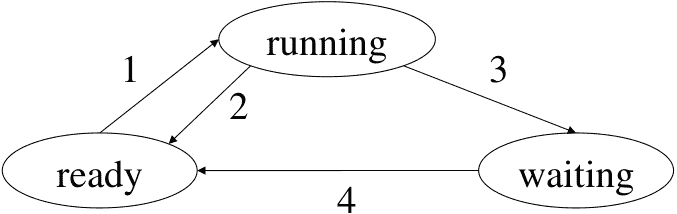

# 第4章 线程


课时：2小时

## 重点：

+   - 线程的概念
+   - 多线程模型
+   - 线程问题

## 本章目标

+   - 介绍线程的概念——它是CPU利用的基本单元，构成了多线程计算机系统的基础
+   - 讨论 Pthreads、Win32 和 Java 线程库的API

## 目录

+   4.1 概述
+   4.2 多线程模型
+   4.3 线程库
+   4.4 线程问题
+   4.5 操作系统示例

## 4.1 概述

+   - **进程**
+     - 资源所有权——进程被分配一个虚拟地址空间来保存进程映像
+     - 调度/执行——遵循一条执行路径，该路径可能与其他进程交错（交叉）
+     - 这两个特性由操作系统独立处理
+   - 分派称为线程
+   - 资源所有权称为进程或任务

## 概述（续）

+   - 线程，称为轻量级进程（LWP），是CPU利用的基本单元。
+     - 包含线程ID、程序计数器、寄存器组和栈。
+     - 与属于同一进程的其他线程共享其代码段、数据段以及其他操作系统资源，如打开的文件和信号。
+   - 传统（或重量级）进程只有单一的控制线程。
+   - 如果进程有多个控制线程，它可以同时执行多个任务。

## 单线程与多线程进程

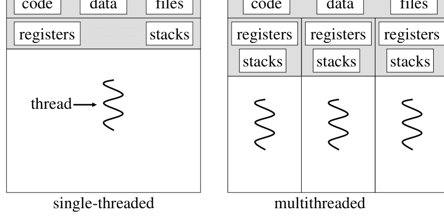

应用程序通常实现为具有多个控制线程的独立进程。

## 线程的优点

+   - 响应性
+   - 资源共享
+   - 经济性
+   - 多处理器架构的利用

## 补充：**线程使用示例**
在单用户多处理系统中

+   - **前台到后台工作**
+     - 网页浏览器
+   - **异步处理**
+     - Word，自动保存
+   - **加速执行**
+     - 数据接收、操作、保存、输出
+   - **模块化程序结构**

## 补充：线程

+   - 交换进程涉及交换该进程的所有线程
+   - 终止进程会终止该进程内的所有线程

因为所有线程共享同一地址空间

## 补充：线程状态

+   - 运行、就绪、等待
+   - 与线程状态变化相关的操作
+     - 生成：生成另一个线程
+     - 阻塞
+     - 解除阻塞
+     - 完成：释放寄存器上下文和栈


## 4.2 多线程模型

+   - 用户线程
+   - 内核线程
+   - 三种常见的线程实现类型
+     - 多对一
+     - 一对一
+     - 多对多

## 补充：**用户线程**

+   - 所有线程管理都由应用程序完成
+   - 内核不知道线程的存在
+   - 用户线程在内核之上受支持，并由用户级线程库实现。
+   - 该库为线程创建、调度和管理提供支持，无需内核支持。
+   - 三种主要的线程库：
+     - POSIX Pthreads
+     - Win32线程
+     - Java线程


## 多对一模型


user thread

kernel thread

## 补充：ULT 状态 vs. 进程状态


thread1

thread2

Process A

Issue an I/O request, Process A is blocked.

Time out

Thread 2 need to coordinate With Thread 1

## 一对一模型

- 每个用户级线程映射到一个内核线程。
- 当一个线程进行阻塞系统调用时，允许另一个线程运行。
- 允许在多处理器上并行运行多个线程。
- 创建一个用户线程需要创建相应的内核线程。
- 限制系统支持的线程数量。
- 使用此模型的系统示例
  - Windows NT/XP/2000
  - Linux
  - Solaris 9 及以后版本

## 一对一模型


user thread

kernel thread

### 多对多模型

- 允许许多用户级线程映射到许多内核线程。
- 允许操作系统创建足够数量的内核线程。
- 当线程执行阻塞系统调用时，内核可以调度另一个线程执行。
- 支持此模型的系统示例
  - 版本 9 之前的 Solaris
  - 带有 *ThreadFiber* 包的 Windows NT/2000

### 多对多模型


user thread

kernel thread

## 两级模型

- 与 M:M 类似，只是它允许用户线程绑定到内核线程
- 支持此模型的系统示例
  - IRIX
  - HP-UX
  - Tru64 UNIX
  - Solaris 8 及更早版本

## 这三种模型的比较

- 多对一模型允许开发者创建任意多的用户线程，但由于内核一次只能调度一个线程，真正的并发无法获得。
- 一对一模型允许更大的并发，但开发者必须注意不要在应用程序中创建过多的线程。
- 多对多模型允许开发者创建所需的任意多用户线程，并且相应的内核线程可以在多处理器上并行运行。

## 4.3 线程库

- 为程序员提供创建和管理线程的 API
- 两种实现方式
  - 完全在用户空间提供库且无内核支持。(-- local function call)
    code and data structures exist in user space
  - 实现一个由操作系统直接支持的内核级库。(-- system call)
    code and data structures exist in kernel space
- 主要线程库
  - POSIX Pthreads
  - Win32
  - java

## POSIX Pthreads

- **POSIX:**
  Portable Operating System Interface for computer environment
- 一个 POSIX 标准（IEEE 1003.1c），定义了线程创建和同步的 API。
- API 指定了线程库的行为，实现由库的开发决定。
- 在 UNIX 和 Linux 操作系统中很常见。
- 被称为用户级库，因为使用 Pthread API 创建的线程与任何相关联的内核线程之间不存在明确的关系。

## 使用 Pthreads API 的多线程 C 程序

```
```c
#include <pthread.h>
#include <stdio.h>

int sum;  /* this data is shared by the thread(s) */
void *runner(void *param);      /* the thread */

int main(int argc, char *argv[])
{
    pthread_t tid;          /* the thread identifier */
    pthread_attr_t attr;    /* set of attributes for the thread */

    if (argc != 2) {
        fprintf(stderr, "usage: a.out <integer value>\\n");
        return -1;
    }
    if (atoi(argv[1]) < 0) {
        fprintf(stderr, "Argument %d must be non-negative\\n", atoi(argv[1]));
        return -1;
    }
```

```


## 使用 Pthreads API 的多线程 C 程序

```c
pthread_attr_init(&attr);    /* get the default attributes */
/* create the thread */
pthread_create(&tid,&attr,runner,argv[1]);
/* now wait for the thread to exit */
pthread_join(tid,NULL);
printf("sum = %d\n",sum);
}

/* The thread will begin control in this function */
void *runner(void *param)
{
    int i, upper = atoi(param);
    sum = 0;
    for (i = 1; i <= upper; i++)
        sum += i;
    pthread_exit(0);
}
```

## Win32 线程

- Windows 系统上可用的内核级线程库

## 使用 Win32 API 的多线程 C 程序

```c
int main(int argc, char *argv[])
{
    DWORD ThreadId;
    HANDLE ThreadHandle;
    int Param;

    // do some basic error checking
    if (argc != 2) {
        fprintf(stderr,"An integer parameter is required\n");
        return -1;
    }

    Param = atoi(argv[1]);

    if (Param < 0) {
        fprintf(stderr, "an integer >= 0 is required \n");
        return -1;
    }
}
```

## Java 线程

- Java 在 **语言层面** 为线程的创建和管理提供支持。
- Java 线程由 JVM 管理。
- 所有 Java 程序至少包含一个控制线程。
- Java 线程可以通过以下方式创建：
  - 扩展 Thread 类
  - 实现 Runnable 接口
    - 当一个类实现 runnable 时，它必须定义一个 run() 方法。
    - 实现 run() 方法的代码作为单独的线程运行。

## fork() 和 exec() 系统调用

- 如果程序中的一个线程调用 **fork**，新进程会复制所有线程还是新进程是单线程的？
  - 复制所有线程
  - 仅复制调用 fork 系统调用的线程。
- 如果一个线程调用 **exec** 系统调用，则 exec 参数中指定的程序将替换整个进程，包括所有线程和 LWP。
- 如果在 fork 之后立即调用 **exec**，仅复制调用线程是合适的。
- 如果单独的进程在 fork 之后不调用 **exec**，则单独的进程应复制所有线程。

## 信号处理

- **在多线程程序中，信号应被传递**
  - 给信号适用的线程
  - 给进程中的每个线程
  - 给进程中的某些线程
  - 给一个专门分配接收进程所有信号的特定线程。
- **传递信号的方法取决于信号类型**
  - **同步信号** 需要传递给生成信号的线程，而不是传递给进程中的其他线程
  - **某些异步信号** 应发送给所有线程
  - **某些异步信号** 可能只传递给未阻塞该信号的线程。

  （某些多线程版本的 UNIX 允许线程指定它将接受哪些信号以及将阻塞哪些信号。）

## 线程特定数据

- 允许每个线程拥有自己的数据副本
- 当你无法控制线程创建过程时很有用（即使用线程池时）
- 示例
  - 在事务处理系统中，我们可能在单独的线程中处理每个事务。每个事务可能被分配一个唯一标识符。为了将每个线程与其唯一标识符关联，我们可以使用线程特定数据。

## 调度器激活

- M:M 和两级模型都需要在应用程序中保持分配给应用程序的内核线程的适当数量时进行通信
- 调度器激活提供 **upcalls**，即从内核到线程库的通信机制
- 这种通信允许应用程序保持正确的内核线程数量


## 4.5 操作系统示例

- Windows XP 线程
- Linux 线程
- Solaris 2 线程

### Linux 线程

- Linux 将其称为 *tasks* 而不是 *threads*
- 线程创建是通过 `clone()` 系统调用完成的
- `clone()` 允许子任务共享父任务（进程）的地址空间
- 当 `clone()` 被调用时，它会传递一组标志，这些标志决定了父任务和子任务之间要共享多少
  - `CLONE_FS`: 文件系统信息被共享
  - `CLONE_VM`: 相同的内存空间被共享
  - `CLONE_SIGHAND`: 信号处理器被共享
  - `CLONE_FILES`: 打开的文件集被共享
- 如果未设置这些标志中的任何一个，则不共享，类似于 `fork()`


## 作业（第146页）

4.2 思考：4.1, 4.3

- 1. 用户级线程和内核级线程之间有哪些两个区别？在什么情况下一种类型比另一种更好？
- 2. 描述内核在内核级线程之间进行上下文切换时所采取的动作。
- 3. 创建线程时使用哪些资源？它们与创建进程时使用的资源有何不同？

## 补充：多线程

- 操作系统支持在单个进程内执行多个线程
- MS-DOS 支持单个线程
- UNIX 支持多个用户进程但每个进程仅支持一个线程
- Windows 2000、Solaris、Linux、Mach 和 OS/2 支持多线程


| 进程 | 线程 | 示例 |
| --- | --- | --- |
| 一个进程 | 一个线程 | **MS DOS** |
| 多个进程 | 每个进程一个线程 | **UNIX** |
| 一个进程 | 多个线程 | **JAVA** |
| 多个进程 | 每个进程多个线程 | **W2K, Linux, Solaris** |

## 补充：进程和线程

### 进程：

- 拥有一个虚拟地址空间，其中包含进程映像
- 受保护地访问处理器、其他进程、文件和 I/O 资源

### 线程：

- 一个执行状态（运行、就绪、等待等）
- 未运行时保存线程上下文
- 具有执行栈
- 具有用于局部变量的一些线程静态存储
- 访问其进程的内存和资源
  - 进程的所有线程共享这些资源

## 补充：单线程和多线程进程模型


## 补充：线程的好处

- 创建新线程所需的时间比创建进程少
- 终止线程所需的时间比终止进程少
- 在同一进程内在两个线程之间切换所需的时间更少
- 由于同一进程内的线程共享内存和文件，因此它们可以在不调用内核的情况下相互通信

## 补充：Windows XP 线程状态

- Ready
- Standby
- Running
- Waiting
- Transition
- Terminated


## 补充：Linux 进程状态

- Running
- Interruptible
- Uninterruptible
- Stopped
- Zombie（僵死）

## 补充：Linux 进程/线程模型


- 等待硬件条件，不接收任何信号
- 等待事件完成（如 I/O 操作）、可用资源或来自另一个进程的信号

## 补充：Solaris 线程

- 进程，包括用户的地址空间、栈和进程控制块
- 用户级线程
- 轻量级进程
- 内核线程

## 补充：Solaris 2 线程

### 多对多模型


- **用户级线程可以是绑定或非绑定的。**
  - 绑定的 ULT 永久附加到一个 LWP
  - 非绑定线程未永久附加到任何 LWP。（默认）
- **使用的数据结构**
  - 一个 ULT 包含线程 ID、寄存器集（包括程序计数器和栈指针）、栈和优先级。
  - 一个 LWP 具有其正在运行的用户级线程的寄存器集，以及内存和记账信息。
  - 一个内核线程只有少量数据结构和一个栈。数据结构包括内核寄存器的副本、指向其附加的 LWP 的指针，以及优先级和调度信息。


## 补充：**Solaris 线程执行**

- 同步
- 挂起
- 抢占
- 让出（yielding）

## 补充：Solaris ULT 与 LWP 状态


# 第5章 CPU调度

授课学时：4学时

## 重点：

- 调度准则
- 调度算法

## 章节目标

- 引入CPU调度，它是多道程序设计操作系统的基础
- 描述各种CPU调度算法
- 讨论为特定系统选择CPU调度算法的评估标准

## 目录

- 1. 5.1 基本概念
- 2. 5.2 调度准则
- 3. 5.3 调度算法
- 4. 5.4 多处理器调度 (*)
- 5. 5.5 线程调度 (*)
- 6. 5.6 操作系统示例 (*)
- 7. 5.7 算法评估 (*)

## 决策模式

- **非抢占式（Nonpreemptive）**
  - 一旦进程进入运行状态，它将持续运行直到终止或自我阻塞等待I/O
- **抢占式（Preemptive）**
  - 当前运行的进程可能被操作系统中断并移入就绪状态
  - 由于任何进程都不能长期垄断（独占）处理器，因此可以提供更好的服务

## 分派器（Dispatcher）

- ▪ 分派器模块将CPU的控制权交给短期调度器选中的进程；这包括：
  - 切换上下文
  - 切换到用户模式
  - 跳转到用户程序中的适当位置，以重新启动该程序

- ▪ *分派延迟（Dispatch latency）*——分派器停止一个进程并启动另一个进程运行所需的时间。

## 补充：

## 调度准则的分类

- 面向用户
  - 响应时间
    - 从提交请求到产生输出之间的时间
- 面向系统
  - 处理器的有效且高效的利用
- 与性能相关
  - 定量（Quantitative）
  - 可测量，如响应时间和吞吐量
- 与性能无关
  - 定性（Qualitative）
  - 可预测性

## 补充：

## 调度准则的分类

|  | 与性能相关 | 与性能无关 |
|---|---|---|
| **面向用户** | 周转时间<br>响应时间 | 可预测性<br>截止时间 |
| **面向系统** | 吞吐量<br>CPU利用率 | 公平性<br>强制优先级<br>资源平衡 |

## 优化准则

- CPU利用率 → **最大化**
- 吞吐量 → **最大化**
- 周转时间 → **最小化**
- 等待时间 → **最小化**
- 响应时间 → **最小化**

## 5.3 调度算法

- 先来先服务（FCFS）调度
- 最短作业优先（SJF）调度
- 优先级调度
- 时间片轮转（RR）调度
- 多级队列调度
- 多级反馈队列调度
- 最高响应比优先（HRRN）调度

## 5.3.1 先来先服务（FCFS）调度

- 每个进程加入就绪队列
- 当当前进程停止执行时，选择就绪队列中最早的进程
- FCFS调度算法是非抢占式的。

| 进程 | 突发时间 |
|---|---:|
| P₁ | 24 |
| P₂ | 3 |
| P₃ | 3 |

- 假设进程按顺序到达：P₁、P₂、P₃
- 调度的甘特图如下：


- P₁ 的等待时间 = 0；P₂ = 24；P₃ = 27
- 平均等待时间：(0 + 24 + 27)/3 = 17

## FCFS调度（续）

假设进程按顺序到达
\[P_2, P_3, P_1.\]

调度的甘特图如下：

| $P_2$ | $P_3$ | $P_1$ |
|---|---|---|
| 0 | 3 | 6 | 30 |

- $P_1$ 的等待时间 = 6；$P_2 = 0$；$P_3 = 3$
- 平均等待时间：$(6 + 0 + 3)/3 = 3$
- 比前一种情况好得多。
- 短进程可能需要等待非常长的时间才能执行
- 有利于CPU密集型进程
  - I/O进程必须等待CPU密集型进程完成
- **护航效应（Convoy effect）：**短进程排在长进程后面


## Convoy（护航）效应


## 5.3.2 最短作业优先（SJF）调度

- SJF 算法将每个进程与其下一次 CPU 突发的长度关联起来。利用这些长度，将 CPU 分配给所需时间最短的进程。
- 两种方案：
  - **非抢占**：一旦 CPU 分配给某个进程，在该进程完成其 CPU 突发之前，它不能被抢占。
  - **抢占**：如果新到达的进程的 CPU 突发长度小于当前正在执行进程的剩余时间，则进行抢占。这种方案称为**最短剩余时间优先（SRTF）**。
- SJF 是最优的——对于给定的一组进程，能提供最小的平均等待时间。

### 非抢占式 SJF 示例

| 进程 | 到达时间 | 突发时间 |
|---|---|---|
| P₁ | 0 | 7 |
| P₂ | 2 | 4 |
| P₃ | 4 | 1 |
| P₄ | 5 | 4 |

SJF（非抢占）


等待时间：P₁=0；P₂=6；P₃=3；P₄=7

平均等待时间 = (0 + 6 + 3 + 7)/4 = 4

### SJF

| 进程 | 到达时间 | 突发时间 |
|---|---|---|
| P₁ | 0 | 7 |
| P₂ | 2 | 4 |
| P₃ | 4 | 1 |
| P₄ | 5 | 4 |


等待时间：P₁=0；P₂=6；P₃=3；P₄=7

周转时间：P₁=7；P₂=10；P₃=4；P₄=11

### 抢占式 SJF 示例

| 进程 | 到达时间 | 突发时间 |
|---|---|---|
| P₁ | 0 | 7 |
| P₂ | 2 | 4 |
| P₃ | 4 | 1 |
| P₄ | 5 | 4 |

SRTF（抢占式 SJF）


P₂ 到达
P₁: 5, P₂: 4

P₃ 到达
P₂: 2, P₃: 1

P₄ 到达
P₁: 5, P₂: 2, P₄: 4

- P₁ 的等待时间 = 9；P₂ = 1；P₃ = 0；P₄ = 2
- 平均等待时间 = (9 + 1 + 0 + 2)/4 = 3

### SRTF

| 进程 | 到达时间 | 突发时间 |
|---|---|---|
| P₁ | 0 | 7 |
| P₂ | 2 | 4 |
| P₃ | 4 | 1 |
| P₄ | 5 | 4 |


- P₁ 的等待时间 = 9；P₂ = 1；P₃ = 0；P₄ = 2
- 周转时间：P₁=16；P₂=5；P₃=1；P₄=6

### 预测下一次 CPU 突发的长度（*）

- 只能估计其长度。
- 可以通过使用之前 CPU 突发的长度，采用指数平均法来估算。
  - tₙ = 第 n 个 CPU 突发的实际长度
  - τₙ₊₁ = 下一个 CPU 突发的预测值
  - α，0 ≤ α ≤ 1
  - 定义：
    
    τₙ₊₁ = α tₙ + (1 − α) τₙ

τₙ₊₁ = α tₙ + (1-α)α tₙ₋₁ + ... + (1-α)ʲ α tₙ₋ⱼ + ... + (1-α)ⁿ⁺¹ τ₀


$\tau_{n+1}=\alpha\hat{t}_n+(1-\alpha)\tau_n\qquad \alpha=1/2\qquad \tau_0=10$

|  |  |  |  |  |  |  |  |  |
|---|---|---|---|---|---|---|---|---|
| **CPU 突发** ($t_i$) | 6 | 4 | 6 | 4 | 13 | 13 | 13 |  |
| **“猜测值”** ($\tau_i$) | 10 | 8 | 6 | 6 | 5 | 9 | 11 | 12 |

### 指数平均的示例

τₙ₊₁ = α tₙ + (1 − α) τₙ

- α = 0
  - τₙ₊₁ = τₙ  最近的历史不会计入。
- α = 1
  - τₙ₊₁ = tₙ  只有上一次实际的 CPU 突发才会计入。
- 如果展开这个公式，我们得到：
  
  τₙ₊₁ = α tₙ + (1−α) α tₙ₋₁ + ... + (1−α)ʲ α tₙ₋ⱼ + ... + (1−α)ⁿ⁺¹ τ₀
- 由于 α 和 (1−α) 都小于等于 1，每一项的权重都比前一项小。

## 5.3.3 优先级调度

- 每个进程都有一个优先级号码（整数）与之关联。
- CPU 分配给优先级最高的进程（最小整数 = 最高优先级）。
- 优先级相同的进程按 FCFS 顺序调度。
- 两种方案：
  - **抢占式**：如果新到达进程的优先级高于当前正在运行进程的优先级，则抢占 CPU。
  - **非抢占式**：简单地将新进程放到就绪队列的头部。
- 优先级既可以由内部定义，也可以由外部定义。

- SJF 是一种优先级调度，其优先级是预测的下一次 CPU 突发时间。
- 问题：饥饿（或无限阻塞）——低优先级进程可能永远无法执行。
- 解决方案：老化（Aging）——随着时间推移，增加进程的优先级。
- 例如：
  - 如果优先级范围从 127（最低）到 0（最高）
  - 我们可以每 15 分钟将等待进程的优先级号码减 1。
  - 最终，即使是初始优先级为 127 的进程也会成为系统中优先级最高的进程，并得到执行。


## 举例——静态优先级、非剥夺式调度

某系统采用非剥夺式优先级调度算法，5个进程P₁、P₂、P₃、P₄、P₅依次进入就绪队列，其需要的CPU时间、到达时刻、及优先数如右。

| 进程 | CPU时间 | 到达时刻 | 优先数 |
|---|---|---:|---:|---:|
| P1 | 10 | 0 | 3 |
| P2 | 1 | 2 | 1 |
| P3 | 2 | 3 | 3 |
| P4 | 1 | 5 | 4 |
| P5 | 5 | 7 | 2 |

进程调度的甘特图如下：


- **Waiting time（等待时间）：**
  - T1=0、T2=8、T3=13、T4=13、T5=4；average: TA=7.6
- **Turnaround time（周转时间）：**
  - T1=10、T2=9、T3=15、T4=14、T5=9；average: TA=11.4

## 非剥夺式优先级

| 进程 | CPU时间 | 到达时刻 | 优先级 |
|---|---:|---:|---:|
| P1 | 10 | 0 | 3 |
| P2 | 1 | 2 | 1 |
| P3 | 2 | 3 | 3 |
| P4 | 1 | 5 | 4 |
| P5 | 5 | 7 | 2 |


| 时间 | 0 | 1 | 2 | 3 | 4 | 5 | 6 | 7 | 8 | 9 | 10 | 11 | 12 | 13 | 14 | 15 | 16 | 17 | 18 | 19 |
|---|---:|---:|---:|---:|---:|---:|---:|---:|---:|---:|---:|---:|---:|---:|---:|---:|---:|---:|---:|---:|
| 进程 | 1 | 1 | 1 | 1 | 1 | 1 | 1 | 1 | 1 | 1 | 2 | 5 | 5 | 5 | 5 | 5 | 3 | 3 | 4 |  |

- $P_1$ 的等待时间为 0； $P_2=8$； $P_3=13$； $P_4=13$； $P_5=4$
- 周转时间 $P_1=10$； $P_2=9$； $P_3=15$； $P_4=14$； $P_5=9$

## 举例——静态优先级、剥夺式调度

某系统采用剥夺式优先级调度算法，5个进程P₁、P₂、P₃、P₄、P₅依次进入就绪队列，其需要的CPU时间、到达时刻、及优先数如右：

| 进程 | CPU时间 | 到达时刻 | 优先数 |
|---|---|---|---|
| P1 | 10 | 0 | 3 |
| P2 | 1 | 2 | 1 |
| P3 | 2 | 3 | 3 |
| P4 | 1 | 5 | 4 |
| P5 | 5 | 7 | 2 |

进程调度的甘特图如下：


Waiting time(等待时间):
- T1=8、T2=0、T3=9、T4=13、T5=0； average: TA=6

Turnaround time(周转时间):
- T1=18、T2=1、T3=11、T4=14、T5=5； average: TA=9.8

## 剥夺式优先级

| 进程 | CPU 时间 | 到达时刻 | 优先级 |
|---|---|---|---|
| P1 | 10 | 0 | 3 |
| P2 | 1 | 2 | 1 |
| P3 | 2 | 3 | 3 |
| P4 | 1 | 5 | 4 |
| P5 | 5 | 7 | 2 |


- $P_1$ 的等待时间为 8； $P_2=0$； $P_3=9$； $P_4=13$； $P_5=0$
- 周转时间 $P_1=18$； $P_2=1$； $P_3=11$； $P_4=14$； $P_5=5$

## 举例——动态优先级、剥夺式调度

某系统采用基于动态优先级的剥夺式调度算法，并且优先数越大的进程其优先级越高。

系统为所有新建进程赋予优先数0，当一个进程在就绪队列中等待CPU时，其优先数的变化速率为 α；进程获得CPU后开始执行，执行过程中，其优先数的变化速率为 β。

为参数 α 和 β 设置不同的值，则导致不同的调度算法。

问题：
- a. 如果 β>α>0，则调度原则是什么？
- b. 如果 α<β<0，则调度原则是什么？

## 解答a: 如果 β>α>0, 调度原则是FCFS

已知：优先数越大、优先级越高。

分析：
- 由于新建进程的优先数是0，具有最低优先级。
- 当它在就绪队列中等待时，进程的优先数不断增加，即优先级不断提高，所以最早进入就绪队列的进程，其优先级也最高。
- 优先级最高的进程获得调度。
- 当进程在CPU上执行时，它的优先数以更快的速度增加，故就绪队列中的任何进程不可能具有比执行中进程更高的优先级，执行进程将一直占有CPU，直到它执行结束。
- 然后，在就绪队列中等待时间最长的进程被调度到CPU上执行。

所以，调度原则是 first-come first-served。

## 解答b：如果 α<β<0，调度原则是LCFS

已知：优先数越大、优先级越高。

分析：
- 由于新建进程的优先数是0，一旦它进入就绪队列，它的优先数就开始减少，就绪时间越长，其优先数越小，即优先级越低，所以新建进程具有最高优先级。
- 由于新建进程优先级最高，所以被调度到CPU上执行。
- 当进程在CPU上执行时，它的优先数也不断减少，但减少的速度要比就绪进程的慢，故就绪队列中的任何进程不可能具有比执行中进程更高的优先级。
- 如果进程执行过程中，有新建进程进入就绪队列，则由于新进程的优先级最高，将抢占CPU而执行，原来的执行进程进入就绪队列，它的优先级以更快的速度降低。
- 如果进程执行过程中，没有新建进程，则执行进程将一直占有CPU，直到它执行结束。
- 然后，在就绪队列中等待时间最短的进程被调度到CPU上执行。

所以，调度原则是 Last-Come First-Served。

## 5.3.4 Round Robin (RR) Scheduling 轮转调度

- 每个进程获得一个小的 CPU 时间单元（*time quantum, or time slice*），通常为 10–100 毫秒。时间用完后，进程将被 **preempted** 并添加到就绪队列的末尾。
- 将就绪队列保持为进程的 FIFO 队列。
- 设置一个定时器，使其在 1 个时间量子后中断。
- 两种情况：当前正在运行进程的 CPU burst
  - 小于 1 个时间量子。进程自愿释放 CPU。
  - 大于 1 个时间量子。定时器会响并导致操作系统中断。会执行一次上下文切换，进程将被放到就绪队列的尾部

## Time Quantum=20 时的 RR 示例

| 进程 | Burst Time | arrival time |
|---|---:|---:|
| $P_1$ | 53 | 0 |
| $P_2$ | 17 | 0.01 |
| $P_3$ | 68 | 0.02 |
| $P_4$ | 24 | 0.03 |

▪ 甘特图为：


- 等待时间为： $P_1=81$； $P_2=20$； $P_3=94$； $P_4=97$
- 平均等待时间 = $(81 + 20 + 94 + 97)/4 = 73$


## RR Scheduling(Cont.)

- RR 调度算法是抢占式的。
- 如果就绪队列中有 *n* 个进程，时间片为 *q*，则每个进程获得 1/*n* 的 CPU 时间，以最多 *q* 时间单位的块为单位。没有进程等待超过 (*n*-1)*q* 时间单位。
- 性能取决于时间片的大小
  - *q* 非常大（无限） ⇒ FCFS
  - *q* 非常小 ⇒ 处理器共享，*q* 必须相对于上下文切换足够大，否则开销过高。

## Time Quantum and Context Switch Time


## Turnaround Time Varies With The Time Quantum

| Process | time |
|---|---:|
| P₁ | 6 |
| P₂ | 3 |
| P₃ | 1 |
| P₄ | 7 |

**q=1**

T₁ = 15;

T₂ = 9;

T₃ = 3;

T₄ = 17;

a_T = 11

**q=2**

T₁ = 14;

T₂ = 10;

T₃ = 5;

T₄ = 17;

a_T = 11.5

**q=3**

T₁ = 13;

T₂ = 6;

T₃ = 7;

T₄ = 17;

a_T = 10.75


## Turnaround Time Varies With The Time Quantum


| process | time |
|---|---|
| P₁ | 6 |
| P₂ | 3 |
| P₃ | 1 |
| P₄ | 7 |

## Supplement: Virtual Round Robin Scheduling


## 5.3.5 Multilevel Queue Scheduling

- **就绪队列被划分为独立的队列：**
  - foreground (interactive)
  - background (batch)

- **每个队列有自己的调度算法**
  - foreground – RR
  - background – FCFS

- **必须在队列之间进行调度。**
  - 固定优先级调度；即先服务 foreground 再服务 background。存在饥饿的可能性。
  - 时间片 – 每个队列获得一定的 CPU 时间，可在其进程中进行调度；即 80% 分配给 foreground 的 RR，20% 分配给 background 的 FCFS

## Multilevel Queue Scheduling

最高优先级


最低优先级

## 5.3.6 Multilevel Feedback Queue Scheduling

- 一个进程可以在各个队列之间移动。
- 为了分离具有不同 CPU 突发特征的进程。
  - 如果一个进程使用过多的 CPU 时间，它将被移动到较低优先级的队列。
  - 如果一个进程在较低优先级的队列中等待过久，它可能会被移动到较高优先级的队列。
- 使 I/O 密集型和交互式进程保留在较高优先级的队列中。
- 这种形式的 aging 可防止饥饿。

## Multilevel Feedback Queue Scheduling

多级反馈队列调度器由以下参数定义：

- 队列的数量
- 每个队列的调度算法
- 用于确定何时将进程升级到更高优先级队列的方法
- 用于确定何时将进程降级到更低优先级队列的方法
- 用于确定进程需要服务时将进入哪个队列的方法

## Example of Multilevel Feedback Queue

- 三个队列：
  - Q₀ – 时间片 8 毫秒 --最高优先级
  - Q₁ – 时间片 16 毫秒 --较低优先级
  - Q₂ – FCFS -- 最低优先级

- 调度
  - 一个新进程进入队列 Q₀，该队列按 FCFS 服务。当它获得 CPU 时，它会得到 8 毫秒。如果它在 8 毫秒内未完成，进程将被移动到队列 Q₁ 的尾部。
  - 在 Q₁ 中进程再次按 FCFS 服务并获得额外的 16 毫秒。如果它仍然未完成，它将被抢占并移动到队列 Q₂ 的尾部。

## Multilevel Feedback Queues


## Supplement: 高响应比优先(HRRN)算法
Highest Response-Ratio Next Scheduling

- **非抢占式调度算法。**
- **响应比 :  R=(W+T)/T=1+W/T**
  - W: 在就绪队列中的等待时间
  - T: CPU 突发时间
- 具有最高响应比的进程将被下一次调度。
- HRRN 同时考虑等待时间和 CPU 突发时间。
- 计算每个进程的响应比耗时，系统开销大。


## 5.4 多处理器调度

- 当存在多个 CPU 时，CPU 调度变得更加复杂。
- **多处理器系统的分类**
  - 松耦合多处理器
    - 每个处理器拥有自己的内存和 I/O 通道
  - 紧耦合多处理
    - 处理器共享主内存
    - 由操作系统控制
  - 功能专用处理器
    - 例如 I/O 处理器
    - 由主处理器控制
- *同构处理器：* 在多处理器中，任何可用的处理器都可用于运行队列中的任何进程。
- *异构系统：* 只有为特定处理器指令集编译的程序才能在该处理器上运行。

## 进程调度

- 将进程分配给处理器
- 在单个处理器上使用多道程序设计
- 进程的实际分派


## 将进程分配给处理器

- **对等架构（对称多处理）**
  - 操作系统可在任何处理器上执行
  - 每个处理器都是自调度的
- **就绪队列**
  - 每个处理器都有自己的私有就绪队列
  - 一个公共就绪队列
- **使用私有队列，将进程永久分配给一个处理器**
  - 可能为每个处理器提供一个专用的短期队列
  - 问题：一个处理器可能空闲而另一个处理器非常繁忙
- **使用公共队列，必须确保：**
  - 两个处理器不会选择同一个进程
  - 进程不会从队列中丢失

## 处理器亲和性

- **处理器亲和性(亲和力)**
  - 一个进程对其当前运行的处理器具有亲和性
  - 使进程在同一处理器上运行

- **示例：使缓存内存失效并重新填充的高成本**

- **形式**
  - **软亲和性**
    - 操作系统有一种策略，尝试使进程在同一处理器上运行，但不保证这样做。
  - **硬亲和性**
    - 操作系统提供系统调用，允许进程指定其不得迁移到其他处理器

## 负载均衡

- 负载均衡：将工作负载均匀分布在 SMP 系统的所有处理器上
- 仅在每个处理器拥有自己的私有就绪队列的系统上才**需要**负载均衡
- 两种方法
  - 推迁移：一个**特定任务**定期检查每个处理器的负载，如果不平衡，则将进程从过载的处理器推向空闲或较不繁忙的处理器。
  - 拉迁移：空闲处理器从繁忙处理器拉取一个等待任务
- 通常会抵消处理器亲和性的好处

## 对称多线程（SMT）

- SMP 系统通过提供多个处理器允许多个线程并发运行
- SMT：提供多个逻辑处理器
  Intel 处理器上的超线程技术
- 在同一物理处理器上创建多个逻辑处理器
  - 即使在仅有一个物理处理器的系统上，也向 OS 呈现多个逻辑处理器的视图。
  - 每个逻辑处理器都有自己的架构状态（包括通用寄存器和机器状态寄存器）
  - 每个逻辑处理器负责自己的中断处理
  - 每个逻辑处理器共享其物理处理器的资源，例如缓存内存和总线

## 一个典型的 SMT 架构


- **SMT 是硬件提供的功能**
  - 硬件必须为每个逻辑处理器提供架构状态的表示和中断处理

## 5.5 线程调度

### 线程

- 与进程的其余部分分开执行
- 一个应用程序可以是一组线程，它们在同一地址空间中协作并并发执行
- 在单独的处理器上运行的线程可带来显著的性能提升

### 线程调度

- 本地调度 – 线程库如何决定将哪个用户级线程放到可用的 LWP 上。m:1 和 m:n 模型，进程竞争范围（PCS）
- 全局调度 – 内核如何决定下一个运行哪个内核线程。系统竞争范围（SCS）1:1 模型仅使用 SCS。


## 补充：多处理器线程调度

- **负载共享**
  - 进程不会被分配到特定的处理器
- **成组调度**
  - 一组相关线程被安排在同一时间运行在一组处理器上
- **专用处理器分配**
  - 线程被分配到特定的处理器
- **动态调度**
  - 线程数量可在执行过程中改变

## 5.6 操作系统示例

- **Solaris 调度**
  - 基于优先级的线程调度
- **Windows XP 调度**
  - 基于优先级、可抢占调度（多队列）
- **Linux 调度**
  - 可抢占、基于优先级的调度

### Solaris 调度

选择具有最高全局优先级的线程运行。具有相同优先级的线程通过使用 RR 进行调度。

| global priority | scheduling order |
|---|---|
| highest | first |
| lowest | last |

- class-specific priorities: real time, system, interactive & time-sharing
- scheduler classes:
  - run queue
  - kernel threads of real-time LWPs
  - kernel service threads
  - kernel threads of interactive & time-sharing LWPs

实时类中的线程被赋予最高优先级。

使用系统类运行内核进程，例如调度程序和分页守护进程。

默认调度类：使用多级反馈队列动态改变优先级并分配不同长度的时间片。

### Solaris 调度表 for interactive and time-sharing threads

| priority | time quantum | time quantum expired | return from sleep |
|---:|---:|---:|---:|
| 0 | 200 | 0 | 50 |
| 5 | 200 | 0 | 50 |
| 10 | 160 | 0 | 51 |
| 15 | 160 | 5 | 51 |
| 20 | 120 | 10 | 52 |
| 25 | 120 | 15 | 52 |
| 30 | 80 | 20 | 53 |
| 35 | 80 | 25 | 54 |
| 40 | 40 | 30 | 55 |
| 45 | 40 | 35 | 56 |
| 50 | 40 | 40 | 58 |
| 55 | 40 | 45 | 58 |
| 59 | 20 | 49 | 59 |

low / high / new priority

### Windows XP 优先级

- 每个线程的优先级基于其优先级类和相对优先级
- 进程通常是 NORMAL_PRIORITY_CLASS 的成员
- 线程的初始优先级通常是其所属进程的基础优先级
- 当时间片用完时，优先级降低，但永远不会降低到基础优先级以下；当从等待操作恢复时，优先级会提升。

| | real-time | high | above normal | normal | below normal | idle priority |
|---|---|---|---|---|---|---|
| time-critical | 31 | 15 | 15 | 15 | 15 | 15 |
| highest | 26 | 15 | 12 | 10 | 8 | 6 |
| above normal | 25 | 14 | 11 | 9 | 7 | 5 |
| normal | 24 | 13 | 10 | 8 | 6 | 4 |
| below normal | 23 | 12 | 9 | 7 | 5 | 3 |
| lowest | 22 | 11 | 8 | 6 | 4 | 2 |
| idle | 16 | 1 | 1 | 1 | 1 | 1 |

- Priority classes
- Relative priority
- Base priority
- Real-time class
- Variable class

### 优先级与时间片长度之间的关系

| numeric priority | relative priority | time quantum |
|---|---:|---:|---:|
| 0 | highest | 200 ms |
| • |  |  |
| • |  |  |
| • |  |  |
| 99 |  |  |
| 100 |  |  |
| • |  |  |
| • |  |  |
| • |  |  |
| 140 | lowest | 10 ms |

*Middle column illustration: real-time tasks (numeric priority 0-99) and other tasks (numeric priority 100-140)*

### 按优先级索引的任务列表


- 只要任务在其时间片内仍有剩余时间，就被认为有资格在 CPU 上执行。
- 内核在运行队列数据结构中维护所有可运行任务的列表；每个运行队列包含两个优先级数组（见上图）。
- 每个处理器维护自己的运行队列并自行调度。
- 当所有任务耗尽其时间片时，两个优先级数组会被交换。
- 任务的动态优先级重新计算发生在任务耗尽其时间片并将被移动到过期数组时。

## 5.7 算法评估

- 定义用于选择算法的标准。
  - CPU 利用率、响应时间或吞吐量
- 定义这些度量的相对重要性
  - 在最大响应时间为 1 秒的约束下最大化 CPU 利用率。
  - 最大化吞吐量，使得周转时间与总执行时间成线性比例。
- 确定性建模
- 排队模型
- 仿真
- 实现


### 确定性建模

- 确定性建模——采用特定的预定义工作负载，并定义每种算法在该工作负载下的性能。

- 示例
  - 假设我们有以下工作负载：
  - 考虑 FCFS、SJF、RR(q=10)
  - 比较它们的平均等待时间

| 进程 | 突发时间 |
|---|---|
| P₁ | 10 |
| P₂ | 29 |
| P₃ | 3 |
| P₄ | 7 |
| P₅ | 12 |

- 平均等待时间
  - FCFS: (0+10+39+42+49)/5=28
  - SJF: (10+32+0+3+20)/5=13
  - RR: (0+32+20+23+40)/5=23

### 排队模型

- 必须给出进程进入系统的时间分布，即*到达时间分布*。
- 计算机系统被描述为服务器网络。
  - 每个服务器都有一个等待进程的队列。
  - CPU 是一个带有就绪队列的服务器，I/O 系统也是带有设备队列的服务器。
- 知道到达率和服务率后，我们可以计算利用率、平均队列长度、平均等待时间。
- **利特尔公式**：n=λ×W
  - n：平均队列长度（不包括正在服务的进程）
  - W：队列中的平均等待时间
  - λ：队列中新进程的平均到达率

### 模拟

- 模拟涉及对计算机系统模型进行编程
  - 软件数据结构——系统的主要组件
  - 变量——时钟
  - 随着模拟的执行，收集并打印表明算法性能的统计信息。
- 驱动模拟的数据可以通过使用*随机数生成器*生成。
- 分布可以用数学方式定义，也可以用*经验性地（根据经验）*定义。
- 由于真实系统中连续事件之间存在关联，分布驱动的模拟可能不准确。

### 通过模拟评估 CPU 调度程序

实际
进程
执行

...
CPU 10
I/O 213
CPU 12
I/O 112
CPU 2
I/O 147
CPU 173
...

模拟
FCFS

FCFS 的
性能
统计

模拟
SJF

SJF 的
性能
统计

模拟
RR(q=4)

RR(q=4) 的
性能
统计

### 实现

- 将实际算法放入真实系统中，在真实操作系统下进行评估。
- 困难
  - *成本*：费用不仅产生于编写算法和修改操作系统以支持算法及其所需数据结构，还产生于用户对不断变化的操作系统的反应。
  - *环境会改变*：环境不仅会以通常的方式改变（随着新程序的编写和问题类型的变化），而且会因调度程序的性能而改变。

## 作业（第186页）

5.4   5.5   5.9

- 1. 定义抢占式调度与非抢占式调度的区别。
- 2. 非抢占式调度算法是交互式系统的良好选择吗？简要说明原因。
- 3. 假设某调度算法（在短期 CPU 调度层面）倾向于最近使用处理器时间最少的进程。为什么该算法会偏向 I/O 密集型程序，但又不会永久饿死 CPU 密集型程序？

4. 假设以下进程在所示时间到达执行，每个进程将运行所列时间。回答问题时要使用非抢占式调度，并在必须做出决策时根据当时所拥有的信息进行所有决策。

| 进程 | 到达时间 | 突发时间 |
|---|---|---|
| P1 | 0.0 | 8 |
| P2 | 0.4 | 4 |
| P3 | 1.0 | 1 |

a. 对于这些进程，使用 FCFS 调度算法的平均周转时间是多少？

b. 对于这些进程，使用 SJF 调度算法的平均周转时间是多少？

c. SJF 算法理应能改善性能，但请注意，我们在时间 0 选择运行进程 P1，是因为我们不知道两个更短的进程即将到达。假设 CPU 在前 1 个时间单位内保持空闲，然后使用 SJF 调度，计算平均周转时间。请记住，进程 P1 和 P2 在此空闲时间内等待，因此它们的等待时间可能会增加。这种算法可称为“未来知识调度”。


### 5. 考虑一个实时系统，其中有 4 个实时进程 P1、P2、P3 和 P4，分别旨在及时响应 4 个关键环境事件 e1、e2、e3 和 e4。

每个事件 ei，1≤i≤4，的到达时间（即进程 Pi 的到达时间）、每个进程 Pi 的 CPU 爆发时间长度以及每个事件 ei 的截止时间如下所示。这里，ei 的截止时间定义为进程 Pi 必须在此绝对时间点之前完成的绝对时间点。

每个事件 ei（也适用于 Pi）的优先级也已给出，优先级数字越小表示优先级越高。

| 事件 | 进程 | 到达时间 | 爆发时间 | 优先级 | 截止时间 |
|---|---|---|---|---|---|
| e1 | P1 | 0.00 | 4.00 | 3 | 7.00 |
| e2 | P2 | 3.00 | 2.00 | 1 | 5.50 |
| e3 | P3 | 4.00 | 2.00 | 4 | 12.01 |
| e4 | P4 | 6.00 | 4.00 | 2 | 11.00 |

#### （1）假设采用基于优先级的抢占式调度

绘制甘特图说明这些进程的执行情况。
平均等待时间和平均周转时间是多少。
哪个事件会被及时处理，即响应该事件的进程将在其截止时间之前完成？

#### （2）假设采用 FCFS 调度

绘制甘特图说明这些进程的执行情况。
平均等待时间和平均周转时间是多少。
哪个事件会被及时处理？

### 6. 考虑以下进程集合 P1、P2、P3 和 P4。对于 1≤ i ≤4，每个 Pi 的到达时间、每个进程 Pi 的 CPU 爆发时间长度以及每个 Pi 的优先级数字如下所示，优先级数字越小表示优先级越高。

| 进程 | 到达时间 | 爆发时间 | 优先级数字 |
|---|---|---|---|
| P1 | 0.00 | 4.00 | 1 | 2 |
| P2 | 3.00 | 3.00 | 1 | 1 |
| P3 | 4.00 | 3.00 | 1 | 4 |
| P4 | 5.00 | 5.00 | 1 | 3 |

#### （1）对于已在系统中的进程，其响应比定义为其等待时间除以其 CPU 爆发时间（即等待时间/CPU 爆发时间）。当 CPU 空闲时，最高响应比优先 HRRN 调度选择具有最高响应比的进程分配 CPU，且处于等待状态的进程不允许抢占处于运行状态的进程所分配的 CPU。假设采用 HRRN 调度。

- 绘制甘特图说明这些进程的执行情况。
- 平均等待时间和平均周转时间是多少。

#### （2）假设采用非抢占式优先级调度，

- 绘制甘特图说明这些进程的执行情况。
- 平均等待时间和平均周转时间是多少。

## 补充：调度类型

| 长期调度 | 将进程添加到待执行进程池的决定。 |
| 中期调度 | 将进程添加到部分或完全在主内存中的进程数量的决定。 |
| 短期调度 | 决定哪个可用进程将被处理器执行。 |
| I/O 调度 | 决定哪个进程的挂起 I/O 请求应由可用 I/O 设备处理。 |

## 补充：各级调度之间的关系


## 补充：
调度与进程状态转换


## 补充：调度级别


## 补充：中期调度

- 交换功能的一部分
- 基于管理多道程序度需求

## 补充：短期调度

- **称为调度程序**
- **执行频率最高**
- **在事件发生时被调用**
  - 时钟中断
  - I/O 中断
  - 操作系统调用
  - 信号

# 第 6 章 进程同步

LI Wensheng, SCS, BUPT

教学时数：4h

重点：

- 临界区问题，信号量
- 同步的经典问题
- 监视器


## 本章目标

- 介绍临界区问题，该问题的解决方案可用于确保共享数据的一致性。
- 介绍临界区问题的软件和硬件解决方案
- 引入原子事务的概念，并描述确保原子性的机制。

## 目录

- 6.1 背景
- 6.2 临界区问题
- 6.3 Peterson 解法
- 6.4 同步硬件
- 6.5 信号量
- 6.6 经典同步问题
- 6.7 管程
- 6.8 同步示例

## 并发带来的困难

- 共享全局资源
- 资源分配管理
- 难以定位的编程错误

## 示例

- 对共享数据的并发访问可能导致数据不一致。

- 维护数据一致性需要确保协作进程有序执行的机制。

- 有界缓冲区问题的共享内存解决方案（第3章）最多允许缓冲区中同时有 $n - 1$ 个条目。一个使用所有 $N$ 个缓冲区的解决方案并不简单。

- 假设我们修改生产者-消费者代码，添加一个整型变量 *counter*，初始化为 0，每次向缓冲区添加新条目时将其递增，每次从缓冲区移除条目时将其递减。

## 有界缓冲区生产者-消费者问题

- 共享数据

```c
#define BUFFER_SIZE 10
typedef struct {
    ...
} item;
item buffer[BUFFER_SIZE];
int in = 0;
int out = 0;
int counter = 0;
```

## 有界缓冲区生产者-消费者问题

```
Producer process

item nextProduced;

while (1) {
    while (counter == BUFFER_SIZE)
        ; /* do nothing */
    buffer[in] = nextProduced;
    in = (in + 1) % BUFFER_SIZE;
    counter++;
}
```

```
Consumer process

item nextConsumed;

while (1) {
    while (counter == 0)
        ; /* do nothing */
    nextConsumed = buffer[out];
    out = (out + 1) %
    BUFFER_SIZE;
    counter--;
}
```

## 有界缓冲区生产者-消费者问题

- 以下语句
  counter++;
  counter--;
  
  必须*原子地*执行。

- **原子操作**是指一次完整执行、不可中断的操作。

## 有界缓冲区生产者-消费者问题

- 语句“ count++ ”可以用机器语言实现为：
  register₁ = counter
  register₁ = register₁ + 1
  counter = register₁

- 语句“ count-- ”可以实现为：
  register₂ = counter
  register₂ = register₂ − 1
  counter = register₂

## 竞态条件

▪ 假设 **counter** 初始为 5。语句的一种交错执行如下：

- 生产者：  $register_1 = counter$   (*$register_1 = 5$*)  
- 生产者：  $register_1 = register_1 + 1$   (*$register_1 = 6$*)  
- 消费者：  $register_2 = counter$   (*$register_2 = 5$*)  
- 消费者：  $register_2 = register_2 - 1$   (*$register_2 = 4$*)  
- 生产者：  $counter = register_1$   (*$counter = 6$*)  
- 消费者：  $counter = register_2$   (*$counter = 4$*)

▪ **counter** 的值可能为 4 或 6，而正确结果应为 5。

## 竞态条件（续）

▪ **竞态条件：** 多个进程并发访问和操作共享数据的情况。共享数据的最终值取决于访问发生的特定顺序。

- ▪ **操作系统中的竞态条件**
  - 实现操作系统的代码会面临若干可能的竞态条件。
    - 系统打开文件表
    - 用于维护内存分配、维护进程列表和处理中断的结构

▪ **为防止竞态条件，并发进程必须同步。**


## 6.2 临界区问题

- *n* 个进程竞争使用某些共享数据
- 每个进程都有一个称为*临界区*的代码段，在该代码段中访问共享数据。
- 问题——确保当一个进程在其临界区中执行时，不允许任何其他进程在其临界区中执行。
- 需要设计一种进程可以用来协作的协议。
  - 每个进程必须**请求**进入其临界区的许可。
  - 实现该请求的代码段称为**进入区**。
  - 临界区之后可以跟有一个**退出区**。
  - 其余代码是剩余区。


## 6.3 Peterson 解决方案

### 解决该问题的初步尝试

- 仅有两个进程 $P_0$ 和 $P_1$
- 进程 $P_i$ 的一般结构（另一进程 $P_j$）

```c
do {
    entry section
    critical section
    exit section
    remainder section
} while (1);
```

- 进程可以共享一些公共变量以同步它们的操作。

### 补充：算法 1

- 共享变量：
  - `int turn;` 初始 `turn = 0`
  - `turn = i` ⇒ $P_i$ 可以进入其临界区

**进程 $P_0$**

```c
do {
  while (turn != 0);
  critical section
  turn = 1;
  remainder section
} while (1);
```

**进程 $P_1$**

```c
do {
  while (turn != 1);
  critical section
  turn = 0;
  remainder section
} while (1);
```

- 互斥？√
- 有空让进？×
- 有限等待？×

### 补充：算法 2

- 互斥？√
- 有空让进？×
- 有限等待？×

**共享变量**

- `boolean flag[2];` 初始 `flag[0] = flag[1] = false`
- `flag[i] = true` ⇒ $P_i$ 准备进入其临界区

**进程 $P_0$**

```c
do {
  while (flag[1]);
  flag[0] := true;
  critical section
  flag[0] = false;
  remainder section
} while (1);
```

**进程 $P_1$**

```c
do {
  while (flag[0]);
  flag[1] := true;
  critical section
  flag[1] = false;
  remainder section
} while (1);
```

### 算法 3（Peterson 算法）

- 结合了算法 1 和算法 2 的共享变量。

**进程 $P_i$**

```c
do {
  flag[i] := true;
  turn = j;
  while (flag[j] and turn = j) ;
  critical section
  flag[i] = false;
  remainder section
} while (1);
```

- 互斥？√
- 有空让进？√
- 有限等待？√
- 适用于多进程的解决方案？

## 6.4 同步硬件

- 许多系统为临界区代码提供硬件支持
- 单处理器——可以禁用中断
  - 当前运行的代码将不会被抢占执行
  - 在多处理器系统上通常过于低效
    - 采用此方法的操作系统可扩展性不强
- 现代机器提供特殊的原子硬件指令
  - 原子 = 不可中断
  - 测试内存字并设置值
  - 交换两个内存字的内容

### Test-and-Set 指令

- 原子地测试并修改一个字的内容

```c
boolean TestAndSet(boolean *target) {
    boolean rv = *target;
    *target = TRUE;

    return rv;
}
```

### 基于 Test-and-Set 的互斥

- 共享数据：
  - `boolean lock = false;`

**进程 $P_i$**

```c
do {
    while (TestAndSet(&lock));
    critical section
    lock = FALSE;
    remainder section
} while(TRUE)
```

- 互斥？√
- 有空让进？√
- 有限等待？×

### Swap 指令

- 原子地交换两个变量。

```c
void Swap(boolean *a, boolean *b) {
    boolean temp = *a;
    *a = *b;
    *b = temp;
}
```

### 基于 Swap 的互斥

- 共享数据（初始化为 false）：
  - `boolean lock;`

**进程 $P_i$**

```c
do {
    key = true;
    while (key == TRUE)
        Swap(&lock, &key);
    critical section
    lock = FALSE;
    remainder section
} while(TRUE)
```

- 互斥？√
- 有空让进？√
- 有限等待？×

**共享数据（初始化为 false）：**

- `boolean lock;`
- `boolean waiting[n];`

**进程 $P_i$**

```c
do {
    waiting[i] = TRUE;    key = TRUE;
    while (waiting[i] && key)  key = TestAndSet(&lock);
    waiting[i] = FALSE;

    critical section

    j = (i+1) % n;
    while ((j != i) && !waiting[j])    j = (j+1) % n;
    if (j == i)  lock = FALSE;
    else  waiting[j] = FALSE;

    remainder section
} while(TRUE);
```

- 互斥？✔
- 有空让进？✔
- 有限等待？✔

### 互斥的机器指令

**优点**

- 适用于任意数量的进程，无论是在单个处理器上还是在共享主存的多处理器上
- 它很简单，因此易于验证
- 它可以用来支持多个临界区

**缺点**

- 忙等待会消耗处理器时间
- 当一个进程离开临界区且不止一个进程在等待时，可能发生饥饿。
- 死锁
  - 如果一个低优先级进程占有临界区，而高优先级进程需要该临界区，高优先级进程将获得处理器并等待该临界区


## 6.5 信号量

- 一种不需要忙等待的同步工具。
- 特殊变量，信号量 $S$ —— 整型变量
- 只能通过两个不可分割（原子）操作访问

```
wait (S):
    while S ≤ 0 ;    // 不执行任何操作
    S--;

signal (S):
    S++;
```

- 等待和信号操作不能被中断。
- 信号量是一个具有整数值的变量
  - 可以初始化为非负数
  - 等待操作递减信号量的值
  - 信号操作递增信号量的值

## 用法

n 个进程的临界区

- 共享数据：
  semaphore mutex; // 初始时 mutex = 1

- 进程 Pi：
  do {
    wait(mutex);
    临界区
    signal(mutex);
    剩余区
  } while (1);

```
wait (S):
  while S ≤ 0 ;
  S--;
signal (S):
  S++;
```

共享数据：
Semaphore synch; // 0

P1:
  S1;
  signal(synch);
P2:
  wait(synch);
  S2;

## 信号量的实现

- 将信号量定义为一个记录
  ```c
  typedef struct {
    int value;
    struct process *List;
  } semaphore;
  ```

- 假设两个简单的操作：
  - Block() 挂起调用它的进程。
  - wakeup(P) 恢复被阻塞进程 P 的执行。

## 信号量的临界区问题

- **单处理器环境**
  - 在执行等待和信号操作期间禁止中断。
- **多处理器环境**
  - 禁止中断不起作用。
  - 特殊的硬件指令
  - 针对临界区问题的软件解决方案，其中临界区由等待和信号过程组成。
- **忙等待问题**
  - 已经从应用程序进入临界区的部分消除了忙等待。
  - 将忙等待限制在等待和信号操作的临界区内，这些区段很短。

## 问题：死锁与饥饿

- **死锁** —— 两个或多个进程无限期等待一个只能由其中一个等待进程引发的事件。

设 S 和 Q 为两个初始化为 1 的信号量

```
P₀                 P₁
wait (S);          wait (Q);
wait (Q);          wait (S);

…                  …

signal (Q);        signal (S);
signal (S);        signal (Q);
```

```
P₀: wait (S);
P₁: wait (Q);
P₀: wait (Q);
P₁: wait (S);
```

- **饥饿** —— 无限期阻塞。一个进程可能永远无法从它被挂起的信号量队列中移除。（LIFO 队列）

## 补充：两种类型的信号量

- **二进制**信号量 —— 整数值只能在 0 和 1 之间变化；实现简单。
- **计数**信号量 —— 整数值可以在无限制的域内变化。
- 计数信号量 S 可以通过使用二进制信号量来实现。
  - 数据结构：
    binary-semaphore S1, S2;
    int C;
  - 初始化：
    S1 = 1
    S2 = 0
    C = 信号量 S 的初始值

## 补充：
### 使用二进制信号量实现 S

### Wait(S) 操作

```
wait (S1);
C--;
if (C < 0) {
    signal (S1);
    wait (S2)
}
else
    signal (S1);
```

### Signal(S) 操作

```
wait (S1);
C ++;
if (C <= 0)
    signal(S2);
signal(S1);
```

## 6.6 同步的经典问题

- 有界缓冲区问题
- 读者-写者问题
- 哲学家就餐问题

## 读者-写者问题

- 读者：只读取共享对象的内容。
- 写者：可以更新共享对象的内容。
- 写者对共享对象拥有排他访问权。
- 第一个读者-写者问题：读者优先
  - 除非写者已经获得使用共享对象的许可，否则不会让读者等待。
  - 写者可能会饥饿。
- 第二个读者-写者问题：写者优先
  - 一旦写者准备就绪，该写者将尽快执行写入操作。
  - 读者可能会饥饿。


## The Readers-Writers Problem(Cont.)

- 共享数据
  - 信号量 mutex, wrt;
- 初始时
  - mutex = 1
  - wrt = 1
  - readcount = 0
- 写者进程
  - wait(wrt);
  - ...
  - 执行写操作
  - ...
  - signal(wrt);
- 读者进程
  - wait(mutex);
  - readcount++;
  - if (readcount == 1)
    - wait(wrt);
  - signal(mutex);
  - ...
  - 执行读操作
  - ...
  - wait(mutex);
  - readcount--;
  - if (readcount == 0)
    - signal(wrt);
  - signal(mutex);

## Dining-Philosophers Problem


共享数据
信号量 chopstick[5];
初始时所有值均为 1

### Philosopher i:

```
do{
    wait(chopstick[i]);
    wait(chopstick[(i+1) % 5]);
    ...
    eat
    ...
    signal(chopstick[i]);
    signal(chopstick[(i+1) % 5]);
    ...
    think
    ...
} while (1);
```

## Solution 1: allow at most 4 philosophers to be setting simultaneously at the table

```
semaphore chopstick[5]={1,1,1,1,1};
semaphore room=4;
int i;
void philosopher(int i)
{
  while(1){
    thinking;
    wait (room);
    wait (chopstick[i]);
    wait (chopstick[(i+1) % 5]);
    eating;
    signal (chopstick[(i+1) % 5]);
    signal (chopstick[i]);
    signal (room);
  }
}
```

## Solution 2: an odd philosopher picks up first her left and then right chopstick, whereas an even philosopher picks up her right and then left chopsticks

```
semaphore chopstick[5]={1,1,1,1,1};
int i;
void philosopher(int i)
{
    while(1){
        thinking;
        if(i%2!=0){
            wait (chopstick[i]);
            wait (chopstick[(i+1) % 5]);
        }
        else{
            wait (chopstick[(i+1) % 5]);
            wait (chopstick[i]);
        }
        eating;
        signal (chopstick[(i+1) % 5]);
        signal (chopstick[i]);
    }
}
```

## 6.7 Monitors

- 高级同步构造，允许并发进程安全地共享抽象数据类型。
- Monitor 是一个软件模块
- 主要特征
  - 局部数据变量只能由 monitor 访问
  - 进程通过调用其之一的程序进入 monitor
  - 一次只有一个进程可以在 monitor 中执行

```
monitor monitor-name
{
    shared variable declarations
    procedure body P1 (...)
    { ... }
    procedure body P2 (...)
    { ... }
    procedure body Pn (...)
    { ... }
    {
    initialization code
    }
}
```

## Schematic View of a Monitor


## Condition variable and operations on it

- 为了允许进程在 monitor 内等待，必须声明一个 *condition* 变量，如

  `condition x, y;`
- 条件变量只能与 *wait* 和 *signal* 操作一起使用。
  - 操作

    `x.wait();`
    意味着调用此操作的进程将被挂起，直到另一个进程调用

    `x.signal();`
  - `x.signal()` 操作恢复恰好一个被挂起的进程。如果没有进程被挂起，则 signal 操作无效。

## Monitor With Condition Variables

与 x, y 条件关联的队列

共享数据

入口队列

Q:
与 x 关联的
挂起
P: x.signal()
--- ???

解决方案：

- Signal and wait
- Signal and continue

操作

初始化代码

- P 等待
  - 直到 Q 离开 monitor，
  - 等待另一个条件。
- Q 等待
  - 直到 P 离开 monitor
  - 等待另一个条件

## Dining-Philosophers Solution Using Monitor

```
monitor dp {
    enum {thinking, hungry, eating} state[5];
    condition self[5];
    void pickup(int i)
    void putdown(int i)
    void test(int i)
    void init() {
        for (int i = 0; i < 5; i++)
            state[i] = thinking;
    }
}
```

## Dining Philosophers (Cont.)

```
void pickup(int i) {
    state[i] = hungry;
    test(i);
    if (state[i] != eating)
        self[i].wait();
}
```

```
void test(int i) {
    if ( (state[(i + 4) % 5] != eating)
        && (state[i] == hungry)
        && (state[(i + 1) % 5] != eating))
    {
        state[i] = eating;
        self[i].signal();
    }
}
```

```
void putdown(int i) {
    state[i] = thinking;
    test((i+4) % 5); // test left neighbors
    test((i+1) % 5); // test right neighbors
}
```

```
dp.pickup(i);
...
eat
...
dp.putdown(i);
```


## 有界生产者-消费者问题

```
void producer()
    char x;
    {
        while (true)
        {
            produce(x);
            append(x);
        }
    }

void consumer()
    char x;
    {
        while (true)
        {
            take(x);
            consume(x);
        }
    }
Void main()
    {
        Parbegin(producer,consumer);
    }
```

## 6.8 同步示例

- Solaris
- Windows XP
- Linux
- Pthreads

## 作业(P.231)

6.1　　6.11　　6.16

## 补充作业

- 1. 图书馆阅览室管理问题：共有100个座位，读者进入之前要登记，退出之前要注销登记，登记本要互斥使用。用信号量机制解决该问题。
- 2. 用信号量机制描述4*100米接力赛。

## 3. 考虑下面各图中的3个进程 P1, P2, 和 P3.

(1) 图(a)中，只有 P1 结束后，P2 才可以开始执行，并且 P2 结束后，P3 才可以开始执行;


(2) 图(b)中，只有当 P1 和 P2 都结束后，P3 才可以开始执行;


(3) 图(c)中，只有当 P1结束后，P2 和 P3才可以开始执行.


试定义信号量，通过对这些信号量的wait/signal操作实现进程 P1, P2，和P3 的同步，假设P1、P2、和P3各自的动作如下：

```
P1:
begin
  S1;
  S2;
end
```

```
P2:
begin
  S3;
  S4;
end
```

```
P3:
begin
  S5;
  S6;
end
```

## 4. 有一个可以存放3个水果的盘子，父亲向盘子中放苹果，母亲向盘子中放桔子，女儿从盘子中取苹果吃，儿子从盘子中取桔子吃。他们只能以互斥的方式操作盘子，并且每次只能向/从盘子中放/取一个水果。

请设计父亲、母亲、儿子、女儿4个进程，用信号量机制实现他们对盘子的正确操作。

要求：

- 1. 定义信号量，为信号量赋初值，并说明每个信号量的作用
- 2. 描述父亲、母亲、儿子、女儿4个进程代码结构

## 5. 某应用有三个进程，数据采集进程C、数据处理进程M、和数据输出进程P。

- C把采集到的数据放到buf1中
- M从buf1中取数据进行处理，并把结果放入buf2中
- P从buf2中取出结果打印输出

考虑以下两种情况，用信号量机制实现进程C、M、和P之间的同步，分别给出进程C、M、和P的代码结构（假设各进程对缓冲区的操作需要互斥）

- a) Buf1、buf2都只能保存一个数据
- b) Buf1可以保存m个数据、buf2可以保存n个数据

## 补充：操作系统关注点

- 跟踪活动进程
- 分配和释放资源
  - 处理器时间
  - 内存
  - 文件
  - I/O 设备
- 保护数据和资源
- 进程的结果必须独立于其他并发进程的执行速度

## 补充：进程交互

- **进程彼此 unaware**
  - 进程之间对资源的竞争
- **进程间接 aware 彼此**
  - 进程通过共享进行合作
- **进程直接 aware 彼此**
  - 进程通过通信进行合作

## 补充：进程之间对资源的竞争

- **互斥**
  - **临界区**
    - 一次只允许一个程序进入其临界区
    - 例如一次只允许一个进程发送命令给打印机
- **死锁**
- **饥饿**

## 补充：面包店算法

## n 个进程的临界区

- 进入临界区之前，进程会获得一个号码。持有最小号码的进程进入临界区。
- 如果进程 $P_i$ 和 $P_j$ 获得相同的号码，如果 $i < j$，则 $P_i$ 先被服务；否则 $P_j$ 先被服务。
- 编号方案始终按枚举的递增顺序生成数字；即 1,2,3,3,3,3,4,5...

## 补充：**面包店算法 (续)**

- **记号** ⇐ 字典序 (票号, pid 号)
  - $(a,b) < (c,d)$ 如果 $a < c$ 或如果 $a = c$ 且 $b < d$
  - $\max(a_0,\ldots,a_{n-1})$ 是一个数字 $k$，使得 $k \geq a_i$ 对于 $i = 0,\ldots,n-1$

- **共享数据**
  - `boolean choosing[n];`
  - `int number[n];`
  - 数据结构分别初始化为 false 和 0

## 补充：面包店算法 (续)

```
do {
    choosing[i] = true;
    number[i] = max(number[0], number[1], ..., number [n-1])+1;
    choosing[i] = false;
    for (j = 0; j < n; j++) {
        while (choosing[j]);
        while ((number[j] != 0) && ((number[j],j) < (number[i],i)));
    }
    critical section
    number[i] = 0;
    remainder section
} while (1);
```

# 第7章 死锁


教学时数：4h

## 重点：

- 死锁特征
- 处理死锁的方法
- 死锁预防、避免、检测和恢复


## 章节目标

- 描述死锁，即阻止一组并发进程完成其任务的情况。
- 提出在计算机系统中防止或避免死锁的多种不同方法。

## 7.1 系统模型

- **资源类型** $R_1, R_2, \ldots, R_m$
  - *CPUs, CPU cycles, memory space, files, I/O devices (printers)*
- 资源可以是物理资源或逻辑资源。
- 每种资源类型 $R_i$ 有 $W_i$ 个实例。
- 每个进程使用资源的方式如下：
  - request
  - use
  - Release
- 系统表记录每个资源是空闲还是已分配，如果资源已分配，则记录分配给哪个进程。

## 7.2 死锁特征

- **互斥：** 一次只有一个进程可以使用资源。
- **占有并等待：** 持有至少一个资源的进程正在等待获取由其他进程持有的额外资源。
- **不可剥夺：** 资源只能由持有它的进程自愿释放，在该进程完成其任务之后。
- **循环等待：** 存在一组等待进程 {P₀, P₁, …, Pₙ}，使得 P₀ 正在等待由 P₁ 持有的资源，P₁ 正在等待由 P₂ 持有的资源，…，Pₙ₋₁ 正在等待由 Pₙ 持有的资源，且 Pₙ 正在等待由 P₀ 持有的资源。

如果上述四个条件同时成立，则可能出现死锁情况。

## 资源分配图

- 死锁可以用系统资源分配图来描述
  - 有向图
  - 一组顶点 *V* 和一组边 *E*。
- *V* 被划分为两种不同类型：
  - *P* = {P₁, P₂, …, Pₙ}，由系统中所有进程组成的集合。
  - *R* = {R₁, R₂, …, Rₘ}，由系统中所有资源类型组成的集合。
- *E* 被分为两种不同类型：
  - 请求边 – 有向边 Pᵢ → Rⱼ。进程 Pᵢ 请求了资源类型 Rⱼ 的一个实例，并且当前正在等待该资源。
  - 分配边 – 有向边 Rⱼ → Pᵢ。资源类型 Rⱼ 的一个实例已被分配给进程 Pᵢ。

## 资源分配图（续）

- 进程
- 具有 4 个实例的资源类型
- $P_i$ requests instance of $R_j$
- $P_i$ is holding an instance of $R_j$

## 资源分配图示例


## 存在死锁的资源分配图


## 存在环但无死锁的资源分配图


## 基本事实

- 如果图中不包含环 ⇒ 无死锁。
- 如果图中包含环 ⇒
  - 如果每种资源类型只有一个实例，则死锁。
  - 如果每种资源类型有多个实例，则可能死锁。

## 7.3 处理死锁的方法

- 确保系统永远不会进入死锁状态。
  - 死锁预防
  - 死锁避免
- 允许系统进入死锁状态，检测到它，然后恢复。
- 忽略该问题并假装系统中从不发生死锁；被大多数操作系统采用，包括 UNIX。

## 死锁预防（续）

- 不可剥夺 – 两种替代方案

- 无资源等待

  - 如果持有某些资源的进程请求另一个资源而该资源不能立即分配给它，则当前持有的所有资源将被释放。
  - 被剥夺的资源将被添加到进程正在等待的资源列表中。
  - 进程只有在能够重新获得其旧资源以及正在请求的新资源时才会被重新启动。

- 持有资源等待，但资源可能被请求它们的其他进程剥夺。

通常应用于状态可以轻松保存并稍后恢复的资源，例如 CPU 寄存器和内存空间。


## 死锁预防（续）

- **循环等待** – 对所有资源类型施加一个总序，并要求每个进程按枚举的递增顺序请求资源。有两种替代方案：
  - 进程只能在 F(Rj)>F(Ri) 时请求资源类型 Rj 的实例。如果需要同一资源类型的多个实例，必须一次性发出请求。
  - 每当进程请求资源类型 Rj 的实例时，它已释放所有满足 F(Ri)>=F(Rj) 的资源 Ri

## 7.5 死锁避免

要求系统具有一些额外的 *先验* 信息可用。

所考虑的进程必须相互独立；没有同步要求。

- 最简单且最有用的模型要求每个进程声明其可能需要的每种资源类型的 *最大数量*。
- **死锁避免算法** 动态检查资源分配状态，以确保永远不会出现循环等待条件。
- **资源分配状态** 由可用资源和已分配资源的数量以及进程的最大需求定义。

## 死锁避免的两种方法

- 如果进程的需求可能导致死锁，则不启动该进程
- 如果分配增量资源请求可能导致死锁，则不授予进程的请求

## 安全状态

- 当进程请求可用资源时，系统必须决定立即分配是否使系统处于 *安全状态*。
- 系统处于安全状态，如果存在所有进程的 *安全序列*。
- 序列 <P₁, P₂, ..., Pₙ> 是安全的，如果对于每个 Pᵢ，Pᵢ 仍可请求资源可由当前可用资源 + 所有 Pⱼ 拥有的资源满足，其中 j<i。
  - 如果 Pᵢ 需要的资源不能立即获得，则 Pᵢ 可以等待所有 Pⱼ 完成。
  - 当 Pⱼ 完成时，Pᵢ 可以获得所需资源，执行，归还其分配的资源并终止。
  - 当 Pᵢ 终止时，Pᵢ₊₁ 可以获得其所需资源，依此类推。

## 基本事实


- 如果系统处于安全状态 ⇒ 不会发生死锁。
- 如果系统处于不安全状态 ⇒ 可能发生死锁。

总计：12

最大需求 当前持有
P₀ 10 5
P₁ 4 2
P₂ 9 3

- 避免 ⇒ 确保系统永远不会进入不安全状态。

## 资源分配图算法

- *声明边* $P_i \rightarrow R_j$ 表示进程 $P_j$ 可能请求资源 $R_j$；用虚线表示。
- 声明边 $P_i \rightarrow R_j$ 在进程 $P_i$ 请求资源 $R_j$ 时转换为请求边。
- 当资源 $R_j$ 被进程 $P_i$ 释放时，分配边 $R_j \rightarrow P_i$ 重新转换为声明边 $P_i \rightarrow R_j$。
- 资源必须在系统中 *先验* 声明。

## 银行家算法

- 适用于每种资源类型有多个实例的资源分配系统。
- 每个进程必须先验声明每种资源类型的最大使用实例数。
- 当进程请求资源时可能需要等待。
- 当进程获得所有资源时，必须在有限时间内归还它们。

## 银行家算法的数据结构

*n* = 进程数
*m* = 资源类型数

- **Available:** 长度为 *m* 的向量。如果 available [*j*] = *k*，则有 *k* 个资源类型 *R_j* 的实例可用。

- **Max:** *n* × *m* 矩阵。如果 *Max* [*i,j*] = *k*，则进程 *P_i* 最多可请求 *k* 个资源类型 *R_j* 的实例。

- **Allocation:** *n* × *m* 矩阵。如果 Allocation[*i,j*] = *k* 则 *P_i* 当前被分配了 *k* 个 *R_j* 的实例。

- **Need:** *n* × *m* 矩阵。如果 *Need*[*i,j*] = *k*，则 *P_i* 为完成其任务可能还需要 *k* 个 *R_j* 的实例。

*Need* [*i,j*] = *Max*[*i,j*] − *Allocation* [*i,j*]


## notation

+   设 X 和 Y 为长度为 n 的向量
+   X ≤ Y ⟺ 对所有 i=1,2,...,n 都有 X[i] ≤ Y[i]

+   矩阵 *allocation* 和 *need* 中的每一行都可以视为向量并称为 *allocation*ᵢ 和 *need*ᵢ

+   *Allocation*ᵢ 指定当前分配给进程 Pᵢ 的资源

+   *Need*ᵢ 指定进程 Pᵢ 为完成其任务仍可能请求的额外资源。

## 进程 $P_i$ 的资源请求算法

+   - **$Request_i$** = 进程 $P_i$ 的请求向量。
+     - 如果 $Request_i[j] = k$ 则进程 $P_i$ 想要资源类型 $R_j$ 的 $k$ 个实例。

当进程 $P_i$ 发出资源请求时，

+   1. 如果 $Request_i \leq Need_i$，转到步骤 2。否则，引发错误条件，因为进程已超出其最大声明。
+   2. 如果 $Request_i \leq Available$，转到步骤 3。否则 $P_i$ 必须等待，因为资源不可用。
+   3. 假装将请求的资源分配给 $P_i$，修改状态如下：
+      - $Available = Available - Request_i$;
+      - $Allocation_i = Allocation_i + Request_i$;
+      - $Need_i = Need_i - Request_i$;
+   4. 如果安全 $\Rightarrow$ 资源分配给 $P_i$。
      如果不安全 $\Rightarrow P_i$ 必须等待，并恢复旧的资源分配状态。

## 银行家算法示例

+   一个系统具有
+   - 5 个进程 P₀ 到 P₄，以及
+   - 3 种资源类型 A（10 个实例）、B（5 个实例）和 C（7 个实例）。

+   时间 T₀ 的快照：

| Allocation | Max | Available |
| A B C | A B C | A B C |
| P₀ | 0 1 0 | 7 5 3 | 3 3 2 |
| P₁ | 2 0 0 | 3 2 2 |  |
| P₂ | 3 0 2 | 9 0 2 |  |
| P₃ | 2 1 1 | 2 2 2 |  |
| P₄ | 0 0 2 | 4 3 3 |  |

| Need |
| A B C |
| P₀ | 7 4 3 |
| P₁ | 1 2 2 |
| P₂ | 6 0 0 |
| P₃ | 0 1 1 |
| P₄ | 4 3 1 |


## 示例 P₁ 请求 (1,0,2) (续)

+   - 假设 request₁=(1,0,2)。

+   - 检查 Request₁ ≤ Need₁（即 (1,0,2) ≤ (1,2,2)）⇒ 真。检查 Request₁ ≤ Available（即 (1,0,2) ≤ (3,3,2)）⇒ 真。

+   - 假装此请求已得到满足。新的状态：

|  | Allocation |  |  | Need |  |  | Available |  |  |
|---|---|---|---|---|---|---|---|---|---|
|  | A | B | C | A | B | C | A | B | C |
| P₀ | 0 | 1 | 0 | 7 | 4 | 3 | 2 | 3 | 0 |
| P₁ | 3 | 0 | 2 | 0 | 2 | 0 |  |  |  |
| P₂ | 3 | 0 | 2 | 6 | 0 | 0 |  |  |  |
| P₃ | 2 | 1 | 1 | 0 | 1 | 1 |  |  |  |
| P₄ | 0 | 0 | 2 | 4 | 3 | 1 |  |  |  |

+   - 判断此新状态是否安全。

## 示例 P₁ 请求 (1,0,2) (续)

+   执行安全算法显示序列 <P₁, P₃, P₄, P₀, P₂> 满足安全要求。

|  | Allocation |  | Need |  | Available |  |
|---|---|---|---|---|---|---|
|  | A B C |  | A B C |  | A B C |  |
| P₀ | 0 3 0 |  | 7 2 3 |  | 2 1 0 |  |
| P₁ | 3 0 2 |  | 0 2 0 |  |  |  |
| P₂ | 3 0 2 |  | 6 0 0 |  |  |  |
| P₃ | 2 1 1 |  | 0 1 1 |  |  |  |
| P₄ | 0 0 2 |  | 4 3 1 |  |  |  |

+   P₄ 的请求 (3,3,0) 能否被授予？
+   - Available=(2,3,0)< 请求 (3,3,0)

+   P₀ 的请求 (0,2,0) 能否被授予？

## 7.6 死锁检测

+   - 允许系统进入死锁状态
+   - 检测算法
+   - 恢复方案

## 每种资源类型单实例


+   维护 *wait-for* 图
+   - 节点是进程。
+   - $P_i \rightarrow P_j$ 如果 $P_i$ 正在等待 $P_j$ 释放 $P_i$ 所需的资源。

$P_i \rightarrow P_j$ 存在于 wait-for 图中 $\leftrightarrow$ $\exists q$, $P_i \rightarrow R_q$ 且 $R_q \rightarrow P_j$ 存在于资源分配图中。

## 每种资源类型单实例

+   - 系统中存在死锁 ⟺ wait-for 图中包含环

+   - 为了检测死锁，系统需要
+     - 维护 wait-for 图
+     - 定期调用一个在图中搜索环的算法。

+   - 检测图中环的算法需要 $n^2$ 量级的运算，其中 n 是图中的顶点数。


## 资源类型的多个实例

## 使用了多个时变数据结构

- **Available**: 一个长度为 *m* 的向量表示每种资源类型的可用资源数量。
- **Allocation**: 一个 *n* × *m* 矩阵定义了当前分配给每个进程的每种资源的数量。
- **Request**: 一个 *n* × *m* 矩阵表示每个进程的当前请求。如果 *Request* [*i,j*] = *k*，则进程 *P_i* 请求资源类型 *R_j* 的另外 *k* 个实例。

*Allocation* 和 *Request* 中的行可以被视为向量，并分别称为 *Allocation_i* 和 *Request_i*

## 检测算法

- 1. 设 *Work* 和 *Finish* 分别为长度为 *m* 和 *n* 的向量。初始化：
  (a) *Work* = *Available*
  (b) 对于 *i* = 1,2, ..., *n*，如果 *Allocation*ᵢ ≠ 0，则 *Finish*[i] = false；否则，*Finish*[i] = true。
- 2. 找到一个索引 *i* 使得同时满足：
  (a) *Finish*[i] == false      (b) *Request*ᵢ ≤ *Work*
  如果不存在这样的 *i*，则转到步骤 4。
- 3. *Work* = *Work* + *Allocation*ᵢ    *Finish*[i] = true
  转到步骤 2。
- 4. 如果 *Finish*[i] == false，对于某些 *i*，1 ≤ *i* ≤ *n*，则系统处于死锁状态。
  而且，如果 *Finish*[i] == false，则 *P*ᵢ 处于死锁。

该算法需要 O(*m* × *n*²) 的操作顺序来检测系统是否处于死锁状态。

## 检测算法示例

- 一个具有五个进程 P₀ 到 P₄、三种资源类型 A（7 个实例）、B（2 个实例）和 C（6 个实例）的系统。

- 时间 T₀ 的快照：

|  | Allocation | Request | Available |
|  | A B C | A B C | A B C |
| P₀ | 0 1 0 | 0 0 0 | 0 0 0 |
| P₁ | 2 0 0 | 2 0 2 |  |
| P₂ | 3 0 3 | 0 0 0 |  |
| P₃ | 2 1 1 | 1 0 0 |  |
| P₄ | 0 0 2 | 0 0 2 |  |

| Seq. | Work |
|  | 0 0 0 |
| P₀ | 0 1 0 |
| P₂ | 3 1 3 |
| P₃ | 5 2 4 |
| P₄ | 5 2 6 |
| P₁ | 7 2 6 |

- 序列 <P₀, P₂, P₃, P₄, P₁> 将导致所有 i 的 Finish[i] = true。

## 示例（续）

假设 P₂ 请求额外一个类型 C 的实例。

|  | Allocation |  |  | Request |  |  | Available |  |  |
|---|---|---|---|---|---|---|---|---|---|
|  | A | B | C | A | B | C | A | B | C |
| P₀ | 0 | 1 | 0 | 0 | 0 | 0 | 0 | 0 | 0 |
| P₁ | 2 | 0 | 0 | 2 | 0 | 2 |  |  |  |
| P₂ | 3 | 0 | 3 | 0 | 0 | 1 |  |  |  |
| P₃ | 2 | 1 | 1 | 1 | 0 | 0 |  |  |  |
| P₄ | 0 | 0 | 2 | 0 | 0 | 2 |  |  |  |

系统状态？

- 可以收回进程 P₀ 持有的资源，但资源不足以满足其他进程的请求。
- 死锁存在，由进程 P₁、P₂、P₃ 和 P₄ 组成。

## 检测算法使用

- 何时以及多频繁调用取决于：
  - 死锁发生的可能性有多大？
  - 需要回滚多少个进程？
    - 每个不相交的循环一个

如果检测算法被任意调用，资源图中可能存在许多循环，因此我们无法判断众多死锁进程中哪个“导致”了死锁。

## Suspended: 资源图消边法检测死锁


request edge

assignment edge

## Suspended: 资源图消边法检测死锁


request edge
assignment edge

## 7.7 Recovery from Deadlock

### ---- Process Termination

- 通过中止进程消除死锁
- 中止所有死锁进程。
- 每次中止一个进程，直到死锁循环被消除。

- 我们应该按什么顺序选择中止？
  - 进程的优先级。
  - 进程已计算的时间长度，以及完成还需要多长时间。
  - 进程已使用多少资源以及资源类型。
  - 进程完成还需要多少资源。
  - 需要终止多少个进程。
  - 进程是交互式的还是批处理的？

## Recovery from Deadlock (Cont.)

### ---- Resource Preemption

- **Selecting a victim** – 哪些资源和哪些进程将被抢占？
  最小化成本。

- **Rollback** – 将进程返回到某个安全状态，并从该状态重新启动。
  中止进程然后重新启动它。

- **Starvation** – 同一个进程可能总是被选为受害者。
  将回滚次数纳入成本因素。


## 死锁处理的组合方法
- 结合三种基本方法
  - 预防
  - 避免
  - 检测
  允许对系统中的每种资源使用最优方法。
- 将资源划分为层次有序的类别。
- 使用最合适的技术处理每个类别中的死锁。

## 作业（第268页）
- 7.5
- 7.6
- 7.11

## 思考：
- 7.1
- 7.7


## 挂起：死锁模型
死锁图示（交叉路口）


可能死锁


死锁

## 挂起：桥的穿越示例


- 交通只朝一个方向。
- 桥的每一段都可以看作一种资源。
- 如果发生死锁，可以通过一辆车倒车（抢占资源并回滚）来解决。
- 如果发生死锁，可能必须让几辆车倒车。
- 可能发生饥饿。

## 挂起：产生死锁的原因
- 竞争资源
- 进程间推进顺序

## 挂起：系统资源与死锁

### 系统中的永久性资源
- **可剥夺资源**（可重用资源）
  - 当进程所占有的并且正在使用的资源被剥夺走时，对进程不产生破坏性的影响，如：内存、CPU
  - 对于可剥夺资源，通过资源的重新分配，很容易恢复进程的执行
- **不可剥夺资源**（非剥夺性资源）
  - 当进程所占有的并且正在使用的资源被剥夺走时，可能引起进程执行失败，如打印机。
  - 死锁主要是在共享这类资源时产生。

### 临时性资源
- 由一个进程产生，被另一个进程使用一短暂时间后便无用的资源，也称为消耗性资源。
- 竞争临时性资源也可能引起死锁。

## 挂起：举例
- **争用 I/O 设备时的死锁**
  - 系统有 2 台磁带机
  - P₁ 和 P₂ 都需要同时使用这两台磁带机进行数据处理
  - P₁ 和 P₂ 分别占有其中的一台，并且又都需要另一台


进程之间通信时的死锁


## 挂起：**死锁示例**


图中标注：Q的进度、P的进度、释放A、释放B、获取A、获取B、P和Q想要A、P和Q想要B、死锁不可避免。

## 挂起：无死锁示例


Q的进度

释放A

释放B

获取A

获取B

P和Q想要A

P和Q想要B

获取A

释放A

获取B

释放B

P的进度

## 挂起：死锁
- 一组进程的永久阻塞，这些进程要么竞争系统资源，要么相互通信
- 两个或多个进程对资源的冲突需求
- 没有有效的解决方案

# 第8章 主存储器


教学时长：4小时

## 重点：
- 分页
- 分段

## 本章目标
- 详细描述组织内存硬件的各种方式
- 讨论各种内存管理技术，包括分页和分段。
- 详细描述Intel Pentium，它支持纯分段和带分页的分段。

## 目录


- 8.1 背景
- 8.2 交换
- 8.3 连续内存分配
- 8.4 分页
- 8.5 页表结构
- 8.6 分段
- 8.7 示例：Intel Pentium

## 8.1 背景
- 内存由一个大数组的字或字节组成，每个字或字节都有自己的地址。
- 程序必须被装入内存并放在一个进程中才能运行。
- 主存储器和寄存器是CPU唯一能直接访问的存储设备
- 寄存器访问在一个CPU时钟周期内（或更少）
- 主存储器可能需要多个CPU时钟周期
- 缓存位于主存储器和CPU寄存器之间
- 需要保护内存以确保正确运行

## 保护：基址寄存器和界限寄存器
- 一对**基址**和**界限**寄存器定义物理地址空间


## 保护：基址寄存器和界限寄存器


基址寄存器和界限寄存器只能由操作系统加载，操作系统使用特殊的特权指令。


## 地址绑定


## 指令和数据到内存的绑定

指令和数据到内存地址的地址绑定可以在三个不同的阶段进行。

- **编译时：** 如果内存位置事先已知，可以生成绝对代码；如果起始位置改变，必须重新编译代码。
- **装入时：** 如果编译时不知道内存位置，必须生成*可重定位*代码。
- **执行时：** 如果进程在执行期间可以从一个内存段移动到另一个内存段，则绑定必须推迟到运行时间。需要硬件支持地址映射，例如 *基址和界限寄存器*。

## 逻辑地址空间 vs 物理地址空间

- *逻辑地址空间*绑定到独立的*物理地址空间*的概念是正确内存管理的核心。
  - *逻辑地址* – 由 CPU 生成；也称为*虚拟地址*。
  - *物理地址* – 内存单元看到的地址；加载到内存地址寄存器中。
  - *逻辑地址空间*：程序生成的所有逻辑地址的集合
  - *物理地址空间*：对应于这些逻辑地址的所有物理地址的集合。
- 在编译时和装入时地址绑定方案中，逻辑地址和物理地址是相同的。
- 在执行时地址绑定方案中，逻辑（虚拟）地址和物理地址不同。

## 内存管理单元（MMU）

- 将虚拟地址映射到物理地址的硬件设备，在运行时进行。
- 在 MMU 方案中，**重定位寄存器**中的值会在发送到内存时加到用户进程生成的每个地址上。
- 用户程序处理的是*逻辑*地址；它永远看不到*真实*的物理地址。

## 使用重定位寄存器进行动态重定位


## * 动态加载

- 例程在被调用前不会被加载。
- 主程序被加载到内存中并执行，所有例程都以可重定位加载格式保存在磁盘上。
- 需要时，调用可重定位链接装入器。
- 更好的内存空间利用；未使用的例程永远不会被加载。
- 当需要大量代码来处理不经常出现的情况时很有用，例如错误例程。
- 不需要操作系统的特殊支持，通过程序设计实现。

## * 动态链接

- 链接推迟到执行时间。
- 每个库例程引用在映像中都包含一个*存根*。
- *存根*，用于定位适当的内存驻留库例程的小段代码，或在例程尚未存在时如何加载库。
- 执行时，*存根*用例程的地址替换自身，并执行该例程。
- 动态链接通常需要操作系统的帮助（操作系统需要检查例程是否在进程的内存地址中）。
- 动态链接对库特别有用。
  - 库可以被新版本替换，所有引用该库的程序将自动使用新版本。
- 共享库

## 8.2 交换

- 进程可以暂时被*交换*到*备份存储*中，然后再被带回内存继续执行。
- **备份存储** – 足够大的快速磁盘，可容纳所有用户所有内存映像的副本；必须提供对这些内存映像的直接访问。
- *换出，换入* – 用于基于优先级的调度算法的交换变体；低优先级进程被换出，以便高优先级进程可以被加载和执行。
- *就绪队列* — 由所有内存映像在备份存储上或在内存中并且准备运行的进程组成。
- 每当 CPU 调度程序决定执行一个进程时，就会调用**调度器**。


## 使用备份存储进行交换


- 被换出的进程会被换回到它之前占用的同一内存空间吗？
- 上下文切换时间相当高。

## 交换（续）

交换时间的主要部分是传输时间；总传输时间与交换的内存 *量* 直接成正比。

- 有用的是确切知道用户进程正在使用多少内存，而不仅仅是它可能使用的内存量。
- 用户必须让系统了解内存需求的任何变化。

确保我们想要交换的进程**完全空闲**。

挂起 I/O 的解决方案

- 切勿交换有挂起 I/O 的进程。
- 仅将 I/O 操作执行到操作系统缓冲区中。

标准交换在少数系统中被使用。许多系统上都使用了交换的修改版本，即 UNIX、Linux 和 Windows。


## 8.3 连续内存分配

- 主内存通常分为两个分区：
  - 常驻操作系统，通常保留在低内存中并带有中断向量。
  - 用户进程，保留在高内存中。
- 用户空间被划分为多个分区
- 每个进程的单分区分配
- 使用重定位寄存器方案来保护用户进程彼此之间，以及防止更改操作系统代码和数据。
  - 重定位寄存器包含最小物理地址的值；
  - 限制寄存器包含逻辑地址的范围 – 每个逻辑地址必须小于限制寄存器。

## 重定位和限制寄存器的硬件支持


trap; addressing error

## 内存分配

## 固定分区

- 等大小分区
  - 任何大小小于或等于分区大小的进程都可以加载到可用分区中
  - 如果所有分区都已满，操作系统可以将进程换出分区
  - 程序可能无法适应分区。程序员必须使用覆盖设计程序

- 不等大小分区

- 主内存使用效率低下。无论程序多小，都占用整个分区。这导致内部碎片。

## 等大小分区

## 不等大小分区

OS

OS

内部碎片

内部碎片

data structure?

## 可变分区方案

- **动态分区（MVT）**
  - 分区长度和数量可变
  - 当进程到达时，从足够容纳它的空洞中分配内存。进程被分配恰好所需的内存量
  - 最终会在内存中产生小的空洞。这称为**外部碎片**
  - 必须使用紧凑技术移动进程，使其连续并且所有空闲内存都在一个块中
- **空洞** – 可用内存块
  - 最初，所有内存都可供用户进程使用，一个空洞；
  - 不同大小的空洞散布在整个内存中。
- 操作系统维护一个**表**，其中包含有关以下信息：
  - 哪些分区已分配，以及分配给哪个进程
  - 哪些分区是空闲的（空洞）

## 可变分区方案


- 在任何给定时间，我们都有可用块大小的列表和输入队列。
- 大空洞被分成两部分：一部分分配给进程，另一部分返回到空洞集合。


## 碎片

- **外部碎片** – 存在足够的内存空间来满足请求，但它不是连续的。
- **内部碎片** – 分配的内存可能略大于请求的内存；这种**大小差异**是分区内部的内存，但未被使用。
- **通过紧凑减少外部碎片**
  - 重新排列内存内容，将所有空闲内存放在一个大块中。
  - 只有在重定位是动态的并且在执行时完成时，紧凑才有可能。
  - **I/O 问题**
    - 在作业涉及 I/O 时将其锁定在内存中。
    - 仅将 I/O 执行到 OS 缓冲区中。


## 8.4 分页

- 进程的逻辑地址空间可以是不连续的；进程在物理内存可用时分配物理内存。
- 物理内存被划分为固定大小的块，称为 **帧**（大小为 2 的幂，在 512 字节到 8192 字节之间）。
- 逻辑内存被划分为相同大小的块，称为 **页**。
- 后备存储被划分为固定大小的 **块**，其大小与内存帧相同。
- 当进程要执行时，其页从后备存储加载到任何可用的内存帧中。

- 跟踪所有空闲帧。
- 要运行大小为 *n* 页的程序，需要找到 *n* 个空闲帧并加载程序。
- 操作系统为每个进程维护一个 **页表**
  - 包含进程中每个页的帧位置
  - 页表用于将逻辑地址翻译为物理地址。
- 内部碎片。
- CPU 生成的每个地址被划分为：
  - *页号 (p)* – 用作页表的索引，页表包含物理内存中每个页的基地址。
  - *页偏移量 (d)* – 与基地址组合以定义发送到内存单元的物理内存地址。

### 地址结构

### 逻辑地址

- 两个部分：页号 (P)，偏移量 (d)
- P 的位数：由页数决定
- d 的位数：由页大小决定
- 逻辑地址的位数：n+m


### 物理内存地址

- 两个部分：帧号 (F)，偏移量 (d)
- F 的位数：由内存帧数决定
- d 的位数：由帧/页大小决定
- 物理地址的位数：n'+m


### 地址转换架构


### 分页模型


逻辑内存，页表，帧号，物理内存

页的大小通常是 2 的幂，每页在 512 字节到 16MB 之间变化。

| page number | page offset |
|---|---|
| p | d |
| m-n bits | n bits |

### 地址映射示例

- 页大小：1KB，一个进程可以有 8 页，有 64 个内存帧。
- LA 的长度为 13 位 (3+10)
- PA 的长度为 16 位 (6+10)
- LA: 2500
  = 2 * 1024 + 452 → 010 0111000100

PTLR, PTBR

Logical address

Physical address

- PA: 001000 0111000100 → 8 * 1024 + 452 = 8644

### Free Frames

**分配前：**

free-frame list: 14, 13, 18, 20, 15


| 页框编号 | 状态 |
|---|---|
| 13 | 空闲 |
| 14 | 空闲 |
| 15 | 空闲 |
| 16 | 已占用 |
| 17 | 已占用 |
| 18 | 空闲 |
| 19 | 已占用 |
| 20 | 空闲 |
| 21 | 已占用 |

**分配后：**

free-frame list: 15


新进程页表：

| 新进程页号 | 页框号 |
|---|---|
| 0 | 14 |
| 1 | 13 |
| 2 | 18 |
| 3 | 20 |

| 页框编号 | 状态 |
|---|---|
| 13 | page 1 |
| 14 | page 0 |
| 15 | 空闲 |
| 16 | 已占用 |
| 17 | 已占用 |
| 18 | page 2 |
| 19 | 已占用 |
| 20 | page 3 |
| 21 | 已占用 |

### 硬件支持

- 页表保存在主内存中。
- *页表基址寄存器* (**PTBR**) 指向页表。
- *页表长度寄存器* (**PTLR**) 指示页表的大小。
- 在此方案中，每次数据/指令访问都需要两次内存访问：一次用于页表项，一次用于数据/指令。
- 双重内存访问问题可以通过使用一种特殊的、小型的、快速查找硬件缓存来解决，称为 *translation look-aside buffers*（转换后备缓冲区 **TLBs**），或 *associative memory*（联想存储器）。

### Translation Look-aside Buffer（转换后备缓冲区）

- 包含最近使用过的页表项。
- 其功能与内存缓存相同。
- 给定一个逻辑地址，处理器会检查 TLB。
- 如果找到页表项（**命中**），则检索帧号并形成物理地址。
- 如果在 TLB 中未找到页表项（**未命中**），则使用页号索引进程页表。
  - 首先检查该页是否已在主内存中
    - 如果不在主内存中，则会发出页错误
- TLB 会更新以包含新的页项。


## Translation Look-aside Buffer (Cont.)

- TLB 是关联的高速存储器。
- 关联存储器 – 并行搜索

| Page # | Frame # |
| --- | --- |
|  |  |
|  |  |
|  |  |
|  |  |

- 地址转换 (A′, A″)
  - 如果 A′ 在关联寄存器中，则取出帧号。
  - 否则从内存中的页表获取帧号。

## Paging Hardware With TLB


```text
CPU
logical address
p
d
page number
frame number
TLB
TLB hit
physical address
f
d
p
TLB miss
f
page table
f
f0000...0000
f1111...1111
physical memory
```

## Effective Access Time

- 关联查找 = ε 微秒
- 假设内存周期时间为 τ 微秒
- **命中率** – 页号在关联寄存器中找到的次数百分比；比率与关联寄存器数量相关。
- 命中率 = α
- **有效访问时间 (EAT)**

  EAT = (ε + τ) α + (ε + 2τ)(1 − α)

  = 2τ + ε − τα

- ε=20ns, α=0.8, τ=100ns  EAT=140ns
- ε=20ns, α=0.98, τ=100ns  EAT=122ns

## Memory Protection

- 内存保护通过为每个帧关联保护位来实现。
- 通常这些位保存在页表中。
- **R/W** 位，可以将页面定义为读写或只读。
- *有效-无效* 位附加到页表中的每个条目：
  - “**有效**” 表示相关页面在进程的逻辑地址空间中，因此是合法页面。
  - “**无效**” 表示页面不在进程的逻辑地址空间中。

## Shared Pages

- **共享代码**
  - 一个只读 (**可重入**) 代码的副本在进程之间共享（即文本编辑器、编译器、窗口系统）。
  - 共享代码必须在所有进程的逻辑地址空间中出现在相同的位置。
- **私有代码和数据**
  - 每个进程保留代码和数据的单独副本。
  - 私有代码和数据的页面可以在逻辑地址空间中的任何位置出现。

## 8.5 Structure of Page Table

- 层次分页
- 哈希页表
- 倒排页表

### Hierarchical Page Tables

- 一个逻辑地址（在 32 位机器上，页面大小为 4KB）被划分为：
  - 由 20 位组成的页号。
  - 由 12 位组成的页偏移。
- 将逻辑地址空间分解为多个页表。
- 一个简单技术是两级页表。
  - 页表本身也被分页
- 由于页表被分页，页号进一步划分为：
  - 10 位页号。
  - 10 位页偏移。

### Two-Level Paging Example

因此，一个逻辑地址如下：

| page number | page offset |
| --- | --- |
| $p_1$ + $p_2$ | $d$ |
| 10 + 10 | 12 |

其中

$p_1$ 是外部页表的索引，且

$p_2$ 是外部页表页面内的位移。

### Address-Translation Scheme

- 两级 32 位分页架构的地址转换方案


### Hashed Page Tables

- 常见于地址空间 > 32 位。
- 哈希表中的每个条目包含一个链接列表，其中元素被哈希到同一位置。
- 每个元素由三个字段组成：
  - (a) 虚拟页号
  - (b) 映射页帧的值（帧号）
  - (c) 指向链接列表中下一个元素的指针
- 虚拟页号被哈希到哈希表。
- 虚拟页号与该链中字段 (a) 进行比较，搜索匹配项。如果找到匹配项，则提取相应的物理帧。

### Hashed Page Table

```text
logical address
physical address
hash function
hash table
memory
```


## 倒排页表

- 为每个实际的内存帧提供一个条目。
- 每个条目由存储在该实际内存位置中的页面的虚拟地址组成，并包含拥有该页面的进程的信息。
- 通常需要在页表中的每个条目中存储一个地址空间标识符（ASID）。确保特定进程的逻辑页映射到相应的物理页帧。
- IBM RT 中使用的实现的简化版本：

  `<process-id, page-number, offset>`

## 倒排页表架构


## 倒排页表（续）

- 减少了存储每个页表所需的内存量，但增加了页引用发生时搜索表所需的时间。
- 使用哈希表将搜索限制在一 — 或最多几个 — 页表条目。

## 8.6 分段

支持用户对内存的视图的内存管理方案。

一个程序是一组段的集合。段是一个逻辑单元，例如：

- 主程序，
- 过程，
- 函数，
- 方法，
- 对象，
- 局部变量，全局变量，
- 公共块，
- 栈，
- 符号表，数组

## 程序的用户视图


## 分段的逻辑视图


用户空间

物理内存空间

## 分段架构

- 所有程序的所有段不必具有相同的长度
- 存在最大段长度
- 逻辑地址由两部分组成 - 段号和偏移量

  `<segment-number, offset>`
- *段表* – 映射二维物理地址；每个表条目具有：
  - *基址* – 包含段在内存中驻留的起始物理地址。
  - *界限* – 指定段的长度。
- *段表基址寄存器* (**STBR**) 指向段表在内存中的位置。
- *段表长度寄存器* (**STLR**) 指示程序使用的段数；段号 *s* 是合法的如果 *s* < STLR。

## 分段示例

逻辑地址空间

| Segment | Limit | Base |
|:---:|---:|---:|
| 0 | 1000 | 1400 |
| 1 | 400 | 6300 |
| 2 | 400 | 4300 |
| 3 | 1100 | 3200 |
| 4 | 1000 | 4700 |

段表


## 分段硬件

STBR

s

base

段表

CPU

s d

< Yes

No

trap; addressing error

物理内存


## 补充：示例

### 段表：

| Segment no. | Limit | Base |
|---:|---:|---:|
| 0 | 660 | 2219 |
| 1 | 140 | 3300 |
| 2 | 100 | 90 |
| 3 | 580 | 1237 |
| 4 | 960 | 1959 |

- **将逻辑地址映射到物理地址：**

  [0, 432], [1, 10], [2, 500], [3, 400]

- **总结将逻辑地址映射到物理地址的步骤。**

## 补充：分段架构（续）

- **重定位**
  - 动态
  - 由段表完成
- **分配**
  - 最先适应/最佳适应
  - 外部碎片
- **共享**
  - 共享段
  - 相同段号

## 补充：段的共享

逻辑地址空间

进程 P₁

逻辑地址空间

进程 P₂

段表

进程 P₁

段表

进程 P₂

物理内存

| Segment | Limit | Base |
|---:|---:|---:|
| 0 | 25286 | 43062 |
| 1 | 4425 | 68348 |

| Segment | Limit | Base |
|---:|---:|---:|
| 0 | 25286 | 43062 |
| 1 | 8850 | 90003 |


## 补充：分段架构（续）

- **保护。** 与段表中的每个条目关联：
  - 验证位 = 0 ⇒ 非法段
  - 读/写/执行权限
- 与段关联的保护位；代码共享发生在段级别。
- 由于段长度各不相同，内存分配是一个动态存储分配问题。


## Pentium 分段
- 允许一个段最大为 4GB，每个进程的最大段数为 16K(=16384)。
- 进程的逻辑地址空间被划分为两个分区
  - 1st, 最多 8K 段，私有给该进程
  - 2nd, 最多 8K 段，供所有进程共享
- 第 1 个分区的信息保存在局部描述符表 LDT 中；第 2 个分区的信息保存在全局描述符表 GDT 中。
- LDT 和 GDT 中的每个条目都由一个 8 字节的段描述符组成，其中包含有关特定段的详细信息，包括该段的基地址和界限。

## Pentium 分段
- **逻辑地址：(选择子, 偏移量)**
  - 选择子是一个 16 位数字，**13 位 s，1 位 g，和 2 位 p**
    - s，段号
    - g，段是否在 GDT 或 LDT 中
    - p，处理保护
  - offset，32 位数字，段内字节的位置
- 该机器有六个段寄存器，允许进程在任何时候寻址 6 个段。
- 它有六个 8 字节微程序寄存器，用于保存来自 LDT 或 GDT 的相应描述符。 (cache)

## Pentium 分段
- 段寄存器指向 LDT 或 GDT 中的适当条目。
- 基地址和界限信息用于生成线性地址。


## Pentium 分页
- 允许页面大小为 4KB 或 4MB
- 对于 4KB 页面，Pentium 使用两级分页方案。
- 线性地址：32 位长
  - 20 位页号
    - 10 位页目录指针 (P1)
    - 10 位页表指针 (P2)
  - 12 位偏移量 (d)

| page number | page offset |
|---|---|
| P₁ | P₂ | d |

## Pentium 分页
- **页目录中的一个条目是页大小标志，**
  - 如果设置，页面大小为 4MB
  - 如果未设置，页面大小为 4KB
- **对于 4MB 页面大小**
  - 页目录直接指向 4-MB 页帧
  - 线性地址中的 22 个低位表示 4-MB 页帧内的偏移量。


## Pentium 分页
- **页表可以交换到磁盘**
  - 使用一个无效位
  - 如果已交换，操作系统使用其他 31 位来指定表的磁盘位置

## 地址转换


logical address

segment | g | p | offset

descriptor table

limit | base

linear address

directory | page | offset

page directory

page table base

page table

frame number

page frame

physical address

page directory base register

## Linux on Pentium systems
- 仅提供对分段的有限支持
- Linux 不依赖于分段并最小化使用它。
- 在 Pentium 上，Linux 仅使用六个段：
  - 一个内核代码段
  - 一个内核数据段
  - 一个用户代码段
  - 一个用户数据段
  - 一个任务状态段 (TSS)
  - 一个默认 LDT 段

shared by all processes running in user mode

Used to store the hardware context of each process during context switches.

Is normally shared by all processes and is usually not used

## Linux 中的三级分页


## 作业 (第 310 页)
- 8.3
- 8.5
- 8.9
- 8.12

## 思考：
- 8.1
- 8.10
- 8.11
- 8.13

## 补充：

## 关于主存管理

## 内存管理的目标
- 将内存细分以容纳多个进程
- 内存需要被有效分配以尽可能多地将进程打包到内存中

## 补充：
## 内存管理需求 (1/5)

## 重定位
- 程序员在程序执行时并不知道程序将在内存中的何处放置
- 程序执行时，它可能被交换到磁盘并返回到主存的不同位置 (重定位)
- 内存引用必须在代码中被转换为主物理内存地址


## 补充：
## 内存管理需求 (2/5)
### ■ 保护
- 进程不应在未经许可的情况下引用另一个进程中的内存位置
- 必须在执行期间进行检查
  - 由于程序可能被重新定位，因此无法检查程序中的绝对地址
  - 操作系统无法预见程序将进行的所有内存引用

## 补充：
## 内存管理需求 (3/5)
### ▪ 共享
- 允许多个进程访问同一部分内存
- 允许每个进程（用户）访问同一份程序副本要更好，而不是让它们各自拥有单独的副本

## 补充：
## 内存管理需求 (4/5)
### 逻辑组织
- 程序以模块形式编写
- 模块可以独立编写和编译
- 对模块给予不同程度的保护（只读、仅执行）
- 共享模块

## 补充：
## 内存管理需求 (5/5)
### 物理组织
- 可用于程序及其数据的内存可能不足
  - 覆盖技术允许将各个模块分配到同一块内存区域
- 程序员不知道将有多少空间可用

### 补充：覆盖
- 仅在任何给定时间保留所需的指令和数据在内存中。


### 补充：**覆盖 (续)**
- 当进程大于分配给它的内存量时需要。
- 由用户实现，不需要操作系统的特殊支持，覆盖结构的编程设计很复杂
  - 这项任务可能是一项庞大的工作，需要完全了解程序的结构、其代码和数据结构。
- 目前仅限于微型计算机和其他物理内存有限且缺乏更高级技术硬件支持的系统。

### 补充：覆盖与交换技术
- 多道程序设计环境下用来扩充内存的两种方法
- 覆盖技术
  - 当用户程序所需要的内存空间比分配给它使用的内存空间大时，可以使用覆盖技术。
  - 由程序员实现，不需要操作系统特别支持
  - 设计思想：把程序划分为若干个功能上相对独立的程序段，按照程序的逻辑结构让那些不会同时执行的程序段共享同一块内存区域。
  - 对程序员要求很高
    - 必须十分清楚程序的逻辑结构
    - 明确规定各程序段的执行和覆盖顺序。
    - 设计实现覆盖驱动模块。
- **交换技术**
  - 由操作系统中的交换程序实现，对用户透明
  - 将内存某区域中的进程调出内存写入外存交换区（swap out），再从外存交换区中把指定的进程调入内存（swap in）并让它执行的一种技术。达到扩充内存的效果。
- **交换与覆盖的区别**
  - 覆盖技术要求程序员自己设计覆盖结构，而交换对用户是透明的。
  - 交换主要是在进程和进程之间进行，而覆盖则是在同一作业/进程内进行。

## 分配流程


## 动态分区的回收
- 用户进程执行结束后，存储管理程序要收回已经使用完毕的存储空间，并将其插入空闲分区表/链中。
- 对于所释放的空闲区，在将它插入空闲分区表/链中之前，要考虑内存中与其上下相邻的存储空间的使用情况，如果有空闲分区，则要进行拼接，使之成为较大的空闲区。
- 上下相邻分区状态
  - 上下相邻分区均为空闲分区
    - 更新上邻空闲区记录的长度=上邻区长度+释放区长度+下邻区长度
    - 从表/链中取消下邻区的记录
  - 上邻分区为空闲分区:
    - 更新上邻区记录的长度=上邻区长度+释放区长度
  - 下邻分区为空闲分区
    - 更新下邻区记录的长度=释放区长度+下邻区长度
    - 更新下邻区记录的起始地址=释放区的起始地址
  - 上下邻分区均非空闲区
    - 为释放区在表/链中适当的位置建立记录

## 补充：首次适应法
- 要求空闲区按**首址递增**的次序组织空闲区表（队列）
- **分配：**当进程申请大小为 S 的内存时，系统从空闲区表的第一个表目开始查询，直到首次找到等于或大于 S 的空闲区。从该区中划出大小为 S 的分区分配给进程，余下的部分仍作为一个空闲区留在空闲区表中，但要修改其首址和大小。
- **回收：**按释放区的首址，查询空闲区表，若有与释放区相邻的空闲区，则合并到相邻的空闲区中，并修改该区的大小和首址；否则，把释放区作为一个空闲区，将其大小和首址按照首地址大小递增的顺序插入到空闲区表的适当位置。

## 补充：分析
- **注意：**每次分配和回收后空闲区表或空闲区队列都要按首址递增的次序排序。
- **首次适应法的优点：**
  - 释放某一存储区时，若与空闲区相邻则合并到相邻空闲分区中去，这种情况并不改变该区在表中的位置，只要修改其大小或首址。
  - 这种算法是尽可能地利用低地址空间，从而保证高地址空间有较大的空闲区。

## 补充：最佳适应法
- 要求按空闲区大小从小到大的次序组成空闲区表/队列
- 分配：当进程申请一个存储区时，系统从表头开始查找，当找到第一个满足要求的空闲区时，停止查找，并且这个空闲区是最佳的空闲区。
- 所谓最佳即选中的空闲区是满足要求的最小空闲区。
- 回收：按释放区的首址，查询空闲区表/队列，若有与释放区相邻的空闲区，则合并到相邻的空闲区中，并修改该区的大小和首址，否则，把释放区作为一个空闲区插入空闲区表/队列。
- 分配和回收后要对空闲区表/队列重新排序。

## 补充：最坏适应法
- 要求空闲区按**大小递减**的顺序组织空闲区表/队列
- 分配：进程申请一个大小为 S 的存储区时，总是检查空闲区表的第一个空闲区的大小是否大于或等于 S。若空闲区小于 S，则分配失败；否则从空闲区中分配 S 的存储区给用户，然后修改和调整空闲区表。
- 回收：按释放区的首址，查询空闲区表/队列，若有与释放区相邻的空闲区，则合并到相邻的空闲区中，并修改该区的大小和首址，否则，把释放区作为一个空闲区插入空闲区表/队列。
- 分配和回收后要对空闲区表/队列重新排序。


### 补充： 分析

+   优点：
+   - 当程序装入内存中最大的空闲区后，剩下的空闲区还可能相当大，还能装下较大的程序。
+   - 另一方面每次仅作一次查询工作。

### 补充：练习

+   有作业序列：A要求21K；B要求30K，C要求25K。

OS
30
作业
20
作业
5
作业
46
20
50
100
120
160
165
210
256

首次适应法

最佳适应法

最坏适应法

### 补充：思考

用可变分区（动态重定位）方式管理主存时，假定主存中按地址顺序依次有5个空闲区，空闲区的大小依次为32K、10K、5K、228K和100K。

现在有5个作业A、B、C、D、E。它们各需主存大小为：1K、10K、108K、28K和115K。

请问：

+   （1）若采用首次适应算法，能把这5个作业按顺序全部装入主存吗？
+   （2）按怎样的次序装入这5个作业可使主存的利用率最高？

## Supplement: 段页式存储管理方式

+   - **页式存储管理的特点**
+     - 以页面为单位进行内存的分配和管理，使得内存中不存在外部碎片，并且产生的内部碎片也很小，有利于提高内存的利用率。
+     - 不能兼顾作业本身的逻辑结构，难于实现代码段/数据段的共享。
+   - **段式存储管理的特点**
+     - 为用户程序提供一个二维的地址空间，能够反映程序的逻辑结构，便于实现存储保护和共享。
+     - 以段为单位进行内存分配和管理，内存中不存在内部碎片，但常常会出现较大的外部碎片，不利于提高内存的利用率。
+   - **解决方法——段页式存储管理**
+     - 把段式管理和页式管理结合起来实现对内存的管理

## Supplement: 段页式存储管理的基本思想

+   - 内存空间被划分成与页大小相同的页面。
+   - 对程序既分段又分页
+     - 进程中具有独立逻辑功能的程序或数据仍被划分成段
+     - 各段再分页，每个段的各页可以装入内存中不连续的页面中。

## Supplement: 段页式管理的实现原理

+   - 虚拟地址的构成
+     - 进程的二维逻辑地址空间仍被划分成段，每个段有自己的段号S。
+     - 段内的程序或数据，按照内存页面的大小划分为若干页。
+     - 进程的虚拟地址
+       - 三部分：段号S、页号P、以及页内地址d
+       - 程序员可见：段号S、段内相对地址W
+       - 页号P和页内地址d是由地址变换机构根据W生成的


## Supplement:
主要数据结构——段表和页表

+   - 为每个进程建立一张段表
+     - 管理内存的分配与释放、存储保护和地址变换等
+     - 包含每段所对应页表的起始地址和页表长度的表项
+   - 为每个段建立一张页表
+     - 保存段中的每个逻辑页在内存中的实际内存块号

## Supplement:

## 段表、页表与内存之间的关系示例

| 段表长度 | 段表始址 |
|---|---|

| 段号 | 其他 | 页表长度 | 页表始址 |
|---:|---|---:|---:|
| 0 |  | 5 | 1024 |
| 1 |  | 7 | 1029 |
| 2 |  | 9 | 1036 |

| 页号 | 其他 | 页面 |
|---:|---|---:|
| 0 |  | 12 |
| 1 |  | 19 |
| 2 |  | 21 |
| 3 |  | 8 |
| 4 |  | 10 |

第0段的页表

| 页号 | 其他 | 页面 |
|---:|---|---:|
| 0 |  | 29 |
| 1 |  | 50 |
| …… |  | …… |
| 8 |  |  |

第2段的页表


内存

## Supplement: 地址转换方案

逻辑地址


STBR

段表

段 s 的页表

# Chapter 9 虚拟内存

LI Wensheng, SCS, BUPT

教学时数：4h

## 重点：

+   - 按需分页
+   - 页面置换
+   - 抖动

## 内容

+   9.1  背景
+   9.2  按需分页
+   9.3  写时复制
+   9.4  页面置换
+   9.5  帧分配
+   9.6  抖动
+   9.7  内存映射文件*
+   9.8  分配内核内存*
+   9.9  其他考虑*
+   9.10 操作系统示例*

## 目标

+   - 描述虚拟内存系统的优点
+   - 解释按需分页、页面置换算法和页框分配的概念
+   - 讨论工作集模型的原理

## 9.1 背景

+   - **虚拟内存** – 用户逻辑内存与物理内存的分离。
+     - 执行时程序只需部分在内存中。
+     - 因此逻辑地址空间可以远大于物理地址空间。
+     - 允许多个进程共享地址空间。
+     - 使进程创建更高效。

+   - 虚拟内存可以通过以下方式实现：
+     - 按需分页
+     - 按需分段

## 虚拟内存大于物理内存


page 0
page 1
page 2
…
page v
虚拟内存

内存映射

物理内存

## 虚拟地址空间


物理内存可以按页框组织，且分配给进程的物理页框可能不连续。

由 MMU 负责将逻辑页映射到内存中的物理页框。

堆和栈之间的大空白区域是虚拟地址空间的一部分，但只有在堆或栈增长时才需要实际的物理页。

## 使用虚拟内存的共享库


## 9.2 按需分页

- 仅在需要时才将页面调入内存。
- 按需分页的好处
  - 所需 I/O 更少
  - 所需内存更少
  - 响应更快
  - 用户更多
- 需要页面 ⇒ 对其引用
  - 无效引用 ⇒ 终止
  - 不在内存中 ⇒ 将其调入内存
- 惰性交换程序 – 除非页面将被需要，否则绝不将其交换到内存中
  - 处理页面的交换程序是分页程序

## Swapper:
将分页内存传输到连续磁盘空间


## 有效-无效位

- 每个页表项都关联一个有效-无效位（1 ⇒ 在内存中，0 ⇒ 不在内存中）
- 初始时所有条目的有效-无效位均设为 0。
- 页表快照示例。

|  | Frame# | valid-invalid bit |
|---|---|---|
| 0 |  | 1 |
| 1 |  | 1 |
| 2 |  | 0 |
| 3 |  | 1 |
| 4 |  | 0 |
| 5 |  | 1 |
| 6 |  | 0 |
| 7 |  | 0 |

Page table

- 在地址转换期间，如果页表项中的有效-无效位为 0 ⇒ 缺页（缺页）

## Pager: lazy swapper

## 当某些页面不在主内存中时的页表


logical memory

page table

physical memory

## 缺页

- 如果有对页面的引用，第一次引用将陷阱到操作系统 ⇒ 缺页
- 操作系统查看另一个内部表来决定：
  - 无效引用 ⇒ 终止。
  - 只是不在内存中。
- 获取空闲帧。
- 将页面交换到帧中。
- 重置表，有效位 = 1。
- 重新启动指令

## 如果没有空闲帧会怎样？

- 页面置换 – 找到内存中某个页面，但实际上未使用，将其交换出去。
  - 算法
  - 性能 – 希望算法能导致缺页次数最少。
- 相同的页面可能被多次调入内存。

## 按需分页的性能

- 缺页率 0 ≤ p ≤ 1.0
  - 如果 p = 0，则无缺页
  - 如果 p = 1，则每次引用都是缺页

- 有效访问时间（EAT）
  EAT = (1−p) × memory access time
  + p × page fault service time
  page fault service time = page fault overhead
  + [ swap page out ]
  + swap page in
  + restart overhead

## 按需分页示例

- 内存访问时间 = 200 纳秒

- 平均缺页服务时间 ≈ 8 毫秒
  - 处理缺页中断并重新启动进程可能减少到数百条指令，每条可能需要 1 到 100 微秒。
  - 页面切换时间可能接近 8 毫秒
    - 硬盘的平均延迟为 3 毫秒；
    - 硬盘的寻道时间为 5 毫秒；
    - 传输时间为 0.05 毫秒。

## 有效访问时间

EAT = (1 − p) × 200 + p × (8 000 000)
= 200 + 7 999 800 × p

## 9.3 写时复制—进程创建

- 写时复制（COW）允许父进程和子进程最初 *共享* 内存中的同一页面

如果任一进程修改了共享页面，则仅在此时才复制该页面。

- COW 允许更高效的进程创建，因为只有被修改的页面才会被复制。 （参见 P.326 Figure9.7-9.8）

- 空闲页面从 *pool* 的零页中分配。

## 基本页面置换

- **找到磁盘上所需页面的位置。**
- **找到空闲帧：**
  - 如果有空闲帧，则使用它。
  - 如果没有空闲帧，则使用页面置换算法选择一个 *victim* 帧。
  - 将受害者帧写入磁盘；相应地更改页面和帧表。
- **将所需页面读入（新）空闲帧。** 更新页面和帧表。
- **重新启动用户进程。**

## 页面置换


valid-invalid

frame

bit

| 0 | i |
|---|---|
|   | i |

page table

① swap out victim page

Modify bit

f

victim

② change to invalid

③ swap desired page in

④ reset page table for new process

physical memory


## 页面置换算法

- **置放策略**
  - 替换哪一页？
  - 被移除的页面应是近期最不可能被引用的页面
  - 大多数策略都基于过去的行为来预测未来的行为

- **希望获得最低的缺页率**

- 通过在特定的内存引用字符串（*reference string*）上运行算法并计算该字符串上的缺页次数来评估算法。

- 我们可以人工生成引用字符串（通过随机数生成器），也可以追踪给定系统并记录每次内存引用的地址。

- 在我们的所有示例中，引用字符串为
  - 7, 0, 1, 2, 0, 3, 0, 4, 2, 3, 0, 3, 2, 1, 2, 0, 1, 7, 0, 1
  - 1, 2, 3, 4, 1, 2, 5, 1, 2, 3, 4, 5

## 缺页数与帧数关系的图


## FIFO（先进先出）算法

- 为每个页面关联该页面被调入内存的时间。
- 当必须替换页面时，选择最旧的页面。
- 示例
  - 3 个帧（每个进程一次最多可有 3 页在内存中）


- 将分配给进程的帧视为循环缓冲区
- 页面以轮询方式移除
- 这些页面可能很快又会被需要

## 最优算法

- 替换未来最长时间内不会被使用的页面。

- 3 个帧示例


- 仅有 9 次缺页

- OPT 比 FIFO 算法好得多。

## 最近最少使用（LRU）算法

- 替换最长时间未被使用的页面。
- 根据局部性原理，这应是最不可能在近期被引用的页面
- 为每个页面关联该页面的最后使用时间。这需要大量的开销。
- 示例


## Belady 异常  更多帧 ⇒ 更多缺页

- 引用字符串：1, 2, 3, 4, 1, 2, 5, 1, 2, 3, 4, 5

- 3 个帧

9 次缺页
缺页率：
9/12=75%

- 4 个帧

10 次缺页
缺页率：
10/12=83.3%

## FIFO 说明 Belady 异常


## 最优算法示例

- **思考：**
  - 你如何知道引用字符串？
- **不可能对未来事件有完美的了解。**
- **用于衡量你的算法性能如何。**

## LRU 算法示例

- 引用字符串：1, 2, 3, 4, 1, 2, 5, 1, 2, 3, 4, 5

- 3 个帧

10 次缺页
缺页率：
10/12=83.3%

- 4 个帧

8 次缺页
缺页率：
8/12=66.7%

## LRU 实现

### 计数器

- 每个页面条目都有一个计数器；每次通过该条目引用页面时，将时钟复制到计数器中。
- 当需要替换页面时，查看计数器以确定要替换哪些页面。

## LRU 实现

- 栈 – 以双向链表形式维护一个页面号栈：
  - 页面被引用：
    - 将其移至顶部
    - 需要更改 6 个指针
  - 无需搜索替换对象

- 示例：4 7 0 7 1 0 1 2 1 2 7 1 2


## LRU 近似算法

### 引用位算法

- 为每个页面关联一个位，初始为 = 0。
- 当页面被引用时，该位置为 1。
- 替换为 0 的页面（如果存在）。
- **问题：** 我们不知道顺序。

## LRU 近似算法

### 附加引用位算法

- 为内存中的每个页面在表中保留一个 8 位字节。
- 在固定间隔，定时器中断，操作系统将每个页面的引用位移入其 8 位字节的高位，将其他位右移 1 位并丢弃低位
- 这些 8 位字节包含最近 8 个时间段的页面使用历史。
- 数字最小的页面是 LRU 页面，可以被替换。


## LRU 近似算法

### 第二机会（时钟）页面置换算法

- 基本算法：FIFO 置换算法
- 需要引用位
- 时钟置换
- 如果要置换的页面（按时钟顺序）引用位 = 1，则：
  - 将引用位置 0。
  - 保留页面在内存中。
  - 置换下一个页面（按时钟顺序），受相同规则约束。


### 增强的第二机会算法

- 同时考虑引用位和修改位作为有序对。
- 每个页面属于四类之一。
  - **(0,0)** 未最近使用且未修改 — 最佳可置换页面。
  - **(0,1)** 未最近使用但已修改 — 不太理想；置换前页面需要写出。
  - **(1,0)** 最近使用但干净 — 可能很快会被再次使用。
  - **(1,1)** 最近使用且已修改 — 可能很快会被再次使用，且页面在被置换前需要写回磁盘。

## 基于计数的页面置换

- 为每个页面维护一个引用次数计数器。
- **LFU 算法**：最少使用频率
  - 置换计数最小的页面。
- **MFU 算法**：最频繁使用
  - 基于这样的论点：计数最小的页面很可能刚刚被调入，尚未被使用。

## 页面缓冲算法

- **保留一个空闲帧池**
  - 当发生缺页时，所需页面先从池中读取到一个空闲帧，再将受害者写出。
  - 当受害者稍后被写出时，其帧被加入空闲帧池。
- **维护一个已修改页面的列表**
  - 每当分页设备空闲时，选择一个已修改页面并将其写入磁盘。
- **保留空闲帧池，但记住每个帧中存放的页面**
  - 如果在该帧被重用之前又需要旧页面，则可以从空闲帧池直接重用。

## 固定分配

- **等量分配** – 例如，如果有 100 个帧和 5 个进程，每个分配 20 页。
- **按比例分配** – 根据进程大小进行分配。
  - `s_i` 进程 `p_i` 虚拟内存大小
  - `S = ∑s_i`
  - `m` 帧总数
  - `a_i` 进程 `p_i` 的分配量
  - `a_i = s_i/S × m`
- 当发生缺页时，必须置换该进程的一个页面。
- **局部置换**


## 优先级分配

- 使用基于**优先级**而非大小的按比例分配方案。
- 如果进程 *Pᵢ* 产生缺页，
  - 从其帧中选择一个进行置换。**局部置换**
  - 从优先级编号较低的进程中选择一个帧进行置换。**全局置换**

## 全局 vs. 局部置换

### 全局置换

- 进程从所有帧集合中选择置换帧；一个进程可以从另一个进程夺取帧。
- 实现最简单；被许多操作系统采用。
- 操作系统维护一个空闲帧列表。
- 当发生缺页时，空闲帧被加入发生缺页进程的常驻集。

### 局部置换

- 当发生缺页时，从发生缺页的进程的常驻集中选择一个页面。
- 当添加新进程时，根据应用类型、程序请求或其他标准分配一定数量的页帧。

全局置换算法的一个问题是进程无法控制自己的缺页率。

## 9.6 抖动

- 如果进程没有“足够”的页面，缺页率会非常高。
- 进程花费大部分时间在交换页面，而不是执行用户指令。
- 在页面即将被需要之前将其交换出。
- 抖动 ≡ 进程忙于交换页面进出。
- 抖动会导致：
  - CPU 利用率低。
  - 操作系统认为需要增加多道程序的程度。
  - 另一个进程被加入系统。


## 局部性原理

- 进程内的程序和数据引用倾向于聚集
- 在短时间内只需要进程中的少数部分
- 可以对未来需要哪些部分做出智能猜测
- 这表明虚拟内存可能工作高效

## 工作集模型

- Δ ≡ 工作集窗口 ≡ 一个固定的页面引用数

  示例：10,000 条指令
- WSSᵢ（进程 Pᵢ 的工作集大小）= 最近 Δ 中引用的页面总数（随时间变化）
    - 如果 Δ 太小则无法涵盖整个局部性。
    - 如果 Δ 太大则会涵盖多个局部性。
    - 如果 Δ = ∞ ⇒ 将涵盖整个程序。
- D = Σ WSSᵢ ≡ 总需求帧数
- 如果 D > m ⇒ 抖动
- 策略如果 D > m，则挂起其中一个进程。

## 跟踪工作集

- 用间隔计时器 + 参考位近似
- 示例：Δ = 10,000 次引用
    - 计时器每 5000 个时间单位中断一次。
    - 为每个页面保留 2 个内存位。
    - 每当计时器中断时，复制并将所有参考位的值设为 0。
    - 如果内存中的其中一位 = 1 ⇒ 页面在工作集中。
- 为什么这不完全准确？
- 改进：10 个历史内存位并每 1000 个时间单位中断一次。

## 缺页频率方案


- 建立“可接受”的缺页率。
    - 如果实际速率过低，进程会失去帧。
    - 如果实际速率过高，进程会获得帧。

## Supplement: 缺段中断及处理

- 当CPU要访问的指令/数据不在内存中时，产生“缺段中断”。
- OS捕获中断，并调用相应的中断处理程序，进行处理。
- 缺段处理过程：


## 9.7 Memory-Mapped Files

- 内存映射文件 I/O 允许将文件 I/O 作为常规内存访问处理，通过将磁盘块**映射**到内存中的页面
- 文件最初使用请求分页读取。文件系统中的文件按页面大小的部分读入物理页面。随后对文件的读写被视为普通的内存访问。
- 通过内存而不是 **read()** 和 **write()** 系统调用处理文件 I/O，从而简化文件访问
- 还允许多个进程映射同一文件，从而允许内存中的页面被共享

## Memory Mapped Files

process A
virtual memory

process B
virtual memory

physical memory

disk file


```c
// now obtain a mapping for it
hMapFile = CreateFileMapping(hFile, // file handle
        NULL,  // default security
        PAGE_READWRITE,  // read/write access to mapped pages
        0,       // map entire file
        0,
        TEXT("SharedObject"));          // named shared memory object
if (hMapFile == NULL) {
        fprintf(stderr, "Could not create mapping (%d).\n", GetLastError());
        return -1;
}

// now establish a mapped viewing of the file
lpmapAddress =
MapViewOfFile(hMapFile,FILE_MAP_ALL_ACCESS,0,0,0);
if(lpmapAddress == NULL) {
        printf("Could not map view of file (%d).\n", GetLastError());
        return -1;
}

// write to shared memory
sprintf(lpmapAddress,"%s","Shared memory message");

while (1);
// remove the file mapping
UnmapViewOfFile(lpmapAddress);

// close all handles
CloseHandle(hMapFile);
CloseHandle(hFile);
}

## memory-mapping files in Win32--consumer

```c
#include <stdio.h>
#include <windows.h>

int main(int argc, char *argv[]) {
HANDLE hMapFile;
LPVOID lpMapAddress;

hMapFile = OpenFileMapping(FILE_MAP_ALL_ACCESS,    // read/write permission
    FALSE,          // Do not inherit the name
    TEXT("SharedObject")); // name of the mapped file object

if (hMapFile == NULL)
{
    printf("Could not open file mapping object (%d).\n", GetLastError());
    return -1;
}
```


## 9.8 内核内存分配

- 与用户内存的处理方式不同。
- 内核内存通常从空闲内存池中分配，该内存池有别于用于满足普通用户态进程需求的内存列表。原因如下：
  - 内核请求内存用于各种大小的数据结构，其中一些数据结构的尺寸小于一个页面。
  - 某些内核内存需要连续。某些硬件设备直接与物理内存交互，可能要求内存位于物理连续的页面中。
- 伙伴系统
- Slab 分配

## 伙伴系统（Buddy System）

- 从由物理连续的页面组成的固定大小段中分配内存。
- 内存通过使用**2 的幂分配器**进行分配。
- 整个可用空间被视为大小为 \(2^U\) 的单个块。
- 如果请求的大小 \(s\) 满足 \(2^{U-1} < s <= 2^U\)，则分配整个块
  - 否则，块被分割成两个相等的伙伴
  - 继续此过程，直到生成大于或等于 \(s\) 的最小块

## 伙伴系统示例

1MB 块

A：请求 100KB    B：请求 240KB    C：请求 64KB

D：请求 256KB    释放 B    释放 A

E：请求 75KB    释放 C    释放 E    释放 D


## Slab 分配

- 一个**slab**由一个或多个物理连续的页面组成。
- 一个**缓存**由一个或多个slab组成。
- 每个唯一的内核数据结构都有一个单独的缓存
  - 用于PCB的缓存
  - 用于文件对象的缓存
  - 用于信号量的缓存
- 每个缓存都充满了对象——即该缓存所代表的内核数据结构的实例。

## Slab、缓存和对象之间的关系

内核对象

缓存

Slab

3 KB 对象

7 KB 对象

物理连续的页面


## Slab 分配

- **当创建缓存时，用标记为空闲的对象将其填满**
  - 缓存中对象的数量取决于相关slab的大小。
- **当存储数据结构时，对象被标记为已使用**
- **如果slab中全是已使用的对象，则从空slab分配下一个对象**
  - 如果没有空slab，则分配新的slab
- **优点**
  - 无碎片
  - 快速满足内存请求

## 9.9 其他考虑——预调页

- 为了减少进程启动时出现的大量缺页中断
- 在进程需要使用的页被引用之前，预先调入全部或部分页。
- 在某些情况下，预调页可能是一种优势。
  - 使用预调页的成本是否低于处理相应缺页中断的成本。
- 示例
  - 预调入了 *S* 个页
  - 这些 *S* 个页中实际使用的比例为 *α* (0<α<1)
  - 节省的 *S × α* 次缺页中断的成本与预调 *S × (1 - α)* 个不必要的页的成本相比，哪个更大
  - 如果 *α* 接近 0，预调页失败；如果 *α* 接近 1，预调页成功。

## 其他问题——页面大小选择

- **页表大小**
  - 每个活动进程都必须有自己的页表副本，因此**大的页面大小**是理想的。
- **碎片化**
  - 为了最小化内部碎片，需要**小的页面大小**。
- **I/O 开销**
  - I/O 时间 = 寻道时间 + 延迟时间 + 传输时间
  - 寻道时间和延迟时间通常远大于传输时间
  - 为了最小化 I/O 时间，**大的页面大小**是理想的选择。
- **局部性**
  - 使用小的页面大小，局部性会得到改善，总 I/O 应该会减少
  - 为了最小化缺页中断的数量，需要**大的页面大小**。

## 页面大小示例

| 计算机 | 页面大小 |
|---|---|
| Atlas | 512 个 48 位字 |
| Honeywell-Multics | 1024 个 36 位字 |
| IBM370/XA 和 370/ESA | 4 KB |
| VAX 系列 | 512 字节 |
| IBM AS/400 | 512 字节 |
| DEC Alpha | 8 KB |
| MIPS | 4 KB 到 16 MB |
| UltraSPARC | 8 KB 到 4 MB |
| Pentium | 4 KB 到 4 MB |
| PowerPC | 4 KB |


## 其他问题 -- TLB 可达性

- TLB 可访问的内存量。
- **TLB 可达性 = (TLB 大小) × (页大小)**
- 理想情况下，每个进程的工作集都存储在 TLB 中。否则进程将花费大量时间在页表中解析内存引用，而不是在 TLB 中。
- **通过以下方式增加 TLB 可达性的大小**
  - **增加页大小。** 这可能导致碎片增加，因为并非所有应用程序都需要较大的页大小。
  - **提供多种页大小。** 这允许需要较大页大小的应用程序有机会使用它们，而不会增加碎片。

## 其他问题 -- 程序结构

- 页大小 = 1024 字
- int A[][] = new int[1024][1024];
- 每行存储在一个页中
- 操作系统为整个程序分配的帧数少于 1024
- 程序 1:
  ```
  for (j = 0; j < 1024; j++)
    for (i = 0; i < 1024; i++)
      A[i,j] = 0;
  ```
  1024 × 1024 次页错误
- 程序 2:
  ```
  for (i = 0; i < 1024; i++)
    for (j = 0; j < 1024; j++)
      A[i,j] = 0;
  ```
  1024 次页错误

## 其他问题 -- I/O 互锁

- 页面有时必须被锁定在内存中。
- 考虑 I/O。
- 切勿向用户内存执行 I/O。
  - I/O 仅在系统内存和 I/O 设备之间进行。
  - 数据在系统内存和用户内存之间复制。
- 允许页面被锁定在内存中。
  - 每个帧都关联一个锁位。
  - 锁定的页面不能被替换，I/O 完成后，解锁。
- 用于从设备复制文件的页面必须被锁定，以防止页面置换算法将其选为驱逐对象。

## 使用帧进行 I/O 的原因必须在内存中


buffer

magnetic-tape
drive

## 9.10 操作系统示例

- Windows XP
- Solaris

## Solaris 页扫描器

每次请求新页面时都会调用 Pageout

Pageout 每秒检查内存 100 次
如果 30 秒内无法保持在 desfree，开始交换

Pageout 每秒检查内存 4 次


## 作业（第 366 页）

9.4    9.5    9.11    9.21(实验 3)

- 在什么情况下会发生页错误？描述操作系统在发生页错误时采取的操作。
- 考虑以下页面引用串：
1, 2, 3, 4, 2, 1, 5, 6, 2, 1, 2, 3, 7, 6, 3, 2, 1, 2, 3, 6.
对于以下置换算法，在假设有三个或四个帧的情况下会发生多少次页错误？请记住所有帧初始为空，因此你的第一个唯一页面每次都会产生一次错误。
1. LRU 置换
2. FIFO 置换
3. 最优置换

## 作业（第 366 页）

|  | 1 | 2 | 3 | 4 | 2 | 1 | 5 | 6 | 2 | 1 | 2 | 3 | 7 | 6 | 3 | 2 | 1 | 2 | 3 | 6 |
|---|---|---|---|---|---|---|---|---|---|---|---|---|---|---|---|---|---|---|---|---|
| - | 1 | 1 | 1 |  |  |  |  |  |  |  |  |  |  |  |  |  |  |  |  |  |
| - | - | 2 | 2 |  |  |  |  |  |  |  |  |  |  |  |  |  |  |  |  |  |
| - | - | - | 3 |  |  |  |  |  |  |  |  |  |  |  |  |  |  |  |  |  |
|  | F | F | F |  |  |  |  |  |  |  |  |  |  |  |  |  |  |  |  |  |

# 第 10 章 文件系统接口


教学时数：3h

## 重点：

- 文件概念
- 访问方法
- 目录结构

## 章节目标

- 解释文件系统的功能
- 描述文件系统的接口
- 讨论文件系统设计权衡，包括访问方法、文件共享、文件锁定和目录结构
- 探索文件系统保护

## 内容

## 文件管理概述

- 10.1  文件概念
- 10.2  访问方法
- 10.3  目录结构
- 10.4  文件系统挂载
- 10.5  文件共享
- 10.6  保护


## 10.1 文件概念

- 连续的逻辑地址空间。
- 信息存储的统一逻辑视图。
- 文件是记录在辅助存储器上的相关信息的命名集合。
- 通常，文件代表程序和数据。
  - 数据文件
    - 数字
    - 字符
    - 二进制
  - 程序
    - 源代码
    - 目标代码
- 文件可能是自由形式的，也可能是严格格式化的。
- 文件中的信息由其创建者定义。

## 文件属性

- **Name** – 仅以人类可读形式保存的信息。
- **Identifier** – 文件的非人类可读名称，是系统内唯一标识该文件的数字。
- **Type** – 支持不同类型的系统所需要的。
- **Location** – 指向设备上文件位置的指针。
- **Size** – 文件的当前大小。
- **Protection** – 访问控制信息，控制谁可以进行读、写、执行。
- **Time, date, and user identification** – 用于保护、安全和使用监控的数据。
- 有关文件的信息保存在目录结构中，该结构维护在磁盘上。

## 文件操作 (1/2)

文件是一种抽象数据类型

- **Create** – 找到空间，为文件在目录中创建条目。
- **Write** – 文件名，要写入的信息。*write* 指针。
- **Read** – 文件名，内存中的位置。*read* 指针。
- **Reposition** within file – 文件定位，无需 I/O。
- **Delete** – 名称，释放文件空间，删除目录条目。
- **Truncate** – 将长度重置为 0，释放文件空间。
- 这些基本操作可以组合起来执行其他文件操作。

## 文件操作 (2/2)

- Open-file table
- Open(*Fᵢ*) – 在磁盘上的目录结构中搜索条目 *Fᵢ*，并将条目的内容移动到打开文件表中。返回指向打开文件表中条目的指针
- Close (*Fᵢ*) – 将打开文件表中条目 *Fᵢ* 的内容移动到磁盘上的目录结构中。
- 若干用户可能同时打开文件。两个层级的内部表：
  - Process open-file table，进程级表，跟踪进程已打开的所有文件。
  - System open-file table，系统级表，包含与进程无关的信息，如文件在磁盘上的位置、访问日期、文件大小。
- 与打开文件相关联的信息：文件指针、文件打开计数、文件的磁盘位置、访问权限。

## 与打开文件相关联的信息

管理打开文件需要若干数据：

- **File pointer**：指向最后一次读写位置的指针，按拥有文件打开的进程区分
- **File-open count**：文件被打开次数的计数器——以便在最后一个进程关闭时允许从打开文件表中移除数据
- **Disk location of the file**：数据访问信息的缓存
- **Access rights**：按进程的访问模式信息

## 打开文件锁定

- 由某些操作系统和文件系统提供
- 调停对文件的访问
- 共享锁和独占锁（类似于读锁、写锁）
- Mandatory(强制的) 或 advisory(劝告的)：
  - Mandatory – 根据持有的锁和请求的锁拒绝访问
  - Advisory – 进程可以查找锁的状态并决定如何操作

## 文件类型

| file type | usual extension | function |
|---|---|---|
| executable | exe, com, bin or none | read to run machine-language program |
| object | obj, o | compiled, machine language, not linked |
| Source code | c, cpp, java, psa, asm, a | source code in various languages |
| Batch | bat, sh | commands to the command interpreter |
| text | txt, doc | textual data, documents |
| Word processor | wp, tex, rrf, doc | various word-processor formats |
| library | lib, a, so, dll, mpeg, mov, rm | libraries of routines for programmers |
| Print or view | arc, zip, tar mpeg, mov, rm | ASCII or binary file in a format for printing or viewing |
| archive | arc, zip, tar | related files grouped into one file, sometimes compressed, for archiving or storage |
| multimedia | mpeg, mov, rm | binary file containing audio or A/V information |


## 文件结构

- **None** - 词序列、字节序列
- **简单记录结构**
  - 行
  - 固定长度
  - 可变长度
- **复杂结构**
  - 格式化文档
  - 可重定位装载文件
- 可通过在第一种方法中插入适当的控制字符来模拟最后两种。
- **谁来决定？**
  - 操作系统
  - 程序


## 内部文件结构

- **逻辑结构**
  - 两种类型
    - 文本文件：8 位字节的序列
    - 记录文件：具有固定或可变长度的记录序列
  - 逻辑地址
    - 文件开头的偏移量
    - 逻辑记录号

- **物理结构：一组磁盘块**

- **基本 I/O 函数以块为单位操作**

- **将逻辑地址映射到物理地址**
  - 逻辑块号
  - 物理磁盘块号
  - 块内偏移量

- **内部碎片**

## 10.2 访问方法

- 反映不同的文件结构
- 存储和处理数据的不同方式
- 文件组织的标准

- 快速访问
  - 访问单个记录时需要
  - 批处理模式下不需要

- 更新的便捷性
  - CD-ROM 上的文件不会被更新，因此这不是问题

- 存储经济性
  - 数据中应具有最小冗余
  - 冗余可用于加速访问，例如索引

- 简单维护

- 可靠性


## 访问方法 (1/3)

- 顺序访问
  - 读下一个
  - 写下一个
  - 重置
  - 重写，末次写入后不读
- 顺序访问文件


## 访问方法 (2/3)

- **直接访问**
  - 读 n
  - 写 n
  - 定位到 n
    - 读下一个
    - 写下一个
  - 重写 n
- n = 相对块号


在直接访问文件上模拟顺序访问。

| 顺序访问 | 直接访问的实现 |
|---|---|
| 读 | `cp = 0;` |
| 读下一个 | `read cp;`<br>`cp = cp + 1;` |
| 写下一个 | `write cp;`<br>`cp = cp + 1;` |

## 其他访问方法 (3/3)

- 可以建立在直接访问方法之上。
- 通常涉及为文件构造索引。
- 两级或多级索引文件。
- 索引和相对文件的示例。


## 10.3 目录结构

- 磁盘被划分为一个或多个分区。
  - 系统中的每个磁盘至少包含一个分区。
  - 有些系统允许分区大于一个磁盘，以将磁盘组合成一个逻辑结构。


- 每个分区包含有关其中文件的的信息
  - 名称、位置、大小和类型等信息保存在目录的条目中

## 补充：
目录条目中的信息

- 名称
- 类型
- 地址
- 当前长度
- 最大长度
- 最后访问日期（用于归档）
- 最后更新日期（用于转储）
- 所有者 ID（谁付费）
- 保护信息

## 对目录执行的操作

- 搜索文件
- 创建文件
- 删除文件
- 列出目录
- 重命名文件
- 遍历文件系统

## 补充：
组织目录（逻辑上）的对象

- **效率** – 快速定位文件。
- **命名** – 对用户方便。
  - 两个用户可以为不同的文件使用相同的名称。
  - 同一个文件可以有几个不同的名称。
- **分组** – 按属性对文件进行逻辑分组，（例如，所有 Java 程序，所有游戏，...）

## 单级目录

- 所有文件都包含在同一个目录中。
- 条目列表，每个文件一个
- 以文件名作为键的顺序文件


- 命名问题
  - 文件必须具有唯一名称。
  - 文件名的长度。
- 分组问题


## 两级目录

- 主目录和每个用户的目录各一个，主目录包含每个用户的条目，提供地址和访问控制信息
- 每个用户目录是该用户的文件的简单列表
- 为每个用户创建单独的目录。


- 不同用户可能有同名文件
- 高效搜索
- 路径名
- 无分组能力

## 树形结构目录 (1/3)

- 主目录下有用户目录
- 每个用户目录的条目可以有子目录和文件


## 树形结构目录 (2/3)

- 高效搜索
- 方便命名
- 分组能力
- 当前目录（工作目录）
  - cd /spell/mail/prog
  - type list
- 绝对或相对路径名
- 在当前目录中创建新文件。
- 删除文件
  - rm <file-name>

## 树形结构目录 (3/3)

在当前目录中创建新的子目录。

mkdir <dir-name>

示例：如果在当前目录 /mail


mkdir count

删除子目录
- 删除空目录。
- 删除其包含的所有文件和子目录。


## 无环图目录 (1/2)

- 具有共享的子目录和文件。


## 通用图目录


## 我们如何保证没有环？

- 仅允许链接到文件而不是子目录。
- 垃圾回收。
- 每次添加新链接时使用循环检测算法来确定是否可以。

## 10.4 文件系统挂载

- 文件系统必须先**挂载**才能被访问。
- **挂载过程**
  - 操作系统被给出_设备名称_，以及在文件结构中用于附加文件系统的_位置_。
  - 操作系统通过要求_设备驱动程序_读取设备目录并验证目录具有预期的格式来_验证_设备包含有效的文件系统。
  - 操作系统在目录结构中_记录_文件系统已在指定的**挂载点**挂载。

## 示例

现有

未挂载分区

挂载点：users


## 10.5 文件共享

- 在多用户系统上共享文件是可取的。
- 共享可以通过*保护*方案完成。
- 在分布式系统中，文件可以通过网络共享。
  - ftp
  - DFS：分布式文件系统
  - WWW：万维网
- 网络文件系统（NFS）是一种常见的分布式文件共享方法。

## 文件共享 – 多用户

- **用户 ID** 标识用户，允许权限和保护按用户设置
- **组 ID** 允许用户加入组，允许组访问权限

## 文件共享 – 远程文件系统

- 使用网络允许系统之间访问文件系统
  - 通过 FTP 等程序手动
  - 自动、无缝地使用分布式文件系统
  - 半自动地通过万维网
- 客户端-服务器模型允许客户端从服务器挂载远程文件系统
  - 服务器可以为多个客户端提供服务
  - 客户端和客户端上的用户识别不安全或复杂
  - NFS 是标准 UNIX 客户端-服务器文件共享协议
  - CIFS 是标准 Windows 协议
  - 标准操作系统文件调用被转换为远程调用
- 分布式信息系统（分布式命名服务）如 LDAP、DNS、NIS、Active Directory 实现对远程计算所需信息的统一访问


## 文件共享 – 故障模式

- 远程文件系统由于网络故障、服务器故障而增加了新的故障模式
- 从故障中恢复可能涉及有关每个远程请求状态的状态信息
- 诸如 NFS 之类的无状态协议在每个请求中都包含所有信息，从而允许轻松恢复但安全性较低

## 文件共享 – 一致性语义

一致性语义指定多个用户如何同时访问共享文件

- 类似于第 6 章进程同步算法
  - 由于磁盘 I/O 和远程文件系统的网络延迟，通常更简单
- Andrew 文件系统 (AFS) 实现了复杂远程文件共享语义
- Unix 文件系统 (UFS) 实现：
  - 对打开文件的写入立即可被同一打开文件的其他用户看到
  - 共享文件指针以允许多个用户并发读取和写入
- AFS 具有会话语义
  - 写入仅对在文件关闭后开始的会话可见

## 10.6 保护

- **文件所有者/创建者应能够控制：**
  - 可以做什么
  - 由谁来做
- **访问类型**
  - **读**：从文件中读取
  - **写**：写入或重写文件
  - **执行**：将文件加载到内存并执行它
  - **追加**：在文件末尾写入新信息
  - **删除**：删除文件并释放其空间以供可能重用
  - **列出**：列出文件的名称和属性
  - 其他操作，例如**重命名**、**复制**或**编辑**文件，也可能受控制。

## 访问控制 (1/2)

- 访问模式：**读, 写, 执行**
- 访问控制列表 (ACL)：与每个文件关联并指定用户名以及允许每个用户的访问类型。
- 三类用户
  - **所有者**：创建文件的用户。
  - **组**：共享文件且需要类似访问的一组用户。
  - **宇宙 (Public)**：系统中的所有其他用户。
- 访问控制信息
  - 用户访问：RWX (111 – 7)
  - 组访问：RW– (110 – 6)
  - 公共访问：––X (001 – 1)

## 访问控制 (2/2)

- 请求管理员创建一个组（唯一名称），例如 G，并将一些用户添加到该组。
- 对于特定文件（例如 game）或子目录，定义适当的访问。


- 更改用户的访问方法
  chmod go -RW file
- 将组附加到文件
  chgrp G game.

## 一个示例 UNIX 目录列表

| permissions | links | owner | group | size | date | name |
|---|---|---|---|---|---|---|
|-rw-rw-r-- | 1 | pbg | staff | 31200 | Sep 3 08:30 | intro.ps |
|drwx------ | 5 | pbg | staff | 512 | Jul 8 09:33 | private/ |
|drwxrwxr-x | 2 | pbg | staff | 512 | Jul 8 09:35 | doc/ |
|drwxrwx--- | 2 | pbg | student | 512 | Aug 3 14:13 | student-proj/ |
|-rw-r--r-- | 1 | pbg | staff | 9423 | Feb 24 2003 | program.c |
|-rwxr-xr-x | 1 | pbg | staff | 20471 | Feb 24 2003 | program |
|drwx--x--x | 4 | faculty | faculty | 512 | Jul 31 10:31 | lib/ |
|drwx------ | 3 | staff | staff | 1024 | Aug 29 06:52 | mail/ |
|drwxrwxrwx | 3 | pbg | staff | 512 | Jul 8 09:35 | test/ |

## Windows XP 访问控制列表管理


## 家庭作业 (第 408 页)

- 10.1
- 10.2
- 10.9

## 补充：
文件管理概述

- **文件管理**
  - 文件管理系统被视为操作系统的一部分
  - 应用程序的输入是通过文件进行的
  - 输出保存在文件中以供长期存储
- **文件管理系统**
  - 用户可以通过它访问文件的方式
  - 程序员无需开发文件管理软件

## 补充：
文件管理系统的目标

- 满足用户的数据管理需求和要求
- 保证文件中的数据有效
- 优化性能
- 为各种存储设备类型提供 I/O 支持
- 最大程度地减少或消除数据丢失或损坏的可能性
- 提供标准化的 I/O 接口例程集
- 为多个用户提供 I/O 支持


## 补充：最小需求集

- 每个用户都应能够 **创建**、**删除**、**读取** 和 **更改** 文件
- 每个用户可能对其他用户的文件具有 **受控访问**
- 每个用户可以控制 **允许对用户文件进行何种类型访问**
- 每个用户都应能够以适合问题的方式 **重组** 用户的文件
- 每个用户都应能够在文件之间 **移动数据**
- 每个用户都应能够在文件损坏时 **备份** 和 **恢复** 用户的文件
- 每个用户都应能够通过 **使用符号名** 访问用户的文件

## 补充：文件管理功能

- 识别并定位选定的文件
- 使用目录描述所有文件的位置及其属性
- 在共享系统上描述用户访问控制
- 对文件访问进行阻塞
- 将文件分配到空闲块
- 管理可用块的空闲存储

## 访问权限 (1/2)

- **无**
  - 用户可能不知道文件的存在
  - 用户不允许读取包含该文件<|message|>
- **知晓**
  - 用户只能确定文件存在以及其所有者是谁
- **执行**
  - 用户可以加载并执行程序但不能复制它
- **读取**
  - 用户可以出于任何目的读取文件，包括复制和执行
- **追加**
  - 用户可以向文件添加数据但不能修改或删除文件的任何内容

## 访问权限 (2/2)

- 更新
  - 用户可以修改、删除并向文件数据添加内容。这包括创建文件、重写它以及删除全部或部分数据
- 更改保护
  - 用户可以更改授予其他用户的访问权限
- 删除
  - 用户可以删除文件
- 所有者
  - 拥有之前列出的所有权利
  - 可以使用以下用户类别将权利授予他人
    - 特定用户
    - 用户组
    - 所有用户，适用于公共文件

## 补充：文件组织 (1/4)

### The Pile (堆)

- 数据按到达顺序收集
- 目的在于积累大量数据并保存它
- 记录可能具有不同的字段
- 无结构
- 记录访问是通过穷举 (穷举) 搜索

## 补充：文件组织 (2/4)

### 顺序文件

- 记录使用固定格式
- 记录长度相同
- 所有字段相同（顺序和长度）
- 字段名和长度是文件的属性
- 一个字段是键字段
  - 唯一标识记录
  - 记录按键顺序存储
- 新记录被放置在日志文件或事务文件中
- 批量更新用于将日志文件与主文件合并

## 补充：文件组织 (4/4)

### 索引文件

- 对不同的键字段使用 **多个索引**
- 可能包含 **穷举索引**，其中包含主文件中每个记录的一个条目
- 可能包含 **部分索引**

### 直接文件，或哈希文件

- 直接访问已知地址的块
- 每个记录都需要键字段

# 第11章 文件系统实现

LI Wensheng, SCS, BUPT

教学时数：3h

重点：

- 文件系统结构，文件系统实现
- 目录实现
- 分配方法，空闲空间管理

## 章节目标

- 描述本地文件系统和目录结构实现的细节。
- 描述远程文件系统的实现。
- 讨论块分配和空闲块算法及其权衡。

## 内容

- 11.1 文件系统结构
- 11.2 文件系统实现
- 11.3 目录实现
- 11.4 分配方法
- 11.5 空闲空间管理
- 11.6 效率和性能
- 11.7 恢复
- 11.8 日志结构文件系统


## 11.1 文件系统结构

- **文件结构**
  - 逻辑存储单元
  - 相关信息的集合
- **文件系统驻留在辅助存储（磁盘）上**
  - 磁盘可以原地写入
  - 磁盘可以直接访问任意给定的信息块
  - 内存与磁盘之间的 I/O 以块为单位传输
- **主要设计问题**
  - 用户接口
  - 将逻辑文件系统映射到物理辅助存储设备上
- **文件系统按层组织**

## 分层文件系统

应用程序

文件操作的系统调用

逻辑文件系统

管理元数据信息，
管理目录结构，
通过 FCB 维护文件结构。

文件组织模块

将逻辑块地址转换为
物理块地址。
空闲空间管理器。

基本文件系统

向适当的
设备驱动程序发出通用命令，以读写
磁盘上的物理块。

I/O 控制

设备驱动程序和中断处理程序。
在主内存
和磁盘系统之间传输信息。

设备

## 11.2 文件系统实现

- 在磁盘上，文件系统可能包含有关如何引导存储在那里的操作系统、块总数、空闲块的数量和位置、目录结构以及各个文件的信息。
- 磁盘上的结构
  - 引导控制块（每个卷）
    - 在 UFS 中为引导块，在 NTFS 中为引导扇区
  - 卷/分区控制块（每个卷）
    - 在 UFS 中为超级块，在 NTFS 中为主文件表
  - 目录结构（每个文件系统）
    - 在 UFS 中为文件名和关联的 inode
    - 在 NTFS 中在主文件表中
  - 文件控制块（每个文件）
    - 在 UFS 中为 inode，在 NTFS 中为主文件表（关系数据库）

## 一个典型的文件控制块

- *文件控制块* ——由有关文件的信息组成的存储结构，包括所有权、权限以及文件内容的存储位置。

| 文件权限 |  |
|---|---|
| 文件日期（创建、访问、写入） |  |
| 文件所有者、组、ACL |  |
| 文件大小 |  |
| 文件数据块 |  |

## 内存中的文件系统结构

- 内存中的挂载表（分区表）
- 内存中的目录结构缓存
- 系统级打开文件表
  - 包含每个打开文件的 FCB 副本
  - 每个打开文件对应一个表项
  - 整个系统只有一张表
- 每进程打开文件表
  - 包含指向系统级打开文件表中相应表项的指针
  - 每个打开文件对应一个表项
  - 每个进程一张表

## 内存中的文件系统结构

打开（文件名）

用户空间

目录结构

内核内存

目录结构

文件控制块

辅助存储

读取（索引）

用户空间

索引

每进程打开文件表

系统级打开文件表

内核内存

数据块

文件控制块

辅助存储

## 分区与挂载

- 一个磁盘可以切分为多个分区，或者一个分区可以跨越多个磁盘。
- 每个分区可以是：
  - “raw”（裸）：不包含文件系统
  - “cooked”（熟）：包含文件系统
- 引导信息可以存储在单独的分区中。
  - 引导信息作为映像加载到内存中
- 引导加载程序能理解多种文件系统，并且多个操作系统可以占用引导空间。
- 包含操作系统内核以及可能其他系统文件的根分区在引导时被挂载。
- 挂载表——包含已挂载文件系统的信息。

## 虚拟文件系统


> 将文件系统通用操作与其实现分离开来。提供了一种在整个网络中唯一表示文件的机制——vnode。

## 11.3 目录实现

- 文件名的线性列表，带有指向数据块的指针。
  - 编程简单
  - 执行耗时
- 排序列表允许二分查找，减少了平均查找时间。
- 哈希表——带有哈希数据结构的线性列表。
  - 减少目录查找时间
  - *冲突* —— 两个文件名哈希到相同位置的情况
  - 困难：固定大小、哈希函数


## 11.4 分配方法

- 分配方法是指为文件分配磁盘块的方式。
- 连续分配
- 链接分配
- 索引分配

### 磁盘空间的连续分配


| file | start | length |
|---|---|---:|---:|
| count | 0 | 2 |
| tr | 14 | 3 |
| mail | 19 | 6 |
| list | 28 | 4 |
| f | 6 | 2 |

### 补充：从逻辑到物理的映射

LA / block size → Q  
R

- 要访问的块 = Q + 起始地址
- 块内位移 = R
- 示例
  - 对于文本文件
  - 对于记录文件
- 问题
  - 难以为新文件找到空间
  - 外部碎片
  - 确定文件需要多少空间


### 基于 Extent 的系统

- 许多较新的文件系统（即 Veritas 文件系统）使用修改后的连续分配方案。
- 最初分配一块连续的空间，然后当该空间不足时，再向初始分配添加另一块连续空间，即 extent。
- 基于 extent 的文件系统以 extent 的形式分配磁盘块。
- Extent 是磁盘块的连续块。Extent 用于文件分配。文件由一个或多个 extent 组成。

### 链接分配

- 基于单个块的分配
- 每个文件都是磁盘块的链表：块可以分散在磁盘的任何位置。
- 目录包含指向文件第一块和最后一块的指针。
- 每个块包含指向链中下一块的指针。
- 没有外部碎片。
- 任何空闲空间列表上的空闲块都可用于满足请求。


### 链接分配

**directory**

| file | start | end |
|---|---|---|
| jeep | 9 | 25 |


### 链接分配（续）

- **缺点**
  - 无随机访问，指针占用空间，可靠性
- **从逻辑到物理的映射**
  - 要访问的块是表示文件的块链表中的第 Q 个块。
  - 块内位移 = R + ptr_space
  - LA / (block_size - ptr_space) → Q  
    R
- **文件分配表（FAT）**
  - MS-DOS 和 OS/2 使用的简单但高效的方法
  - 包含在每个分区的开头部分。
  - 每个块一个条目。
  - 按块号索引。
  - 缓存在内存中

### 文件分配表

**directory entry**

| name | start block | no. of disk blocks |
|---|---|---|
| test | 217 | ... |

**FAT**

| FAT | |
|---|---|
| 0 | |
| 217 | |
| 618 | |
| 339 | |
| -1 | end of file |

### 索引分配

- 将所有指针集中到 *索引块* 中。
- 每个文件都有自己的索引块，它是一个磁盘块地址的数组。
- 目录包含索引块的块号。
- 逻辑视图。


### 索引分配示例

**directory**

| file | index block |
|---|---|
| jeep | 19 |

Index block:

```
9
16
1
10
25
-1
-1
-1
```

### 索引分配（续）

- 需要索引表
- 随机访问
- 动态访问且无外部碎片，但有索引块的开销。
- 在最大文件大小为 256K 词且块大小为 512 词的文件中从逻辑到物理的映射。我们只需要 1 个块用于索引表。

LA / 512 → Q  
R

Q = 索引表内的位移

R = 块内的位移

## 索引分配 – 映射（续）

- 在文件长度无界的情况下从逻辑到物理的映射（块大小为 512 词）。
- 链接方案 – 链接索引表的块（大小无限制）。

LA / (512 × 511) → Q₁  
R₁

Q₁ = 索引表的块  
R₁ 按如下方式使用：

R₁ / 512 → Q₂  
R₂

Q₂ = 索引表块内的位移  
R₂ = 文件块内的位移


## 索引分配 – 映射（续）

+   两级索引（最大文件大小为 512³）


LA / (512 x 512)
Q₁
R₁

Q₁ = displacement into outer-index
R₁ is used as follows:

R₁ / 512
Q₂
R₂

Q₂ = displacement into block of index table

R₂ = displacement into block of file

## 组合方案：UNIX（每块 4K 字节）


## 11.5 空闲空间管理

位图 / 位向量（n 个块）


Block number calculation:
(number of bits per word)*(number of 0-value words) + offset of first 1 bit

## 空闲空间管理（续）

+   - 位图需要额外空间。示例：
+     块大小 = 2¹² 字节
+     磁盘大小 = 2³⁰ 字节（1 千兆字节）
+     n = 2³⁰/2¹² = 2¹⁸ 位（或 32K 字节）
+     40G ---- 1MB
+     - 易于获得连续文件空间
+   - 链表（空闲链表）
+     - 难以轻松获得连续空间
+     - 不浪费空间
+   - 分组
+   - 计数

## 磁盘上的链表空闲空间

free-space list head


## 空闲空间管理（续）

## 分组

## 计数

Free-space list


| addr1 | count1 |
|-------|--------|
| addr2 | count2 |
| addr3 | count3 |
| ...   | ...    |

## 11.6* 效率和性能

+   - 效率取决于：
+     - 磁盘分配和目录算法
+     - 文件目录项中保存的数据类型
+     - 用于访问数据的指针大小

+   - 性能
+     - **磁盘缓存** – 为频繁使用的块专门设置的主内存区域
+     - **free-behind and read-ahead** – 用于优化顺序访问的技术
+     - 通过将内存的某个部分作为 **虚拟磁盘** 或 RAM 磁盘专用，来提高 PC 性能。

## 页缓存

+   - 页缓存使用虚拟内存技术缓存页面而不是磁盘块。
+   - 内存映射 I/O 使用页缓存。
+   - 通过文件系统的常规 I/O 使用缓冲（磁盘）缓存。


## 统一缓冲缓存

统一缓冲缓存使用相同的页缓存来缓存内存映射页面和普通文件系统 I/O。


## Free-behind and read ahead

+   - **同步写入** 以磁盘子系统接收的顺序发生，且写入不被缓冲。
+   - 在 **异步写入** 中，数据存储在缓存中并将控制权返回给调用者。
+   - 在 open 系统调用中使用一个标志，允许进程请求以同步方式执行写入。
+   - **Free-behind** 在请求下一页后立即从缓冲区中移除一个页面。
+   - 使用 **read-ahead**，请求的页面和几个后续页面将被读取并缓存。

## 各种磁盘缓存位置


RAM disk: contents are controlled by user
Disk cache: controlled by OS

## 11.7* 恢复

+   - 一致性检查 – 将目录结构中的数据与磁盘上的数据块进行比较，并尝试修复不一致。
+   - 使用系统程序将数据从磁盘 *备份* 到另一个存储设备（软盘、磁带）。
+   - 通过 *恢复* 数据从备份中恢复丢失的文件或磁盘。
+   - 一个典型的备份计划
+     - 第 1 天：完全备份
+     - 第 2 天：增量备份
+     - ...
+     - 第 N 天：增量备份。回到第 1 天。

## 11.8* 日志结构文件系统

+   - **日志结构**（或日志式）文件系统将对文件系统的每次更新记录为 **事务**。
+   - 所有事务都写入 **日志**。一旦事务写入日志，就被视为 **已提交**。然而，文件系统可能尚未更新。
+   - 日志中的事务会异步写入文件系统。当文件系统被修改时，事务会从日志中移除。
+   - 如果文件系统崩溃，日志中剩余的所有事务仍必须执行。


## 作业（第447页）

- 11.6
- 思考题：11.1 11.2 11.3

- **1.** 考虑一个支持连续分配、链接分配和索引分配策略的系统。对于特定文件，应使用哪些标准来确定哪种策略最适用？
- **2.** 解释VFS层如何使操作系统能够轻松支持多种类型的文件系统。
- **3.** 假设一个文件当前由100个块组成。假设文件控制块（如果采用索引分配，则为索引块）已经在内存中。如果对于其中一个块满足以下条件，请计算采用连续、链接和索引（单级）分配策略各需要多少次磁盘I/O操作。在连续分配的情况下，假设文件开头没有空间可增长，但末尾有空间可增长。假设要添加的块信息存储在内存中。
  - a. 在开头添加该块。
  - b. 在中间添加该块。
  - c. 在末尾添加该块。
  - d. 从开头移除该块。
  - e. 从中间移除该块。
  - f. 从末尾移除该块。

## 连续文件举例

例如：某文件系统，磁盘块大小为 512B

- 字符流文件A，长度为1980B
  - 文件A需要占用4个物理块，假如分配到30、31、32和33四个相邻的物理块中。
  - 第33块中实际使用了444字节，剩余的68字节形成“内部碎片”。
- 记录文件B，逻辑记录长100B，有23个记录
  - 逻辑记录不能跨物理块存放
  - 每个物理块中可以存放5个逻辑记录，需要5个物理块，假设分配到第6、7、8、9、10块
  - 前4块各有内部碎片12B，最后一块有212B没有使用

## 连续文件的地址转换

- 在文件说明信息中关于存放位置的描述
  - 开始块号、总块数（物理文件的长度）
- 字符流文件中逻辑地址L
  - L/物理块大小，商s：逻辑块号，余数d：块内地址
  - 物理地址：块号：开始块号+s，块内地址：d
- 记录文件中的逻辑记录号n(记录不可跨块存放时)
  - 每个物理块中可以存放逻辑记录数m
    - m=物理块大小/逻辑记录大小
  - n/m，商s：逻辑块号，余数w：块内记录号
  - 物理地址
    - 块号：开始块号+s，块内地址d=逻辑记录长度×w

## UNIX：成组链接的方法

- 把文件存储设备中的所有空闲块从后向前，按50块为一组进行划分。
- 每组的第一块用来存放前一组中各块的块号和总块数。
- 由于第一组前面已无其他组存在，因此第一组为49块。
- 由于存储空间不一定正好是50的整数倍，所以最后一组有可能不足50块。
- 由于该组后边已经没有其他组了，所以最后一组的块号与总块数只能放在管理文件存储设备的文件资源表中。

## 成组链接示意图


- **系统启动时把文件资源表复制到内存**
  - 使文件资源表中的最后一组空闲块总数及块号的堆栈进入内存
- **设置一个用于空闲块分配与回收的堆栈**
  - 栈指针ptr，ptr的初值等于该组空闲块的总块数。

## 成组链接法的分配方法

- 申请者要求的空闲块数n
- 按照后进先出的原则分配栈中的空闲块
  - 将ptr所指的块号分配给请求者
  - ptr←ptr-1
- 重复此操作，直到所要求的n块都已分配完毕、或堆栈中只剩下最后一个空闲块的块号。
  - 若堆栈中只剩下最后一个空闲块号，弹出该块号，系统启动设备I/O，将该块中存放的下一组的块数和块号读入内存，压入栈中，将该块分配给请求者。
  - 重新设置ptr=下一组的块数
  - 继续为申请者分配空闲块。
- 文件存储设备的最后一个空闲块中设置有尾部标识，指示空闲块分配完毕。

## 成组链接法的回收方法

- 当用户删除某文件时，回收空闲块
- 空闲块号入栈
  - `ptr ← ptr + 1`
  - 把回收的物理块号放入 ptr 所指的位置
- 如果 ptr=50，表示该组已经回收结束
  - 如果还有空闲物理块 F 需要回收，回收该块并启动设备 I/O，把栈中记录的 50 个块号与块数 50 写入块 F 中。
  - 设置 ptr=1，将块 F 的块号入栈，开始新的一组空闲块的回收。
- 对空闲块的分配和释放过程对栈的操作必须互斥进行，否则会发生数据混乱。

# 第12章 大容量存储结构


教学学时：2h

## 重点：

- 磁盘结构
- 磁盘调度
- 磁盘管理

## 本章目标

- 描述磁盘的物理结构和磁盘调度算法
- 描述磁盘管理的策略

## 目录

- 12.1 大容量存储结构概述
- 12.2 磁盘结构
- 12.3 磁盘连接
- 12.4 磁盘调度(√)
- 12.5 磁盘管理
- 12.6 交换空间管理
- 12.7 RAID结构(*)
- 12.8 稳定存储实现 (*)
- 12.9 三级存储结构 (*)

### 1. 大容量存储结构概述

- 磁盘提供了现代计算机的大部分辅助存储。
  - 驱动器每秒旋转60到200次。
  - 传输速率是数据在驱动器和计算机之间流动的速率。
  - 定位时间（随机访问时间）是将磁盘臂移动到目标柱面的时间（寻道时间）加上目标扇区旋转到磁盘磁头下方的时间（旋转延迟）。
  - 磁头碰撞是磁盘磁头与磁盘表面接触所致。
    - 这很糟糕，无法修复，必须更换整个磁盘。
- 磁盘可以是可移动的。
- 驱动器通过I/O总线连接到计算机。
  - 总线类型多样，包括EIDE、ATA、SATA、USB、光纤通道和SCSI。
  - 计算机中的主机控制器通过总线与驱动器或存储阵列中内置的磁盘控制器通信。


## 海量存储结构概述（续）

### 磁带

- 曾是早期的二级存储介质
- 相对持久且可存储大量数据
- 访问时间慢
- 随机访问比磁盘慢约1000倍
- 主要用于备份、存储不常使用的数据、系统间的传输介质
- 保存在卷盘中，并经过读写头缠绕或重绕
- 一旦数据位于读写头下方，传输速率可与磁盘相当
- 典型存储容量为20-200GB
- 常见技术有4mm、8mm、19mm、¼英寸、½英寸，按技术命名，如LTO-2和SDLT

## 12.2 磁盘结构


- 磁盘驱动器被视为大型一维逻辑块数组，其中逻辑块是传输的最小单位。（块大小通常为512字节）
- 逻辑块的一维数组按顺序映射到磁盘的扇区中。
  - 扇区0是最外层柱面上第一条磁道的第一个扇区。
  - 映射按顺序先经过该磁道，然后是该柱面上的其余磁道，再经过其余柱面，从最外层到最内层。
- 恒定线速度（常数线性周转率）
  - 位密度相同，CD-ROM、DVD-ROM
- 恒定角速度（常数角周转率）
  - 位密度不同，硬盘


## 12.3 磁盘连接

- **计算机通过两种方式访问磁盘存储**
  - 通过I/O端口（主机连接存储）
  - 通过分布式文件系统中的远程主机（NAS）

### 主机连接存储

- 通过I/O端口与I/O总线通信来访问
- IDE、ATA，每条I/O总线最多支持2个驱动器
- SATA（串行ATA）
- SCSI本身是一种总线，一条电缆上最多可连接16个设备，SCSI发起器（主机中的控制器卡）请求操作，SCSI目标（存储设备）执行任务
  - SCSI磁盘是常见的SCSI目标
  - 每个目标最多可有8个逻辑单元（连接到设备控制器的磁盘）
- FC是一种高速串行架构，可运行于光纤或4芯铜缆之上，有两种变体：
  - 可构成具有24位地址空间的交换式结构——这是存储区域网络（SAN）的基础，其中许多主机连接到许多存储单元
  - 可构成126个设备的仲裁环（FC-AL，光纤通道仲裁环）

### 网络连接存储

- 网络连接存储（NAS）是通过网络而非本地连接（如总线）提供的存储
- NFS和CIFS（通用互联网文件系统）是常见协议，使用RPC接口
- 通过主机与存储之间的远程过程调用（RPC）实现
- 新的iSCSI协议使用IP网络协议来承载SCSI协议


### 存储区域网络

- 专用网络，连接服务器和存储单元
- 常见于大型存储环境（且日益普及）
- 多台主机连接到多个存储阵列——灵活
- FC是最常见的SAN互连方式。


## 12.4 磁盘调度

- 操作系统负责高效使用硬件——对于磁盘驱动器，这意味着要有较快的访问时间和磁盘带宽。
- 为了读写，磁盘头必须定位到目标磁道和目标扇区的起始位置。
- 访问时间有两个主要组成部分：
  - *寻道时间*是磁盘臂将磁头移动到包含目标扇区的柱面所需的时间。
  - *旋转延迟*是等待磁盘将目标扇区旋转到磁盘头下方的额外时间。
- 最小化寻道时间
- 寻道时间 ≈ 寻道距离
- **磁盘带宽**是传输的总字节数除以从首次请求服务到最后一次传输完成之间的总时间。


## FCFS — 先来先服务

queue = 98, 183, 37, 122, 14, 124, 65, 67  
head starts at 53


总磁头移动距离为 640 个柱面。

## SSTF — 最短寻道时间优先

- 从当前磁头位置选择寻道时间最小的请求。

queue = 98, 183, 37, 122, 14, 124, 65, 67  
head starts at 53


- 磁头移动 236 个柱面。
- 饥饿现象

## SCAN 调度

- 磁盘臂从磁盘的一端开始，向另一端移动，在到达另一端之前提供服务，到达另一端后磁头移动方向反转并继续提供服务。
- 有时称为 *电梯算法*。

## SCAN (续)

queue = 98, 183, 37, 122, 14, 124, 65, 67  
head starts at 53


总磁头移动距离为 236 个柱面。

## C-SCAN (续)

queue = 98, 183, 37, 122, 14, 124, 65, 67  
head starts at 53


## LOOK (续)

queue = 98, 183, 37, 122, 14, 124, 65, 67  
head starts at 53


## C-LOOK (续)

queue = 98, 183, 37, 122, 14, 124, 65, 67  
head starts at 53


## 选择磁盘调度算法

- SSTF 很常见且有其自然吸引力
- SCAN 和 C-SCAN 对于对磁盘产生重负载的系统性能更好。
- 性能取决于请求的数量和类型。
- 磁盘服务的请求会受到文件分配方法的影响。
- 磁盘调度算法应作为操作系统的独立模块编写，以便在必要时可以替换为不同的算法。
- SSTF 或 LOOK 是默认算法的合理选择。

## 12.5 磁盘管理

- 格式化
- 从磁盘启动
- 坏块恢复

## 磁盘格式化

- **低级格式化**，或 *物理格式化* — 将磁盘划分为磁盘控制器可以读取和写入的扇区。
- **低级格式化** 用特殊的数据结构填充磁盘的每个扇区。数据结构通常由头部、数据区和尾部组成。
- 为了使用磁盘存储文件，操作系统仍需要在磁盘上记录自己的数据结构。
  - *分区* 磁盘为一个或多个柱面组。
  - *逻辑格式化* 或“创建文件系统”。

## 启动块

## 启动块初始化系统

- 初始化系统的所有方面，从 CPU 寄存器到设备控制器和主内存的内容，然后启动操作系统。
- **引导程序** 存储在 ROM 中。
- 大多数系统在启动 ROM 中存储一个微小的 *引导加载程序*。
- 完整的引导程序存储在磁盘上固定位置的称为 **启动块** 的分区中。


## 从磁盘在 Windows 2000 中启动


## 坏块

处理坏块的方法取决于所使用的磁盘和控制器。

- 对于简单的磁盘，例如某些带 IDE 控制器的磁盘，坏块由人工处理。
  - MS-DOS，*format* 命令，*chkdsk* 命令
- 对于更复杂的磁盘
  - 使用诸如 *扇区备用*（或 *转发*）等方法来处理坏块。
  - 某些控制器可以被指示通过 *扇区滑动* 替换坏块。

## 12.6 交换空间管理

- 交换空间 — 虚拟内存使用磁盘空间作为主内存的扩展。
- 交换空间使用
- 交换空间位置
- 交换空间管理


## 交换空间使用

- 取决于所使用的内存管理算法。
  - 使用交换空间保存整个进程映像
  - 存储被挤出内存的页面
- 所需交换空间的大小取决于
  - 物理内存的大小
  - 其所支持的虚拟内存量
  - 虚拟内存的使用方式

## 交换空间位置

- 交换空间可以位于以下两个位置之一：
  - 从普通文件系统中划分出来，一个大文件
  - 在单独的磁盘分区中，原始分区
- 一个大文件
  - 可以使用普通文件系统例程来创建它、命名它并分配其空间。
  - 效率低下
- 原始分区
  - 交换空间存储管理器进行分配和释放
  - 在磁盘分区期间创建固定量的交换空间；添加更多交换空间需要重新分区磁盘。

## 交换空间管理

- 4.3BSD 在进程启动时分配交换空间；保存 *text segment*（程序）和 *data segment*。
- 内核使用 *swap maps* 来跟踪交换空间的使用情况。
- Solaris 2 仅在页面被强制移出物理内存时才分配交换空间，而不是在虚拟内存页面首次创建时。

## Linux 系统上交换的数据结构


## 作业（第 48 页）

- 12.2

## 思考：

12.1

# 第 13 章 I/O 系统


教学时数：2h

## 重点：

- I/O 硬件
- 应用 I/O 接口、内核 I/O 子系统
- 将 I/O 请求转换为硬件操作

## 章节目标

- 探索操作系统 I/O 子系统的结构
- 讨论 I/O 硬件的原理及其复杂性
- 提供 I/O 硬件和软件性能方面的细节

## 内容

- 13.1 概述
- 13.2 I/O 硬件
- 13.3 应用 I/O 接口
- 13.4 内核 I/O 子系统
- 13.5 将 I/O 请求转换为硬件操作
- 13.6\* 流
- 13.7\* 性能

## 13.1 概述

- I/O 设备种类繁多
- 两个趋势
  - 软件和硬件接口的日益标准化
  - I/O 设备种类日益广泛


## 典型的 PC 总线结构


## I/O 设备控制

- 处理器向控制器发出命令和数据以完成 I/O 传输。
- I/O 指令控制设备
- 设备具有地址，由以下方式使用
  - 直接 I/O 指令
  - 内存映射 I/O

## PC 上的设备 I/O 端口位置（部分）

| I/O 地址范围（十六进制） | 设备 |
|---|---|
| 000-00F | DMA 控制器 |
| 020-021 | 中断控制器 |
| 040-043 | 定时器 |
| 200-20F | 游戏控制器 |
| 2F8-2FF | 串行端口（次要） |
| 320-32F | 硬盘控制器 |
| 378-37F | 并行端口 |
| 3D0-3DF | 图形控制器 |
| 3F0-3F7 | 软盘驱动器控制器 |
| 3F8-3FF | 串行端口（主要） |

## I/O 端口

- **4 个寄存器**
  - 状态：包含可由主机读取的位。空闲、忙碌、就绪、错误
  - 控制：可由主机写入以启动命令或更改设备的模式。
  - 数据输入：由主机读取以获取输入
  - 数据输出：由主机写入以发送输出

数据寄存器通常为 1 到 4 字节大小。

一些控制器具有 FIFO 芯片以扩展控制器的容量，超出数据寄存器的大小。FIFO 芯片可保存若干字节的输入或输出数据。

## 执行 I/O 的技术

- **程序化 I/O**
  - 处理器在操作完成前处于忙等待状态
- **中断驱动 I/O**
  - 发出 I/O 命令
  - 处理器继续执行指令
  - I/O 模块完成后发送中断
- **直接内存访问（DMA）**
  - DMA 模块控制主内存与 I/O 设备之间的数据交换
  - 整个块传输完成后处理器才会被中断


## 两个中断请求线

- 不可屏蔽，保留用于关键事件。
- 可屏蔽，关闭以忽略或延迟某些中断。
- Intel Pentium 处理器事件向量表：

| vector number | description |
|---|---|
| 0 | 除法错误 |
| 1 | 调试异常 |
| 2 | 空中断 |
| 3 | 断点 |
| 4 | INTO 检测溢出 |
| 5 | 边界范围异常 |
| 6 | 无效操作码 |
| 7 | 设备不可用 |
| 8 | 双重故障 |
| 9 | 协处理器段溢出（保留） |
| 10 | 无效任务状态段 |
| 11 | 段不存在 |
| 12 | 栈故障 |
| 13 | 保护错误 |
| 14 | 页故障 |
| 15 | （Intel 保留，请勿使用） |
| 16 | 浮点错误 |
| 17 | 对齐检查 |
| 18 | 机器检查 |
| 19-31 | （Intel 保留，请勿使用） |
| 32-255 | 可屏蔽中断 |

## 直接内存访问

- 用于避免对大量数据移动使用程序化 I/O
- 需要 DMA 控制器，一种专用处理器
- 绕过 CPU 直接在 I/O 设备和内存之间传输数据
  - 主机将 DMA 命令块写入内存
  - CPU 将该命令块的地址写入 DMA 控制器
  - DMA 控制器直接操作内存总线，将地址置于总线上以执行传输
- DVMA 可以在 CPU 不介入或不使用主内存的情况下在两个内存映射设备之间执行传输。

## 执行 DMA 传输的六步流程

1. 设备驱动程序被告知将磁盘数据传输到地址 X 的缓冲区
2. 设备驱动程序告诉磁盘控制器从磁盘传输 C 字节到地址 X 的缓冲区
3. 磁盘控制器启动 DMA 传输
4. 磁盘控制器将每个字节发送到 DMA 控制器
5. DMA 控制器将字节传输到缓冲区 X，增加内存地址并减少 C，直到 C=0
6. 当 C=0 时，DMA 中断 CPU 以发出传输完成信号


## 直接内存访问（续）

- 从 CPU 接管系统，通过系统总线将数据传输到和来自内存
- 使用周期挪用（周期挪用）通过系统总线传输数据
- 指令周期被挂起以便传输数据
- CPU 暂停一个总线周期
- 不发生中断
  - 不保存上下文


## 13.3 应用 I/O 接口

- I/O 系统调用将设备行为封装在通用类中
- 设备在许多维度上有所不同
  - 字符流或块
  - 顺序或随机访问
  - 同步或异步
  - 可共享或专用
  - 操作速度
  - 读-写、只读或只写
- 设备驱动层隐藏 I/O 控制器之间的差异，使内核免受影响

## 一个内核 I/O 结构

software

kernel

Kernel I/O subsystem

SCSI device driver

keyboard device driver

mouse device driver

...

PCI bus device driver

floppy device driver

ATAPI device driver

hardware

SCSI device controller

keyboard device controller

mouse device controller

...

PCI bus device controller

floppy device controller

ATAPI device controller

SCSI device

keyboard

mouse

...

PCI bus

floppy disk drives

ATAPI devices (disks, tapes, drives)

## I/O 设备的特性

| aspect | variation | example |
|---|---|---|
| 数据传输模式 | character<br>block | terminal<br>disk |
| 访问方法 | sequential<br>random | modem<br>CD-ROM |
| 传输调度 | synchronous<br>asynchronous | tape<br>keyboard |
| 共享 | dedicated<br>sharable | tape<br>keyboard |
| 设备速度 | latency<br>seek time<br>transfer rate<br>delay between operations |  |
| I/O 方向 | read only<br>write only<br>read-write | CD-ROM<br>graphics controller<br>disk |

## 块设备和字符设备

- **块设备包括磁盘驱动器**
  - 命令包括读、写、寻道
  - 原始 I/O 或文件系统访问
  - 可能进行内存映射文件访问
- **字符设备包括键盘、鼠标、串行端口**
  - 命令包括 `get`、`put`
  - 其上分层的库允许行编辑


## 网络设备

- 与块设备和字符设备存在足够大的差异，因此具有自己的接口
- Unix 和 Windows NT/9x/2000 包含套接字接口
  - 将网络协议与网络操作分离
  - 套接字接口中的系统调用使应用程序能够
    - 创建套接字
    - 将本地套接字连接到远程地址
    - 监听远程应用程序接入本地套接字
    - 通过连接发送和接收数据包
  - 包含 `select` 功能：管理一组套接字
- 实现方式差异很大（管道、FIFO、流、队列、邮箱）

## 时钟和定时器

- 提供当前时间、经过时间和定时器
- 如果使用可编程间隔定时器进行计时，则会产生周期性中断
- `ioctl`（在 UNIX 中）用于处理 I/O 的特殊方面，例如时钟和定时器

## 阻塞和非阻塞 I/O

- **阻塞——进程暂停，直到 I/O 完成**
  - 易于使用和理解
  - 无法满足某些需求
- **非阻塞——I/O 调用返回当前可用的数据量**
  - 用户界面、数据复制（缓冲 I/O）
  - 重叠执行；通过多线程实现
  - 快速返回已读取或写入的字节数
- **异步——I/O 执行期间进程继续运行**
  - 使用较为困难
  - I/O 子系统在 I/O 完成后向进程发送信号

## 两种 I/O 方法


同步

异步

## 13.4 内核 I/O 子系统

内核 I/O 子系统提供的服务：

- 调度
- 缓冲
- 高速缓存
- 假脱机
- 设备预留
- 错误处理

## I/O 调度

- 通过每个设备的队列对某些 I/O 请求进行排序
- 某些操作系统会尽力保证公平性


## Sun Enterprise 6000 设备传输速率


## 高速缓存

- 高速缓存——用于保存数据副本的快速存储器  
  性能的关键
- 缓冲区与高速缓存之间的区别
  - 缓冲区可能保存某个数据项唯一存在的副本。
  - 高速缓存只是在更快的存储设备上保存位于其他位置的数据项副本。
- 有时，同一块内存区域可以同时用于这两种用途。

## 假脱机

- **假脱机——为设备暂存输出**
  - 如果设备一次只能处理一个请求
  - 例如打印

## 设备预留

- **设备预留（预约）——为设备提供独占访问**
  - 用于分配和释放的系统调用
  - 注意避免死锁

## 错误处理

- 操作系统可以从磁盘读取错误、设备不可用和暂时性写入失败中恢复
- 当 I/O 请求失败时，大多数系统会返回错误编号或错误代码
- 系统错误日志保存问题报告

## I/O 保护

- 用户进程可能会意外或故意尝试通过非法 I/O 指令破坏正常运行
  - 所有 I/O 指令都被定义为特权指令
  - I/O 必须通过系统调用执行
    - 内存映射区域和 I/O 端口内存位置也必须受到保护

## 使用系统调用执行 I/O


## 内核数据结构

- 内核保存 I/O 组件的状态信息，包括打开文件表、网络连接和字符设备状态
- 使用大量复杂的数据结构来跟踪缓冲区、内存分配和“脏”块
- 某些系统使用面向对象的方法和消息传递来实现 I/O

## UNIX I/O 内核结构

用户进程内存

文件描述符

每进程打开文件表

内核内存

系统范围打开文件表

文件系统记录  
inode 指针  
指向读写函数的指针  
指向 `select` 函数的指针  
指向 `ioctl` 函数的指针  
指向 `close` 函数的指针

活动 inode 表

网络（套接字）记录  
指向网络信息的指针  
指向读写函数的指针  
指向 `select` 函数的指针  
指向 `ioctl` 函数的指针  
指向 `close` 函数的指针

网络信息表


## 13.5 将 I/O 请求转换为硬件操作

考虑为一个进程从磁盘读取文件：

- 确定保存文件的设备
- 将名称转换为设备表示形式
- 物理上将数据从磁盘读入缓冲区
- 使数据可供请求进程使用
- 将控制权返回给进程

### I/O 请求的生命周期


## 13.6 STREAMS

- **STREAM** – 用户级进程与设备之间的全双工通信通道
- 一个 STREAM 由以下部分组成：
  - **STREAM 头** 与用户进程接口
  - **驱动程序端** 与设备接口
  - 它们之间零个或多个 **STREAM 模块**。
- 每个模块包含一个读队列和一个写队列
- 使用消息传递在队列之间进行通信

### STREAMS 结构

read()
getmsg()

write()
putmsg()


```
user process

stream head

read queue | write queue
read queue | write queue
read queue | write queue
read queue | write queue

driver end

device

modules
```

## 13.7 性能

I/O 是系统性能的主要因素：

- 需要 CPU 执行设备驱动程序、内核 I/O 代码
- 由于中断导致上下文切换
- 数据复制
- 网络流量尤其具有压力

### 计算机间通信


### 提高性能

- 减少上下文切换次数
- 减少数据复制
- 通过使用大传输、智能控制器、轮询来减少中断
- 使用 DMA
- 平衡 CPU、内存、总线和 I/O 性能以获得最高吞吐量

### 设备功能演进


## 作业（第 526 页）

- **13.6** 第 13.2.1 节中握手示例使用了 2 位：忙位和命令就绪位。是否可以用只有 1 位来实现这种握手？如果是，请描述该协议。如果不是，请解释为什么 1 位不足。
- DMA 如何提高系统并发性？它如何使硬件设计复杂化？


## 补充：I/O 设备分类

- **人类可读：用于与用户通信**
  - 打印机
  - 视频显示终端：
    显示器、键盘、鼠标
- **机器可读：用于与电子设备通信**
  - 磁盘和磁带驱动器
  - 传感器（传感器）
  - 控制器
  - 致动器（传动器）
- **通信：用于与远程设备通信**
  - 数字线路驱动器
  - 调制解调器

### I/O 设备的差异

- **数据速率**
  - 数据传输速率之间可能相差几个数量级
- **应用**
  - 用于存储文件的磁盘需要文件管理软件
  - 用于存储虚拟内存页的磁盘需要特殊的硬件和软件来支持它
  - 系统管理员使用的终端可能具有更高的优先级
- **控制复杂性**
- **传输单元**
  - 数据可能作为终端的字节流传输，或作为磁盘的大块传输
- **数据表示**
  - 编码方案
- **错误条件**
  - 设备对错误的响应不同

### I/O 功能的演进

- 处理器直接控制外围设备
- 添加控制器或 I/O 模块
  - 处理器使用无中断的程序化 I/O
  - 处理器无需处理外部设备的细节
- 带中断的控制器或 I/O 模块
  - 处理器无需花费时间等待 I/O 操作执行
- 直接内存访问
  - 数据块在不涉及处理器的情况下移入内存
  - 处理器仅在开始和结束时参与
- I/O 模块是独立的处理器
- I/O 处理器
  - I/O 模块有自己的本地内存
  - 它本身就是一台计算机


## 复习：1) 程序I/O

- I/O模块执行操作，而不是处理器
- 在I/O状态寄存器中设置相应的位
- 无中断发生
- 处理器检查状态直到操作完成


## 复习：中断驱动I/O（续）

- **同步I/O**----I/O开始后，仅当I/O完成时控制才返回用户程序。
- **异步I/O**----I/O开始后，控制立即返回用户程序，无需等待I/O完成。
- **对于同步I/O**，CPU等待I/O完成可使用两种方法：
  - 等待指令使CPU空闲直到下一个中断
  - 等待循环（内存访问的竞争）。
  - 同一时刻最多只有一个I/O请求未完成，无法同时进行I/O处理。
- 为了提高CPU和I/O设备的利用率，我们需要：
  - *系统调用*——请求操作系统允许用户等待I/O完成。
  - *设备状态表*包含每个I/O设备的条目，指明其类型、地址和状态。
  - 操作系统查询I/O设备表以确定设备状态，并修改表条目以包含中断。

## 复习：两种方法

### 同步

### 异步


## 复习：3) 直接内存访问结构

- 直接在内存与设备之间传输数据块。
- 用于能够以接近内存速度传输信息的高速I/O设备。
- 在为I/O设备设置缓冲区、指针和计数器后，设备控制器将数据块直接从缓冲存储器传输到主内存，无需CPU干预。
- 每个数据块只产生一次中断，而不是每字节一次中断。
- 任务完成时发送中断。
- 处理器仅在传输开始和结束时介入。

## 复习：直接内存访问（续）


当设备控制器执行DMA传输时，CPU可以处理其他工作。

## 复习：4) I/O通道控制方式

- 是DMA方式的发展，进一步减少了CPU的干预。
- 完成一组数据块的读(或写)操作之后产生一次中断。
- 实现了CPU、通道和I/O设备三者的并行操作。
- CPU对通道的管理是通过I/O指令实现的。
  - I/O指令属于特权指令，仅能由操作系统使用。
  - 在I/O指令中需指定通道号、设备号、以及通道程序的内存地址。
- 当CPU要完成一组相关的读(或写)操作及有关控制时，只需向I/O通道发送一条I/O指令，以给出其所要执行的通道程序的首址和要访问的I/O设备，通道接到该指令后，通过执行通道程序便可完成CPU指定的I/O任务。

## 复习：通道指令

- **通道指令**也称为通道命令字（CCW，Channel Command Word）
  - 对设备进行初始化、读、写、查询、转移等
  - 使用CCW可以编写对各种不同设备进行管理和控制的通道程序
  - 一个通道可以以分时方式同时执行几个通道程序
  - 通道指令在进程要求数据时自动生成

- **指令格式：** OP P R 计数 内存地址
  - OP：读、写、或控制
  - P：通道程序结束标志
    - P='1'，本条指令为最后一条指令。
  - R：记录结束标志
    - R='0'，本指令与下一条指令所处理的数据属于同一条记录
    - R='1'，本指令是处理某记录的最后一条指令。
  - 计数：本条指令所要处理数据的字节数
  - 内存地址：
    - 读操作：数据要写入的内存地址
    - 写操作：要写出的数据在内存中的起始地址

## 复习：通道程序举例

| OP | P | R | 计数 | 内存地址 |
|---|---|---|---|---|
| 读 | 0 | 0 | 250 | 1850 |
| 读 | 1 | 1 | 250 | 720 |
| 写 | 0 | 0 | 80 | 813 |
| 写 | 0 | 0 | 140 | 1034 |
| 写 | 0 | 1 | 60 | 5830 |
| 写 | 0 | 1 | 300 | 2000 |
| 写 | 0 | 0 | 200 | 1650 |
| 写 | 1 | 1 | 300 | 2720 |

## 补充：典型DMA框图


## 补充：指令周期


周期窃取导致CPU执行速度变慢。

## 补充：DMA方案

单总线，分离式DMA

单总线，集成DMA-I/O

I/O总线

系统总线

I/O总线


## 补充：I/O缓冲

- **面向块**
  - 信息以固定大小的块存储
  - 每次传输一个块
  - 用于磁盘和磁带

- **面向流**
  - 以字节流形式传输信息
  - 用于终端、打印机、通信端口、鼠标以及大多数非辅助存储设备


## 补充：单缓冲（续）

### 按块处理

- 用户进程可以在读取下一个数据块的同时处理一个数据块
- 由于输入是在系统内存中进行，而不是在用户内存中，因此可以进行交换
- 操作系统负责跟踪系统缓冲区与用户进程的分配情况

### 按流处理

- 一次使用一行
- 来自终端的用户输入是一次一行，以回车符表示行尾
- 输出到终端也是一次一行

## 补充：双缓冲

- 使用两个系统缓冲区而不是一个
- 进程可以在操作系统清空或填充另一个缓冲区时向一个缓冲区传输数据或从一个缓冲区传输数据


## 补充：循环缓冲

- 使用两个以上的缓冲区
- 每个单独的缓冲区是循环缓冲区中的一个单元
- 当 I/O 操作必须跟上进程时使用


