# 北邮数据库课件（肖达）


## 基本信息
- 主讲教师
  - 姓名：肖达
  - E-mail: xiaoda99@gmail.com
- 助教
  - 姓名：朱超平
  - E-mail: xiaoping2367@163.com
- 课件下载网址
  - http://groups.google.com/group/buptdb

## 为什么要学这门课？
- 数据库无所不在
  - Google、百度、淘宝、选课与成绩查询系统、北邮人 BBS......
  - 企业内部的信息管理系统
  - 银行、电子政务、电子商务......
- 数据库的地位
  - 数据库系统是现代信息系统的核心和基础，已经渗透到各行各业。
  - 数据库技术是计算机科学技术中发展最快、应用最广的技术之一。

## 学什么？
- **应用**
  - 掌握数据库技术的基本概念和原理
  - 掌握数据库操作语言 SQL
  - 掌握一种常用的数据库管理系统（MS SQL Server 2005）的基本使用、管理和维护
- **理论**
  - 了解数据库设计的基本理论和方法，能够进行简单的数据库设计
- **先修课程**
  - 离散数学、操作系统、数据结构

## 面试题
设有关系R，其函数依赖集F = {S->D, D->M}。则关系R至多满足____。【美国某著名搜索引擎公司Y面试题】
A. 1NF      B. 2NF      C. 3NF      D. BCNF

有一个数据库，只有一个表，包含着1000个记录，给出一种方法把第5到第7行的记录取出（不要使用航标或索引）。【德国某著名软件咨询企业面试题】

现有一张表，有两个字段：ID，NAME。ID为主键。如果希望查询出所有拥有2个或更多ID的NAME，查询语句应该如何写？【中国某著名综合软件公司面试题】

## 教材及参考书(1)
## 教材
- 王珊，萨师煊.
数据库系统概论(第四版).
高等教育出版社，2006.5

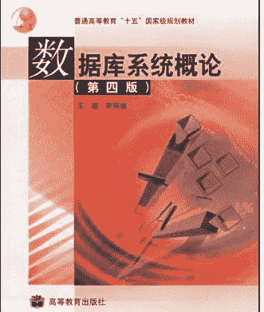

## 教材及参考书（2）
## 📖 参考书
- Jeffrey.D.Ullman, Jennifer Widom.  
  **A First Course in Database Systems (3rd Ed).**  
  机械工业出版社, 2008.8
- Abraham Silberschatz.  
  **Database System Concepts (5th Ed).**  
  杨冬青, 唐世渭译. **数据库系统概念(第5版).**  
  机械工业出版社, 2006.10

## 📖 上机软件
- Microsoft SQL Server 2005
- 参考资料：图书馆 + Google

## 教学大纲
## 基础与应用
- 绪论（第一章）
- 关系数据库（第二章）
- 关系数据库标准语言SQL（第三章）
- 数据库保护（第四、五、十章）
- SQL Server 2005介绍

## 理论与设计
- 关系数据理论（第六章）
- 数据库设计（第七章）

## 考核方法
- 平时成绩 60%
  - 实验(交实验报告) 40%
  - 作业+课堂表现 20%
- 期末开卷考试 40%

## 第一章 绪论

## 第一章 绪论
### 1.0 引言
#### 1.0.1 数据库技术的发展历史及趋势
#### 1.0.2 当前流行的数据库产品

## 数据库技术的发展历史
- 产生于上世纪60年代中期，40余年间经历了三代演变：
  - 第一代：层次、网状数据库技术
  - 第二代：关系数据库技术
  - 第三代：面向新一代应用的数据库技术

## 第一代数据库技术
- 1969年，Rockwell公司与IBM公司合作研制了基于层次模型的数据管理系统IMS(Information Management System)。
  - 运行在IBM 360系列机上，用于帮助美国国家航空航天局(NASA)管理宏大的“阿波罗登月计划”中的繁琐资料。
  - 阿波罗飞船由大约200万个零部件所组成，分散在世界各地制造生产。
  - IMS目前在NASA仍然在使用。

## 第一代数据库技术(续)
几乎同时，通用电气公司的Charles Bachman主持设计与实现了网状模型的数据库管理系统IDS(Integrated Data System)。
IDS于1964年推出后，成为最受欢迎的数据库产品之一，而且它的设计思想和实现技术被后来的许多数据库产品所仿效。

1971年，美国数据系统语言委员会CODASYL下属的数据库任务组DBTG提出的网状数据库模型以及数据定义和数据操纵语言即DDL和DML的规范说明，推出了DBTG报告，成为数据库历史上具有里程碑意义的文献。
1971年报告之后，又出现了一系列新的版本，如1973、1978、1981年和1984年的修改版本。
DBTG提出很多重要的基本概念（如三级模式、DBMS、DBA），对后来产生和发展的关系数据库技术有很重要的影响。

## 第二代数据库技术
- 1970年，IBM公司San Jose实验室的研究员Edgar F.Codd发表了题为“*A Relational Model of Data for Large Shared Data Banks*”的论文，提出了**关系数据模型**，开创了关系数据库理论，为关系数据库技术奠定了理论基础。
  - 关系数据库以二维表的形式存储数据，而层次和网状数据库采用的是上级指针指向下一级的方式。
  - 关系模型简单明了，具备坚实的数学基础。对数据库的使用和开发推动很大，使数据库从实验室走向了商用产品。Codd因此获得1981年图灵奖。
- 70年代是关系数据库理论研究和原型系统开发的时代，代表有：
  - IBM公司San Jose实验室开发的System R
  - Berkeley加利福尼亚大学研制的INGRES

## 第二代数据库技术(续)
- 70年代，关系数据库系统的研究取得了一系列的成绩，主要包括：
  - 莫定了关系模型的理论基础
  - 提出了关系数据语言，如关系代数、关系演算、SQL语言、QBE等等。
  - 研制了大量的关系数据库系统原型，攻克了系统实现中查询优化、并发控制、故障恢复等一系列关键技术
- 70年代后期，关系数据库从实验室走向了社会
  - 80年代几乎所有新开发的数据库系统均是关系型的。这些商用数据库系统的运行，特别是微机RDBMS的使用，使数据库技术日益广泛地应用到企业管理、情报检索、辅助决策等各个方面。


## 当前主流数据库产品
## Oracle
- Oracle公司的产品。Oracle成立于1977年，由Bob Miner、Ed Oates和Larry Ellison共同创建，总部设在加州，是世界第二大的计算机软件供应商。ORACLE系列产品在数据库领域一直居领先地位，在全球的销售份额约占50%。
- 最新版本：Oracle 11g 系列
- “软件开发实验室”和Larry Ellison。

## DB2
- IBM公司的主要产品。80年代初DB2的发展重点放在大型的主机平台,80年代中期后DB2已发展到适用于各种硬件平台。DB2 最适于海量数据。在企业级的应用最为广泛，在全球的500家最大的企业中,几乎85%以上用DB2数据库。
- 最新版本：DB2 V9.7。
- IBM System R vs Oracle


## 当前主流数据库产品（续）

### Microsoft SQL Server

- 微软公司的产品，它建立在Microsoft Windows 操作系统基础之上，定位于中型数据库。
- 最新版本： SQL Server 2008
- 选择作为实验系统的原 因：方便获取； 安装、配置和使用简单；麻雀虽小，五脏俱全

### Sybase

- SYBASE公司的产品，SYBASE公司成立于1984年，是第一个提出并推出客户/服务器（C/S）体系结构的高性能数据库服务器的数据库厂商，并促进了它的广泛流行。
- 最新版本： Sybase ASE 15系列

## 当前主流数据库产品（续）

### 另一阵营——开源数据库

- **MySQL**
  - 开源数据库的代表（2008年初被Sun收购）。据统计，该软件的下载量已经超过了一亿份，最新版本MySQL5.1。

- **Ingress**
  - 多项技术直接采用了Berkeley大学的最新研究成果，多应用在高等学校和科研所等。

## 产业界

美国商业周刊2009年全球IT企业100强

- Oracle 2
  Sun (MySQL)
- IBM (DB2) 5
- Microsoft (SQL Server) 22
- SyBase 75

## 学术界

- 2008年1584个计算机科学学术会议排名：
  - SIGMOD 8
  - PODS 10
  - VLDB 15
  - ICDE 27
  - SIGKDD 41
  - Total 1584
  （来自学术信息搜索引擎ArnetMiner）

## 第一章 绪论

### 1.1 数据库系统概述

#### 1.1.1 四个基本概念

#### 1.1.2 数据管理技术的产生和发展

### 1.1.3 数据库系统的特点

#### 1.1.1 四个基本概念

- 数据(Data)
- 数据库(DB)
- 数据库管理系统(DBMS)
- 数据库系统(DBS)

## 数据举例

- 例如 93是一个数据
  - 语义1：学生某门课的成绩
  - 语义2：某人的体重
  - 语义3：计算机系2003级学生人数
  - 语义4：请同学给出。。。
- 学生档案中的学生记录
  - （李明，男，1972，江苏，计算机系，1990）
- 数据的解释
  - 语义：学生姓名、性别、出生年月、籍贯、所在系别、入学时间
  - 解释：李明是个大学生，1972年出生，江苏人，1990年考入计算机系
- 记录是计算机中表示和存储数据的一种格式，是有结构的数据。

## 二、数据库（DB）

- 数据库的定义
  - 数据库(Database,简称DB)是长期储存在计算机内、有组织的、可共享的大量数据的集合。
- 数据库的基本特征
  - 数据按一定的数据模型组织、描述和储存
  - 可为各种用户共享
  - 冗余度较小
  - 数据独立性较高
  - 易扩展

## 二、数据库（举例）

## 学生登记表

| 学 号 | 姓 名 | 年 令 | 性 别 | 系 名 | 年 级 |
| --- | --- | --- | --- | --- | --- |
| 95004 | 王小明 | 19 | 女 | 社会学 | 95 |
| 95006 | 黄大鹏 | 20 | 男 | 商品学 | 95 |
| 95008 | 张文斌 | 18 | 女 | 法律学 | 95 |
| ... | ... | ... | ... | ... | ... |

## 三、数据库管理系统（DBMS）

- 什么是DBMS
  - 位于用户与操作系统之间的一层数据管理软件。
  - 是基础软件，是一个大型复杂的软件系统
- DBMS的用途
  - 科学地组织和存储数据、高效地获取和维护数据

## 数据库在计算机系统中的位置

软件产品

应用软件平台

软件基础架构平台

基础软件平台

硬件平台

协同软件
办公软件

中间件
应用服务器

数据库系统
操作系统

# # DBMS的主要功能

- **数据定义功能**
  - 提供数据定义语言(DDL)，及其翻译处理程序
  - 定义数据库中的数据对象
- **数据操纵功能**
  - 提供数据操纵语言(DML)，及其编译程序
  - 操纵数据实现对数据库的基本操作(查询、插入、删除和修改)
- **数据组织、存储和管理**
  - 分类组织、存储和管理各种数据
  - 确定组织数据的文件结构和存取方式
  - 实现数据之间的联系
  - 提供多种存取方法提高存取效率

## DBMS的主要功能

- 数据库的运行管理
  - 保证数据的安全性、完整性
  - 多用户对数据的并发使用
  - 发生故障后的系统恢复
- 数据库的建立和维护功能(实用程序)
  - 数据库数据批量装载
  - 数据库转储
  - 介质故障恢复
  - 数据库的重组织
  - 性能监视等

## 数据库应用系统（DBAS）

- DBAS是在DBMS支持下的一类计算机应用系统，是由数据库系统和各种用户应用程序结合而成的。
- 数据库公司以自己的数据库管理系统为平台，针对不同的应用，开发相应的应用程序。
- 例如Oracle的软件产品包括：
  - 财务软件（Financial）
  - 制造业软件（Manufacturing）
  - 人力资源软件（Human Resources）
  - 自动控制软件（Oracle Automotive）
  - 商业交易系统（Exchange）等。

## 数据库管理员(DBA)

- 职责
  - 1、决定数据库中的信息内容和结构
  - 2、决定数据库的存储结构和存取策略
  - 3、定义数据的安全性要求和完整性约束条件
  - 4、监控数据库的使用和运行
  - 5、数据库的改进和重组

- Oracle的官方网站上对DBA的说明
  - Oracle DBA专家可以跟上如今日趋复杂的系统环境要求。最好的DBA们都在幕后工作，他们小心地维护着系统，使得系统可以每天都平稳地运转，并且防止意外灾难的发生。这项艰巨的任务需要对Oracle数据库的结构和运行方式有着广泛且深入的了解，并且有丰富的实战经验。

### 1.1 数据库系统概述

#### 1.1.1 四个基本概念

#### 1.1.2 数据管理技术的产生和发展

### 1.1.3 数据库系统的特点

## 数据管理技术的产生和发展

- 什么是数据管理
  - 对数据进行分类、组织、编码、存储、检索和维护
  - 数据处理的中心问题
- 数据管理技术的发展过程
  - 人工管理阶段（20世纪40年代中—50年代中）
  - 文件系统阶段（20世纪50年代末—60年代中）
  - 数据库系统阶段（20世纪60年代末—现在）

## 一、人工管理阶段

- 时期
  - 20世纪40年代中—50年代中

- 产生的背景
  - 应用需求　科学计算
  - 硬件水平　无直接存取存储设备
  - 软件水平　没有操作系统
  - 处理方式　批处理

## 人工管理阶段(续)

## 特点

- 数据不保存
- 应用程序管理数据
- 数据不共享，
  冗余度极大
- 数据不具有独立性

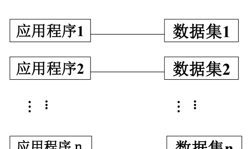

## 二、文件系统阶段

- 时期
  - 20世纪50年代末--60年代中
- 产生的背景
  - 应用需求  科学计算、管理
  - 硬件水平  磁盘、磁鼓
  - 软件水平  有文件系统
  - 处理方式  联机实时处理、批处理

## 文件系统阶段(续)

- 优点
  - 数据不保存 → 数据可长期保存
  - 应用程序管理数据 → 文件系统管理数据
- 缺点
  - 数据共享性差、冗余度大
  - 数据独立性差

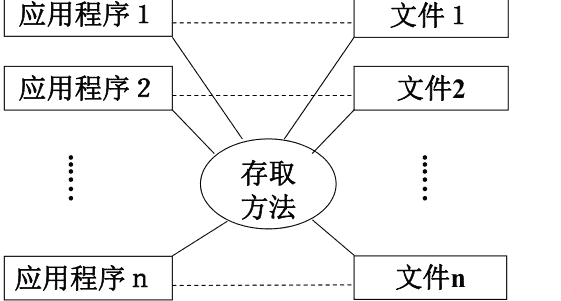


### 三、数据库系统阶段

- 时期
  - 20世纪60年代末以来
- 产生的背景
  - 应用背景 大规模管理
  - 硬件背景 大容量磁盘、磁盘阵列
  - 软件背景 有数据库管理系统
  - 处理方式 联机实时处理,分布处理,批处理

### 1.1 数据库系统概述

#### 1.1.1 四个基本概念

#### 1.1.2 数据管理技术的产生和发展

### 1.1.3 数据库系统的特点

### 1.1.3 数据库系统的特点

- 数据结构化
- 数据的共享性高，冗余度低，易扩充
- 数据独立性高
- 数据由DBMS统一管理和控制

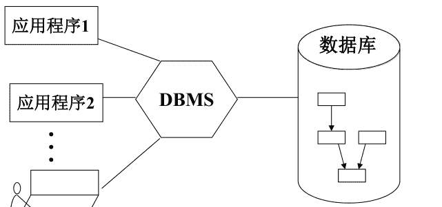

## 数据结构化

- 整体数据的结构化是数据库的主要特征之一。

- 文件系统
  > 每个文件内部是有结构的（记录），但记录之间没有联系。

- 关系数据库
  > 不仅数据内部结构化，整体也是结构化的，数据之间具有联系。

学生文件的记录结构

| 学号 | 姓名 | 性别 | 年龄 | 院系 | 联系电话 |
课程文件的记录结构

| 课程号 | 课程名 | 学时数 | 教材名 |
选课文件的记录结构

| 学号 | 课程号 | 成绩 |

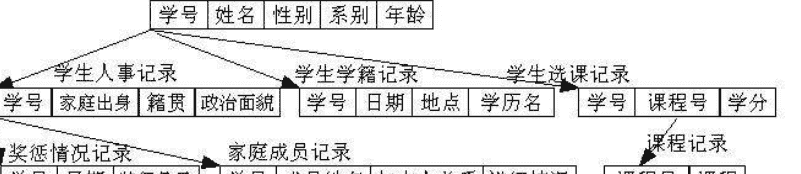

## 数据的共享性高，冗余度低，易扩展

- 数据库系统从整体角度看待和描述数据，数据面向整个系统，可以被多个用户、多个应用共享使用。
- 数据共享的好处
  - 减少数据冗余，节约存储空间
  - 避免数据之间的不相容性与不一致性
  - 使系统易于扩充

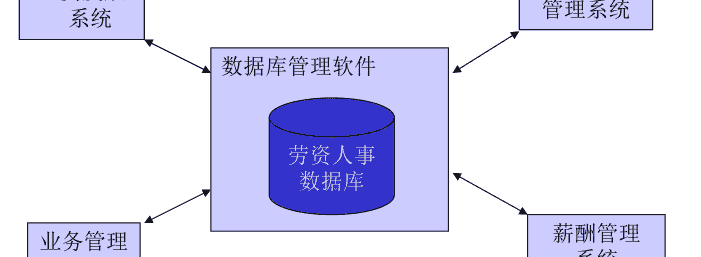

## 数据独立性高

- 物理独立性
  - 指用户的应用程序与存储在磁盘上的数据库中数据是相互独立的。当数据的物理存储改变了，应用程序不用改变。

- 逻辑独立性
  - 指用户的应用程序与数据库的逻辑结构是相互独立的。数据的逻辑结构改变了，用户程序也可以不变。

- 数据独立性是由DBMS的二级映像功能来保证的

## 数据由DBMS统一管理和控制

- DBMS提供的数据控制功能

- (1)数据的安全性（Security）保护
  保护数据，以防止不合法的使用造成的数据的泄密和破坏。

- (2)数据的完整性（Integrity）检查
  将数据控制在有效的范围内，或保证数据之间满足一定的关系。

- (3)并发（Concurrency）控制
  对多用户的并发操作加以控制和协调，防止相互干扰而得到错误的结果。

- (4)数据库恢复（Recovery）
  将数据库从错误状态恢复到某一已知的正确状态。


## 上节课内容回顾

- **1.0 引言**
  - 1.0.1 数据库技术的发展历史及趋势
  - 1.0.2 当前流行的数据库产品

- **1.1 数据库系统概述**
  - 1.1.1 四个基本概念
    - Data、DB、DBMS、DBS
  - 1.1.2 数据管理技术的产生和发展
    - 人工管理 → 文件系统 → 数据库系统
  - 1.1.3 数据库系统的特点
    - 数据结构化、共享性高、独立性高、由DBMS统一管理

### 1.2 数据模型

#### 1.2.1 两大类数据模型

#### 1.2.2 数据模型的组成要素

#### 1.2.3 概念模型

#### 1.2.4 最常用的数据模型

#### 1.2.5 层次模型

#### 1.2.6 网状模型

#### 1.2.7 关系模型


## 数据模型

- 在数据库中用数据模型这个工具来抽象、表示和处理现实世界中的事物。
- 通俗地讲数据模型就是现实世界的模拟。
- 数据模型应满足三方面要求
  - 能比较真实地模拟现实世界
  - 容易为人所理解
  - 便于在计算机上实现

#### 1.2.1 两大类数据模型

- 数据模型分为两类（分属两个不同的层次）
  1. **概念模型**：也称信息模型，它是按用户的观点来对数据和信息建模，用于数据库设计。
  2. **逻辑模型和物理模型**：按计算机系统的观点对数据建模，用于 DBMS 的实现。
     - **逻辑模型**主要包括网状模型、层次模型、关系模型、面向对象模型等，按计算机系统的观点对数据建模，用于 DBMS 实现。
     - **物理模型**是对数据最底层的抽象，描述数据在系统内部的表示方式和存取方法，在磁盘或磁带上的存储方式和存取方法。

## 两大类数据模型 (续)

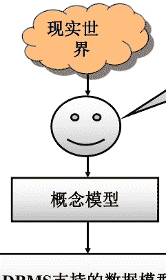

现实世界

认识抽象

概念模型

DBMS支持的数据模型

信息世界

机器世界

现实世界 ⇒ 概念模型
数据库设计人员完成

概念模型 ⇒ 逻辑模型
数据库设计人员完成

逻辑模型 ⇒ 物理模型
由DBMS完成

现实世界中客观对象的抽象过程

## 两大类数据模型 (续)

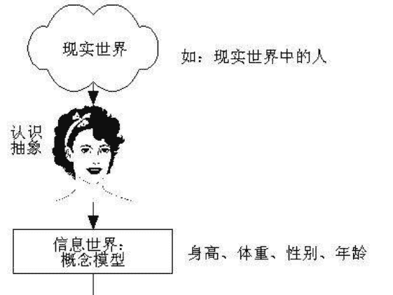

如：现实世界中的人

认识抽象

信息世界：
概念模型

身高、体重、性别、年龄

机器世界：
DBMS支持的数据模型

Height real (0,200)
Weight real (0,150)
Sex bit (0,1)
Age int (0,200)

#### 1.2.2 数据模型的组成要素

- 数据结构
- 数据操作
- 完整性约束条件

## 一、数据结构

- 什么是数据结构
  - 描述数据库的组成对象，以及对象之间的联系
- 描述的内容
  - 与数据类型、内容、性质有关的对象
  - 与数据之间联系有关的对象
- 数据结构是对系统静态特性的描述

## 二、数据操作

- 数据操作
  - 对数据库中各种对象(型)的实例(值)允许执行的操作及有关的操作规则
- 数据操作的类型
  - 查询
  - 更新(包括插入、删除、修改)
- 数据模型对操作的定义
  - 操作的确切含义
  - 操作符号
  - 操作规则（如优先级）
  - 实现操作的语言
- 数据操作是对系统动态特性的描述

## 二、数据的完整性约束条件

- 数据的完整性约束条件
  - 一组完整性规则的集合。
  - 完整性规则：给定的数据模型中数据及其联系所具有的制约和储存规则，用以限定符合数据模型的数据库状态以及状态的变化，以保证数据的正确、有效、相容。

- 数据模型对完整性约束条件的定义
  - 反映和规定本数据模型必须遵守的基本的通用的完整性约束条件。
    - 例如，关系模型中，任何关系必须满足实体完整性和参照完整性两个条件。
  - 提供定义完整性约束条件的机制，以及反映具体应用所涉及的数据必须遵守的特定的语义约束条件。
    - 例子：学校数据库中规定博士学生的年龄必须小于45岁
    - 例子：银行的系统中规定帐号的余额不能小于1元

### 1.2 数据模型

#### 1.2.1 两大类数据模型

#### 1.2.2 数据模型的组成要素

#### 1.2.3 概念模型

#### 1.2.4 最常用的数据模型

#### 1.2.5 层次模型

#### 1.2.6 网状模型

#### 1.2.7 关系模型

## 概念模型

- 概念模型的用途
  - 概念模型用于信息世界的建模
  - 是现实世界到机器世界的一个中间层次
  - 是数据库设计的有力工具
  - 数据库设计人员和用户之间进行交流的语言

- 对概念模型的基本要求
  - 较强的语义表达能力
  - 能够方便、直接地表达应用中的各种语义知识
  - 简单、清晰、易于用户理解


## 一、信息世界中的基本概念

- 1. **实体（Entity）**
  客观存在并可相互区别的事物称为实体。可以是具体的人、事、物或抽象的概念。

- 2. **属性（Attribute）**
  实体所具有的某一特性称为属性。一个实体可以由若干个属性来刻画。

- 3. **码（Key）**
  唯一标识实体的属性集称为码。

- 4. **域（Domain）**
  属性的取值范围称为该属性的域。

- 5. **实体型（Entity Type）**
  用实体名及其属性名集合来抽象和刻画同类实体称为实体型。例子：学生（学号、姓名、性别、出生年月）

- 6. **实体集（Entity Set）**
  同一类型实体的集合称为实体集。

| 学号 | 姓名 | 性别 | 出生日期 |
|---|---|---|---|
| 20021001 | 张三 | 男 | 1978-5-6 |
| 20021003 | 李四 | 女 | 1980-1-24 |
| 20021004 | 王五 | 男 | 1979-11-12 |

- 7. **联系（Relationship）**
  - 现实世界中事物内部以及事物之间的联系在信息世界中反映为实体内部的联系和实体之间的联系。
  - 实体内部的联系通常是指组成实体的各属性之间的联系。
  - 实体之间的联系通常是指不同实体集之间的联系。

## 二、两个实体型之间的联系

用图形来表示两个实体型之间的这三类联系

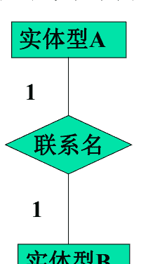

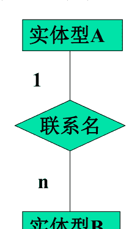

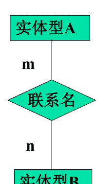

#### 一对一联系（1:1）

- 实例
  - 一个班级只有一个正班长
  - 一个班长只在一个班中任职
- 定义：如果对于实体集A中的每一个实体，实体集B中至多有一个（也可以没有）实体与之联系，反之亦然，则称实体集A与实体集B具有一对一联系，记为1:1。

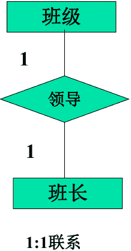

#### 一对多联系（1:n）

- 实例
  - 一个班级中有若干名学生，每个学生只在一个班级中学习。
- 定义：如果对于实体集A中的每一个实体，实体集B中有n个实体（n≥0）与之联系，反之，对于实体集B中的每一个实体，实体集A中至多只有一个实体与之联系，则称实体集A与实体集B有一对多联系，记为1:n。

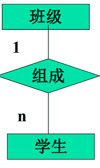

#### 多对多联系（m:n）

- 实例
  - **课程与学生之间的联系：**一门课程同时有若干个学生选修；一个学生可以同时选修多门课程。
- 定义：如果对于实体集A中的每一个实体，实体集B中有n个实体（n≥0）与之联系，反之，对于实体集B中的每一个实体，实体集A中也有m个实体（m≥0）与之联系，则称实体集A与实体集B具有多对多联系，记为m:n。

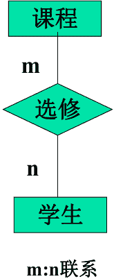

## 二、两个以上实体型之间的联系

#### 两个以上实体型之间一对多联系

若实体型 E₁，E₂，…，Eₙ 存在联系，对于实体型 Eⱼ（j=1，2，…，i-1，i+1，…，n）中的给定实体，最多只和 Eⱼ 中的一个实体相联系，则我们说 Eᵢ 与 E₁，E₂，…，Eᵢ₋₁，Eᵢ₊₁，…，Eₙ 之间的联系是一对多的。

- 实例：课程、教师与参考书三个实体型。每一个教师可以讲授若干门课程，每门课程可以使用若干本参考书。

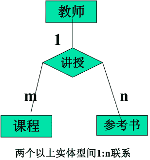

- 两个以上实体型间的一对一联系
- 两个以上实体型间的多对多联系
  - 实例：供应商、项目、零件三个实体型。一个供应商可以供给多个项目多种零件；每个项目可以使用多个供应商供应的零件；每种零件可由不同供应商供给。

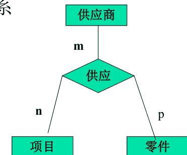

两个以上实体型间m:n联系

## 四、单个实体型内的联系

- 同一实体集内的各实体之间的关系
- 一对多联系
  - 实例
    - 职工实体型内部具有领导与被领导的联系
    - 某一职工（干部）“领导”若干名职工
    - 一个职工仅被另外一个职工直接领导
    - 这是一对多的联系
- 一对一联系和多对多联系

请举例。

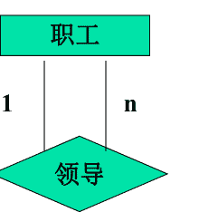

## 五、概念模型的一种表示方法

实体—联系方法（E-R方法）

- Peter Chen于1976年提出
- 用E-R图来描述现实世界的概念模型
- E-R方法也称为E-R模型

#### E-R图

- 实体型：用矩形表示，矩形框内写明实体名。
- 属性：用椭圆形表示，并用无向边将其与相应的实体连接起来。
- 联系：联系本身用菱形表示，菱形框内写明联系名，并用无向边分别与有关实体连接起来，同时在无向边旁标上联系的类型（1:1、1:n或m:n）。


#### 联系的表示方法

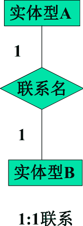

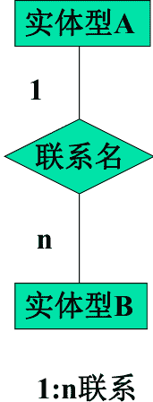

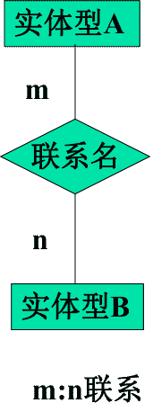

#### 联系的表示方法示例

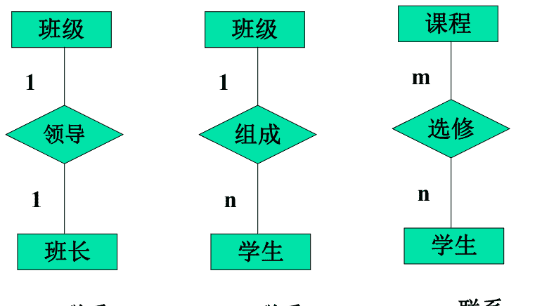

#### 一个实例

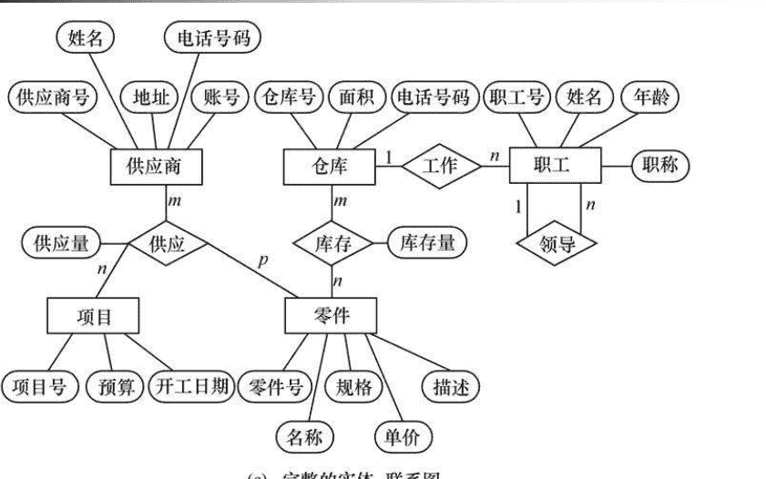

(c) 完整的实体-联系图

#### 练习：画ER图

- 练习1：某工厂生产若干种产品，每种产品由不同零件组成，有的零件可用在不同的产品上。这些零件由不同的原料制成，不同零件所用的材料可以相同。这些零件按所属的不同产品分别放在不同的仓库中，原来按照类别放在不同的仓库中。
- 练习2：学校有若干个系，每个系有若干个教研室，每个教研室有若干教师。同时每个系有若干学生。（不需要画出学校）

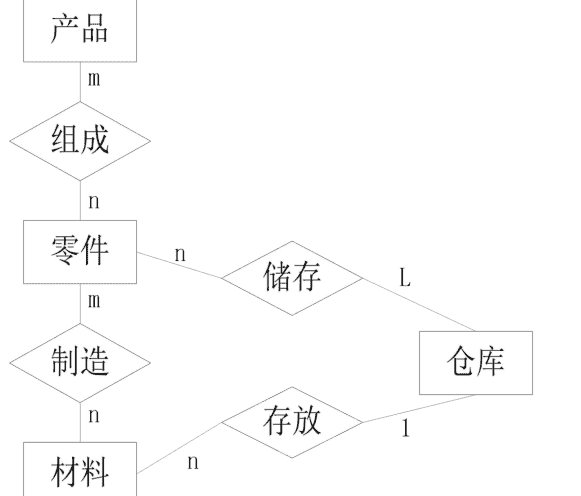

### 1.2 数据模型

- 1.2.1 两大类数据模型
- 1.2.2 数据模型的组成要素
- 1.2.3 概念模型
- 1.2.4 最常用的数据模型
- 1.2.5 层次模型
- 1.2.6 网状模型
- 1.2.7 关系模型

#### 1.2.4 最常用的数据模型

- 格式化模型
  - 层次模型（Hierarchical Model）
  - 网状模型（Network Model）
- 关系模型（Relational Model）
- 面向对象模型（Object Oriented Model）
- 对象关系模型（Object Relational Model）

#### 1.2.5 层次模型

- 层次模型是数据库系统中最早出现的数据模型
- 层次数据库系统的典型代表是IBM公司的IMS（Information Management System）数据库管理系统
- 层次模型用树形结构来表示各类实体以及实体间的联系

**一、层次数据模型的数据结构**

层次模型：满足下面两个条件的基本层次联系的集合为层次模型。

- 1. 有且只有一个节点没有双亲节点，这个节点称为根节点。
- 2. 根以外的其它节点有且只有一个双亲节点。

层次模型中的几个术语：根节点，双亲节点，兄弟节点，叶节点。

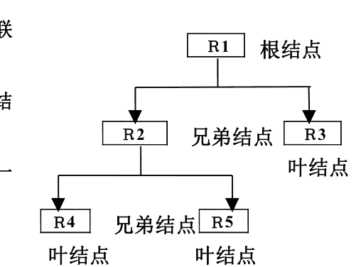


## 层次数据模型的数据结构(续)

- 表示方法
  - 实体型：用记录类型描述，每个结点表示一个记录类型（实体）
  - 属性：用字段描述，每个记录类型可包含若干个字段
  - 联系：用结点之间的连线表示记录类型（实体）之间的一对多的父子联系

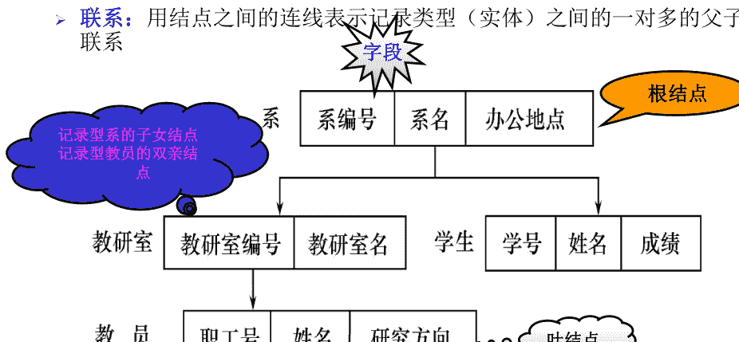

## 层次数据模型的数据结构(续)

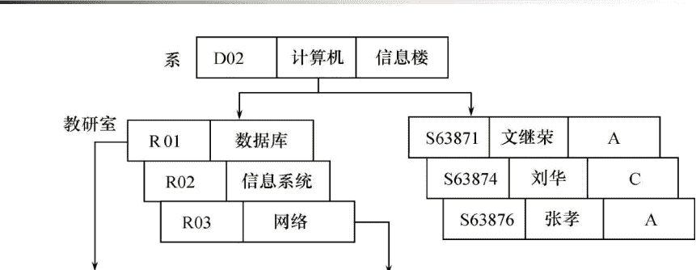

图1.18 教员学生层次数据库的一个值

## 层次数据模型的数据结构(续)

层次模型的特点：

- 结点的双亲是唯一的
- 只能直接处理一对多的实体联系
- 每个记录类型可以定义一个排序字段，也称为码字段
- 任何记录值只有按其路径查看时，才能显出它的全部意义
- 没有一个子女记录值能够脱离双亲记录值而独立存在

## 多对多联系在层次模型中的表示

- 多对多联系在层次模型中的表示
  - 用层次模型间接表示多对多联系
  - 方法
    将多对多联系分解成一对多联系
  - 分解方法
    - 冗余结点法
    - 虚拟结点法
  - 例子：学生选课数据库

## 层次模型的数据操纵与完整性约束

- 层次模型的数据操纵
  - 查询
  - 插入
  - 删除
  - 更新
- 层次模型的完整性约束条件
  - 无相应的双亲结点值就不能插入子女结点值
  - 如果删除双亲结点值，则相应的子女结点值也被同时删除

## 四、层次数据模型的存储结构

## 邻接法

按照层次树前序遍历的顺序把所有记录值依次邻接存放，即通过物理空间的位置相邻来实现层次顺序

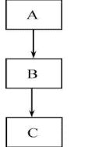

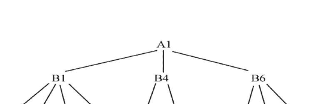

图1.20 层次数据库及其实例

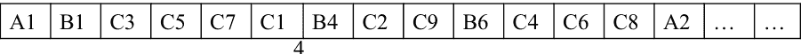

图1.21 邻接法

## 层次数据模型的存储结构（续）

- 链接法
  - 用指针来反映数据之间的层次联系
  - 子女一兄弟链接法
  - 层次序列链接法

## 层次数据模型的存储结构（续）

- 子女-兄弟链接法

每个记录设两类指针，分别指向最左边的子女（每个记录型对应一个）和最近的兄弟

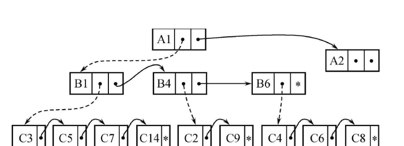

(a)

## 层次数据模型的存储结构（续）

## 层次序列链接法

按树的前序穿越顺序链接各记录值

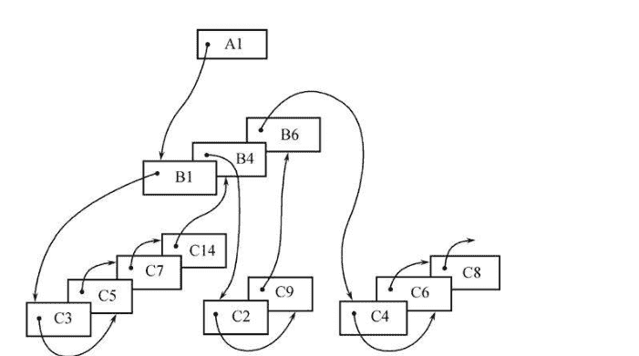

## 五、层次模型的优缺点

- 优点
  - 层次模型的数据结构比较简单清晰
  - 查询效率高，性能优于关系模型，不低于网状模型
  - 层次数据模型提供了良好的完整性支持
- 缺点
  - 多对多联系表示不自然
  - 对插入和删除操作的限制多，应用程序的编写比较复杂
  - 查询子女结点必须通过双亲结点
  - 由于结构严密，层次命令趋于程序化

## 1. 网状数据模型的数据结构

- 网状模型
  满足下面两个条件的基本层次联系的集合：
  1. 允许一个以上的结点无双亲；
  2. 一个结点可以有多于一个的双亲。
- 表示方法(与层次数据模型相同)
  **实体型**: 用记录类型描述
  每个结点表示一个记录类型（实体）
  **属性**: 用字段描述
  每个记录类型可包含若干个字段
  **联系**: 用结点之间的连线表示记录类型（实体）之间的一对多的父子联系

## 网状数据模型的数据结构（续）

网状模型中子女结点与双亲结点的联系可以不唯一
要为每个联系命名，并指出与该联系有关的双亲记录和子女记录

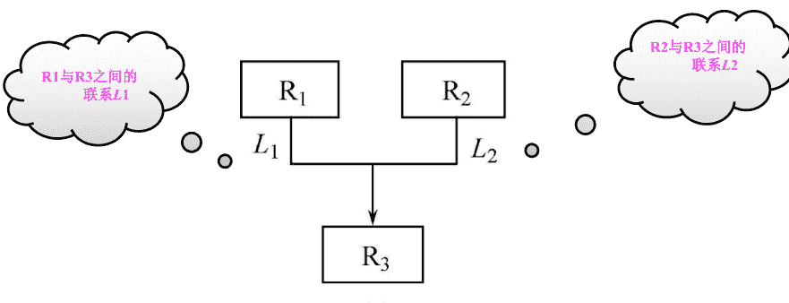

## 网状数据模型的数据结构（续）

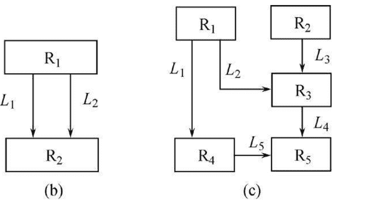

网状模型的例子

## 网状数据模型的数据结构（续）

## ■ 多对多联系在网状模型中的表示

- 用网状模型**间接**表示多对多联系
- 方法：将多对多联系**直接**分解成一对多联系
- 例如：一个学生可以选修若干门课程，某一课程可以被多个学生选修，学生与课程之间是多对多联系
  
  引进一个学生选课的联结记录，由3个数据项组成
  
  学号、课程号、成绩
  
  表示某个学生选修某一门课程及其成绩

## 网状数据模型的数据结构（续）

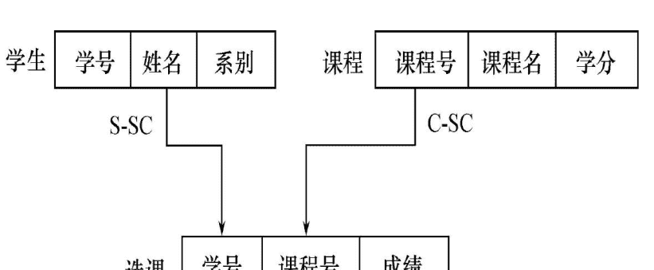

图1.24 学生/选课/课程的网状数据模型

## 网状数据模型的操纵与完整性约束（续

- 网状数据库系统（如DBTG）对数据操纵加了一些限制，提供了某些完整性约束
  - 码：唯一标识记录的数据项的集合
  - 一个联系中双亲记录与子女记录之间是一对多联系
  - 支持双亲记录和子女记录之间某些约束条件
    - 有些子女记录要求双亲记录存在才能插入，双亲记录删除时也连同删除。例如学生选课记录。

## 三、网状数据模型的存储结构

- 关键
  - 实现记录之间的联系
- 常用方法
  - 单向链接
  - 双向链接
  - 环状链接
  - 向首链接

## 网状数据模型的存储结构（续）

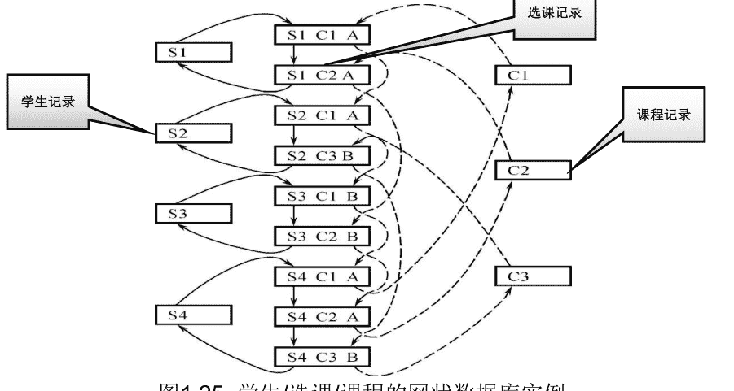

图1.25 学生/选课/课程的网状数据库实例

## 四、网状数据模型的优缺点

- 优点
  - 能够更为直接地描述现实世界，如一个结点可以有多个双亲
  - 具有良好的性能，存取效率较高
- 缺点
  - 结构比较复杂，而且随着应用环境的扩大，数据库的结构就变得越来越复杂，不利于最终用户掌握
  - DDL、DML语言复杂，用户不容易使用
  - 记录类型联系变动后涉及链接指针的调整，扩充和维护都比较复杂

### 1.2 数据模型

- 1.2.1 两大类数据模型
- 1.2.2 数据模型的组成要素
- 1.2.3 概念模型
- 1.2.4 最常用的数据模型
- 1.2.5 层次模型
- 1.2.6 网状模型
- 1.2.7 关系模型

## 一、关系数据模型的数据结构

在用户观点下，关系模型中数据的逻辑结构是一张二维表，它由行和列组成。

| 学号 | 姓名 | 年龄 | 性别 | 系名 | 年级 |
|---|---|---|---|---|---|
| 2005004 | 王小明 | 19 | 女 | 社会学 | 2005 |
| 2005006 | 黄大鹏 | 20 | 男 | 商品学 | 2005 |
| 2005008 | 张文斌 | 18 | 女 | 法律 | 2005 |
| … | … | … | … | … | … |

学生登记表

> 属性
> 元组

## 关系数据模型的数据结构（续）

- **关系（Relation）**
  - 一个关系对应通常说的一张表
- **元组（Tuple）**
  - 表中的一行即为一个元组
- **属性（Attribute）**
  - 表中的一列即为一个属性，给每一个属性起一个名称即属性名

学生登记表

| 学号 | 姓名 | 年龄 | 性别 | 系名 | 年级 |
|---|---|---|---|---|---|
| 95004 | 王小明 | 19 | 女 | 社会学 | 95 |
| 95006 | 黄大鹏 | 20 | 男 | 商品学 | 95 |
| 95008 | 张文斌 | 18 | 女 | 法律学 | 95 |
| ... | ... | ... | ... | ... | ... |

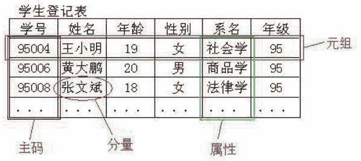


## 关系数据模型的数据结构（续）

- **主码（Key）**
  - 表中的某个属性组，它可以唯一确定一个元组。
- **域（Domain）**
  - 属性的取值范围。
- **分量**
  - 元组中的一个属性值。
- **关系模式**
  - 对关系的描述
  - 关系名（属性1，属性2，…，属性n）
  - 学生（学号，姓名，年龄，性别，系，年级）

| 学生登记表 |  |  |  |  |  |
|---|---|---|---|---|---|
| 学号 | 姓名 | 年龄 | 性别 | 系名 | 年级 |
| 95004 | 王小明 | 19 | 女 | 社会学 | 95 |
| 95006 | 黄大鹏 | 20 | 男 | 商品学 | 95 |
| 95008 | 张文斌 | 18 | 女 | 法律学 | 95 |
| … | … | … | … | … | … |

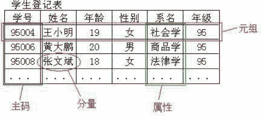

## 关系数据模型的数据结构（续）

表1.2 术语对比

| 关系术语 | 一般表格的术语 |
|---|---|
| 关系名 | 表名 |
| 关系模式 | 表头（表格的描述） |
| 关系 | （一张）二维表 |
| 元组 | 记录或行 |
| 属性 | 列 |
| 属性名 | 列名 |
| 属性值 | 列值 |
| 分量 | 一条记录中的一个列值 |
| 非规范关系 | 表中有表（大表中嵌有小表） |

## 关系数据模型的数据结构（续）

- 关系必须规范化，满足一定的规范条件

最基本的规范条件：关系的每一个分量必须是一个不可分的数据项，不允许表中还有表

图1.27中工资是可分的数据项,不符合关系模型要求

| 序号 | 组名 | 工资 |  | 扣除 | 实发 |
|---|---|---|---|---|---|
|  |  | 基本 | 补助 |  |  |
| 004 | 甲组 | 3200 | 20 | 100 | 3120 |
|  | 乙组 | 1500 |  | 50 | 1450 |
| 008 | 甲组 | 2200 | 150 | 100 | 2250 |
| ... | ... | ... | ... | ... | ... |

图1.27 一个工资表(表中有表)实例

## 关系数据模型的数据结构（续）

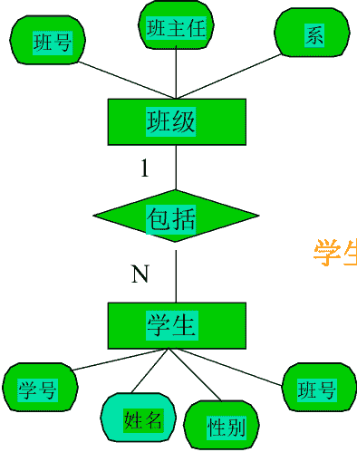

班级（班号，班主任，系）

学生（学号，姓名，性别，班号）

## 关系数据模型的数据结构（续）

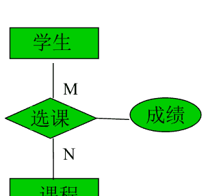

学生（学号，姓名，性别，班号）

选课（学号，课程号，成绩）

课程（课程号，课程名，学分）

M : N

## 关系数据模型的数据结构（续）

- 例子：教员学生数据库

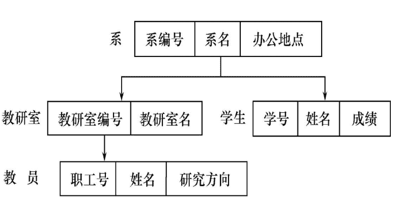

## 关系数据模型的操纵与完整性约束

- 数据操作是集合操作，操作对象和操作结果都是关系
  - 查询
  - 插入
  - 删除
  - 更新

- 关系的完整性约束条件
  - 实体完整性
  - 参照完整性
  - 用户定义的完整性

## 二、关系数据模型的存储结构

- 实体及实体间的联系都用表来表示
- 表以文件形式存储

- 有的DBMS一个表对应一个操作系统文件
- 有的DBMS自己设计文件结构

## 四、关系数据模型的优缺点

- **优点**
  - 建立在严格的数学概念的基础上
  - 可以描述一对一、一对多和多对多的联系
  - 概念单一
    - 实体和各类联系都用关系来表示
    - 对数据的检索结果也是关系
  - 存取路径对用户透明
    - 用户只要指出“干什么”，不必详细说明“怎么干”
    - 具有更高的数据独立性，更好的安全保密性
    - 简化了程序员的工作和数据库建立的工作
- **缺点**
  - 存取路径对用户透明导致查询效率往往不如非关系数据模型
  - 为提高性能，必须对用户的查询请求进行优化增加了开发DBMS的难度

## 小结

- 数据库设计的一般过程
- 数据模型的组成要素
  - 数据结构、数据操作、数据的完整性约束条件
- 概念模型
  - 实体、属性、联系
  - E-R图
- 层次模型
- 网状模型
- 关系模型

## Product

| maker | model | type |
|---|---|---|
| A | 1001 | pc |
| A | 1002 | pc |
| A | 2004 | laptop |
| B | 1003 | pc |
| B | 2005 | laptop |
| C | 1004 | pc |

## PC

| model | speed | ram | hd | price |
|---|---|---|---|---|
| 1001 | 2.66 | 1024 | 250 | 2114 |
| 1002 | 2.10 | 512 | 250 | 995 |
| 1003 | 1.42 | 512 | 80 | 478 |
| 1004 | 2.80 | 1024 | 250 | 649 |

## Laptop

| model | speed | ram | hd | screen | price |
|---|---|---|---|---|---|
| 2004 | 2.00 | 512 | 60 | 13.3 | 1150 |
| 2005 | 2.16 | 1024 | 120 | 17.0 | 2500 |

用SQL完成以下查询：

查询所有有这样的制造商：对于制造商B生产的笔记本所含的内存容量，该制造商所生产的笔记本中都有。

查询至少生产了两款速度不小于2.80的计算机（PC或笔记本）的制造商。

- Product(maker,model, type)
- Laptop(model, speed, ram, hd, screen, price)

查询所有这样的制造商：对于制造商B生产的笔记本所含的内存容量，该制造商所生产的笔记本中都有。

思路：寻找这样的制造商x：不存在这样的内存容量y，制造商B生产的笔记本含有容量y，而制造商x生产的笔记本不含有容量y。

```
select DISTINCT x.maker
from Product x
where not exists
    (select *
    from Laptop y
    where B in
        (select P1.maker
        from Product P1, Laptop L1
        where P1.model=L1.model and L1.ram=y.ram) and
        x.maker not in
        (select P2.maker
        from Product P2, Laptop L2
        where P2.model=L2.model and L2.ram=y.ram));
```

- Product(maker, **model**, type)
- Laptop(**model**, speed, ram, hd, screen, price)

查询所有这样的制造商：对于制造商B生产的笔记本所含的内存容量，该制造商所生产的笔记本中都有。

思路：**寻找这样的制造商x**：不存在这样的内存容量y，制造商B生产的笔记本含有容量y，而制造商x生产的笔记本不含有容量y。

```
select DISTINCT x.maker
from Product x
where not exists
    (select *
     from Laptop y
     where 'B' in
           (select P1.maker
            from Product P1, Laptop L1
            where P1.model=L1.model and L1.ram=y.ram) and
x.maker not in
           (select P2.maker
            from Product P2, Laptop L2
            where P2.model=L2.model and L2.ram=y.ram));
```


- Product(maker,model, type)
- Laptop(model, speed, ram, hd, screen, price)

查询所有这样的制造商：对于制造商B生产的笔记本所含的内存容量，该制造商所生产的笔记本中都有。

思路：寻找这样的制造商x：不存在这样的内存容量y，制造商B生产的笔记本含有容量y，而制造商x生产的笔记本不含有容量y。

```
select DISTINCT x.maker
from Product x
where not exists
    (select *
    from Laptop y
    where 'B' in
        (select P1.maker
        from Product P1, Laptop L1
        where P1.model=L1.model and L1.ram=y.ram) and
        x.maker not in
        (select P2.maker
        from Product P2, Laptop L2
        where P2.model=L2.model and L2.ram=y.ram));
```

- Product(maker,model, type)
- Laptop(model, speed, ram, hd, screen, price)

查询所有这样的制造商：对于制造商B生产的笔记本所含的内存容量，该制造商所生产的笔记本中都有。

思路：寻找这样的制造商x：不存在这样的内存容量y，制造商B生产的笔记本含有容量y，而制造商x生产的笔记本不含有容量y。

```
select DISTINCT x.maker
from Product x
where not exists
  (select *
  from Laptop y
  where 'B' in
    (select P1.maker
    from Product P1, Laptop L1
    where P1.model=L1.model and L1.ram=y.ram) and
    x.maker not in
    (select P2.maker
    from Product P2, Laptop L2
    where P2.model=L2.model and L2.ram=y.ram));
```

- Product(maker,model, type)
- Laptop(model, speed, ram, hd, screen, price)

查询所有这样的制造商：对于制造商B生产的笔记本所含的内存容量，该制造商所生产的笔记本中都有。

思路2：制造商B生产的笔记本含有，而制造商x生产的笔记本不含有的内存容量的另一种表述：制造商B生产的笔记本含有的内存容量和制造商x生产的笔记本含有的内存容量的差集。

```
select DISTINCT x.maker
from Product x
where not exists
((select L1.ram
from Laptop L1, Product P1
where L1.model = P1.model and P1.maker = 'B')
except
(select L2.ram
from Laptop L2, Product P2
where L2.model = P2.model and P2.maker=x.maker));
```

- Product(maker, model, type)
- PC(model, speed, ram, hd, price)
- Laptop(model, speed, ram, hd, screen, price)

查询至少生产了两款速度不小于2.80的计算机（PC或笔记本）的制造商。

思路：翻译关系代数表达式。

```
ρ_R( π_maker,model ( σ_speed ≥ 2.8 (Product ▷◁ ( π_model,speed (PC) ∪ π_model,speed (Laptop))))) π_maker (ρ_R1(R) ▷◁_R1.maker = R2.maker AND R1.model ≠ R2.model ρ_R2(R))
```

```
select DISTINCT P.maker
from Product P, Product P1,
where P.maker = P1.maker
and P.model in
    // 速度不小于2.80的计算机型号
    (select PC.model
    from PC
    where PC.speed > 2.80
    UNION
    select LP.model
    from Laptop LP
    where Lp.speed > 2.80)
and P1.model in
    // 速度不小于2.80的计算机型号
    (select PC.model
    from PC
    where PC.speed > 2.80
    UNION
    select LP.model
    from Laptop LP
    where Lp.speed > 2.80)
and P.model <> P1.model
```

## 数据库技术与应用


北京邮电大学计算机学院 肖达

xiaoda99@gmail.com

## 第一章 绪论

- 1.1 数据库系统概述
- 1.2 数据模型
- 1.3 数据库系统结构
- 1.4 数据库系统的组成
- 1.5 小结

## 1.3 数据库系统结构

从数据库最终用户角度看（数据库系统外部的体系结构），数据库系统的结构分为：

- 单用户结构
- 主从式结构
- 分布式结构
- 客户 / 服务器
- 浏览器 / 应用服务器 / 数据库服务器多层结构等

从数据库管理系统角度看，数据库系统通常采用三级模式结构，是数据库系统内部的系统结构。

## DBS的四种体系结构

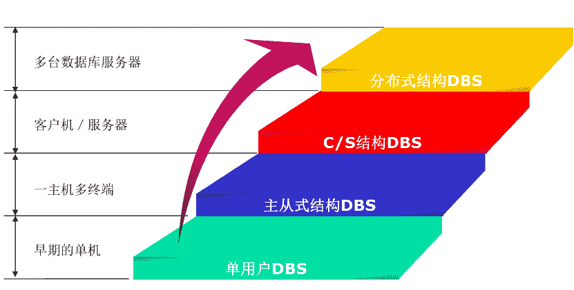

## 单用户数据库系统

- 整个数据库系统(应用程序、DBMS、数据)装在一台计算机上，为一个用户独占，不同机器之间不能共享数据。
- 早期的最简单的数据库系统

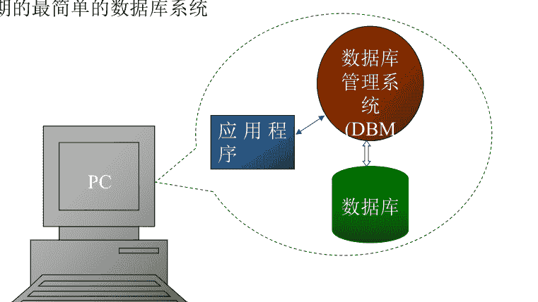

## 主从式结构的数据库系统

- 一个主机带多个终端的多用户结构
  - 数据库系统，包括应用程序、DBMS、数据，都集中存放在主机上，所有处理任务都由主机来完成
  - 各个用户通过主机的终端并发地存取数据库，共享数据资源

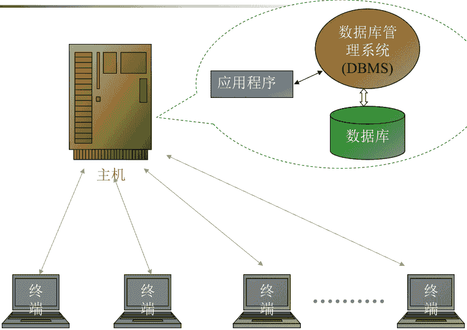

主机

应用程序

数据库管理系统（DBMS）

数据库

终端

终端

终端

终端

## 主从式结构的数据库系统（续）

- 优点
  - 易于管理、控制与维护。
- 缺点
  - 当终端用户数目增加到一定程度后，主机的任务会过分繁重，成为瓶颈，从而使系统性能下降。
  - 系统的可靠性依赖主机，当主机出现故障时，整个系统都不能使用。

## 分布式结构的数据库系统

- 数据库中的数据在逻辑上是一个整体，但物理地分布在计算机网络的不同结点上。
  - 网络中的每个结点都可以独立处理本地数据库中的数据，执行局部应用
  - 同时也可以同时存取和处理多个异地数据库中的数据，执行全局应用
  - 例子：中国工商银行（ICBC）数据库

## 分布式结构的数据库系统（续）


## 优点

- 适应了地理上分散的公司、团体和组织对于数据库应用的需求。

## 缺点

- 数据的分布存放给数据的处理、管理与维护带来困难。
- 当用户需要经常访问远程数据时，系统效率会明显地受到网络传输的制约。

## 客户 / 服务器结构的数据库系统

- 把DBMS功能和应用分开
  - 网络中某个（些）结点上的计算机专门用于执行DBMS功能，称为数据库服务器，简称服务器
  - 其他结点上的计算机安装DBMS的外围应用开发工具，用户的应用系统，称为客户机
  - Sybase公司最先提出
  - 例子：票务系统


## 客户 / 服务器数据库系统的种类

- 集中的服务器结构
  - 一台数据库服务器，多台客户机

- 分布的服务器结构
  - 在网络中有多台数据库服务器
  - 分布的服务器结构是客户 / 服务器与分布式数据库的结合


## 集中式C/S结构数据库系统

服务器
数据库管理系统(DBMS)
数据库
应用程序
PC

## 分布式C/S结构数据库系统

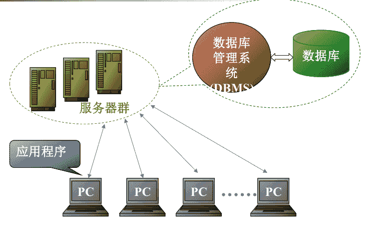

## 客户 / 服务器结构的优点

- 数据库更加开放
  - 客户与服务器一般都能在多种不同的硬件和软件平台上运行
  - 可以使用不同厂商的数据库应用开发工具
- 易于扩展和共享

## 客户 / 服务器结构的缺点


“胖客户”问题：

- 系统安装复杂，工作量大。
- 应用维护困难，难于保密，造成安全性差。
- 相同的应用程序要重复安装在每一台客户机上，从系统总体来看，大大浪费了系统资源。

系统规模达到数百数千台客户机，它们的硬件配置、操作系统又常常不同，要为每一个客户机安装应用程序和相应的工具模块，其安装维护代价便不可接受了。

## 浏览器/应用服务器/数据库的系统结构

- 客户端：
  浏览器软件、用户界面
  浏览器的界面统一，广大用户容易掌握
  大大减少了培训时间与费用。
- 服务器端分为两部分：
  - Web服务器、应用服务器
  - 数据库服务器等

大大减少了系统开发和维护代价,能够支持数万甚至更多的用户。

## 分布式B/S结构数据库系统

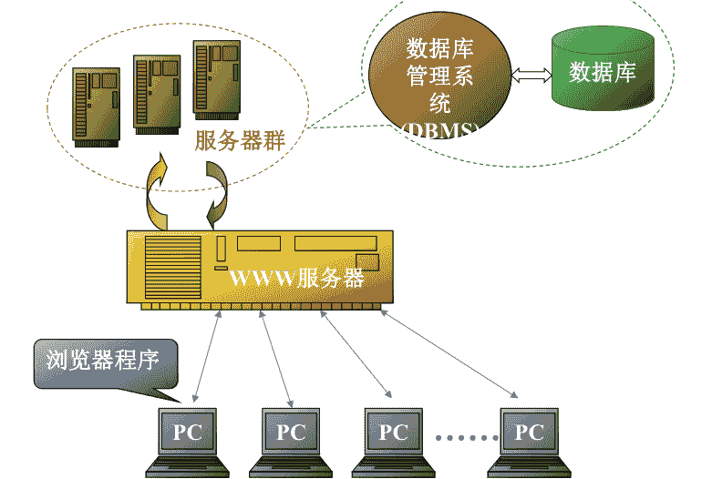

## 数据库系统结构

## 1.3.1 数据库系统模式的概念

## 1.3.2 数据库系统的三级模式结构

## 1.3.3 数据库的二级映像功能与数据独立性


## 数据库系统模式的概念

- 模式（Schema）
  - 数据库逻辑结构和特征的描述
  - 是型的描述
  - 反映的是数据的结构及其联系
  - 模式是相对稳定的
- 实例（Instance）
  - 模式的一个具体值
  - 反映数据库某一时刻的状态
  - 同一个模式可以有很多实例
  - 实例随数据库中的数据的更新而变动

## 1.3.1 数据库系统模式的概念

- “型” 和 “值” 的概念
  - 型(Type)
    对某一类数据的结构和属性的说明
  - 值(Value)
    是型的一个具体赋值

例如

学生记录型：
（学号，姓名，性别，系别，年龄，籍贯）

一个记录值：
（900201，李明，男，计算机，22，江苏）

## 数据库系统模式的概念（续）

例如：在学生选课数据库模式中，包含学生记录、课程记录和学生选课记录

- 2003年的一个学生数据库实例，包含：
  - 2003年学校中所有学生的记录
  - 学校开设的所有课程的记录
  - 所有学生选课的记录

2002年度学生数据库模式对应的实例与2003年度学生数据库模式对应的实例是不同的

## 数据库系统结构（续）

## 1.3.1 数据库系统模式的概念

## 1.3.2 数据库系统的三级模式结构

## 1.3.3 数据库的二级映像功能与数据独立性

## 1.3.2 数据库系统的三级模式结构

- 模式（Schema）
- 外模式（External Schema）
- 内模式（Internal Schema）

## 数据库系统的三级模式结构（续）

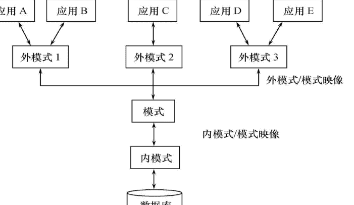

图1.28 数据库系统的三级模式结构

## 二、外模式（External Schema

- 外模式（也称子模式或用户模式）

- 数据库用户（包括应用程序员和最终用户）使用的局部数据的逻辑结构和特征的描述

- 数据库用户的数据视图，是与某一应用有关的数据的逻辑表示

## 外模式（续）

- 外模式的地位：介于模式与应用之间
  - 模式与外模式的关系：一对多
    - 外模式通常是模式的子集
    - 一个数据库可以有多个外模式。反映了不同的用户的应用需求、看待数据的方式、对数据保密的要求
    - 对模式中同一数据，在外模式中的结构、类型、长度、保密级别等都可以不同
  - 外模式与应用的关系：一对多
    - 同一外模式也可以为某一用户的多个应用系统所使用
    - 但一个应用程序只能使用一个外模式

- 外模式的用途
  - 保证数据库安全性的一个有力措施
  - 每个用户只能看见和访问所对应的外模式中的数据

## 三、内模式（Internal Schema

- 内模式（也称存储模式）
  - 是数据物理结构和存储方式的描述
  - 是数据在数据库内部的表示方式
  - 记录的存储方式（顺序存储，按照B树结构存储，按hash方法存储）
  - 索引的组织方式
  - 数据是否压缩存储
  - 数据是否加密
  - 数据存储记录结构的规定

- 一个数据库只有一个内模式

## 内模式（续）

- 例如学生记录，如果按堆存储，则插入一条新记录总是放在学生记录存储的最后，如右图所示

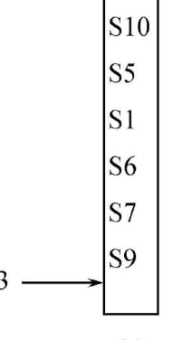

## 内模式（续）

- 如果按学号升序存储，则插入一条记录就要找到它应有的位置插入，如图1.29（b）所示
- 如果按照学生年龄聚簇存放，假如新插入的S3是16岁，则应插入的位置如图1.29（c）所示

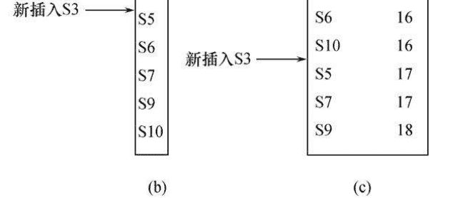

图1.29 记录不同的存储方式示意图

## 数据库系统的三级模式结构（续）

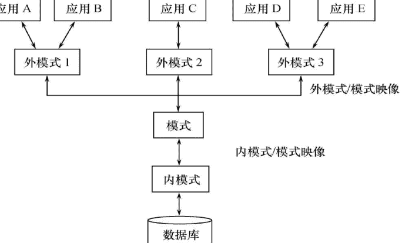

图1.28 数据库系统的三级模式结构

## 数据库系统结构（续）

## 1.3.1 数据库系统模式的概念

## 1.3.2 数据库系统的三级模式结构

## 1.3.3 数据库的二级映像功能与数据独立性

## 1.3.3 数据库的二级映像功能与数据独立性

- 三级模式是对数据的三个抽象级别
- 二级映像在DBMS内部实现这三个抽象层次的联系和转换
  - 外模式 / 模式映像
  - 模式 / 内模式映像

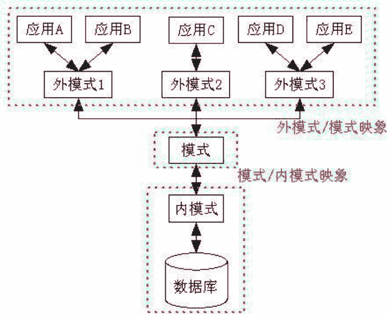

# Database Technology and Its Application

## 一、外模式 / 模式映射

- 模式：描述的是数据的全局逻辑结构
- 外模式：描述的是数据的局部逻辑结构
- 同一个模式可以有任意多个外模式
- 每一个外模式，数据库系统都有一个外模式 / 模式映射，定义外模式与模式之间的对应关系
- 映射定义通常包含在各自外模式的描述中

## 外模式 / 模式映射（续）

保证数据的逻辑独立性

> 当模式改变时，数据库管理员修改有关的外模式 / 模式映射，使外模式保持不变

> 应用程序是依据数据的外模式编写的，从而应用程序不必修改，保证了数据与程序的逻辑独立性，简称数据的逻辑独立性。

## 二、模式／内模式映象

- 模式／内模式映象定义了数据全局逻辑结构与存储结构之间的对应关系。
  - 例如，说明逻辑记录和字段在内部是如何表示的
- 数据库中模式／内模式映象是唯一的
- 该映象定义通常包含在模式描述中

## 模式 / 内模式映射（续）

保证数据的物理独立性

> 当数据库的存储结构改变了（例如选用了另一种存储结构），数据库管理员修改模式 / 内模式映射，使模式保持不变

> 应用程序不受影响。保证了数据与程序的物理独立性，简称数据的物理独立性。


## 模式 / 内模式映射（续）

### 数据库模式

- 即全局逻辑结构是数据库的中心与关键
- 独立于数据库的其他层次
- 设计数据库模式结构时应首先确定数据库的逻辑模式

### 数据库的内模式

- 依赖于它的全局逻辑结构
- 独立于数据库的用户视图，即外模式
- 独立于具体的存储设备
- 将全局逻辑结构中所定义的数据结构及其联系按照一定的物理存储策略进行组织，以达到较好的时间与空间效率

### 数据库的外模式

- 面向具体的应用程序
- 定义在逻辑模式之上
- 独立于存储模式和存储设备
- 当应用需求发生较大变化，相应外模式不能满足其视图要求时，该外模式就得做相应改动
- 设计外模式时应充分考虑到应用的扩充性

### 数据库的二级映射

- 保证了数据库外模式的稳定性
- 从底层保证了应用程序的稳定性，除非应用需求本身发生变化，否则应用程序一般不需要修改

## Cloud DB介绍

## 云计算

### 云计算

- IT基础设施的交付和使用模式，指通过网络以按需、易扩展的方式获得所需的资源（硬件、平台、软件）。
- 提供资源的网络被称为“云”。“云”中的资源在使用者看来是可以无限扩展的，并且可以随时获取，按需使用，随时扩展，按使用付费。
- 这种特性经常被称为像水、电一样使用IT基础设施。

### 衍生概念

- 云存储、云安全、云操作系统……

## 云计算的演进

### 网络计算

- 利用并行计算解决大型问题
- Globus Alliance 使其成为主流


### 公用计算

- 将计算资源作为可计量的服务提供
- 于上世纪90年代末推出


### 将软件作为服务

- 基于网络预订应用软件
- 于2001年推出


### 云计算

- 下一代的因特网计算
- 下一代的数据中心


## 云数据库

- 专为云计算环境设计的数据库
  - Google – BigTable
  - Amazon – SimpleDB
  - 10Gen – MongoDB
  - AppJet – AppJetDB
  - Oracle open-source - Berkeley DB
  - MySQL for Web - Drizzle

## 云数据库的特征

- 在分布式环境中运行
- 都不是事务性的
- 为获得更快性能而牺牲高级查询能力
  - 使用对象调用而不是 SQL 进行查询

## 亚马逊网络服务


### 基础设施即服务

- Amazon Simple Storage Service
- Amazon Elastic Compute Cloud
- Amazon Simple Queue Service
- Amazon SimpleDB

### 人力即服务

- Amazon Mechanical Turk

### Alexa 网络服务

- Alexa Web Information Service
- Alexa Top Sites
- Alexa Site Thumbnail
- Alexa Web Search Platform

### 商务即服务

- Amazon Flexible Payments Service
- Fulfillment Web Service

### Amazon Simple Storage Service (Amazon S3)

- 云中高度可扩展的数据存储
- 通过 Web 服务 API 进行编程访问
  - Put/get object store
- 高可用且持久
- 按需付费：
  - Storage: $0.15 / GB / month
  - Data Transfer: starts at $0.18 / GB
  - Requests: nominal charges

### Amazon S3 Namespace


### 存储数十亿个对象


### 开源备份

### Zmanda

开源备份

Zmanda 通过 Internet 备份到 Amazon S3

Zmanda 的使命是确保我们的客户始终能够恢复其数据，同时使备份简单、安全且经济高效。Amazon Simple Storage Service (S3) 完美契合这一使命。

- Amanda Enterprise Edition
- Amanda Community
- Services & Support

Amanda 是最受欢迎的开源备份和恢复解决方案。
下载新白皮书！
只需免费在 Zmanda 网络注册即可获取白皮书。

> “最大的成本不是电力，也不是服务器，更不是维护数据中心的人员。最大的成本是利用率不足。它主导了所有其他成本。”

Amanda Network Backup

MySQL Backup

Company

Store

Buy Now


### Amazon Elastic Compute Cloud (Amazon EC2)

- 云中可调整大小的计算能力
  - 在几分钟内获取并启动新的服务器实例
  - 随着计算需求变化，快速按需上下扩展容量
- 对空白 Linux 机器拥有完全 root 访问权限
  - $0.10-$0.80/hr

### 预测成本高昂

Infrastructure
Cost $
time

Large Capital Expenditure
Opportunity Cost
You just lost customers
Predicted Demand
Traditional Hardware
Actual Demand
Automated Virtualization


## Amazon SimpleDB

Amazon SimpleDB 是一种 Web 服务，提供云中数据索引和查询的核心数据库功能。

- **传统关系型数据库**
  - 需要大量的前期资本投入
  - 设计复杂
  - 通常需要大量且重复的数据库管理

- **Amazon SimpleDB**
  - 极其简单，提供简单的存储和访问 API。
  - 无需模式，自动索引您的数据。
  - 消除了数据建模、索引维护和性能调优的管理负担。

### SimpleDB 资源示例层次结构


### SimpleDB 和 RDBMS

一对一

- Domain = 存储容器（表）。
- Item = 通过 ID（主键）访问的表行。
- Attribute = 表列。


### Amazon SimpleDB

| item | description | color | material |
|------|-------------|-------|----------|
| 123 | Sweater | Blue, Red |  |
| 456 | Dress shirt | White, Blue |  |
| 789 | Shoes | Black | Leather |

```
PUT (item, 123), (description, Sweater), (color, Blue), (color, Red)
PUT (item, 456), (description, Dress shirt), (color, White), (color, Blue)
PUT (item, 789), (description, Shoes), (color, Black), (material, Leather)
```

### Query

Domain = MyStore
['description' = 'Sweater']

### SimpleDB 优点

- 简单
- 灵活（无模式）
- 可扩展 - 随着以下情况创建新域
  - 您的数据增长
  - 请求吞吐量增加
- 可靠
- 价格低廉

### SimpleDB 缺点

- 数据完整性无法保证。
- 不一致。
- 聚合操作需要更多编码且会慢得多。
- 复杂的报表和 *ad hoc* 查询需要 *a lot* 更多编码。
- 不支持复杂的数据模式。

### Amazon 基础设施服务的应用

- 快速构建 Web 应用的方式
  - EC2 – 应用逻辑
  - S3 – 非结构化数据存储
  - SimpleDB – 结构化数据存储
  - SQS – 消息传递

## Google Bigtable

### 动机

- Google 拥有大量（半）结构化数据
  - URL：
    - 内容、抓取元数据、链接、锚点、pagerank，...
  - 每用户数据：
    - 用户偏好设置、最近查询/搜索结果、...
  - 地理位置：
    - 物理实体（商店、餐馆等）、道路、卫星图像数据、用户注释、...
- 规模很大
  - 数十亿个 URL，每个页面多个版本（~20K/版本）
  - 数亿用户，每秒数千次查询
  - 100TB+ 卫星图像数据
  - 450,000 台机器（《纽约时报》估计，2006 年 6 月 14 日）

### 构建块

- Google 文件系统 (SOSP’03)
- MapReduce (OSDI’04)
- Chubby 锁服务 (OSDI’06)
- BigTable (OSDI’06)

### 为什么不直接使用商业数据库？

- 规模对于大多数商业数据库来说过大
- 即使不是，成本也会非常高
  - 内部构建意味着系统可以以低增量成本应用于多个项目
- 低级存储优化对性能有显著帮助
  - 在数据库层之上运行要实现起来困难得多

*为 Google 员工构建大规模系统也很有趣且具有挑战性☺*

### 数据模型：一个大地图

- <Row, Column, Timestamp> 三元组作为键 - 查找、插入和删除 API
- 按行任意“列”
  - 列族：限定符。族是重量级的，限定符是轻量级的
  - 列式物理存储 - 行是稀疏的！
- 不支持关系模型
  - 无表级完整性约束
  - 无多行事务


### API

- 元数据操作
  - 创建/删除表、列族、更改元数据
- 写入（原子）
  - Set(): 写入行中的单元格
  - DeleteCells(): 删除行中的单元格
  - DeleteRow(): 删除行中的所有单元格
- 读取
  - Scanner: 读取 Bigtable 中的任意单元格
    - 每次行读取都是原子的
    - 可以将返回的行限制为特定范围
    - 可以请求仅 1 行的数据、所有行等。
    - 可以请求所有列、仅特定列族或特定列


## 平板与拆分

aaa.com

cnn.com

cnn.com/sports.html

TABLETS

Website.com

...

Yahoo.com/kids.html

Yahoo.com/kids.html?D

...

Zuppa.com/menu.html

“语言”

“内容”

EN

“<html>…”

## 服务器

- 平板服务器管理平板，每个服务器多个平板。每个平板为 100-200 兆
  - 每个平板仅存在于一个服务器上
  - 平板服务器拆分过大平板

- 主服务器负责负载均衡和容错
  - 使用 Chubby 监控平板服务器健康状况，重启失败服务器
  - GFS 复制数据。优先在数据已存在机器上启动平板服务器


## 典型集群

Cluster Scheduling Master

Lock Service

GFS Master

Machine 1

Machine 2

Machine 3


## Google 应用

| Project name | Table size (TB) | Compression ratio | # Cells (billions) | # Column Families | # Locality Groups | % in memory | Latency-sensitive? |
|---|---|---|---|---|---|---|---|
| Crawl | 800 | 11% | 1000 | 16 | 8 | 0% | No |
| Crawl | 50 | 33% | 200 | 2 | 2 | 0% | No |
| Google Analytics | 20 | 29% | 10 | 1 | 1 | 0% | Yes |
| Google Analytics | 200 | 14% | 80 | 1 | 1 | 0% | Yes |
| Google Base | 2 | 31% | 10 | 29 | 3 | 15% | Yes |
| Google Earth | 0.5 | 64% | 8 | 7 | 2 | 33% | Yes |
| Google Earth | 70 | – | 9 | 8 | 3 | 0% | No |
| Orkut | 9 | – | 0.9 | 8 | 5 | 1% | Yes |
| Personalized Search | 4 | 47% | 6 | 93 | 11 | 5% | Yes |

## 数据库技术与应用


北京邮电大学计算机学院 肖达

xiaoda99@gmail.com

## 关系数据库简介

- 1962年CODASYL发表“信息代数”
- 1968年David Child在IBM 7090机上实现的集合论数据结构

- 系统地、严格地提出关系模型的是美国IBM公司的 **E. F. Codd**
  - 1970年提出关系数据模型

    > E.F.Codd, “A Relational Model of Data for Large Shared Data Banks”, Communication of the ACM, 1970

  - 之后，提出了关系代数和关系演算的概念
  - 1972年提出了关系的第一、第二、第三范式
  - 1974年提出了关系的BC范式

- Codd生平
  - 牛津大学主攻数学，毕业后进入IBM，主持多道程序设计系统和流水线计算机研制。
  - 年近40岁重返大学，42岁获得博士学位，47岁发表关系数据库论文，58岁获得图灵奖。

## 第二章 关系数据库

- **2.1 关系数据结构及形式化定义**
- **2.2 关系操作**
- **2.3 关系代数**
- **2.4 关系的完整性**

### 2.1 关系数据结构及形式化定义

- 2.1.1 关系
- 2.1.2 关系模式
- 2.1.3 关系数据库

### 2.1.1 关系

- 单一的数据结构—关系

  现实世界的实体以及实体间的各种联系均用关系来表示

- 逻辑结构—二维表

  从用户角度，关系模型中数据的逻辑结构是一张二维表

- 建立在集合代数的基础上

### 关系 (续)

1. 域（Domain）
2. 笛卡尔积（Cartesian Product）
3. 关系（Relation）

### 1. 域（Domain）

域是一组具有相同数据类型的值的集合。例：

- 整数
- 实数
- 介于某个取值范围的整数
- 指定长度的字符串集合
- {'男'， '女'}
- ……

### 2. 笛卡尔积（Cartesian Product）

- 笛卡尔积

给定一组域 D₁，D₂，…，Dₙ，这些域中可以有相同的。

D₁，D₂，…，Dₙ 的笛卡尔积为：

D₁ × D₂ × … × Dₙ =

{ (d₁, d₂, …, dₙ) | dᵢ ∈ Dᵢ, i = 1, 2, …, n }

- 所有域的所有取值的一个组合

- 不能重复

### 笛卡尔积（续）

- **元组（Tuple）**
  - 笛卡尔积中每一个元素 `(d₁, d₂, ⋯, dₙ)` 叫作一个 n 元组（n-tuple）或简称元组（Tuple）
  - （张清玫，计算机专业，李勇）、（张清玫，计算机专业，刘晨）等都是元组

- **分量（Component）**
  - 笛卡尔积元素 `(d₁, d₂, ⋯, dₙ)` 中的每一个值 `dᵢ` 叫作一个分量
  - 张清玫、计算机专业、李勇、刘晨等都是分量

- **基数（Cardinal number）**
  - 若 `Dᵢ (i=1, 2, ⋯, n)` 为有限集，其基数为 `mᵢ (i=1, 2, ⋯, n)`，则 `D₁×D₂×⋯×Dₙ` 的基数 `M` 为：

    `M = ∏ⁿᵢ₌₁ mᵢ`

- **笛卡尔积的表示方法**
  - 笛卡尔积可表示为一个二维表
  - 表中的每行对应一个元组，表中的每列对应一个域

### 笛卡尔积（续）

例：设

D₁为教师集合（T）={t₁, t₂}

D₂为学生集合（S）={s₁, s₂, s₃}

D₃为课程集合（C）={c₁, c₂}

则D₁×D₂×D₃是个三元组集合，元组个数为2×3×2，是所有可能的（教师，学生，课程）元组集合

| T | S | C |
|---|---|---|
| t₁ | s₁ | c₁ |
| t₁ | s₁ | c₂ |
| t₁ | s₂ | c₁ |
| ... | ... | ... |
| t₂ | s₃ | c₂ |

**表 2.1 D₁， D₂， D₃ 的笛卡尔积**

| SUPERVISOR | SPECIALITY | POSTGRADUATE |
|---|---|---|
| 张清玫 | 计算机专业 | 李勇 |
| 张清玫 | 计算机专业 | 刘晨 |
| 张清玫 | 计算机专业 | 王敏 |
| 张清玫 | 信息专业 | 李勇 |
| 张清玫 | 信息专业 | 刘晨 |
| 张清玫 | 信息专业 | 王敏 |
| 刘逸 | 计算机专业 | 李勇 |
| 刘逸 | 计算机专业 | 刘晨 |
| 刘逸 | 计算机专业 | 王敏 |
| 刘逸 | 信息专业 | 李勇 |
| 刘逸 | 信息专业 | 刘晨 |
| 刘逸 | 信息专业 | 王敏 |


## 3. 关系（Relation）

- $D_1, D_2, \ldots, D_n$ 的笛卡尔积的某个子集才有实际含义

例：表2.1的笛卡尔积没有实际意义

取出有实际意义的元组构造关系

关系：SAP(SUPERVISOR，SPECIALITY，POSTGRADUATE)

假设：导师与专业：1:1，导师与研究生：1:n

主码：POSTGRADUATE（假设研究生不会重名）

SAP关系可以包含三个元组

{（张清玫，计算机专业，李勇），
  （张清玫，计算机专业，刘晨），
  （刘逸，信息专业，王敏）}

- **1) 关系**：D₁ × D₂ × … × Dₙ 的子集叫做在域 D₁，D₂，…，Dₙ 上的关系，表示为 R（D₁，D₂，…，Dₙ）
  - R：关系名
  - n：关系的目或度（Degree）
- **2) 元组**：关系中的每个元素是关系中的元组，通常用 t 表示。
- **3) 单元关系与二元关系**：当 n=1 时，称该关系为单元关系（Unary relation）或一元关系；当 n=2 时，称该关系为二元关系（Binary relation）。
- **4) 关系的表示**：关系也是一个二维表，表的每行对应一个元组，表的每列对应一个域。

表 2.2　SAP 关系

| SUPERVISOR | SPECIALITY | POSTGRADUATE |
|---|---|---|
| 张清玫 | 信息专业 | 李勇 |
| 张清玫 | 信息专业 | 刘晨 |
| 刘逸 | 信息专业 | 王敏 |

- **5) 属性**：关系中不同列可以对应相同的域。为了加以区分，必须对每列起一个名字，称为属性（Attribute）。n目关系必有n个属性。
- **6) 码**
  - **候选码（Candidate key）**：若关系中的某一属性组的值能唯一地标识一个元组，则称该属性组为候选码。简单的情况：候选码只包含一个属性。
  - **全码（All-key）**：最极端的情况：关系模式的所有属性组是这个关系模式的候选码，称为全码（All-key）。
  - **主码**：若一个关系有多个候选码，则选定其中一个为主码（Primary key）。
  - **主属性**：候选码的诸属性称为主属性（Prime attribute）。不包含在任何候选码中的属性称为非主属性（Non-Prime attribute）或非码属性（Non-key attribute）。
- **7) 三类关系**
  - **基本关系（基本表或基表）**：实际存在的表，是实际存储数据的逻辑表示。
  - **查询表**：查询结果对应的表。
  - **视图表**：由基本表或其他视图表导出的表，是虚表，不对应实际存储的数据。
- **8) 基本关系的性质**
  - ① 列是同质的（Homogeneous）
  - ② 不同的列可出自同一个域
    - 其中的每一列称为一个属性
    - 不同的属性要给予不同的属性名
  - ③ 列的顺序无所谓，列的次序可以任意交换
  - ④ 任意两个元组的候选码不能相同
  - ⑤ 行的顺序无所谓，行的次序可以任意交换
  - ⑥ 分量必须取原子值
    - 这是规范条件中最基本的一条

表 2.3　非规范化关系

| SUPERVISOR | SPECIALITY | POSTGRADUATE | |
|  |  | PG1 | PG2 |
| 张清玫 | 信息专业 | 李勇 | 刘晨 |
| 刘逸 | 信息专业 | 王敏 |  |

小表

- 2.1 关系数据结构
  - 2.1.1 关系
  - 2.1.2 关系模式
  - 2.1.3 关系数据库

### 2.1.2 关系模式

- **1. 什么是关系模式**
  - 关系模式（Relation Schema）是型
    - 对关系的描述，是静态的、稳定的
  - 关系是值
    - 关系模式在某一时刻的状态或内容
  - 关系模式是对关系的描述
    - 元组集合的结构
      - 属性构成
      - 属性来自的域
      - 属性与域之间的映射关系
    - 元组语义以及完整性约束条件
    - 属性间的数据依赖关系集合
- **2. 定义关系模式**
  - 关系模式可以形式化地表示为：
    - **R (U, D, DOM, F)**
    - *R*：关系名
    - *U*：组成该关系的属性名集合
    - *D*：属性组*U*中属性所来自的域
    - DOM：属性向域的映射集合
    - *F*：属性间的数据依赖关系集合
  - 例：导师和研究生出自同一个域——人，取不同的属性名，并在模式中定义属性向域的映射，即说明它们分别出自哪个域：
    - DOM（SUPERVISOR-PERSON）= DOM（POSTGRADUATE-PERSON）= PERSON
  - 关系模式通常可以简记为
    - $R(U)$ 或 $R(A_1, A_2, \ldots, A_n)$
    - $R$：关系名
    - $A_1, A_2, \ldots, A_n$：属性名
  - 注：域名及属性向域的映射常常直接说明为属性的类型、长度

- 2.1 关系数据结构
  - 2.1.1 关系
  - 2.1.2 关系模式
  - 2.1.3 关系数据库

### 2.1.3 关系数据库

- 关系数据库
  - 在一个给定的应用领域中，所有关系的集合构成一个关系数据库
- 关系数据库的类型与值
  - 关系数据库的类型：关系数据库模式
    - 对关系数据库的描述。
    - 关系数据库模式包括：
      - 若干域的定义
      - 在这些域上定义的若干关系模式
  - 关系数据库的值：关系模式在某一时刻对应的关系的集合，简称为关系数据库


## 第二章 关系数据库

- 2.1 关系数据结构
- 2.2 关系操作
- 2.3 关系代数
- 2.4 关系的完整性

### 2.2.1 基本关系操作

- **常用的关系操作**
  - 查询：选择、投影、连接、除、并、交、差
  - 数据更新：插入、删除、修改
  - 查询的表达能力是其中最主要的部分
  - 选择、投影、并、差、笛卡尔积是5种基本操作
- **关系操作的特点**
  - 集合操作方式：操作的对象和结果都是集合，一次一集合的方式
  - 高度非过程化：只要指出“做什么”，不需要描述“怎么做”

### 2.2.2 关系数据库语言的分类

- **关系代数语言**：用对关系的运算来表达查询要求
  - 代表：ISBL
- **关系演算语言**：用谓词来表达查询要求
  - **元组关系演算语言**：谓词变元的基本对象是元组变量
    - 代表：ALPHA, QUEL
  - **域关系演算语言**：谓词变元的基本对象是域变量
    - 代表：QBE
- 关系代数和关系演算是相互等价的
- **具有关系代数和关系演算双重特点的语言**
  - 代表：SQL（Structured Query Language）

## 第二章 关系数据库

- 2.1 关系数据结构
- 2.2 关系操作
- 2.3 关系代数
- 2.4 关系的完整性

### 2.3 关系代数

- 概述
- 传统的集合运算
- 专门的关系运算

### 概述

- **什么是关系代数？**
  - 关系数据库的一种抽象的查询语言，用对关系的运算来表达查询。
  - 代数的要素：运算对象、运算符。
    - 运算符连接运算对象和/或表达式形成表达式
  - 关系代数：
    - 运算对象：关系
    - 运算符：关系运算符
- **为什么要学关系代数？**
  - 已不用作商用RDBMS的查询语言，但SQL语言以关系代数作为核心
  - RDBMS处理查询时，首先将SQL查询翻译成关系代数或相似的内部表示

**表2.4 关系代数运算符**

| 运算符 | 含义 | 运算符 | 含义 |
|---|---|---|---|
| 集合运算符 | ∪、−、∩、× | 比较运算符 | >、≥、<、≤、=、<> |
|  |  |  | 大于、大于等于、小于、小于等于、等于、不等于 |
| 专门的关系运算符 | σ、π、⋈、÷ | 逻辑运算符 | ¬、∧、∨ |
|  | 选择、投影、连接、除 |  | 非、与、或 |

### 2.3 关系代数

- 概述
- 传统的集合运算
- 专门的关系运算


## 1. 并（Union）

- **R和S**
  - 具有相同的目 n（即两个关系都有 n 个属性）
  - 相应的属性取自同一个域

- **R∪S**
  - 仍为 n 目关系，由属于 R 或属于 S 的元组组成

$R∪S=\{t\mid t∈R∨t∈S\}$

**R**

| A | B | C |
|---|---|---|
| a₁ | b₁ | c₁ |
| a₁ | b₂ | c₂ |
| a₂ | b₂ | c₁ |

**S**

| A | B | C |
|---|---|---|
| a₁ | b₂ | c₂ |
| a₁ | b₃ | c₂ |
| a₂ | b₂ | c₁ |

**R∪S**

| A | B | C |
|---|---|---|
| a₁ | b₁ | c₁ |
| a₁ | b₂ | c₂ |
| a₂ | b₂ | c₁ |
| a₁ | b₃ | c₂ |

## 2. 差（Difference）

- **R和S**
  - 具有相同的目 *n*
  - 相应的属性取自同一个域
- **R - S**
  - 仍为 *n* 目关系，由属于 *R* 而不属于 *S* 的所有元组组成
    - $R - S = \{ t | t \in R \land t \notin S \}$

**R**

| A | B | C |
|---|---|---|
| $a_1$ | $b_1$ | $c_1$ |
| $a_1$ | $b_2$ | $c_2$ |
| $a_2$ | $b_2$ | $c_1$ |

**S**

| A | B | C |
|---|---|---|
| $a_1$ | $b_2$ | $c_2$ |
| $a_1$ | $b_3$ | $c_2$ |
| $a_2$ | $b_2$ | $c_1$ |

**R-S**

| A | B | C |
|---|---|---|
| $a_1$ | $b_1$ | $c_1$ |

## 3. 交（Intersection）

- **R和S**
  - 具有相同的目 n
  - 相应的属性取自同一个域

- **R∩S**
  - 仍为 n 目关系，由既属于 R 又属于 S 的元组组成

R∩S = { t | t ∈ R ∧ t ∈ S }

**R**

| A | B | C |
|---|---|---|
| a₁ | b₁ | c₁ |
| a₁ | b₂ | c₂ |
| a₂ | b₂ | c₁ |

**S**

| A | B | C |
|---|---|---|
| a₁ | b₂ | c₂ |
| a₁ | b₃ | c₂ |
| a₂ | b₂ | c₁ |

**R∩S**

| A | B | C |
|---|---|---|
| a₁ | b₂ | c₂ |
| a₂ | b₂ | c₁ |

## 4. 笛卡尔积（Cartesian Product）

- 严格地讲应该是广义的笛卡尔积（Extended Cartesian Product）
- R: $n$目关系，$k_1$个元组
- S: $m$目关系，$k_2$个元组
- $R \times S$
  - 列：（$n+m$）列元组的集合
    - 元组的前$n$列是关系$R$的一个元组
    - 后$m$列是关系$S$的一个元组
  - 行：$k_1 \times k_2$个元组
    - $R \times S = \{t_r t_s | t_r \in R \land t_s \in S\}$

## 笛卡尔积(续)

**R**

| A | B | C |
|---|---|---|
| a₁ | b₁ | c₁ |
| a₁ | b₂ | c₂ |
| a₂ | b₂ | c₁ |

**S**

| A | B | C |
|---|---|---|
| a₁ | b₂ | c₂ |
| a₁ | b₃ | c₂ |
| a₂ | b₂ | c₁ |

**R×S**

| R.A | R.B | R.C | S.A | S.B | S.C |
|---|---|---|---|---|---|
| a₁ | b₁ | c₁ | a₁ | b₂ | c₂ |
| a₁ | b₁ | c₁ | a₁ | b₃ | c₂ |
| a₁ | b₁ | c₁ | a₂ | b₂ | c₁ |
| a₁ | b₂ | c₂ | a₁ | b₂ | c₂ |
| a₁ | b₂ | c₂ | a₁ | b₃ | c₂ |
| a₁ | b₂ | c₂ | a₂ | b₂ | c₁ |
| a₂ | b₂ | c₁ | a₁ | b₂ | c₂ |
| a₂ | b₂ | c₁ | a₁ | b₃ | c₂ |
| a₂ | b₂ | c₁ | a₂ | b₂ | c₁ |

## 2.3 关系代数

- 概述
- 传统的集合运算
- 专门的关系运算

## 专门的关系运算(续)

- 选择
- 投影
- 连接
- 除

## 示例数据库

**student**

| Sno | Sname | Ssex | Sage | Sdept |
|---|---|---|---|---|
| 95001 | 李勇 | 男 | 20 | CS |
| 95002 | 刘晨 | 女 | 19 | IS |
| 95003 | 王敏 | 女 | 18 | MA |
| 95004 | 张立 | 男 | 19 | IS |

## 示例数据库

**Course**

| Cno | Cname | Cpno | Ccredit |
|---|---|---|---|
| 1 | 数据库 | 5 | 4 |
| 2 | 数学 |  | 2 |
| 3 | 信息系统 | 1 | 4 |
| 4 | 操作系统 | 6 | 3 |
| 5 | 数据结构 | 7 | 4 |
| 6 | 数据处理 |  | 2 |
| 7 | PASCAL语言 | 6 | 4 |

## 示例数据库

**SC**

| Sno | Cno | Grade |
| --- | --- | ----- |
| 95001 | 1 | 92 |
| 95001 | 2 | 85 |
| 95001 | 3 | 88 |
| 95002 | 2 | 90 |
| 95002 | 3 | 80 |

## 选择运算

- 在关系R中选择满足给定条件的元组
  - σ_F(R)={t | t ∈ R ∧ F(t) = ‘真’ }

- F是选择的条件， ∀t ∈ R， F(t)要么为真，要么为假
  - F的形式：由逻辑运算符（∧，∨，¬）连接关系表达式而成
  - 关系表达式： X θ Y
    - X, Y是属性名、常量、或简单函数
    - θ是比较算符， θ ∈{ > , ≥ , < , ≤ , = , ≠ }

## 选择运算

**R**

| A | B | C |
|---|---|---|
| 3 | 6 | 7 |
| 2 | 5 | 7 |
| 7 | 2 | 3 |
| 4 | 4 | 3 |

**σ_A<5(R)**

| A | B | C |
|---|---|---|
| 3 | 6 | 7 |
| 2 | 5 | 7 |
| 4 | 4 | 3 |

**σ_{A<5 ∧ C=7}(R)**

| A | B | C |
|---|---|---|
| 3 | 6 | 7 |
| 2 | 5 | 7 |

## 选择运算示例

- 找年龄不小于20的男学生

σ AGE≥20 ∧ SEX='男' （Student）

| Sno | Sname | Ssex | Sage | Sdept |
|---|---|---|---|---|
| 95001 | 李勇 | 男 | 20 | CS |
| 95002 | 刘晨 | 女 | 19 | IS |
| 95003 | 王敏 | 女 | 18 | MA |
| 95004 | 张立 | 男 | 19 | IS |

查找结果

| Sno | Sname | Ssex | Sage | Sdept |
|---|---|---|---|---|
| 95001 | 李勇 | 男 | 20 | CS |

## 选择运算示例

- 查找信息系（IS系）的全体学生

σ Sdept=’ IS’（Student）

| Sno | Sname | Ssex | Sage | Sdept |
|---|---|---|---|---|
| 95001 | 李勇 | 男 | 20 | CS |
| 95002 | 刘晨 | 女 | 19 | IS |
| 95003 | 王敏 | 女 | 18 | MA |
| 95004 | 张立 | 男 | 19 | IS |

查找结果

| Sno | Sname | Ssex | Sage | Sdept |
|---|---|---|---|---|
| 95002 | 刘晨 | 女 | 19 | IS |
| 95004 | 张立 | 男 | 19 | IS |


## 投影

- 从关系 R 中取若干列组成新的关系（从列的角度）

$\Pi_A(R)=\{t[A]\mid t\in R\},\ A\subseteq R$

其中 A 为 R 的属性列

- 投影的结果中要去掉相同的行

**R**

| A | B | C |
|---|---|---|
| a | b | c |
| d | e | f |
| c | b | c |

**Π_B,C(R)**

| B | C |
|---|---|
| b | c |
| e | f |

### 投影示例

- 找95001号学生所选修的课程号

$\Pi_{Cno}(\sigma_{Sno=95001}(SC))$

**SC**

| Sno | Cno | Grade |
|---|---|---|
| 95001 | 1 | 92 |
| 95001 | 2 | 85 |
| 95001 | 3 | 88 |
| 95002 | 2 | 90 |
| 95002 | 3 | 80 |

**结果**

| Cno |
|---|
| 1 |
| 2 |
| 3 |

## 连接

- 连接操作是从两个关系的广义笛卡尔积中选择属性间满足一定条件的元组。通常写为：

$R \bowtie_{A \theta B} S = \sigma_{R.A \theta S.B} (R \times S)$

- A, B为R和S上度数相等且可比的属性列，θ为关系运算符

**连接示例**

**R**

| A | B | C |
|---|---|---|
| 1 | 2 | 3 |
| 4 | 5 | 6 |
| 7 | 8 | 9 |

**S**

| D | E |
|---|---|
| 3 | 1 |
| 6 | 2 |

**R ⋈ S（B < D）**

| A | B | C | D | E |
|---|---|---|---|---|
| 1 | 2 | 3 | 3 | 1 |
| 1 | 2 | 3 | 6 | 2 |
| 4 | 5 | 6 | 6 | 2 |

### 等值连接

θ为“=”的连接运算称为等值连接。

等值连接的含义：从关系R与S的广义笛卡尔积中选取A、B属性值相等的那些元组，即等值连接为：

$R \underset{A=B}{\bowtie} S = \{ \widehat{t_r t_s} \mid t_r \in R \land t_s \in S \land t_r[A] = t_s[B] \}$

设有关系 r 和 s：

**r**

| A | B | C |
|---|---|---|
| a1 | b1 | 5 |
| a1 | b2 | 6 |
| a2 | b3 | 8 |
| a2 | b4 | 12 |

**s**

| B | E |
|---|---|
| b1 | 3 |
| b2 | 7 |
| b3 | 10 |
| b3 | 2 |
| b5 | 2 |

等值连接结果为：

| A | B | C | B | E |
|---|---|---|---|---|
| a1 | b1 | 5 | b1 | 3 |
| a1 | b2 | 6 | b2 | 7 |
| a2 | b3 | 8 | b3 | 10 |
| a2 | b3 | 8 | b3 | 2 |

### 自然连接

若R和S具有相同的属性组（来自相同的域，表示相同的含义），且连接的运算符θ为“=”，并且在连接的结果中去掉重复的属性组，这种连接称为自然连接。

记为：

- R ⋈ S
- 当R与S无相同属性时，R ⋈ S = R × S

自然连接结果为：

| A | B | C | E |
|---|---|---|---|
| a1 | b1 | 5 | 3 |
| a1 | b2 | 6 | 7 |
| a2 | b3 | 8 | 10 |
| a2 | b3 | 8 | 2 |

### 连接（续）

- 外连接
  - 如果把舍弃的元组也保存在结果关系中，而在其他属性上填空值(NULL)，这种连接就叫做外连接（OUTER JOIN）。
- 左外连接
  - 如果只把左边关系R中要舍弃的元组保留就叫做左外连接 (LEFT OUTER JOIN或LEFT JOIN)
- 右外连接
  - 如果只把右边关系S中要舍弃的元组保留就叫做右外连接 (RIGHT OUTER JOIN或RIGHT JOIN)。

**r**

| A | B | C |
|---|---|---|
| a1 | b1 | 5 |
| a1 | b2 | 6 |
| a2 | b3 | 8 |
| a2 | b4 | 12 |

**s**

| B | E |
|---|---|
| b1 | 3 |
| b2 | 7 |
| b3 | 10 |
| b3 | 2 |
| b5 | 2 |

(a) 外连接

| A | B | C | E |
|---|---|---|---|
| a1 | b1 | 5 | 3 |
| a1 | b2 | 6 | 7 |
| a2 | b3 | 8 | 10 |
| a2 | b3 | 8 | 2 |
| a2 | b4 | 12 | NULL |
| NULL | b5 | NULL | 2 |

(b) 左外连接

| A | B | C | E |
|---|---|---|---|
| a1 | b1 | 5 | 3 |
| a1 | b2 | 6 | 7 |
| a2 | b3 | 8 | 10 |
| a2 | b3 | 8 | 2 |
| a2 | b4 | 12 | NULL |

(c) 右外连接

| A | B | C | E |
|---|---|---|---|
| a1 | b1 | 5 | 3 |
| a1 | b2 | 6 | 7 |
| a2 | b3 | 8 | 10 |
| a2 | b3 | 8 | 2 |
| NULL | b5 | NULL | 2 |

### 连接示例

- 求李勇同学选修的课程号

$\Pi_{Cno}(\sigma_{Sname=李勇}(Student) \bowtie SC)$

**Student**

| Sno | Sname | Ssex | Sage | Sdept |
|---|---|---|---|---|
| 95001 | 李勇 | 男 | 20 | CS |
| 95002 | 刘晨 | 女 | 19 | IS |
| 95003 | 王敏 | 女 | 18 | MA |
| 95004 | 张立 | 男 | 19 | IS |

**SC**

| Sno | Cno | Grade |
|---|---|---|
| 95001 | 1 | 92 |
| 95001 | 2 | 85 |
| 95001 | 3 | 88 |
| 95002 | 2 | 90 |
| 95002 | 3 | 80 |

## 除运算

### 象集的定义

- 象集（Image Set）
  - 关系R(X , Z), X, Z是属性组，x是X上的取值，定义x在R中的象集为
    - $Z_x = \{ t[Z] | t \in R \land t[X] = x \}$
  - 从R中选出在X上取值为x的元组，去掉X上的分量，只留Z上的分量

### 象集的示例

**R（X, Z）**

| 姓名 | 课程 |
| --- | --- |
| 张军 | 物理 |
| 王红 | 数学 |
| 张军 | 数学 |

张军的象集 $Z_x$（x=张军）：

| 课程 |
| --- |
| 数学 |
| 物理 |

张军同学所选修的全部课程

- 给定关系R（X，Y）和S（Y，Z），其中X，Y，Z为属性组。R中的Y与S中的Y可以有不同的属性名，但必须出自相同的值域。
- R与S的除运算得到一个新的关系P（X），P是R中满足下列条件的元组在X属性列上的投影：元组在X上分量值x的象集Yx包含S在Y上投影的集合。记作：
  - $R \div S = \{ t_r[X] | t_r \in R \land \Pi_Y(S) \subseteq Y_x \}$

### 除运算示例

**R**

| A | B | C |
|---|---|---|
| a1 | b1 | c2 |
| a2 | b3 | c7 |
| a3 | b4 | c6 |
| a1 | b2 | c3 |
| a4 | b6 | c6 |
| a2 | b2 | c3 |
| a1 | b2 | c1 |

**S**

| B | C | D |
|---|---|---|
| b1 | c2 | d1 |
| b2 | c1 | d1 |
| b2 | c3 | d2 |

a1在R上的象集：

| B | C |
|---|---|
| b1 | c2 |
| b2 | c3 |
| b2 | c1 |

a2在R上的象集：

| B | C |
|---|---|
| b3 | c7 |
| b2 | c3 |

a3在R上的象集：

| B | C |
|---|---|
| b4 | c6 |

**R ÷ S**

| A |
|---|
| a1 |

如何得到选修了全部课程的学生？

做法：逐个考虑选课关系SC中的元组r，求r在姓名Sname上的分量x，再求x在选课关系中的象集课程C_x，若C_x包含了所有的课程C，则x是满足条件的一个元组

$\{ x | x = r[Sname] \land r \in SC \land C_x \supseteq C \}$


## 除运算

| 姓名 | 课程 |
| --- | --- |
| 张军 | 物理 |
| 王红 | 数学 |
| 张军 | 数学 |
| 王红 | 物理 |
| 李铭 | 数学 |

| 课程 |
| --- |
| 数学 |
| 物理 |

| 姓名 |
| --- |
| 张军 |
| 王红 |

## 补充：重命名运算

- 关系代数运算的结果没有可供引用的名字，使得复杂的查询显得非常冗长；
- 用小写希腊字母ρ表示的命名运算可对关系更名，或赋予关系代数运算结果一个名字：
  - 对给定的关系代数表达式E，表达式ρₓ(E)返回表达式E的结果，并把名字x赋给了它。
- 假设关系代数表达式E是n元的，则表达式：

  `ρₓ(A₁,A₂,…,Aₙ)(E)`

  返回表达式E的结果，并赋给它名字x，同时将E的各属性更名为A₁, A₂, …, Aₙ。

## 综合举例：学生-课程数据库

- Student(Sno, Sname, Ssex, Sage, Sdept)
- Course(Cno, Cname, Cpno, Ccredit)
- SC(Sno, Cno, Grade)

[例7] 查询至少选修1号课程和3号课程的学生号码

首先建立一个临时关系K：

| Cno |
| --- |
| 1 |
| 3 |

然后求： π_Sno,Cno(SC) ÷ K

| Sno | Cno |
| --- | --- |
| 200215121 | 1 |
| 200215121 | 2 |
| 200215121 | 3 |
| 200215122 | 2 |
| 200215122 | 3 |

200215121 象集 {1, 2, 3}  
200215122 象集 {2, 3}  
K={1, 3}  
于是： π_Sno,Cno(SC) ÷ K = {200215121}

[例8] 查询选修了2号课程的学生学号。  
π_Sno (σ_Cno='2' (SC)) = { 200215121, 200215122 }

[例9] 查询至少选修了一门其直接先行课为5号课程的学生姓名  
π_Sname(σ_Cpno='5'(Course ▷◁ SC ▷◁ Student))  
或 π_Sname(σ_Cpno='5'(Course) ▷◁ SC ▷◁ π_Sno, Sname(Student))  
或 π_Sname (π_Sno (σ_Cpno='5' (Course) ▷◁ SC) ▷◁ π_Sno, Sname (Student))

[例10] 查询选修了全部课程的学生号码和姓名。  
π_Sno, Cno (SC) ÷ π_Cno (Course) ▷◁ π_Sno, Sname (Student)

## 综合举例（续）

- 计算机产品数据库
  - Product(maker, model, type)
  - PC(model, speed, ram, hd, price)
  - Laptop(model, speed, ram, hd, screen, price)
  - Printer(model, color, type, price)

### Product

| maker | model | type |
| --- | --- | --- |
| A | 1001 | pc |
| A | 1002 | pc |
| A | 2004 | laptop |
| B | 1003 | pc |
| B | 2005 | laptop |
| C | 1004 | pc |

### PC

| model | speed | ram | hd | price |
| --- | --- | --- | --- | --- |
| 1001 | 2.66 | 1024 | 250 | 2114 |
| 1002 | 2.10 | 512 | 250 | 995 |
| 1003 | 1.42 | 512 | 80 | 478 |
| 1004 | 2.80 | 1024 | 250 | 649 |

### Laptop

| model | speed | ram | hd | screen | price |
| --- | --- | --- | --- | --- | --- |
| 2004 | 2.00 | 512 | 60 | 13.3 | 1150 |
| 2005 | 2.16 | 1024 | 120 | 17.0 | 2500 |

查询至少出现在两种PC中的硬盘容量。

```
π_PC1.hd (ρ_PC1(PC) ▷◁_PC1.hd = PC2.hd ∧ PC1.model ≠ PC2.model ρ_PC2(PC))
```

查询至少生产两种不同速度PC的制造商。

```
π_R1.maker (ρ_R1(Product ▷◁ PC) ▷◁_R1.speed ≠ R2.speed ∧ R1.maker = R2.maker ρ_R2(Product ▷◁ PC))
```

### Product

| maker | model | type |
| --- | --- | --- |
| A | 1001 | pc |
| A | 1002 | pc |
| A | 2004 | laptop |
| B | 1003 | pc |
| B | 2005 | laptop |
| C | 1004 | pc |

### PC

| model | speed | ram | hd | price |
| --- | --- | --- | --- | --- |
| 1001 | 2.66 | 1024 | 250 | 2114 |
| 1002 | 2.10 | 512 | 250 | 995 |
| 1003 | 1.42 | 512 | 80 | 478 |
| 1004 | 2.80 | 1024 | 250 | 649 |

### Laptop

| model | speed | ram | hd | screen | price |
| --- | --- | --- | --- | --- | --- |
| 2004 | 2.00 | 512 | 60 | 13.3 | 1150 |
| 2005 | 2.16 | 1024 | 120 | 17.0 | 2500 |

- 查询生产最快速度的计算机（PC或者Laptop）的制造商。
  （提示：最快速度意味着不小于任何其它电脑的速度，可以从找出所有小于某一速度的计算机的角度解决此问题）

```
ρ Computer( π model,speed(PC) ∪ π model,speed(Laptop) )

ρ Highest( π model(Computer) − π model( ρ R1(Computer) ▷◁ R1.speed<R2.speed ρ R2(Computer) ) )

π maker(Product ▷◁ Highest)
```

## 关系代数小结

- **关系代数运算**
  - 关系代数运算
    - 并、差、交、笛卡尔积、投影、选择、连接、除
  - 基本运算
    - 并、差、笛卡尔积、投影、选择
  - 交、连接、除
    - 可以用5种基本运算来表达（作业）
    - 引进它们并不增加语言的能力，但可以简化表达
- **关系代数表达式**
  - 关系代数运算经有限次复合后形成的式子
- **典型关系代数语言**
  - ISBL（Information System Base Language）
    - 由IBM United Kingdom研究中心研制
    - 用于PRTV（Peterlee Relational Test Vehicle）实验系统

## 作业

- 计算机产品数据库，写出关系代数表达式：
  - 查询所有这样的制造商：对于制造商B生产的笔记本所含的内存容量，该制造商所生产的笔记本中都有。
  - 查询至少生产了两款速度不小于2.80的计算机（PC或笔记本）的制造商。
- 教材第二章习题5、7。

## 数据库技术与应用


北京邮电大学计算机学院 肖达

xiaoda99@gmail.com

## 第二章 关系数据库

- 2.1 关系数据结构及形式化定义
- 2.2 关系操作
- 2.3 关系代数
- 2.4 关系的完整性

## 2.4 关系的完整性

### 2.4.1 关系的三类完整性约束

- 实体完整性和参照完整性：
  - 关系模型必须满足的完整性约束条件
  - 称为关系的两个不变性，应该由关系系统自动支持
- 用户定义的完整性：
  - 应用领域需要遵守的约束条件，体现了具体领域中的语义约束

### 2.4.2 实体完整性

### 2.4.3 参照完整性

### 2.4.4 用户定义的完整性


## 2.4.2 实体完整性

## 规则2.1 实体完整性规则（Entity Integrity）

若属性A是基本关系R的主属性，则属性A不能取空值

例：

SAP(SUPERVISOR, SPECIALITY, POSTGRADUATE)

POSTGRADUATE:

主码（假设研究生不会重名）

不能取空值

## 实体完整性(续)

实体完整性规则的说明

- (1) 实体完整性规则是针对基本关系而言的。一个基本表通常对应现实世界的一个实体集。
- (2) 现实世界中的实体是可区分的，即它们具有某种唯一性标识。
- (3) 关系模型中以主码作为唯一性标识。
- (4) 主码中的属性即主属性不能取空值。

主属性取空值，就说明存在某个不可标识的实体，即存在不可区分的实体，这与第（2）点相矛盾，因此这个规则称为实体完整性

## 2.4 关系的完整性

## 2.4.1 关系的三类完整性约束

## 2.4.2 实体完整性

## 2.4.3 参照完整性

## 2.4.4 用户定义的完整性

## 2.4.3 参照完整性

- 1. 关系间的引用
- 2. 外码
- 3. 参照完整性规则

## 关系间的引用(续)

## 例2 学生、课程、学生与课程之间的多对多联系

学生（学号，姓名，性别，专业号，年龄）

课程（课程号，课程名，学分）

选修（学号，课程号，成绩）

## 例3 学生实体及其内部的一对多联系

学生（学号，姓名，性别，专业号，年龄，班长）

| 学号 | 姓名 | 性别 | 专业号 | 年龄 | 班长 |
|---|---|---|---|---|---|
| 801 | 张三 | 女 | 01 | 19 | 802 |
| 802 | 李四 | 男 | 01 | 20 |  |
| 803 | 王五 | 男 | 01 | 20 | 802 |
| 804 | 赵六 | 女 | 02 | 20 | 805 |
| 805 | 钱七 | 男 | 02 | 19 |  |

“学号”是主码，“班长”是外码，它引用了本关系的“学号”

“班长”必须是确实存在的学生的学号

## 2. 外码（Foreign Key）

- 设*F*是基本关系*R*的一个或一组属性，但不是关系*R*的码。如果F与基本关系S的主码Kₛ相对应，则称F是基本关系*R*的外码
- 基本关系*R*称为参照关系（Referencing Relation）
- 基本关系S称为被参照关系（Referenced Relation）或目标关系（Target Relation）

## 外码(续)

- 例1：学生关系的“专业号”与专业关系的主码“专业号”相对应
  - “专业号”属性是学生关系的外码
  - 专业关系是被参照关系
    - 学生关系 → 专业关系
    - (a)
- 例2：选修关系的“学号”与学生关系的主码“学号”相对应
- 选修关系的“课程号”与课程关系的主码“课程号”相对应
  - “学号”和“课程号”是选修关系的外码
    - 学生关系 ← 学号 选修关系 课程号 → 课程关系
    - (b)
  - 学生关系和课程关系均为被参照关系

## 外码(续)

- 例3： “班长” 与本身的主码 “学号” 相对应
  - “班长” 是外码
  - 学生关系既是参照关系也是被参照关系


## 外码(续)

- 关系R和S不一定是不同的关系
- 目标关系S的主码Kₛ和参照关系的外码F必须定义在同一个（或一组）域上
- 外码并不一定要与相应的主码同名

当外码与相应的主码属于不同关系时，往往取相同的名字，以便于识别

## 3. 参照完整性规则

## 规则2.2 参照完整性规则

若属性（或属性组）F是基本关系R的外码，它与基本关系S的主码Kₛ相对应（基本关系R和S不一定是不同的关系），则对于R中每个元组在F上的值必须为：

- 或者取空值（F的每个属性值均为空值）
- 或者等于S中某个元组的主码值

## 参照完整性规则(续)

- 例1：学生关系中每个元组的“专业号”属性只取两类值：
  - 空值，表示尚未给该学生分配专业
  - 非空值，这时该值必须是专业关系中某个元组的“专业号”值，表示该学生不可能分配一个不存在的专业
- 例2：选修（学号，课程号，成绩）
  “学号”和“课程号”可能的取值：
  - 选修关系中的主属性，不能取空值
  - 只能取相应被参照关系中已经存在的主码值

## 参照完整性规则(续)

例3：学生（学号，姓名，性别，专业号，年龄，班长）

“班长”属性值可以取两类值：

- （1）空值，表示该学生所在班级尚未选出班长
- （2）非空值，该值必须是本关系中某个元组的学号值

## 关系的完整性(续)

## 2.4.1 关系的三类完整性约束

## 2.4.2 实体完整性

## 2.4.3 参照完整性

## 2.4.4 用户定义的完整性

## 2.4.4 用户定义的完整性

- 针对某一具体关系数据库的约束条件，反映某一具体应用所涉及的数据必须满足的语义要求
- 关系模型应提供定义和检验这类完整性的机制，以便用统一的系统的方法处理它们，而不要由应用程序承担这一功能

## 用户定义的完整性(续)

例： 课程(课程号，课程名，学分)

- “课程号” 属性必须取唯一值
- 非主属性 “课程名” 也不能取空值
- “学分” 属性只能取值{1， 2， 3， 4}

## SQL Server 2005介绍

## SQL Server发展历程

- 1988年 SQL Server
  - 与Sybase共同开发的、运行于OS/2上
- 1993年 SQL Server 4.2
  - 一种功能较少的桌面数据库，能够满足小部门数据存储和处理的需求。
  - 这是支持Windows NT的第一个服务器版本
- 1994年
  - 微软与Sybase终止合作关系
- 1995年 SQL Server 6.05
  - 对核心数据库引擎做了重大的改写。
- 1996年 SQL Server 6.5
  - SQL Server逐渐显现实力，以至于Oracle推出了运行于NT平台上的7.1版本作为直接的竞争
- 1998年 SQL Server 7.0
  - 再一次对核心数据库引擎进行了重大改写。
- 2005年 SQL Server 2005
  - 对SQL Server的许多地方进行了改写，例如通过名为集成服务（Integration Service）的工具来加载数据，引入了.NET Framework。
- 2008年 SQLServer 2008

## SQL Server vs Oracle

- 可扩展性和灵活性
  - Oracle有许多部件，非常适宜为大型公司提供大型解决方案。Oracle还非常灵活，允许使用者按需要添加工具，比SQL Server具有更强的适应性。
  - 例如，无论用户是否需要使用新的.NET特性，SQL Server 2005都要求用户必须在服务器上安装.NET Framework。
- 使用和开发难度
  - 从开发者的角度看来，Oracle在许多方面都算不上是用户友好的，例如它专门的SQL Query工具、XML和Web技术工具
  - Oracle比SQL Server安装配置复杂。
- 成本
  - SQL Server向来是一次性购买的解决方案，如果购买了正确版本的SQL Server，那么用于分析数据或从一个数据源（如Excel）向SQL Server中复制数据的所有工具都将包含于其中。而对于Oracle，必须额外购买所需要的每一个附加特性。

## SQL Server vs Sybase

- Sybase没有图形用户界面前端。
- 虽然Sybase有用于Windows 2000的版本，但它主要还是用在UNIX上。
- 它没有SQL Server那样丰富的命令和特性。SQL Server有更加强大的编程语言，功能也比Sybase强大。

## Enterprise Data Management

- 针对企业应用的高可用性
- 关键的安全及性能特性
- 聚焦于自管理与优化

## Developer Productivity

- 与 Visual Studio 及 .NET 集成
- 内含的 XML 技术
- 与 Web Services 的互操作

## Business Intelligence

- 整合及转换数据
- 分析，存储和挖掘数据
- 报告及与数据的交互


## Enterprise Data Management

可用性和安全性的提升：

- 数据库镜像，增强了可用性的在线操作
- 数据的安全性和私有性：加密，增强的审核

持续聚焦于可管理性

- 针对关系型和OLAP数据库的集成管理工具集
- 扩展的自调整
- 性能和可扩展性
- 伴随商业发展而扩展：分区，快照
- 从移动设备到 64-bit 数据中心


## 利用现有的开发技能

- 与 Visual Studio 的集成
- 多种语言的支持: T-SQL, VB.NET, C#...

## 跨越任何平台共享数据

- 对 XML, Web services 的内置支持
- 与任何平台, 应用程序的互操作性

## 可扩展性

- 内含的 XML 数据类型, 用户定义的数据类型
- 新的分布式应用程序架构: Service Broker


## Microsoft SQL Server 2005

## Business Intelligence


可扩展的，综合的解决方案

- 端到端的商业智能
- 与 Visual Studio 集成实现快速的 BI 开发

实时的决策工具

- 新的可扩展的报表平台
- 可扩展的，可靠的 24*7 的支持

用于整个企业的 BI

- 支持一种数据源
- 企业级的 ETL (DTS)

## SQL Server 2005

一个完整的企业数据管理和 BI 解决方案


## SQL Server架构

- 主从式（Client/Server）结构
- 数据存取接口： OLE DB、 ODBC、 Embedded-SQL、 DB-Library
- 沟通的桥梁： Net-Library
- 在同一台计算机中，客户端和服务器端之间的通信是通过Windows操作系统的程序间通信(IPC)来实现；在不同的计算机之间，则是通过Network IPC来通信
- 客户端和服务器端有了可互通的接口后，建立两边IPC通信管道的工作是由Net-Library（网络函数库）来负责的

## 用户


客户端应用程序

OLE DB、 ODBC、 Embedded-SQL、 DB-Library

Net-Library

通信协议： TCP/IP， 命名管道等

Net-Library

SQL Server

## 多执行实例

- 可在同一台计算机上同时执行多个SQL Server 2005的实例，就好像装在不同计算机上的SQL Server上一样独立运作
- 要使用多执行实例的功能，必须重复安装SQL Server 2005。缺省实例即名称沿用该服务器的计算机名称；而安装后面的执行实例，就需另行指定不同的名称

## SQL Server 2005平台主要部分

- 数据库引擎
  - 即传统意义上的数据库，用于存储、处理和保护数据的核心服务。
- 分析服务: Analysis Services
  - 为商业智能应用程序提供了联机分析处理（OLAP）和数据挖掘功能。
- 集成服务: Integration Services
  - 可从不同的数据源提取、转换和合并数据，并转移到目标。
- 复制
  - 用于在数据库间复制和分发数据和数据库对象，然后在数据库间进行同步操作以维持一致性。
- 报表服务: Reporting Services
  - 用于创建和管理来自关系数据库和多维数据源的数据的报表。
- 通知服务: Notification Services
  - 用于开发和部署可生成并发送通知的应用程序。
- 服务代理: Service Broker
  - 帮助开发人员生成可可伸缩和安全的分布式异步数据库应用程序
- 全文搜索
  - 快速、灵活检索文本数据

## SQL Server 2005版本


- SQL Server 2005 Enterprise Edition: 企业版，超大型企业商业应用
- SQL Server 2005 Standard Edition: 标准版，中小型企业商业应用
- SQL Server 2005 Workgroup Edition: 工作组版，小型企业
- SQL Server 2005 Developer Edition: 开发版，软件供应商、企业开发人员使用
- SQL Server 2005 Express Edition: 简易版，非专业人员、客户端程序编程爱好者

Enterprise Edition、Standard Edition 和 Workgroup Edition 在生产服务器环境中安装和使用。

## SQL Server 2005的数据库及数据库对象

## 数据库的类别

### (1) 物理数据库和逻辑数据库

物理数据库由构成数据库的物理文件构成。SQL Server 2005的一个物理数据库中至少有一个数据库信息文件和一个数据库事务日志文件。物理数据库由DBA（数据库管理员）负责创建和管理。

逻辑数据库是数据库中用户可见的表或视图，用户利用逻辑数据库的数据库对象，存储或读取数据库中的数据。

### (2) 系统数据库和用户数据库

系统数据库是由系统创建和维护的数据库。系统数据库中记录着SQL Server 2005的配置情况、任务情况和用户数据库的情况等系统管理的信息，它实际上就是我们常说的数据字典。

用户数据库是根据管理对象要求创建的数据库，用户数据库中保存着用户直接需要的数据信息。

## SQL Server 2005的系统数据库

### 1. Master数据库

主文件名为Master.mdf，日志文件为Masterlog.ldf。Master中内含许多系统表，用来跟踪和记录SQL Server相关信息。
如：所有的登录名或用户ID所属的角色、所有的系统配置设置、服务器中的数据库的名称及相关信息、数据库的位置。

### 2. Msdb数据库

主文件名为Msdb.mdf，日志文件名为Msdb.ldf。Msdb由SQL Server代理服务器使用。Msdb中记录着任务计划信息、事件处理信息、数据备份及恢复信息和警告及异常信息。

### 3. Model数据库

主文件是model.mdf，日志文件为model.ldf。Model数据库是SQL Server 2005为用户数据库提供的样板，新的用户数据库都以model数据库为基础。

### 4. tempdb数据库

主文件名和日志文件名分别为tempdb.mdf和tempdb.ldf。tempdb是一个共享的工作空间，SQL Server 2005中的所有数据库都可以使用它，它为临时表和其他临时工作提供了一个存储区。

## SQL Server 2005的数据库对象

- (1) 表和视图：表是在数据库中存放的实际关系。视图是为了用户查询方便或根据数据安全的需求而建立的虚表。
- (2) 角色：由一个或多个用户组成的单元，也称职能组。一个用户可以成为多个角色中的成员。
- (3) 索引：来加速数据访问和保证表的实体完整性的数据库对象。
- (4) 存储过程：通过Transact-SQL编写的程序。包括系统存储过程和用户存储过程：系统存储过程是由SQL Server 2005提供的，用户过程是由用户编写的，它可以自动执行过程中安排的任务。
- (5) 触发器：一种特殊类型的存储过程，当表中发生特殊事件时执行。触发器主要用于保证数据的完整性。
- (6) 约束：约束规则用于加强数据完整性。

## AdventureWorks 示例数据库

- SQL Server 2005引入了 Adventure Works Cycles 公司。此公司及其业务方案、雇员和产品是下列示例数据库的基础：
  - AdventureWorks 示例 OLTP 数据库
  - AdventureWorksDW 示例数据仓库
  - AdventureWorksAS 示例 Analysis Services 数据库

## 实验1 认识DBMS

- 目的：通过安装和使用SQL Server 2005（建议安装开发版），初步了解DBMS的工作环境和系统架构。
- 安装
  - 安装SQL Server 2005数据库及相关组件
- 创建用户、赋予权限
  - 利用Management Studio创建一个用户，赋予DBA权限（sysadmin角色）
- 服务的启动和停止
  - 利用Configuration Manager启动和停止数据库服务，并验证效果
- 创建数据库和表
  - 利用Management Studio创建选课数据库和Student表，定义表的属性并输入数据


## 实验报告

- 内容
  - 实验环境
  - 实验内容与完成情况
  - 出现的问题
  - 解决方案
- 要求
  - 实验过程中要进行抓图，把某些关键步骤的图形贴到实验报告中去
  - 列出出现的问题以及采取的解决方案
  - 独立完成
- 提交
  - 11月3日晚12:00前发到助教邮箱
    - xiaoping2367@163.com
  - 命名格式：学号+姓名+实验N.rar

## SQL Server 2005简体中文开发版下载网址

- 迅雷：
  http://down1.dipingx.com/35687s1/Microsoft SQL Server 2005 简体中文开发版.rar?5805153236778x1250886621x5805153440146-4cad0ee02a96c392764cd0555f591af4
- 北邮人BT

## 相关资源

- SQL SERVER 2005 联机丛书
  - 下载地址：http://www.microsoft.com/downloads/details.aspx?displaylang=zh-cn&FamilyID=be6a2c5d-00df-4220-b133-29c1e0b6585f

## 数据库技术与应用


北京邮电大学计算机学院 肖达

xiaoda99@gmail.com

## 第三章 关系数据库标准语言SQL

### SQL概述

- 数据查询
- 数据定义
- 数据更新
- 视图

### SQL概述

- SQL（Structured Query Language）

  结构化查询语言，是关系数据库的标准语言

- SQL是一个通用的、功能极强的关系数据库语言

### SQL的特点

### 1.综合统一

- 集数据定义语言（DDL），数据操纵语言（DML），数据控制语言（DCL）功能于一体。
- 可以独立完成数据库生命周期中的全部活动：
  - 定义关系模式，插入数据，建立数据库；
  - 对数据库中的数据进行查询和更新；
  - 数据库重构和维护
  - 数据库安全性、完整性控制等
- 用户数据库投入运行后，可根据需要随时逐步修改模式，不影响数据的运行。
- 数据操作符统一

### 2.高度非过程化

- 非关系数据模型的数据操纵语言 “面向过程”，必须指定存取路径
- SQL只要提出 “做什么”，无须了解存取路径。
- 存取路径的选择以及SQL的操作过程由系统自动完成。

### 3.面向集合的操作方式

- 非关系数据模型采用面向记录的操作方式，操作对象是一条记录
- SQL采用集合操作方式
  - 操作对象、查找结果可以是元组的集合
  - 一次插入、删除、更新操作的对象可以是元组的集合

### 4.多种使用方式


- 交互式SQL
  - 一般DBMS都提供联机交互工具
  - 用户可直接键入SQL命令对数据库进行操作
  - 由DBMS来进行解释
- 嵌入式SQL
  - 能将SQL语句嵌入到高级语言（宿主语言）
  - 使应用程序充分利用SQL访问数据库的能力、宿主语言的过程处理能力
  - 一般需要预编译，将嵌入的SQL语句转化为宿主语言编译器能处理的语句

### 5.语言简洁，易学易用

- SQL功能极强，完成核心功能只用了9个动词。

### 表 3.1 SQL 语言的动词

| SQL 功能 | 动词 |
| --- | --- |
| 数据查询 | SELECT |
| 数据定义 | CREATE, DROP, ALTER |
| 数据操纵 | INSERT, UPDATE, DELETE |
| 数据控制 | GRANT, REVOKE |

### SQL数据库的体系结构

SQL支持关系数据库三级模式结构


### SQL的基本概念

- 基本表
  - 本身独立存在的表
  - SQL中一个关系就对应一个基本表
  - 一个(或多个)基本表对应一个存储文件
  - 一个表可以带若干索引
- 存储文件
  - 逻辑结构组成了关系数据库的内模式
  - 物理结构是任意的，对用户透明
- 视图
  - 从一个或几个基本表导出的表
  - 数据库中只存放视图的定义而不存放视图对应的数据
  - 视图是一个虚表
  - 用户可以在视图上再定义视图

## 第三章 关系数据库标准语言SQL

- SQL概述
- 数据查询
- 数据定义
- 数据更新
- 视图

### 数据查询

- 数据查询是数据库应用的核心功能
- 一个典型的SQL查询表达式的基本结构为
  - select 属性名表
  - from 关系名表
  - where (条件表达式)

πA₁, A₂, ..., Aₙ(σₚ(r₁ × r₂ × ... × rₘ))


### SQL查询表达式的含义

- 对 From 子句中的各关系，作笛卡尔积（×）
- 对 Where 子句中的逻辑表达式进行选择（σ）运算，找出符合条件的元组
- 根据 Select 子句中的属性列表，对上述结果作投影（π）操作
- 结果集：查询操作的对象是关系，结果也是一个关系，是一个动态数据集。

### 数据查询

**语句格式**

```
SELECT [ALL|DISTINCT] <目标列表达式>
                         [, <目标列表达式>] ...
FROM <表名或视图名>[, <表名或视图名>] ...
[ WHERE <条件表达式> ]
[ GROUP BY <列名1> [ HAVING <条件表达式> ] ]
[ ORDER BY <列名2> [ ASC|DESC ] ];
```

### 数据查询

- 单表查询
- 集合查询
- 连接查询
- 嵌套查询
- Select语句的一般形式

### 单表查询

- 查询仅涉及一个表：
- 一、选择表中的若干列
- 二、选择表中的若干元组
- 三、ORDER BY子句
- 四、聚集函数
- 五、GROUP BY子句

### 一、 选择表中的若干列

**1、查询指定列**

【例】查询全体学生的学号与姓名。

```
SELECT Sno, Sname
FROM Student;
```

【例】查询全体学生的姓名、学号、所在系。

```
SELECT Sname, Sno, Sdept
FROM Student;
```

### 2. 查询全部列

- 选出所有属性列：
  - 在SELECT关键字后面列出所有列名
  - 将<目标列表达式>指定为 *

【例】查询全体学生的详细记录。

```
SELECT Sno, Sname, Ssex, Sage, Sdept
FROM Student;
```

或

```
SELECT *
FROM Student;
```

### 3. 查询经过计算的值

SELECT子句的<目标列表达式>可以为：

- 算术表达式
- 字符串常量
- 函数
- 列别名

### 查询经过计算的值（续）

【例】查全体学生的姓名及其出生年份。

```
SELECT Sname, 2009-Sage /*假定当年的年份为2009年*/
FROM Student;
```

输出结果：

| Sname | 2009-Sage |
|---|---:|
| 李勇 | 1987 |
| 刘晨 | 1988 |
| 王敏 | 1989 |
| 张立 | 1988 |


## 查询经过计算的值（续）

[例] 查询全体学生的姓名、出生年份和所有系，要求用小写字母表示所有系名

```
SELECT Sname,  'Year of Birth:',  2007-Sage,
       LOWER(Sdept)
FROM Student;
```

# 输出结果：

| Sname | 'Year of Birth:' | 2007-Sage | LOWER(Sdept) |
|---|---|---:|---|
| 李勇 | Year of Birth: | 1987 | cs |
| 刘晨 | Year of Birth: | 1988 | is |
| 王敏 | Year of Birth: | 1989 | ma |
| 张立 | Year of Birth: | 1988 | is |

## 查询经过计算的值（续）

- 使用列别名改变查询结果的列标题:

```
SELECT Sname NAME, 'Year of Birth: ' BIRTH,
       2007-Sage BIRTHDAY, LOWER(Sdept) DEPARTMENT
FROM Student;
```

输出结果:

| NAME | BIRTH | BIRTHDAY | DEPARTMENT |
|---|---|---|---|
| 李勇 | Year of Birth: | 1987 | cs |
| 刘晨 | Year of Birth: | 1988 | is |
| 王敏 | Year of Birth: | 1989 | ma |
| 张立 | Year of Birth: | 1988 | is |

## 单表查询

- 查询仅涉及一个表：
  - 一、 选择表中的若干列
  - 二、 选择表中的若干元组
  - 三、 ORDER BY子句
  - 四、 聚集函数
  - 五、 GROUP BY子句

## 二、选择表中的若干元组

- 1. 消除取值重复的行

如果没有指定DISTINCT关键字，则缺省为ALL

[例] 查询选修了课程的学生学号。

```
SELECT Sno FROM SC;
```

等价于：

```
SELECT ALL Sno FROM SC;
```

执行上面的SELECT语句后，结果为：

| Sno |
| --- |
| 200215121 |
| 200215121 |
| 200215121 |
| 200215122 |
| 200215122 |

## 消除取值重复的行（续）

- 指定DISTINCT关键词，去掉表中重复的行

```
SELECT DISTINCT Sno
FROM SC;
```

执行结果：

| Sno |
|---|
| 200215121 |
| 200215122 |

## 2.查询满足条件的元组

表3.4 常见的查询条件

| 查询条件 | 运算符 |
|---|---|
| 比较 | =, >, <, >=, <=, !=, <>, !>, !<; NOT+上述比较运算符 |
| 确定范围 | BETWEEN AND, NOT BETWEEN AND |
| 确定集合 | IN, NOT IN |
| 字符匹配 | LIKE, NOT LIKE |
| 空 值 | IS NULL, IS NOT NULL |
| 多重条件（逻辑运算） | AND, OR, NOT |

## (1) 比较大小

[例] 查询计算机科学系全体学生的名单。

```
SELECT Sname
FROM Student
WHERE Sdept='CS';
```

[例] 查询所有年龄在20岁以下的学生姓名及其年龄。

```
SELECT Sname, Sage
FROM Student
WHERE Sage < 20;
```

[例] 查询考试成绩有不及格的学生的学号。

```
SELECT DISTINCT Sno
FROM SC
WHERE Grade<60;
```

## (2) 确定范围

- 谓词： BETWEEN ... AND ...
- NOT BETWEEN ... AND ...

[例] 查询年龄在20~23岁（包括20岁和23岁）之间的学生的姓名、系别和年龄

```
SELECT Sname, Sdept, Sage
FROM  Student
WHERE  Sage BETWEEN 20 AND 23;
```

[例] 查询年龄不在20~23岁之间的学生姓名、系别和年龄

```
SELECT Sname, Sdept, Sage
FROM  Student
WHERE Sage NOT BETWEEN 20 AND 23;
```

## (3) 确定集合

- 谓词： IN <值表>, NOT IN <值表>

[例]查询信息系（IS）、数学系（MA）和计算机科学系（CS）学生的姓名和性别。

```
SELECT Sname, Ssex
FROM Student
WHERE Sdept IN ('IS', 'MA', 'CS');
```

[例]查询既不是信息系、数学系，也不是计算机科学系的学生姓名和性别。

```
SELECT Sname, Ssex
FROM Student
WHERE Sdept NOT IN ('IS', 'MA', 'CS');
```

## 字符匹配（续）

2) 匹配串为含通配符的字符串

**[例]** 查询所有姓刘学生的姓名、学号和性别。

```
SELECT Sname, Sno, Ssex
FROM Student
WHERE Sname LIKE '刘%';
```

**[例]** 查询姓“欧阳”且全名为三个汉字的学生的姓名。

```
SELECT Sname
FROM Student
WHERE Sname LIKE '欧阳__';
```

## 字符匹配（续）

【例】查询名字中第2个字为“阳”字的学生的姓名和学号。

```sql
SELECT Sname, Sno
FROM Student
WHERE Sname LIKE '__阳%';
```

【例】查询所有不姓刘的学生姓名。

```sql
SELECT Sname, Sno, Ssex
FROM Student
WHERE Sname NOT LIKE '刘%';
```

## 字符匹配（续）

3) 使用换码字符将通配符转义为普通字符

[例] 查询DB_Design课程的课程号和学分。

```
SELECT Cno, Ccredit
FROM Course
WHERE Cname LIKE 'DB\_Design' ESCAPE '\';
```

[例] 查询以"DB_"开头，且倒数第3个字符为i的课程的详细情况。

```
SELECT *
FROM Course
WHERE Cname LIKE 'DB\_%i__' ESCAPE '\';
```

ESCAPE '\' 表示“\”为换码字符

## (5) 涉及空值的查询

- 谓词： IS NULL 或 IS NOT NULL
- “IS” 不能用 “=” 代替

[例] 某些学生选修课程后没有参加考试，所以有选课记录，但没有考试成绩。查询缺少成绩的学生的学号和相应的课程号。

```
SELECT Sno, Cno
FROM SC
WHERE Grade IS NULL
```

[例] 查所有有成绩的学生学号和课程号。

```
SELECT Sno, Cno
FROM SC
WHERE Grade IS NOT NULL;
```

## （6）多重条件查询

- 逻辑运算符：AND和 OR来联结多个查询条件
  - AND的优先级高于OR
  - 可以用括号改变优先级
- 可用来实现多种其他谓词
  - [NOT] IN
  - [NOT] BETWEEN … AND …

[例] 查询计算机系年龄在20岁以下的学生姓名。

```
SELECT Sname
FROM Student
WHERE Sdept = 'CS' AND Sage<20;
```

## 多重条件查询（续）

## 改写

[例] 查询信息系（IS）、数学系（MA）和计算机科学系（CS）学生的姓名和性别。

```
SELECT Sname, Ssex
FROM Student
WHERE Sdept IN ('IS','MA','CS')
```

可改写为：

```
SELECT Sname, Ssex
FROM  Student
WHERE  Sdept='IS' OR Sdept='MA' OR Sdept='CS';
```

## 例子：银行客户管理

分行表： branch (branch-name, branch-city, assets)

客户表： customer (customer-name, customer-street, customer-city)

存款账户表： account (account-number, branch-name, balance)

贷款账户表： loan (loan-number, branch-name, amount)

存款人表： depositor (customer-name, account-number)

贷款人表： borrower (customer-name, loan-number)


- *branch* (*branch-name*, *branch-city*, *assets*)
- *customer* (*customer-name*, *customer-street*, *customer-city*)
- *account* (*account-number*, *branch-name*, *balance*)
- *loan* (*loan-number*, *branch-name*, *amount*)
- *depositor* (*customer-name*, *account-number*)
- *borrower* (*customer-name*, *loan-number*)

- 贷款额在90000—100000之间的贷款账号。
  `select loan-number`
  `from loan`
  `where amount between 90000 and 100000`
- 列出居住在Rye, Stamford, Harrison三个城市的客户名字。
  `select customer-name, customer-street`
  `from customer`
  `where customer-city in ('Rye', 'Stamford', 'Harrison')`
- 找出在Perridge分行贷款而且贷款额多于1300的贷款号。
  `select loan-number`
  `from loan`
  `where branch-name='Perridge' and amount>1300`

## ORDER BY子句（续）

[例] 查询选修了3号课程的学生的学号及其成绩，查询结果按分数降序排列。

```
SELECT Sno, Grade
FROM SC
WHERE Cno= '3'
ORDER BY Grade DESC;
```

[例] 查询全体学生情况，查询结果按所在系的系号升序排列，同一系中的学生按年龄降序排列。

```
SELECT *
FROM Student
ORDER BY Sdept, Sage DESC;
```

## 单表查询

- 查询仅涉及一个表：
  - 一、选择表中的若干列
  - 二、选择表中的若干元组
  - 三、ORDER BY子句
  - 四、聚集函数
  - 五、GROUP BY子句

## 聚集函数（续）

【例】查询学生总人数。

```
SELECT COUNT(*)
FROM Student;
```

【例】查询选修了课程的学生人数。

```
SELECT COUNT(DISTINCT Sno)
FROM SC;
```

【例】计算1号课程的学生平均成绩。

```
SELECT AVG(Grade)
FROM SC
WHERE Cno='1';
```

## 五、GROUP BY子句

- GROUP BY子句分组：
  - 细化聚集函数的作用对象
  - 未对查询结果分组，聚集函数将作用于整个查询结果
  - 对查询结果分组后，聚集函数将分别作用于每个组
  - 作用对象是查询的中间结果表
  - 按指定的一列或多列值分组，值相等的为一组

## GROUP BY子句（续）

【例】求各个课程号及相应的选课人数。

```sql
SELECT Cno, COUNT(Sno)
FROM   SC
GROUP BY Cno;
```

查询结果：

| Cno | COUNT(Sno) |
|---:|---:|
| 1 | 22 |
| 2 | 34 |
| 3 | 44 |
| 4 | 33 |
| 5 | 48 |

【例】查询选修了3门以上课程的学生学号。

```sql
SELECT Sno
FROM   SC
GROUP BY Sno
HAVING COUNT(*) >3;
```

## GROUP BY子句（续）

- **HAVING**短语与**WHERE**子句的区别：
  - 作用对象不同
  - **WHERE**子句作用于基表或视图，从中选择满足条件的元组
  - **HAVING**短语作用于组，从中选择满足条件的组。

- *branch* (_branch-name_, branch-city, assets)
- *customer* (_customer-name_, customer-street, customer-city)
- *account* (_account-number_, branch-name, balance)
- *loan* (_loan-number_, branch-name, amount)
- *depositor* (customer-name, _account-number_)
- *borrower* (customer-name, _loan-number_)

- 求资产超过2100000的分行个数。

  ```sql
  select count(*)
  from branch
  where assets>2100000
  ```

- 找出每个分行的存款帐户余额平均额

  ```sql
  select branch-name, avg (balance)
  from account
  group by branch-name
  ```

- 存款帐户平均余额大于1200的分行

  ```sql
  select branch-name
  from account
  group by branch-name
  having avg (balance)>1200
  ```

## 数据库技术与应用


北京邮电大学计算机学院 肖达

xiaoda99@gmail.com

## 数据查询

- 单表查询
- 集合查询
- 连接查询
- 嵌套查询
- **Select**语句的一般形式

## 集合查询

- 集合操作的种类
  - 并操作 UNION
  - 交操作 INTERSECT
  - 差操作 EXCEPT

参加集合操作的各查询结果的列数必须相同；对应项的数据类型也必须相同

## 集合查询（续）

[例] 查询计算机科学系的学生及年龄不大于19岁的学生。

方法一：

```
SELECT *
FROM Student
WHERE Sdept= 'CS'
UNION
SELECT *
FROM Student
WHERE Sage<=19;
```

- UNION: 将多个查询结果合并起来时，系统自动去掉重复元组。
- UNION ALL: 将多个查询结果合并起来时，保留重复元组

方法二：

```
SELECT DISTINCT *
FROM Student
WHERE Sdept= 'CS' OR Sage<=19;
```

## 集合查询（续）

[例] 查询选修了课程1或者选修了课程2的学生。

```
SELECT Sno
FROM SC
WHERE Cno=' 1 '
UNION
SELECT Sno
FROM SC
WHERE Cno= ' 2 ';
```

## 集合查询（续）

[例] 查询计算机科学系的学生与年龄不大于19岁的学生的交集

```
SELECT *
FROM Student
WHERE Sdept='CS'
INTERSECT
SELECT *
FROM Student
WHERE Sage<=19
```

实际上就是查询计算机科学系中年龄不大于19岁的学生

```
SELECT *
FROM Student
WHERE Sdept='CS' AND Sage<=19;
```

## 集合查询（续）

[例] 查询选修课程1的学生集合与选修课程2的学生集合的交集

```
SELECT Sno
FROM SC
WHERE Cno='1 '
INTERSECT
SELECT Sno
FROM SC
WHERE Cno='2 ';
```

实际上是查询既选修了课程1又选修了课程2的学生

```
SELECT Sno
FROM SC
WHERE Cno='1 ' AND Sno IN
              (SELECT Sno
               FROM SC
               WHERE Cno='2 ');
```


## 数据查询

- 单表查询
- 集合查询
- 连接查询
- 嵌套查询
- Select语句的一般形式

## 连接查询

- 连接查询：同时涉及多个表的查询
- 连接条件或连接谓词：用来连接两个表的条件
  一般格式：
- [<表名1>.]<列名1> <比较运算符> [<表名2>.]<列名2>
- [<表名1>.]<列名1> BETWEEN [<表名2>.]<列名2> AND [<表名2>.]<列名3>
- 连接字段：连接谓词中的列名称
- 连接条件中的各连接字段类型必须是可比的，但名字不 necessarily 相同的

## 连接查询：例子

- 查询每个学生及其选修课程的情况

```
SELECT Student.*, SC.*
FROM Student, SC
WHERE Student.Sno = SC.Sno;
```

查询结果：

| Student.Sno | Sname | Ssex | Sage | Sdept | SC.Sno | Cno | Grade |
|---|---|---|---|---|---|---|---|
| 200215121 | 李勇 | 男 | 20 | CS | 200215121 | 1 | 92 |
| 200215121 | 李勇 | 男 | 20 | CS | 200215121 | 2 | 85 |
| 200215121 | 李勇 | 男 | 20 | CS | 200215121 | 3 | 88 |
| 200215122 | 刘晨 | 女 | 19 | CS | 200215122 | 2 | 90 |
| 200215122 | 刘晨 | 女 | 19 | CS | 200215122 | 3 | 80 |

## 连接操作的执行过程

- 嵌套循环法(NESTED-LOOP)
  - 首先在表1中找到第一个元组，然后从头开始扫描表2，逐一查找满足连接件的元组，找到后就将表1中的第一个元组与该元组拼接起来，形成结果表中一个元组。
  - 表2全部查找完后，再找表1中第二个元组，然后再从头开始扫描表2，逐一查找满足连接条件的元组，找到后就将表1中的第二个元组与该元组拼接起来，形成结果表中一个元组。
  - 重复上述操作，直到表1中的全部元组都处理完毕

## 排序合并法(SORT-MERGE)

常用于等值连接

- 首先按连接属性对表1和表2排序
- 对表1的第一个元组，从头开始扫描表2，顺序查找满足连接条件的元组，找到后就将表1中的第一个元组与该元组拼接起来，形成结果表中一个元组。当遇到表2中第一条大于表1连接字段值的元组时，对表2的查询不再继续
- 找到表1的第二条元组，然后从刚才的中断点处继续顺序扫描表2，查找满足连接条件的元组，找到后就将表1中的第一个元组与该元组拼接起来，形成结果表中一个元组。直接遇到表2中大于表1连接字段值的元组时，对表2的查询不再继续
- 重复上述操作，直到表1或表2中的全部元组都处理完毕为止

## 索引连接法(INDEX-JOIN)

- 对表2按连接字段建立索引
- 对表1中的每个元组，依次根据其连接字段值查询表2的索引，从中找到满足条件的元组，找到后就将表1中的第一个元组与该元组拼接起来，形成结果表中一个元组

## 连接查询（续）

- 一、等值与非等值连接查询
- 二、自身连接
- 三、外连接
- 四、复合条件连接

## 一、等值与非等值连接查询

- 等值连接：连接运算符为 =

[例33] 查询每个学生及其选修课程的情况

```
SELECT Student.*, SC.*
FROM   Student, SC
WHERE  Student.Sno = SC.Sno;
```

查询结果：

| Student.Sno | Sname | Sex | Sage | Sdept | SC.Sno | Cno | Grade |
|---|---|---|---|---|---|---|---|
| 200215121 | 李勇 | 男 | 20 | CS | 200215121 | 1 | 92 |
| 200215121 | 李勇 | 男 | 20 | CS | 200215121 | 2 | 85 |
| 200215121 | 李勇 | 男 | 20 | CS | 200215121 | 3 | 88 |
| 200215122 | 刘晨 | 女 | 19 | CS | 200215122 | 2 | 90 |
| 200215122 | 刘晨 | 女 | 19 | CS | 200215122 | 3 | 80 |

## 等值与非等值连接查询（续）

### ▪ 自然连接：

【例34】 对[例33]用自然连接完成。

```
SELECT Student.Sno, Sname, Ssex, Sage, Sdept, Cno,
       Grade
FROM   Student, SC
WHERE  Student.Sno = SC.Sno;
```

## 连接查询（续）

- 一、等值与非等值连接查询
- 二、自身连接
- 三、外连接
- 四、复合条件连接

## 自身连接（续）

### FIRST表（Course表）

| Cno | Cname | Cpno | Ccredit |
|---|---|---|---|
| 1 | 数据库 | 5 | 4 |
| 2 | 数学 |  | 2 |
| 3 | 信息系统 | 1 | 4 |
| 4 | 操作系统 | 6 | 3 |
| 5 | 数据结构 | 7 | 4 |
| 6 | 数据处理 |  | 2 |
| 7 | PASCAL语言 | 6 | 4 |

### SECOND表（Course表）

| Cno | Cname | Cpno | Ccredit |
|---|---|---|---|
| 1 | 数据库 | 5 | 4 |
| 2 | 数学 |  | 2 |
| 3 | 信息系统 | 1 | 4 |
| 4 | 操作系统 | 6 | 3 |
| 5 | 数据结构 | 7 | 4 |
| 6 | 数据处理 |  | 2 |
| 7 | PASCAL语言 | 6 | 4 |

查询结果：

| Cno | Pcno |
|---|---|
| 1 | 7 |
| 3 | 5 |
| 5 | 6 |

## 三、外连接

### 外连接与普通连接的区别

- 普通连接操作只输出满足连接条件的元组
- 外连接操作以指定表为连接主体，将主体表中不满足连接条件的元组一并输出

**[例 36]** 改写[例33]查询每个学生及其选修课程的情况

```
SELECT Student.Sno, Sname, Ssex, Sage, Sdept, Cno, Grade
FROM Student LEFT OUT JOIN SC ON (Student.Sno=SC.Sno);
```

## 外连接（续）

- 左外连接
  - 列出左边关系（如本例 Student）中所有的元组
- 右外连接
  - 列出右边关系中所有的元组

## 嵌套查询

### 嵌套查询概述

- 一个SELECT-FROM-WHERE语句称为一个**查询块**
- 将一个查询块嵌套在另一个查询块的WHERE子句或HAVING短语的条件中的查询称为**嵌套查询**

```
SELECT Sname  /*外层查询/父查询*/
FROM Student
WHERE Sno IN
      (SELECT Sno     /*内层查询/子查询*/
       FROM SC
       WHERE Cno='2');
```

## 嵌套查询(续)

- 子查询的限制
  - 不能使用 ORDER BY 子句
- 层层嵌套方式反映了 SQL 语言的结构化
- 有些嵌套查询可以用连接运算替代

## 嵌套查询求解方法

- 不相关子查询：
  - 子查询的查询条件不依赖于父查询
  - 由里向外逐层处理。即每个子查询在上一级查询处理之前求解，子查询的结果用于建立其父查询的查找条件。
- 相关子查询：子查询的查询条件依赖于父查询
  - 首先取外层查询中表的第一个元组，根据它与内层查询相关的属性值处理内层查询，若WHERE子句返回值为真，则取此元组放入结果表
  - 然后再取外层表的下一个元组
  - 重复这一过程，直至外层表全部检查完为止


## 相关子查询

+   相关子查询和C语言中的常见循环嵌套类似：

```
for (i=0;i<9;i++)
    {for (j=0;j<99;j++)
        { j=f(i);
          ……
        }
    }
```

## 带有IN谓词的子查询（续）

[例40]查询选修了课程名为“信息系统”的学生学号和姓名

```
SELECT Sno, Sname
FROM Student
WHERE Sno IN
    ( SELECT Sno
      FROM SC
      WHERE Cno IN
          ( SELECT Cno
            FROM Course
            WHERE Cname = ‘信息系统’
          )
    );
```

+   ① 首先在Course关系中找出“信息系统”的课程号，为3号
+   ② 然后在SC关系中找出选修了3号课程的学生学号
+   ③ 最后在Student关系中取出Sno和Sname

## 带有比较运算符的子查询（续）

例：假设一个学生只可能在一个系学习，并且必须属于一个系，则在[例39]可以用 = 代替 IN：

```
SELECT Sno, Sname, Sdept
FROM   Student
WHERE Sdept =
       (SELECT Sdept
        FROM   Student
        WHERE Sname=‘刘晨’);
```

## 带有比较运算符的子查询（续）

【例41】找出每个学生超过他选修课程平均成绩的课程号。

```
SELECT Sno, Cno
FROM SC x
WHERE Grade >=( SELECT AVG(Grade)
                FROM SC y
                WHERE y.Sno=x.Sno );
```

此查询为相关子查询。

## 带有比较运算符的子查询（续）

### 可能的执行过程：

+   1. 从外层查询中取出SC的一个元组x，将元组x的Sno值（200215121）传送给内层查询。
+   
+      ```sql
+      SELECT AVG(Grade)
+      FROM SC y
+      WHERE y.Sno='200215121';
+      ```
+   
+   2. 执行内层查询，得到值88（近似值），用该值代替内层查询，得到外层查询：
+   
+      ```sql
+      SELECT Sno, Cno
+      FROM SC x
+      WHERE Grade >=88;
+      ```

## 三、带有 ANY（SOME）或 ALL 谓词的子查询

### 谓词语义

+   - **ANY**：任意一个值
+   - **ALL**：所有值

## 带有ANY（SOME）或ALL谓词的子查询（续）


需要配合使用比较运算符

+   - `> ANY`：大于子查询结果中的某个值
+   - `> ALL`：大于子查询结果中的所有值
+   - `< ANY`：小于子查询结果中的某个值
+   - `< ALL`：小于子查询结果中的所有值
+   - `>= ANY`：大于等于子查询结果中的某个值
+   - `>= ALL`：大于等于子查询结果中的所有值
+   - `<= ANY`：小于等于子查询结果中的某个值
+   - `<= ALL`：小于等于子查询结果中的所有值
+   - `= ANY`：等于子查询结果中的某个值
+   - `= ALL`：等于子查询结果中的所有值（通常没有实际意义）
+   - `!=（或<>）ANY`：不等于子查询结果中的某个值
+   - `!=（或<>）ALL`：不等于子查询结果中的任何一个值

## 带有ANY（SOME）或ALL谓词的子查询（续）

【例42】查询其他系中比计算机科学某一学生年龄小的学生姓名和年龄

```
SELECT Sname, Sage
FROM   Student
WHERE Sage < ANY (SELECT Sage
                 FROM   Student
                 WHERE Sdept = 'CS')
  AND Sdept <> 'CS';    /*父查询块中的条件*/
```

## 带有 ANY（SOME）或 ALL 谓词的子查询（续）

结果：

| Sname | Sage |
|---|---:|
| 王敏 | 18 |
| 张立 | 19 |

执行过程：

+   1. RDBMS执行此查询时，首先处理子查询，找出CS系中所有学生的年龄，构成一个集合(20，19)
+   2. 处理父查询，找所有不是CS系且年龄小于20或19的学生

## 用聚集函数实现[例42]

```
SELECT Sname, Sage
FROM   Student
WHERE  Sage <
       (SELECT MAX(Sage)
        FROM Student
        WHERE Sdept = 'CS')
AND    Sdept <> 'CS';
```

## 带有EXISTS谓词的子查询(续)

+   - 用嵌套查询
+   
+     ```sql
+     SELECT Sname
+     FROM Student
+     WHERE EXISTS
+           (SELECT *
+            FROM SC
+            WHERE Sno=Student.Sno AND Cno='1');
+     ```

+   - 用连接运算
+   
+     ```sql
+     SELECT Sname
+     FROM Student, SC
+     WHERE Student.Sno=SC.Sno AND SC.Cno='1';
+     ```

## 带有EXISTS谓词的子查询(续)

例：[例39]查询与“刘晨”在同一个系学习的学生。

可以用带EXISTS谓词的子查询替换：

```
SELECT Sno, Sname, Sdept
FROM Student S1
WHERE EXISTS
    (SELECT *
     FROM Student S2
     WHERE S2.Sdept = S1.Sdept AND
           S2.Sname = ‘刘晨’);
```

用EXISTS谓词代替IN谓词

## 带有EXISTS谓词的子查询(续)

[例47]查询至少选修了学生200215122选修的全部课程的学生号码。

### 解题思路：

+   - 用逻辑蕴函数表达：查询学号为x的学生，对所有的课程y，只要200215122学生选修了课程y，则x也选修了y。
+   - 形式化表示：
+     - 用P表示谓词“学生200215122选修了课程y”
+     - 用q表示谓词“学生x选修了课程y”
+     - 则上述查询为：(∀y) p → q

## 带有EXISTS谓词的子查询(续)

+   - 等价变换：
+     \[(∀y)(p \to q) ≡ ¬(∃y(¬(p \to q)))\]
+     \[≡ ¬(∃y(¬(¬p ∨ q)))\]
+     \[≡ ¬∃y(p ∧ ¬q)\]

+   - 变换后语义：不存在这样的课程y，学生200215122选修了y，而学生x没有选。


## 带有EXISTS谓词的子查询(续)

- 用NOT EXISTS谓词表示：

```
SELECT DISTINCT Sno
FROM SC SCX    //代表学生
WHERE NOT EXISTS
      (SELECT *
       FROM SC SCY    //代表课程
       WHERE SCY.Sno = '200215122' AND
             NOT EXISTS
             (SELECT *
              FROM SC SCZ
              WHERE SCZ.Sno=SCX.Sno AND
                    SCZ.Cno=SCY.Cno));
```

## 例子：银行客户管理

分行表：*branch* (*branch-name*, *branch-city*, *assets*)

客户表：*customer* (*customer-name*, *customer-street*, *customer-city*)

存款账户表：*account* (*account-number*, *branch-name*, *balance*)

贷款账户表：*loan* (*loan-number*, *branch-name*, *amount*)

存款人表：*depositor* (*customer-name*, *account-number*)

贷款人表：*borrower* (*customer-name*, *loan-number*)

- *branch* (_branch-name_, branch-city, assets)
- *customer* (_customer-name_, customer-street, customer-city)
- *account* (_account-number_, branch-name, balance)
- *loan* (_loan-number_, branch-name, amount)
- *depositor* (customer-name, _account-number_)
- *borrower* (customer-name, _loan-number_)
- 找出在银行中同时有存款和贷款账户的客户（分别用IN和EXIST谓词完成）
- 找出那些总资产至少比位于Brooklyn 的某一家支行要多的支行名字（用ANY谓词完成）

- *depositor* (customer-name, _account-number_)
- *borrower* (customer-name, _loan-number_)

- 找出在银行中同时有存款和贷款账户的客户

```
select  distinct customer-name
from    borrower
where   customer-name in
        (select customer-name
         from   depositor)
```

```
select  distinct customer-name
from    borrower
where   exists
        (select  *
         from    depositor
         where   depositor. customer-name
                 = borrower. customer-name)
```

## 数据查询

- 单表查询
- 集合查询
- 连接查询
- 嵌套查询
- Select语句的一般形式

## SELECT语句的一般格式

```
```sql
SELECT [ALL|DISTINCT]
    <目标列表达式> [别名] [, <目标列表达式> [别名]] …
FROM   <表名或视图名> [别名]
     [, <表名或视图名> [别名]] …
[WHERE <条件表达式>]
[GROUP BY <列名1> [HAVING <条件表达式>]]
[ORDER BY <列名2> [ASC|DESC]]
```
```

## SELECT语句的一般格式（续）

- 目标列表达式格式
  1. `*`
  2. `[<表名>.]*`
  3. `COUNT（[DISTINCT]ALL] *）`
  4. `[<表名>.]<属性列名表达式>[, [<表名>.]<属性列名表达式>]...`

  其中 `<属性列名表达式>` 可以是由**属性列**、作用于属性列的**集函数**和**常量**的任意算术运算（`+`、`-`、`*`、`/`）组成的运算公式。

## SELECT语句的一般格式（续）

- 聚集函数的一般格式为：

```
COUNT
SUM
AVG
MAX
MIN    ( [DISTINCT | ALL] <列名> )
```

## SELECT语句的一般格式（续）

WHERE子句的条件表达式有以下可选格式：

(1)

```
<属性列名> θ {
  <属性列名>
  <常量>
  [ANY|ALL] (SELECT语句)
}
```

(2)

```
<属性列名> [NOT] BETWEEN {
  <属性列名>
  <常量>
  (SELECT语句)
} AND {
  <属性列名>
  <常量>
  (SELECT语句)
}
```

## 作业

- 教材第三章习题5：(1)-(7)


## Product

| maker | model | type |
|---|---|---|
| A | 1001 | pc |
| A | 1002 | pc |
| A | 2004 | laptop |
| B | 1003 | pc |
| B | 2005 | laptop |
| C | 1004 | pc |

## PC

| model | speed | ram | hd | price |
|---|---|---|---|---|
| 1001 | 2.66 | 1024 | 250 | 2114 |
| 1002 | 2.10 | 512 | 250 | 995 |
| 1003 | 1.42 | 512 | 80 | 478 |
| 1004 | 2.80 | 1024 | 250 | 649 |

## Laptop

| model | speed | ram | hd | screen | price |
|---|---|---|---|---|---|
| 2004 | 2.00 | 512 | 60 | 13.3 | 1150 |
| 2005 | 2.16 | 1024 | 120 | 17.0 | 2500 |

用SQL完成以下查询：

查询所有这样的制造商：对于制造商B生产的笔记本所含的内存容量，该制造商所生产的笔记本中都有。

查询至少生产了两款速度不小于2.80的计算机（PC或笔记本）的制造商。

## 数据库技术与应用


北京邮电大学计算机学院 肖达

xiaoda99@gmail.com

## 数据定义

SQL的数据定义功能: 模式定义、表定义、视图和索引的定义

| 操作对象 | 操作方式 |  |  |
|---|---|---|---|
|  | 创建 | 删除 | 修改 |
| 模式 | `CREATE SCHEMA` | `DROP SCHEMA` |  |
| 表 | `CREATE TABLE` | `DROP TABLE` | `ALTER TABLE` |
| 视图 | `CREATE VIEW` | `DROP VIEW` |  |
| 索引 | `CREATE INDEX` | `DROP INDEX` |  |

## 定义模式（续）

[例1]定义一个学生-课程模式S-T

```
CREATE SCHEMA S-T AUTHORIZATION WANG;
```

为用户WANG定义了一个模式S-T

```
[例2]CREATE SCHEMA AUTHORIZATION WANG;
```

<模式名>隐含为用户名WANG

- 如果没有指定<模式名>，那么<模式名>隐含为<用户名>

## 定义模式（续）

- 定义模式实际上定义了一个命名空间
- 在这个空间中可以定义该模式包含的数据库对象，例如基本表、视图、索引等。
- 在CREATE SCHEMA中可以接受CREATE TABLE，CREATE VIEW和GRANT子句。

```
CREATE SCHEMA <模式名> AUTHORIZATION <用户名>
[<表定义子句>|<视图定义子句>|<授权定义子句>]
```


### 定义模式（续）

[例3]

```
CREATE SCHEMA TEST AUTHORIZATION ZHANG
CREATE TABLE TAB1 ( COL1 SMALLINT,
    COL2 INT,
    COL3 CHAR(20),
    COL4 NUMERIC(10, 3),
    COL5 DECIMAL(5, 2)
);
```

为用户ZHANG创建了一个模式TEST，并在其中定义了一个表TAB1。

### 二、删除模式

- `DROP SCHEMA <模式名> <CASCADE | RESTRICT>`
  - `CASCADE`（级联）
    - 删除模式的同时把该模式中所有的数据库对象全部删除
  - `RESTRICT`（限制）
    - 如果该模式中定义了下属的数据库对象（如表、视图等），则拒绝该删除语句的执行。
    - 当该模式中没有任何下属的对象时才能执行。

【例4】`DROP SCHEMA ZHANG CASCADE;`

删除模式`ZHANG`

同时该模式中定义的表`TAB1`也被删除

## 数据定义

- 模式的定义与删除
- 基本表的定义、删除与修改
- 索引的建立与删除

## 基本表的定义、删除与修改

### 一、定义基本表

```
CREATE TABLE <表名>
( <列名> <数据类型> [ <列级完整性约束条件> ]
[, <列名> <数据类型> [ <列级完整性约束条件> ]]...
[, <表级完整性约束条件> ]);
```

如果完整性约束条件涉及到该表的多个属性列，则必须定义在表级上，否则既可以定义在列级也可以定义在表级。

### 学生表Student

[例5] 建立“学生”表Student，学号是主码，姓名取值唯一。

```
CREATE TABLE Student
(Sno CHAR(9) PRIMARY KEY, /* 列级完整性约束条件 */
Sname CHAR(20) UNIQUE, /* Sname取唯一值 */
Ssex CHAR(2),
Sage SMALLINT,
Sdept CHAR(20)
);
```

主码

### 课程表Course

[例6] 建立一个“课程”表Course

```
CREATE TABLE Course
( Cno    CHAR(4) PRIMARY KEY,
  Cname  CHAR(40),
  Cpno   CHAR(4),
  Ccredit SMALLINT,
  FOREIGN KEY (Cpno) REFERENCES Course(Cno)
);
```

先修课

Cpno是外码
被参照表是Course
被参照列是Cno

### 学生选课表SC

[例7]　建立一个“学生选课”表SC

```
CREATE TABLE SC
    (Sno CHAR(9),
     Cno CHAR(4),
     Grade SMALLINT,
     PRIMARY KEY (Sno, Cno),
     /* 主码由两个属性构成，必须作为表级完整性进行定义 */
     FOREIGN KEY (Sno) REFERENCES Student(Sno),
     /* 表级完整性约束条件，Sno是外码，被参照表是Student */
     FOREIGN KEY (Cno) REFERENCES Course(Cno)
     /* 表级完整性约束条件，Cno是外码，被参照表是Course */
    );
```

### 二、数据类型

- SQL中域的概念用数据类型来实现
- 定义表的属性时需要指明其数据类型及长度
- 选用哪种数据类型
  - 取值范围
  - 要做哪些运算

| 数据类型 | 含义 |
|---|---|
| CHAR(n) | 长度为n的定长字符串 |
| VARCHAR(n) | 最大长度为n的变长字符串 |
| INT | 长整数（也可以写成INTEGER） |
| SMALLINT | 短整数 |
| NUMERIC(p, d) | 定点数，由p位数字（不包括符号、小数点）组成，小数后面有d位数字 |
| REAL | 取决于机器精度的浮点数 |
| Double Precision | 取决于机器精度的双精度浮点数 |
| FLOAT(n) | 浮点数，精度至少为n位数字 |
| DATE | 日期，包含年、月、日，格式为YYYY-MM-DD |
| TIME | 时间，包含一日的时、分、秒，格式为HH:MM:SS |

### 二、模式与表

- 每一个基本表都属于某一个模式
- 一个模式包含多个基本表
- 定义基本表所属模式
  - 方法一：在表名中明显地给出模式名

    ```
    Create table "S-T".Student(...); /*模式名为 S-T*/
    Create table "S-T".Course(...);
    Create table "S-T".SC(...);
    ```

  - 方法二：在创建模式语句中同时创建表
  - 方法三：设置所属的模式，在创建表时表名中不必给出模式名。

### 模式与表（续）

- 创建基本表（其他数据库对象也一样）时，若没有指定模式，系统根据搜索路径来确定该对象所属的模式
- RDBMS会使用模式列表中第一个存在的模式作为数据库对象的模式名
- 若搜索路径中的模式名都不存在，系统将给出错误
- 显示当前的搜索路径：`SHOW search_path;`
- 搜索路径的当前默认值是：`$user, PUBLIC`

- DBA用户可以设置搜索路径，然后定义基本表

  ```
  SET search_path TO "S-T", PUBLIC;

  Create table Student(...);
  ```

结果建立了S-T.Student基本表。

RDBMS发现搜索路径中第一个模式名S-T存在，就把该模式作为基本表Student所属的模式。

### 四、修改基本表

```
ALTER TABLE <表名>
[ADD <新列名> <数据类型> [完整性约束]]
[DROP <完整性约束名>]
[ALTER COLUMN <列名> <数据类型>];
```

### 修改基本表（续）

[例8]向Student表增加“入学时间”列，其数据类型为日期型。

```
ALTER TABLE Student ADD S_entrance DATE;
```

- 不论基本表中原来是否已有数据，新增加的列一律为空值。

[例9]将年龄的数据类型由字符型（假设原来的数据类型是字符型）改为整数。

```
ALTER TABLE Student ALTER COLUMN Sage INT;
```

[例10]增加课程名称必须取唯一值的约束条件。

```
ALTER TABLE Course ADD UNIQUE(Cname);
```

### 五、删除基本表

```
DROP TABLE <表名> [RESTRICT | CASCADE];
```

- RESTRICT: 删除表是有限制的。
- 欲删除的基本表不能被其他表的约束所引用
- 如果存在依赖该表的对象，则此表不能被删除
- CASCADE: 删除该表没有限制。
- 在删除基本表的同时，相关的依赖对象一起删除

[例11] 删除Student表

```
DROP TABLE Student CASCADE;
```

- 基本表定义被删除，数据被删除
- 表上建立的索引、视图、触发器等一般也将被删除

### 删除基本表（续）

[例12] 若表上建有视图，选择RESTRICT时表不能删除

```
CREATE VIEW IS_Student
AS
    SELECT Sno, Sname, Sage
    FROM Student
    WHERE Sdept='IS';
```

```
DROP TABLE Student RESTRICT;
--ERROR: cannot drop table Student because other objects depend on it
```

[例12] 如果选择CASCADE时可以删除表，视图也自动被删除

```
DROP TABLE Student CASCADE;
--NOTICE: drop cascades to view IS_Student
```

```
SELECT * FROM IS_Student;
--ERROR: relation "IS_Student" does not exist
```


# 删除基本表（续）

DROP TABLE时，SQL99 与 3个RDBMS的处理策略比较

| 序号 | 依赖基本表的对象 | 标准及主流数据库的处理方式 | SQL99 |  | Kingbase ES |  | ORACLE 9i |  | MS SQL SERVER 2000 |
|---|---|---|---|---|---|---|---|---|---|
|  |  |  | R | C | R | C |  | C |  |
| 1 | 索引 |  | 无规定 |  | √ | √ | √ | √ | √ |
| 2 | 视图 |  | × | √ | × | √ | √ 保留 | √ 保留 | √ 保留 |
| 3 | DEFAULT, PRIMARY KEY, CHECK（只含该表的列）NOT NULL 等约束 |  | √ | √ | √ | √ | √ | √ | √ |
| 4 | Foreign Key |  | × | √ | × | √ | × | √ | × |
| 5 | TRIGGER |  | × | √ | × | √ | √ | √ | √ |
| 6 | 函数或存储过程 |  | × | √ | √ 保留 | √ 保留 | √ 保留 | √ 保留 | √ 保留 |

R表示RESTRICT，C表示CASCADE
'×'表示不能删除基本表，'√'表示能删除基本表，'保留' 表示删除基本表后，还保留依赖对象

# 索引

- RDBMS中索引一般采用B+树、HASH索引来实现
  - B+树索引具有动态平衡的优点
  - HASH索引具有查找速度快的特点
- 采用B+树，还是HASH索引 则由具体的RDBMS来决定
- 索引是关系数据库的内部实现技术，属于内模式的范畴
- CREATE INDEX语句定义索引时，可以定义索引是唯一索引、非唯一索引或聚簇索引

# 一、建立索引

- 语句格式

```
CREATE [UNIQUE] [CLUSTER] INDEX <索引名>
ON <表名>(<列名>[<次序>][,<列名>[<次序>]]...);
```

[例13] CREATE CLUSTER INDEX Stusname
ON Student(Sname);

在Student表的Sname（姓名）列上建立一个聚簇索引

- 在最经常查询的列上建立聚簇索引以提高查询效率
- 一个基本表上最多只能建立一个聚簇索引
- 经常更新的列不宜建立聚簇索引

# 建立索引（续）

[例14]为学生-课程数据库中的Student， Course， SC三个表建立索引。

```
CREATE UNIQUE INDEX Stusno ON Student(Sno);
CREATE UNIQUE INDEX Coucno ON Course(Cno);
CREATE UNIQUE INDEX SCno ON SC(Sno ASC, Cno DESC);
```

Student表按学号升序建唯一索引

Course表按课程号升序建唯一索引

SC表按学号升序和课程号降序建唯一索引

# 二、删除索引

- `DROP INDEX <索引名>;`

删除索引时，系统会从数据字典中删去有关该索引的描述。

[例15] 删除Student表的Stusname索引

```
DROP INDEX Stusname;
```

# 第三章 关系数据库标准语言SQL

- SQL概述
- 数据查询
- 数据定义
- 数据更新
- 视图

# 数据更新

- 1. 插入数据
- 2. 修改数据
- 3. 删除数据

# 一、插入元组

- 语句格式
  INSERT
  INTO <表名> [(<属性列1>, <属性列2>...)]
  VALUES (<常量1> [, <常量2>] ... )

- 功能
- 将新元组插入指定表中

# 插入元组（续）

- INTO子句
  - 属性列的顺序可与表定义中的顺序不一致
  - 没有指定属性列
  - 指定部分属性列
- VALUES子句
  - 提供的値必须与INTO子句匹配
    - 値的个数
    - 値的类型

# 插入元组（续）

[例1] 将一个新学生元组（学号：200215128；姓名：陈冬；性别：男；所在系：IS；年龄：18岁）插入到Student表中。

```
INSERT
INTO Student (Sno, Sname, Ssex, Sdept, Sage)
VALUES ('200215128', '陈冬', '男', 'IS', 18);
```

[例2] 将学生张成民的信息插入到Student表中。

```
INSERT
INTO Student
VALUES ('200215126', '张成民', '男', 18, 'CS');
```

# 插入元组（续）

[例3] 插入一条选课记录('200215128', '1')。

```
INSERT
INTO SC(Sno, Cno)
VALUES ('200215128', '1');
```

RDBMS将在新插入记录的Grade列上自动地赋空值。

或者：

```
INSERT
INTO SC
VALUES ('200215128', '1', NULL);
```

# 二、插入子查询结果

- 语句格式
  INSERT
  INTO <表名> [(<属性列1> [, <属性列2>...])]
  子查询;
- 功能
  将子查询结果插入指定表中

# 插入子查询结果（续）

- INTO子句(与插入元组类似)
- 子查询
  - SELECT子句目标列必须与INTO子句匹配
    - 值的个数
    - 值的类型

# 插入子查询结果（续）

[例4] 对每一个系，求学生的平均年龄，并把结果存入数据库。

第一步：建表

```
CREATE TABLE Dept_age
    (Sdept CHAR(15)          /* 系名 */
     Avg_age SMALLINT);      /* 学生平均年龄 */
```

第二步：插入数据

```
INSERT
INTO Dept_age(Sdept, Avg_age)
    SELECT Sdept, AVG(Sage)
    FROM Student
    GROUP BY Sdept;
```

# 插入子查询结果（续）

RDBMS在执行插入语句时会检查所插元组是否破坏表上已定义的完整性规则

- 实体完整性
- 参照完整性
- 用户定义的完整性
  - NOT NULL约束
  - UNIQUE约束
  - 值域约束

# 数据更新

插入数据

修改数据

删除数据

# 修改数据

- 语句格式
  UPDATE <表名>
  SET <列名>=<表达式>[, <列名>=<表达式>]...
  [WHERE <条件>];

- 功能
  - 修改指定表中满足WHERE子句条件的元组
    的指定列值

# 修改数据（续）

[例5] 将学生200215121的年龄改为22岁

```
UPDATE Student
SET Sage=22
WHERE Sno='200215121';
```

[例6] 将所有学生的年龄增加1岁

```
UPDATE Student
SET Sage= Sage+1;
```

[例7] 将计算机科学系全体学生的成绩置零。

```
UPDATE SC
SET Grade=0
WHERE 'CS'=
(SELECT Sdept
FROM Student
WHERE Student.Sno = SC.Sno);
```

# 修改数据（续）

RDBMS在执行修改语句时会检查修改操作是否破坏表上已定义的完整性规则

- 实体完整性
- 主码不允许修改
- 用户定义的完整性
  - NOT NULL约束
  - UNIQUE约束
  - 值域约束

# 数据更新

插入数据

修改数据

删除数据

# 删除数据

- 语句格式

```
DELETE
FROM    <表名>
[WHERE <条件>];
```

- 功能
  - 删除指定表中满足WHERE子句条件的元组

- WHERE子句
  - 指定要删除的元组
  - 缺省表示要删除表中的全部元组，表的定义仍在字典中


## 删除数据（续）

【例8】删除学号为200215128的学生记录。

```sql
DELETE
FROM Student
WHERE Sno='200215128';
```

【例9】删除所有的学生选课记录。

```sql
DELETE
FROM SC;
```

【例10】删除计算机科学系所有学生的选课记录。

```sql
DELETE
FROM SC
WHERE 'CS'=
    (SELECT Sdept
     FROM Student
     WHERE Student.Sno=SC.Sno);
```

## 第三章 关系数据库标准语言SQL

### SQL概述

### 数据查询

### 数据定义

### 数据更新

### 视图


### 视图的特点

- 虚表，是从一个或几个基本表（或视图）导出的表
- 只存放视图的定义，不存放视图对应的数据
- 基表中的数据发生变化，从视图中查询出的数据也随之改变

### 基于视图的操作

- 查询
- 删除
- 受限更新
- 定义基于该视图的新视图

### 定义视图

### 查询视图

### 更新视图

### 一、建立视图

- 语句格式

  ```sql
  CREATE VIEW
  <视图名> [(<列名> [, <列名>]...)]
  AS <子查询>
  [WITH CHECK OPTION];
  ```

- 组成视图的属性列名：全部省略或全部指定
- 子查询不允许含有ORDER BY子句和DISTINCT短语
- RDBMS执行CREATE VIEW语句时只是把视图定义存入数据字典，并不执行其中的SELECT语句。
- 在对视图查询时，按视图的定义从基本表中将数据查出。

### 建立视图（续）

【例1】建立信息系学生的视图。

```sql
CREATE VIEW IS_Student
AS
SELECT Sno, Sname, Sage
FROM Student
WHERE Sdept= 'IS';
```

【例2】建立信息系学生的视图，并要求进行修改和插入操作时仍需保证该视图只有信息系的学生。

```sql
CREATE VIEW IS_Student
AS
SELECT Sno, Sname, Sage
FROM Student
WHERE Sdept= 'IS'
WITH CHECK OPTION;
```

### 建立视图（续）

- 带WITH CHECK OPTION选项时对IS_Student视图的更新操作：
  - 修改操作：自动加上Sdept= 'IS'的条件
  - 删除操作：自动加上Sdept= 'IS'的条件
  - 插入操作：自动检查Sdept属性值是否为'IS'
    - 如果不是，则拒绝该插入操作
    - 如果没有提供Sdept属性值，则自动定义Sdept为'IS'

### 建立视图（续）

基于多个基表的视图

【例3】建立信息系选修了1号课程的学生视图。

```sql
CREATE VIEW IS_S1(Sno, Sname, Grade)
AS
SELECT Student.Sno, Sname, Grade
FROM Student, SC
WHERE Sdept= 'IS' AND
Student.Sno=SC.Sno AND
SC.Cno= '1';
```

### 建立视图（续）

基于视图的视图

【例4】建立信息系选修了1号课程且成绩在90分以上的学生的视图。

```sql
CREATE VIEW IS_S2
AS
SELECT Sno, Sname, Grade
FROM IS_S1
WHERE Grade>=90;
```

### 建立视图（续）

带表达式的视图

【例5】定义一个反映学生出生年份的视图。

```sql
CREATE VIEW BT_S(Sno, Sname, Sbirth)
AS
SELECT Sno, Sname, 2007-Sage
FROM Student;
```

### 建立视图（续）

分组视图

【例6】将学生的学号及他的平均成绩定义为一个视图。假设SC表中“成绩”列Grade为数字型。

```sql
CREATE VIEW S_G(Sno, Gavg)
AS
SELECT Sno, AVG(Grade)
FROM SC
GROUP BY Sno;
```

### 建立视图（续）

不指定属性列

【例7】将Student表中所有女生记录定义为一个视图。

```sql
CREATE VIEW F_Student(F_Sno, name, sex, age, dept)
AS
SELECT *
FROM Student
WHERE Ssex='女';
```

缺点：修改基表Student的结构后，Student表与F_Student视图的映射关系被破坏，导致该视图不能正确工作。

### 二、删除视图

语句的格式：

```sql
DROP VIEW <视图名>;
```

- 该语句从数据字典中删除指定的视图定义
- 如果该视图上还导出了其他视图，使用 CASCADE 级联删除语句，把该视图和由它导出的所有视图一起删除
- 删除基表时，由该基表导出的所有视图定义都必须显式地使用 DROP VIEW 语句删除

### 删除视图（续）

【例8】删除视图BT_S：

```sql
DROP VIEW BT_S;
```

删除视图IS_S1：

```sql
DROP VIEW IS_S1;
```

- 拒绝执行
- 级联删除：

```sql
DROP VIEW IS_S1 CASCADE;
```

### 定义视图

### 查询视图

### 更新视图

### 查询视图（续）

【例9】在信息系学生的视图中找出年龄小于20岁的学生。

```sql
SELECT Sno, Sage
FROM IS_Student
WHERE Sage<20;
```

IS_Student视图的定义（参见视图定义例1）

视图消解转换后的查询语句为：

```sql
SELECT Sno, Sage
FROM Student
WHERE Sdept= 'IS' AND Sage<20;
```

### 查询视图（续）

- 视图消解法的局限
  - 有些情况下，视图消解法不能生成正确查询。

### 查询视图（续）

【例11】在S_G视图中查询平均成绩在90分以上的学生学号和平均成绩。

```sql
SELECT *
FROM S_G
WHERE Gavg>=90;
```

S_G视图的子查询定义：

```sql
SELECT Sno, AVG(Grade)
FROM SC
GROUP BY Sno;
```


### 查询转换

错误：

```sql
SELECT Sno, AVG(Grade)
FROM SC
WHERE AVG(Grade)>=90
GROUP BY Sno;
```

正确：

```sql
SELECT Sno, AVG(Grade)
FROM SC
GROUP BY Sno HAVING AVG(Grade)>=90;
```

### 定义视图

### 查询视图

### 更新视图


### 更新视图

【例12】将信息系学生视图 IS_Student 中学号 200215122 的学生姓名改为“刘晨”。

```sql
UPDATE IS_Student
SET Sname='刘晨'
WHERE Sno='200215122';
```

转换后的语句：

```sql
UPDATE Student
SET Sname='刘晨'
WHERE Sno='200215122' AND Sdept='IS';
```

### 更新视图（续）

【例13】向信息系学生视图IS_Student中插入一个新的学生记录：200215129，赵新，20岁。

```sql
INSERT
INTO IS_Student
VALUES ('200215129', '赵新', 20);
```

转换为对基本表的更新：

```sql
INSERT
INTO Student(Sno, Sname, Sage, Sdept)
VALUES ('200215129', '赵新', 20, 'IS');
```


## 更新视图（续）

[例14] 删除信息系学生视图IS_Student中学号为 200215129 的记录

```
DELETE
FROM IS_Student
WHERE Sno='200215129';
```

转换为对基本表的更新：

```
DELETE
FROM Student
WHERE Sno='200215129' AND Sdept='IS';
```

- 允许对行列子集视图进行更新
- 对其他类型视图的更新不同系统有不同限制

因为有些视图的更新不能唯一地有意义地转换成对相应基本表的更新。例如DB2规定（在SQL Server中也有类似的规定）：

- 若视图是由两个以上基本表导出的，则此视图不允许更新。
- 若视图的字段来自字段表达式或常数，则不允许对此视图执行INSERT和UPDATE操作，但允许执行DELETE操作。
- 若视图的字段来自集函数，则此视图不允许更新。
- 若视图定义中含有GROUP BY子句，则此视图不允许更新。
- 若视图定义中含有DISTINCT短语，则此视图不允许更新。
- 若视图定义中有嵌套查询，并且内层查询的FROM子句中涉及的表也是导出该视图的基本表，则此视图不允许更新。
- 一个不允许更新的视图上定义的视图也不允许更新。

## 实验2 交互式SQL

### 实验目的

- 熟悉通过SQL对数据库进行操作

### 实验工具

- SQL Server 2005提供的交互查询工具

### 实验数据库

- 学生-选课数据库

## 提交

- 12月1日晚12:00前发到助教邮箱
  - xiaoping2367@yahoo.com.cn
- 命名格式： 学号+姓名+实验N.rar

## 数据库技术与应用


北京邮电大学计算机学院 肖达

xiaoda99@gmail.com

## 数据库保护

- 数据库安全性
- 数据库完整性
- 数据库恢复技术

## 数据库安全性

### 问题的提出

- 数据库的一大特点是数据可以共享
- 数据共享必然带来数据库的安全性问题
- 数据库系统中的数据共享不能是无条件的共享

例：军事秘密、国家机密、新产品实验数据、市场需求分析、市场营销策略、销售计划、客户档案、医疗档案、银行储蓄数据


- 计算机安全性概述
- 数据库安全性控制
- 视图机制
- 审计（Audit）
- 数据加密
- 统计数据库安全性

### 数据库安全性控制概述

- 非法使用数据库的情况
  - 编写合法程序绕过DBMS及其授权机制
  - 直接或编写应用程序执行非授权操作
  - 通过多次合法查询数据库从中推导出一些保密数据

计算机系统中，安全措施是一级一级层层设置。


计算机系统的安全模型

### 数据库安全性控制

- 用户标识与鉴别
- 存取控制
- 授权与回收
- 数据库角色

### 存取控制

- 存取控制机制组成
  - 定义用户权限
  - 合法权限检查
- 用户权限定义和合法权限检查机制一起组成了 DBMS 的安全子系统

**常用存取控制方法**

- **自主存取控制**（Discretionary Access Control，简称 DAC）
  - C2级
  - 灵活
- **强制存取控制**（Mandatory Access Control，简称 MAC）
  - B1级
  - 严格

### 自主存取控制方法

- 用户权限组成
  - 数据对象
  - 操作类型
- 定义用户存取权限：定义哪些用户可以在哪些数据库对象上进行哪些类型的操作
  - 是策略问题，DBMS应提供机制
- 数据库权限 vs 文件系统权限

**关系数据库系统中存取控制对象**

| 对象类型 | 对象 | 操作类型 |
|---|---|---|
| 数据库模式 | 模式 | CREATE SCHEMA |
|  | 基本表 | CREATE TABLE，ALTER TABLE |
|  | 视图 | CREATE VIEW |
|  | 索引 | CREATE INDEX |
| 数据 | 基本表和视图 | SELECT，INSERT，UPDATE，DELETE，REFERENCES，ALL PRIVILEGES |

### GRANT（续）

- 发出GRANT的用户
  - DBA
  - 数据库对象创建者（即属主Owner）
  - 拥有该权限的用户
- 接受权限的用户
  - 一个或多个具体用户
  - PUBLIC（全体用户）

### 例题

[例1] 把查询Student表权限授予用户U1

```
GRANT SELECT
ON TABLE Student
TO U1;
```

[例2] 把对Student表和Course表的全部权限授予用户U2和U3

```
GRANT ALL PRIVILEGES
ON TABLE Student, Course
TO U2, U3;
```

[例3] 把对表SC的查询权限授予所有用户

```
GRANT SELECT
ON TABLE SC
TO PUBLIC;
```

[例4] 把查询Student表和修改学生学号的权限授予用户U4

```
GRANT UPDATE(Sno), SELECT
ON TABLE Student
TO U4;
```

对属性列的授权时必须明确指出相应属性列名

[例5] 把对表SC的INSERT权限授予U5用户，并允许他再将此权限授予其他用户

```
GRANT INSERT
ON TABLE SC
TO U5
WITH GRANT OPTION;
```

### 传播权限

执行例5后，U5不仅拥有了对表SC的INSERT权限，还可以传播此权限：

```
[例6] GRANT INSERT ON TABLE SC TO U6 WITH GRANT OPTION;
```

同样，U6还可以将此权限授予U7：

```
[例7] GRANT INSERT ON TABLE SC TO U7;
```

但U7不能再传播此权限。

执行了[例1]到[例7]后，学生-课程数据库的用户权限定义表

| 授权用户名 | 被授权用户名 | 数据库对象名 | 操作类型 | 能否转授权 |
|---|---|---|---|---|
| DBA | U1 | 关系Student | SELECT | 不能 |
| DBA | U2 | 关系Student | ALL | 不能 |
| DBA | U2 | 关系Course | ALL | 不能 |
| DBA | U3 | 关系Student | ALL | 不能 |
| DBA | U3 | 关系Course | ALL | 不能 |
| DBA | PUBLIC | 关系SC | SELECT | 不能 |
| DBA | U4 | 关系Student | SELECT | 不能 |
| DBA | U4 | 属性列Student.Sno | UPDATE | 不能 |
| DBA | U5 | 关系SC | INSERT | 能 |
| U5 | U6 | 关系SC | INSERT | 能 |
| U6 | U7 | 关系SC | INSERT | 不能 |


# 授权与回收（续）

## 二、REVOKE

- 授予的权限可以由DBA或其他授权者用REVOKE语句收回
- REVOKE语句的一般格式为：
REVOKE <权限>[,<权限>]...
[ON <对象类型> <对象名>]
FROM <用户>[,<用户>]...;

## REVOKE （续）

[例8] 把用户U4修改学生学号的权限收回

```
REVOKE UPDATE(Sno)
ON TABLE Student
FROM U4;
```

[例9] 收回所有用户对表SC的查询权限

```
REVOKE SELECT
ON TABLE SC
FROM PUBLIC;
```

## REVOKE（续）

[例10] 把用户U5对SC表的INSERT权限收回

```
REVOKE INSERT
ON TABLE SC
FROM U5 CASCADE ;
```

- 将用户U5的INSERT权限收回的时候必须级联（CASCADE）收回
- 系统只收回直接或间接从U5处获得的权限

## REVOKE（续）

执行 [例8] 到 [例10] 的语句后，学生-课程数据库中的用户权限定义表

| 授权用户名 | 被授权用户名 | 数据库对象名 | 操作类型 | 能否转让权 |
|---|---|---|---|---|
| DBA | U1 | 关系Student | SELECT | 不能 |
| DBA | U2 | 关系Student | ALL | 不能 |
| DBA | U2 | 关系Course | ALL | 不能 |
| DBA | U3 | 关系Student | ALL | 不能 |
| DBA | U3 | 关系Course | ALL | 不能 |
| DBA | U4 | 关系Student | SELECT | 不能 |

# 授权与回收（续）

## 三、创建数据库模式的权限

- DBA在创建用户时实现
- CREATE USER语句格式

```
CREATE USER <username>
[WITH]  [DBA | RESOURCE | CONNECT]
```

# 数据库安全性控制

用户标识与鉴别

存取控制

授权与回收

数据库角色

## 数据库角色

- 数据库角色：被命名的一组与数据库操作相关的权限
  - 角色是权限的集合
  - 可以为一组具有相同权限的用户创建一个角色
  - 简化授权的过程
  - 类比： Windows操作系统中的用户组

## 数据库角色

- 一、角色的创建
  CREATE ROLE <角色名>
- 二、给角色授权
  GRANT <权限> [, <权限>] ...
  ON <对象类型>对象名
  TO <角色> [, <角色>] ...

## 数据库角色

- 三、将一个角色授予其他的角色或用户
  
  `GRANT <角色1> [, <角色2>] ...`
  
  `TO <角色3> [, <用户1>] ...`
  
  `[WITH ADMIN OPTION]`

- 四、角色权限的收回
  
  `REVOKE <权限> [, <权限>] ...`
  
  `ON <对象类型> <对象名>`
  
  `FROM <角色> [, <角色>] ...`

## 数据库角色（续）

3. 将这个角色授予王平，张明，赵玲。使他们具有角色R1所包含的全部权限

```
GRANT R1
TO 王平，张明，赵玲;
```

4. 可以一次性通过R1来回收王平的这3个权限

```
REVOKE R1
FROM 王平;
```

## 数据库角色（续）

[例12] 角色的权限修改

```
GRANT DELETE
ON TABLE Student
TO R1
```

[例13]

```
REVOKE SELECT
ON TABLE Student
FROM R1;
```

# SQL Server的安全体系结构

(1) Windows NT操作系统的安全防线: 网络管理员负责建立用户组，设置帐号并注册，同时决定不同的用户对不同系统资源的访问级别。

(2) SQL Server的运行安全防线: 通过另一种帐号设置来创建附加安全层。

(3) SQL Server数据库的安全防线: 特定数据库都有自己的用户和角色，该数据库只能由它的用户或角色访问，其他用户无权访问其数据。

(4) SQL Server数据库对象的安全防线: 对权限进行管理，TSQL的DCL功能保证合法用户即使进入了数据库也不能有超越权限的数据存取操作，即合法用户必须在自己的权限范围内进行数据操作。

## 用户认证

- 数据库管理系统级安全性控制—SQL Server 的登录认证
  - SQL Server支持两种认证方式
    - Windows认证模式
    - 混合认证模式

## 用户认证

## Windows认证模式

- 利用Windows本身具有的管理登录、验证用户合法性的能力，以Windows的安全性来确定用户登录的账号是否正确
- 连接SQL Server时不需在输入账号和密码
- 在安装SQL Server后，系统中预设了两个个账户，分别为
  - BUILTIN\Administrators
  - sa

## 用户认证

## 混合认证模式

- 由SQL Server自身来执行验证工作
- Windows认证和SQL Server 认证两种认证模式都可用

## SQL Server 认证模式

- SQL Server 自己执行认证处理
- 用户在连接SQL Server 时必须提供登录名和密码
- 登录信息存储在系统表syslogins中
- 若输入的登录信息与系统表syslogins 中的某条记录相匹配则表明登录成功

# SQL Server的权限管理

- 权限分类
  - 对象权限和语句权限
- 对象权限
  - 针对表、视图、存储过程
  - 决定了能对表、视图、存储过程执行哪些操作，包括UPDATE、DELETE、INSERT、EXECUTE
- 语句权限
  - 用户是否具有权限来执行某一语句
  - 这些语句通常是一些具有管理性的操作，如创建数据库、表、存储过程等

# SQL Server的权限管理

对象权限

| 对象 | 操作类型 |
| --- | --- |
| 表 | SELECT、INSERT、UPDATE、DELETE、REFERENCES |
| 视图 | SELECT、UPDATE、INSERT、DELETE |
| 存储过程 | EXECUTE |
| 列 | SELECT、UPDATE |

语句权限

|  |  |
| CREATE DATABASE | 创建数据库 |
| CREATE TABLE | 创建表 |
| CREATE VIEW | 创建视图 |
| CREATE RULE | 创建规则 |
| CREATE DEFAULT | 创建默认值 |
| CREATE PROCEDURE | 创建存储过程 |
| BACKUP DATABASE | 备份数据库 |
| BACKUP LOG | 备份日志 |

# 数据库用户的管理

## (1) dbo用户

dbo用户即数据库拥有者或数据库创建者，dbo在其所拥有的数据库中拥有所有的操作权限。dbo的身份可被重新分配给另一个用户，系统管理员Sa可以作为他所管理系统的任何数据库的dbo用户。

## (2) guest用户

如果guest用户在数据库存在，则允许任意一个登录用户作为guest用户访问数据库，其中包括那些不是数据库用户的SQL服务器用户。除系统数据库master和临时数据库tempdb的guest用户不能被删除外，其他数据库都可以将自己guest用户删除，以防止非数据库用户的登录用户对数据库进行访问。

# 数据库用户的管理

- guest用户

登录用户是否合法的数据库用户账号

有

允许其以该用户账号访问数据库

无

是否有guest用户

有

允许登录用户以guest 用户来访问数据库

无

该登录用户被拒绝

# 角色管理

- 用角色统一授予和管理权限
- 服务器角色

| 固定服务器角色名 | 角色的权限 |
|---|---|
| Sysadmin | 可在SQL Server 中执行任何操作 |
| Serveradmin | SQL Server服务器范围内的配置 |
| setupadmin | 增加、删除连接服务器，并执行某些系统存储过程 |
| Securityadmin | 管理管理数据库登录 |
| processadmin | 管理SQL Server进程 |
| dbcreator | 创建数据库并修改数据库 |
| diskadmin | 管理磁盘文件 |
| Bulkadmin | 执行BULK INSERT（大容量插入）操作 |


## 角色管理

- 使用存储过程管理服务器角色的成员

|  | 功能 |  |
|---|---|---|
| sp_addsrvrolemember | 功能 | 将某一登录者加入到服务器角色中成为该角色的成员 |
|  | 格式 | sp_addsrvrolemember '登录者名','服务器角色' |
|  | 举例 | 将登录者FirstUser加入到sysadmin 角色中<br>EXEC sp_addsrvrolemember 'FirstUser','sysadmin' |
| sp_dropsrvrolemember | 功能 | 将某一登录者从某一服务器角色中删除使之不再具有该服务器角色所赋予的权限 |
|  | 格式 | sp_dropsrvrolemember '登录者名','服务器角色' |
|  | 举例 | EXEC sp_dropsrvrolemember 'FirstUser','sysadmin' |

## 角色管理

- 数据库角色
  - 固定数据库角色
    - SQL Server预定义的、具有所有管理和访问数据库的权限
    - SQL Server管理者不能对其所具有的权限进行任何修改
    - SQL Server中的每一个数据库中都有一组固定数据库角色
  - 用户自定义数据库角色

## 角色管理

| 固定数据库角色名 | 角色的权限 |
|---|---|
| db_owner | 数据库的所有者，可以执行任何数据库管理工作，可以对数据库内的任何对象进行任何操作，如删除、创建对象、将对象权限指定给其它用户。该角色包含下面各角色的所有权限 |
| db_accessadmin | 可增加或删除Windows认证模式下Windows用户或Windows用户组登录者以及SQL Server用户 |
| db_datareader | 能且仅能对数据库中所有表执行SELECT操作，以读取所有表数据 |
| db_datawriter | 能对数据库中所有表执行INSERT、UPDATE、DELETE操作，但不能进行SELECT操作 |
| db_ddladmin | 可以新建、删除、修改数据库中任何对象 |
| db_securityadmin | 管理数据库内权限的GRANT、DENY和REVOKE，主要包括语句和对象权限，也包括对角色权限的管理 |
| db_backupoperator | 可以备份数据库 |
| db_denydatareader | 不能对数据库中任何表执行SELECT 操作 |
| db_denydatawriter | 不能对数据库中任何表执行UPDATE、DELETE和INSERT |

## 数据库技术与应用

## 数据库完整性

## 数据库完整性

- 数据库的完整性
  - 数据的正确性和相容性

- 数据的完整性和安全性是两个不同概念
  - 数据的完整性
    - 防止数据库中存在不符合语义的数据，也就是防止数据库中存在不正确的数据
    - 防范对象：不合语义的、不正确的数据
  - 数据的安全性
    - 保护数据库防止恶意的破坏和非法的存取
    - 防范对象：非法用户和非法操作

## 数据库完整性(续)

## 例：一条完整性规则

- 在更新“学生成绩”关系中的“成绩”字段时的完整性规则
- 当更新“学生成绩.成绩”之后，判断“成绩是否>=0”，若不是，则进行相关的“规则违反”处理
- 该规则规定：更新“学生成绩.成绩”时进行完整性检查，“成绩是否>=0”为检查条件，最后给出错后的处理。

- 完整性规则也称完整性约束条件，用有关的语言进行描述，系统加以编译，放入数据库中，可以进行修改和删除

## 数据库完整性(续)

## 完整性约束的分类

- 完整性约束条件中涉及的约束对象
- **值约束和结构约束**
  - 例：在向“学生成绩”关系中插入数据和更新数据时，需检查新的“学号”和“课程号”是否在“学生”关系和“课程”关系中已存在，否则不允许插入和更新。
- **静态约束与动态约束**
  - 例：动态约束的例子，在更新“学生”关系中的“年龄”字段时，新值必须大于旧值
- **立即执行约束和延迟执行约束**
  - 例：银行业务中，从账户A转移资金X到账户B，约束条件是总资金不变

## 数据库完整性

- 实体完整性
- 参照完整性
- 用户定义的完整性
- 完整性约束命名子句
- 触发器
- 小结

## 实体完整性定义

- 关系模型的实体完整性
  - CREATE TABLE中用PRIMARY KEY定义
- 单属性构成的码有两种说明方法
  - 定义为列级约束条件
  - 定义为表级约束条件
- 对多个属性构成的码只有一种说明方法
  - 定义为表级约束条件

## 实体完整性定义(续)

[例2] 将SC表中的Sno, Cno属性组定义为码

```
CREATE TABLE SC
(Sno  CHAR(9) NOT NULL,
Cno  CHAR(4) NOT NULL,
Grade  SMALLINT,
PRIMARY KEY (Sno, Cno)  /*只能在表级定义主码*/
);
```

## 实体完整性检查和违约处理

插入或对主码列进行更新操作时，RDBMS 按照实体完整性规则自动进行检查。包括：

- 检查主码值是否唯一，如果不唯一则拒绝插入或修改
- 检查主码的各个属性是否为空，只要有一个为空就拒绝插入或修改

## 实体完整性检查和违约处理(续)

检查记录中主码值是否唯一的一种方法是进行全表扫描


## 实体完整性检查和违约处理(续)

❖ 另一个是索引


## 数据库完整性

- 实体完整性
- 参照完整性
- 用户定义的完整性
- 完整性约束命名子句
- 触发器
- 小结

## 参照完整性定义

关系模型的参照完整性定义

- 在 CREATE TABLE 中用 FOREIGN KEY 短语定义哪些列为外码
- 用 REFERENCES 短语指明这些外码参照哪些表的主码

## 参照完整性定义(续)

例如，关系SC中一个元组表示一个学生选修的某门课程的成绩，（Sno，Cno）是主码。Sno，Cno分别参照引用Student表的主码和Course表的主码

## [例3] 定义SC中的参照完整性

```
CREATE TABLE SC
(Sno  CHAR(9) NOT NULL,
Cno  CHAR(4) NOT NULL,
Grade  SMALLINT,
PRIMARY KEY (Sno, Cno),  /*在表级定义实体完整性*/
FOREIGN KEY (Sno) REFERENCES Student(Sno),
/*在表级定义参照完整性*/
FOREIGN KEY (Cno) REFERENCES Course(Cno)
/*在表级定义参照完整性*/
);
```

## 参照完整性检查和违约处理

可能破坏参照完整性的情况及违约处理

| 被参照表（例如Student） | 参照表（例如SC） | 违约处理 |
|---|---|---|
| 可能破坏参照完整性 ← 插入元组 | 拒绝 |
| 可能破坏参照完整性 ← 修改外码值 | 拒绝 |
| 删除元组 → 可能破坏参照完整性 | 拒绝/级连删除/设置为空值 |
| 修改主码值 → 可能破坏参照完整性 | 拒绝/级连修改/设置为空值 |

## 违约处理

参照完整性违约处理

- 拒绝(NO ACTION)执行
  - 默认策略
- 级联(CASCADE)操作
- 设置为空值（SET-NULL）
  - 对于参照完整性，除了应该定义外码，还应定义外码列是否允许空值

## 违约处理(续)

【例4】 显式说明参照完整性的违约处理示例

```
CREATE TABLE SC
    (Sno  CHAR(9)  NOT NULL,
     Cno  CHAR(4)  NOT NULL,
     Grade  SMALLINT,
     PRIMARY KEY (Sno, Cno),
     FOREIGN KEY (Sno) REFERENCES Student(Sno)
         ON DELETE CASCADE    /*级联删除SC表中相应的元组*/
         ON UPDATE CASCADE,   /*级联更新SC表中相应的元组*/
     FOREIGN KEY (Cno) REFERENCES Course(Cno)
         ON DELETE NO ACTION
         /*当删除course表中的元组造成了与SC表不一致时拒绝删除*/
         ON UPDATE CASCADE
         /*当更新course表中的cno时，级联更新SC表中相应的元组*/
    );
```


## 数据库完整性

- 实体完整性
- 参照完整性
- 用户定义的完整性
- 完整性约束命名子句
- 触发器
- 小结

## 用户定义的完整性

- 用户定义的完整性就是针对某一具体应用的数据必须满足的语义要求
- RDBMS提供，而不必由应用程序承担

## 用户定义的完整性

- 属性上的约束条件的定义
- 属性上的约束条件检查和违约处理
- 元组上的约束条件的定义
- 元组上的约束条件检查和违约处理

### 属性上的约束条件的定义

### CREATE TABLE时定义

- 列值非空（NOT NULL）
- 列值唯一（UNIQUE）
- 检查列值是否满足一个布尔表达式（CHECK）

### 属性上的约束条件的定义(续)

不允许取空值

[例5] 在定义SC表时，说明Sno、Cno、Grade属性不允许取空值。

```
CREATE TABLE SC
(Sno CHAR(9) NOT NULL,
Cno CHAR(4) NOT NULL,
Grade SMALLINT NOT NULL,
PRIMARY KEY (Sno, Cno),
/* 如果在表级定义实体完整性，隐含了Sno，Cno不允许取空值，则在列级不允许取空值的定义就不必写了 */
);
```

### 属性上的约束条件的定义(续)

用CHECK短语指定列值应该满足的条件

[例7] Student表的Ssex只允许取“男”或“女”。

```
CREATE TABLE Student
(Sno CHAR(9) PRIMARY KEY,
Sname CHAR(8) NOT NULL,
Ssex CHAR(2) CHECK (Ssex IN('男','女')),
/*性别属性Ssex只允许取'男'或'女'*/
Sage SMALLINT,
Sdept CHAR(20)
);
```

### 属性上的约束条件检查和违约处理

- ◆ 插入元组或修改属性的值时，RDBMS检查属性上的约束条件是否被满足
- ◆ 如果不满足则操作被拒绝执行

## 用户定义的完整性

- 属性上的约束条件的定义
- 属性上的约束条件检查和违约处理
- 元组上的约束条件的定义
- 元组上的约束条件检查和违约处理

### 元组上的约束条件的定义

- 在 CREATE TABLE 时可以用 CHECK 短语定义元组上的约束条件，即元组级的限制
- 同属性值限制相比，元组级的限制可以设置不同属性之间的取值的相互约束条件

### 元组上的约束条件的定义(续)

[例9] 当学生的性别是男时，其名字不能以Ms.打头。

```
CREATE TABLE Student
(Sno CHAR(9),
Sname CHAR(8) NOT NULL,
Ssex CHAR(2),
Sage SMALLINT,
Sdept CHAR(20),
PRIMARY KEY (Sno),
CHECK (Ssex='女' OR Sname NOT LIKE 'Ms.%')
/*定义了元组中Sname和 Ssex两个属性值之间的约束条件*/
);
```

- ✓ 性别是女性的元组都能通过该项检查，因为Ssex='女' 成立；
- ✓ 当性别是男性时，要通过检查则名字一定不能以Ms.打头

## 用户定义的完整性

- 属性上的约束条件的定义
- 属性上的约束条件检查和违约处理
- 元组上的约束条件的定义
- 元组上的约束条件检查和违约处理

### 元组上的约束条件检查和违约处理

- ◆ 插入元组或修改属性的值时，RDBMS检查元组上的约束条件是否被满足
- ◆ 如果不满足则操作被拒绝执行

## 数据库完整性

实体完整性

参照完整性

用户定义的完整性

完整性约束命名子句

触发器

小结

### 完整性约束命名子句(续)

【例10】 建立学生登记表Student，要求学号在90000~99999之间，姓名不能为空值，年龄小于30，性别只能是“男”或“女”。

```
CREATE TABLE Student
    (Sno NUMERIC(6)
     CONSTRAINT C1 CHECK (Sno BETWEEN 90000 AND 99999),
     Sname CHAR(20)
     CONSTRAINT C2 NOT NULL,
     Sage NUMERIC(3)
     CONSTRAINT C3 CHECK (Sage < 30),
     Ssex CHAR(2)
     CONSTRAINT C4 CHECK (Ssex IN ('男', '女')),
     CONSTRAINT StudentKey PRIMARY KEY(Sno)
    );
```

- ✓ 在Student表上建立了5个约束条件，包括主码约束（命名为StudentKey）以及C1、C2、C3、C4四个列级约束。

### 完整性约束命名子句(续)

### 修改表中的完整性限制

- 使用ALTER TABLE语句修改表中的完整性限制

### 完整性约束命名子句(续)

[例13] 修改表Student中的约束条件，要求学号改为在900000~999999之间，年龄由小于30改为小于40

- 可以先删除原来的约束条件，再增加新的约束条件

```
ALTER TABLE Student
DROP CONSTRAINT C1;
ALTER TABLE Student
ADD CONSTRAINT C1 CHECK (Sno BETWEEN 900000 AND 999999);
ALTER TABLE Student
DROP CONSTRAINT C3;
ALTER TABLE Student
ADD CONSTRAINT C3 CHECK (Sage < 40);
```

## 数据库完整性

实体完整性

参照完整性

用户定义的完整性

完整性约束命名子句

触发器

小结

## 触发器

触发器（Trigger）是用户定义在关系表上的一类由事件驱动的特殊过程

- 由服务器自动激活
- 可以进行更为复杂的检查和操作，具有更精细和更强大的数据控制能力

## 触发器

- 定义触发器
- 激活触发器
- 删除触发器

### 定义触发器

### CREATE TRIGGER语法格式

```
CREATE TRIGGER <触发器名>
{ BEFORE | AFTER } <触发事件> ON <表名>
FOR EACH { ROW | STATEMENT }
[WHEN <触发条件>]
<触发动作体>
```

### 定义触发器(续)

例如, 假设在TEACHER表上创建了一个AFTER UPDATE触发器。如果表TEACHER有1000行，执行如下语句：

```
UPDATE TEACHER SET Deptno=5;
```

- 如果该触发器为语句级触发器，那么执行完该语句后，触发动作只发生一次
- 如果是行级触发器，触发动作将执行1000次

### 定义触发器(续)

[例19] 定义AFTER行级触发器，当教师表Teacher的工资发生变化后就自动在工资变化表Sal_log中增加一条相应记录

首先建立工资变化表Sal_log

```
CREATE TABLE Sal_log
(Eno NUMERIC(4) references teacher(eno),
Sal NUMERIC(7, 2),
Username char(10),
Date TIMESTAMP
);
```

### 定义触发器(续)

[例19]（续）

```
CREATE TRIGGER Insert_Sal
AFTER INSERT ON Teacher    /*触发事件是INSERT*/
FOR EACH ROW
AS BEGIN
    INSERT INTO Sal_log VALUES( new.Eno, new.Sal,
                                CURRENT_USER, CURRENT_TIMESTAMP);
END;
```

```
CREATE TRIGGER Update_Sal
AFTER UPDATE ON Teacher    /*触发事件是UPDATE */
FOR EACH ROW
AS BEGIN
    IF (new.Sal <> old.Sal) THEN INSERT INTO Sal_log VALUES(
        new.Eno, new.Sal, CURRENT_USER, CURRENT_TIMESTAMP);
    END IF;
END;
```


## 触发器

- 定义触发器
- 激活触发器
- 删除触发器

## 激活触发器

- 触发器的执行，是由**触发事件激活**的，并由数据库服务器自动执行

- 一个数据表上可能定义了**多个触发器**
  - 同一个表上的多个触发器激活时遵循如下的执行顺序：
    - 执行该表上的 BEFORE 触发器；
    - 激活触发器的 SQL 语句；
    - 执行该表上的 AFTER 触发器。

## 激活触发器(续)

[例20] 执行修改某个教师工资的SQL语句，激活上述定义的触发器。

```
UPDATE Teacher SET Sal=800 WHERE Ename='陈平';
```

执行顺序是：

- 执行触发器Insert_Or_Update_Sal
- 执行SQL语句“UPDATE Teacher SET Sal=800 WHERE Ename='陈平';”
- 执行触发器Insert_Sal;
- 执行触发器Update_Sal

## 触发器

- ◆ 定义触发器
- ◆ 激活触发器
- ◆ 删除触发器

## 删除触发器

- 删除触发器的SQL语法：

```
DROP TRIGGER <触发器名> ON <表名>;
```

- 触发器必须是一个已经创建的触发器，并且只能由具有相应权限的用户删除。

[例21] 删除教师表Teacher上的触发器Insert_Sal

```
DROP TRIGGER Insert_Sal ON Teacher;
```

## SQL Server的完整性约束机制

## 规则

## 创建规则

- CREATE RULE <规则名> AS <条件表达式>
- <条件表达式>可以是能用于WHERE子句中的任何表达式，可以包含算术运算符、关系运算符和谓词，如IN LIKE、BETWEEN等，但必须以字符@开头。
- 如:

- @Birthday >= '1980-01-01' and @Birthday <= getdate()
- @Grade IN ('1','2','3','4','5')
- @value LIKE '[a-z]%[0-9]'

## 例：创建规则ID_Rule

- CREATE RULE ID_Rule
- AS @ID LIKE '[0-9][0-9][0-9]'

## 规则

- **规则的绑定与松绑**
  - 创建规则后，规则只是一个存在于数据库中的对象并未发生作用，需要将规则绑定到表列，才能实现数据完整性控制。
  - 绑定是指将规则指定为作用于哪个表的哪一列
  - 绑定后，还可以解除，称为松绑，使规则对于该列的约束无效

- **用存储过程 sp_bindrule 绑定规则**
  - `sp_bindrule ‘规则名’，‘对象名’`

- **例：绑定规则ID_rule 到“职员表”的字段EmpID上**
  - `exec Sp_bindrule ID_Rule, ‘职员表.EmpID‘`

- **用存储过程 sp_unbindrule 解除规则绑定**
  - `sp_unbindrule ‘对象名’`

- **例：解除规则ID_Rule与职员表中字段EmpID的绑定**
  - `EXEC Sp_unbindrule ’职员表.EmpID’`

## 默认值

- **使用默认值（Default）**
  - 在用户输入记录时没有指定具体数据的列中自动插入的数据称为默认值
  - **两种使用默认值的方法**
    - 在 CREATE TABLE 创建表时使用 DEFAULT 关键字创建默认定义，将常量表达式指派为列的默认值
    - 使用 CREATE DEFAULT 创建默认对象，再使用 sp_bindefault 系统存储过程将它绑定到列上
  - 在定义默认值对象后，需将其与表的一列绑定，才能发挥其作用

## 默认值

- 使用CREATE DEFAULT 命令创建默认值约束
  - CREATE DEFAULT〈默认名〉AS〈常量表达式〉
- 例：创建默认值
  - CREATE DEFAULT Name_def
  - AS ’Unknown‘
- 注：默认值必须与要绑定列的数据类型兼容

## 默认值

- 默认值的绑定与松绑
  - 将默认值与数据库表绑定后，才能发挥其作用。
- 用存储过程Sp_bindefault 绑定默认值
  - sp_bindefault ‘默认名’，‘对象名’
- 例：绑定默认值
  - --将默认值Name_def绑定到“职工表”的EmpName列上
  - EXEC Sp_bindefault Name_def, ‘职工表.EmpName’
- 用存储过程Sp_unbindefault 解除默认值的绑定
  - Sp_unbindefault ‘对象名’
- 例：解除默认值
  - --解除Name_def与职工表EmpName列的绑定
  - EXEC Sp_unbindefault ‘职工表.EmpName’

## IDENTITY列

- 使用IDENTITY列
  - 列的属性除NULL和NOT NULL外，还可以使用IDENTITY特性
  - 标识为IDENTITY的列不必在插入行时为其赋值，系统会自动添加唯一的行序号
  - 每个表中有且仅有一个IDENTITY列，该列不允许为空，不允许设置默认值

## IDENTITY列

- 可以设置IDENTITY列的开始值和增量，如
  CREATE TABLE TEST
  ( 列1 SMALLINT Identity(-100, 2),
    列2 VARCHAR(30) NOT NULL)
  - “列1”的第1条记录的值从-100开始，下一条记录的列1值为上一条的值加2。
- 不能人为地向IDENTITY列中插入数值，如，
  - INSERT INTO 办公室 VALUES (5, ‘就业办公室’, ‘办公楼205’)
    是错误的。
- 但若使用 “SET IDENTITY_INSERT 办公室 ON” 语句，且写出完整的列列表后，就可以在IDENTITY列中插入值，则执行成功:
  INSERT INTO 办公室( OfficeID, OfficeName, Address)
  VALUES (5, ‘就业办公室’, ‘办公楼205’)
- 再使用 “SET IDENTITY_INSERT 办公室 OFF” 语句恢复不能人为插值的状态

## 数据库完整性

- 实体完整性
- 参照完整性
- 用户定义的完整性
- 完整性约束命令子句
- 触发器
- 小结

## 小结

## 关系数据库系统中的完整性约束

- 最重要的完整性约束是实体完整性和参照完整性
- 其他完整性约束条件可以称为用户自定义完整性
- 实体完整性和参照完整性是关系模型必须满足的完整性约束，一般由关系数据库系统自动实施。
- 实体完整性一般用定义主键的方式加以实施，以保证主键列的唯一性和不可为空或部分为空性
- 参照完整性一般用定义外键的方式，以保证外键与对应的主键值之间的完整性约束。即外键的取值要么为对应的主键值之一，要么为空的性质

## 数据库技术与应用

### 数据库恢复技术

## 第十章 数据库恢复技术

- 10.1 事务的基本概念
- 10.2 数据库恢复概述
- 10.3 故障的种类
- 10.4 恢复的实现技术
- 10.5 恢复策略
- 10.6 具有检查点的恢复技术
- 10.7 数据库镜像
- 10.8 小结

## 一、事务(Transaction)

- 定义
  - 一个数据库操作序列
  - 一个不可分割的工作单位（要么全做，要么不做）
  - 恢复和并发控制的基本单位

- 事务和程序比较
  - 在关系数据库中，一个事务可以是一条或多条SQL语句,也可以包含一个或多个程序。
  - 一个程序通常包含多个事务


# 定义事务

显式定义方式

```
BEGIN TRANSACTION
SQL 语句1
SQL 语句2
...
COMMIT
```

```
BEGIN TRANSACTION
SQL 语句1
SQL 语句2
...
ROLLBACK
```

隐式方式

当用户没有显式地定义事务时，
DBMS按缺省规定自动划分事务

# 二、事务的特性(ACID特性)

- 原子性（Atomicity）
  - 事务中的所有操作要么全部执行，要么都不执行。
- 一致性（Consistency）
  - 如果在执行事务之前数据库是一致的，那么在执行事务之后数据库也还应该是一致的。
- 隔离性（Isolation）
  - 即使多个事务并发执行，每个事务都感觉不到系统中有其他事务在执行，以保证数据库的一致性。
- 持续性（Durability）
  - 事务成功执行后它对数据库的修改是永久的，即使系统出现故障。

# 第十章 数据库恢复技术

- 10.1 事务的基本概念
- 10.2 数据库恢复概述
- 10.3 故障的种类
- 10.4 恢复的实现技术
- 10.5 恢复策略
- 10.6 具有检查点的恢复技术
- 10.7 数据库镜像
- 10.8 小结

# 10.2 数据库恢复概述

- 故障是不可避免的
  - 系统故障：计算机软、硬件故障
  - 人为故障：操作员的失误、恶意的破坏等。

- 数据库的恢复

把数据库从错误状态恢复到某一已知的正确状态(亦称为一致状态或完整状态)

恢复子系统是DBMS的一个重要组成部分，而且相当庞大

# 第十章 数据库恢复技术

- 1. 10.1 事务的基本概念
- 2. 10.2 数据库恢复概述
- 3. 10.3 故障的种类
- 4. 10.4 恢复的实现技术
- 5. 10.5 恢复策略
- 6. 10.6 具有检查点的恢复技术
- 7. 10.7 数据库镜像
- 8. 10.8 小结

# 故障的种类

- 事务内部的故障
- 系统故障
- 介质故障
- 计算机病毒

# 事务内部的故障

例子：银行转账事务，把一笔金额从一个账户甲转给另一个账户乙。

```
BEGIN TRANSACTION
读账户甲的余额BALANCE;
BALANCE=BALANCE-AMOUNT;（AMOUNT 为转账金额）
写回BALANCE;
IF(BALANCE < 0 ) THEN
{
    打印金额不足，不能转账；
    ROLLBACK;（撤销刚才的修改，恢复事务）
}
ELSE
{
    读账户乙的余额BALANCE1;
    BALANCE1=BALANCE1+AMOUNT;
    写回BALANCE1;
    COMMIT;
}
```

# 事务内部的故障（续）

事务内部更多的故障是非预期的，不能由应用程序处理

- 运算溢出
- 并发事务发生死锁
- 违反了某些完整性限制等

以后，事务故障仅指这类**非预期的故障**

事务故障的恢复：**撤消事务（UNDO）**

# 三、介质故障

介质故障

称为硬故障，指外存故障

- 磁盘损坏
- 磁头碰撞
- 操作系统的某种潜在错误
- 瞬时强磁场干扰

# 介质故障的恢复

- ◆ 装入数据库发生介质故障前某个时刻的数据副本
- ◆ 重做自此时始的所有成功事务，将这些事务已提交的结果重新记入数据库

# 四、计算机病毒

- 计算机病毒
  - 一种人为的故障或破坏，是一些恶作剧者研制的一种计算机程序
  - 可以繁殖和传播
- 危害
  - 破坏、盗窃系统中的数据
  - 破坏系统文件

# 故障小结

各类故障，对数据库的影响有两种可能性

- 一是数据库本身被破坏
- 二是数据库没有被破坏，但数据可能不正确，这是由于事务的运行被非正常终止造成的。

# 10.4 恢复的实现技术

- 恢复操作的基本原理：冗余

利用存储在系统其它地方的冗余数据来重建数据库中已被破坏或不正确的那部分数据

- 恢复机制涉及的关键问题

1. 如何建立冗余数据
   - 数据转储（backup）
   - 登录日志文件（logging）
2. 如何利用这些冗余数据实施数据库恢复

# 一、什么是数据转储

- ◆ 转储是指DBA将整个数据库复制到磁带或另一个磁盘上保存起来的过程，备用的数据称为后备副本或后援副本

- ◆ 如何使用
  - 数据库遭到破坏后可以将后备副本重新装入
  - 重装后备副本只能将数据库恢复到转储时的状态

# 二、转储方法

- 1. 静态转储与动态转储
- 2. 海量转储与增量转储

# 静态转储

- 在系统中无运行事务时进行的转储操作
- 转储开始时数据库处于一致性状态
- 转储期间不允许对数据库的任何存取、修改活动
- 优点
  - 实现简单
  - 得到的一定是一个数据一致性的副本
- 缺点：降低了数据库的可用性
  - 转储必须等待正运行的用户事务结束
  - 新的事务必须等转储结束

# 动态转储

- 转储操作与用户事务并发进行
- 转储期间允许对数据库进行存取或修改
- 优点
  - 不用等待正在运行的用户事务结束
  - 不会影响新事务的运行
- 动态转储的缺点
  - 不能保证副本中的数据正确有效
  
  [例]在转储期间的某个时刻Tc，系统把数据A=100转储到磁带上，而在下一时刻Td，某一事务将A改为200。转储结束后，后备副本上的A已是过时的数据了

# 动态转储

利用动态转储得到的副本进行故障恢复

- 需要把动态转储期间各事务对数据库的修改活动登记下来，建立日志文件
- 后备副本加上日志文件才能把数据库恢复到某一时刻的正确状态

# 2. 海量转储与增量转储

- ◆ 海量转储（完全转储）：每次转储全部数据库
- ◆ 增量转储：只转储上次转储后更新过的数据
- ◆ 海量转储与增量转储比较

- 从恢复角度看，使用海量转储得到的后备副本进行恢复往往更方便
- 但如果数据库很大，事务处理又十分频繁，则增量转储方式更实用更有效

# 10.4 恢复的实现技术

# 10.4.1 数据转储

# 10.4.2 登记日志文件

# 一、日志文件的格式和内容

- 什么是日志文件

日志文件(log)是用来记录事务对数据库的更新操作的文件

- 日志文件的格式

- 以记录为单位的日志文件
- 以数据块为单位的日志文件

# 日志文件的格式和内容（续）

以数据块为单位的日志文件，每条日志记录的内容

- 事务标识（标明是那个事务）
- 被更新的数据块

# 二、日志文件的作用

- 进行事务故障恢复
- 进行系统故障恢复
- 协助后备副本进行介质故障恢复

# 利用静态转储副本和日志文件进行恢复

正常运行

静态转储

运行事务

Ta

Tb

登记日志文件

Tf

恢复

重装后备副本

利用日志文件恢复

继续运行

# 利用静态转储副本和日志文件进行恢复

上图中：

- 系统在 $T_a$ 时刻停止运行事务，进行数据库转储
- 在 $T_b$ 时刻转储完毕，得到 $T_b$ 时刻的数据库一致性副本
- 系统运行到 $T_f$ 时刻发生故障
- 为恢复数据库，首先由 DBA 重装数据库后备副本，将数据库恢复至 $T_b$ 时刻的状态
- 重新运行自 $T_b\sim T_f$ 时刻的所有更新事务，把数据库恢复到故障发生前的一致状态

# 三、登记日志文件

# 基本原则

- 登记的次序严格按并行事务执行的时间次序

- 必须先写日志文件，后写数据库
  - 写日志文件操作：把表示这个修改的日志记录写到日志文件
  - 写数据库操作：把对数据的修改写到数据库中

# 登记日志文件（续）

# 为什么要先写日志文件

- 写数据库和写日志文件是两个不同的操作，在这两个操作之间可能发生故障
- 如果先写了数据库修改，而在日志文件中没有登记下这个修改，则以后就无法恢复这个修改了
- 如果先写日志，但没有修改数据库，按日志文件恢复时只不过是多执行一次不必要的UNDO操作，并不会影响数据库的正确性


# 第十章 数据库恢复技术

+   10.1 事务的基本概念
+   10.2 数据库恢复概述
+   10.3 故障的种类
+   10.4 恢复的实现技术
+   10.5 恢复策略
+   10.6 具有检查点的恢复技术
+   10.7 数据库镜像
+   10.8 小结

## 10.5 恢复策略

+   - 10.5.1 事务故障的恢复
+   - 10.5.2 系统故障的恢复
+   - 10.5.3 介质故障的恢复

### 10.5.1 事务故障的恢复

+   事务故障：事务在运行至正常终止点前被终止

+   恢复方法

+   由恢复子系统应利用日志文件撤消（UNDO）此事务已对数据库进行的修改

+   事务故障的恢复由系统自动完成，对用户是透明的，不需要用户干预

#### 事务故障的恢复步骤

+   1. 反向扫描文件日志（即从最后向前扫描日志文件），查找该事务的更新操作。
+   2. 对该事务的更新操作执行逆操作。即将日志记录中“更新前的值”写入数据库。  - 插入操作，“更新前的值”为空，则相当于做删除操作  - 删除操作，“更新后的值”为空，则相当于做插入操作  - 若是修改操作，则相当于用修改前值代替修改后值
+   3. 继续反向扫描日志文件，查找该事务的其他更新操作，并做同样处理。
+   4. 如此处理下去，直至读到此事务的开始标记，事务故障恢复就完成了。

## 10.5 恢复策略

10.5.1 事务故障的恢复

10.5.2 系统故障的恢复

10.5.3 介质故障的恢复

### 10.5.2 系统故障的恢复

+   - 系统故障造成数据库不一致状态的原因
+     - 未完成事务对数据库的更新已写入数据库
+     - 已提交事务对数据库的更新还留在缓冲区没来得及写入数据库
+   - 恢复方法
+     - 1. Undo 故障发生时未完成的事务
+     - 2. Redo 已完成的事务
+   - 系统故障的恢复由系统在重新启动时自动完成，不需要用户干预

#### 系统故障的恢复步骤

+   1. 正向扫描日志文件（即从头扫描日志文件）

+   - 重做(REDO)队列：在故障发生前已经提交的事务
+     - 这些事务既有BEGIN TRANSACTION记录，也有COMMIT记录

+   - 撤销 (Undo)队列：故障发生时尚未完成的事务
+     - 这些事务只有BEGIN TRANSACTION记录，无相应的COMMIT记录

2. 对撤销(Undo)队列事务进行撤销(UNDO)处理

+   - 反向扫描日志文件，对每个UNDO事务的更新操作执行逆操作
+   - 即将日志记录中“更新前的值”写入数据库

3. 对重做(Redo)队列事务进行重做(REDO)处理

+   - 正向扫描日志文件，对每个REDO事务重新执行登记的操作
+   - 即将日志记录中“更新后的值”写入数据库

### 10.5.3 介质故障的恢复

+   1. 重装数据库
+   2. 重做已完成的事务

#### 介质故障的恢复（续）

# ❖ 恢复步骤

+   1. 装入最新的后备数据库副本（离故障发生时刻最近的转储副本），使数据库恢复到最近一次转储时的一致性状态。
+   
+   - 对于静态转储的数据库副本，装入后数据库即处于一致性状态
+   
+   - 对于动态转储的数据库副本，还须同时装入转储时刻的日志文件副本，利用与恢复系统故障的方法（即 REDO+UNDO），才能将数据库恢复到一致性状态。

2. 装入有关的日志文件副本(转储结束时刻的日志文件副本)，重做已完成的事务。

+   - 首先扫描日志文件，找出故障发生时已提交的事务的标识，将其记入重做队列。

+   - 然后正向扫描日志文件，对重做队列中的所有事务进行重做处理。即将日志记录中“更新后的值”写入数据库。

#### 介质故障的恢复需要DBA介入

+   - DBA的工作

+     - 重装最近转储的数据库副本和有关的各日志文件副本

+     - 执行系统提供的恢复命令

+   - 具体的恢复操作仍由DBMS完成

# 第十章 数据库恢复技术

+   10.1 事务的基本概念
+   10.2 数据库恢复概述
+   10.3 故障的种类
+   10.4 恢复的实现技术
+   10.5 恢复策略
+   10.6 具有检查点的恢复技术
+   10.7 数据库镜像
+   10.8 小结

## 一、问题的提出

+   ◆ 两个问题
+     - 搜索整个日志将耗费大量的时间
+     - REDO处理：重新执行，浪费了大量时间

+   ◆ 具有检查点（checkpoint）的恢复技术
+     - 在日志文件中增加检查点记录（checkpoint）
+     - 增加重新开始文件
+     - 恢复子系统在登录日志文件期间动态地维护日志

## 二、检查点技术

检查点记录的内容

+   1. 建立检查点时刻所有正在执行的事务清单
+   2. 这些事务最近一个日志记录的地址

重新开始文件的内容

+   记录各个检查点记录在日志文件中的地址


### 动态维护日志文件的方法

# 动态维护日志文件的方法

周期性地执行如下操作：建立检查点，保存数据库状态。

具体步骤是：

+   1. 将当前日志缓冲区中的所有日志记录写入磁盘的日志文件上

+   2. 在日志文件中写入一个检查点记录

+   3. 将当前数据缓冲区的所有数据记录写入磁盘的数据库中

+   4. 把检查点记录在日志文件中的地址写入一个重新开始文件

#### 建立检查点

恢复子系统可以定期或不定期地建立检查点,保存数据库状态

+   - 定期
+     - 按照预定的一个时间间隔，如每隔一小时建立一个检查点
+   - 不定期
+     - 按照某种规则，如日志文件已写满一半建立一个检查点

## 三、利用检查点的恢复策略

使用检查点方法可以改善恢复效率

+   当事务T在一个检查点之前提交

T对数据库所做的修改已写入数据库

+   写入时间是在这个检查点建立之前或在这个检查点建立之时

+   在进行恢复处理时，没有必要对事务T执行REDO操作

### 利用检查点的恢复策略（续）

系统出现故障时，恢复子系统将根据事务的不同状态采取不同的恢复策略


+   - T1： 在检查点之前提交
+   - T2： 在检查点之前开始执行，在检查点之后故障点之前提交
+   - T3： 在检查点之前开始执行，在故障点时还未完成
+   - T4： 在检查点之后开始执行，在故障点之前提交
+   - T5： 在检查点之后开始执行，在故障点时还未完成

恢复策略：

+   - T3和T5在故障发生时还未完成，所以予以撤销
+   - T2和T4在检查点之后才提交，它们对数据库所做的修改在故障发生时可能还在缓冲区中，尚未写入数据库，所以要REDO
+   - T1在检查点之前已提交，所以不必执行REDO操作

#### 利用检查点的恢复步骤

+   1. 从重新开始文件中找到最后一个检查点记录在日志文件中的地址，由该地址在日志文件中找到最后一个检查点记录
+   2. 由该检查点记录得到检查点建立时刻所有正在执行的事务清单 ACTIVE-LIST
+      - 建立两个事务队列
+        - UNDO-LIST
+        - REDO-LIST
+      - 把ACTIVE-LIST暂时放入UNDO-LIST队列，REDO队列暂为空。

# 第十章 数据库恢复技术

+   10.1 事务的基本概念
+   10.2 数据库恢复概述
+   10.3 故障的种类
+   10.4 恢复的实现技术
+   10.5 恢复策略
+   10.6 具有检查点的恢复技术
+   10.7 数据库镜像
+   10.8 小结

## 10.7 数据库镜像

+   介质故障是对系统影响最为严重的一种故障，严重影响数据库的可用性
+   - 介质故障恢复比较费时
+   - 为预防介质故障，DBA必须周期性地转储数据库

+   提高数据库可用性的解决方案
+   - 数据库镜像（Mirror）

### 数据库镜像（续）

# 数据库镜像

+   - DBMS自动把整个数据库或其中的关键数据复制到另一个磁盘上
+   - DBMS自动保证镜像数据与主数据库的一致性

每当主数据库更新时，DBMS自动把更新后的数据复制过去（如下图所示）


## 数据库镜像的用途

- 出现介质故障时
  - 可由镜像磁盘继续提供使用
  - 同时DBMS自动利用镜像磁盘数据进行数据库的恢复
  - 不需要关闭系统和重装数据库副本(如下图所示)


## 数据库镜像（续）

没有出现故障时

- 可用于并发操作

- 一个用户对数据加排他锁修改数据，其他用户可以

读镜像数据库上的数据，而不必等待该用户释放锁

## 数据库镜像（续）

频繁地复制数据自然会降低系统运行效率

- 在实际应用中用户往往只选择对关键数据和日志文件镜像，而不是对整个数据库进行镜像

## 第十章 数据库恢复技术

- 10.1 事务的基本概念
- 10.2 数据库恢复概述
- 10.3 故障的种类
- 10.4 恢复的实现技术
- 10.5 恢复策略
- 10.6 具有检查点的恢复技术
- 10.7 数据库镜像
- 10.8 小结

## 10.8 小结

- 如果数据库只包含成功事务提交的结果，就说数据库处于一致性状态。保证数据一致性是对数据库的最基本的要求。

- 事务是数据库的逻辑工作单位

  - DBMS保证系统中一切事务的原子性、一致性、隔离性和持续性

## 小结（续）

- ◆ DBMS必须对事务故障、系统故障和介质故障进行恢复
- ◆ 恢复中最经常使用的技术：数据库转储和登记日志文件

## 小结（续）

- ◆ 常用恢复技术
  - 事务故障的恢复
    ➤ UNDO
  - 系统故障的恢复
    ➤ UNDO + REDO
  - 介质故障的恢复
    ➤ 重装备份并恢复到一致性状态 + REDO

## SQL Server的数据库备份和恢复

## 步骤

- 1. 创建备份设备
- 2. 进行数据库的完整备份、差异备份、日志备份
- 3. 恢复数据库

## SQL Server的数据库备份和恢复

## 备份设备

- 每次执行SQL Server备份时，都会形成一个备份集
- 备份集必须存储在磁盘和磁带设备上，这些设备称为备份设备
- SQL Server 使用物理设备名或逻辑设备名来标识备份设备

## 物理设备

- 操作系统用来标识备份设备的名称，如 C:\Backups\MyBackup.bak。

## 逻辑设备

- 用来标识物理备份设备的别名或公用名称
- 逻辑设备名永久地存储在 SQL Server 内的系统表中，以相对简单的方式引用物理设备
- 如物理设备名C:\Backups\MyBackup.bak的逻辑设备名可以是 MyBackup

## SQL Server的数据库备份和恢复

## ◆ 使用系统存储过程管理备份设备

- **sp_addumpdevice**
  - 功能：创建备份设备
  - 格式：`sp_addumpdevice '设备类型','设备逻辑名','设备实际名'`
  - 说明：使用不同的备份介质其名称格式不同
  - 举例：`sp_addumpdevice 'disk','MyBackup1','c:\Mybackup1.bak'`

- **sp_dropdevice**
  - 功能：删除备份设备
  - 格式：`sp_dropdevice '备份设备逻辑名'['delfile']`
  - 说明：要删除实际物理设备文件时，delfile 必须给出，否则备份设备相对应的实体文件仍旧存在
  - 举例：`sp_dropdevice 'MyBackup1','delfile'`

## SQL Server的数据库备份和恢复

## 数据库恢复模式

- 可为SQL Server中的每个数据库选择3种恢复模型中的一种
- 以确定如何备份数据以及能承受何种程度的数据丢失
- **三种模型**
  - **简单恢复（Simple Recovery）**
    - 仅使用数据库备份或差异备份而不涉及事务日志备份
    - 可使数据库恢复到上一次备份的状态，无法恢复到失败点状态
    - 选择该模式的常用备份策略是先进行数据库备份，再进行差异备份

## SQL Server的数据库备份和恢复

- 批日志恢复（Bulk-logged Recovery）
  - 性能上优于简单恢复和完全恢复模式，能尽可能减少批操作所需要的日志存储空间。
- 说明
  - 数据库在创建时具有与 model 数据库相同的恢复模型
  - 若要更改默认恢复模型，可使用ALTER DATABASE 更改 model 数据库的恢复模型或使用企业管理器和 ALTER DATABASE命令修改数据库的恢复模型

## SQL Server的数据库备份和恢复

- 例：备份“学生-课程数据库”
  - 创建备份设备
    ```sql
    sp_addumpdevice 'disk', 'MyBackup1','c:\Mybackup1.bak'
    ```
  - 备份数据库
    ```sql
    BACKUP DATABASE StudentCourse TO MyBackup1
    ```
  - 创建事务日志备份设备
    ```sql
    sp_addumpdevice 'disk', 'MyBackupLog1','c:\MybackupLog1.bak'
    sp_addumpdevice 'disk', 'MyBackupLog2','c:\MybackupLog2.bak'
    ```
  - 备份事务日志1
    ```sql
    BACKUP LOG StudentCourse TO MyBackupLog1
    ```
  - 备份事务日志2
    ```sql
    BACKUP LOG StudentCourse TO MyBackupLog2
    ```

## SQL Server的数据库备份和恢复

## 恢复事务日志

- RESTORE LOG <数据库名>|<@数据库名变量>
- [FROM <备份设备> [...n]]
- [WITH <NORECOVERY>|<RECOVERY>]
- [STOPAT = <日期时间>|<@日期时间变量>]
- 其中
  - <日期时间>表示将数据库恢复到该设定时间以前的状态
  - 只有在该时间以前的事务日志才会被恢复
  - 但若使用了NORECOVERY选项，则不能选定此选项

## SQL Server的数据库备份和恢复

- 例：恢复“学生-课程数据库”至2009年4月1日前的状态
  - 恢复数据库
  - 恢复事务日志1
  - 恢复事务日志2

```
RESTORE DATABASE StudentCourse
FROM MyBackup1
WITH NORECOVERY
```

```
RESTORE LOG StudentCourse
FROM MyBackupLog1
WITH NORECOVERY
```

```
RESTORE LOG StudentCourse
FROM MyBackupLog2
WITH RECOVERY, STOPAT = '4/1/2009'
```

## 实验内容3：备份和恢复

用Transact-SQL完成以下操作

- (1) 创建一个备份设备。
- (2) 完整备份“学生-课程数据库”到备份设备。
- (3) 向Student表插入一条记录。
- (4) 备份数据库事务日志到备份设备。
- (5) 利用第2步所得的完整备份，恢复到插入记录前的状态。
- (6) 利用第4步所得的事务日志，恢复到插入记录后的状态。

## 实验3提交

- 提交内容
  - 实验内容1（安全性）+ 实验内容2（完整性）+ 实验内容3（备份和恢复）

- 12月15日晚12:00前发到助教邮箱
  - xiaoping2367@yahoo.com.cn

命名格式： 学号+姓名+实验N.rar


## 数据库技术与应用
## 关系数据理论

## 第六章 关系数据理论

- 6.1 问题的提出
- 6.2 规范化
- 6.3 数据依赖的公理系统
- *6.4 模式的分解
- 6.5 小结

### 关系模式的评价

- 关系数据库设计的核心：关系模式设计
- 关系模式的设计
  - 按照一定的原则从数量众多而又相互关联的数据中，构造出一组既能较好地反映现实世界，而又有良好的操作性能的关系模式。
- 关系模式优劣，如何评价，如何改进？


简单教学管理的实体联系模型 ER 图

### ★产生问题的原因

属性间约束关系（即数据间的依赖关系）太强

### ★解决问题的方法：分解关系

- 解二：
  - `students`（`sno`，sname）
  - `courses`（`cno`，`tno`，cname）
  - `teachers`（`tno`，`cno`，tname）
  - `enrolls`（`sno`，`cno`，grade）
- 解三：
  - `students`（`sno`，sname）
  - `courses`（`cno`，cname）
  - `teachers`（`tno`，tname）
  - `enrolls`（`sno`，`cno`，grade）
  - `teaching`（`tno`，`cno`）

Students

| Sno | Sname |
| --- | ----- |
| S1 | 赵民 |
| S2 | 李军 |
| S3 | 陈江 |
| S4 | 魏数 |
| S5 | 乔远 |

Teachers

| Tno | Tname |
| --- | ----- |
| T1 | 彭 |
| T2 | 杨 |
| T3 | 刘 |
| T4 | 张 |

Enrolls

| Sno | Cno | Grade |
| --- | --- | ----- |
| S1 | C1 | 90 |
| S1 | C2 | 90 |
| S1 | C3 | 85 |
| S1 | C4 | 87 |
| S2 | C1 | 90 |
| S3 | C1 | 75 |
| S3 | C2 | 70 |
| S3 | C4 | 56 |
| S4 | C1 | 90 |
| S4 | C2 | 85 |
| S5 | C1 | 95 |
| S5 | C4 | 80 |

Courses

| Cno | Cname |
| --- | ----- |
| C1 | OS |
| C2 | DS |
| C3 | C++ |
| C4 | DB |

Teaching

| Cno | Tno |
| --- | --- |
| C1 | T1 |
| C1 | T4 |
| C2 | T2 |
| C3 | T3 |
| C4 | T4 |

冗余度高、修改困难、插入问题、删除问题：已不存在

### 关系数据库设计中出现的问题

- 优秀的数据库设计是应用成功的基石
- 关系数据库设计需要找到一个“好”的数据模式，“不好”的数据模式会导致：
  - 信息重复.
  - 无法表达确定的信息.
- 设计目标:
  - 避免数据冗余
  - 避免数据更新时的各种异常

### 目标：如何设计一套理论来

- 判断一个关系模式 $R$ 是否是“好”模式
- 如果一个关系模式 $R$ 不是“好”模式的话，就将其分解成多个模式的集合 {$R_1$, $R_2$, ..., $R_n$}，从而保证每个模式是“好”模式，并且分解是无损连接的
- 理论依据
  - 数据依赖：函数依赖、多值依赖
  - 范式（NF）

### 关系模式的形式化定义

关系模式由五部分组成，即它是一个五元组：

**R(U, D, DOM, F)**

- R：关系名
- U：组成该关系的属性名集合
- D：属性组U中属性所来自的域
- DOM：属性向域的映象集合
- F：属性间数据的依赖关系集合

简化为一个二元组：

**(R, F)**

### 什么是数据依赖

- 客观世界中事物间的联系：
  - 实体与实体的联系 —— 数据模型
  - 实体内部属性间的联系 —— 数据依赖
- 属性间的联系分为三类：
  - 一对一
  - 一对多
  - 多对多

数据依赖：关系中属性值之间相互依赖相互制约的联系。

- 属性间的数据依赖类型主要有两种：
  - 函数依赖
  - 多值依赖

### 一、函数依赖

定义6.1 设R(U)是一个属性集U上的关系模式，X和Y是U的子集。

若对于R(U)的任意一个可能的关系r，r中不可能存在两个元组在X上的属性值相等，而在Y上的属性值不等，则称“X函数确定Y”或 “Y函数依赖于X”，记作X→Y。

### 说明

1. 所有关系实例均要满足
2. 语义范畴的概念
3. 数据库设计者可以对现实世界作强制的规定

### 二、平凡函数依赖与非平凡函数依赖

在关系模式R(U)中，对于U的子集X和Y，

如果X→Y，但Y ⊈ X，则称X→Y是非平凡的函数依赖

若X→Y，但Y ⊆ X，则称X→Y是平凡的(trivial)函数依赖

例：在关系SC(Sno, Cno, Grade)中，

非平凡函数依赖： (Sno, Cno) → Grade

平凡函数依赖： (Sno, Cno) → Sno

(Sno, Cno) → Cno

### 三、完全函数依赖与部分函数依赖

**定义 6.2** 在 R(U) 中，如果 X→Y，并且对于 X 的任何一个真子集 X′，都有 X′↛Y，则称 Y 对 X **完全函数依赖**，记作 \(X \xrightarrow{F} Y\)。

若 X→Y，但 Y 不完全函数依赖于 X，则称 Y 对 X **部分函数依赖**，记作 \(X \xrightarrow{P} Y\)。

### 四、传递函数依赖

定义6.3 在R(U)中，如果X→Y，(Y ⊈ X)，Y↛X，Y→Z，则称Z对X传递函数依赖。记为：X 传递 → Z

注：如果Y→X，即X←→Y，则Z直接依赖于X。

### 确定函数依赖的方法

属性间的联系决定函数依赖关系

- X、Y有1:1关系，则X→Y，Y→X。可表示成：
  X←→Y。
- X、Y有1:m关系，则Y→X,但X↛Y。（如班主任：学生，则学生→班主任，但班主任→学生）
- X、Y有n:m关系，则X与Y不存在任何函数依赖。

### 举例

[例1]建立一个描述学生的数据库：
学生的学号（Sno）、所在系（Sdept）
学生住处（Sloc）、课程号（Cno）
成绩（Grade）

单一的关系模式：Student <U、F>

\(U = \{ Sno, Sdept, Sloc, Cno, Grade \}\)

F = { Sno → Sdept, Sdept → Sloc, (Sno, Cno) → Grade }


\((Sno,Cno) \xrightarrow{F} Grade\) 是完全函数依赖，

\((Sno,Cno) \xrightarrow{P} Sdept\) 是部分函数依赖

因为 Sno → Sdept 成立，且 Sno 是（Sno，Cno）的真子集

F = { Sno → Sdept, Sdept → Sloc, (Sno, Cno) → Grade }


Sno → Sdept, Sdept → Sloc

Sloc传递函数依赖于Sno

❖ 把这个单一模式分成3个关系模式：

1. S（Sno，Sdept，Sno → Sdept）；
2. SC（Sno，Cno，Grade，（Sno，Cno）→ Grade）；
3. DEPT（Sdept，Sloc，Sdept → Sloc）；


简单教学管理的实体联系模型 ER 图

- sct（sno，cno，tno，sname，grade，cname，tname）
- 关系模式 sct 的函数依赖和 FD 图？
  - sno → sname，cno → cname，tno → tname
  - (sno，cno) → grade
  - (sno，cno) → tno


## 6.2 规范化

- 6.2.1 函数依赖
- 6.2.2 码
- 6.2.3 范式
- 6.2.4 2NF
- 6.2.5 3NF
- 6.2.6 BCNF
- 6.2.7 多值依赖
- 6.2.8 4NF
- 6.2.9 规范化小结

### 6.2.2 码

定义6.4 设K为R<U,F>中的属性或属性组合。若K→U，则K称为R的候选码（Candidate Key）。

若候选码多于一个，则选定其中的一个作为主码（Primary Key）。

- **主属性与非主属性**
  - 包含在任何一个候选码中的属性，称为主属性（Prime attribute）
  - 不包含在任何候选码中的属性称为非主属性（Nonprime attribute）或非码属性（Non-key attribute）
- **全码**
  - 整个属性组是码，称为全码（All-key）

**例2**

关系模式S(Sno, Sdept, Sage)，单个属性Sno是码；SC(Sno, Cno, Grade)中，(Sno, Cno)是码。

**例3**

关系模式R(P, W, A)

- P：演奏者
- W：作品
- A：听众

一个演奏者可以演奏多个作品；某一作品可被多个演奏者演奏；听众可以欣赏不同演奏者的不同作品。

码为(P, W, A)，即All-Key。

**外部码**

定义6.5 关系模式R中属性或属性组X并非R的码，但X是另一个关系模式的码，则称X是R的外部码（Foreign key），也称外码。

- 如在SC(Sno, Cno, Grade)中，Sno不是码，但Sno是关系模式S(Sno, Sdept, Sage)的码，则Sno是关系模式SC的外部码。
- 主码与外部码一起提供了表示关系间联系的手段。

### 6.2.3 范式

- 范式是符合某一种级别的关系模式的集合。
- 关系数据库中的关系必须满足一定的要求。满足不同程度要求的为不同范式。
- 范式概念的发展：
  - 1971~1972年，Codd系统地提出了1NF、2NF、3NF的概念。
  - 1974年，Codd和Boyce共同提出了BCNF。
  - 1976年，Fagin提出了4NF。
  - 后来又有人提出了5NF。

- 各种范式之间存在联系：
  - 1NF ⊃ 2NF ⊃ 3NF ⊃ BCNF ⊃ 4NF ⊃ 5NF
- 某一关系模式R为第n范式，可简记为R∈nNF。
- 一个低一级范式的关系模式，通过模式分解可以转换为若干个高一级范式的关系模式的集合，这种过程就叫规范化。

### 6.2.4 2NF

**1NF的定义**

如果一个关系模式R的所有属性都是不可分的基本数据项，则R∈1NF。

第一范式是对关系模式的最起码的要求。不满足第一范式的数据库模式不能称为关系数据库。

但是满足第一范式的关系模式并不一定是一个好的关系模式。

**例4** 关系模式S-L-C(Sno, Sdept, Sloc, Cno, Grade)

函数依赖包括：

- (Sno, Cno) → Grade
- Sno → Sdept
- (Sno, Cno) → Sdept
- Sno → Sloc
- (Sno, Cno) → Sloc
- Sdept → Sloc

S-L-C的码为(Sno, Cno)；S-L-C满足第一范式；非主属性Sdept和Sloc部分函数依赖于码(Sno, Cno)。

**S-L-C不是一个好的关系模式**

S-L-C(Sno，Cno，Sdept，Sloc，Grade)

- 插入异常：插入一个学生，还未选课。
- 删除异常：删除一个学生选的唯一课程。
- 数据冗余度大：一个学生选修k门课，Sdept、Sloc重复存储k次。

**❖ 原因**

Sdept、Sloc部分函数依赖于码。

**❖ 解决方法**

S-L-C分解为两个关系模式，以消除这些部分函数依赖：

- SC(Sno，Cno，Grade)
- S-L(Sno，Sdept，Sloc)

函数依赖图：


- 关系模式SC的码为(Sno，Cno)。
- 关系模式S-L的码为Sno。
- 这样非主属性对码都是完全函数依赖。

**2NF的定义**

定义6.6 若R∈1NF，且每一个非主属性完全函数依赖于码，则R∈2NF。

例：

- S-L-C(Sno, Sdept, Sloc, Cno, Grade) ∈ 1NF
- S-L-C(Sno, Sdept, Sloc, Cno, Grade) ∉ 2NF
- SC(Sno，Cno，Grade) ∈ 2NF
- S-L(Sno，Sdept，Sloc) ∈ 2NF

采用投影分解法将一个1NF的关系分解为多个2NF的关系，可以在一定程度上减轻原1NF关系中存在的插入异常、删除异常、数据冗余度大、修改复杂等问题。

将一个1NF关系分解为多个2NF的关系，并不能完全消除关系模式中的各种异常情况和数据冗余。

### 6.2.5 3NF

**例**：2NF关系模式S-L(Sno, Sdept, Sloc)，修改复杂：一个系换学生宿舍楼。

函数依赖：

- Sno → Sdept
- Sdept → Sloc


Sno传递→Sloc，即S-L中存在非主属性对码的传递函数依赖。

**3NF的定义**

定义6.7 关系模式R<U, F>中若不存在这样的码X、属性组Y及非主属性Z（Z ⊈ Y），使得X→Y，Y→Z成立，且Y ⊈ X，则称R<U, F>∈3NF。

若R∈3NF，则每一个非主属性既不部分依赖于码也不传递依赖于码。

- S-L(Sno, Sdept, Sloc) ∈ 2NF
- S-L(Sno, Sdept, Sloc) ∉ 3NF
- S-D(Sno, Sdept) ∈ 3NF
- D-L(Sdept, Sloc) ∈ 3NF

### 练习

分析下面关系的函数依赖，是否3NF？并分解。

- 关系W（工号，姓名，工种，定额）
- 每个工种有一个定额
- 关系R（材料号、材料名、生产厂）

| 材料号 | 材料名 | 生产厂 |
|---|---|---|
| M1 | 线材 | 武汉 |
| M2 | 型材 | 武汉 |
| M3 | 板材 | 广东 |
| M4 | 型材 | 武汉 |

### 6.2.6 BC范式（BCNF）

定义6.8 关系模式R<U，F>∈1NF，若X→Y且Y ⊈ X时X必含有码，则R<U，F>∈BCNF。

等价于：每一个决定属性因素都包含码。

一个BCNF关系模式中，消除了任何属性（包括主属性）对码的传递依赖与部分依赖。

反例：K→R，K为码；若有X→Y，而X不包含K，则

1. K→X，X→Y，而K→Y，即Y传递依赖于码；
2. K包含X，而X→Y，K→Y，即Y部分依赖于码。


## BCNF（续）

## 若R∈BCNF
- 所有非主属性对每一个码都是完全函数依赖
- 所有的主属性对每一个不包含它的码，也是完全函数依赖
- 没有任何属性完全函数依赖于非码的任何一组属性

R ∈ BCNF ⟶ R ∈ 3NF
充分
不必要

- 若R只有一个候选码，必要性成立

## BCNF（续）

[例5] 关系模式C（Cno，Cname，Pcno）

- C∈3NF
- C∈BCNF

[例6] 关系模式S（Sno，Sname，Sdept，Sage）

假定S有两个码Sno，Sname

S∈3NF。

S ∈ BCNF

## BCNF（续）

解决方法：将STJ分解为二个关系模式：
ST(S, T) ∈ BCNF， TJ(T, J)∈ BCNF


没有任何属性对码的部分函数依赖和传递函数依赖

## 如何判断R为第几范式？

已知一个关系模式的属性之间的语义，也就是相互依赖的关系，如何判断该模式满足第几范式？

- 1、首先要通过语义把属性之间的函数依赖关系列出来，
- 2、然后确定哪些属性组合可以候选码，从而找出非主属性和主属性。
- 3、然后判断是否存在非主属性与码之间的部分函数依赖关系，如果存在，则不满足2NF，如不存在部分函数依赖，则属于2NF，
- 4、继续进行下一步判断；判断非主属性与码之间存在传递依赖关系，不存在，则为3NF；
- 5、决定因素是否包含码，满足条件则为BCNF

## 作业

- 教材第六章 习题2、9

## 数据库技术与应用

## 关系数据理论

## 6.2 规范化

- 6.2.1 函数依赖
- 6.2.2 码
- 6.2.3 范式
- 6.2.4 2NF
- 6.2.5 3NF
- 6.2.6 BCNF
- 6.2.7 多值依赖
- 6.2.8 4NF
- 6.2.9 规范化小结

## 多值依赖

▪ 【例9】学校中某一门课程由多个教师讲授，他们使用相同的一套参考书。每个教员可以讲授多门课程，每种参考书可以供多门课程使用。

❖ 非规范化关系

| 课程 C | 教员 T | 参考书 B |
|---|---|---|
| 物理 | 李勇、王军 | 普通物理学、光学原理、物理习题集 |
| 数学 | 李勇、张平 | 数学分析、微分方程 |
| 计算数学 | 张平、周峰 | 高等代数、数学分析 |
| ⋮ | ⋮ | ⋮ |

## 多值依赖（续）

用二维表表示Teaching

| 课程C | 教员T | 参考书B |
|---|---|---|
| 物理 | 李 勇 | 普通物理学 |
| 物理 | 李 勇 | 光学原理 |
| 物理 | 李 勇 | 物理习题集 |
| 物理 | 王 军 | 普通物理学 |
| 物理 | 王 军 | 光学原理 |
| 物理 | 王 军 | 物理习题集 |
| 数学 | 李 勇 | 数学分析 |
| 数学 | 李 勇 | 微分方程 |
| 数学 | 李 勇 | 高等代数 |
| 数学 | 张 平 | 数学分析 |
| 数学 | 张 平 | 微分方程 |
| 数学 | 张 平 | 高等代数 |
| ... | ... | ... |

## 多值依赖（续）

- Teaching具有唯一候选码(C，T，B)，即全码
- Teaching∈BCNF

## Teaching模式中存在的问题

- (1) 数据冗余度大
- (2) 插入操作复杂
- (3) 删除操作复杂
- (4) 修改操作复杂


## 多值依赖（续）

## 定义6.9

设R(U)是一个属性集U上的一个关系模式，X、Y和Z是U的子集，并且Z=U−X−Y。关系模式R(U)中多值依赖 X→→Y成立，当且仅当对R(U)的任一关系r，给定的一对（x，z）值，有一组Y的值，这组值仅仅决定于x值而与z值无关

例 Teaching（C, T, B）

## 多值依赖（续）

课程C: X， 教师T: Y， 参考书B: Z

| 课程C | 教师T | 参考书B |
|---|---|---|
| 物理 | 李勇 | 普通物理学 |
| 物理 | 李勇 | 光学原理 |
| 物理 | 李勇 | 物理习题集 |
| 物理 | 王军 | 普通物理学 |
| 物理 | 王军 | 光学原理 |
| 物理 | 王军 | 物理习题集 |
| 数学 | 李勇 | 数学分析 |
| 数学 | 李勇 | 微分方程 |
| 数学 | 李勇 | 高等代数 |
| 数学 | 张平 | 数学分析 |
| 数学 | 张平 | 微分方程 |
| 数学 | 张平 | 高等代数 |
| ... | ... | ... |

## 多值依赖（续）

## 平凡多值依赖和非平凡的多值依赖

- 若 X →→ Y，而 Z = ∅，则称 X →→ Y 为平凡的多值依赖
- 否则称 X →→ Y 为非平凡的多值依赖

## 多值依赖（续）

用下图表示这种对应


W →→ S 且 W →→ C

## 多值依赖的性质

- (1) 多值依赖具有对称性
若 X →→ Y，则 X →→ Z，其中 Z = U − X − Y

- (2) 多值依赖具有传递性
若 X →→ Y，Y →→ Z，则 X →→ Z − Y

- (3) 函数依赖是多值依赖的特殊情况。
若 X → Y，则 X →→ Y。

- (4) 若 X →→ Y，X →→ Z，则 X →→ Y ∪ Z。

- (5) 若 X →→ Y，X →→ Z，则 X →→ Y ∩ Z。

- (6) 若 X →→ Y，X →→ Z，则 X →→ Y - Z，X →→ Z - Y。

## 6.2 规范化

- 1. 6.2.1 函数依赖
- 2. 6.2.2 码
- 3. 6.2.3 范式
- 4. 6.2.4 2NF
- 5. 6.2.5 3NF
- 6. 6.2.6 BCNF
- 7. 6.2.7 多值依赖
- 8. 6.2.8 4NF
- 9. 6.2.9 规范化小结

## 6.2.8 4NF

定义6.10 关系模式R<U, F>∈1NF，如果对于R的每个非平凡多值依赖X→→Y（Y⊈X），X都含有码，则R∈4NF。

如果R ∈ 4NF，则R ∈ BCNF

- 不允许有非平凡且非函数依赖的多值依赖
- 允许的非平凡多值依赖是函数依赖

## 4NF（续）

例：Teaching(C,T,B) ∉ 4NF

存在非平凡的多值依赖 C→→T，且 C 不是码

- 用投影分解法把 Teaching 分解为如下两个关系模式：
CT(C, T) ∈ 4NF
CB(C, B) ∈ 4NF
C→→T，C→→B 是平凡多值依赖

## 6.2 规范化

- 6.2.1 函数依赖
- 6.2.2 码
- 6.2.3 范式
- 6.2.4 2NF
- 6.2.5 3NF
- 6.2.6 BCNF
- 6.2.7 多值依赖
- 6.2.8 4NF
- 6.2.9 规范化小结

## 6.2.9 规范化小结

- 关系数据库的规范化理论是数据库逻辑设计的工具
- 目的：尽量消除
  - 插入、删除异常
  - 修改复杂
  - 数据冗余
- 基本思想：逐步消除数据依赖中不合适的部分
  - 实质：概念的单一化

## 规范化小结（续）

关系模式规范化的基本步骤

消除决定属性集非码的非平凡函数依赖

1NF
↓ 消除非主属性对码的部分函数依赖
2NF
↓ 消除非主属性对码的传递函数依赖
3NF
↓ 消除主属性对码的部分和传递函数依赖
BCNF
↓ 消除非平凡且非函数依赖的多值依赖
4NF

## 规范化小结（续）

- 不能说规范化程度越高的关系模式就越好
- 在设计数据库模式结构时，必须对现实世界的实际情况和用户应用需求作进一步分析，确定一个合适的、能够反映现实世界的模式
- 上面的规范化步骤可以在其中任何一步终止

## 第六章 关系数据理论

- 6.1 问题的提出
- 6.2 规范化
- 6.3 数据依赖的公理系统
- *6.4 模式的分解
- 6.5 小结


## 6.4 模式的分解

- 把低一级的关系模式分解为若干个高一级的关系模式的方法不唯一
- 只有保证分解后的关系模式与原关系模式**等价**，分解方法才有意义

三种模式分解等价的定义：

- 1. 分解具有无损连接性
- 2. 分解要保持函数依赖
- 3. 分解既要保持函数依赖，又要具有无损连接性

## 模式的分解（续）

**定义6.16** 关系模式 R<U,F> 的一个分解：

ρ = { R₁<U₁,F₁>, R₂<U₂,F₂>, …, Rₙ<Uₙ,Fₙ> }

U = ⋃ᵢ₌₁ⁿ Uᵢ，且不存在 Uᵢ ⊆ Uⱼ，Fᵢ 为 F 在 Uᵢ 上的投影

## 模式的分解（续）

例： SL（Sno， Sdept， Sloc）
F = { Sno→Sdept, Sdept→Sloc, Sno→Sloc}
SL∈2NF

存在插入异常、删除异常、冗余度大和修改复杂等问题

分解方法可以有多种

## 模式的分解（续）

1. SL分解为下面三个关系模式：

SN(Sno)，SD(Sdept)，SO(Sloc)

| SN | SD | SO |
|---|---|---|
| Sno | Sdept | Sloc |
| 95001 | CS | A |
| 95002 | IS | B |
| 95003 | MA | C |
| 95004 | PH |  |
| 95005 |  |  |

## 模式的分解（续）

分解后的数据库丢失了许多信息，例如无法查询95001学生所在系或所在宿舍。

如果分解后的关系可以通过自然连接恢复为原来的关系，那么这种分解就没有丢失信息。

## 模式的分解（续）

2. SL分解为下面二个关系模式：
NL(Sno, Sloc), DL(Sdept, Sloc)

分解后的关系为：

**NL**

| Sno | Sloc |
|-----|------|
| 95001 | A |
| 95002 | B |
| 95003 | C |
| 95004 | B |
| 95005 | B |

**DL**

| Sdept | Sloc |
|-------|------|
| CS | A |
| IS | B |
| MA | C |
| PH | B |

## 模式的分解（续）

NL ⋈ DL

| Sno | Sloc | Sdept |
|---|---|---|
| 95001 | A | CS |
| 95002 | B | IS |
| 95002 | B | PH |
| 95003 | C | MA |
| 95004 | B | IS |
| 95004 | B | PH |
| 95005 | B | IS |
| 95005 | B | PH |

## 模式的分解（续）

NL⋈DL比原来的SL关系多了3个元组

无法知道95002、95004、95005究竟是哪个系的学生

元组增加了，信息丢失了

## 第三种分解方法

3. 将SL分解为下面二个关系模式：
ND(Sno, Sdept), NL(Sno, Sloc)

ND
| Sno | Sdept |
|-----|-------|
| 95001 | CS |
| 95002 | IS |
| 95003 | MA |
| 95004 | IS |
| 95005 | PH |

NL
| Sno | Sloc |
|-----|------|
| 95001 | A |
| 95002 | B |
| 95003 | C |
| 95004 | B |
| 95005 | B |

## 模式的分解（续）

| Sno | Sdept | Sloc |
|---|---|---|
| 95001 | CS | A |
| 95002 | IS | B |
| 95003 | MA | C |
| 95004 | CS | A |
| 95005 | PH | B |

与SL关系一样，因此没有丢失信息

## 具有无损连接性的模式分解

- 关系模式R<U,F>的一个分解 ρ={ R1<U1,F1>, R2<U2,F2>, ..., Rn<Un,Fn>}
- 若R与R1、R2、...、Rn自然连接的结果相等，则称关系模式R的这个分解ρ具有无损连接性（Lossless join）

- 具有无损连接性的分解保证不丢失信息

- 无损连接性不一定能解决插入异常、删除异常、修改复杂、数据冗余等问题

## 模式的分解（续）

ND(Sno, Sdept), NL(Sno, Sloc)

第三种分解方法具有无损连接性

问题: 插入异常、删除异常

这种分解方法没有保持原关系中的函数依赖

SL中的函数依赖Sdept→Sloc没有投影到关系模式ND、NL上

## 保持函数依赖的模式分解

设关系模式R<U,F>被分解为若干个关系模式

R₁<U₁,F₁>， R₂<U₂,F₂>， ...， Rₙ<Uₙ,Fₙ>

若F所逻辑蕴含的函数依赖一定也由分解得到的某个关系模式中的函数依赖Fᵢ所逻辑蕴含，则称关系模式R的这个分解是保持函数依赖的（Preserve dependency）。

## 模式的分解（续）

- 如果一个分解具有无损连接性，则它能够保证不丢失信息。
- 如果一个分解保持了函数依赖，则它可以减轻或解决各种异常情况。
- 分解具有无损连接性和分解保持函数依赖是两个互相独立的标准。具有无损连接性的分解不一定能够保持函数依赖。同样，保持函数依赖的分解也不一定具有无损连接性。

## 模式的分解（续）

- 第一种分解方法既不具有无损连接性，也未保持函数依赖，它不是原关系模式的一个等价分解
- 第二种分解方法保持了函数依赖，但不具有无损连接性
- 第三种分解方法具有无损连接性，但未持函数依赖
- 第四种分解方法既具有无损连接性，又保持了函数依赖

## 第六章 关系数据理论

- 6.1 问题的提出
- 6.2 规范化
- 6.3 数据依赖的公理系统
- *6.4 模式的分解
- 6.5 小结

## 小结(续)

- ◆ 若要求分解具有无损连接性，那么模式分解一定能够达到4NF
- ◆ 若要求分解保持函数依赖，那么模式分解一定能够达到3NF，但不一定能够达到BCNF
- ◆ 若要求分解既具有无损连接性，又保持函数依赖，则模式分解一定能够达到3NF，但不一定能够达到BCNF

## 第七章 数据库设计

- 7.1 数据库设计概述
- 7.2 需求分析
- 7.3 概念结构设计
- 7.4 逻辑结构设计
- *7.5 数据库的物理设计
- *7.6 数据库实施和维护
- 7.7 小结

## 数据库设计概述

## 数据库设计

- 数据库设计是指对于一个给定的应用环境，构造（设计）优化的数据库逻辑模式和物理结构，并据此建立数据库及其应用系统，使之能够有效地存储和管理数据，满足各种用户的应用需求，包括信息管理要求和数据操作要求。

## 数据库设计的基本步骤

- 数据库设计分6个阶段
- - 需求分析
- - 概念结构设计
- - 逻辑结构设计
- - 物理结构设计
- - 数据库实施
- - 数据库运行和维护

需求分析和概念设计独立于任何数据库管理系统

逻辑设计和物理设计与选用的DBMS密切相关

## 数据库设计的基本步骤（续）

## 一、数据库设计的准备工作：选定参加设计的人

- 1. 系统分析人员、数据库设计人员
  - 自始至终参与数据库设计
- 2. 用户和数据库管理员
  - 主要参加需求分析和数据库的运行维护
- 3. 应用开发人员（程序员和操作员）
  - 在系统实施阶段参与进来，负责编制程序和准备软硬件环境

## 数据库设计的基本步骤（续）

二、数据库设计的过程(六个阶段)

1.需求分析阶段

- - 准确了解与分析用户需求（包括数据与处理）
- - 最困难、最耗时间的一步

2.概念结构设计阶段

- - 整个数据库设计的关键
- - 通过对用户需求进行综合、归纳与抽象，形成一个独立于具体DBMS的概念模型

## 数据库设计的基本步骤（续）

## 3.逻辑结构设计阶段

- 将概念结构转换为某个DBMS所支持的数据模型
- 对其进行优化

## 4.数据库物理设计阶段

- 为逻辑数据模型选取一个最适合应用环境的物理结构（包括存储结构和存取方法）

## 数据库设计的基本步骤（续）

## 5.数据库实施阶段

- - 运用DBMS提供的数据库语言（如SQL）及宿主语言，根据逻辑设计和物理设计的结果
  - 建立数据库
  - 编制与调试应用程序
  - 组织数据入库
  - 进行试运行

## 6.数据库运行和维护阶段

- - 数据库应用系统经过试运行后即可投入正式运行
- - 在数据库系统运行过程中必须不断地对其进行评价、调整与修改


## 数据库设计过程中的各级模式

数据库设计不同阶段形成的数据库各级模式


数据库的各级模式

## 第七章 数据库设计

+   7.1 数据库设计概述
+   7.2 需求分析
+   7.3 概念结构设计
+   7.4 逻辑结构设计
+   7.5 数据库的物理设计
+   7.6 数据库实施和维护
+   7.7 小结

## 需求分析的任务和重点

+   - 详细调查现实世界要处理的对象（组织、部门、企业等）
+     - 充分了解原系统（手工系统或计算机系统）
+     - 明确用户的各种需求
+     - 确定新系统的功能
+     - 充分考虑今后可能的扩充和改变

+   - 调查的重点是“数据”和“处理”，获得用户对数据库要求
+     - 信息要求
+     - 处理要求
+     - 安全性与完整性要求

## 需求分析的方法

结构化分析方法（Structured Analysis，简称SA方法）

+   - 从最上层的系统组织机构入手
+   - 自顶向下、逐层分解分析系统

1. 首先把任何一个系统都抽象为：


## 进一步分析和表达用户需求（续）

+   2. 分解处理功能和数据
+   (1)分解处理功能
+     ➢ 将处理功能的具体内容分解为若干子功能
+   (2)分解数据
+     ➢ 处理功能逐步分解同时，逐级分解所用数据，形成若干层次的数据流图
+   (3)表达方法
+     ➢ 处理逻辑：用判定表或判定树来描述
+     ➢ 数据：用数据字典来描述
+   3. 将分析结果再次提交给用户，征得用户的认可

## 数据字典

## 数据字典的用途

+   - 进行详细的数据收集和数据分析所获得的主要结果

## 数据字典的内容

+   - 数据项
+   - 数据结构
+   - 数据流
+   - 数据存储
+   - 处理过程

## 数据字典举例

数据项是不可再分的数据单位

学生学籍管理子系统 以“学号”为例：

+   数据项： 学号
+   含义说明： 唯一标识每个学生
+   别名： 学生编号
+   类型： 字符型
+   长度： 8
+   取值范围： 00000000至99999999
+   取值含义： 前两位标别该学生所在年级，后六位按顺序编号

## 数据字典举例

数据结构反映了数据项之间的组合关系。

以“学生”为例。“学生”是该系统中的一个核心数据结构：

数据结构： 学生

含义说明： 是学籍管理子系统的主体数据结构，定义了一个学生的有关信息

组成： 学号，姓名，性别，年龄，所在系，年级

## 数据字典举例

数据流是数据结构在系统内传输的路径。

“体检结果”可如下描述：

+   数据流： 体检结果
+   说明： 学生参加体格检查的最终结果
+   数据流来源： 体检
+   数据流去向： 批准
+   组成： ……
+   平均流量： ……
+   高峰期流量： ……

## 数据字典举例

数据存储是数据结构停留或保存的地方

“学生登记表”可如下描述：
数据存储： 学生登记表
说明： 记录学生的基本情况
流入数据流： ……
流出数据流： ……
组成： ……
数据量： 每年3000张
存取方式： 随机存取

## 第七章 数据库设计

+   7.1 数据库设计概述
+   7.2 需求分析
+   7.3 概念结构设计
+   7.4 逻辑结构设计
+   7.5 数据库的物理设计
+   7.6 数据库实施和维护
+   7.7 小结

## 概念结构

## 什么是概念结构设计

+   - 将需求分析得到的用户需求抽象为信息结构即概念模型的过程就是概念结构设计
+   - 概念结构是各种数据模型的共同基础，它比数据模型更独立于机器、更抽象，从而更加稳定
+   - 概念结构设计是整个数据库设计的关键

## 概念结构（续）

## 概念结构设计的特点

+   (1) 能真实、充分地反映现实世界
+   (2) 易于理解
+   (3) 易于更改
+   (4) 易于向关系、网状、层次等各种数据模型转换

## 描述概念模型的工具

+   - E-R模型

## 概念结构设计的方法与步骤

❖ 设计概念结构的四类方法

+   - 自顶向下
+     - ➤ 首先定义全局概念结构的框架，然后逐步细化


## 概念结构设计的方法与步骤

+   自底向上

首先定义各局部应用的概念结构，然后将它们集成起来，得到全局概念结构


## 概念结构设计的方法与步骤（续）

## 逐步扩张

➢ 首先定义最重要的核心概念结构，然后向外扩充，以滚雪球的方式逐步生成其他概念结构，直至总体概念结构


逐步扩张策略

## 概念结构设计的方法与步骤（续）

## 混合策略

+   将自顶向下和自底向上相结合，用自顶向下策略设计一个全局概念结构的框架，以它为骨架集成由自底向上策略中设计的各局部概念结构。

## 概念结构设计的方法与步骤（续）

常用策略

+   - 自顶向下地进行需求分析、自底向上地设计概念结构


## 概念结构设计的方法与步骤（续）

## 自底向上设计概念结构的步骤

+   第1步：抽象数据并设计局部视图
+   第2步：集成局部视图，得到全局概念结构


## 数据抽象

抽象是对实际的人、物、事和概念中抽取所关心的共同特性，忽略非本质的细节，并把这些特性用各种概念精确地加以描述。

+   概念结构是对现实世界的一种抽象

## 数据抽象（续）

三种常用抽象

## 1. 分类（Classification）

+   - 定义某一类概念作为现实世界中一组对象的类型
+   - 抽象了对象值和型之间的 “is member of”的语义


## 数据抽象（续）

## 2. 聚集（Aggregation）

+   - 定义某一类型的组成成分
+   - 抽象了对象内部类型和成分之间“is part of”的语义


## 数据抽象（续）

## 3. 概括（Generalization）

+   - 定义类型之间的一种子集联系
+   - 抽象了类型之间的“is subset of”的语义
+   - 继承性


## 局部视图设计

设计分E-R图的步骤：

+   1. 选择局部应用
+   2. 逐一设计分E-R图


## 1. 选择局部应用

+   在多层的数据流图中选择一个适当层次的数据流图，作为设计分E-R图的出发点

+   通常以中层数据流图作为设计分E-R图的依据


## 2. 逐一设计分E-R图

## 任务

+   - 将各局部应用涉及的数据分别从数据字典中抽取出来
+   - 参照数据流图，标定各局部应用中的实体、实体的属性、标识实体的码
+   - 确定实体之间的联系及其类型（1:1，1:n，m:n）

## 逐一设计分E-R图

+   如何抽象实体和属性
+     - 实体
+       - 现实世界中一组具有某些共同特性和行为的对象就可以抽象为一个实体。对象和实体之间是 “is member of” 的关系。
+       - 例：在学校环境中，可把张三、李四等对象抽象为学生实体。
+     - 属性
+       - 对象类型的组成成分可以抽象为实体的属性。组成成分与对象类型之间是 “is part of” 的关系。
+       - 例：学号、姓名、专业、年级等可以抽象为学生实体的属性。其中学号为标识学生实体的码。


## 逐一设计分E-R图（续）


职称作为一个实体


病房作为一个实体

### [实例] 销售管理子系统分E-R图的设计

销售管理子系统的主要功能：

- 处理顾客和销售员送来的订单
- 工厂是根据订货安排生产的
- 交出货物同时开出发票
- 收到顾客付款后，根据发票存根和信贷情况进行应收款处理


图7.18 销售管理子系统第一层数据流图


图7.19 接收订单


分E-R图的框架

遵循两个准则，进行如下调整：

- 订单与订单细节是1：n的关系，订单细节上升为实体
- 原订单和产品的联系实际上是订单细节和产品的联系。
- 工厂对大宗订货给予优惠


得到分E-R图


分E-R图的框架


销售管理子系统的分E-R图

对每个实体定义的属性如下：

- 顾客：{顾客号，顾客名，地址，电话，信贷状况，账目余额}

- 订单：{订单号，顾客号，订货项数，订货日期，交货日期，工种号，生产地点}

- 订单细则：{订单号, 细则号, 零件号, 订货数, 金额}

- 应收账款：{顾客号, 订单号, 发票号, 应收金额, 支付日期, 支付金额, 当前余额, 贷款限额}

- 产品描述：{产品号, 产品名, 单价, 重量}

- 折扣规则：{产品号, 订货量, 折扣}

## 视图的集成

各个局部视图即分E-R图建立好后，还需要对它们进行合并，集成为一个整体的数据概念结构即总E-R图。


## 合并分E-R图，生成初步E-R图

- 各分E-R图存在冲突
  - 各个分E-R图之间必定会存在许多不一致的地方
- 合并分E-R图的主要工作与关键
  - 合理消除各分E-R图的冲突
- 冲突的种类
  - 属性冲突
  - 命名冲突
  - 结构冲突

## 2. 命名冲突

### 两类命名冲突

- 同名异义：不同意义的对象在不同的局部应用中具有相同的名字
- 异名同义（一义多名）：同一意义的对象在不同的局部应用中具有不同的名字

## 3. 结构冲突

### 三类结构冲突

- 同一对象在不同应用中具有不同的抽象
- 同一实体在不同分E-R图中所包含的属性个数和属性排列次序不完全相同
- 实体之间的联系在不同局部视图中呈现不同的类型

## 消除不必要的冗余，设计基本E-R图

- 基本任务
  - 消除不必要的冗余，设计生成基本E-R图

可能存在冗余的数据和冗余的实体间联系


## 冗余

- **冗余的数据**是指可由基本数据导出的数据
- **冗余的联系**是指可由其他联系导出的联系
- 冗余数据和冗余联系容易破坏数据库的完整性，给数据库维护增加困难
- 消除不必要的冗余后的初步E-R图称为基本E-R图

## 消除冗余的方法

### 分析方法

- 根据数据字典中关于数据项之间的逻辑关系

- `Q3 = Q1 × Q2，Q4 ≥ ∑Q5，Q3和Q4冗余，“使用”联系冗余`


## 消除冗余的方法（续）

- 效率VS冗余信息
  - 需要根据用户的整体需求来确定
- 若人为地保留了一些冗余数据，则应把数据字典中数据关联的说明作为完整性约束条件
  - Q4=∑Q5
  - 一旦Q5修改后就应当触发完整性检查，对Q4进行修改

## 消除冗余，设计生成基本E-R图实例

### [实例] 某工厂管理信息系统的视图集成


工厂物资管理E-R图

## 系统的基本E-R


## 第七章 数据库设计

- 7.1 数据库设计概述
- 7.2 需求分析
- 7.3 概念结构设计
- 7.4 逻辑结构设计
- 7.5 数据库的物理设计
- 7.6 数据库的实施和维护
- 7.7 小结

## 逻辑结构设计

### 逻辑结构设计的任务

- 把概念结构设计阶段设计好的基本E-R图转换为与选用DBMS产品所支持的数据模型相符合的逻辑结构

### 逻辑结构设计的步骤


## E-R图向关系模型的转换（续）

### E-R图向关系模型的转换要解决的问题

- 如何将实体型和实体间的联系转换为关系模式
- 如何确定这些关系模式的属性和码

### 转换内容

- 将E-R图转换为关系模型：将实体、实体的属性和实体之间的联系转换为关系模式。

## E-R图向关系模型的转换（续）

实体型间的联系有以下不同情况：

(1)一个1:1联系可以转换为一个独立的关系模式，也可以与任意一端对应的关系模式合并。

- 转换为一个独立的关系模式
- 与某一端实体对应的关系模式合并

(2)一个1:n联系可以转换为一个独立的关系模式，也可以与n端对应的关系模式合并。

- 转换为一个独立的关系模式
- 与n端对应的关系模式合并

## E-R图向关系模型的转换（续）

(3) 一个 m:n 联系转换为一个关系模式。

例，“选修”联系是一个 m:n 联系，可以将它转换为如下关系模式，其中学号与课程号为关系的组合码：

选修（学号，课程号，成绩）

(4) 三个或三个以上实体间的一个多元联系转换为一个关系模式。

例，“讲授”联系是一个三元联系，可以将它转换为如下关系模式，其中课程号、职工号和书号为关系的组合码：

讲授（课程号，职工号，书号）

## E-R图向关系模型的转换（续）

注意：

- 从理论上讲，1:1联系可以与任意一端对应的关系模式合并
- 但在一些情况下，与不同的关系模式合并效率会大不一样。因此究竟应该与哪端的关系模式合并需要依应用的具体情况而定。
- 由于连接操作是最费时的操作，所以一般应以尽量减少连接操作为目标。例如，如果经常要查询某个班级的班主任姓名，则将管理联系与教师关系合并更好些。

## E-R图向关系模型的转换（续）

【例】把图7.30中虚线上部的E-R图转换为关系模型


## E-R图向关系模型的转换（续）

部门（部门号，部门名，经理的职工号，...）

> 此关系模式已包含了联系“领导”所对应的关系模式

职工（职工号、部门号，职工名，职务，...）

> 该关系模式已包含了联系“属于”所对应的关系模式


## E-R图向关系模型的转换（续）

产品（产品号，产品名，产品组长的职工号，...）

供应商（供应商号，姓名，...）

零件（零件号，零件名，...）


职工工作（职工号，产品号，工作天数，...）

供应（产品号，供应商号，零件号，供应量）


## 第七章 数据库设计

- 7.1 数据库设计概述
- 7.2 需求分析
- 7.3 概念结构设计
- 7.4 逻辑结构设计
- 7.5 数据库的物理设计
- 7.6 数据库的实施和维护
- 7.7 小结

### 7.7 小结

#### 数据库的设计过程

- 需求分析
- 概念结构设计
- 逻辑结构设计
- 物理设计
- 实施和维护

## 下课了……

## 攀登


New Zealand  
Zealand  
Scenic Tours

休息一会儿……

Darling. We were meant to be!


## 数据库技术与应用

### 关系数据理论

### 视图的集成

各个局部视图即分E-R图建立好后，还需要对它们进行合并，集成为一个整体的数据概念结构即总E-R图。


### 合并分E-R图，生成初步E-R图

- 各分E-R图存在冲突
  - 各个分E-R图之间必定会存在许多不一致的地方
- 合并分E-R图的主要工作与关键
  - 合理消除各分E-R图的冲突
- 冲突的种类
  - 属性冲突
  - 命名冲突
  - 结构冲突

### 1. 属性冲突

**两类属性冲突**

- 属性域冲突
  - 属性值的类型
  - 取值范围
  - 取值集合不同
- 属性取值单位冲突

### 3. 结构冲突

**三类结构冲突**

- 同一对象在不同应用中具有不同的抽象
- 同一实体在不同分E-R图中所包含的属性个数和属性排列次序不完全相同
- 实体之间的联系在不同局部视图中呈现不同的类型

### 设计基本E-R图

**基本任务**

- 消除不必要的冗余，设计生成基本E-R图


可能存在冗余的数据和冗余的实体间联系

### 冗余

- **冗余的数据**是指可由基本数据导出的数据
- **冗余的联系**是指可由其他联系导出的联系
- 冗余数据和冗余联系容易破坏数据库的完整性，给数据库维护增加困难
- 消除不必要的冗余后的初步E-R图称为基本E-R图

### 消除冗余的方法

**分析方法**

- 根据数据字典中关于数据项之间的逻辑关系
- Q3 = Q1×Q2，Q4 = ∑Q5，Q3和Q4冗余，“使用”联系冗余


### 消除冗余的方法（续）

- 效率VS冗余信息
  - 需要根据用户的整体需求来确定
- 若人为地保留了一些冗余数据，则应把数据字典中数据关联的说明作为完整性约束条件
  - Q4 = ∑Q5
  - 一旦Q5修改后就应当触发完整性检查，对Q4进行修改

### 消除冗余，设计生成基本E-R图实例

**[实例] 某工厂管理信息系统的视图集成**


工厂物资管理E-R图


劳动人事管理的分E-R图


销售管理子系统的分E-R图

### 系统的基本E-R


## 第七章 数据库设计

- 7.1 数据库设计概述
- 7.2 需求分析
- 7.3 概念结构设计
- 7.4 逻辑结构设计
- 7.5 数据库的物理设计
- 7.6 数据库的实施和维护
- 7.7 小结

### 逻辑结构设计

#### 逻辑结构设计的任务

- 把概念结构设计阶段设计好的基本E-R图转换为与选用DBMS产品所支持的数据模型相符合的逻辑结构

#### 逻辑结构设计的步骤


### E-R图向关系模型的转换

#### 数据模型的优化

#### E-R图向关系模型的转换要解决的问题

- 如何将实体型和实体间的联系转换为关系模式
- 如何确定这些关系模式的属性和码

#### 转换内容

将E-R图转换为关系模型：将实体、实体的属性和实体之间的联系转换为关系模式。

#### E-R图向关系模型的转换（续）

实体型间的联系有以下不同情况：

1. 一个1:1联系可以转换为一个独立的关系模式，也可以与任意一端对应的关系模式合并。
   - 与某一端实体对应的关系模式合并

2. 一个1:n联系可以转换为一个独立的关系模式，也可以与n端对应的关系模式合并。
   - 与n端对应的关系模式合并

3. 一个 m:n 联系转换为一个关系模式。

例，“选修”联系是一个 m:n 联系，可以将它转换为如下关系模式，其中学号与课程号为关系的组合码：

选修（学号，课程号，成绩）

4. 三个或三个以上实体间的一个多元联系转换为一个关系模式。

例，“讲授”联系是一个三元联系，可以将它转换为如下关系模式，其中课程号、教工号和书号为关系的组合码：

讲授（课程号，教工号，书号）

注意：

- 从理论上讲，1:1联系可以与任意一端对应的关系模式合并
- 但在一些情况下，与不同的关系模式合并效率会大不一样。因此究竟应该与哪端的关系模式合并需要依应用的具体情况而定。
- 由于连接操作是最费时的操作，所以一般应以尽量减少连接操作为目标。例如，如果经常要查询某个班级的班主任姓名，则将管理联系与教师关系合并更好些。

【例】把图7.30中虚线上部的E-R图转换为关系模型


部门（部门号，部门名，经理的职工号，...）

> 此关系模式已包含了联系“领导”所对应的关系模式

职工（职工号，部门号，职工名，职务，...）

> 该关系模式已包含了联系“属于”所对应的关系模式


产品（产品号，产品名，产品组长的职工号，...）

供应商（供应商号，姓名，...）

零件（零件号，零件名，...）


职工工作（职工号，产品号，工作天数，...）

供应（产品号，供应商号，零件号，供应量）


## E-R图向关系模型的转换

## 数据模型的优化

- 得到初步数据模型后，还应该适当地修改、调整数据模型的结构，以进一步提高数据库应用系统的性能，这就是数据模型的优化。
- 关系数据模型的优化通常以规范化理论为指导。

### 优化数据模型的方法

- 确定数据依赖
  - 按需求分析阶段所得到的语义，分别写出每个关系模式内部各属性之间的数据依赖以及不同关系模式属性之间数据依赖
- 消除冗余的联系
  - 对于各个关系模式之间的数据依赖进行极小化处理，消除冗余的联系。

### 确定所属范式

- 按照数据依赖的理论对关系模式逐一进行分析
- 考查是否存在部分函数依赖、传递函数依赖、多值依赖等
- 确定各关系模式分别属于第几范式

按照需求分析阶段得到的各种应用对数据处理的要求，分析对于这样的应用环境这些模式是否合适。

- 确定是否要对它们进行合并或分解。

注意：并不是规范化程度越高的关系就越优，一般说来，第三范式就足够了。

例：在关系模式

学生成绩单(学号,英语,数学,语文,平均成绩)

中存在下列函数依赖：

- 学号→英语
- 学号→数学
- 学号→语文
- 学号→平均成绩
- (英语, 数学, 语文)→平均成绩

显然有：

学号→(英语,数学,语文)

因此该关系模式中存在传递函数依赖，是2NF关系。

虽然平均成绩可以由其他属性推算出来，但如果应用中需要经常查询学生的平均成绩，为提高效率，仍然可保留该冗余数据，对关系模式不再做进一步分解。

## 第七章 数据库设计

- 7.1 数据库设计概述
- 7.2 需求分析
- 7.3 概念结构设计
- 7.4 逻辑结构设计
- 7.5 数据库的物理设计
- 7.6 数据库的实施和维护
- 7.7 小结

### 7.7 小结：数据库的设计过程

- 需求分析
- 概念结构设计
- 逻辑结构设计
- 物理设计
- 实施和维护

## 作业

1. 教材第7章习题19
2. 对本课程和教师授课的感受、意见和建议

**提交**

- 时间：2010年1月6日（下周三）
- 地点：各班课代表收齐后交到主楼1116（助教实验室）
- 可同时补交之前的作业和实验报告

## 下课了。。。

## 攀登


New Zealand  
Zealand  
Scenic Tours

休息一会儿。。。

Darling.  
We were meant to be !


## 要求的章节

- 第一章
- 第二章
  - 不含2.5节
- 第三章
- 第四章
  - 不含4.1、4.2.6、4.4、4.5、4.6节
- 第五章
  - 不含5.5、5.6节
- 第六章
  - 不含6.3、6.4.2、6.4.3节
- 第七章
  - 不含7.5、7.6节
- 第十章
- *实验

## 重点

- 理解和简单应用
  - 基本概念（第一章为主、第二、四、五、十章）
- 综合应用
  - 关系代数（第二章）
  - SQL（第三章）
  - 规范化（第六章）
  - 概念结构和逻辑结构设计（第七章）

## 基本概念

- 数据管理技术的3个阶段
- 数据库系统的特点
- 实体型之间的联系
- 三种逻辑数据模型的特点
- 三级模式和二级映像
- 关系的三类完整性约束
- 事务
- 数据库恢复的实现技术

## 综合应用

- 关系代数
  - 难点：重命名运算
- SQL
  - 难点：相关子查询、用EXIST谓词表示全称量词
- 规范化
  - 难点：确定函数依赖
- 概念结构和逻辑结构设计
  - 难点：确定联系的类型

新年快乐😊

