# 北邮数据结构课件（杨震）


## 第一章 绪论

算法与数据结构-北京邮电大学计算机学院

杨震 yangzhen@bupt.edu.cn

## 课程说明

◆ 80学时

- ◆ 考核
  - ▪ 平时作业（10%）
  - ▪ 实验报告（20%）
  - ▪ 期中考试（10%）
  - ▪ 期末考试（60%）

算法与数据结构是为研究和解决如何有效地组织和处理非数值数据而产生的理论、技术和方法。

是计算机科学中的一门综合性的专业基础课，是后续课程（操作系统、数据库、编译原理）的先修课。涉及计算机软件、硬件以及数学等。

算法与数据结构在软件开发中的地位：


## 利用计算机解决问题的步骤

步骤 1

分析问题，设计合适的数学模型；

步骤 2

设计求解数学模型的算法；

步骤 3

编程实现算法，求解。

## 例【人口问题】

已知：
每个人的净生殖率为r（净生殖率=出生率-死亡率）；
时间t；
t=0时的人口为N(0)；
求：
t时间的人口数。

1. 所求量  N(t).
2. 模型  1/N dN/dt = r.
3. 求解模型的算法  N(t) = N(0)e^{rt}.
4. 编制计算机程序

```
#include <cmath>  //for std::exp()
int population(int ini, double birth_rate,
               double time_at)
{
    return ini*std::exp(birth_rate*time_at);
}
```

## 计算机中如何表示/存储和操作？

[例]　查找某人的社会关系

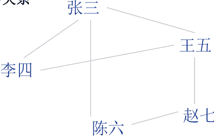

输入
输出

内存存储器

外存储器

控制器

运算器

寄存器(组)

0xFF...
内存
操作
系统
0

- 控制器：控制系统一步步从存储器中取出指令、译码
- 运算器：根据指令完成算术/逻辑运算
- 寄存器：保持程序运行状态、存储当前指令信息及下一条指令地址等

## 存储方案1:

## 存储方案2:

## 存储方案3:

2040
张三
......
李四
王五
陈六
40Byte
2080
李四
......
2120
王五
......
......

2040
(1)
张三
......
2
3
4
2080
(2)
李四
......
2120
(3)
王五
......

2040
张三
......
3118
3060
1596
3060
王五
......
3118
李四
......

数据对象 是性质相同的数据元素的集合，是数据的一个子集。

| 学号 | 姓名 | 班号 | 性别 | 出生日期 | 入学成绩 |
|---|---|---|---|---|---|
| 001 | 刘影 | 01 | 女 | 19840417 | 623 |
| 002 | 李恒 | 01 | 男 | 19831211 | 679 |
| 003 | 陈诚 | 02 | 男 | 19840910 | 638 |
| ... | ... | ... | ... | ... | ... |

## 数据元素的集合

## 元素之间的关系

## 定义在元素上的运算

## 数据结构

数据结构：带结构的数据元素的集合

数据结构=(D,S,Op)

其中：D为数据元素集合； S为D上的关系； Op为定义在D上的运算；

❖ **逻辑结构** 数据元素之间的逻辑关系，与计算机无关。 **逻辑结构 = (D,S)**

[例] 设有逻辑结构 B = (D,S)，
其中 D={d1, d2, d3, d4, d5, d6},
S={s}， s={<d1,d2>, <d1,d3>, <d1,d4>, <d3,d5>, <d3,d6>}，
试画出其逻辑结构图。

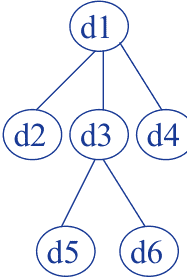

## 集合结构

数据元素属于同一集合外，无其它的关系。

成员关系

## 线性结构

数据元素之间存在一对一的关系。

长幼关系

## 树型结构

数据元素之间存在一对多的关系。

管理关系

## 图状结构

数据元素之间存在多对多的关系。

朋友关系

## 1.4 操作

不同的数据结构有不同的操作集合，这些操作可以分为四类

## 1

- 构造函数
- 析构函数

## 2

- 查询类操作
  - 判空
  - 求长度
  - ……

## 3

- 查找类操作
  - 查找某个元素的位置
  - 遍历
  - ……

## 4

- 添加和删除类操作
  - 添加一个数据元素；
  - 删除一个数据元素；
  - 置空；
  - ……

## 1.5 存储结构

存储结构（物理结构）：指数据的逻辑结构在计算机存储器中的映像表示。

数据元素的映像
用二进制位(bit)的位串表示数据元素。
每个数据元素的映像称为结点
每个数据项的映像称为数据域

## 四种不同的存储结构

1. 顺序存储结构
2. 链式存储结构
3. 哈希存储结构
4. 索引存储结构

## (3)索引存储：将数据元素分为若干子表，子表的开始位置存放在索引表中。

索引表

| 班级 | addr |
| --- | --- |
| 01 | 1 |
| 02 | 31 |
| 03 | 54 |
| ...... |  |

主表

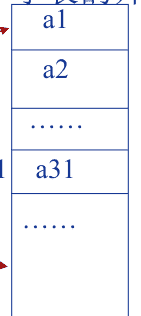

## (4)散列存储：根据数据元素的关键字值，由散列函数计算出存储地址。LOC(aᵢ)=H(key)

| ...... | 432 | ...... | 713 | ...... |

王小二

李一凡

## 1.6 算法的基本概念

## 算法的概念

建立在数据结构基础上的、求解问题的一系列确切的步骤。

## 一个算法必须满足以下五个重要特性

- 有穷性：对任何合法输入执行有穷步后能结束。
- 确定性：每条指令必须有确切的含义。
- 可行性：算法的每一条指令均能执行。
- 输入：有零个或多个输入。
- 输出：有一个或多个输出。

## 算法设计 自顶向下，逐步求精

- 案例学习：选择排序问题
- 明确问题：非递减排序
- 解决方案：逐个选择最小数据
- 算法框架：
  for ( int i=0; i<n-1; i++ ) {  //n-1趟
  从a[i]检查到a[n-1];
  若最小的整数在a[k], 交换a[i]与a[k];
  }
- 细化程序：程序 SelectSort

- 算法的性能标准
- 算法的后期测试
- 算法的事前估计

## 评价算法性能的标准

1. 正确性
2. 可读性
3. 健壮性
4. 高效率与低存储量需求

## 算法的后期测试

在算法中的某些部位插装时间函数
time()
测定算法完成某一功能所花费的时间

## 顺序搜索（Sequential Search）

```
int seqsearch ( int a[], const int n,
                 const int x )    //a[0],...,a[n-1]
{
    int i = 0;
    while ( i < n && a[i] != x )
        i++;
    if ( i == n ) return -1;
    return i;
}
```

## 插装\(time()\)的计时程序

```
void TimeSearch()
{
    //在1..1000中搜索0,10,...,90,100,200,...,1000
    int a[1001], n[20];
    for (int j=1; j<=1000; j++)
        a[j] = j;        //a[1]=1, a[2]=2, …
    for (j=0; j<10; j++) {
        n[j] = 10*j;     //n[0]=0, n[1]=10, n[2]=20
        n[j+10] = 100*(j+1);
    }                    //n[10]=100, n[11]=200, n[12]=300 …
    cout << "n   time" << endl;
}
```


for (j=0; j<20; j++) {
    long start, stop;
    time (start);
    int k = seqsearch (a, n[j], 0);
    time (stop);
    long runTime = stop - start;
    cout << " " << n[j] << " " <<
        runTime << endl;
}
cout << "Times are in hundredths of a second." << endl;
}

## 程序测试结果输出

| n | 0 | 10 | 20 | 30 | 40 | 50 | 60 | 70 | 80 | 90 |
|---|---:|---:|---:|---:|---:|---:|---:|---:|---:|---:|
| run Time | 0 | 0 | 0 | 0 | 0 | 0 | 0 | 0 | 0 | 0 |

| n | 100 | 200 | 300 | 400 | 500 | 600 | 700 | 800 | 900 | 1000 |
|---|---:|---:|---:|---:|---:|---:|---:|---:|---:|---:|
| run Time | 0 | 0 | 0 | 0 | 0 | 0 | 0 | 0 | 0 | 0 |

存储空间的固定部分
程序指令代码的空间，常数、简单变量、定长成分(如数组元素、结构成分、对象的数据成员等)变量所占的空间

可变部分
尺寸与实例特性有关的成分变量所占空间、引用变量所占空间、递归栈所用的空间、通过new和delete命令动态使用的空间

## 1.7 算法分析技术-无穷大的阶

## 定义1：无穷大的阶 O

若存在正常数 c，使得当 n 充分大（即存在 n₀，使得当 n > n₀ 时），有：

t(n) ≤ c f(n)

则，称 t(n) 趋于无穷大的阶 ≤ f(n) 趋于无穷大的阶，记为：

t(n) = O(f(n))

## 定义2：无穷大的阶Ω

若存在正常数c，使得当n充分大（即存在n₀，使得当n>n₀时），有：

t(n) ≥ c f(n)

则，称t(n)趋于无穷大的阶 ≥ f(n)趋于无穷大的阶，记为：

t(n) = Ω(f(n))

## 定义3：无穷大的阶 Θ

若满足：

t(n)= O(f(n)) 且 t(n)= Ω(f(n))

则，称 t(n)趋于无穷大的阶 = f(n)趋于无穷大的阶，记为：

t(n)= Θ(f(n))

结论：由 Θ 确定的关系为等价关系。
举例
若 f(n) 分别为 n, 3n, n+logn,
则 Θ(n)=Θ(3n)=Θ(n+logn)

## 1.7 算法分析技术-一些重要的函数和序列

## 调和级数

Hₙ = 1 + 1/2 + 1/3 + …… + 1/n
= ln n + γ + εₙ
≈ 0.693 log₂ n + γ

其中：

欧拉常数 γ ≈ 0.57721566

limₙ→∞ εₙ = 0

## Fibonacci序列： f₀=0; f₁=1; fₙ=fₙ₋₁+fₙ₋₂,(n>1).

令 Fₙ=(fₙ₊₁, fₙ)ᵀ，则：

Fₙ = ⎛1 1⎞ Fₙ₋₁
      ⎝1 0⎠
= ⎛1 1⎞ⁿ F₀
  ⎝1 0⎠
= ⎛1 1⎞ⁿ (1,0)ᵀ
  ⎝1 0⎠

其特征值为

φ = (1+√5)/2 ≈ 1.618,    \tilde{φ} = (1-√5)/2 ≈ -0.618

故：

fₙ = (φⁿ - \tilde{φ}ⁿ)/√5,    fₙ ∼ φⁿ/√5,    fₙ₊₂ > φⁿ

## ❖ **log₂\*** 函数：缓慢增长的单调函数

$$\log_2^* x=\min\left\{i:\underbrace{\log_2\log_2\cdots\log_2 x}_{i\text{ 个}}<1\right\},\quad x\geq 0$$

理论上：

$$\lim_{x\to\infty}\log_2^*x=\infty$$

现实中：

$$\log_2 x\leq 5$$

## 一个快增长序列

F₀=0, Fₙ=2^{F(n-1)}(严格单调递增)

| n | 0 | 1 | 2 | 3 | 4 | 5 | 6 |
|---|---|---|---|---|---|---|---|
| F(n) | 0 | 1 | 2 | 4 | 16 | 2¹⁶ | 2⁶⁵⁵³⁶ |

## 反函数

对严格单调增函数$f$，其反函数记为$f^{-1}$，有：

$f[f^{-1}(x)]=x,\ f^{-1}[f(x)]=x.$

推广：若$\{f(n)\}$为严格单调增序列且$f_0=0$，则该序列

反函数的定义域为$[0,\infty)$，反函数为：

$f_n^{-1}(x)=i$ 其中： $x\in[f_i,f_{i+1})$

$f_n$ 快 慢 → ∞    $f_n^{-1}$ 慢 快 → ∞

性质： $log_2^*x = F_n^{-1}(x),\; x\ge0$

## 基本定理

如果实函数：

f:[1,+∞] → R

在区间[1,b)是非负有界的。则：

- 存在正常数 C>0，使得当 x∈[1,b) (b>1)时，有：
  0≤f(x)≤C

- 存在正常数 a>0,当 x≥b 时，有：
  f(x)=a f(x/b)+x^k

## 可推导出函数f(x)的值为：

⎧ f(x) ∼ [ b^k / (a - b^k) (b^k / a)^ε + f(b^ε)/a^ε ] x^{log_b a} 当 k < log_b a 时
f(x) = x^k ⌊log_b x⌋ + (f(b^ε)/a^ε) x^k 当 k = log_b a 时
f(x) ∼ b^k / (b^k - a) x^k 当 k > log_b a 时

其中：

0 ≤ ε = log_b x − ⌊log_b x⌋ < 1

为 log_b x 的小数部分

## 也即：

```
f(x) = { Θ(x^{log_b a}) 当 k < log_b a 时
Θ(x^k log_b x) 当 k = log_b a 时
Θ(x^k) 当 k > log_b a 时 }
```

根据无穷大阶的定义，有以下定理：

Th: 若当 $x\ge b$ 时，$f(x)$ 满足：
$$f(x)\le af(x/b)+cx^k\quad(\text{常数 }c\ge0)$$
则：

$$f(x)=\begin{cases}
O(x^{\log_b a}) & \text{当 } k<\log_b a\text{ 时}\\
O(x^k\lvert\log_b x\rvert) & \text{当 } k=\log_b a\text{ 时}\\
O(x^k) & \text{当 } k>\log_b a\text{ 时}
\end{cases}$$

## Catalan级数

$b_0=1,\ b_{n+1}=b_0b_n+b_1b_{n-1}+\ldots+b_nb_0\ (n>0)$

$\{b_k\}$ 的发生函数 $B(x)$

$B(x)=\sum_{k=0}^{\infty}b_kx^k$

可求得：

$b_n=C_{2n}^{n}/(n+1)=O(4^n/n^{3/2})$

$b_{n+1}=\left(4-\frac{6}{n+2}\right)b_n$

## 1.7 算法分析技术-时间复杂度

**算法的消耗时间**：算法中每条语句执行时间之和。

**时间复杂度**：算法中各语句的频度之和 $T(n)$。

频度——语句的执行次数；

$n$——问题的规模，一般为数据的输入量

**渐近时间复杂度**：当问题的规模 $n$ 趋于无穷大时，$T(n)$ 的数量级（阶）。记为：

$T(n)=\Theta(f(n))$。

实际中，将渐近时间复杂度简称为时间复杂度，用以描述算法的时间特性。

计算机执行下面的语句时，语句 $s$ 的频度为 ______。

```
for(i=1; i<n-1; i++)
    for(j=n; j>=i; j--)
        s;
```

## 时间复杂度的求法

- 计算 $T(n)$
- 从 $T(n)$ 中推断 $f(n)$

## 影响算法时间复杂度的因素

- 问题的规模
- 输入实例的初态

## 常见的时间复杂度

O(1), O(log₂n), O(n), O(n log₂n), O(n²), O(n³), O(2ⁿ)

好 → 差


## [例1] n×n矩阵相乘的算法语句

```c
for (i = 0; i < n; i++)
    for (j = 0; j < n; j++)
    {
        c[i][j] = 0;
        for (k = 0; k < n; k++)
            c[i][j] = c[i][j] + a[i][k] * b[k][j];
    }
```

语句频度：

```
n+1
n(n+1)
n²
n²(n+1)
n³
```

解：语句频度 \(T(n)=2n^3+3n^2+2n+1\)。

当 \(n \ge n_0=1\) 时，有 \(T(n) \le 8n^3\)，即 \(c=8\)，由此取 \(f(n)=n^3\)，则 \(T(n)=O(n^3)\)。

算法中存在循环时，通常由嵌套层数最深的循环语句的最内层语句决定。

## [例2] 在数组 A[n] 查找给定值 K

```c
(1) i = n;
(2) while ((i >= 0) && (A[i] != K))
(3)     i = i - 1;
(4) return (i);
```

解：最好情况的时间复杂度 \(T(n)=O(1)\)。

最坏情况的时间复杂度 \(T(n)=O(n)\)。

平均时间复杂度：所有可能的输入实例以等概率出现的情况

\[
T(n)=(1+2+\cdots+n)/n=O(n)
\]

算法与数据状态有关时，需讨论不同情况。

## [例3] 设 n 为正整数，分析以下程序段的时间复杂度

```c
i = 1; k = 0;
while (i <= n - 1)
{
    k += 10 * i;
    i++;
}
```

解：平均情况：\(T(n)=O(n)\)。

## 1.7 算法分析技术——分摊复杂度

定义：考虑由 M 个操作组成其计算序列 \(O_1,O_2,\ldots,O_M\)。假设操作 \(O_i\) 的运行时间为 \(t_i\)，则称其中一个操作的分摊时间复杂度为：

\[
A(n)=\Theta\left(\frac{\sum_{i=1}^{M}t_i}{M}\right)
\]

即：分摊复杂度是将 M 个操作的总工作量按照平均分摊到每个操作之上。

## [例4] 对非负整数 k，其奇度为 k 的二进制表示中从最低位起连续 1 的个数。利用下面算法连续计算区间 [0,n) 中每一个数的奇度，分析其分摊复杂度。

```c
int od(unsigned k)
{
    int result = 0;
    for (; (k & 1) != 0; k >>= 1)
        ++result; /* S1 */
    return result;
}
```

## 【分析】

- 1. \(od(1)=1,\ od(3)=od(11_2)=2,\)
  \(od(23)=od(10111_2)=3;\ldots\ldots\)
  \(od(偶数)=0;\)

- 2. 只计算 \([0,n)\) 中某个 \(k\) 的 \(od(k)\)
  - 最坏情况 \((n=2^m,\ k=n-1)\)，时间复杂度 \(O(\log n)\)
  - 最好情况 \((k 为偶数)\)，时间复杂度 \(O(1)\)

- 3. 计算 \([0,n)\) 中每个数的奇度，即计算 \(od(1),od(2),\ldots,od(n-1)\)。

## 代价（cost）

任一运算只要能在固定时间内完成，就可视作单位时间来考虑。为区别于时间，称其为代价单位。

假设执行操作 \(O_i\) 的代价为 \(C_i\)，则分摊复杂度可记为：

\[
A(n)=\frac{\sum_{i=1}^{M}C_i}{M}
\]

对 [例4] 而言：

\(od(k)\) 的准确运算时间 \(T\)：

\[
T=\text{循环执行次数}\times\text{执行一次 S1 的时间}+\delta=od(k)\times\text{执行一次 S1 的时间}+\delta
\]

执行一次 S1 的时间是常数，视为代价；故：

计算 \(od(k)\) 的代价 \(=od(k)+\delta\)。

计算 \(\{od(k)\mid k=0,1,\ldots,n-1\}\)，其中一个操作的分摊复杂度为：

\[
A(n)=\frac{\sum_{i=1}^{M}C_i}{M}=\frac{\sum_{k=0}^{n-1}od(k)}{n}
\]

## 分摊复杂度分析方法

- 累计法
- 势函数法
- 捐款记账法

## 累计法

将 M 个运算的时间代价相加再求平均。

以 [例4] 为例：

假设 \(n=2^q\)。

- 在区间 \([0,n)\)，有 \(2^{q-1}\) 个偶数，其奇度为 0；
- 在区间 \([0,n)\)，有 \(2^{q-2}\) 个形如 `***01` 的数，其奇度为 1；
- 在区间 \([0,n)\)，有 \(2^{q-k}\) 个形如 `***01...1` 的数，其奇度为 \(k-1\)（\(k=1,\ldots,q\)）；
- 当 \(k=2^q-1\) 时，其奇度为 \(q\)。

\[
S(n)=\sum_{k=0}^{n-1}od(k)=\sum_{k=1}^{q}(k-1)2^{q-k}+q=n-1
\]

当 \(n\) 为一般形式时，假设 \(2^q\le n<2^{q+1}\)，则：

\[
n/2-1\le 2^q-1=S(2^q)\le S(n)
\]

\[
S(n)\le S(2^{q+1})=2^{q+1}-1<2n-1
\]

即：

\[
n/2-1\le S(n)<2n-1 \Rightarrow S(n)=\Theta(n)
\]

计算一个 \(od(i)\) 的分摊复杂度为：

\[
A(n)=S(n)/n=\Theta(1)
\]

## 势函数法

将操作 \(O_i\) 看成是将事物从一个状态变成另一状态：

\[
S_{i-1}\xrightarrow{O_i}S_i
\]

M 个操作和 M+1 个状态可看成是一个序列：

\[
S_0\xrightarrow{O_1}S_1\xrightarrow{O_2}\cdots\xrightarrow{O_M}S_M
\]

对每个状态 \(S_i\)，定义值 \(\Phi_i\)，称其为状态 \(S_i\) 的势函数，称 \(\Delta\Phi_i\) 为势函数增量：

\[
\Delta\Phi_i=\Phi_i-\Phi_{i-1}
\]

\(\Delta\Phi_i\) 是由操作引起的势函数的变化。

对势函数要求：

\[
C_i+\Delta\Phi_i\le\beta
\]

其中，\(\beta\) 与运算次数 \(i\) 无关，\(C_i\) 为操作 \(O_i\) 的代价。

此时有：

\[
A(n)=\frac{\sum_{i=1}^{M}C_i}{M}\le\beta+\frac{\Phi_0-\Phi_M}{M}
\]

而 \((\Phi_0-\Phi_M)/M\) 较小，或为负。

因此：

\[
A(n)=O(\beta)
\]

即：

\[
\text{分摊复杂度}=\text{操作实际代价}+\text{势函数变化}
\]

以 [例4] 为例：

将区间 \([0,n)\) 中每个数视为一个状态，其势函数为

\[
\Phi_i=pop(i)=(i\text{ 的二进制表示中 1 的个数})
\]

而

\[
\Phi_{i+1}=\Phi_i-od(i)+1
\]

从而有

\[
A(n)=\frac{\sum_{i=0}^{n-1}od(i)}{n}=1+\frac{\Phi_0-\Phi_n}{n}=1-\frac{pop(n)}{n}
\]

由于 \(pop(n)/n\) 是无穷小量，因此：

\[
A(n)=\Theta(1)
\]

## 捐款记账法

按照操作代价进行捐款，用总捐款额来度量操作的代价总和。

假设操作 \(O_i\) 的代价为 \(C_i\)，所捐款额为 \(D_i\)，要求 \(C_i\le D_i\)，使得：

\[
\sum_{i=1}^{M}C_i\le\sum_{i=1}^{M}D_i
\]

现实中的两种做法：

- 捐款额大于代价，但设置上界；
- 将操作分类，对不同类型操作捐不同的货币。

## 分摊复杂度约定

若操作次数 \(M\) 与问题规模 \(n\) 有关，则约定：

\[
M=\Omega(n)
\]

即：

存在常数 \(c\ (c>0)\)，使得 \(M\ge cn\)。

若操作次数 \(M\) 与问题规模 \(n\) 无关，则分摊复杂度与时间复杂度等同。

## 1.7 算法分析技术——空间复杂度

## 算法的存储空间

- 输入数据所占空间
- 程序本身所占空间
- 辅助变量所占空间

## 空间复杂度

\[
S(n)=O(f(n))\quad\text{或}\quad S(n)=\Theta(f(n))
\]

表示随着问题规模 \(n\) 的增大，算法运行所需存储量的增长率与 \(f(n)\) 的增长率相同。

## 原地算法

当某个算法空间复杂度为 \(O(1)\) 时，称该算法为原地算法。

## 存储密度

\[
d=\frac{\text{数据本身存储量}}{\text{实际所占存储量}}
\]

## 本章作业

- 1. 设 n 是偶数，试计算运行下列程序段后 m 的值，并给出该程序段的时间复杂度。

```c
m = 0;
for (i = 1; i <= n; i++)
    for (j = 2 * i; j <= n; j++)
        m = m + 1;
```

- 2. 下列算法对一 n 位二进制数加 1，假如无溢出，该算法在最坏情况下时间复杂度是什么？并分析它的平均时间复杂度。

```c
void func(int A[n]) // A[n]中每个元素取值0或1
{
    int i = n;
    while (A[i] == 1)
    {
        A[i] = 0;
        i--;
    }
    A[i] = 1;
}
```

- 3. 调用下列函数 f(n)，回答下列问题：
  （1）试给出 f(n) 值的大小，并写出 f(n) 值的推导过程；
  （2）假定 n=5，试指出 f(5) 值的大小和执行 f(5) 时的输出结果。

```c
int f(int n)
{
    int i, j, k, sum = 0;
    for (i = 1; i < n + 1; i++)
    {
        for (j = n; j > i - 1; j--)
            for (k = 1; k < j + 1; k++)
                sum++;
        printf("sum=%d\n", sum);
    }
    return (sum);
}
```


## 第二章 线性表

杨震

北京邮电大学计算机科学与技术学院

- email:buptdslecture@126.com
- Password: poiuyt098765

## 提纲

- 1 线性表定义
- 2 向量（顺序表）
- 3 单链表
- 4 单循环链表
- 5 双向链表
- 6 静态链表
- 线性表的应用

## 2.1 线性表定义

形式定义：由n (n≥0) 个数据元素组成的 有序序列。
Linear_list = (D, S)
其中： D={a_i | a_i ∈ D_0 , i=0,1,..., n-1    n ≥0}
R={N} N={<a_{i-1}, a_i>| a_{i-1}, a_i ∈ D_0 , i=1,2,..., n-1 }
D_0 为某个数据对象
或者简记为： (a_0, a_1, ..., a_i, ... a_{n-1} ) n≥0
（n为表长。当n=0，称为 空表）

线性表的特点：在数据元素的非空有限集中

- 数据元素间是线性关系，数据元素在表中的位置只取决于其序号
- 存在唯一的一个被称作“第一个”的数据元素和唯一的一个被称作“最后一个”的数据元素
- 除第一个外，每个数据元素均只有一个前驱；除最后一个外，每个数据元素均只有一个后继

## 2.2 向量（顺序表）

起始地址为b、最多可容纳max个元素的向量

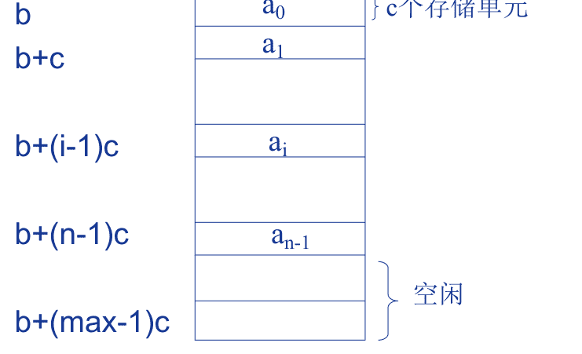

## 顺序表的构造函数与析构函数

```
tempate<typename T>
struct Vector {
    T* elem; // T为数据元素    向量的基地址
    int size;                向量中实际元素个数
    int capacity;            向量能容纳的元素个数
    Vector(int n=0; T const& t=T())
    :elem(0),size(0),capacity(0)
    {
        elem=(T*)malloc(n*sizeof(T));
        uninitialized_fill(elem, elem+n,t);
        size=capacity=n;
    }
    virtual ~Vector() {  free(elem);}
}
```

## 顺序表的判空与求长度

```
```cpp
template<typename T>
struct Vector {
    bool empty(void) const
    {
        return size==0;
    }
    int size(void) const
    {
        return size;
    }
}
```
```

## 获取顺序表成员

```
Template<typename T>
Struct Vector {
    T& front(void)    取向量首元素
    {
        return elem[0];
    }
    T& back(void)     取向量尾元素
    {
        return elem[szie-1];
    }
    T& operator[] (int i)    取向量第i个元素
    { //前提条件： 0<=i<=size;
        return elem[i];
    }
}
```

## 顺序表元素的删除

```
Template<typename T>
Strcut Vector {
    void pop_back(void)
    {
        size--;
    }
    void erase(Iterator pos)
    {
        memmove(pos,pos+1,
        sizeof(T)*(elem+--size-pos));
    }
```

C语言的标准库函数

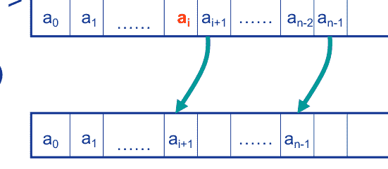

```
```c
void* memmove(void* dest, void* source, size_t count)
{
    void* ret = dest;
    if (dest <= source || dest >= (source + count))
    {
        while (count --)
            *dest++ = *source++;
    }
    else
    {
        dest += count - 1;
        source += count - 1;
        while (count --)
            *dest-- = *source--;
    }
    return ret;
}
```
```

## 顺序表的存储管理

```
template<typename T>
Struct Vector {
    void reserve(int n)
    {
        if (n>capacity)
        {
            elem=(T*)realloc(elem,n*sizeof(T));
            uninitialized_fill(elem+size,elem+n,T());
            capacity=n;
        }
    }
    protected:
    bool full(void) const
    {      return size==capacity; }
    int next_capacity(void) const
    {
        return capacity<= 0 ?1:2*capacity;
    }
}
```

## 顺序表元素的添加

```
template<typename T>
Struct Vector {
    void push_back(T const& t)
    {//添加在向量尾部
        if (full())
            reverse(next_capacity());
        elem[size++];
    }
    void insert(Iterator pos, T const &t)
    {
        if (full())
        {//添加在pos之前
            int count offset=pos-elem;
            reserve(next_capacity());
            pos=elem+offset;
        }
        memmove(pos+1,pos,
        sizeof(T)*(elem+size++ -pos));
        *pos=t;
    }
}
```

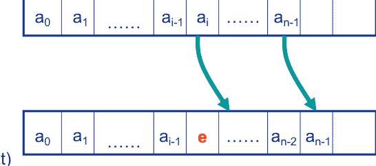

- [性能分析]
- • 最好 i=n 不用移动结点
  时间复杂度 O(1)
- • 最差 i=0 需移动所有结点
  时间复杂度 O(n)
- • 平均
  O(n)

## 顺序表的其他成员函数

```
template<typename T>
void Vector<T>::resize(int n,T const &t=T())
{
    reverse(n);
    if (size<n)
        uninitialized_fill(elem+size,elem+n,T);
    size=n;
}
template<typename T>
void swap(Vector<T>& a, Vector<T>& b)
{
    std::swap(a.elem,b.elem);
    std::swap(a.size,b.size);
    std::swap(a.capacity,b.capacity);
}
```

## 顺序表的优缺点

## 优点

- 逻辑相邻，物理相邻
- 可随机存取任一元素
- 存储空间使用紧凑

## 缺点

- 插入、删除操作需要移动大量的元素
- 预先分配空间需按最大空间分配，利用不充分
- 表容量扩充困难

## 2.3 单链表

结点的物理表示

value next

数据域 指针域

first

两种基本形式

头指针first

头指针

首元结点

头结点

首元结点

头结点的 作用：插入和删除 第一个数据元素时不必 对头指针进行特殊处理。

空表：
first=NULL

first

带头节点单链表判空：
first->next!=NULL


## 单链表节点类型定义

```c
struct snode
{
    snode *next;
    T value;
};
typedef Snode<T> Node_type;
typedef Node_type Node;
```

## [查找]

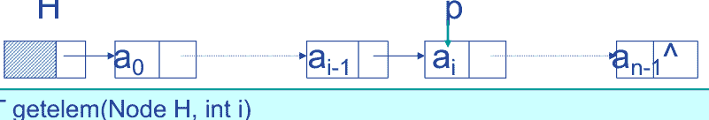

```
T getelem(Node H, int i)
    p=H->next;  j=1;
    while ((p<>NULL) && (j<i))
    { p=p->next;
      j=j+1
    };
    if (j=i)
        return (p->value);
    else  return (0);} //时间复杂度： O(n)
```

## [链表中间插入元素]

```
p->next=s;
s->next=p->next;
```

```
s->next=p->next;
p->next=s;
```

[顺序不能颠倒]

[思考]: 在表头插入，表尾插入情况如何？

## [例1]：带头节点的单链表的生成

设输入数据元素序列为[a₁, a₂ , a₃]

## 1)头插法 O(n)


## 2)尾插法 O(n²)


[思考]: 对于一个具有n个结点的单链表，在已知的结点（其指针为p）后插入一个新结点的时间复杂度为 O(1) ，在给定值为x的结点后插入一个新结点的平均时间复杂度为 O(n) 。

在单链表已知的结点（其指针为p）前插入一个新结点的时间复杂度又为多少？

## [删除]

第一种情况：删除表中第一个元素
第二种情况：删除表中或表尾元素

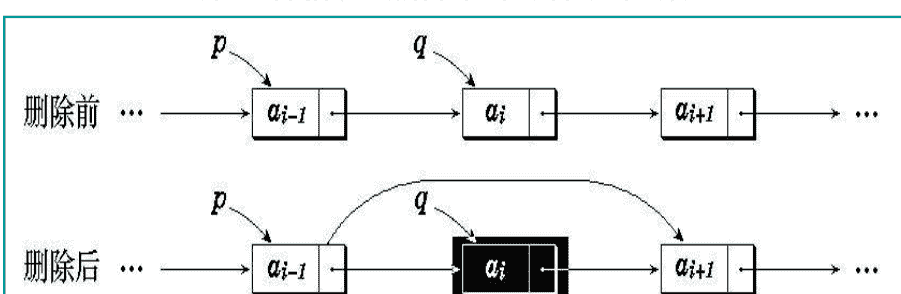

## 在单链表中删除含 $a_i$ 的结点

## [例2]从带表头结点的单链表中删除第一个结点

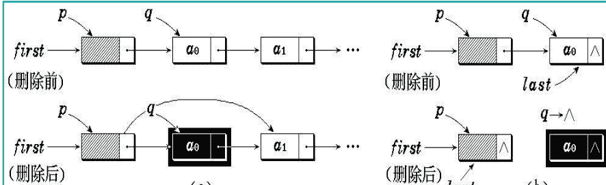

## [例3]以下程序的功能是实现带附加头结点的单链表数据结构点逆序连接，请填空完善之。

```
typedef struct node
{int data; struct node *next;
}linknode,*pointer;
void reverse(pointer & h)//h为头指针
{ pointer p,q;
 p=h->next; h->next=NULL;
 while((1)__________)
 {
  q=p;
  p=p->next;
  q->next=h->next;
  h->next=(2)__________;
 }
}
```

(1)p!=null  // 链表未到尾就一直作
(2)q      // 将当前结点作为头结点后的第一元素结点插入

## 2.4 单循环链表

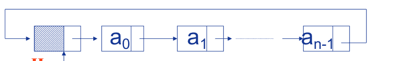

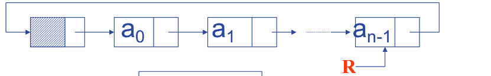

空循环链表

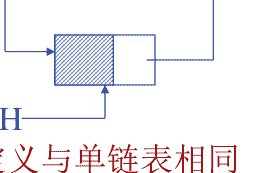

H->next==H

循环链表类型定义与单链表相同

## 在单循环链表表尾插入一个元素

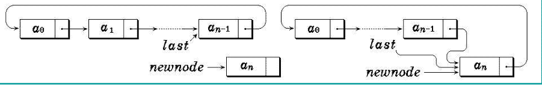

- 单循环链表是单链表的变形。
- 单循环链表最后一个节点的后继指针不为 0 (NULL)，而是指向了表的前端。
- 为简化操作，在单循环链表中往往加入表头结点。
- 单循环链表的特点是：只要知道表中某一节点的地址，就可搜寻到所有其他节点的地址。

## 2.5 双向链表

结点的物理表示

prev element next

p

a₀

a₁

aₙ₋₁

H

p == p->prev->next == p->next->prev

H

H->next==H->prev==H

思考：能否以H->next==H->prev判定双向链表为空？

[例]：在current后插入一个节点p，并用current指向插入后的节点

```
p→prev = current;
p→next =current→next;
current→next = p;
current = current→prev;
current→next→prev = current;
```

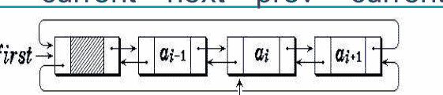

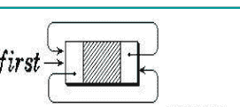

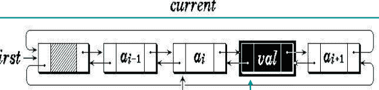

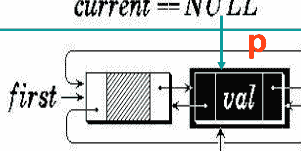

## 顺序表和链表的比较

- **空间**
  - 存储空间静态分配，需事先确定
  - 存储密度高(d=1) (不考虑空闲区)
  - **时间**
  - 是随机存取结构，可以根据序号直接定位
  - 插入/删除结点操作时数据元素要移动

- **空间**
  - 存储空间动态分配，可以按需要使用
  - 每一结点附加指针域 (d<1)
  - **时间**
  - 是非随机存取结构，定位需从头指针扫描
  - 插入/删除结点操作时通常只要修改指针

## 2.6 静态链表

用数组模拟链表

- 逻辑上看像链表
- 物理上看是数组

## 静态单链表-带头节点

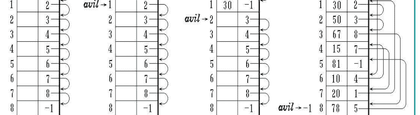

```
分配节点： j = avil; avil = A[avil].link;
释放节点： A[i].link = avil; avil = i;
```

## [静态双链表]

```
struct Stnode { int next, int prev, T value};
```

base[0]为头节点

基地址：base

| 偏移量 | 0 | 1 | 2 | 3 | 4 | 5 | 6 | 7 |
|---|---|---|---|---|---|---|---|---|
| prev | 6 |  | 0 |  | 2 |  | 4 |  |
| value | 1 |  | $a_0$ |  | $a_1$ |  | $a_2$ |  |
| next | 2 | 3 | 4 | 5 | 6 | 7 | 0 | 0 |

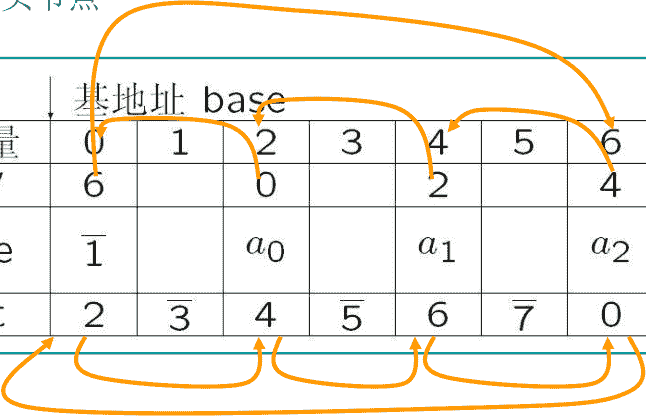

## 一元n次多项式相加

## 数学表示

pₙ(x)=p₀ + p₁x + p₂x² + ... + pₙxⁿ

[例] pa(x)=7+3x+9x⁸+5x¹⁷

pb(x)=8x+22x⁷-9x⁸

## 选择数据结构及其存储方式

- 线性表：数据元素 (p)
- (p,e) √

- 存储结构：
- 顺序表
- 带头结点的单链表 √

## 存储结构定义

```
typedef struct node{
    double cof;
    int exp;
```

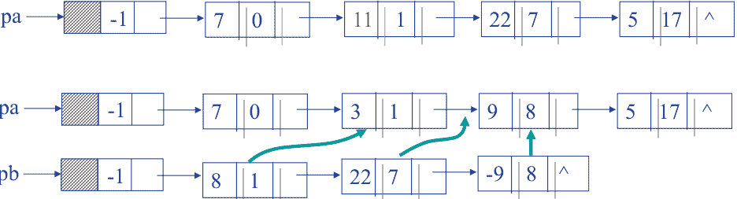

阅读以下算法，填充空格，使其成为完整的算法。其功能是在一个非递减的顺序存储线性表中，删除所有值相等的多余元素。

```
define maxlen=30
Struct node {
    int [maxlen];
    int last};
void exam (struct node &L){
j=0; i=1;
while (1)_____
{ if L.elem[i]!=L.elem[j]
{(2)_____ ; (3)_____ ;}
i=i+1;
}
(4)_____ ;
}
```

(1)i+1 <=L.last //L.last 为元素个数
(2)j++    // 有值不相等的元素
(3)L.elem[j]=L.elem[i]  // 元素前移
(4)L.last=j  // 元素个数

对于给定的不含头结点的单链表head，下面的程序过程实现了按结点值非降次序输出单链表中的所有结点。在每次输出一个结点时，就把输出结点从链表中删去。请在划线处填上适当的内容，使之成为一个完整的程序过程，每个空框只填一个语句。

```
void sort_output_delete (nodeptr head);
{
    nodeptr p,q,r,s;
    while( head != NULL)
    {
        p = NULL ; q= head; r= q ; s=q->next ;
        while ( s != NULL)
        {
            IF s->data < q->data
            { (1)____; (2)____; }
            r= s; (3)____;
        }
        printf(q->data);
        if (p==NULL)
            (4)____
        else (5)____;
        free (q);
    }
    ..........
}
```

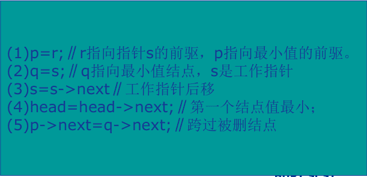


请写一算法Link LinkListSort(Link list)，将不带头结点的单链表按结点数据域的值的大小从小到大重新链接。要求链接过程中不得使用除该链表以外的任何链结点空间。

```
Link LinkListSort(Link list)
{
    p=list->next;  // p是工作指针，指向待排序的当前元素。
    list->next=NULL; // 假定第一个元素有序，即链表中现只有一个结点。
    while(p!=null)
    {
        r=p->next;   // r是p的后继。
        q=list;
        if(q->data>p->data) // 处理待排序结点p比第一个元素结点小的情况。
        {  p->next=list;
           list=p; // 链表指针指向最小元素。
        }
        else // 查找元素值最小的结点。
        {  while(q->next!=null && q->next->data<p->data)
               q=q->next;
           p->next=q->next; // 将当前排序结点链入有序链表中。
           q->next=p; }
        p=r; // p指向下一个待排序结点。
    }
}
```

假设一个单循环链表，其结点含有三个域prev、data、next。其中data为数据域；prev为指针域，它的值为空指针（Null）；next为指针域，它指向后继结点。请设计算法，将此表改成双向循环链表。要求时间复杂度为O(n)

```
```c
void StoDouble (Link la)
{
    link p=la;
    while (p->next->prev==NULL)
    {
        p->next->pre=la;
        // 将结点p后继的prev指针指向p。
        p=p->next;    // la指针后移。
    }
}
```
```

编写一个算法来交换单链表中指针P所指结点与其后继结点，head是该链表的头指针，P指向该链表中某一结点。
LinkedList Exchange（LinkedList head，p）
{
    q=head->next;    // q是工作指针，指向链表中当前待处理结点。
    pre=head;       // pre是前驱结点指针，指向q的前驱。
    while（q!=null && q!=p）{pre=q; q=q->next; } // 未找到p结点，后移指针。
    if（p->next==null）printf（"p无后继结点\n"）; // p是链表中最后一个结点，无后继。
    else // 处理p和后继结点交换
    {q=p->next;        // 暂存p的后继。
    pre->next=q;      // p前驱结点的后继指向p的后继。
    p->next=q->next;  // p的后继指向原p后继的后继。
    q->next=p    ; // 原p后继的后继指针指向p。
    }
}

## 本章作业

+   1. 假设有两个按元素值递增次序排列的线性表，均以单链表形式存储。请编写算法将这两个单链表归并为一个按元素值递减次序排列的单链表，并要求利用原来两个单链表的结点存放归并后的单链表。

节点结构：

```
typedef struct node{
int data;
struct node *next;
} linknode,*link;
```

link Union(link la,lb)

## 2.请在下列算法的横线上填入适当的语句。

```
typedef struct node
{int data; struct node *next;
}linknode,*link;
bool inclusion(link ha,link hb):boolean;
/*以ha和hb为头指针的带头节点单链表分别表示递增有序表A和B，本算法判别表A是否包含在表B内，若是，则返回“true”，否则返回“false”*/
{
    pa=ha->next; pb=hb->next; (1) ;
    while ( (2) )
    {
        if (pa->data==pb->data )
            (3) ;
        else
            (4) ;
    }
    (5) ;
}
```

3. 请写一算法link LinkListSort(link la)，将不带头结点的单链表按结点数据域的值的大小从小到大重新链接。要求链接过程中不得使用除该链表以外的任何链结点空间。

```
typedef struct node
{int data; struct node *next;
}linknode,*link;
link LinkListSort(link list)
```

## 加里森的任务

+   - 有n个加里森敢死队的队员要炸掉敌人的一个军火库，谁都不想去，队长加里森决定用轮回数数的办法来决定哪个战士去执行任务。规则如下：如果前一个战士没完成任务，则要再派一个战士上去。现给每个战士编一个号，大家围坐成一圈，随便从某一个编号为x的战士开始计数，当数到y时，对应的战士就去执行任务，且此战士不再参加下一轮计数。如果此战士没完成任务，再从下一个战士开始数数，被数到第y时，此战士接着去执行任务。以此类推，直到任务完成为止。
+   - 加里森本人是不愿意去的，假设加里森为1号，请你设计一程序为加里森支招，求出n,x,y满足何种条件时,加里森能留到最后而不用去执行任务；
+   - 要求：
+     - 主要数据结构采用链式结构存储。
+     - 自拟1个实验实例验证程序正确性（即：n,x,y自拟）。

## 实验报告撰写格式

## **正文抬头部分**

+   题目：******

+   班级：********  姓名：***  学号：XXXXX 分工：XXXXX

+   班级：********  姓名：***  学号：XXXXX 分工：XXXXX

+   班级：********  姓名：***  学号：XXXXX 分工：XXXXX

最多4人一组，自由组合

## 1、 需求分析

以无歧义的陈述说明所选设计题目的任务，强调的是程序要做什么？明确规定：输入的形式和输出、值的范围；输出的形式；程序所能达到的功能；测试的数据：包括正确的输入和错误的输入及其相应的输出结果；

## 2、 概要设计

问题解决的思路概述；说明程序中用到的所有数据结构类型的定义，主程序的流程以及各程序模块之间的层次（调用）关系。

## 3、 详细设计

实现概要设计中定义所有数据类型，对每个操作只需要写出伪代码算法，画出函数的调用关系图。

## 4、 调试分析报告

调试过程中遇到的问题并且是如何解决的以及对设计实现的回顾讨论和分析算法的时空分析（包括基本操作和主要算法的时空复杂度的分析）和改进设想经验和体会等

## 5、 用户使用说明

向用户说明如何使用你编写的程序，
详细列出每一步的操作步骤。

## 6、 测试结果

详细说明用于测试的实验实例，这里的测试实例应该完整和严格。并列出测试结果，包括输入的数据和相应的输出数据。

## 实验报告提交方式

## 提交方式及要求：

+   - 发送邮件： buptdatastruct2012@126.com
+   - 可自由分组，每组1-3人，每组一份
+   - 邮件标题：本组某一个同学学号+算法与数据结构实验报告（n）
+   - 附件：实验报告正文(.doc)+所有带详细注释的可读性好的源码文件(.cpp+.h)
+   - 电子邮件发送时请加上请求阅读收条，以便确认实验报告是否已经收到。
+   - 提交时间：某一章的实验报告应在本章内容结束后两个星期之内提交，逾期不交者不予批改和验收。
+   - 实验验收：验收时间另行通知，地点S205，要求每组自带PC和原程序。

## 第三章 栈与队列

## 第三章（第一部分）枝

## 提 纲

+   1. 栈的定义
+   2. 顺序栈
+   3. 链栈
+   4. 栈的应用

## 栈的定义

栈是一种特殊的线性表，限定插入和删除操作只能在表尾进行。具有后进先出(LIFO—Last In First Out)的特点。

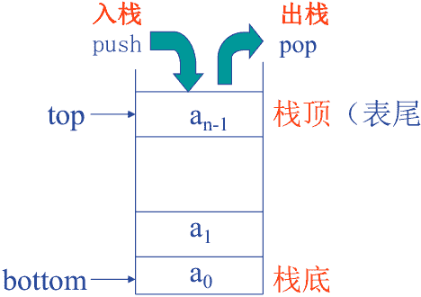

## 定义在栈结构上的基本运算

+   (1) 生成空栈操作
+   (2) 判栈空函数
+   (3) 数据元素入栈操作
+   (4) 数据元素出栈函数
+   (5) 取栈顶元素函数
+   (6) 置栈空操作
+   (7) 求当前栈元素个数函数


## [栈的顺序存储结构]

一个栈独占一组地址连续的存储单元

[类型定义] 数组(栈空间)+栈顶指示

栈空条件  S.top==-1    （此时退栈则下溢）

栈满条件  S.top==max-1 (此时进栈则上溢)

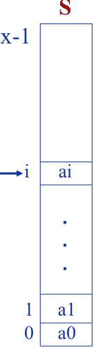

## 进栈示例

top→ 空栈

top→ a 进栈

top→ b 进栈

top→ k 进栈

top→ l 进栈溢出

...

...

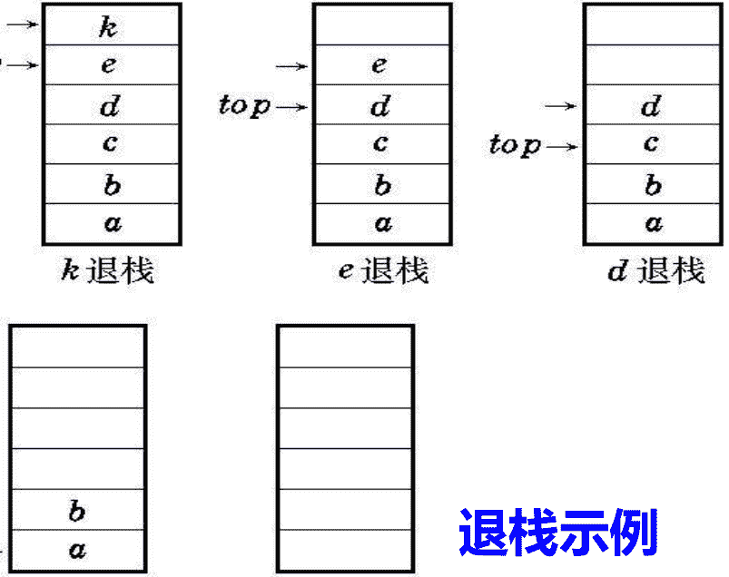

## 退栈示例

k退栈

e退栈

d退栈

a退栈

空栈

有5 个元素，其入栈次序为：A，B，C，D，E，在各种可能的出栈次序中，以元素C，D最先出栈（即C第一个且D第二个出栈）的次序有哪几个？

CDEBA，CDBEA，CDBAE

## 思考： n个元素依次入栈，可得到多少个合法的出栈序列

(2n)!/[(n+1)!*n!]

不同的出栈序列实际上对应着不同的入栈出栈操作，以1记为入栈，0为出栈。则问题实际上是求n个1和n个0构成的全排列，其中任意一个位置，它及它此前的数中，1的个数要大于等于0的个数。
n个1和n个0构成的全排列数为：(2n)!/[n!*n!]

在n个0和n个1构成的2n个数的序列中，假设第一次出现0的个数大于1个个数的（即0的个数比1的个数大一）的位置为k，则k为奇数，k之前有相等数目的0和1，各为(k-1)/2。若把这k个数，0换成1，1换成0，则原序列唯一对应上一个n+1个1和n-1个0的序列。反之，任意一个由n+1个1和n-1个0构成的序列也唯一地对应一个这样不合要求的序列。由于一一对应，故这样不合要求的序列数实际上等于有n+1个1和n-1个0构成的排列数，即(2n)!/(n+1)!(n-1)！。

因此合法的个数为：(2n)!/[n!*n!] - (2n)!/[(n+1)!(n-1)!]

=(2n)!/[(n+1)!*n!]

## [例]两个栈共享一组地址连续的存储单元

## [类型定义] 数组(栈空间) + 两个栈顶指示

栈满条件： s.top[0]+1==s.top[1]

栈空条件： s.top[0]==-1（栈0）

s.top[1]==m （栈1）

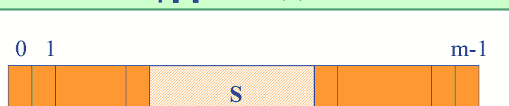

## 多栈处理 栈浮动技术

n栈共享一个数组空间 V[m]

设立栈顶指针数组 t[n+1] 和栈底指针数组 b[n+1]

t[i]和b[i]分别指示第i个栈的栈顶与栈底

b[n]作为控制量，指到数组最高下标

各栈初始分配空间 s = ⌊m / n⌋

指针初始值 t[0] = b[0] = -1，b[n] = m-1

t[i] = b[i] = b[i-1] + s，i = 1, 2, …, n-1

## 插入新元素时的栈满处理 StackFull ()

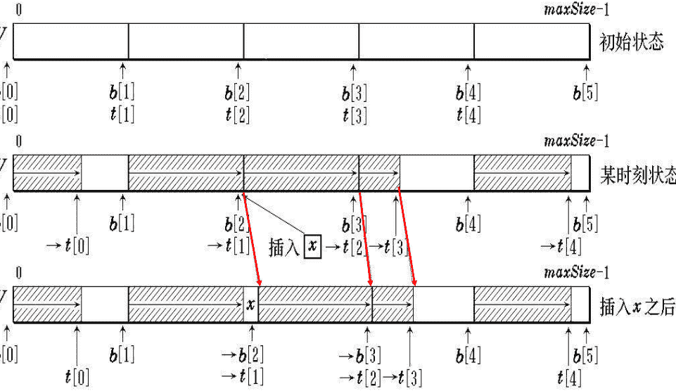

```
template <class Type>
void Push( const int i, const Type & item ) {
    if ( t[i] == b[i+1] ) StackFull(i);
    else V[++t[i]] = item;      //第i 个栈进栈
}

template <class Type> Type *Pop( const i ) {
    if ( t[i] == b[i] )
        { StackEmpty(i); return 0; }
    else return & V[t[i]--];    //第i 个栈出栈
}
```

## 3.4.栈的应用

## 栈与递归过程

## [递归的含义]

函数、过程或者数据结构的内部又直接或者间接地由自身定义。

## [适合于应用递归的场合]

- 规模较大的问题可以化解为规模较小的问题，且二者处理(或定义)的方式一致；
- 当问题规模降低到一定程度时是可以直接求解的(终止条件)

例1. 阶乘 n! = { 1          n=0
  n·(n-1)!   n>0 }

## 例2. n阶Hanoi塔问题

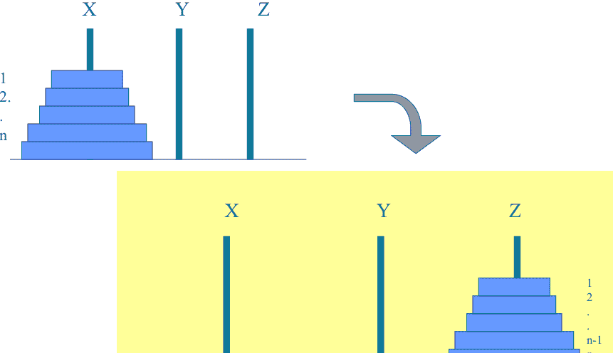

## [写递归算法应注意的问题]

- 递归算法本身不可以作为独立的程序运行，需在其它程序中设置调用初值，进行调用；
- 递归算法应有出口(终止条件)

例1. 求n!

```
int Factorial(int n)
{
    if (n==0)
        return(1);
    return(n*Factorial(n-1));
}
```

## 例2. Hanoi塔问题

## 过程 hanoi( )

```
void Hanoi(int n, int x, int y, int z)
{
    if (n==1)
        Move (x, 1, z)  { 出口条件
    else{
        Hanoi (n-1, x, z, y);
        Move (x, n, z);
        Hanoi (n-1, y, x, z);
    }
}
```

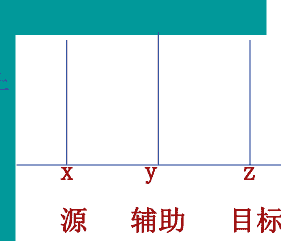

```
void hanoi(3,a,b,c){
    if (3==1)
        move(a,1,c);
    else
    {
        hanoi(2,a,c,b);
        move(a,3,c);
        hanoi(2,b,a,c);
    }
}
```

```
void hanoi(2,a,c,b){
    if (2==1)
        move(a,1,b);
    else
    {
        hanoi(1,a,b,c);
        move(a,2,b);
        hanoi(1,c,a,b);
    }
}
```

```
void hanoi(1,a,b,c){
    if 1==1
        move(a,1,c);
    else {......}
}
```

```
void hanoi(1,c,a,b){
    if (1==1)
        move(c,1,b);
    else {......}
}
```

```
void hanoi(2,b,a,c) {
    if (2==1)
        move(b,1,c);
    else
    {
        hanoi(1,b,c,a);
        move(b,2,c);
        hanoi(1,a,b,c);
    }
}
```

```
void hanoi(1,b,c,a) {
    if (1==1)
        move(b,1,a);
    else {......}
}
```

```
void hanoi(1,a,b,c) {
    if (1==1)
        move(a,1,c);
    else {......}
}
```

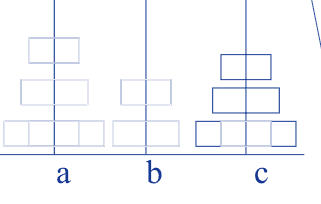

## [递归算法的实现原理]

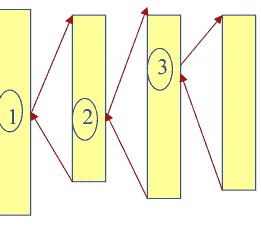

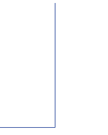

- 利用栈，栈中每个元素称为工作记录，分成三个部分：
- 返回地址 实在参数表(变参和值参) 局部变量
- 发生调用时，保护现场，即当前的工作记录入栈，然后转入被调用的过程
- 一个调用结束时，恢复现场，即若栈不空，则退栈，从退出的返回地址处继续执行下去

## 递归时系统工作原理示例

```c
int Factorial(int n){
        L1:      if (n==0)
        L2:          return(1);
        L3:      return(n*Factorial(n-1));
        }
```

```c
void main()
{

        ......

        L0: N=Factorial(3);

        ......

}
```


返回地址  n  Factorial  N


## 递归算法的用途

- 求解递归定义的数学函数
- 在以递归方式定义的数据结构上的运算/操作
- 可用递归方式描述的解决过程

## 递归转换为非递归的方法

## 1）采用迭代算法

递归—从顶到底　迭代—从底到顶

例：求 n！

```c
int fact(int n){
    m=1;
    for (i=1;i<=n;i++)  m=m*i;
    return(m);  }
```

## 2）消除尾递归

例：顺序输出单链表中的结点数据

```c
void linklist_output(pointer p){
    if (p!=NULL)
    {  write(p->data);
    linklist_output(p->next);
    }
}
```

使用跳转语句：

```c
void linklist_output1(pointer p){
}
```

使用循环语句：

```c
void linklist_output2(pointer p){
    while (p!=nil)
    {  write(p->data);
    p:=p->next;
    }
}
```

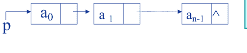

## 3) 利用栈模拟递归—通用方法

如果是递归函数，需改写为递归过程

例： 求n!

```c
void fact(int n, int &f){

init_stack(s);
0: if (n==0) f=1;
else
{
1: fact(n-1,f);
2: f = n*f;
}
}
```

```c
top=top+1; s[top].rd=2;
s[top].n=n; s[top].f=f;
n=n-1; goto 0;
```

```c
if (top!=0)
{ s[top].f=f; //还原本层变参值
top=top-1; n=s[top+1].n;
f=s[top+1].f; goto s[top+1].rd }
```

## [自设栈模拟系统工作栈]

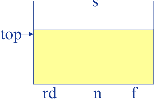

## 改写算法

- 在程序开头增加栈的初始化语句
- 改写递归调用语句：入栈处理；
  - 确定调用的参数值；
  - 转至调用的开始语句
- 改写所有递归出口：退栈还原参数；转至返回地址处

```c
void fact(int n, int & f)
{
    init_stack(s);
    0: if (n==0) f=1;
    { 1: top=top+1;
        s[top].rd=2;
        s[top].n=n;
        s[top].f=f;
        n=n-1; goto 0;
        2: f = n*f }
    if (top!=0)
    {  s[top].f=f;
        top=top-1;
        n=s[top+1].n;
        f=s[top+1].f;
        goto s[top+1].rd; }
}
```

```c
void fact(int n,int &f)
{
    init_stack(s);
    while (n!=0)
    {  top=top+1;
        s[top].n=n;
        n=n-1;}
    f=1;
    while (top!=0)
    {  top=top-1;
        n=s[top+1].n;
        f=n*f; }
}
```

注：此时可确定栈中只存放n值即可。

## 栈的应用2-整型数简单表达式求值

[前提假设] 表达式语法正确；表达式结束符为‘#’

## [算法思想]

- OPTR栈——寄存运算符　OPND栈——寄存操作数
- 1) 放入起始符‘#’作为OPTR栈底元素
- 2) 依次读入表达式字符，
  - 操作数：进OPND栈；
  - 运算符：与OPTR.top元素比较优先级后做相应操作；
  - 直至读入‘#’且OPTR栈只剩‘#’
- 3) OPND栈底所留元素即为所求

[例] 5+3*(7-2)+11#

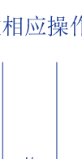

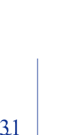

## 第三章（第二部分）队列

## 3.5 队列的定义

队列是一种特殊的线性表，限定插入和删除操作分别在表的两端进行。具有先进先出(FIFO—First In First Out)的特点。

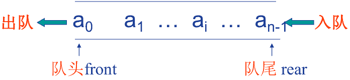

## 定义在队列结构上的基本运算

- (1) 构造空队列操作
- (2) 判队空否函数
- (3) 元素入队操作
- (4) 元素出队函数
- (5) 取队头元素函数
- (6) 队列置空操作
- (7) 求队中元素个数函数

## 队列的进队和出队

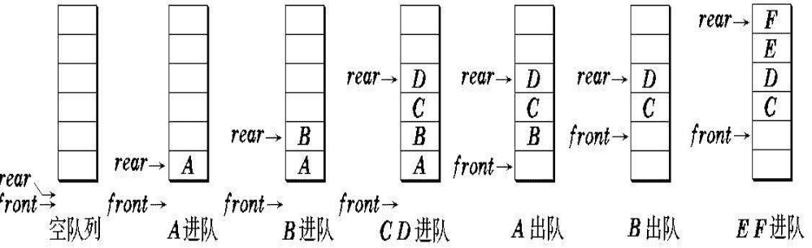

- 进队时队尾指针先进一 rear = rear + 1，再将新元素按 rear 指示位置加入。
- 出队时队头指针先进一 front = front + 1，再将 front 指示的元素取出。
- 队满时再进队将溢出出错；队空时再出队将队空处理。

> 思考：可否用两个栈实现一个队列？如何实现？

## 利用两个栈s1、s2（等容量）模拟一个队列，实现队列的插入，删除以及判队空运算

- 栈的特点是后进先出，队列的特点是先进先出。初始时设栈s1和栈s2均为空。
- （1）用栈s1和s2模拟队列的输入：设s1和s2容量相等。分以下三种情况讨论：若s1未满，则元素入s1栈；若s1满，s2空，则将s1全部元素退栈，再压栈入s2，之后元素入s1栈；若s1满，s2不空（已有出队列元素），则不能入队。
- （2）用栈s1和s2模拟队列出队（删除）：若栈s2不空，退栈，即是队列的出队；若s2为空且s1不空，则将s1栈中全部元素退栈，并依次压入s2中，s2栈顶元素退栈，这就是相当于队列的出队。若栈s1为空并且s2也为空，队列空，不能出队。
- （3）判队空　若栈s1为空并且s2也为空，才是队列空。

讨论：s1和s2容量之和是队列的最大容量。其操作是，s1栈满后，全部退栈并压栈入s2（设s1和s2容量相等）。再入栈s1直至s1满。这相当于队列元素“入队”完毕。出队时，s2退栈完毕后，s1栈中元素依次退栈到s2，s2退栈完毕，相当于队列中全部元素出队。

在栈s2不空情况下，若要求入队操作，只要s1不满，就可压入s1中。若s1满和s2不空状态下要求队列的入队时，按出错处理。

## 用单循环链表定义的队列

类型定义：队尾指针

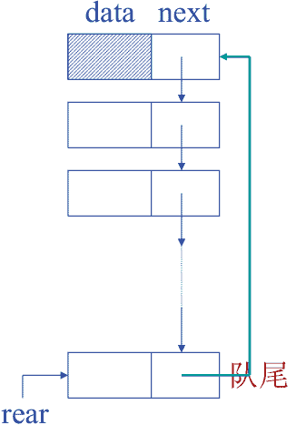

## 一般用法的顺序存储结构之缺陷

出队列操作后大量移动数据或存在“假上溢”现象：即存在空闲空间但无法入队。

## 解决方法

- 平移元素法，当发生假溢出时，就把整个队列的元素平移到存储区的首部，然后再插入新元素。这种方法需移动大量的元素，因而效率是很低的。
- 循环队列

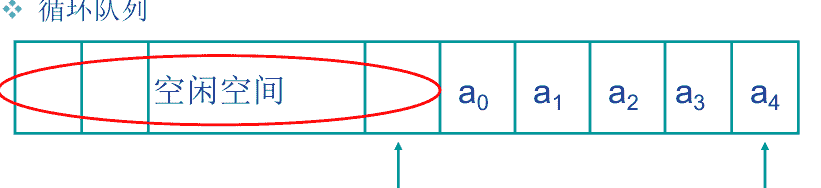

## 循环队列的进队和出队实例

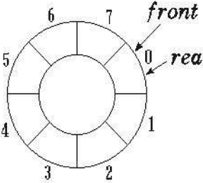

空队列

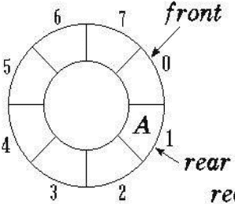

A 进队

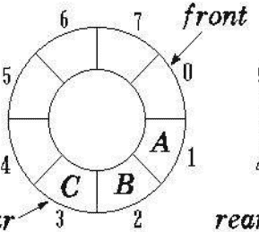

B C 进队

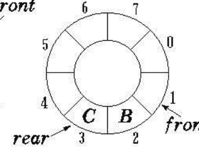

A 出队

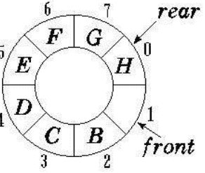

D E F G H 进队

存储队列的数组被当作首尾相接的表处理。为解决如何判断队列的满与空问题：牺牲一个存储单元。

队头、队尾指针加1时从maxSize -1直接进到0，可用语言的取模(余数)运算实现。

出队： front = (front + 1) % maxSize;

入队： rear = (rear + 1) % maxSize;

队列初始化： front = rear = 0;

队空条件： front == rear;

队满条件： (rear + 1) % maxSize == front

思考：循环队列中当前元素的个数为多少？

当前元素个数n=(rear-front+maxSize)%maxSize


## 3.8 双端队列

[双端队列] 限定插入和删除操作在线性表的两端进行。
可以把它看成是栈底连在一起的两个栈，但它与两个栈共享存储空间是不同的。共享存储空间中的两个栈的栈顶指针是向两端扩展的，因而每个栈只需一个指针；而双端队列允许两端进行插入和删除元素，因而每个端点必须设立两个指针。

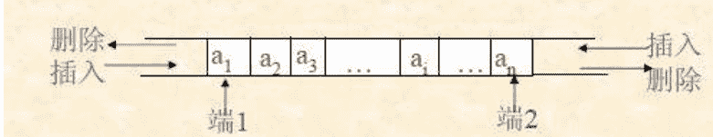

## 实际应用中的特殊队列

- 输出受限的双端队列（即一个端点允许插入和删除，另一个端点只允许插入）；
- 输入受限的双端队列（即一个端点只允许插入和删除，另一个端点只允许删除）。
- 如果限定双端队列从某个端点插入的元素只能从该端点删除，则双端队列就蜕变为两个栈底相邻接的栈了。

如果允许在循环队列的两端都可以进行插入和删除操作，其结构如下：

```
#define M 队列可能达到的最大长度
typedef struct
{ elemtyp data[M];
  int front,rear;
} cycqueue;
```

请写出“从队尾删除”和“从队头插入”的算法。

```
elemtyp delqueue ( cycqueue Q)
void enqueue (cycqueue Q, elemtyp x)
```

[分析] 用一维数组 v[M]实现循环队列，其中M是队列长度。设队头指针front和队尾指针rear，约定队头指向队列中元素的前一位置，队尾元素。定义front=rear时为队空，(rear+1)%m=front为队满。约定队头端入队向下标小的方向发展，队尾端入队向下标大的方向发展。

```
void enqueue (cycqueue Q, elemtp x)
// Q是顺序存储的循环队列，本算法实现“从队头插入”元素x。
{
    if (Q.rear==(Q.front-1+M)%M)
    { printf("队满");
        exit(0);
    }
    Q.data[Q.front]=x;      //x 入队列
    Q.front=(Q.front-1+M)%M;    //修改队头指针。
}
```

若以1、2、3、4作为双端队列的输入序列，
试分别求出以下条件的输出序列：
（1）能由输入受限的双端队列得到，但不能由输出受限的双端队列得到的输出序列；
（2）能由输出受限的双端队列得到，但不能由输入受限的双端队列得到的输出序列；
（3）既不能由输入受限的双端队列得到，也不能由输出受限的双端队列得到的输出序列。

## 解答：

- 1. 输出受限双端队列不能得到的输出序列有：
- 4 1 3 2    4 2 3 1

- 2. 输入受限双端队列不能得到的输出序列有：
- 4 2 1 3    4 2 3 1

## 本章作业

- 1. 试推导求解 n 阶 Hanoi 塔问题至少要执行的移动操作 move 次数。
  
- 2. 试证明：若借助栈由输入序列 1,2,…,n 得到输出序列为 P₁,P₂,…,Pₙ（它是输入序列的一个排列），则在输出序列中不可能出现这样的情形：存在着 i<j<k，使 Pⱼ<Pₖ<Pᵢ。

3. 假设以I和O分别表示入栈和出栈操作。栈的初态和终态均为空，入栈和出栈的操作序列可表示为仅由I和O组成的序列，称可以操作的序列为合法序列，否则称为非法序列。
（1）下面所示的序列中哪些是合法的？
A. IOIIOIOO    B. IOOIOIIO    C. IIIOIOIO
D. IIIOOIOO
（2）通过对（1）的分析，写出一个算法，形式如下：bool Judge(char A[])，判定所给的操作序列是否合法。若合法，返回true，否则返回false（假设被判定的操作序列已存入一维数组A[]中）。

## 实验报告（二）

- 1. **2/8进制转换器**：编写程序，从终端输入一串0/1表示二进制数，以“#”结束，输出它的8进制表示形式。**要求：采用栈来实现**

- 2. **判别回文字符串**：正读和反读都一样的字符串称为回文字符串。编写程序，在键盘上输入一个字符串，以“#”作为结束标志，判断它是否为回文字符串。**要求：采用栈和队列来实现**

**说明：每题写一份试验报告**

## 第四章 字符串与模式匹配

杨晨　　计算机科学与技术学院

## 提 纲

- 1 串的概念和基本操作
- 2 串的存储*
- 2 串的模式匹配
- 3 KMP算法
- 4 作业

## 4.1 串的概念和基本操作

**串（字符串）**：是由零个或多个字符组成的有限序列。

记作：`s = ‘a₀a₁…aₙ₋₁’`　`(n≥0)`

串是特殊的线性表，数据元素是单个字符。

**串长**：串中字符的个数 n。

**子串和主串**：串中任意个连续的字符组成的子序列称为该串的子串。包含子串的串称为主串。

**串相等**：两个串长度相等，且对应位置的字符都相等。

**空串和空格串**：空串不包含任何字符，表示为 `φ`；空格串由一个或多个空格组成，如 ‘　’。

**C语言**：以 `\0` 结尾的字符数组。

**C++**：C语言中的数组继续有效，还提供 `std::string` 类。

## [串的基本操作]

(1)用串常量赋值    StrAssign(&T,chars)
    用串变量赋值    StrCopy(&T,S)

(2)判等函数    StrCompare(S,T)（词典次序,>=<=0）

(3)求长函数    StrLength(S)

(4)连接函数    Concat(&T,S1,S2)

(5)求子串函数    SubString(&Sub,S, pos,len)

(6)定位函数    Index(S,T, pos)

(7)置换函数    Replace(S,T,V)

(8)插入操作    StrInsert(S,pos,t)

(9)删除操作    StrDelete(S,pos,len)

**线性表的操作通常以“数据元素”为操作对象；串的操作主要以“串的整体”为操作对象。

[例]

```
s='I am a student.'
t='OK!'
p='student'
q='nurse'
r='good '
```

- 1. `l=concat(s, t)`
- `l='I am a student. OK!'`
- 2. `replace(s, p, q);`
- `s='I am a nurse.'`
- 3. `insert(s, 8, r)`
- `s='I am a good nurse.'`

## 4.2 串的存储结构*

## 4.2.1 静态存储结构

1）非紧缩格式 串空间+串长

```
#define m=18 {用户定义串的最大长度}
struct node {
    char ch[1..m];
    int strlen;
};
```

{类型定义不用strlen时，应约定标志串结尾的特殊字符}

特点：存储器采用字(16bit)编址结构时，空间浪费较多。

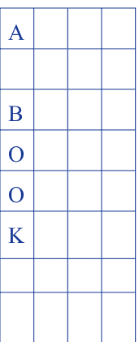

## 2）压缩格式 串空间+串长

```
#define m=12 {用户定义串的最大长度}
struct node{
    char ch[1..m];
    int strlen;
};
```

特点：存储器采用字节编址结构时，节省空间且操作方便，否则分离同一存储单元字符需时间开销。

|  |  |  |  |
|---|---|---|---|
| A |  | B | O |
| O | K |  |  |
|  |  |  |  |
|  |  |  |  |
1
m

## 4.2.2 动态存储结构

## 1）块链存储方式 字符串块链表的头指针+串长

```
#define chunk size=4 {用户定义的结点大小};
typedef struct chunk {
    char ch[1..chunk size];
    struct chunk * next;
}
```

块(chunk size值) 大小的影响

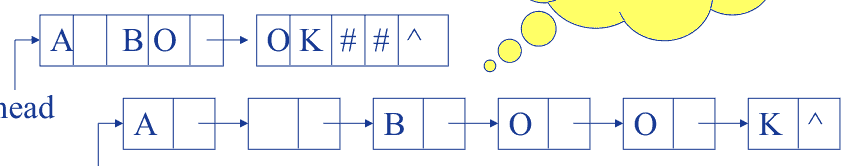

## 2）堆结构存储方式

系统分配一个大容量连续存储空间作为串值的可利用空间。每个串使用时动态申请一组地址连续的存储单元。

| 串名 | 串长 | 起始地址 |
|---|---:|---:|
| a | 8 | 1 |
| b | 6 | 9 |
| c | 13 | 22 |

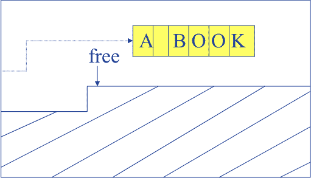

Store(1:maxsize)

free

BOOK

maxsize


## 堆结构存储的特点：

- 通过串名存储映射访问串值
- 动态分配存储空间，对串长没有限制
- 要使可利用空间的使用更加有效，回收废弃的旧串和申请新串空间需进行动态存储管理。

## 4.3 串的模式匹配

[定义] 在主串中寻找子串（第一个字符）在主串中的位置
在模式匹配中，子串称为模式串，主串称为目标串。
记模式串为： P=p1p2…pm
记目标串为： T=t1t2…tn

[示例] 目标 T： “Beijing”
模式 P： “jin”
匹配结果 = 4
若模式 P： “xin”
匹配结果 = 0 //失败

例： s=‘abcab**bcd**efabcdmn’
 t=‘efapq’ 匹配失败，有效位移 =0
 t=‘bcd’ 匹配成功，有效位移 =5

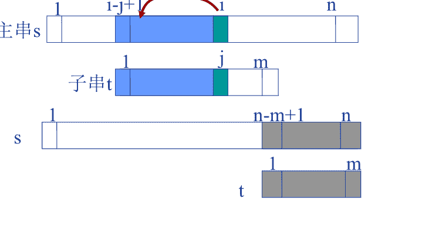

```c
int index(char const *t, char const *p) //蛮力搜索
{
    int i=1; j=1; //假设字符数组的下标从1算起
    int n=strlen(t); m=strlen(p);
    while ((i<=n) && (j<=m))
    {
        if (t[i]==p[j])
        {
            i=i+1;
            j=j+1;
        }
        else
        {
            i=i-j+2;
            j=1;
        }
    }
    if (j==m+1)
        return (i-m);
    else
        return(0);
}
```

> 最坏情况字符比较次数为：(n-m+1)*m
> 
> 算法复杂度：O(m*n)
> 
> 原因在于每趟重新比较时，目标串的检测指针要回退。改进的模式匹配算法可使目标串的检测指针每趟不回退。

## 4.4 KMP算法

## 改进之处

在比较过程中，主串的下标i只增不减，不回溯，可使算法复杂度提高到O(m+n)。

## 分析

1 2 3 4 5 6 7 8 9 10 11 12 13
i=7
主串T a b c d a b c d a b e g h t₁t₂…tₙ
子串P a b c d a b e g p₁p₂…pₘ m<n
j=7
a b c d a b e g
j=3

本趟比较失配点：i=7, j=7 (即t₇≠p₇)

失配点处 p₁p₂=t₅t₆=p₅p₆ ⇒ p₁…pₖ₋₁=pⱼ₋ₖ₊₁…pⱼ₋₁

下趟比较：i不变，j=k(此处即3)

## KMP算法描述

```
Int KMP-index(char const *t, char const *p, int const *next)
{
    int i=1; j=1;
    int n=strlen(t);m=strlen(p);
    while((i<=n) && (j<=m))
    {
        if ((t[i]==p[j] || j==0))
        {
            i++;
            j++;
        }
        else
            j=next[j];
    }
    if (j==m+1)
        return (i-m);
    else
        return 0;
}
```

## 求next数组值

算法思想：利用递推

即已知next[1]=0，… next[i]=k；求next[i+1]

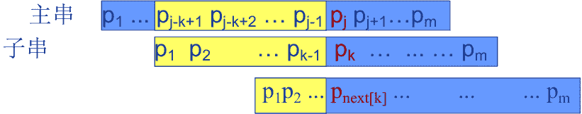

## 算法描述

```
void get_next(int *next, char const *p) {
    int j=1, k=0; next[1]=0;
    while(j < strlen(p))
    {
        if ((k==0) || (p[k]==p[j]))
            next[++j]=++k;
        else
            k=next[k];
    }
}
```

## 修正next数组

## next数组的缺陷

i
T= a b c a b c a x a b c a b c a b b a c
P= a b c a b c a b b a c          next[8]=5
    a b c a b c a b b a c          next[5]=2
        a b c a b c a b b a c      next[2]=1
        a b c a b c a b b a c
j

存在p₈=p₅=p₂，因此当t₈≠p₈时，t₈与p₅、p₂的比较是无意义的。

## 改进方法 用nextval数组代替next数组

求出pⱼ处的k值；若pⱼ=pₖ，则nextval[j]=nextval[k]
否则nextval[j]=k

## 算法描述

```
void get_nextval(int *nextval, char const *p)
{
    int j=1; k=0; nextval[1]=0;
    while (j < strlen(p))
    {
        if (k==0 || p[j]==p[k])
            if (p[++j] != p[++k])
                nextval[j]=k;
            else
                nextval[j]=nextval[k];
        else
            k=nextval[k];
    }
}
```

例

| j | 1 | 2 | 3 | 4 | 5 | 6 | 7 | 8 | 9 | 10 | 11 |
|---|---|---|---|---|---|---|---|---|---|---|---|
|   | a | b | c | a | b | c | a | b | b | a | c |
| next[j] | 0 | 1 | 1 | 1 | 2 | 3 | 4 | 5 | 6 | 1 | 2 |
| nextval[j] | 0 | 1 | 1 | 0 | 1 | 1 | 0 | 1 | 6 | 0 | 2 |

|   | 1 | 2 | 3 | 4 | 5 |
|---|---|---|---|---|---|
|   | a | a | a | a | b |
|   | 0 | 1 | 2 | 3 | 4 |
|   | 0 | 0 | 0 | 0 | 3 |

## KMP算法时间复杂度分析

通常，模式串长度m<<主串长度n

求next(nextval)数组： O(m)

主串与模式串匹配： O(n)

整个匹配算法O(m+n)

## 作业

1. 分别求出下列模式串的next和nextval数组值
t1='aaab'      t2='abcabaa'
t3='adabbadada'

2. 重复子串的含义是由一个或多个连续相等的字符组成的子串;现有某个串用一维字符数组s存储，长度为n，设计算法求s的最长重复子串的长度.
int LongestString(char s[],int n) //函数返回所求长度

## 第五章 数组和广义表

## 本章内容

- 5.1 数组和线性表的關係以及数组的运算
- 5.2 数组的顺序存储结构
- 5.3 矩阵的压缩存储
- 5.4 广义表的定义和表示方法
- 5.5 广义表的存储结构
- 5.6 广义表的递归算法

## 任何数组A都可以看作一个线性表

A=(a₁, a₂, ..., aᵢ, ... aₙ)

二维数组n×m时，

aᵢ是数组中第i行所有元素，1≤i≤n，表中每一个元素是一个一维数组；

Aₘₓₙ = [ (a₁₁ a₁₂ ... a₁ₙ) ; (a₂₁ a₂₂ ... a₂ₙ) ; (...) ; (aₘ₁ aₘ₂ ... aₘₙ) ]

三维数组时，

表中每一个元素是一个二维数组；

n维数组时，

表中每一个元素是一个(n-1)维数组

## 数组与线性表之间的关系

线性表的扩展，其数据元素本身也是线性表

## 数组的特点

- 数组中各元素都具有统一的类型
- 可以认为，d维数组的非边界元素具有d个直接前趋和d个直接后继
- 数组维数确定后，数据元素个数和元素之间的关系不再发生改变，适合于顺序存储
- 每组有定义的下标都存在一个与其相对应的值

## 在数组上的基本操作

- 给定一组下标，取得相应的数据元素值
- 给定一组下标，修改相应的数据元素值


## 5.2 数组的顺序存储结构

一维数组

```
elemtype a[1..n]
```

b → 基地地址
 a[1]
 a[2]
 a[i]
 } c个单元

loc(a[i])=b+(i-1)c
 =b-c+i*c
 =C₀+C₁*i

C₁=c
 C₀=b- C₁

## 二维数组

```
elemtype a[1..m][1..n];
```

a = 
⎡ a11 a12 a13 … a1n ⎤
⎢ a21 a22 a23 … a2n ⎥
⎢  :   :   :   …   :  ⎥
⎣ am1 am2 am3 … amn ⎦
 m×n


loc(a[i,j]) = b + [(i-1)*n + (j-1)]*c

= C0 + C1*i + C2*j

+   C2 = c
+   C1 = n* C2
+   C0 = b - C1 - C2

> 注： Pascal、C语言以行序为主序
> Fortran 语言以列序为主序

## 三维数组

三维数组 A（1..r，1..m，1..n）可以看成是 r 个 m×n 的二维数组


A[1..3][1..4][1..2]

行优先时存放顺序：a₁₁₁，a₁₁₂，a₁₂₁，a₁₂₂，…，a₃₃₁，a₃₃₂，a₃₄₁，a₃₄₂

Loc[i,j,k] = Loc[1,1,1] + [(i−1)×m×n + (j−1)×n + (k−1)] × c

> 思考：如果三维数组为 A[c₁,d₁][c₂,d₂][c₃,d₃]，每个数据元素占 c 个单元，则 Loc[j₁,j₂,j₃] = ?

Loc[j₁,j₂,j₃] = Loc[c₁,c₂,c₃] + c × (d₂−c₂+1) × (d₃−c₃+1) × (j₁−c₁)
+ c × (d₃−c₃+1) × (j₂−c₂) + c × (j₃−c₃)

```
elemtype a[1..n₁][1..n₂],..., [1..n_d];
```

loc(a[i₁, i₂, ..., i_d])=C₀+C₁*i₁+C₂*i₂+...+C_d*i_d

C_d=c;
C_{t-1}=C_t*n_t    (1<t≤d)
C₀=b-C₁-C₂-...-C_d
b=loc(a[1,1,...,1])

数组是一种随机存取结构。

思考：

```
elemtype a [3..7][0..9][1..6][5..10];
```

设每数组元素占用8个存储单元，求按低下标优先（类似行优先）顺序存储时， loc(a[6, 3, 3, 7])=?

设矩阵 a [1..3][1..3] 如下，执行下列语句后，矩阵 c [1..3][1..3] 和 a [1..3][1..3] 的结果分别是什么？


+   1） for (i=1; i<=3;i++)
+       for(j=1; j<= 3;j++)
+           c[i,j] = a[a[i,j],a[j,i]]

+   （2） for (i=1; i<=3;i++)
+       for(j=1; j<= 3;j++)
+           a[i,j] = a[a[i,j],a[j,i]]

C = [[3 3 1]
[1 1 1]
[3 3 2]]

a = [[3 3 1]
[1 1 3]
[3 3 3]]

## 5.3 矩阵的压缩存储

目的是节省空间。

## 5.3.1 对称矩阵

[特点] 在n×n的矩阵a中，满足如下性质：

aᵢⱼ = aⱼᵢ (1 ≤ i, j ≤ n)

[存储方法] 只存储下(或者上)三角(包括主对角线)的数据元素。共占用n(n+1)/2个元素空间。

sa | a₁₁ | a₂₁ | a₂₂ | a₃₁ | ... | aᵢⱼ(aⱼᵢ) | ... | aₙₙ |
 k   1    2    3    4                n(n+1)/2

k = { i(i-1)/2 + j   当 i ≥ j
      j(j-1)/2 + i   当 i < j }


## 5.3.2 三角矩阵

**[特点]** 对角线以下(或者以上)的数据元素(不包括对角线)全部为常数C。


上三角矩阵

下三角矩阵

**[存储方法]** 重复元素C共享一个元素存储空间，共占用 n(n+1)/2+1个元素空间：sa[1.. n(n+1)/2+1]

上三角矩阵

下三角矩阵

```
k = {
  (i-1)×(2n-i+2)/2+j+1   i≤j
  n(n+1)/2+1              i>j
}
```

```
k = {
  i×(i-1)/2+j            i≥j
  n(n+1)/2+1              i<j
}
```

## 5.3.3 带状矩阵（对角矩阵）

[特点] 在n×n的方阵中，非零元素集中在主对角线及其两侧共L(奇数)条对角线的带状区域内 — L对角矩阵。

[存储方法] 只存储带状区内的元素。

+   1) 以对角线的顺序存储,共n*L个元素。

五对角矩阵

s[-2..2; 1..6]

i1=i-j
j1=j

|i-j|≤(L-1)/2

sa
k 1
n*L

2) 只存储带状区内的元素。除首行和末行，按每行 L 个元素，共(n-2)L+(L+1) 个元素。sa[1..(n-1)L+1]

存储地址计算： k=(i-1)L+1+(j-i)
|i-j|≤(L-1)/2


## 5.3.4 稀疏矩阵

[特点] 大多数元素为零。

[常用存储方法] 记录每一非零元素(i,j,aᵢⱼ)
—节省空间，但丧失随机存取功能

+   ◆ 顺序存储：三元组表
+   ◆ 链式存储：十字(正交)链表

|  |  |  |  |  |  |
|---|---|---|---|---|---|
| 15 | 0 | 0 | 22 | 0 | -15 |
| 0 | 11 | 3 | 0 | 0 | 0 |
| 0 | 0 | 0 | -6 | 0 | 0 |
| 0 | 0 | 0 | 0 | 0 | 0 |
| 91 | 0 | 0 | 0 | 0 | 0 |
| 0 | 0 | 28 | 0 | 0 | 0 |

## 5.3.4.1 三元组表

## [类型定义]

```
#define u={矩阵中非零元素最大个数};
struct tuple {
    int i,j;
    elemtype v;
};
struct sparmat tp{
int m,n,t;
{m:行数, n:列数; t:非零元素数目}
tuple data[1..u];
}
```

|  | i | j | v |
|---|---|---|---|
| 1 | 1 | 1 | 15 |
| 2 | 1 | 4 | 22 |
| 3 | 1 | 6 | -15 |
| 4 | 2 | 2 | 22 |
| 5 | 2 | 3 | 3 |
| 6 | 3 | 4 | -6 |
| 7 | 5 | 1 | 91 |
| 8 | 6 | 3 | 28 |

## [算法例] 求转置矩阵

## 算法1 { O(n*t) }

```
void trans_sparmat(struct sparmattp a,b)
{
    b.m=a.n; b.n=a.m; b.t=a.t;
    if (b.t > 0)
    {
        { q=1;        /* 指示b中存放数据的位置，初值为1 */
          for (col=1; col<=a.n; col++)    /* 对a扫描a.n趟 */
              for (p=1; p<=a.t; p++)     /* 对a.t个数据检查 */
                  if (a.data[p].j==col)   /* 满足当前扫描列号 */
                  {
                      b.data[q].i=a.data[p].j;  /* 向b赋值 */
                      b.data[q].j=a.data[p].i;
                      b.data[q].v=a.data[p].v;
                      q=q+1;                     /* 修正q值 */
                  }
        }
    }
}
```


## 算法2 快速转置法 { O(n+t) }

引入两个辅助向量：

- num[1,...,a.n]: a中每列的非零元素个数
- cpot[1,...,a.n]: a中每列的第一个非零元素在b中的位置

a中的列号

| col | num[col] | cpot[col] |
|---|---|---|
| 1 | 2 | 1 |
| 2 | 1 | 3 |
| 3 | 2 | 4 |
| 4 | 2 | 6 |
| 5 | 0 | 8 |
| 6 | 1 | 8 |

a
| i | j | v |
|---|---|---|
| 1 | 1 | 15 |
| 2 | 1 | 4 | 22 |
| 3 | 1 | 6 | -15 |
| 4 | 2 | 2 | 22 |
| 5 | 2 | 3 | 3 |
| 6 | 3 | 4 | -6 |
| 7 | 5 | 1 | 91 |
| 8 | 6 | 3 | 28 |

b
| i | j | v |
|---|---|---|
| 1 | 1 | 15 |
| 2 | 1 | 5 | 91 |
| 3 | 2 | 2 | 22 |
| 4 | 3 | 2 | 3 |
| 5 | 3 | 6 | 28 |
| 6 | 4 | 1 | 22 |
| 7 | 4 | 3 | -6 |
| 8 | 6 | 1 | -15 |

转置

cpot[1]=1
cpot[col]=cpot[col-1]+num[col-1]
(2≤col≤n)

```c
void fast_transpos(struct sparmatto a,b)
{
    b.m=a.n; b.n=a.m; b.t=a.t;
    if (b.t>0)
    {
        for(col=1;col<=a.n;col++)
            num[col]=0;       {num清零}
        for (t=1;t<=a.t;t++)              {对a.t个非零元素}
            num[a.data[t].j]=num[a.data[t].j]+1;  {按列写计数}

        cpot[1]=1;                                      {生成cpot}
        for (col=2; col<=a.n;col++)
            cpot[col]=cpot[col-1]+num[col-1];
        for (p=1; p<=a.t; p++)              {对a.t个非零元素转置}
        {
            col=a.data[p].j;  q=cpot[col];
            b.data[q].i=a.data[p].j;
            b.data[q].j=a.data[p].i;
            b.data[q].v=a.data[p].v;
            cpot[col]=cpot[col]+1;
        }
    }
}
```

## 5.3.4.2 十字（正交）链表

[特点] 在行、列两个方向上，将非零元素链接在一起。克服三元组表在矩阵的非零元素位置或个数经常变动时的使用不便。

[结构]

| row | col | val/next |
| --- | --- | -------- |
| down | right |  |

## [算法示例] 从终端接收信息建立稀疏矩阵的十字链表

算法思想：

- 1）读入矩阵的行数m和列数n
- 2）建立hm头结点，建立max(m,n)个H头结点，并建立上述结点的循环链表
- 3）读入一个非零元素的行号r、列号c、值v
  - 3.1）建立该元素的结点
  - 3.2）寻找该结点在行表中的插入位置并插入
  - 3.3）寻找该结点在列表中的插入位置并插入
  - 3.4）存在下一个非零元素，转3；否则，结束。

## 5.4 广义表（列表）的定义和表示方法

## 概念

广义表是由零个或多个原子或者子表组成的有限序列。可以记作： LS=(d₁, d₂, ..., dₙ)
原子：逻辑上不能再分解的元素。
子表：作为广义表中元素的广义表。

## 逻辑定义

Lists = (D,R)

## 与线性表的关 系

广义表中的元素全部为原子时即为线性表。线性表是广义表的特例，广义表是线性表的推广。

## 广义表的表示方法和相关术语

| | 表长 | 表深 | 表头 | 表尾 |
|---|---|---|---|---|
| A=() | 0 | 1 | - | - |
| B=(a, A)=(a, ()) | 2 | 2 | a | (()) |
| C=((a,b), c, d) | 3 | 2 | (a,b) | (c,d) |
| D=(a, D)=(a, (a, (a, ...))) | 2 | ∞ | a | (D) |

表的长度  表中的元素（第一层）个数。

表的深度  表中元素的最深嵌套层数。

表头  表中的第一个元素。

表尾  除第一个元素外，剩余元素构成的广义表。

任何一个非空广义表 LS = ( α1, α2, ..., αn ) 均可分解为
表头 Head(LS) = α1 和
表尾 Tail(LS) = ( α2, ..., αn ) 两部分。

例如： D = ( E, F ) = ( (a, (b, c)), F )
Head( D ) = E      Tail( D ) = ( F )

Head( E ) = a      Tail( E ) = ( ( b, c ) )

Head( ( ( b, c ) ) ) = ( b, c )  Tail( ( ( b, c ) ) ) = ( )

Head( ( b, c ) ) = b      Tail( ( b, c ) ) = ( c )

Head( ( c ) ) = c      Tail( ( c ) ) = ( )

## 广义表的图形表达方法

A=(a,b)

B=(A,c)

D=(a,D)

L=(A,B)

○ 表
□ 原子


## 规定所有表都有名字时，广义表的表示方法

例 A(a,b)
B(A(a,b), c)
L(A(a,b), B(A(a,b),c))
D(a, D(a, D(...)))

递归表的深度是无穷值，长度是有限值。

## 广义表结构的分类

- 纯表：与树型结构对应的广义表。
- 再入表：允许结点共享的广义表。
- 递归表：允许递归的广义表。

递归表⊃再入表⊃纯表⊃线性表

## 5.5 广义表的存储结构

## 5.5.1 方法1—头尾链表形式

[类型定义]

```
typedef enum {ATOM, LIST} ElemTag;
/*ATOM=0,原子； LIST=1,子表 */
typedef struct GLNode
{
    ElemTag tag;
    /* 标志位tag用来区别原子结点和表结点 */
    union
    {
        AtomType data;
        /* 原子结点的值域data */
        struct { struct GLNode * hp, *tp; } ptr;
        /* 表结点的指针域ptr，包括表头和表尾指针域 */
    };
    /* 原子结点的值域atom和表结点的指针域htp的联合体域 */
} *GList;
```

表结点

| tag=1 | hp | tp |

原子结点

| tag=0 | data |

hp: 指示表头的指针

tp:指示表尾的指针

## 【示例】

A = ( )    A - NIL

B


D


C


在头尾链表存储方法中：

（1）除空表的表头指针为空外，任何非空表的表头指针均指向一个表结点，且该结点的 hp 域指示表的表头，tp 域指示表的表尾；

（2）容易分清列表中的原子和子表所在的层次；

（3）最高层的表结点数即为列表的长度。


## 5.5.2 方法2—扩展的线性链表形式

## [类型定义]

```
typedef enum {ATOM, LIST} ElemTag;
/* ATOM=0，表示原子； LIST=1，表示子表 */
typedef struct GLNode
{
    ElemTag  tag;
    union
    {
        AtomType  data;
        struct GLNode * hp;
    };
    /* 原子节点的值域atom和表节点的表头指针域hp的联合体域 */
    struct GLNode * tp;
} *GList;
```

## 表结点

| tag=1 | hp | tp |

## 原子结点

| tag=0 | data | tp |

hp：指向表头的指针

tp：指向同一层的下一个节点


广义表的特点：定义是递归的。
示例约定：非递归表且无共享子表。

## 例一 求广义表的深度

将广义表分解成 n 个子表，分别(递归)求得每个子表的深度，

广义表的深度=Max {子表的深度}+1

可以直接求解的两种简单情况为：

+   空表的深度 = 1
+   原子的深度 = 0

## 算法设计

```
int GlistDepth(Glist L) {
    // 返回指针L所指的广义表的深度
    if (!L) return 1;
    if (L->tag == ATOM) return 0;
    for (max=0, pp=L; pp; pp=pp->ptr.tp){
        dep = GlistDepth(pp->ptr.hp);
        if (dep > max) max = dep;
    }
    return max + 1;
} // GlistDepth
```

## 例如：


```
for (max=0, pp=L; pp; pp=pp->ptr.tp)
{
    dep = GlistDepth(pp->ptr.hp);
    if (dep > max) max = dep;
}
```

## 例二 复制广义表

将广义表分解成表头和表尾两部分，分别(递归)复制求得新的表头和表尾，

新的广义表由新的表头和表尾构成。

可以直接求解的两种简单情况为：

+   - 空表复制求得的新表自然也是空表；
+   - 原子结点可以直接复制求得。

## 复制求广义表的算法描述如下：

若 ls= NULL 则 newls = NULL
否则
  构造结点 newls,
  由 表头 ls->ptr.hp 复制得 newhp
  由 表尾 ls->ptr.tp 复制得 newtp
  并使 newls->ptr.hp = newhp,
    newls->ptr.tp = newtp

```
Status CopyGList(Glist &T, Glist L) {
    if (!L) T = NULL; // 复制空表
    else {
        if (!(T = (Glist)malloc(sizeof(GLNode))))
            exit(OVERFLOW); // 建表结点
        T->tag = L->tag;
        if (L->tag == ATOM)
            T->data = L->data; // 复制单原子结点
        else { 分别复制表头和表尾 }
    } // else
    return OK;
} // CopyGList
```

```
CopyGList(T->ptr.hp, L->ptr.hp);
```

// 复制求得表头T->ptr.hp的一个副本L->ptr.hp

```
CopyGList(T->ptr.tp, L->ptr.tp);
```

// 复制求得表尾T->ptr.tp 的一个副本L->ptr.tp

语句 CopyGList(T->ptr.hp, L->ptr.hp);

等价于

```
CopyGList(newhp, L->ptr.tp);
```

```
T->ptr.hp = newhp;
```

## 作业

+   1. 设有三对角矩阵(a_ij)_{n×n}，将其三条对角线上的元素存于数组B(-1:1, 1:n)中，使得B(u, v)=a_ij，试推倒出用i、j表示u、v的下标变换公式。

+   2. 设对称矩阵A如下所示：(1) 若将A视为对称矩阵，画出对其压缩存储的存储表，并讨论如何存取A中元素 a_ij (1<=i,j<=4)；
+   (2) 若将A视为稀疏矩阵，画出A的十字链表结构。

[ 2 0 0 4 ]
[ 0 0 3 0 ]
[ 0 3 0 0 ]
[ 4 0 0 0 ]

3.求下列广义表操作的结果：

(1)Head[Tail[Head[((a,b),(c,d))]]]

(2)Tail[Head[Tail [((a,b),(c,d))]]]

注：[ ]是函数的符号

4.利用广义表的Head和Tail操作把原子c从广义表L=((a,b),(c,d))中分离出来，并求表L的长度和深度。

假设稀疏矩阵A和B均以三元组表作为存储结构，试写出矩阵相加和相乘的算法，另设三元组表C存放结果矩阵。

## 要求：

+   - 从键盘输入稀疏矩阵A和B
+   - 检测A和B能否相加/相乘
+   - 如能，做矩阵相加和相乘运算，并打印运算结果
+   - 如不能，应显示出原因

## 第六章  树与二叉树

杨震  计算机科学与技术学院

## 6.1 树的结构及基本操作

树是一类重要的非线性数据结构，是以分支关系定义的层次结构。

## [树的定义]

树是由 n(n≥0) 个结点组成的有限集合 T，非空树满足：

+   1) 有一个称之为根(root)的结点。

+   2) 除根以外的其余结点被分成 m(0≤m<n) 个互不相交的集合 T₁，T₂，…，Tₘ，其中每一个集合本身又是一棵树，且称为根的子树。

## [树的特征]


特点 除根节点外，每个节点都仅有一个前趋(父)节点。


## [基本术语]

节点的度 节点拥有的子树数目。

叶子(终端)结点 度为0的结点。

分支(非终端)结点 度不为0的结点。

树的度 树的各结点度的最大值。

内部结点 除根结点之外的分支结点。

双亲与孩子(父与子)结点 结点的子树的根称为该结点的孩子；该结点称为孩子的双亲。

兄弟 属于同一双亲的孩子。

结点的祖先 从根到该结点所经分支上的所有结点。

结点的子孙 该结点为根的子树中的任一结点。

## 节点的层次

表示该节点在树中的相对位置。根为第一层，其它的节点依次下推；若某节点在第L层上，则其孩子在第L+1层上。

## 堂兄弟

双亲在同一层的节点互为堂兄弟。

## 树的深(高)度

树中节点的最大层次。

## 有序树

树中各节点的子树从左至右是有次序的，不能互换。否则，称为无序树。

## 路径长度

从树中某节点Nᵢ出发，能够“自上而下地”通过树中节点到达节点Nⱼ，则称Nᵢ到Nⱼ存在一条路径，路径长度等于这两个节点之间的分支数。

## 树的路径长度

从根到每个节点的路径长度之和。

## 森林

是m(m≥0)棵互不相交的树的集合。

## [树的 basic 操作]

+   1) 初始化操作  initiate(T)
+   2) 求根函数  root(T) / root(x)
+   3) 求双亲函数  parent(T,x)
+   4) 求孩子结点函数  child(T,x,i)
+   5) 求右兄弟函数  right_sibling(T,x)
+   6) 建树函数  crt_tree(x,F)
+   7) 插入子树操作  ins_child(y,i,x)
+   8) 删除子树操作  del_child(x,i)
+   9) 遍历操作  traverse(T)
+   10) 清除结构操作  clear(T)

## 6.2 二叉树的定义与性质

## [二叉树的概念]

**二叉树的定义**　
二叉树是 n(n≥0) 个结点的有限集合，它或者为空树(n=0)，或由一个**根结点**和两棵互不相交的**左子树**和**右子树**的二叉树组成。

## 二叉树的特点

+   - 定义是递归的
+   - 0≤结点的度≤2
+   - 是有序树


## 二叉树的五种基本形态


## 两种特殊的二叉树

## 满二叉树

每一层上的结点数都是最大结点数。

## 完全二叉树

只有最下面两层结点的度可小于2，而最下一层的叶结点集中在左边若干位置上。


## 二叉树的性质

性质1 二叉树的第i层上至多有2^{i-1}(i≥1)个结点。

性质2 深度为k的二叉树至多有2^{k}-1个结点(k≥1)。

性质3 对任何一棵二叉树T，如果其终端结点数为n₀，度为2的结点数为n₂，则n₀ = n₂ + 1。

性质4 具有n个结点的完全二叉树的深度为⌊log₂n⌋+1。

性质5 一棵具有n个结点的完全二叉树(又称顺序二叉树)，对其结点按层从上至下(每层从左至右)进行1至n的编号，则对任一结点i(1≤i≤n)有：

- (1)若i>1，则i的双亲是⌊i/2⌋；若i=1，则i是根，无双亲。
- (2)若2i≤n，则i的左孩子是2i；否则，i无左孩子。
- (3)若2i+1≤n，则i的右孩子是2i+1；否则，i无右孩子。

## 6.3 二叉树的存储结构

## 顺序存储结构

[完全二叉树：按完全二叉树编号存放]

| A | B | C |  | D |  | E |
| 1 | 2 | 3 |  | 6 |  | 13 |

[三元组：存储节点数据和左、右孩子在向量中的序号]

| 0 | 1 | 2 | 3 | 4 |
| data | A | B | C | D | E |
| lc | 1 | -1 | 3 | -1 | -1 |
| rc | 2 | -1 | -1 | 4 | -1 |

[双亲：存储节点数据和其父节点的序号]

| 1 | 2 | 3 | 4 | 5 |
| data | A | B | C | D | E |
| parent | 0 | 1 | -1 | 3 | -4 |


## 二叉链表

## 二叉链表/带双亲的二叉链表

结论: 若一个二叉树含有n个结点，则它的二叉链表中必含有2n个指针域，其中必有n+1个空的链域。


## 二叉链表的类型定义

```
typedef
struct btnode{
    btnode *lc,rc;
    elemtp data;
} *BiTree;
```

## 三叉链表的类型定义

```
typedef
struct btnode{
    btnode *lc,rc;
    btnode *parent;
    elemtp data;
} *BiTree;
```

## 6.4 二叉树的遍历

[遍历的目的] 非线性结构⇒线性结构

[遍历的概念] 指按某条搜索路线走遍二叉树的每个结点，使得树中每个结点都被访问一次，且仅被访问一次。

## 典型的遍历方法

- 先(根)序遍历 DLR
- 中(根)序遍历 LDR
- 后(根)序遍历 LRD
- 层序遍历

上述逆序方式很少使用


先序遍历：ABDEC
中序遍历：DBEAC
后序遍历：DEBCA

## 利用遍历结果确定二叉树

先序序列+中序序列
中序序列+后序序列
先序序列+后序序列 ×
思考：层序+先序/中序/后序
能否确定？如何做？

先序序列: ABCDEFGH
中序序列: BDCEAFHG


先序序列：a b c d e f g

中序序列：c b d a e g f

## 消除尾递归的递归算法

```
void Preorder3 (BiTree T,
    void (*visit)( BiTree ))
{
    while (T)
    {
        visit(T);
        Preorder3(T->lc,visit);
        T = T->rc;
    }
}
```

## 非递归算法

```
void Preorder4 (BiTree T,void (*visit)( BiTree ))
{
    instack(s);
    p=bt;
    push(s,NULL);
    while (p)
    {
        visit(p);
        if (p->rc)
            push(s, p->rc);
        if (p->lc)
            p=p->lc;
        else
            p=pop(s);
    }
}
```

## 中序遍历算法

```
void Inorder (BiTree T,
    void(*visit)( BiTree ))
{
    if (T)
    {
        Inorder(T->lc,visit);
        visit(T);
        Inorder(T->rc,visit);
    }
}
```

## 后序遍历算法

```
void Postorder(BiTree T,
void(*visit)( BiTree ))
if (T)
{
    Postorder(T->lc,visit);
    Postorder(T->rc,visit);
    visit(T);
}
```

## 按层次遍历算法

```
void Levelorder (BiTree T);
{
    iniqueue( q);
    if (T) enqueue( q, T);
    while (!empty( q))
    {
        x= dequeue( q);
        visit( x );
        if (x->lchild) enqueue( q, x->lc );
        if (x->lchild) enqueue( q, x->lc );
    }
}
```

对用二叉链表表示的二叉树，设计一个算法，求其后序遍历的第一个结点。

```
typedef struct node {
etype data;
node *left, *right;
} node, *bitptr;
```

```
bitptr firstnode( bitptr root )
```

```c
bitptr firstnode( bitptr root )
{
    if ( !root ) return NULL;        // 空树不存在此结点
    while ( root->left || root->right )  // 尚未找到叶子结点
    {
        if ( root->left )
            root = root->left;
            // 若有左子树，则沿左分枝向下查找最左下的叶子结点
        else
            root = root->right;
            // 若无左子树，则沿右分枝向下查找最左下的叶子结点
    }
    return root;                     // 返回后序遍历的第一个结点
}
```

算法思想：

- （1）若树根有左子树，则树根的左子树上最左下的叶子结点即为所求；
- （2）若树根无左子树，仅有右子树，则树根右子树上最左下的叶子结点即为所求。

1. 设树T的度为4，其中度为1，2，3和4的结点个数分别为4，2，1，1 则T中的叶子数为（ ）D
A. 5      B. 6      C. 7      D. 8

2.在下述结论中，正确的是（ D ）①只有一个结点的二叉树的度为0；②二叉树的度为2；③二叉树的左右子树可任意交换；④深度为K的完全二叉树的结点个数小于或等于深度相同的满二叉树。
A. ①②③      B. ②③④      C. ②④      D. ①④


3. 若一棵二叉树具有10个度为2的结点，5个度为1的结点，则度为0的结点个数是（B）
A. 9      B. 11      C. 15      D. 不确定

4. 在一棵三元树中度为3的结点数为2个，度为2的结点数为1个，度为1的结点数为2个，则度为0的结点数为（C）个
A. 4      B. 5      C. 6      D. 7

5. 具有10个叶结点的二叉树中有（B）个度为2的结点
A. 8      B. 9      C. 10      D. 11

6. 一棵完全二叉树上有1001个结点，其中叶子结点的个数是（ E ）
A. 250  B. 500  C. 254  D. 505  E. 以上答案都不对

7. 一棵二叉树高度为h,所有结点的度或为0，或为2，则这棵二叉树最少有（ B ）结点
A. 2h  B. 2h-1  C. 2h+1  D. h+1

8. 一棵具有 n 个结点的完全二叉树的树高度（深度）是（ A ）
A. ⌊log₂n⌋+1  B. log₂n+1  C. ⌊log₂n⌋  D. log₂n-1

9. 深度为h的满m叉树的第k层有（A）个结点。(1<=k<=h)
A. m^{k-1}      B. m^{k-1}      C. m^{h-1}      D. m^{h-1}

10. 一棵二叉树的前序遍历序列为ABCDEFG，它的中序遍历序列可能是（B）
A. CABDEFG      B. ABCDEFG      C. DACEFBG
D. ADCFEG

11. 已知一棵二叉树的前序遍历结果为ABCDEF,中序遍历结果为CBAEDF,则后序遍历的结果为（A）。
A. CBEFDA      B. FEDCBA      C. CBEDFA      D. 不定

具有n个结点，度为m的树，各结点的度之和为 n-1

在顺序存储(按完全二叉树存储)的二叉树中，存储编号为i和j的两个结点处在同一层的条件是⌊log₂i⌋=⌊log₂j⌋

已知二叉树有50个叶子结点，则该二叉树的总结点数至少是 99。

以下程序是二叉链表树中序遍历的非递归算法，请填空使之完善。二叉树链表的结点类型的定义如下：

```
typedef struct node /*C语言*/
{char data; struct node *lchild,*rchild;}*bitree;

void vst(bitree bt)          /*bt为根结点的指针*/
{
    bitree p; p=bt; initstack(s);  /*初始化栈s为空栈*/
    while(p || !empty(s))         /*栈s不为空*/
        if(p)
        { push (s,p); (1)____; }   /*P入栈*/
        else
        { p=pop(s); printf("%c",p->data); (2)____; } /*栈顶元素出栈*/
}

(1) p=p->lchild // 沿左子树向下
(2) p=p->rchild
```

## 试找出满足下列条件的二叉树

+   1）先序序列与后序序列相同
+   2）中序序列与后序序列相同
+   3）先序序列与中序序列相同
+   4）中序序列与层次遍历序列相同

解答：

若先序序列与后序序列相同，则或为空树，或为只有根结点的二叉树

若中序序列与后序序列相同，则或为空树，或为任一结点至多只有左子树的二叉树。

若先序序列与中序序列相同，则或为空树，或为任一结点至多只有右子树的二叉树。

若中序序列与层次遍历序列相同，则或为空树，或为任一结点至多只有右子树的二叉树

## [在二叉树中查找结点值为x的结点]

```
void pre_find(BiTree bt, ElemType x, BiTree &q)//用q返回
{ //F是全局bool型变量，初值为FALSE

    if (bt && F==FALSE)
    {
        if (bt->data==x)
        { q=bt; F=TRUE;}
        else
        { pre_find(bt->lchild, x, q);
          pre_find(bt->rchild, x, q)
        }
    }
}
```

```
{......
q=NULL;
bool F=FALSE;
pre_find(bt,x,q);
......
}
```

## [求二叉树中每个结点所处的层次]

```
void pre_level(BiTree p, int level)
{
    if (p)
    {
        write(p->data, level);//实现时可用printf代替
        pre_level(p->lchild; level+1);
        pre_level(p->rchild; level+1);
    }
}
```

```
{......
    pre_level(bt, 1);
    ......
}
```

已知一棵二叉树按顺序方式存储在数组A[0..n]中（A[0]不存放结点信息），设计算法求下标分别为i和j的两个结点的最近公共祖先结点。

```
typedef etype completetree [ maxnoden um ];
int forefather( completetree T, int i, int j )
{
    while ( i != j )
        if ( i > j )
            i = i / 2; // 下标为i的结点的双亲结点的下标
        else
            j = j / 2;   // 下标为j的结点的双亲结点的下标
    return i;           //返回最近祖先结点的下标
}
```

## [引入线索二叉树的意义]

利用二叉链表的空指针域，建立指向该节点的前驱/后继(某种遍历方式下)节点的指针，方便二叉树的线性化使用。(n个节点的二叉树含有n+1空指针域)

## [线索二叉树的存储结构]

| lc | ltag | data | rtag | rc |

左特征位 ltag= { 0  lc域指示节点的左孩子
 1  lc域指示节点的前驱节点 }

右特征位 rtag= { 0  rc域指示节点的右孩子
 1  rc域指示节点的后继节点 }

## [查找节点p->在指定次序下的前驱/后继结点]

中序线索二叉树

- p的后继
  若p->rtag=1，则p->rc即为所求；
  若p->rtag=0，则从其右子沿着左链走到lTag=1的那个节点就是。

- p的前驱
  若p->ltag=1，则p->lc即为所求；
  若p->ltag=0，则从其左子沿着右链走到rtag=1的那个节点就是。


## 【算法描述】

```
void **inthread**(BiThrTree p)
    if (p!=NULL)
    {
        inthread(p->lc);
        if (p->lc ==NULL) { p->ltag=1; p->lc=pre};
        if (pre !=NULL)
            if (pre->rc==NULL)
            {
                pre->rtag=1;
                pre->rc=p;
            }
        pre=p;
        inthread(p->rc)
    }
```

```
{……
    pre=NULL; {全局变量}
    inthread(bt);
    ……
}
```

## 为使用方便，可以为线索二叉树建立头结点，构成双向线索链表（空线索指向该头结点）


中序序列：BCAED
带头结点的中序线索二叉树

## [线索二叉树的更新操作]

## [问题]

在线索二叉树上插入或删除一棵子树或者结点时，指针和线索都需作相应的改动。

## [解决方法]

+   1) 还原为普通二叉树，再重新将其线索化。
+   2) 讨论可能出现的各种情况，寻找规律。

## [示例1]

在中序线索二叉树中，插入结点t，使其成为结点s的右孩子。

+   ◆ s无右孩子
+   s的后继成为t的后继；
+   s成为t的前驱；
+   t成为s的右孩子


## 建立哈夫曼树（最优二叉树）的方法

## 基本思想

使权大的结点靠近根。

- (1)将给定权值从小到大排序成{w₁,w₂,…,wₘ}，生成一个森林 F={T₁,T₂,…,Tₘ}，其中Tᵢ是一个带权Wᵢ的根结点，它的左右子树均空。
- (2)把F中根的权值最小的两棵二叉树T₁和T₂合并成一棵新的二叉树T：T的左子树是T₁，右子树是T₂，T的根的权值是T₁、T₂树根结点权值之和。
- (3)将T按权值大小加入F中，同时从F中删去T₁和T₂
- (4)重复(2)和(3)，直到F中只含一棵树为止，该树即为所求。

## 例 w={5, 29, 7, 8, 14, 23, 3, 11}

0.05 0.10 0.15 0.30 0.40

## 第一步：

0.15
0.05 0.10
0.15 0.30 0.40

## 第二步：

0.30
0.05 0.10 0.15
0.30 0.40
0.40

## 第三步：

0.60 0.30 0.15 0.05 0.10

## 哈夫曼树的存储结构

- 初始有n个叶子结点，则构造出的哈夫曼树(属于严格二叉树)共有2n-1个结点。
- 用大小为2n-1的向量存储哈夫曼树—顺序存储。

|  | 0 | 1 | i | j | n-1 | n | 2n-2 |
|---|---|---|---|---|---|---|---|
| weight |  |  |  |  |  |  |  |
| lch | 0 | 0 | ..... |  | 0 |  |  |
| rch | 0 | 0 | ..... |  | 0 |  |  |
| parent |  |  |  |  |  |  |  |

注：用0表示空指针

## 哈夫曼树实现的算法步骤

- 1) 初始化ht[2n-1]:
- weight=0, lc=rc=parent=0
- 2) 输入初始n个叶子结点：置ht[0..n-1]的weight值
- 3) 进行以下n-1次合并，依次产生ht[i]，i=n..2n-2:
- 3.1) 在ht[0..i-1]中选两个未被选过的weight最小的两个结点 ht[s1]和ht[s2] (从parent = 0 的结点中选)
- 3.2) 修改ht[s1]和ht[s2]的parent值： parent=i
- 3.3) 置ht[i]: weight=ht[s1].weight + ht[s2].weight , lc=s1, rc=s2

## 哈夫曼树的应用

- ◆ 最佳判定树
- ◆ 哈夫曼编码：用于通信和数据传送中字符的二进制编码，可以使电文编码总长度最短。

## 例 对time tries truth哈夫曼编码

字符集 D={t, i, m, e, r, s, u, h}

出现频次 W={4, 2, 1, 2, 2, 1, 1, 1}


|  |  |
|---|---|
| t | 01 |
| i | 100 |
| m | 1110 |
| e | 101 |
| r | 110 |
| s | 1111 |
| u | 000 |
| h | 001 |

- 哈夫曼编码是不等长编码
- 哈夫曼编码是前缀编码，即任一字符的编码都不是另一字符编码的前缀
- 哈夫曼编码树中没有度为1的结点。若叶子结点的个数为n，则哈夫曼编码树的结点总数为 2n-1
- 发送过程：根据由哈夫曼树得到的编码表送出字符数据
- 接收过程：按左0、右1的规定，从根结点走到一个叶结点，完成一个字符的译码。反复此过程，直到接收数据结束

## 6.7 树和森林

## 森林与二叉树的转换

## 树转换为二叉树

- 1) 在兄弟间加一连线
- 2) 对每一结点，去掉它与孩子的连线(最左子除外)
- 3) 以根为轴心将整棵树顺时针转45⁰


特点：
无右子树
左支是孩子
右支是兄弟

## 森林转换为二叉树

- 1) 先将森林里的每一棵树转换成一棵二叉树
- 2) 从最后一棵树开始，把后一棵树的作为前一棵树的根的右子

## 二叉树转换为树/森林

## 树的遍历


先序遍历
先访问树的根结点，然后依次先根遍历根的每棵子树
ABEFCDG（二叉树先序）

后序遍历
根结点
先依次后根遍历根的每棵子树，然后访问树的根结点
EFBCGDA（二叉树中序）

## 森林的遍历

## 先序遍历

访问第一棵树的根结点；
先序遍历第一棵树的根的子树森林；
先序遍历除第一棵树外剩余的树构成的森林

（逐棵先序遍历每棵子树／对应二叉树的先序遍历）

## 中序遍历

中序遍历第一棵树的根的子树森林；
访问第一棵树的根结点；
中序遍历除第一棵树外剩余的树构成的森林

（逐棵后序遍历每棵子树／对应二叉树的中序遍历）

## 树的存储结构

## 多重链表表示法

结点结构

| data | child₁ | child₂ | ... | childₘ |
|---|---|---|---|---|

数据域    指针域 (m: 树的度)

## 双亲表示法

用一维数组存储树的信息

结点序号

- 1
- 2
- 3
- 4
- 5
- 6

| data | parent |
|---|---|
| A | 0 |
| B | 1 |
| C | 1 |
| D | 3 |
| E | 3 |
| F | 3 |


## 6.8 并查集

## 等价类

假设集合S中元素为0, 1, 2, 3, ..., n-1。 S=S₁∪....∪Sₖ，且当i≠j时，有Sᵢ∩Sⱼ=∅，则称集合S₁...Sₖ为等价类。

## 实例1

当n = 10，元素可划分为三个互不相交的集合（等价类）：
S₁ = {0, 6, 7, 8}， S₂ = {1, 4, 9}和S₃ = {2, 3, 5}。

## 并查集

即在等价类基础上进行如下操作：

- merge(Sᵢ, Sⱼ)：求Sᵢ和Sⱼ的并（∪）。Sᵢ和Sⱼ不再独立存在，将被Sᵢ∪Sⱼ所取代。
- find(i)：查找含元素的集合。

为了高效率实现并和查的操作，等价类可以用表示为树的集合（即森林）。
如，实例1中的S₁，S₂和S₃的表示如下：


其中，等价类中的每个集合用一棵树表示，且分枝由子结点指向双亲。

实现并操作可直接使两棵树之一成为另一棵树的子树。
如S₁ ∪ S₂可表示为下列两种形式之一：


如果每个集合名对应一个指针，使之指向表示该集合的树的根，则并操作很容易完成。
此外，每个根也存放一个指向集合名的指针，这样，当需要判断一个元素属于哪个集合时，可沿着子结点到双亲的链接，定位于根，并确定集合名。

| 集合名 | 指针 |
| --- | --- |
| S₁ |  |
| S₂ |  |
| S₃ |  |


以后将直接用树根表示集合。于是，查操作find(i)变为：确定含元素i的树的根；并操作merge(i, j)变为：需要连接以i为根和以j为根的两棵树。

由于集合元素为0, 1, 2, 3, ..., n − 1，可以用数组parent[Max] 表示树结点。数组的第i个位置表示元素i对应的树结点。数组元素存放相应树结点的双亲指针。

则实例1中S₁，S₂和S₃的数组表示如下：
***注意根结点的parent为−1。

| i | [0] | [1] | [2] | [3] | [4] | [5] | [6] | [7] | [8] | [9] |
|---|---|---|---|---|---|---|---|---|---|---|
| parent | -1 | 4 | -1 | 2 | -1 | 2 | 0 | 0 | 0 | 4 |


初始化

merge(0,1)

merge(0,2)

merge(0,3)

merge(0,n-1)

……

Proof: 当m = 1，显然正确。假设对于所有具有i（i≤m − 1）个节点的树归纳正确。
下面需要证明对于i = m归纳也正确。
设T是由函数WeightedMerge构造的，有m个节点的树。考虑最后一次并操作WeightedMerge(k, j)。设a为树j的节点数，那么树k的节点数为m − a。不失一般性，设1≤a≤m/2，则T的根为k。
因此，T的高度或者与原树k的相同或者比原树j的多一级。若是前一种情况，T的高度≤⌊log₂ (m − a)⌋ + 1≤⌊log₂ m⌋ + 1；若是后一种情况，T的高度≤⌊log₂ a⌋ + 2≤⌊log₂ m⌋ + 1。


## [结论]

由Th6.8知：如果一棵树有n个结点，则一次find操作的时间最多为O(logn)。

执行u−1次merge操作和f次find操作组成的混合序列的分摊复杂度是O(u + f log u)，因为每棵树的结点数不超过u。

初始化n棵树的森林需要O(n)时间。

## 折叠查找的实现

```
int Sets::CollapsingFind (int i) { // 找含元素的树的根,
    for (int r = i; parent[r] >= 0; r = parent[r]); // 找到根
    while ( i != r ) {
        int s = parent[i];
        parent[i] = r;
        i = s; }
    return r;
}
```

## [WeightedMerge和CollapsingFind的复杂度分析]

假设开始时森林是由一组只含单个结点的树构成的，且u≥n/2，并令T(f, u)为执行u次WeightedMerge操作和f次CollapsingFind操作组成的混合序列的最长时间，那么对于正常数k1和k2，有

k1(n + f α(f + n, n)) ≤ T(f, u) ≤ k2(n + f α(f + n, n))

α(p, q)函数增长非常缓慢，其定义为：

α(p, q) = min{z≥1 | A(z, ⌊p/q⌋) > log₂q}, p≥q≥1

其中，Ackerman函数A(i, j)定义为：

+   A(1, j) = 2j 当j≥1
+   A(i, 1) = A(i − 1, 2) 当i≥2
+   A(i, j) = A(i − 1, A(i, j − 1)) 当i, j≥2

对于任何实际可行的p和q，α(p, q)≤4。

A(i, j) 增长非常迅速，例如，

A(1, 2) = 2²
A(3, 1) = A(2, 2) = A(1, A(2, 1)) = A(1, A(1, 2)) = 2^{A(1, 2)}
    = 2^{2²} = 16
A(4, 1) = A(3, 2) = A(2, A(3, 1)) = A(2, 16)
    = A(1, A(2, 15)) = 2^{A(2, 15)}
    = 2^{2^{A(2, 14)}} = ... = 2^{2^{2^{...²}}} } 16 个

A(3, 1) = 16，当 q < 2^16 且 p≥q，α(p, q)≤3。而A(4, 1)是一个非常大的数，且在本应用中，q是集合元素个数n，p是n + f（f是find操作的次数），因此，对于任何实际可行的p和 q，α(p, q)≤4。

虽然函数α(f, u)增长非常缓慢，但求解并查集问题的时间复杂度仍然不是并和查操作次数的线性函数。

在空间方面，每个元素需要一个结点。

## 本章作业

+   1. 设某二叉树的先序遍历序列为:ABCDEFFGGI，中序遍历序列为:BCAEDGHFI:
+      （1）试画出该二叉树对应的后序线索二叉树；
+      （2）将（1）所得的二叉树转化为对应的树或森林；
+      （3）设具有四个结点的二叉树的前序遍历序列为 a b c d；S 为长度等于四的由 a，b，c，d 排列构成的字符序列，若任取 S 作为上述算法的中序遍历序列，试问是否一定能构造出相应的二叉树，为什么？试列出具有四个结点二叉树的全部分形态及相应的中序遍历序列。

+   2. 试编写算法，判断两颗棵以二叉链表表示的二叉树 p 和 q 是否相似。
+      bool Similar(bitptr p, bitptr q) //若相似函数返回TRUE，否则为FLASE

+   3. 编写算法判断一棵二叉树是否为完全二叉树。
+      bool JudgeComplete(bitptr bt)

第2.3题算法设计时二叉树均采用如下结构存储

```
typedef struct node
{
    elemtype data ;
    struct node *lchild, *rchild;
}btnode, *bitptr ;
```

## 4. 设计算法求二叉链表表示的树的度。

```
typedef struct node {
etype data;
node *firstchild, *nextsibling;
} node, *bitptr;
int degree( bitptr root )
```

5.一个深度为L的满K叉树有以下性质：第L层上的结点都是叶子结点，其余各层上每个结点都有K棵非空子树，如果按层次顺序从1开始对全部结点进行编号，求：
1）各层的结点的数目是多少？ 2）编号为n的结点的双亲结点（若存在）的编号是多少？
3）编号为n的结点的第i个孩子结点（若存在）的编号是多少？
4）编号为n的结点有右兄弟的条件是什么？如果有，其右兄弟的编号是多少？
请给出计算和推导过程。

6. 试证明:同一棵二叉树的所有叶子结点，在先序序列、中序序列以及后序序列中都按相同的相对位置出现（即先后顺序相同），例如先序abc,后序bca 中序bac。

7. 试给出下列有关并查集的操作序列的运算结果：
merge(1,2), merge(3,4), merge(3,5), merge(1,7),
merge(3,6), merge(8,9), merge(1,8), merge(3,10),
merge(3,11), merge(3,12), merge(3,13),
merge(14,15), merge(16,0), merge(14,16), merge(1,3),
merge(1,14)。

要求

+   （1）对于merge(i,j)，以i作为j的双亲；
+   （2）按和为根的树的高度实现merge(i,j)，高度大者为高度小者的双亲；
+   （3）按和为根的树的结点个数实现merge(i,j)，结点个数大者为结点个数小者的双亲。

8.设T是一棵二叉树，除叶子结点外，其它结点的度数皆为2，若 T中有6个叶结点，试问：

+   (1) T树的最大深度Kmax=?最小可能深度Kmin=?
+   (2) T树中共有多少非叶结点？
+   (3) 若叶结点的权值分别为1,2,3,4,5,6。请构造一棵哈曼夫树，并计算该哈曼夫树的带权路径长度wpl。

9. 试编写算法，对一棵以孩子-兄弟链表表示的树统计叶子的个数。

```
typedef struct TCnode{
struct TCnode *firstchild; *nextsibling;
int data} *CSTree;
```

```
int Count(CSTree root)
```

## 第七章 图

杨震 计算机科学与技术学院

## 图的基本概念

非线性结构，数据元素之间呈多对多的关系。

## 图的定义

Graph=(V,E)

+   V: 顶点(数据元素)的有穷非空集合。
+   E: 边的有穷集合。


## 图的相关术语

顶点 数据元素所构成的结点。

无向图 边的顶点偶对是无序的。

(vᵢ, vⱼ)和(vⱼ, vᵢ)代表同一条边(i≠j)。

有向图 边的顶点偶对是有序的。

有向边 < vᵢ, vⱼ > 也称为弧。

vᵢ是弧尾/初始点； vⱼ是弧头/终端点。

(无向)完全图 每个顶点与其余顶点都有边的无向图。

顶点数为n时，边数e=n(n-1)/2

有向完全图 每个顶点与其余顶点都有弧的有向图。

顶点数为n时，弧数e=n(n-1)

思考：一无向图的顶点个数为n，则该图最多有（ n(n-1)/2 ）条边。

稀疏图 有很少边或弧的图。

稠密图 有较多边或弧的图。

权 图中的边或弧具有一定的大小的概念。

网 边/弧带权的图。

邻接 有边/弧相连的两个顶点之间的关系。

存在(vᵢ, vⱼ)，则称vᵢ和vⱼ互为邻接点；

存在<vᵢ, vⱼ>，则称vᵢ邻接到vⱼ，vⱼ邻接于vᵢ

关联(依附) 边/弧与顶点之间的关系。

存在(vᵢ, vⱼ)/<vᵢ, vⱼ>，则称该边/弧关联于vᵢ和vⱼ

子图 对于图G=(V,E)和G'=(V',E')，如果V'⊆V，E'⊆E，且E'关联的顶点都在V'中，则称G'是G的子图。

生成子图 由图的全部顶点和部分边组成的子图称为原图的生成子图。

## 路径

接续的边构成的顶点序列。

## 路径长度

路径上边或弧的数目/权值之和。

## 回路(环)

第一个顶点和最后一个顶点相同的路径。

## 简单路径

除路径起点和终点可以相同外，其余顶点均不相同的路径。

## 简单回路(简单环)

除路径起点和终点相同外，其余顶点均不相同的路径。

## 思考：

n个顶点的无向完全图中,两个顶点之间简单路径数目为多少？

```
1 + A(n-2,1) + A(n-2,2) + ... + A(n-2,n-2)
其中A(m,n)是m取n的排列数。
```

## 强连通图 有向图中，任何一对顶点间都存在路径。

## 强连通分量 有向图中的极大连通子图。

思考：要连通具有n(n>1)个顶点的有向图，至少需要__条边

有向图G


有向图G的两个强连通分量


思考：一个有n个结点的有向图，最少有（1）个强连通分量，最多有（n）个强连通分量。

## 生成树

包含图中全部顶点的极小连通子图。


包含图的所有 n 个结点，但只含图的 n-1 条边。在生成树中添加一条边之后，必定会形成回路或环。

## 有向树

图中恰有一个顶点入度为0，其余顶点入度均为1。

## 生成森林

有向图中，包含所有顶点的若干棵有向树构成的子图。

## 7.2 图的存储结构

## 1. 数组+邻接矩阵/加权邻接矩阵(顺序存储方式)

- 无权值的有向图的邻接矩阵

设有向图具有 n 个顶点，则用 n 行 n 列的布尔矩阵 A 表示该有向图；

并且 A[i,j] = 1，如果 i 至 j 有一条有向边；A[i,j] = 0 如果 i 至 j 没有一条有向边

注意：顶点 i 出度: 行之和。顶点 i 入度: i 列之和。


- 无权值的无向图的邻接矩阵

设无向图具有 n 个顶点，则用 n 行 n 列的布尔矩阵 A 表示该无向图；并且 A[i,j] = 1，如果 i 至 j 有一条无向边；A[i,j] = 0 如果 i 至 j 没有一条无向边。

结点的度：行或列之和。

必然为对称矩阵，可压缩为上三角矩阵或下三角矩阵。


表示成布尔矩阵

| 0 | 1 | 1 | 0 | 0 |
|---|---|---|---|---|
| 1 | 0 | 0 | 1 | 1 |
| 1 | 0 | 0 | 0 | 1 |
| 0 | 1 | 0 | 0 | 1 |
| 0 | 1 | 1 | 1 | 0 |

思考：n 个顶点的连通图用邻接矩阵表示时，该矩阵至少有 2(n-1) 个非零元素。
n 个顶点的强连通图用邻接矩阵表示时，该矩阵至少有 n 个非零元素。

- 有向图的加权邻接矩阵

设有向图具有 n 个顶点，则用 n 行 n 列的矩阵 A 表示该有向图；

并且 A[i,j] = a, 如果 i 至 j 有一条有向边且它的权值为 a。A[i,j] = ∞,0 或其它标志；如果 i 至 j 没有一条有向边。


表示成右图矩阵


优点：判断任意两点之间是否有边方便，仅耗费 O(1) 时间。

缺点：即使 << n² 条边，也需内存 n²/2 单元，太多；仅读入数据耗费 O( n² ) 时间，太长。

## （出）边表中的结点的表示：

| info | adjvex | nextarc |
|---|---|---|

**info**: 边结点的数据场，保存边的权值等。

**adjvex**: 边结点的指针，给出本条边依附的另一顶点（非出发顶点）的地址。

**nextarc**: 顶点的指针，给出自该顶点出发的下一条边的边结点的地址。


寻找某个顶点的入边并不容易!!!

改进：建立逆邻接表或十字链表

## 逆邻接表：边表采用入边表


## [两种常用存储结构的比较]

|  | 邻接矩阵 |  | 邻接表 |  |
|---|---|---|---|---|
|  | 无向图 | 有向图 | 无向图 | 有向图 |
| 空间 | 顶点表结点 n n |  | 顶点表结点 n n |  |
|  | 邻接矩阵 n²/2 n² |  | 边表结点 2e e |  |
|  | 适合稠密图 |  | 适合稀疏图 |  |
|  | 求顶点的度 | 扫描矩阵行/列 O(n) | 扫描某个边表 最坏 O(n) | 求出度同无向图; 求入度 (n+e) |
| 时间 | 判定边是否存在 | O(1) | 扫描某个边表 最坏 O(n) |  |
|  | 求边的数目 | 检测矩阵 O(n²) | 检测每个边表 O(n+2e) |  |

## 3. 图的其它存储结构

（1）关联矩阵 顺序存储


## G₁

## G₂

|   | e₁ | e₂ | e₃ | e₄ | e₅ |
|---|---|---|---|---|---|
| A | 1 | 1 | 0 | 0 | 0 |
| B | 1 | 0 | 1 | 1 | 0 |
| C | 0 | 1 | 1 | 0 | 1 |
| D | 0 | 0 | 0 | 1 | 1 |

|   | e₁ | e₂ | e₃ | e₄ | e₅ |
|---|---|---|---|---|---|
| A | -3 | -2 | 0 | 0 | 0 |
| B | 3 | 0 | 5 | -4 | 0 |
| C | 0 | 2 | -5 | 0 | 2 |
| D | 0 | 0 | 0 | 4 | -2 |


## （2）十字链表 顺序存储+链式存储 G₂

适用对象：有向图。

## [例]

顶点线性表

弧的十字链表(弧头、弧尾)

data
firstin
firstout

tailvex
headvex
weight
tlink
hlink

查询入边和出边比较容易！


## （3）邻接多重表 顺序存储+链式存储

适用对象：无向图。

特点：方便无向图中对边的操作。

## [例]

顶点线性表 邻接多重表

mark ivex ilink jvex jlink

data firstedge


边表中的边节点只需存放一次，节约内存。

## 7.3 图的遍历

## 两种遍历方式

- 深度优先遍历（树的先根遍历的推广）
- 广度优先遍历（树的按层次遍历的推广）

## 1. 深度优先遍历

**注意：** 每个顶点只能被访问一次，因为一个顶点可以和其它的任何顶点相邻接，为了避免对一个顶点的重复访问，必须对访问过的顶点加以标记。顶点的邻接顶点的次序是任意的，因此深度优先搜索的序列可能有多种。

## [遍历过程]

- 1、选中第一个被访问的顶点。
- 2、对顶点作已访问过的标志。
- 3、依次从顶点的未被访问过、邻接顶点出发，进行深度优先遍历。转向2。
- 4、如果还有顶点未被访问，则选中一个起始顶点，转向2。
- 5、所有的顶点都被访问到，则结束。

数据结构：主——图的存储结构

辅——数组 visited[1..n] //用于标识结点是否已被访问过

## [例]无向图的深度优先遍历


设从v₁出发遍历

深度：v₁ v₂ v₄ v₈ v₅ v₆ v₃ v₇

广度：v₁ v₂ v₃ v₄ v₅ v₆ v₇ v₈

## [例] 有向图的深度优先遍历

从顶点 1 出发的搜索序列：

1、2、3、4；没有搜索到所有的顶点，必须另选图中未访问过的结点，继续进行搜索。

从顶点 5 出发的搜索序列：

5、6、2、3、1、4、7

适用的数据结构：栈

## [算法实现]

(1)访问顶点v，并记录v已被访问

(2)依次从v的未访问的邻接点出发，深度优先搜索图G。

```
void DFSTraverse( Graph G, Status ( * VisitFunc) (int v));
{ VisitFunc = Visit;
    for ( v=0; v <G.vexnum; ++v ) visited[v] = false;
    for ( v=0; v <G.vexnum; ++v )
        if ( ! Visited[ v ] ) DFS(G, v )
}
```

```
void DFS( Graph G, int v );
{ Visited[v] = true; VisitFunc(v);
    for ( w = FirstAdjVex(G, v) ; w ; w = NextAdjVex(G, v, w) )
        if ( ! Visited[ w ] ) DFS(G, w )
}
```

## [算法时间复杂度分析]

主要操作：查找每个顶点的所有邻接点

- 邻接矩阵 O(n²)
- 邻接表 无向图 O(n+2e)
- 有向图 O(n+e)

思考：如果对于图而言，深度优先遍历可以判断其是否有环吗？

可以。 dfs（v）结束前出现顶点u到v的回边，则图中必有包含顶点v和u的回路

## [非递归的算法思想]

- (1) 访问一个顶点，并记录它已被访问；
  将它的所有未访问的邻接顶点入栈；
- (2) 如果栈空，则退出；
  否则，栈中一顶点出栈；
- (3) 如果该顶点已被访问过，则转(2)
  否则，转(1)

## [非递归的算法实现]

```
void Traver(AdjList g,vertype v)
//图g以邻接表为存储结构，算法从顶点v开始实现非递归深度优先遍历。
{struct arc *stack[];
    visited[v]=1; printf(v); //输出顶点v
    top=0; p=g[v].firstarc; stack[++top]=p;
    while(top>0 || p!=NULL)
    {
        while (p)
            if (p && visited[p->adjvex]) p=p->next;
            else {printf(p->adjvex); visited[p->adjvex]=1;
                stack[++top]=p; p=g[p->adjvex].firstarc;}//else
        if (top>0) {p=stack[top--]; p=p->next; }
    }//while
}//算法结束。
```

算法讨论：以上算法适合连通图，若是非连通图，则再增加一个主调算法,其核心语句是for (vi=1;vi<=n;vi++) if (!visited[vi]) Traver(g,vi);

树：

树的按层次进行访问的次序：

A、B、C、D、E、F、G、H、
I、J、K、L

适用的数据结构：队列

## 队列的变化：

- 1、A进队
- 2、A出队、访问，队空
- 3、A的孩子结点进队
- 4、B出队、访问
- 5、B的孩子结点进队
- 6、C出队、访问
- 7、C的孩子结点进队
- 。。。。。。


## [算法思想]

- (1)访问顶点v，并记录它已被访问；
      顶点v入队列；
- (2)如果队列空，则退出；
      否则，从队中取出一个顶点；
- (3)求该顶点的一个邻接点；
      如果此邻接点未被访问，
      则访问它，并记录它已被访问，将其入队列；
- (4)如果该顶点还有下一个邻接点，则转(3)；
      否则，转(2)

```
void BFSTraverse( Graph G, Status ( * VisitFunc) (int v))
{ VisitFunc = Visit;
    for ( v=0; v <G.vexnum; ++v ) visited[v] = FALSE;
    InitQueue(Q);
    for ( v=0; v <G.vexnum; ++v )
        if ( ! Visited[ v ] )
        { Visited[ v ] = TRUE; Visit(v); EnQueue(Q,v);
        while (!EmptyQueue(Q))
        { DeQueue(Q,u);
            for ( w = FirstAdjVex(G, u) ; w ; w = NextAdjVex(G, u, w) )
                if ( ! Visited[ w ] )
                { Visited[ v ] = TRUE; Visit(v); EnQueue(Q, w) };
        }
}
```

## [算法时间复杂度分析]

主要操作：查找每个顶点的所有邻接点

- 邻接矩阵 O(n²)
- 邻接表 无向图 O(n+2e)
- 有向图 O(n+e)

## 3 图的遍历小结

- 深度优先遍历算法借助于栈结构实现；广度优先遍历算法借助于队列结构实现
- 图的遍历序列与算法和存储方式有关
- 对于非连通图，通过遍历可求得各连通分量

```
```c
void find_cycle() //判断是否有回路，有则输出邻接矩阵。visited数组为全局变量。
{
    for (i=1;i<=n;i++) visited[i]=0;
    for (i=1;i<=n;i++) if (!visited[i]) dfs(i);
}//find_cycle
void dfs(int v)
{
    visited[v]=1;
    for(j=1;j<=n;j++)
        if (g[v][j]!=0) //存在边(v,j)
            if (visited[j]!=1) {if (!visited[j]) dfs(j);}
            else {cycle=1; Print(i,j);}
    visited[v]=2;
}
void Print(int v,int start) //输出从顶点start开始的回路。
{
    for(i=1;i<=n;i++)
        if(g[v][i]!=0 && visited[i]==1) //若存在边(v,i)，且顶点i的状态为1。
        {
            printf("%d",v);
            if(i==start) printf("\n");
            else Print(i,start);
            break;
        }
}//Print
```
```

有向图判断回路要比无向图复杂。利用深度优先遍历，将顶点分成三类：未访问；已访问但其邻接点未访问完；已访问且其邻接点已访问完。用0、1、2表示这三种状态。若dfs（v）结束前出现顶点u到v的回边，则图中必有包含顶点v和u的回路。对应程序中v的状态为1，而u是正访问的顶点，若我们找出u的下一邻接点的状态为1，就可以输出回路了。


## 7.4 图的连通性

## 1 无向图的连通分量和生成树

**连通图的生成树**

- 生成树是图 G 的一个子图，该子图是包含 G 的所有顶点的树（或者是自由树——未确定根结点）。
- 若图 G 有 n 个顶点，则其生成树必具有 n-1 条边。
- 生成树是包含图中所有顶点的极小连通子图。
- 生成树可以通过对图的深度/广度优先遍历而得到，称之为深度/广度优先生成树。

在算法中，访问一个结点 v_j 时，同时记录它的父结点 v_i，(v_i, v_j) 是生成树的一条边。

一般情况下，BFS（广度优先搜索）生成树的树高小于 DFS（深度优先搜索）生成树的高度。

一个图的生成树是不唯一的：

- 从不同的顶点出发
- 采用不同的存储结构和存储顺序

**无向图 G**


**无向图 G 的生成树**


## 2 有向图的强连通分量的求法

- 强连通图：有向图 G 的任意两点之间都是连通的，则称 G 是强连通图。
- 强连通分量：极大连通子图。

**有向图 G**


**有向图 G 的两个强连通分量**


**强连通分量的求法**

1. 对有向图 G 进行深度优先搜索，按回溯次序给结点进行编号。最先出现回溯的结点的编号为 1，其它结点的编号按回溯次序逐次增大 1。
2. 将有向图 G 的所有有向边进行倒置，构造新的有向图记为 Gr。
3. 根据步骤 1 对结点进行的编号，选取最大编号的结点。从该结点出发，在有向图 Gr 上进行深度优先遍历。如果没有访问到所有的结点，则从剩余的那些结点中选取编号最大的结点再进行深度优先遍历。直至所有的结点都被访问到为止。
4. 在最后得到的生成森林中的每一棵生成树，都是有向图 G 的强连通分量顶点集。

```
在主程序中置：count = 0

DFS(vertex v)
{
    1、mark[v] = visited
    2、for（v 的邻接表中的每一个邻接结点 w）
    3、{ if（mark[w] == unvisited）
    4、    DFS(w); }
    5、count++;
    6、finished[v] = count;
}
```

**实例**


**第一步**


**第二步**


**第三步**


**第四步**


两棵生成树的结点是有向图 G 的两个强连通分量的顶点集：{A、C、D} 及 {B}。

**断言：**有向图 G 中的强连通分量中的顶点和深度优先搜索 Gr 时得到的生成森林中的生成树中的结点精确对应。

**证明要点：**相互直达的 v、w 肯定在同一生成树之中。不管是 G 还是 Gr，假定在 Gr 中的根为 x。

在 Gr 中，存在着由 x 至 v 的路径，那么在 G 中存在一条由 v 至 x 的路径。在 G 中，由于 x 序号大，而 v 序号小，所以存在着一条 x 至 v 的路径。x、v 直达。

同理：在 Gr 中，存在着由 x 至 w 的路径，那么在 G 中存在一条由 w 至 x 的路径。在 G 中，由于 x 序号大，而 w 序号小，所以存在着一条 x 至 w 的路径。x、w 直达。

所以，Gr 中的任意两点 v、w 之间，相互可以直达。


编写利用深度优先遍历算法求以邻接表存储的无向图的所有连通分量算法，要求输出每一连通分量的顶点值。

```
void dfs(v)
{
    visited[v] = true;
    printf("%3d", v); // 输出连通分量的顶点。
    p = g[v].firstarc; // g[v] 顶点表
    while (p != null)
    {
        if (visited[p->adjvex] == false)
            dfs(p->adjvex);
        p = p->next;
    }
}

void Count() // 求图中连通分量的个数
{
    int k = 0;
    static AdjList g; // 设无向图 g 有 n 个结点
    for (i = 1; i <= n; i++)
        if (visited[i] == false)
        {
            printf("\n第%d个连通分量:\n", ++k);
            dfs(i);
        }
}
```

设无向图 G 已用邻接表结构存储，试用“广度优先搜索”方法，写出求图 G 中各连通分量算法。

```
void bfs(AdjList GL, vertype v)
{
    visited[v] = true;
    printf("%3d", v); // 输出第一个遍历的顶点。
    InitQueue(Q);
    EnQueue(Q, v); // 先置空队列，然后第一个顶点 v 入队
    while (!QueueEmpty(Q))
    {
        v = DeQueue(Q);
        p = G[v].firstarc; // g 是全局变量，v 入队列。
        while (p != null)
        {
            if (visited[p->adjvex] == false)
            {
                printf("%3d", p->adjvex);
                visited[p->adjvex] = true;
                EnQueue(Q, p->adjvex);
            }
            p = p->next;
        }
    }
}

void BFSCOM()
{
    // 广度优先搜索，求无向图 G 的连通分量。
    int count = 0; // 记录连通分量个数。
    for (i = 1; i <= n; i++) visited[i] = false;
    for (i = 1; i <= n; i++)
        if (visited[i] == false)
        {
            printf("\n第%d个连通分量:\n", ++count);
            bfs(i);
        }
} // BFSCOM
```

## 2. 最小生成树

**概述**

- 由一个网络（带权图）生成的各边的权值总和最小的生成树称为**最小生成树**，记为 MST。
- **MST 性质：**设 N=(V,{E}) 是一个连通的带权图，U 是 V 的真子集，若边 (u,v) [u∈U，v∈V-U] 是 E 中所有一个端点在 U 内、一个端点不在 U 内的边中权值最小的一条边（轻边），则一定存在 G 的一棵生成树包括此边。


**证明**

假定存在一棵不包括边 (u,v) 在内的最小代价生成树，设其为 T。将边 (u,v) 添加到树 T，则形成一条包含 (u,v) 的回路。因此，必须存在另一条边 (u′,v′)，且 u′ 属于 U，v′ 属于 V-U。删去边 (u′,v′)，得到另一棵生成树 T′；因为边 (u,v) 的代价小于边 (u′,v′) 的代价，所以新的生成树 T′ 将是代价最小的树。和原假设矛盾。

注：新的生成树 T′ 是树的理由：连通且无回路。

**示例（n=6）**

5 条候选边

4 条候选边

3 条候选边

2 条候选边

1 条候选边

**算法数据结构**


带权邻接矩阵 `gn[n][n]`——记录图。

注意：
- `closedge[0].Lowcost = 0`
- `closedge[2].Lowcost = 0`，表示顶点 1、3 已在 U 中
- `lowcost` 表示最小距离
- `adjvex` 表示相应结点

数组：`closedge[6]`

|   | lowcost | adjvex |
|---|---------|--------|
| 1 | 0       |        |
| 2 | 6       | 1      |
| 3 | 1       | 1      |
| 4 | 5       | 1      |
| 5 | ∞       |        |
| 6 | ∞       |        |

数组：`closedge[6]`

|   | lowcost | adjvex |
|---|---------|--------|
| 1 | 0       |        |
| 2 | 5       | 3      |
| 3 | 0       |        |
| 4 | 5       | 1      |
| 5 | 6       | 3      |
| 6 | 4       | 3      |


## [算法步骤]

- 1) 初始化closededge[v](v=1..n)  O(n)
- 2) 重复n-1次以下操作：
  - 2.1) 在closededge[v](v=1..n)中选择最小且非0的 lowcost，记录其v值(设为k)和相应的vex； O(n²)
  - 2.2) 输出该边(vex,k);  O(n)
  - 2.3) 顶点k并入U集： closededge[k].lowcost=0;  O(n)
  - 2.4) 调整候选边集closededge[v](v=1..n):  O(n²)
    - 若gn[k,v] < closededge[v].lowcost,
    - 则更改closededge[v]: vex=k, lowcost=gn[k,v]

O(n²)

## [算法特点] 适用于稠密图

思考：若采用邻接表存储，Prim 算法时间复杂度为多少？

## 【算法步骤】

- 1) 初始化T：顶点集=所有顶点，每个独立的顶点作为一棵树，边集=∅； O(n)
- 2) 依权值递增序对图G的边排序，结果为E[1..e]  O(e lg e)
- 3) 依次检测E中的各边(u,v)： O(e lg e)
  - 3.1) 若u和v分别属于T中两棵不同的树，则将该边加入T，并合并u和v分别的两棵树
  - 3.2) 若T中所有顶点尚未属于一棵树，转3)

## 【算法特点】 适用于稀疏图

O(e lg e)

## 实例的执行过程


图G


最小代价生成树

- 1、初始连通分量： {1},{2},{3},{4},{5},{6}
- 2、反复执行添加、放弃动作。条件：边数不等于 n-1时

| 边 | 动作 | 连通分量 |
|---|---|---|
| (1,3) | 添加 | {1,3},{4},{5},{6},{2} |
| (4,6) | 添加 | {1,3},{4,6},{2},{5} |
| (2,5) | 添加 | {1,3},{4,6},{2,5} |
| (3,6) | 添加 | {1,3,4,6},{2,5} |
| (1,4) | 放弃 | 因构成回路 |
| (3,4) | 放弃 | 因构成回路 |
| (2,3) | 添加 | {1,3,4,5,6,2} |

思考：在什么情况下，Prim 算法与 Kruskal 算法可能生成不同的最小生成树（MST）？

## (a) 邻接矩阵表示

|   | 0 | 1 | 2 | 3 | 4 | 5 | 6 |
|---|---:|---:|---:|---:|---:|---:|---:|
| 0 | 0 | 28 | ∞ | ∞ | ∞ | 10 | ∞ |
| 1 | 28 | 0 | 16 | ∞ | ∞ | ∞ | 14 |
| 2 | ∞ | 16 | 0 | 12 | ∞ | ∞ | ∞ |
| 3 | ∞ | ∞ | 12 | 0 | 22 | ∞ | 18 |
| 4 | ∞ | ∞ | ∞ | 22 | 0 | 25 | 24 |
| 5 | 10 | ∞ | ∞ | ∞ | 25 | 0 | ∞ |
| 6 | ∞ | 14 | ∞ | 18 | 24 | ∞ | 0 |

## (c) 并查集

| F | 0 | 1 | 2 | 3 | 4 | 5 | 6 |
|---|---:|---:|---:|---:|---:|---:|---:|
|  | -1 | -1 | -1 | -1 | -1 | -1 | -1 |
|  | -2 | -1 | -1 | -1 | -1 | 0 | -1 |
|  | -2 | -1 | -2 | 2 | -1 | 0 | -1 |
|  | -2 | -2 | -2 | 2 | -1 | 0 | -1 |
|  | -2 | -4 | 1 | 2 | -1 | 0 | -1 |
|  | -2 | -5 | 1 | 2 | -1 | 0 | -1 |
|  | 1 | -7 | 1 | 2 | 1 | 0 | -1 |

初态

加入边 (0,5,10)

加入边 (2,3,12)

加入边 (1,6,14)

加入边 (1,2,16)

(3,6,18) × 加入边 (3,4,22)

(4,6,24) 加入边 (4,5,25)

## (b) 最小堆

H₀: [0,1,28]

建堆：

- 1: [0,5,10] [0,1,28]
- 2: [0,5,10] [0,1,28] [1,2,16]
- 3: [0,5,10] [1,6,14] [1,2,16] [0,1,28]
- 4: [0,5,10] [2,3,12] [1,2,16] [0,1,28] [1,6,14]
- 5: [0,5,10] [2,3,12] [1,2,16] [0,1,28] [1,6,14] [3,4,22]
- 6: [0,5,10] [2,3,12] [1,2,16] [0,1,28] [1,6,14] [3,4,22] [3,6,18]
- 7: [0,5,10] [2,3,12] [1,2,16] [4,5,25] [1,6,14] [3,4,22] [3,6,18] [0,1,28]
- 8: [0,5,10] [2,3,12] [1,2,16] [4,6,24] [1,6,14] [3,4,22] [3,6,18] [0,1,28] [4,5,25]

取边：

- [0,5,10] [2,3,12] [1,2,16] [4,6,24] [1,6,14] [3,4,22] [3,6,18] [0,1,28] [4,5,25]
- [2,3,12] [1,6,14] [1,2,16] [4,6,24] [4,5,25] [3,4,22] [3,6,18] [0,1,28]
- [1,6,14] [4,6,24] [1,2,16] [0,1,28] [4,5,25] [3,4,22] [3,6,18]
- [1,2,16] [4,6,24] [3,6,18] [0,1,28] [4,5,25] [3,4,22]
- [3,6,18] [4,6,24] [3,4,22] [0,1,28] [4,5,25]
- [3,4,22] [4,6,24] [4,5,25] [0,1,28]
- [4,6,24] [0,1,28] [4,5,25]
- [4,5,25] [0,1,28]
- [0,1,28]

```
void Graph<string, float>::
Kruskal ( MinSpanTree &T) {
    MSTEdgeNode e;                    //边结点辅助单元
    MinHeap<MstEdgeNode> H(CurrentEdges);
    int NumVertices = VerticesList.last;    //顶点个数
    UFsets F (NumVertices);             //并查集F 并初始化
    for ( int u = 0; u < NumVertices; u++ ) //邻接矩阵
        for ( int v = u+1; v < NumVertices; v++ )
        if ( Edge[u][v] != MAXINT ) { //检出所有边
            e.tail = u; e.head = v;
            e.cost = Edge[u][v]; H.Insert (e);      //插入最小堆
        }
}
```

在建立最小堆时需要检测邻接矩阵，计算的时间代价为 O(n²)。且做了 e 次堆插入操作，每次插入调用了一个堆调整算法 SiftUp() 算法，因此堆插入需要的时间代价为 O(e log₂ e)。

在构造最小生成树时，最多调用了 e 次出堆操作 RemoveMin()，2e 次并查集的 Find() 操作，n-1 次 Union() 操作，计算时间分别为 O(e log₂ e)，O(e log₂ n) 和 O(n)。

总的计算时间为 O(e log₂ e + e log₂ n + n)

下面是求无向连通图最小生成树的一种方法。

将图中所有边按权重从大到小排序为（e1,e2,...,em）
i=1
WHILE (所剩边数 >=顶点数)
{
从图中删去ei;
若图不再连通，则恢复ei;
i=i+1;
}

试证明这个算法所得的图是原图的最小代价生成树。

证明：无向连通图的生成树包含图中全部n个顶点，以及足以使图连通的n-1条边。而最小生成树则是各边权值之和最小的生成树。从算法中WHILE（所剩边数>=顶点数）来看，循环到边数比顶点数少1（即n-1）停止，这符合n个顶点的连通图的生成树有n-1条边的定义；由于边是按权值从大到小排序，删去的边是权值大的边，结果的生成树必是最小生成树；算法中“若图不再连通，则恢复ei”，含义是必须保留使图连通的边，这就保证了是生成树，否则或者是含有回路，或者成了连通分量，均不再是生成树。


用“破圈法”求解带权连通无向图的一棵最小代价生成树。所谓“破圈法”就是“任取一圈（环），去掉圈上权最大的边”，反复执行这一步骤，直到没有圈为止。请给出用“破圈法”求解给定的带权连通无向图的一棵最小代价生成树的详细算法。

```c
void SpnTree(AdjList g)
{
    typedef struct { int i, j, w; } EDGE;  // 该顶点信息就是顶点编号，权是整数
    EDGE edge[];
    scanf("%d%d", &e, &n);  // 输入边数和顶点数。
    for (i = 1; i <= e; i++)      // 输入 e 条边：顶点，权值。
        scanf("%d%d%d", &edge[i].i, &edge[i].j, &edge[i].w);
    for (i = 2; i <= e; i++)      // 按边上的权值大小，对边进行逆序排序。
    {
        edge[0] = edge[i]; j = i - 1;
        while (edge[j].w < edge[0].w)
            edge[j + 1] = edge[j--];
        edge[j + 1] = edge[0];
    }
    k = 1; eg = e;
    while (eg >= n)               // 破圈，直到边数 e = n - 1。
    {
        if (connect(k))           // 删除第 k 条边若仍连通。
        {
            edge[k].w = 0; eg--;  // 测试下一条边 edge[k]，权值置 0 表示该边被删除
        }
        k++;                      // 下条边
    }
}
```

## 7.5 有向无环图的应用

## 1、何为有向无环图（DAG 图）

**[实例]**


有向树  
DAG 图  
有向图（含环）

**[用途]**：描述工程项目或系统进行的工具

**AOV 网络**：定义顶点为活动，有向边的指向表示活动执行的次序。


**AOE 网络**：定义顶点为事件，单位是时刻。有向边定义为活动，它的权值定义为活动进行所需要的时间。


**思考：**有向无环图以邻接矩阵存储，按照何种规律对顶点进行编号就能使其邻接矩阵成为下三角矩阵？

编号规则：让弧尾顶点的编号大于弧头顶点的编号。

## 2 拓扑排序

## [问题目标]

当一个任务可以划分为若干个子任务/子活动/子事件，其中的任何子任务可能又以另外的一些子任务作为先决条件时，如何排定子任务的执行顺序，以达到整体任务的完成。

## [示例]


课程之间的依赖关系。其中，1 代表数学，2 代表程序设计，3 代表离散数学，4 代表汇编程序设计，5 代表数据结构，6 代表结构程序设计，7 代表编译原理。


AOV 网（顶点活动网络）——顶点表示活动，弧表示活动间的优先关系。

## 2.1 无前驱的顶点优先算法

**[算法原理]**

在一个拓扑序列中，每个顶点必定出现在它的所有前驱顶点之后。

**[算法思想]**

1. 选择一个入度为 0 的顶点（无前驱的顶点），输出它。
2. 删除该顶点及其关联的所有出边。

重复上述两步，直至图中不再有入度为 0 的顶点为止。若所有顶点均被输出，则排序成功，否则图中存在有向环。若该有向图不是无环图，则不存在拓扑排序。可以用来判断一个有向图是否存在回路。

## [例]


V₁  
V₁ V₂  
V₁ V₂ V₅  
V₁ V₂ V₅ V₃  
V₁ V₂ V₅ V₃ V₄  

有向无环图的拓扑序列不唯一。

## [算法（使用邻接矩阵）]

算法的执行步骤：

1. 找到全为零的第 j 列，输出 j。
2. 将第 j 行的全部元素置为零。
3. 找到全为零的第 k 列，输出 k。
4. 将第 k 行的全部元素置为零。

反复执行 3、4；直至所有元素输出完毕。


## [算法（使用邻接表）]


算法的执行步骤：

1. 用一个数组记录每个结点的入度。将入度为零的结点进栈。
2. 将栈中入度为零的结点 V 输出。
3. 根据邻接表找到结点 V 的所有的邻接结点，并将这些邻接点的入度减一。如果某一个结点的入度变为零，则进栈。
4. 反复执行 2、3；直至栈空为止。

…………………

拓扑排序执行结束，如果输出结点数等于图的结点总数，则有向图无环，否则有向图有环。

| 结点 | indegree |
|---|---:|
| 1 | 0 |
| 2 | 1 |
| 3 | 1 |
| 4 | 1 |
| 5 | 2 |
| 6 | 1 |
| 7 | 3 |

| 结点 | 邻接表 |
|---:|---|
| 1 | 2 → 3 → null |
| 2 | 4 → 5 → 6 → null |
| 3 | 5 → 7 → null |
| 4 | null |
| 5 | 7 → null |
| 6 | 7 → null |
| 7 | null |

```c
//邻接表存储
Status TopologicalSort(ALGraph G) {
    FindInDegree(G, indegree); // O(n+e)
    InitStack(S);
    for (i = 1; i <= G.vexnum; ++i)
        if (!indegree[i]) Push(S, i);
    count = 0;
    while (!StackEmpty(S)) { // O(n+e)
        Pop(S, i);
        printf("%s", G.vertices[i].data);
        ++count;
        for (p = G.vertices[i].firstarc; p; p = p->nextarc) {
            k = p->adjvex;
            if (!(--indegree[k])) Push(S, k);
        }
    }
    if (count < G.vexnum) return ERROR;
    else return OK;
} // end
```

## 2.2 无后继的顶点优先

**[算法原理]**

在一个拓扑序列中，每个顶点必定出现在它的所有后继顶点之前。

**[方法一 算法思想]**

（按逆拓扑次序生成顶点序列）

1. 选择一个出度为 0 的顶点（无后继的顶点），输出它。
2. 删去该顶点及其关联的所有入边。

重复上述两步，直至图中不再有出度为 0 的顶点为止。若所有顶点均被输出，则排序成功，否则图中存在有向环。

## 【方法二 算法思想】


（利用深度优先遍历）

1. 访问顶点 v，并记录 v 已被访问。
2. 依次从 v 的未访问的邻接点出发，深度优先遍历图 G。
3. （递归返回时）输出顶点 v（此时 v 相当于无后继的顶点）。

结论：用 DFS 遍历一个无环有向图，并在 DFS 算法退栈返回时打印相应的顶点，则输出的顶点序列是逆拓扑序列。


## 【方法二适用范围】

有向无环图

（此算法不能检测出有向环，得到虚假拓扑序列）

## 3 关键路径

## [问题目标]

当一个任务可以划分为若干个子工程，其中的任何子工程可能又以另外的一些子工程作为先决条件时，如何安排整个工程中哪些活动？

## AOE 网（边活动网）


## [AOE网的性质]

- 进入 Vᵢ 的活动都结束，Vᵢ 所代表的事件才能发生。
- 顶点 Vᵢ 所代表的事件发生，从 Vᵢ 出发的活动才能开始。


## [相关概念和术语]

源点 入度为0的顶点，即工程的开始点

汇点 出度为0的顶点，即工程的完成点

关键路径 从源点到汇点的最长路径

关键路径长度=最短工期

关键活动 关键路径上的活动 e(i)=l(i)

关键活动的加快可以缩短工期

## [确定关键路径时涉及的几个变量]

- e(i):活动aᵢ的最早开始时间
- l(i):活动aᵢ的最迟开始时间
- ve(j):事件vⱼ的最早发生时间
- vl(j):事件vⱼ的最迟发生时间


## [关键路径的确定]

## 1) 求事件vⱼ的最早发生时间ve(j)

ve(1)=0
ve(j)=max{ve(i)+dut(<i,j>)}  (i∈j的前驱)

[算法思想]: 在求拓扑排序的过程中进行。

辅助数据结构: ve(1..n) {n为顶点个数}

- 1) 初值ve[j]=0 1≤j≤n
- 2) 每输出一个无前驱的顶点j后，修正j的所有后继结点k的ve[k]: ve[k]=max{ve[k], ve[j]+dut(<j,k>)}


## 实例

Ve(1)=0
Ve(2)=1
Ve(3)=3
Ve(4)=5
Ve(5)=6
Ve(6)=8

正向拓扑排序：


```
Status Topologicalsort ( ALGraph G, Stack &T )
{ FindinDegree ( G, indegree ) ;
// 对各顶点求入度，建立入度为零的栈 S,
Initstack ( T ) ; count = 0;
ve [ 1 .. G.vexnum ] = 0;
while ( ! StackEmpty ( S ) )
{  Pop ( S, j ) ;Push ( T, j ) ; ++count;
    for ( p=G.vertices[j]. firstarc; p; p=p->nextarc ) ;
    {  k = p->adjnexr;
        if ( ! ( -- indegree [ k ] ) ) Push ( S, k ) ;
        if ( ve[ j ] + * ( p->info ) > ve[ k ] )
            ve[ k ] = ve[ j ] + * ( p->info ) ;}
    }
if ( count < G.vexnum ) return ERROR;
else return OK;
} // 栈 T 为求事件的最迟发生时间的时候用。
```

## 实例


VI(1)=0  
VI(2)=3  
VI(3)=4  
VI(4)=5  
VI(5)=6  
VI(6)=8

利用逆向拓扑排序算法求事件结点的最迟发生时间的执行步骤：

- 1. 设每个结点的最迟发生时间为汇点的最早发生时间。
- 2. 将栈中的结点 V 取出。
- 3. 根据逆邻接表找到结点 V 的所有的起始结点，将结点 V 的最迟发生时间 - 活动的权值得到的差同起始结点的最迟发生时间进行比较，如果该值小，则用该值取代原最迟发生时间。
- 4. 反复执行 2、3，直至栈空为止。


逆向拓扑排序：

- V₆ → V₅ → V₄ → V₃ → V₂ → V₁

## 3) 求活动aᵢ的最早开始时间e(i)和最迟开始时间l(i)
确定关键活动e(i)=l(i)

e(i)=ve(j)
l(i)=vl(k)-dut(<j,k>)


| j | 1 | 2 | 3 | 4 | 5 | 6 | 7 | 8 | 9 |
|---|---|---|---|---|---|---|---|---|---|
| ve(j) | 0 | 6 | 4 | 5 | 7 | 7 | 16 | 14 | 18 |
| vl(j) | 0 | 6 | 6 | 8 | 7 | 10 | 16 | 14 | 18 |

| i | 1 | 2 | 3 | 4 | 5 | 6 | 7 | 8 | 9 | 10 | 11 |
|---|---|---|---|---|---|---|---|---|---|---|---|
| e(i) | 0 | 0 | 0 | 6 | 4 | 5 | 7 | 7 | 7 | 16 | 14 |
| l(i) | 0 | 2 | 3 | 6 | 6 | 8 | 7 | 7 | 10 | 16 | 14 |


两条关键路径
最短工期：18

## 【求关键路径算法步骤】

主数据结构：图—邻接矩阵或邻接表

辅助：ve(1..n), vl(1..n), e(1..m), l(1..m)

{n为图的顶点数目；m为图的弧数目}

s—存储拓扑排序的顶点序列

- (1) 输入所有弧的信息，建立AOE网的存储结构
- (2) 求拓扑排序的顶点序列
  每求得一个顶点，则使入栈s，并调整的所有后继的ve值
- (3) 按栈s的从栈顶到栈底的顺序求顶点的vl值
- (4) 求每个活动的e(i)和l(i)值，确定关键路径

## 7.6 最短路径

## 1. 概述

## [问题对象]

有向网络（可扩展到无向网络）

## [两个典型问题]

- - 单源最短路径（可扩展到多源问题）
  迪杰斯特拉(Dijkstra)算法
- - 每一对顶点间的最短路径
  弗洛伊德(Floyd)算法

## 设以顶点1作为源点


## [数据结构] 设图中的顶点个数为n

- - 主： 邻接矩阵G[n][n] (或者邻接表)
- - 辅：
  - 一维数组S[1..n]: 记录相应顶点是否已被确定最短距离
  - 一维数组D[1..n]: 记录源点到相应顶点路径长度
  - 一维数组P[1..n]: 记录相应顶点的双亲顶点

例中各辅助数据结构初值如下：

| S |  |
|---|---|
| 1 | FALSE |
| ... |  |
| n | FALSE |

| D |  |
|---|---|
| 1 | 0 |
| 2 | 10 |
| 3 | ∞ |
| 4 | 30 |
| n | 100 |

| P |  |
|---|---|
| 1 | -1 |
| 2 | 1 |
| 3 | -1 |
| 4 | 1 |
| n | 1 |

3.4)调整尚未被确定最短距离的顶点的估算距离： (j=1..n)

若S[j]=FALSE 且 D[j]>D[k]+G[k][j]

则D[j]=D[k]+G[k][j], P[j]=k

4)依次打印各顶点的最短路径及其距离：

(i=1..n)

4.1)printf(i, D[i]);

4.2)确定终点i的前趋： pre=P[i]

4.3)若pre=-1，则转4)处理下一顶点

否则printf(pre)， pre=P[pre]， 转4.3)


O(n²)

## 3. 每一对顶点之间的最短路径

- - 每次选一个顶点为源点，反复利用Dijstra算法　O(n³)
- - Floyd算法　O(n³)，但算法相对简单

## [Floyd算法思想]

- - 利用二维数组A(1..n, 1..n)，A[i, j]记录当前vᵢ到vⱼ的最短路径长度，初值A[i, j]=cost[i, j]
- - 集合S记录当前允许的中间顶点，初值S=ϕ
- - 依次向S中加入v₁、v₂、…、vₙ，每加入一个顶点，对A[i, j]进行一次修正：设S={v₁, v₂, …, vₖ₋₁}，加入vₖ，则A⁽ᵏ⁾[i, j]=min{A⁽ᵏ⁻¹⁾[i, j], A⁽ᵏ⁻¹⁾[i, k]+A⁽ᵏ⁻¹⁾[k, j]}

**A⁽ᵏ⁾[i, j]的含义：** 允许的中间顶点的序号最大为k时的，从vᵢ到vⱼ的最短路径长度


## [例]

## 邻接矩阵


| 0 | 10 | ∞ | 30 | 100 |
| ∞ | 0 | 50 | ∞ | ∞ |
| ∞ | ∞ | 0 | ∞ | 10 |
| ∞ | ∞ | 20 | 0 | 60 |
| ∞ | ∞ | ∞ | ∞ | 0 |

## A^(0)=cost

0 10 ∞ 30 100
∞ 0 50 ∞ ∞
∞ ∞ 0 ∞ 10
∞ ∞ 20 0 60
∞ ∞ ∞ ∞ 0

## A^(1)

0 10 ∞ 30 100
∞ 0 50 ∞ ∞
∞ ∞ 0 ∞ 10
∞ ∞ 20 0 60
∞ ∞ ∞ ∞ 0

## A^(2)

0 10 60 30 100
∞ 0 50 ∞ ∞
∞ ∞ 0 ∞ 10
∞ ∞ 20 0 60
∞ ∞ ∞ ∞ 0

## path^(0)直接路径

(1,1) (1,2) () ...

{非∞处以(i, j)赋初值,∞处以()赋值}

## path^(1)

## path^(2)

(1,2,3)

## [数据结构] 设图中的顶点个数为n

+   主： 邻接矩阵cost[1..n][1..n]，注： cost[i,i]=0
+   辅：

+   A[1..n][1..n]: 记录最短路径长度
+   path[1..n][1..n]: 记录最短路径

## [算法描述]

```
算法主要过程
for ( i = 1; i <=n; i++ )
    for ( j = 1; j <= n; j++ )
        A[i, j]=cost[i, j];
for ( k = 1; k <= n; k++ )
    for ( i = 1; i <=n; i++ )
        for ( j = 1; j <=n; j++ )
            if ( A[i, k] + A[k, j] < A[i, j] )
                A[i, j] = A[i, k] + A[k, j];
```

## 3. 已知一图如下图所示：

+   (1). 写出全部拓扑排序；
+   (2). 以v1为源点,以v8为汇点, 给出所有事件允许发生的最早时间和最晚时间, 并给出关键路径；
+   (3). 利用Dijkstra算法求V1结点到各点的最短距离。


5.已知某图的邻接矩阵为A，即若从i到j有边，则A[i, j]=1，否则A[i, j]=0。试编写一算法求矩阵A的传递闭包C：使得若从i到j有一条或多条路径，则C[i, j]=1，否则C[i, j]=0。

```
typedef int adjmatrix [ maxvtxnum ] [ maxvtxnum ];
void change ( adjmatrix A, adjmatrix C, int n )
```

## 实验

已知某图是边带权(权值为正数)的有向无环图，采用邻接表存储，求出图中距离最远的两个结点。

内查找 整个查找过程都在内存中进行。

外查找 在查找过程中需要访问外存。

## 平均查找长度ASL——查找方法时效的度量

为确定记录在查找表中的位置，需将关键字和给定值比较次数的期望值。

查找成功时的ASL计算方法：ASL = Σᵢ₌₁ⁿ pᵢ cᵢ

+   n：记录的个数
+   pᵢ：查找第i个记录的概率，（不特别声明时认为等概率 pᵢ =1/n）
+   cᵢ：找到第i个记录所需的比较次数

约定：无特殊说明，一般默认关键字的类型为整型

## 8.2 顺序表的查找

r[0..n] 0 1 n-1 n a0 a1 an-1 r[n].key=K

## [算法描述]

```
int seqsearch (int *a, const int n, const int K )
{
    int i = 0; a[n] = K;
    while (a[i] != K) i++;
    return i;
}
```

## [程序设计技巧] 设置监视哨，提高算法效率。

## [性能分析]

+   ❖ 空间：一个辅助空间。
+   ❖ 时间：
+   
+   1) 查找成功时的平均查找长度
+      设表中各记录查找概率相等
+      ASLₛ(n)=(1+2+…+n)/n=(n+1)/2
+   
+   2) 查找不成功时的平均查找长度　ASL𝒇=n+1

## [算法特点]

+   ❖ 算法简单，对表结构无任何要求
+   ❖ n很大=>查找效率较低
+   ❖ 改进措施：非等概率查找时，可将查找概率高的记录尽量排在表前部。

## 8.3 二分查找

满足 r[i].key ≤ r[i+1].key, 0 ≤ i < n-1

仍可用顺序查找，但在找不到时不需比较到表尾，只需比较到比给定值大的记录就可终止。

## [折半(二分)查找法]

| 1 | 2 | 3 | 4 | 5 | 6 | 7 | 8 | 9 | 10 | 11 |
| 05 | 13 | 19 | 21 | 37 | 56 | 64 | 75 | 80 | 88 | 92 |
↑low                     ↑mid                     ↑high

=⌊(low+high)/2⌋

K=21
l h m
1 11 6
1 5 3
4 5 4

K=85
l h m
1 11 6
7 11 9
10 11 10
10 9

## 【算法描述】

```
int binsearch ( int K, int v[ ], int n )
{
    int low, high, mid;
    low = 1;
    high = n;
    while ( low <= high )
    {
        mid = ( low + high ) / 2;
        if ( K < v[mid] )
            high = mid - 1;
        else if ( K > v[mid] )
            low = mid + 1;
        else /* 找到了匹配的值*/
            return mid;
    }
    return -1; /* 没有查到*/
}
```

## 【性能分析】

## 判定树（描述查找过程的二叉树）


成功查找时的平均查找长度（等概率）：

$$ASL_s=\frac{1}{n}\sum_{j=1}^{h}j\cdot2^{j-1}=\frac{n+1}{n}\log_2(n+1)-1\approx\log_2(n+1)-1$$

例：$ASL_s=(1*1+2*2+3*4+4*4)/11=3$

不成功查找时的查找长度：h-1或h次

+   1. 具有12个关键字的有序表，在等概率情况下，折半查找的平均查找长度（A）
+      - A. 3.1
+      - B. 4
+      - C. 2.5
+      - D. 5
+   2. 折半查找的时间复杂度为（D）
+      - A. O（n²）
+      - B. O（n）
+      - C. O（nlogn）
+      - D. O（logn）
+   3. 用二分（对半）查找表的元素的速度比用顺序法（D）
+      - A. 必然快
+      - B. 必然慢
+      - C. 相等
+      - D. 不能确定
4. 在顺序表（8,11,15,19,25,26,30,33,42,48,50）中，用二分（折半）法查找关键码值20，需做的关键字比较次数为4。

在有序表A[1..12]中，采用二分查找算法查找等于A[12]的元素，所比较的元素下标依次为6,9,11,12。

## 8.4 静态树表的查找

## [问题出发点]

讨论有序表中各记录查找概率不等于时，查找成功时的ASLₛ。

|  | 1 | 2 | 3 | 4 | 5 |
|---|---|---|---|---|---|
| 关键字 | 15 | 19 | 36 | 42 | 67 |
| 查找概率 | 0.1 | 0.2 | 0.1 | 0.4 | 0.2 |

## 折半查找

ASLₛ=2.3

## 高概率为根 +折半

ASLₛ=1.8

## 静态最优查找树

**定义：** 查找性能最佳的判定树。

**性质：** 带权内路径长度之和 PH 为最小值。

$$PH=\sum_{i=1}^{n} w_i h_i$$，与 $ASL_s$ 成正比

其中 n：二叉树上结点的个数（有序表长度）

$h_i$：第 $i$ 个结点在二叉树上的层次数

$w_i=cp_i$：$c$ 为某个常量；

$p_i$：第 $i$ 个结点的查找概率

## 最优查找树体现的原则：

+   1. 最先访问的结点应是访问概率最大的结点；
+   2. 每次访问应使结点两边尚未访问的结点的被访问概率之和尽可能相等。


## 次优查找树的构造方法

- PH值近似为最小
- 比静态最优查找树易于构造，时间开销少

已知按关键字有(升)序的记录序列：
( r₁, r₁₊₁, ..., rᵢ₋₁, rᵢ, rᵢ₊₁, ..., rₕ₋₁, rₕ )
1)选取记录rᵢ作为根结点：
计算所有Δpᵢ (1≤i≤h)  Δpᵢ = | Σⱼ=ᵢ₊₁ʰ wⱼ − Σⱼ=₁ⁱ⁻¹ wⱼ |

找出最小Δpᵢ的对应的i；
若相邻关键字的权值大，则确定为权值大的关键字对应的i

## 简化计算Δpᵢ的方法：

设定累计权值和 SWᵢ = Σⱼ₌₀ⁱ wⱼ

则 Σⱼ₌ₗⁱ⁻¹ wⱼ = SWᵢ₋₁ - SWₗ₋₁    Σⱼ₌ᵢ₊₁ʰ wⱼ = SWₕ - SWᵢ
Δpᵢ = |(SWₕ - SWᵢ) - (SWᵢ₋₁ - SWₗ₋₁)|
    = |(SWₕ + SWₗ₋₁) - SWᵢ - SWᵢ₋₁|
设 SW₋₁ = 0

2) rᵢ的左子树：( rₗ, rₗ₊₁, ..., rᵢ₋₁ )构造的次优查找树
3) rᵢ的右子树：( rᵢ₊₁, ..., rₕ₋₁, rₕ )构造的次优查找树

设有一组数据black,blue,green,purple,red,white,yellow，它们的查找概率分别为0.10,0.08,0.12,0.05,0.20,0.25,0.20。试以它们的查找概率为权值，构造一棵次优查找树，并计算其查找成功的平均查找长度。

| 关键字 | black | blue | green | purple | red | white | yellow |
|---|---|---|---|---|---|---|---|
| 权值 | 0.10 | 0.08 | 0.12 | 0.05 | 0.20 | 0.25 | 0.20 |
| j | 1 | 2 | 3 | 4 | 5 | 6 | 7 |
| SWj | 0.1 | 0.18 | 0.30 | 0.35 | 0.55 | 0.80 | 1.00 |
| △Pj | 0.9 | 0.72 | 0.52 | 0.35 | 0.10 | 0.35 | 0.80 |
| （根） |  |  |  |  | ↑i |  |  |
| △Pj | 0.25 | 0.07 | 0.13 | 0.30 |  | 0.20 | 0.25 |
|  |  | ↑i |  |  |  | ↑i |  |
| △Pj |  | 0.05 | 0.12 |  |  |  |  |
|  |  | ↑i |  |  |  |  |  |

## 8.5 分块查找

## 索引表的构造

索引表 index[0..b-1]

最大关键字值

|  | 22 | 42 | 86 |
|---|---|---|---|
| 起始地址 | 0 | 4 | 8 |

起始地址

## 主表 r[0..n-1]（分块有序/有序）

key

其它项

| 12 | 22 | 13 | 8 | 28 | 33 | 38 | 42 | 86 | 76 | 50 | 63 |
|---|---|---|---|---|---|---|---|---|---|---|---|
| 0 | 1 | 2 | 3 | 4 | 5 | 6 | 7 | 8 | 9 | 10 | 11 |

## 分块查找步骤

- 1) 折半或者顺序查找索引表，确定所在块
- 2) 在已确定的块中顺序查找/折半查找

## 8.6 二叉排序树BST(二叉查找/搜索树)

## 定义

二叉排序树或者是空树，或者是满足如下性质的二叉树：

- 1) 若其左子树非空，则左子树上所有节点的值均小于根节点的值；
- 2) 若其右子树非空，则右子树上所有节点的值均大于等于根节点的值；
- 3) 其左右子树本身又各是一棵二叉排序树

## 性质

中序遍历一棵二叉排序树，将得到一个以关键字递增排列的有序序列


判别给定二叉树是否为二叉排序树的算法如何实现？？（用二叉链表存储）

方法1：根据二叉排序树中序遍历所得结点值为增序的性质，在遍历中将当前遍历结点与其前驱结点值比较，即可得出结论。

```
void JudgeBST(BTree t,int flag)
{ //全局指针pre，初值为NULL；调用时变量flag=TRUE
    if (t!=NULL && flag)
    {
        JudgeBST(t->lc,flag);  // 中序遍历左子树
        if(pre==NULL)
            pre=t;  // 中序的第一个结点不判断
        else if(pre->data<t->data)
            pre=t;  // 前驱指针指向当前结点
        else
            flag=FALSE;    //不是二叉排序树
        JudgeBST(t->rc,flag);  // 中序遍历右子树
    }
}
```

方法2：照定义，二叉排序树的左右子树都是二叉排序树，根结点的值大于左子树中所有值而小于右子树中所有值，即根结点大于左子树的最大值而小于右子树的最小值。

```
bool  JudgeBST(BTree t)
{
    if(t==NULL) return TRUE;
    if (JudgeBST(t->lc) && JudgeBST(t->rc))
    {
        m=max(t->llink);
        n=min(t->rlink);  //左子树中最大值和右子树中最小值
        return (t->data>m && t->data<n);
    }
    else return FALSE;  //不是
}
```

```
int  max(BTree p)//求左子树的最大值
{
    if (p==NULL) return  -maxint;       //返回机器最小整数
    else{
        while(p->rc!=NULL) p=p->rc;
        return  p->data;  }
}
```

```
int  min(BTree p)//求右子树最小值
{
    if (p==NULL) return  maxint;
    else{
        while(p->lc!=NULL) p=p->lc;
        return  p->data;  }
}
```

## 在二叉排序树上的操作

## 1.查找

## 例

## K=28

## K=32


查找步骤：若根结点的关键字值等于查找的关键字，成功。
否则，若小于根结点的关键字值，查其左子树。
若大于根结点的关键字值，查其右子树。
在左右子树上的操作类似。

## 查找算法

```
Bitree SearchBST( BiTree T, KeyType key )
    // 在二叉分类树查找关键字之值为 key 的结点，找到返回该结
    // 点的地址，否则返回空。T 为根结点的指针。
{
    if (( T==NULL) || ( key==T ->data ))
        return ( T );
    else if (key <T ->data. key )
        return (SearchBST (T ->lc, key));
    else
        return (SearchBST ( T -> rc, key));
}
```

## 2.插入

- 首先执行查找算法，找出被插节点的父亲节点。
- 判断被插节点是其父亲节点的左、右儿子。将被
- 插节点作为叶子节点插入。
- 若二叉树为空。则首先单独生成根节点。

注意：新插入的节点总是叶子节点。

## 3.生成

[算法步骤] 反复执行以下操作

- a. 读入一个记录，设其关键字为K;
- b. 调用查找算法，确定插入位置;
- c. 调用插入算法，实施插入节点的操作;

例：


## 4. 性能分析

- ◆ 给定树的形态，等概率查找成功时的ASL=Σcᵢ /n
- ■ 最差(单支树): (n+1)/2
- ■ 最好(类似折半查找的判定树): log₂(n+1)-1
- ■ 随机: ≤1+4log₂n
- ◆ 关键字有序出现时，构造出 “退化” 的二叉排序树，树深为n，各种操作代价O(n)。避免方法：采用平衡二叉树


## 8.7 平衡二叉树(AVL树)

## [1. 定义]
平衡二叉树或者是空树，或者是满足如下性质的二叉排序树：

- 1) 它的左、右子树的高度之差的绝对值不超过1；
- 2) 其左右子树本身又各是一棵平衡二叉树。

二叉树上结点的平衡因子：

该结点的左子树高度减去右子树的高度。


平衡二叉树

非平衡二叉树

平衡二叉树：每个结点的平衡因子都为 +1、−1、0 的二叉排序树。

## [2.节点的存储结构]

| lc | bf | key | otherinfo | rc |
|---|---|---|---|---|

- lc: 左孩子指针
- rc: 右孩子指针
- bf: 平衡因子
- key: 记录的关键字
- otherinfo: 记录的其它数据成分

## [4. 在平衡二叉树上的操作]

## [查找]
查找方法同二叉排序树。

## [插入]
插入新结点之后仍应保持平衡二叉树的性质不变。

## [例] 平衡二叉树的生成过程


## [调整范围的确定]
插入结点后，找到离插入结点最近且平衡因子绝对值超过1的祖先结点（危机节点），则以该危机节点为根的子树将是可能不平衡的最小子树，可将重新平衡的范围局限于这棵子树。

## [调整的类型]
- LL型-表示新插入结点在危机结点的左子的左子树上
- LR型-表示新插入结点在危机结点的左子的右子树上
- RL型-表示新插入结点在危机结点的右子的左子树上
- RR型-表示新插入结点在危机结点的右子的右子树上

## [调整的方法]
LL型平衡旋转——一次顺时针旋转

危机结点

LL 型调整

调整前: 高度为 h + 1
中序序列:

调整后: 高度为 h + 1
中序序列:

注意: 调整后 B A 平衡因子为 0


## LR型平衡旋转——一次逆时针旋转+一次顺时针旋转

## 情形A


危机结点

LR型调整

调整前：
高度为 h + 1

中序序列：

- B_L → B → C_L → C → C_R → A → A_R

调整后：
高度为 h + 1

中序序列：

- B_L → B → C_L → C → C_R → A → A_R

注意：调整后，B、C、A平衡因子为 +1、0、0。

## 情形B

危机节点

LR 型调整

调整前：
高度为 h + 1
中序序列：

调整后：
高度为 h + 1
中序序列：

注意：改组后 B C A 平衡度为 +1,0,0

## 情形C


调整前：
高度为2
中序序列：

- B、C、A


调整后：
高度为2
中序序列：

- B、C、A

> 注意：调整后
> 平衡因子为 0,0,0

## RL型平衡旋转——一次顺时针旋转+一次逆时针旋转


## [删除]（思路同插入）
- 将删除结点q转化为q最多有一个孩子情形，即若q有两个孩子，则以其中序前驱/后继结点r取代它，删除r；
- 若树的平衡性被破坏，利用单一/双重旋转恢复。

## [性能]
定理：一个具有n个结点的平衡二叉树形，其高度h为

log₂(n+1) ≤ h ≤ 1.4404log₂(n+2)-0.328

结论：最坏情况下，AVL树的高度约为1.44log₂n，而完全平衡的二叉树高度约为log₂n，因此AVL树是接近最优的，其平均查找长度与log₂n同数量级。

## 8.7 B+树与B-树

## [采用B+与B-树的意义]
大量数据存放在外存中，由于是海量数据，不可能一次调入内存。因此，要多次访问外存，速度慢。所以，主要矛盾变为减少访外次数。


内存

用二叉树组织文件，需访问外存次数太多。
如：当文件的记录个数为 100, 000时，要找到给定关键字的记录，需访问外存17次（log100,000）,太长了！


文件访问示意图：索引文件存在内存、数据文件存在盘上

文件头，可常驻内存

索引文件

数据文件

## [B-树]
B-树是一种平衡的多路查找树。应用于文件系统。

## 1. 定义
一棵 $m$ 阶B树，或为空树，或为满足下列特性的 $m$ 叉树：

- 1. 树中每个结点最多有 $m$ 棵子树；
- 2. 若根结点不是叶子结点，则最少有两棵子树；
- 3. 除根之外的所有非终端结点至少有 $\lceil m/2 \rceil$ 棵子树；
- 4. 所有非终端结点包含（$n,A_0,K_1,A_1,K_2,\ldots,K_n,A_n$）信息数据；其中 $n$ 为结点中关键字个数，$A_i$ 为指向子树的指针，$K_i$ 为关键字。
- 5. 所有叶子结点在同一层上，且不带信息。

## 2. B-树节点结构
(n, A₀, K₁, A₁, K₂, A₂, ..., Kₙ, Aₙ)

- n: 关键字的个数
- A₀: <K₁ 的节点的地址（指在该 B- 树中）
- K₁: 关键字
- A₂: > K₁ 且 < K₂ 的节点的地址（指在该 B- 树中）
- 其余类推 ........
- Aₙ: > Kₙ 的节点的地址（指在该 B- 树中）
- K₁ <=K₂ <= ...... <= Kₙ

127阶B-树中每个结点最多有126个关键字；除根结点外所有非终端结点至少有64棵子树；65阶B+树中除根结点外所有结点至少有33个关键字；最多有65棵子树。

高度为5（除叶子层之外）的三阶B-树至少有31个结点。

思考：高度为h的m阶B-树（除叶子层）至少有多少个结点？

## 3.B-树查找过程
类似于二叉树的查找。如查找关键字为 KEY 的记录。

- 从根开始查找，如果 Kᵢ = KEY 则查找成功。
- 若 Kᵢ < KEY < Kᵢ₊₁; 查找 Aᵢ 指向的结点
- 若 KEY < K₁; 查找 A₀ 指向的结点
- 若 KEY > Kₙ; 查找 Aₙ指向的结点
- 若 找到叶子，则查找失败。

设关键字的总数为 N，求 m 阶 B- 树的 最大层次 L。

| 层次 | 节点数 | 关键字的个数（最少） |
|---|---|---|
| 1 | 1 | 1 |
| 2 | 2 | 2(⌈m/2 -1⌉) |
| 3 | 2(⌈m/2⌉) | 2(⌈m/2⌉)(⌈m/2 -1⌉) |
| 4 | 2(⌈m/2⌉)² | 2(⌈m/2⌉)²(⌈m/2 -1⌉) |
| ... | ... | ... |
| L | 2(⌈m/2⌉)^{L-2} | 2(⌈m/2⌉)^{L-2}(⌈m/2 -1⌉) |
| L+1 | 2(⌈m/2⌉)^{L-1} |  |

所以，N = 2(⌈m/2⌉)^{L-1} - 1

故：L = log_{⌈m/2⌉}((N+1)/2) + 1

设 N =1000, 000 且 m=256 ，
则 L <= 3; 最多 3 次访问外存可找到所有的记录。

## 4.B-树插入过程
- 1、确定插入位置，将结点插入到第 L 层（注意：第 L+1 层为叶子结点）
- 2、找到插入位置，将关键字和其它信息按序插入。
- 3、若被插入结点的关键字个数 >m-1，则该结点满。必须分裂成两个结点。否则不满结束。

如结点原为：

(m-1, A₀, K₁, A₁, K₂, A₂, ... Kₘ₋₁, Aₘ₋₁)

插入一个关键字之后变为：(m, A₀, K₁, A₁, K₂, A₂, ... Kₘ, Aₘ)

该结点以K⌈m/2⌉为界，进行分裂：

…………(K⌈m/2⌉, p')……………

(K⌈m/2⌉ , p') 数据项插入上层结点之中

P → (⌈m/2-1⌉,A₀,(K₁,A₁)…(K⌈m/2-1⌉,A⌈m/2-1⌉)) (m-⌈m/2⌉,A⌈m/2⌉,K⌈m/2⌉+1 … Kₘ,Aₘ)

生成新结点 p'，将原结点的后半部分复制过去。若分裂一直进行到根结点，树可能长高一层。


## 例：3 阶 B_ 树的插入 key=7

插入 7


## 5. B-树删除过程

+   1、查找具有给定键值的关键字 Kᵢ
+   2、如果被删关键字在第 L 层，可直接删除（注意：第 L+1 层为叶子结点），转 4。
+   3、否则，则首先生成“替身”。用该关键字右边子树中的最左面结点的关键字取代。然后，删除第 L 层上的该关键字。
+   4、从第 L 层开始进行删除。

+   A、不动：若删除关键字后，该结点的关键字个数仍处于 ⌈m/2⌉-1 和 m-1 之间，则结束。
+   B、借：若被删除关键字所在结点的关键字个数原为 ⌈m/2⌉-1，而其左右兄弟结点的关键字个数 > ⌈m/2⌉-1；则借一个关键字过来，结束。
+   C、并：若该结点的左右兄弟结点的关键字个数均为 ⌈m/2⌉-1；则执行合并结点的操作。

如结点原为：

( ............ (Kᵢ, Aᵢ), (Kᵢ₊₁, Aᵢ₊₁), ............ )
( A₀', (K₁, A₁') ........ )
( A₀'', (K₁'', A₁'') ........ )
........ K₁ ........ → 第 L 层：找到了被删结点的替身。

## 例如：3 阶 B_树的删除操作。


借：向被删结点方向旋转

被删关键字


假定再删除该关键字


并

假定再删除该关键字


并


并

> 注：和父结点的一个关键字合并。有可能进行到根，使 B_树的深度降低一层！

## [B+树]

B+树是一种 B-树的变形树。应用于索引顺序文件系统。

## 1. m 阶 B+树与 B-树的不同之处

+   1) 有 n 棵子树的结点中有 n 个关键字；
+   2) 非叶结点可以看成是索引部分 索引集
      Aᵢ：第 i 个子结点的指针
      Kᵢ：第 i 个子结点的最大（或最小）关键字
+   3) 所有叶子结点中包含了全部关键字的信息及指向这些关键字记录的指针，且叶子结点以关键字大小自小至大顺序链接；数据集

## [结点结构]

+   - 非叶结点（A₁, K₁, …, Aᵢ, Kᵢ, …, Aₙ, Kₙ）索引集
+     Aᵢ：第 i 个子结点的指针
+     Kᵢ：第 i 个子结点的最大（或最小）关键字
+   - 叶结点
+     全部关键字及指向关键字记录的指针 数据集


## 2. B+树上的基本运算

## 1) 查找

+   - 方式1：从根结点开始，利用索引集结构，向下查找直到叶子结点
+   - 方式2：从最小关键字开始，沿叶结点数据集的链结构顺序查找

## 2) 插入

仅在叶子结点上进行，关键字个数大于 m 则分裂

## 3) 删除

也仅在叶子结点上进行，关键字个数小于「m/2」时，需进行合并

## 8.8 哈希表

## [哈希表的基本思想]

在记录的存储地址和它的关键字之间建立一个确定的对应关系；这样，理想状态不经过比较，一次存取就能得到所查元素。

## [术语]

哈希表 一个有限的连续的地址空间，用以容纳按哈希地址存储的记录。

哈希函数 记录的存储位置与它的关键字之间存在的一种对应关系。Loc(rᵢ)=H(keyᵢ)

冲突 对于 keyᵢ≠keyⱼ，i≠j，出现的 H(keyᵢ)=H(keyⱼ) 的现象。

同义词 在同一地址出现冲突的各关键字。

哈希（散列）地址 根据设定的哈希函数 H(key) 和处理冲突的方法确定的记录的存储位置。

装填因子 表中填入的记录数 n 和哈希表表长 m 之比。
α=n/m

## [设计哈希表的过程]

+   1) 明确哈希表的地址空间范围。即确定哈希函数的值域。
+   2) 选择合理的哈希函数。该函数要保证所有可能的记录的哈希地址均在指定的值域内，并使冲突的可能性尽量小。
+   3) 设定处理冲突的方法。


## [3. 平方取中法]

取关键字平方后的中间几位作为哈希地址。

例如：(4731)² = 223 82 361；选取 82（假设 m = 100）。

## [4. 随机数法]

H(key) = random(key)

特点：较适于关键字长度不等时的情况。

## [5. 折叠法]

将关键字分割成位数相同的几部分（最后一部分的位数可以不同），然后取这几部分的叠加和（舍去进位）作为哈希地址。

例如：key = 381, 412, 975

选取 768 或 570 作为散列地址（假设 m = 1000）。

## [6. 除留余数法]

H(key) = key MOD p    (p≤m)

m：哈希表的表长；    p：最好为素数

最常用，余数总在 0 ～ p-1 之间。通常 p 选 < m 的最大质数

如：m = 1024，则 p = 1019。

例如：选取 p 为质数的理由：

设 key 值都为奇数，选 p 为偶数；

则 H(key) = key MOD p，结果为奇数，一半单元被浪费掉。

设 key 值都为 5 的倍数，选 p 为 95；

则 H(key) = key MOD p，结果为：0、5、10、15、……

90 奇数。4/5 的单元被浪费掉。

## [处理冲突的常用方法]

## [1. 开放定址法（空缺编址法）]

```
Hᵢ = ( H(key)+dᵢ ) MOD m
```

i=1,2, ..., k (k≤m-1)

m：哈希表的表长； dᵢ：增量序列


## 1) 线性探测再散列

dᵢ = 1,2, ..., m-1

缺陷：有聚集（堆积）现象——非同义词地址冲突。

例如：假定采用的哈希函数为：H(key) = key MOD 11，假定的关键字序列为：17、60、29、38......；它们的散列过程为：

H(17) = 6
H(60) = 5
H(29) = 7
H(38) = 5

冲突：
初级冲突：不同关键字值的结点得到同一个散列地址。
二次聚集：不同散列地址的结点争夺同一个单元。
结果：冲突加剧，最坏时可能达到 O(n) 级代价。

当散列 38 时发生冲突，
同 60 争夺第 5 个单元
解决办法：探测下一个
空单元
H_i = ( H(key)+d_i ) MOD 11

思考：假定有 k 个关键字互为同义词，若用线性探测再散列法把这 k 个关键字存入散列表中，至少要进行多少次探测？
k(k+1)/2

哈希表
0
1
2
3
4
5 60 38
6 17
7 29
8 38
9
10

## 2) 二次探测再散列

dᵢ = 1², -1², 2², -2², 3², ..., ±k²

k ≤ m/2

缺陷：不易探查到整个散列空间。

## 3) 伪随机探测再散列

dᵢ = 伪随机数序列

## 4) 双重散列函数探查法

dᵢ = i*h1(key)      0 < i ≤ m - 1

要求：h1(key) 的值与 m 互素。

m 为素数时，h1(key) 可取 1 到 m-1 之间的任何数，

建议：

h1(key)=key mod (m-2) +1

m 为 2 的方幂时，h1(key) 可取 1 到 m-1 之间的任何奇数

注意：开放定址法不宜执行删除操作

## [2. 再哈希法]

Hᵢ = RHᵢ(key)        i=1,2, ..., k

出现冲突时，采用多个哈希函数计算散列地址，直到找到空单元为止。

如：H₁(key) = key MOD 11

H₂(key) = (key+ MOD 9) + 1

H₃(key) = ........

....................

H₁₀(key) = .........

## [4. 建立公共溢出区]

将发生冲突的结点都存放在一个公共溢出区内。通常用于组织存在于外存设备上的数据文件。哈希表（基本区）只存放一个记录。发生冲突的记录都存放在公共溢出区内。


## [哈希表的查找及其分析]

查找方法同 hashing 函数的产生办法。

例：key = en to tre fire fem seks syv
H(key) = 2 0 3 0 4 8 1

解决冲突方法：线性探测再散列

| 0 | 1 | 2 | 3 | 4 | 5 | 6 | 7 | 8 |
|---|---|---|---|---|---|---|---|---|
| to | fire | en | tre | fem | syv |  |  | seks |

ASLₛ = (1+1+1+2+1+1+5)/7 =12/7
ASL_f = (7+6+5+4+3+2+1+1+8)/9=37/9
α = 7/9

## [平均查找长度与哈希表的装填因子的关系]

α = 表中填入的记录数 / 哈希表的长度

在一般情况下，α↓，冲突的可能性↓，ASL↓，但空间的浪费↑。

|  | 成功ASL | 失败ASL |
|---|---|---|
| 线性探测再散列 | 1/2(1 + 1/(1 - α)) | 1/2(1 + 1/(1 - α)^2) |
| 伪随机探测再散列 | -1/α ln(1 - α) | 1/(1 - α) |
| 链地址法 | 1 + α/2 | α + e^{-α} |

- 4. 试画出从空树开始，由字符序列(t,d,e,s,u,g,b,j,a,k,r,i)构成的二叉平衡树，并为每一次的平衡处理指明旋转类型。

- 5. 已知含12个关键字的有序表及其相应权值为：

| 序号 | 1 | 2 | 3 | 4 | 5 | 6 | 7 | 8 | 9 | 10 | 11 | 12 |
|---|---|---|---|---|---|---|---|---|---|---|---|---|
| 关键字 | A | B | C | D | E | F | G | H | I | J | K | L |
| 权值 | 4 | 6 | 3 | 4 | 9 | 3 | 2 | 6 | 1 | 5 | 3 | 4 |

(1)画出对以上有序表进行折半查找的判定树，求折半查找时查找成功的平均查找长度ASL。

(2)若为等概率查找，求折半查找时查找成功的平均查找长度ASL。

- 6. 假设一棵平衡二叉树的每个结点都标明了平衡因子bf,试设计一个算法，利用bf值求平衡二叉树的高度。 int Height (BSTree t)

  ```c
  typedef struct node
  {int data; struct node *left, *right;
  }BiTNode, *BSTree;
  ```

- 7. 选取哈希函数H(k)=(3k) MOD 11。
  - 1) 用线性探测开放定址法处理冲突，
  - 2) 用链地址法处理冲突

  试在0~10的散列地址空间中对关键字序列(22, 41, 53, 46, 30, 13, 01, 67)造哈希表，并求等概率情况下查找成功时的平均查找长度和不成功时的平均查找长度以及装填因子 α。

## 第九章 外部排序

杨震　计算机科学与技术学院

## 9.1 基本概念与术语

排序是根据记录关键字的值的递增(递减)的关系将文件记录的次序重新排列。

## [定义]

设有含n个记录的序列 {R₁, R₂, ..., Rₙ}，对应的关键字序列为 {K₁, K₂, ..., Kₙ}，一个置换 p1,p2,...,pn 使记录序列按关键字有序 {Rₚ₁, Rₚ₂, ..., Rₚₙ}，满足 Kₚ₁ ≤ Kₚ₂ ≤ ... ≤ Kₚₙ （正序）或 Kₚ₁ ≥ Kₚ₂ ≥ ... ≥ Kₚₙ （逆序）。

## 排序的分类

- 1. 根据排序时文件记录的存放位置
  - 内部排序：排序过程中将全部记录放在内存中处理。
  - 外部排序：排序过程中需在内外存之间交换信息。
- 2. 根据排序前后相同关键字记录的相对次序
  - 稳定排序：设文件中任意两个记录的关键字值相同，即 K_i = K_j (i≠j)，若排序之前记录 R_i 领先于记录 R_j，排序后这种关系不变(对所有输入实例而言)。
  - 不稳定排序：只要有一个实例使排序算法不满足稳定性要求。

## 评价排序算法的主要标准

## [时间开销]

考察算法的两个基本操作的次数：

- 比较关键字
- 移动记录

算法时间还与输入实例的初始状态有关时，分情况：

- 最好
- 最坏
- 平均

## [空间开销]

所需的辅助空间

## 约定

顺序方式存储时，结构如下

```c
#define MAXSIZE 最大记录个数
typedef int KeyType;

typedef struct {
    KeyType key;
    InfoType otherinfo;
} RedType;

typedef struct {
    RedType r[MAXSIZE + 1]; // r[0] 空或作哨兵
    int length;
} SqList;
```

## [算法步骤]


循环(n-1)次，初值 i=2，r[0]用作哨兵。

- 1) 把第i个记录取出保存在r[0]中，j=i-1
- 2) 若r[0] < r[j]，则r[j]后移一位，j=j-1，转2)；否则r[0]放在r[j+1]处，i=i+1，转1)

## [哨兵/监视哨的作用]

简化边界条件的测试，提高算法时间效率。

## [性能分析]

- 最好情况(原始数据按正序即非递减序列)：Cₘᵢₙ=n-1，Mₘᵢₙ=2(n-1)
- 最坏情况(原始数据按逆序即非递增序列)：Cₘₐₓ=(n+2)(n-1)/2，Mₘₐₓ=(n+4)(n-1)/2
- 随机情况：Cₐᵥg=(Cₘᵢₙ + Cₘₐₓ)/2≈n²/4，Mₐᵥg≈n²/4
- 时间复杂度O(n²)
- 辅助空间复杂度O(1)

## 改进措施1：折半插入排序

算法思想：将循环中每一次在有序区 [1,i-1] 上为确定 r[i] 插入位置的顺序查找操作改为折半查找操作。

效果：减少关键字间的比较次数。


mid=⌊(low+high)/2⌋

插入位置

## [算法描述]

```c
void BInsertSort ( SqList &L )
{
    for ( i = 2; i <= L.length ; ++i )
    {
        L.r[0] = L.r[i]; low = 1 ; high = i-1 ;
        while ( low <= high )
        {
            m = ( low + high ) / 2 ;
            if ( L.r[0].key < L.r[m].key ) high = m -1 ;
            else low = m + 1;
        }
        for ( j=i-1; j>=high+1; --j )
            L.r[j+1] = L.r[j];
        L.r[high+1] = L.r[0];
    }
}
```

## 改进措施1：2-路插入排序

算法思想：设置与 r 同样大小的辅助空间 d，将 r[1] 赋值给 d[1]，将 d 看作循环向量。对于 r[i]（2≤i≤n），若 r[i]≥d[1]，则插入 d[1] 之后的有序序列中，反之则插入 d[1] 之前的有序序列中。（避免 r[1] 关键字最小/最大）

效果：减少记录的移动次数

## 希尔排序

## [算法思想的出发点]

- 直接插入排序在待排序列的关键字基本有序时，效率较高
- 在待排序的记录个数较少时，效率较高

## [算法思想]

先选定一个记录下标的增量d，将整个记录序列按增量d从第一个记录开始划分为若干组，对每组使用直接插入排序的方法；然后减小增量d，不断重复上述过程，如此下去，直到d=1(此时整个序列是一组)。

## [示例]

<初态>
d₁=5
46 82 52 40 67 31 40 73 53 76
31
40
46
82
52
73
40
53
67
76

<第一趟结果>
d₂=3
31 40 52 40 67 46 82 73 53 76
31
40
76
82
40
67
73
46
52
53

<第二趟结果>
d₃=1
31 40 46 40 67 52 76 73 53 82
31 40 40 46 52 53 67 73 76 82

不稳定排序

程序实现：类似于直接插入排序的程序。
注意修改步长。


## [性能分析]

- 时间复杂度是n和d的函数
- 如何选择最佳d序列，目前尚未解决
  - 最后一个增量值必须为1
  - 避免增量序列中的值（尤其是相邻的值）有公因子
- 实验结果：当n较大时，比较和移动次数约在n^1.25到1.6n^1.25。
- 原地排序

## 9.3 交换排序

## 起泡排序(冒泡排序)

## [算法思想]

将两个相邻记录的关键字进行比较，若为逆序则交换两者位置，小者往上浮，大者往下沉。

## [算法步骤]

记录1和2、2和3、……、(n-1)和n的关键字比较(交换);

记录1和2、2和3、……、(n-2)和(n-1)的关键字比较(交换);

……

直到某一趟不出现交换操作为止。

## [性能分析]

- 最好情况(原始数据按正序即非递减序排列)
- Cₘᵢₙ=n-1    Mₘᵢₙ=0

- 最坏情况(原始数据按逆序即非递增序排列)
- Cₘₐₓ=n(n-1)/2    Mₘₐₓ=3n(n-1)/2

- 时间复杂度O(n²)
- 辅助空间复杂度O(1)

## [算法的改进]

- 每趟排序中，记录最后一次发生交换的位置

- 双向交替起泡，下→上，最轻升顶；上→下，最重沉底

思考：双向起泡算法如何实现？

```
void BubbleSort2(int a[],int n) //相邻两趋向相反方向起泡的冒泡排序算法
{ change=1;low=0;high=n-1; //冒泡的上下界
    while(low<high && change)
    { change=0;                 //设不发生交换
        for(i=low;i<high;i++) //从上向下起泡
            if(a[i]>a[i+1]){a[i]<->a[i+1];change=1;} //有交换，修改标志change
        high--; //修改上界
        for(i=high;i>low;i--) //从下向上起泡
            if(a[i]<a[i-1]){a[i]<->a[i-1];change=1;}
        low++; //修改下界
    }//while
}
```

思考：如以双链表存储记录，双向起泡算法如何实现？

思考：设与记录R₁,R₂,..., Rₙ对应的关键词分别是K₁, K₂,..., Kₙ。如果存在Rᵢ和Rⱼ使得j<i且Kᵢ<Kⱼ成立，那么经过一趟起泡后，是否一定有记录与Rᵢ进行交换？

解答：一定存在，起泡排序思想是相邻两个记录的关键字比较，若反序则交换，一趟排序完成得到一个极值。由题假设知Rⱼ在Rᵢ之前且Kⱼ>Kᵢ，即说明Rⱼ和Rᵢ是反序；设对于Rᵢ之前全部记录1—Rᵢ-1(其中包括Kⱼ)中关键字最大为Kmax，则Kmax≥Kⱼ，故经过起泡排序前i-2次后，Rᵢ-1的关键字一定为Kmax，又因Kmax≥Kⱼ>Kᵢ，故Rᵢ-1和Rᵢ为反序，由此可知Rᵢ-1和Rᵢ必定交换

## 快速排序(分划交换排序/分治法)

## [分治算法原理]

- 1) 分解： 将原问题分解为若干子问题
- 2) 求解： 递归地解各子问题，若子问题的规模足够小，则直接求解
- 3) 组合： 将各子问题的解组合成原问题的解

## [快速排序算法思想]

指定枢轴/支点/基准记录r[p](通常为第一个记录)，通过一趟排序将其放在正确的位置上，它把待排记录分割为独立的两部分，使得

左边记录的关键字 ≤ r[p].key ≤ 右边记录的关键字

对左右两部分记录序列重复上述过程，依次类推，直到子序列中只剩下一个记录或不含记录为止。(可以用递归方法实现)

[示例]
<初态> {(49) 38 65 97 76 13 27 49}
x=49 low ← high
27 38 65 97 76 13 () 49
low → high
27 38 () 97 76 13 65 49
low ← high
27 38 13 97 76 () 65 49
low → high
27 38 13 () 76 97 65 49
low high
<一趟结束> {27 38 13} 49 {76 97 65 49}
(low =high)

```
Void QuickSort ( SqList &L )
{ QSort ( L, 1, L.length ); } // QuickSort
// 对顺序表 L 进行快速排序
```

```
Void QSort ( SqList &L, int low, int high )
{ if ( low < high )
{ pivotloc = Partition(L, low, high );
Qsort (L, low, pivotloc-1);
Qsort (L, pivotloc+1, high )
}
} // QSort
```

```
int Partition ( SqList &L, int low, int high )
{ L.r[0] = L.r[low]; pivotkey = L.r[low].key;
    while ( low < high )
    { while ( low < high && L.r[high].key >= pivotkey ) --high;
        L.r[low] = L.r[high];
        while ( low < high && L.r[low].key <= pivotkey ) ++low;
        L.r[high] = L.r[low];
    }
    L.r[low]=L.r[0]; return low;
} // Partition
```

## [性能分析]

最坏情况(原始数据正/逆序排列)

C_max=n(n-1)/2      M_max ≤ C_max      O(n²)

最好情况：每次划分的结果是基准的左、右两个无序子区间的长度大致相等

C_min ≤ O(nlgn)      M_min ≤ C_min      O(nlog₂n)

平均时间性能    T_avg(n)=kn ln(n)

k: 某个常数； n: 待排序序列中记录个数

就平均时间而言，快速排序是目前被认为最好的一种内部排序方法。

辅助空间复杂度  最好情况 O(log₂ n)

最坏情况 O(n)

快速排序的最大递归深度是多少？最小递归深度是多少？


## [算法的改进]

合理选择枢轴记录可改善性能。例如，

- 三者取中
- 随机产生

## [算法的稳定性]

是非稳定排序

反例 [2, 2, 1]: {1 2} 2 { }

思考：分别用单链表、双向链表存储记录，快排算法如何实现？？

## 9.4 选择排序

## 1 简单选择排序(直接选择排序)

## [算法步骤]

第1趟：从n个记录中选关键字最小的记录，与第1个记录交换；

第2趟：从剩余的n-1个记录中选关键字最小的记录，与第2个记录交换；

......

第i趟：从剩余的n-i+1个记录中选关键字最小的记录，与第i个记录交换；

......

直到第n-1趟执行完为止。

## [算法描述]

```
void SelectSort ( SqList &L )
{ for ( i =1; i < L.length; ++i )
    { j = SelectMinKey ( L, i );
        if ( i != j ) r[i] <=> r[j];
    }
} // SelectSort

int SelectMinKey (SqList L; int i)
{
    k = i;
    for ( j = i + 1; j <= n; j-- )
        if (r [ j ] .key < r [ k ].key) k = j;
    return k;
}
```

## [示例] （n=8）

<初态>  49  38  65  97  76  49  13  27
<第1趟> 13  38  65  97  76  49  49  27
<第2趟> 13  27  65  97  76  49  49  38
<第3趟> 13  27  38  97  76  49  49  65
<第4趟> 13  27  38  49  76  97  49  65
<第5趟> 13  27  38  49  49  97  76  65
<第6趟> 13  27  38  49  49  65  76  97
<第7趟> 13  27  38  49  49  65  76  97
（每趟排序使有序区增加一个记录）

不稳定排序

## [性能分析]

- 总的比较次数与记录排列的初始状态无关
- C=(n-1)+(n-2)+...+2+1=n(n-1)/2

- 移动次数
- 初始记录逆序时： M_max = 3(n-1)
- 初始记录正序时： M_min = 0

- 平均时间复杂度O(n²)
- 辅助空间复杂度O(1)


## 2 树形选择排序(锦标赛排序)

## [算法思想]

锦标赛产生过程。
较简单选择排序减少“比较”次数。

## [示例]

23
38
38
40
46

稳定排序


## [性能] 除第一次外，每次都走了树的一条分支，故其时间复杂度为 O( n log₂ n )。

## [缺陷] 辅助空间较多；需与“最大值”进行多余的比较

## 3 堆排序

## [特点]

- 较直接选择排序减少重复比较；
- 较树形选择排序减少辅助存储空间(仅需一个)

## [(二叉)堆的定义]

n个关键字的序列（k₁, k₂, ..., kₙ）当且仅当满足下列条件之一：

(1)Kᵢ≤K₂ᵢ 且 Kᵢ≤K₂ᵢ₊₁ 小根(顶)堆 (i=1,2,...,⌊n/2⌋)

(2)Kᵢ≥K₂ᵢ 且 Kᵢ≥K₂ᵢ₊₁ 大根(顶)堆

则称该序列为一个堆。

## [示例]

{ 96,83,27,11,9}

大根堆

{ 12, 36, 24, 85, 47, 30, 53, 91} 小根堆


## [堆对应于完全二叉树的存储结构]

| 96 | 83 | 27 | 38 | 11 | 9 |  |
| 1 | 2 | 3 | 4 | 5 | 6 |  |

## [堆排序基本思想]

将初始文件R[1..n]建成一个小根堆(大根堆);

第1趟： 将关键字最小(最大)的记录(堆顶)R[1]与无序区的最后一个记录R[n]交换； 再将新的无序区R[1..n-1]调整为堆；

第2趟： 将R[1]与R[n-1]交换； 再将新的无序区R[1..n-2]调整为堆；

......
第i趟： 将R[1]与R[n-i+1]交换；
再将新的无序区
R[1..n-i]调整为堆；
......直到执行完第(n-1)趟为止。


## [堆排序需解决的两个问题]

- 如何由一个无序序列建成一个小（大）根堆？
- 如何在输出堆顶元素之后，调整剩余元素，使之成为一个新的堆？

## 1）调整堆的方法——筛选


## 2）将初始记录序列R[1..n]建成小(大)根堆

依次把以i=⌊n/2⌋，⌊n/2⌋-1，⌊n/2⌋-2，……，1为根的子树调整为小(大)根堆，则完成了整个建堆的过程。

（49，38，65，97，76，13，27，50）


## [算法描述]

```
void heapsort (SqList &r) {
    for (i = n / 2; i>=1;i--) sift ( r , i , n );
    for (i = n; i>=2)
    {   r[1] <-> r[i];    sift ( r , 1 , i - 1 ); }
}
void sift (SqList & r ; int k , m) {
    i = k;    j = 2 * i;    x = r[k].key;    finished = false;    t = r[k];
    While ((j <= m ) && !finished)
    {   If ((j < m) && ( r[j].key > r[j + 1].key )) j++;
        If (x <= r[j].key) finished = TRUE;
        else
        {   r[i]=r[j];    i = j;    j = 2 * i; }
    }
    r[i] = t;
}
```

## [算法分析]
时间性能分析

总时间=建堆的时间耗费 + 堆调整(排序)的时间耗费

建堆的时间耗费：设树根处于第 1 层，该堆共有 h=⌊log₂n⌋+1 层。建堆从第 h-1 层开始进行。只要知道了每一层的结点数（建的小堆的个数），和每建一个小堆所需的比较次数，就可以求得建堆的时间耗费。

建的小堆的性质：第 i 层上小堆的个数 = 第 i 层上结点的个数 = 最多 2^{i-1}

第 i 层上小堆的高度 = h-i+1

建第 i 层上每个小堆最多所需的比较次数 = 2×(h-i)

## 建堆的时间耗费：

S(n) <= Σ_{i=h-1}^{1} 2^{i-1} × (h - i) = Σ_{j=1}^{h-1} 2^{h-j} × j

将 h = ⌊log₂n⌋ + 1 代入有

则建堆的时间复杂度为 <= 4n = O(n)

## 堆调整的时间耗费：

| 节点个数 | 高度 | 比较次数最多 |
|---|---|---|
| j=2 | log2 + 1 | <= 2 × log2 |
| j=3 | log3 + 1 | <= 2 × log3 |
| ... | ... | ... |
| j=n | logn + 1 | <= 2 × logn |

所以： T(n) <= 2( log2 + log3 + ...... + logn ) = 2log(n!)

T(n) = O ( nlogn )

## 最坏情况 O(nlog₂n)

- 建初始堆时，比较次数≤4n
- 反复调整堆时，比较次数<nlog2n

## 空间复杂度

- 辅助空间： O(1)

## 稳定性

- 不稳定排序

思考：若有N个元素已构成一个小根堆，那么如果增加一个元素为Kₙ₊₁，如何在log₂n 的时间内将其重新调整为堆？

K₁到Kₙ是堆，在Kₙ₊₁加入后，将K₁..Kₙ₊₁调成堆。
设c=n+1,f=⌊c/2⌋,若K_f<=K_c，则调整完成。
否则，K_f与K_c交换；之后，c=f,f=⌊c/2⌋,
继续比较，直到K_f<=K_c，或f=0，即为根结点，调整结束

## 9.5 归并排序

## [归并的概念]

指将两个或两个以上的同序序列归并成一个序列的操作。

## 1 两路归并排序

## [算法思想]

第1趟：将待排序列R[1..n]看作n个长度为1的有序子序列，两两归并，得到⌈n/2⌉个长度为2的有序子序列(或最后一个子序列长度为1);

第2趟：将上述⌈n/2⌉个有序子序列两两归并;

……

直到合并成一个序列为止。

## [示例]  (n=7)

<初态> (49) (38) (65) (97) (76) (49) (13)

<第1趟> (38 49) (65 97) (49 76) (13)

<第2趟> (38 49 65 97) (13 49 76)

<第3趟> (13 38 49 49 65 76 97)

## [性能分析]

- ◆ 任何情况时间复杂度 O(nlog₂n)
- ◆ 空间复杂度 O(n)
- ◆ 很少用于内部排序

## 【算法描述】

```
void mergesort ( SqList &r) {
    len = 1;
    While (len < n)
    {
        s1 = 1;    q = 1;
        While (s1 + len <= n)
        {
            s2 = s1 + len;    t1 = s2 - 1;
            t2 = s2 + len - 1;
            if (t2 > n) t2 = n;
            merge (r, t, s1, t1, s2, t2, q);
            s1 = q;
        }
        for (i = 1; i <= q - 1) r[i] = t[i];
        len = len*2;
    }
}
```


```
void merge (SqList r, &t ; int s1, t1, s2, t2, int &q) {
    while ((s1 <= t1) && (s2 <= t2))
    {
        If (r[s1] <= r [s2])
        { t[q] = r[s1]; s1 = s1 + 1; }
        else
        { t[q] = r[s2]; s2 = s2 + 1; }
        q = q + 1;
    }
    while (s1 <= t1)
    { t[q] = r[s1]; s1 = s1 + 1; q = q + 1; }
    while (s2 <= t2)
    { t[q] = r[s2]; s2 = s2 + 1; q = q + 1 }
}
```


## 2. 单链表的归并排序

拆分……直至每个链表中仅有一个元素，合并……至最终排序好的链表。（n=2^k 时最佳）


```cpp
template<typename NT>
NT* merge(NT* a, NT*& b)
{
    NT* const END = 0;
    if (b->value_ < a->value_)
        std::swap(a, b);
    NT* pa = a;
    NT* ca = pa->next_;
    while (ca != END && b != END)
        if (b->value_ < ca->value_)
        {
            pa->next_ = b;    pa = b;
            b = b->next_;     pa->next_ = ca;
        }
        else
        {
            pa = ca;           ca = ca->next_;
        }
    if (ca == END)
        pa->next_ = b;
    return a;
}
```

**时间复杂度：** O(nlog₂n)

**空间复杂度：** O(1)——键值不需要做移动，修改指针即可。

## 3. 自然两路归并排序

**特点：** 以游程（自然的有序段）作为子序列进行归并，可以比直接两路归并更有效。

**示例：**

```text
503 87 512 61 908 170 897 275 653 426 154 512
503 512 61 275 897 908 170 653 512 426 154 87
87 154 426 503 512 512 653 908 897 275 170 61
61 87 154 170 275 426 503 512 512 653 897 908
```

不稳定排序

## 9.7 基数排序

**特点：** 通过“分配”和“收集”过程来实现排序，时间复杂度可以突破基于关键字比较一类方法的下界 O(nlgn)，达到 O(n)。

**方法：** 借助多关键字排序的思想对单关键字排序。

**多关键字排序示例：** 扑克牌排序（点数 + 花色）

- 双关键字：花色：♣<♦<♥<♠；点数：2<3<...<Q<K<A
- “花色”地位高于“面值”

## 最高位优先法（MSD 法）

按花色分成 4 堆；对每一堆按面值分堆；从小到大排序；再按花色从小到大排序。

## 最低位优先法（LSD 法）

按点数大小分成 13 堆；按点数从小到大收集起来；再按花色分成 4 堆；按花色从小到大收集起来。

## MSD 与 LSD 不同特点

- 按 MSD 排序，必须将序列逐层分割成若干子序列，然后对各子序列分别排序。
- 按 LSD 排序，不必分成子序列，对每个关键字都是整个序列参加排序；并且可不通过关键字比较，而通过若干次分配与收集实现排序。

## 基数排序算法思想（借鉴 LSD 法）

设参加排序的序列为 K={K₁, K₂, ..., Kₙ}，其中 Kᵢ 是 d 位 rd 进制的数，rd 称为基数；d 由所有元素中最长的一个元素的位数计量，

Kᵢ = Kᵢ¹ Kᵢ² ... Kᵢᵈ

高 ← 低

从低位到高位依次对 K(j=d, d-1, ..., 1) 根据基数分配，再按基数递增序收集，则可得有序序列。

## 例

(1) K={3621 0724 8385 0075 0514 7368 0008}，rd=10，d=4

(2) K={Zhang Wang Li Zhao}，rd=27，d=5

## 基数排序示例：{ 477 241 467 5 363 81 5 }，rd=10，d=3

| 趟次 | 0 | 1 | 2 | 3 | 4 | 5 | 6 | 7 | 8 | 9 | 收集 |
|---|---|---|---|---|---|---|---|---|---|---|---|
| 第1趟 |  | 241,81 |  | 363 |  | 5,5 |  | 477,467 |  |  | {241,81,363,5,5,477,467} |
| 第2趟 | 5,5 |  |  |  | 241 |  | 363,467 | 477 | 81 |  | {5,5,241,363,467,477,81} |
| 第3趟 | 5,5,81 |  |  | 241 | 363 | 467,477 |  |  |  |  | {5,5,81,241,363,467,477} |

稳定排序 √

## 数据结构：一般采用链式结构存储

- 主：静态链表 **r[1..n]**
  - 数据域（key + otheritem）：记录
  - 指针域（next）：下一个记录的序号
- 辅：**f[1..rd]** 各链式队列头指针
  - **e[1..rd]** 各链式队列尾指针


## 链式基数排序的性能分析

- 每一趟：分配 O(n)，收集 O(rd)
- d 趟总计：O(d(n+rd)) ⇒ O(n)，通常 d、rd 均为常数
- 辅助空间：
  - n 个指针域空间
  - 队头指针数组 f[1..rd] 和队尾指针数组 e[1..rd]
- 辅助空间复杂度：O(rd+n)

## 9.8 各种内部排序算法的比较

| 排序方法 | 最好时间 | 平均时间 | 最坏时间 | 辅助空间 | 稳定性 |
|---|---|---|---|---|---|
| 直接插入 | O(n) | O(n²) | O(n²) | O(1) | √ |
| 希尔 |  | O(n^1.3) |  | O(1) | × |
| 冒泡 | O(n) | O(n²) | O(n²) | O(1) | √ |
| 快速 | O(nlog₂n) | O(nlog₂n) | O(n²) | O(log₂n) | × |
| 简单选择 | O(n²) | O(n²) | O(n²) | O(1) | × |
| 堆 | O(nlog₂n) | O(nlog₂n) | O(nlog₂n) | O(1) | × |
| 归并 | O(nlog₂n) | O(nlog₂n) | O(nlog₂n) | O(n) | √ |
| 基数 | O(d(rd+n)) | O(d(rd+n)) | O(d(rd+n)) | O(rd+n) | √ |

- 按平均时间排序方法分为四类：O(n²)、O(nlgn)、O(n¹⁺ε)、O(n)
- 快速排序是目前基于比较的内部排序中最好的方法。
- 关键字随机分布时，快速排序的平均时间最短，堆排序次之，但后者所需的辅助空间少。
- 当 n 较小时（如 n<50），可采用直接插入或简单选择排序，前者是稳定排序，但后者通常记录移动次数少于前者。
- 当 n 较大时，应采用时间复杂度为 O(nlgn) 的排序方法（主要为快速排序和堆排序）或者基数排序的方法，但后者对关键字的结构有一定要求。
- 当 n 较大时，为避免顺序存储时大量移动记录的时间开销，可考虑用链表作为存储结构（如插入排序、归并排序、基数排序）。

## 思考：对一个由 n 个关键字不同的记录构成的序列，能否用比 2n-3 少的次数选出该序列中关键字取最大值和关键字取最小值的记录？请说明如何实现？在最坏的情况下至少进行多少次比较？

对于两个数 x 和 y，经一次比较可得到最大值和最小值；对于三个数 x, y, z，最多经 3 次比较可得最大值和最小值；对于 n（n>3）个数，将序列分成长为 n-2 和 2 的前后两部分 A 和 B，分别找出最大者和最小者：MaxA、MinA、MaxB、MinB，最后 Max = max{MaxA, MaxB}，Min = min{MinA, MinB}。对 A 使用同样的方法求出最大值和最小值，直到元素个数不超过 3。设 C(n) 是所需的最多比较次数，根据上述原则，当 n>3 时有如下关系式：

C(n) = C(n-2) + 3

通过逐步递推，可以得到：C(n) = ⌈3n/2⌉ - 2。显然，当 n≥3 时，2n-3 > 3n/2 - 2。事实上，⌈3n/2⌉ - 2 是解决这一问题的比较次数的下限。

## 思考：利用比较的方法进行排序，在最坏的情况下，能达到的最好时间复杂度是什么？给出详细证明。

假定待排序的记录有 n 个。由于含 n 个记录的序列可能出现的状态有 n! 个，则描述 n 个记录排序过程的判定树必须有 n! 个叶子结点。因为若少一个叶子，则说明尚有两种状态没有分辨出来。我们知道，若二叉树高度是 h，则叶子结点个数最多为 2^(h-1)；反之，若有 u 个叶子结点，则二叉树的高度至少为 ⌈log₂u⌉+1。这就是说，描述 n 个记录排序的判定树必定存在一条长度为 ⌈log₂(n!)⌉ 的路径。即任何一个借助“比较”进行排序的算法，在最坏情况下所需进行的比较次数至少是 ⌈log₂(n!)⌉。即：有 ⌈log₂(n!)⌉ = O(nlog₂n)。即借助“比较”进行排序的算法在最坏情况下能达到的最好时间复杂度为 O(nlog₂n)。证毕。


设一数组中原有数据如下：15、13、20、18、12、60。下面是一组由不同排序方法进行一遍排序后的结果。

- **快速排序**的结果为：12、13、15、18、20、60
- **起泡排序**的结果为：13、15、18、12、20、60
- **直接插入排序**的结果为：13、15、20、18、12、60
- **堆排序**的结果为：12、13、20、18、15、60

## 内部排序作业

- 1. 全国有10000人参加物理竞赛，只录取成绩优异的前10名，不需排出名次。问此种情况下，用何种排序方法速度最快？为什么？
- 2. 若待排序列用带头结点的单链表存储，试给出简单选择排序算法。

```
typedef struct node {
int key;
node *next;
} node, *pointer;
void selectsort(pointer &h)//h为头指针
```

3.请编写出算法，借助于快速排序的算法思想，在一组无序的记录中查找给定关键字值等于k的记录是记录序列中第几大的数。设此组记录存于数组 r[low..high]中，若查找成功，则返回该记录是r数组中第几大的数，否则返回0。

```
typedef struct record{
keytype key;
etype otherinfo;
}RecType;
int Index (RecType r[], int low, int high, int k)
```

4.以关键码序列(503, 087, 512, 061, 908, 170, 897, 275, 653, 426)为例，手工执行以下排序算法，写出每一趟排序结束时的关键码状态：

- (1) 直接插入排序
- (2) 希尔排序(d[1]=5, d[2]=3, d[3]=1)
- (3) 快速排序(第一个记录为基准记录)
- (4) 堆排序
- (5) 归并排序
- (6) 基数排序

## 第十章 外部排序

## [外部排序的应用对象]

保存在外存储器上的信息量很大的数据记录文件。

## [外排序与内排序的差别]

内部排序充分利用内存可以随机存取的特点，如

- 希尔排序中，相隔dᵢ的记录关键字可作比较；
- 堆排序中，完全二叉树中的父R[i]与子R[2i]、R[2i+1]可比；
- 快速排序中，需正向和逆向访问记录序列

外存信息的定位和存取受其物理特性的限制

## [外部排序的实现手段]

在排序过程中，进行多次内外存之间的数据交换

## 外部信息的存取

## 1 磁带信息的存取

属于顺序存取设备，只适用于存储顺序文件

[工作原理]

磁带不是连续运转设备，而是启停设备

I/O操作以块为单位

|  | 块1 | 块2 | 块3 | ...... |
|---|---|---|---|---|
| IBG(块间隙) |  |  |  |  |

1K~8KB/块

读写一块信息的时间 T_IO = t_a + n t_w

t_a： 用于磁头定位在物理块起始位置的时间

t_w： 传输一个字符的时间

磁带机走向

原始盘

读出头

写入头

接收盘

记录 1

记录 2

记录 3


## 2 磁盘信息的存取

属于直接存取设备，适用于各类存储形式的文件

## [工作原理]

磁盘可以是单片的，或有若干个盘片组成盘组

- 磁道：盘片上的同心圆
- 柱面：各盘面上半径相同的磁道合在一起
- 扇区：每个磁道等分为若干扇区(块)

读取信息的过程：

- 柱面号 移动磁头
- 盘面号(磁道号) 选定所用磁头
- 扇区/块号 磁盘一直高速旋转，磁头等待开始位置

读写一块信息的时间 T_IO = t_seek + t_la + n t_w

- t_seek：磁头定位到磁道的时间()
- t_la：等待时间


## 外部排序的基本方法—归并排序法

## [步骤]

- 1) 生成若干初始归并串/顺序(文件预处理)

把含有n个记录的文件，按内存缓冲区大小分成若干长度为L的子文件/段；

分别调入内存用有效的内排序方法排序后送回外存；

- 2) 多路合并

对初始归并串逐趟合并，直至最后在外存上得到整个有序文件为止

## [例]某文件共10000个记录，设每个物理块可以容纳200个记录，内存缓冲区可以容纳5个物理块

- 1) 经过10次内排序后得到10个初始归并段R1~R10
- 2) 采用两路归并，需四趟可以得到排好序的文件

R1 R2 R3 R4 R5 R6 R7 R8 R9 R10
2000 2000 2000 2000 2000 2000
4000 4000
8000
10000

外排序总时间：
内排序：10tIS

I/O操作：100tIO(排序)+(100+80+80+100)tIO(归并)=460tIO

内部归并：(10000+8000+8000+10000)tmg=46000 tmg

## 提高外排序效率的途径

减少合并趟数s，以减少I/O次数

s = ⌈log_k m⌉

- 扩大初始归并段长度，从而减少初始归并段个数m
- 进行多路(k路)归并

## 多路(k路)平衡归并

## [通过简单比较进行归并存在的问题]

设记录总数为n，初始归并段的个数为m，

从k个记录中选择一个关键字最小的记录时的比较次数为c

则s趟内部归并总的比较次数为：

C=s×c(n-1)=⌈logₖm⌉×c×(n-1)=⌈log₂m/ log₂k⌉×c×(n-1)

矛盾

- k↑， s↓， 可减少I/O次数；
- k↑， c=(k-1)↑， 归并效率↓


## [解决矛盾的方法]

——利用“败者树”选关键字最小的记录

此时c= log₂k

则 C=⌈log₂m⌉(n-1)， 与k无关

## [胜者树(树形选择排序)的缺陷]

7路合并胜者树

重构后的胜者树

重构胜者树时，从根结点至新补入记录的叶结点的路径上的所有结点都必须更新。


败者树的特点：记录败者，胜者参加下一轮比赛

败者树的优点：重构时修改结点较少。

## [数据结构] (依据：败者树为完全二叉树)

- 主： b[0.. k]
  b[0.. k-1]——k个叶结点□，存放k个输入归并段中当前参加归并的记录
  b[k]——虚拟记录，该关键字取可能最小值minkey

- 辅： ls[0.. k-1]——不含叶结点的败者树
  存放最后胜出的编号（ls[0]）以及所记录的败者编号

## [处理步骤]

- 1) 建败者树 ls[0.. k-1]
- 2) 重复直至k路归并完毕
  2.1) 将 b[ls[0]] 写至输出归并段
  2.2) 补充记录(某归并段变空时,补∞), 调整败者树

## 以在b[4]补充15为例


调整败者树的方法: 将新补充的结点与其双亲结点比较, 败者留在该双亲结点,胜者继续向上直至树根的双亲

## 调整b[0]


建败者树的过程

## [k-路归并对内存的要求]

至少要有k个输入缓冲区和一个输出缓冲区

## 败者树的程序实现

```
typedef int LoserTree[k];

typedef struct { KeyType key;
                 } Exnode, External[k+1];
```

```
Void K_Merge ( LoserTree &ls,  External & b)
{
  for ( i = 0; i < k; ++i) input(b[i].key);

  CreateLoserTree(s);

  { while ( b[ls[0]].key != MAXKEY)
      { q = ls[0]; output(q); input(b[q].key); Adjust( ls, q ); }
      output( ls[0]);
  }
} // K_Merge
```


## 置换-选择排序

## [目标]

扩大初始归并段长度，突破内存工作区容量（设 w个记录）的限制。

## [置换-选择排序原理]

内存
内存工作区
WA
(w个记录)

外存
原始文件
FI
初始归并段文件
FO

为简化问题，设每个物理块存放一个记录


+   1) 从FI输入w个记录到工作区WA;
+   2) 在FO中标记一个归并段开始;
+   3) 从WA中选出最小关键字记录，记为minimax记录;
+   4) 将minimax记录输出到FO中;
+   5) 若FI不空，则从FI输入下一个记录到WA中;
+   6) 在WA中的关键字比minimax大的记录中选出关键字最小的记录
+   6.1) 若不能选到，在FO中标记一个归并段结束;
+       若由于WA为空而未选出，则结束处理;
+       否则，标记下一个归并段开始，转 3)
+   6.2) 否则，将选出的记录作为新的minimax记录，转 4)

| FO | WA(4个记录) | FI |
|---|---|---|
| 空 | 空 | 36,21,33,87,23,7,62,16,54,43,29,... |
| 空 | 36,21,33,87 | 23,7,62,16,54,43,29,... |
| 21 | 36,23,33,87 | 7,62,16,54,43,29,... |
| 21,23 | 36,7,33,87 | 62,16,54,43,29,... |
| 21,23,33 | 36,7,62,87 | 16,54,43,29,... |
| 21,23,33,36 | 16,7,62,87 | 54,43,29,... |
| 21,23,33,36,62 | 16,7,54,87 | 43,29,... |
| 21,23,33,36,62,87 | 16,7,54,43 | 29,... |
| 21,23,33,36,62,87\|\|7 | 16,29,54,43 | ... |
| ... |  |  |

## [置换-选择排序的实现]

利用败者树。

## 数据结构

+   - 主： 内存工作区中的记录
+     workarea[0.. w-1]——败者树的外部结点w个
+     rec域： 记录
+     key： 记录中提取的关键字
+     rnum： 记录所属归并段号

+   - 辅： ls[0.. w-1]——不含外部结点的败者树
+     存放最后胜出的外部结点编号（ls[0]）以及所记录的败者的外部结点编号

## [置换-选择排序的效果]

+   ◆ 所得初始排序段的长度不等
+   ◆ 当输入文件记录的关键字大小随机分布时，初始归并段的长度为内存工作区大小w的两倍 思考：为什么？

## [缓冲区及并行操作]

使输入、输出和内部归并三种操作同时进行，也能提高总的外部排序时间。但应综合考虑缓冲区数目、工作区大小等参数的设置。

|  |  |
|---|---|
| 内存 | k个输入缓冲区 | 1个输出缓冲区 |

## 思考：假设m是所用缓冲区的长度，置换-选择排序法产生文件 F（长度为 n）的初始归并段的长度至少为多少？最多为多少？

第一个归并段中第一个元素是缓冲区中最小的元素，以后每选一个元素都不应小于前一个选出的元素，故当产生第一个归并段时（即初始归并段），缓冲区中m个元素中除最小元素之外，其他m-1个元素均大于第一个选出的元素，即当以后读入元素均小于输出元素时，初始归并段中也至少能有原有的m个元素。

初始归并段长度最长为n。

平均长度分析：设内存可以存放 m 个记录，则首先从文件读入 m 记录到内存。这 m 个记录肯定可以归入本初始合并段内。这样，再从文件中读入 m 个记录。这 m 个记录中大约平均有一半可以归入本合并段，一半归入下一合并段。因此，合并段的平均长度大约为：

m + m/2 + m/4 + ............ = 2m

## [最佳归并树的引入]

进行k路归并时，初始归并段的不同搭配，会导致归并过程中I/O的次数不同。

设有9个初始归并段，记录个数(长度)分别为：

9, 30, 12, 18, 3, 17, 2, 6, 24


(9+30+12+18+3+17+2+6+24)×2 +(51+38+32)×2 = 484

[(2+3+6)×3+(9+12+17+18+24)×2+30×1]×2 = 446

所有叶结点加权外通路长度的2倍

## [最佳归并树的构造]

最佳归并树即义（阶）哈夫曼树。

设初始归并段为m个，进行k-路归并

+   1) 若 $(m-1)\bmod(k-1)\ne0$
+   
+      则需附加 $(k-1)-(m-1)\bmod(k-1)$ 个长度为0的虚段，以使每次归并都可以对应k个段
+   
+   2) 按照哈夫曼树的构造原则（权值越小的结点离根结点越远）构造最佳归并树。

思考：为什么？如何求得的？

## 虚段的补法的证明

解：在 k 路平衡归并时，它的归并树的模型是一棵度为 k 的树。在这棵树上的结点要么是叶子，要么是具有 k 个孩子的内部结点。设具有 k 个孩子的内部结点共有 n_k 个

。初始归并段的个数为 m 个。

设 n = n_k + m，故：

从结点出发的枝条，共计有：k × n_k 根

若从进入结点结点的角度进行考虑，则共有：n_k + m − 1

注意：没有枝条进入根结点。

所以，k × n_k = n_k + m − 1

于是：n_k = (m − 1) / (k - 1)

这就意味着，若 (m − 1) MOD (k - 1) = 0，无需增加虚段。否则，要增加虚段，其

数目为：（k−1）− (m − 1) MOD (k - 1)。

## 磁带排序

+   - 只有在顺序存取磁带上的数据时，其效能才能充分发挥
+   - 本节研究为提高读取信息块的效率，初始归并段在磁带上如何合理分布
+   - 若干初始归并段 一趟归并的结果 果 ... 一条带的情况
+   - 两种常用的磁带文件排序法
+     - 多路平衡归并排序
+       每一趟归并都是文件中的全部记录参加
+     - 多步归并排序
+       每一 步归并不一定需要文件中的全部记录都参加

## 多路平衡归并排序

## [方法]

使用2k条磁带进行k路归并。开始时，将待归并的 m个初始归并段均匀的分布在k条磁带上。

## [示例]

设文件的记录数n=4500，
每个物理块250个记录，
内存工作区可容纳750个记录(3块)，
实现k=2路归并使用四台磁带机T1、T2、T3、T4，
原数据文件在T4上

排序过程：

+   1) 内排序生成4500/750=6个初始归并段，轮流写在T1和T2上
+   
+   2) T1和T2上的归并段两路合并，产生的归并段轮流写在T3和T4上
+   
+   3) T3和T4合并，轮流写在T1和T2上
+   
+   4) 最后合并为一路


## 多步归并排序

## [方法]

使用k+1条磁带进行k路归并。巧妙地进行初始分布，使得任何一步开始的时候，总有一条且仅有一条磁带是空着的，可以用它作为本步的输出带。

## [示例]

设有17个初始归并段，进行k=3路归并。

第四步归并
T1 E
T2
T3
T4

## 方法二：利用 k-阶广义斐波那契序列

当初始归并段的总数为 k-阶广义斐波那契序列中的第 j 项 f_j^(k) 时，在 k 条磁带上分布的归并段的数目应为：

```
$$\begin{aligned}
t_1^{(k)} &= f_{j-1}^{(k)} + f_{j-2}^{(k)} + \cdots + f_{j-k}^{(k)} \\
t_2^{(k)} &= f_{j-1}^{(k)} + f_{j-2}^{(k)} + \cdots + f_{j-k+1}^{(k)} \\
\cdots \\
t_{k-1}^{(k)} &= f_{j-1}^{(k)} + f_{j-2}^{(k)} \\
t_k^{(k)} &= f_{j-1}^{(k)}
\end{aligned}$$
```

**注：**若由内部排序得到的初始归并段的总数有不足时，需加“虚段”补充。虚段可以集中在一条带上，也可以分布在多条带上。

```
$$F_j^{(k)}=1\quad(0\leq j\leq k-1)$$

$$F_j^{(k)}=F_{j-k}^{(k)}+F_{j-k+1}^{(k)}+\cdots+F_{j-1}^{(k)}\quad(j\geq k)$$
```


## 外部排序作业

+   1. 假设一次I/O的物理块大小为150，每次可对750个记录进行内部排序，那么对含有150000个记录的磁盘文件进行4-路平衡归并排序时，共需进行多少次I/O？
+   2. 已知某文件经过置换-选择排序之后，得到长度分别为47，9，31，18，4，12，23和7（单位均为物理块）的8个初始归并段。试为3-路平衡归并设计一个读写外存次数最少的归并方案，并求出读写外存的次数。

## 第11章 动态存储管理

## 11.1 概述

## [动态存储管理]

指系统随机地根据用户程序申请空间的大小，进行分配空间和回收不用空间所进行的内存管理。

## [动态存储管理的一种方法]

建立可利用空间表(自由空间表/存储池)，将所有可利用的空闲内存块链接起来。


## 二种基本分配策略

+   - **首次拟合法**：分配找到的第一个不小于 n 的空闲块的 一部分。**操作方便，查找快捷**
+   - **最佳拟合法**：分配不小于 n 且最接近 n 的空闲块的一部分。**尽可能将大的空闲块留给大程序使用**
+   - **最差拟合法**：分配不小于 n 且是最大的空闲块的一部分。**尽可能减少分配后无用碎片**

## 11.2.1 可利用空间表的结点结构

header
(块头)

llink

tag

size

rlink

space

uplink

tag

footer
(块尾)

size

标志位：
tag= 1 占用块
0 空闲块

块尾的作用：
简化回收算法

```
TYPE blkptr=^blk;
    blk=RECORD
        header:RECORD
            llink,rllink:blkptr;
            tag:0..1;
            size:integer
        END;
            space:ARRAY[1..size-2] OF
datatype;
        footer:RECORD
            uplink:blkptr;
            tag:0..1
        END
END;
```

## 11.2.2 分配算法 （申请容量为n的存储空间）

+   假设采用首次分配法，为避免过多碎片，设一常数e
+   m-n ≤ e 将大小为m的块全部分出
+   > e 分出n大小，剩余留下

+   为使分配后剩余的小块均匀分布在链表中，可利用空间链表的头指针pav在每次分配之后，指向被分配块的后继块

+   假设header和footer各占一个字的空间

[例] 教材205页图8.6

## [算法思想]

从p=pav开始查找一块容量≥n的空闲块，结果有三种情况

+   1) p^.size ≥n且p^.size -n≤e ： 分配p整块

+   置tag=1

+   从可利用空间表中删除此块

+   pav指向被分配块的后继块

## 2) p^.size ≥ n 且 p^.size - n > e : 分配 p 块高地址部分大小为 n 的块

+   - 修改剩余块的头部
+   - 设置剩余块的尾部
+   - 设置占用块的头部
+   - 修改占用块的尾部
+   - pav 指向被分配块的后继块

3) 未找到，无法分配


## [伙伴系统原理]

+   - 伙伴系统的空闲块大小以2^k（k=0,1,2,...,m）标定。按k值不同组织成多个双循环链表。
+   - 系统起始时只有一个空闲块，大小为 2^m。
+   - 用户申请内存时，就将刚好满足用户需求的 2^k 大小的空闲块分配给用户；若不存在 2^k 大小的空闲块，就找到k值更大的空闲块，将其分为两半（互称伙伴），按此直至分出2^k大小给用户，被分出的其它空闲块加入对应的循环链表中。
+   - 回收时，只有伙伴才合并，并将合并后的新空闲块加入上一级大小的空闲块链表中。

## [“伙伴”的概念]

当把一个存储块分为大小相等的两半时，则它们互为伙伴。

## [大小为2^k的伙伴的首地址之间的关系]


起始地址为p，大小为2^k的内存块，其伙伴的起始地址为：

```
buddy(p, k) = 
{ p + 2^k = xx..x100...0 当 p mod 2^{k+1} = 0
  p - 2^k = xx..x000...0 当 p mod 2^{k+1} = 2^k }
```

## 11.3.1 可利用空间表的结点结构


**[存储管理方式]**  按 k 值索引，相同 k 值的块构成子表（双链表）

**[例]** 教材209页图8.8

```
TYPE freeptr =^freenode
freenode=RECORD
    header:RECORD
        llink,rlink:freeptr;
        tag:0..1;
        kval:integer
    END;
    space:ARRAY[1..nodesize-1]OF
datatype;
    END;
headnode=RECORD
    nodesize:integer;
    first:freeptr;
    END;
freelist=ARRAY[0..m] OF headnode;
```

## 11.3.2 分配算法（申请容量为n的存储空间）

## [算法思想]

+   1) 计算k值： k=⌈log₂n⌉
+   2) 从子表k开始找可用的块
+     2.1) k子表有，取出分配，结束；
+     2.2) 否则，若从k向下找到i (i>k)子表有可用块 (起始地址为p)，则取出2ᵏ分配，剩余的块

| 大小 | 2^{i-1} | 2^{i-2} | ... ... | 2^{k} |
| 起始地址 | p+2^{i-1} | p+ 2^{i-2} | ... ... | p+2^{k} |

插入相应的子表。


假设利用边界标识法首次匹配策略分配，已知在某个时刻的可利用空间表如下：
（1）请画出当系统回收一个起始地址为559、大小为45的空闲块之后的链表状态；
（2）请画出系统在之后接受大小为100的请求后又回收地址为515、大小为44的空闲块后的链表状态。
注：存储块头部中大小域的值和申请分配的存储量均包含头尾的存储空间。


## 第12章 文件

## 数据项（字段/属性）文件可使用的最小单位

主键字项 其值能唯一标识一个记录的数据项或数据项的组合；该值称为主键字。

次关键字项 其值不能唯一标识一个记录的数据项；该值称为次关键字。

单关键字文件 文件的记录只有主键字

多关键字文件 文件的记录除有主键字，还含有若干个次关键字

定长记录文件 文件中每个记录包含的信息长度相同（所有数据项定长）

不定长记录文件 文件中每个记录包含的信息长度不一定相同

## [文件中记录之间的逻辑关系] 一般看作是线性关系

## [文件上的主要操作]

## (1)检索

+   - 顺序检索：存取下一个逻辑记录
+   - 直接检索：存取第i个逻辑记录
+   - 按关键字检索

简单询问：查询单个关键字等于给定值的记录

范围询问：查询单个关键字属于某个范围的所有记录

函数询问：规定单个关键字的某个函数，查询函数的值

布尔询问：以上三种询问用布尔运算(与、或、非)组

## (2)修改

对记录的插入、删除，对记录某些数据项的更新等

## [文件操作的处理方式]

+   - 实时
+   - 批量

## 12.1.3 文件的存储结构(物理结构)

## [物理记录(页块)和逻辑结构之间可能存在的关系]

+   - 一个物理记录存放一个逻辑记录
+   - 一个物理记录存放多个逻辑记录
+   - 多个物理记录存放一个逻辑记录

## [文件的常用存储结构]

+   - 顺序组织
+   - 索引组织
+   - 散列组织
+   - 链组织

## 12.1.4 文件操作实现的基本方法

内外存交换以物理记录为单位


## 12.2 顺序文件

## 12.2.1 顺序文件的组织方式和特点

## [组织方式]

记录在物理结构中的排列顺序与逻辑顺序一致。

- 连续文件：连续相继的两个物理记录的存储位置是相邻的
- 串联文件：物理记录之间次序由指针相链表示

## [特点]

根据记录的序号或记录的相对位置进行存取。顺序存取时效率较高。

## [查找]

- 顺序存取存储器(磁带)上的顺序文件
  - 顺序查找
    为提高效率，适合于批量检索。

- 直接存取存储器(磁盘)上的顺序文件
  - 顺序查找
  - 折半查找
    适合于较小的有序定长记录文件的检索。查找很大的文件时(多个柱面)，磁头频繁移动，降低时效。
  - 分块查找
    先确定待查关键字所在的块，进而在该块中顺序扫描。

由于文件的记录不易于像内存空间的数据那样“移动”，通常采用批量处理方式。


## 12.3.1 索引文件的组织方式

主文件 + 索引表(按主关键字有序)

索引项的结构：关键字 物理块号

- 索引文件只能是磁盘文件

- 索引顺序文件：主文件中的记录按主关键字有序

- 索引非顺序文件：主文件中的记录按主关键字无序

- 稠密索引：主要用于索引非顺序文件
  主文件中的每个记录对应一个索引项

- 稀疏索引：用于索引顺序文件
  主文件的每个页块对应一个索引项

前提：索引非顺序文件，稠密索引

## [查找]

1) 将外存上存放索引表的索引区页块读入内存，可采用顺序或折半查找来查找记录的物理记录号(块号)
2) 再将外存上存放该记录的数据区页块读入内存进行查找

## [修改]

◆ 插入：将插入的记录置于数据区的末尾，并在索引表中插入索引项
◆ 删除：删去相应的索引项
◆ 更新：若主关键字被修改，则需修改对应的索引表项

- 为减少访问外存次数，应尽量减少索引表深度
- 各级索引均为顺序表，结构简单；但修改不便，每次更新操作，可能都要重组索引，因此多级索引适合于静态索引
- 当文件记录变动较多时，可采用适合于动态索引的树表结构，如二叉排序树、B-树等形式

## 12.4 索引顺序文件

索引顺序文件是最常用的一种文件组织形式

- 主文件按关键字有序，可以有较高的检索效率
- 采用稀疏索引，索引占用空间较少

## 12.4.1 ISAM(索引顺序存取方法)文件

- 专为磁盘存取文件设计的文件组织方式
- 静态索引结构

## [ISAM文件的组织方式]

多级主索引+柱面索引+磁道(盘面)索引+主文件

主索引 柱面索引 磁道索引 主文件

柱面C₁
磁道索引
T₁
R₁₄ R₂₁ R₄₅
T₂
R₅₀
T₈
R₇₉
T₉
60 ^ 53 T₉₁
溢出区
T₁₀

柱面C₂
磁道索引
T₁
R₈₄ R₈₈ R₉₀
T₂
R₉₁
T₈
R₁₃₀
T₉
溢出区
T₁₀


## 1) 查找 让主索引常驻内存

1) 从主索引出发，确定相应的柱面索引
2) 读入柱面索引，确定记录所在柱面的磁道索引地址
3) 读入磁道索引，确定记录所在的磁道
4) 在该磁道上查找
从磁道索引项的溢出索引项中得到溢出链表的头指针查找

## 2) 插入

1) 利用查找确定记录应插入的柱面和磁道
2) 该磁道不满，则插入该磁道的适当位置上，结束
3) 该磁道已满，视插入记录的关键字
   - 插入磁道，调整溢出链表和磁道索引
   - 直接插入溢出链表，调整磁道索引

## 3）删除

1) 查找待删除的记录
2) 在基本区时，在其存储位置上作删除标记
   在溢出区时，可从链表中取消
   周期性地集中整理ISAM文件，以保证空间利用率和存取效率。

## [ISAM小结]

- ISAM文件是一种多叉树形的索引顺序文件
  - 叶节点存放数据记录，组成文件的数据区
  - 非叶节点组成文件的索引区
- 文件在记录插入和删除时，索引结构不变，是静态索引结构
- 主索引和柱面索引在每次检索时都需查找，宜放在文件所占的几个柱面的居中的柱面上，使磁头平均移动距离最小。

## 12.4.2 VSAM(虚拟存储存取方法)文件

- 此存取方法与存储设备无关
- B+树(B-树的变型)动态索引结构
- 大型索引顺序文件的标准

## [VSAM文件的组织方式]

root

索引集

B+树

顺序集

sq t

控制区间(道)

控制区域(面)

数据集

## [VSAM文件上的操作]

1) 查找

- 方法1：随机查找。
- 方法2：顺序查找。

2) 插入

分为三种情况：

- 所插入的控制区间未满
  将待插记录插入合适的位置
- 所插入的控制区间已满，但其所在的控制区域有空闲控制区间
  分裂该控制区间，将近乎一半的记录移到全空的控制区间，并修改顺序集中的相应索引
- 所插入的控制区域已满
  分裂控制区域，一般控制区域较大，此情况很少

在一个控制区间内，被删记录之后的记录前移。若该控制区间变空，回收为空间，并删除顺序集中的相应索引

## 【和ISAM文件相比的优点】

- 能保持较高的查找效率
- 动态地分配和释放空间
- 不必随记录的变动对文件进行再组织

## 12.5.1 散列文件的组织方式

- 类似于散列表
- 处理冲突主要采用拉链法
- 桶：一个存储单位(一块/多块)，可以存放若干个记录
  ■ 基桶
  ■ 溢出桶

装载因子：
α=n/(bm)
n: 记录数
b: 桶数
m: 桶容量


## 12.5.2 散列文件上的操作

## [查找]

1) 由散列函数求出基桶地址
2) 将基桶读入内存顺序查找
3) 若未查到，读入溢出桶继续查找

## [插入]

1) 由散列函数求出基桶地址
2) 读入基桶，若基桶未满，直接插入
3) 若基桶已满，但溢出桶有空，插入溢出桶
   否则，指定溢出桶空间，插入

## [删除]

在被删记录上作删除标记

## [优点]

- 文件记录不必排序
- 便于插入、删除记录
- 存取速度快
- 节省存储空间

## [缺点]

- 只能按关键字存取，询问方式限于简单询问
- 多次插入、删除记录会造成文件结构不合理，需重组文件

## [目的]

方便对次关键字的查询

## [多关键字文件的概念]

包含有多个次关键字索引的文件

## [两种主要的组织方式]

- 多重表文件
- 倒排文件

## 12.6.1 多重表文件

## [组织方式]

主文件(主关键字有序顺序文件，含有一个或多个次关键字链表)
+主关键字非稠密索引+一个或多个次关键字索引表

## [例]

次关键字 头指针 链长

物理记录号 学号 姓名 成绩 性别 主关键字 头指针

100 01 78 男 101
100 02 86 102 男 103
103 03 89 女 104
106 04 72 100 男 106
104 05 65 女 105
100 4
105 06 94 女 ^ 70 103 2 女

03
06

09
成绩
60
性別
男

## [操作]

## 1）查找

- 根据次关键字的索引，得到次关键字表头指针
- 若多个次关键字的布尔“与”，应选较短的链表进行查找

## 2）插入

- 插入主文件，调整其中的次关键字链表
- 修改次关键字索引表

## 3）删除

- 在主文件删除记录，调整其中的次关键字链表
- 修改次关键字索引表

## [优缺点]

- 易于查找；且不要求保持链表的某种顺序时，插入方便
- 删除记录处理繁琐

## 12.6.2 倒排文件

## [组织方式]

主文件 (主关键字有序顺序文件，含有一个或多个次关键字链表) +主关键字非稠密索引+一个或多个次关键字倒排表(索引表)

次关键字 物理地址(或主关键字)序列

## [例]

物理记录号 学号 姓名 成绩 性别

| 物理记录号 | 学号 | 成绩 | 性别 |
| 100 | 01 | 78 | 男 |
| 101 | 02 | 86 | 男 |
| 102 | 03 | 89 | 女 |
| 103 | 04 | 72 | 男 |
| 104 | 05 | 65 | 女 |
| 105 | 06 | 94 | 女 |
| 106 | 07 | 83 | 男 |

成绩倒排表

|  | 60 | 104 |
|  | 70 | 100, 103 |
|  | 80 | 101, 102, 106 |
|  | 90 | 105 |

性别倒排表

| 男 | 100, 101, 103 |
| 女 | 102, 104, 105 |


## 1）查找

进行多关键字查询时，可在倒排表中完成查询条件的布尔运算，最后对记录进行存取。

## 2）修改

在主文件中插入/删除/更新记录，并修改倒排表。

## 优缺点

查询快，但维护困难。

1. 设有一个职工文件，其记录格式为（职工号、姓名、性别、职务、年龄、工资），其中职工号为关键字，并设该文件由如下五个记录组成：

| 地址 | 职工号 | 姓名 | 性别 | 职务 | 年龄 | 工资 |
|---|---|---|---|---|---|---|
| A | 39 | 张三 | 男 | 程序员 | 25 | 3270 |
| B | 50 | 王二 | 女 | 分析员 | 31 | 5685 |
| C | 10 | 李四 | 男 | 程序员 | 28 | 3575 |
| D | 75 | 丁一 | 女 | 操作员 | 20 | 1650 |
| E | 18 | 赵五 | 男 | 分析员 | 33 | 6280 |

- 1) 若该文件为顺序文件，写出文件的存储结构；
- 2) 若该文件为索引文件，写出索引表；
- 3) 若该文件为倒排文件，写出关于性别和职务的倒排索引。

2. 下图给出了ISAM文件的局部表示，其中记录用关键字代表，画出插入57、119，再删除91后的状态。

|  | 62 | T₂,₁ | 64 | T₅,₁ | 83 | T₃,₁ |  | ^ | 135 | T₄,₁ | 道索引 |
|---|---|---|---|---|---|---|---|---|---|---|---|
| T1^ |  |  |  |  |  |  |  |  |  |  |  |
| T2 | 33 |  | 35 |  | 36 |  | 48 |  | 51 |  | 62 基本区 |
| T3 | 65 |  | 70 |  | 71 |  | 72 |  | 79 |  | 83 |
| T4 | 91 |  | 102 |  | 110 |  | 111 |  | 120 |  | 135 |
| T5 | 64 | ^ |  |  |  |  |  |  |  |  | 溢出区 |
| T6 |  |  |  |  |  |  |  |  |  |  |  |

