# 北邮离散数学课件


## 数论与密码学

第4章

带问答动画

## 章节动机

- *数论*是数学中专门研究整数及其性质的部分。
- 数论中的关键思想包括整除性和整数的素性。
- 整数的表示，包括二进制和十六进制表示，是数论的一部分。
- 数论长期以来被研究，是因为其思想之美、易于理解以及丰富的开放性问题。
- 我们将在探索数论时使用第1章中关于证明方法和证明策略所发展的许多思想。
- 数学家长期以来认为数论是纯数学，但它对计算机科学和第4.5节和4.6节研究的密码学具有重要应用。

## 章节摘要

- 整除与同余算术
- 整数表示与算法
- 素数与最大公约数
- 求解同余式
- 同余的应用
- 密码学

## 整除与同余算术

第4.1节

### 小节摘要

- 除法
- 除法算法
- 同余算术

### 除法

**定义：** 如果 *a* 和 *b* 是整数且 *a* ≠ 0，则 *a* 整除 *b* 当且仅当存在整数 *c* 使得 *b* = *ac*。

- 当 *a* 整除 *b* 时，我们说 *a* 是 *b* 的 *因子* 或除数，而 *b* 是 *a* 的倍数。
- 符号 *a* ∣ *b* 表示 *a* 整除 *b*。
- 如果 *a* ∣ *b*，则 *b*/*a* 是整数。
- 如果 *a* 不整除 *b*，我们写 *a* ∤ *b*。

**例：** 判断 3 ∣ 7 是否成立以及 3 ∣ 12 是否成立。

### 整除的性质

**定理1：** 设 a、b 和 c 为整数，其中 a ≠ 0。

- i. 如果 a | b 且 a | c，则 a | (b + c)；
- ii. 如果 a | b，则 a | bc 对所有整数 c 成立；
- iii. 如果 a | b 且 b | c，则 a | c。

**证明：** (i) 假设 a | b 且 a | c，则可知存在整数 s 和 t 使得 b = as 且 c = at。因此，

b + c = as + at = a(s + t)。因此，a | (b + c)

（练习3和4要求证明部分(ii)和(iii)。）

**推论：** 如果 a、b 和 c 为整数，其中 a ≠ 0，且 a | b 且 a | c，则 a | mb + nc 当且仅当 m 和 n 为整数。

你能说明它如何容易地从定理1的(ii)和(i)得出吗？

### 除法算法

当一个整数被正整数除时，会得到商和余数。这传统上称为“除法算法”，但实际上是一个定理。

**除法算法：** 如果 *a* 是整数且 *d* 是正整数，则存在唯一的整数 *q* 和 *r*，满足 0 ≤ *r* < *d*，使得 *a* = *d q* + *r*（*在第5.2节中证明*）。

- *d* 称为 *除数*。
- *a* 称为 *被除数*。
- *q* 称为 *商*。
- *r* 称为 *余数*。

函数
**div** 和 **mod** 的定义
*q* = *a* **div** *d*
*r* = *a* **mod** *d*

**例：**

- 101 除以 11 时的商和余数是多少？
  **解答：** 101 除以 11 的商是 9 = 101 **div** 11，余数是 2 = 101 **mod** 11。
- −11 除以 3 时的商和余数是多少？
  **解答：** −11 除以 3 的商是 −4 = −11 **div** 3，余数是 1 = −11 **mod** 3。

### 同余关系

**定义：** 如果 *a* 和 *b* 是整数且 *m* 是正整数，则 *a* 与 *b* 模 *m* 同余，如果 *m* 整除 *a* − *b*。

- 符号 *a* ≡ *b* (mod *m*) 表示 *a* 与 *b* 模 *m* 同余。
- 我们说 *a* ≡ *b* (mod *m*) 是一个同余式，而 *m* 是其模数。
- 两个整数模 *m* 同余当且仅当它们除以 *m* 时的余数相同。
- 如果 *a* 与 *b* 模 *m* 不同余，我们写
  *a* ≢ *b* (mod *m*)

**例：** 判断 17 是否与 5 模 6 同余，以及 24 和 14 是否模 6 同余。

**解答：**

- 17 ≡ 5 (mod 6) 因为 6 整除 17 − 5 = 12。
- 24 ≢ 14 (mod 6) 因为 6 整除 24 − 14 = 10 不成立。


## 同余的更多内容

定理4：设 \(m\) 为正整数。整数 \(a\) 和 \(b\) 模 \(m\) 同余，当且仅当存在整数 \(k\)，使得 \(a = b + km\)。

## 证明

- 若 \(a \equiv b \pmod{m}\)，则根据同余的定义，\(m \mid a - b\)。因此，存在整数 \(k\) 使得 \(a - b = km\)，等价地 \(a = b + km\)。
- 反之，若存在整数 \(k\) 使得 \(a = b + km\)，则 \(km = a - b\)。因此，\(m \mid a - b\)，且 \(a \equiv b \pmod{m}\)。

## (mod m) 记法与 mod m 函数之间的关系

- 在 \(a \equiv b \pmod{m}\) 和 \(a \bmod m = b\) 中，“mod”的使用是不同的。
  - \(a \equiv b \pmod{m}\) 是整数集合上的一种关系。
  - 在 \(a \bmod m = b\) 中，记号 mod 表示一个函数。
- 这两种记号之间的关系由以下定理阐明。
- 定理3：设 \(a\) 和 \(b\) 为整数，\(m\) 为正整数。则 \(a \equiv b \pmod{m}\) 当且仅当 \(a \bmod m = b \bmod m\)。*（证明见习题）*

## 和与积的同余

定理5：设 \(m\) 为正整数。若 \(a \equiv b \pmod{m}\) 且 \(c \equiv d \pmod{m}\)，则

\[
a + c \equiv b + d \pmod{m}
\]

且

\[
ac \equiv bd \pmod{m}.
\]

## 证明

- 因为 \(a \equiv b \pmod{m}\) 且 \(c \equiv d \pmod{m}\)，根据定理4，存在整数 \(s\) 和 \(t\)，使得 \(b = a + sm\)，\(d = c + tm\)。
- 因此，
  - \(b + d = (a + sm) + (c + tm) = (a + c) + m(s + t)\)，且
  - \(bd = (a + sm)(c + tm) = ac + m(at + cs + stm)\)。
- 因此，\(a + c \equiv b + d \pmod{m}\) 且 \(ac \equiv bd \pmod{m}\)。

**示例：** 因为 \(7 \equiv 2 \pmod{5}\) 且 \(11 \equiv 1 \pmod{5}\)，根据定理5可得

\[
18 = 7 + 11 \equiv 2 + 1 = 3 \pmod{5}
\]

\[
77 = 7 \cdot 11 \equiv 2 \cdot 1 = 2 \pmod{5}
\]

## 同余的代数运算

- 在有效同余式两边同时乘以一个整数，仍保持其有效性。
  若 \(a \equiv b \pmod{m}\) 成立，则 \(c \cdot a \equiv c \cdot b \pmod{m}\)（其中 \(c\) 是任意整数）由定理5取 \(d = c\) 可得。
- 在有效同余式两边同时加上一个整数，仍保持其有效性。
  若 \(a \equiv b \pmod{m}\) 成立，则 \(c + a \equiv c + b \pmod{m}\)（其中 \(c\) 是任意整数）由定理5取 \(d = c\) 可得。
- 将同余式两边除以一个整数，并不总能得到有效的同余式。
  **示例：** 同余式 \(14 \equiv 8 \pmod{6}\) 成立。但两边同时除以2不能得到有效的同余式，因为 \(14/2 = 7\)，\(8/2 = 4\)，但 \(7 \not\equiv 4 \pmod{6}\)。
  关于何时可以除法的条件，请参阅第4.3节。

## 计算积与和的 mod m 函数

我们使用定理5的以下推论，从两个整数分别除以 \(m\) 所得的余数，计算它们之和或积除以 \(m\) 所得的余数。

**推论：** 设 \(m\) 为正整数，\(a\) 和 \(b\) 为整数。则

\[
(a + b) \bmod m = ((a \bmod m) + (b \bmod m)) \bmod m
\]

且

\[
ab \bmod m = ((a \bmod m)(b \bmod m)) \bmod m.
\]

*（证明见正文）*

## 模 m 算术

**定义：** 设 \(\mathbb{Z}_m\) 为小于 \(m\) 的非负整数集合：\(\{0, 1, \ldots, m - 1\}\)。

- 运算 \(+_m\) 定义为 \(a +_m b = (a + b) \bmod m\)。这称为模 \(m\) 加法。
- 运算 \(\cdot_m\) 定义为 \(a \cdot_m b = (a \cdot b) \bmod m\)。这称为模 \(m\) 乘法。
- 使用这些运算即称为进行模 \(m\) 算术。

**示例：** 求 \(7 +_{11} 9\) 和 \(7 \cdot_{11} 9\)。

**解：** 根据上述定义：

- \(7 +_{11} 9 = (7 + 9) \bmod 11 = 16 \bmod 11 = 5\)
- \(7 \cdot_{11} 9 = (7 \cdot 9) \bmod 11 = 63 \bmod 11 = 8\)

运算 \(+_m\) 和 \(\cdot_m\) 满足许多与普通加法和乘法相同的性质。

- **封闭性：** 若 \(a\) 和 \(b\) 属于 \(\mathbb{Z}_m\)，则 \(a +_m b\) 和 \(a \cdot_m b\) 属于 \(\mathbb{Z}_m\)。
- **结合律：** 若 \(a\)、\(b\) 和 \(c\) 属于 \(\mathbb{Z}_m\)，则 \((a +_m b) +_m c = a +_m (b +_m c)\)，且 \((a \cdot_m b) \cdot_m c = a \cdot_m (b \cdot_m c)\)。
- **交换律：** 若 \(a\) 和 \(b\) 属于 \(\mathbb{Z}_m\)，则 \(a +_m b = b +_m a\)，且 \(a \cdot_m b = b \cdot_m a\)。
- **单位元：** 元素 \(0\) 和 \(1\) 分别是模 \(m\) 加法和乘法的单位元。
  - 若 \(a\) 属于 \(\mathbb{Z}_m\)，则 \(a +_m 0 = a\)，且 \(a \cdot_m 1 = a\)。
- **加法逆元：** 若 \(a \neq 0\) 属于 \(\mathbb{Z}_m\)，则 \(m - a\) 是 \(a\) 模 \(m\) 的加法逆元，且 \(0\) 是其自身的加法逆元。
  - \(a +_m (m - a) = 0\)，且 \(0 +_m 0 = 0\)。
- **分配律：** 若 \(a\)、\(b\) 和 \(c\) 属于 \(\mathbb{Z}_m\)，则
  - \(a \cdot_m (b +_m c) = (a \cdot_m b) +_m (a \cdot_m c)\)，且
  - \((a +_m b) \cdot_m c = (a \cdot_m c) +_m (b \cdot_m c)\)。
- 习题42–44要求证明这些性质。
- 乘法逆元未被列入，因为它们并非总是存在。例如，模 \(6\) 下 \(2\) 没有乘法逆元。
- *（可选）* 使用抽象代数的术语，\(\mathbb{Z}_m\) 关于 \(+_m\) 构成一个交换群，而 \(\mathbb{Z}_m\) 关于 \(+_m\) 和 \(\cdot_m\) 构成一个交换环。


## 整数表示与算法

第 4.2 节

## 章节摘要

- 整数表示
  - 基数 *b* 展开
  - 二进制展开
  - 八进制展开
  - 十六进制展开
- 基数转换算法
- 整数运算算法

## 整数的表示

- 在现代世界中，我们使用 *十进制*，或 *基数 10*，*记法* 来表示整数。例如当我们写 965 时，我们指的是 9·10² + 6·10¹ + 5·10⁰。
- 我们可以用任意基数 *b* 来表示数字，其中 *b* 是大于 1 的正整数。
- 基数 *b* = 2 (*二进制*)、*b* = 8 (*八进制*) 和 *b*= 16 (*十六进制*) 对计算和通信很重要
- 古代玛雅人使用基数 20，古代巴比伦人使用基数 60。

## 基数 b 表示

- 我们可以用大于 1 的正整数 $b$ 作为基数，因为有以下定理：
**定理 1：** 设 $b$ 为大于 1 的正整数。则如果 $n$ 是正整数，它可以唯一地表示为：
$$n = a_k b^k + a_{k-1} b^{k-1} + .... + a_1 b + a_0$$
其中 $k$ 是非负整数，$a_0, a_1, ..., a_k$ 是小于 $b$ 的非负整数，且 $a_k \neq 0$。$a_j$，$j = 0, ..., k$ 被称为该表示的基数-$b$ 数字。
（我们将在第 5.1 节中使用数学归纳法证明这一点。）
- 定理 1 中给出的 $n$ 的表示称为 $n$ 的 *基数 $b$ 展开*，记为 $(a_k a_{k-1}....a_1 a_0)_b$。
- 我们通常省略基数 10 展开的下标 10。

## 二进制展开

大多数计算机用整数的二进制（基数 2）展开来表示整数并进行算术运算。在这些展开中，仅使用的数字是 0 和 1。

**示例：** 具有二进制展开 (1 0101 1111)₂ 的整数的十进制展开是什么？

**解答：**

(1 0101 1111)₂ = 1·2⁸ + 0·2⁷ + 1·2⁶ + 0·2⁵ + 1·2⁴ + 1·2³ + 1·2² + 1·2¹ + 1·2⁰ = 351。

**示例：** 具有二进制展开 (11011)₂ 的整数的十进制展开是什么？

**解答：** (11011)₂ = 1·2⁴ + 1·2³ + 0·2² + 1·2¹ + 1·2⁰ = 27

## 八进制展开

八进制展开（基数 8）使用数字 {0,1,2,3,4,5,6,7}。

**示例**：具有八进制展开 (7016)₈ 的数字的十进制展开是什么？

**解答**：7·8³ + 0·8² + 1·8¹ + 6·8⁰ = 3598

**示例**：具有八进制展开 (111)₈ 的数字的十进制展开是什么？

**解答**：1·8² + 1·8¹ + 1·8⁰ = 64 + 8 + 1 = 73

## 十六进制展开

十六进制展开需要 16 个数字，但我们的十进制系统只提供 10 个。因此字母被用于额外的符号。十六进制系统使用数字 {0,1,2,3,4,5,6,7,8,9,A,B,C,D,E,F}。字母 A 到 F 代表十进制数字 10 到 15。

**示例**：具有十六进制展开 (2AE0B)₁₆ 的数字的十进制展开是什么？

**解答：**
2·16⁴ + 10·16³ + 14·16² + 0·16¹ + 11·16⁰ = 175627

**示例**：具有十六进制展开 (E5)₁₆ 的数字的十进制展开是什么？

**解答：** 14·16¹ + 5·16⁰ = 224 + 5 = 229

## 基数转换

要构造整数 $n$ 的基数 $b$ 展开：

- 用 $b$ 除 $n$ 得到商和余数。  
  $n=bq_0+a_0\quad 0\leq a_0<b$
- 余数 $a_0$ 是 $n$ 的基数 $b$ 展开中最右边的数字。接下来，用 $b$ 除 $q_0$。  
  $q_0=bq_1+a_1\quad 0\leq a_1<b$
- 余数 $a_1$ 是 $n$ 的基数 $b$ 展开中从右数第二个数字。
- 通过连续地用 $b$ 除商来继续，余数作为额外的基数 $b$ 数字。过程在商为 0 时终止。

## 算法：构造基数 b 展开

```
procedure base b expansion(n, b: positive integers with b > 1)
q := n
k := 0
while (q ≠ 0)
    a_k := q mod b
    q := q div b
    k := k + 1
return(a_{k-1},..., a_1,a_0){(a_{k-1} ... a_1 a_0)_b is base b expansion of n}
```

- q 表示通过连续除以 $b$ 得到商，从 $q = n$ 开始。
- 基数 $b$ 展开中的数字是除法 $q mod b$ 的余数。
- 当达到 $q = 0$ 时算法终止。


## 进位制转换

**示例：** 求 \((12345)_{10}\) 的八进制展开式

**解答：** 连续除以 8 得到：

- \(12345 = 8 \cdot 1543 + 1\)
- \(1543 = 8 \cdot 192 + 7\)
- \(192 = 8 \cdot 24 + 0\)
- \(24 = 8 \cdot 3 + 0\)
- \(3 = 8 \cdot 0 + 3\)

余数从右到左为数字，得到 \((30071)_8\)。

## 十六进制、八进制和二进制表示的比较

表 1 整数 0 到 15 的十六进制、八进制和二进制表示。

| 十进制 | 0 | 1 | 2 | 3 | 4 | 5 | 6 | 7 | 8 | 9 | 10 | 11 | 12 | 13 | 14 | 15 |
| 十六进制 | 0 | 1 | 2 | 3 | 4 | 5 | 6 | 7 | 8 | 9 | A | B | C | D | E | F |
| 八进制 | 0 | 1 | 2 | 3 | 4 | 5 | 6 | 7 | 10 | 11 | 12 | 13 | 14 | 15 | 16 | 17 |
| 二进制 | 0 | 1 | 10 | 11 | 100 | 101 | 110 | 111 | 1000 | 1001 | 1010 | 1011 | 1100 | 1101 | 1110 | 1111 |

不显示前导 0

每个八进制数字对应一个 3 位二进制数字块。
每个十六进制数字对应一个 4 位二进制数字块。
因此，二进制、八进制和十六进制之间的转换很容易。

## 二进制、八进制和十六进制展开之间的转换

示例：求 \((11 1110 1011 1100)_2\) 的八进制和十六进制展开式。

**解答：**

- 转换为八进制时，我们将数字分组为三位块 \((011 111 010 111 100)_2\)，必要时添加前导 0。从左到右的块对应数字 3、7、2、7 和 4。因此，解为 \((37274)_8\)。

- 转换为十六进制时，我们将数字分组为四位块 \((0011 1110 1011 1100)_2\)，必要时添加前导 0。从左到右的块对应数字 3、E、B 和 C。因此，解为 \((3EBC)_{16}\)。

## 整数的二进制加法

- 使用整数的二进制展开执行运算的算法很重要，因为计算机芯片使用二进制数。每个数字称为一位。

```
procedure add(a, b: positive integers)
{the binary expansions of a and b are (a_{n-1},a_{n-2},...,a_0)_2 and (b_{n-1},b_{n-2},...,b_0)_2, respectively}
c := 0
for j := 0 to n − 1
    d := ⌊(a_j + b_j + c)/2⌋
    s_j := a_j + b_j + c − 2d
    c := d
s_n := c
return(s_0,s_1,..., s_n){the binary expansion of the sum is (s_n,s_{n-1},...,s_0)_2}
```

- 该算法对两个 n 位整数进行加法时使用的位数加法次数为 O(n)。

## 整数的二进制乘法

- 计算两个 $n$ 位整数乘积的算法。

```
procedure multiply(a, b: positive integers)
{the binary expansions of a and b are $(a_{n-1},a_{n-2},...,a_0)_2$ and $(b_{n-1},b_{n-2},...,b_0)_2$, respectively}
for j := 0 to n − 1
    if b_j = 1 then c_j := a shifted j places
    else c_j := 0
{c_0,c_1,...,c_{n-1} are the partial products}
p := 0
for j := 0 to n − 1
    p := p + c_j
return p {p is the value of ab}
```

- 该算法对两个 $n$ 位整数进行乘法时使用的位数加法次数为 $O(n^2)$。

## 二进制模幂运算

- 在密码学中，重要的是能够有效地求出 $b^n \mod m$，其中 $b$、$n$ 和 $m$ 是大整数。
- 使用 $n$ 的二进制展开，$n = (a_{k-1},...,a_1,a_0)_2$，来计算 $b^n$。注意：
  $$b^n = b^{a_{k-1} \cdot 2^{k-1}+...+a_1 \cdot 2 + a_0} = b^{a_{k-1} \cdot 2^{k-1}} \cdots b^{a_1 \cdot 2} \cdot b^{a_0}.$$
- 因此，要计算 $b^n$，我们只需要计算 $b$、$b^2$、$(b^2)^2 = b^4$、$(b^4)^2 = b^8$、...、$b^{2^k}$ 的值，并将列表中 $a_j = 1$ 的项 $b^{2^j}$ 相乘。

**示例：** 使用此方法计算 $3^{11}$。

**解答：** 注意 $11 = (1011)_2$，所以 $3^{11} = 3^8\,3^2\,3^1 = ((3^2)^2)^2\,3^2\,3^1 = (9^2)^2 \cdot 9 \cdot 3 = (81)^2 \cdot 9 \cdot 3 = 6561 \cdot 9 \cdot 3 = 117,147.$

## 二进制模幂算法

- 该算法依次求出 $b \mod m$、$b^2 \mod m$、$b^4 \mod m$、...、$b^{2^{k-1}} \mod m$，并将 $a_j = 1$ 的项 $b^{2^j}$ 相乘。

```
procedure modular exponentiation(b: integer, n = (a_{k-1}a_{k-2}...a_1a_0)_2, m: positive integers)
  x := 1
  power := b mod m
  for i := 0 to k - 1
    if a_i = 1 then x := (x·power) mod m
    power := (power·power) mod m
  return x {x equals b^n mod m}
```

- 求 $b^n \mod m$ 使用 O((log m)^2 log n) 次位运算。


## 模幂运算问题（摘自 §4.2，第 253 页）

- **问题：** 给定大整数 *b*（底数）、*n*（指数）和 *m*（模数），高效计算 *bⁿ mod m*。
  - 注意，*bⁿ* *本身*可能完全无法直接计算和存储。
  - *例如*，如果 *n* 是一个 1000 位的数，那么 *bⁿ* 本身的*位数*将比宇宙中的原子数还要多！
- 然而，这类计算正是现代密码算法中常见的需求！

## 示例：计算 3¹¹

- 11 = (1011)₂，所以 3¹¹ = 3⁸ · 3² · 3¹。先计算 3² = 9，然后 3⁴ = 9² = 81，再 3⁸ = (3⁴)² = (81)² = 6561，所以 3¹¹ = 6561 · 9 · 3 = 177147。
- 该算法依次求出 \(b \bmod m\)、\(b^2 \bmod m\)、\(b^4 \bmod m\)、……、\(b^{2^{k-1}} \bmod m\)，然后将这些项相乘。
- 计算 3¹¹ mod 7：177147 mod 7 = 5。
- 3 mod 7 = 3；3² mod 7 = 2；(3²)² mod 7 = 2 · 2 mod 7 = 4。
- ((3²)²)² mod 7 = 4 · 4 mod 7 = 2。
- 3¹¹ mod 7 = ((3⁸ mod 7) · (3² mod 7) · (3¹ mod 7)) mod 7 = 2 · 2 · 3 mod 7 = 5。

## 算法

```text
procedure modular exponentiation (b: integer, n = (a_{k-1}a_{k-2}\ldots a_1a_0)_2, m: positive integer)
  x := 1
  power := b mod m
  for i := 0 to k-1
    if a_i = 1 then x := (x · power) mod m
    power := (power · power) mod m
  end
{ x equals b^n mod m }
```

- 它使用 \(O((\log m)^2 \log n)\) 次位运算。

## 示例

- 计算 \(3^{644} \bmod 645\)。
  - 首先注意 \(644 = (1010000100)_2\)。
  - 开始时，\(x = 1\)，power = \(3 \bmod 645 = 3\)。
  - \(i = 0\)，\(a_0 = 0\)，\(x = 1\)，power = \(3^2 \bmod 645 = 9\)。
  - \(i = 1\)，\(a_1 = 0\)，\(x = 1\)，power = \(9^2 \bmod 645 = 81\)。
  - \(i = 2\)，\(a_2 = 1\)，\(x = 1 \cdot 81 \bmod 645 = 81\)，power = \(81^2 \bmod 645 = 6561 \bmod 645 = 111\)。
  - \(i = 3\)，\(a_3 = 0\)，\(x = 81\)，power = \(111^2 \bmod 645 = 12321 \bmod 645 = 66\)。
  - \(i = 4\)，\(a_4 = 0\)，\(x = 81\)，power = \(66^2 \bmod 645 = 4356 \bmod 645 = 486\)。
  - \(i = 5\)，\(a_5 = 0\)，\(x = 81\)，power = \(486^2 \bmod 645 = 236196 \bmod 645 = 126\)。
  - \(i = 6\)，\(a_6 = 0\)，\(x = 81\)，power = \(126^2 \bmod 645 = 15876 \bmod 645 = 396\)。
  - \(i = 7\)，\(a_7 = 1\)，\(x = (81 \cdot 396) \bmod 645 = 471\)，power = \(396^2 \bmod 645 = 156816 \bmod 645 = 81\)。
  - \(i = 8\)，\(a_8 = 0\)，\(x = 471\)，power = \(81^2 \bmod 645 = 6561 \bmod 645 = 111\)。
  - \(i = 9\)，\(a_9 = 1\)，\(x = (471 \cdot 111) \bmod 645 = 36\)。

\(3^{644} \bmod 645 = 36\)

## 模幂运算

```text
procedure modularExponentiation(b: integer, n = (n_{k-1}...n_0)_2, m: positive integer)
  x := 1    {result will be accumulated here}
  b2i := b mod m    { b^{2^i} mod m; i=0 initially }
  for i := 0 to k-1    {go thru all k bits of n}
    if n_i = 1 then x := (x·b2i) mod m
    b2i := (b2i·b2i) mod m
  return x
```

\(b^{2^{i+1}} = b^{2 \cdot 2^{i}} = (b^{2^{i}}) \cdot (b^{2^{i}})\)

## 为什么该算法有效

- 注意：
  \(b^n = b^{n_{k-1}2^{k-1}+n_{k-2}2^{k-2}+\cdots+n_0 2^0}\)
  \(= (b^{2^{k-1}})^{n_{k-1}} \times (b^{2^{k-2}})^{n_{k-2}} \times \cdots \times (b^{2^0})^{n_0}\)，其中 \(n_{k-1}\cdots n_0\) 是 \(n\) 的二进制展开。
  此外，\(b^{2^0} = b^1 = b\)。
- 我们可以通过反复平方计算 \(b\) 的各个 2 的幂次。
  - 然后根据对应的 \(n_i\) 位是否为 1，决定是否将它们乘入部分乘积中。
- 关键在于，我们可以随时进行**模** \(m\) 运算，因为模算术有各种恒等律。——所有数都保持很小。

## 示例

- 计算 3⁶⁵⁴ mod 645。
- 首先注意 654 = (1010001110)₂。
- 开始时，x = 1，power = 3 mod 645 = 3。
- i = 0，a₀ = 0，x = 1，power = 3² mod 645 = 9。
- i = 1，a₁ = 1，x = 1 · 9 mod 645 = 9，power = 9² mod 645 = 81。
- i = 2，a₂ = 1，x = 9 · 81 mod 645 = 84，power = 81² mod 645 = 6561 mod 645 = 111。
- i = 3，a₃ = 1，x = 84 · 111 mod 645 = 294，power = 111² mod 645 = 12321 mod 645 = 66。
- i = 4，a₄ = 0，x = 294，power = 66² mod 645 = 4356 mod 645 = 486。
- i = 5，a₅ = 0，x = 294，power = 486² mod 645 = 236196 mod 645 = 126。
- i = 6，a₆ = 0，x = 294，power = 126² mod 645 = 15876 mod 645 = 396。
- i = 7，a₇ = 1，x = (294 · 396) mod 645 = 324，power = 396² mod 645 = 156816 mod 645 = 81。
- i = 8，a₈ = 0，x = 324，power = 81² mod 645 = 6561 mod 645 = 111。
- i = 9，a₉ = 1，x = (324 · 111) mod 645 = 489。
- 3⁶⁵⁴ mod 645 = 489。


## 示例

- 计算 $3^{654} \bmod 655$
  - 首先注意 $654=(1010001110)_2$
  - 开始时，$x=1$，power=$3 \bmod 655=3$
  - $i=0$，$a_0=0$，$x=1$，power=$3^2 \bmod 655=9$
  - $i=1$，$a_1=1$，$x=1*9 \bmod 655=9$，power=$9^2 \bmod 655=81$
  - $i=2$，$a_2=1$，$x=9*81 \bmod 655=74$，power=$81^2 \bmod 655=6561 \bmod 655=11$
  - $i=3$，$a_3=1$，$x=74*11 \bmod 655=159$，power=$11^2 \bmod 655=121$
  - $i=4$，$a_4=0$，$x=159$，power=$121^2 \bmod 655=14641 \bmod 655=231$
  - $i=5$，$a_5=0$，$x=159$，power=$231^2 \bmod 655=53361 \bmod 655=306$
  - $i=6$，$a_6=0$，$x=159$，power=$306^2 \bmod 655=93636 \bmod 655=626$
  - $i=7$，$a_7=1$，$x=(159*626) \bmod 655=629$，power=$626^2 \bmod 655=391876 \bmod 655=186$
  - $i=8$，$a_8=0$，$x=629$，power=$186^2 \bmod 655=34596 \bmod 655=536$
  - $i=9$，$a_9=1$，$x=(629*536) \bmod 655=474$

$3^{654} \bmod 655=474$

## 素数与最大公约数

第 4.3 节

## 章节摘要

- 素数及其性质
- 关于素数的猜想与未解决问题
- 最大公约数与最小公倍数
- 欧几里得算法
- gcd 表示为线性组合

## 素数

**定义**：大于 1 的正整数 *p* 被称为 *素数*，如果 *p* 的唯一正因子是 1 和 *p*。大于 1 且不是素数的正整数称为 *合数*。

**示例**：整数 7 是素数，因为它的唯一正因子是 1 和 7，但 9 是合数，因为它能被 3 整除。

## 算术基本定理

**定理：** 大于 1 的每个正整数都可以唯一地写成一个素数，或两个或多个素数的乘积，其中素因子按非递减大小的顺序书写。

**示例：**

- 100 = 2 · 2 · 5 · 5 = 2² · 5²
- 641 = 641
- 999 = 3 · 3 · 3 · 37 = 3³ · 37
- 1024 = 2 · 2 · 2 · 2 · 2 · 2 · 2 · 2 · 2 · 2 = 2¹⁰

## 埃拉托斯特尼筛法

### 埃拉托色尼筛选法

• *埃拉托斯特尼筛法* 可用于找出不超过指定正整数的所有素数。例如，从 1 到 100 的整数列表开始。

- a. 删除除 2 以外的所有能被 2 整除的整数。
- b. 删除除 3 以外的所有能被 3 整除的整数。
- c. 接下来，删除除 5 以外的所有能被 5 整除的整数。
- d. 接下来，删除除 7 以外的所有能被 7 整除的整数。
- e. 由于所有剩余的整数都不能被之前的整数整除，1 除外，素数是：

{2, 3, 7, 11, 19, 23, 29, 31, 37, 41, 43, 47, 53, 59, 61, 67, 71, 73, 79, 83, 89, 97}

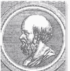

## 素数的无穷性

欧几里得
(公元前 325 年 – 公元前 265 年)

**定理**：素数有无穷多个。(欧几里得)

**证明**：假设素数有限：$p_1, p_2, ..., p_n$

- 设 $q = p_1 p_2 \cdots p_n + 1$
- 要么 $q$ 是素数，要么根据算术基本定理它是素数的乘积。
  - 但 $p_j$ 中的任何素数都不整除 $q$，因为如果 $p_j \mid q$，则 $p_j$ 整除 $q - p_1 p_2 \cdots p_n = 1$。
- 因此，存在一个不在列表 $p_1, p_2, ..., p_n$ 上的素数。它要么是 $q$，要么如果 $q$ 是合数，则是 $q$ 的素因子。这与 $p_1, p_2, ..., p_n$ 是所有素数的假设相矛盾。
- 因此，素数有无穷多个。

这个证明出自欧几里得《几何原本》。该证明被认为是在所有数学中最美的证明之一。它是《那本书》中的第一个证明，由著名数学家保罗·埃尔德什设想的由上帝维护的完美证明集合所启发。

保罗·埃尔德什
(1913-1996)


## 梅森素数


马林·梅森
(1588-1648)

**定义**：形如 2^p − 1 的素数，其中 p 为素数，称为 *梅森素数*。

- 2² − 1 = 3，2³ − 1 = 7，2⁵ − 1 = 37，且 2⁷ − 1 = 127 都是梅森素数。
- 2¹¹ − 1 = 2047 不是梅森素数，因为 2047 = 23·89。
- 存在一种有效的方法来判断 2^p − 1 是否为素数。
- 已知的最大素数是梅森素数。
- 截至 2011 年中，已知 47 个梅森素数，其中最大的是 2⁴³,¹¹²,⁶⁰⁹ − 1，它有近 1300 万位十进制数字。
- *Great Internet Mersenne Prime Search* (*GIMPS*) 是一个分布式计算项目，用于搜索新的梅森素数。

http://www.mersenne.org/


## 素数的分布

数学家们一直对素数在正整数中的分布感兴趣。在十九世纪，*素数定理* 被证明，它给出了不超过 x 的素数个数的渐近估计。

**素数定理**：不超过 x 的素数个数与 x/ln x 的比值当 x 无限增大时趋近于 1。 （ln x 是 x 的自然对数）

- 该定理告诉我们，不超过 x 的素数个数可以用 x/ln x 来近似。
- 随机选取小于 n 的正整数为素数的概率大约为 (n/ln n)/n = 1/ln n。

## 素数与等差数列
(optional)等差数列

- 欧几里得证明存在无穷多个素数的证明可以很容易地改编来证明以下 4k + 3, k = 1,2,... 中存在无穷多个素数。 （参见练习 55）
- 在十九世纪，G. Lejuenne Dirichlet 证明了每一个等差数列 ka + b, k = 1,2, ..., 其中 a 和 b 的最大公因数大于 1 的因子不存在，包含无穷多个素数。 （证明超出了本书的范围。）
- 是否存在完全由素数组成的长等差数列？
  - 5,11, 17, 23, 29 是一个由五个素数组成的等差数列。
  - 199, 409, 619, 829, 1039,1249,1459,1669,1879,2089 是一个由十个素数组成的等差数列。
- 在 1930 年代，Paul Erdős 猜想对于大于 1 的每一个正整数 n，都存在一个完全由素数组成的长度为 n 的等差数列。这一猜想在 2006 年由 Ben Green 和 Terrence Tao 证明。


## 生成素数

- 生成大素数的问题既具有理论意义也有实际意义。
- 我们将在第 4.6 节看到，寻找具有数百位数字的大素数在密码学中很重要。
- 到目前为止，还没有找到总是产生素数且有用的封闭公式。 不存在简单的函数 $f(n)$ 使得 $f(n)$ 对所有正整数 $n$ 都是素数。
- 但 $f(n) = n^2 - n + 41$ 对所有整数 1,2,..., 40 都是素数。 因此，我们可能会猜想 $f(n)$ 对所有正整数 $n$ 都是素数。 但 $f(41) = 41^2$ 不是素数。
- 更一般地，不存在整数系数多项式使得 $f(n)$ 对所有正整数 $n$ 都是素数。 （参见补充练习 23。）
- 幸运的是，我们可以生成几乎可以肯定是素数的大整数。 见第 7 章。

## 关于素数的猜想

- 尽管素数已被广泛研究数个世纪，但关于它们的许多猜想仍未解决，包括：
- *Goldbach’s Conjecture*: 每个偶数整数 *n*，*n* > 2，都是两个素数的和。 它已通过计算机验证到 1.6·10¹⁸ 的所有正偶整数。 大多数数学家认为该猜想是正确的。
- 存在无穷多个形如 *n*² + 1 的素数，其中 *n* 是正整数。 但已证明存在无穷多个形如 *n*² + 1 的素数，其中 *n* 是正整数或至多两个素数的乘积。
- *The Twin Prime Conjecture*: 孪生素数猜想是存在无穷多对孪生素数。 孪生素数是相差 2 的素数对。 例如 3 和 5，5 和 7，11 和 13 等。 目前孪生素数的世界纪录 （截至 2011 年中） 由数字 65,516,468,355·2³³³³³³ ±1 组成，它们有 100,355 位十进制数字。

## 最大公约数

**Definition**: 设 *a* 和 *b* 为整数，且不全为零。 最大整数 *d* 使得 *d* | *a* 且 *d* | *b* 被称为 *a* 和 *b* 的最大公约数。 *a* 和 *b* 的最大公约数记为 gcd(*a*,*b*)。

可以通过观察找到小数的最大公约数。

**Example**: 24 和 36 的最大公约数是多少？

**Solution**: gcd(24,36) = 12

**Example**: 17 和 22 的最大公约数是多少？

**Solution**: gcd(17,22) = 1


## 最大公约数

定义：如果整数 a 和 b 的最大公约数为 1，则称 a 和 b 互素。

示例：17 和 22

定义：如果对于任意满足 1 ≤ i < j ≤ n 的 i、j，都有 gcd(aᵢ, aⱼ) = 1，则称整数 a₁, a₂, ..., aₙ 两两互素。

示例：判断整数 10、17 和 21 是否两两互素。

解：因为 gcd(10,17) = 1，gcd(10,21) = 1，且 gcd(17,21) = 1，所以 10、17 和 21 两两互素。

示例：判断整数 10、19 和 24 是否两两互素。

解：因为 gcd(10,24) = 2，所以 10、19 和 24 不是两两互素。

## 利用质因数分解求最大公约数

- 假设 a 和 b 的质因数分解为：
- 
- $a = p_1^{a_1} p_2^{a_2} \dots p_n^{a_n}, \qquad b = p_1^{b_1} p_2^{b_2} \dots p_n^{b_n},$ 
- 
- 其中每个指数都是非负整数，并且 a 或 b 的质因数分解中出现的所有质数都包含在两者中。于是：
- 
- $\gcd(a, b) = p_1^{\min(a_1,b_1)} p_2^{\min(a_2,b_2)} \dots p_n^{\min(a_n,b_n)}.$
- 
- 该公式成立，因为（等号）右边的整数同时整除 $a$ 和 $b$，且没有更大的整数能同时整除 $a$ 和 $b$。
- 
- **示例：** $120 = 2^3 \cdot 3 \cdot 5 \quad 500 = 2^2 \cdot 5^3$
- 
- $\gcd(120,500) = 2^{\min(3,2)} \cdot 3^{\min(1,0)} \cdot 5^{\min(1,3)} = 2^2 \cdot 3^0 \cdot 5^1 = 20$
- 
- 利用两个正整数的质因数分解求它们的最大公约数并不高效，因为不存在高效的算法来求一个正整数的质因数分解。

## 最小公倍数

**定义：** 正整数 *a* 和 *b* 的最小公倍数是能被 *a* 和 *b* 同时整除的最小正整数，记为 lcm(*a*,*b*)。

- 最小公倍数也可以通过质因数分解来计算。

```
lcm(a, b) = p₁^{max(a₁,b₁)} p₂^{max(a₂,b₂)} ... pₙ^{max(aₙ,bₙ)}
```

这个数能被 *a* 和 *b* 同时整除，并且没有比它更小的数能被 *a* 和 *b* 同时整除。

**示例：** lcm(2³3⁵7², 2⁴3³) = 2^{max(3,4)} 3^{max(5,3)} 7^{max(2,0)} = 2⁴ 3⁵ 7²

- 两个整数的最大公约数和最小公倍数之间的关系如下：

**定理 5：** 设 a 和 b 是正整数，则
ab = gcd(a,b) · lcm(a,b)
*（证明见习题 31）*

## 欧几里得算法


欧几里得
（公元前 325 年—公元前 265 年）

欧几里得算法是一种计算两个整数最大公约数的高效方法。它基于这样一个思想：当 a > b 且 c 是 a 除以 b 的余数时，gcd(a,b) 等于 gcd(a,c)。

### 示例：求 gcd(91, 287)：

- 287 = 91 · 3 + 14
- 91 = 14 · 6 + 7
- 14 = 7 · 2 + 0

用 91 除 287

用 14 除 91

用 7 除 14

停止条件

gcd(287, 91) = gcd(91, 14) = gcd(14, 7) = 7

## 欧几里得算法

欧几里得算法的伪代码如下：

```
procedure gcd(a, b: positive integers)
x := a
x := b
while y ≠ 0
    r := x mod y
    x := y
    y := r
return x {gcd(a,b) is x}
```

在第 5.3 节中，我们将看到该算法的时间复杂度为 O(log b)，其中 a > b。

## 欧几里得算法的正确性

引理 1：设 a = bq + r，其中 a、b、q 和 r 都是整数。则 gcd(a,b) = gcd(b,r)。

## 证明：

- 假设 d 同时整除 a 和 b。那么根据第 4.1 节的定理 1，d 也整除 a − bq = r。因此，a 和 b 的任何公约数也必定是 b 和 r 的公约数。
- 假设 d 同时整除 b 和 r。那么 d 也整除 bq + r = a。因此，a 和 b 的任何公约数也必定是 b 和 r 的公约数。
- 因此，gcd(a,b) = gcd(b,r)。


## 欧几里得算法的正确性

- 假设 $a$ 和 $b$ 是正整数，且 $a \ge b$。令 $r_0 = a$，$r_1 = b$。反复应用带余除法可得：

\[
\begin{aligned}
r_0 &= r_1 q_1 + r_2 & 0 &\le r_2 < r_1,\\
r_1 &= r_2 q_2 + r_3 & 0 &\le r_3 < r_2,\\
&\vdots\\
r_{n-2} &= r_{n-1} q_{n-1} + r_n & 0 &\le r_n < r_{n-1},\\
r_{n-1} &= r_n q_n.
\end{aligned}
\]

- 最终，序列中会出现余数 0：$a = r_0 > r_1 > r_2 > \cdots \ge 0$。该序列的项数不可能超过 $a$。

- 由引理 1，

\[
\gcd(a,b) = \gcd(r_0,r_1) = \cdots = \gcd(r_{n-1},r_n) = \gcd(r_n, 0) = r_n.
\]

- 因此，最大公约数就是除法序列中最后一个非零余数。

## 最大公约数作为线性组合

**贝祖定理**：如果 $a$ 和 $b$ 是正整数，则存在整数 $s$ 和 $t$，使得 $\gcd(a,b) = sa + tb$。*（证明见 5.2 节习题）*

**定义**：如果 $a$ 和 $b$ 是正整数，则满足 $\gcd(a,b) = sa + tb$ 的整数 $s$ 和 $t$ 称为 $a$ 和 $b$ 的*贝祖系数*。等式 $\gcd(a,b) = sa + tb$ 称为*贝祖恒等式*。

- 由贝祖定理，整数 $a$ 和 $b$ 的最大公约数可以表示为 $sa + tb$ 的形式，其中 $s$ 和 $t$ 是整数。这是 $a$ 和 $b$ 的具有整数系数的*线性组合*。
  - $\gcd(6,14) = (-2) \cdot 6 + 1 \cdot 14$

## 求最大公约数的线性组合表示

**示例：** 将 $\gcd(252,198) = 18$ 表示为 252 和 198 的线性组合。

**解：** 首先使用欧几里得算法证明 $\gcd(252,198) = 18$。

- i. $252 = 1 \cdot 198 + 54$
- ii. $198 = 3 \cdot 54 + 36$
- iii. $54 = 1 \cdot 36 + 18$
- iv. $36 = 2 \cdot 18$

现在从上面的 iii 和 ii 逆向推导

- $18 = 54 - 1 \cdot 36$
- $36 = 198 - 3 \cdot 54$

将第二个方程代入第一个方程得到：

- $18 = 54 - 1 \cdot (198 - 3 \cdot 54) = 4 \cdot 54 - 1 \cdot 198$

代入 $54 = 252 - 1 \cdot 198$（来自 i）得到：

- $18 = 4 \cdot (252 - 1 \cdot 198) - 1 \cdot 198 = 4 \cdot 252 - 5 \cdot 198$

上述方法是一种两遍法。它先使用欧几里得算法求出最大公约数，然后逆向推导，将最大公约数表示为最初两个整数的线性组合。一种称为*扩展欧几里得算法*的单遍法将在习题中展开。

## 贝祖定理的推论

**引理 2：** 如果 $a$、$b$ 和 $c$ 是正整数，且 $\gcd(a,b) = 1$，$a \mid bc$，则 $a \mid c$。

**证明：** 假设 $\gcd(a,b) = 1$ 且 $a \mid bc$。

- 由于 $\gcd(a,b) = 1$，根据贝祖定理，存在整数 $s$ 和 $t$，使得 $sa + tb = 1$。
- 将等式两边乘以 $c$，得到 $sac + tbc = c$。
- 由 4.1 节定理 1：
  - $a \mid tbc$（第 ii 部分），且 $a$ 整除 $sac + tbc$，因为 $a \mid sac$ 且 $a \mid tbc$（第 i 部分）
- 我们得出结论 $a \mid c$，因为 $sac + tbc = c$。

**引理 3：** 如果 $p$ 是素数，且 $p \mid a_1a_2\cdots a_n$，则 $p \mid a_i$ 对某个 $i$ 成立。*（证明使用数学归纳法；见 5.1 节习题 64）*

- 引理 3 在素数分解唯一性的证明中至关重要。

## 素数分解的唯一性

我们将证明：一个正整数按非递减顺序排列的素数分解是唯一的。（这是算术基本定理的一部分。另一部分——断言每个正整数都可以分解为素数——将在 5.2 节中证明。）

**证明：** *（反证法）* 假设正整数 $n$ 可以以两种不同的方式写成素数的乘积：

\[
n = p_1 p_2 \cdots p_s \quad \text{且} \quad n = q_1 q_2 \cdots q_t.
\]

从分解中消去所有公共素数，得到

\[
p_{i_1} p_{i_2} \cdots p_{i_u} = q_{j_1} q_{j_2} \cdots q_{j_v}.
\]

由引理 3，$p_{i_1}$ 整除某个 $q_{j_k}$，这与 $p_{i_1}$ 和 $q_{j_k}$ 是不同素数的假设矛盾。

因此，$n$ 至多只能有一种按非递减顺序排列的素数分解。

## 求解同余式

**第 4.4 节**


## 线性同余

**定义：** 形如 $a x \equiv b \pmod{m}$ 的同余式（其中 $m$ 是正整数，$a$ 和 $b$ 是整数，$x$ 是变量）称为*线性同余*。

- 线性同余式 $a x \equiv b \pmod{m}$ 的解是满足该同余式的所有整数 $x$。

**定义：** 若整数 $\bar{a}$ 满足 $\bar{a} a \equiv 1 \pmod{m}$，则称 $\bar{a}$ 为 $a$ 模 $m$ 的一个*逆*。

**示例：** 因为 $5 \cdot 3 = 15 \equiv 1 \pmod{7}$，所以 5 是 3 模 7 的一个逆。

- 求解线性同余式的一种方法是利用逆 $\bar{a}$（如果它存在）。虽然我们不能将同余式两边同时除以 $a$，但可以两边同时乘以 $\bar{a}$ 来解出 $x$。

## a 模 m 的逆

下面的定理保证：只要 $a$ 和 $m$ 互素，$a$ 模 $m$ 的逆就一定存在。当 $\gcd(a,b) = 1$ 时，两个整数 $a$ 和 $b$ 互素。

**定理 1：** 若 $a$ 和 $m$ 是互素的整数且 $m > 1$，则 $a$ 模 $m$ 的逆存在。并且，这个逆在模 $m$ 意义下是唯一的。也就是说，存在唯一一个小于 $m$ 的正整数 $\bar{a}$ 是 $a$ 模 $m$ 的逆，且 $a$ 模 $m$ 的所有其他逆都与 $\bar{a}$ 在模 $m$ 下同余。

**证明：** 由于 $\gcd(a,m) = 1$，由 4.3 节定理 6 可知，存在整数 $s$ 和 $t$ 使得 $sa + tm = 1$。

- 因此，$sa + tm \equiv 1 \pmod{m}$。
- 因为 $tm \equiv 0 \pmod{m}$，所以 $sa \equiv 1 \pmod{m}$。
- 因此，$s$ 是 $a$ 模 $m$ 的一个逆。
- 逆的唯一性留作练习 7。

## 求逆

欧几里得算法和 Bézout 系数为我们提供了求逆的系统方法。

**示例：** 求 3 模 7 的一个逆。

**解：** 因为 $\gcd(3,7) = 1$，由定理 1 可知，3 模 7 的逆存在。

- 使用欧几里得算法：$7 = 2 \cdot 3 + 1$。
- 由这个等式得到 $-2 \cdot 3 + 1 \cdot 7 = 1$，可以看出 $-2$ 和 $1$ 是 3 和 7 的 Bézout 系数。
- 因此，$-2$ 是 3 模 7 的一个逆。
- 此外，所有与 $-2$ 在模 7 下同余的整数都是 3 模 7 的逆，即 $5, -9, 12$ 等。

**示例：** 求 101 模 4620 的一个逆。

**解：** 首先使用欧几里得算法证明 $\gcd(101,4620) = 1$。

反向回代：

$$
\begin{aligned}
4620 &= 45 \cdot 101 + 75\\
101 &= 1 \cdot 75 + 26\\
75 &= 2 \cdot 26 + 23\\
26 &= 1 \cdot 23 + 3\\
23 &= 7 \cdot 3 + 2\\
3 &= 1 \cdot 2 + 1\\
2 &= 2 \cdot 1
\end{aligned}
$$

$$
\begin{aligned}
1 &= 3 - 1 \cdot 2\\
1 &= 3 - 1 \cdot (23 - 7 \cdot 3) = -1 \cdot 23 + 8 \cdot 3\\
1 &= -1 \cdot 23 + 8 \cdot (26 - 1 \cdot 23) = 8 \cdot 26 - 9 \cdot 23\\
1 &= 8 \cdot 26 - 9 \cdot (75 - 2 \cdot 26) = 26 \cdot 26 - 9 \cdot 75\\
1 &= 26 \cdot (101 - 1 \cdot 75) - 9 \cdot 75\\
&= 26 \cdot 101 - 35 \cdot 75\\
1 &= 26 \cdot 101 - 35 \cdot (4620 - 45 \cdot 101)\\
&= -35 \cdot 4620 + 1601 \cdot 101
\end{aligned}
$$

由于最后一个非零余数为 1，$\gcd(101,4620) = 1$。

Bézout 系数：$-35$ 和 $1601$。

$1601$ 是 $101$ 模 $4620$ 的一个逆。

## 用逆求解同余式

- 我们可以通过将 $ax \equiv b \pmod{m}$ 两边同时乘以 $\bar{a}$ 来求解该同余式。

**示例：** 同余式 $3x \equiv 4 \pmod{7}$ 的解是什么？

**解：** 我们在前面（在前面两张幻灯片中）已经发现 $-2$ 是 $3$ 模 $7$ 的一个逆。将同余式两边同时乘以 $-2$，得到

$$
-2 \cdot 3x \equiv -2 \cdot 4 \pmod{7}.
$$

因为 $-6 \equiv 1 \pmod{7}$ 且 $-8 \equiv 6 \pmod{7}$，所以如果 $x$ 是一个解，则 $x \equiv -8 \equiv 6 \pmod{7}$。

我们需要确定是否所有满足 $x \equiv 6 \pmod{7}$ 的 $x$ 都是解。假设 $x \equiv 6 \pmod{7}$。由 4.1 节定理 5 可知，$3x \equiv 3 \cdot 6 = 18 \equiv 4 \pmod{7}$，这表明所有这样的 $x$ 都满足该同余式。

解是所有满足 $x \equiv 6 \pmod{7}$ 的整数 $x$，即 $6, 13, 20, \ldots$ 以及 $-1, -8, -15, \ldots$。

## 中国剩余定理

- 公元 1 世纪，中国数学家孙子问道：
  今有物不知其数。三三数之，余二；五五数之，余三；七七数之，余二。问物几何？
- 这个谜题可以转化为求解同余方程组：$x \equiv 2 \pmod{3}$，$x \equiv 3 \pmod{5}$，$x \equiv 2 \pmod{7}$。
- 我们将看到，被称为*中国剩余定理*的定理如何用来解决孙子的这个问题。


## 中国剩余定理

**定理2（中国剩余定理）。** 设 \(m_1,m_2,\ldots,m_n\) 是大于1的两两互素的正整数，\(a_1,a_2,\ldots,a_n\) 是任意整数。则同余方程组

\[
\begin{aligned}
x &\equiv a_1 \pmod{m_1}\\
x &\equiv a_2 \pmod{m_2}\\
&\vdots\\
x &\equiv a_n \pmod{m_n}
\end{aligned}
\]

在模 \(m=m_1m_2\cdots m_n\) 下有唯一解。（也就是说，存在一个解 \(x\) 满足 \(0\le x<m\)，并且所有其他解都与该解模 \(m\) 同余。）

**证明。** 我们将通过描述构造解的方法来证明解的存在性。解在模 \(m\) 下的唯一性证明留作习题30。

为了构造解，首先令 \(M_k=m/m_k\)，其中 \(k=1,2,\ldots,n\)，且 \(m=m_1m_2\cdots m_n\)。

由于 \(\gcd(m_k,M_k)=1\)，根据定理1，存在整数 \(y_k\)，它是 \(M_k\) 模 \(m_k\) 的一个逆，使得 \(M_ky_k\equiv1\pmod{m_k}\)。

构造和式

\[
x=a_1M_1y_1+a_2M_2y_2+\cdots+a_nM_ny_n.
\]

注意，因为当 \(j\ne k\) 时 \(M_j\equiv0\pmod{m_k}\)，所以这个和式中除了第 \(k\) 项以外的所有项都模 \(m_k\) 同余于 \(0\)。由于 \(M_ky_k\equiv1\pmod{m_k}\)，我们看到 \(x\equiv a_kM_ky_k\equiv a_k\pmod{m_k}\)，对 \(k=1,2,\ldots,n\) 成立。因此，\(x\) 是这 \(n\) 个同余式的一个同时解：

\[
x\equiv a_1\pmod{m_1},\quad x\equiv a_2\pmod{m_2},\quad\ldots,\quad x\equiv a_n\pmod{m_n}.
\]

**例。** 考虑孙子问题中的三个同余式：

\[
x\equiv2\pmod3,\quad x\equiv3\pmod5,\quad x\equiv2\pmod7.
\]

- 设 \(m=3\cdot5\cdot7=105\)，\(M_1=m/3=35\)，\(M_2=m/5=21\)，\(M_3=m/7=15\)。
- 我们看到：
  - \(2\) 是 \(M_1=35\) 模 \(3\) 的一个逆，因为 \(35\cdot2\equiv2\cdot2\equiv1\pmod3\)。
  - 1 是 \(M_2=21\) 模 \(5\) 的一个逆，因为 \(21\equiv1\pmod5\)。
  - 1 是 \(M_3=15\) 模 \(7\) 的一个逆，因为 \(15\equiv1\pmod7\)。
- 因此，

\[
x=a_1M_1y_1+a_2M_2y_2+a_3M_3y_3
=2\cdot35\cdot2+3\cdot21\cdot1+2\cdot15\cdot1
=233\equiv23\pmod{105}.
\]

- 我们已经证明 \(23\) 是同时解的最小正整数。请验证！

### 回代法

我们也可以求解两两互素模数的线性同余方程组，方法是：使用4.1节中的定理4将某个同余式改写为等式，将变量的值代入另一个同余式，并继续这个过程，直到处理完所有同余式。这种方法称为回代法。

**例。** 使用回代法求所有满足以下条件的整数 \(x\)：

\[
x\equiv1\pmod5,\quad x\equiv2\pmod6,\quad x\equiv3\pmod7.
\]

**解。** 根据4.1节中的定理4，第一个同余式可以改写为 \(x=5t+1\)，其中 \(t\) 是整数。

- 将其代入第二个同余式，得到 \(5t+1\equiv2\pmod6\)。
- 解这个式子告诉我们 \(t\equiv5\pmod6\)。
- 再次使用定理4，得到 \(t=6u+5\)，其中 \(u\) 是整数。
- 将其代回 \(x=5t+1\)，得到 \(x=5(6u+5)+1=30u+26\)。
- 将其代入第三个方程，得到 \(30u+26\equiv3\pmod7\)。
- 解这个同余式告诉我们 \(u\equiv6\pmod7\)。
- 根据定理4，\(u=7v+6\)，其中 \(v\) 是整数。
- 将 \(u\) 的这个表达式代入 \(x=30u+26\)，得到 \(x=30(7v+6)+26=210v+206\)。

将其改写回同余式，我们得到解 \(x\equiv206\pmod{210}\)。

虽然定理2中的构造方法为求解两两互素模数的线性同余方程组提供了一种通用方法，但使用另一种方法求解方程组可能更容易。例6演示了如何使用一种称为回代法的方法。

**例6。** 使用回代法求所有满足以下条件的整数 \(x\)：

\[
x\equiv1\pmod5,\quad x\equiv2\pmod6,\quad x\equiv3\pmod7.
\]

**解。** 根据4.1节中的定理4，第一个同余式可以改写为等式 \(x=5t+1\)，其中 \(t\) 是整数。将这个 \(x\) 的表达式代入第二个同余式，我们得到

\[
5t+1\equiv2\pmod6,
\]

这个同余式很容易求解，得出 \(t\equiv5\pmod6\)（读者应自行验证）。再次使用4.1节中的定理4，我们看到 \(t=6u+5\)，其中 \(u\) 是整数。将 \(t\) 的这个表达式代回方程 \(x=5t+1\)，我们得到 \(x=5(6u+5)+1=30u+26\)。我们将其代入第三个方程，得到

\[
30u+26\equiv3\pmod7.
\]

解这个同余式告诉我们 \(u\equiv6\pmod7\)（读者应自行验证）。因此，4.1节中的定理4告诉我们 \(u=7v+6\)，其中 \(v\) 是整数。将 \(u\) 的这个表达式代入方程 \(x=30u+26\)，我们得到 \(x=30(7v+6)+26=210v+206\)。将其改写回同余式，我们得到联立同余式的解，

\[
x\equiv206\pmod{210}.
\]


## 大整数的计算机算术

设 m₁, m₂, …, mₙ 是两两互素的模数，令 m 为它们的乘积。根据中国剩余定理，我们可以证明（见练习 28），满足 0 ≤ a < m 的整数 a 可以由其除以 mᵢ 的余数组成的 n 元组唯一表示，i = 1, 2, …, n。也就是说，我们可以用

(a mod m₁, a mod m₂, …, a mod mₙ)

唯一地表示 a。

## 例 7

当用有序对表示小于 12 的非负整数时，其中第一个分量是该整数除以 3 的余数，第二个分量是该整数除以 4 的余数，所使用的对是什么？

解：我们有以下表示，通过求每个整数除以 3 和除以 4 的余数得到：

0 = (0, 0)    4 = (1, 0)    8 = (2, 0)
1 = (1, 1)    5 = (2, 1)    9 = (0, 1)
2 = (2, 2)    6 = (0, 2)    10 = (1, 2)
3 = (0, 3)    7 = (1, 3)    11 = (2, 3).

## 费马小定理


**皮埃尔·德·费马**  
(1601-1665)

**定理 3：** *(费马小定理)* 若 \(p\) 为素数且 \(a\) 为不能被 \(p\) 整除的整数，则 \(a^{p-1} \equiv 1 \pmod p\)  
此外，对每个整数 \(a\) 都有 \(a^p \equiv a \pmod p\)  
*(证明概要见练习 19)*

费马小定理在计算整数大幂模 \(p\) 的余数时很有用。

**例：** 求 \(7^{2222} \bmod 11\)。

根据费马小定理，我们知道 \(7^{10} \equiv 1 \pmod{11}\)，因此 \((7^{10})^k \equiv 1 \pmod{11}\)，对每个正整数 \(k\) 成立。因此，

\[7^{2222} = 7^{22\cdot 10+2} = (7^{10})^{222}7^2 \equiv (1)^{222}\cdot 49 \equiv 5 \pmod{11}.\]

于是，\(7^{2222} \bmod 11 = 5\)。

## 伪素数

- 给定正整数 $n$，使得 $2^{n-1} \equiv 1 \pmod n$：
  - 如果 $n$ 不满足该同余式，则它是合数。
  - 如果 $n$ 满足该同余式，则它是素数或对底数 2 的伪素数。
- 使用额外的底数 $b$ 进行类似的测试，可提供更多关于 $n$ 是否为素数的证据。
- 在不超过正实数 $x$ 的正整数中，与素数相比，对底数 $b$ 的伪素数相对较少。
  - 例如，在小于 $10^{10}$ 的正整数中，有 455,052,512 个素数，但只有 14,884 个对底数 2 的伪素数。

## 卡迈克尔数
（可选）


罗伯特·卡迈克尔
(1879-1967)

- 存在合数 n，它对所有满足 gcd(b,n) = 1 的底数 b 都通过测试。
- 尽管卡迈克尔数有无穷多个，但仍有其他测试（在练习中描述）构成了高效概率素性测试的基础。 (见第 7 章)

定义：满足对所有满足 gcd(b,n) = 1 的正整数 b 都有同余式 b^{n-1} ≡ 1 (mod n) 的合数 n 称为卡迈克尔数。

例：整数 561 是一个卡迈克尔数。理由如下：

- 561 是合数，因为 561 = 3 · 11 · 17。
- 若 gcd(b, 561) = 1，则 gcd(b, 3) = 1，gcd(b, 11) = 1，gcd(b, 17) = 1。
- 利用费马小定理：b² ≡ 1 (mod 3)，b¹⁰ ≡ 1 (mod 11)，b¹⁶ ≡ 1 (mod 17)。
- 那么
  b⁵⁶⁰ = (b²)²⁸⁰ ≡ 1 (mod 3)，
  b⁵⁶⁰ = (b¹⁰)⁵⁶ ≡ 1 (mod 11)，
  b⁵⁶⁰ = (b¹⁶)³⁵ ≡ 1 (mod 17)。
- 由此可知（见练习 29）对所有满足 gcd(b,561) = 1 的正整数 b 都有 b⁵⁶⁰ ≡ 1 (mod 561)。因此，561 是卡迈克尔数。

## 原根

**定义**：模素数 $p$ 的原根是 $\mathbf{Z}_p$ 中的整数 $r$，使得 $\mathbf{Z}_p$ 的每个非零元素都是 $r$ 的幂。

**例**：由于 $\mathbf{Z}_{11}$ 的每个元素都是 2 的幂，2 是 11 的原根。

2 模 11 的幂：$2^1 = 2$，$2^2 = 4$，$2^3 = 8$，$2^4 = 5$，$2^5 = 10$，$2^6 = 9$，$2^7 = 7$，$2^8 = 3$，$2^{10} = 1$。

**例**：由于 $\mathbf{Z}_{11}$ 的并非所有元素都是 3 的幂，3 不是 11 的原根。

3 模 11 的幂：$3^1 = 3$，$3^2 = 9$，$3^3 = 5$，$3^4 = 4$，$3^5 = 1$，且该模式对更高次幂重复。

**重要事实**：对每个素数 $p$ 都存在模 $p$ 的原根。


## 离散对数

假设 p 为素数，r 为模 p 的原根。如果 a 是介于 1 到 p − 1 之间的整数，即 Z_p 中的元素，则存在唯一指数 e，使得在 Z_p 中 r^e = a，也就是 r^e mod p = a。

定义：假设 p 为素数，r 为模 p 的原根，a 为介于 1 到 p − 1（含）之间的整数。如果 r^e mod p = a 且 1 ≤ e ≤ p − 1，则称 e 为 a 关于模 p 以 r 为底的离散对数，并记作 log_r a = e（其中素数 p 是默认已知的）。

例 1：我们记 log_2 3 = 8，因为 3 关于模 11 以 2 为底的离散对数为 8，即 2^8 = 3 (mod 11)。

例 2：我们记 log_2 5 = 4，因为 5 关于模 11 以 2 为底的离散对数为 4，即 2^4 = 5 (mod 11)。

目前没有已知的多项式时间算法可以在给定素数 p、模 p 的原根 r 和正整数 a ∈ Z_p 时，计算 a 关于模 p 以 r 为底的离散对数。该问题在密码学中扮演着重要角色，将在第 4.5 节中讨论。

## 同余的应用

4.5 节

### 本节摘要

- 哈希函数
- 伪随机数
- 校验位

## 哈希函数

**定义：** *哈希函数* h 将具有键 k 的记录分配到存储位置 h(k)。

- 一种常见的哈希函数是 h(k) = k mod m，其中 m 是存储位置的数量。
- 由于该哈希函数是满射的，所有存储位置都有可能被用到。

**示例：** 设 h(k) = k mod 111。该哈希函数将客户记录（以社会保险号作为键）按如下方式分配到存储位置：

h(064212848) = 064212848 mod 111 = 14
h(037149212) = 037149212 mod 111 = 65
h(107405723) = 107405723 mod 111 = 14，但由于位置 14 已被占用，该记录被分配到下一个可用位置 15。

- 该哈希函数不是一对一的，因为可能的键远多于存储位置。当多个记录被分配到同一位置时，我们称发生了冲突。此处通过将记录分配到第一个空闲位置来解决冲突。
- 为了解决冲突，可以使用线性探测函数：
  h(k,i) = (h(k) + i) mod m，其中 i 从 0 取到 m − 1。
- 处理冲突的方法还有很多，你可能会在后续的计算机科学课程中学习到。

## 伪随机数

- **示例**：求由线性同余法生成的伪随机数序列，其中模数 $m = 9$，乘数 $a = 7$，增量 $c = 4$，种子 $x_0 = 3$。
- **解答**：利用同余式 $x_{n+1} = (7x_n + 4) \mod 9$ 逐项计算该序列，其中 $x_0 = 3$。
  $x_1 = 7x_0 + 4 \mod 9 = 7\cdot3 + 4 \mod 9 = 25 \mod 9 = 7,$
  $x_2 = 7x_1 + 4 \mod 9 = 7\cdot7 + 4 \mod 9 = 53 \mod 9 = 8,$
  $x_3 = 7x_2 + 4 \mod 9 = 7\cdot8 + 4 \mod 9 = 60 \mod 9 = 6,$
  $x_4 = 7x_3 + 4 \mod 9 = 7\cdot6 + 4 \mod 9 = 46 \mod 9 = 1,$
  $x_5 = 7x_4 + 4 \mod 9 = 7\cdot1 + 4 \mod 9 = 11 \mod 9 = 2,$
  $x_6 = 7x_5 + 4 \mod 9 = 7\cdot2 + 4 \mod 9 = 18 \mod 9 = 0,$
  $x_7 = 7x_6 + 4 \mod 9 = 7\cdot0 + 4 \mod 9 = 4 \mod 9 = 4,$
  $x_8 = 7x_7 + 4 \mod 9 = 7\cdot4 + 4 \mod 9 = 32 \mod 9 = 5,$
  $x_9 = 7x_8 + 4 \mod 9 = 7\cdot5 + 4 \mod 9 = 39 \mod 9 = 3.$
  生成的序列为 3,7,8,6,1,2,0,4,5,3,7,8,6,1,2,0,4,5,3,...
  它在生成 9 项后开始重复。
- 通常，计算机使用增量 $c = 0$ 的线性同余生成器，称为*纯乘法生成器*。模数为 $2^{31} - 1$、乘数为 $7^5 = 16,807$ 的这种生成器会生成 $2^{31} - 2$ 个数后才重复。

## 校验位：UPC

- 检测数字串错误的一种常用方法是在末尾添加一个额外数字，该数字通过某个函数计算得出。如果最后一位不正确，则该数字串被认为不正确。

示例：零售商品通过通用产品代码（UPC）进行标识。通常这些代码有 12 位十进制数字，最后一位是校验位。

校验位由以下同余式确定：

3x₁ + x₂ + 3x₃ + x₄ + 3x₅ + x₆ + 3x₇ + x₈ + 3x₉ + x₁₀ + 3x₁₁ + x₁₂ ≡ 0 (mod 10)。

- a. 假设 UPC 的前 11 位数字为 79357343104，校验位是多少？
- b. 041331021641 是有效的 UPC 吗？

### 解答：

- a. 3·7 + 9 + 3·3 + 5 + 3·7 + 3 + 3·4 + 3 + 3·1 + 0 + 3·4 + x₁₂ ≡ 0 (mod 10)
  21 + 9 + 9 + 5 + 21 + 3 + 12 + 3 + 3 + 0 + 12 + x₁₂ ≡ 0 (mod 10)
  98 + x₁₂ ≡ 0 (mod 10)
  x₁₂ ≡ 0 (mod 10)  因此，校验位为 2。
- b. 3·0 + 4 + 3·1 + 3 + 3·3 + 1 + 3·0 + 2 + 3·1 + 6 + 3·4 + 1 ≡ 0 (mod 10)
  0 + 4 + 3 + 3 + 9 + 1 + 0 + 2 + 3 + 6 + 12 + 1 = 44 ≡ 4 ≠ (mod 10)
  因此，041331021641 不是有效的 UPC。


## 校验位：ISBN

图书通过国际标准书号（ISBN-10）来标识，它是一个 10 位代码。前 9 位标识语言、出版社和图书本身。第 10 位是校验位，由以下同余式确定：

\[
x_{10} \equiv \sum_{i=1}^{9} i x_i \pmod{11}.
\]

ISBN-10 的有效性可以用等价的 \(\sum_{i=1}^{10} i x_i \equiv 0 \pmod{11}\) 来验证。

- a. 假设 ISBN-10 的前 9 位是 007288008。校验位是多少？
- b. 084930149X 是有效的 ISBN-10 吗？

## 解答

- a. \(x_{10} \equiv 1\cdot 0 + 2\cdot 0 + 3\cdot 7 + 4\cdot 2 + 5\cdot 8 + 6\cdot 8 + 7\cdot 0 + 8\cdot 0 + 9\cdot 8 \pmod{11}\)。
- \(x_{10} \equiv 0 + 0 + 21 + 8 + 40 + 48 + 0 + 0 + 72 \pmod{11}\)。
- \(x_{10} \equiv 189 \equiv 2 \pmod{11}\)。因此，\(x_{10} = 2\)。

- b. \(1\cdot 0 + 2\cdot 8 + 3\cdot 4 + 4\cdot 9 + 5\cdot 3 + 6\cdot 0 + 7\cdot 1 + 8\cdot 4 + 9\cdot 9 + 10\cdot 10 =\)
- \(0 + 16 + 12 + 36 + 15 + 0 + 7 + 32 + 81 + 100 = 299 \equiv 2 \neq 0 \pmod{11}\)。
- 因此，084930149X 不是有效的 ISBN-10。

X 用来表示数字 10。

单个错误是指识别号码中某一位数字出错，而换位错误是指两位数字被意外互换。这两类错误都可以通过 ISBN-10 的校验位检测出来。（更多细节请参见正文。）

## 密码学

4.6 节

## 章节摘要

- 经典密码学
- 密码系统
- 公钥密码学
- RSA 密码系统
- 密码协议
- 原根与离散对数

### 凯撒密码

尤利乌斯·凯撒通过将每个字母在字母表中向前移动三个字母来创建秘密消息（将最后三个字母移到最前面的三个字母）。例如，字母 B 被替换为字母 E，字母 X 被替换为 A。这种使消息保密的过程就是*加密*的一个例子。

加密过程如下：

- 将每个字母替换为 \(\mathbb{Z}_{26}\) 中的一个整数，也就是从 0 到 25 的整数，表示它在字母表中位置减一后的值。
- 加密函数为 \(f(p)=(p+3)\bmod 26\)。它将集合 \(\{0,1,2,\ldots,25\}\) 中的每个整数 \(p\) 替换为集合 \(\{0,1,2,\ldots,25\}\) 中的 \(f(p)\)。
- 将每个整数 \(p\) 替换为字母表中位置为 \(p+1\) 的字母。

**示例：** 使用凯撒密码加密消息 “MEET YOU IN THE PARK”。

**解：** 12 4 4 19   24 14 20   8 13   19 7 4   15 0 17 10。

现在用 \(f(p)=(p+3)\bmod 26\) 替换这些数字 \(p\)。

15 7 7 22   1 17 23   11 16   22 10 7   18 3 20 13。

将这些数字转换回字母，得到加密消息 “PHHW BRX LQ WKH SDUN。”


- 要恢复原始消息，使用 \(f^{-1}(p) = (p-3) \bmod 26\)。这样，编码消息中的每个字母都在字母表中向后移动三个字母，其中前三个字母被移到最后三个字母。从加密消息中恢复原始消息的过程称为*解密*。
- 凯撒密码是称为*移位密码*的一类密码中的一种。字母可以移动一个整数 \(k\)，3 只是其中一种可能。加密函数为
  \[
  f(p) = (p + k) \bmod 26
  \]
  解密函数为
  \[
  f^{-1}(p) = (p - k) \bmod 26.
  \]
  整数 \(k\) 称为*密钥*。

### 移位密码

**示例 1：** 使用移位密码且 \(k = 11\) 加密消息 “STOP GLOBAL WARMING”。

**解：** 将每个字母替换为 \(\mathbb{Z}_{26}\) 中对应的元素。

18 19 14 15   6 11 14 1 0 11   22 0 17 12 8 13 6。

应用移位 \(f(p) = (p + 11) \bmod 26\)，得到

3 4 25 0   17 22 25 12 11 22   7 11 2 23 19 24 17。

将这些数字转换回字母，得到密文

“DEZA RWZMLW HLCXTYR。”

**示例 2：** 解密消息 “LEWLYPLUJL PZ H NYLHA ALHJOLY”，它使用移位密码且 \(k = 7\) 加密。

**解：** 将每个字母替换为 \(\mathbb{Z}_{26}\) 中对应的元素。

11 4 22 11 24 15 11 20 9 11   15 25   7 13 24 11 7 0   0 11 7 9 14 11 24。

将每个数字按模 26 移位 \(-k=-7\)，得到

4 23 15 4 17 8 4 13 2 4   8 18   0   6 17 4 0 19   19 4 0 2 7 4 17。

将这些数字转换回字母，得到解密消息

> “EXPERIENCE IS A GREAT TEACHER。”


## Affine Ciphers

- Shift ciphers are a special case of *affine ciphers* which use functions of the form
  $f(p) = (ap + b) \mod 26,$
  where $a$ and $b$ are integers, chosen so that $f$ is a bijection.
  The function is a bijection if and only if gcd$(a,26) = 1.$

## Cryptanalysis of Affine Ciphers

- The process of recovering plaintext from ciphertext without knowledge both of the encryption method and the key is known as *cryptanalysis* or *breaking codes*.
- An important tool for cryptanalyzing ciphertext produced with a affine ciphers is the relative frequencies of letters. The nine most common letters in the English texts are E 13%, T 9%, A 8%, O 8%, I 7%, N 7%, S 7%, H 6%, and R 6%.
- To analyze ciphertext:
  - Find the frequency of the letters in the ciphertext.
  - Hypothesize that the most frequent letter is produced by encrypting E.
  - If the value of the shift from E to the most frequent letter is *k*, shift the ciphertext by −*k* and see if it makes sense.
  - If not, try T as a hypothesis and continue.

## Cryptanalysis of Affine Ciphers

- **Example:** We intercepted the message “ZNK KGXRE HOXJ MKZY ZNK CUXS” that we know was produced by a shift cipher. Let’s try to cryptanalyze.

- **Solution:** The most common letter in the ciphertext is K. So perhaps the letters were shifted by 6 since this would then map E to K. Shifting the entire message by −6 gives us “THE EARLY BIRD GETS THE WORM.”

## Block Ciphers

- Ciphers that replace each letter of the alphabet by another letter are called *character* or *monoalphabetic* ciphers.
- They are vulnerable to cryptanalysis based on letter frequency. *Block ciphers* avoid this problem, by replacing blocks of letters with other blocks of letters.
- A simple type of block cipher is called the *transposition cipher*. The key is a permutation σ of the set {1,2,...,m}, where m is an integer, that is a one-to-one function from {1,2,...,m} to itself.
- To encrypt a message, split the letters into blocks of size m, adding additional letters to fill out the final block. We encrypt p₁,p₂,...,pₘ as c₁,c₂,...,cₘ = pσ(1),pσ(2),...,pσ(m).
- To decrypt the c₁,c₂,...,cₘ transpose the letters using the inverse permutation σ⁻¹.

## Block Ciphers

**Example:** Using the transposition cipher based on the permutation σ of the set {1,2,3,4} with σ(1) = 3, σ(2) = 1, σ(3) = 4, σ(4) = 2,

- a. Encrypt the plaintext PIRATE ATTACK
- b. Decrypt the ciphertext message SWUE TRAEOEHS, which was encrypted using the same cipher.

**Solution:**

- a. Split into four blocks PIRA TEAT TACK.
  Apply the permutation σ giving IAPR ETTA AKTC.
- b. σ⁻¹: σ⁻¹(1) = 2, σ⁻¹(2) = 4, σ⁻¹(3) = 1, σ⁻¹(4) = 3.
  Apply the permutation σ⁻¹ giving USEW ATER HOSE.
  Split into words to obtain USE WATER HOSE.

## Cryptosystems

**Definition:** A *cryptosystem* is a five-tuple $(\mathcal{P},\mathcal{C},\mathcal{K},\mathcal{E},\mathcal{D})$, where

- $\mathcal{P}$ is the set of plaintext strings.
- $\mathcal{C}$ is the set of ciphertext strings,
- $\mathcal{K}$ is the *keyspace* (set of all possible keys),
- $\mathcal{E}$ is the set of encryption functions, and
- $\mathcal{D}$ is the set of decryption functions.

The encryption function in $\mathcal{E}$ corresponding to the key $k$ is denoted by $E_k$ and the decryption function in $\mathcal{D}$ that decrypts cipher text encrypted using $E_k$ is denoted by $D_k$. Therefore:

$$D_k(E_k(p)) = p, \text{ for all plaintext strings } p.$$

## Cryptosystems

**Example:** Describe the family of shift ciphers as a cryptosystem.

**Solution:** Assume the messages are strings consisting of elements in Z₂₆.

- $\mathcal{P}$ is the set of strings of elements in Z₂₆,
- $\mathcal{C}$ is the set of strings of elements in Z₂₆,
- $\mathcal{K}$ = Z₂₆,
- $\mathcal{E}$ consists of functions of the form Eₖ(p) = (p + k) mod 26 , and
- $\mathcal{D}$ is the same as $\mathcal{E}$ where Dₖ(p) = (p − k) mod 26 .


## 公钥密码学

- 所有经典密码，包括移位密码和仿射密码，都是*私钥密码系统*。知道加密密钥就可以快速确定解密密钥。
- 所有希望使用私钥密码系统进行通信的各方必须共享密钥并保密。
- 在公钥密码系统中，最早于 1970 年代发明，知道如何加密消息并不会帮助解密该消息。因此，每个人都可以拥有公开的加密密钥。唯一需要保密的密钥是解密密钥。

### RSA 密码系统

- 一种公钥密码系统，现在被称为 RSA 系统，于 1976 年由麻省理工学院的三位研究人员引入。


**克利福德·科克斯**  
（出生于 1950 年）


罗纳德·里维斯特  
（出生于 1948 年）


阿迪·沙米尔  
（出生于 1952 年）


伦纳德·阿德尔曼  
（出生于 1945 年）

- 现在已知该方法早已被克利福德·科克斯发现，他当时秘密为英国政府工作。
- 公开加密密钥为 $(n,e)$，其中 $n=pq$（模数）是两个大数（200 位）素数 $p$ 和 $q$ 的乘积，以及一个与 $(p-1)(q-1)$ 互质的指数 $e$。这两个大素数可使用前面讨论过的概率素性测试快速找到。但 $n=pq$，约有 400 位，无法在合理的时间内分解。

### RSA 加密

- 要使用 RSA 加密消息，使用密钥 (n,e)：
    i. 将明文消息 M 翻译成表示字母的两位整数序列。用 00 表示 A，01 表示 B，依此类推。
    ii. 将两位整数连接成数字字符串。
    iii. 将此字符串分成大小相等、由 2N 位组成的块，其中 2N 是不超过 n 的最大偶数 2525...25，且有 2N 位。
    iv. 明文消息 M 现在是一系列整数 m₁,m₂,...,mₖ。
    v. 每个块（一个整数）使用函数 C = Mᵉ mod n 进行加密。

**示例**：使用密钥 (2537,13) 的 RSA 密码系统加密消息 STOP。

- 2537 = 43·59，
- p = 43 且 q = 59 为素数且 gcd(e,(p-1)(q-1)) = gcd(13, 42·58) = 1。

**解答**：将 STOP 中的字母翻译为其数值等价物 18 19 14 15。

- 分成四位块（因为 2525 < 2537 < 252525）得到 1819 1415。
- 使用映射 C = M^13 mod 2537 加密每个块。
- 由于 1819^13 mod 2537 = 2081 且 1415^13 mod 2537 = 2182，加密后的消息为 2081 2182。

### RSA 解密

- 要解密 RSA 密文消息，需要解密密钥 $d$，它是 $e$ 模 $(p-1)(q-1)$ 的逆。逆存在因为 $\gcd(e,(p-1)(q-1)) = \gcd(13, 42·58) = 1$。
- 使用解密密钥 $d$，我们可以用计算 $M = C^d \bmod p·q$ 解密每个块（详见正文推导）。
- RSA 作为公钥系统有效，因为找到 $d$ 的唯一已知方法基于将 $n$ 分解为素数。目前尚无已知的可行方法将大数分解为素数。

- **示例：** 收到消息 0981 0461。如果它是用前一示例中的 RSA 密码加密的，解密后的消息是什么？

  **解答：** 消息是用 *n* = 43·59 和指数 13 加密的。13 模 42·58 = 2436 的逆（*第 4.4 节练习 2*）是 *d* = 937。

  - 要解密块 C，*M* = C⁹³⁷ mod 2537。
  - 由于 0981⁹³⁷ mod 2537 = 0704 且 0461⁹³⁷ mod 2537 = 1115，解密后的消息为 0704 1115。翻译回英文字母，消息为 **HELP**。

## 密码学协议：数字签名

给消息添加*数字签名*是一种确保接收者消息来自声称的发送者的方式。

- 假设爱丽丝的 RSA 公钥是 $(n,e)$，她的私钥是 $d$。爱丽丝使用 $E_{(n,e)}(x)=x^d \bmod n$ 加密明文消息 $x$。她使用 $D_{(n,e)}(y)=y^e \bmod n$ 解密密文消息 $y$。
- 爱丽丝想发送消息 $M$，以便所有接收到消息的人都知道它来自她。
    1. 她将消息翻译成数值等价物并分成块，就像 RSA 加密中一样。
    2. 然后她对块应用她的解密函数 $D_{(n,e)}$ 并将结果发送给所有预期接收者。
    3. 接收者应用爱丽丝的加密函数，结果是原始明文，因为 $E_{(n,e)}(D_{(n,e)}(x))=x$。

之后所有接收到消息的人都可以确定它来自爱丽丝。


## 密码学协议：数字签名

**示例：** 假设爱丽丝的 RSA 密码系统与之前的示例相同，密钥为 $(2537,13)$，$2537=43\cdot59$，$p=43$ 和 $q=59$ 为素数且 $\gcd(e,p-1)\gcd(e,q-1)=\gcd(42,58)=1$。
她的解密密钥是 $d=937$。
她想向朋友们发送消息“MEET AT NOON”，以便他们能确定该消息来自她。

**解答：** 爱丽丝将消息翻译成数字块 1204 0419 0019 1314 1413。

- 1. 她然后对每个块应用她的解密变换 $D_{(2537,13)}(x)=x^{937}\ \mathbf{mod}\ 2537$。
- 2. 她发现（使用她的笔记本电脑、编程技能和离散数学知识）$1204^{937}\ \mathbf{mod}\ 2537=817$，$419^{937}\ \mathbf{mod}\ 2537=555$，$19^{937}\ \mathbf{mod}\ 2537=1310$，$1314^{937}\ \mathbf{mod}\ 2537=2173$，并且 $1413^{937}\ \mathbf{mod}\ 2537=1026$。
- 3. 她发送 0817 0555 1310 2173 1026。

当她的朋友之一收到消息时，他们对每个块应用爱丽丝的加密变换 $E_{(2537,13)}$。他们然后得到原始消息并将其翻译回英文字母。

## 作业

- § 4.1 – 16, 20, 32, 34
- § 4.2 – 26
- § 4.3 – 22, 32
- § 4.4 – 6, 12
- § 4.5 – 2, 6
- § 4.6 – 2

- 求所有整数 x 使得
- x ≡ 2 (mod 7)
- x ≡ 4 (mod 8)
- x ≡ 3 (mod 9)
- 求 2¹⁰⁰ mod 13
- 1563

## 1 基础：逻辑与证明

- 1.1 命题逻辑
- 1.2 命题逻辑的应用
- 1.3 命题等价
- 1.4 谓词与量词
- 1.5 嵌套量词
- 1.6 推理规则
- 1.7 证明的介绍
- 1.8 证明方法与策略

## 逻辑基础

Rosen 第7版，§§1.1-1.5

## 数理逻辑(symbolic logic)

逻辑：是研究推理的科学。公元前四世纪由希腊的亚里斯多德首创。作为一门独立科学，十七世纪，德国莱布尼兹给逻辑学引进了符号，又称为数理逻辑。

利用计算的方法来代替人们思维中的逻辑推理过程，这种想法早在十七世纪就有人提出过。莱布尼茨就曾经设想过能不能创造一种“通用的科学语言”，可以把推理过程象数学一样利用公式来进行计算，从而得出正确的结论。由于当时的社会条件，他的想法并没有实现。但是他的思想却是现代数理逻辑部分内容的萌芽，从这个意义上讲，莱布尼茨可以说是数理逻辑的先驱。

1847年，英国数学家布尔发表了《逻辑的数学分析》，建立了“布尔代数”，并创造一套符号系统，利用符号来表示逻辑中的各种概念。布尔建立了一系列的运算法则，利用代数的方法研究逻辑问题，初步奠定了数理逻辑的基础。

十九世纪末二十世纪初，数理逻辑有了比较大的发展，1884年，德国数学家弗雷格出版了《算术基础》一书，在书中引入量词的符号，使得数理逻辑的符号系统更加完备。对建立这门学科做出贡献的，还有美国人皮尔斯，他也在著作中引入了逻辑符号。从而使现代数理逻辑最基本的理论基础逐步形成，成为一门独立的学科。

## 逻辑基础：概述

- 命题逻辑 ( § 1.1-1.3): 命题逻辑
  - 基本定义。 ( § 1.1)
  - 应用 ( § 1.2)
  - 等价规则 ( § 1.3)
- 谓词逻辑 ( § 1.4-1.5) 谓词逻辑
  - 谓词。
  - 量化谓词表达式。
  - 等价

## 命题逻辑 (§ 1.1)

*命题逻辑* 是由更简单的陈述使用所谓的 *布尔连接词* 构建的复合陈述的逻辑。

计算机科学中的一些应用：

- 数字电子电路的设计。
- 在程序中表达条件。
- 查询数据库和搜索引擎。

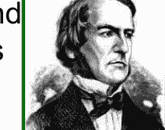

George Boole
(1815-1864)

## 自然语言中的命题

**定义：** *命题* 简单地是：

- 一个 *陈述*（即一个陈述句）
- 具有 *确定的含义*，（不含糊或模棱两可）
- 具有 *真值*，要么为 *真* (T) 要么为 *假* (F)
- 它 **永远** 不会同时是两者、两者都不是，或处于“中间”！
- 然而，你可能 *不知道* 实际的真值
- 稍后，我们将研究 *概率论*，在其中我们为命题分配 *确定性程度*（“介于” T 和 F 之间）。
- 但现在：只考虑真/假！

## 自然语言命题的例子

- “正在下雨。”（在给定情况下。）
- “北京是中国首都，并且 1 + 2 = 2”

但是，以下内容不是命题：

- “La la la la la.”（无意义）
- “谁在那里？”（疑问句：无真值）
- “x := x+1”（命令句：无真值）
- “1 + 2”（项：无真值）


## Example 1
- 以下哪些是命题？
  - (a) 地球是圆的。
  - (b) 2+3=5
  - (c) 你会说英语吗？
  - (d) 3-x=5
  - (e) 吃两片阿司匹林。
  - (f) 金星表面的温度是800°F。
  - (g) 明天太阳会出来。

## Propositional variables
- 我们用字母来表示**命题变量**（或陈述变量），即代表命题的变量，就像字母被用来表示数值变量一样。用于命题变量的惯用字母是 p, q, r, s, . . .
- 处理命题的逻辑领域称为**命题演算**或**命题逻辑**。

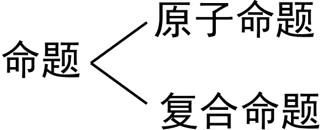

原子命题：不能分解为更简单的陈述句。

## Propositions in Propositional Logic
- Atoms: *p*, *q*, *r*, ...
  (Corresponds with simple English sentences, e.g. ‘I had salad for lunch’)
- Complex propositions : built up from atoms using operators: *p*∧*q*
  (Corresponds with compound English sentences, e.g., “I had salad for lunch and I had steak for dinner.”)

## 义务教育教科书
## SHU XUE
数学

一年级 上册

主 编 刘 坚 孔企平 侯 丹

本册主编 刘可钦 张 红


北京师范大学出版社
·北京·

## 亲爱的小朋友：

你知道“数学”是什么样的吗？

“数学”是数学，学了数学可以查时间，看日期。

我认为“数学”无处不在，是24时彩虹，是各种各样的积木……

这样，这里面就有数学！

小朋友，数学就在我们身边，你和数学一定会成为好朋友。


## Operators / Connectives

An *operator* or *connective* combines *n operand* expressions into a larger expression. (*E.g.*, “+” in numeric exprs.)

- *Unary* operators take 1 operand (e.g., −3); *binary* operators take 2 operands (eg 3 × 4).
- *Propositional* or *Boolean* operators operate on propositions instead of on numbers.

## Logical Operators(逻辑运算)
- Unary
  - **Negation**（否定）
- Binary
  - **Conjunction**（合取）
  - **Disjunction**（析取）
  - **Exclusive OR**（异或）
  - **Implication**（蕴涵）
  - **Biconditional**（等价）

## 加减口诀表

| 1 | 2 | 3 | 4 | 5 | 6 | 7 | 8 | 9 |
|---|---|---|---|---|---|---|---|---|
| 1+1=2 |  |  |  |  |  |  |  |  |
| 1+2=3 | 2+1=3 |  |  |  |  |  |  |  |
| 1+3=4 | 2+2=4 | 3+1=4 |  |  |  |  |  |  |
| 1+4=5 | 2+3=5 | 3+2=5 | 4+1=5 |  |  |  |  |  |
| 1+5=6 | 2+4=6 | 3+3=6 | 4+2=6 | 5+1=6 |  |  |  |  |
| 1+6=7 | 2+5=7 | 3+4=7 | 4+3=7 | 5+2=7 | 6+1=7 |  |  |  |
| 1+7=8 | 2+6=8 | 3+5=8 | 4+4=8 | 5+3=8 | 6+2=8 | 7+1=8 |  |  |
| 1+8=9 | 2+7=9 | 3+6=9 | 4+5=9 | 5+4=9 | 6+3=9 | 7+2=9 | 8+1=9 |  |
| 1+9=10 | 2+8=10 | 3+7=10 | 4+6=10 | 5+5=10 | 6+4=10 | 7+3=10 | 8+2=10 | 9+1=10 |

| 10 | 9 | 8 | 7 | 6 | 5 | 4 | 3 | 2 |
|---|---|---|---|---|---|---|---|---|
| 10-1=9 |  |  |  |  |  |  |  |  |
| 10-2=8 | 9-1=8 |  |  |  |  |  |  |  |
| 10-3=7 | 9-2=7 | 8-1=7 |  |  |  |  |  |  |
| 10-4=6 | 9-3=6 | 8-2=6 | 7-1=6 |  |  |  |  |  |
| 10-5=5 | 9-4=5 | 8-3=5 | 7-2=5 | 6-1=5 |  |  |  |  |
| 10-6=4 | 9-5=4 | 8-4=4 | 7-3=4 | 6-2=4 | 5-1=4 |  |  |  |
| 10-7=3 | 9-6=3 | 8-5=3 | 7-4=3 | 6-3=3 | 5-2=3 | 4-1=3 |  |  |
| 10-8=2 | 9-7=2 | 8-6=2 | 7-5=2 | 6-4=2 | 5-3=2 | 4-2=2 | 3-1=2 |  |
| 10-9=1 | 9-8=1 | 8-7=1 | 7-6=1 | 6-5=1 | 5-4=1 | 4-3=1 | 3-2=1 | 2-1=1 |

## The Negation Operator

The unary *negation operator* “¬” (NOT) transforms a prop. into its *negation*.

*E.g.* If *p* = “I have brown hair.”
then ¬*p* = “I do **not** have brown hair.”

The *truth table* 真值表 for NOT:

T := True; F := False
“:=” means “is defined as”

| p | ¬p |
|---|---|
| T | F |
| F | T |

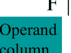


- 1、命题(Proposition)
- 2、从简单命题(atomic proposition)到
- 复合命题(compositional proposition)
- 3、从命题常量(propositional constant)到
- 命题变量(propositional variable)
- 4、从复合命题(compositional proposition)到
- 命题公式(propositional formulas)

## 真值表 TRUTH TABLES
- 在命题公式中，对于分量指派真值的各种可能组合，就确定了这个命题公式的各种真值情况，把它汇列表，就是命题公式的真值表。


## The Conjunction (合取) Operator

The binary *conjunction operator* “∧” (AND) combines two propositions to form their logical *conjunction*.

E.g., if p = “I will have salad for lunch.” and q = “I will have steak for dinner.”, then p ∧ q = “I will have salad for lunch **and** I will have steak for dinner.”

## Conjunction Truth Table

- Note that a conjunction $p_1 \land p_2 \land \dots \land p_n$ of $n$ propositions will have $2^n$ rows in its truth table.

**Operand columns**

| $p$ | $q$ | $p \land q$ |
| --- | --- | --- |
| F | F | F |
| F | T | F |
| T | F | F |
| T | T | T |

- Also: ¬ and ∧ operations together are sufficient to express *any* Boolean truth table!

## The Disjunction (析取) Operator

The binary *disjunction operator* “∨” (OR) combines two propositions to form their logical *disjunction*.

p = “My car has a bad engine.”
q = “My car has a bad door.”
p ∨ q = “Either my car has a bad engine, or my car has a bad door.”

Meaning is like “and/or” in English.

## Disjunction Truth Table

- Note that $p \vee q$ means that $p$ is true, or $q$ is true, or **both** are true!
- So, this operation is also called *inclusive or*, because it **includes** the possibility that both $p$ and $q$ are true.
- “¬” and “∨” together are also universal.

| $p$ | $q$ | $p \vee q$ |
| --- | --- | --- |
| F | F | F |
| F | T | **T** |
| T | F | **T** |
| T | T | T |

Note difference from AND.

## Questions for you to think about

3. Explain why ¬ and ∧ together are sufficient to express *anything* that propositional logic may express.

- Obviously, if we add new connectives (like ∨) we can write new formulas.
- But these formulas would always be equivalent with ones that only use ¬ and ∧.
  - (This is what we need to prove.)
- Saying this in a different way: if we add new connectives, we can write new formulas, but these formulas will always only express truth functions that can already be expressed by formulas that only use ¬ and ∧.
- Example of writing a disjunction in another form:

  p ∨ q ⇔ ¬(¬p ∧ ¬q)

## Questions for you to think about

3. Explain why ¬ and ∧ together are sufficient to express any Boolean truth table.

- Suppose precisely two rows give T.
  *For example, the rows where*
- P = T, Q = T, R = F. This is P ∧ Q ∧ ¬R.
- P = T, Q = F, R = T. This is P ∧ ¬Q ∧ R.

## Table as a disjunction of T-rows

Suppose precisely two rows give T.

*For example, the rows where*

- P = T, Q = T, R = F. This is P ∧ Q ∧ ¬R.
- P = T, Q = F, R = T. This is P ∧ ¬Q ∧ R.

We’ve proven our claim if we can express the disjunction of these two rows:

(P ∧ Q ∧ ¬R) ∨ (P ∧ ¬Q ∧ R)

## Disjoining rows of the table

- We’ve arrived if we can express their disjunction:

  (P ∧ Q ∧ ¬R) ∨ (P ∧ ¬Q ∧ R)

- But we’ve seen that disjunction can be expressed using ∧ and ¬:

  p ∨ q ⇔ ¬(¬p ∧ ¬q)

- So we’re there!

## About this proof ...

- We’ve been a bit casual, e.g., assuming that there were either 0 or 2 rows resulting in T.
- But the case with 1 or 3 or 4 or ... rows goes in the same way. (And there are always only finitely many rows.)
- So, the proof can easily be made precise.
- (There are lots of interesting related questions, but we won’t go there now ...)

## Having proved this ...

- We can “say everything” now that can be said in propositional logic.
- So, enough ingredients of propositional logic have been introduced to make it a useful formalism.
- This is sometimes called *functional completeness*. Also *universality* (M. Frank).

## Let’s introduce some additional connectives

- A variant of disjunction
- The conditional
- The biconditional

## The Exclusive Or Operator

The binary *exclusive-or operator* “⊕” (XOR) combines two propositions to form their logical “exclusive or”.

p = “I will earn an A in this course.”
q = “I will drop this course.”
p ⊕ q = “I will either earn an A in this course, or I will drop it (but not both!)”


## 异或真值表

- 请注意 $p \oplus q$ 的含义是 $p$ 为真，或 $q$ 为真，但 **不是两者都**！
- 这个运算称为 *异或*，因为它 **排除了** $p$ 和 $q$ 同时为真的可能性。
- “¬” 和 “⊕” 一起 **不** 是全称的。

| p | q | $p \oplus q$ |
|---|---|---|
| F | F | F |
| F | T | T |
| T | F | T |
| T | T | **F** |

注意与或的区别。

## 自然语言是模糊的

请注意英语中的 “or” 对于 “两者都” 的情况可能是模糊的！

| p | q | p "or" q |
|---|---|---|
| F | F | F |
| F | T | T |
| T | F | T |
| T | T | ? |

需要上下文来消除歧义！

对于本课程，假设 “or” 表示包容

## *蕴含* 运算符

*蕴含* `p → q` 表示 `p` 蕴含 `q`。

*i.e.*，如果 `p` 为真，则 `q` 为真；但如果 `p` 不为真，则 `q` 可能是真也可能是假。

*E.g.*，令 `p` = “你努力学习。”

`q` = “你会得到一个好成绩。”

`p → q` = “如果你努力学习，那么你会得到一个好成绩。”

## 蕴含真值表

- *p → q* 只有在  
  *p* 为真但 *q* **不** 为真时才为 **假**。

- *p → q* **不** 表示  
  *p* **导致** *q*！

- *p → q* **不要求**  
  *p* 或 *q* **为真**！

- *E.g.*，“(1=0) → 猪会飞”是 TRUE！

| *p* | *q* | *p → q* |
|---|---|---|
| F | F | T |
| F | T | T |
| T | F | F |
| T | T | T |

> 唯一为假的情况！

## 《大学》

- 大学之道，在明明德，在亲民，在止于至善。知止而后有定；定而后能静；静而后能安；安而后能虑；虑而后能得。物有本末，事有终始。知所先后，则近道矣。

- 古之欲明明德于天下者，先治其国；欲治其国者，先齐其家；欲齐其家者，先修其身；欲修其身者，先正其心；欲正其心者，先诚其意；欲诚其意者，先致其知；致知在格物。物格而后知至；知至而后意诚；意诚而后心正；心正而后身修；身修而后家齐；家齐而后国治；国治而后天下平。

## 表示 $p 	o q$ 的不同方式

- **if** $p$, **then** $q$ $p$ **implies** $q$
- **if** $p$, $q$ $p$ **only if** $q$
- $q$ **unless** $\neg p$ $q$ **when** $p$
- $q$ **if** $p$ $q$ **when** $p$
- $q$ **whenever** $p$ $p$ **is sufficient for** $q$
- $q$ **follows from** $p$ $q$ **is necessary for** $p$

**a necessary condition for** $p$ **is** $q$
- **a sufficient condition for** $q$ **is** $p$

## 含义 $p 
ightarrow q$ 的英语短语

- “$p$ implies $q$”
- “if $p$, then $q$”
- “if $p$, $q$”
- “when $p$, $q$”
- “whenever $p$, $q$”
- “$q$ if $p$”
- “$q$ when $p$”
- “$q$ whenever $p$”

- “$p$ only if $q$”
- “$p$ is sufficient for $q$”
- “$q$ is necessary for $p$”
- “$q$ follows from $p$”
- “$q$ is implied by $p$”
- “$q$ unless ¬ $p$”

## 逆命题、逆否命题和否命题
逆命题 逆否命题 否命题

由 $p \to q$ 我们可以形成新的条件语句。

- $q \to p$ 是 $p \to q$ 的 **逆命题**
- $\lnot q \to \lnot p$ 是 $p \to q$ 的 **逆否命题**
- $\lnot p \to \lnot q$ 是 $p \to q$ 的 **否命题**

**Example**：求“下雨是我不去镇上的充分条件”的逆命题、否命题和逆否命题。

## **Solution:**

**converse**：如果我不去镇上，那么正在下雨。

**inverse**：如果没有下雨，那么我会去镇上。

**contrapositive**：如果我去镇上，那么没有下雨。

## 逆否命题

对于蕴含式 $p \rightarrow q$ 的一些术语：

- 它的 *逆命题* 是：$q \rightarrow p$。
- 它的 *逆否命题*：$\neg q \rightarrow \neg p$。
- 其中一个具有与 $p \rightarrow q$ *相同的含义*（相同的真值表）。你能猜出是哪一个吗？

原命题为： p-->q
converse 逆命题为： q-->p
inverse 否命题为： 非p-->非q
逆否命题为： 非q-->非p


## 我们如何确定？

使用真值表证明 p → q 与其逆否命题的等价性：

| p | q | ¬q | ¬p | p→q | ¬q → ¬p |
|---|---|---|---|---|---|
| F | F | T | T | T | T |
| F | T | F | T | T | T |
| T | F | T | F | F | F |
| T | T | F | F | T | T |

## 双条件运算符

双条件 p ↔ q 表示 p 为真当且仅当（IFF）q 为真。

p = “唐纳德·特朗普赢得了2016年总统大选。”

q = “唐纳德·特朗普在2017年全年担任总统。”

p ↔ q = “如果且仅如果唐纳德·特朗普赢得了2016年总统大选，唐纳德·特朗普在2017年全年担任总统。”


## 双条件真值表

- *p ↔ q* 表示 *p* 和 *q* 具有相同的 **真值**。
- 注意此真值表与 ⊕ 的完全 **相反**！
- 因此，*p ↔ q* 表示 ¬(*p ⊕ q*)
- *p ↔ q* 并不 **意味着** *p* 和 *q* 为真，或其中一个导致另一个。

| p | q | p ↔ q |
|---|---|---|
| F | F | T |
| F | T | F |
| T | F | F |
| T | T | T |

## 布尔运算总结

- 我们已看到 1 个一元运算符（共 4 种可能）和 5 个二元运算符：

| $p$ | $q$ | $\neg p$ | $p\land q$ | $p\lor q$ | $p\oplus q$ | $p\to q$ | $p\leftrightarrow q$ |
|---|---|---|---|---|---|---|---|
| F | F | T | F | F | F | T | T |
| F | T | T | F | T | T | T | F |
| T | F | F | F | T | T | F | F |
| T | T | F | T | T | F | T | T |

## 请思考的问题

- 1. 考虑一个合取 \(p_1 \land p_2 \land p_3\)  
  它的真值表有多少行？

- 2. 考虑一个合取  
  \(p_1 \land p_2 \land \cdots \land p_n\) 由 \(n\) 个命题组成。  
  它的真值表有多少行？

- 3. 解释为什么 ¬ 和 ∧ 一起足以表达 *任何* 布尔真值表

## 请思考的问题

- 1. 考虑一个合取 $p_1 \land p_2 \land p_3$
  它的真值表有多少行？ 8

| $p_1$ | $p_2$ | $p_3$ |
|---|---|---|
| 1 | 1 | 1 |
| 1 | 1 | 0 |
| 1 | 0 | 1 |
| 1 | 0 | 0 |
| 0 | 1 | 1 |
| 0 | 1 | 0 |
| 0 | 0 | 1 |
| 0 | 0 | 0 |

## 请思考：

- 1. 你还能想到另一个二元联结词吗？
  有多少种可能的联结词？

## 请思考：

- 1. 有多少种可能的联结词？

| p | connective | q |
|---|---|---|
| T | ? | T |
| T | ? | F |
| F | ? | T |
| F | ? | F |

*每个问号可以是 T 或 F，故*  
*2.2.2.2=16 个联结词*

## 另一个联结词的例子

| p | connective | q | compare: | p and q |
|---|---|---|---|---|
| T | F | T |  | T |
| T | T | F |  | F |
| F | T | T |  | F |
| F | T | F |  | F |

名称：NAND，Sheffer stroke

## 一些替代记法

| 名称： | not | and | or | xor | implies | iff |
|---|---|---|---|---|---|---|
| 命题逻辑： | ¬ | ∧ | ∨ | ⊕ | → | ↔ |
| 布尔代数： | \overline{p} | p q | + | ⊕ |  |  |
| C/C++/Java（按字）： | ! | && | || | != |  | == |
| C/C++/Java（按位）： | ~ | & | | | ^ |  |  |
| 逻辑门： |  |  |  |  |  |  |

## 命题逻辑语言的更正式定义

- 原子：p1, p2, p3, ..

- 公式：命题公式

- 所有原子都是公式

- 如果 α 是公式则 ¬ α 是公式

- 如果 α 和 β 是公式则以下都是公式：(α ∧ β), (α ∨ β), (α → β) (等)

- 公式示例：
  (p1 ∨ ¬ p2), ¬ ¬ ¬(p9 → p8), (p1∧ (p2 ∨ p3))

- 等等。

## 命题逻辑语言
更正式地定义

- *公式示例：*
  `(p1 ∨ ¬ p2), ¬ ¬ ¬(p9 → p8), (p1∧(p2 ∨ p3))`
- *惯例 1：* 省略最外层括号；
  `p1 ∨ ¬ p2, ¬ ¬ ¬(p9 → p8), p1∧(p2 ∨ p3)`
- *惯例 2：* 结合律允许我们省略更多括号，例如：
  `p1∧ p2 ∧ p3,        p1 ∨ p2 ∨ p3`

## 逻辑运算符的优先级
嵌套命题表达式

- 使用括号对子表达式进行分组：“我刚看到我老朋友，而且他长高了或我变矮了。” = f ∧ (g ∨ s)
  - (f ∧ g) ∨ s 的含义会不同
  - f ∧ g ∨ s 会产生歧义

- 按惯例，“¬” 的优先级高于 “∧” 和 “∨”。
  - ¬s ∧ f 表示 (¬s) ∧ f，而不是 ¬(s ∧ f)

- 1 ¬ 2 ∧ ∨ 3 → ↔

## 示例真值表

- 构造 $p \lor q \rightarrow \lnot r$ 的真值表

| p | q | r | ¬r | p ∨ q | p ∨ q → ¬r |
|---|---|---|---|---|---|
| T | T | T | F | T | F |
| T | T | F | T | T | T |
| T | F | T | F | T | F |
| T | F | F | T | T | T |
| F | T | T | F | T | F |
| F | T | F | T | T | T |
| F | F | T | F | F | T |
| F | F | F | T | F | T |


## 逻辑与位运算

- 计算机位运算对应于逻辑联结词。
- 按位或 按位与 按位异或

## 按位运算

- 布尔运算可以扩展为对位串以及单个位进行操作。
- 例如：
  01 1011 0110
  11 0001 1101
  11 1011 1111 按位或
  01 0001 0100 按位与
  10 1010 1011 按位异或

## 练习

1. \(P\)、\(Q\)为两个命题，当且仅当 \(P=Q=\) 时，\(P\land Q\) 的真值为1；当且仅当 \(P=Q=\) 时，\(P\lor Q\) 的真值为0。

## 4. 下面语句是真命题的为( )

- (A) 我正在说谎
- (B) 如果1+2=3,则雪是黑色的.
- (C) 如果1+2=5,则雪是黑色的.
- (D) 你上网了吗?

## 6. 给命题变元P Q R S 分别指派真值1,1,0,0求命题公式

(P ∨ (Q → (R ∧ ¬P))) ↔ (Q ∨ ¬S)

的真值.

## 解

(P ∨ (Q → (R ∧ ¬P))) ↔ (Q ∨ ¬S)

(1 ∨ (1 → (0 ∧ ¬1))) ↔ (1 ∨ ¬0)

1

## § 1.2 命题逻辑的应用

## 命题逻辑的应用：
总结

- 将英语翻译成命题逻辑
- 系统规格 系统规格
- 布尔搜索
- 逻辑谜题
- 逻辑电路

## 翻译句子
示例(命题翻译)

- ‘If I go to school or go home, I will not go shopping.’
  - P: I go to school
  - Q: I go home
  - R: I will go shopping
- If......P......or......Q......then....not.....R
  - $(P \lor Q) \rightarrow \lnot R$
- You can access the Internet from campus only if you are a computer science major or you are not a freshman.
- a → ( c ∨ ¬ f )

## 翻译英语句子

- 将英语句子转换为命题逻辑陈述的步骤
  - 识别原子命题并使用命题变量表示。
  - 确定适当的逻辑联结词
- “You cannot ride the roller coaster if you are under 4 feet tall unless you are older than 16 years old.”
  - p: you are under 4 feet tall,
  - q: you are older than 16 years old.
  - r: You can ride the roller coaster.

If p and ¬q then not r.      (p∧¬q) → ¬r

翻译：
她既聪明又用功
除非你努力,否则你将失败.

甲和乙中有一人且只有一人是大学生.

## 翻译

- 我和他既是弟兄又是同学。
- 别问我是谁.

## 系统规格

- 系统和软件工程师将用英语给出的需求表达为基于逻辑的精确规范语言。

**Example**: Express in propositional logic:
“The automated reply cannot be sent when the file system is full”

**Solution**: One possible solution: Let *p* denote “The automated reply can be sent” and *q* denote “The file system is full.”

q → ¬ p

## 一致的系统规格

**Definition:** A list of propositions is *consistent* if it is possible to assign truth values to the proposition variables so that each proposition is true.

**Exercise:** Are these specifications consistent?

- “The diagnostic message is stored in the buffer or it is retransmitted.”
- “The diagnostic message is not stored in the buffer.”
- “If the diagnostic message is stored in the buffer, then it is retransmitted.”

**Solution:** Let p denote “The diagnostic message is not stored in the buffer.” Let q denote “The diagnostic message is retransmitted.” The specification can be written as: p ∨ q, ¬p, ¬p. When p is false and q is true all three statements are true. So the specification is consistent.

- What if “The diagnostic message is not retransmitted is added.”

**Solution:** Now we are adding ¬q and there is no satisfying assignment. So the specification is not consistent.

## 逻辑谜题


Raymond Smullyan
(Born 1919)

- An island has two kinds of inhabitants, *knights*, who always tell the truth, and *knaves*, who always lie.
- You go to the island and meet A and B.
  - A says “B is a knight.”
  - B says “The two of us are of opposite types.”

**Example**: What are the types of A and B?

**Solution:** Let *p* and *q* be the statements that A is a knight and B is a knight, respectively. So, then ¬*p* represents the proposition that A is a knave and ¬*q* that B is a knave.

- If A is a knight, then *p* is true. Since knights tell the truth, *q* must also be true. Then (*p* ∧ ¬*q*)∨ (¬*p* ∧ *q*) would have to be true, but it is not. So, A is not a knight and therefore ¬*p* must be true.
- If A is a knave, then B must not be a knight since knaves always lie. So, then both ¬*p* and ¬*q* hold since both are knaves.


## 逻辑谜题

父亲告诉他的两个孩子，一个男孩一个女孩，在后院玩耍不要弄脏。 然而，在玩耍时，两个孩子的前额都沾上了泥。 当孩子们停止玩耍时，父亲说“你们中至少有一个人额头上有泥”，然后问孩子们对以下问题回答“是”或“否”：“你知道自己额头上有没有泥吗？” 父亲问这个问题两次。 每次问这个问题时孩子们会如何回答，假设孩子可以看到自己兄弟姐妹额头是否有泥，但看不到自己的额头？ 假设两个孩子都诚实，并且孩子们同时回答每个问题。

## 谁养鱼？

- 连爱因斯坦都大呼过瘾的题目！

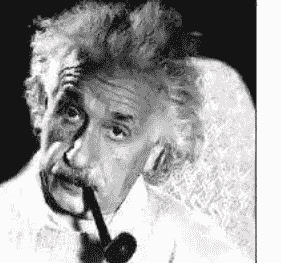

## 谁养鱼？

- 此题源自 1981 年柏林的德国逻辑思考学院......98%的测验者无法解题,以下是题目的中译版.
- 前题
  1. 有五间房屋排成一列
  2. 所有房屋的外表颜色都不一样
  3. 所有的屋主来自不同的国家
  4. 所有的屋主都养不同的宠物; 喝不同的饮料; 抽不同牌的香烟

## 谁养鱼？

- 问题：请问谁养鱼？
- 房屋——红色、绿色、白色、黄色、蓝色
- 主人——英国、瑞典、丹麦、挪威、德国
- 饮料——茶、咖啡、牛奶、啤酒、水
- 宠物——狗、鸟、猫、马、鱼
- 香烟——Pall、Dunhill、Blend、Blue、Prince

## 问题

- 上题中，缺少一个或多个条件，结果就不唯一。
- 如何得到多个（全部）答案？

| 房子 |  |  |  |  |  |
|---|---|---|---|---|---|
| 国家 | 挪威 | 丹麦 | 英国 | 德国 | 瑞典 |
| 宠物 | 猫 | 马 | 鸟 | 鱼 | 狗 |
| 饮料 | 矿泉水 | 茶 | 牛奶 | 咖啡 | 啤酒 |
| 香烟 | DUNHILL | 混合烟 | PALL MALL | PRINCE | BLUE MASTER |

## 逻辑电路

- 电子电路；每个输入/输出信号都可以视为 0 或 1。
  - 0 代表 False
  - 1 代表 True
- 复杂的电路由称为门的三个基本电路构造而成。

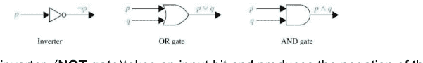

- 反相器（NOT 门）接收一个输入位并产生该位的否定。
- 或门接收两个输入位并产生这两个位的析取等价值。
- 与门接收两个输入位并产生这两个位的合取等价值。

更复杂的数字电路可以通过组合这些基本电路来构造，以根据输入信号产生所需的输出，通过为输出表达式的每个部分构建电路然后将它们组合起来。 例如：

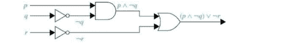

## # 1 基础：逻辑与证明

- 1.1 命题逻辑
- 1.2 命题等价
- 1.3 谓词与量词
- 1.4 嵌套量词
- 1.5 推理规则
- 1.6 证明导论
- 1.7 证明方法与策略

## 1 基础：逻辑与证明

- 1.1 命题逻辑
- 1.2 命题逻辑的应用
- 1.3 命题等价
- 1.4 谓词与量词
- 1.5 嵌套量词
- 1.6 推理规则
- 1.7 证明导论
- 1.8 证明方法与策略

## 1.3 命题等价

- 逻辑等价式

## 章节摘要

- 恒真式、矛盾式和偶然式。
- 逻辑等价
  - 重要的逻辑等价
  - 证明逻辑等价
- 正规形式
  - 析取范式
  - 合取范式
- 命题可满足性
  - 数独示例

## Tautologies永真式

一个 *tautology* 是复合命题，无论其原子命题的真值如何都是 **true** *no matter what*！

*Ex. p ∨ ¬p*  [What is its truth table?]

## Tautologies

- 当真值表的每一行都给出 T 时。
- 示例：p ∨ ¬p
  T T F T
  F T T F

## Contradictions永假式

一个 *contradiction* 是复合命题，无论如何都是 **false**！ *Ex. p ∧ ¬p* [Truth table?]

## Contradictions

- 当真值表的每一行都给出 F 时
- 示例：p ∧ ¬p
  T F FT
  F F TF


## 重言式、矛盾式与偶然式

- *重言式*是始终为真的命题。
  - 示例：$p \lor \lnot p$
- *矛盾式*是始终为假的命题。
  - 示例：$p \land \lnot p$
- *偶然式*是既非重言式也非矛盾式的命题，例如 $p$

| p | ¬p | p ∨ ¬p | p ∧ ¬p |
|---|---|---|---|
| T | F | T | F |
| F | T | T | F |

## 下列哪些是重言式？

- 1. $p \to (q \to p)$
- 2. $p \to (\lnot p \to p)$
- 3. $(q \to p) \to (p \to q)$
- 4. $(q \to p) \lor (p \to q)$
- 5. $(p \to (q \to r)) \to (q \to (p \to r))$

请用真值表证明你的结论。
（提示：考虑给 p、q 和 r 赋予什么样的真值会使每个公式为假。）

## 命题等价式

两个*语法上*（即文本上）不同的复合命题可能在*语义上*相同（即具有相同的含义）。我们称它们为*逻辑等价*。逻辑等价

记号：... ↔ ...

## 用真值表证明等价

例：证明 p∨q ⇔ ¬(¬p ∧ ¬q)。

| p | q | p∨q | ¬p | ¬q | ¬p ∧ ¬q | ¬(¬p ∧ ¬q) |
|---|---|---|---|---|---|---|
| F | F | F | T | T | T | F |
| F | T | T | T | F | F | T |
| T | F | T | F | T | F | T |
| T | T | T | F | F | F | T |

## 逻辑等价式（等价式）

- $P \land T \Leftrightarrow P$  同一律（Identity）
- $P \lor F \Leftrightarrow P$
- $P \lor T \Leftrightarrow T$  零律（Domination）
- $P \land F \Leftrightarrow F$
- $P \lor P \Leftrightarrow P$  等幂律（Idempotency）
- $P \land P \Leftrightarrow P$

## 逻辑等价式（等价式）

- ¬(¬P) ⇔ P   双重否定律（Double negation）
- $P \lor Q \Leftrightarrow Q \lor P$   交换律（Commutativity）
- $P \land Q \Leftrightarrow Q \land P$
- $(P \lor Q) \lor R \Leftrightarrow P \lor (Q \lor R)$   结合律（Associativity）
- $(P \land Q) \land R \Leftrightarrow P \land (Q \land R)$

## 逻辑等价式

- $P \land (Q \lor R) \Leftrightarrow (P \land Q) \lor (P \land R)$ 分配律（Distributivity）
- $P \lor (Q \land R) \Leftrightarrow (P \lor Q) \land (P \lor R)$
- $\lnot(P \land Q) \Leftrightarrow \lnot P \lor \lnot Q$ 德·摩根律（DeMorgan's laws）
- $\lnot(P \lor Q) \Leftrightarrow \lnot P \land \lnot Q$

## 逻辑等价式

- $P \to Q \Leftrightarrow \neg P \lor Q$　　 **蕴涵等价式**（Implication）
- $P \lor \neg P \Leftrightarrow T$　　 **排中律**（Tautology）
- $P \land \neg P \Leftrightarrow F$　　 **矛盾律**（Contradiction）
- $(P \to Q) \land (Q \to P) \Leftrightarrow (P \leftrightarrow Q)$　　 **等价式**（Equivalence）
- $(P \to Q) \land (P \to \neg Q) \Leftrightarrow \neg P$　　 **归谬论**（Absurdity）

## 逻辑等价式

- $(P \to Q) \Leftrightarrow (\lnot Q \to \lnot P)$ 蕴涵逆反式（Contrapositive）
- $P \lor (P \land Q) \Leftrightarrow P$, $P \land (P \lor Q) \Leftrightarrow P$ 吸收律（Absorption）
- $(P \land Q) \to R \Leftrightarrow P \to (Q \to R)$ 输出律（Exportation）

## ↔ 和 ⇔ 有什么区别？

A ⇔ B 表示不存在任何对 A 和 B 的真值赋值能使 A ↔ B 为假。

因此，A ⇔ B 只能存在于经过恰当选择的复合命题 A 和 B 之间。例如，p∨q ⇔ ¬(¬p ∧ ¬q)。

A ↔ B 表示 A 和 B 恰好具有相同的真值。例如，

A=2+2=4。B=我在北京邮电大学教书。

A=2+2=4。B=我在北京邮电大学或北京理工大学教书。

## 判断命题公式逻辑等价的方法：

- 1、真值表
- 2、命题公式的演算
  - 基本等值定理;
  - 代入规则
  - 置换规则

## 代入规则

- 在一个永真公式中，任何一个命题变元R出现的每一处，用另一个命题公式代入，所得命题公式仍是永真式。
  - 例：求证：(p → q) ∨ ¬(p→q)为永真式
  - R∨¬R⇔T
  - 用(p → q)代入上式中所有的R

## 置换规则

- 给定公式A，它的所有子公式为A₁，A₂，...Aₙ ，设Aᵢ ⇔ Bᵢ，用Bᵢ置换Aᵢ，所得公式为B，则 A ⇔ B。
- 例：求证：
- (P → (Q → R) ⇔ P → (¬ Q ∨ R)为永真式
- 已知(Q → R) ⇔ (¬ Q ∨ R)
- 用(¬ Q ∨ R)置换原式中的(Q → R)

## 命题公式逻辑等价关系的应用：

- 1、判定是否逻辑等价；
- 2、判断是否为永真公式或永假公式；
- 3、命题公式的化简

## 等价律 - 示例

- *同一律：* $p \land T \Leftrightarrow p$    $p \lor F \Leftrightarrow p$
- *零律：* $p \lor T \Leftrightarrow T$    $p \land F \Leftrightarrow F$
- *等幂律：* $p \lor p \Leftrightarrow p$    $p \land p \Leftrightarrow p$
- *双重否定律：* $\lnot \lnot p \Leftrightarrow p$
- *交换律：* $p \lor q \Leftrightarrow q \lor p$    $p \land q \Leftrightarrow q \land p$
- *结合律：* $(p \lor q) \lor r \Leftrightarrow p \lor (q \lor r)$
  $(p \land q) \land r \Leftrightarrow p \land (q \land r)$


## 更多等价律

- *分配律：*  $p \lor (q \land r) \Leftrightarrow (p \lor q) \land (p \lor r)$
  $p \land (q \lor r) \Leftrightarrow (p \land q) \lor (p \land r)$
- *德摩根律：*
  $\lnot(p \land q) \Leftrightarrow \lnot p \lor \lnot q$
  $\lnot(p \lor q) \Leftrightarrow \lnot p \land \lnot q$
- *平凡的永真式/矛盾式：*
  $p \lor \lnot p \Leftrightarrow \mathbf{T}$      $p \land \lnot p \Leftrightarrow \mathbf{F}$


## 通过等价定义算子

利用等价，我们可以用其他算子来*定义*算子。

- 异或：$p \oplus q \Leftrightarrow (p \lor q) \land \lnot (p \land q)$
  $p \oplus q \Leftrightarrow (p \land \lnot q) \lor (q \land \lnot p)$
- 蕴含：$p \rightarrow q \Leftrightarrow \lnot p \lor q$
- 双条件：$p \leftrightarrow q \Leftrightarrow (p \rightarrow q) \land (q \rightarrow p)$
  $p \leftrightarrow q \Leftrightarrow \lnot (p \oplus q)$

## 重新审视永真式

- 我们已通过示例 $p \lor \lnot p$ 引入了永真式的概念
- 现在，你已了解更多算子，因此可以表述更多永真式，例如 $(p \lor q) \leftrightarrow \lnot(\lnot p \land \lnot q)$
$(p \rightarrow q) \leftrightarrow (\lnot q \rightarrow \lnot p)$，等等

## 表 4

## 表 4

证明 $p \vee (q \wedge r)$ 与 $(p \vee q) \wedge (p \vee r)$ 在逻辑上等价的演示。

| p | q | r | q ∧ r | p ∨ (q ∧ r) | p ∨ q | p ∨ r | (p ∨ q) ∧ (p ∨ r) |
|---|---|---|-------|-------------|-------|-------|-------------------|
| T | T | T | T | T | T | T | T |
| T | T | F | F | T | T | T | T |
| T | F | T | F | T | T | T | T |
| T | F | F | F | T | T | T | T |
| F | T | T | T | T | T | T | T |
| F | T | F | F | F | T | F | F |
| F | F | T | F | F | F | T | F |
| F | F | F | F | F | F | F | F |

## 构造新的逻辑等价式

- 我们可以通过发展一系列逻辑等价的陈述来证明两个表达式在逻辑上等价。
- 要证明 $A \equiv B$，我们从 A 开始以 B 结束产生一系列等价式。
  $A \equiv A_1$
  $\vdots$
  $A_n \equiv B$
- 请记住，只要命题（由命题变量表示）在前面列出的等价式中出现，它就可以被任意复杂的复合命题所替代。

## 等价证明

例：证明 ¬(p ∨ (¬p ∧ q)) 在逻辑上等价于 ¬p ∧ ¬q

## 解：

¬(p ∨ (¬p ∧ q)) ≡ ¬p ∧ ¬(¬p ∧ q) 根据第二条德摩根律

≡ ¬p ∧ [¬(¬p) ∨ ¬q] 根据第一条德摩根律

≡ ¬p ∧ (p ∨ ¬q) 根据双重否定律

≡ (¬p ∧ p) ∨ (¬p ∧ ¬q) 根据第二分配律

≡ F ∨ (¬p ∧ ¬q) 因为 ¬p ∧ p ≡ F

≡ (¬p ∧ ¬q) ∨ F 根据析取的交换律

≡ (¬p ∧ ¬q) 根据 F 的同一律

### 例 5

- 证明 ¬(p∨(¬ p∧q)) 与 ¬ p∧ q 在逻辑上等价。
- 

¬(p∨(¬p∧q)) ⇔ ¬p∧¬(¬p∧q)
⇔ ¬p∧[¬(¬p)∨¬q]
⇔ ¬p∧(p∨¬q)
⇔ (¬p∧p)∨(¬p∧¬q)
⇔ F∨(¬p∧¬q)
⇔ (¬p∧¬q)∨F
⇔ ¬p∧¬q

## 一个例题

- 使用符号推导检查是否 $(p \land \lnot q) \rightarrow (p \oplus r) \Leftrightarrow \lnot p \lor q \lor \lnot r.$

$(p \land \lnot q) \rightarrow (p \oplus r)$      [展开 → 的定义]
$\Leftrightarrow \lnot(p \land \lnot q) \lor (p \oplus r)$      [展开 ⊕ 的定义]
$\Leftrightarrow \lnot(p \land \lnot q) \lor ((p \lor r) \land \lnot(p \land r))$      [德摩根律]
$\Leftrightarrow (\lnot p \lor q) \lor ((p \lor r) \land \lnot(p \land r))$      cont.

## 例继续...

($\neg p \vee q$) $\vee$ (($p \vee r$) $\wedge$ $\neg$($p \wedge r$)) $\Leftrightarrow$ [$\vee$ 可交换]
$\Leftrightarrow$ ($q \vee \neg p$) $\vee$ (($p \vee r$) $\wedge$ $\neg$($p \wedge r$)) [$\vee$ 可结合]
$\Leftrightarrow$ $q \vee$ ($\neg p \vee$ (($p \vee r$) $\wedge$ $\neg$($p \wedge r$))) [$\vee$ 对 $\wedge$ 分配]
$\Leftrightarrow$ $q \vee$ ((( $\neg p \vee$ ($p \vee r$)) $\wedge$ ($\underline{\neg p} \vee$ $\neg$($p \wedge r$)))
[结合] $\Leftrightarrow$ $q \vee$ ((( $\neg p \vee p$) $\vee r$) $\wedge$ ($\neg p \vee \neg$($p \wedge r$)))
[平凡永真式] $\Leftrightarrow$ $q \vee$ (($\mathbf{T} \vee r$) $\wedge$ ($\neg p \vee \neg$($p \wedge r$)))
[支配律] $\Leftrightarrow$ $q \vee$ ($\mathbf{T} \wedge$ ($\neg p \vee \neg$($p \wedge r$)))
[同一律]      $\Leftrightarrow$ $q \vee$ ($\neg p \vee \neg$($p \wedge r$)) $\Leftrightarrow$ cont.


## 德摩根律


奥古斯都·德摩根

1806-1871

¬(p ∧ q) ≡ ¬p ∨ ¬q
¬(p ∨ q) ≡ ¬p ∧ ¬q

该真值表表明德摩根第二定律成立。

| p | q | ¬p | ¬q | (p∨q) | ¬(p∨q) | ¬p∧¬q |
|---|---|---|---|---|---|---|
| T | T | F | F | T | F | F |
| T | F | F | T | T | F | F |
| F | T | T | F | T | F | F |
| F | F | T | T | F | T | T |

## 关键逻辑等价

- 恒等律：
  - $p \land T \equiv p$      $p \lor F \equiv p$
- 支配律：
  - $p \lor T \equiv T$      $p \land F \equiv F$
- 幂等律：
  - $p \lor p \equiv p$      $p \land p \equiv p$
- 双重否定律：
  - $\lnot(\lnot p) \equiv p$
- 否定律：
  - $p \lor \lnot p \equiv T$      $p \land \lnot p \equiv F$

## 更多逻辑等价

### 表 7 涉及条件语句的逻辑等价

| | |
|---|---| 
| $p \to q \equiv \lnot p \lor q$ | |
| $p \to q \equiv \lnot q \to \lnot p$ | |
| $p \lor q \equiv \lnot p \to q$ | |
| $p \land q \equiv \lnot(p \to \lnot q)$ | |
| $\lnot(p \to q) \equiv p \land \lnot q$ | |
| $(p \to q) \land (p \to r) \equiv p \to (q \land r)$ | |
| $(p \to r) \land (q \to r) \equiv (p \lor q) \to r$ | |
| $(p \to q) \lor (p \to r) \equiv p \to (q \lor r)$ | |
| $(p \to r) \lor (q \to r) \equiv (p \land q) \to r$ | |

### 表 8 涉及双条件语句的逻辑等价

| | |
|---|---| 
| $p \leftrightarrow q \equiv (p \to q) \land (q \to p)$ | |
| $p \leftrightarrow q \equiv \lnot p \leftrightarrow \lnot q$ | |
| $p \leftrightarrow q \equiv (p \land q) \lor (\lnot p \land \lnot q)$ | |
| $\lnot(p \leftrightarrow q) \equiv p \leftrightarrow \lnot q$ | |

## 简单析取式和简单合取式

- 仅有有限个命题变元或其否定的析取构成的析取式称为简单析取式，或基本和。  - 例如： ¬P∨Q∨R， ¬P∨¬Q∨P是简单析取式
- 而仅有有限个命题变元或其否定的合取构成的合取式称为简单合取式，或基本积。  - 例如： ¬P∧R， Q∧R∧¬Q是简单合取式。
- P， ¬Q一个变项本身可以看作简单析取式也可以看作简单合取式。
- 而¬P∨（Q ∧ R）， （P∧Q） ∨¬R不是简单析取式。

## 析取范式

- 析取范式：由有限个简单合取式（基本积）的析取构成的析取式称为析取范式。
- 例
  - ¬P ∨ (P ∧ Q) ∨ (¬P ∧ ¬Q ∧ ¬R) 是析取范式
  - P ∨ Q ∨ R 是析取范式，是三个简单合取范式的析取

## 范式的存在性定理

- 任意一个命题公式均存在一个与之等值的析取范式和合取范式
- 证明：对于任意公式，可用下面的方法构造出与其等价的析取范式和合取范式
  - 第一步：利用等价式，消去公式中的联结符→和↔
    - (1) P → Q ⇔ ¬P ∨ Q
    - (2) P ↔ Q ⇔ (P → Q) ∧ (Q → P)
  - 第二步：利用德摩根律将公式中的联结符¬移到命题变量之前，用双重否定律消去两个连续的联结符¬
  - 第三步：用分配律将公式化为基本积的析取或基本和的合取。

## 例

- 例2：求公式（P ∨ Q） → R 的析取范式和合取范式
- 解：
  - （P ∨ Q） → R ⇔ ¬（P ∨ Q） ∨ R ⇔ （¬P ∧ ¬Q） ∨ R ⇔ （¬P ∨ R） ∧ （¬Q ∨ R） 合取范式
  - 原式 ⇔ （¬P ∨ R） ∧ （¬Q ∨ R） ⇔ （（¬P ∨ R） ∧ （¬Q）） ∨ （（¬P ∨ R） ∧ R） ⇔ （¬P ∧ ¬Q） ∨ （R ∧ ¬Q） ∨ （¬P ∧ R） ∨ R 析取范式
  - 原式 ⇔ （¬P ∧ ¬Q） ∨ （R ∧ ¬Q） ∨ R ⇔ （¬P ∧ ¬Q） ∨ R 析取范式
  - 析取（合取）范式不唯一！

## 极小项

- 如公式中共有 N 个命题变项 P，......，Pₙ 这 N 个变项的合取式中，每个变项 Pᵢ 或其否定 ¬Pᵢ，均出现且两者仅出现一个，并且按命题变项的下标排列（字母按字典序列）这样的简单合取式称为极小项，又称布尔合取。

## 极小项和赋值的一一对应

- 每一个极小项只有一个赋值使其为真，其余2ⁿ-1个赋值使其为假。
- 例如：
  - 公式中出现P，Q，R三个不同的赋值。极小项¬P∧Q∧¬R，赋值010使其为真，其余2³-1=7个赋值使其为假。这样极小项与赋值建立了一一对应关系。
  - 而¬P∧Q不是极小项，有两个赋值010，011使其为真，其余6个赋值使其为假。

## 极小项的记法

- 公式共有2ⁿ个赋值，每个对应赋值一个极小项。如极小项对应赋值a₁a₂a₃，把其看作二进制，化为十进制为k₀ ≤ k ≤ 2ⁿ-1，则该极小项记作mₐ₁ₐ₂ₐ₃，也记作mₖ

| 极小项 | 对应的赋值 | 十进制数 | 记法 |
|---|---|---|---|
| ¬P∧¬Q∧¬R | 000 | 0 | m₀₀₀或m₀ |
| ¬P∧¬Q∧R | 001 | 1 | m₀₀₁或m₁ |
| ¬P∧Q∧¬R | 010 | 2 | m₀₁₀或m₂ |
| ¬P∧Q∧R | 011 | 3 | m₀₁₁或m₃ |
| P∧¬Q∧¬R | 100 | 4 | m₁₀₀或m₄ |
| P∧¬Q∧R | 101 | 5 | m₁₀₁或m₅ |
| P∧Q∧¬R | 110 | 6 | m₁₁₀或m₆ |
| P∧Q∧R | 111 | 7 | m₁₁₁或m₇ |

## 定理

- 任何一个命题公式均存在一个与之等值的主析取范式，而且是唯一的。
- 例如：
  - ¬P ∨ (¬P ∧ Q)，(P ∧ Q) ∨ (¬P ∧ R) 是析取范式,但不是主析取范式。
  - (P ∧ Q ∧ ¬R) ∨ (¬P ∧ Q ∧ R) 是主析取范式，当然也是析取范式。

## 例：用真值表的方法求¬（P∧Q）的主析取范式

- 解：
  - ¬（P∧Q）的真值表
  - 找使公式为真的赋值。
  - 00对应的极小项是¬P∧¬Q （m₀）
  - 01对应的极小项是¬P∧Q （m₁）
  - 10对应的极小项是P∧¬Q （m₂）
  - 则原公式的主析取范式是
  - ¬（P∧Q） ⇔ （¬P∧¬Q） ∨ （¬P∧Q） ∨ （P∧¬Q）
    ⇔ m₀∨ m₁∨ m₂

| P Q | P∧Q | ¬（P∧Q） |
| --- | --- | --- |
| 0 0 | 0 | 1 |
| 0 1 | 0 | 1 |
| 1 0 | 0 | 1 |
| 1 1 | 1 | 0 |


## 求主析取范式的方法之二：等值演算法

- 利用十六个命题公式、命题定理，用等值演算法的方法一步步将它化为主析取范式。
- 第一步：将公式化为析取范式，“消去”含有矛盾式的简单合取式，这是因为（P∧¬P∧Q）∨G⇔G，而P∧P用P代替。
- 第二步：若析取范式中的简单合取式项不是极小项，即该项中缺命题变项，则添加（Pᵢ∨¬Pᵢ）再用分配律展开。
  - 例如：公式中含P、Q、R，某合取项为P∧¬R，缺Q。则P∧¬R⇔P∧¬R∧（Q∨¬Q）⇔（P∧Q∧¬R）∨（P∧¬Q∧¬R）
- 第三步：用幂等律将重复的极小项删去，即mᵢ∨mᵢ⇔mᵢ，然后将各极小项按顺序排列。

## 例：求（（P∨Q）→R）→P的主析取范式

解：原公式⇔¬（¬（P∨Q）∨R）∨P
⇔（（P∨Q）∧¬R）∨P
⇔（P∧¬R）∨（Q∧¬R）∨P（析取范式）
⇔P∨（Q∧¬R）（析取范式）
⇔（P∧（Q∨¬Q）∧（R∨¬R））∨（（Q∧¬R）∧（P∨¬P））
⇔（P∧Q∧R）∨（P∧Q∧¬R）∨（P∧¬Q∧R）∨（P∧¬Q∧¬R）∨（P∧Q∧¬R）∨（¬P∧Q∧¬R）
（六个极小项，其中重复了一个）
⇔（P∧Q∧R）∨（P∧Q∧¬R）∨（P∧¬Q∧R）∨（P∧¬Q∧¬R）∨（¬P∧Q∧¬R）
⇔m₂∨m₄∨m₅∨m₆∨m₇ ⇔Σ(2,4,5,6,7)

## 规范形式或典范形式(范式)

- 命题的唯一表示
- 示例：
  - 构造一个由两个变量组成的简单命题，当且仅当
    - P 为真且 Q 为假：
      $P \land \lnot Q$
    - P 为真且 Q 为真：
      $P \land Q$
    - P 为真且 Q 为假或 P 为真且 Q 为真：
      $(P \land \lnot Q) \lor (P \land Q)$

## 规范形式或典范形式

- 一个合取式的析取，其中
  - 每个合取式中每个变量或其否定各出现一次 （合取式）
    (一个 *极小项*)
  - 每个极小项仅出现一次

## 析取范式 (DNF)（析取范式）

- 在开关理论中很重要，用于电路设计中的简化。
- 方法：寻找 DNF 的极小项。
  - 使用命题为 1 或 真 的真值表行
  - 如果变量下出现零，则在极小项中使用命题变量的否定
  - 如果出现一，则使用命题变量。

## 示例

- 求 $(P \lor Q) \to \lnot R$ 的 DNF

| P | Q | R | $(P \lor Q) \to \lnot R$ |
|---|---|---|---|
| 0 | 0 | 0 | 1 |
| 0 | 0 | 1 | 1 |
| 0 | 1 | 0 | 1 |
| 0 | 1 | 1 | 0 |
| 1 | 0 | 0 | 1 |
| 1 | 0 | 1 | 0 |
| 1 | 1 | 0 | 1 |
| 1 | 1 | 1 | 0 |

## 示例

命题为真的情况有 5 种，因此有 5 个极小项。第 1、2、3、5 和 7 行产生以下极小项的析取：

$(P \lor Q) \rightarrow \lnot R$

$\Leftrightarrow (\lnot P \land \lnot Q \land \lnot R) \lor (\lnot P \land \lnot Q \land R) \lor (\lnot P \land Q \land \lnot R)$

$\lor (P \land \lnot Q \land \lnot R) \lor (P \land Q \land \lnot R)$

注意，如果你否定一个 DNF 并使用 DeMorgan 定律，你会得到一个 *合取范式* (CNF) （合取范式）。

## 主合取范式（Major conjunctive normal form）

- 若干个极大项的合取。
- 如公式中共有N个命题变项P₁，……，Pₙ，这N个变项的析取式中，每个变项Pᵢ或其否定¬Pᵢ均出现且两者仅出现一个，并且按命题变项的下标排列（字母按字典序列），这样的简单析取式称为极大项。

## 极大项的记法

| 极大项 | 对应的赋值 | 十进制数 | 记法 |
|---|---|---|---|
| P ∨ Q ∨ R | 000 | 0 | M₍₀₀₀₎或M₀ |
| P ∨ Q ∨ ¬R | 001 | 1 | M₍₀₀₁₎或M₁ |
| P ∨ ¬Q ∨ R | 010 | 2 | M₍₀₁₀₎或M₂ |
| P ∨ ¬Q ∨ ¬R | 011 | 3 | M₍₀₁₁₎或M₃ |
| ¬P ∨ Q ∨ R | 100 | 4 | M₍₁₀₀₎或M₄ |
| ¬P ∨ Q ∨ ¬R | 101 | 5 | M₍₁₀₁₎或M₅ |
| ¬P ∨ ¬Q ∨ R | 110 | 6 | M₍₁₁₀₎或M₆ |
| ¬P ∨ ¬Q ∨ ¬R | 111 | 7 | M₍₁₁₁₎或M₇ |

## 例：用真值表的方法求¬（P∧Q）的主合取范式

解：
- ¬（P∧Q）的真值表
- 找使公式为假的赋值。
- 11对应的极大项是
  - ¬P ∨ ¬Q（M₃）

则原公式的主合取范式是
¬（P∧Q） ⇔ ¬P ∨ ¬Q ⇔ M₃

| P | Q | P∧Q | ¬（P∧Q） |
|---|---|---|---|
| 0 | 0 | 0 | 1 |
| 0 | 1 | 0 | 1 |
| 1 | 0 | 0 | 1 |
| 1 | 1 | 1 | 0 |

## 求主合取范式的方法之二：等值演算法

- 利用十六个命题公式、命题定理，用等值演算法的方法一步步将它化为主合取范式。
- 第一步：将公式化为合取范式，“消去”含有永真式的简单析取式，这是因为（P ∨ ¬P ∨ Q）∧ G ⇔ G，而P ∨ P用P代替。
- 第二步：若合取范式中的简单析取式项不是极大项，即该项中缺命题变项，则添加（Pᵢ ∧ ¬Pᵢ）再用分配律展开。
  - 例如：公式中含P、Q、R，某析取项为P ∨ ¬R，缺Q。则P ∨ ¬R ⇔ P ∨ ¬R ∨（Q ∧ ¬Q） ⇔ （P ∨ Q ∨ ¬R） ∧ （P ∨ ¬Q ∨ ¬R）
- 第三步：用幂等律将重复的极大项删去，即Mᵢ ∧ Mᵢ ⇔ Mᵢ，然后将各极大项按顺序排列。

## 析取范式

- 一个命题公式如果由 $(1,\ldots,n)$ 个析取式的析取组成，其中每个析取式由 $(1,\ldots,m)$ 个原子公式或原子公式的否定构成的合取组成，则该公式处于 *析取范式*。
- 是
  - $(p \land \neg q) \lor (\neg p \lor q)$
- 否
  - $p \land (p \lor q)$

## 析取范式

**示例：** 证明每个复合命题都可以化为析取范式。

**解：** 构造该命题的真值表。然后等价的命题是析取式，其中有 *n* 个析取项（其中 *n* 是公式求值为 **T** 的行数）。每个析取项有 *m* 个合取项，其中 *m* 是不同命题变量的数量。每个合取项如果该变量在该行被赋值为 **T**，则包含命题变量的正形式，如果该变量被赋值为 **F**，则包含否定形式。该命题处于析取范式。


## 析取范式

**示例**：求以下命题的析取范式（DNF）：

$$
(p \lor q) \to \neg r
$$

**解**：该命题在 $r$ 为假，或 $p$ 和 $q$ 都为假时为真。

$$
(\neg p \land \neg q) \lor \neg r
$$

## 合取范式

- 如果一个复合命题是若干析取式的合取，则它处于*合取范式*（CNF）中。
- 每个命题都可以改写为等价的一个合取范式。
- 可以通过消去蕴含、将否定内移以及使用分配律和结合律来得到合取范式（CNF）。
- 这在人工智能（AI）中用于归结定理证明，非常重要。
- 通过反复应用前面讲过的逻辑等价式，可以将复合命题化为合取范式。

**示例**：将以下命题化为合取范式：

$$
\neg(p \to q) \lor (r \to p)
$$

## 解

1. 消去蕴含符号：

   $$
   \neg(\neg p \lor q) \lor (\neg r \lor p)
   $$

2. 将否定内移，消去双重否定：

   $$
   (p \land \neg q) \lor (\neg r \lor p)
   $$

3. 利用结合律/分配律化为合取范式：

   $$
   (p \lor \neg r \lor p) \land (\neg q \lor \neg r \lor p)
   $$

## 命题可满足性问题

**示例**：判断下列复合命题的可满足性：

$$
(p \lor \neg q) \land (q \lor \neg r) \land (r \lor \neg p)
$$

**解**：可满足。令 $p$、$q$、$r$ 均为**真**。

$$
(p \lor q \lor r) \land (\neg p \lor \neg q \lor \neg r)
$$

**解**：可满足。令 $p$ 为**真**，$q$ 为**假**。

$$
(p \lor \neg q) \land (q \lor \neg r) \land (r \lor \neg p) \land (p \lor q \lor r) \land (\neg p \lor \neg q \lor \neg r)
$$

**解**：不可满足。逐一检查命题变量的每种真值指派，没有任何一种能使该命题为真。

## 记号

$\bigvee_{j=1}^{n} p_j$ 表示 $p_1 \lor p_2 \lor \dots \lor p_n$。

$\bigwedge_{j=1}^{n} p_j$ 表示 $p_1 \land p_2 \land \dots \land p_n$。

下一个示例需要用到。

## 数独

- **数独谜题**由一个 9×9 的方格表示，该方格由九个 3×3 的子方格（称为**宫**）组成。谜题中 81 个单元格的一部分被赋值为 1, 2, ..., 9 中的某个数字。
- 解谜的方法是：为每个空白单元格赋一个数字，使得每一行、每一列和每一宫都恰好包含 1 到 9 这九个数字。
- 示例

  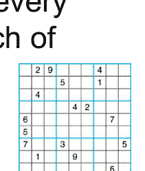

## 编码为可满足性问题

- 令 $p(i,j,n)$ 表示命题：数字 $n$ 位于第 $i$ 行第 $j$ 列的单元格中时，该命题为真。
- 共有 $9 \times 9 \times 9 = 729$ 个这样的命题。
- 在示例谜题中，$p(5,1,6)$ 为真，但对于 $j = 2, 3, \dots, 9$，$p(5,j,6)$ 为假。

### 编码（续）

- 对于每个已给定数字的单元格，当第 $i$ 行第 $j$ 列的单元格具有该给定值时，声明 $p(i,j,n)$。
- 声明每一行都包含每一个数字：

  $$
  \bigwedge_{i=1}^{9} \bigwedge_{n=1}^{9} \bigvee_{j=1}^{9} p(i,j,n)
  $$

- 声明每一列都包含每一个数字：

  $$
  \bigwedge_{j=1}^{9} \bigwedge_{n=1}^{9} \bigvee_{i=1}^{9} p(i,j,n)
  $$

- 声明每个 3×3 宫都包含每一个数字：

  $$
  \bigwedge_{r=0}^{2} \bigwedge_{s=0}^{2} \bigwedge_{n=1}^{9} \bigwedge_{i=1}^{3} \bigwedge_{j=1}^{3} p(3r+i,3s+j,n)
  $$

  （这一点比较棘手——第 4 章的思想会有帮助。）

- 声明每个单元格不能包含多于一个数字。对所有 $n$、$n'$、$i$ 和 $j$（其中每个变量取值范围为 1 到 9，且 $n \neq n'$）取合取：

  $$
  p(i,j,n) \to \neg p(i,j,n')
  $$

## 求解可满足性问题

- 要解数独谜题，需要为 729 个形如 $p(i,j,n)$ 的变量找到一组真值指派，使得上述所有声明的合取为真。那些被赋值为**真**的变量即给出谜题的解。
- 真值表总可以用来确定一个复合命题的可满足性。但对于大规模问题，即使现代计算机也会觉得过于复杂。
- 由于许多实际问题都可以转化为可满足性问题，因此人们在开发求解可满足性问题的有效方法上做了大量工作。


## 习题

- § 1.1　　　2, 14, 26, 30, 38
- § 1.2　　　2, 4, 32, 40
- § 1.3－8, 28, 30, 36, 40, 48, 54, 58

- 求下列公式的析取范式和合取范式
  - (¬A ∨ ¬B) → (A ↔ C) → B

- 通过求主合取范式的方法，判断下列各对公式是否等价
  - ¬A ∨ (A ∧ B) ∨ C
  - (¬A ∨ B) ∧ (B ∨ C)

- 通过求主析取范式，求出所有使下列公式为真的赋值
  - (A ∨ B) ∧ (A → C) ∧ (B → C)

- P，Q，R，S四个字母，从中取两个字母，但要满足下述三个条件，问有几种取法，如何取？
  - 如果取P，则R和S要取一个
  - Q，R不能同时取
  - 取R则不能取S

## 可选习题

A ∧ B ∧ ¬ C ∧ ¬ D ∧ E

- 张先生手中有代号为A、B、C、D、E的五种股票，根据当前股市情况及张先生本人的经济需求，需要有若干个股票抛出，但又必须满足如下复杂的要求：
- （1）若A抛出，则B也抛出；
- （2）B和C要留一种股票且只能留一种；
- （3）C和D要么全抛，要么都不抛；
- （4）D和E两种股票中必然有一种或两种要抛出；
- （5）若E抛出，则A、B也抛出。

上述五种条件全部满足，问有几种合理的方案供张先生选择。

## Summary

- 谓词逻辑（谓词逻辑/一阶逻辑 FOL，谓词演算）
- 量词语言
- 逻辑等价
- 嵌套量词
- 从谓词逻辑到英语的翻译
- 从英语到谓词逻辑的翻译

## Predicates and Quantifiers

第 1.4 节

## Section Summary

- 谓词
- 变量
- 量词
  - 全称量词
  - 存在量词
- 否定量词
  - 量词的德摩根律
- 将英语翻译成逻辑
- 逻辑编程（可选）

## Propositional Logic Not Enough

如果我们有：

“所有人都将死。”
“苏格拉底是人。”

那么是否可以推出“苏格拉底将死？”

无法用命题逻辑表示。需要一种谈论对象、它们的性质和它们的关系的语言。

稍后我们将看到如何进行推理。

## Introducing Predicate Logic

- 谓词逻辑使用以下新特性：
  - 变量：x, y, z
  - 谓词：P(x), M(x)
  - 量词（将在几页幻灯片后介绍）：
- 命题函数是对命题的推广。
  - 它们包含变量和谓词，例如 P(x)
  - 变量可以用其定义域中的元素替换。

## Propositional Functions

当命题函数的变量各自被定义域中的一个值替换（或如我们稍后将看到的那样被量词绑定）时，命题函数就成为命题（并具有真值）。

语句 $P(x)$ 被称为命题函数 $P$ 在 $x$ 处的值。

例如，设 $P(x)$ 表示“$x > 0$”，定义域为整数。则：
P(-3) 为假。
P(0) 为假。
P(3) 为真。

通常定义域用 $U$ 表示。所以在这个例子中 $U$ 是整数。

## Examples of Propositional Functions

设“x + y = z”用 R(x, y, z) 表示，且 U（对三个变量）为整数。求这些真值：
R(2,-1,5)
解：F
R(3,4,7)
解：T
R(x, 3, z)
解：不是命题

现在设“x - y = z”用 Q(x, y, z) 表示，U 为整数。求这些真值：
Q(2,-1,3)
解：T
Q(3,4,7)
解：F
Q(x, 3, z)
解：不是命题

## Compound Expressions

- 命题逻辑中的联结词被继承到谓词逻辑中。
- 若 $P(x)$ 表示“$x > 0$”，求这些真值：

| Expression | Solution |
|---|---|
| $P(3) \lor P(-1)$ | T |
| $P(3) \land P(-1)$ | F |
| $P(3) \to P(-1)$ | F |
| $P(3) \to P(-1)$ | T |

- 包含变量的表达式不是命题，因此没有真值。例如，

  $P(3) \land P(y)$

  $P(x) \to P(y)$

- 当与量词一起使用（将在下一节介绍）时，这些表达式（命题函数）就成为命题。

## Quantifiers


Charles Peirce (1839-1914)

- 我们需要*量词*来表达英语中包括*所有*和*一些*的含义：
  - “所有人都将死。”
  - “有些猫没有毛。”
- 两个最重要的量词是：
  - *全称量词*，“对于所有”，符号：∀
  - *存在量词*，“存在”，符号：∃
- 我们写成 ∀x P(x) 和 ∃x P(x)。
- ∀x P(x) 断言 P(x) 对定义域中的*每一个* x 都为真。
- ∃x P(x) 断言 P(x) 对定义域中的*某个* x 为真。
- 量词据说在这些表达式中绑定变量 x。


## 全称量词

∀x P(x) 读作“对于所有x，P(x)”或“对于每一个x，P(x)”

### 示例：

- 1. 如果 P(x) 表示“x > 0”，且 U 是整数集，则 ∀x P(x) 为假。
- 2. 如果 P(x) 表示“x > 0”，且 U 是正整数集，则 ∀x P(x) 为真。
- 3. 如果 P(x) 表示“x 是偶数”，且 U 是整数集，则 ∀x P(x) 为假。

## 存在量词

∃x P(x) 读作“对于某个x，P(x)”，或“存在一个x使得P(x)”，或“至少有一个x，P(x)”。

### 示例：

- 1. 如果 P(x) 表示“x > 0”，且 U 是整数集，则 ∃x P(x) 为真。如果 U 是正整数集，它也为真。
- 2. 如果 P(x) 表示“x < 0”，且 U 是正整数集，则 ∃x P(x) 为假。
- 3. 如果 P(x) 表示“x 是偶数”，且 U 是整数集，则 ∃x P(x) 为真。

## 唯一性量词（可选）

- ∃!x P(x) 表示在论域中，恰好有一个 x 使得 P(x) 为真。

- 这通常用以下几种等价方式用中文表达：
- “存在唯一的 x 使得 P(x)。”
- “存在且仅存在一个 x 使得 P(x)。”

- 示例：
- 1. 如果 P(x) 表示“x + 1 = 0”，且 U 是整数集，则 ∃!x P(x) 为真。
- 2. 但如果 P(x) 表示“x > 0”，则 ∃!x P(x) 为假。

唯一性量词并非必需，因为“存在唯一的 x 使得 P(x)”这一限制可以表示为：
∃x (P(x) ∧ ∀y (P(y) → y = x))

## 关于量词的思考

- 当论域有限时，我们可以将量化视为对论域中元素的遍历。

- 要计算 ∀x P(x)，遍历论域中的所有 x。
  - 如果每一步 P(x) 都为真，则 ∀x P(x) 为真。
  - 如果在某一步 P(x) 为假，则 ∀x P(x) 为假，且遍历终止。

- 要计算 ∃x P(x)，遍历论域中的所有 x。
  - 如果在某一步 P(x) 为真，则 ∃x P(x) 为真，且遍历终止。
  - 如果遍历结束仍未找到使 P(x) 为真的 x，则 ∃x P(x) 为假。

- 即使论域是无限的，我们仍然可以这样理解量词，但在某些情况下遍历不会终止。

## 量词的优先级

- 量词 ∀ 和 ∃ 的优先级高于所有逻辑运算符。
- 例如，∀x P(x) ∨ Q(x) 表示 (∀x P(x)) ∨ Q(x)。
- ∀x (P(x) ∨ Q(x)) 表示不同的含义。
- 遗憾的是，人们在想要表达 ∀x (P(x) ∨ Q(x)) 时，常常写成 ∀x P(x) ∨ Q(x)。

## 从英语到逻辑的翻译

示例 1：将以下句子翻译成谓词逻辑：“这个班级的每个学生都修过一门 Java 课程。”

### 解答：

首先确定论域 U。

解法 1：如果 U 是这个班级的所有学生，定义命题函数 J(x) 表示“x 修过一门 Java 课程”，并翻译为 ∀x J(x)。

解法 2：但如果 U 是所有的人，还要定义一个命题函数 S(x) 表示“x 是这个班级的学生”，并翻译为 ∀x (S(x) → J(x))。

∀x (S(x) ∧ J(x)) 是不正确的。它表示什么意思？

## 从英语到逻辑的翻译

示例 2：将以下句子翻译成谓词逻辑：“这个班级的某个学生修过一门 Java 课程。”

### 解答：

首先确定论域 U。

解法 1：如果 U 是这个班级的所有学生，翻译为 ∃x J(x)。

解法 2：但如果 U 是所有的人，则翻译为 ∃x (S(x) ∧ J(x))。

∃x (S(x) → J(x)) 是不正确的。它表示什么意思？

## 谓词逻辑中的等价式

- 涉及谓词和量词的语句是*逻辑等价*的，当且仅当：
- 对于替换到这些语句中的每个谓词，它们具有相同的真值，并且
- 对于表达式中变量所使用的每个论域，它们也具有相同的真值。

- 记号 $S \equiv T$ 表示 $S$ 和 $T$ 是逻辑等价的。

- **示例：** $\forall x \neg \neg S(x) \equiv \forall x S(x)$

## 将量词视为合取和析取

- 如果论域是有限的，全称量化命题等价于不带量词的命题的合取，存在量化命题等价于不带量词的命题的析取。
- 如果 \(U\) 由整数 1、2 和 3 组成：

\(\forall x P(x) \equiv P(1) \land P(2) \land P(3)\)

\(\exists x P(x) \equiv P(1) \lor P(2) \lor P(3)\)

- 即使论域是无限的，你仍然可以这样理解量词，但不带量词的等价表达式将是无限长的。


## 否定量化表达式

考虑 ∀x J(x)

“你班上的每个学生都上过 Java 课程。”
这里 \(J(x)\) 表示“x 上过 Java 课程”，
域是你的班级的学生。

否定原命题得到“并非你班上的每个学生都上过 Java。”
这意味着“你班上有某个学生没有上过 Java。”

符号上 ¬∀x J(x) 和 ∃x ¬J(x) 是等价的

## 否定量化表达式（续）

- 现在考虑 ∃ x J(x)
- “这个班上有某个学生上过 Java 课程。”
- 其中 J(x) 表示“x 上过 Java 课程。”

- 否定原命题得到“并非这个班上有某个学生上过 Java。”这意味着“这个班上的每个学生都没有上过 Java”
- 符号上 ¬∃ x J(x) 和 ∀ x ¬J(x) 是等价的

## 量词的德摩根律

否定量词的规则是：

| TABLE 2 De Morgan's Laws for Quantifiers. |
| Negation | Equivalent Statement | When Is Negation True? | When False? |
| ¬∃x P(x) | ∀x ¬P(x) | For every x, P(x) is false. | There is an x for which P(x) is true. |
| ¬∀x P(x) | ∃x ¬P(x) | There is an x for which P(x) is false. | P(x) is true for every x. |

表中推理表明：

¬∀x P(x) ≡ ∃x ¬P(x)

¬∃x P(x) ≡ ∀x ¬P(x)

这些很重要。你会用到这些。

## 从英语到逻辑的翻译

### Examples:

- 1. “Some student in this class has visited Mexico.”

**Solution:** Let $M(x)$ denote “$x$ has visited Mexico” and $S(x)$ denote “$x$ is a student in this class,” and $U$ be all people.

```
$\exists x\,(S(x)\land M(x))$
```

- 2. “Every student in this class has visited Canada or Mexico.”

**Solution:** Add $C(x)$ denoting “$x$ has visited Canada.”

```
$\forall x\,(S(x)\to(M(x)\lor C(x)))$
```

## 系统规范示例

- 谓词逻辑用于指定系统必须满足的属性。
- 例如，翻译成谓词逻辑：
  - “大于一兆字节的每封邮件消息都将被压缩。”
  - “如果用户处于活跃状态，至少有一条网络链路可用。”
- 为变量确定谓词和域（此处隐含）：
  - 设 L(m, y) 表示“邮件消息 m 大于 y 兆字节。”
  - 设 C(m) 表示“邮件消息 m 将被压缩。”
  - 设 A(u) 表示“用户 u 处于活跃状态。”
  - 设 S(n, x) 表示“网络链路 n 的状态为 x。”
- 现在我们有：∀m(L(m, 1) → C(m))
  ∃u A(u) → ∃n S(n, available)

## 刘易斯·卡罗尔示例


Charles Lutwidge Dodgson
(AKA Lewis Caroll)
(1832-1898)

前两个被称为 *前提*，第三个被称为 *结论*。

- 1. “All lions are fierce.”
- 2. “Some lions do not drink coffee.”
- 3. “Some fierce creatures do not drink coffee.”

下面是一种将这些陈述翻译成谓词逻辑的方法。
设 P(x)、Q(x) 和 R(x) 为命题函数“x 是狮子”、“x 凶猛”以及“x 喝咖啡”。

- 1. ∀x (P(x) → Q(x))
- 2. ∃x (P(x) ∧ ¬R(x))
- 3. ∃x (Q(x) ∧ ¬R(x))

稍后我们将看到如何证明结论由前提得出。

## 一些谓词演算定义（可选）

- 涉及谓词和量词的断言如果对
  - 所有域
  - 断言中谓词可被替换的每个命题函数
  都为真，则称为 *valid*。

**Example:** ∀x ¬S(x) ↔ ¬∃x S(x)

- 涉及谓词的断言如果对
  - 某些域
  - 可被替换为断言中谓词的某些命题函数
  为真，则称为 *satisfiable*。

否则它是 *unsatisfiable*。

**Example:** ∀x (F(x) ↔ T(x))      not valid but satisfiable

**Example:** ∀x (F(x) ∧ ¬F(x))      unsatisfiable

## 更多谓词演算定义（可选）

量词的作用域是变量被该量词绑定的断言的一部分。

**Example:** ∀x(F(x) ∨ S(x))      x has wide scope

**Example:** ∀x(F(x)) ∨ ∀y(S(y))      x has narrow scope


## 逻辑编程（可选）

- Prolog（源自 *Programming in Logic*）是一种在 1970 年代由人工智能（AI）研究人员开发的编程语言。
- Prolog 程序包括 *Prolog facts* 和 *Prolog rules*。
- 以下是一个 Prolog 事实集的示例：

```
instructor(chan, math273).
instructor(patel, ee2222).
instructor(grossman, cs301).
enrolled(kevin, math273).
enrolled(juan, ee2222).
enrolled(juana, cs301).
enrolled(kiko, math273).
enrolled(kiko, cs301).
```

- 在这里，谓词 *instructor(p,c)* 和 *enrolled(s,c)* 表示教授 *p* 是课程 *c* 的授课教师，以及学生 *s* 注册了课程 *c*。

## Logic Programming (cont)

- 在 Prolog 中，以大写字母开头的名称是变量。
- 如果我们有一个谓词 *teaches(p,s)* 表示“教授 p 教授学生 s”，我们可以写出规则：
  *teaches(P,S) :- instructor(P,C), enrolled(S,C).* 
- 该 Prolog 规则可以被视为等价于逻辑中的以下陈述（使用我们对逻辑陈述的约定）。
  ∀p ∀c ∀s(I(p,c) ∧ E(s,c)) → T(p,s))

## Logic Programming (cont)

- Prolog 程序被加载到 *Prolog interpreter* 中。解释器接收 *queries* 并使用 Prolog 程序返回答案。
- 例如，使用我们的程序，可以给出以下查询：
  ?enrolled(kevin,math273).
- Prolog 产生响应：
  yes
- 请注意，? 是 Prolog 解释器给出的提示，表示它已准备好接收查询。

## Logic Programming (cont)

查询：
?enrolled(X,math273).

产生的响应：
X = kevin;
X = kiko;
no

查询：
?teaches(X,juana).

产生的响应：
X = patel;
X = grossman;
no

Prolog 解释器尝试为 X 找到一个实例化。它这样做并返回 X = kevin。然后用户键入 ; 表示请求另一个答案。当 Prolog 无法找到另一个答案时，它返回 no。

## Logic Programming (cont)

- 查询：
  ?teaches(chan,X).
  产生的响应：
  X = kevin;
  X = kiko;
  no

- 有许多非常好的 Prolog 文本可用。*Learn Prolog Now!* 就是其中之一，其免费在线版本位于 http://www.learnprolognow.org/

- Prolog 和整个逻辑编程领域还有更多内容。

## Predicate Logic（§ 1.4）

谓词逻辑

- 前两节介绍的命题与命题演算是命题逻辑的内容，其基本组成单位是原子命题。一般地，原子命题作为具有真假意义的句子至少由主语和谓语两部分组成。
- 例如，电子商务是计算机技术的一个应用，这里“电子商务”是主语，而“是……”是谓语。当主语改变为“电子政务”时就得到新的原子命题：电子政务是计算机技术的一个应用。

由此可知，主语是独立存在的个体/值/Value，而谓语用来描述该个体的性质或个体间的关系，这里我们称其为谓词/Predicate。用P表示谓词“是......”。则P（电子商务）或P（电子政务）分别等值于前述两个命题的表达。将个体用变量（称为个体变量）x推广，则P（x）表示：x是计算机技术的一个新的应用。这时该语句就不是一个命题，而是一个命题函数。

## DEFINITION 1.

- 定义 一个谓词 $P$ 连同相关的 $n$（$n\ge 0$）个个体变量组成的表达式称为 $n$ 元谓词（$n$-predicate），记 $P(x_1, x_2, \ldots, x_n)$，其中 $n$ 是该表达式中不同个体变量的数目。$n$ 元谓词也称简单命题函数。
- 复合命题函数 简单命题函数和复合命题函数，统称为命题函数（proposition function）。

## EXAMPLE 2

- Let Q(x, y) denote the statement "x = y + 3." What are the truth values of the propositions Q(1, 2) and Q(3, 0)?

Q(1, 2) = . F.

Q(3, 0) = . T.

## EXAMPLE 3

- R(x,y,z): x+y=z
- What are the truth values of the propositions R(1, 2, 3) and R(0, 0, 1)?

R(1,2,3)=. T.
R(0,0,1)=. F.

- 当n>1时，通常P给出了x_i (i=1, 2, ..., n)之间的关系。
- 例如，P(x, y, z)表示x位于y与z之间，是一个三元谓词。与x, y, z分别用操场、教学楼、宿舍代入时得到命题：操场位于教学楼与宿舍之间，其命值真值为T。再如将杭州、南京、北京代入，则得到：杭州位于南京和北京之间，真值为F。
- 与n=0时（即0元谓词），命题函数就对应一个命题。

- 为了进一步讨论命题函数P(x)的真值情况，首先需要指定个体变量x可选择的范围，即 个体域（universe of discourse, or domain）。每一个个体变量x都有自己的个体域。如果没有特别指定的个体域，则缺省为一个全个体域（total universe of discourse）即任意个体均可以作为常量对x代入。

在指定个体变量x的个体域后，该个体域中的每个个体a代入到P(x)中的所有x，就对应一个可以判定真假意义的命题P(a)。不同的个体代入后所对应的命题真值可能不同，也可能相同。

例如,P(x)表示为

x²−1=(x−1)(x+1)      x指定的个体域为全体整数,


- 则对任意整数 \(i\)，
- \(i^2-1=(i-1)(i+1)\)
- 恒成立。也就是说，该命题函数的真值无论用什么个体代入总是对应为 T。此类命题函数的真值描述通过一个称为全称量词的特殊符号来量化。

• 定义2 命题函数P(x)的全称量化（universal quantification）是一个按如下规则确定真值的命题：如果对每一个个体a代入得到的P(a)均为T。则该命题为T。记为∀xP(x)。这里∀是全称量词（universal quantifier），表示为“对任意的”、“所有的”、“对每一个”等等。

## DEFINITION 2.
- 命题函数 P(x) 的全称量化是命题
- “P(x) 对论域中 x 的所有取值都为真。”

## EXAMPLE 5
- 用全称量化表达命题
- “本班的每个学生都学过微积分”
- 。

可以写成
∀ x P(x) or ∀ x (S(x)→P(x))
P(x) = "x 学过微积分。"
S(x) = "x 在本班。"

## EXAMPLE 8
- 当 P(x) 为命题 “x² < 10”，且论域由不超过 4 的正整数组成时，∀ x P(x) 的真值为何？

∀ x P(x) = P(1) ∧ P(2) ∧ P(3) ∧ P(4) = F.

• 定义3 命题函数 $P(x)$ 的存在量化（existential quantification）是一个按如下规则确定真值的命题：如果个体域中存在一个个体 $a$ 代入后得到 $P(a)$ 为 T，则该命题为 T，否则为 F。记 $∃$ 或 ∃。这里 ∃ 称为存在量词（existential quantification）。表示为“有一个”、“某些”、“某个”等等。

## DEFINITION 3.
- 命题函数 P(x) 的存在量化是命题
- “论域中存在一个元素 x 使得 P(x) 为真。”

## EXAMPLE 9
- 设 P(x) 表示命题 “x > 3。” 当论域为实数集时，量化 $\exists x\,P(x)$ 的真值为何？

由于 “x > 3” 例如当 x = 4 时为真，P(x) 的存在量化，即 $\exists x\,P(x)$，为真。

### EXAMPLE 10
- 设 Q(x) 表示命题 “x = x + 1。”  
  当论域为实数集时，量化 ∃xQ(x) 的真值为何？

F.

## EXAMPLE 11
- 当 P(x) 为命题 “$x^2 > 10$”，且论域由不超过 4 的正整数组成时，$\exists x\,P(x)$ 的真值为何？

$\exists x\,P(x)$  
$=P(1) \lor P(2) \lor P(3) \lor P(4)$  
$= \mathrm{T.}$

## Table1

| TABLE 1 Quantifiers. | | |
|---|---|---|
| Statement | When True? | When False? |
| ∀ x P(x) | P(x) is true for every x. | There is an x for which P(x) is false. |
| ∃ x P(x) | There is an x for which P(x) is true. | P(x) is false for every x. |

- 定义4 谓词公式定义为
- （1）n元谓词是一个谓词公式；
- （2）若A是谓词公式，则（¬A）也是谓词公式；
- （3）若A，B是谓词公式，则（A∨B）、（A∧B）、（A→B）、（A↔B）也是谓词公式；
- （4）若A是谓词公式且含有未被量化的个体变量x，则
  - ∀xA(x)，∃xA(x)也是谓词公式。
- （5）有限次地使用（1）～（4）所得到的也是谓词公式。

∀ x ((F(x) ∧ P(x)) → ∃ y M(x, y)).

- 变量的约束（BINDING VARIABLES）
- 1,自由变量（Free Variable）
- 2,约束变量（Bound Variable）

## More to Know About Binding
- (∀x P(x)) ∧ Q(x) - 变量 x 在 ∀x 量词的作用域之外，因此是自由的。不是一个完整的命题！
- (∀x P(x)) ∧ (∃x Q(x)) – 一个完整的命题，且没有多余的量词

在作用域中 X 的一切出现，称为 X 在公式中的约束出现。

所有约束出现的变元叫做约束变元。

不受约束的变元为自由变元。

## 例

1) ∀x(P(x) → Q(x))

指导变元

辖域

约束变元

2) \(\forall x\,(P(x) \rightarrow \exists y\,R(x,y))\)

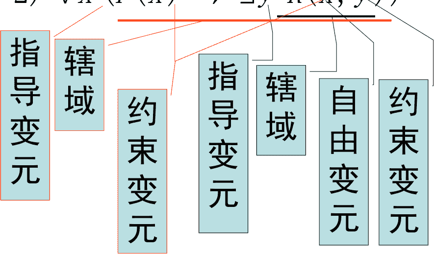

3) \(\forall x\forall y\,(P(x,y)\land Q(x,y))\to \exists xP(x,y)\)

指导变元

辖域

约束变元

指导变元

辖域

自由变元

约束变元

指导变元

辖域

约束变元

自由变元

P(x₁,...xₙ) 是 n 元谓词，有 n 个独立的自由变元。若对其中 k 个变元进行约束，则成为 n-k 元谓词。若没有自由变量出现，则该式就成为有关命题。

为避免由变元的约束与自由变元同时出现，而引起概念上的混乱，可对约束变元进行换名。

换名（约束变元改变名称符号）

$$\forall x(P(x)\to R(x,y))\land Q(x,y)$$

$$\forall z(P(z)\to R(z,y))\land Q(x,y)$$

∀y(P(y) → R(y, y)) ∧ Q(x, y)
∀z(P(z) → R(x, y)) ∧ Q(x, y)

+ 1) 换名范围:量词中的指导变元和作用域中出现的该导变元.公式中其余部分不变.
+ 2) 要换成作用域中没有出现的变元名称.

## 代入（自由变元的更换）

$\exists x\,(P(y)\land R(x,y))$

$\exists x\,(P(z)\land R(x,z))$

+ 1. 对该自由变元每一处进行代入。
+ 2. 代入的变元与原公式中所有变元名称不能相同。

个体域为有限时,客体变元
的所有可能的取代是可枚举的.
设论域元素为 a₁....aₙ
∀x A x ⇔ A a ∧ ... ∧ A aₙ
∃x A x ⇔ A a ∨ ... ∨ A aₙ


## 谓词公式的翻译
解释(interpret)

- 对一个合式公式的解释包括给出
- 个体域
- 谓词
- 函数
- 个体常项
- 的具体含义

## EXAMPLE 12

- 将语句翻译成
- ∀x (C(x) ∨ ∃y(C(y) ∧ F(x, y)))
- 成英文，其中 C(x) 是 "x has a

该语句说对于 BUPT 中的每个学生 x，x 有一台电脑，或者存在一个学生 y 使得 y 有一台电脑并且 x 和 y 是朋友。换句话说，BUPT 中的每个学生要么有一台电脑，要么有一个拥有电脑的朋友。

## EXAMPLE 13

- 将语句翻译成
- ∃ x ∀ y ∀ z (((F(x,y) ∧ F(x,z) ∧ (y≠z)) → ¬F(y,z)))
- 成英文，其中 F(a,b) 表示 a 和 b

该语句说存在一个学生 x，使得对于所有学生 y 和所有与 y 不同的学生 z，如果 x 和 y 是朋友并且 x 和 z 是朋友，那么 y 和 z 不是朋友。换句话说，存在一个学生，其朋友之间互不相识。

∀ x ∀ y(P(x,y) → Q(y))

- 个体域： 大于0的整数
- P(x,y): y>x
- Q(y): y>1

- 个体域： 整数
- P(x,y): y>x
- Q(y): y>1

## 语句形式化过程的三个关键点

- 准确地从语句中提取谓词，表示性质的谓语用一元谓词，表示关系的谓词用二元或更多元数的谓词来表示。
- 准确地使用量词和确定量词的辖域，当辖域中多于一个谓词时必须注意联结词与括号的使用。**全称蕴涵** **存在合取**
- 准确地使用多个重叠的量词，其排列次序应与原语句意义一致。

## Example 23

- 使用谓词和量词表达语句“这个班里的每个学生都学过微积分”。
- ∀x (S(x) → C(x))
- 区别:
- ∀x (S(x) ∨ E(x))

## EXAMPLE 24

- 使用量词表达语句“这个班里有些学生去过墨西哥”和“这个班里的每个学生都去过加拿大或墨西哥”。
- ∃x (S(x) ∧ M(x))
- 区别:
- ∃x (S(x) → M(x))

∀ x(C(x)∨M(x))

∀x (S(x) → (C(x)∨M(x)))

## Example 25

- 使用谓词和量词表达系统规范“大于一兆字节的每封邮件消息将被压缩”和“如果用户处于活动状态，至少有一个网络链路可用”。
- 设 S(m,y) 为“邮件消息 *m* 大于 y 兆字节”，并设 C(m) 表示“邮件消息 *m* 将被压缩”。
- ∀m (S(m,1) → C(m))
- A(u):User *u* is active  S(n,x): network link *n* is in state *x*
- ∃uA(u) → ∃nS(n, *available*)

## 例1： 每个人都爱她自己的孩子

- 令
  - P(x): x是人
  - C(x): x是孩子
  - I(x, y): x属于y
  - L(x, y): x爱y
- 一阶逻辑表示
  - ∀x∀y(P(y) ∧ C(x) ∧ I(x, y) → L(y, x))

## 例3

- 假设有一个人被每一个喜欢某些人的人所喜欢，又假设没有不喜欢人的人。证明有一个人被所有的人喜欢。
- 令
  - $L(x, y)$：x喜欢y
- 前提：
  - $P_1$：$\exists y\forall x\,(\exists z\,L(z,y)\rightarrow L(x,y))$
  - $P_2$：$\neg\exists x\forall y\,(\neg L(x,y))$
- 结论：
  - $C$：$\exists x\forall y\,L(y,x)$
- 于是，要证明：
  - $P_1\land P_2\rightarrow C$

## 例3

- 前提：
  - $P_1$: $\exists y \forall x (\exists z\, L(z,\ y) \to L(x,\ y))$
  - $P_2$: $\neg \exists x \forall y (\neg L(x,\ y))$
- 结论：
  - C: $\exists x \forall y\ L(y,\ x)$
- 于是，要证明：
  - $P_1 \land P_2 \to C$
  - $\exists y \forall x (\exists z\ L(z,\ y) \to L(x,\ y)) \land \neg \exists x \forall y (\neg L(x,\ y)) \to \exists x \forall y\ L(y,\ x)$
  - 是永真公式

## 例4

- 每一个人的外祖父都是他母亲的父亲
- 令
  - $P(x)$: $x$是人
  - $O(x, y)$: $x$是$y$的外祖父
  - $F(x, y)$: $x$是$y$的父亲
  - $M(x, y)$: $x$是$y$的母亲
- 命题表示
  - $\forall x \forall y\ (P(y) \land O(x, y) \rightarrow \exists z\ (F(x, z) \land M(z, y)))$

## 例5

- 不管黑猫白猫，抓住老鼠就是好猫
- 令
  - C(x): x是猫
  - B(x): x是黑的
  - W(x): x是白的
  - G(x): x是好的
  - M(x): x是老鼠
  - K(x, y): x抓住y
- 命题表示
  - ∀x∀y (C(x) ∧ M(y) ∧ (B(x) ∨ W(x)) ∧ K(x, y) → G(x))

## 例6

- 有些病人相信所有的医生，但病人都不相信一个骗子。证明：医生都不是骗子
- 令
  - $F(x)$：$x$是病人
  - $G(x)$：$x$是医生
  - $H(x)$：$x$是骗子
  - $L(x, y)$：$x$相信$y$

## 例6

- 前提：
  - $G_1$: $\exists x (F(x) \land \forall y (G(y) \to L(x, y)))$
  - $G_2$: $\forall x \forall y (F(x) \land H(y) \to \neg L(x, y))$
- 结论：
  - C: $\forall x (G(x) \to \neg H(x))$
- 于是，要证明：
  - $G_1 \land G_2 \to C$
  - 是永真公式


## 例7

- 每个有理数都是实数
- 某些实数是有理数
- 不是每一个实数都是有理数

## 例

并非每个实数都是有理数

$R(x)$: $x$ 是实数

$Q(x)$: $x$ 是有理数

$\neg\forall x(R(x) \rightarrow Q(x))$

$\exists x(R(x) \land \neg Q(x))$

## 例8

- 对平面上任意两点，有且仅有一条直线通过这两点
- 令
  - $P(x)$: $x$ 是一个点
  - $L(x)$: $x$ 是一条直线
  - $R(x, y, z)$: $z$ 通过 $x$ 和 $y$
  - $E(x, y)$: $x$ 等于 $y$
- $\forall x \forall y\ (P(x) \land P(y) \rightarrow \exists z\ (L(z) \land R(x,\ y,\ z) \land \forall u\ (L(u) \land R(x,\ y,\ u) \rightarrow E(z,\ u))))$

## 例9

- 在实数集中，任给一正实数，都存在大于该实数的实数

## 例10：函数序列收敛

- 设 $f_1(x), \dots, f_n(x), \dots$ 是函数序列，$f(x)$ 是一个函数。
- “对任给 $\varepsilon>0$, $x_0 \in (a, b)$, 都存在 $N$, 使得当 $n>N$ 时，有 $|f(x_0)-f_n(x_0)| < \varepsilon$
- 则称函数序列 $\{f_n(x)\}$ 在 $(a, b)$ 区间内收敛于 $f(x)$”
- 令
  - $G(x, y)$: $x$ 大于 $y$
  - $B(x)$: $x$ 属于 $(a, b)$ 区间
  - $s(x, n)$: $f(x)$ 与 $f_n(x)$ 之差的绝对值
- 于是
  - $\forall x \forall \varepsilon\ (G(\varepsilon, 0) \land B(x) \rightarrow \exists N \forall n\ (G(n, N) \rightarrow G(\varepsilon, s(x, n))))$

## 例11：函数序列一致收敛

- 设 $f_1(x),\ldots,f_n(x),\ldots$ 是函数序列，$f(x)$ 是一个函数。
- “对任给 $\varepsilon>0$，都存在 $N$，使得当 $n>N$ 时，对所有 $x\in(a,b)$，都有
  $$|f(x)-f_n(x)|<\varepsilon$$
- 则称函数序列 $\{f_n(x)\}$ 在 $(a,b)$ 区间内一致收敛于 $f(x)$”

## 例

发光的不都是金子

$L(x)$: $x$ 发光

$G(x)$: $x$ 是金子

$\neg\forall x(L(x) \rightarrow G(x))$

$\exists x(L(x) \land \neg G(x))$

## 例

不是所有男人都比女人高

$M(x)$: $x$ 是男人，$W(x)$: $x$ 是女人

$H(x,y)$: $x$ 比 $y$ 高

```
∃x(M(x) ∧ ∃y(W(y) ∧ H(y, x)))
```

```
¬∀x(M(x) → ∀y(W(y) → H(x, y)))
```

## 例

有人喜欢吃糖

$M(x)$: $x$ 是人　$S(x)$: $x$ 是糖

$L(x,y)$: $x$ 喜欢 $y$

$\exists x(M(x) \land \exists y(S(y) \land L(x,y)))$

$\neg\forall x(M(x) \rightarrow \forall y(S(y) \rightarrow \neg L(x,y)))$

- 谓词逻辑能表达“恰好有两个对象具有性质 P”吗？
- 能：
- $\exists x \exists y (P(x) \land P(y) \land x \ne y \land \forall z (P(z) \rightarrow (z = x \lor z = y)))$

## 有什么问题

- $\exists x \exists y (P(x) \land P(y) \land x \ne y) \land \forall z (P(z) \rightarrow (z = x \lor z = y))$ 作为 `exactly two` 的形式化有什么问题？
- 这是两个独立命题的合取。因此 $x$ 和 $y$ 没有被绑定，所以这甚至不是一个命题。

## EXAMPLE 16

- 将命题“每个人恰好有一个最好的朋友”表达为逻辑表达式。

```
∀ x ∃ y ∀ z (B(x, y) ∧ ((z ≠ y) → ¬B(x,z))).
```

## EXAMPLE 17

- 将命题“如果某人是女性并且是父母，那么这个人是某人的母亲”表达为逻辑表达式。

```
∀ x ((F(x) ∧ P(x)) → ∃ y M(x, y)).
```

## EXAMPLE 18

- 使用量词表达命题“世界上有一位女性乘坐过世界上每家航空公司的航班。”
- $P(w, f)$: $w$ 乘坐过航班。
- $Q(f, a)$: $f$ 是航空公司 $a$ 的航班。

```
∃ w ∀ a ∃ f(P(w, f) ∧ Q(f, a))
```

## EXAMPLE 19

- （需要微积分）使用量词表达极限的定义。

```
∀ε > 0 ∃δ > 0 ∀x (0 < |x-a| < δ → |f(x)-L| < ε)
```

- 考虑以下陈述。前两个是前提，第三个是结论。整个集合是一个论证。
- “所有狮子都很凶猛。”
- “有些狮子不喝咖啡。”
- “有些凶猛的生物不喝咖啡。”
- 设 $P(x)$、$Q(x)$ 和 $R(x)$ 分别表示“$x$ 是狮子”、“$x$ 很凶猛”和“$x$ 喝咖啡”。假设论域是所有生物的集合，用量词和 $P(x)$、$Q(x)$、$R(x)$ 表示论证中的陈述。

```
∀x(P(x)→Q(x)).
∃x(P(x)∧¬R(x)).
∃x(Q(x)∧¬R(x)).
```

- 考虑以下陈述，其中前三个是前提，第四个是结论。
- “所有蜂鸟都色彩丰富。”
- “没有大型鸟类以蜂蜜为食。”
- “不以蜂蜜为食的鸟类颜色暗淡。”
- “蜂鸟体型小。”
- 设 $P(x)$、$Q(x)$、$R(x)$ 和 $S(x)$ 分别表示“$x$ 是蜂鸟”、“$x$ 体型大”、“$x$ 以蜂蜜为食”和“$x$ 色彩丰富”。假设论域是所有鸟类的集合，用量词和 $P(x)$、$Q(x)$、$R(x)$、$S(x)$ 表示论证中的陈述。

```
∀x(P(x)→S(x)).
¬∃x(Q(x)∧R(x)).
∀x(¬R(x)→¬S(x)).
∀x(P(x)→¬Q(x)).
```


## 示例 22

设 Q(x, y) 表示“x + y = 0”。量化命题 ∃ y ∀ x Q(x, y) 和 ∀ x ∃ y Q(x, y) 的真值分别是什么？

“存在一个实数 y，使得对于每一个实数 x，Q(x, y) 都为真。”
无论选择什么样的 y 值，只有一个 x 值能使 x + y = 0。由于不存在一个实数 y 能够使得对所有实数 x 都有 x + y = 0，因此该命题为假。

“对于每一个实数 x，都存在一个实数 y，使得 Q(x, y) 为真。”
给定一个实数 x，存在一个实数 y 使得 x + y = 0，即 y = −x。因此，该命题为真。

## 逻辑编程

- Prolog

## 1.5 嵌套量词

- 翻译
- 否定
- 顺序

设 Q(x, y, z) 表示命题“x + y = z”。命题 ∀ x ∀ y ∃ z Q(x, y, z) 和 ∃ z ∀ x ∀ y Q(x, y, z) 的真值分别是什么？

“对于所有实数 x 和所有实数 y，存在一个实数 z，使得 x + y = z”，该命题为真。

“存在一个实数 z，使得对于所有实数 x 和所有实数 y，x + y = z 成立”，该命题为假。

**表 2 两个变量的量化。**

| 命题 | 何时为真？ | 何时为假？ |
|---|---|---|
| ∀ x ∀ y P(x,y)<br>∀ y ∀ x P(x,y) | P(x, y) 对每一对 x, y 都为真。 | 存在一对 x, y 使 P(x, y) 为假。 |
| ∀ x ∃ y P(x,y) | 对于每一个 x，存在一个 y 使 P(x, y) 为真。 | 存在一个 x，使得对每一个 y，P(x, y) 都为假。 |
| ∃ x ∀ y P(x,y) | 存在一个 x，使得对每一个 y，P(x, y) 都为真。 | 对于每一个 x，存在一个 y 使 P(x, y) 为假。 |
| ∃ x ∃ y P(x,y)<br>∃ y ∃ x P(x,y) | 存在一对 x, y 使 P(x, y) 为真。 | P(x, y) 对每一对 x, y 都为假。 |

### 否定

¬ ∀ x P(x) ⇔ ∃ x ¬ P(x)。

¬ ∃ x Q(x) ⇔ ∀ x ¬ Q(x)。

**表 3 否定量词。**

| 否定 | 等价命题 | 否定何时为真？ | 何时为假？ |
|---|---|---|---|
| ¬ ∃ x P(x) | ∀ x ¬ P(x) | P(x) 对每一个 x 都为假。 | 存在一个 x 使 P(x) 为真。 |
| ¬ ∀ x P(x) | ∃ x ¬ P(x) | 存在一个 x 使 P(x) 为假。 | P(x) 对每一个 x 都为真。 |

### 量词的嵌套

示例：设 x 和 y 的论域为人。设 L(x,y)=“x 喜欢 y”（一个有 2 个自由变量的谓词）。那么 ∃y L(x,y) = “有一个 x 喜欢的人。”（一个有 1 个自由变量 x 的谓词）。那么 ∀x (∃y L(x,y)) = “每个人都有自己喜欢的人。”（一个真正的命题；没有剩余的自由变量）

### 量词等价定律

- 展开量词：如果论域 = a,b,c,...
  ∀x P(x) ↔ P(a) ∧ P(b) ∧ P(c) ∧ ...
  ∃x P(x) ↔ P(a) ∨ P(b) ∨ P(c) ∨ ...
- 由此，我们可以证明以下定律：
  ∀x P(x) ↔ ¬∃x ¬P(x)
  ∃x P(x) ↔ ¬∀x ¬P(x)
- 可以用哪些*命题*等价定律来证明这一点？

### 否定嵌套量词

- 例 12 不存在这样一位女性，她乘坐过世界上每家航空公司的航班。
  ∃w ∀a ∃f(P(w, f) ∧ Q(f, a))
  ¬∃w∀a∃f(P(w, f) ∧ Q(f, a))
  ⇔ ∀w¬∀a∃f(P(w, f) ∧ Q(f, a))
  ⇔ ∀w∃a¬∃f(P(w, f) ∧ Q(f, a))
  ⇔ ∀w∃a∀f¬(P(w, f) ∧ Q(f, a))
  ⇔ ∀w∃a∀f(¬P(w, f) ∨ ¬Q(f, a))

### 注意

- 在命题逻辑中，*严格来说*，我们只能构造有限长度的公式。
- 例如，我们可以写
  $P(a) \land P(b)$
  $P(a) \land P(b) \land P(c)$
  $P(a) \land P(b) \land P(c) \land P(d)$ 等。
- 但这样，我们永远无法说所有自然数都具有性质 P

- 在谓词逻辑中，你可以很容易地说：
  ∀xP(x)
- 不过，有时假装命题逻辑允许无限长的公式仍然是有用的。

### 更多等价定律

- ∀x ∀y P(x,y) ⇔ ∀y ∀x P(x,y)
  ∃x ∃y P(x,y) ⇔ ∃y ∃x P(x,y)
- ∀x (P(x) ∧ Q(x)) ⇔ (∀x P(x)) ∧ (∀x Q(x))
  ∃x (P(x) ∨ Q(x)) ⇔ (∃x P(x)) ∨ (∃x Q(x))
- 那么这一个呢？
  ∃x (P(x) ∧ Q(x)) ⇔ (∃x P(x)) ∧ (∃x Q(x))

*这个等价命题是假的。*
反例：
P(x)：x 的生日在 4 月 30 日
Q(x)：x 的生日在 12 月 20 日


## 一阶逻辑等值式(来源)

- 命题逻辑等值式的代换实例
- 与量词有关的
  - 有限个体域量词消去
  - 量词否定
  - 量词辖域收缩与扩张
  - 量词分配
- 与变项命名有关的
  - 换名规则
  - 代替规则

## 代换实例

在命题逻辑等值式中, 代入一阶逻辑公式所得到的式子, 称为原来公式的代换实例.

例1: A⇔ ¬¬A, 令A=∀xF(x), 得到
∀xF(x)⇔ ¬¬∀xF(x)

例2: A→B⇔ ¬A∨B, 令A=F(x), B=G(y), 得到
F(x)→G(y)⇔ ¬F(x)∨G(y)

## 有限个体域上消去量词

设个体域为有限集D={a₁, a₂, ..., aₙ}, 则
∀xA(x)⇔A(a₁)∧A(a₂)∧...∧A(aₙ)
∃xA(x)⇔A(a₁)∨A(a₂)∨...∨A(aₙ)
例：个体域D={a,b,c}, 则 ∃x∀yF(x,y)
⇔∃x (F(x,a)∧F(x,b)∧F(x,c))
⇔ (F(a,a)∧F(a,b)∧F(a,c))∨
(F(b,a)∧F(b,b)∧F(b,c))∨
(F(c,a)∧F(c,b)∧F(c,c))

## 量词否定等值式

¬ ∀x A(x) ⇔ ∃x ¬ A(x)
¬ ∃x A(x) ⇔ ∀x ¬ A(x)

## 量词辖域收缩与扩张(∀)

- ∀x(A(x)∨B) ⇔ ∀xA(x)∨B
- ∀x(A(x)∧B) ⇔ ∀xA(x)∧B
- ∀x(A(x)→B) ⇔ ∃xA(x)→B
- ∀x(B→A(x)) ⇔ B→∀xA(x)
- 说明：B中不含x的出现
- 例1: ∀x(F(x)∨G(y)) ⇔ ∀xF(x)∨G(y)
- 例2: ∀x∀y(F(x)∧G(y)) ⇔ ∀x(F(x)∧∀yG(y)) ⇔ ∀xF(x)∧∀yG(y)

## 量词辖域收缩与扩张(∀、续)

∀x(A(x)→B) ⇔ ∃xA(x)→B
证明：∀x(A(x)→B)
⇔ ∀x(¬A(x)∨B) ⇔ ∀x¬A(x)∨B
⇔ ¬∃xA(x)∨B ⇔ ∃xA(x)→B

∀x(B→A(x)) ⇔ B→∀xA(x)
证明：∀x(B→A(x))
⇔ ∀x(¬B∨A(x))
⇔ ¬B∨∀xA(x) ⇔ B→∀xA(x)

## 量词辖域收缩与扩张(∃)

- ∃x(A(x)∨B) ⇔ ∃xA(x)∨B
- ∃x(A(x)∧B) ⇔ ∃xA(x)∧B
- ∃x(A(x)→B) ⇔ ∀xA(x)→B
- ∃x(B→A(x)) ⇔ B→∃xA(x)
- 说明：B中不含x的出现
- 例1: ∃x(F(x)∨G(y)) ⇔ ∃xF(x)∨G(y)
- 例2: ∀x∃y(F(x)∧G(y)) ⇔ ∀x(F(x)∧∃yG(y)) ⇔ ∀xF(x)∧∃yG(y)

## 量词辖域收缩与扩张(∃、续)

∃x(A(x)→B) ⇔ ∀xA(x)→B
证明：∃x(A(x)→B)
⇔ ∃x(¬A(x)∨B) ⇔ ∃x¬A(x)∨B
⇔ ¬∀xA(x)∨B ⇔ ∀xA(x)→B

∃x(B→A(x)) ⇔ B→∃xA(x)
证明：∃x(B→A(x))
⇔ ∃x(¬B∨A(x)) ⇔ ¬B∨∃xA(x)
⇔ ¬B∨∃xA(x) ⇔ B→∃xA(x)

## 量词分配

- ∀x(A(x) ∧ B(x)) ⇔ ∀xA(x) ∧ ∀xB(x)
- ∃x(A(x) ∨ B(x)) ⇔ ∃xA(x) ∨ ∃xB(x)

## 量词分配(反例)

- ∀x(A(x)∨B(x)) ⇐ ∀xA(x)∨∀xB(x)

- ∀x(A(x)∨B(x)) ⇒ ∀xA(x)∨∀xB(x)

个体域为全体自然数; A(x): x是偶数

B(x): x是奇数; 左⇔1, 右⇔0

- ∃x(A(x)∧B(x)) ⇒ ∃xA(x)∧∃xB(x)

- ∃x(A(x)∧B(x)) ⇐ ∃xA(x)∧∃xB(x)

个体域为全体自然数; A(x): x是偶数

B(x): x是奇数; 左⇔0, 右⇔1

## 换名(rename)规则

- 把某个指导变项和其量词辖域中所有同名的约束出现, 都换成某个新的个体变项符号。
- 例如:
- ∀x(A(x)∧B(x)) ⇔ ∀y(A(y)∧B(y))
- ∀xA(x)∧∀xB(x) ⇔ ∀yA(y)∧∀zB(z)
- H(x,y)∨∃xF(x)∨∀y(G(y)→H(x,y)) ⇔ H(x,y)∨∃zF(z)∨∀u(G(u)→H(x,u))

## 代替(substitute)规则

- 把某个自由变项的所有出现，都换成某个新的个体变项符号。
- 例如：
- A(x)∧B(x) ⇔ A(y)∧B(y)
- ∀xA(x)∧B(x) ⇔ ∀xA(x)∧B(y)
- H(x,y)∨∃xF(x)∨∀y(G(y)→H(x,y)) ⇔ H(s,t)∨∃xF(x)∨∀y(G(y)→H(s,y))

## 危险情况

- 量词的交换性
  - ∀x∀yP(x, y) ⇔ ∀y∀xP( x, y)?
    成立！
  - ∀x∃yP(x, y) ⇔ ∃y∀xP(x, y)?
    不成立！
  - 含义不同！

## 5) 蕴含式

∀x A(x) ∨ ∀x B(x)

⇒ ∀x (A(x) ∨ B(x))

∃x (A(x) ∧ B(x))

⇒ ∃x A(x) ∧ ∃x B(x)

∀x(A(x) ↔ B(x))

⇒ ∀xA(x) ↔ ∀xB(x)

## 6) 含多个变元的等价式

和蕴含式

∀x∀yP(x, y) ↔ ∀y∀xP(x, y)

∀x∀yP(x, y) ⇒ ∃y∀xP(x, y)

∀ y ∀ x P(x, y) ⇒ ∃ x ∀ y P(x, y)

∃ y ∀ x P(x, y) ⇒ ∀ x ∃ y P(x, y)

∃ x ∀ y P(x, y) ⇒ ∀ y ∃ x P(x, y)

∀ x ∃ y P(x, y) ⇒ ∃ y ∃ x P(x, y)

∀ y ∃ x P(x, y) ⇒ ∃ x ∃ y P(x, y)

∃ x ∃ y P(x, y) ⇔ ∃ y ∃ x P(x, y)

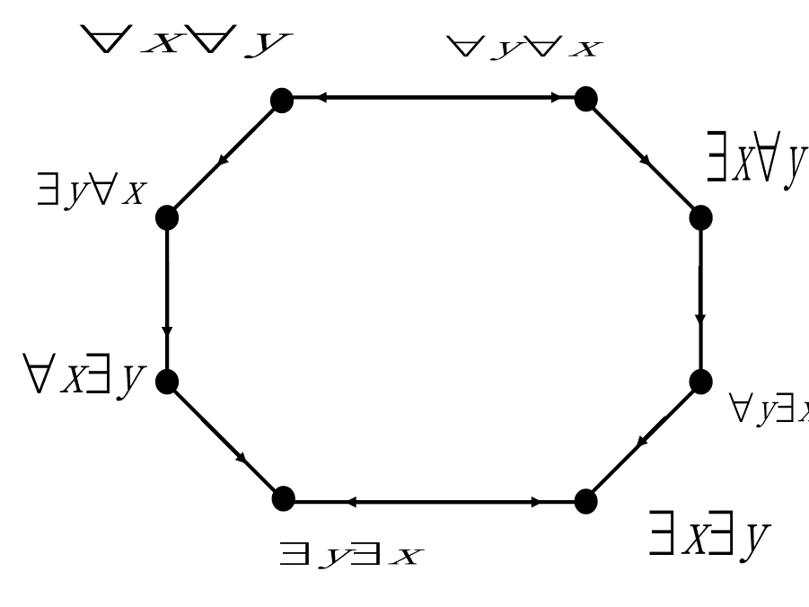

## 2.6 前束范式(prenex normal forms)

一个公式若量词均在全式的开头,作用域延伸到整个公式,则该公式叫做前束范式.

□( v₁) □( v₂)... □( vₙ) A
A(v₁, v₂, ..., vₙ)
□ — ∀,∃; vᵢ — 客体变元;

## — 没有量词的谓词公式

∀x∀y∃z(Q(x, y) → R(z))

A(x, y, z)

∀x∀y(¬P(x, y) → Q(y))

A(x, y)

## 谓词公式的范式

- 前束范式：一个公式，如果量词均在全式的开头，它们的作 用域，延伸到整个公式的末尾，则该公式称为前束范式。
- 如：
- (∀ x)(∀ y)(∃ z)(Q(x,y) → R(z))
- (∀ y)(∀ x)(¬ P(x,y) → Q(y))
- 方法：将¬后移，辖域扩张或收缩，换名和替换规则等值演算

## 前束合取范式：

（□ V₁） （□ V₂）… （□ Vₙ）
（（A₁₁ ∨ … ∨ A₁l₁）
∧ （A₂₁ ∨ … ∨ A₂l₂） ∧ …
∧ （Aₘ₁ ∨ … ∨ Aₘlₘ））

Aᵢⱼ 为原子公式及其否定。

## 前束析取范式：

($\square_{V_1}$)   ($\square_{V_2}$)...   ($\square_{V_n}$)

((A₁₁ ∧ ... ∧ A₁l₁)
∨ (A₂₁ ∧ ... ∧ A₂l₂) ∨ ...
∨ (Aₘ₁ ∧ ... ∧ Aₘlₘ))

任何一个谓词公式均有与其等价的前束范式。

任何一个谓词公式均可转为与其等价的前束合取范式。

任何一个谓词公式均可转为与其等价的前束析取范式。

## 求前束范式

1) ∀xF(x) ∧ ¬∃xG(x)

⇔ ∀xF(x) ∧ ∀x¬G(x)

⇔ ∀x(F(x) ∧ ¬G(x))

2) ∀xF(x) ∨ ¬∃xG(x)

⇔ ∀xF(x) ∨ ∀x¬G(x)

⇔ ∀xF(x) ∨ ∀y¬G(y)

⇔ ∀x∀y(F(x) ∨ ¬G(y))

3) (∀xF(x, y) → ∃yG(y))

→ ∀xH(x, y)

⇔ (∀xF(x, z) → ∃yG(y))

→ ∀xH(x, z)


⇔ (∀ₓF(x, z) → ∃ᵧG(y))
    → ∀ₜ H(t, z)
⇔ ∃ₓ(F(x, z) → ∃ᵧG(y))
    → ∀ₜ H(t, z)
⇔ (∃ₓ∃ᵧ(F(x, z) → G(y)))
    → ∀ₜ H(t, z)

⇔ ∀x∀y((F(x, z) → G(y)) → ∀t H(t, z))

⇔ ∀x∀y∀t((F(x, z) → G(y)) → H(t, z))

4) ∃xF(x) ∧ ∃xG(x)

⇔ ∃xF(x) ∧ ∃yG(y)

⇔ ∃x(F(x) ∧ ∃yG(y))

⇔ ∃x∃y(F(x) ∧ G(y))

## 例1 把 ∀xP(x) → ∃xQ(x) 化为前束范式。

解：

原式 ⇔ ¬∀xP(x) ∨ ∃xQ(x)

⇔ ∃x¬P(x) ∨ ∃xQ(x)

⇔ ∃x(¬P(x) ∨ Q(x))

⇔ ∃x(P(x) → Q(x))

## 例2 把

∀x∀y(∃z(P(x, z) ∧ P(y, z)) → ∃uQ(x, y, u))

化为前束范式。

解: 原式

∀x∀y∀z(P(x, z) ∧ P(y, z) → ∃uQ(x, y, u))

⇔

∀x∀y∀z∃u(P(x, z) ∧ P(y, z) → Q(x, y, u))

## 额外主题：逻辑编程

- 有些编程语言完全基于谓词逻辑！
- 其中最著名的一种叫做 `Prolog`。
- 一个 Prolog 程序是一组谓词逻辑中的命题（“事实”）和（“规则”）。
- 程序的输入是一个“查询”命题。
  - 想知道它是真还是假。
- Prolog 解释器会执行一些自动演绎，以确定查询是否可以从事实中推出。

## Prolog 中的事实

- Prolog 中的事实表示谓词逻辑中一个简单的、非复合的命题。
  - *例如*，“John 喜欢 Mary”
    - 在谓词逻辑中可以写作 Likes(John,Mary)。
    - 在 Prolog 中可以写作 `likes(john,mary).`！
    - 所有常量和谓词必须使用小写符号，大写保留给变量名使用。

## Prolog 中的规则

- Prolog 中的*规则*表示一般形式为
  ∀x: [∃y P(x,y)]→Q(x)
  的全称量化命题，
  其中 x 和 y 可能是复合变量 x=(z,w)，P、Q 是复合命题。
- 在 Prolog 中，这被写为规则：
  q(X) :- p(X,Y)。
  即，∀、∃ 量词是隐式的。
- 示例：likable(X) :- likes(Y,X)。

```
q(X) :- p(X,Y).
```

```
likable(X) :- likes(Y,X).
```

变量必须大写

## 合取与析取

- 逻辑合取通过在规则中使用多个逗号分隔的项来表示。
- 逻辑析取通过使用多个规则来表示。
- *例如，* ∀x [(P(x)∧Q(x))∨R(x)]→S(x) 可以在 Prolog 中表示为：
  ```
  s (X) :- p (X) , q (X)
  s (X) :- r (X)
  ```

## Prolog 中的演绎

- 当向 Prolog 解释器输入一个查询时，
  - 它会搜索其数据库，以确定该查询是否能从可用事实中证明为真。
  - 如果可以，则返回“yes”，否则返回“no”（！）
  - 如果查询包含任何变量，则打印所有使查询为真的值。

## 简单 Prolog 示例

- 一个示例输入程序：
  `likes(john,mary).`
  `likes(mary,fred).`
  `likes(fred,mary).`
  `likable(X) :- likes(Y,X).`

- 一个示例查询：`? likable(Z)`
  返回：`mary fred`

## PROLOG 与谓词逻辑的关系

- PROLOG 不能使用所有谓词逻辑公式。（它只覆盖谓词逻辑的一个“片段”。）
- 它使用“失败即否定”（negation as failure）
- 基于这些限制，基于 PROLOG 的演绎是可判定的。

## 演绎示例

- 定义：$H(x) :\equiv$ “x 是人”；$M(x) :\equiv$ “x 会死”；$G(x) :\equiv$ “x 是神”
- 前提：
  - $\forall x\ H(x) \rightarrow M(x)$（“人终有一死”）以及
  - $\forall x\ G(x) \rightarrow \neg M(x)$（“神是不朽的”）。
- 证明 $\neg\exists x\ (H(x) \land G(x))$（“没有人是神。”）

## 一个“语义”证明
（稍后将使其严格化）

∀x H(x) → M(x)（“人终有一死”）且 ∀x G(x) → ¬M(x)（“神是不朽的”）。假设 ∃x (H(x) ∧ G(x))。例如，H(a) ∧ G(a)。那么根据第一个前提，我们有 M(x)。根据第二个前提，我们有 ¬M(x)。矛盾！因此，可以推出 ¬∃x (H(x) ∧ G(x))（“没有人是神。”）

## 另一种证明，使用等价变换

- ∀x H(x)→M(x) 且 ∀x G(x)→¬M(x)。
- ∀x ¬M(x)→¬H(x) [逆否命题。]
- ∀x [G(x)→¬M(x)] ∧ [¬M(x)→¬H(x)]
- ∀x G(x)→¬H(x) [→ 的传递性。]
- ∀x ¬G(x) ∨ ¬H(x) [→ 的定义。]
- ∀x ¬(G(x) ∧ H(x)) [德摩根定律。]
- ¬∃x G(x) ∧ H(x) [等价变换律。]


## 附加内容：
更多数论示例

令 u.d. = *自然数* 0, 1, 2, ...

这些是什么意思？

- ∀x (E(x) ↔ (∃y x=2y))
- ∀x (P(x) ↔ (x>1 ∧ ¬∃yz x=yz ∧ y≠1 ∧ z≠1))

令 u.d. = *自然数* 0, 1, 2, ...
- “一个数 x 是*偶数*（E(x)），当且仅当它等于某个其他数的 2 倍。”
  ∀x (E(x) ↔ (∃y x=2y))
- “一个数是*素数*（P(x)），当且仅当它大于 1，并且它不是任何两个非 1 数的乘积。”
  ∀x (P(x) ↔ (x>1 ∧ ¬∃yz x=yz ∧ y≠1 ∧ z≠1))

## 哥德巴赫猜想（未被证明）

利用上一张幻灯片中的 $E(x)$ 和 $P(x)$，

∀x( [x>2 ∧ E(x)] →
∃p ∃q P(p) ∧ P(q) ∧ p+q = x).

利用上一张幻灯片中的 E(x) 和 P(x)，

∀x( [x>2 ∧ E(x)] →
    ∃p ∃q P(p) ∧ P(q) ∧ p+q = x).

> “每个大于 2 的偶数都是两个素数之和。”

## 微积分示例

- 使用量词精确定义微积分中*极限*概念的一种方式：
  $\left(\lim_{x\to a} f(x)=L\right)\iff$
  $\left(\forall\varepsilon>0:\exists\delta>0:\forall x:\left(|x-a|<\delta\right)\to\left(|f(x)-L|<\varepsilon\right)\right)$

## § 1.4-1.5 结束：谓词逻辑

- 通过这几节你应该学到：
  - 谓词逻辑的记法与约定
  - 转换：谓词逻辑 ↔ 清晰的英语
  - 量词的含义、等价式
  - 使用量词进行简单推理
- 接下来的主题：
  - 证明写作入门。
  - 然后：集合论——
    - 一种用来讨论对象集合的语言。

## 作业

- § 1.4 – 10, 18, 30, 40,54, 60
- § 1.5 – 10, 28, 34, 46,50

## 1 基础：逻辑与证明

- 1.1 命题逻辑
- 1.2 命题等价式
- 1.3 谓词与量词
- 1.4 嵌套量词
- 1.5 推理规则
- 1.6 证明入门
- 1.7 证明方法与策略

## 5 归纳与递归

- 5.1 数学归纳法
- 5.2 强归纳法与良序
- 5.3 递归定义与结构归纳法
- 5.4 递归算法
- 5.5 程序正确性

## 归纳证明

Rosen 第 7 版，§ 5.1

## § 5.1：数学归纳法

- 一种强大而严谨的技术，用于证明谓词 $P(n)$ 对*每一个*自然数 $n$（无论多大）都为真。
- 本质上是一种“多米诺效应”原理。
- 基于谓词逻辑推理规则：
  $P(0)$
  $\forall n\ge0\ (P(n)\to P(n+1))$
  $\therefore \forall n\ge0\ P(n)$

> “数学归纳法第一原理”

## “多米诺效应”

- **前提 1：** 第 0 号多米诺骨牌倒下。
- **前提 2：** 对每一个 $n \in \mathbb{N}$，如果第 n 号多米诺骨牌倒下，那么第 n+1 号也会倒下。
- **结论：** 所有多米诺骨牌都会倒下！

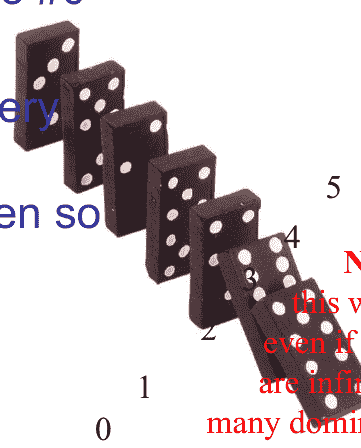

注意：即使有无限多块多米诺骨牌，这也成立！

## 归纳法的有效性

证明 ∀k≥0 P(k) 是一个有效结论：
给定任意 k≥0，第二个前件
∀n≥0 (P(n)→P(n+1)) 显然蕴含
∀n≥0 (n<k)→(P(n)→P(n+1))，即蕴含 (P(0)→P(1)) ∧ (P(1)→P(2)) ∧ ... ∧ (P(k−1)→P(k))。对列表中相邻蕴含式反复应用假言三段论规则 k−1 次，即可得到 P(0)→P(k)；这与 P(0)（前件 #1）以及肯定前件规则一起，给出 P(k)。因此 ∀k≥0 P(k)。■

## 归纳证明的提纲

- 假设我们要证明 ∀n P(n)...
  - 做*基础情况*（或称*基础步骤*）：证明 P(0)。
  - 做*归纳步骤*：证明 ∀n P(n)→P(n+1)。
    - *例如*，你可以使用直接证明，如下：
    - 令 n∈N，假设 P(n)。（*归纳假设*）
    - 现在，在这个假设下，证明 P(n+1)。
  - 然后，归纳推理规则给出 ∀n P(n)。

## 归纳法的推广

- 该规则也可用于证明：对于给定的常数 c ∈ Z（可能 c ≠ 0），∀ n ≥ c P(n) 成立。
  - 在这种情况下，基础情况是证明 P(c) 而不是 P(0)，归纳步骤是证明 ∀ n ≥ c (P(n) → P(n+1))。
- 归纳法也可用于证明：对任意数列 {aₙ}，∀ n ≥ c P(aₙ) 成立。
- 可以将这些归结为已经展示的形式。


## 归纳法示例（第一原理）
- 证明前 *n* 个正奇数之和为 *n*²。即证明：
  
  ∀*n* ≥ 1: Σ_{i=1}^{n} (2*i* − 1) = *n*²

- 用归纳法证明。
  - 基础情形：令 *n*=1。前 1 个正奇数的和为 1 等于 1²。 (Cont…)

## 示例续
- 归纳步骤：证明 ∀n≥1: P(n)→P(n+1)。
  - 令 n≥1，假设 P(n)，并证明 P(n+1)。

∑_{i=1}^{n+1} (2i − 1) = (∑_{i=1}^{n} (2i − 1)) + (2(n+1)−1)
= n² + 2n + 1
= (n+1)²

*由归纳假设 P(n)*

## 另一个归纳法示例
- 证明 ∀n>0, n<2ⁿ。令 P(n)=(n<2ⁿ)
  - 基础情形：P(1)=(1<2¹)=(1<2)=T。
  - 归纳步骤：对 n>0，证明 P(n)→P(n+1)。
    - 假设 n<2ⁿ，证明 n+1 < 2ⁿ⁺¹。
    - 注意 n + 1 < 2ⁿ + 1 （由归纳假设）
      < 2ⁿ + 2ⁿ （因为 1<2=2·2⁰≤2·2ⁿ⁻¹=2ⁿ）
      = 2ⁿ⁺¹
    - 所以 n + 1 < 2ⁿ⁺¹，我们完成了。

## 归纳法证明
- **基础步骤(基始)**。证明 S(k) 对某个（较小）值 k 成立。
- **归纳步骤（归纳）**。对每个 *n*，*假设* S(n) 成立并*证明* S(n+ 1) 成立。
- 合在一起，这证明 ∀i ≥ k:P(i)

## Fibonacci Numbers（斐波那契数列）
- 斐波那契数列 0, 1, 1, 2, 3, 5, ... 由以下公式定义
  
  F(0) = 0
  
  F(1) = 1
  
  F(n) = F(n-1) + F(n-2)

## Fibonacci Sums
0+1 = 1
0+1+1 = 2
0+1+1+2 = 4
0+1+1+2+3 = 7
0+1+1+2+3+5 = 12
0+1+1+2+3+5+8 = 20

规律是什么？

∑_{i=0}^{n} F(i) = F(n + 2) − 1

## Fibonacci Sums
- 让我们用归纳法验证 （证明） 这个：
  - 我们需要验证一个基础情形
  - 然后我们假设该公式 （公式） 对 n 成立并证明它对 n+1 成立。

## 基础情形
N=0

∑_{i=0}^{n} F(i) = 0

F(n + 2) − 1 = 1 − 1

### 归纳步骤
∑_{i=0}^{n+1} F(i)
= F(n + 1) + ∑_{i=0}^{n} F(i)
= F(n + 1) + F(n + 2) - 1
= F(n + 3) - 1

假设（假定）：
∑_{i=0}^{n} F(i) = F(n + 2) - 1

结论（结论）
∑_{i=0}^{n+1} F(i) = F(n + 3) - 1

## Example 1
- 用数学归纳法证明，对所有 n≥1，
  $1+2+3+\cdots+n = \frac{n(n+1)}{2}$
- 解 $1+2+3+\cdots+n = \frac{n(n+1)}{2}$
  - 令 $p(n)$ 为谓词 $1+2+3+\cdots+n = \frac{n(n+1)}{2}$
  - BS: $n_0=1$, $1 = \frac{1(1+1)}{2}$ $p(1)$ 成立。
  - IS:假设对某个固定的 $k\ge1$, $p(k)$ 成立。

1 + 2 + 3 + ⋯ + (k + 1)  P(k+1) 的左边
= k(k + 1)/2 + (k + 1)      用(1) 替换 1+2+⋯+k
= (k + 1)[k/2 + 1]          因式分解
= (k + 1)(k + 2)/2
= (k + 1)((k + 1) + 1)/2    P(k+1) 的右边

- p(k+1) 成立。
- 由数学归纳法原理，p(n) 对 n≥1 成立。
- Q.E.D

## Example 2
- 设 $A_1, A_2 \dots, A_n$ 为任意 n 个集合。证明
  
  $$\overline{\left(\bigcup_{i=1}^{n} A_i\right)} = \bigcap_{i=1}^{n} \overline{A_i}$$

- 解
  - 令 $P(n)$ 为谓词等式对任意 n 个集合成立。

- BS: , P(1) 成立。
- IS: $\overline{A_1} = \overline{A_1}$
$\overline{\left(\bigcup_{i=1}^{k+1} A_i\right)} = \overline{A_1 \cup A_2 \cup \cdots \cup A_k \cup A_{k+1}}$ P(k+1) 的左边
$= \overline{(A_1 \cup A_2 \cup \cdots \cup A_k) \cup A_{k+1}}$ $\cup$ 的结合律
$= \overline{(A_1 \cup A_2 \cup \cdots \cup A_k)} \cap \overline{A_{k+1}}$ 由 De Morgan 定律
$= \left(\bigcap_{i=1}^{k} \overline{A_i}\right) \cap \overline{A_{k+1}}$ 用 P(k)
- $P(k+1)$ 成立。 $= \bigcap_{i=1}^{k+1} \overline{A_i}$ P(k+1) 的右边
- 由数学归纳法原理 $P(n)$ 对所有 $n \ge 1.$ 成立。

## 有限集的子集数
**Example**: 用数学归纳法证明如果 $S$ 是一个有限集，含有 $n$ 个元素，其中 $n$ 为非负整数，则 $S$ 有 $2^n$ 个子集。

* (第 6 章用组合方法证明了该结果。)

**Solution**: 令 $P(n)$ 为命题一个含有 $n$ 个元素的集合有 $2^n$ 个子集。

- 基础步骤：$P(0)$ 成立，因为空集只有它本身作为子集且 $2^0 = 1.$

- 归纳步骤：假设 $P(k)$ 对任意非负整数 $k$ 成立。


## 有限集的子集数目

**归纳假设：** 对于任意非负整数 \(k\)，每个含有 \(k\) 个元素的集合都有 \(2^k\) 个子集。

- 设 \(T\) 是一个含有 \(k+1\) 个元素的集合。则 \(T = S \cup \{a\}\)，其中 \(a \in T\) 且 \(S = T - \{a\}\)。于是 \(|S| = k\)。
- 对于 \(S\) 的每个子集 \(X\)，\(T\) 恰好有两个子集，即 \(X\) 和 \(X \cup \{a\}\)。

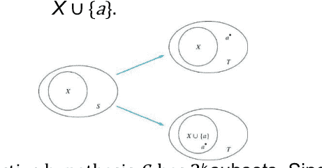

- 根据归纳假设，\(S\) 有 \(2^k\) 个子集。由于对于 \(S\) 的每个子集，\(T\) 都有两个子集，所以 \(T\) 的子集数目为 \(2 \cdot 2^k = 2^{k+1}\)。

## 示例

- 用数学归纳法证明任何有限的非空集合都是可数的；也就是说，它可以排列成一个列表。
- **解答**
  - 设 \(P(n)\) 为谓词：如果 \(A\) 是任意一个 \(|A| = n \ge 1\) 的集合，则 \(A\) 是可数的。
  - **基础步骤：** \(n_0 = 1\)，于是我们设 \(A\) 为任意一个只有一个元素的集合，设 \(A = \{x\}\)。在这种情况下，\(x\) 本身就构成一个序列，其集合为 \(A\)，所以 \(P(1)\) 为真。
  - **归纳步骤：**
    - 假设命题 \(P(k)\)：如果 \(A\) 是任意一个含有 \(k\) 个元素的集合，则 \(A\) 是可数的。
    - 任取一个含有 \(k+1\) 个元素的集合 \(B\) 并取任意元素 \(x \in B\)。
    - 由于 \(B - \{x\}\) 是一个含有 \(k\) 个元素的集合，归纳假设 \(P(k)\) 告诉我们存在一个序列 \(x_1, x_2, \ldots, x_k\) 其对应的集合为 \(B - \{x\}\)。
    - 序列 \(x_1, x_2, \ldots, x_k, x\) 然后以 \(B\) 为对应的集合。所以 \(B\) 是可数的。
    - 由于 \(B\) 可以是任意一个含有 \(k+1\) 个元素的集合，若 \(P(k)\) 成立，则 \(P(k+1)\) 成立。
  - 因此，根据数学归纳法原理，\(P(n)\) 对所有 \(n \ge 1\) 都为真。

## 指南：数学归纳法证明

### 数学归纳法证明的模板

1. 将要证明的命题表述为“对于所有 \(n \ge b\)，\(P(n)\)”的形式，其中 \(b\) 为固定整数。
2. 写出“基础步骤”一词。然后证明 \(P(b)\) 为真，注意使用正确的 \(b\) 值。这完成了证明的第一部分。
3. 写出“归纳步骤”一词。
4. 明确指出并清晰标识归纳假设，形式为“假设对于任意固定整数 \(k \ge b\)，\(P(k)\) 为真。”
5. 在归纳假设成立的前提下，说明需要证明的内容。也就是说，写出 \(P(k+1)\) 的内容。
6. 利用假设 \(P(k)\) 证明命题 \(P(k+1)\)。确保你的证明对所有满足 \(k \ge b\) 的整数 \(k\) 都有效，注意证明对较小的 \(k\) 值也成立，包括 \(k = b\)。
7. 明确指出归纳步骤的结论，例如说“这完成了归纳步骤。”
8. 在完成基础步骤和归纳步骤后，写出结论，即根据数学归纳法，\(P(n)\) 对所有满足 \(n \ge b\) 的整数 \(n\) 都为真。

## 归纳的第二原理

又称“强归纳”

- 由另一条推理规则表征：
  - \(P(0)\)
  - \(P\) 在 *所有* 之前的情况中为真
  - \(\forall n \ge 0: (\forall 0 \le k \le n\ P(k)) \rightarrow P(n+1)\)
  - \(\therefore \forall n \ge 0: P(n)\)
- 这与第一原理的唯一区别是：
  - 这里的归纳步骤使用了更强的假设，即 \(P(k)\) 对 *所有* 更小的数 \(k < n+1\) 都为真，而不仅仅是 \(k = n\)。

## 强归纳

- 在数学归纳法的强形式中，前述的（前述的）归纳步骤——“对于每一个 \(n\)，*假设* \(S(n)\) 为真并*证明* \(S(n+1)\) 为真”——被替换为“对于每一个 \(n\)，*假设* \(S(k)\) 对 *所有* \(k < n+1\) 都为真并*证明* \(S(n+1)\) 为真。”

## 第二原理的示例

- 证明每一个 \(n > 1\) 都可以写成 \(\prod p_i = p_1 p_2 \cdots p_s\) 的形式，即若干个 \(s\) 个素数的乘积。
  - 设 \(P(n) =\) “\(n\) 具有该性质”。
- **基础情形：** \(n = 2\)，设 \(s = 1\)，\(p_1 = 2\)。
- **归纳步骤：** 设 \(n \ge 2\)。假设 \(\forall 2 \le k \le n: P(k)\)。考虑 \(n+1\)。如果它是素数，设 \(s = 1\)，\(p_1 = n+1\)。否则 \(n+1 = ab\)，其中 \(1 < a \le n\) 且 \(1 < b \le n\)。则 \(a = p_1 p_2 \cdots p_t\) 且 \(b = q_1 q_2 \cdots q_u\)。于是我们有 \(n+1 = p_1 p_2 \cdots p_t q_1 q_2 \cdots q_u\)，即 \(s = t+u\) 个素数的乘积。


## 另一个例子

- 让我们证明每个数都可以写成素数的乘积（乘积） of primes （素数）.
- 显然，这对素数成立，但我们如何一般地证明它？
- 假设我们有一个数 n，它是两个数 a 和 b 的乘积。
- a 和 b 必须小于 n，但它们不能比 1 小... 那么我们如何应用归纳法？

## 素数的乘积

- 设 P(n) 为真当且仅当 n 可以表示为（一个或多个）素数的乘积。
- **基础情形：** n = 2
  - 2 是素数，因此 P(2) 为真。

### 归纳步骤

- 假设 ∀i<n: P(i) 为真
- **情形 1：** n 是素数。
  - P(n) 为真。完成！
- **情形 2：** n 不是素数
  - n = ab；1 < a,b < n
  - 根据我们的假设，P(a) 和 P(b) 为真。
- 因此 n 是素数的乘积。

## 另一个第二原理例子

- 证明 12 美分或更多的任何邮资都可以用仅 4 美分和 5 美分的邮票组成。$P(n)$ = “$n$ 可以为…”
- **基础情形：** 12=3(4), 13=2(4)+1(5), 14=1(4)+2(5), 15=3(5), 所以 $\forall 12\le n\le15$, $P(n)$。
- **归纳步骤：** 设 $n\ge15$, 假设 $\forall 12\le k\le n$ $P(k)$。注意 $12\le n-3\le n$, 所以 $P(n-3)$, 所以加上一个 4 美分的邮票即可得到 $n+1$ 的邮资。

## 归纳的两种视角

- d₀ 击中 d₁, d₁ 击中 d₂ ...
- P(0) ⇒ P(1), P(1) ⇒ P(2) ...
- P(i) ⇒ P(i+1)

- d₁ 因为 d₀ 倒下而倒下，
- d₂ 因为 d₀ 和 d₁ 都倒下而倒下...
- P(0) ⇒ P(1), ( P(0) ∧ P(1) ) ⇒ P(2)...
- ( ∀i<j P(i) ) ⇒ P(j)

## 一个错误的数学归纳法“证明”

**例子：** 设 P(n) 为平面上每 n 条线，没有两条平行，在公共点相交的陈述。以下是 P(n) 对所有正整数 n ≥ 2 都成立的“证明”。

**基础步骤：** 陈述 P(2) 为真，因为平面上任意两条不平行的线在公共点相交。

**归纳步骤：** 归纳假设是 P(k) 对正整数 k ≥ 2 为真的陈述，即平面上每 k 条线，没有两条平行，在公共点相交。

我们必须证明如果 P(k) 成立，则 P(k + 1) 成立，即如果平面上每 k 条线，没有两条平行，k ≥ 2，在公共点相交，则平面上每 k + 1 条线，没有两条平行，在公共点相交。

**归纳假设：** 平面上每 k 条线，其中 k ≥ 2，没有两条平行，在公共点相交。

考虑平面上 k + 1 条不同的线，没有两条平行。根据归纳假设，前 k 条线必须在公共点 p₁ 相交。根据归纳假设，后 k 条线在公共点 p₂ 相交。

如果 p₁ 和 p₂ 是不同的点，包含它们的全部线必须为同一条线，因为两点确定一条线。这与线不同的假设矛盾。因此，p₁ = p₂ 位于全部 k + 1 条不同的线上，因此 P(k + 1) 成立。假设 k ≥ 2，不同的线在公共点相交，则每 k + 1 条线在公共点相交。

这个证明一定有错误，因为结论是荒谬的。但错误在哪里？

**答案：** P(k) → P(k + 1) 仅对 k ≥ 3 成立。P(2) 并不能推出 P(3)。前两条线必须在公共点 p₁ 相交，第二条和第三条线必须在公共点 p₂ 相交。它们不必是同一点，因为只有第二条线是两个线集共有的。

## 指南：数学归纳法证明

### 数学归纳法证明的模板

1. 将要证明的陈述表达为“对所有 n ≥ b，P(n)”的形式，其中 b 为固定整数。
2. 写出“基础步骤”一词。然后证明 P(b) 为真，注意使用正确的 b 值。这完成了证明的第一部分。
3. 写出“归纳步骤”一词。
4. 明确指出并清晰标识归纳假设，形式为“假设 P(k) 对任意固定整数 k ≥ b 为真。”
5. 在归纳假设成立的假设下说明需要证明什么。也就是说，写出 P(k + 1) 的内容。
6. 利用假设 P(k) 证明陈述 P(k + 1)。确保你的证明对所有整数 k 且 k ≥ b 都有效，注意证明对小的 k 值有效，包括 k = b。
7. 明确指出归纳步骤的结论，例如说“这完成了归纳步骤。”
8. 在完成基础步骤和归纳步骤后，说明结论，即通过数学归纳法，P(n) 对所有整数 n 且 n ≥ b 为真。


## 一个错误的例子

- **定理：** 所有马的颜色都相同（！）
- **证明：** 用归纳法！


## 良序特性

良序特性

- 证明归纳推理规则有效性的另一种方法是使用 *良序特性*，它指出：
  - 每个非空的非负整数集合都有一个最小（最小）元素。
  - \(\forall \emptyset \subset S \subseteq \mathbb{N}: \exists m \in S: \forall n \in S: m \le n\)
- 这意味着 \(\{n \mid \neg P(n)\}\)（如果非空）有一个最小元素 \(m\)，但此时假设 \(P(m-1) \to P((m-1)+1)\) 将会自相矛盾。

## 无穷递降法

无穷递降法

- 一种证明 \(P(n)\) 对所有 \(n \in \mathbb{N}\) 都为假的方法。
- 某种程度上是归纳原理的逆。
- 首先证明 \(\forall n\,(P(n) \to \exists k < n: P(k))\)。
  - 基本上是，“对于每一个 \(P\) 都存在一个更小的 \(P\)。”
- 但根据 \(\mathbb{N}\) 的良序特性，我们知道 \(\exists m\,P(m) \to \exists n\,(P(n) \land \forall k\,(P(k) \to n \le k))\)。
  - 基本上是，“如果存在 \(P\)，则存在最小的 \(P\)。”
- 注意，除非 \(\neg \exists m\,P(m)\)，否则这些是矛盾的，
  - 也就是说，\(\forall m \in \mathbb{N}: \neg P(m)\)。不存在 \(P\)。

## 无穷递降法例子

- **定理：** \(2^{1/2}\) 是无理数。
- **证明：** 假设 \(2^{1/2}\) 是有理数；则 \(\exists m,n \in \mathbf{Z}^+: 2^{1/2} = m/n\)。令 \(M,N\) 为 \(m,n\) 中使 \(n\) 最小的那一对。

\[
\sqrt{2} = \frac{M}{N} \therefore 2 = \frac{M^2}{N^2} \therefore 2N^2 = M^2.
\]

\[
\frac{2N-M}{M-N} = \frac{(2N-M)N}{(M-N)N} = \frac{2N^2-MN}{(M-N)N} = \frac{M^2-MN}{(M-N)N} = \frac{(M-N)M}{(M-N)N} = \frac{M}{N}
\]

\[
1 < \sqrt{2} < 2 \therefore 1 < \frac{M}{N} < 2 \therefore N < M < 2N \therefore 0 < M-N < N
\]

因此 \(\exists j,k < N: 2^{1/2} = j/k\)（令 \(j = 2N-M\)，\(k = M-N\)）。

## 作业

- § 5.1 — 32, 44, 50, 60
- § 5.2 — 4, 26, 32

## 递归定义与结构归纳

第 5.3 节

## 章节摘要

- 递归定义的函数
- 递归定义的集合和结构
- 结构归纳
- 广义归纳

## 递归定义的函数

定义：一个函数 *递归* 或 *归纳* 定义由两步组成。

- **基础步骤：** 指定函数在零处的值。
- **递归步骤：** 给出从其在较小整数处的值求其在整数处的值的规则。

函数 \(f(n)\) 与序列 \(a_0, a_1, \ldots\) 相同，其中 \(f(i) = a_i\)。这在第 2.4 节中用递推关系完成。

**例：** 假设 \(f\) 定义为：

\[
f(0) = 3,
\]
\[
f(n+1) = 2f(n) + 3
\]

求 \(f(1), f(2), f(3), f(4)\)。

**解：**

- \(f(1) = 2f(0) + 3 = 2 \cdot 3 + 3 = 9\)
- \(f(2) = 2f(1) + 3 = 2 \cdot 9 + 3 = 21\)
- \(f(3) = 2f(2) + 3 = 2 \cdot 21 + 3 = 45\)
- \(f(4) = 2f(3) + 3 = 2 \cdot 45 + 3 = 93\)

**例：** 给出阶乘函数 \(n!\) 的递归定义：

**解：**

\[
f(0) = 1
\]
\[
f(n+1) = (n+1) \cdot f(n)
\]

**例：** 给出以下递归定义：

\[
\sum_{k=0}^{n} a_k.
\]

**解：** 定义的第一部分是

\[
\sum_{k=0}^{0} a_k = a_0.
\]

第二部分是

\[
\sum_{k=0}^{n+1} a_k = \left(\sum_{k=0}^{n} a_k\right) + a_{n+1}.
\]

## 斐波那契数

斐波那契（1170–1250）


**例：** 斐波那契数定义如下：

\[
f_0 = 0
\]
\[
f_1 = 1
\]
\[
f_n = f_{n-1} + f_{n-2}
\]

求 \(f_2, f_3, f_4, f_5\)。

- \(f_2 = f_1 + f_0 = 1 + 0 = 1\)
- \(f_3 = f_2 + f_1 = 1 + 1 = 2\)
- \(f_4 = f_3 + f_2 = 2 + 1 = 3\)
- \(f_5 = f_4 + f_3 = 3 + 2 = 5\)

在第 8 章中，我们将使用斐波那契数来模拟兔子种群的增长。这是斐波那契本人描述的一个应用。

接下来，我们用强归纳法证明关于斐波那契数的一个结果。

## 斐波那契数列

1 1 2 3 5 8 13 21 34 55 89 144

**例 4：** 证明当 \(n \ge 3\) 时，\(f_n > \alpha^{n-2}\)，其中 \(\alpha = (1+\sqrt{5})/2\)。

**解：** 令 \(P(n)\) 为命题 \(f_n > \alpha^{n-2}\)。用强归纳法证明当 \(n \ge 3\) 时 \(P(n)\) 为真。

- **基础步骤：** \(P(3)\) 成立，因为 \(\alpha < 2 = f_3\)。  
  \(P(4)\) 成立，因为 \(\alpha^2 = (3+\sqrt{5})/2 < 3 = f_4\)。
- **归纳步骤：** 假设 \(P(j)\) 对所有满足 \(3 \le j \le k\) 的整数 \(j\) 成立，其中 \(k \ge 4\)。证明 \(P(k+1)\) 成立，即 \(f_{k+1} > \alpha^{k-1}\)。
- 由于 \(\alpha^2 = \alpha + 1\)（因为 \(\alpha\) 是 \(x^2 - x - 1 = 0\) 的解），
\[
\alpha^{k-1} = \alpha^2 \cdot \alpha^{k-3} = (\alpha+1)\cdot\alpha^{k-3} = \alpha\cdot\alpha^{k-3} + 1\cdot\alpha^{k-3} = \alpha^{k-2} + \alpha^{k-3}.
\]
- 根据归纳假设，因为 \(k \ge 4\)，我们有 \(f_{k-1} > \alpha^{k-3}\) 且 \(f_k > \alpha^{k-2}\)。
- 因此，可得
\[
f_{k+1} = f_k + f_{k-1} > \alpha^{k-2} + \alpha^{k-3} = \alpha^{k-1}.
\]
- 故 \(P(k+1)\) 为真。

为什么这个等式成立？


## 拉梅定理

Gabriel Lamé
(1795-1870)

拉梅定理：设 a 和 b 为正整数且 a ≥ b。则欧几里得算法用于求 gcd(a,b) 的除法次数小于或等于 b 的十进制位数 的五倍。

证明：当我们使用欧几里得算法求 a ≥ b 时的 gcd(a,b)，

+   使用 n 次除法得到 (以 a = r₀, b = r₁)：

r₀ = r₁ q₁ + r₂      0 ≤ r₂ < r₁
r₁ = r₂ q₂ + r₃      0 ≤ r₃ < r₂
⋮
rₙ₋₂ = rₙ₋₁ qₙ₋₁ + rₙ   0 ≤ rₙ < rₙ₋₁
rₙ₋₁ = rₙ qₙ.

+   由于每个商 q₁, q₂, ..., qₙ₋₁ 至少为 1 且 qₙ ≥ 2：

rₙ ≥ 1 = f₂,
rₙ₋₁ ≥ 2 rₙ ≥ 2 f₂ = f₃,
rₙ₋₂ ≥ rₙ₋₁ + rₙ ≥ f₃ + f₂ = f₄,
⋮
r₂ ≥ r₃ + r₄ ≥ fₙ₋₁ + fₙ₋₂ = fₙ,
b = r₁ ≥ r₂ + r₃ ≥ fₙ + fₙ₋₁ = fₙ₊₁.

continued →

- 由此可知，如果欧几里得算法用于求 gcd$(a,b)$ 且 $a \ge b$ 时使用了 $n$ 次除法，则 $b \ge f_{n+1}$。根据例 4，$f_{n+1} > \alpha^{n-1}$，当 $n > 2$ 时，其中 $\alpha = (1 + \sqrt{5})/2$。因此，$b > \alpha^{n-1}$。
- 因为 $\log_{10} \alpha \approx 0.208 > 1/5$，$\log_{10} b > (n-1) \log_{10} \alpha > (n-1)/5$。因此，$n-1 < 5 \cdot \log_{10} b$。
- 假设 $b$ 有 $k$ 个十进制数字。则 $b < 10^k$ 且 $\log_{10} b < k$。由此可得 $n - 1 < 5k$ 且由于 $k$ 是整数，$n \le 5k$。
- 作为拉梅定理的推论，欧几里得算法用于求 gcd$(a,b)$ 时使用的除法次数为 $O(\log b)$，只要 $a > b$。
  - 根据拉梅定理，求 gcd$(a,b)$ 且 $a > b$ 所需的除法次数小于或等于 $5 (\log_{10} b + 1)$，因为 b 的十进制位数（等于 $[\log_{10} b] + 1$）小于或等于 $\log_{10} b + 1$。

## 递归定义集合和结构

*递归定义* 的集合有两个部分：

- *基础步骤* 指定初始元素集合。
- *递归步骤* 给出从已知在集合中的元素形成集合中新元素的规则。

- 有时递归定义有一个 *排除规则*，它规定集合中不包含基础步骤中指定的元素和递归步骤中规则的应用所生成的元素之外的任何其他元素。
- 我们将始终假设排除规则成立，即使它没有明确提及。
- 我们稍后将发展一种称为 *结构归纳* 的归纳形式，以证明关于递归定义集合的结果。

### Example : Subset of Integers S:

BASIS STEP: 3 ∈ S.

RECURSIVE STEP: If x ∈ S and y ∈ S, then x + y is in S.

- Initially 3 is in S, then 3 + 3 = 6, then 3 + 6 = 9, etc.

### Example: The natural numbers N.

BASIS STEP: 0 ∈ N.

RECURSIVE STEP: If n is in N, then n + 1 is in N.

- Initially 0 is in S, then 0 + 1 = 1, then 1 + 1 = 2, etc.

实数是在有理数基础上定义的，有理数又是在整数的基础上定义的，而整数又是在自然数的基础上定义的，那么自然数如何定义呢？

有两个集合 A 和 B，我们称它们为等价的，如果存在一个从 A 到 B 的映射 f，它是 1-1 的，又是满的。这时我们说 A 和 B 具有相同的势。我们首先承认空集 φ 是存在的，考虑一个集合 {φ}，它不是空集，凡与 {φ} 等价的集合都有相同的势，我们把 {φ} 简写为 1。再考虑集合 {φ, {φ}}，它与 1 = {φ} 是不等价的，我们把它简写为 2。一般地如果有了 n 之后，可以定义它的跟随 {φ, n}，简写为 n+1。这样我们就得到了自然数 N = {1, 2, 3, …, n, …}。

在 N 上可以定义加法：n + m = n + 1 + 1 + ⋯ + 1，还可以证明加法满足结合律和交换律：n + (m + p) = (n + m) + p，n + m = m + n。这样我们就从空集出发，定义出自然数 N。

这是一个最抽象的定义，比如说 2，它不指两个人，也不指二个物，而是指一个集合 {φ, {φ}}，这个集合有两个不同的元素 {φ} 和 φ。凡是与它等价的集合，都与它有相同的势，于是二个人，二个物……，都具有相同的势，按我们的理论，用 {φ, {φ}} 作为它们的代表。

## 字符串

Definition: The set Σ* of strings over the alphabet Σ:

BASIS STEP: λ ∈ Σ* (λ is the empty string)

RECURSIVE STEP: If w is in Σ* and x is in Σ, then wx ∈ Σ*.

Example: If Σ = {0,1}, the strings in in Σ* are the set of all bit strings, λ,0,1, 00,01,10, 11, etc.

Example: If Σ = {a,b}, show that aab is in Σ*.

- Since λ ∈ Σ* and a ∈ Σ, a ∈ Σ*.
- Since a ∈ Σ* and a ∈ Σ, aa ∈ Σ*.
- Since aa ∈ Σ* and b ∈ Σ, aab ∈ Σ*.

## 字符串连接

**Definition**: Two strings can be combined via the operation of *concatenation*. Let Σ be a set of symbols and Σ* be the set of strings formed from the symbols in Σ. We can define the concatenation of two strings, denoted by ·, recursively as follows.
BASIS STEP: If w ∈ Σ*, then w · λ = w.
RECURSIVE STEP: If w₁ ∈ Σ* and w₂ ∈ Σ* and x ∈ Σ, then w₁ · (w₂ x) = (w₁ · w₂) x.

- Often w₁ · w₂ is written as w₁ w₂.

- If w₁ = abra and w₂ = cadabra, the concatenation w₁ w₂ = abracadabra.


## 字符串的长度

**示例**：给出字符串 *w* 的长度 *l(w)* 的递归定义。

**解答**：字符串的长度可以递归定义如下：

*l*(λ) = 0；
*l*(wx) = *l*(w) + 1，其中 w ∈ Σ* 且 x ∈ Σ。

## 平衡括号

**示例**：给出平衡括号集合 $P$ 的递归定义。

**解答：**

基础步骤：$() \in P$

递归步骤：如果 $w \in P$，则 $()w \in P$、$(w) \in P$ 和 $w() \in P$。

- 证明 $(())$ 在 $P$ 中。
- 为什么 $))(($ 不在 $P$ 中？

## 命题逻辑中的合式公式

**定义**：涉及 **T**、**F**、命题变量以及集合 {¬,∧,∨,→,↔} 中运算符的命题逻辑*合式公式*的集合。

基础步骤：**T**、**F** 以及 s（其中 s 是命题变量）都是合式公式。

递归步骤：如果 E 和 F 是合式公式，则 (¬ E)、(E ∧ F)、(E ∨ F)、(E → F)、(E ↔ F) 都是合式公式。

**示例**：((p ∨ q) → (q ∧ F)) 是一个合式公式。

p q ∧ 不是合式公式。

## 有根树

**定义**：*有根树*的集合可以通过以下步骤递归定义，其中一棵有根树由一组顶点和连接这些顶点的边组成，并且包含一个称为*根*的特指顶点：
基础步骤：单个顶点 *r* 是一棵有根树。
递归步骤：假设 *T₁, T₂, ..., Tₙ* 是分别以 *r₁, r₂, ..., rₙ* 为根的不相交的有根树。那么，从一棵不在任何有根树 *T₁, T₂, ..., Tₙ* 中的根 *r* 开始，并添加从 *r* 到每个顶点 *r₁, r₂, ..., rₙ* 的边所形成的图，也是一棵有根树。

## 构建有根树

基础步骤

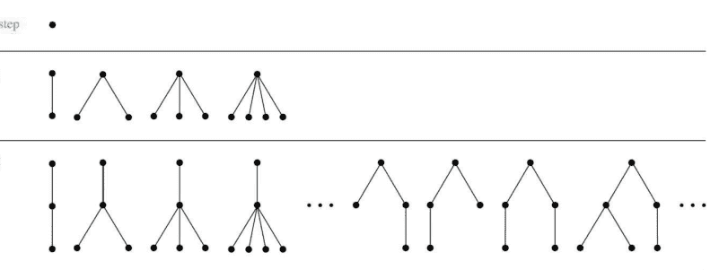

步骤 1

步骤 2

- 树在第 11 章中有深入研究。
- 接下来我们看一种特殊类型的树：满二叉树。

## 满二叉树

定义：满二叉树的集合可以通过以下步骤递归定义。

基础步骤：存在一棵仅由单个顶点 r 组成的满二叉树。

递归步骤：如果 T₁ 和 T₂ 是不相交的满二叉树，则存在一棵由根 r 以及连接根与左子树 T₁ 的根和右子树 T₂ 的根的边组成的满二叉树，记为 T₁·T₂。

## 构建满二叉树

基础步骤


步骤 1

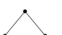

步骤 2

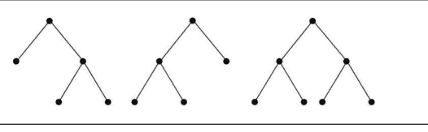

## 归纳法与递归定义集合

示例：证明集合 S 定义为：3 ∈ S，且如果 x ∈ S 且 y ∈ S，则 x + y 在 S 中，那么 S 是所有能被 3 整除的正整数的集合。

解答：设 A 是所有能被 3 整除的正整数的集合。为了证明 A = S，需证明 A 是 S 的子集且 S 是 A 的子集。

- A ⊆ S：设 P(n) 为命题“3n 属于 S”。
  - 基础步骤：3·1 = 3 ∈ S，由递归定义的第一部分得出。
  - 归纳步骤：假设 P(k) 成立。由递归定义的第二部分，如果 3k ∈ S，那么由于 3 ∈ S，3k + 3 = 3(k + 1) ∈ S。因此，P(k + 1) 成立。

- S ⊆ A：
  - 基础步骤：3 ∈ S 由递归定义的第一部分得出，且 3 = 3·1。
  - 归纳步骤：递归定义的第二部分将 x + y 加入 S，前提是 x 和 y 都在 S 中。如果 x 和 y 都在 A 中，那么 x 和 y 都能被 3 整除。根据第 4.1 节定理 1 的 (i) 部分，可知 x + y 能被 3 整除。

- 我们使用了数学归纳法来证明关于递归定义集合的结论。接下来，我们研究一种更直接的归纳形式，用于证明关于递归定义集合的结论。

## 结构归纳法

**定义**：为了证明递归定义集合中元素的性质，我们使用*结构归纳法*。

基础步骤：证明该结论对递归定义的基础步骤中指定的所有元素成立。

递归步骤：证明如果该命题对定义递归步骤中用于构造新元素的每个元素都成立，则该结论对这些新元素也成立。

- 结构归纳法的有效性可以由数学归纳法原理推出。


## 满二叉树

**定义**：满二叉树 *T* 的 *高度 h(T)* 递归定义如下：

- 基础步骤：仅由根 *r* 组成的满二叉树 *T* 的高度为 *h(T) = 0.*
- 递归步骤：如果 *T₁* 和 *T₂* 是满二叉树，则满二叉树 *T = T₁·T₂* 的高度为 *h(T) = 1 + max(h(T₁), h(T₂)).*

满二叉树 *T* 的顶点数 *n(T)* 满足以下递归公式：

- **基础步骤**：仅由根 *r* 组成的满二叉树 *T* 的顶点数为 *n(T) = 1.*
- **递归步骤**：如果 *T₁* 和 *T₂* 是满二叉树，则满二叉树 *T = T₁·T₂* 的顶点数为 *n(T) = 1 + n(T₁) + n(T₂).*

## 结构归纳法与二叉树

**定理：** 如果 $T$ 是满二叉树，则 $n(T) \le 2^{h(T)+1} - 1$。

**证明：** 使用结构归纳法。

- **基础步骤：** 该结果对仅由根组成的满二叉树成立，$n(T)=1$ 且 $h(T)=0$。因此，$n(T)=1 \le 2^{0+1}-1 =1$。
- **递归步骤：** 假设 $n(T_1) \le 2^{h(T_1)+1}-1$ 且 $n(T_2) \le 2^{h(T_2)+1}-1$ 当 $T_1$ 和 $T_2$ 为满二叉树时成立。

$n(T) = 1 + n(T_1) + n(T_2)$ \quad\quad (由 $n(T)$ 的递归公式)
$\le 1 + (2^{h(T1)+1}-1) + (2^{h(T2)+1}-1)$ \quad (由归纳假设)
$\le 2\cdot\max(2^{h(T1)+1},2^{h(T2)+1}) -1$
$= 2\cdot2^{\max(h(T1),h(T2))+1} -1$ \quad\quad $(\max(2^x,2^y)=2^{\max(x,y)})$
$= 2\cdot2^{h(T)} -1$ \quad\quad (由 $h(T)$ 的递归定义)
$= 2^{h(T)+1} -1$

## 广义归纳法

- *广义归纳法* 用于证明关于除整数之外具有良序性质的集合的结果。(*将在第 9 章中更详细地探讨*)
- 例如，考虑 **N× N** 上的一个序，非负整数的有序对。规定 $(x_1 ,y_1)$ 小于或等于 $(x_2,y_2)$ 如果 $x_1 < x_2$，或 $x_1 = x_2$ 且 $y_1 < y_2$。这称为 *字典序*。
- 字符串也通常按 *字典序* 排序。
- 下一个例子使用广义归纳法证明关于 **N× N** 中有序对的一个结果。

## 广义归纳法

**例：** 假设 $a_{m,n}$ 对 $(m,n)\in\mathbb{N}\times\mathbb{N}$ 定义为 $a_{0,0}=0$ 且

$$a_{m,n}=\begin{cases}a_{m-1,n}+1 & \text{if } n=0 \text{ and } m>0\\a_{m,n-1}+n & \text{if } n>0\end{cases}.$$

证明 $a_{m,n}=m+n(n+1)/2$ 对所有 $(m,n)\in\mathbb{N}\times\mathbb{N}$ 成立。

**解：** 使用广义归纳法。

基础步骤：$a_{0,0}=0=0+(0\cdot1)/2$

归纳步骤：假设 $a_{m',n'}=m'+n'(n'+1)/2$ 当 $(m',n')$ 在 $\mathbb{N}\times\mathbb{N}$ 的字典序中小于 $(m,n)$ 时成立。

- 如果 $n=0$，根据归纳假设可得出 $a_{m,n}=a_{m-1,n}+1=m-1+n(n+1)/2+1=m+n(n+1)/2$。
- 如果 $n>0$，根据归纳假设可得出 $a_{m,n}=a_{m-1,n}+1=m+n(n-1)/2+n=m+n(n+1)/2$。

## 递归

Rosen 7th ed., § § 5.3-5.4

## § 5.3：递归定义

- 在归纳法中，我们通过以下方式证明无限集合的所有成员都满足某个谓词 *P*：
  - 证明谓词对较大成员的真值以较小成员的真值为基础。
- 在 *递归定义* 中，我们同样通过以下方式在无限域上定义函数、谓词、集合或更复杂的结构：
  - 以较小元素的函数、谓词值、集合成员或结构为基础定义较大元素的函数、谓词值、集合成员或结构。
- 在 *结构归纳法* 中，我们以与对象自身递归定义相平行的方式归纳地证明递归定义对象的性质。

## 递归

- *递归* 是定义一个对象以 *自身* 为基础的通用术语
  - 或以其一部分为基础
  - 这似乎是循环的，但不一定如此。
- 一个归纳证明以递归方式建立 *P(n+1)* 的真值，基于 *P(n)*。
- 还有递归的 *算法、定义、函数、序列、集合*，以及其他结构。


## 递归定义的函数

- 我们使用两个步骤来定义一个以非负整数集合为定义域的函数：
- 基础步骤：指定函数在零处的值。
- 递归步骤：给出从其在更小整数处的值中求其在某个整数处的值的规则。

## 递归定义的函数

- 最简单的情况：定义函数 $f:\mathbb{N}\to S$（对于任意集合 $S$）或数列 $a_n = f(n)$ 的一种方法是：
  - 定义 $f(0)$。
  - 对于 $n>0$，用 $f(0),...,f(n-1)$ 来定义 $f(n)$。
- *例如*：递归定义数列 $a_n := 2^n$：
  - 令 $a_0 := 1$。
  - 对于 $n>0$，令 $a_n := 2a_{n-1}$。

## 另一个例子

- 假设我们对所有 $n \in \mathbf{N}$ 递归定义 $f(n)$ 为：
  - 令 $f(0)=3$
  - 对于所有 $n \in \mathbf{N}$，令 $f(n+1)=2f(n)+3$
- 以下的值是多少？
  - $f(1)=$ 9 $f(2)=$ 21 $f(3)=$ 45 $f(4)=93$

## 阶乘的递归定义

- 给出阶乘函数的一个归纳（递归）定义，
  $F(n) :\equiv n! :\equiv \prod_{1\le i\le n} i = 1\cdot 2\cdot \dots \cdot n.$
  - 基础情形：$F(0) :\equiv 1$
  - 递归部分：$F(n) :\equiv n \cdot F(n-1)$。
  - $F(1)=1$
  - $F(2)=2$
  - $F(3)=6$

## 更多简单例子

- 写出递归定义：
  *i+n*（*i* 为整数，*n* 为自然数）仅使用 *s(i) = i+1*。
  *a·n*（*a* 为实数，*n* 为自然数）仅使用加法
  *a^n*（*a* 为实数，*n* 为自然数）仅使用乘法
  *∑₀≤i≤n a_i*（对于任意数列 {a_i}）
  *∏₀≤i≤n a_i*（对于任意数列 {a_i}）
  *⋂₀≤i≤n S_i*（对于任意集合列 {S_i}）

## 斐波那契数列

- *斐波那契数列* $f_{n\ge0}$ 是一个著名数列，定义为：
  $f_0 := 0,\quad f_1 := 1,\quad f_{n\ge2} := f_{n-1} + f_{n-2}$


## 关于斐波那契数列的归纳证明

- **定理：** $f_n < 2^n$。
- **证明：** 归纳法。隐含对所有 $n \in \mathbb{N}$

基础情形：$f_0 = 0 < 2^0 = 1$ $f_1 = 1 < 2^1 = 2$ 注意递归定义的基础情形的使用

归纳步骤：使用第二归纳原理（强归纳）。假设 $\forall k < n,\ f_k < 2^k$。则 $f_n = f_{n-1} + f_{n-2}$ 小于 $2^{n-1} + 2^{n-2} < 2^{n-1} + 2^{n-1} = 2^n$。

## 斐波那契数列的下界

- **定理。** 对于所有整数 $n \ge 3$，$f_n > \alpha^{n-2}$，其中 $\alpha = (1+5^{1/2})/2 \approx 1.61803.$
- **证明。**（使用强归纳。）
  - 令 $P(n) = (f_n > \alpha^{n-2})$。
  - **基础情形：** 对于 $n=3$，注意 $\alpha < 2 = f_3$。对于 $n=4$，$\alpha^2 = (1+2\cdot5^{1/2}+5)/4 = (3+5^{1/2})/2 \approx 2.61803 < 3 = f_4$。
  - **归纳步骤：** 对于 $k\ge4$，假设 $P(j)$ 对 $3\le j\le k$ 成立，证明 $P(k+1)$。注意 $\alpha^2 = \alpha+1$。于是，$\alpha^{k-1} = (\alpha+1)\alpha^{k-3} = \alpha^{k-2} + \alpha^{k-3}$。根据归纳假设，$f_{k-1} > \alpha^{k-3}$ 且 $f_k > \alpha^{k-2}$。所以，$f_{k+1} = f_k + f_{k-1} > \alpha^{k-2} + \alpha^{k-3} = \alpha^{k-1}$。于是 $P(k+1)$。■

## 拉梅定理

- **定理：** ∀a,b∈N, a≥b>0，求 gcd(a,b) 的欧几里得算法的步数 ≤5k，其中 k = ⌊log₁₀ b⌋+1 是 b 的十进制位数。
  - 因此，欧几里得算法在 b 的位数上是线性时间的。
- **证明：**
  - 使用斐波那契数列！
  - 见接下来的 2 张幻灯片。

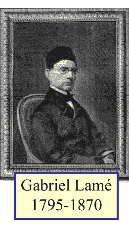

## 拉梅定理的证明

- 考虑欧几里得算法中使用的除法算法方程序列：
  $r_0 = r_1 q_1 + r_2$ 且 $0 \le r_2 < r_1$
  $r_1 = r_2 q_2 + r_3$ 且 $0 \le r_3 < r_2$
  ...
  $r_{n-2} = r_{n-1} q_{n-1} + r_n$ 且 $0 \le r_n < r_{n-1}$
  $r_{n-1} = r_n q_n + r_{n+1}$ 且 $r_{n+1} = 0$（终止）
- 除法（迭代）的次数为 $n$。

其中 $a = r_0$，$b = r_1$，且 $\gcd(a,b)=r_n$。

继续下一张幻灯片...


## Lamé 证明（续）

- 由于 $r_0 \ge r_1 > r_2 > \dots > r_n$，每个商 $q_i \equiv \lfloor r_{i-1}/r_i \rfloor \ge 1$。
- 由于 $r_{n-1} = r_n q_n$ 且 $r_{n-1} > r_n$，所以 $q_n \ge 2$。
- 因此我们有以下 $r$ 与 $f$ 之间的关系：
  $r_n \ge 1 = f_2$
  $r_{n-1} \ge 2r_n \ge 2f_2 = f_3$
  $r_{n-2} \ge r_{n-1} + r_n \ge f_2 + f_3 = f_4$
  ...
  $r_2 \ge r_3 + r_4 \ge f_{n-1} + f_{n-2} = f_n$
  $b = r_1 \ge r_2 + r_3 \ge f_n + f_{n-1} = f_{n+1}$.
- 因此，如果使用了 $n>2$ 次除法，则 $b \ge f_{n+1} > \alpha^{n-1}$。
  - 因此，$\log_{10} b > \log_{10}(\alpha^{n-1}) = (n-1)\log_{10} \alpha \approx (n-1)0.208 > (n-1)/5$。
  - 如果 $b$ 有 $k$ 位十进制数字，则 $\log_{10} b < k$，所以 $n-1 < 5k$，即 $n \le 5k$。

## 递归定义的集合

- 一个无限集合 S 可以通过递归方式定义，即给出：
  - S 的一个小的有限*基本*元素集合。
  - 一条从先前已确立的元素构造 S 的新元素的规则。
  - 隐含地，S 除这些元素外没有其他元素。
- **示例：** 设 3 ∈ S，并且若 x, y ∈ S，则 x + y ∈ S。那么 S 是什么？

## 所有字符串的集合

- 给定字母表 Σ，Σ 上所有字符串的集合 Σ* 可以通过递归定义如下：
  ε ∈ Σ*（ε := ""，即空字符串）
  w ∈ Σ* ∧ x ∈ Σ → wx ∈ Σ*

书中使用 λ

- **练习：** 证明该定义与我们之前的定义等价：Σ* := ⋃_{n∈N} Σ^n

## 其他简单的字符串示例

- 给出以下概念的递归定义：
  - 字符串 $w_1 \cdot w_2$ 的连接。
  - 字符串 $w$ 的长度 $\ell(w)$。
  - 涉及**T**、**F**、命题变量以及 {$\lnot$, $\land$, $\lor$, $\rightarrow$, $\leftrightarrow$} 中运算符的命题逻辑合式公式。
  - 涉及变量、数字以及 {$+$, $-$, $*$, $\uparrow$} 中运算符的算术合式公式。

## 有根树

- 树将在第 9 章中更深入地讨论。
  - 简而言之，树是一种图，其中每对节点之间恰好有一条无向路径。
  - 无向图可以表示为一组无序对（称为*弧*）的集合，这些弧连接的对象称为*节点*。
- 有根树集合的定义：
  - 任意单个节点 *r* 是一棵有根树。
  - 如果 *T₁, ..., Tₙ* 是分别以 *r₁, ..., rₙ* 为根的不相交的有根树，且 *r* 是不在任何 *Tᵢ* 中的节点，那么 {{*r,r₁*},...,{*r,rₙ*}} ∪ *T₁* ∪ ... ∪ *Tₙ* 也是一棵有根树。

## 说明有根树的定义

- 有根树如何组合成一棵新的有根树....

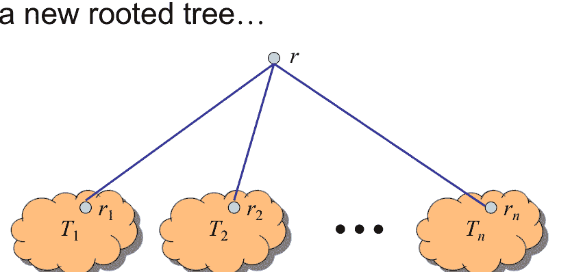

画一些例子...

## 扩展二叉树

- 有根树的一种特殊情况。
- 扩展二叉树（EBT）的递归定义：
  - 空集 ∅ 是一棵扩展二叉树。
  - 如果 T₁、T₂ 是不相交的扩展二叉树，则 e₁ ∪ e₂ ∪ T₁ ∪ T₂ 是一棵扩展二叉树，其中如果 T₁ = ∅，则 e₁ = ∅；如果 T₁ ≠ ∅ 且根为 r₁，则 e₁ = {(r, r₁)}；e₂ 类似定义。

画一些例子...

## 满二叉树

- 扩展二叉树的一种特殊情况。
- 满二叉树（FBT）的递归定义：
  - 单个节点 $r$ 是一棵满二叉树。
    - 注意这不同于扩展二叉树的基例。
  - 如果 $T_1, T_2$ 是不相交的满二叉树，则 $e_1 \cup e_2 \cup T_1 \cup T_2$ 是一棵满二叉树，其中如果 $T_1 = \varnothing$，则 $e_1 = \varnothing$；如果 $T_1 \neq \varnothing$ 且根为 $r_1$，则 $e_1 = \{(r,r_1)\}$；$e_2$ 类似定义。
    - 注意这与扩展二叉树的递归情况相同！
      - 可以简化为：“如果 $T_1, T_2$ 是分别以 $r_1$ 和 $r_2$ 为根的不相交的满二叉树，则 $\{(r, r_1),(r,r_2)\} \cup T_1 \cup T_2$ 是一棵满二叉树。”

画一些例子…

## 结构归纳法

- 使用归纳证明来证明关于递归定义对象的某个性质，其证明结构与该对象的定义结构相对应。
- **示例问题：** 设 3 ∈ S，并且若 x,y ∈ S，则 x+y ∈ S。证明 S = {n ∈ Z⁺ | (3|n)}（即 3 的正倍数集合）。


## 示例继续

- 设 3∈S，且若 x,y∈S 则 x+y∈S。设 A = {n∈Z⁺ | (3|n)}。
- **定理：** A=S。**证明：** 我们证明 A⊆S 且 S⊆A。
- 为证明 A⊆S，证明 [n∈Z⁺ ∧ (3|n)]→ n∈S。
- **归纳证明。** 设 P(n):≡ n∈S。对 3 的正倍数进行归纳。基础情形：n=3，因此 3∈S 由 S 的定义。归纳步骤：已知 P(n)，证明 P(n+3)。由归纳假设，n∈S，且 3∈S，所以由 S 的定义，n+3∈S。
- 为证明 S⊆A：设 n∈S，证明 n∈A。
- **结构归纳证明。** 设 P(n):≡n∈A。两种情况：n=3（基础情形），它在 A 中，或 n=x+y（递归步骤）。我们知道 x 和 y 是正数，因为没有任何规则会生成负数。所以，x<n 且 y<n，因此根据强归纳假设，我们知道 x 和 y 在 A 中。由于 3|x 且 3|y，我们有 3|(x+y)，因此 x+y ∈ A。

## 作业

- § 5.1 32, 44, 54
- § 5.2 4, 26
- § 5.3 20, 32, 38, 48

## 递归算法 (§ 5.4)

- 递归定义可用于描述 *算法* 以及函数和集合。
- 示例：计算 $a^n$ 的过程。

```
procedure power(a ≠ 0: real, n ∈ N)
if n = 0 then return 1
else return a · power(a, n-1)
```

## 递归算法的效率

- 递归算法的时间复杂度可能关键地取决于它所做的递归调用次数。
- **示例：** *模幂运算* 对 $n$ 次幂可在做对的情况下花费 log($n$) 时间，但若稍有不同则为线性时间。
  - 任务：计算 $b^n$ **mod** $m$，其中 $m\ge2$，$n\ge0$，且 $1\le b < m$。

## 模幂算法 #1

利用 $b^n = b \cdot b^{n-1}$ 以及 $x \cdot y \ \mathbf{mod}\ m = x \cdot (y \ \mathbf{mod}\ m) \ \mathbf{mod}\ m.$  
（在家证明后者定理。）

```
procedure mpower(b≥1, n≥0, m>b ∈ N)
{Returns $b^n$ mod $m$.}
if n=0 then return 1 else
return (b·mpower(b,n−1,m)) mod m
```

注意该算法花费 Θ(n) 步！

## 模幂算法 #2

- 利用 $b^{2k} = b^{k\cdot 2} = (b^{k})^{2}$。

```
procedure mpower(b,n,m) {same signature}
    if n=0 then return 1
    else if 2|n then
        return mpower(b,n/2,m)^2 mod m
    else return (mpower(b,n-1,m)·b) mod m
```

它的时间复杂度是多少？

Θ(log n) 步

## 一个轻微的变化

几乎相同但花费 Θ(n) 时间！

```
procedure mpower(b,n,m) {same signature}
    if n=0 then return 1
    else if 2|n then
        return (mpower(b,n/2,m)·mpower(b,n/2,m)) mod m
    else return (mpower(b,n−1,m)·b) mod m
```

所做的递归调用次数至关重要！

## 递归欧几里得算法

```
procedure gcd(a, b ∈ N)
  if a = 0 then return b
  else return gcd(b mod a, a)
```

- 注意递归算法通常比迭代算法更简单编码...
- 然而，如果你的编译器不够智能，它们可能会消耗更多栈空间。

## 递归线性搜索

- 注意这里使用递归而非简单地循环 *loc := i to j* 并没有真正的优势...

```
procedure search(a: series; i, j: integer; x: item to be found)
{Find x in series a at a location ≥i and <j}
if a_i = x return i {At the right item? Return it!}
if i = j return 0 {No locations in range? Failure!}
return search(i+1, j, x) {Try rest of range}
```

## 递归二分搜索

```
procedure binarySearch(a, x, i, j) {same sig}
{Find location of x in a, ≥i and <j}
m := ⌊(i + j)/2⌋        {Go to halfway point.}
if x = aₘ return m        {Did we luck out?}
if x<aₘ ∧ i<m return        {If it’s to the left,}
    binarySearch(a,x,i,m-1){Check that ½}
else if aₘ<x ∧ m<j return    {If it’s to right,}
    binarySearch(a,x,m+1,j){Check that ½}
else return 0        {No more items, failure.}
```

## 递归斐波那契算法

```
procedure fibonacci(n ∈ N)
  if n=0 return 0
  if n=1 return 1
  return fibonacci(n-1)+fibonacci(n-2)
```

- 这是一个高效的算法吗？
  - 它在 n 上是多项式时间的吗？
- 执行了多少次加法？


## Fibonacci 过程分析

- **定理：** 前述 *fibonacci(n)* 过程执行 $f_{n+1}-1$ 次加法运算。
  - **证明：** 基于该过程自身的递归定义，对 $n$ 进行强结构归纳。
  - **基础情形：** *fibonacci(0)* 执行 0 次加法，且 $f_{0+1}-1 = f_1 - 1 = 1 - 1 = 0$。同理，*fibonacci(1)* 执行 0 次加法，且 $f_{1+1}-1 = f_2-1 = 1-1 = 0$。
  - **归纳步骤：** 对于 $n>1$，根据强归纳假设，*fibonacci(n-1)* 和 *fibonacci(n-2)* 分别执行 $f_n-1$ 和 $f_{n-1}-1$ 次加法，而 *fibonacci(n)* 再多加 1 次，总计为 $f_n-1 + f_{n-1}-1 +1 = f_n + f_{n-1} -1 = f_{n+1}-1$。■

## 更高效的算法

```
procedure findFib(a,b,m,n)
{Given a=f_{m-1}, b=f_m, and m≤n, return f_n}
if m=n return b
return findFib(b, a+b, m+1, n)

procedure fastFib(n) {Find f_n in Θ(n) steps.}
if n=0 return 0
return findFib(0,1,1,n)
```

## 递归归并排序

```
procedure sort(L = ℓ₁, ..., ℓₙ)
  if n>1 then
    m := ⌊n/2⌋ {this is rough ½-way point}
    L := merge(sort(ℓ₁, ..., ℓₘ),
               sort(ℓₘ₊₁, ..., ℓₙ))
  return L
```

- 归并（下一张幻灯片）耗时 Θ(n)，归并排序耗时 Θ(n log n)。

## 递归归并方法

```
procedure merge(A,B: sorted lists)
{Given two sorted lists A=(a₁,...,a_|A|), B=(b₁,...,b_|B|), return a sorted list of all.}
if A = () return B  {If A is empty, it’s B.}
if B = () return A  {If B is empty, it’s A.}
if a₁<b₁ return (a₁,merge((a₂,...a_|A|),B))
return (b₁,merge(A,(b₂,...,b_|B|)))
```

## 归并例程

```
procedure merge(A, B: sorted lists)
    L = empty list
    i:=0, j:=0, k:=0
    while i<|A| ∧ j<|B|  {|A| is length of A}
        if i=|A| then L_k := B_j; j := j + 1
        else if j=|B| then L_k := A_i; i := i + 1
        else if A_i < B_j then L_k := A_i; i := i + 1
        else L_k := B_j; j := j + 1
        k := k+1
    return L
```

耗时 Θ(|A|+|B|)

## 验证程序正确性

Rosen 7th ed., § 5.5

## § 5.5: 程序正确性

- 我们希望能够 *证明* 给定的程序满足预期的规范。
  - 这通常可以手动完成，甚至可由 *自动化程序验证* 工具完成。
    - 一个例子是 PVS（People’s Verification System）。
  - 程序是 *正确* 的，如果它对每一种可能的输入都产生正确的输出。
    - 程序具有 *部分正确性*，如果它对程序最终会停机的每一种输入都产生正确的输出。

## 初始与最终断言

- 程序的输入/输出规范可以用 *初始* 和 *最终* 断言给出。
  - *初始断言* p 是程序输入（其初始状态）被其使用者保证满足的条件。
  - *最终断言* q 是程序产生的输出（其最终状态）需要满足的条件。
- *Hoare 三元组* 记法：
  - 记法 p{S}q 表示，对于所有满足 p(I) 为真的输入 I，如果程序 S 在给定输入 I 时停机并产生输出 O = S(I)，则 q(O) 为真。
    - 也就是说，S 相对于规范 p,q 是部分正确的。

## 一个平凡的例子

- 设 S 为程序片段 “y := 2; z := x+y”
- 设 p 为初始断言 “x = 1”。
  - 变量 x 在所有初始状态中都将为 1。
- 设 q 为最终断言 “z = 3”。
  - 变量 z 在所有最终状态中必须为 1。
- 证明 p{S}q。
  - 证明：如果程序输入状态中 x=1，则在执行 y:=2 和 z:=x+y 之后，z 将为 1+2=3。

## Hoare 三元组推理规则

- Hoare 三元组陈述的演绎规则。

- 一个简单例子：*组合规则：*  
  $p\{S_1\}q$  
  $q\{S_2\}r$  
  $\therefore\ p\{S_1;\ S_2\}r$

- **它说：** 如果程序 $S_1$ 在条件 $p$ 下产生条件 $q$，并且 $S_2$ 在 $q$ 下产生 $r$，那么程序 “$S_1$ 后跟 $S_2$”，如果给定 $p$，则会得到 $r$。


## if 语句的推理规则

(p ∧ cond){S}q
(p ∧ ¬cond)→q
∴ p{if cond then S}q

- 示例：证明：T {if x>y then y:=x} y≥x。

- 证明：如果初始时 x>y，则执行 if 体，将 y 设为 x，因此之后 y≥x 为真。否则，x≤y，因此 y≥x。在任何情况下 y≥x 都为真。所以该规则适用，因此该片段满足规范。

## if-then-else 规则

(p ∧ cond){S₁}q
(p ∧ ¬cond){S₂}q
∴ p{if cond then S₁ else S₂}q

示例：证明

T {if x<0 then abs:=-x else abs:=x} abs=|x|

- 如果 x<0，则在 if 体之后，abs 将为 |x|。如果 ¬(x<0)，即 x≥0，则在 else 体之后，abs=x，即为 |x|。所以该规则适用。

## 循环不变式

- 对于 while 循环 “**while** *cond S*”，我们说 *p* 是该循环的循环不变式，如果 (*p* ∧ *cond*){*S*}*p*。
  - 如果在执行体之前 *p*（以及继续条件 *cond*）为真，则之后 *p* 仍然为真。
    - 因此 *p* 在 *所有* 后续迭代中保持为真。
- 这导致推理规则：
  (*p* ∧ *cond*){*S*}*p*
  ∴ *p*{**while** *cond S*}(¬*cond* ∧ *p*)

## 循环不变式示例

证明以下 Hoare 三元组成立：
T {i:=1; fact:=1; while i<n {i++; fact*=i}}
(fact=n!)

证明。注意 p:≡“fact=i! ∧ i≤n” 是一个循环不变式，并且在循环之前为真。因此，在循环之后我们有 ¬cond∧p ⇔ ¬(i<n)∧ fact=i! ∧ i≤n ⇒ i=n ∧ fact=i! ⇒ fact=n!。

## 大示例

```
procedure multiply(m,n: integers)
if n<0 then a:=-n else a:=n
k:=0; x:=0
while k<a {
    x += m; k++
}
if n<0 then prod := -x else prod:=x
```

m,n∈Z

a=|n|

x = mk ∧ k≤a

维护循环不变式：
x = mk ∧ k≤a

x = mk ∧ k=a ∴ x = ma = m|n|

∴ (n<0 ∧ x=-mn) ∨ (n≥0 ∧ x=mn)

prod = mn

## 示例 5

```
FUNCTION SQ(A)
1.  C ← 0
2.  D ← 0
3.  WHILE (D ≠ A)
    a.  C ← C + A
    b.  D ← D + 1
4.  RETURN (C)
END OF FUNCTION SQ
```

- 函数的名称 SQ 表明它计算 A 的平方。
- 第 3b 步表明如果循环要结束，A 必须是正整数。
- 对 A 的特定值进行几次试验将提供证据表明该函数确实执行此任务。
- 然而，假设我们现在想要证明 SQ 总是计算正整数 A 的平方，无论 A 有多大。

- 对于每个整数 $n \ge 0$，令 $C_n$ 和 $D_n$ 分别为变量 C 和 D 在经过 WHILE 循环 n 次后的值。
- 特别地，$C_0$ 和 $D_0$ 表示循环开始前的变量值。
- 令 P($n$) 为谓词 $C_n = A \times D_n$。
- 我们将通过归纳法证明 $\forall\ n \ge 0$ P($n$) 为真。这里 n₀ 为 0。

- BS：P(0) 是陈述 $C_0 = A \times D_0$，这是正确的，因为在经过 WHILE 循环零次“之后”，C 和 D 的值都为零。
- IS：
  - 我们现在必须使用 P(k)：$C_k = A \times D_k$ (2) 来证明 P(k + 1)：$C_{k+1} = A \times D_{k+1}$。
  - 经过一次循环后，C 增加 A，D 增加 1，所以 $C_{k+1} = C_k + A$ 且 $D_{k+1} = D_k + 1$。

- P(k + 1) 的左边：

  $C_{k+1} = C_k + A$
  $= A \times D_k + A \quad \text{using (2) to replace $C_k$}$
  $= A \times (D_k + 1) \quad \text{factoring}$
  $= A \times D_{k+1} \quad \text{right-hand side of P(k+1)}$

- 根据数学归纳法原理，可以得出只要循环发生，$C_n = A \times D_n$。循环必须终止。（为什么？）

- 当循环终止时，$D = A$，所以 $C = A \times A$，即 $A^2$，并且这是函数 SQ 返回的值。

## 示例 6

```
FUNCTION GCD(X, Y)
1. WHILE (X ≠ Y)
   a. IF (X > Y) THEN
      1. X ← X − Y
   b. ELSE
      1. Y ← Y − X
2. RETURN (X)
END OF FUNCTION GCD
```

- 我们断言如果 X 和 Y 是正整数，则 GCD 返回 GCD(X, Y)。
- 为证明这一点，令 Xₙ 和 Yₙ 为 X 和 Y 在经过 WHILE 循环 n ≥ 0 次后的值。
- 我们断言 P(n)：GCD(Xₙ, Yₙ) = GCD(X, Y) 对所有 n ≥ 0 为真，并且我们通过数学归纳法证明这一点。


- 这里 n₀ 为 0。
- 基础步骤：X₀ = X，Y₀ = Y，因为这是循环开始前变量的值；因此 P(0) 是陈述 GCD(X₀, Y₀) = GCD(X, Y)，这是真的。
- 归纳步骤：假设 P(k) 为真。
  - 考虑 P(k + 1) 的左边，即 GCD(Xₖ₊₁, Yₖ₊₁)。在第 k + 1 次循环之后，要么 Xₖ₊₁ = Xₖ 且 Yₖ₊₁ = Yₖ - Xₖ，要么 Xₖ₊₁ = Xₖ - Yₖ 且 Yₖ₊₁ = Yₖ。

- 如果 P(k) 成立，则 GCD(Xₖ, Yₖ) = GCD(X, Y) 为真。
- 那么 GCD(Xₖ₊₁, Yₖ₊₁) = GCD(Xₖ, Yₖ) = GCD(X, Y)。
- 根据数学归纳法原理，P(n) 对所有 n ≥ 0 都成立。
- 循环的退出条件是 Xₙ = Yₙ，并且我们有 GCD(Xₙ, Yₙ) = Xₙ。
- 因此该函数总是返回 GCD(X, Y) 的值。

## 作业

- § 5.3 – 20, 32, 38, 48
- § 5.4 – 14, 46
- § 5.5 – 7

## 第331页 第54题

- 基础情况是 n=1。如果我们给定一个来自 {1,2} 的元素集合，那么确实其中一个能整除另一个。假设归纳假设成立，并考虑一个来自 {1,2,...,2n,2n+1,2n+2} 的包含 n+2 个元素的集合 A。我们必须证明这些元素中至少有一个能整除另一个。如果 A 中至多有 n+1 个元素小于 2n+1，那么所需结论直接从归纳假设得出。因此我们假设 2n+1 和 2n+2 都在 A 中，并且还有 n 个较小的元素。如果 n

## 组合学

Rosen 第7版，§§ 6.1-6.6，

## 6 计数

- 6.1 计数基础
- **6.2 鸽巢原理**
- 6.3 排列与组合
- 6.4 二项式系数
- **6.5 广义排列与组合**
- 6.6 生成排列与组合

## 组合学

- 研究将事物组合成各种组合方式的数量。
- *例如* 在一个有100人参加的竞赛中，
  - 可能有多少种不同的前十名结果？
- *例如* 如果密码是6-8个字母和/或数字，
  - 可能有多少种密码？

## 和规则与积规则（§ 6.1）

- 设 *m* 为完成任务1的方法数，*n* 为完成任务2的方法数，
  - 每种方法的数目与另一项任务的完成方式无关，
  - 并且还假设没有任何一种完成任务1的方式能同时完成任务2。
- 于是，我们有以下规则：
  - *和规则*：“完成任务1或任务2，但不同时完成”的任务可以有 *m+n* 种方式。
  - *积规则*：“同时完成任务1和任务2”的任务可以有 *mn* 种方式。

## 集合论表述

- 如果 *A* 是完成任务1的方式集合，*B* 是完成任务2的方式集合，并且 *A* 和 *B* 不相交，那么：
  - 完成任务1或任务2的方式是 *A*∪*B*，且 |*A*∪*B*|=|*A*|+|*B*|
  - 同时完成任务1和任务2的方式可以表示为 *A*×*B*，且 |*A*×*B*|=|*A*|·|*B*|

## 示例 1、2

- 一家新公司只有两名员工，Sanchez 和 Patel，租了一栋大楼的一层，该层有12间办公室。将不同的办公室分配给这两名员工有多少种方法？
- 礼堂的椅子要用一个大写英文字母后跟一个不超过100的正整数来标记。最多可以标记多少把不同的椅子？

## 示例 6、7

- 计数函数：
- 从一个有 *m* 个元素的集合到一个有 *n* 个元素的集合有多少个函数？
- 计数一对一函数：
- 从一个有 *m* 个元素的集合到一个有 *n* 个元素的集合有多少个一对一函数？
- NYX 86 010 6228 3324 京P CA129 车牌

## IP地址示例

关于互联网协议第4版的一些事实：

- 有效的计算机地址属于以下3种类型之一：
  - A类IP地址包含一个7位的“网络号”≠ 1?，以及一个24位的“主机号”
  - B类地址包含一个14位的网络号和一个16位的主机号。
  - C类地址包含一个21位的网络号和一个8位的主机号。
- 这3类有不同的头部（0, 10, 110）
- 主机号全为0或全为1是不允许的。

有多少个有效的计算机地址？

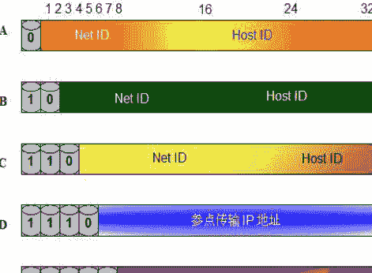

例如，bupt.edu 是 123.127.134.30


## IP 地址解决方案

- (# addrs)
  = (# class A) + (# class B) + (# class C)
  (by sum rule)
- # class A = (# valid netids)·(# valid hostids)
  (by product rule)
- (# valid class A netids) = 2⁷ − 1 = 127.
- (# valid class A hostids) = 2²⁴ − 2 = 16,777,214.
- Continuing in this fashion we find the answer is:
  3,737,091,842 (3.7 billion IP addresses)

## 容斥原理
( § § 8.5 )

- Suppose that *k ≤ m* of the ways of doing task 1 also simultaneously accomplish task 2.
  - And thus are also ways of doing task 2.
- Then, the number of ways to accomplish “Do either task 1 or task 2” is *m + n − k*.
- Set theory: If *A* and *B* are not disjoint, then |*A* ∪ *B*| = |*A*| + |*B*| − |*A* ∩ *B*|.
  - If they are disjoint, this simplifies to |*A*| + |*B*|.

## 容斥示例

- Some hypothetical rules for passwords:
  - Passwords must be 2 characters long.
  - Each character must be a letter a-z, a digit 0-9, or one of the 10 punctuation characters !@#$%^&*().
  - Each password must contain at least 1 digit or punctuation character.

## 问题设定

- A legal password has a digit or punctuation character in position 1 or position 2.
  - These cases overlap, so the principle applies.
- (# of passwords w. OK symbol in position #1) = (10+10)·(10+10+26)
- (# w. OK sym. in pos. #2): also 20·46
- (# w. OK sym both places): 20·20
- Answer: 920+920−400 = 1,440

## 除法规则

- There are *n/d* ways to do a task if it can be done using a procedure that can be carried out in *n* ways, and for every way *w*, exactly *d* of the *n* ways correspond to way w.

## Example

- How many different ways are there to seat four people around a circular table, where two seatings are considered the same when each person has the same left neighbor and the same right neighbor?

- Solution: We arbitrarily select a seat at the table and label it seat 1. We number the rest of the seats in numerical order, proceeding clockwise around the table. Note that are four ways to select the person for seat 1, three ways to select the person for seat 2, two ways to select the person for seat 3, and one way to select the person for seat 4. Thus, there are 4! = 24 ways to order the given four people for these seats.

- However, each of the four choices for seat 1 leads to the same arrangement, as we distinguish two arrangements only when one of the people has a different immediate left or immediate right neighbor. Because there are four ways to choose the person for seat 1, by the division rule there are 24/4 = 6 different seating arrangements of four people around the circular table.

## 鸽巢原理 ( § 6.2 )

- A.k.a. the “Dirichlet drawer principle”
- If ≥k+1 objects are assigned to k places, then at least 1 place must be assigned ≥2 objects.
- In terms of the assignment function:
  - If f:A→B and |A|≥|B|+1, then some element of B has ≥2 preimages under f.
    - I.e., f is not one-to-one.

## 鸽巢原理示例

- There are 101 possible numeric grades (0%-100%) rounded to the nearest integer.
  - Also, there are >101 students in this class.
- Therefore, there must be at least one (rounded) grade that will be shared by at least 2 students at the end of the semester.
  - I.e., the function from students to rounded grades is *not* a one-to-one function.

## 有趣的鸽巢证明 (Ex. 4, p.401)

- **Theorem:** ∀n∈N, ∃ a multiple m>0 of n ∃ m has only 0’s and 1’s in its decimal expansion!
- **Proof:** Consider the n+1 decimal integers 1, 11, 111, ..., 1⋯1. They have only n possible residues mod n. So, take the difference of two that have the same residue. The result is the answer! □

## 一个具体案例

- Let $n=3$. Consider 1, 11, 111, 1111.
  - 1 mod 3 = 1
  - 11 mod 3 = 2
  - 111 mod 3 = 0 ← Lucky extra solution.
  - 1,111 mod 3 = 1
- 1,111 − 1 = 1,110 = 3·370.
  - It has only 0’s and 1’s in its expansion.
  - Its residue mod 3 = 0, so it’s a multiple of 3.

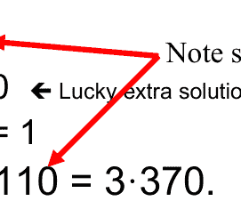


## 另一个有趣的例子

- 假设明年六月，马林鱼棒球队每天至少打 1 场比赛，但总共 ≤45 场。证明在六月一定存在一段连续的天数，他们恰好打了 *exactly* 14 场比赛。
  - **证明：** 设 $a_j$ 为在第 $j$ 天及之前打的比赛场数。则，$a_1, ..., a_{30} \in \mathbf{Z}^+$ 是一个由 30 个不同的整数组成的序列，且 $1 \le a_j \le 45$。因此 $a_1+14, ..., a_{30}+14$ 是一个由 30 个不同的整数组成的序列，且 $15 \le a_j+14 \le 59$。于是，$(a_1, ..., a_{30}, a_1+14, ..., a_{30}+14)$ 是从集合 $\{1,..,59\}$ 中取出的 60 个整数序列。根据鸽笼原理，其中两个必须相等，但 $a_i \neq a_j$ 对于 $i \neq j$。所以，$\exists i j: a_i = a_j+14$。于是，在第 $a_j+1, ..., a_i$ 天打了 14 场比赛。

## 棒球问题图解

- {a_i} 的例子：注意所有元素都是不同的。
  - 1, 2, 4, 5, 7, 8, 10, 11, 13, 14, 16, 17, 19, 21, 22, 23, 25, 27, 29, 30, 31, 33, 34, 36, 37, 39, 40, 41, 43, 45
  - 那么 {a_i+14} 是以下序列
    15, 16, 18, 19, 21, 22, 24, 25, 27, 28, 30, 32, 33, 35, 36, 37, 39, 41, 43, 44, 45, 47, 48, 50, 51, 53, 54, 55, 57, 59

- 在 1-59 中的任意 60 个整数中一定存在重复，确实我们找到了以下这些：
  - 16, 19, 21, 22, 25, 27, 30, 33, 36, 37, 39, 41, 43, 45

> 因此，例如，第 3 天到第 11 天恰好打了 14 场比赛：
> 2+1+2+1+2+1+2+1+2

## 广义鸽笼原理

- 如果 *N* 个物体被分配到 *k* 个位置，则至少有一个位置必须被分配至少 ⌈*N/k*⌉ 个物体。
- *例如*，本班有 *N*=280 名学生。一年有 *k*=52 周。
  - 因此，一定存在至少 1 周，在该周内至少有 ⌈280/52⌉=⌈5.38⌉=6 名学生生日。

## G.P.P. 的证明

- 反证法。假设每个位置都有 < ⌈N/k⌉ 个物体，因此 ≤ ⌈N/k⌉−1。
- 那么物体的总数最多为
  $$k\left(\left\lceil\frac{N}{k}\right\rceil-1\right)<k\left(\left(\frac{N}{k}+1\right)-1\right)=k\left(\frac{N}{k}\right)=N$$
- 所以，物体少于 N 个，这与我们假设有 N 个物体的前提矛盾！□

## G.P.P. 例子

- 已知：班级里有 280 名学生。
  - 在不知道任何人的生日的情况下，使用 G.P.P. 能证明的、至少有 $n$ 名学生出生在同一月份的最大值 $n$ 是多少？
- 答案：

⌈280/12⌉ = ⌈23.3⌉ = 24

## 例 7

- A) 必须从一副标准的 52 张牌中选出多少张牌才能保证至少选出三张同花色的牌？
- B) 必须选出多少张才能保证至少选出三张红心？

## 一些优雅的应用

- 例.11 证明在不超过 2n 的任意 n+1 个正整数中，一定存在一个整数能整除其中另一个整数。
- 例 13 假设在一个六人小组中，每一对人都互为朋友或互为敌人。证明该小组中要么有三个相互为朋友，要么有三个相互为敌人。
- Ramsy number

## 定理 3

- 任意 n²+1 个不同的实数序列都包含一个长度为 n+1 的子序列，该子序列要么严格递增，要么严格递减。
- 8, 11, 9, 1, 4 ,6, 12, 10, 5, 7
- 1 4 6 10

## 排列 ( § 6.3 )

- 一个集合 $S$ 的 *permutation* 是包含 $S$ 中每个对象恰好一次的序列。
  - 将 $S$ 的 $r$ 个不同元素进行有序排列称为 $S$ 的 $r$-permutation。
- 一个含有 $n=|S|$ 个元素的集合的 $r$-permutations 的数量为
  $P(n,r) = n(n-1)...(n-r+1) = n!/(n-r)!$

## 排列例子

- 一名恐怖分子在你的城市里安装了一枚武装核弹，而你的任务是通过剪断触发装置的电线来使其失效。装置上有 10 根电线。如果你剪断恰好正确的三根电线，并且顺序也完全正确，你就能使炸弹失效，否则它就会爆炸！如果所有电线看起来都一样，你存活的几率是多少？

P(10,3) = 10·9·8 = 720，所以你存活的几率是 720 分之 1！


## 组合（§ 6.3）

- *r*-组合是指集合 *S* 的一个子集 *T* ⊆ *S*，其成员数为 *r*，|*T*| = *r*。
- 一个包含 *n* = |*S*| 个元素的集合的 *r*-组合数是
  $C(n, r) = \binom{n}{r} = \frac{P(n, r)}{P(r, r)} = \frac{n!/(n-r)!}{r!} = \frac{n!}{r!(n-r)!}$
- 注意 $C(n, r) = C(n, n-r)$
  - 因为选择 *T* 的 *r* 个成员与选择 *T* 的 *n-r* 个非成员是同一件事。

## 组合示例

- 从一副标准的 52 张牌中可以抽出多少种不同的 7 张牌手牌？
  - 手牌中牌的顺序无关紧要。
- 答案 C(52,7) = P(52,7)/P(7,7)
  = 52·51·50·49·48·47·46 / 7·6·5·4·3·2·1
  17 10 7 8 2
  52·17·10·7·47·46 = 133,784,560

## 示例 14

- 长度为 n 且恰好有 r 个 1 的二进制字符串有多少个？
- C(n,r)

## 示例 15

- 假设数学系有 9 名教职员工，计算机科学系有 11 名。如何选择一个委员会来开发学校的离散数学课程，如果委员会由数学系的三名教职员工和计算机科学系的四名教职员工组成？

## 跳过部分章节

- Rosen 6ᵗʰ edition...
- § 4.4，二项式系数
  - 在代数中很有用... C(n,r) 出现在 (a+b)ⁿ 等多项式的项系数中。
  - 帕斯卡恒等式和范德蒙恒等式。
- § 4.6，生成排列与组合

## 二项式系数

- 目标：尝试找到二项式表达式幂的展开系数的，e.g., $(x+y)^n$，而不实际将表达式展开为和的乘法。

## 二项式系数

- 二项式定理：$(x + y)^n = \sum_{j=0}^{n} \binom{n}{j} x^{n-j} y^{j}$
- 例 1：(x+y)⁴ 的展开式是什么？
- 例 2：(x+y)²⁵ 展开式中 x¹²y¹³ 的系数是多少？
- 例 3：(2x-3y)²⁵ 展开式中 x¹²y¹³ 的系数是多少？

## 二项式系数

- 推论 1：
  $$\sum_{k=0}^{n} \binom{n}{k} = 2^{n}$$
- 推论 2：
  $$\sum_{k=0}^{n} (-1)^{k} \binom{n}{k} = 0$$
- 推论 3：
  $$\sum_{k=0}^{n} 2^{k} \binom{n}{k} = 3^{n}$$

## 帕斯卡恒等式和三角形

- 帕斯卡恒等式：设 n>0, k>0, n≥k

```
\binom{n+1}{k}=\binom{n}{k-1}+\binom{n}{k}
```

- 帕斯卡三角形：(参考书籍)

## 6.5 广义排列与组合

- 处理元素可重复使用时的计数问题。→ 允许重复的排列/组合问题。
- 处理某些元素不可区分时的计数问题。→ 不可区分对象的排列问题。

## 允许重复的排列

- 定理 1：允许重复时，一个包含 n 个对象的集合的 $r$-排列数为 $n^r$。
- 例 1：可以用英语字母形成多少个长度为 $n$ 的字符串？
- 答案：$26^n$

## 允许重复的组合

- 定理 2：当允许元素重复时，从一个包含 n 个元素的集合中取 r-组合的数量为 C(n+r-1, r)。
- 例 1：从一个装有苹果、橙子和梨的碗中选择四块水果有多少种方法？如果选择的顺序无关紧要，只考虑水果类型而不考虑单个水果，且碗中每种水果至少有四块？
- 答案：r = 4, n = 3 → = C(3+4-1, 4) = C(6, 4) = 15

## 允许重复的组合

- 例 2：从一个装有 $1 美元、$2 美元、$5 美元、$10 美元、$20 美元、$50 美元和 $100 美元钞票的钱箱中选择五张钞票有多少种方法？假设选择的顺序无关紧要，每种面额的钞票不可区分，且每种类型至少有五张。
- 答案：r = 5, n = 7 → = C(7+5-1, 5) = C(11, 5) = 462


## 示例 5

- 方程 \(X_1 + X_2 + X_3 = 11\) 有多少个解，其中 \(X_1, X_2\) 和 \(X_3\) 为非负整数？

## 示例 6

执行以下伪代码后 \(k\) 的值是多少？

```text
k := 0
for i₁ := 1 to n
    for i₂ := 1 to i₁
        .
        .
        for iₘ := 1 to iₘ₋₁
            k := k + 1
```

## 有放回和无放回的组合与排列

| 类型 | 允许重复？ | 公式 |
|---|---|---|
| \(r\)-排列 | 否 | \(\frac{n!}{(n-r)!}\) |
| \(r\)-组合 | 否 | \(\frac{n!}{r!(n-r)!}\) |
| \(r\)-排列 | 是 | \(n^r\) |
| \(r\)-组合 | 是 | \(\frac{(n+r-1)!}{r!(n-1)!}\) |

## 可区分对象的排列

- **定理 3：** \(n\) 个元素的不同排列数，其中有 \(n_1\) 个不可区分的 1 类对象，\(n_2\) 个不可区分的 2 类对象，...，\(n_k\) 个不可区分的 \(k\) 类对象，为

\[
\frac{n!}{n_1! n_2! \cdots n_k!}
\]

- **示例：** 通过重新排列单词 SUCCESS 的字母可以组成多少个不同的字符串？
- **答案：** \(n = 7\)，\(n_1\)（#Ss）= 3，\(n_2\)（#Cs）= 2，\(n_3\)（#Us）= 1，\(n_4\)（#Es）= 1：

\[
\frac{n!}{n_1! n_2! n_3! n_4!} = \frac{7!}{3!2!1!1!} = 420
\]

## 将对象分配到盒子中

- **定理 4：** 将 \(n\) 个可区分对象分配到 \(k\) 个可区分盒子中，使得 \(n_i\) 个对象放入第 \(i\) 个盒子，\(i = 1, 2, ..., k\) 的方法数等于

\[
\frac{n!}{n_1!\, n_2! \cdots n_k!}
\]

- **示例：** 从一副标准的 52 张牌中，给每位四名玩家各发 5 张牌，有多少种方法？
- **答案：** \(n = 52\)，\(k = 5\)：

\[
\frac{52!}{5!5!5!5!32!}
\]

- 4 名玩家，每人 5 张牌；其余 \((52-20)\) 张牌。

## 不可区分对象和可区分盒子

- 有多少种方法可以将 10 个不可区分的球放入八个可区分的箱子中？
- 这意味着将 \(r\) 个不可区分对象放入 \(n\) 个可区分盒子中的方法数为 \(\binom{n+r-1}{n-1}\)。

## 可区分对象和不可区分盒子

- 有多少种方法可以将四名不同的员工放入三个不可区分的办公室中，每个办公室可以容纳任意数量的员工？
- 我们可以将四名员工全部放入一个办公室，有且只有一种方法，表示为 {{A,B,C,D}}。
- 我们可以将三名员工放入一个办公室，第四名员工放入另一个办公室，有且只有四种方法，表示为 {{A,B,C}, {D}}, {{A,B,D}, {C}}, {{A,C,D}, {B}}, 和 {{B,C,D}, {A}}。
- 我们可以将两名员工放入一个办公室，两名放入第二个办公室，有且只有三种方法，表示为 {{A,B}, {C,D}}, {{A,C}, {B,D}}, 和 {{A,D}, {B,C}}。
- 最后，我们可以将两名员工放入一个办公室，其余两个办公室各一名，有六种方法，表示为 {{A,B}, {C}, {D}}, {{A,C}, {B}, {D}}, {{A,D}, {B}, {C}}, {{B,C}, {A}, {D}}, {{B,D}, {A}, {C}}, 和 {{C,D}, {A}, {B}}。

## 不可区分对象和不可区分盒子

- 有多少种方法可以将六本相同的书装入四个相同的盒子中，其中一个盒子最多可容纳六本书？

6; 5,1; 4,2; 4,1,1; 3,3; 3,2,1; 3,1,1,1; 2,2,2; 2,2,1,1

- 九种方法。

## §6.6 生成排列和组合

- 我们将介绍以下算法：
  - 按字典序生成下一个最大排列。
  - 生成下一个最大位串。
    - 记住，位串可以表示一个组合。
  - 按字典序生成下一个 \(r\)-组合。
- 我们还将给出生成排列、组合和 \(r\)-组合的递归算法。

## 生成所有排列

```text
procedure genAllPerms(n > 0: integer)
{output all permutations of the integers 1,...,n, in order from smallest to largest}
for i := 1 to n begin
    used_i := F
end
{none of the integers have been used yet}
recursiveGenPerms(1, n)
```

recursiveGenPerms 过程在下一张幻灯片...


## 递归排列生成器

```
procedure recursiveGenPerms(i,n)
    if i>n then begin {We’re done, print the answer.}
        for k := 1 to n print perm_k ; print newline
    end else
        for j := 1 to n {Consider all poss. next items.}
            if ¬used_j then begin {Choose item j.}
                used_j := T; perm_i := j
                recursiveGenPerms(i+1,n)
                used_j := F      {Now back up}
            end
```

## 按顺序生成下一个排列

- 给定 $\{1,\dots,n\}$ 的一个现有排列 $a_1,\dots,a_n$，我们如何找到*下一个*排列？
- 过程概要：
  - 找到最大的 $j$，使得 $a_j < a_{j+1}$。
  - 在 $a_{j+1},\dots,a_n$ 中找到大于 $a_j$ 的最小整数，并将其放在位置 $j$。
  - 将 $a_j,\dots,a_n$ 中剩余的整数按从小到大排序，并把它们放到位置 $j+1$ 到 $n$。

## 下一个排列算法

```
procedure nextPerm(a₁,...,aₙ: perm. {1,...,n})
  j:=n−1; while aⱼ>aⱼ₊₁ and j>0 do j:=j−1
  if j=0 then return {no more permutations}
  k:=n; while aⱼ > aₖ do k:=k−1
  swap(aⱼ, aₖ); r:=n; s:=j+1
  while r>s do begin
    swap(aᵣ,aₛ); r:=r−1; s:=s+1 end
```

## 组合生成器

- 假设我们想生成集合 {1, ..., n} 的所有组合。
- 或者其他任何包含 n 个元素的集合。
- 组合就是子集。
- 并且，一个有 n 个元素的集合的子集可以用长度为 n 的位串来指定。
  - 每一位表示该元素是否在子集中。
- 因此，我们可以通过枚举所有长度为 n 的位串来枚举所有组合。

## 递归位串枚举器

```
procedure recEnumBitStrings(soFar,n)
{enumerate all strings consisting of soFar concatenated with a bit-string of length n}
if n=0 then begin print soFar; return end
enumBitStrings(soFar·‘0’, n−1)
enumBitStrings(soFar·‘1’, n−1)
procedure enumBitStrings(n∈N)
recEnumBitStrings(ε, n) {soFar=empty str}
```

## 生成下一个位串

请注意，这本质上只是一个二进制增量（“加 1”）操作。

```
procedure nextBitString(bₙ₋₁…b₀: bit string)
  i := 0;                     {start at right end of string}
  while bᵢ = 1 and i < n begin    {trailing 1s}
    bᵢ := 0; i := i + 1 end       {change to 0s}
  if i = n then return “no more” else begin
    bᵢ = 1; return bₙ₋₁…b₀ end   {chg. 0→1}
```

## 生成 $r$-组合

- 我们如何列出集合 $\{1, ..., n\}$ 的所有 $r$-组合？
- 由于组合中元素的顺序无关紧要，我们总可以按从小到大的顺序列出它们。
- 因此，我们可以先枚举可能的最小元素，然后对每一个最小元素枚举可能的下一个最小元素，以此类推。

## 递归 r-组合生成器

```
procedure recEnumRCombs(min,j,r,n)
    if j>n then print comb₁,...,combₙ; return
    for i:=min to n−r+1 begin
        combⱼ = i
        recEnumRCombs(i+1, j+1, r−1, n)
    end
```

## 生成下一个 $r$-组合

```
procedure nextRComb({a₁,...,aᵣ}⊂{1,...,n}
                 with aᵢ < aᵢ₊₁)
{Find the last item that can be inc’d}
i := r; while aᵢ = n - r + i do i := i - 1
aᵢ := aᵢ + 1                 {Increment it}
for j := i + 1 to r           {Set remaining items}
    aⱼ := aⱼ + j - i           {to the subsequent #’s}
return {a₁,...,aᵣ}
```

## 中文课件

- 4、计数原理/计数
- 4.1 基本计数原理
- 计数基础
- 4.2 包含与排斥原理
- 容斥原理
- 4.3 鸽洞原理（鸽巢原理）

- 求和规则/和规则
- 如果第一项任务有 n 种完成方式，第二项任务有 m 种完成方式，并且这两项任务不能同时进行，那么完成其中任一任务共有 n+m 种方式。
- $|A₁ ∪ A₂| = |A₁| + |A₂|$ 其中 $A₁ ∩ A₂ = ∅$

## 示例 1

- 例3 单循环程序

- 求和规则的推广
- $|A_1 ∪ A_2 ∪ ... ∪ A_n| = |A_1| + |A_2| + ... + |A_n|$
- 其中 $A_i ∩ A_j = ∅$
- $i ≠ j$, $i,j = 1,2,...,n$


<!-- no content -->


## 二项式系数与二项式定理

**定理4：** 对任意正整数 \(n\)，
\[
\sum_{k=0}^{n} C(n,k)=2^n
\]

**定理4证明思路：**

利用 \(|A|=n\) 时，\(|\mathcal{P}(A)|=2^n\)。

**定理5（Vandermonde 公式）：** 对任意非负整数 \(m,n,r\ (r\le m+n)\)，
\[
C(m+n,r)=\sum_{k=0}^{r} C(m,r-k)C(n,k)
\]

**定理5证明思路：** 两类不同物体中选择 \(r\) 个的方式数。

**定理6（Binomial Theorem / 二项式定理）：** 对任意正整数 \(n\) 和变量 \(x,y\)，
\[
(x+y)^n=\sum_{j=0}^{n} C(n,j)x^{n-j}y^{j}
\]

**例3：** 求 \((x+y)^{25}\) 中 \(x^{12}y^{13}\) 的系数。

**例4：** 求 \((2x-3y)^{25}\) 中 \(x^{12}y^{13}\) 的系数。

**二项式定理推论：**

1. \(\displaystyle\sum_{k=0}^{n} C(n,k)=2^n\)
2. \(\displaystyle\sum_{k=0}^{n} (-1)^k C(n,k)=0\)

## 排列与组合的推广

**定义3：** \(n\) 个不同元素的集合 \(A\)，每个元素可重复选取，则从 \(A\) 中任意选择 \(r\) 个（\(r\le n\)）进行排列称为 \(A\) 的一个 \(r\)-可重排列 / \(r\)-Permutation with repetition。

**定理7：** \(n\) 个不同元素的集合 \(A\)，每个元素可重复选取，则 \(A\) 的 \(r\)-可重排列总数为 \(n^r\)。

**定义4：** 设 \(k\) 个不同元素的重集 \(A\)，其中每个元素的重数分别为 \(n_1,n_2,\ldots,n_k\)，\(n_1+n_2+\cdots+n_k=n\)。则 \(A\) 中 \(n\) 个元素进行的一个排列称为 \(A\) 的一个 \(n\)-限重排列。

**定理8：** \(A\) 的 \(n\)-限重排列总数为
\[
\frac{n!}{n_1!\,n_2!\cdots n_k!}
\]

**定义5：** \(n\) 个元素的集合 \(A\) 中任意选择 \(r\) 个（\(r\le n\)）进行排列且头尾相连，称为 \(A\) 的一个 \(r\)-循环排列 / \(r\)-圆排列 / \(r\)-Circle Permutation。

**定理9：** \(n\) 个元素的集合 \(A\) 的 \(r\)-循环排列数为
\[
\frac{P(n,r)}{r}
\]

**定义6：** \(n\) 个不同元素的集合 \(A\)，每个元素可重复选取，则从 \(A\) 中任意选择 \(r\) 个（\(r\le n\)）的方式称为 \(A\) 的一个 \(r\)-可重复组合 / \(r\)-Combination with repetition。

**定理10：** \(n\) 个不同元素的集合 \(A\)，每个元素可重复选取，则 \(A\) 的 \(r\)-可重复组合总数为
\[
C(n-1+r,\ r)
\]

## 5、计数原理 / Counting

### 5.5 排列与组合的生成

Generating Permutations and Combinations

在实际应用中，往往不仅需要计数，而且要把各种情况都枚举出来。

### 一、字典序排列 / lexicographic ordering for permutation

**定义：**

- 顺序：排列 \(a_1,a_2,\ldots,a_n\) 中相邻两数 \(a_i<a_{i+1}\)，称为一个顺序。
- 逆序：排列 \(a_1,a_2,\ldots,a_n\) 中相邻两数 \(a_i>a_{i+1}\)，称为一个逆序。

**例：** 排列 \(1\;3\;2\;6\;5\;4\)。顺序：\(1\;3\)、\(2\;6\)；逆序：\(3\;2\)、\(6\;5\)、\(5\;4\)。

对 \(n\) 个对象进行全排列，有 \(n!\) 个排列，可以对 \(n\) 个对象加上标记。

不失一般性，我们只需对 \(n\) 个自然数 \(\{1,2,\ldots,n\}\) 进行全排列，枚举出所有的情况。

### 字典序排列算法

1. 给出初始排列：\(p_1=1,2,3,4,\ldots,n\)。
2. 若 \(p_k\) 已定义（\(1\le k\le n!-1\)），\(p_k=a_1,a_2,\ldots,a_m,\ldots,a_n\)，则按下列规定定义 \(p_k\) 的下一个排列 \(p_{k+1}=b_1,b_2,\ldots,b_m,\ldots,b_n\)：
   （1）寻找 \(a_m\)：\(m=\max\{j \mid a_j<a_{j+1}\}\)，即 \(a_m,a_{m+1}\) 是最右面的顺序，自 \(a_{m+1}\) 开始均为逆序。
   （2）给出 \(b_i\)（\(i=1,2,\ldots,n\)）：
   - a）第 \(m\) 项之前的项不变：\(b_1=a_1,b_2=a_2,\ldots,b_{m-1}=a_{m-1}\)。
   - b）\(b_m=\min\{a_p \mid a_p>a_m,\ p>m\}\)，即在 \(a_m\) 右面大于 \(a_m\) 的项中选取最小的项作为 \(b_m\)。
   - c）把 \(a_m,a_{m+1},\ldots,a_{p-1},a_{p+1},\ldots,a_n\) 从小到大排列，送入 \(b_{m+1},b_{m+2},\ldots,b_n\)。

**例1：** 设有 \(n=6\) 个数字的排列 \(a_1,a_2,\ldots,a_6\) 为 \(1,2,4,6,5,3\)，求它的下一个排列。

**解：**

1. 求 \(m\)：\(4,6\) 是最右的顺序，\(a_m=4\)，\(m=3\)。
2. 定义 \(b_i\)：\(b_1=1,\ b_2=2\)，在 \(a_m\) 右边还有 \(6,5,3\)，其中 \(6\) 和 \(5\) 大于 \(a_m=4\)，\(5\) 是最小的，\(b_3=5\)。
3. 余下 \(a_3=4,\ a_4=6,\ a_6=3\)，从小到大排起来为 \(3,4,6\)，即让 \(b_4=3,\ b_5=4,\ b_6=6\)。

得到 \(1,2,4,6,5,3\) 的下一个排列：\(1,2,5,3,4,6\)。

**例2：** 求 \(n=4\) 时 \(\{1,2,3,4\}\) 的所有排列。

**解：**

```text
1234 → 1243 → 1324 → 1342 → 1423 → 1432
2134 → 2143 → 2314 → 2341 → 2413 → 2431
3124 → 3142 → 3214 → 3241 → 3412 → 3421
4123 → 4132 → 4213 → 4231 → 4312 → 4321
```

**按顺序全部写出 \(1,2,3,4,5\) 的不同排列：**

```text
12345 12354 12435 12453 12534 12543 13245 13254 13425 13452 13524 13542 14235 14253 14325 14352 14523 14532 15234 15243 15324 15342 15423 15432
21345 21354 21435 21453 21534 21543 23145 23154 23415 23451 23514 23541 24135 24153 24315 24351 24513 24531 25134 25143 25314 25341 25413 25431
31245 31254 31425 31452 31524 31542 32145 32154 32415 32451 32514 32541 34125 34152 34215 34251 34512 34521 35124 35142 35214 35241 35412 35421
41235 41253 41325 41352 41523 41532 42135 42153 42315 42351 42513 42531 43125 43152 43215 43251 43512 43521 45123 45132 45213 45231 45312 45321
51234 51243 51324 51342 51423 51432 52134 52143 52314 52341 52413 52431 53124 53142 53214 53241 53412 53421 54123 54132 54213 54231 54312 54321
```

总共 120 种。

**注：** 例2中开始的排列与结束时的排列的特征，可用数学归纳法证明，对任意 \(n\) 个数用此算法都能枚举出所有的排列。

**定理一：** 用字典序排序方法可由 \(1,2,3,\ldots,n\) 的第一个排列 \(1,2,\ldots,n\)（全顺序）开始，得到 \(n!\) 个排列，且最后一个排列是 \(n,n-1,\ldots,2,1\)（全逆序）。

### 二、字典序组合 / lexicographic ordering for combination

对任意 \(n\) 个对象，求取其中 \(k\) 个对象组合的所有组合。

不失一般性，只要讨论求 \(\{1,2,\ldots,n\}\) 的所有 \(k\) 子集，共 \(C_n^k\) 个。

### 字典序组合算法

1. \(S_1=\{1,2,\ldots,k\}\)。
2. 若 \(S_i=\{a_1,a_2,\ldots,a_k\}\) 已得到（\(1\le i\le C_n^k-1\)），则构造下一个子集 \(S_{i+1}=\{b_1,b_2,\ldots,b_k\}\)：
   （1）\(m=\max\{j \mid a_j\ne n-(k-j)\}\)，即 \(\{a_1,a_2,\ldots,a_j,\ldots,a_k\}\) 与 \(\{n-k+1,n-k+2,\ldots,n-k+j,\ldots,n-1,n\}\) 比较，从右边开始比较，第一个不相等的项为 \(a_m\)。


## (2) 构造 S_{i+1}

- a） b₁ = a₁， b₂ = a₂， ...， b_{m-1} = a_{m-1}
- b） b_m = a_m +1
- c） b_{m+1} = b_m +1， b_{m+2} = b_{m+1} + 1， ...， b_k = b_{k-1} + 1

注：

不用担心 b_k 会取到大于 n 的数

例：

n = 10，k = 7。若 m = 5，则
（a₁，a₂，a₃，a₄，a₅，a₆，a₇）
与（4，5，6，7，8，9，10）比较
由于 m = 5，据算法，a₅不会取到 8，只能小于 8，于是 bₘ = aₘ + 1 至多是 8，a₆，a₇至多是 9 和 10，不会取到大于 10 的数。

例 3：求 { 1，2，...，10 } 的 6 子集，共有 C₁₀⁶ = 210 个，当 Sᵢ = { 2，3，5，6，9，10 } 时，求 Sᵢ₊₁。

Sᵢ = { 2, 3, 5, 6, 9, 10 }
与 { 5, 6, 7, 8, 9, 10 } 比较
6 ≠ 8, aₘ = 6, m = 4,
于是 b₁ = a₁ = 2, b₂ = a₂ = 3, b₃ = a₃ = 5,
 b₄ = a₄ + 1 = 7, b₅ = 7 + 1 = 8,
 b₆ = 8 + 1 = 9
得 Sᵢ₊₁ = { 2, 3, 5, 7, 8, 9 }

继续求:
Sᵢ₊₂ = { 2, 3, 5, 7, 8, 10 }
Sᵢ₊₃ = { 2, 3, 5, 7, 9, 10 }
Sᵢ₊₄ = { 2, 3, 5, 8, 9, 10 }
Sᵢ₊₅ = { 2, 3, 6, 7, 8, 9 }
......

## 定理二：

对 n 个元素的 k 子集组合，用字典序组合法，可由 { 1，2，…，k } 开始，到 { n−k+1，n−k+2，…，n−1，n } 结束，共有 Cₙᵏ 个组合。

## 作业

- § 6.1 — 46, 48, 70
- § 6.2 — 12, 26, 46
- § 6.3 — 28, 40, 44
- § 6.5 — 14, 20, 34, 46
- § 6.6 — 12

## 作业

- § 6.1 46, 50
- § 6.2 12, 26, 46
- § 6.3 28, 44
- § 6.5 14, 20, 34, 46

不等式

X1+X2+X3 ≤ 11

有多少个解？其中 X1、X2 和 X3 是非负整数。

## 群与编码

## 群与编码（分组和编码）

二元信息的编码与错误检测（检测）

解码与纠错

## 二元信息的编码与错误检测（错误检测）

- 编码函数
- 海明距离
- 群码
- 奇偶校验矩阵

## 编码理论

在当今现代通信世界中，数据项不断地从一点传输到另一点。数据传输的基本问题是接收与发送时一致的数据，而不是接收到被扭曲的数据。

编码理论已发展出在传输数据中引入冗余信息的技术，这些技术有助于检测错误，有时还能纠正错误。

## 信息单位

*消息*是来自有限字母表 *B* = {0, 1} 的有限字符序列。

*字*是 m 个 0 和 1 的序列。

## 群

集合 $B$ 在二元运算 +（模 2 加）下构成一个群。

因此，$B^m = B \times B \times ... \times B$（$n$ 个因子）在运算 $\oplus$ 下构成一个群，$\oplus$ 定义为

$(x_1, x_2, ..., x_m) \oplus (y_1, y_2, ..., y_m)$
$= (x_1 + y_1, x_2 + y_2, ..., x_m + y_m)$

$B^m$ 中的元素将写作 $(b_1,b_2,..., b_m)$，或更简单地写作 $b_1b_2...b_m$。

## 传输信道与噪声

元素 x ∈ B^m 通过传输信道发送，并作为元素 x_t ∈ B^m 被接收。

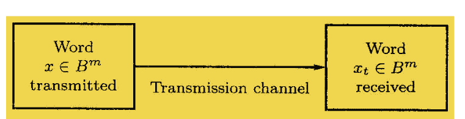

## 传输信道与噪声

传输信道中的噪声可能导致 0 被接收为 1，反之亦然，从而导致 x ≠ xₜ。

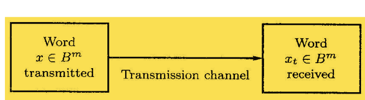

## 编码函数

选择一个整数 n>m 和一个一一映射 e: B^m → B^n。

e 被称为 (m, n) 编码函数，它将 B^m 中的每个字表示为 B^n 中的一个字。
如果 b ∈ B^m，则 e(b) 称为表示 b 的码字。

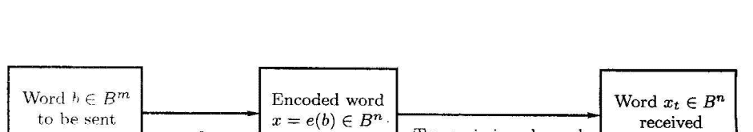

## 编码函数

如果传输信道是无噪声的，则对于 $B^n$ 中的所有 $x$，都有 $x_t = x$。

在这种情况下，对于每个 $b \in B^m$，接收到 $x = e(b)$，并且由于 $e$ 是已知函数，因此可以识别 $b$。

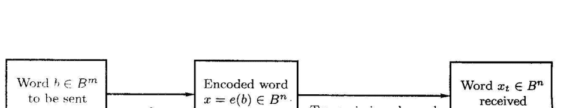

## 编码函数

一般来说，传输中确实会发生错误。
如果 $x$ 和 $x_t$ 在至少 1 个但不超过 $k$ 个位置上不同，我们就说码字 $x = e(b)$ 是在 *k 个或更少错误* 的情况下传输的。[k 表示 $B^n$ 里面码字之间的距离]

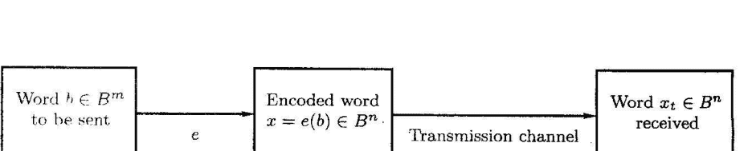

## 错误检测（误差检测）

设 e: B^m → B^n 是一个 (m, n) 编码函数。
如果当 x = e(b) 以 k 个或更少错误传输时，x_t 总不是码字（因此 x_t 不可能是 x，也就不可能被正确传输），则称 e 能检测 k 个或更少错误。

对于 x ∈ B^n，x 中 1 的个数称为 x 的权，记作 |x|。


## 示例 1

求 $B^5$ 中以下每个词的权重。

- x=01000    |x|=1
- x=11100    |x|=3
- x=00000    |x|=0
- x=11111    |x|=5

## 示例 2 检1位

## parity check code – 奇偶校验码

以下编码函数 e: B^m → B^{m+1} 称为 parity (m, m+1) 校验码：若 b = b₁b₂…bₘ ∈ B^m，则定义

e(b) = b₁b₂…bₘ b_{m+1}

其中

b_{m+1} = { 0   if |b| is even
            1   if |b| is odd. }

## 示例 2
parity check code

设 $m = 3$。则

- $e(000) = 0000$
- $e(001) = 0011$
- $e(010) = 0101$
- $e(011) = 0110$
- $e(100) = 1001$
- $e(101) = 1010$
- $e(110) = 1100$
- $e(111) = 1111$

现在假设 $b = 111$。则 $x = e(b) = 1111$

## 示例 3

考虑 (m, 3m) 编码函数 e：

B^m → B^{3m}。

依三次

若 b = b₁b₂...bₘ ∈ B^m，则定义

e(b) = b₁b₂...bₘ b₁b₂...bₘ b₁b₂...bₘ

## 示例 3

- e(000) = 000000000
- e(001) = 001001001
- e(010) = 010010010
- e(011) = 011011011
- e(100) = 100100100
- e(101) = 101101101
- e(110) = 110110110
- e(111) = 111111111

code word

可纠错，可检错

现在假设 b = 011

则 e(011) = 011011011。

现在假设我们接收到的词为 011111011。这不是一个码字，因此我们检测到了错误。

(00,10,01,11)

(00,11)

(1,0)

(1,1)

(0,0)

(0,1)

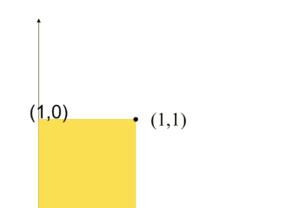

## B^m(0,1)->B^n(000,111)

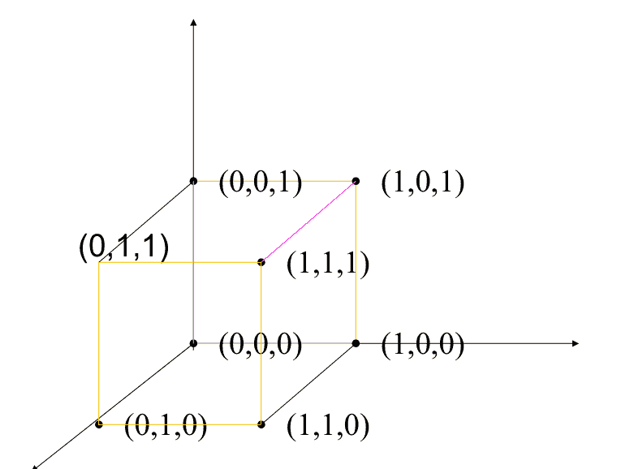

## Hamming distance – 海明距离

设 x 和 y 为 B^m 中的词。x 和 y 之间的 *Hamming distance* δ(x, y) 为 x ⊕ y 的权重，|x⊕y|。

x = x₁x₂...xₘ 和 y = y₁y₂...yₘ 之间的距离是 xᵢ ≠ yᵢ 的 i 的个数，即 x 和 y 不同的位置数。

使用 x ⊕ y 的权重是计算不同位置数的一种便捷方法。

### 示例 4

求 x 和 y 之间的距离：

- (a) x = 110110, y = 000101
- (b) x = 001100, y = 010110.

## 解答

- (a) x ⊕ y = 110011, 所以 | x ⊕ y | = 4
- (b) x ⊕ y = 011010, 所以 | x ⊕ y | = 3

## 定理 1

## properties of distance function

设 x, y, 和 z 为 B^m 的元素。则

- (a) δ(x, y) = δ(y, x)
- (b) δ(x, y) ≥ 0
- (c) δ(x, y) = 0 当且仅当 x = y
- (d) δ(x, y) ≤ δ(x, z) + δ(z, y)

## (d) 的证明

δ(x, y) = | x ⊕ y | = | x ⊕ 0 ⊕ y |
    = | x ⊕ z ⊕ z ⊕ y |
    ≤ | x ⊕ z | + | z ⊕ y |

## 最小距离

编码函数 $e: B^m \to B^n$ 的 *minimum distance* 是所有不同码字对之间距离的最小值；即

$\min\{\delta(e(x), e(y)) \mid x, y \in B^m\}$

## 示例 5

考虑以下 (2, 5) 编码函数 e：

```
e(00) = 00000
 e(01) = 00111
 e(10) = 01110
 e(11) = 11111
 code word
```

## 定理 2

(*m*, *n*) 编码函数 *e*: *B*^m → *B*^n 能检测 *k* 或更少的错误
当且仅当
其最小距离至少为 *k* + 1。

## 证明

← 最小距离至少为 k + 1

设 b ∈ B^m，且 x = e(b) ∈ B^n 为表示 b 的码字。

x 被传输并被接收为 x_t。如果 x_t 是不同于 x 的码字，则 δ(x, x_t) ≥ k+1，所以 x 被传输时至少有 k + 1 个错误。

因此，如果 x 被传输时有 k 或更少的错误，则 x_t 不可能是一个码字。

这意味着 e 可以检测 k 或更少的错误。

## 证明

*e* 可以检测 *k* 或更少的错误 ⇒

假设码字之间的最小距离为 *r* ≤ *k*

设 *x* 和 *y* 为码字且 δ(*x*, *y*) = *r*。

如果 *x* = *y*，即如果 *x* 被传输并被错误接收为 y，则已发生 *r*≤*k* 个错误且未被检测到。

因此这与 *e* 可以检测 *k* 或更少的错误相矛盾。

Q.E.D.

## 示例 6

e 将检测多少个错误？

考虑 (3, 8) 编码函数 e: B³ → B⁸ 定义为

2>=k+1

可检测一位错误

- e(000) = 00000000
- e(001) = 10011100
- e(010) = 00101101
- e(011) = 10010101
- e(100) = 10100100
- e(101) = 10001001
- e(110) = 00011100
- e(111) = 00110001

code word


## Group Codes – 群码

An (*m*, *n*) encoding function *e*: *B*^m → *B*^n is called a *group code* if
*e*(*B*^m) = {*e*(*b*) | *e*(*b*) ∈ *B*^n } = Ran(*e*)
is a subgroup of *B*^n

## Subgroups

Recall from the definition of subgroup given in Section 9.4 that $N$ is a subgroup of $B^n$ if

+   (a) the identity of $B^n$ is in $N$,
+   (b) if $x$ and $y$ belong to $N$, then $x \oplus y \in N$, and
+   (c) if $x$ is in $N$, then its inverse is in $N$.

### Example 7: is e a group code?

Consider the (3, 6) encoding function e: B³ → B⁶ defined by

+   e(000) = 000000
+   e(001) = 001100
+   e(010) = 010011
+   e(011) = 011111
+   e(100) = 100101
+   e(101) = 101001
+   e(110) = 110110
+   e(111) = 111010

We must show that the set of all code words
N = {000000, 001100, 010011, 011111, 100101, 101001, 110110, 111010}
is a subgroup of $B^6$.

## Theorem 3

Let e: B^m → B^n be a group code. The minimum distance of e is the minimum weight of a nonzero code word.

### Proof of Theorem 3

Let δ be the minimum distance of the group code, and suppose that δ = δ(x, y), where x and y are distinct code words.

Also, let η be the minimum weight of a nonzero code word and suppose that η = |z| for a code word z.

Since e is a group code, x ⊕ y is a nonzero code word. Thus
δ = δ(x, y) = |x ⊕ y| ≥ η.

On the other hand, since 0 and z are distinct code words,
η = |z| = |z ⊕ 0| = δ(z, 0) ≥ δ

Hence η = δ.

Q.E.D.

## Example 8

The minimum distance of the group code in

```
e(000) = 000000
e(001) = 001100
e(010) = 010011
e(011) = 011111
e(100) = 100101
e(101) = 101001
e(110) = 110110
e(111) = 111010
```

is 2

To check this directly would require 28 different calculations.

## Constructing group code

## A review on Boolean matrices

mod-2 sum D ⊕ E

mod-2 Boolean product D * E

## Theorem 4

Let D and E be m × p Boolean matrices, and let F be a p × n Boolean matrix. Then (D ⊕ E) * F = (D * F) ⊕ (E * F).

That is, a distributive property holds for ⊕ and *.

## Example 5

Let $B = \{0, 1\}$, and let $+$ be the operation defined on $B$ as follows:

| + | 0 | 1 |
|---|---|---|
| 0 | 0 | 1 |
| 1 | 1 | 0 |

Then $B$ is a group.

Let D = [ d_ij ] be an m × p Boolean matrix, and let E = [ e_ij ] be a p × n Boolean matrix. We define the mod-2 Boolean product D * E as the m × n matrix F = [ f_ij ], where

f_ij = d_i1 · e_1j + d_i2 · e_2j + ⋯ + d_ip · e_pj,    1 ≤ i ≤ m,  1 ≤ j ≤ n.

This type of multiplication is illustrated in Figure 11.3. Compare this with similar figures in Section 1.5.

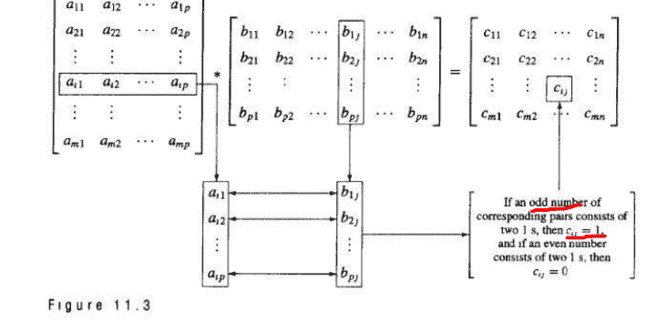

### Figure 11.3

### EXAMPLE 10

We have
[1 1 0]   [1 0]   [1·1+1·1+0·0  1·0+1·1+0·1]
[0 1 1] * [1 1] = [0·1+1·1+1·0  0·0+1·1+1·1]
          [0 1]
= [0 1]
  [1 0].

## Boolean Products

Let **A**=[a_ij] be an m×k zero-one matrix,
& let **B**=[b_ij] be a k×n zero-one matrix,

The *boolean product* of **A** and **B** is like normal matrix ×, but using ∨ instead of + in the row-column “vector dot product”:

A ⊙ B = C = [c_ij] = [ ⋁_{ℓ=1}^k a_iℓ ∧ b_ℓj ]

## EXAMPLE 8 Find the Boolean product of A and B, where

A = [1 0; 0 1; 1 0], B = [1 1 0; 0 1 1].

Solution: The Boolean product A ⊙ B is given by

A ⊙ B = [(1 ∧ 1) ∨ (0 ∧ 0) (1 ∧ 1) ∨ (0 ∧ 1) (1 ∧ 0) ∨ (0 ∧ 1); (0 ∧ 1) ∨ (1 ∧ 0) (0 ∧ 1) ∨ (1 ∧ 1) (0 ∧ 0) ∨ (1 ∧ 1); (1 ∧ 1) ∨ (0 ∧ 0) (1 ∧ 1) ∨ (0 ∧ 1) (1 ∧ 0) ∨ (0 ∧ 1)]

= [1 ∨ 0 1 ∨ 0 0 ∨ 0; 0 ∨ 0 0 ∨ 1 0 ∨ 1; 1 ∨ 0 1 ∨ 0 0 ∨ 0]

= [1 1 0; 0 1 1; 1 1 0].

## Notation

We shall now consider the element
$x = x_1 x_2 ... x_n \in B^n$
as the $1 \times n$ matrix
$[x_1 x_2 ... x_n]$

## Theorem 5

Let $m$ and $n$ be nonnegative integers with $m < n$, $r = n - m$, and let $\mathbf{H}$ be an $n \times r$ Boolean matrix.

Then the function $f_H: B^n \to B^r$ defined by
$f_H(x) = x^* \mathbf{H}, \ x \in B^n$;
is a homomorphism from the group $B^n$ to the group $B^r$.


## 证明

若 \(x\) 和 \(y\) 是 \(B^n\) 中的元素，则
\[
f_H(x \oplus y) = (x \oplus y) * \mathbf{H}
= (x * \mathbf{H}) \oplus (y * \mathbf{H}) \quad \text{by Theorem 4}
= f_H(x) \oplus f_H(y).
\]
故 \(f_H\) 是从 \(B^n\) 到 \(B^r\) 的一个同态。

证毕。

## 推论 1

设 \(m\)，\(n\)，\(r\)，\(\mathbf{H}\)，和 \(f_H\) 如定理 5 中所述。则
\[
N = \{x \in B^n \mid x * \mathbf{H} = \mathbf{0}\}
\]
是 \(B^n\) 的一个正规子群。

## 证明

\(N\) 是同态 \(f_H\) 的核，故它是 \(B^n\) 的一个正规子群。

## Parity check matrix（奇偶校验矩阵）

设 \(m < n\) 且 \(r = n - m\)，以下 \(n \times r\) 布尔矩阵称为 *parity check matrix*。

\[
H = \begin{bmatrix} H_{m\times r} \\ I_r \end{bmatrix}
=
\left[\begin{array}{cccc}
h_{11} & h_{12} & \cdots & h_{1r}\\
h_{21} & h_{22} & \cdots & h_{2r}\\
\vdots & \vdots & & \vdots\\
h_{m1} & h_{m2} & \cdots & h_{mr}\\ \hline
1 & 0 & \cdots & 0\\
0 & 1 & \cdots & 0\\
\vdots & \vdots & & \vdots\\
0 & 0 & \cdots & 1
\end{array}\right]
\]

## 编码函数

定义一个编码函数 \(e_H: B^m \to B^n\)。

若 \(b = b_1 b_2 \dots b_m\)，令 \(x = e_H(b) = b_1 b_2 \dots b_m x_1 x_2 \dots x_r\)，其中
\[
\begin{aligned}
x_1 &= b_1 \cdot h_{11} + b_2 \cdot h_{21} + \dots + b_m \cdot h_{m1}\\
x_2 &= b_1 \cdot h_{12} + b_2 \cdot h_{22} + \dots + b_m \cdot h_{m2}\\
&\vdots\\
x_r &= b_1 \cdot h_{1r} + b_2 \cdot h_{2r} + \dots + b_m \cdot h_{mr}
\end{aligned}
\tag{1}
\]

### \(e_H: B^m 	o B^n\) 的矩阵形式

\[
e_H(B^m) = B^m * [I_m \ H_{m\times r}]
\]

\[
=
\begin{bmatrix}
b_{11} & b_{12} & \cdots & b_{1m}\\
b_{21} & b_{22} & \cdots & b_{2m}\\
\vdots & \vdots & \ddots & \vdots\\
b_{2^m,1} & b_{2^m,2} & \cdots & b_{2^m,m}
\end{bmatrix}
\begin{bmatrix}
1 & 0 & \cdots & 0 & h_{11} & h_{12} & \cdots & h_{1r}\\
0 & 1 & \cdots & 0 & h_{21} & h_{22} & \cdots & h_{2r}\\
\vdots & \vdots & \ddots & \vdots & \vdots & \vdots & & \vdots\\
0 & 0 & \cdots & 1 & h_{m1} & h_{m2} & \cdots & h_{mr}
\end{bmatrix}
\]

\[
=
\begin{bmatrix}
b_{11} & b_{12} & \cdots & b_{1m} & x_{11} & x_{12} & \cdots & x_{1r}\\
b_{21} & b_{22} & \cdots & b_{2m} & x_{21} & x_{22} & \cdots & x_{2r}\\
\vdots & \vdots & \ddots & \vdots & \vdots & \vdots & \ddots & \vdots\\
b_{2^m,1} & b_{2^m,2} & \cdots & b_{2^m,m} & x_{2^m,1} & x_{2^m,2} & \cdots & x_{2^m,r}
\end{bmatrix}
\]

## 定理 6

设 \(x = y_1 y_2 \dots y_m x_1 \dots x_r \in B^n\)。则
\[
x * \mathbf{H} = \mathbf{0}
\]
当且仅当
\[
x = e_H(b)
\]
对某个 \(b \in B^m\) 成立。

## 证明

假设 \(x * \mathbf{H} = \mathbf{0}\)。则
\[
\begin{aligned}
y_1 \cdot h_{11} + y_2 \cdot h_{21} + \cdots + y_m \cdot h_{m1} + x_1 &= 0\\
y_1 \cdot h_{12} + y_2 \cdot h_{22} + \cdots + y_m \cdot h_{m2} + x_2 &= 0\\
&\vdots\\
y_1 \cdot h_{1r} + y_2 \cdot h_{2r} + \cdots + y_m \cdot h_{mr} + x_r &= 0
\end{aligned}
\]

注意 \(x_i + x_i = 0\)。于是对第 \(i\) 个方程加上 \(x_i\) 得到
\[
x_i = y_1 \cdot h_{1i} + y_2 \cdot h_{2i} + \cdots + y_m \cdot h_{mi}.
\]

令 \(b_1 = y_1\)，\(b_2 = y_2, \dots, b_m = y_m\)，我们看到 \(x_1, x_2, \dots, x_r\) 满足式 (1) 中的方程。于是 \(b = b_1 b_2 \dots b_m \in B^m\) 且 \(x = e_H(b)\)。

反之，若 \(x = e_H(b)\)，则式 (1) 中的方程可通过在第 \(i\) 个方程的两边加上 \(x_i\)，\(i = 1, 2, \dots, r\)，改写为
\[
\begin{aligned}
b_1 \cdot h_{11} + b_2 \cdot h_{21} + \cdots + b_m \cdot h_{m1} + x_1 &= 0\\
b_1 \cdot h_{12} + b_2 \cdot h_{22} + \cdots + b_m \cdot h_{m2} + x_2 &= 0\\
&\vdots\\
b_1 \cdot h_{1r} + b_2 \cdot h_{2r} + \cdots + b_m \cdot h_{mr} + x_r &= 0
\end{aligned}
\]
这表明 \(x * \mathbf{H} = \mathbf{0}\)。

证毕。

## 推论 2

\(e_H(B^m) = \{e_H(b) \mid b \in B^m\}\) 是 \(B^n\) 的一个子群。

## 证明

该结果由观察
\[
e_H(B^m) = \ker(f_H)
\]
以及推论 1 得到。

于是 \(e_H\) 是一个群码。

## 例 11

设 \(m = 2\)，\(n = 5\)，且
\[
H = \begin{bmatrix}
1 & 1 & 0\\
0 & 1 & 1\\
1 & 0 & 0\\
0 & 1 & 0\\
0 & 0 & 1
\end{bmatrix}
\]

确定群码 \(e_H: B^2 \to B^5\)。

### 解 11

\[
e_H(B^2) = B^2 * [I_2 \ H_{2\times3}]
\]

\[
=
\begin{bmatrix}
0 & 0\\
0 & 1\\
1 & 0\\
1 & 1
\end{bmatrix}
\begin{bmatrix}
1 & 0 & 1 & 1 & 0\\
0 & 1 & 0 & 1 & 1
\end{bmatrix}
=
\begin{bmatrix}
0 & 0 & 0 & 0 & 0\\
0 & 1 & 0 & 1 & 1\\
1 & 0 & 1 & 1 & 0\\
1 & 1 & 1 & 0 & 1
\end{bmatrix}
\]

构建群码。

## 作业

- 19, 23, 25, 27（P412）

## 感谢您的关注！

接下来...

## Decoding and Error Correction

译码与纠错


Word b ∈ B^m
待发送

e

Encoded word
x = e(b) ∈ B^n

传输信道

Word x_t ∈ B^n
接收

B^n

f_H(x) = x*H

B^r

f_R(x) = [x]_R = x ⊕ N

xRy 当且仅当 x^{-1} ⊕ y ∈ N

f_H(x) = f_H(y)

同构

F̄(xN) = f_H(x) = x*H

B^n/N

N是正规子群

{xN | x ∈ B^n} = {(x*H = y | y ∈ B^r)}

N = {x = e(b), b ∈ B^m} = {(x*H = 0) | x ∈ B^n}

## Decoding Function – 解码函数

考虑一个 (m, n) 编码函数
 e: B^m → B^n.

一旦编码字 x = e(b) ∈ B^n，对 b ∈ B^m，已被接收为字 x_t，我们面临的问题是识别原始消息为字 b。

## Decoding Function

考虑一个 (m, n) 编码函数
e: B^m → B^n.

一个满函数 d: B^n → B^m 被称为与 e 关联的 (n, m) 解码函数（与e关联的译码函数）如果 d(x_t) = b' ∈ B^m 满足当传输信道无噪声时，则 b' = b，即
d o e = 1_{B^m}

## Decoding Function

解码函数 $d$ 要求是满的，以便每个接收字都能被解码为 $B^m$ 中的一个字。

它能正确解码正确接收的字，但对错误接收字的解码可能正确也可能不正确。

## Example 1

考虑在第 11.1 节例 2 中定义的奇偶校验码

定义解码函数 \( d: B^{m+1} \rightarrow B^m \).

如果 \( y = y_1y_2\cdots y_my_{m+1} \in B^{m+1} \)，则 \( d(y) = y_1y_2\cdots y_m \)

注意到如果 \( b = b_1b_2\cdots b_m \in B^m \)，则

\( (d \circ e)(b) = d(e(b)) = b \)

所以 \( d \circ e = 1_{B^m} \)

举一个具体例子，设 \( m = 4 \).

则 \( d(10010) = 1001 \) 且 \( d(11001) = 1100 \)

### Decoding function

设 e 是一个 (m, n) 编码函数且
d 是一个与 e 关联的 (n, m) 解码函数
。

对 (e, d) 来说 **纠正 k 或更少错误**

如果当 x = e(b) 被正确传输或
有 k 或更少错误地传输且 x<sub>t</sub> 被接收时，则
d(x<sub>t</sub>) = b。于是 x<sub>t</sub> 被解码为正确的
消息 b。

## Example 2

考虑在第 11.1 节例 3 中定义的 \((m, 3m)\) 编码函数。定义解码函数 \(d: B^m \to B^{3m}\)。

设 \(y = Y_1Y_2 \cdots Y_m Y_{m+1} \cdots Y_{2m} Y_{2m+1} \cdots Y_{3m}\)，则

\(d(y) = z_1z_2 \cdots z_m\)

其中

\(z_i = \begin{cases} 1 & \text{if } \{y_i, y_{i+m}, y_{i+2m}\} \text{ has at least two 1's} \\ 0 & \text{if } \{y_i, y_{i+m}, y_{i+2m}\} \text{ has less than two 1's} \end{cases}\)

例如 \(x_t = 011011111\)，则 \(d(x_t) = 011\)

### Maximum likelihood technique
- 极大似然技术

由于 \( B^m \) 有 \( 2^m \) 个元素，\( B^n \) 中有 \( 2^m \) 个码字。将其列为

\( x^{(1)}, x^{(2)}, \dots, x^{(2^m)} \)

如果接收字是 \( x_t \)，我们计算 \( \delta(x^{(i)}, x_t) \) 对 \( 1 \leq i \leq 2^m \)，并选择第一个码字，假设它是 \( x^{(s)} \)，使得

\( \min_{1 \leq i \leq 2^m} \{ \delta(x^{(i)}, x_t) \} = \delta(x^{(s)}, x_t) \)

## Maximum likelihood decoding function

即，\(x^{(s)}\) 是最接近 \(x_t\) 的码字且在列表中排在第一位。
如果 \(x^{(s)} = e(b)\)，我们定义与 \(e\) 关联的 *最大似然解码函数* \(d\) 为
\(d(x_t) = b\)

## Theorem 1

假设 $e$ 是一个 $(m, n)$ 编码函数且 $d$ 是与 $e$ 关联的最大似然解码函数。则 $(e, d)$ 能纠正 $k$ 或更少错误当且仅当 $e$ 的最小距离至少为 $2k + 1$。

## Example 3

### How many errors can $(e, d)$ correct?

(3, 8) 编码函数 $e: B^3 \rightarrow B^8$

e(000) = 00000000
e(001) = 10011100
e(010) = 00101101
e(011) = 10010101
e(100) = 10100100
e(101) = 10001001
e(110) = 00011100
e(111) = 00110001

且设 $d$ 是与 $e$ 关联的 (8, 3) 最大似然解码函数。

## Constructing

最大似然解码函数
与给定群码关联

## Theorem 2

如果 K 是群 G 的有限子群，则
G 中 K 的每个左陪集都有与
K 相同数量的元素。


## 证明

设 \(aK\) 是 \(G\) 中 \(K\) 的一个左陪集，其中 \(a \in G\)。考虑函数 \(f: K \rightarrow aK\) 定义为 \(f(k) = ak\)，对于 \(k \in K\)。
我们证明 \(f\) 是单射且满射。
要证明 \(f\) 是单射，我们假设 \(f(k_1) = f(k_2)\)，\(k_1, k_2 \in K\)。
则 \(ak_1 = ak_2\)
左乘 \(a^{-1}\)，我们有 \(k_1 = k_2\)

要证明 \( f \) 是满射，设 \( b \) 是 \( aK \) 中的任意元素。则 \( b = ak \) 对于某个 \( k \in K \)。
我们现在有
\( f(k) = ak = b \)
所以 \( f \) 是满射。

由于 \( f \) 是单射且满射，\( K \) 和 \( aK \) 有相同数量的元素。

> 证毕

## 群码字

设 \( e: B^m \rightarrow B^n \) 是一个 \((m, n)\) 编码函数且是群码。

因此码字集合 \( N \) 在 \( B^n \) 中是子群，其阶为 \( 2^m \)，记 \( N = \{x^{(1)}, x^{(2)}, \dots, x^{(2^m)}\} \)。

## 陪集头 – 陪集头

假设码字 \( x = e(b) \) 被发送
并且接收到字 \( x_t \)。

\( x_t \) 的左陪集为

\( x_t \oplus \text{N} = \{ \varepsilon_1, \varepsilon_2, \dots, \varepsilon_{2^m} \} \quad \text{where} \quad \varepsilon_i = x_t \oplus x^{(i)} \)

如果 \( \varepsilon_j \) 是权重最小的陪集成员，则 \( x^{(j)} \)
必须是离 \( x_t \) 最近的码字。

权重最小的元素 \( \varepsilon_j \) 被称为
_陪集头_。

## 过程

为了得到与给定群码 _e_: _B<sup>n</sup>_ → _B<sup>m</sup>_ 相关的最大似然译码函数 _d_：

- **步骤 1：** 确定 $N = e(B^m)$ 在 $B^n$ 中的所有左陪集
- **步骤 2：** 对每个陪集，找到一个陪集头（权重最小的字）。
- **步骤 3：** 如果接收到字 $x_t$，确定 $x_t$ 属于 N 的哪个陪集。
- **步骤 4：** 设 \(\mathcal{E}\) 为步骤 3 中确定的陪集的陪集头。计算 \(x = x_t \oplus \mathcal{E}\)。如果 \(x = e(b)\)，我们令 d($x_t$) = $b$。即，我们将 \(x_t\) 解码为 \(b\)。

## 译码表

构造译码表，每行是 \( N \) 的一个左陪集，第一元素 \(\varepsilon^{(i)}\) 为陪集头。

| \(\bar{0}\) | \(x^{(2)}\) | \(x^{(3)}\) | \(\cdots\) | \(x^{(2^m - 1)}\) |
|---|---|---|---|---|
| \(\epsilon^{(2)}\) | \(\epsilon^{(2)} \oplus x^{(2)}\) | \(\epsilon^{(2)} \oplus x^{(3)}\) | \(\cdots\) | \(\epsilon^{(2)} \oplus x^{(2^m - 1)}\) |
| \(\vdots\) | \(\vdots\) | \(\vdots\) |  | \(\vdots\) |
| \(\epsilon^{(2^r)}\) | \(\epsilon^{(2^r)} \oplus x^{(2)}\) | \(\epsilon^{(2^r)} \oplus x^{(3)}\) | \(\cdots\) | \(\epsilon^{(2^r)} \oplus x^{(2^m - 1)}\) |

## 译码表

如果我们接收到字 \(x_t\)，我们在表中定位它。如果 \(x\) 是包含 \(x_t\) 的列顶部的 \(N\) 的元素，则 \(x\) 是离 \(x_t\) 最近的码字。

if \(x = e(b)\)，则 \(d(x_t) = b\)。

| \(\vec{0}\) | \(x^{(2)}\) | \(x^{(3)}\) | \(\cdots\) | \(x^{(2^m-1)}\) |
|---|---|---|---|---|
| \(\epsilon^{(2)}\) | \(\epsilon^{(2)} \oplus x^{(2)}\) | \(\epsilon^{(2)} \oplus x^{(3)}\) | \(\cdots\) | \(\epsilon^{(2)} \oplus x^{(2^m-1)}\) |
| \(\vdots\) | \(\vdots\) | \(\vdots\) |  | \(\vdots\) |
| \(\epsilon^{(2^r)}\) | \(\epsilon^{(2^r)} \oplus x^{(2)}\) | \(\epsilon^{(2^r)} \oplus x^{(3)}\) | \(\cdots\) | \(\epsilon^{(2^r)} \oplus x^{(2^m-1)}\) |

### 例 4

考虑 (3, 6) 群码

N = {000000, 001100, 010011, 011111, 100101,
101001, 110110, 111010}
= {x<sup>(1)</sup>, x<sup>(2)</sup>,..., x<sup>(8)</sup>}。

### 例 4
构造译码表：

| 000000 | 001100 | 010011 | 011111 | 100101 | 101001 | 110110 | 111010 |
|---|---|---|---|---|---|---|---|
| 000001 | 001101 | 010010 | 111110 | 100100 | 101000 | 110111 | 111011 |
| 000010 | 001110 | 010001 | 011101 | 100111 | 101011 | 110100 | 111000 |
| 000100 | 001000 | 010111 | 011011 | 100001 | 101101 | 110010 | 111110 |
| 010000 | 011100 | 000011 | 001111 | 110101 | 111001 | 100110 | 101010 |
| 100000 | 101100 | 110011 | 111111 | 000101 | 001001 | 010110 | 011010 |
| 000110 | 001010 | 010101 | 011001 | 100011 | 101111 | 110000 | 111100 |
| 010100 | 011000 | 000111 | 001011 | 110001 | 111101 | 100010 | 101110 |
| 001010 | 000110 | 011001 | 010101 | 101111 | 100011 | 111100 | 110000 |


## 简化译码技术

假设 $(m, n)$ 群码为 $e_H$: $B^m \rightarrow B^n$，其中 **H** 是一个给定的奇偶校验矩阵。

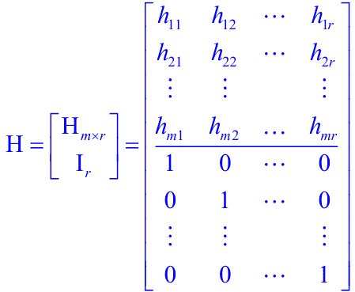

那么由
\( f_H(x) = x^* \mathbf{H}, \quad x \in B^n \)
定义的函数 \( f_H: B^n \rightarrow B^r \) 是从群 \( B^n \) 到群 \( B^r \) 的一个同态映射。

## 定理 3

如果 \( m, n, r, \mathbf{H}, \) 和 \( f_H \) 按上述定义，则 \( f_H \) 是满射。

## 证明

设 \( b = b_1b_2\dots b_r \) 是 \( B^r \) 中的任意元素。

令 \( x = 0_1\dots 0_m b_1b_2\dots b_r \)

则 \( x^*\mathbf{H} = b \)。

因此 \( f_H(x) = b \)，所以 \( f_H \) 是满射。

证毕。

## 伴随式（Syndrome）——特征值

根据第 9.5 节的推论 I，可知 \( B^r \) 与 \( B^n/N \) 同构，其中

\( N = \{x \in B^n \mid x^*\mathbf{H} = \mathbf{0}\} = \ker(f_H) = e_H(B^m) \)

在同构 \( g: B^n/N \to B^r \) 下，该同构定义为

\( g(xN) = f_H(x) = x^*\mathbf{H} \)

元素 \( x^*\mathbf{H} \) 称为 \( x \) 的**伴随式**（syndrome）。

## 定理 4

设 x 和 y 是 \( B^n \) 中的元素。那么
x 和 y 位于 \( B^n \) 中 \( N \) 的同一个左陪集内，
当且仅当
\( f_H(x) = f_H(y) \)，
当且仅当
它们具有相同的伴随式。

## 证明

根据第 9.5 节的定理 4，x 和 y 位于 N 在 B<sup>n</sup> 中的同一个左陪集内，当且仅当 x ⊕ y = (-x) ⊕ y ∈ N。
由于 N = ker(f<sub>H</sub>)，
x ⊕ y ∈ N
当且仅当
f<sub>H</sub>(x ⊕ y) = 0<sub>B<sup>r</sup></sub>
f<sub>H</sub>(x) ⊕ f<sub>H</sub>(y) = 0<sub>B<sup>r</sup></sub>
f<sub>H</sub>(x) = f<sub>H</sub>(y)

> 证毕。

## 译码过程

假设我们计算每个陪集首的伴随式。如果收到字 \(x_t\)，我们也计算 \(f_H(x_t)\)，即 \(x_t\) 的伴随式。通过比较 \(f_H(x_t)\) 与各陪集首的伴随式，我们找到 \(x_t\) 所在的陪集。假设该陪集的一个陪集首为 \(\varepsilon\)。我们计算 \(x = x_t \oplus \varepsilon\)。如果 \(x = e(b)\)，则将 \(x_t\) 译为 \(b\)。

## 新过程

**步骤 1**：确定 \( N = e_H(B^m) \) 在 \( B^n \) 中的所有左陪集。

**步骤 2**：对每个陪集，找出一个陪集首，并计算每个陪集首的伴随式。

**步骤 3**：如果收到 \( x_t \)，计算 \( x_t \) 的伴随式，并找出具有相同伴随式的陪集首 \( \varepsilon \)。于是 \( x_t \oplus \varepsilon = x \) 是一个码字 \( e_H(b) \)，且 \( d(x_t) = b \)。

### 例 5

考虑奇偶校验矩阵和 (3, 6) 群码 \( e_H: B^3 \rightarrow B^6 \)。

\( H = \)

\( e(000) = 000000 \quad e(001) = 001011 \quad e(010) = 010101 \quad e(011) = 011110 \quad e(100) = 100110 \quad e(101) = 101101 \quad e(110) = 110011 \quad e(111) = 111000 \)

码字

\( N = \{000000, 001011, 010101, 011110, 100110, 101101, 110011, 111000\} \)

| 陪集首的伴随式 | 陪集首 |
|--------------------------|--------------|
| 000                      | 000000       |
| 001                      | 000001       |
| 010                      | 000010       |
| 011                      | 001000       |
| 100                      | 000100       |
| 101                      | 010000       |
| 110                      | 100000       |
| 111                      | 001100       |

如果 \(x_t = 001110\)，则 \(f_H(x_t) = x_t * \mathbf{H} = 101\)，与 \(\varepsilon=010000\) 的伴随式相同。

\(x = x_t \oplus \varepsilon = 001110 \oplus 010000 = 011110 = e(011)\)，因此将 001110 译为 011。

| 陪集首的伴随式 | 陪集首 |
|--------------------------|--------------|
| 000                      | 000000       |
| 001                      | 000001       |
| 010                      | 000010       |
| 011                      | 001000       |
| 100                      | 000100       |
| 101                      | 010000       |
| 110                      | 100000       |
| 111                      | 001100       |


## 作业

14, 18, 22 p421

24 p422

## 复习要点

### Message, word

### Hamming distance

### Group code and parity check matrix

### Maximum likelihood technique

(m, n) encoding function, one-to-one

Code word, parity check code

Detect, correct, k or fewer errors

Properties of distance

Minimum distance of a group code

Maximum likelihood decoding function

Syndrome and decoding procedure for group code

## 课程结束

感谢您的关注！

您的建议我们热烈欢迎，请不要犹豫给以下邮箱写信：

wubin@bupt.edu.cn

祝大家好运！

## Semigroup and Groups

### 9.1 二元运算/Binary Operations Revisited

### 9.2 半群/Semigroups

### 9.3 乘积半群与商半群/Products and Quotients of Semigroups

### 9.4 群Groups

### 9.5 乘积群与商群Products and Quotients of Groups

## 第四篇 代数结构

- 代数结构是近世代数或抽象代数学研究的中心问题，是数学中最重要的、基础的分支之一，是在初等代数学的基础上产生和发展起来的。它起始于19世纪初，形成于20世纪30年代。

- 在这期间，挪威数学家阿贝尔(N · H · Abel)法国数学家伽罗瓦(E · Galois)英国数学家德·摩根(A · De Morgan)和布尔(G · Boole)等人都做出了杰出贡献，荷兰数学家范德瓦尔登(B · L · Van DerWaerden)根据德国数学家诺特(A · E · Noether)和奥地利数学家阿廷(E · Artin)的讲稿，于1930年和1931年分别出版了《近世代数学》一卷和二卷，标志着抽象代数的成熟。

- 代数结构是以研究数字、文字和更一般元素的运算的规律和由这些运算适合的公理而定义的各种数学结构的性质为中心问题. 它对现代数学如拓扑学、泛函分析等, 以及一些其他科学领域, 如计算机科学、编码理论等, 都有重要影响和广泛地应用.

## 第四章 代数结构

- 本章给出代数结构的一般定义与实例，讨论代数结构的基本性质，介绍代数结构的主要概念，如群、同态、同构、同余关系等。

## Semigroups and Groups

- Binary Operations Revisited
- Semigroups
- Products and Quotients of Semigroups
- Groups
- Products and Quotients of Groups

## Mathematical Structures

## Mathematical structure （数学结构）

- A collection of objects with operations defined on them and the accompanying properties form a mathematical structure or system.

## Example 1

- The collection of sets with the operations of union, intersection, and complement and their accompanying properties is a (discrete) mathematical structure. We denote this structure by [sets, ∪, ∩, ].

## Example 2

- The collection of \( 3 \times 3 \) matrices with the operations of addition, multiplication, and transpose is a mathematical structure denoted by \( [ \text{3} \times \text{3 matrices}, +, *, \top ] \).

## Closure（封闭）

- A structure is closed with respect to an operation if that operation always produces another member of the collection of objects.

## Examples

- The structure [\(5 \times 5\) matrices, \(+\), \(*\), \(^T\)] is closed with respect to addition because the sum of two \(5 \times 5\) matrices is another \(5 \times 5\) matrix.
- The structure [odd integers, \(+\), \(*\)] is not closed with respect to addition.
  - The sum of two odd integers is an even integer.
  - This structure does have the closure property for multiplication, since the product of two odd numbers is an odd number.

## Binary operation （二元运算）

- An operation that combines two objects is a binary operation.
- An operation that requires only one object is a unary operation.
- Binary operations often have similar properties, as we have seen earlier.
- Example
  - (a) Set intersection is a binary operation since it combines two sets to produce a new set.
  - Producing the transpose of matrix is a unary operation.

## Commutative （交换律）

- Common properties have been given names.
- For example, if the order of the objects does not affect the outcome of a binary operation, we say that the operation is commutative.
  - That is, if x y = y x, where is some binary operation, is commutative .
- Example
  - (a) Join and meet for Boolean matrices are commutative operations.
    - A∨B=B ∨ A and A∧B=B ∧ A.
  - (b) Ordinary matrix multiplication is not a commutative operation AB≠BA.

## Note

- an operation has a property means the statement of the property is true when the operation is used with any objects in the structure.
  - If there is even one case when the statement is not true, the operation does not have that property.


## 结合律（Associative）

- 如果 \(\circ\) 是一个二元运算，那么当 \((x \circ y) \circ z = x \circ (y \circ z)\) 时，\(\circ\) 是结合的，或者说具有结合律。
- 示例
  - 集合并运算是结合运算，因为 \((A \cup B) \cup C = A \cup (B \cup C)\) 总是成立。

## 分配律（Distributive property）

- 如果一个数学结构有两个二元运算，比如 \(\circ\) 和 \(\vee\)，那么分配律具有如下形式：

\[
x \circ (y \vee z) = (x \circ y) \vee (x \circ z)
\]

- 示例
  - （a）我们熟悉实数的分配律；若 \(a\)、\(b\)、\(c\) 是实数，则
    \[
    a \cdot (b + c) = a \cdot b + a \cdot c
    \]
  - （b）结构 \([集合, \cup, \cap, {}^c]\) 有两条分配律：
    \[
    A \cup (B \cap C) = (A \cup B) \cap (A \cup C)
    \]
    以及
    \[
    A \cap (B \cup C) = (A \cap B) \cup (A \cap C)
    \]

## 德·摩根定律（De Morgan's laws）

- 我们见过的若干结构都含有一个一元运算和两个二元运算。
- 若一元运算是 \(*\)，二元运算是 \(\wedge\) 和 \(\vee\)，则德·摩根定律为
  \[
  (x \wedge y)^* = x^* \vee y^* \quad \text{and} \quad (x \vee y)^* = x^* \wedge y^*.
  \]
- 例 9
  - （a）\(\overline{A \cup B} = \overline{A} \cap \overline{B}\)，且 \(\overline{A \cap B} = \overline{A} \cup \overline{B}\)。
  - （b）结构 [实数, +, *, √] 不满足德·摩根定律，因为 \(\sqrt{x + y} \neq \sqrt{x} + \sqrt{y}\)。

## 运算的单位元（Identity for an operation）

- 具有二元运算 \(\circ\) 的结构可能包含一个特殊对象 \(e\)，使得对集合中的所有 \(x\)，都有 \(x \circ e = e \circ x = x\)。
  - 我们称 \(e\) 为 \(\circ\) 的单位元。
  - 事实上，一个运算的单位元必定是唯一的。

## 定理 1

- 若 \(e\) 是二元运算 \(\circ\) 的单位元，则 \(e\) 是唯一的。
- 证明
  - 假设另一个对象 \(i\) 也具有单位元的性质，即 \(x \circ i = i \circ x = x\)。
  - 于是 \(e \circ i = e\)；但由于 \(e\) 是 \(\circ\) 的单位元，\(i \circ e = e \circ i = i\)。
  - 因此，\(i = e\)。
  - 对于 \(\circ\)，具有单位元性质的对象至多只有一个。

## 例 10

- 对于 \([n \times n \text{ 矩阵}, +, *, \text{T}]\)，\(\mathbf{I}_n\) 是矩阵乘法的单位元，而 \(n \times n\) 零矩阵是矩阵加法的单位元。

## 逆元（Inverse）

- 若二元运算 \(\circ\) 有单位元 \(e\)，当 \(x \circ y = y \circ x = e\) 时，我们称 \(y\) 是 \(x\) 的 \(\circ\)-逆元。

## 定理 2

- 若 \(\circ\) 是结合运算，且 \(x\) 有 \(\circ\)-逆元 \(y\)，则 \(y\) 是唯一的。
- 证明
  - 假设 \(x\) 还有另一个 \(\circ\)-逆元，设为 \(z\)。
  - 那么 \((z \circ x) \circ y = e \circ y = y\)，且 \(z \circ (x \circ y) = z \circ e = z\)。
  - 由于 \(\circ\) 满足结合律，\((z \circ x) \circ y = z \circ (x \circ y)\)，因此 \(y = z\)。

## 例 11

- （a）在结构 [3 × 3 矩阵, +, *, ᵀ] 中，每个矩阵 \(\mathbf{A} = [a_{ij}]\) 都有一个 \(+\)-逆元，即加法逆元 \(-\mathbf{A} = [-a_{ij}]\)。
- （b）在结构 [整数, +, *] 中，只有整数 1 和 -1 有乘法逆元。

## 例 12

- 设 \(\oplus\)、\(\nabla\) 和 \(*\) 在集合 \(\{0, 1\}\) 上由下表定义。

| \(\oplus\) | 0 | 1 |
|---|---|---|
| 0 | 0 | 1 |
| 1 | 1 | 0 |

| \(\nabla\) | 0 | 1 |
|---|---|---|
| 0 | 0 | 0 |
| 1 | 0 | 1 |

| \(x\) | \(x^*\) |
|---|---|
| 0 | 1 |
| 1 | 0 |

因此 \(1 \oplus 0 = 1\)，\(0 \nabla 1 = 0\)，\(1^* = 0\)。判断以下各项对于 \([\{0, 1\}, \oplus, \nabla, *]\) 是否成立。

- （a）\(\oplus\) 满足交换律。
- （b）\(\nabla\) 满足结合律。
- （c）德·摩根定律成立。
- （d）该结构满足两条分配律。

- 解
  - （a）命题 \(x \oplus y = y \oplus x\) 必须对所有 \(x\) 和 \(y\) 的取值都成立。由于 \(0 \oplus 1\) 和 \(1 \oplus 0\) 都等于 1，所以 \(\oplus\) 满足交换律。
  - （b）需要检验的八种可能情况留作练习。\(\nabla\)
  - （c）\((0 \oplus 0)^* = 0^* = 1\)，且 \(0^* \nabla 0^* = 1 \nabla 1 = 1\)。
    \((0 \oplus 1)^* = 1^* = 0\)，且 \(0^* \nabla 1^* = 1 \nabla 0 = 0\)。
    \((1 \oplus 1)^* = 0^* = 1\)，且 \(1^* \nabla 1^* = 0 \nabla 0 = 0\)。
    最后一对等式表明，德·摩根定律在此结构中不成立。


- (d) 一个可能的分配律是 \(x □ (y ▽ z) = (x □ y) ▽ (x □ z)\)。
  - 必须检查所有可能的情况。
  - 我们可以用表格来展示。

| x | y | z | y ▽ z | x □ (y ▽ z) | x □ y | x □ z | (x □ y) ▽ (x □ z) |
|---|---|---|---|---|---|---|---|
| 0 | 0 | 0 | 0 | 0 | 0 | 0 | 0 |
| 0 | 0 | 1 | 0 | 0 | 0 | 1 | 0 |
| 0 | 1 | 0 | 0 | 0 | 1 | 0 | 0 |
| 0 | 1 | 1 | 1 | 1 | 1 | 1 | 1 |
| 1 | 0 | 0 | 0 | 1 | 1 | 1 | 1 |
| 1 | 0 | 1 | 0 | 1 | 1 | 0 | 0 |
| 1 | 1 | 0 | 0 | 1 | 0 | 1 | 0 |
| 1 | 1 | 1 | 1 | 0 | 0 | 0 | 0 |

### 二元运算

- 定义
- 二元运算的性质

### 二元运算

- 集合 \(A\) 上的二元运算是一个**处处有定义**的函数 \(f: A \times A \rightarrow A\)。
- 二元运算必须满足：
  - \(f\) 为 \(A \times A\) 中的每个有序对 \((a,b)\) 指定 \(A\) 中的一个元素 \(f(a,b)\)。
  - 由于二元运算是函数，每个有序对只能对应 \(A\) 中唯一的一个元素。

### 注意

- 通常用 \(*\) 这样的符号来表示二元运算，而不是用 \(f\)，并且将赋予 \((a,b)\) 的元素记为 \(a*b\) [而不是 \(*(a,b)\)]。
- 如果 \(a\) 和 \(b\) 是 \(A\) 中的元素，且 \(a*b \in A\)，则称 \(A\) 在运算 \(*\) 下是_封闭的_。

### 示例 1,2

- 设 \(A = \mathbb{Z}\)。定义 \(a * b\) 为 \(a + b\)。
  - \(*\) 是 \(\mathbb{Z}\) 上的二元运算。
- 设 \(A = \mathbb{R}\)。定义 \(a * b\) 为 \(a / b\)。
  - \(*\) 不是二元运算，因为它并非对 \(A\) 中元素的每个有序对都有定义。
  - 例如，\(3 * 0\) 没有定义，因为我们不能除以零。

## 示例 3

- 设 \(A = \mathbb{Z}^+\)。定义 \(a*b\) 为 \(a-b\)。
  - \(*\) 不是二元运算，因为它没有为 \(A\) 中元素的每个有序对指定 \(A\) 中的一个元素；例如，\(2*5 \notin A\)。

### 示例 4

- 设 \(A = \mathbb{Z}\)。定义 \(a*b\) 为小于 \(a\) 和 \(b\) 两者的某个数。
  - \(*\) 不是二元运算，因为它没有为 \(A\) 中元素的每个有序对指定 \(A\) 中_唯一_的元素；例如，\(8*6\) 可以是 5、4、3、1 等等。
  - 在这种情况下，\(*\) 是从 \(A \times A\) 到 \(A\) 的一个关系，但不是函数。

### 示例 5,6

- 设 \(A = \mathbb{Z}\)。定义 \(a*b\) 为 \(\max\{a, b\}\)。
  - \(*\) 是二元运算；例如，\(2*4 = 4\)，\(-3*(-5) = -3\)。
- 设 \(A = P(S)\)，其中 \(S\) 是某个集合。如果 \(V\) 和 \(W\) 是 \(S\) 的子集，定义 \(V*W\) 为 \(V \cup W\)。
  - \(*\) 是 \(A\) 上的二元运算。
  - 如果定义 \(V *' W\) 为 \(V \cap W\)，则 \(*'\) 是 \(A\) 上的另一个二元运算。
    - 注意：同一集合上可以定义许多二元运算。

### 示例 7,8

- 设 \(M\) 是固定 \(n\) 的所有 \(n \times n\) 布尔矩阵的集合。定义 \(A * B\) 为 \(A \lor B\)。
  - \(*\) 是二元运算。
  - \(A \land B\) 也是如此。
- 设 \(L\) 是一个格。定义 \(a * b\) 为 \(a \lor b\)。
  - \(*\) 是 \(L\) 上的二元运算。
  - \(a \land b\) 也是如此。

### 运算表

如果 \(A = \{a_1, a_2, \dots, a_n\}\) 是一个_有限_集合，我们可以通过一张表来定义 \(A\) 上的二元运算：

| * | \(a_1\) | \(a_2\) | \(\cdots\) | \(a_j\) | \(\cdots\) | \(a_n\) |
|---|---|---|---|---|---|---|
| \(a_1\) |  |  |  |  |  |  |
| \(a_2\) |  |  |  |  |  |  |
| \(\vdots\) |  |  |  |  |  |  |
| \(a_i\) |  |  |  | \(a_i * a_j\) |  |  |
| \(\vdots\) |  |  |  |  |  |  |
| \(a_n\) |  |  |  |  |  |  |

图 9.1

### 示例 9

- 设 \(A = \{0, 1\}\)。
- 用下表定义二元运算 \(\vee\) 和 \(\wedge\)：

| \(\vee\) | 0 | 1 |
|---|---|---|
| 0 | 0 | 1 |
| 1 | 1 | 1 |

| \(\wedge\) | 0 | 1 |
|---|---|---|
| 0 | 0 | 0 |
| 1 | 0 | 1 |


## 操作数有多少？

- 若 \(A = \{a, b\}\)，可在 \(A\) 上定义多少个二元运算？
  - 每个在 \(A\) 上的二元运算 \(*\) 都可以用一个表来描述。
- 完成该表的方式有 \(2 \cdot 2 \cdot 2 \cdot 2 = 2^4\) 或 16 种。

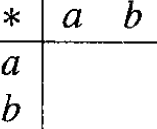

## 二元运算的性质

- 对于集合 \(A\) 中的所有元素 \(a\)、\(b\) 和 \(c\)：
- 交换律(Commutative)
  - \(a * b = b * a\)
- 结合律(Associative)
  - \(a * (b * c) = (a * b) * c\)
- 等幂律(Idempotent)
  - \(a * a = a\)

## 交换律 - 交换律

- 若对于集合 \(A\) 中所有元素 \(a\) 和 \(b\) 都有 \(a * b = b * a\)，则称 \(A\) 上的二元运算是交换的。
- 示例：
  - \(\mathbb{Z}\) 上的加法二元运算是交换的。
  - \(\mathbb{Z}\) 上的减法二元运算不是交换的，因为 \(2 - 3 \neq 3 - 2\)。

## 交换律

- 用表描述的二元运算当且仅当表中条目关于主对角线对称时是交换的。

## 例 12

- 下列哪些 \(A = \{a, b, c, d\}\) 上的二元运算是交换的？

(a)

| * | a | b | c | d |
|---|---|---|---|---|
| a | a | c | b | d |
| b | b | c | b | a |
| c | c | d | b | c |
| d | a | a | b | b |

(b)

| * | a | b | c | d |
|---|---|---|---|---|
| a | a | c | b | d |
| b | c | d | b | a |
| c | b | b | a | c |
| d | d | a | c | d |

## 结合律 - 结合律

- 若对于集合 \(A\) 中所有元素 \(a\)、\(b\) 和 \(c\) 都有 \(a * (b * c) = (a * b) * c\)，则称 \(A\) 上的二元运算 \(*\) 是结合的。
- 示例：
  - \(\mathbb{Z}\) 上的加法二元运算是结合的。
  - \(\mathbb{Z}\) 上的减法二元运算不是结合的，因为 \(2 - (3 - 5) \neq (2 - 3) - 5\)。

## 例 15

- 设 \(L\) 为一个格。由 \(a * b = a \wedge b\) 定义的二元运算是交换的且是结合的。
- 它还满足等幂性质 \(a \wedge a = a\)。

## 例 16

- 设 \(*\) 为集合 \(A\) 上的一个二元运算，且对于 \(A\) 中任意 \(a\)、\(b\) 和 \(c\) 满足以下性质：
  - \(a = a * a\)（等幂性质）
  - \(a * b = b * a\)（交换性质）
  - \(a * (b * c) = (a * b) * c\)（结合性质）
- 在 \(A\) 上定义关系 \(\leq\) 为 \(a \leq b\) 当且仅当 \(a = a * b\)。
- 证明 \((A, \leq)\) 是一个偏序集，且对于所有 \(a, b\) 在 \(A\) 中，\(\operatorname{GLB}(a, b) = a * b\)。

## 例 16：解

- 我们必须证明
  - \(\leq\) 是自反的，反对称的和传递的。
  - 对于所有 \(a\) 和 \(b\) 在 \(A\) 中 \(a * b = a \wedge b\)。

### \(\leq\) 是自反的

- \(a \leq b\) 当且仅当 \(a = a * b\)。
- 由于 \(a = a * a\)，对所有 \(a\) 在 \(A\) 中有 \(a \leq a\)，且 \(\leq\) 是自反的。

### \(\leq\) 是反对称的

- \(a \leq b\) 当且仅当 \(a = a * b\)。
- 现在假设 \(a \leq b\) 且 \(b \leq a\)。
- 那么，根据定义和性质 2，\(a = a * b = b * a = b\)，所以 \(a = b\)。
- 因此 \(\leq\) 是反对称的。

### \(\leq\) 是传递的

- \(a \leq b\) 当且仅当 \(a = a * b\)。
- 若 \(a \leq b\) 且 \(b \leq c\)，则 \(a = a * b = a * (b * c) = (a * b) * c = a * c\)。
- 因此 \(a \leq c\)，且 \(\leq\) 是传递的。

### \(a * b = a \wedge b\)，对于所有 \(a\) 和 \(b\) 在 \(A\) 中

- \(a \leq b\) 当且仅当 \(a = a * b\)。
- 我们有 \(a * b = a * (b * b) = (a * b) * b\)，所以 \(a * b \leq b\)。
- 以类似的方式 \(a * b \leq a\)。
- 所以 \(a * b\) 是 \(a\) 和 \(b\) 的一个下界。
- 现在，若 \(c \leq a\) 且 \(c \leq b\)，则根据定义 \(c = c * a\) 且 \(c = c * b\)。
- 因此 \(c = (c * a) * b = c * (a * b)\)。
- 所以 \(c \leq a * b\)。
- 这表明 \(a * b\) 是 \(a\) 和 \(b\) 的最大下界。

## 作业

- 20 @ 323
- 24, 28 @ 324


## 4.1 运算、代数系统与特异元素

- 在正式给出代数结构的定义之前，先来说明什么是在一个集合上的运算，因为运算这个概念是代数结构中不可缺少的概念。

定义4.1.1 设S是个非空集合且函数 f: Sⁿ→S，则称f为一个n元运算。其中 n是自然数，称为运算的元数或阶。当 n=1时，称f为一元运算，当n=2时，称f为2元运算，等等。

- 注意，n元运算是个闭运算，因为经运算后产生的象仍在同一个集合中. 封闭性表明了n元运算与一般函数的区别之处. 此外，有些运算存在么元或零元，它在运算中起着特殊的作用，称它为S中的特异元或常数.

- 运算的例子很多. 例如，在数理逻辑中，否定是命题集合上的一元运算，合取和析取是谓词集合上的二元运算；在集合论中，并与交是集合上的二元运算；在整数算术中，加、减、乘运算是二元运算，而除运算便不是二元运算，因为它不满足封闭性.

- 在下面讨论的代数结构中，主要限于一元和二元运算。将用 ‘，’，-，~，¬，!，等符号表示一元运算符；用  
+ \(\oplus, \otimes, \circ\) ,\(\circledcirc, \star, \star, \circ, \diamond, \square, \wedge, \vee, \cup, \cap\) 等表示二元运算符。一元运算符常常习惯于前置、顶置或肩置，如\(\neg x\)、\(x'\)、\(x\)”，而二元运算符习惯于前置、中置或后置，如：\(+xy\), \(x+y\), \(xy+\)。

- 有了集合上运算的概念后，便可定义代数结构了。

定义4.1.2 设S是个非空集合且 f_i 是S上的 m元运算，其中i=1, 2, ..., m. 由S及f1, f2, ..., fm组成的结构，称为代数结构，记作<S, f1, f2, ..., fm>.

- 此外，集合S的基数即|S|定义代数结构的基数. 如果S是有限集合，则说代数结构是有限代数结构；否则便说是无穷代数结构.

- 有时，要考察两个或多个代数结构，这里就有个是否同类型之说，请看下面定义：

定义4.1.3 设两个代数结构<**S**, f<sub>1</sub>, f<sub>2</sub>, ..., f<sub>m</sub>>和<T, g<sub>1</sub>, g<sub>2</sub>, ..., g<sub>m</sub>>，如果f<sub>i</sub>和g<sub>i</sub>(1≤i≤m)具有相同的元数，则称这两个代数结构是同类型的。

- 可见，判定两个代数结构是否同类型，主要是对其运算进行考察。

- 此外，有时还需要在代数结构中集合的某个子集上讨论其性质，这就引出子代数结构的概念。

定义 4.1.4 <S, f<sub>1</sub>, f<sub>2</sub>, ..., f<sub>m</sub>>是一代数结构，且非空集 T⊆S在运算f<sub>1</sub>, f<sub>2</sub>, ..., f<sub>m</sub>下是封闭的，且T含有与S中相同的特异元，则称<T, f<sub>1</sub>, f<sub>2</sub>, ..., f<sub>m</sub>>为代数结构<S, f<sub>1</sub>, f<sub>2</sub>, ..., f<sub>m</sub>>的子代数，记为<T, f<sub>1</sub>, f<sub>2</sub>, ..., f<sub>m</sub>>≡ <T, f<sub>1</sub>, f<sub>2</sub>, ..., f<sub>m</sub>>.

下面举例说明上述各个概念.

例4.1.1 设R是实数集合，且+和×是R上的普通加法和乘法运算，则<R, +, ×>是一代数结构。因为运算+和×在R中是封闭的.

显然，<R, +, ×>是无穷代数结构。若令E为偶数集合，则<E, +, ×> ≡ <R, +, ×>.

例4.1.2 设S是非空集合，PS是它的幂集. 对任意集合A, B ∈ PS, PS上的运算⊕和⊗定义如下：
A⊕B=(A – B) ∪ (B – A)
A⊗B=A∩B

则<PS, ⊕, ⊗>是一代数结构. 因为，显然⊕和⊗ 是闭运算.

- 可以看到，例4.1.1和例4.1.2中给出的两个代数结构是同类型的，即<R, +, ×>与<PS, ⊕, ⊗>是同类型的.

例4.1.3 设\(\Sigma\)是由有限个字母组成的集合，称为字母表。由\(\Sigma\)中的字母组成的有序集合，称为\(\Sigma\)上的串。串中的字母个数\(m\)称为该串的长度。\(m=0\)时，叫做空串，用\(\wedge\)表示。用\(\Sigma^*\)表示\(\Sigma\)上的串集合。在\(\Sigma^*\)上定义一个连接运算，用\(|\)表示。如 \(\alpha, \beta \in \Sigma^*\)，则 \(\alpha | \beta = \alpha \beta\)。那么\(<\Sigma^*, |>\)是一代数结构。如果令\(\Sigma^+ = \Sigma^* - \{\wedge\}\)，则\(<\Sigma^+, |>\)也是一个代数结构。

例4.1.4 设有一台字长为8位的计算机，它以定点加、减、乘、除以及逻辑加和逻辑乘为运算指令，并分别用 \(O_1, O_2, \ldots, O_6\) 表示。则在计算机中由 \(2^8\) 个不同数字所组成集合 \(S\) 同该机器中运算指令构成一代数结构 \(<S, O_1, O_2, \ldots, O_6>\)。

- 在结束本节时，声明记号 \(<S, f_1, f_2, \ldots, f_m>\) 即为一代数结构，除特别指明外，运算符 \(f_1, f_2, \ldots, f_m\) 均为二元运算。根据需要对 \(S\) 及 \(f_1, f_2, \ldots, f_m\) 可置不同的集合符和运算符。

- 对于代数结构的性质的考察方法不是一个一个研究各个结构，而是列举一组性质，并且对于具有这些性质的任何代数结构推导可能的结论。把那些被选出的性质看成是公理并且从这些公理推导出的任何有效结论，对于满足这些公理的任何代数结构也都必定成立。因此，为了作这样的讨论，将不考虑任何特定的集合，也不给所涉及到的运算赋予任何特定的含义。这种系统的集合及集合上的诸运算仅仅被看成是一些符号，或更确切地说，它们都是些抽象对象。对于那些特定的代数结构只能是具有基本性质中的某些性质。

- 下面就来讨论一般代数结构的基本性质，这里需要指出的是，所谓代数结构的性质即是结构中任何运算所具有的性质。

### 1. 结合律

给定<**S**,° >，运算 “ ° ” 满足结合律或者 “ ° ” 是可结合的，即  
(∀x)(∀y)(∀z)(x,y,z∈S→(x° y)° z=x°(y° z).

例4.1.5. 给定<A,° >，且对任意a, b∈A有a° b=b.  
证明运算 “ ° ” 是可结合的.

证明 因为对任意a, b, c ∈ A,  
(a° b)° c=b° c=c,  a° (b° c)=a° c=c

- 故(a° b)° c=a° (b° c)

### 2.交换律

给定<**S**,° >, 运算 “ ° ” 满足交换律或者 “ ° ” 是可交换的, 即(∀x)(∀y)(x,y∈S→x° y=y° x)

例4.1.6. 给定<Q, ◎>, 其中Q为有理数集合, 并且对任意a, b∈R有a◎b=a+b-a·b = b+a-b·a, 问运算◎是否可交换?

解 因为a◎b=a+b-a·b=b+a-b·a=b◎a, 所以, 运算◎是可交换的.

- 可见，如果一代数结构中的运算\( \circ \) 是可结合和可交换的，那么，在计算\( a_1 \circ a_2 \circ \dots \circ a_m \) 时可按任意次序计算其值。特别当\( a_1 = a_2 = \dots = a_m = a \) 时，则\( a_1 \circ a_2 \circ \dots \circ a_m = a^m \)，称\( a^m \) 为\( a \) 的\( m \) 次幂，\( m \) 称\( a \) 的指数。

- 下面给出a<sup>m</sup>的归纳定义：
- 设有<**S**, ◦ >且a∈**S**. 对于m∈**I**<sub>+</sub>, 其中**I**<sub>+</sub>表示正整数集合, 可有：
  (1)a<sup>1</sup>=a 
  (2)a<sup>m+1</sup>=a<sup>m</sup>◦ a
  由此利用归纳法不难证明指数定律：
  (1) a<sup>m</sup>◦ a<sup>n</sup>=a<sup>m+n</sup> 
  (2) (a<sup>m</sup>)<sup>n</sup>=a<sup>mn</sup>
  这里, m, n ∈**I**<sub>+</sub>.
- 类似地定义某代数结构中的负幂和给出负指数定律.


## 4.1 运算、代数系统与特异元素

### 3. 分配律

- 一个代数结构若具有两个运算时，则分配律可建立这两个运算之间的某种联系。
- 给定 <**S**, ° , ◦>, 运算° 对于◦满足左分配律，或者° 对于◦是可左分配的，即：
  
  \( (\forall x)(\forall y)(\forall z)(x,y,z \in S \rightarrow x^\circ (y \circ z) = (x^\circ y) \circ (x^\circ z) \)
- 运算° 对于◦满足右分配律或者° 对于◦是可右分配的，即：
  
  \( (\forall x)(\forall y)(\forall z)(x,y,z \in S \rightarrow (y \circ z)^\circ x = (y^\circ x) \circ (z^\circ x) ) \)

- 类似地可定义◎ 对于○ 满足左或右分配律.
- 若○ 对于◎既满足左分配律又满足右分配律，则称○ 对于◎满足分配律或是可分配的. 同样可定义◎ 对于○ 满足分配律.
- 由定义不难证明下面定理:

定理4.1.1 给定<**S**,○ ,◎>且○ 是可交换的. 如果○ 对于◎满足左或者右分配律，则○ 对于◎满足分配律.

例4.1.7 给定<B,⊙ ,⊙>, 其中B={0,1}. 表9.2.1分别定义了运算⊙ 和⊙, 问运算⊙ 对于⊙是可分配的吗？ ⊙对于⊙ 呢？ (表4.1.1)

| ⊙ | 0 | 1 |
|---|---|---|
| 0 | 0 | 0 |
| 1 | 0 | 1 |

| ⊙ | 0 | 1 |
|---|---|---|
| 0 | 0 | 1 |
| 1 | 1 | 0 |

- 形如表4.1.1的表常常被称为运算表或复合表，它由运算符、行表头元素、列表头元素及复合元素四部分组成. 当集合S的基数很小，特别限于几个元素时，代数结构中运算常常用这种表给出. 其优点是简明直观，一目了然.
  
解 可以验证◎ 对于◎是可分配的，但◎对于◎ 并非如此. 因为：

1◎(0◎ 1)≠(1◎0)◎ (1◎1)

### 4. 吸收律

给定 <S,◦ , ◎>，则

- ◦ 对于◎满足左吸收律：

(∀x)(∀y)(x,y∈S→x◦ (x◎y)=x

◎对于◦ 满足右吸收律：

(∀x)(∀y)(x,y∈S→(x◎y)◦ x=x

- 若◦ 对于◎既满足左吸收律又满足右吸收律，则称◦ 对于◎满足吸收律或者可吸收的.

- ◎对于◦ 满足左、右吸收律和吸收律类似地定义.

- 若◦ 对于◦是可吸收的且◦对于◦ 也是可吸收的，则◦ 和◦是互为吸收的或者◦ 和◦同时满足吸收律。

例4.1.8 给定<N,◦ ,◦>, 其中N是自然数集合，◦ 和◦定义如下：

- 对任意a, b∈N有： a◦ b=max{a,b}, a◦b=min{a,b}, 试证◦ 和◦互为吸收的。

证明 因为

a◦ (a◦b)=max{a,min{a,b}}=(a◦b)◦ a a◦(a◦ b)=max{a,min{a,b}}=(a◦ b)◦a

- 故，◦ 和◦是互为吸收的。

### 5. 等幂律与等幂元

给定<**S**,○ >，则 “○” 是等幂的或 “○” 满足等幂律:= (∀x)(x∈S→x○ x=x)

- 给定<**S**,○ >，且x∈S，则  
  x是关于 “○” 的等幂元:= x○ x=x

- 于是，不难证明下面定理：

**定理4.1.2** 若x是<**S**,○ >中关于○ 的等幂元，对于任意正整数n，则x<sup>n</sup>=x.

例4.1.9 给定<PS, U, ∩>，其中PS是集合S的幂集，U和∩分别为集合的并和交运算。

- • 验证 U 和∩ 是等幂的。

证明 对任意A∈PS，有A U A=A和A∩A=A，故 U 和∩都是等幂的。

### 6. 幺元或单位元

- 给定<**S**,○ >且，e<sub>l</sub>, e<sub>r</sub>, e∈**S**, 则  
  e<sub>l</sub>: 为关于○ 的左幺元:=(∀x)(x∈**S**→ e<sub>l</sub>○ x=x)  
  e<sub>r</sub>: 为关于○ 的右幺元:=(∀x)(x∈**S**→ x○ e<sub>r</sub>=x)

- 若e既为○ 的左幺元又为○ 的右幺元，称e为关于○ 的幺元. 亦可定义如下:  
  e为关于○ 的幺元:=(∀x)(x∈**S**→e○ x=x○ e=x)

例4.1.10 给定\(<\{\alpha,\beta\},\circ>\)，表9.2.2，表9.2.3和表9.2.4分别给出\(\circ\) 的不同定义的运算表，试指出左幺元、右幺元及幺元。(表4.1.2)

| ∘ | α | β |
|---|---|---|
| α | α | β |
| β | β | α |

| ∘ | α | β |
|---|---|---|
| α | α | α |
| β | β | β |

| ∘ | α | β |
|---|---|---|
| α | β | β |
| β | α | β |

解\(\circ\) 如表4.1.2所定义，\(\alpha\)是\(\circ\) 的幺元；\(\circ\) 如表9.2.3所定义，\(\alpha\)和\(\beta\)是\(\circ\) 的右幺元；\(\circ\) 如表9.2.4所定义，\(\beta\)是\(\circ\) 的左幺元。

定理 4.1.3 给定<**S**,∘ >且e<sub>l</sub>和e<sub>r</sub>分别关于∘ 的左、右幺元，则 e<sub>l</sub> = e<sub>r</sub> = e，且幺元e唯一。

证明 由题设可得e<sub>l</sub> = e<sub>l</sub> ∘ e<sub>r</sub> = e<sub>r</sub> =e。

下面再证幺元e是唯一的。

若还有一个幺元 e<sub>1</sub>∈ S，则 e<sub>1</sub> = e<sub>1</sub>∘ e = e，即只有一个幺元。

### 7. 零元

给定<**S**,○ >及 θ<sub>l</sub>, θ<sub>r</sub>, θ∈**S**

θ<sub>l</sub>为关于○ 的左零元:=(∀**x**)(**x**∈**S**→θ<sub>l</sub>○ **x** = θ<sub>l</sub>).

θ<sub>r</sub>为关于○ 的右零元:=(∀**x**)(**x**∈**S**→**x**○ θ<sub>r</sub> = θ<sub>r</sub>).

θ为关于○ 的零元:=(∀**x**)(**x**∈**S**→**x**○ θ = **x**○ θ=θ).

**例4.1.11** 在例4.1.10中，○ 如表4.1.2所定义，β是○ 的零元；○ 如表9.2.3所定义，α和β都是○ 的左零元； ○ 如表9.2.4所定义，β 是○ 的右零元.

定理4.1.4 给定<**S**,°>且θ<sub>l</sub>和θ<sub>r</sub> 分别为关于° 的左零元和右零元，则θ<sub>l</sub> = θ<sub>r</sub> = θ 且零元θ是唯一的。

证明 可仿定理4.1.3证明。

定理4.1.5 给定<**S**,° >且|**S**|>1.如果θ,e∈**S**, 其中θ和e分别为关于° 的零元和幺元，则θ≠e。

证明 用反证法。假设 θ = e，则对任意 x∈**S**, 有 x=e° x = θ° x = θ = e, 可见**S**中的所有元素都是相同的，这与|**S**|>1矛盾。

### 8. 逆元

- 给定<**S**,° >且么元e∈S，则：
  x为关于° 的左逆元:=(∃y)(y∈S∧x° y=e)
  x为关于° 的右逆元:=(∃y)(y∈S∧y° x=e)
  x关于° 的可逆:=(∃y)(y∈S∧y° x=x° y=e)

- 给定<**S**,° >及么元e; x, y∈S，则：
  y为x的左逆元:=y° x=e:
  y为x的右逆元:=x° y=e
  y为e的逆元:= y° x=x° y=e


## 4.1 运算、代数系统与特异元素

- 显然，若y是x的逆元，则x也是y的逆元，因此称x与y互为逆元. 通常x的逆元表示为x⁻¹.

- 一般地说来，一个元素的左逆元不一定等于该元素的右逆元. 而且，一个元素可以有左逆元而没有右逆元，同样可以有右逆元而没有左逆元. 甚至一个元素的左或者右逆元还可以不是唯一的.

## 4.1 运算、代数系统与特异元素

例4.1.8 给定<S,⊙>，其中 S={α,β,γ,δ,ξ} 且⊙的定义如表4.2.5所示。试指出该代数结构中各元素的左、右逆元情况。

| ⊙ | α | β | γ | δ | ξ |
|---|---|---|---|---|---|
| α | α | β | γ | δ | ξ |
| β | β | δ | α | γ | δ |
| γ | γ | α | β | α | β |
| δ | δ | α | γ | δ | γ |
| ξ | ξ | δ | α | γ | ξ |

## 4.1 运算、代数系统与特异元素

**解：** α 是么元，β 的左逆元和右逆元都是 γ，即 β 与 γ 互为逆元；δ 的左逆元是 γ，而右逆元是 β，β 有两个左逆元 γ 和 δ；ξ 的右逆元是 γ，但 ξ 没有左逆元。

## 半群与群

## 9.1 二元运算/二元运算回顾

## 9.2 半群/半群

## 9.3 乘积半群与商半群/半群的乘积与商

## 9.4 群/群

## 9.5 乘积群与商群/群的乘积与商

## 半群与群

## 二元运算回顾

## 半群

## 半群的乘积与商

## 群

## 群的乘积与商

## 半群

## 半群

## 定义

## 同构与同态

## 定义1 一代数系统 <S,*>，若 S 非空且 * 是封闭的，则称 <S,*> 为广群。

## 定义2 一代数系统 <S,*>，若 S 非空且 * 是封闭的，可结合的，则称 <S,*> 为半群。

## Semigroup – 半群

A *semigroup* is a *nonempty* set S together with an associative binary operation * defined on S.

用 (S, *) 或 S 表示半群。

a*b 被称为 a 和 b 的乘积。半群 (S, *) 如果 * 是可交换运算，则称其为 *commutative* 可交换的。

## Examples

例子

(Z, +) 是一个可交换半群。

集合 P(S)，其中 S 是一个集合，连同并运算是一个可交换半群。

集合 Z 带有减法二元运算不是半群，因为减法不是结合的。

## Example 4

例 4

设 S 是一个固定的非空集合，且 Sˢ 是所有函数 f : S→S 的集合。如果 f 和 g 是 Sˢ 的元素，我们定义 f *g 为 f g，即复合函数。

- * 是 Sˢ 上的二元运算
- * 是结合的。
- (Sˢ, *) 是一个半群。
- 半群 Sˢ 不是可交换的。

## Example 5

例 5

设 (L, ≤) 是一个格。定义 L 上的二元运算为 a * b = a ∨ b。则 L 是一个半群。

### Example 6

例 6

设 A = {a₁, a₂,..., aₙ} 是一个非空集合。A* 是 A 的元素的所有有限序列的集合。α 和 β 是 A* 的元素。

连接是 A* 上的二元运算 •。如果 α = a₁a₂...aₙ 且 β= b₁b₂...bₖ 则 α • β= a₁a₂...aₙb₁b₂...bₖ 如果 α, β, 和 γ 是 A* 的任意元素，则 α •(β • γ ) = (α • β) • γ 。

### Example 6

例 6

- • 是一个结合的二元运算，且 (A*, ⋅) 是一个半群。

半群 (A*, ⋅) 称为由 A 生成的自由半群 _free semigroup generated by A_ （由A生成的自由半群）。

## Theorem 1

定理 1

如果 a₁, a₂, …, aₙ, n ≥ 3, 是半群的任意元素，则通过任意插入有意义的括号可以形成的元素 a₁, a₂, …, aₙ 的所有乘积都相等。

证明省略

## Note

注

定理 1 显示乘积

((a₁*a₂)*a₃)*a₄

a₁*(a₂*(a₃*a₄))

(a₁*(a₂*a₃))*a₄

都相等。

如果 a₁, a₂,..., aₙ 是半群 (S, *) 中的元素，则乘积可以写成

a₁*a₂*... *aₙ

## Identity – 单位元、幺元

一个元素 e 在半群 (S, *) 中称为 *identity* 单位元，如果对所有 a ∈ S 有 e*a = a*e = a。

单位元必须是唯一的。

## Example 8,9

例 8,9

数字 0 是半群 (ℤ, +) 中的单位元。

半群 (ℤ⁺, +) 没有单位元

## Monoid – 独异点、含幺半群

一个 _monoid_ 独异点是具有单位元的半群 (S, *)。

## Example 10

例 10

例 2 中定义的半群 P(S) 具有单位元 ∅，因为对于任意元素 A ∈ P(S)。

∅ * A = ∅ ∪ A = A = A ∪ ∅ = A * ∅

因此 P(S) 是一个独异点。


## Example 11,12,13

Example 4 中定义的半群 S<sup>s</sup> 有恒等元 I<sub>s</sub>，因为对任意元素 f ∈ S<sup>s</sup> 有 I<sub>s</sub>*f = I<sub>s</sub> f = f I<sub>s</sub> = f * I<sub>s</sub>，我们看到 S<sup>s</sup> 是一个幺半群。

Example 6 中定义的半群 A<sup>∗</sup> 有恒等元 Λ，空序列，因为对所有 α ∈ A<sup>∗</sup> 有 α• Λ = Λ •α = α。

集合 A 上所有关系在复合运算下构成一个幺半群。恒等元是等价关系 Δ。

## Subsemigroup – 子半群

设
(S, *) 为一个半群 且
T 为 S 的一个子集。
如果 T 在运算 * 下封闭，则
(T, *) 称为 (S, *) 的一个子半群。

## Submonoid – 子独异点

设

(S, *) 为具有恒等元 e 的幺半群，且
T 为 S 的一个非空子集。

如果 T 在运算 * 下 **封闭**
且 \( e \in T \)，则

(T, *) 称为 (S, *) 的一个 **子独异点**。

## Note

结合律在半群的任意子集上都成立，因此半群 \( (S, *) \) 的一个子半群 \( (T, *) \) 本身也是一个半群。

类似地，幺半群的子独异点本身也是一个幺半群。

## Examples

如果 \( T \) 是所有偶整数的集合，则 \( (T, *) \) 是幺半群 \( (\mathbb{Z}, *) \) 的一个子半群，其中 * 是普通的乘法，但它不是子独异点，因为 \( \mathbb{Z} \) 的恒等元，数 1，不属于 \( T \)。

如果 \( (S, *) \) 是一个半群，则 \( (S, *) \) 是 \( (S, *) \) 的一个子半群。

类似地，设 \( (S,*) \) 为一个幺半群，则 \( (S, *) \) 是 \( (S, *) \) 的一个子独异点，且

如果 \( T = \{e\} \)，则 \( (T, *) \) 也是 \( (S, *) \) 的一个子独异点。

## Powers of a

设

(S, *) 为一个半群，\( a \in S \quad n \in \mathbb{Z}^+ \)

递归定义 \( a^n \) 的幂如下：

\( a^1 = a, \quad a^n = a^{n-1} * a, \quad n \geq 2. \)

\( a^0 = e \quad \text{if } (S, *) \text{ is a monoid} \)

如果 \( m \) 和 \( n \) 是非负整数，则

\( a^m * a^n = a^{m+n} \)

## Example 16

如果 \( (S, *) \) 是一个半群，\( a \in S \)，且 \( T = \{a^i \mid i \in \mathbb{Z}^+\} \)，则 \( (T, *) \) 是 \( (S, *) \) 的一个子半群。

如果 \( (S, *) \) 是一个幺半群，\( a \in S \)，且 \( T = \{a^i \mid i \in \mathbb{Z}^+ \text{ or } i = 0\} \)，则 \( (T, *) \) 是 \( (S, *) \) 的一个子独异点。

**generated by** \( a \) **（由** \( a \) **生成的）**

## Isomorphism – 同构映射

## Homomorphism – 同态映射

设 (S, *) 和 (T, *') 为两个半群。

函数 f: S→T

称为从 (S, *) 到 (T, *') 的一个 *同构*，
如果它是 S 到 T 的一个一一对应，且对所有 a 和 b 在 S 中有 f(a*b) = f(a)*'f(b)。

## Note

如果 \( f \) 是从 \( (S, *) \) 到 \( (T, *') \) 的一个同构，
则由于 \( f \) 是一个一一对应，\( f^{-1} \) 存在且是从 \( T \) 到 \( S \) 的一个一一对应。

## f⁻¹ is an isomorphism

设 a' 和 b' 为 T 的任意元素。
由于 f 是满射，存在 a 和 b 在 S 中使得
f(a) = a' 且 f(b) = b'。
则 a = f⁻¹(a') 且 b = f⁻¹(b')。
f⁻¹(a' *' b') = f⁻¹(f(a)*'f(b))= f⁻¹(f(a*'b)) = (f⁻¹ f) (a*'b)
= a*'b = f⁻¹(a') *' f⁻¹(b')。
故 f⁻¹ 是同构。

## Isomorphic semigroups

如果 _f_ 是从 (S, \*) 到 (T, \*') 的一个同构，
半群 (S, \*) 和 (T \*') 称为
*同构* 并记为 S \(\cong\) T

## Isomorphic?

**STEP 1**: 定义一个函数 \( f: S \rightarrow T \) 且 \( \text{Dom}(f) = S \)。

**STEP 2**: 证明 \( f \) 是单射。

**STEP 3**: 证明 \( f \) 是满射。

**STEP 4**: 证明 \( f(a * b) = f(a) *' f(b) \)。

## Example 17

设 _T_ 为所有偶整数的集合。
证明半群 (Z , +) 和 (T , +) 是同构的。

## Example 17 - Solution

Step 1: 定义函数 \( f : \mathbb{Z} \to T \) 为
\( f(a) = 2a \)。

Step 2: \( f \) 是单射。
假设 \( f(a_1) = f(a_2) \)。
则 \( 2a_1 = 2a_2 \)，
所以 \( a_1 = a_2 \)。
故 \( f \) 是单射


## 例 17 - 解

步骤 3：\( f \) 是满射。
设 \( b \) 是任意偶整数。
则 \( a = b/2 \in \, \mathbb{Z} \) 且
\( f(a) = f(b/2) = 2(b/2) = b \)，
所以 \( f \) 是满射。

步骤 4：\( f(a+b) = 2(a+b) = 2a+2b = f(a)+f(b) \)。
故 \( (\mathbb{Z}, +) \) 和 \( (T, +) \) 是同构的半群

> 证毕。

## 例 18

设
S = {a, b, c} 且 T = {x, y, z}。
不难验证 S 和 T 都是半群。

设
f(a) = y
f(b) = x
f(c) = z

| * | a | b | c |
|---|---|---|---|
| a | a | b | c |
| b | b | c | a |
| c | c | a | b |

| * | x | y | z |
|---|---|---|---|
| x | z | x | y |
| y | x | y | z |
| z | y | z | x |

用 S 中元素的像替换 S 中的元素
并重新排列表格，我们得到恰好
T 的表格。因此 S 和 T 是同构的

## 定理 2

设

(S, \*) 和 (T, \*') 为幺半群，其单位元分别为 e
和 e'。

f :S → T 为一个同构。

则

f(e) = e'。

## 定理 2 - 证明

设 b 为 T 的任意元素。

由于 f 是满射，存在 S 中的元素 a 使得

f(a) = b。

由于 a = a*e，

b = f(a) = f(a*e) = f(a)*f(e) = b*f(e)。

同理，\(a = e^*a\)，\(b = f(e)^*b\)。

因此对任意 \(b \in T\)，\(b = b *' f(e) = f(e) *' b\)，这意味着 \(f(e)\) 是 \(T\) 的单位元。

单位元是唯一的，\(f(e) = e'\)

证毕。

## 注

如果 (S, *) 和 (T, *') 是半群，使得 S 有单位元而 T 没有，则根据定理 2，(S, *) 和 (T, *') 不能同构。

## 例 19

设 T 为所有偶整数的集合且 * 为普通乘法。
半群 (Z, * ) 和 (T, * ) 不是同构的，因为 Z 有单位元而 T 没有。

## Homomorphism – 同态

设 \( (S, *) \) 和 \( (T, *') \) 为两个半群。  
一个处处有定义的函数 \( f: S \to T \) 称为从 \( (S, *) \) 到 \( (T, *') \) 的 *同态*  
如果 \( f(a*b) = f(a) *' f(b) \) 对所有 \( a \) 和 \( b \) 在 \( S \) 中成立。  
如果 \( f \) 也是满射，我们说 \( T \) 是 \( S \) 的 *同态像*(同态像)。

## 例 20

设
\( A = \{0, 1\} \)
\( (A^*, \cdot) \)，\( \cdot \) 为连接运算
\( (A, +) \)，\( + \) 由上表定义

定义函数 \( f: A^* \to A \) 为
\( f(\alpha) = \begin{cases} 1 \text{ if } \alpha \text{ has an odd number of } 1's \\ 0 \text{ if } \alpha \text{ has an even number of } 1's \end{cases} \)

不难验证如果 \( \alpha \) 和 \( \beta \) 是 \( A^* \) 的任意元素，则 \( f(\alpha \cdot \beta) = f(\alpha) + f(\beta) \)。
因此 \( f \) 是同态。

| + | 0 | 1 |
|---|---|---|
| 0 | 0 | 1 |
| 1 | 1 | 0 |

## 注

对于同构和同态，*乘积的像是像的乘积*。

## 定理 3

设
(S, *) 和 (T, *') 为幺半群，其单位元分别为 e
和 e'。
f : S → T 为从 (S, *) 到
(T, *') 的 **满** 同态。

则
f(e) = e'

证明：与定理 2 的证明类似。

## 定理 4

设
f 为从半群 (S, *)
到半群 (T. *') 的同态。
如果 S' 是 (S, *) 的子半群，
则
f(S') = {t ∈ T | t = f(s) for some s ∈ S'}，即
S' 在 f 下的像，是 (T,
*') 的子半群。

## 定理 4 - 证明

设 \( t_1 \) 和 \( t_2 \) 为 \( f(S') \) 的任意元素，
存在 \( s_1 \) 和 \( s_2 \) 在 \( S' \) 中使得 \( t_1 = f(s_1) \) 且 \( t_2 = f(s_2) \)。
\( t_1 * t_2 = f(s_1) * f(s_2) = f(s_1 * s_2) = f(s_3) \)。
故 \( t_1 * t_2 \in f(S') \)。
因此 \( f(S') \) 在运算 \( * \) 下封闭。
由于结合律在 \( T \) 中成立，它在 \( f(S') \) 中也成立。
所以 \( f(S') \) 是 \( (T, *) \) 的子半群

## 定理 5

如果 _f_ 为从交换半群 (S, *) 到半群 (T, *') 的 **_满_** 同态，则 (T, *') 也是交换的。

## 定理 5 - 证明

设 \( t_1 \) 和 \( t_2 \) 为 \( T \) 的任意元素。存在 \( s_1 \) 和 \( s_2 \) 在 \( S \) 中使得
\( t_1 = f(s_1) \) 且 \( t_2 = f(s_2) \)

因此
\( t_1 * t_2 = f(s_1) * f(s_2) = f(s_1 * s_2) = f(s_2 * s_1) = f(s_2) * f(s_1) = t_2 * t_1 \)。

故 \( (T, *) \) 也是交换的。


## 半群的乘积与商

乘积半群、商半群

## 半群的乘积与商

- 乘积半群
- 同余关系
- 商半群
- 基本同态定理

## 定理 1

如果 (S, *) 和 (T, *') 是半群，则 (S×T, *'') 是半群，其中 *'' 定义为
(s₁, t₁)*''(s₂, t₂) = (s₁*s₂, t₁*'t₂)

证明：略。

那么幺半群呢？

如果 S 和 T 分别是带有单位元 eₛ 和 eₜ 的幺半群，则 S×T 是带有单位元 (eₛ, eₜ) 的幺半群。

### 同余关系

半群 (S, *) 上的等价关系 _R_ 称为**同余关系**，如果 _a R a'_ 且 _b R b'_ 蕴含 (_a_*_b_) _R_ (_a'_*_b'_)。

## 示例 1

考虑半群 \((\mathbb{Z}, +)\) 以及 \(\mathbb{Z}\) 上的等价关系 \(R\)，定义为
\(a R b \text{ 当且仅当 } a \equiv b \pmod{2}\)。
如果 \(a \equiv b \pmod{2}\)，则 \(2 \mid (a - b)\)。
证明该关系是同余关系。

### 示例 1 - 解答

R 是等价关系（略）。
R 是同余关系

如果 \(a \equiv b \, (\text{mod } 2)\) 且 \(c \equiv d \, (\text{mod } 2)\)
则 \(2 \mid a-b\) 且 \(2 \mid c-d\)。
所以 \(a-b = 2m\) 且 \(c-d = 2n\)，其中 \(m\) 和 \(n\) 是整数。
\((a-b) + (c-d) = 2m + 2n\)
\((a+c) - (b+d) = 2(m+n)\)，
所以 \(a+c \equiv b+d \, (\text{mod } 2)\)。
因此该关系是同余关系。

## 示例 3

考虑半群 \((\mathbb{Z}, +)\)
\(f(x) = x^2 - x - 2\)。

定义
\(a R b \text{ 当且仅当 } f(a) = f(b)\)。

容易验证 \(R\) 是等价关系，
但 \(R\) 不是同余关系

- \(-1 R 2\)，因为 \(f(-1) = f(2) = 0\)
- \(-2 R 3\)，因为 \(f(-2) = f(3) = 4\)
- 但 \((-1 + -2) \cancel{R} (2 + 3)\)，因为 \(f(-3) = 10\) 且 \(f(5) = 18\)

## 注

回顾：半群 (S, *) 上的等价关系 R 确定 S 的一个划分。

设 [a] = R(a) 为包含 a 的等价类。

S/R 表示所有等价类的集合。

## 定理 2

设 _R_ 是半群 (S, *) 上的同余关系。

考虑从 S/R × S/R 到 S/R 的关系 ◦，其中对于 S 中的 _a_ 和 _b_，有序对 ([_a_], [_b_]) 与 [_a_*_b_] 相关联。

◦([_a_], [_b_]) = [_a_]◦ [_b_] = [_a_*_b_] 是从 S/R×S/R 到 S/R 的函数。

(S/R, ◦ ) 是半群。S/R 称为**商半群（_quotient semigroup_）或因子半群（_factor semigroup_）**。

## 证明

- ◦ 是二元运算
- 假设 ([a], [b]) = ([a'], [b'])。
- a R a' 且 b R b'，
- a*b R a'*b'，因为 R 是同余关系。
- 因此 [a*b] = [a'*b']；
- ◦ 是一个函数，是 S/R 上的二元运算。

- ◦ 是可结合的
- [a]○ ([b]○ [c]) = [a]○ [b*c] = [a*(b*c)] = [(a*b)*c]
- = [a*b]○ [c] = ([a]○ [b])○ [c]。
- 因此 S/R 是半群。

### 推论

设 _R_ 是幺半群 (S, *) 上的同余关系。如果在 S/R 中定义运算 \(\odot\) 为 \([a]\odot [b]=[a*b]\)，则 \((S/R, \odot)\) 是幺半群。

## 证明

如果 _e_ 是 (S, *) 中的单位元，则容易验证 [_e_] 是 \((S/R, \odot)\) 中的单位元。

## 示例 5

(Z, +)
a R b 当且仅当 a ≡ b (mod n)。
R 是等价关系

≡(mod 4) 是同余关系
[0] = {…, -8, -4, 0, 4, 8, 12,….. } = [4] = [8] =….
[1] = {…, -7, -3, 1, 5, 9, 13,….. } = [5] = [9] =….
[2] = {…, -6, -2, 2, 6,10, 14,….. } = [6] = [10] =….
[3] = {…, -5, -1, 3, 7, 11, 15, ….}= [7] = [11] =….

Z/ ≡ (mod 4) 或 Z₄ 是带有单位元 [0] 和运算 [a]*[b] = [a+b] 的幺半群。

| ⊕ | [0] | [1] | [2] | [3] |
|---|-----|-----|-----|-----|
| [0] | [0] | [1] | [2] | [3] |
| [1] | [1] | [2] | [3] | [0] |
| [2] | [2] | [3] | [0] | [1] |
| [3] | [3] | [0] | [1] | [2] |

## 定理 3

设
R 是半群 (S, *) 上的同余关系，
(S/R, ⊙ ) 是对应的商半群。
则函数
f_R: S → S/R
定义为
f_R(a) = [a]
是满同态，称为
自然同态（natural homomorphism）。


## 定理 3 - 证明

如果 \([a] \in \text{S/R}\)，则
\(f_R(a) = [a]\)，
所以 \(f_R\) 是一个满函数。

if \(a\) and \(b\) are elements of S, then
\(f_R(a*b) = [a*b] = [a] \odot [b] =\)
\(f_R(a) \odot f_R(b)\)

so \(f_R\) is a homomorphism.

## Fundamental Homomorphism Theorem – 同态基本定理

Let
f: S→T be a homomorphism of the semigroup
(S, *) onto the semigroup (T, *')
R be the relation on S defined by
a R b if and only if f(a) = f(b), for a and b in S.

Then
R is a congruence relation.
(T, *') and the quotient semigroup (S/R, ○ ) are
isomorphic.

## Proof

### R is an equivalence relation

a R a for every a ∈ S, since f(a) = f(a).

if a R b, then f(a) = f(b), so b R a.

if a R b and b R c,

f(a) = f(b) and f(b) = f(c),

so f(a) = f(c) and a R c.

Hence R is an equivalence relation.

Proof

R is a congruence relation.

Suppose that \(a R a_1\) and \(b R b_1\).

\(f(a) = f(a_1)\) and \(f(b) = f(b_1)\).

\(f(a*b) = f(a)*'f(b) = f(a_1)*'f(b_1) = f(a_1*b_1)\), since \(f\) is a homomorphism,

Hence \((a*b) R (a_1*b_1)\)

## Proof

Define a relation \(\bar{f} = \{([a], f(a)) \mid [a] \in S/R\}\) from \(S/R\) to \(T\), then

### \(ar{f}\) is a function.

Suppose that \([a] = [a']\).
\(a R a'\), so \(f(a) = f(a')\), which implies that \(\bar{f}\) is a function.
write \(\bar{f}: S/R \to T\), where \(\bar{f}([a]) = f(a)\) for \([a] \in S/R\).

### \(ar{f}\) is one to one.

Suppose that \(\bar{f}([a]) = \bar{f}([a'])\).
\(f(a) = f(a')\), so \(a R a'\), which implies that \([a] = [a']\).
Hence \(\bar{f}\) is one to one.

### \(ar{f}\) is onto.

Suppose that \(b \in T\).
\(f(a) = b\) for some element \(a\) in \(S\), since \(f\) is onto,
\(\bar{f}([a]) = f(a) = b\), so \(\bar{f}\) is onto.

## Proof

f is an isomorphism.

f([a]⊙[b])
=f([a*b])
=f(a*b)
=f(a)*'f(b)
=f([a])*'f([b]).

Q.E.D.

### Example 6

A={0,1}
(A*, • ) (N,+)
f: A* → N
f(α)= the number of 1’s in α.
R: αRβ if and only if f(α ) = f(β )
A* /R ≅N f:A* /R →N

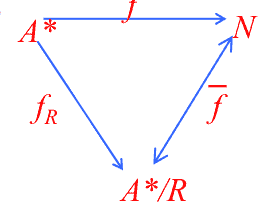

f<sub>R</sub>(α)=[α] f̄([α])=f(α)

## Note

Theorem 4(b) can be described by the diagram above
\( f_R \) is the natural homomorphism.
It follows from the definitions of \( f_R \) and \( \overline{f} \) that
\( \overline{f} \ f_R = f \)
since
\( (\overline{f} \ f_R)(a) = \overline{f}(f_R(a)) = \overline{f}([a]) = f(a) \)

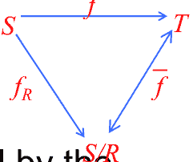

## Homework

20, 22, 28@331

4, 12,20,22, 24@338

## Homework

4, 12,20,22, 24@338

实数集合 \( R \) 上的加法运算 \( + \) ,
+ 封闭,可交换,可结合,幺元 \( 0 \) ,
\( a^{-1} = -a \)

## Thanks for your attention!

Coming up next ...

## Groups

## Semigroups and Groups

## Semigroups and Groups

### Binary Operations Revisited

### Semigroups

### Products and Quotients of Semigroups

## Groups

### Products and Quotients of Groups

## Groups - 群

## Groups

- Definition
- Abelian
- Properties of groups
- Finite groups
- Subgroups

## Group

A group (G,*) is a monoid, with identity e, that has the additional property that for every element a ∈ G there exists an element a' ∈ G, such that

a*a' = a'*a = e .

## group

A _group_ (G, *) is a set together with a binary operation * on G such that, for any elements a, b, and c in G
(a*b)*c = a*(b*c).
a unique element e in G such that
a*e = e*a
an element \(a' \in G\), called an inverse of a and written as \(a^{-1}\), such that
\(a*a' = a'*a = e\) or \(aa' = a'a = e\) or \(aa^{-1} = a^{-1}a = e\)

## Abelian – 阿贝尔群

A group G is said to be Abelian if ab = ba for all elements a and b in G.

Q, the set of all rational numbers under the
operation of addition
Z+, under the operation of addition

## 定义

设 < G, * > 是一代数系统，G 是非空集合，* 为 G 上二元运算，若
1) * 是封闭的
2) * 是可结合的
3) 存在么元 e
4) 对任一 x ∈ G, 存在它的逆元
则称 < G, * > 是一个群。

## 例

在 < Q, Δ > 中，Q 为有理数集. 对 ∀ a, b ∈ Q
 a Δ b = a + b − a · b

试讨论 < Q, Δ > 是否是群？ 是否有零元？

解: 对任意 a, b, c ∈ Q


1) a+b-a*b∈Q

2) aΔ(bΔc) = aΔ(b + c − b·c)
   = a + (b + c − b·c)
     − a(b + c − b·c)
= a + b − ab + c − (a + b − ab)c
= (aΔb)Δc

3) 么元 $e$
$a\Delta e = a + e - a\cdot e = a$
$e(1 - a) = 0\quad e = 0$

4) $a \in Q$, $a\Delta x = 0$

$a + x - a x = 0$

逆元 $x = \dfrac{a}{a - 1}$

$a \neq 1$ 时 $a^{-1} = \dfrac{a}{a - 1}$

5) $a\Delta b = a + b - a b$

$= b + a - b a = b\Delta a$

## 定义

一个*群*（G, *）是一个集合，连同 G 上的一个二元运算 *，使得对于 G 中任意元素 a、b 和 c：

(a*b)*c = a*(b*c).

G 中存在唯一元素 e，使得

a*e = e*a

存在元素 a' ∈ G，称为 a 的逆元，记作 a⁻¹，使得

a*a' = a'*a = e 或 aa' = a'a = e 或 aa⁻¹ = a⁻¹a = e

## 阿贝尔群

若对于 G 中所有元素 a 和 b，都有 ab = ba，则称群 G 为阿贝尔群。

### 例 4

设

G 是所有非零实数的集合，且

a*b = ab/2.

证明

(G, *) 是阿贝尔群。

## 例 4 - 解

* 是一个二元运算

若 a 和 b 是 G 中的元素，则 ab/2 是非零实数，因此在 G 中。

结合律

(a*b)*c = (ab/2)*c = (ab)c/4
 a*(b*c) = a*(bc/2) = a(bc)/4 = (ab)c/4.
 * 满足结合律。

## 定理 1

设 $G$ 是一个群。$G$ 中的每个元素 $a$ 在 $G$ 中有且仅有一个逆元。

## 证明

设
$a'$ 和 $a''$ 都是 $a$ 的逆元。

则
$a' = a'e = a'(aa'') = (a'a)a'' = ea'' = a''.$

## 定理 2

设

G 是一个群，
a、b、c 是 G 中的元素。

则

左消去律

ab = ac 蕴含 b = c

右消去律

ba = ca 蕴含 b = c

## 定理 2 - 证明

### 左消去律

假设 $ab = ac$。

$a^{-1}(ab) = a^{-1}(ac)$

$(a^{-1}a)b = (a^{-1}a)c \quad \text{由结合律}$

$eb = ec \quad \text{由逆元的定义}$

$b = c \quad \text{由单位元的定义。}$

### 右消去律

证明与上述类似。

## 定理 3

设

G 是一个群，
a 和 b 是 G 中的元素。

则

(a⁻¹)⁻¹ = a.

(ab)⁻¹ = b⁻¹a⁻¹

## 定理 3 - 证明

(a⁻¹)⁻¹ = a
  a⁻¹a = aa⁻¹ = e
  元素的逆元是唯一的，
  所以 (a⁻¹)⁻¹ = a

(ab)⁻¹ = b⁻¹a⁻¹
  (ab)(b⁻¹a⁻¹) = a(b(b⁻¹a⁻¹)) = a((bb⁻¹)a⁻¹) = a(ea⁻¹) = aa⁻¹ = e
  类似地，(b⁻¹a⁻¹)(ab) = e
  所以 (ab)⁻¹ = b⁻¹a⁻¹

## 定理 4

设
  G 是一个群，
  a 和 b 是 G 中的元素

则
  方程 ax = b 在 G 中有唯一解。
  方程 ya = b 在 G 中有唯一解。

证明略

## 1 阶和 2 阶群

如果 $G$ 是 1 阶群，则
$G = \{e\}$，且 $ee = e$。

设 $G = \{e, a\}$ 是 2 阶群。

空白处应填入 $e$ 还是 $a$？

**表 9.1**

|   | e | a |
|---|---|---|
| e | e | a |
| a | a |   |

**表 9.2**

|   | e | a |
|---|---|---|
| e | e | a |
| a | a | e |

## 3 阶非同构群

设 $G = \{e, a, b\}$ 是 3 阶群。

表 9.3

|   | e | a | b |
|---|---|---|---|
| e | e | a | b |
| a | a |   |   |
| b | b |   |   |

表 9.4

|   | e | a | b |
|---|---|---|---|
| e | e | a | b |
| a | a | b | e |
| b | b | e | a |

## 4 阶群

设 $G = \{e, a, b, c\}$ 是 4 阶群

表 9.5
|   | e | a | b | c |
|---|---|---|---|---|
| e | e | a | b | c |
| a | a | e | c | b |
| b | b | c | e | a |
| c | c | b | a | e |

表 9.6
|   | e | a | b | c |
|---|---|---|---|---|
| e | e | a | b | c |
| a | a | e | c | b |
| b | b | c | a | e |
| c | c | b | e | a |

表 9.7
|   | e | a | b | c |
|---|---|---|---|---|
| e | e | a | b | c |
| a | a | b | c | e |
| b | b | c | e | a |
| c | c | e | a | b |

表 9.8
|   | e | a | b | c |
|---|---|---|---|---|
| e | e | a | b | c |
| a | a | c | e | b |
| b | b | e | c | a |
| c | c | b | a | e |

### 例 5

设 $B = \{0, 1\}$，并设 $+$ 是定义在 $B$ 上的如下运算：

| + | 0 | 1 |
|---|---|---|
| 0 | 0 | 1 |
| 1 | 1 | 0 |

则 $B$ 是一个群。


## 一个重要的群

给定一个顶点为 1、2、3 的等边三角形

考虑它的对称性。

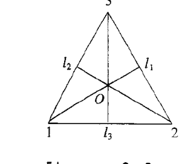

## 三角形的对称性

三角形绕 $O$ 点逆时针旋转 $120^\circ$、$240^\circ$、$360^\circ$（或 $0^\circ$），分别得到 $f_2$、$f_3$、$f_1$。

$f_1$、$f_2$、$f_3$ 可以写成置换：

$f_1 = \begin{pmatrix} 1 & 2 & 3 \\ 1 & 2 & 3 \end{pmatrix}, f_2 = \begin{pmatrix} 1 & 2 & 3 \\ 2 & 3 & 1 \end{pmatrix}, f_3 = \begin{pmatrix} 1 & 2 & 3 \\ 3 & 1 & 2 \end{pmatrix}$

## 三角形的对称性

三角形的另外三个对称 $g_1$、$g_2$ 和 $g_3$ 是分别关于直线 $l_1$、$l_2$ 和 $l_3$ 反射得到的。

将这些反射记为以下置换：

$g_1 = \begin{pmatrix}1 & 2 & 3 \\ 1 & 3 & 2\end{pmatrix}, g_2 = \begin{pmatrix}1 & 2 & 3 \\ 3 & 2 & 1\end{pmatrix}, g_3 = \begin{pmatrix}1 & 2 & 3 \\ 2 & 1 & 3\end{pmatrix}$

## 三角形的对称群

设 $S_3 = \{f_1, f_2, f_3, g_1, g_2, g_3\}$，并在集合 $S_3$ 上引入运算 $*$，即*接着进行*。

| * | $f_1$ | $f_2$ | $f_3$ | $g_1$ | $g_2$ | $g_3$ |
|---|---|---|---|---|---|---|
| $f_1$ | $f_1$ | $f_2$ | $f_3$ | $g_1$ | $g_2$ | $g_3$ |
| $f_2$ | $f_2$ | $f_3$ | $f_1$ | $g_3$ | $g_1$ | $g_2$ |
| $f_3$ | $f_3$ | $f_1$ | $f_2$ | $g_2$ | $g_3$ | $g_1$ |
| $g_1$ | $g_1$ | $g_2$ | $g_3$ | $f_1$ | $f_2$ | $f_3$ |
| $g_2$ | $g_2$ | $g_3$ | $g_1$ | $f_3$ | $f_1$ | $f_2$ |
| $g_3$ | $g_3$ | $g_1$ | $g_2$ | $f_2$ | $f_3$ | $f_1$ |

$f_1 = \begin{pmatrix}1 & 2 & 3\\1 & 2 & 3\end{pmatrix}, f_2 = \begin{pmatrix}1 & 2 & 3\\2 & 3 & 1\end{pmatrix}, f_3 = \begin{pmatrix}1 & 2 & 3\\3 & 1 & 2\end{pmatrix}$
$g_1 = \begin{pmatrix}1 & 2 & 3\\1 & 3 & 2\end{pmatrix}, g_2 = \begin{pmatrix}1 & 2 & 3\\3 & 2 & 1\end{pmatrix}, g_3 = \begin{pmatrix}1 & 2 & 3\\2 & 1 & 3\end{pmatrix}$

## 用代数方法计算 $f_2^*g_2$

$f_1=\begin{pmatrix}1&2&3\\1&2&3\end{pmatrix},\quad f_2=\begin{pmatrix}1&2&3\\2&3&1\end{pmatrix},\quad f_3=\begin{pmatrix}1&2&3\\3&1&2\end{pmatrix},\quad g_1=\begin{pmatrix}1&2&3\\1&3&2\end{pmatrix},\quad g_2=\begin{pmatrix}1&2&3\\3&2&1\end{pmatrix},\quad g_3=\begin{pmatrix}1&2&3\\2&1&3\end{pmatrix}$

为了用代数方法计算 $f_2^*g_2$，我们计算 $f_2\; g_2$。

$\begin{pmatrix}1&2&3\\2&3&1\end{pmatrix}\circ\begin{pmatrix}1&2&3\\3&2&1\end{pmatrix}=\begin{pmatrix}1&2&3\\1&3&2\end{pmatrix}=g_1$

因此 $f_2^*g_2=g_1$。

## 例 7

*n* 个元素的所有置换在复合运算下构成一个阶为 *n*! 的群。

这个群称为 *n 次对称群（symmetric group on n letters）*，记为 $S_n$。

由部分置换构成的群称为置换群(permutation group)。

## 子群

设 $H$ 是群 $G$ 的一个子集，满足

- (a) $G$ 的单位元 $e$ 属于 $H$。
- (b) 若 $a$ 和 $b$ 属于 $H$，则 $ab \in H$。
- (c) 若 $a \in H$，则 $a^{-1} \in H$。

则 $H$ 称为 $G$ 的一个*子群*。

## 示例

设 $G$ 是一个群。则 $G$ 和 $H = \{e\}$ 都是 $G$ 的子群，称为 $G$ 的*平凡子群*（trivial subgroups）。

考虑 $S_3$，即等边三角形的对称群。容易验证 $H = \{f_1, f_2, f_3\}$ 是 $S_3$ 的一个子群。

## 例 11

设 $A_n$ 是群 $S_n$ 中所有偶置换的集合。根据偶置换的定义可以证明，$A_n$ 是 $S_n$ 的一个子群，称为 *n 次交错群（alternating group on n letters）*。（$n$次变换群）

## 例 12

设
  G 是一个群，且
  a ∈ G。

定义
  a^n 为 aa...a（n 个因子），其中 n ∈ Z⁺，
  a⁰ 为 e，
  a⁻ⁿ 为 a⁻¹a⁻¹... a⁻¹（n 个因子）。

若 n 和 m 是任意整数，则 aⁿaᵐ = aⁿ⁺ᵐ。

容易证明
  H = {aⁱ | i ∈ Z} 是 G 的子群。（由 a 生成）

## 定理 5

设

(G, *) 与 (G', *') 是两个群，且
f: G→G' 是从 G 到 G' 的同态。

则

- (a) 若 e 是 G 中的单位元，e' 是 G' 中的单位元，则 f(e) = e'。
- (b) 若 a ∈ G，则 f(a⁻¹) = (f(a))⁻¹。
- (c) 若 H 是 G 的子群，则 f(H) = {f(h) | h ∈ H} 是 G' 的子群。


## 证明 - (b)

设
    a ∈ G

则
    a * a⁻¹ = e
    所以 f(a*a⁻¹) = f(e) = e'
    f(a) *' f(a⁻¹) = e'
    同样，f(a⁻¹) *' f(a) = e'

因此
    f(a⁻¹) = (f(a))⁻¹

## 证明 - (c)

这由第 9.2 节的定理 4 以及部分 (a) 和 (b) 可得。

证毕。

## 注

- 记住同构保持所有用群运算定义的性质。

## 例 16

群 S₃ 和 Z₆ 都是 6 阶的。
然而，S₃ 不是阿贝尔群而 Z₆ 是阿贝尔群。
因此它们不是同构的。

## 例 17

乘法表为 9.6、9.7 和 9.8 的群是同构的。

乘法表为 9.5 的群称为克莱因四元群(克莱因四元素群)并用 V 表示。

表 9.5 和 9.6 不是同构群？

注意如果 x 是由表 9.5 确定的群中的任意元素，则 x² = e

表 9.5
| | e | a | b | c |
|---|---|---|---|---|
| e | e | a | b | c |
| a | a | e | c | b |
| b | b | c | e | a |
| c | c | b | a | e |

表 9.6
| | e | a | b | c |
|---|---|---|---|---|
| e | e | a | b | c |
| a | a | e | c | b |
| b | b | c | a | e |
| c | c | b | e | a |

表 9.7
| | e | a | b | c |
|---|---|---|---|---|
| e | e | a | b | c |
| a | a | b | c | e |
| b | b | c | e | a |
| c | c | e | a | b |

表 9.8
| | e | a | b | c |
|---|---|---|---|---|
| e | e | a | b | c |
| a | a | c | e | b |
| b | b | e | c | a |
| c | c | b | a | e |

## 循环群 – 循环群

回顾由 a 生成的子群。现在检查表 9.7

- $a^0 = e$
- $a^1 = a$
- $a^2 = b$
- $a^3 = c$

所以 $G = \{a^0, a^1, a^2, a^3\}$

这样的群称为 *循环群*。

## 作业

12,16 @348
26,32@349

## 群的积与商

## 定理 1

如果

$G_1$ 和 $G_2$ 是群，
则

$G = G_1 \times G_2$

是群，其二元运算定义为

$(a_1, b_1)(a_2, b_2) = (a_1 a_2, b_1 b_2)$。

## 证明

根据第 9.3 节的定理 1，我们有 G 是一个半群。

单位元和逆元的存在很容易验证。

证毕。

## 例 1

设 $G_1$ 和 $G_2$ 为群 $\mathbb{Z}_2$。为简化记号，我们将 $\mathbb{Z}_2$ 的元素分别写成 0 和 1，而不是 [0] 和 [1]。则 $G = G_1 \times G_2$ 的乘法表如表中所示。

**表 9.10. $\mathbb{Z}_2 \times \mathbb{Z}_2$ 的乘法表**

| $\times$ | $(\bar{0},\bar{0})$ | $(\bar{1},\bar{0})$ | $(\bar{0},\bar{1})$ | $(\bar{1},\bar{1})$ |
|---|---|---|---|---|
| $(\bar{0},\bar{0})$ | $(\bar{0},\bar{0})$ | $(\bar{1},\bar{0})$ | $(\bar{0},\bar{1})$ | $(\bar{1},\bar{1})$ |
| $(\bar{1},\bar{0})$ | $(\bar{1},\bar{0})$ | $(\bar{0},\bar{0})$ | $(\bar{1},\bar{1})$ | $(\bar{0},\bar{1})$ |
| $(\bar{0},\bar{1})$ | $(\bar{0},\bar{1})$ | $(\bar{1},\bar{1})$ | $(\bar{0},\bar{0})$ | $(\bar{1},\bar{0})$ |
| $(\bar{1},\bar{1})$ | $(\bar{1},\bar{1})$ | $(\bar{0},\bar{1})$ | $(\bar{1},\bar{0})$ | $(\bar{0},\bar{0})$ |

## 例 1

由于 $G$ 是 4 阶群，它必与 $V$ 或 $Z_4$ 同构，4 阶的唯一群。

函数
$f: V \to Z_2 \times Z_2$ 定义为
$f(e) = (0, 0), f(a) = (1, 0), f(b) = (0, 1), \text{and } f(c) = (1, 1)$
是一个同构。

## 注

如果我们用 Z₂ 和 Z₃ 重复例 1，我们会发现 Z₂ × Z₃ ≅ Z₆。

一般可以证明

Zₘ × Zₙ ≅ Zₘₙ
*当且仅当*
GCD(m, n) = 1。

## 例 2

设 B = {0, 1} 为群，其中 + 定义如上

则 Bⁿ = B × B × ... × B (n 个因子) 是群，其运算 ⊕ 定义为

(x₁, x₂, ... xₙ) ⊕ (y₁, y₂, ... yₙ) = (x₁+y₁, x₂+y₂, ..., xₙ+yₙ)。

Bⁿ 的单位元是 (0, 0, ..., 0)，且每个元素都是自身的逆元。

| + | 0 | 1 |
|---|---|---|
| 0 | 0 | 1 |
| 1 | 1 | 0 |

## 定理 2

设 $R$ 是群 $(G, *)$ 上的一个同余关系。则半群 $(G/R, \odot)$ 是一个群，其中运算 $\odot$ 在 $G/R$ 上定义为 $[a] \odot [b] = [a*b]$

## 证明

由于群是幺半群，$G/R$ 是幺半群。

设 $[a] \in G/R$。

则 $[a^{-1}] \in G/R$，且 $[a] \odot [a^{-1}] = [a*a^{-1}] = [e]$。

所以 $[a]^{-1} = [a^{-1}]$。

因此 $(G/R, \odot)$ 是一个群。


## 推论 1

若 $R$ 是群 $G$ 上的同余关系，则由 $f_R(a) = [a]$ 给出的函数
$f_R: G \to G/R$
是一个群同态。

## 推论 2

若

$f: G\to G'$ 是从群 $(G, *)$ 到群 $(G', *')$ 的满同态，且

$R$ 是 $G$ 上定义的关系：

对 $G$ 中的 $a$ 和 $b$，$a R b$ 当且仅当 $f(a) = f(b)$

则

$R$ 是同余关系。

由 $\bar f([a]) = f(a)$ 给出的函数 $\bar f: G/R \to G'$ 是从群 $(G/R, \odot)$ 到群 $(G', *')$ 上的同构。

## 定义

设
    $H$ 是群 $G$ 的子群
    $a \in G$

由 $a$ 确定的 $H$ 在 $G$ 中的左陪集是集合
    $aH = \{ah| h \in H\}$

由 $a$ 确定的 $H$ 在 $G$ 中的右陪集是集合
    $Ha = \{ha | h \in H\}$

若对所有 $a \in G$ 都有 $aH = Ha$，则 $G$ 的子群 $H$ 是正规子群。

## 警告

若 $Ha = aH$，并不能推出对 $h \in H$ 和 $a \in G$ 有 $ha = ah$。

但 $ha = ah'$，其中 $h'$ 是 $H$ 中的某个元素。

## 注

若 $H$ 是 $G$ 的子群，在某些应用中我们需要计算 $H$ 在 $G$ 中的所有左陪集。

首先，设 $a \in H$。因为 $H$ 是 $G$ 的子群，所以 $aH \subseteq H$；

此外，若 $h \in H$，则 $h = a h'$，其中 $h' = a^{-1} h \in H$，所以 $H \subseteq aH$。

因此，若 $a \in H$，则 $aH = H$。

## 例 3

设

$G$ 为对称群 $S_3$。

子集 $H = \{f_1, g_2\}$ 是 $G$ 的子群。

计算 $H$ 在 $G$ 中的所有不同左陪集。

## 例 3
## 解

若 $a \in H$，则 $aH = H$。因此 $f_1 H = g_2 H = H$。$f_2 H = \{f_2, g_1\}$，$f_3 H = \{f_3, g_3\}$，$g_1 H = \{g_1, f_2\}= f_2 H$，$g_3 H = \{g_3, f_3\}= f_3 H$。

| * | $f_1$ | $f_2$ | $f_3$ | $g_1$ | $g_2$ | $g_3$ |
|---|---|---|---|---|---|---|
| $f_1$ | $f_1$ | $f_2$ | $f_3$ | $g_1$ | $g_2$ | $g_3$ |
| $f_2$ | $f_2$ | $f_3$ | $f_1$ | $g_3$ | $g_1$ | $g_2$ |
| $f_3$ | $f_3$ | $f_1$ | $f_2$ | $g_2$ | $g_3$ | $g_1$ |
| $g_1$ | $g_1$ | $g_2$ | $g_3$ | $f_1$ | $f_2$ | $f_3$ |
| $g_2$ | $g_2$ | $g_3$ | $g_1$ | $f_3$ | $f_1$ | $f_2$ |
| $g_3$ | $g_3$ | $g_1$ | $g_2$ | $f_2$ | $f_3$ | $f_1$ |

$H$ 在 $G$ 中的不同左陪集为 $H$、$f_2 H$ 和 $f_3 H$。

## 定理 3

设
  $R$ 是群 $G$ 上的同余关系
  $H = [e]$，即包含单位元的等价类。
则
  $H$ 是 $G$ 的正规子群
  $[a] = aH = Ha$，对每个 $a \in G$

## 证明

类似地，

$b \in [a]$ 当且仅当 $H = [e] = [b][a]^{-1} = [ba^{-1}]$。

$[a] = Ha$。

因此 $[a] = aH = Ha$，$H$ 是正规的。

证毕。

## 注

结合定理 3 与推论 1，我们可以看到，在这种情况下，商群 $G/R$ 由 $N = [e]$ 的所有左陪集组成。$G/R$ 中的运算由
$(aN)(bN) = [a]\odot[b] = [ab] = abN$
给出，而由
$f_R(a) = aN$
定义的函数 $f_R: G\to G/R$ 是从 $G$ 到 $G/R$ 上的同态。因此，我们常将 $G/R$ 写成 $G/N$。

## 定理 4

设

$N$ 是群 $G$ 的正规子群

$R$ 是 $G$ 上的如下关系：

$a R b$ 当且仅当 $a^{-1}b \in N$。

则

- (a) $R$ 是 $G$ 上的同余关系。
- (b) $N$ 是关于 $R$ 的等价类 $[e]$，其中 $e$ 是 $G$ 的单位元。

## 证明 (a)

$R$ 是等价关系。
设 $a \in G$。
因为 $a^{-1}a = e \in N$，所以 $a R a$，
$R$ 是自反的。

假设 $a R b$，则 $a^{-1}b \in N$。
由 $(a^{-1}b)^{-1} = b^{-1}a \in N$，得 $b R a$。
$R$ 是对称的。

假设 $a R b$ 且 $b R c$。
则 $a^{-1}b \in N$ 且 $b^{-1}c \in N$。
由 $(a^{-1}b)(b^{-1}c) = a^{-1}c \in N$，得 $a R c$。
$R$ 是传递的。

## 证明 (a)

$R$ 是 $G$ 上的同余关系。

假设 $a R b$ 且 $c R d$。

则 $a^{-1}b \in N$ 且 $c^{-1}d \in N$。

由于 $N$ 是正规的，$Nd = dN$。

因为 $a^{-1}b \in N$，所以存在某个 $n \in N$，使得 $a^{-1}bd = dn$。

于是
$(ac)^{-1}bd = (c^{-1}a^{-1})(bd) = c^{-1}(a^{-1}b)d = (c^{-1}d)n \in N$

所以 $ac R bd$。

因此，$R$ 是 $G$ 上的同余关系。

## 证明 (b)

设 $x \in N$。

$x^{-1}e = x^{-1} \in N$

所以 $x\ R\ e$，从而 $x \in [e]$。

故 $N \subseteq [e]$。

反之，若 $x \in [e]$，

则 $x\ R\ e$，

$x^{-1}e = x^{-1} \in N$，

所以 $x \in N$。

故 $[e] \subseteq N$。

因此 $N = [e]$。


## Note

以下三者等价

- 群 G 上的一个同余关系 R
- 群 G 的一个正规子群 H
- 从 G 到 G/R 或 G' 的一个同态

## Corollary 2

设
f 为从群 (G, *) 到群 (G', *) 的一个满同态
f 的核(核) ker(f) 定义为 ker(f) = {a ∈ G| f(a) = e'}。

则
ker(f) 是 G 的正规子群。
商群 G/ker(f) 与 G' 同构。

## Homework

- 4 @353
- 18, 30@354

## Key ideas for review

二元运算

交换律，结合律

半群，幺半群，群

子半群，子幺半群，子群

同构，同态

半群 (S, *) 上的同余关系 R

商半群 S/R,

群的阶，Sₙ，Zₙ，置换群，循环群

左陪集和右陪集，正规子群

例 $G=\mathbb{R}\times\mathbb{R}_+$，+定义为

$\langle x_1,y_1\rangle+\langle x_2,y_2\rangle$

$=\langle x_1+x_2,y_1+y_2\rangle$

$\langle G,+\rangle$ 为有幺元 $\langle 0,0\rangle$ 的阿贝尔群.

H = {< x,y > | y = 2x }

< H,+ > 为 < G,+ > 的子群.

对 < x₀,y₀ > ∈ G, < x₀,y₀ > H

H 关于

< x₀,y₀ >

的左陪集.

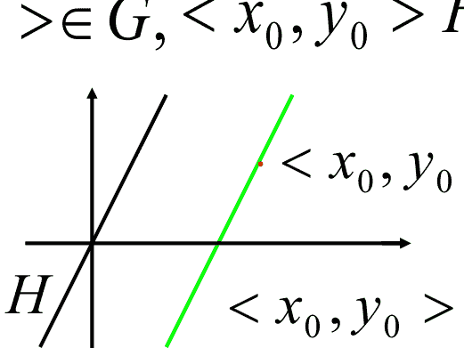

< A, Δ >
A a b c aΔc Δ
f(A) ⊆ B
< B, * >
B
f(a)
f(c)
f(a) * f(c)
f(aΔc)

## Thanks for your attention!

*接下来……*

*群与编码*

## Relations
关系

Rosen 7th ed., ch. 9

## 9 Relations

- 9.1 Relations and Their Properties
- 关系及关系性质
- 9.2 *n*-ary Relations and Their Applications
- n元关系及应用
- 9.3 Representing Relations 关系的表示
- 9.4 Closures of Relations 关系闭包
- 9.5 Equivalence Relations 等价关系
- 9.6 Partial Orderings 偏序关系

## 9.1 Relations and Their Properties

- Introduction
- Functions as relations
- Relations on Set
- Properties of Relations
- Combining Relations

## What are relations?

- 关系是形式化地指定两个或多个集合中的元素之间相互关联的一种手段
- 示例
  - 选修 {课程} 的 {学生}
  - {企业} 及其 {电话号码}
  - {整数} 及其 {约数}
  - {程序变量} 及其所使用的 {子程序}

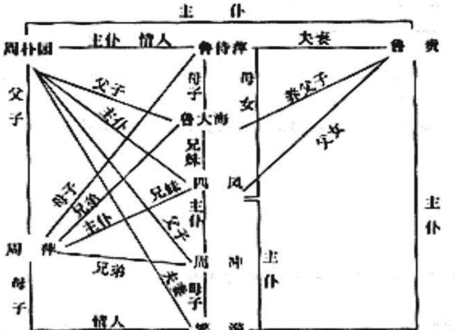

## 琅琊榜人物关系图

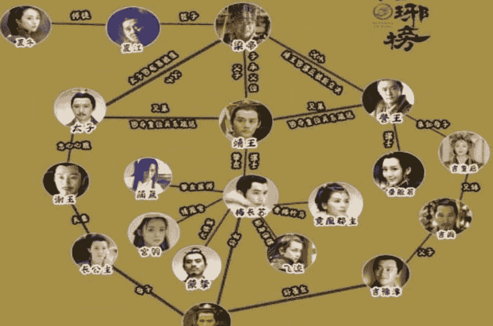

## 《人民的名义》人物关系图

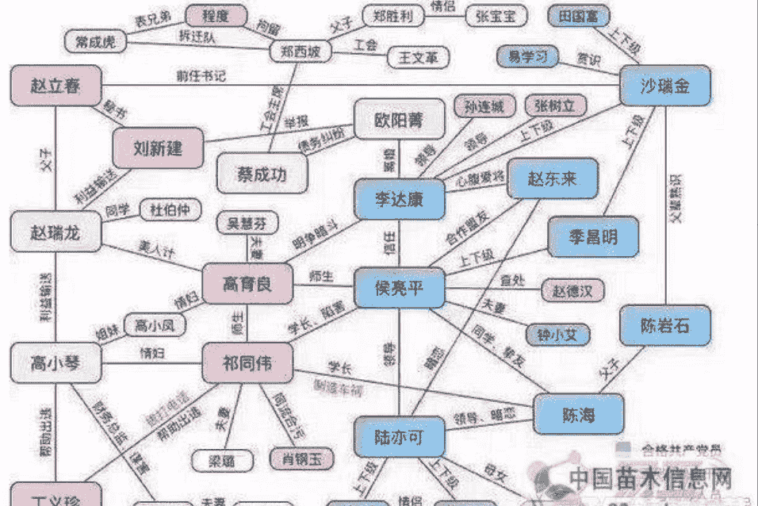

## 解构薄式“江湖” - 庭审实录中的72个人物关系

点击头像和小图显示人物关系及案情关系

贪污罪

滥用职权罪

受贿罪

王正刚

唐肖林

王立军

薄熙来

谢某

遇舍开来

谷明

尼尔·伍德


## 仙剑奇侠传一代至四代人物关系图 1.1A 图文版

二元关系：二个对象之间相关的关系

多元关系：多个对象之间的关系

多元关系常化成二元关系来研究

无序的二元关系：方块k与梅花k，谁在前，谁在后都还是同点的

有序的二元关系：父子关系，不能交换父与子的次序

又如：

- (1) a + b = 偶数，a 与 b 是无序的
- 用 [a, b] 表示无序对

- (2) a ≤ b，a 与 b 是有序的二元关系，叫作 a 相关于 b，记成 a r b，用 (a, b) 表示有序对

- (3) 无序的二元关系可用有序的二元关系表示
- 即 (a, b) 与 (b, a) 都属于这种二元关系

## Definition of relations

- 设 *A* 和 *B* 为两个集合。*A* 到 *B* 的一个 *二元关系* *R* 是 *A* × *B* 的一个子集。
  - 注意两个集合的顺序很重要。
- 更一般地，设 *A₁, A₂, ..., Aₙ* 为 *n* 个集合。*n* 元关系 *R* 在这些集合上是 *A₁* × *A₂* × ... × *Aₙ* 的一个子集。
  - 集合 *Aᵢ* 被称为该关系的 *域*，*n* 为其 *度*
  - 同样，域的顺序很重要。

## Binary Relations

- 设 $A, B$ 为任意集合。*A* 到 *B* 的一个 *二元关系* $R$，记作（带签名）$R:A\times B$，或 $R:A,B$，是集合 $A\times B$ 的一个子集（可以等同于）。
  - 例如，设 $\prec : \mathbb{N}\leftrightarrow\mathbb{N} := \{(n,m)\mid n<m\}$
- 记号 $aRb$ 或 $aRb$ 表示 $(a,b)\in R$。
  - 例如，$a\prec b$ 表示 $(a,b)\in\prec$
- 如果 $aRb$ 我们可以说“$a$ 与 $b$ 相关（由关系 $R$）”，
  - 或简单地说“$a$ 在关系 $R$ 下与 $b$ 关联”。
- 二元关系 $R$ 对应于谓词函数 $P_R:A\times B\to\{\mathrm{T},\mathrm{F}\}$，定义在两个集合 $A,B$ 上；
  - 例如，谓词“eats” $:= \{(a,b)\mid$ 生物 $a$ 吃食物 $b\}$


## 定义： 二元关系/binary relation

----按照某种规定，定义了一个有序对（a，b）的集合R，其中 a ∈ A， b ∈ B，称R为A到B的一个二元关系。

设 A 和 B 为集合。 从 A 到 B 的二元关系是 A × B 的子集。

R = {（a，b）| a ∈ A， b ∈ B， a r b } 其中 a r b 读作 a 相关于 b。

## 注意： 二元关系是指满足某规律的有序对的全体。

## Complementary Relations

- 设 $R:A,B$ 为任意二元关系。
- 那么，$\bar{R}:A\times B$，即 $R$ 的 *补集*，是这样定义的二元关系
  $\bar{R}:\equiv \{(a,b)\mid (a,b)\notin R\} = (A\times B) - R$
- 注意如果论域为 $U = A\times B$，这只是 $\bar{R}$；因此得名 *补集*。
- 注意 $\bar{R}$ 的补集是 $R$。

**Example:** $\not<$ = $\{(a,b)\mid (a,b)\notin <\} = \{(a,b)\mid \lnot a<b\} = \ge$

## Inverse Relations

- 任意二元关系 $R:A\times B$ 都有一个 *逆* 关系 $R^{-1}:B\times A$，定义为
  $$R^{-1}:=\{(b,a)\mid(a,b)\in R\}.$$ 
  *E.g.,* $<^{-1}=\{(b,a)\mid a<b\}=\{(b,a)\mid b>a\}=>$。

- *E.g.,* 若 $R:\text{People}\to\text{Foods}$ 定义为
  $$a\ R\ b\ \Leftrightarrow\ a\ eats\ b,$$
  则：
  $$b\ R^{-1}\ a\ \Leftrightarrow\ b\ is\ eaten\ by\ a.$$ (Passive voice.)

## Functions

- 函数 $f: A \to B$ 是从 A 到 B 的关系的一种特殊情况
  - 它满足性质：对于每个 $x \in A$，关系中恰好有一对 $(x, f(x))$
- 关系是对函数的推广
  - 它们允许 A 中未映射的元素
  - 它们允许一对多映射，其中 A 中的一个元素映射到 B 中的多个元素
  - 它们也允许多对一和多对多映射

## Relations on a Set

- 从集合 A 到自身的二元关系称为集合 A 上的关系。
- 例如，之前的 “<” 关系被定义为自然数集合 N 上的关系。
- 集合 A 上的二元恒等关系 I_A 是集合 {(a,a)|a∈A}。

## Example 4

- 设 A 为集合 {1,2,3,4}，哪些有序对在关系 R={(a,b) | a divides b} 中？

## Example 5

- 考虑整数集合上的这些关系：
- R₁={(a,b) | a≤b},
- R₂={(a,b) | a>b},
- R₃={(a,b) | a=b or a=-b},
- R₄={(a,b) | a=b},
- R₅={(a,b) | a=b+1},
- R₆={(a,b) | a+ b ≤3},
- 这些关系中哪些包含每一对 (1,1),(1,2),(2,1),(1,-1) 和 (2,2)？

## How many relations are there?

- 集合 $A$ 上有 $n$ 个元素的
- $A^2$ 有 $n^2$ 个元素。我们知道 $m$ 个元素的集合的子集数为 $2^m$，所以所需数目为 $2^{n^2}$。
- 从 A 到 A 的函数数为 $n^n$
- 这在渐近意义下相同吗？
- $n^n = (2^{\log n})^n = 2^{n\log n}$ 其增长速度慢于 $2^{n^2}$。

## Properties of Relations

- Reflexive 自反
- Symmetric 对称
- Transitive 传递

## Reflexivity

- 关系 $R$ 在 $A$ 上是 *自反* 的，如果 $\forall a\in A,\ aRa$。
  - *E.g.*, 关系 $\geq := \{(a,b)\mid a\geq b\}$ 是自反的。
- 关系 $R$ 是 *反自反* 的当且仅当其 *补关系* $\overline{R}$ 是自反的。
  - 示例：$<$ 是反自反的，因为 $\geq$ 是自反的。
  - 注意 “*反自反*” **不** 意味着 “*非自反*”！
    - 例如：人与人之间的 “喜欢” 关系不是自反的，但它也不是反自反的。
      - 因为不是每个人都喜欢自己，但也不是每个人都不喜欢自己！

## Example 7

- 考虑 {1,2,3,4} 上的这些关系：
- R₁={(1,1),(1,2),(2,1),(2,2),(3,4),(4,1),(4,4)},
- R₂={(1,1),(1,2),(2,1)},
- R₃={(1,1),(1,2),(1,4),(2,1),(2,2),(3,3),(4,1),(4,4)},
- R₄={(2,1),(3,1),(3,2),(4,1),(4,2),(4,3)},
- R₅={(1,1),(1,2),(1,3),(1,4),(2,2),(2,3),(2,4),(3,3),(3,4),(4,4)},
- R₆={(3,4)},
- 这些关系中哪些是自反的？

## Example 8,9

- Example 5 中的哪些关系是自反的？
- 正整数集合上的 “整除” 关系是自反的吗？


## 对称性与反对称性

- 二元关系 $R$ 在 $A$ 上是 *对称的* 当且仅当 $R = R^{-1}$，即 $(a,b) \in R \leftrightarrow (b,a) \in R$。
  - *例如，* $=$（相等）是对称的。 $<$ 不是。
  - “是配偶”是对称的，“喜欢”不是。
- 二元关系 $R$ 是 *反对称的* 如果 $\forall a \neq b, (a,b) \in R \rightarrow (b,a) \notin R$。
  - **例子：** $<$ 是反对称的，“喜欢”不是。
  - **练习：** 证明反对称的此定义等价于 $R \cap R^{-1} \subseteq I_A$ 这一陈述。

## 示例 10 11 12

- 示例 7 中的关系
- 示例 5 中的关系
- “整除”关系

- 对称性与反对称性？

## 传递性

- 关系 $R$ 是 *传递的* 当且仅当（对所有 $a,b,c$）
  $(a,b)\in R \land (b,c)\in R \rightarrow (a,c)\in R$。
- 关系是 *非传递的* 当且仅当它不是传递的。
- 一些例子：
  - “是……的祖先” 是传递的。
  - 人与人之间的“喜欢”是非传递的。
  - “位于 1 英里范围内”是... ？

## 示例 14 15 16

- 示例 7 中的关系
- 示例 5 中的关系
- “整除”关系
- 传递性？

## 数学中的例子

- = （相等）
- ≠ （不等）
- ∅ （空关系）

## 关系的性质

- 集合 $A$ 上的关系 $R$ 是
- *自反的*，如果
  - $\forall x \in A, (x, x) \in R$
- *对称的*，如果
  - $\forall x \forall y, (x, y) \in R \Rightarrow (y, x) \in R$
- *反对称的*，如果
  - $\forall x \forall y, (x, y) \in R \text{ and } (y, x) \in R \Rightarrow x = y$
- *传递的*，如果
  - $\forall x \forall y \forall z, (x, y) \in R \text{ and } (y, z) \in R \Rightarrow (x, z) \in R$

## 示例

- 考虑非负整数集合上的“整除”关系：x|y 当且仅当 x 整除 y。
- 自反？
  - 否。0 不整除 0。 （在正整数集合上会是自反的）
- 对称？
  - 否。2 整除 4，但反过来不行。
- 反对称？ 是
- 传递？ 是

## 计数自反关系

- 在具有 $n$ 个元素的集合 $A$ 上有多少个自反关系？
- 考虑集合 $B:\{(x, x)$ 且 $x \in A\}$。有 $n$ 个这样的对。对于 $(x, y)$ 且 $x \neq y$ 的对的每种配置，$B$ 的 $2^n$ 个子集中的一个对应于一个自反关系，其余的都不对应。因此对于每 $2^n$ 个关系有一个自反关系，或 $2^{n^2} / 2^n = 2^{n^2-n} = 2^{n(n-1)}$ 个自反关系总数。

## 非对称性与反对称性

- 二元关系 $R$ 在 $A$ 上是 *非对称的*，如果  
  $(a,b)\in R \rightarrow (b,a)\notin R$。
  - *例如，* $<$ 是非对称的，“喜欢”不是。
  - “是配偶”是对称的，“喜欢”不是。

- 二元关系 $R$ 是 *反对称的* 如果  
  $\forall a\ne b,\ (a,b)\in R \rightarrow (b,a)\notin R$。
  - **例子：** $\leq$ 是反对称的，“喜欢”不是。
  - **练习：** 证明反对称的此定义等价于 $R\cap R^{-1}\subseteq I_A$ 这一陈述。

## 组合关系

- 由于关系按定义是集合，因此它们可以以集合可以组合的任何方式组合，包括并集、交集和集合差。

## 示例 18 19

- R1 由所有有序对 (a,b) 组成，其中 a 是修过课程 b 的学生，
- R2 由所有有序对 (a,b) 组成，其中 a 是毕业需要课程 b 的学生。
- R1∪R2、R1∩R2、R1-R2、R2-R1 的关系是什么

  R1 ⊕ R2

19: R1 “小于” R2 “大于”

## 复合

- 两个关系 $R: A \to B$ 和 $S: B \to C$ 的 *复合*，记作 $S \circ R$，是从 $A$ 到 $C$ 的关系，包含所有这样的对 $(x, z)$，使得存在一个 $y \in B$ 满足 $(x, y) \in R$ 且 $(y, z) \in S.$

## 复合

定义：假设

- $R_1$ 是从集合 $A$ 到集合 $B$ 的关系。
- $R_2$ 是从集合 $B$ 到集合 $C$ 的关系。

那么 $R_2$ 与 $R_1$ 的 *复合*（或 *复合关系*）是从 $A$ 到 $C$ 的关系，其中

- 如果 $(x,y)$ 是 $R_1$ 的成员且 $(y,z)$ 是 $R_2$ 的成员，则 $(x,z)$ 是 $R_2 \circ R_1$ 的成员。


## 表示关系的复合

R₂∘R₁ = {(b,x),(b,z)}

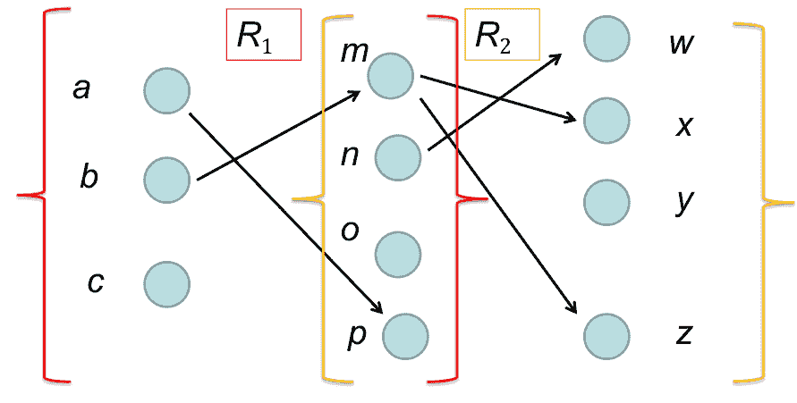

## 幂

- 关系 $R$ 在集合 $A$ 上的第 $n^{\text{th}}$ 幂 $R^n$ 可以递归定义为：
- $R^0 := I_A$；$R^{n+1} := R^n \circ R$ 对所有 $n \ge 0$。
- 如果需要，也可以定义 $R$ 的负幂，由 $R^{-n} := (R^{-1})^n$。

## 例 20

- 关系 R 与 S 的复合是什么，其中 R 是从 {1,2,3} 到 {1,2,3,4} 的关系且 R= {(1,1),(1,4),(2,3),(3,1),(3,4)}，而 S 是从 {1,2,3,4} 到 {0,1,2} 的关系且 S={(1,0),(2,0),(3,1),(3,2),(4,1)}？

## 关系的幂

**定义：** 设 *R* 是 *A* 上的二元关系。则关系 *R* 的幂 *R*ⁿ 可以归纳定义为：

- 基础步骤：*R*¹ = *R*
- 归纳步骤：*R*ⁿ⁺¹ = *R*ⁿ ∘ *R*

*(请参阅第 9.3 节的幻灯片以获得进一步的见解)*

传递关系的幂是该关系的子集。这由以下定理确立：

**定理 1：** 集合 *A* 上的关系 *R* 是传递的当且仅当 *R*ⁿ ⊆ *R* 对 *n* = 1,2,3, ……。

*(请参阅正文以通过数学归纳法获得证明)*

## 关系的幂

- 关系 *R* 的第 *n* 次幂对于 *n* ≥ 1 递归定义为
- $R^1 = R$
- $R^{n+1} = R^n \circ R$

## 例 22

- 设 R={(1,1),(2,1),(3,2),(4,3)}。求幂 Rⁿ，n=2,3,4,…

## 定理 1

- 集合 A 上的关系 R 是传递的当且仅当

  \[R^n \subseteq R\]

- 对于 n=1,2,3,...

## 作业

- § 9.1 − 40, 47, 48

## § 9.2: *n*-元关系

- 在集合 *A*₁,...,*A*ₙ 上的 *n*-元关系 *R*，记为（带签名）*R*:*A*₁×...×*A*ₙ 或 *R*:*A*₁,...,*A*ₙ，仅仅是子集 *R* ⊆ *A*₁×...×*A*ₙ。
- 集合 *A*ᵢ 被称为 *R* 的 *域*。
- *R* 的 *度* 为 *n*。
- *R* 在域 *A*ᵢ 中是 *函数式的* 如果对于域 *A*ᵢ 中的任意值 *a*ᵢ，它至多包含一个 *n*-元组 (..., *a*ᵢ,...)。

## 关系数据库

- 基于关系的数据库模型
- 数据库被视为 *记录* 的集合，每个记录都是形式为 (*value*₁, *value*₂, ..., *value*ₙ) 的元组
- 因为该关系通常以表格形式给出，所以在数据库术语中该术语（*table*）被用作关系的等价物

## 数据库内涵和外延

- 数据库的 *字段*（列）对应于关系的域
- 字段的数量是度 *n*
- 数据库的 *内涵*（或其 *模式*）是其设计的永久部分，即字段及其上的约束
- 数据库的 *外延* 是其记录的当前集合

## 数据库键

- 为了唯一标识数据库中的元组，我们需要知道在哪里查找，即指定一个用于此目的的字段。这是 *主键*。
- 在插入记录时必须注意维护键属性
- 某些数据库可能没有主键；相反它们使用由多个字段组成的 *复合* 键
  - 航班数据库：键 = 航空公司 + 航班号

## 选择算子

- 设 A 为任意 n-元域 A=A₁×...×Aₙ，且设 C:A→{T,F} 为元素（n-元组）上的任意条件（谓词）。
- 那么，选择算子 s_C 是将任意（n-元）关系 R 在 A 上映射到满足 C 的来自 R 的所有 n-元组的 n-元关系的算子。
- 即，∀R⊆A, s_C(R) = {a∈R | s_C(a) = T}

## 选择算子示例

- 假设我们有一个域
  *A* = StudentName × Standing × SocSecNos
- 假设我们在 *A* 上定义某个条件，
  *UpperLevel(name,standing,ssn) :=*
  *[(standing = junior) ∨ (standing = senior)]*
- 那么，*s_UpperLevel* 是选择算子，它取 *A* 上的任意关系 *R*（学生数据库）并产生一个仅由 *上层* 班级（大三和大四）组成的 关系。


## 投影算子

- 设 $A = A_1 \times \dots \times A_n$ 为任意 $n$ 元域，且 $\{i_k\} = (i_1, \dots, i_m)$ 为一序列指标，均落在 1 到 $n$ 的范围内，
  - 即 $1 \le i_k \le n$ 对所有 $1 \le k \le m$ 成立。
- 那么在 $n$ 元组上的 *投影算子* 定义为：
  $P_{\{i_k\}}: A \to A_{i_1} \times \dots \times A_{i_m}$

  $P_{\{i_k\}}(a_1, \dots, a_n) = (a_{i_1}, \dots, a_{i_m})$

## 投影示例

- 假设我们有一个三元 3-ary 域 *Cars* = Model × Year × Color。 （注意 $n = 3$。）
- 考虑指标序列 $\{i_k\} = 1, 3$。 ($m = 2$)
- 那么投影 $P$ 只是将每个元组 $(a_1, a_2, a_3) = (\text{model}, \text{year}, \text{color})$ 映射到其像：
  $P_{\{i_k\}}(a_{i_1}, a_{i_2}) = (a_1, a_3) = (\text{model}, \text{color})$
- 该算子可以很有用地应用于整个关系 $R \subseteq \text{Cars}$ （汽车数据库）以获得可用的型号/颜色组合列表。

## 连接示例

- 假设 $R_1$ 是一个教学安排表，关联 *Professors* 与 *Courses*。
- 假设 $R_2$ 是一个房间安排表，关联 *Courses* 与 *Rooms, Times*。
- 那么 $J(R_1, R_2)$ 就像你的课程表，列出 *(professor, course, room, time)*。

## § 9.3: 表示关系

- 表示 $n$ 元关系的几种方法：
  - 用其元组的显式列表或表格。
  - 用从域到 {T, F} 的函数。
    - 或用计算该函数的算法。
- 表示二元关系的特殊方法：
  - 用零一矩阵。
  - 用有向图。

## 使用零一矩阵

- 用 $|A| \times |B|$ 0-1 矩阵 $\mathbf{M}_R = [m_{ij}]$ 表示二元关系 $R \subseteq A \times B$，令 $m_{ij} = 1$ 当且仅当 $(a_i, b_j) \in R$。
- *E.g.*, 假设 Joe 喜欢 Susan 和 Mary，Fred 喜欢 Mary，且 Mark 喜欢 Sally。
- 那么关系 Likes: Boys × Girls 的 0-1 矩阵表示为：

|       | Susan | Mary | Sally |
|-------|-------|------|-------|
| Joe   | 1     | 1    | 0     |
| Fred  | 0     | 1    | 0     |
| Mark  | 0     | 0    | 1     |

## 零一自反，对称

- 术语：*自反，非自反，反自反，对称，反对称，和反对称。*
  - 这些关系特征通过检查零一矩阵很容易识别。

- 自反：对角线上全为 1
- 反自反：对角线上全为 0
- 对称：对角线两侧完全相同
- 反对称：所有 1 都与 0 相对

## 定义

当 $A = B$ 时，$R$ 是 $A$ 到 $A$ 的二元关系，称为 $A$ 上的二元关系。

A relation on the set $A$ is a relation from $A$ to $A$.

## 例

$R = \{(a, b) \mid a \mid b,\ a, b \in \mathbb{N}\}$ 是自然数集 $\mathbb{N}$ 上的二元关系。

## 函数作为二元关系

二元关系看成函数关系

$R = \{(a, b) \mid a R b,\ a \in A,\ b \in B\}$

$A$ 称为 $R$ 的定义域，记 $A = \operatorname{Dom} R$ 或 $D(R)$。

$B$ 称为 $R$ 的值域，记 $B = \operatorname{Range} R$ 或 $\operatorname{Ran} R$。

当定义域与值域交换得

$R^{c} = \{(b, a) \mid (a, b) \in R,\ a \in A,\ b \in B\}$，称为 $R$ 的逆关系。

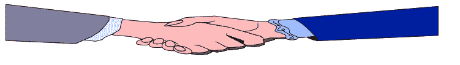

## 二元关系中的计数问题

Example 6:

How many relations are there on a set with $n$ elements?

## 二元关系的表示

因为二元关系本身也是集合，也可用穷举法、描述法来表示，还可用表格、图示、矩阵法表示。

例如：

$A = \{张三，李四，王五，赵六\}$

$B = \{100米，跳高，铅球，足球，跨栏\}$

穷举法表示：

$R = \{(张三，铅球)，(张三，足球)，(李四，100米)，(李四，跳高)，(王五，跨栏)，(赵六，100米)\}$

是运动会的报名表。

### 表格表示法：用表格表示一目了然

|       | 100米 | 跳高 | 铅球 | 足球 | 跨栏 |
|-------|-------|------|------|------|------|
| 张三  |       |      | √    | √    |      |
| 李四  | √     | √    |      |      |      |
| 王五  |       |      |      |      | √    |
| 赵六  | √     |      |      |      |      |

用字母数字来代替这些元素

$A = \{a, b, c, d\}$

$B = \{1, 2, 3, 4, 5\}$

### 关系矩阵法表示

把 $A$、$B$ 集合内元素排好序：

|   | 1 | 2 | 3 | 4 | 5 |
|---|---|---|---|---|---|
| a | 0 | 0 | 1 | 1 | 0 |
| b | 1 | 1 | 0 | 0 | 0 |
| c | 0 | 0 | 0 | 0 | 1 |
| d | 1 | 0 | 0 | 0 | 0 |

即 $R = (a_{ij})$。

## 注

- （1）若 $R = A \times B$，称此二元关系为普通关系。
- （2）设 $A = \{a_1, a_2, \dots, a_n\}$，
  $R = \{(a_i, a_j) \mid a_i, a_j \in A\}$。
  若 $R = \{(a_i, a_i) \mid a_i \in A\}$，称 $R$ 为恒等关系，用 $I_A$ 表示，是单位矩阵：

$$
I_A = \begin{bmatrix}
1 & 0 & 0 & \cdots & 0 \\
0 & 1 & 0 & \cdots & 0 \\
0 & 0 & 1 & \cdots & 0 \\
\vdots & \vdots & \vdots & \ddots & \vdots \\
0 & 0 & 0 & \cdots & 1
\end{bmatrix}
$$


### 对称性

(2) 对称性：若 \((a,b)\in R\)，必有 \((b,a)\in R\)，称 \(R\) 为对称的二元关系。

即 \(R\) 的相关矩阵为对称阵，\(a_{ij}=a_{ji}\)。

设 \(R\) 是集合 \(A\) 上的二元关系。若对任意 \(a,b\in A\)，只要 \((a,b)\in R\)，就有 \((b,a)\in R\)，则称 \(R\) 为对称关系。若对任意 \(a,b\in A\)，仅当 \(a=b\) 时才有 \((a,b)\in R\) 且 \((b,a)\in R\)，则称 \(R\) 为反对称关系。

## 例

恒等关系：既是对称的，又是反对称的；

而相关矩阵是

|   |   |   |   |
|---|---|---|---|
| 1 | 0 | 0 | 1 |
| 0 | 0 | 1 | 0 |
| 0 | 0 | 1 | 0 |
| 1 | 0 | 0 | 1 |

的二元关系，是既不对称，又不是反对称的。

## 注

\(a_{ij}\)、\(a_{jk}\) 中有一个不是 1，则 \(a_{ij}\land a_{jk}=0\)，\(a_{ik}\) 就可以任意。

即若 \((a,b),(b,c)\) 中有 1 个不属于 \(R\)，则讨论 \((a,c)\) 是否属于 \(R\)，无意义。即没有传递的条件，也不需要传递的结果。如：

\(A=\{a,b,c,d\}\)，\(R=\{(a,b),(c,d)\}\)。

二元关系的性质对应于关系图，有：

- (1) 自反性：每个顶点都有自回路；
- (2) 对称性：任二个顶点间或没有边，或有二条相对而指的有向边；
- (3) 反对称性：任二个顶点至多只有一条有向边；
- (4) 传递性：若 \(x\) 到 \(y\) 有边，\(y\) 到 \(z\) 有边，则 \(x\) 到 \(z\) 必有边。

## 例

\[
M_{R_1}=\begin{bmatrix}1 & 0 & 1\\0 & 0 & 1\\1 & 1 & 1\end{bmatrix}\quad
M_{R_2}=\begin{bmatrix}0 & 1 & 1 & 0\\1 & 1 & 0 & 0\\1 & 0 & 1 & 1\\0 & 0 & 1 & 1\end{bmatrix}\quad
M_{R_2}^2=\begin{bmatrix}1 & 1 & 1 & 1\\1 & 1 & 1 & 0\\1 & 1 & 1 & 1\\1 & 0 & 1 & 1\end{bmatrix}
\]

\[
M_{R_3}=\begin{bmatrix}1 & 1 & 1\\0 & 1 & 0\\0 & 0 & 0\end{bmatrix}\quad
M_{R_4}=\begin{bmatrix}0 & 0 & 1 & 1\\0 & 0 & 1 & 0\\0 & 0 & 0 & 1\\1 & 0 & 0 & 0\end{bmatrix}\quad
M_{R_4}^2=\begin{bmatrix}1 & 0 & 0 & 1\\0 & 0 & 0 & 1\\1 & 0 & 0 & 0\\0 & 0 & 1 & 1\end{bmatrix}
\]

\[
M_{R_5}=\begin{bmatrix}1 & 0 & 0 & 1\\0 & 1 & 1 & 1\\0 & 0 & 1 & 0\\0 & 0 & 0 & 1\end{bmatrix}\quad
M_{R_6}=\begin{bmatrix}0 & 1 & 1 & 1\\0 & 0 & 1 & 0\\0 & 0 & 0 & 1\\0 & 0 & 0 & 0\end{bmatrix}\quad
M_{R_6}^2=\begin{bmatrix}0 & 0 & 1 & 1\\0 & 0 & 0 & 1\\0 & 0 & 0 & 0\\0 & 0 & 0 & 0\end{bmatrix}
\]

### 例 4

\(R_4=\{(a,b)\mid a+b=\text{偶数},\ a,b\in\mathbb{N}\}\)

自反的、对称的、传递的。

因 \(a+b\) 为偶数，\(b+c\) 为偶数，则 \(a+c=(a+b)+(b+c)-2b=\) 偶数与偶数之差 = 偶数。

### 例 5

\(R_5=\{(a,b)\mid \gcd(a,b)=1\text{（互素）},\ a,b\in\mathbb{N}\}\)

对称的，但不是自反的，也无传递性。

## 二元关系的运算

### 关系的组合

二元关系是集合，集合有并、交、差、非和对称差的运算。故二元关系也存在这样的运算。

\(R\cap S=\varnothing\)

\(\overline{R}=\{(1,2),(2,1),(1,4),(4,1),(2,3),(3,2),(3,4),(4,3)\}\)

\(R-S=R\)，\(S-R=S\)，\(S\oplus R=R\cup S\)

**注：二元关系的矩阵运算：** 相关矩阵可表示二元关系，可用矩阵的逻辑运算来研究二元关系的运算。

设 \(A=\{a_1,a_2,\ldots,a_n\}\)，\(B=\{b_1,b_2,\ldots,b_m\}\)，\(R_1=(c_{ij})\)，\(R_2=(d_{ij})\)。


则：

- \(R_1\cup R_2=(c_{ij}\lor d_{ij})\)
- \(R_1\cap R_2=(c_{ij}\land d_{ij})\)
- \(R_1-R_2=(c_{ij}\land\overline{d_{ij}})\)
- \(\overline{R_1}=(\overline{c_{ij}})\)

其中：

逻辑加（∨）：\(0\lor0=0\)，\(0\lor1=1\)，\(1\lor0=1\)，\(1\lor1=1\)

逻辑乘（∧）：\(0\land0=0\)，\(0\land1=0\)，\(1\land0=0\)，\(1\land1=1\)

逻辑非（−）：\(\overline{0}=1\)，\(\overline{1}=0\)

对上例：

**R：**

|   |   |   |   |
|---|---|---|---|
| 1 | 0 | 1 | 0 |
| 0 | 1 | 0 | 1 |
| 1 | 0 | 1 | 0 |
| 0 | 1 | 0 | 1 |

**S：**

|   |   |   |   |
|---|---|---|---|
| 0 | 0 | 0 | 0 |
| 0 | 0 | 0 | 0 |
| 0 | 0 | 0 | 0 |
| 1 | 0 | 0 | 0 |

则用矩阵的逻辑运算：

### 关系的运算与闭包

二元关系作为集合，存在并、交、差、非和对称差的运算；

作为函数，也存在复合运算和逆运算；

作为特殊的集合和函数的推广，还存在闭包运算。

## 定义

设 \(R_1\) 为 \(A\) 到 \(B\) 的二元关系，\(R_2\) 为 \(B\) 到 \(C\) 的二元关系，

\(R_1=\{(a,b)\mid aR_1b,\ a\in A,\ b\in B\}\)

\(R_2=\{(b,c)\mid bR_2c,\ b\in B,\ c\in C\}\)

则 \(R_1\cdot R_2\) 是由 \(A\) 到 \(C\) 的二元关系，称为 \(R_1\)、\(R_2\) 的复合关系

\(R_3=\{(a,c)\mid (a,b)\in R_1,\ 且\ (b,c)\in R_2\}\)

记 \(R_3=R_1\cdot R_2\)。

## 例

\(R\) 是父子关系，则 \(R^2=R\cdot R\) 是祖孙关系。

\(R_2=\{(b_1,c_3),(b_1,c_4),(b_2,c_2),(b_2,c_3),(b_2,c_4),(b_3,c_1),(b_3,c_2),(b_4,c_2),(b_4,c_4)\}\) 是各专业本学期必修课的二元关系。

\(R_3=R_2\circ R_1=\{(a_1,c_1),(a_1,c_2),(a_1,c_3),(a_1,c_4),(a_2,c_2),(a_2,c_3),(a_2,c_4),(a_3,c_1),(a_3,c_2),(a_3,c_4),(a_4,c_2),(a_4,c_3),(a_4,c_4)\}\) 是选双学位学生本学期必修课的二元关系。

**普通的矩阵乘法：**

\(A=(a_{ij})_{m\times n}\)，\(B=(b_{jk})_{n\times L}\)，则 \(C=A\cdot B=(c_{ik})_{m\times L}\)

而 \(c_{ik}=\sum_{j=1}^{n}a_{ij}b_{jk}\)

**二元关系的复合的矩阵布尔型乘法：**

\(c_{ik}=\bigvee_{j=1}^{n}(a_{ij}\land b_{jk})\)


## 私募股权与风险投资

第34卷，第3期

2021年3月

## 本期内容

+   - 私募股权的下一场重头戏：二手份额的兴起
+   - 独角兽时代的风险投资
+   - SPAC 对传统 IPO 的影响
+   - 私募股权组合中的 ESG 考量

由 Institutional Investor, LLC 出版

ISSN 0163-6208

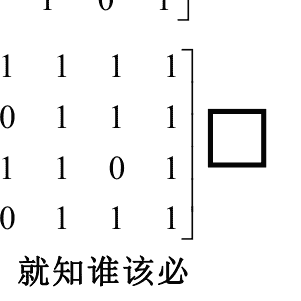

若 R 是 A 上二元关系，
R = { ( a , b ) | a r b , a ∈ A , b ∈ A }
若设：
R₁ = R
(1) R₂ = R · R = R² = { ( a , c ) | ( a , b ) , ( b , c ) ∈ R }
(2) 设 Rₙ = R · R ... R = Rⁿ 已定义，则
Rₙ₊₁ = Rₙ · R = Rⁿ · R = Rⁿ⁺¹
= { ( a , c ) | ( a , b ) ∈ Rⁿ , ( b , c ) ∈ R }

设 R 是集合 A 上的一个关系。R 的幂 Rⁿ（n=1,2,3,...）归纳定义如下：

R¹ = R 且 Rⁿ⁺¹ = Rⁿ R。

## 定理

集合 A 上的关系 R 是传递的，当且仅当对 n = 1,2,3,...，有 Rⁿ ⊆ R。

R² = { (0, 0), (0, 2), (0, 3), (2, 0), (2, 2), (2, 3), (3, 0), (3, 1), (3, 3) }

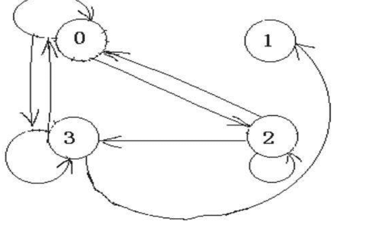

R²的关系图中不存在（3，2），（2，1），故 R⊄R²

## Rⁿ的关系图的构造：

可由 R 的关系图来构造，从 R 的每个结点 aᵢ 出发，数 n 条边。凡通过数 n 条边能到达的结点 aⱼ，则有（aᵢ，aⱼ）∈ Rⁿ。关系图中从 aᵢ 出发到 aⱼ 的边是存在的。

这样处理容易出错，用相关矩阵的布尔型乘法来做，简单，又不容易错，还适宜于计算机处理。

(4) ( R − S )ᶜ = ( R ∩ \bar S )ᶜ

→^{ii)} Rᶜ ∩ \bar Sᶜ →^{iii)} Rᶜ ∩ \overline{S^{C}} = Rᶜ − Sᶜ

(7) ( S · T )ᶜ = Tᶜ · Sᶜ
证:
对 ∀ ( x , y ) ∈ ( S · T )ᶜ , 有
⇔ ( y , x ) ∈ S · T
⇔ ∃ z ∈ B , 使 ( y , z ) ∈ S , ( z , x ) ∈ T
即： ( z , y ) ∈ Sᶜ , ( x , z ) ∈ Tᶜ
⇔ ( x , y ) ∈ Tᶜ · Sᶜ

(10) 证：

∀ (x, y) ∈ Rᶜ ⇒ (y, x) ∈ R

注： ⇒(y, x) ∈ S ⇒ (x, y) ∈ Sᶜ
R · T ∩ S · T ⊆ (R ∩ S) · T 不一定成立，
由于 (R ∩ S) · T ⊆ R · T ∩ S · T
若上式成立，
则 (R ∩ S) · T = R · T ∩ S · T
证明：等式不成立
若 ∀ a ∈ A, b₁, b₂ ∈ B, c ∈ C, 且
(a, b₁) ∈ R, (a, b₂) ∈ S,
(a, b₁) ∉ S, (a, b₂) ∉ R,
(b₁, c) ∈ T, (b₂, c) ∈ T,
显然 (a, c) ∈ R · T ∩ S · T
但 (a, c) ∉ (R ∩ S) · T

## 作业

+   - § 9.1 − 40, 47, 48
+   - § 9.2 − 8, 20
+   - § 9.3 − 14, 32
+   - § 9.4 − 20, 22, 28

## §9.4 关系的闭包

+   - 对于任意性质 *X*，集合 *A* 的“*X* 闭包”定义为包含 *A* 且具有该性质的“最小”超集。

## 关系的闭包

[定义1]：称 R ∪ I_A 是 R 的自反闭包，记为 r(R)。

[定理1]：设 R 是 A 上的二元关系, 则 r(R) 是包含 R, 具有自反性的最小关系。

证明: 对 ∀ x ∈ A, (x, x) ∈ I_A ⊆ R ∪ I_A, 且 R ⊆ R ∪ I_A。

若 R' 为包含 R 且具有自反性, 则 I_A ⊆ R', R ⊆ R', I_A ∪ R ⊆ R'。即 I_A ∪ R 为最小。

[推论1]: R 是自反闭包当且仅当 R 是自反的。

证明:

+   (1) R 是自反闭包, R = I_A ∪ R ⇒ I_A ⊆ R;
+   (2) R 具有自反性, I_A ⊆ R, R ∪ I_A = R;

[定义2]：称 R ∪ Rᶜ 是 R 的对称闭包，记为 s(R)。
[定理2]：设 R 是 A 上的二元关系，则 R ∪ Rᶜ 是对称的，包含 R 的最小关系，
（其中 Rᶜ 是 R 的逆关系）。
证明：若 (a, b) ∈ R ∪ Rᶜ，则
(a, b) ∈ R 或 (a, b) ∈ Rᶜ，
⇒ (b, a) ∈ Rᶜ 或 (b, a) ∈ R
故 (b, a) ∈ R ∪ Rᶜ（对称性），
若 R′ 为包含 R，对称的二元关系，
则对 ∀ (a, b) ∈ R ∪ Rᶜ，
若 (a, b) ∈ R ⇒ (a, b) ∈ R′；
若 (a, b) ∈ Rᶜ ⇒ (b, a) ∈ R，
⇒ (b, a) ∈ R′
又 R′ 具有对称性，(a, b) ∈ R′，
故 R ∪ Rᶜ ⊆ R′。

## [推论2]：当且仅当 R 是对称闭包时，R 具有对称性。

证明：（1）R 具有对称性，
若（a，b）∈ R，则（b，a）∈ R，
又（b，a）∈ Rᶜ
即 ∀（b，a）∈ Rᶜ，（a，b）∈ R
⇒（b，a）∈ R
⇒ Rᶜ ⊆ R ⇒ R ∪ Rᶜ = R；
（2）R 是对称闭包时，R = R ∪ Rᶜ ⇒ R 具有对称性。

## 有向图/二元关系中的路径

+   - 在有向图 *G*（或二元关系 *R*）中，从节点 *a* 到节点 *b* 的长度为 *n* 的*路径*是 $E_G$（或 $R$）中 *n* 个有序对组成的序列 $(a,x_1), (x_1,x_2), ..., (x_{n-1},b)$。
+     - 边的空序列被视为从 *a* 到 *a* 的长度为 0 的路径。
+     - 如果存在一条从 *a* 到 *b* 的路径，则称 *a* 与 *b* 是*连通的*。（“你可以从这里到达那里。”）
+   - 从 *a* 到自身且长度 *n*≥1 的路径称为*回路*或*圈*。
+   - 注意，在 *R* 中从 *a* 到 *b* 存在一条长度为 *n* 的路径，当且仅当 $(a,b) \in R^n$。


## 证明（第 1 部分）

- 假设 $(x, y)$ 和 $(y, z)$ 都在 $R^\infty$ 中。证明 $(x, z)$ 也在 $R^\infty$ 中。
- 根据 $R^\infty$ 的定义，对某个 $m$，$(x, y) \in R^m$；对某个 $n$，$(y, z) \in R^n$。
- 于是 $(x, z) \in R^n R^m = R^{m+n}$，而 $R^{m+n}$ 包含在 $R^\infty$ 中。
- 因此，$R^\infty$ 必定是传递的。

## 证明（第 3 部分）

- 现在设 $S$ 是包含 $R$ 的任意传递关系；证明 $S$ 包含 $R^\infty$（也就是说，$R^\infty$ 是这种关系中最小的一个）。
- 因为 $R \subseteq S$，且 $S$ 是传递的，所以 $R^2 \subseteq S^2 \subseteq S$。
- 因此对所有 $n$，有 $R^n \subseteq S^n \subseteq S$。（为什么？）
- 因此 $S$ 必定包含 $R^\infty$，因为 $S$ 还必须包含 $R$ 的所有幂的并集。
- 证毕。
- 事实上，我们只需考虑长度不超过 $n$ 的路径。

## 示例 1

- 设
  - $A = \{1, 2, 3, 4\}$
  - $R = \{(1, 2), (2, 3), (3, 4), (2, 1)\}$
- 求 $R$ 的传递闭包。

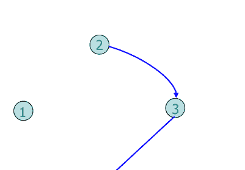

$$M_R = \begin{bmatrix} 0 & 1 & 0 & 0 \\ 1 & 0 & 1 & 0 \\ 0 & 0 & 0 & 1 \\ 0 & 0 & 0 & 0 \end{bmatrix}$$

## 证明

$$R^{\infty} = \bigcup_{i=1}^{\infty} R^{i} = R \cup R^{2} \cup R^{3} \cup \dots$$

$$R^{\infty} = \bigcup_{i=1}^{n} R^{i} = R \cup R^{2} \cup \dots \cup R^{n}$$

若对于 $k \le n < m$，有

- $R^{m} \subseteq R^{k}$
- $(a, b) \in R^{m} \rightarrow (a, b) \in R^{k}$

则该等式成立。

设 $a$ 和 $b$ 在 $A$ 中，并假设 $a, x_1, x_2, \dots, x_{m-1}, b$ 是 $R$ 中从 $a$ 到 $b$ 的一条长度为 $m$ 的路径。

- $(a, x_1) \in R$
- $(x_1, x_2) \in R$
- $\dots$
- $(x_{m-1}, b) \in R$

路径中有 $m+1$ 个元素，但 $A$ 中只有 $n$ 个互不相同的元素。因此路径中必然存在某个重复顶点，设为 $x_i = x_j = c$，其中 $i < j$。

- $(a, x_1) \in R$
- $(x_1, x_2) \in R$
- $\dots$
- $(x_{i-1}, x_i) \in R$
- $(x_i, x_{i+1}) \in R$
- $\dots$
- $(x_{j-1}, x_j) \in R$
- $(x_j, x_{j+1}) \in R$
- $\dots$
- $(x_{m-1}, b) \in R$

红色边在该路径中形成一个回路；删除这个回路，就得到一条新路径。

删除回路后，从 $a$ 到 $b$ 的新路径为：

- $(a, x_1) \in R$
- $(x_1, x_2) \in R$
- $\dots$
- $(x_{i-1}, x_i) \in R$
- $(x_j, x_{j+1}) \in R$
- $\dots$
- $(x_{m-1}, b) \in R$

满足 $x_i = x_j = c$ 的从 $a$ 到 $b$ 的路径：

$$a, x_1, x_2, \dots, x_{i-1}, c, x_{j+1}, \dots, x_{m-1}, b$$

其长度为 $k = m - j + i$。

该过程可一直持续到 $k \le n$，于是有

- $R^{m} \subseteq R^{k}$
- $\forall m\ ((m > n \land (a, b) \in R^{m}) \rightarrow \exists k\ (k \le n \land (a, b) \in R^{k}))$

因此

$$R^{\infty} = \bigcup_{i=1}^{n} R^{i} = R \cup R^{2} \cup \cdots \cup R^{n}$$

证毕。

## 简单传递闭包算法

用 0-1 矩阵计算 $R^*$ 的算法。

procedure transClosure($\mathbf{M}_R$: n×n 0-1 matrix)

```text
A := B := M_R;
for i := 2 to n begin
    A := A ⊙ M_R;  B := B ∨ A    {join}
end    {note A represents R^i, B represents ⋃_{j=1}^i R^j}
return B {Alg. takes Θ(n^4) time}
```

## 一些定义

- $W_k$：一个布尔矩阵，其中 $1 \le k \le n$
  - 当且仅当以下条件成立时，$W_k$ 在位置 $i, j$ 处为 1：
  - 在 $R$ 中存在一条从 $a_i$ 到 $a_j$ 的路径，且其内部顶点（如果有）都来自集合 $\{a_1, a_2, \dots, a_k\}$
- $W_0$ 和 $W_n$ 又如何？
  - 令 $W_0 = W_R$
  - $W_n = W^{\infty}$
  - $W_0, W_1, W_2, \dots, W_n$

## Warshall 算法

- 过程
  - 从 $R$ 的矩阵开始，
  - 由前一个矩阵 $W_{k-1}$ 计算每个矩阵 $W_k$，
  - 在 $n$ 步后得到 $W^{\infty}$。


## Warshall 算法

- 假设
  - $W_k = [t_{ij}]$
  - $W_{k-1} = [s_{ij}]$
  - 如果 $t_{ij} = 1$，那么必定存在一条从 $a_i$ 到 $a_j$ 的路径，其内部顶点来自集合 $\{a_1, a_2, ..., a_k\}$。
    - $a_k$ 是否是内部顶点？
    - 两种情况

- $a_k$ 不是内部顶点
  - 那么所有内部顶点实际上都来自集合 $\{a_1, a_2, \ldots, a_{k-1}\}$
  - 所以 $s_{ij}=1$。
- $a_k$ 是内部顶点
  - 假设 $a_k$ 只出现一次（为什么？）
  - 两条子路径
    - $a_i$ 到 $a_k$ 和 $a_k$ 到 $a_j$
  - $s_{ik}=1$ 且 $s_{kj}=1$

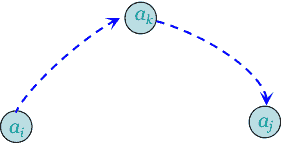

## Warshall 算法

- *步骤1*：
  - 首先将 $W_{k-1}$ 中所有的 1 传递到 $W_k$。
- *步骤2*：
  - 列出 $W_{k-1}$ 第 $k$ 列中条目为 1 的位置 $p_1, p_2, ...$
  - 列出 $W_{k-1}$ 第 $k$ 行中条目为 1 的位置 $q_1, q_2, ...$
- *步骤3*：
  - 在 $W_k$ 的所有位置 $p_i, q_j$ 处填入 1（如果它们尚未存在）

## 例2（1）

- 设
  - A={1, 2, 3, 4}
  - R={(1, 2), (2, 3), (3, 4), (2, 1)}
- 求 R 的传递闭包。

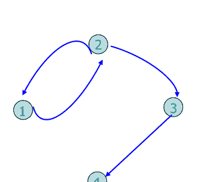

```
$M_R = \begin{bmatrix} 0 & 1 & 0 & 0 \\ 1 & 0 & 1 & 0 \\ 0 & 0 & 0 & 1 \\ 0 & 0 & 0 & 0 \end{bmatrix}$
```

## 例2

W₀ = ⎡0 1 0 0⎤   = M_R,   W₁ = ⎡0 1 0 0⎤
      ⎢1 0 1 0⎥               ⎢1 1 1 0⎥
      ⎢0 0 0 1⎥               ⎢0 0 0 1⎥
      ⎣0 0 0 0⎦               ⎣0 0 0 0⎦

W₂ = ⎡1 1 1 0⎤ ,   W₃ = ⎡1 1 1 1⎤ = W₄ = W^∞
     ⎢1 1 1 0⎥         ⎢1 1 1 1⎥
     ⎢0 0 0 1⎥         ⎢0 0 0 1⎥
     ⎣0 0 0 0⎦         ⎣0 0 0 0⎦

## Warshall 算法

```
Algorithm Warshall
CLOSURE←MAT
    For k = 1 thru N
        For i = 1 thru N
            For j = 1 thru N
                CLOSURE[i,j]←CLOSURE[i,j]
                    ∨(CLOSURE[i,k]∧CLOSURE[k,j])
End of Algorithm Warshall
```

## Warshall 算法

+ 1) 置新矩阵 $A := M$
+ 2) $i := 1$

3) 对所有 $j$, 若 $A[j,i]=1$, 则对 $k=1,2,\cdots,n$ 
$A[j,k]:=A[j,k]+A[i,k]$ 
$j$ 行 $\leftarrow j$ 行 $+ i$ 行 
4) $i+1$ 
5) 若 $i \le n$, 则转 3), 否则停止.

## 定理3

- 如果 $R$ 和 $S$ 是集合 $A$ 上的等价关系，那么同时包含 $R$ 和 $S$ 的最小等价关系是 $(R\cup S)^\infty$

## 例3

- 设 $A = \{1, 2, 3, 4, 5\}$，$R$ 和 $S$ 如下：

$M_R = \begin{bmatrix}1 & 1 & 0 & 0 & 0 \\ 1 & 1 & 0 & 0 & 0 \\ 0 & 0 & 1 & 1 & 0 \\ 0 & 0 & 1 & 1 & 0 \\ 0 & 0 & 0 & 0 & 1\end{bmatrix}$ 且 $M_S = \begin{bmatrix}1 & 0 & 0 & 0 & 0 \\ 0 & 1 & 0 & 0 & 0 \\ 0 & 0 & 1 & 0 & 0 \\ 0 & 0 & 0 & 1 & 1 \\ 0 & 0 & 0 & 1 & 1\end{bmatrix}$

## [定理5]:

设 | A | = n， R 是 A 上二元关系，则存在正整数 k， k ≤ n，使 R* = R ∪ R² ∪ ... ∪ R^k。

## 证明：

对 ∀ ( x， y ) ∈ R*， ∃ k，使 ( x， y ) ∈ R^k，表明在 A 中存在不同元素 a₁， a₂， ...， a_{k-1}，使 ( x， a₁ )， ( a₁， a₂ )， ( a₂， a₃ )， ...， ( a_{k-1}， y ) ∈ R。

若 k > n，由鸽洞原理，则 a₁， a₂， ...， a_{k-1}， y 中至少有两个相同，不妨设 a_i = y， ( i ≤ k − 1 )。

## 例 6：

设 A = { 1, 2, 3 }, R = { ( 1, 1 ), ( 1, 2 ), ( 2, 3 ) } 求 R*。

解: R = [[1 1 0],[0 0 1],[0 0 0]], R² = [[1 1 1],[0 0 0],[0 0 0]] = R³

故 R* = R ∪ R² ∪ R³ = [[1 1 1],[0 0 1],[0 0 0]]

R* = { ( 1, 1 ), ( 1, 2 ), ( 1, 3 ), ( 2, 3 ) }

注：当 |A| = n 较大时，用定理5计算 R* 工作量非常大。

```
Warshall算法：（1962）
设R是n个元素集合上的二元关系
(1) 是R的相关矩阵；
(2) i ← 1；
(3) for j = 1 to n do
        if a_{j,i} = 1 then do
            for k = 1 to n do
                a_{j,k} ← a_{j,k} ∨ a_{i,k}
(4) i = i + 1；
(5) if i ≤ n, then go (3)
        else stop
```

注：（1）结果(a_ij)_{n×n}是 R* 的相关矩阵。
（2）算法的复杂度为 n³。

## 例7：A = { a, b, c, d }
R = { (a, b), (b, c), (c, d) }

计算 R*。

j=1,  a13=1 ⇒ a14=1

j=2,  a23=1 ⇒ a24=1

即

R* = { ( a,  b ),  ( a,  c ),
       ( a,  d ),  ( b,  c ),
       ( b,  d ),  ( c,  d ) }


## 更快的传递闭包算法

```
procedure transClosure(M_R: rank-n 0-1 mat.)
  A := M_R;
  for i := 1 to ⌈log₂ n⌉ begin
    A := A ⊙ (A+I_n); {A represents ⋃_{j=1}^{2^{i+1}-1} R^j }
  end
  return A
  {Alg. takes only Θ(n³ log n) time!}
```

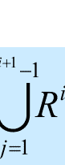

## Roy-Warshall 算法

- 仅使用 Θ(n³) 次运算！

### Procedure Warshall(M_R : rank-n 0-1 matrix)

```
W := M_R
for k := 1 to n
  for i := 1 to n
    for j := 1 to n
      w_ij := w_ij ∨ (w_ik ∧ w_kj)
return W  {this represents R*}
```

\(w_{ij}=1\) 表示存在一条从 \(i\) 到 \(j\) 的路径，且只经过节点 \(\le k\)。

## § 9.5: 等价关系

- *等价关系*（e.r.）在集合 \(A\) 上，简单地是 \(A\) 上的二元关系，且是自反的、对称的和传递的。
  - *例如*，\(=\) 本身就是一个等价关系。
- 对于任意函数 \(f:A\to B\)，关系“具有相同的 \(f\) 值”，或 \(=_f := \{(a_1,a_2) \mid f(a_1)=f(a_2)\}\) 是一个等价关系，
  - *例如*，设 \(m=\)“母亲” 则 \(=_m\) = “有相同的母亲” 是一个 e.r.

## 等价关系

### [定义1] 等价关系:

\(A\) 上的二元关系 \(R\)，如果 \(R\) 是

- (1) 自反的
- (2) 对称的
- (3) 传递的

称 \(R\) 为等价关系/Equivalence Relations。

\((a, b) \in R\)，称 \(a\) 与 \(b\) 等价。

## 等价关系示例

- “字符串 \(a\) 和 \(b\) 长度相同。”
- “整数 \(a\) 和 \(b\) 具有相同的绝对值。”
- “实数 \(a\) 和 \(b\) 具有相同的小数部分。” (*即*，\(a − b \in \mathbf{Z}\))
- “整数 \(a\) 和 \(b\) 对模 \(m\) 有相同的余数。”（对于给定的 \(m>1\)）

## 等价类

- 设 \(R\) 是集合 \(A\) 上的任意等价关系。
- \(a\) 的 *等价类*，
  \([a]_R := \{b \mid aRb\}\) （可选下标 \(R\)）
  - 它是 \(A\) 中所有根据等价关系 \(R\) 与 \(a\) “等价” 的元素的集合。
  - 每个这样的 \(b\)（包括 \(a\) 本身）称为 \([a]_R\) 的一个 *代表元*。
- 由于 \(f(a)=[a]_R\) 是 \(a\) 的函数，任何等价关系 \(R\) 都可以用 \(aRb :=\) “\(a\) 和 \(b\) 具有相同的 \(f\) 值” 来定义，给定 \(f\)。

## 解法，一个典型的方式

- 首先
  - 显然 \(a \equiv a \pmod{2}\)。
  - 因此 \(R\) 是 *自反的*。
- 其次
  - 如果 \(a \equiv b \pmod{2}\)，则 \(a\) 和 \(b\) 除以 2 时得到相同的余数，所以 \(b \equiv a \pmod{2}\)。
  - \(R\) 是 *对称的*。
- 最后
  - 假设 \(a \equiv b \pmod{2}\) 且 \(b \equiv c \pmod{2}\)。则 \(a\)、\(b\) 和 \(c\) 除以 2 时得到相同的余数。
  - 因此，\(a \equiv c \pmod{2}\)。
  - \(R\) 是 *传递的*。
- 故同余模 2 是一个等价关系。

### [定义2] 把 \(A\) 中的等价元素归为一类，称为等价类/equivalence class。记为 \([a]_R\) 或 \([a]\)。

### [定理1] \(R\) 是集合 \(A\) 上的一个等价关系，则下列命题是等价的：

1. \((a,b) \in R\)
2. \([a]=[b]\)
3. \([a]\cap [b]\neq \emptyset\)

注：等价关系 \(R\) 把 \(A\) 的元素分为若干类，各类之间没有公共元素。确定的 \(R\) 是对集合 \(A\) 进行的一个划分。

### [定义3] 集合的划分：把集合 \(A\) 分为若干子集 \(A_1, A_2, ...\)，满足：

- (1) 当 \(i\neq j\) 时 \(A_i\cap A_j=\emptyset\)
- (2) \(\forall a\in A,\exists i\)，使 \(a\in A_i\)（\(i=1,2,...\)）

则集合 \(P_r(A)=\{A_1,A_2,...,A_n,...\}\) 称为 \(A\) 的一个划分/partition。

## 划分

- 集合 \(A\) 的一个 *划分* 是对于 \(A\) 上的某个等价关系的所有等价类组成的集合 \(\{A_1, A_2, ...\}\)。
  - \(A_i\) 彼此不相交且它们的并集 = \(A\)。
  - 它们将集合“划分”成若干块。在每个块内，该集合的所有成员彼此等价。

## 等价关系与划分

- 如果 \(\mathbf{P}\) 是集合 \(A\) 的一个划分，则 \(\mathbf{P}\) 可用于在 \(A\) 上构造一个等价关系。

## Theorem 1

- 设 \(\mathbf{P}\) 是集合 \(A\) 的一个划分。定义 \(A\) 上的关系 \(R\) 如下：
  - \(a\,R\,b\) 当且仅当 \(a\) 和 \(b\) 是同一块的成员。
- 则 \(R\) 是 \(A\) 上的一个等价关系。

## Proof

- 如果 \(a\in A\)，则显然 \(a\) 与其自身在同一块中；所以 \(a\,R\,a\)。
- 如果 \(a\,R\,b\)，则 \(a\) 和 \(b\) 在同一块中；所以 \(b\,R\,a\)。
- 如果 \(a\,R\,b\) 且 \(b\,R\,c\)，则 \(a\)、\(b\) 和 \(c\) 必须全部位于 \(\mathbf{P}\) 的同一块中。因此 \(a\,R\,c\)。
- 由于 \(R\) 是自反的、对称的和传递的，\(R\) 是一个等价关系。
- \(R\) 将被称为由 \(\mathbf{P}\) *确定的等价关系*。
- QED


## Example

- 设 \(A = \{1, 2, 3, 4\}\) 并考虑 \(A\) 的划分 \(\mathbf{P} = \{\{1, 2, 3\}, \{4\}\}\)。求由 \(\mathbf{P}\) 确定的 \(A\) 上的等价关系 \(R\)。
- **Solution**
  - \(\mathbf{P}\) 的块为 \(\{1, 2, 3\}\) 和 \(\{4\}\)。
  - 同一块中的每个元素都与该块中的每一个其他元素相关，并且只与这些元素相关。
  - 因此 \(R = \{(1, 1), (1, 2), (1, 3), (2, 1), (2, 2), (2, 3), (3, 1), (3, 2), (3, 3), (4, 4)\}\)。

## Lemma 1（引理）

设 \(R\) 是集合 \(A\) 上的一个等价关系，且 \(a \in A\) 且 \(b \in A\)。则
\[
a\,R\,b \quad \text{if and only if} \quad R(a) = R(b).
\]

## Theorem 2

设 \(R\) 是 \(A\) 上的等价关系，且 \(\mathbf{P}\) 是所有不同的相对集合 \(R(a)\) 对于 \(a \in A\) 的集合。则 \(\mathbf{P}\) 是 \(A\) 的一个划分，且 \(R\) 是由 \(\mathbf{P}\) 确定的等价关系。

- \(R = \{(1, 1), (1, 2), (1, 3), (2, 1), (2, 2), (2, 3), (3, 1), (3, 2), (3, 3), (4, 4)\}\)
- \(R(1) = R(2) = R(3) = \{1, 2, 3\}, R(4) = \{4\}\)
- \(\mathbf{P} = \{R(1), R(4)\}\)

## Proof

设 \(\mathbf{P} = \{R(a) \mid a \in A\}\)。

- \(A\) 的每个元素都属于某个相对集合，因为由 \(R\) 的自反性，\(a \in R(a)\)。
- 如果 \(R(a)\) 和 \(R(b)\) 不相同，则 \(R(a) \cap R(b) = \varnothing\)。
- Contrapositive（换质位命题、对换式、逆反式）：如果 \(R(a) \cap R(b) \neq \varnothing\)，则 \(R(a) = R(b)\)。

- 设 \(c \in R(a) \cap R(b)\)。
  - \(a\,R\,c\)，\(b\,R\,c\)。
  - \(c\,R\,b\)，因为 \(R\) 是对称的。
  - \(a\,R\,b\)，因为 \(R\) 是传递的。
  - 根据引理 1，\(R(a) = R(b)\)。
- 所以，\(\mathbf{P}\) 是一个划分。
- \(a\,R\,b\) 当且仅当 \(a\) 和 \(b\) 属于 \(\mathbf{P}\) 的同一块。因此 \(\mathbf{P}\) 确定 \(R\)。

QED

## Equivalence classes

- 如果 \(R\) 是 \(A\) 上的等价关系，则集合 \(R(a)\) 传统上称为 \(R\) 的 *等价类*，记为 \([a]\)。
- 由 \(R\) 的所有等价类组成的划分 \(\mathbf{P}\) 记为 \(A/R\) 并称为：
  - *商集*，或
  - *由 \(R\) 诱导的 \(A\) 的划分*，或
  - \(A\) *模 \(R\) *。

## Example 7

- 设
  - \(A = \{1, 2, 3, 4\}\)
  - \(R = \{(1, 1), (1, 2), (2, 1), (2, 2), (3, 4), (4, 3), (3, 3), (4, 4)\}\)。
- 确定 \(A/R\)。
- **Solution**
  - \(R(1) = \{1, 2\} = R(2)\)
  - \(R(3) = \{3, 4\} = R(4)\)。
  - 故 \(A/R = \{\{1, 2\}, \{3, 4\}\}\)。

## Determining partitions \(A/R\)

- **STEP 1**: 选择 \(A\) 的任意元素并计算等价类 \(R(a)\)。
- **STEP 2**: 如果 \(R(a) \neq A\)，选择未包含在 \(R(a)\) 中的元素 \(b\)，并计算等价类 \(R(b)\)。
- **STEP 3**: 如果 \(A\) 不是之前计算的等价类的并集，则选择 \(A\) 中不在这些等价类中的元素 \(x\) 并计算 \(R(x)\)。
- **STEP 4**: 重复步骤 3 直到 \(A\) 的所有元素都被包含在计算出的等价类中。如果 \(A\) 可数，此过程可能无限继续。在这种情况下，继续直到出现允许你描述或给出所有等价类的公式的模式。

## Example 14

- 整数按模 4 同余产生的划分中的集合是什么？

## Example 8

- 设 \(R\) 为模 2 同余定义的等价关系；确定 \(A/R\)。
- **Solution**
  - \(R(0) = \{\ldots, -6, -4, -2, 0, 2, 4, 6, \ldots\}\)
  - \(R(1) = \{\ldots, -5, -3, -1, 1, 3, 5, 7, \ldots\}\)
  - 故 \(A/R\) 由偶整数集合和奇整数集合组成。

## 注

- （1）\(P_\gamma(A) \subseteq p(A)\)（\(A\) 的幂集）
- （2）当且仅当 \(A = \Phi\) 时，\(P_\gamma(A) = p(A) = \{\Phi\}\)
- （3）\(A\) 非空时 \(P_\gamma(A) \subset p(A)\)

## 定理1

\(A\) 在等价关系 \(R\) 下的等价类正是 \(A\) 的一种划分。\(A\) 的任一种划分，也必有 \(A\) 上的一个等价关系 \(R\) 与之对应。

这与 \(A_i\) 和 \(A_j\) 为不同的等价类矛盾。故 \(A_i \cap A_j = \Phi\)。所以，\(R\) 完成了等价类的划分。

若 \(A\) 已进行了划分，则构造二元关系 \(R\)。（1）\(\forall a \in A\)，使 \((a, a) \in R\)。（2）分别对每一等价类内所有两个不同元素 \(a, b\)，\((a, b) \in R\)，且 \((b, a) \in R\)。

显然，\(R\) 是自反的、对称的，而且也是传递的，因为若 \((a, b) \in R\)，\((b, c) \in R\)，则 \(a, b, c\) 均在同一等价类内，故 \((a, c) \in R\)。


## 例 1：

A = { 5 2 张扑克 }

R₁ = { ( a , b ) | a 与 b 同花， a ， b 是扑克 }

R₂ = { ( a , b ) | a 与 b 同点， a ， b 是扑克 }

则： R₁ 把 A 分为四类同花类，

R₂ 把 A 分为 13 类同点类。

## 例 2：

A = { 0 , 1 , 2 , 3 , 4 , 5 }

R = { ( 0 , 0 ) , ( 1 , 1 ) , ( 2 , 2 ) , ( 3 , 3 ) , ( 1 , 2 ) , ( 1 , 3 ) , ( 2 , 1 ) , ( 2 , 3 ) , ( 3 , 1 ) , ( 3 , 2 ) , ( 4 , 4 ) , ( 4 , 5 ) , ( 5 , 4 ) , ( 5 , 5 ) }

R 是等价关系，但不直观，用关系图表示。

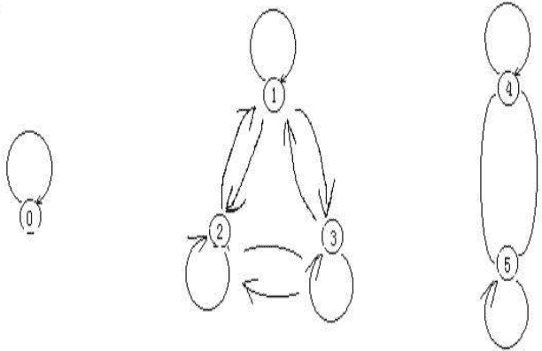

三个不连通的图

二元关系R是自反的，对称的，传递的，且把A分成了三个等价类，（A）= { { 0 }， { 1， 2， 3 }， { 4， 5 } }

[定义] 商集：等价关系R将A分成若干等价类，每个类选个代表组成新的集合称为A关于R的商集，表示为A/R。
例：在上例中
A/R = { [ 0 ]， [ 1 ]， [ 4 ] }

[定义]：商集的元素个数（即A在R下的等价类个数）称为R的秩。

## 例 3：

R = { ( a , b ) | a ≡ b ( mod 3 ), a , b ∈ I } 是整数集合 I 上模 3 同余的二元关系。

证明 R 是等价关系。

证明：由于 3 | ( a − b ) a ≡ b ( mod 3 )

+   (1) 3 | ( a − a ) ， 自反性
+   (2) 若 3 | ( a − b ) ，则 3 | ( b − a ) 对称性
+   (3) 若 3 | ( a − b ) ， 3 | ( b − c ) ，则 a − c = ( a − b ) + ( b − c ) ⇒ 3 | ( a − c )

满足传递性，故 R 是等价关系

商集： I / R = { [ 0 ] , [ 1 ] , [ 2 ] }

其中 [ 0 ] = { ..., −6 , −3 , 0 , 3 , 6 , ... } [ 1 ] = { ..., −5 , −2 , 1 , 4 , 7 , ... } [ 2 ] = { ..., −4 , −1 , 2 , 5 , 8 , ... }

## 例 4：

N 的一个划分为：若 10^{i-1} ≤ a < 10^{i}，则 a ∈ A^{i}，对应的等价关系
R = { (a, b) | a 与 b 有相同位数，a, b ∈ N } 相同位的数归为一类，此 R 把 N 划分为可列个等价类。

## 等价关系的运算

## 定理2
若 $R_1$，$R_2$ 是 $A$ 上的等价关系，则 $R_1\cap R_2$ 也是等价关系。

证明：$R_1\cap R_2=R_3$，$R_3$ 传递。

(1) 对任意 $a\in A$，由 $R_1$，$R_2$ 自反，$(a,a)\in R_1$，$(a,a)\in R_2$，于是 $(a,a)\in R_1\cap R_2=R_3$，$R_3$ 自反。

(2) 若 $(a,b)\in R_3$，则 $(a,b)\in R_1$ 且 $(a,b)\in R_2$，由 $R_1$，$R_2$ 对称，$(b,a)\in R_1$，$(b,a)\in R_2$，于是 $(b,a)\in R_1\cap R_2=R_3$，$R_3$ 对称。

(3)若（a，b）∈ R₃，（b，c）∈ R₃

⇒ { (a,b) ∈ R₁, (b,c) ∈ R₁ ⇒ (a,c) ∈ R₁
{ (a,b) ∈ R₂, (b,c) ∈ R₂ ⇒ (a,c) ∈ R₂

于是（a，c）∈ R₁ ∩ R₂ = R₃，R₃传递。
归纳以上三点，R₃ = R₁ ∩ R₂ 也是等价的二元关系。

## 定理3
若 R₁，R₂ 是 A 上等价关系，则 R₁ ∪ R₂ 是相容关系。

注：R₁ ∪ R₂ 不一定是等价关系。

证明：
设 R₄ = R₁ ∪ R₂
(1) ∀ a ∈ A，(a，a) ∈ R₁，(a，a) ∈ R₂，于是 (a，a) ∈ R₁ ∪ R₂ = R₄。
(2) 若 (a，b) ∈ R₄，(a，b) ∈ R₁ 或 (a，b) ∈ R₂ 由 R₁，R₂ 对称性，(b，a) ∈ R₁ 或 (b，a) ∈ R₂，于是 (b，a) ∈ R₁ ∪ R₂ = R₄

注：R₄ = R₁ ∪ R₂ 是相容的，即 R₁ ∪ R₂ 不一定是等价关系 若 (a，b) ∈ R₄，(b，c) ∈ R₄ (a，b) 与 (b，c) 可能分别属于 R₁ 与 R₂，无法保证 R₁ ∪ R₂ 的传递性。

例 5：
A = { a , b , c }
R₁ = { ( a , a ) , ( b , b ) , ( c , c ) , ( a , b ) , ( b , a ) }
R₂ = { ( a , a ) , ( b , b ) , ( c , c ) , ( b , c ) , ( c , b ) }
R₄ = R₁ ∪ R₂ = { ( a , a ) , ( b , b ) , ( c , c ) , ( a , b ) , ( b , a ) , ( b , c ) , ( c , b ) }
显然，( a , b ) , ( b , c ) ∈ R₁ ∪ R₂
但 ( a , c ) ∉ R₁ ∪ R₂ (不具有传递性)，
但 ( R₁ ∪ R₂ ) * 一定是传递的。

## 定理4
若 R₁， R₂ 是 A 上等价关系，
则 (R₁ ∪ R₂) * 也是 A 上等价关系。

证明：

(1) ∀ a ∈ A， (a, a) ∈ (R₁ ∪ R₂) ⊆ (R₁ ∪ R₂) *

(2) (R₁ ∪ R₂) 是对称的，只需证明对称的二元关系的传递扩张还是对称的。

设 R 是 A 上对称的二元关系， R₁ 是 R 的传递扩张，若 (a, b) ∈ R₁，则 (a, b) ∈ R 或 (a, b) ∈ R·R，

a. 若 (a, b) ∈ R， (b, a) ∈ R， 故 (b, a) ∈ R₁；

b. 若（a，b）∈ R·R，则∃c，使
（a，c），（c，b）∈ R
⇒ （b，c），（c，a）∈ R
⇒ （b，a）∈ R·R
⇒ （b，a）∈ R₁

由（R₁∪R₂）对称⇒（R₁∪R₂）₁也对称，...，
对任一k，（R₁∪R₂）ₖ也对称。
若（a，b）∈（R₁∪R₂）*，则∃k，
使（a，b）∈（R₁∪R₂）ₖ，
故（b，a）∈（R₁∪R₂）ₖ⊆（R₁∪R₂）*，
于是（R₁∪R₂）*是对称的。
（3）任一传递闭包都具有传递性。
即证。

等价关系对应于集合的一种分划。

设 $R_1$，$R_2$ 是 $A$ 上等价关系，对应的分划为 $\pi_1$，$\pi_2$，

$\pi_1 \cdot \pi_2$ 对应于 $R_1 \cap R_2$，称为二个分划的积，使分划分更细；

$\pi_1 + \pi_2$ 对应于 $(R_1 \cup R_2)^*$，称为两个分划的和，使分划比 $\pi_1$，$\pi_2$ 要粗。

例 6：

$A = \{a，b，c，d，e，f，g，h，i，j，k\}$

R₁ ↔ π₁ = { abcd̅ₐ₁ , efg̅ₐ₂ , hi̅ₐ₃ , jk̅ₐ₄ }

R₂ ↔ π₂ = { abch̅ʙ₁ , di̅ʙ₂ , efik̅ʙ₃ , g̅ʙ₄ }

R₁ = { (a, a), (b, b), (c, c), (d, d), (e, e), (f, f), (g, g), (h, h), (i, i), (j, j), (k, k), (a, b), (a, c), (a, d), (b, c), (b, d), (c, d), (b, a), (c, a), (d, a), (c, b), (d, b), (d, c), (e, f), (e, g), (f, g), (f, e), (g, e), (g, f), (h, i), (i, h), (j, k), (k, j) }

R₂ = { ( a , a ) , ( b , b ) , ( c , c ) , ( d , d ) , ( e , e ) , ( f , f ) , ( g , g ) , ( h , h ) , ( i , i ) , ( j , j ) , ( k , k ) , ( a , b ) , ( a , c ) , ( a , h ) , ( b , c ) , ( b , h ) , ( c , h ) , ( b , a ) , ( c , a ) , ( h , a ) , ( c , b ) , ( h , b ) , ( h , c ) , ( d , i ) , ( i , d ) , ( e , f ) , ( e , j ) , ( e , k ) , ( f , j ) , ( f , k ) , ( j , k ) , ( f , e ) , ( j , e ) , ( k , e ) , ( j , f ) , ( k , f ) , ( k , j ) }


R₁ ∩ R₂ = { ( a , a ) ,  ( b , b ) ,  ( c , c ) ,  ( d , d ) ,  ( e , e ) ,  ( f , f ) ,  ( g , g ) ,  ( h , h ) ,  ( i , i ) ,  ( j , j ) ,  ( k , k ) ,  ( a , b ) ,  ( a , c ) ,  ( b , c ) ,  ( e , f ) ,  ( j , k ) ,  ( b , a ) ,  ( c , a ) ,  ( c , b ) ,  ( f , e ) ,  ( k , j ) }

R₁ ∪ R₂ = { ( a , a ) , ( b , b ) , ( c , c ) , ( d , d ) , ( e , e ) , ( f , f ) , ( g , g ) , ( h , h ) , ( i , i ) , ( j , j ) , ( k , k ) , ( a , b ) , ( a , c ) , ( a , d ) , ( b , c ) , ( b , d ) , ( c , d ) , ( b , a ) , ( c , a ) , ( d , a ) , ( c , b ) , ( d , b ) , ( d , c ) , ( a , h ) , ( b , h ) , ( c , h ) , ( h , a ) , ( h , b ) , ( h , c ) , ( e , f ) , ( e , g ) , ( f , g ) , ( f , e ) , ( g , e ) , ( g , f ) , ( h , i ) , ( i , h ) , ( j , k ) , ( k , j ) , ( d , i ) , ( i , d ) , ( e , j ) , ( e , k ) , ( f , j ) , ( f , k ) , ( j , e ) , ( k , e ) , ( j , f ) , ( k , f ) }

但 R₁ ∪ R₂ 不是传递的，如：（ c ， h ），（ h ， i ） ∈ R₁ ∪ R₂，而（ c ， i ） ∉ R₁ ∪ R₂。 把 R₁ ∪ R₂ 扩张到传递性满足，就是（ R₁ ∪ R₂ ）*。

R₁ ∩ R₂ ↔ π₁ • π₂
= { abc̅, d̅, ef̅, g̅, h̅, i̅, jk̅ }
      A₁∩B₁ A₁∩B₂ A₂∩B₂ A₄∩B₄ A₃∩B₁ A₃∩B₂ A₄∩B₃

凡是在 π₁，π₂ 中有一个要求把它们拆开的就拆开。

（ R₁ ∪ R₂ ）* ↔ { abcdih̅, efgjk̅ }
                     A₁∪A₃=B₁∪B₂   A₂∪A₄=B₃∪B₄

例7：
A = { 52 张扑克牌 }
R₁ = { ( a , b ) | a 与 b 同花，
    a ， b 是扑克 }
↔ π₁
R₂ = { ( a , b ) | a 与 b 同点，
    a ， b 是扑克 }
↔ π₂
R₁ ∩ R₂ ↔ π₁ · π₂ 把扑克分成 52 张
    单张
( R₁ ∪ R₂ ) * ↔ π₁ + π₂ 把 52 张扑
    克归为同一类

## 定义 平凡划分：

集合A的最粗或最细的划分，称为平凡划分。

## 注：

- （1）等价关系，用穷举法很难判别
- （2）用关系图比较直观，明确
- （3）用集合的划分来研究等价关系

## 作业

- § 9.4 – 20, 22, 28
- § 9.5 – 16, 56, 60, 64

## § 9.6: Partial Orderings

- A relation $R$ on $A$ is called a *partial ordering* or *partial order* iff it is reflexive, antisymmetric, and transitive.
  - We often use a symbol looking something like $\preceq$ (or analogous shapes) for such relations.
  - Examples: $\le$, $\ge$ on real numbers, $\subseteq$, $\supseteq$ on sets.
  - Another example: the divides relation $|$ on $\mathbf{Z}^+$.
    - Note it is not necessarily the case that either $a \preceq b$ or $b \preceq a$.
- A set $A$ together with a partial order $\preceq$ on $A$ is called a *partially ordered set* or *poset* and is denoted $(A, \preceq)$.

## PARTIALLY ORDERED SETS (偏序集合)

- **Partial order（偏序关系）**: A relation $R$ on a set $A$ is called a *partial order* if $R$ is reflexive（自反）, antisymmetric（反对称）, and transitive（传递）.
- **Partially ordered set**: The set $A$ together with the partial order $R$ is called a *partially ordered set*, or simply a *poset*, and we will denote this poset by $(A, R)$.

## Examples

- $(Z+, \leqslant)$
- $(Z+, \geqslant)$
- $(Z+, |)$
- $(Z+, <)$

## linear order（线序关系）

- If (*A*, ≤) is a poset, the elements *a* and *b* are said to be
  - *Comparable*（可比的） if *a* ≤ *b* or *b* ≤ *a*.
  - *incomparable*（不可比的） if neither *a* ≤ *b* nor *b* ≤ *a*.
- If every pair of elements in a poset *A* is comparable, we say that *A* is a *linearly ordered set*（全序集合）, and the partial order is called a *linear order*（全序关系或线序关系）. We also say that A is a *chain*（链）.
  - (*Z*⁺, ≤)
  - (*Z*⁺, |) is not a chain.

## Well- ordered（良序关系）

- $(S, \leqslant)$ is a well-ordered set if it is a poset such that $\leqslant$ is a total ordering and every nonempty subset of $S$ has a least element.

## Product partial order
（乘积偏序）

If $(A,\leq)$ and $(B,\leq)$ are posets, then $(A\times B,\leq)$ is a poset, with partial order $\leq$ defined by
$(a,b)\leq(a',b')$ if $a\leq a'$ in $A$ and $b\leq b'$ in $B.$

- This ordering is called *product partial order*.

## Lexicographic order
（词典顺序）

If (A, ≤) and (B, ≤) are poset, then (A × B, ≺) is a poset, with partial order ≺ defined by
(a, b) ≺ (a′, b′) if a < a′ or if a = a′ and b ≤ b′.

- This ordering is called *lexicographic*, or “*dictionary*” order.

- Extended to Cartesian products
  A₁×A₂...×Aₙ

- Ordinary alphabet  help≺helping  helper ≺helping


## Hasse Diagrams（哈斯图）

- Hasse Diagram 是有限集合 *A* 上偏序的 digraph，其
  - 删除所有自环；
  - 去除由传递性所隐含的所有边；
  - 将 digraph 绘制成所有边均向上指向。

关系图

哈斯图

$A_3=\{2,3,6,12,24,36\}$ 中，$\le$ 为 $A_3$ 中的整除关系，$\langle A_3,\le\rangle$ 的哈斯图：

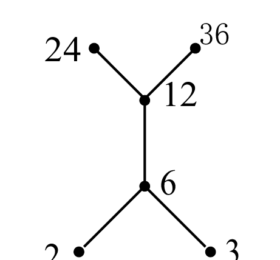

## Isomorphism（同构）

- 设 $(A,\le)$ 和 $(A',\le')$ 为偏序集，且 $f:A\to A'$ 是 $A$ 与 $A'$ 之间的一一对应。函数 $f$ 被称为从 $(A,\le)$ 到 $(A',\le')$ 的 *isomorphism*，如果对于 $A$ 中任意 $a$ 和 $b$，
  $a\le b$ 当且仅当 $f(a)\le' f(b)$。
- 如果 $f:A\to A'$ 是同构，则称 $(A,\le)$ 和 $(A',\le')$ 为 *isomorphic posets*。

### Isomorphism: Example

- 设 $(\mathbb{Z}^+,\le)$ 和 $(\mathbb{E}^+,\le)$ 为偏序集。函数 $f:\mathbb{Z}^+\to\mathbb{E}^+$ 由 $f(a)=2a$ 给出，是从 $(\mathbb{Z}^+,\le)$ 到 $(\mathbb{E}^+,\le)$ 的 *isomorphism*。
- 证明：
  - 首先，$f$ 是满射且一一对应。
  - 其次，$a\le b$ 当且仅当 $2a\le 2b$。

### Principle of Correspondence（对应性原理）

设 $f:A\to A'$ 是偏序集 $(A,\leqslant)$ 到偏序集 $(A',\leqslant')$ 的同构。设 $B$ 是 $A$ 的子集，且 $B'=f(B)$ 是 $A'$ 中对应的子集。则

如果 $B$ 的元素具有与彼此或与 $A$ 中其他元素相关的任何性质，并且该性质完全可以用关系 $\leq$ 定义，则 $B'$ 的元素必须具有完全相同的性质，用 $\leq'$ 定义。

两个有限同构偏序集必须具有相同的哈斯图。

## Example

设 $A=\{1,2,3,6\}$ 且 $\le$ 为关系 $|$（整除）。

设 $X=\{a,b\}$，$A'=P(X)=\{\emptyset,\{a\},\{b\},\{a,b\}\}$，且 $\le'$ 为集合包含，$\subseteq$。

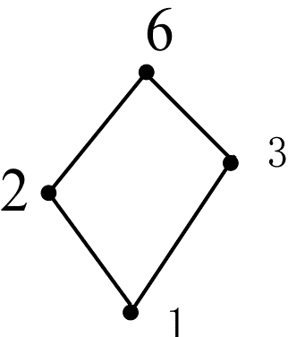

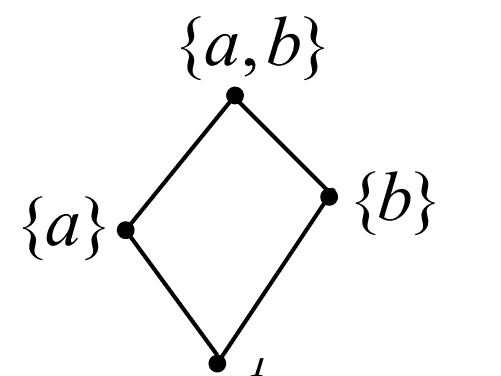

$f(1)=\emptyset$，$f(2)=\{a\}$，$f(3)=\{b\}$，$f(6)=\{a,b\}$。

## Extremal Elements（极值元素）

- *maximal element*（极大元）
- *minimal element*（极小元）
- *greatest element*（最大元）
  - 用 $1$ 表示，常称为 *unit element*（单位元）
- *least element*（最小元）
  - 用 $0$ 表示，常称为 *zero element*（零元）

### Maximal (minimal) element

- 元素 $a\in A$ 被称为 $A$ 的 **maximal element**，如果 $A$ 中不存在元素 $c$ 使得 $a<c$。
- 元素 $b\in A$ 被称为 $A$ 的 **minimal element**，如果 $A$ 中不存在元素 $c$ 使得 $c<b$。

## 定义

$\langle A,\le\rangle$ 为偏序集，且 $B$ 是 $A$ 的子集。对于 $B$ 中一个 $b$，若 $B$ 中没有任何 $x$ 满足 $b\neq x$ 且 $b\le x$，则称 $b$ 为 $B$ 的极大元；若 $B$ 中没有任何 $x$ 满足 $b\neq x$ 且 $x\le b$，则称 $b$ 为 $B$ 的极小元。

## 例

$A=\{2,3,5,7,14,15,21\}$

$B=\{2,7,3,21,14\}$

极大元集 $\{14,21\}$

极小元集 $\{2,7,3\}$

当 $B=A$ 时：

极大元为 $14,15,21$

极小元为 $2,3,5,7$

哈斯图：

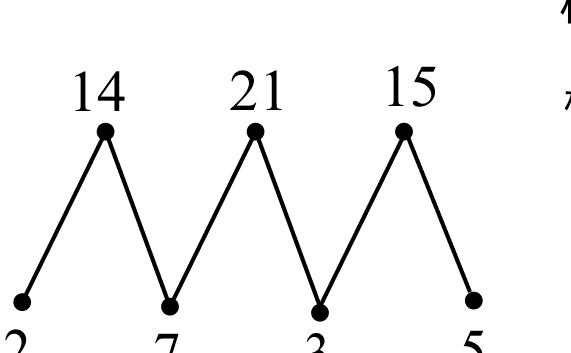

## Theorem 1

设 $A$ 为具有偏序 $\le$ 的有限非空偏序集。则 $A$ 至少有一个极大元和至少一个极小元。

## Topological Sorting（拓扑排序）

- 如果 $A$ 是具有偏序 $\le$ 的偏序集，我们有时需要为集合 $A$ 找到 *a linear order*，该线性序仅是对给定偏序的扩展，其含义是如果 $a\le b$，则 $a\prec b$。
- 构造这样的线性序 $\prec$ 的过程称为 *topological sorting*。

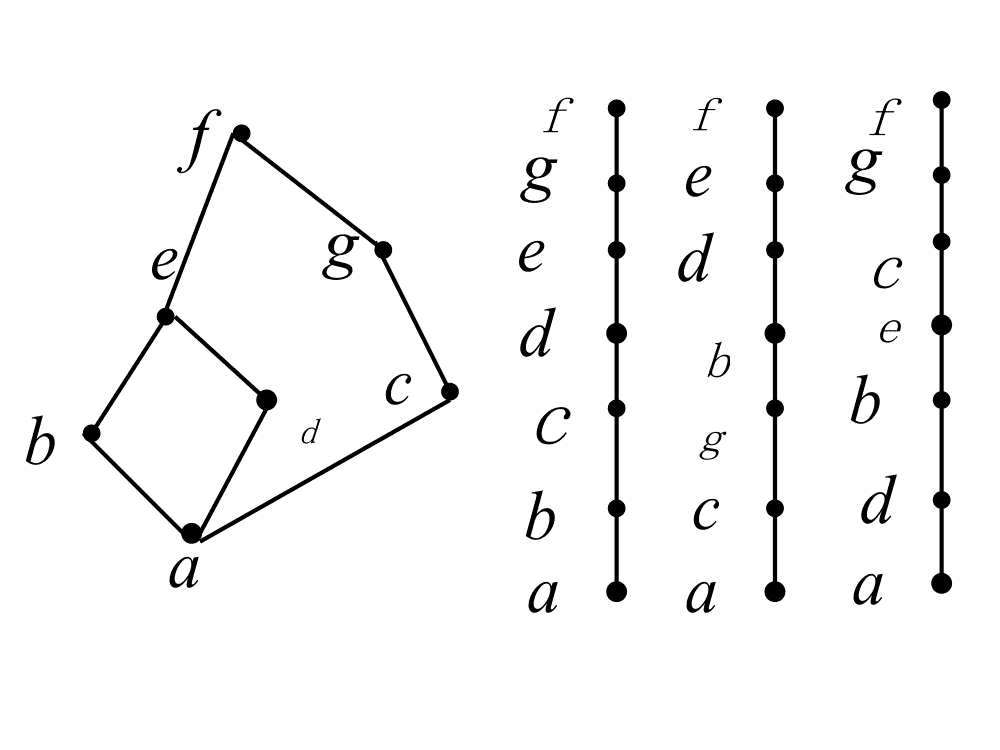

- 为偏序 $(\{1,2,4,5,12,20\}, |)$ 找到一个相容的全序。
- 如果项目的任务哈斯图如图所示，则为软件项目的任务找到一个排序。 (P581 64)

### SORT Algorithm

用于寻找有限偏序集 $(A,\le)$ 的拓扑排序：

1. 选择 $A$ 的一个极小元 $a$。
2. 使 $a$ 成为 SORT 的下一个条目，并用 $A-\{a\}$ 替换 $A$。
3. 重复步骤 1 和 2 直到 $A=\{\}$。

算法结束。

## Greatest (least) element

- 元素 $a\in A$ 被称为 $A$ 的 **greatest element**，如果对所有 $x\in A$ 都有 $x\le a$。
- 元素 $a\in A$ 被称为 $A$ 的 **least element**，如果对所有 $x\in A$ 都有 $a\le x$。
- 偏序集的最大元，如果存在，用 $1$ 表示，常称为 **unit** 元。类似地，最小元称为 **zero** 元。


定义 偏序集 < A, ≤ > 且 B 是 A 的子集, 若有 b ∈ B, 对所有 x ∈ B 有 x ≤ b, (b ≤ x). 则称 b 为 < B, ≤ > 的最大元. (最小元)

y 为 B 的最小元, 则它 “ 小于 ” y 为 B 的最大元, 则它 “ 大于 ” B 中所有其他元素

y 为 B 的极小元, 若在 B 中没有比 y 小的其他元存在.

y 为 B 的极大元.

< {1,2,⋯,12}, R整除 >


## 定理

< $A, \le$ > 为偏序集且

$B \subseteq A$, 若 $B$ 有最大(最小)元,
则必是唯一的。

## 定理2

- 一个偏序集至多有一个最大元，也至多有一个最小元。


求子集 {a,b,c}、{j,h} 和 {a,c,d,f} 的下界和上界。

求子集 {b,d,g} 的最大下界和最小上界（如果存在）。

## 示例

在偏序集 {Z⁺,|} 中，求集合 {3,9,12} 与 {1,2,4,5,10} 的最大下界和最小上界（如果存在）。


B = {a, b, c, d, e, f, g}

h,i 为B的上界

f,g 为B'={j,h,k,i}的下界

a,b,c,d,e 也为B'={j,h,k,i}的下界

a是{f,g,h,i,j,k}的下界

b,c,d,e不是{f,g,h,i,j,k}的下界

## 定理 1,2,3

- 设 $(A, \leqslant)$ 是一个偏序集
  - 若 $A$ 是非空有限的，则 $A$ 至少有*一个*极大元和至少*一个*极小元。
  - $A$ 至多有*一个*最大元和至多有*一个*最小元。
  - $A$ 的子集 $B$ 至多有*一个*最小上界（LUB）和至多有*一个*最大下界（GLB）。

## 定理4

- 设 $(A, \le)$ 与 $(A', \le')$ 是在同构 $f: A \to A'$ 下的同构偏序集。
  - 若 $a$ 是 $(A, \le)$ 的极大元（极小元），则 $f(a)$ 是 $(A', \le')$ 的极大元（极小元）。
  - 若 $a$ 是 $(A, \le)$ 的最大元（最小元），则 $f(a)$ 是 $(A', \le')$ 的最大元（最小元）。
  - 若 $a$ 是 $(A, \le)$ 的上界（下界、最小上界、最大下界），则 $f(a)$ 是 $(A', \le')$ 的上界（下界、最小上界、最大下界）。
  - 若 $(A, \le)$ 的每个子集都有 LUB（GLB），则 $(A', \le')$ 的每个子集也有 LUB（GLB）。

## 格（Lattices）

## 格（lattices）

- 格与子格的定义
- 格的同构
- 格的性质
- 格的特殊类型
- 有界格、分配格、有补格
- 模格

## 格（Lattice）

- *格*是一个偏序集，其中每个由两个元素组成的子集 {a,b} 都有最小上界和最大下界。
  - 将 LUB({a,b}) 记为 a∨b，并称之为 a 和 b 的*并*（join）。
  - 将 GLB({a,b}) 记为 a∧b，并称之为 a 和 b 的*交*（meet）。

## 示例

- 设 $S$ 是一个集合，令 $L = P(S)$。
  - 如我们所见，$\subseteq$（包含关系）是 $L$ 上的一个偏序。设 $A$ 和 $B$ 属于偏序集 $(L, \subseteq)$。
- $A \vee B$ 是集合 $A \cup B$。
  - 要理解这一点，注意 $A \subseteq A \cup B$，$B \subseteq A \cup B$，并且若 $A \subseteq C$ 且 $B \subseteq C$，则可推出 $A \cup B \subseteq C$。
- 类似地，$A \wedge B$ 是集合 $A \cap B$。
- 因此，$L$ 是一个格。

## 示例

- $S=\{a,b,c\}$


## 示例

- 设 $n$ 是一个正整数，$D_n$ 是 $n$ 的所有正因子的集合。
- $D_{30}=\{1,2,3,5,10,15,30\}$
  - $a \lor b = \text{LCM}(a,b)$
  - $a \land b = \text{GCD}(a,b)$


## 例1:判断是否为格


格

不是格的偏序集合

## 示例

L₁    L₂' = L₁ × L₁    L₂    L = L₁ × L₂


## 子格（Sublattice）

- 设 $(L, \le)$ 是一个格。$L$ 的非空子集 $S$ 称为 $L$ 的*子格*，
  - 如果对于任意 $a \in S$ 和 $b \in S$，都有 $a \vee b \in S$ 且 $a \wedge b \in S$。


## 子格

- $(D_n, |)$ 是 $(Z^+, |)$ 的一个子格


## Isomorphic Lattices （同构格）

- 如果 $f: L_1 \to L_2$ 是偏序集 $(L_1, \le_1)$ 到偏序集 $(L_2, \le_2)$ 的一个同构
  - $L_1$ 是格当且仅当 $L_2$ 是格。
  - 如果 $a$ 和 $b$ 是 $L_1$ 的元素，则
    - $f(a \land b) = f(a) \land f(b)$
    - $f(a \lor b) = f(a) \lor f(b)$。
  - 如果两个格作为偏序集同构，我们称它们为 *Isomorphic Lattices*。

## Properties of Lattices

- 回顾 $a \vee b$ 和 $a \wedge b$ 的含义：
  - $a \le a \vee b$ 且 $b \le a \vee b$；$a \vee b$ 是 $a$ 和 $b$ 的一个 *upper bound*。
  - 如果 $a \le c$ 且 $b \le c$，则 $a \vee b \le c$；$a \vee b$ 是 $a$ 和 $b$ 的 *least upper bound*。
  - $a \wedge b \le a$ 且 $a \wedge b \le b$；$a \wedge b$ 是 $a$ 和 $b$ 的一个 *lower bound*。
  - 如果 $c \le a$ 且 $c \le b$，则 $c \le a \wedge b$；$a \wedge b$ 是 $a$ 和 $b$ 的 *greatest lower bound*。

## Theorem 2

- 设 $L$ 为一个格。则对 $L$ 中任意 $a$ 和 $b$，
  - $a \vee b = b$ 当且仅当 $a \le b$。
  - $a \wedge b = a$ 当且仅当 $a \le b$。
  - $a \wedge b = a$ 当且仅当 $a \vee b = b$

## Proof of $a \vee b = b$ if and only if $a \le b$.

- ⇒ only if
  - 假设 $a \vee b = b$，所以 $a \vee b \le b$（自反）
  - $a \vee b$ 是 $a$ 和 $b$ 的上界，所以 $a \le a \vee b$
  - 所以，$a \le b$（传递）
- ⇐ if
  - 假设 $a \le b$
  - $b \le b$（自反），$b$ 是 $a$ 和 $b$ 的上界
  - 所以 $a \vee b \le b$（由 lub 的定义）
  - 但，$b \le a \vee b$（由 lub 的定义）
  - 因此，$a \vee b = b$（反对称）

## Theorem 3

- 设 L 为一个格。则
  - Idempotent Properties（等幂律）
    - (a) a ∨ a = a
    - (b) a ∧ a = a
  - Commutative Properties（交换律）
    - (a) a ∨ b = b ∨ a
    - (b) a ∧ b = b ∧ a
  - Associative Properties（结合律）
    - (a) a ∨ (b ∨ c) = (a ∨ b) ∨ c
    - (b) a ∧ (b ∧ c) = (a ∧ b) ∧ c
  - Absorption Properties（吸收律）
    - (a) a ∨ (a ∧ b) = a
    - (b) a ∧ (a ∨ b) = a

## Theorem 4

- 设 L 为一个格。则对 L 中任意 a, b, 和 c，
- 如果 a ≤ b，则
  - a ∨ c ≤ b ∨ c。
  - a ∧ c ≤ b ∧ c。
- a ≤ c 且 b ≤ c 当且仅当 a ∨ b ≤ c。
- c ≤ a 且 c ≤ b 当且仅当 c ≤ a ∧ b。
- 如果 a ≤ b 且 c ≤ d，则
  - a ∨ c ≤ b ∨ d。
  - a ∧ c ≤ b ∧ d。

## Special Types of Lattices

- 一个格 $L$ 被称为 *bounded*（有界的）如果它有一个最大元素 $/$ 和一个最小元素 $0$

## Example 15

- 集合 S 的所有子集的格 P(S)，如 Example 1 中所定义，是有界的。它的最大元素是 S，最小元素是 ∅
- 如果 $L$ 是一个有界格，则对所有 $a \in A$，
  - $0 \leqslant a \leqslant 1$
  - $a \vee 0 = a$
  - $a \wedge 0 = 0$
  - $a \vee 1 = 1$
  - $a \wedge 1 = a$

## Theorem 5

- 设 $L = \{a_1, a_2, ..., a_n\}$ 为一个有限格。则 $L$ 是有界的。
- **Proof**
  - L 的最大元素是 $a_1 \vee a_2 \vee ... \vee a_n$，
  - 它的最小元素是 $a_1 \wedge a_2 \wedge ... \wedge a_n$

## Distributive lattice （分配格）

- 一个格被称为 *distributive* 如果对 *L* 中任意元素 *a*、*b* 和 *c* 具有以下分配性质。
  - $a \land (b \lor c) = (a \land b) \lor (a \land c)$
  - $a \lor (b \land c) = (a \lor b) \land (a \lor c)$
- 如果 L 不是分配的，我们称 *L* 为 *nondistributive*

## nondistributive lattices

- 图 6.44 所示的格是非分配的。


Figure 6.44

(a)

(b)

a ∧ (b ∨ c) = a
(a ∧ b) ∨ (a ∧ c) = b

a ∧ (b ∨ c) = a
(a ∧ b) ∨ (a ∧ c) = 0


## 定理 6

- 格 $L$ 是非分配的当且仅当它包含一个与上述两个格之一同构的子格。
- 证明：略。

## Complement（补元）

- 设 $L$ 是一个有界格，其最大元为 $I$，最小元为 $0$，且 $a \in L$。元素 $a' \in L$ 被称为 $a$ 的 *补元*，如果
  - $a \vee a' = I$ 且 $a \wedge a' = 0$
- 注意
  - $0' = I$ 且 $I' = 0$。
- 格中一个元素不一定有补元，并且它可能有不止一个补元。

## 例 20

- 图 6.44 中的格都具有每个元素都有补元的性质。在两种情况下元素 $c$ 都有两个补元，$a$ 和 $b$。


图 6.44

## 定理 7

- 设 $L$ 是一个有界分配格。若补元存在，则它是唯一的。


## 证明

- 设 $a'$ 和 $a''$ 是元素 $a \in L$ 的补元。则
  - $a \vee a' = I$，$a \vee a'' = I$，$a \wedge a' = 0$，$a \wedge a'' = 0$。
- 利用分配律，我们得到
  - $a' = a' \vee 0 = a' \vee (a \wedge a'') = (a' \vee a) \wedge (a' \vee a'') = I \wedge (a' \vee a'') = a' \vee a''$
- 另外
  - $a'' = a'' \vee 0 = a'' \vee (a \wedge a') = (a'' \vee a) \wedge (a'' \vee a') = I \wedge (a'' \vee a') = a' \vee a''$
- 故 $a' = a''$。

## Complemented（有补格）

- 一个格被称为 *有补*，如果它是 有界的 并且 $L$ 中的每个元素都有一个补元。
- 例 23：在此情况下，补元不是唯一的。


图 6.44

## Modular 模格

### 1. 定义

若 $\forall a,b,c \in \langle L,\le\rangle$，$a \le c \Rightarrow a \vee (b \wedge c) = (a \vee b) \wedge c$，称 $\langle L,\le\rangle$ 是模格。


## 例1

它是模格，但不是分配格。

$$
a \vee (b \wedge c) = a \vee 0 = a
$$

$$
(a \vee b) \wedge (a \vee c) = 1 \wedge 1 = 1
$$

## Lattices

- Lattices
  - modular
    - distributive
    - nondistributive
  - nonmodular

|  | 无界格 | 有界格 |  |
|---|---|---|---|
|  |  | 无补格 | 有补格 |
| 非模格 |  |  |  |
| 模格 | 非分配格 |  |  |
|  | 分配格 |  |  |

- 无界格
- 有界格
  - 无补格
  - 有补格
- 非模格
- 模格
  - 非分配格
  - 分配格

## 偏序关系（半序关系）

### 定义：半序关系（偏序关系）

$R$ 是 $A$ 上的二元关系，如果 $R$ 满足：
- (1) 自反的
- (2) 反对称的
- (3) 传递的

则称 $R$ 是 $A$ 上半序关系。

## 例：

- $A = \{1,2,3,4,5,6,7,8,9\}$
- $B = \{a,b,c\}$
- $R_1 = \{(a,b) \mid a \le b,\ a,b \in A\}$
- $R_2 = \{(a,b) \mid a \mid b,\ a,b \in A\}$
- $R_3 = \{(s_1,s_2) \mid s_1 \subseteq s_2,\ s_1,s_2 \in P(B)\}$

### 记号：

$R = \{(a,b) \mid a \le_R b,\ a,b \in A\}$，其中 $\le_R$ 可为 $\le$、$\mid$、$\subseteq$。

## 注：

- (1) 用矩阵表示半序关系，不能明显看到二元关系的特征。
- (2) 用简化的关系图表示较适合。

### 简化的关系图：

- (1) 自反性：每个顶点都有自回路，省去。
- (2) 反对称性：两个顶点间只可能有一个箭头，从左→右，或从下→上的方向，从小到大安置顶点，可省略箭头。
- (3) 传递性：由于有 $(a,b),(b,c) \in R$，则 $(a,c) \in R$，故只画 $(a,b),(b,c)$ 对应的边，省略边 $(a,c)$。

### 定义：Hasse 图

设 $\le$ 是 $A$ 上的一个半序关系，如果 $a \le b$，则将 $a$ 画在 $b$ 下面，且不存在 $c$，使 $a \le c$，$c \le b$，则 $a$，$b$ 间用直线连接。并符合简化的关系图的绘制，称这样得到的关系图为 Hasse 图。

例中半序关系的 Hasse 图如下：


R1：9 8 7 6 5 4 3 2 1


### 定义：全序

$A$ 上半序关系 $R$，如果 $\forall a,b \in A$，都有 $a \le b$ 或 $b \le a$，则称 $R$ 为 $A$ 上的全序关系。

## 注：

- (1) 全序的含义：$A$ 中每两个元素均能比大小，即任何两个元素都相关。
- (2) 半序则是部分有序。
- (3) $R_1$ 是全序，$R_2$、$R_3$ 都是半序。如：$R_2$ 中，$\{1,2,6\}$，$\{1,2,4,8\}$，$\{1,3,9\}$ 都排成了序，但 2 与 3，5 与 7，7 与 9……，在整除的意义上来说无法排出大小来。

### 定义：半序集

集合 $A$ 及 $A$ 上的一个半序关系 $R$ 组成的二元组 $(A,R)$，称为半序集，记为 $(A,\le_R)$ 或 $(A,\le)$。

## 注：

- (1) 同一集合上的两个不同的半序关系所构成的两个半序集，如：
  - $R_1$ 和 $R_2$ 都定义在 $A = \{1,2,3,4,5,6,7,8,9\}$ 上，但 $(A,R_1)$ 与 $(A,R_2)$ 显然不是一样的半序集。

### 定义：全序集

半序集 $(A,\le_R)$ 中的半序关系 $\le_R$ 是 $A$ 上的全序，则此 $(A,\le_R)$ 称为全序集。

$(A,R_1)$ 是全序集。显然，全序集是半序集的特例。又如：$(-\infty,+\infty)$ 实数全体，在 $\le$ 下是全序集；平面上点集，也可以规定一种 $\le_R$，模长大的大，模长相等的情况下，以幅角的大小来比大小，因此，平面上点集也是全序集。$(\mathbb{N},\le)$ 当然也是全序集。

## 注：

实数全体、平面点集是无法用 Hasse 图表示的。一般来说，对有限集用 Hasse 图比较好，对可列集只能示意一下，对不可列无限集是没法表示的，因为任二个数之间一定还有别的数。

### 定义：链

设 $(A,\le_R)$ 是半序集，$B \subseteq A$，若 $(B,\le_R)$ 是全序集，则称 $B$ 为 $(A,\le_R)$ 中的链（Chain）。


当 B 是有限集时，B 的基数 | B | 称为链长。
例：
在上例 H a s s e 图（A，R₂）中，取 B₁ = { 1，2，4，8 }，R₂ = |（整除），则
（B₁，R₂）是全序关系，B₁ 是半序集（A，|）中链长为 4 的链。
B₂ = { 1，2，6 }，B₃ = { 1，3，9 }，B₄ = { 1，5 }，B₅ = { 1，7 } 也都是（A，|）中的链。

## [定义]反链：

设（A，≤₍R₎）为半序集，B ⊆ A，对∀ a，b ∈ B（a ≠ b），（a，b）∉ R，（b，a）∉ R，则称 B 为（A，≤₍R₎）中的反链。

当 B 为有限集时，| B | 为反链的长度。

注： 反链中的元素都互不相关。

例如：（A，R₂）中

B₁ = { 2， 3， 5， 7 }      | B₁ | = 4

B₂ = { 4， 6， 9 }      | B₂ | = 3

B₃ = { 8， 6， 9， 5， 7 } | B₃ | = 5

...

都是反链。

## [定义]极大元与极小元：

设（P，≤）是半序集，A⊆P，若 a ∈ A，且在 A 中找不到一个元素 b（b ≠ a），使 a ≤ b（b ≤ a），则称 a 为 A 中的极大元（极小元）。

例：（N，|）是半序集，

A = { 2， 3， 4， 5， 6， 7， 8， 9 }

则 A 中极大元： 8， 6， 9， 5， 7

极小元： 2， 3， 5， 7

## 注：

极大元，极小元并不要求唯一，且同一元素，可以既是极大元，又是极小元，如 5， 7。

## 注：

极大元，极小元必须是子集 A 中的元素。

## [定义]最大元与最小元：

设（P，≤）是半序集，A ⊆ P，若 a ∈ A，∀b ∈ A，b ≤ a（a ≤ b），则称 a 为 A 的最大元（最小元）。

## 例：上例

其Hasse图如下图所示


## 结论：

子集A中是不存在最大元（最小元）的。


## 结论：

A存在最小元Φ，没有最大元。

## 注：

最大元（最小元）本身应属于子集A，且与A中任一元素都有关系。

## [定义]上界与下界：

设（P，≤）是半序集，A⊆P，
若 a ∈ P，对 ∀ b ∈ A， b ≤ a（a ≤ b）
称 a 为 A 的上界（下界）。

注：

- （1）上例中，A 无最大元，但存在 A 的上界 { a， b， c }。
- （2）Φ 为 A 的最小元，也是 A 的下界
- （3）最大（小）元是 A 的一个上（下）界
- （4）上（下）界可以不唯一，也可以不存在

## [定义]上确界与下确界：

设（p，≤）是半序集，A⊆P，若 a 是 A 的一个上界（下界），而∀A 的上界（下界）b，都有 a ≤ b（b ≤ a），则称 a 是 A 的上确界（下确界）。

注：

上确界：最小上界
下确界：最大下界
如果存在上（下）确界，则上（下）确界一定是唯一的

例：
（ p （ B ）, ⊆ ）中取 A’ = { Φ, 
{ b }, { c } }, 则
{ b, c } 与 { a, b, c } 是 A’ 的上界， { b, c } 是 A’ 的上确界。

注：
存在上（下）界，并不一定存在上
（下）确界。

例：
 p = { a, b, c, d, e }
 A = { a, b, c }, （ p, ≤ ）

## [引理1]:

设（P，≤）是半序集，A是P的非空有限子集，则A一定存在极大（小）元。

## 证：

若|A|=1，则A中唯一元素既是极大元，也是极小元。

假定|A|=n时存在极大（小）元

当|A|=n+1时，则将A分成由n个元素组成的子集A’与元素a。

由假定，A’存在极大元a_M，极小元a_m’

若 a_M ≤ a，则 a 为极大元，否则为 a_M，
因为若 a_M ≤ a，且存在 b ≤ A’，而

a ≤ b, 由传递性 a_M ≤ b, 与 a_M 为极大元
（A’）矛盾。

同理，若 a ≤ a_m，则 a 为极小元，否则为 a_m。

## [引理2]:

设 M 是非空有限子集 A 的极大元集合，
则 M 是 A 的反链。

## 反证：

若 M 不是反链，则 ∃ a，b ∈ M（a ≠ b），（a，b）∈ R 或（b，a）∈ R，即 a ≤ b 或 b ≤ a，则 a 或 b 不是极大元，矛盾。

## [定理1]:

设（P，≤）是有限的半序集，P 中最长链长度为 n，则 P 可以划分为 n 个互不相交的反链。

证：（1）n = 1，P 中任两个元素不相关，P 本身是反链。

(2) 假设 n 时定理成立，即当 P 中最长链长为 n 时，可以划分为 n 个互不相交的反链。

(3)当 P 中最长链长为 n + 1 ，由引理1，极大元一定存在，设 M 是极大元集合，由引理2， M 是 P 的一个反链。

如果去掉 M ，（ P − M ， ≤ ）也是半序集，则 P − M 中最长链长为 n ，由假设， P − M 可以划分为 n 个互不相交的反链，添上 M ，可知 P 可划分为 n +1 个互不相交的反链。

例： A = { 1 , 2 , 3 , 4 , 5 , 6 , 7 , 8 , 9 } ， 半序集（ A ， 6 ） ， 最长链为 4 ， B = { 1 , 2 , 4 , 8 }


可划分为4个互不相交的反链：

A₁ = { 1 }
A₂ = { 2, 3, 5, 7 }
A₃ = { 4, 6, 9 }
A₄ = { 8 }
也可分为：
B₄ = { 8, 6, 9, 5, 7 }
B₃ = { 4, 3 }
B₂ = { 2 }
B₁ = { 1 }
注：
反链的取法并不唯一，而最长链中的元素必然分别落在每个反链里。

## 说明：

若 P_r（A）= { A₁，A₂，...，Aₙ }，是 A 的一个分划，则可定义一个半序关系，当 j - i = 1 时，取 a ∈ A_i，b ∈ A_j，使 (a, b) ∈ R₁，且 A_i，A_j 中每个元素至少取到一次

并对 ∀ a ∈ A，(a, a) ∈ R₁

然后取 R = R₁*（闭包）

这样 R 是半序关系，并使每个 A_i 是反链，且最长链是 A₁，A₂，...，Aₙ 中各取一个元素组成的。

## [定理2]：每个A的划分
pᵣ(A) = {A₁, A₂, ..., Aₙ}，都可以找到一个半序关系R，使A₁, A₂, ..., Aₙ都是(A, R)的反链，而(A, R)的最长链由A₁, A₂, ..., Aₙ中各取一个元素组成。

## 例：


但若取：
R₁ = { ( 1 , 2 ) ,  ( 1 , 3 ) ,  ( 1 , 5 ) ,
      ( 1 , 7 ) ,  ( 2 , 4 ) ,  ( 2 , 6 ) ,
      ( 2 , 9 ) ,  ( 6 , 8 ) ,  ( 5 , 9 ) ,
      ( 1 , 1 ) ,  ( 2 , 2 ) ,  ( 3 , 3 ) ,
      ( 4 , 4 ) ,  ( 5 , 5 ) ,  ( 6 , 6 ) ,
      ( 7 , 7 ) ,  ( 8 , 8 ) ,  ( 9 , 9 ) }

令 R = R₁*，是无法得到（A，/）的，

可见，由互不相交的反链构造出来的半序集并不是唯一的。

## 【定理3】：

设半序集（p，≤）包含 m·n + 1 个或以上个元素，则 p 至少有一个链长≥ n + 1（或 m + 1）或至少有一个反链长≥ m + 1（或 n + 1）。

## 证：

若 p 的最长链长≤ n，反链长≤ m，由定理1，p 可划分为不超过 n 个反链，则 p 至多有 n·m 个元素，与 p 的元素个数矛盾。

## 例1：

a·b + 1 个自然数的集合 p
（（p，|）是半序集）
或者有
（a + 1）（或（b + 1））个数一个
被一个整除
或者有
（b + 1）（或（a + 1））个数互素

## [定义]良序集：

设（A，R）是半序集，若 A 的非空子集都存在最小元，则称 R 是良序关系，（A，R）为良序集。

注：（1）良序集是全序集
（2）全序集未必是良序的，如：
实数全体，任两个实数都能比大小，
但子集 {1/n} 的最小元找不到。
但，有限的全序集自然是良序的。


## dual

- 设 R 是集合 A 上的一个偏序，R⁻¹ 是 R 的逆关系，则 R⁻¹ 也是一个偏序。
- 偏序集 ( A,R⁻¹) 称为偏序集 (A,R) 的对偶，偏序 R⁻¹ 称为偏序 R 的对偶。

## Quasiorder(拟序关系)

- *Quasiorder:* 集合 *A* 上的关系 *R* 若是 *transitive* 且 *irreflexive*，则称其为 *quasiorder*。
  - Example:
    - (P(S),⊂)

## 作业

- § 9.1 – 40, 47, 48
- § 9.2 – 8, 20
- § 9.3 – 14, 32
- § 9.4 – 20, 22, 28
- § 9.5 – 16, 56, 60, 64
- § 9.6 – 12, 28, 36, 44

## Graph Theory

Rosen 7th ed., ch. 10

## Chapter 10 Graphs

## 图论

图/Graph：

可直观地表示离散对象之间的相互关系，研究它们的共性和特性，以便解决具体问题。

## 10.1 图的概念/Introduction of Graph

## 10.2 图的术语/Graph Terminology

## 10.3 图的表示与同构/ Representing Graph and Graph Isomorphism

## 10.4 连通性/Connectivity

## 10.5 欧拉道路与哈密尔顿道路/ Euler and Hamilton Paths

## 10.6 最短道路问题/Shortest Path Problem

## 10.7 平面图/Planar Graphs

## 10.8 图的着色/Graph Coloring

Transport networks/运输网络流量问题（8.4）

## What are Graphs?

- **General meaning in everyday math:**  
  坐标系中用数值数据绘制的图表。

- **Technical meaning in discrete mathematics:**  
  *一种特殊的离散结构（待定义），用于表示关系并具有方便的网状图形表示。*


## Applications of Graphs

- 潜在的任何事物（图可以表示关系，关系可以描述任何谓词的扩展）。
- 在网络、调度、流量优化、电路设计、路径规划中的应用。
- 更多应用：家谱分析、计算机游戏、程序编译、面向对象设计，...

## 2018年度“CCF优秀博士学位论文奖”初评（第一轮）入围名单如下：

（以作者姓名的拼音字母为序）

| 姓名 | 论文题目 | 培养单位 | 导师 |
|---|---|---|---|
| 陈权 | 信息物理融合系统中实时数据传输与调度算法研究 | 哈尔滨工业大学 | 高宏 |
| 蒋炎岩 | 并发程序共享内存访问依赖研究 | 南京大学 | 吕建 |
| 苗东菁 | 数据一致性的计算复杂性理论和算法研究 | 哈尔滨工业大学 | 李建中 |
| 王志刚 | 分布式大图迭代计算技术研究 | 东北大学 | 于戈 |
| 徐焱 | 弱监督多标记学习 | 南京大学 | 周志华 |
| 杨涛 | 基于粒子的实时多相多组分流体模拟 | 清华大学 | 胡事民 |
| 易鑫 | 自然文本文输入中的贝叶斯推理方法 | 清华大学 | 史元春 |
| 章明星 | 大规模图数据的高效计算 | 清华大学 | 武永卫 |
| 郑臻哲 | 移动互联网中博弈模型与机制设计研究 | 上海交通大学 | 陈贵海 |

## Simple Graphs

- 对应于对称的、反自反的二元关系 $R$。
- 一个 *simple graph* $G=(V,E)$ 由以下组成：
  - 一个顶点或节点集合 $V$，*vertices* or *nodes*（$V$ 对应于关系 $R$ 的全集），
  - 一个边/弧/链路集合 $E$ / *edges* / *arcs* / *links*：无序的 [distinct] 元素对 $u,v \in V$，使得 $uRv$。


## 10.1 图的概念/Introduction of Graph

[定义]图

V是一个非空有限集，E是V上的一个二元关系，有序对（V，E）称为有向图/Directed Graph。

若将E中的有序对看成是无序的（即将e=(a,b)看成e={a,b}），则称（V，E）为无向图/Undirected Graph。有向图和无向图统称为图/Graph，记为G。

G = (V, E)

## [定义]顶点：

V中的元素称为顶点，用带标记的点表示，也称为结点/Vertices。

## [定义]边：

在有向图G中，若e=( a , b ) ∈ E，e称为G的有向边/directed edge。用由 a 到 b 带箭头的线把 a 和 b 连起来；

在无向图G中，若e=( a , b ) ∈ E，e称为G的无向边/undirected edge。a、b 间用连线连结，有向边和无向边统称为G的边/edge。

## [定义]图的分类

对图G=（V，E）。若对于任意的（a，b）∈E，a≠b,则称图G为简单图/Simple Graph。

对图G=（V，E）。若允许E是一个重集，则称图G为重图/Multigraph。其相同的元素称为重边。

对图G=（V，E）。若G既允许是重图又允许是非简单图，则称图G为拟图/Pseudograph。

一般的G称为线性图/Linear Graph。

## Example of a *Simple Graph*

- 设 $V$ 为美国东南部的州集合：
  - *即，* $V=\{FL,\ GA,\ AL,\ MS,\ LA,\ SC,\ TN,\ NC\}$

- 设 $E=\{\{u,v\}|u\text{ adjoins }v\}$
  $=\{\{FL,GA\},\{FL,AL\},\{FL,MS\},\{FL,LA\},\{GA,AL\},\{AL,MS\},\{MS,LA\},\{GA,SC\},\{GA,TN\},\{SC,NC\},\{NC,TN\},\{MS,TN\},\{MS,AL\}\}$


## Computer Network

© The McGraw-Hill Companies, Inc. all rights reserved.


## 多链高速公路网络


## 伪图

- 与多重图类似，但允许边连接节点自身。(*R* 可能是自反的。)
- 一个 *伪图* $G=(V, E, f)$ 其中 $f:E\to\{\{u,v\}|u,v\in V\}$。边 $e\in E$ 是 *环* 如果 $f(e)=\{u,u\}=\{u\}$。
- *例如*，节点是州立公园中的露营地，边是穿过树林的徒步小径。


## 带诊断链的计算机网络


## 有向图

- 对应于任意的二元关系 \(R\)，该关系不必是对称的。
- 一个 *有向图* \((V,E)\) 由顶点集合 \(V\) 和 \(V\) 上的二元关系 \(E\) 组成。
- *例如：* \(V\) = 人群集合，
  \(E=\{(x,y) \mid x\ loves\ y\}\)


## 带单向链的电视网络

© The McGraw-Hill Companies, Inc. all rights reserved.


## 有向多重图

- 与有向图类似，但从一个节点到另一个节点可能有多条弧。
- 一个 *有向多重图* $G=(V,E,f)$ 由顶点集合 $V$、边集合 $E$ 和一个函数 $f:E\to V\times V$ 组成。
- *例如*，$V$=网页，$E$=超链接。*万维网是一个有向多重图...*


## 带多条单向链的电视网络


## 图的类型：总结

- 本书定义的总结。
- 请记住这种术语在不同作者之间并非完全标准化...

| 术语 | 边类型 | 允许多条边？ | 允许自环？ |
|---|---|---|---|
| 简单图 | 无向 | 否 | 否 |
| 多重图 | 无向 | 是 | 否 |
| 伪图 | 无向 | 是 | 是 |
| 有向图 | 有向 | 否 | 是 |
| 有向多重图 | 有向 | 是 | 是 |

## 图模型

- E1: 生态学中的生态位重叠图
- E2: 熟人图
- E3: 影响图
- E4: 好莱坞图
- E5: 循环赛
- E6: 合作图
- E7: 调用图
- E8: 网络图
- E9: 先行图和并发处理
- E10 道路图

## 生态学中的生态位重叠图

© The McGraw-Hill Companies, Inc. all rights reserved.


## 小洛克湖的食物网

Leech

Smallmouth Bass (Cannibal)

1st Tropic Level
Mostly Phytoplankton

2nd Trophic Level
Many Zooplankton


## E2: 熟人图

© The McGraw-Hill Companies, Inc. all rights reserved.


## 影响图


## 流程图

## BACON TO BACON

It's "Six Degrees of Kevin Bacon," billionaire-style. In the incestuous world of Hollywood and money, we needed only three degrees to link a ubiquitous actor and a camera-shy hedge fund mogul.

BY CALEB MELBY

## 2013赛季中超联赛赛程表

| 第1轮 | 开球时间 | 主队 | 比分 | 客队 | 球场 | 备注 | 信息 |
|---|---|---|---|---|---|---|---|
| 03-08 (五) | 19:35 | 辽宁宏运 | 2 - 1 | 武汉卓尔 | 南京奥体中心 |  | 比赛实录 | 统计 | 战报 |
| 03-08 (五) | 19:35 | 北京国安 | 4 - 1 | 上海上港 | 北京工人体育场 |  | 比赛实录 | 统计 | 战报 |
| 03-08 (五) | 19:35 | 贵州人和 | 1 - 2 | 青岛中能 | 贵阳奥体中心 |  | 比赛实录 | 统计 | 战报 |
| 03-08 (五) | 20:00 | 广州恒大 | 5 - 1 | 上海申鑫 | 广州天河体育中心 |  | 比赛实录 | 统计 | 战报 |
| 03-09 (六) | 15:35 | 山东鲁能 | 1 - 0 | 大连阿尔滨 | 济南奥体中心 |  | 比赛实录 | 统计 | 战报 |
| 03-09 (六) | 16:00 | 广州富力 | 2 - 4 | 辽宁宏运 | 广州越秀山体育场 |  | 比赛实录 | 统计 | 战报 |
| 03-09 (六) | 19:45 | 上海申花 | 0 - 0 | 天津泰达 | 上海虹口足球场 |  | 比赛实录 | 统计 | 战报 |
| 03-10 (日) | 19:35 | 杭州绿城 | 1 - 1 | 长春亚泰 | 杭州黄龙体育中心 |  | 比赛实录 | 统计 | 战报 |

## 中超积分榜

- 名次 球队
- 1 广州恒大
- 2 山东鲁能
- 3 北京国安
- 4 贵州人和
- 5 上海申花
- 6 大连阿尔滨
- 7 广州富力
- 8 上海申鑫
- 9 上海上港
- 10 辽宁宏运


## E7：调用图


## 语句执行的前趋图

© 麦格劳-希尔公司，版权所有。

- S₁ a := 0
- S₂ b := 1
- S₃ c := a + 1
- S₄ d := b + a
- S₅ e := d + 1
- S₆ e := c + d


## 路线图


这是一个由（微软亚洲研究院）[GeoLife](https://www.microsoft.com/en-us/research/publication/geolife-gps-trajectory-dataset-user-guide/) 项目中的182位用户在两年多的时间内（从2007年4月到2012年8月）收集的GPS轨迹数据集。该轨迹数据集可用于许多研究领域，如移动模式挖掘、用户活动识别、基于位置的社会网络、位置隐私和位置推荐。下面的热力图可视化了其在北京市的分布。

## § 10.2：图论术语

你需要学习以下术语：

- *相邻、连接、端点、度、初始、终端、入度、出度、完全、圈、轮、n立方体、二分、子图、并。*

### [定义]孤立顶点：

若 a ∈ V，a 不与其他顶点相邻，称 a 为孤立顶点/isolated。

### [定义]自回路：

若 (a, a) ∈ E（或 {a, a} ∈ E），称边 (a, a)（或 {a, a}）是自回路/loop。

### [定义]顶点的次：

在无向图 G 中，与 a 相邻的顶点的数目称为 a 的次或度/degree。记为 deg(a) 或 d(a)。

在有向图 G 中，以 a 为终点的边的条数称为 a 的入次或入度/in-degree。记为 deg⁻(a) 或 d⁻(a)。以 a 为起点的边的条数称为 a 的出次或出度/out-degree。记为 deg⁺(a) 或 d⁺(a)。

### 邻接

设 G 是一个无向图，边集为 E。设 e∈E 是（或映射到）点对 {u,v}。那么我们说：

- u, v 是相邻的/邻居/连通的。
- 边 e 与顶点 u 和 v 关联。
- 边 e 连接 u 和 v。
- 顶点 u 和 v 是边 e 的端点。

### 顶点的度

- 设 $G$ 是一个无向图，$v \in V$ 是一个顶点。
- 顶点 $v$ 的*度* $\deg(v)$ 是其关联边的数目。（任何自回路都被计算两次。）
- 度为 0 的顶点称为*孤立顶点*。
- 度为 1 的顶点称为*悬挂顶点*。

### 握手定理

- 设 $G$ 是一个无向（简单、多重或伪）图，顶点集为 $V$，边集为 $E$。则

  $$\sum_{v\in V} \deg(v) = 2|E|$$

- **推论：** 任何无向图都有偶数个奇度顶点。

### 有向邻接

- 设 $G$ 是一个有向（可能多重）图，设 $e$ 是 $G$ 的一条边，它是（或映射为）$(u,v)$。那么我们说：
  - $u$ 邻接到 $v$，$v$ 邻接自 $u$
  - $e$ 来自 $u$，$e$ 指向 $v$
  - $e$ 连接 $u$ 到 $v$，$e$ 从 $u$ 到 $v$
  - $e$ 的初始顶点是 $u$
  - $e$ 的终端顶点是 $v$

### 有向度

- 设 G 是一个有向图，v 是 G 的一个顶点。
  - v 的入度 **deg⁻(v)** 是指向 v 的边的数目。
  - v 的出度 **deg⁺(v)** 是从 v 发出的边的数目。
  - v 的度 **deg(v)** := **deg⁻(v)** + **deg⁺(v)**，是 v 的入度与出度之和。

### 有向握手定理

- 设 $G$ 是一个有向（可能多重）图，顶点集为 $V$，边集为 $E$。则：

  $$\sum_{v\in V}\deg^-(v)=\sum_{v\in V}\deg^+(v)=\frac{1}{2}\sum_{v\in V}\deg(v)=|E|$$

- 注意：一个节点的度无论其边被视为有向还是无向都不变。

### 特殊图结构

无向图结构的特殊情况：

- 完全图 Kₙ
- 圈 Cₙ
- 轮 Wₙ
- n立方体 Qₙ
- 二分图
- 完全二分图 Kₘ,ₙ

### 完全图

- 对于任意 $n \in \mathbb{N}$，$n$ 个顶点上的*完全图* $K_n$ 是一个有 $n$ 个节点的简单图，其中每个节点都与所有其他节点相邻：$\forall u, v \in V: u \neq v \leftrightarrow \{u, v\} \in E$。


> 注意，$K_n$ 有 $\sum_{i=1}^{n-1} i = \frac{n(n-1)}{2}$ 条边。


## Cycles

+   对于任意 $n\ge 3$，一个 *cycle* 在 $n$ 个顶点上，$C_n$，是一个简单图，其中 $V=\{v_1,v_2,\dots ,v_n\}$ 且 $E=\{\{v_1,v_2\},\{v_2,v_3\},\dots ,\{v_{n-1},v_n\},\{v_n,v_1\}\}$。


$C_n$ 有多少条边？

## Wheels

+   - 对于任意 \(n\ge 3\)，一个 **wheel** \(W_n\)，是一个简单图，通过取 cycle \(C_n\) 并添加一个额外顶点 \(v_{\mathrm{hub}}\) 和 \(n\) 条额外边 \(\{\{v_{\mathrm{hub}},v_1\},\{v_{\mathrm{hub}},v_2\},\ldots,\{v_{\mathrm{hub}},v_n\}\}\) 得到。


\(W_n\) 有多少条边？

## $n$-cubes (hypercubes)

+   - 对于任意 $n\in\mathbb{N}$，超立方体 $Q_n$ 是一个简单图，由两个 $Q_{n-1}$ 的拷贝在对应节点处连接而成。$Q_0$ 有 1 个节点。


*顶点数：* $2^n$。  *边数：* 练习试试！

## n-cubes (hypercubes)

+   - 对于任意 $n \in \mathbf{N}$，超立方体 $Q_n$ 可以递归定义如下：
+     - $Q_0 = \{\{v_0\}, \varnothing\}$ （一个节点且没有边）
+     - 对于任意 $n \in \mathbf{N}$，若 $Q_n = (V, E)$，其中 $V = \{v_1, ..., v_a\}$ 且 $E = \{e_1, ..., e_b\}$，则 $Q_{n+1} = (V \cup \{v_1', ..., v_a'\}, E \cup \{e_1', ..., e_b'\} \cup \{\{v_1, v_1'\}, \{v_2, v_2'\}, ..., \{v_a, v_a'\}\})$ 其中 $v_1', ..., v_a'$ 是新顶点，且若 $e_i = \{v_j, v_k\}$ 则 $e_i' = \{v_j', v_k'\}$。

## Bipartite Graphs

+   - **Def’n.:** 图 $G=(V,E)$ 是 *bipartite* （两部分）当且仅当 $V = V_1 \cup V_2$ 其中 $V_1 \cap V_2=\varnothing$ 且 $\forall e \in E:$ $\exists v_1 \in V_1, v_2 \in V_2:$ $e=\{v_1,v_2\}$。
+   - **In English:** 图可以被划分为两部分，使得所有边都在两部分之间。


此定义可以很容易地适用于多重图和有向图的情况。

可以用零一矩阵表示。

## Complete Bipartite Graphs

+   - 对于 *m,n* ∈ **N**，*complete bipartite graph* K_{m,n} 是一个二部图，其中 |V₁| = *m*，|V₂| = *n*，且 E = {{v₁,v₂}|v₁ ∈ V₁ ∧ v₂ ∈ V₂}。
+     - 也就是说，左部有 *m* 个节点，右部有 *n* 个节点，且左部每个节点都与右部每个节点相连。


K_{m,n} 有 _____ 个节点和 _____ 条边。

## Subgraphs

+   - 图 $G=(V,E)$ 的一个子图是图 $H=(W,F)$ 其中 $W\subseteq V$ 且 $F\subseteq E$。


## Graph Unions

+   - 两个简单图 $G_1=(V_1, E_1)$ 和 $G_2=(V_2,E_2)$ 的 *union* $G_1 \cup G_2$ 是简单图 $(V_1 \cup V_2, E_1 \cup E_2)$。


+   - 两个简单图 $G_1=(V_1, E_1)$ 和 $G_2=(V_2,E_2)$ 的 *union* $G_1 \cup G_2$ 是简单图 $(V_1 \cup V_2, E_1 \cup E_2)$。


## [定理1 (Handshaking)] 设无向图G=（V，E）有e条边，则G中所有顶点的次之和等于e的两倍。

证明思路：利用数学归纳法。

## [定理2] 无向图中次为奇数的顶点个数恰有偶数个。

证明思路：将图中顶点的次分类，再利用定理1。

## [定理3] 设有向图G=（V，E）有e条边，则G中所有顶点的入次之和等于所有顶点的出次之和，也等于e。

证明思路：利用数学归纳法。

## 有向图与无向图的对应：

无向图对应有向图：加上箭头。

有向图对应无向图：去掉箭头。

称为underlying undirected graph

## [定理4] 设无向完全图G有n个顶点，则 G有n(n-1)/2条边。

## 一些特殊的其他图：

+   （1）有向完全图
+   （2）零图
+   （3）平凡图
+   （4）正则图：若图 G =（V，E）中每个顶点的次均为 n，称此图 G 是 n-正则的 / n-regular。

## 计算机处理和网络应用特殊图表示：

+   (1) 串行处理/Serial
+   linear array network
+   
+   (2) 并行处理/Parallel
+   Kₙ、Star、Cₙ、Wₙ
+   2-dimensional array network
+   hypercube network


## [定义]子图：

G = (V, E) 是图，若 G' = (V', E') 也是图且满足：

- (1) V' ⊆ V；
- (2) E' ⊆ E；

则称 G' 为 G 的子图/subgraph。

## 注：

当 V' = V 时，称 G' 为 G 的生成子图。

当 E' ≠ E 时，或 V' ≠ V 时称 G' 为 G 的真子图。

## [定义]补图/complementary graph ：

G = (V, E) 是图， G' = (V', E') 是 G 的子图， E'' = E − E'， V'' = V − V' 或是 E'' 中边所关联的所有顶点集合，则 G'' = (V'', E'') 称为 G' 关于 G 的相对补图。

## [定义]补图：

关于完全图的子图的补图称为此子图的绝对补图，若子图记为 G，则补图记为 $\overline{G}$。

○ a

图 C

图 D

图 A 是一个无向完全图

图 B，C，D，E，F 均是 A 的子图

图 C 的顶点 a 是孤立顶点

图 B 的边 [a，b] 是孤立边

图 D 是图 C 的子图

图 F 是图 D 关于图 C 的余图

图 E 是图 C 的补图

（A 是完全图， C 是 A 的子图）

## 说明：

图C不是E的补图。（不互为补图）

因为：
E'' = E − E'
= {[b, c], [b, d], [b, e], [c, d], [c, e], [d, e]}

V'' = {b, c, d, e}
而图C多了顶点a。

## [定义]子图:
G = ( V, E ) 和 G' = ( V' , E' )
是两个简单无向图，它们的并图 G ∪ G' 定义为
G ∪ G' = ( V' ∪ V, E' ∪ E )
称 G ∪ G' 为 G 和 G' 的并图/union of G 和 G' .

## § 10.3: 图的表示与同构

- 图的表示：
  - 邻接表。
  - 邻接矩阵。
  - 关联矩阵。
- 图同构：
  - 两个图同构当且仅当它们除了节点名称外完全相同。

## 邻接表

- 每行对应一个顶点，列出其相邻顶点。


| Vertex | Adjacent Vertices |
|---|---|
| a | b, c |
| b | a, c, e, f |
| c | a, b, f |
| d | |
| e | b |
| f | c, b |

## 有向邻接表

- • 每行对应一个节点，列出从该节点发出的每条边所指向的终点节点。

## 邻接矩阵

- 表示简单图的一种方法
  - 可能包含自环。
- 矩阵 **A**=[*a_ij*]，其中 *a_ij* 为 1 当且仅当 {*v_i*, *v_j*} 是 *G* 的一条边，否则为 0。
- *可以通过让每个矩阵元素为节点之间链接的数量（可能 >1）来扩展到伪图。*


## 关联矩阵

- 表示图常用的另一种方法是使用关联矩阵。设 G(V,E) 为无向图。假设 v₁,v₂,...vₙ 为顶点，e₁,e₂,...eₘ 为 G 的边。则相对于 V 和 E 的此顺序的关联矩阵是 n×m 矩阵 M=[mᵢⱼ]，其中

$m_{ij}=\begin{cases}1 & \text{when edge } e_j \text{ is incident with } v_i, \\ 0 & \text{otherwise.}\end{cases}$


## 10.3图的表示与同构/

## Representing Graph and Graph Isomorphism

图G表示的三种方法：

- （1）集合表示
- （2）邻接表（adjacency list）表示
- （3）矩阵（matrix）表示
  1、邻接矩阵（adjacency matrix）表示
  2、关联矩阵（incidence matrix）表示

## [定义]邻接矩阵：
设有向图G = (V, E), V = {V₁, V₂, …,
Vₙ}, 若用方阵 A = (aᵢⱼ)ₙ×ₙ 来表示，其中

aᵢⱼ = { 1  (Vᵢ,Vⱼ) ∈ E
        0  (Vᵢ,Vⱼ) ∉ E } 称A为G的邻接矩阵。

## [定义]图的同构：

图 G₁ = ( V₁, E₁ ), G₂ = ( V₂, E₂ ), 如果能建立 V1 与 V2 间的一一对应，在此对应下，E₁ 与 E₂ 中的边也一一对应，对有向图还保持关联方向的对应，则称图 G₁ 与 G₂ 同构，记作 G₁ ≅ G₂。

## 例：

无向图

a

b

d

c

a'

(b)

d'

c'  (a)

b'  (c)

## 图同构

- 形式化定义：
  - 简单图 $G_1=(V_1, E_1)$ 和 $G_2=(V_2, E_2)$ *同构* 当且仅当 $\exists$ 双射 $f:V_1\to V_2$ 使得 $\forall a,b\in V_1$，$a$ 和 $b$ 在 $G_1$ 中相邻 当且仅当 $f(a)$ 和 $f(b)$ 在 $G_2$ 中相邻。
  - $f$ 是两个节点集合之间的“重命名”函数，使得两个图相同。
  - 该定义可以很容易地扩展到其他类型的图。

## 图同构下的不变量

$G_1=(V_1, E_1)$ 与 $G_2=(V_2, E_2)$ 同构的 *必要* 但不 *充分* 条件：

- 我们必须有 $|V1|=|V2|$，且 $|E1|=|E2|$。
- 具有度为 $n$ 的顶点的数量在两个图中相同。
- 对于一个图的每个真子图 $g$，另一个图存在一个与 $g$ 同构的真子图。

## 同构示例

- 如果同构，则对第二个图进行标记以显示同构，否则指出差异。


## 这些图是否同构？

- 如果同构，请标注第二个图以显示同构关系，否则请找出差异。


- 顶点数相同
- 边数相同
- 度为 2 的顶点数不同！（1 vs 3）

## 计算机理论领域或迎重大突破

来源：网易 作者： 发布时间：2015年11月30日 浏览量：785

这几天一直流传所说的“复杂性理论”（complexity theory）领域出现了数年一见的大进展，可能会给互联网领域带来新的曙光。

这话说错了——因为新的突破与网络之间的比较有关，正可以应用于人与人之间的互联网链接。芝加哥大学的数学家与计算机科学家拉斯洛·鲍勃伊（László Babai）发现了一种数学方法，可以用比之前少得多的步骤来判断两个网络是不是完全相同的，不管这些网络有多复杂或缠结。计算机科学界已经炸开了锅，因为很多难以解决的问题最终都可以归结到比较两个网络是否相同这一任务上。

> “如果这一方法是的，它可能会成为计算机理论领域十年来最重要的成果。”麻省理工学院的计算机科学家、博客作者斯科特·阿伦森（Scott Aaronson）说。

所谓复杂性理论，从根本上说就是研究哪些工作可以很容易地用计算机完成，哪些工作不能的理论。在复杂性理论中，最关键的事情是搞清楚随着输入数据的增长，解决一个问题所需的步骤会以什么样的方式增加。举个例子：如果你想知道一个给定的数，比如983或105227是不是素数（即只能被1和它自己整除的数），那计算机所要进行的步骤就随着给定数字位数的增长就相对比较缓慢，大体上以类似n的几次方的速度增长（n为位数）。像n^2这样的表达式被称为多项式（polynomial），因此这个问题就被称为可以在多项式时间内解决，复杂度类别为P。

首页>>学会活动>>CCF 电子刊>>文章正文

- http://www.ccf.org.cn/sites/ccf/nry.jsp?contentId=2894455213903


- a -> 1
- b -> 6
- c -> 8
- d -> 3
- g -> 5
- h -> 2
- i -> 4
- j -> 7

从图中不容易直接得出。

可用邻接矩阵，通过某种算法确定两个图是否同构。

## 上例的邻接矩阵：

```
[ 0 1 0 1 ]
[ 0 0 0 1 ]
[ 1 1 0 0 ]
[ 0 0 1 0 ]
```

```
[ 0 1 0 0 ]
[ 0 0 1 0 ]
[ 1 0 0 1 ]
[ 1 1 0 0 ]
```


i

ii


c

## 同构判定算法（用邻接矩阵）

- 1、根据图确定其邻接矩阵（I）
- 2、计算行次：矩阵每行 1 的个数，（对应于出次）和列次：（对应于入次）
- 3、不考虑出现的次序不同，若行次与列次不同，则必不同构，否则继续
- 4、同时交换其一矩阵的 i 行和 j 行， i 列和 j 列。若此矩阵能变成与另一矩阵一样，则同构。对所有顶点的排列都试过，仍不相同，则不同构。Q

例：（1）的行次（2， 1， 2， 1）
列次（1， 2， 1， 2）
（2）的行次（1， 1， 2， 2）
列次（2， 2， 1， 1）
例： 把(II) 的第 1 行与第 4 行交换，
第 1 列与第 4 列交换，得：

\begin{bmatrix}
0 & 1 & 0 & 1 \\
0 & 0 & 1 & 0 \\
1 & 0 & 0 & 1 \\
0 & 1 & 0 & 0
\end{bmatrix}

再把第 2 行与第 4 行交换，第 2 列与第 4 列交换，就得：
$$egin{bmatrix}0 & 1 & 0 & 1 \ 0 & 0 & 0 & 1 \ 1 & 1 & 0 & 0 \ 0 & 1 & 0 & 0\end{bmatrix}$$

## § 10.4：连通性

- 在无向图中，从顶点 *u* 到顶点 *v* 的*长度为 n 的通路*是指从顶点 *u* 到顶点 *v* 的一组相邻边序列。
- 如果 *u=v*，则该通路称为*回路*。
- 通路会*经过*其沿途的各个顶点。
- 如果一条通路中没有重复出现的边，则称其为*简单通路*。

## 有向图中的通路

- 与无向图中的通路相同，但通路必须沿箭头方向行进。

## 连通性

- 当且仅当无向图中任意两个不同顶点之间都存在通路时，该图是*连通的*。
- **定理：** 在连通无向图中，任意一对顶点之间都存在一条*简单*通路。
- *连通分量*：连通的子图
- 移除*割点*或*割边*会将 1 个连通分量分成 2 个。

## 10.4 连通性/Connectivity

[定义]道路/path:
当G中相邻边的序列（V₀，V₁），（V₁，V₂），...（Vₖ₋₁，Vₖ）称为一条道路（通路）。此道路的长度为k。也可以以（V₀，V₁，...，Vₖ）表示道路，V₀为起点，Vₖ为终点。
当V₀=Vₖ时，该道路称为回路/circuit。

## [定义]简单道路/Simple Path:

一条道路中没有两条边是相同的，称此道路为简单道路。当其是回路时，称为简单回路/Simple Circuit。

## [定义]基本道路/Element Path:

一条道路中，除了起点和终点可以相同，没有其他相同顶点出现，称此道路为基本道路。当其是回路时，称为基本回路/Element Circuit。


（e₅， e₁， e₂， e₃， e₄）是简单道路，不是基本道路，因为（c， a， b， c， d， b）中 b， c 均出现了两次。但（c， d， b， c）是基本道路。

## 分隔度数（Degrees of Separation）

示例：熟人图中的通路。在熟人图中，如果存在一条连接两个人的熟人链，且链中相邻的两人互相认识，则这两个人之间存在一条通路。在该图中，有一条由六个人组成的链将 Kamini 和 Ching 连接起来。


有人推测，世界上几乎任意两个人之间都可以通过一条不超过六个人、甚至可能只有五个人的短链联系起来。约翰·盖尔（John Guare）的戏剧《六度分离》正是基于这一观念。


## 厄多斯数


Paul Erdős

TABLE 1 The Number of Mathematicians with a Given Erdős Number (as of early 2006).

| Erdős Number | Number of People |
|---|---|
| 0 | 1 |
| 1 | 504 |
| 2 | 6,593 |
| 3 | 33,605 |
| 4 | 83,642 |
| 5 | 87,760 |
| 6 | 40,014 |
| 7 | 11,591 |
| 8 | 3,146 |
| 9 | 819 |
| 10 | 244 |
| 11 | 68 |
| 12 | 23 |
| 13 | 5 |

## Example: Erdős numbers.

In a collaboration graph, two people a and b are connected by a path when there is a sequence of people starting with a and ending with b such that the endpoints of each edge in the path are people who have collaborated.

In the academic collaboration graph of people who have written papers in mathematics, the Erdős number of a person m is the length of the shortest path between m and the prolific mathematician Paul Erdős.

To learn more about Erdős numbers, visit http://www.ams.org/mathscinet/collaborationDistance.html

## Bacon Numbers

- In the Hollywood graph, two actors *a* and *b* are linked when there is a chain of actors linking *a* and *b*, where every two actors adjacent in the chain have acted in the same movie.
- The *Bacon number* of an actor *c* is defined to be the length of the shortest path connecting *c* and the well-known actor Kevin Bacon. (Note that we can define a similar number by replacing Kevin Bacon by a different actor.)
- The *oracle of Bacon* web site http://oracleofbacon.org/how.php provides a tool for finding Bacon numbers.

TABLE 2 The Number of Actors with a Given Bacon Number (as of early 2011).

| Bacon Number | Number of People |
|---|---|
| 0 | 1 |
| 1 | 2,367 |
| 2 | 242,407 |
| 3 | 785,389 |
| 4 | 200,602 |
| 5 | 14,048 |
| 6 | 1,277 |
| 7 | 114 |
| 8 | 16 |

## [定义]无向图的连通性：

若G = （V， E）中任两个不同顶点都连通，则称此无向图是连通的 /connected。

## [定理1]

任意一个连通无向图的任两个不同顶点都存在一条简单道路。

## [定义]无向图的连通性：

若 G = ( V , E ) 中任两个顶点都连通，则称此无向图是连通的/connected。

## [定义]连通分图/connected components：

图 G 可分为几个不相连通的子图，每一子图本身都是连通的。称这几个子图为 G 的连通分图。

## Directed Connectedness

- A directed graph is *strongly connected* iff there is a directed path from *a* to *b* for any two verts *a* and *b*.
- It is *weakly connected* iff the underlying *undirected* graph (*i.e.*, with edge directions removed) is connected.
- Note *strongly* implies *weakly* but not vice-versa.

## [定义]有向图的连通性：

- 1. **弱连通：** 若 G =（V，E）对应的无向图是连通图，则称 G 为弱连通/weakly connected。
- 2. **强连通：** 若 G =（V，E）中任两点间都有路，即对 a 与 b，a 到 b 可达，b 到 a 可达，称 G 为强连通/strongly connected。

## 连通无向图：

## 弱连通


## 强连通:


例：用图描述一台自动售货机，只用5分，10分两种硬币，满15分后按下按钮，选择一块巧克力，钱多了不找还。


| 顶点 | a | b | c | d |
|---|---:|---:|---:|---:|
| 分值/状态 | 0 | 5分 | 10分 | ≥15分 |
| 含义 |  |  |  | 表示已投入钱的状态 |

| 分边 | 5 | 10 | p |
|---|---:|---:|---|
| 含义 | 投5分 | 投10分 | 压按钮动作 |

|  |  |  |  |
|---|---|---|---|
|  |  |  | 表示一种动作 |

自动售货机：有向加权图描绘得很清楚

- 1. 钱数不够，压按钮，不起作用
- 2. 钱数够了，压按钮，给过糖果回到0分状态
- 3. 钱超过15分，再加钱白加

## Counting Paths w Adjacency Matrices

- Let **A** be the adjacency matrix of graph *G*.
- The number of paths of length *k* from *v_i* to *v_j* is equal to (**A**^k)_{i,j}.
  - The notation (**M**)_{i,j} denotes *m_{i,j}* where [*m_{i,j}*] = **M**.

## 用邻接矩阵讨论图G的连通性：

在邻接矩阵中，若 aᵢⱼ = 1，表明 Vᵢ 到 Vⱼ 有一条边，即 Vᵢ 到 Vⱼ 可达；若 aᵢⱼ = 0 不说明 Vᵢ 到 Vⱼ 没有道路，若通过其他点中转，也有可能连通。作邻接矩阵的普通矩阵乘法：

B = A² = A · A = (bᵢⱼ)ₙₓₙ

bᵢⱼ = Σₖ₌₁ⁿ aᵢₖ aₖⱼ

bᵢⱼ 的值表示 Vᵢ 到 Vⱼ 路长为 2 的道路条数，一般地，就有：

## [定理2]

Aᵐ 的元素 mᵢⱼ 表示 Vᵢ 到 Vⱼ 长度为 m 的道路条数。

## [定理3]:

n 个顶点的图 G 中，如果 Vᵢ 到 Vⱼ （Vᵢ ≠ Vⱼ）有道路，则其最短的道路长度 ≤ n − 1。

## [定理4]:

n 个顶点的图 G 中，A 是 G 的邻接矩阵。Vᵢ、Vⱼ 是 G 的顶点，
B = A + A² + ... + Aⁿ⁻¹
则 Vᵢ 到 Vⱼ（Vᵢ ≠ Vⱼ）连通当且仅当 bᵢⱼ 非零。

定义： n 个顶点的图 G 中，A 是 G 的邻接矩阵。
B = A + A² + ... + Aⁿ⁻¹ + Aⁿ
称为 G 的可达性矩阵。

有向图的连通性（n>1）：
（1）B 中元素全为 1 ⇔ G 强连通
（2）A ∨ Aᵀ 的可达性矩阵元素全为 1 ⇔ G 是弱连通的。
无向图的连通性（n>1）：
B 中元素全为 1 ⇔ G 连通


考虑有向图


其邻接矩阵 A 如下

```
A = [ 1 1 0 
      1 0 0 
      1 1 0 ]
```

由于

```
A² = [ 1 1 0 
       1 0 0 
       1 1 0 ] × [ 1 1 0 
                  1 0 0 
                  1 1 0 ]
```

```
= [ 1×1+1×1+0×1  1×1+1×0+0×1  1×0+1×1+0×0 
   1×1+0×1+0×1  1×1+0×0+0×1  1×0+0×1+0×0 
   1×1+1×1+0×1  1×1+1×0+0×1  1×0+1×0+0×0 ]
```

```
= [ 2 1 0 
    1 1 0 
    2 1 0 ] ,
```

我们看到恰好有 2 条长度为 2 的从 v₃ 开始并结束于 v₁ 的 walk。 由于

```
A + A² + A³ = [ 1 1 0 
               1 0 0 
               1 1 0 ] + [ 2 1 0 
                           1 1 0 
                           2 1 0 ] + [ 3 2 0 
                                         2 1 0 
                                         3 2 0 ] = [ 6 4 0 
                                                      4 2 0 
                                                      6 4 0 ]
```

## Paths & Isomorphism

- 注意连通性，以及存在长度为 $k$ 的回路或简单回路是关于同构的图不变量。

## • 小 结

- 1、图的概念与术语
- 2、一些特殊的图：极端情况、有用情况
- 3、图的表示：集合、表、矩阵
- 4、图的关 系：图的转换、图的包含、图的运算、图的同构

## # 作业

- § 10.1 22,34
- § 10.2 12, 42, 64, 72
- § 10.3 28,46,52,60,68
- § 10.4 14,28,36,60

## Graph Theory

Rosen 7th ed., ch. 10

## 10.1 图的概念/Introduction of Graph

## 10.2 图的术语/Graph Terminology

## 10.3 图的表示与同构/
Representing Graph and Graph Isomorphism

## 10.4 连通性/Connectivity

## 10.5 欧拉道路与哈密尔顿道路/
Euler and Hamiltonian Paths

## 10.6 最短道路问题/Shortest Path Problem

## 10.7 平面图/Planar Graphs

## 10.8 图的着色/Graph Coloring

## 10.5 Euler and Hamilton Path

## Konigsberg(哥尼斯堡)七桥问题


问题：能否从河岸或小岛出发，通过每一座桥，而且仅仅通过一次回到原地。

## Bridges of Königsberg Problem

- Can we walk through town, crossing each bridge exactly once, and return to start?


## Euler Paths and Circuits

The town of Königsberg, Prussia (now called Kaliningrad and part of the Russian republic), was divided into four sections by the branches of the Pregel River. These four sections included the two regions on the banks of the Pregel, Kneiphof Island, and the region between the two branches of the Pregel. In the eighteenth century seven bridges connected these regions. Figure 1 depicts these regions and bridges.

The townspeople took long walks through town on Sundays. They wondered whether it was possible to start at some location in the town, travel across all the bridges once without crossing any bridge twice, and return to the starting point.

The Swiss mathematician Leonhard Euler solved this problem. His solution, published in 1736, may be the first use of graph theory. (For a translation of Euler’s original paper see [BiLiWi99].) Euler studied this problem using the multigraph obtained when the four regions are represented by vertices and the bridges by edges. This multigraph is shown in Figure 2.


**FIGURE 1**  The Seven Bridges of Königsberg.


**FIGURE 2**  Multigraph Model of the Town of Königsberg.

## 表2 现有社交网络分析平台和系统
Table 2 Existing social network analysis platforms and systems

| 系统开发单位 | 系统名称* | 项目来源 | 平台/系统功能* | S | C | T | E | V | H | I | P |
|---|---|---|---|---|---|---|---|---|---|---|---|
| 斯坦福大学 | SNAP | 美国自然科学基金、微软、雅虎 | ● | ○ | ○ | ○ | ○ | ○ | ○ |
| 卡内基梅隆大学 | Pegasus | 美国自然科学基金、雅虎、劳伦斯利弗莫尔实验室 |  | ● | ○ | ○ | ○ | ○ | ○ | ○ |
| 卡内基梅隆大学 | AutoMap | 美国自然科学基金、美国陆军研究院 |  | ● | ○ | ○ | ○ | ○ | ○ | ○ |
| 卡内基梅隆大学 | OddBall | 美国国家科学基金、美国能源部的国家实验室 |  | ● | ○ | ○ | ○ | ○ | ○ | ○ |
| 西北大学(美国) | C-IKNOW | 美国自然科学基金、美国国家健康以及陆军研究院 |  | ● | ○ | ○ | ○ | ○ | ○ | ○ |
| 华盛顿大学 | Statnet | 美国国家科学基金、海军研究局 |  | ● | ○ | ○ | ○ | ○ | ○ | ○ |
| 印第安纳大学 | NWB | 美国自然科学基金 |  | ● | ○ | ○ | ○ | ○ | ○ | ○ |
| 匹兹堡大学 | EpiFast | 美国国家科学基金网络技术与系统 |  | ● | ○ | ○ | ○ | ○ | ○ | ○ |
| 加州大学洛杉矶分校 | HCS |  |  | ● | ○ | ○ | ○ | ○ | ○ | ○ |
| 纽约州立大学石溪分校 | NetworkX |  |  | ● | ○ | ○ | ○ | ○ | ○ | ○ |
| 罗兰大学 | CFinder | 匈牙利自然科学基金 |  | ● | ○ | ○ | ○ | ○ | ○ | ○ |
| Google | Pregel |  |  | ● | ○ | ○ | ○ | ○ | ○ | ○ |
| IBM | X-RIME |  |  | ● | ○ | ○ | ○ | ○ | ○ | ○ |
| 微软研究院 | CoSbiLab Graph |  |  | ● | ○ | ○ | ○ | ○ | ○ | ○ |
| Gephi.org | Gephi |  |  | ● | ○ | ○ | ○ | ○ | ○ | ○ |
| Analytic Technologies | UCINET |  |  | ● | ○ | ○ | ○ | ○ | ○ | ○ |
| ATOS | MyInfo+ | 伦敦奥运会合作项目 |  | ● | ○ | ○ | ○ | ○ | ○ | ○ |
| 开源项目 | Pajek |  |  | ● | ○ | ○ | ○ | ○ | ○ | ○ |
| 开源项目 | GraphLab |  |  | ● | ○ | ○ | ○ | ○ | ○ | ○ |
| 清华大学 | SAE | 国家高技术研究发展计划、国家自然科学基金及华为支持项目 |  | ● | ○ | ○ | ○ | ○ | ○ | ○ |


Euler(欧拉)1736年对这个问题，给出了否定的回答。将河岸和小岛作为图的顶点，七座桥为边，构成一个无向重图，问题化为图论中简单道路的问题：

[定义]欧拉道路（回路）：
G = （V，E），称包含 E 中所有边的简单道路为欧拉道路/Euler Path/E道路。

包含 E 中所有边的简单回路为欧拉回路/Euler Circuit/E回路

## Eulerian graph（欧拉图）

- A walk in a graph is called an *Euler tour* if it starts and ends in the same place and uses *each edge exactly once*.
- A walk in a graph is called an *Euler trail* if it uses each edge exactly once.
- If a graph has an Euler tour, it is said to be an *Eulerian graph*.

## 欧拉通路（回路）

在无向连通简单图中，通过图中每边一次且仅一次并行遍每个结点的一条通路（回路）。

## 欧拉图

存在欧拉回路的图

## Which of the undirected graphs have an Euler circuit (path)?


## Which of the directed graphs have an Euler circuit (path)?


G1


G2


G3

## Euler Path Theorems

- **Theorem:** A connected multigraph has an Euler circuit iff each vertex has even degree.
  - **Proof:**
    - (→) The circuit contributes 2 to degree of each node.
    - (←) By construction using algorithm on p. 696
- **Theorem:** A connected multigraph has an Euler path (but not an Euler circuit) iff it has exactly 2 vertices of odd degree.
  - One is the start, the other is the end.

## Theorem 1

- (a)If a graph G has a vertex of odd degree, there can be no Euler Circuit in G.
- (b)If G is a connected graph and every vertex has even degree, then there is an Euler circuits in G.

## Theorem 2

- (a) If a graph G has more than two vertices of odd degree, then there can be no Euler path in G.
- (b) If G is connected and has exactly two vertices of odd degree, there is an Euler path in G. Any Euler path in G must begin at one vertex of odd degree and end at the other.

## (a) More than two vertices of odd degree

- Let $v_1$, $v_2$, $v_3$ be vertices of odd degree. And possible Euler path must leave(or arrive at) each of $v_1$, $v_2$, $v_3$ with no way to return(or leave) since each of these vertices has odd degree. One vertex of these three vertices may be the beginning of the Euler path and another the end, but this leaves the third vertex at one end of an untraveled edge.
- Thus there is no Euler path.

(b) If G is connected and has exactly two vertices of odd degree, there is an Euler path in G. Any Euler path in G must begin at one vertex of odd degree and end at the other.

- Let u and v be the two vertices of odd degree.
- Add the edge (u,v)
- There is an Euler circuit π
- Omitting (u,v) from π
- Produces a Euler path.

## 定理

无向连通图G是欧拉图的充分必要条件是G不含奇数度结点。

### 推论

非平凡连通图G有欧拉通路的充分必要条件是G最多有两个奇数度结点。

## 定理

连通有向图D含有有向欧拉回路的充分必要条件是 D中每个结点的入度等于出度。

## 说明：

哥尼斯堡七桥问题，由于四个顶点都是齐次的，不可能有欧拉道路。

## 应用与推广：

- (1) 一笔画问题；
- (2) 如果齐次顶点个数为2K个，此问题是K笔画问题。

## 例

8 个顶点均为 3次，至少要 4 笔。


## 定理2（有向图的欧拉定理）：

不含次为 0 的孤立顶点的有向图具有欧拉道路的充要条件是：

- (1) 弱连通；
- (2) 除了可能有 2 个顶点，一个入次比出次大 1，一个出次比入次大 1，其余顶点出次等于入次。

## Euler Circuit Algorithm

- Begin with any arbitrary node.
- Construct a simple path from it till you get back to start.
- Repeat for each remaining subgraph, splicing(拼接)results back into original cycle.

## FLEURY’s Algorithm

- Let $G = (V, E, \gamma)$ be a connected graph with each vertex of even degree.
- *Step 1:* Select an edge $e_1$ that is not a bridge in $G$. Let its vertices be $v_1$, $v_2$. Let $\pi$ be specified by $V_\pi : v_1, v_2$ and $E_\pi : e_1$. Remove $e_1$ from $E$ and $v_1$ and $v_2$ from $V$ to create $G_1$.

## FLEURY’s Algorithm

- **Step 2:** Suppose that $V_\pi : v_1, v_2, \dots, v_k$ and $E_\pi : e_1, e_2, \dots, e_{k-1}$ have been constructed so far, and that all of these edges and isolated vertices have been removed from $V$ and $E$ to form $G_{k-1}$. Since $v_k$ has even degree and $e_{k-1}$ ends there, there must be an edge $e_k$ in $G_{k-1}$ that also has $v_k$ as a vertex. If there is more than one such edge, select one that is not a bridge for $G_{k-1}$. Denote the vertex of $e_k$ other than $v$ by $v_{k+1}$ and extend $V_\pi$ and $E_\pi$ to $V_\pi : v_1, v_2, \dots, v_k, v_{k+1}$ and $E_\pi : e_1, e_2, \dots, e_{k-1}, e_k$


## 弗勒里算法

- *步骤3：* 重复步骤2，直到 *E* 中不再有边。

## 示例


## 示例


| 当前路径 | 下一条边 | 理由 |
|---|---|---|
| π: A | {A, B} | 从 A 出发的边都不是桥。任选一条。 |
| π: A, B | {B, C} | 从 B 出发只剩一条边。 |
| π: A, B, C | {C, A} | 从 C 出发的边都不是桥。任选一条。 |
| π: A, B, C, A | {A, D} | 从 A 出发的边都不是桥。任选一条。 |
| π: A, B, C, A, D | {D, C} | 从 D 出发只剩一条边。 |
| π: A, B, C, A, D, C | {C, E} | 从 C 出发只剩一条边。 |
| π: A, B, C, A, D, C, E | {E, G} | 从 E 出发的边都不是桥。任选一条。 |
| π: A, B, C, A, D, C, E, G | {G, F} | {A, G} 是桥。选择 {G, F} 或 {G, H}。 |
| π: A, B, C, A, D, C, E, G, F | {F, E} | 从 F 出发只剩一条边。 |
| π: A, B, C, A, D, C, E, G, F, E | {E, H} | 从 E 出发只剩一条边。 |
| π: A, B, C, A, D, C, E, G, F, E, H | {H, G} | 从 H 出发只剩一条边。 |
| π: A, B, C, A, D, C, E, G, F, E, H, G | {G, A} | 从 G 出发只剩一条边。 |
| π: A, B, C, A, D, C, E, G, F, E, H, G, A |  |  |

## 示例


## 欧拉路径与回路

- 定义
- 存在性定理
- 用弗勒里算法生成欧拉回路

## [定理1]（欧拉定理）：

没有次为 0 的孤立顶点的无向图存在欧拉道路的充要条件是：

- (1) 图是连通的；
- (2) 图中奇次顶点个数是 0 个或 2 个。

## 证明：

## 必要性：

若存在欧拉道路，且没有 0 次顶点，则每个顶点都有边关联，而边又全在欧拉道路上，故所有顶点都连通。

除了起点，终点外，欧拉道路每经过一个顶点，使顶点的次增加 2，故只有起点和终点才可能成为奇次顶点，而一个奇次顶点是不可能的，当无奇次顶点时，是欧拉回路。

## 充分性：

若(1)，(2)成立, 构造欧拉道路.

若图G存在奇次顶点，任取一个作为起点，若不存在，则任取一个顶点作为起点。

若此图有 n 条边，总次为 2 n。每进入或离开一个顶点，让此顶点的次减 1，由于除了两个（或没有）奇次顶点外，其余顶点次为偶数，只要进得去，一定出得来，直至进入另一个奇次顶点（或起点）作为终点。这样构造的是简单道路，如果经过所有的边，即得到一条欧拉道路。

不然，记走过的简单道路为 p₁， p₁上顶点集 V₁，边集 E₁， G₁ =（V₁， E₁）是G的子图。

若 G₂ = (V₂, E₂) 是 G₁ 的关于 G 的余图，E₂ = E − E₁，但 V₁ ∩ V₂ ≠ φ，否则 G 不连通，设 C ∈ V₁ ∩ V₂，从 C 出发，用上面方法作 G₂ 的简单回路 p₂ 回到 C，这能做到。

因为作好 p₁ 后，留下顶点的次都是偶次。若 p₁ ∪ p₂ 经过所有边，则欧拉道路是 p₁ 走到 C 时，先把 p₂ 走完，最后走完 p₁ 的余下道路。

若 p₁ ∪ p₂ 仍未经过所有边，将 p₁ ∪ p₂ 视为 p₁ 重复上述过程，由于 E 边有限，故存在欧拉道路。

例1：


（1）顶点的次： A(3), B(2), C(4), D(2), E(6), F(2), G(6), H(2), I(4), J(3)。其中奇次顶点A， J

（2）从A出发，走一条道路

（A,C,E,A,B,C,D,E,G,J）

(3) G₁ = (V₁, E₁)
V₁ = {A, B, C, D, E, G, J}
E₁ = { (A, B), (B, C), (A, C), (C, D), (C, E), (D, E), (E, G), (G, J) }

G₂ = (V₂, E₂)
E₂ = { (E, F), (F, G), (E, J), (G, H), (G, I), (I, J), (H, I) }
V₂ = {E, F, G, H, I, J}

E ∈ (V₁ ∩ V₂)

（4）从E出发回到E的回路（E，F，G，I，J，E），加入到P₁中
P₁′ = （A，C，E，F，G，I，J，E，A，B，C，D，G，J）
（5）还有未经过的边，重复上述过程，从G出发，（G，H，I，G），再加入即得欧拉道路。

## Hamiltonian Paths and Circuits（哈密顿路径与回路）

## Hamilton(哈密顿)道路问题：

1859年发明的一种游戏。
在一个实心的正十二面体，20个顶点标上世界著名大城市的名字，要求游戏者从某一城市出发，遍历各城市一次，最后回到原地。

这就是“绕行世界”问题。即找一条经过所有顶点（城市）的基本道路（回路）。

## 环球旅行谜题

- 我们能否遍历正十二面体的所有顶点，并且每个顶点只访问一次？


## [定义]哈密顿道路/回路：

G = (V, E)，G中经过V中所有顶点的基本道路称为哈密顿道路/Hamilton Path，简称H道路。

G = (V, E)，G中经过V中所有顶点的基本回路称为哈密顿回路/Hamilton Circuit，简称H回路。

## Hamiltonian Graph （哈密顿图）

- 如果存在一条游览路线恰好经过每个顶点一次（并返回起点），则这个图具有*哈密顿回路*。
- 具有哈密顿回路的图称为*哈密顿图*。
- *哈密顿路径*是一条恰好包含每个顶点一次的路径。

汉密顿通路（回路）

经过图中每个结点一次且仅一次的通路(回路)。

汉密顿图

存在汉密顿回路的图。

G'

## 它是哈密顿图吗？

- 一个由正十二面体的顶点构成的图。


是。

## 欧拉回路
哈密顿回路

- 左边这个具有哈密顿路径，但不具有哈密顿回路。


- 右边这个具有欧拉回路，但不具有哈密顿回路。


A

B

图A 每个顶点都是奇次的，不存在欧拉道路，但有H道路。图B 存在欧拉道路，不存在H道路。

## Question?
- 给定一个图，如何快速判断它是否哈密顿图？我们能否给出哈密顿图的刻画，其简单程度与欧拉图的刻画一样？

## No one knows
- 可能不存在像欧拉图那样优美的哈密顿图刻画。
  - 判断一个图是否哈密顿是 NP–完全的。

## Partial result
- 我们现在陈述一些部分答案，说明如果图 $G$ 有“足够多”的边，则可以找到哈密顿回路。
- 这些又是存在性陈述；没有给出构造哈密顿回路的方法。

## Hamiltonian Path Theorems
- **Dirac’s theorem:** 如果（但不仅仅是如果）$G$ 是连通的、简单的、有 $n\geq3$ 个顶点，且 $\forall v\ \text{deg}(v)\geq n/2$，则 $G$ 有哈密顿回路。
  - **Ore’s corollary:** 如果 $G$ 是连通的、简单的、有 $n\geq3$ 个节点，且对于每对非相邻节点 $u,v$ 都有 $\text{deg}(u)+\text{deg}(v)\geq n$，则 $G$ 有哈密顿回路。

## HAM-CIRCUIT is NP-complete
- 设 HAM-CIRCUIT 为问题：
  - 给定一个简单图 *G*，*G* 是否包含哈密顿回路？
- 该问题已被证明是 *NP-complete*！
  - 这意味着，如果找到一个多项式时间求解算法，就可以用它在多项式时间内求解 *所有* NP 问题。

## 【定理3】：设 $G=(V,E)$ 是 $n$ 个顶点的简单图，如果任何一对顶点的次之和 $\ge n-1$，则 $G$ 中一定有 $H$ 道路。

## 证明：
1、$G$ 一定连通，否则 $G$ 分为二个不连通的分图 $G_1$，$G_2$，其中 $G_1$ 有 $n_1$ 个顶点，$G_2$ 有 $n_2$ 个顶点，$G_1$ 中每个顶点次 $\le n_1-1$，$G_2$ 中每个顶点次 $\le n_2-1$，从 $G_1$ 中取一个顶点，从 $G_2$ 中取一个顶点，这一对顶点之和 $\le n_1-1+n_2-1=n_1+n_2-2=n-2<n-1$，与定理的假设矛盾。

## 2、用逐步递推构造法证明G中存在H道路：
- (1) 任取一条边（V₁，V₂），是含 2 个顶点的基本道路。
- (2) 如果已有 p 个顶点的基本道路
  （V₁，V₂，...，Vₚ），（p ≤ n − 1）
  必能构造 p + 1 个顶点的基本道路。
  a）如果在 V − { V₁，V₂，... Vₚ } 中存在与 V₁ 或 Vₚ 相邻的顶点，则基本道路自然可以扩充一个顶点。
  b）如果 V₁，Vₚ 仅与 { V₁，V₂，...，Vₚ } 中顶点相邻，则 { V₁，V₂，...，Vₚ } 必可适当排列，形成回路。

如果V₁与Vₚ相邻，显然成了环。不然，由于V₁，Vₚ仅与{V₁，V₂，...，Vₚ}中顶点相邻，V₁，Vₚ的次≤p−1。不妨设V₁的次为k≤p−1，分别记相邻顶点为Vᵢ₁，Vᵢ₂，...，Vᵢₖ，它们前面的顶点（指在基本道路{V₁，V₂，...，Vₚ}中的序）为 Vᵢ₁₋₁,Vᵢ₂₋₁,...,Vᵢₖ₋₁，Vₚ必与 Vᵢ₁₋₁,Vᵢ₂₋₁,...,Vᵢₖ₋₁中某顶点相邻，否则Vₚ的次≤p−1−k，V₁与Vₚ的次之和≤k+p−1−k=p−1<n−1，与任一对顶点次之和≥n−1矛盾。

不妨Vₚ与Vⱼ₋₁相邻，V₁与Vⱼ相邻。将V₁与Vⱼ连起来，Vₚ与Vⱼ₋₁连起来，并将Vⱼ₋₁到Vⱼ的边去掉，就形成一个环，如下图所示。


又由 $G$ 的连通性，总可在 $V-\{V_1，V_2，…，V_p\}$ 中找到一个点 $V_x$，与 $\{V_1，V_2，…，V_p\}$ 中某一顶相邻，不妨与 $V_k$ 相邻，$V_k\ne V_1$，$V_k\ne V_p$，连上 $V_x$ 与 $V_k$ 的边，去掉 $V_{k-1}$ 到 $V_k$ 的边，可以从 $V_{k-1}$ 为起点，一直走到 $V_k$，再到 $V_x$，这是一条 $p+1$ 个顶点的基本道路。

如果 \(p+1<n\)，仍继续扩充基本道路内的顶点，直至达到 \(n\)。

**注意：**

此定理条件显然不是必要条件，如 \(n\ge 6\) 的 \(n\) 边形，二个顶点次之和 \(=4\)，\(4<n-1\)，而 \(n\) 边形显然有 Hamilton 道路。

## [定理4]：
\(G=(V,E)\) 是 \(n\ge 3\) 的简单图，若任何一对顶点的次之和 \(\ge n\)，则 \(G\) 必有哈密顿回路。

由于定理4条件也必满足定理3条件，存在H道路，可类似于定理一的方法找到一条回路。

## [定理5]:
有向完全图一定存在H道路。

## Theorem 1
- 设 $G$ 是一个连通图，有 $n$ 个顶点，$n > 2$，且无环或多重边。如果 $G$ 中任意两个不相邻的顶点 $u$ 和 $v$ 的度数之和大于或等于 $n$，则 $G$ 有哈密顿回路。
  - 如果每个顶点的度数大于或等于 $n/2$，则 $G$ 有哈密顿回路。

## 定理1
设G=(V, E) 为无向简单图。
如果G中每对结点度数之和大于等于|V|，则在G中存在一条哈密顿回路。


## 定理1 给出的是哈密顿图的充分条件，而不是必要条件。


两个结点度数之和都是 4
不大于 6。

G是哈密顿图

## Theorem 2
- 设 $G$ 的边数为 $m$。
- 则当
  - $m\geq(n²-3n+6)/2$ 时，$G$ 有哈密顿回路。

## Proof
- 设 $u$ 和 $v$ 是 $G$ 中任意两个不相邻的顶点。
  - 我们用 deg($u$) 表示 $u$ 的度数。
- 设 $H$ 是从 $G$ 中删除 $u$ 和 $v$ 以及所有以 $u$ 或 $v$ 为端点的边后得到的图。
- 则 $H$ 有 $n$-2 个顶点和 $m$-deg($u$)-deg($v$) 条边（如果 $u$ 和 $v$ 相邻，则会少删除一条边）。


## 证明
- $H$ 可能拥有的最大边数是 $_{n-2}C_2$。当且仅当每对不同顶点之间都有一条边时才会出现这种情况。因此 $H$ 的边数最多为

$_{n-2}C_2 = \frac{(n - 2)(n - 3)}{2}$ 或 $\frac{1}{2}(n^2 - 5n + 6)$。

## 证明
- 所以
- $- m - \deg(u) - \deg(v) \leqslant (n^2 - 5n + 6)/2.$
- 因此
- $- \deg(u)+\deg(v) \geq m - (n^2 - 5n + 6)/2.$
- 根据定理的假设，
- $- \deg(u)+\deg(v) \geq (n^2-3n+6)/2 - (n^2-5n+6)/2 = n.$
- 因此结果由定理 I 得出。

## 注
- 上述定理 I 和定理 2 的逆命题不成立；也就是说，给出的条件是结论成立的充分条件，但不是必要条件。

## 定理
设无向图 $G = < V, E >$ 是汉密顿图 $V_1$ 是 V 的任意非空子集，则 $P(G - V_1) \le |V_1|$ 其中 $P(G - V_1)$ 是从 中删除 $V_1$（删除 $V_1$ 中各节点及其关联的边）后所得到图的连通分支。

利用定理3 可以判断某图为非汉密顿图。在G中，若∃V₁使得 P(G − V₁) > |V₁| 则G不是汉密顿图。


在 G' 中，取 V₁={V₁, V₃} 有 |P(G − V₁)| = 3 |V₁| = 2

G' 故 G' 不是汉密顿图


彼得森Peterssen图

定理 给出的是汉密顿图的必要条件，而不是充分条件。彼得Peterssen图满足 $P(G - V_1) \le |V_1|$，但它不是汉密顿图

## 应用
- 格雷码

## 计算机鼓轮的设计
阴影表示导体
1

空白表示绝缘体
0


旋转鼓轮其表面被等分成 2⁴ 个部分,问鼓轮上16个部分怎样安排导体和绝缘体,才能使鼓轮每转一部分,四个触点得到一组不同的四位二进制数.

## 8个结点的有向图如下:
结点分别记为3位二进制.

{000,001, … ,111}

有向边,其终点分别为

α₂α₃0 和 α₂α₃1,

其边分别为

α₁α₂α₃0 和 α₁α₂α₃1


按上述方法，八个结点的有向图共有16条边. 这类图中的任一条路中,其邻接的边必是 α₁α₂α₃α₄ 和 α₂α₃α₄α₅ 的形式. 16条边被记成不同的二进制数,可见鼓轮转动所得的16 个不同位置触点上的二进制信息,

对应于图中的一条欧拉回路。

## 结果是
- 每条欧拉回路都对应一个存储轮。


## 定理
- 对于任意 $n$，都存在一个大小为 $2^n$ 的存储轮，它包含所有 $n$ 位模式。
- 证明
- 每个顶点都有 2 条入边和 2 条出边。图是连通的 – 可以从任意 $a$ 找到到任意 $b$ 的路径。因此图是欧拉图。每条欧拉回路都对应一个存储轮。

## 旋转存储鼓
- 是否存在一个具有 16 位的存储轮，其中包含所有 4 位模式？
- 是否存在一个具有 $2^n$ 位的存储轮，其中包含所有 $n$ 位模式？


如果节点 a 的最后两位等于节点 b 的前两位，则从节点 a 到节点 b 存在一条箭头。

该图与具有 8 位的存储轮的哈密顿回路之间存在一一对应关系。

## 哈密顿图？


## # 作业
- § 10.5 8, 10, 16, 26, 34, 48, 58

## 图论
Rosen 7th ed., ch. 10

## 10.1 图的概念/Introduction of Graph
## 10.2 图的术语/Graph Terminology
## 10.3 图的表示与同构/ Representing Graph and Graph Isomorphism
## 10.4 连通性/Connectivity
## 10.5 欧拉道路与哈密尔顿道路/ Euler and Hamiltonian Paths
## 10.6 最短道路问题/Shortest Path Problem
## 10.7 平面图/Planar Graphs
## 10.8 图的着色/Graph Coloring

## # 10.6 最短路径问题
- 加权图是指为连接每两个顶点的所有边分配权重（数字）的图。
- 这样的数字可以表示，例如，两顶点之间的行驶距离、月度成本或行驶时间。
- 加权图中的一条路径的长度是该路径边的权重的总和。 （这种对长度术语的使用与在无权图中用长度表示路径中边的数量的使用不同。）

## 动机示例
- 在下图所示的加权图中，找到 a 与 z 之间最短路径的长度。


## 最短路径（迪杰斯特拉）算法

```text
**procedure Dijkstra**(G: weighted connected simple graph, with all weights positive)
{G has vertices a = v₀, v₁, ..., vₙ = z and weights w(vᵢ, vⱼ) where w(vᵢ, vⱼ)=∞ if {vᵢ, vⱼ} is not an edge in G}
**for** i:=1 to n
    L(vᵢ) := ∞
L(a) := 0
S := ∅
{the labels are now initialized so that the label of a is 0 and all other labels are ∞, and S is the empty set}
**while** z ∉ S
**begin**
    u := a vertex not in S with L(u) minimal
    S := S ∪ {u}
    **for** all vertices v not in S
        **if** L(u) + w(u, v) < L(v) **then** L(v) := L(u) + w(u, v)
    {this adds a vertex to S with minimal label and updates the labels of vertices not in S}
**end** {L(z) = length of a shortest path from a to z}
```

## 迪杰斯特拉算法示例


- 现实生活中的许多问题都与最短路径问题相关。例如
  - 管道
  - 电力网
  - 通信网络
  - 铁路站

## 问题

- 这类问题有两种
  - 确定从一个顶点到指定顶点的最短路径。
  - 确定图中任意两个顶点的最短路径。

## Dijkstra(迪杰斯特拉) Algorithm

- 该算法用于寻找从 v₁ 到 vₙ 的最短路径，同时得到从 v₁ 到图中每个其他顶点的最短路径。

## Find a shortest path from a to z


## Example 1

- 设 $l_i$ 表示从 $v_1$ 到 $v_i$ 的长度
- 设 $d_{ij}$ 表示边 $(v_i, v_j)$ 的长度
- 寻找从 $v_1$ 到 $v_{11}$ 的最短路径


- 找到 $v_1$ 的相邻顶点集合，为 $\{v_2, v_3, v_4\}$
- 找到从 $v_1$ 到该集合中顶点的长度。
  - $l_2 = d_{12} = 2$  $l_3 = d_{13} = 8$  $l_4 = d_{14} = 1$
- 找到 $l_2, l_3, l_4$ 的最短长度
  - $\min\{l_2, l_3, l_4\} = l_4 = 1$
- 连接 $v_1$ 到 $v_4$


- 找到 {v₁, v₄} 的相邻顶点集合，为 {v₂, v₃, v₇}
- 找到从 v₁ 到该集合中顶点的长度。
  - l₂ = 2
  - l₃ = 8
  - l₇ = l₄ + d₄₇ = 1 + 9 = 10
- 找到 l₂, l₃, l₇ 的最短长度
  - Min{l₂, l₃, l₇} = l₂ = 2
- 连接 v₁ 到 v₂


- 找到 {v₁, v₂, v₄} 的相邻顶点集合，为 {v₃, v₅, v₇}
- 找到从 v₁ 到该集合中顶点的长度。
  - l₃ = min{8, l₂ + d₂₃, l₄ + d₄₃} = min{8, 8, 8} = 8
  - l₅ = l₂ + d₂₅ = 3
  - l₇ = l₄ + d₄₇ = 10
- min{l₃, l₅, l₇} = l₅ = 3
- 连接 v₂ 到 v₅


- 找到 {v₁, v₂, v₄, v₅} 的相邻顶点集合，为 {v₃, v₆, v₇, v₈, v₉}
- 找到从 v₁ 到该集合中顶点的长度。
  - l₃ = 8
  - l₆ = l₅ + d₅₆ = 6
  - l₇ = 10
  - l₈ = l₅ + d₅₈ = 5
  - l₉ = l₅ + d₅₉ = 12
- Min{l₃, l₆, l₇, l₈, l₉} = l₈ = 5
- 连接 v₅ 到 v₈

## Step 5


- 找到 {v₁, v₂, v₄, v₅, v₈} 的相邻顶点集合，为 {v₃, v₆, v₇, v₉, v₁₁}
- 找到从 v₁ 到该集合中顶点的长度。
  - l₃ = 8
  - l₆ = l₅ + d₅₆ = 6
  - l₇ = 10
  - l₉ = l₈ + d₈₉ = 12
  - l₁₁ = l₈ + d_{8,11} = 14
- Min{l₃, l₆, l₇, l₉, l₁₁} = l₆ = 6
- 连接 v₁ 到 v₆。


- 找到集合 {v1, v2, v4, v5, v6, v8} 的相邻顶点集合，其为 {v3, v7, v9, v11}
- 找到从 v1 到集合中顶点的长度。
  - l3 = min{8, l6 + d36} = {8,7} = 7
  - l7 = min{l4 + d47, l6 + d67} = min{10,10} = 10
  - l9 = min{l8 + d89, l6 + d69, l5 + d59} = min{10,10} = 10
  - l11 = 14
- Min{l3, l7, l9, l11} = l3 = 7
- 将 v6 连接到 v3

## Step 7

- 继续
  - 将 $v_3$ 连接到 $v_7$
  - 将 $v_7$ 连接到 $v_{10}$
  - 将 $v_{10}$ 连接到 $v_9$
  - 将 $v_9$ 连接到 $v_{11}$
- 那么从 $v_1$ 到 $v_{11}$ 的路径即为答案。
- 同时，我们也得到了从 $v_1$ 到图中其他顶点的最短路径。

## Finding the shortest path between any two vertices

- Distance Matrix: 设 G 是一个具有 n 个顶点的图。G 的距离矩阵为 D=(d_ij)_{n×n}
  - d_ij 表示边 (v_i, v_j) 的权重
  - 如果 v_i 和 v_j 之间没有边则 d_ij=∞
  - 设 D²=D*D= (d_ij²)_{n×n}
  - d_ij²=min{d_i1+d_1j, d_i2+d_2j, …, d_in+d_nj}
    - d_ij² 是从 v_i 到 v_j 经过两条边的最短路径长度。
  - 同理 D^k=D^{k-1}*D= (d_ij^k)_{n×n}
    - d_ij^k 是从 v_i 到 v_j 经过 k 条边的最短路径长度。

## Example 2

- 这是一个城市的图。求从 v₁ 到图中其他顶点的最短路径。


## Step 1

- 选择以 \(v_1\) 为根的有根树
- 用到 \(v_1\) 的长度标记每个顶点


## Step 2

- 用 l_i 表示树中从 v_1 到 v_i 的长度。
- 如果图中的边 (i,j) 不在树中，用 d_ij 表示从 v_i 到 v_j 的长度。
- 如果对所有这些边都有 l_j ≤ l_i + d_ij，则树给出答案，否则
- l_j > l_i + d_ij
  - 删除以 v_j 结束的边，
  - 在树中添加 (v_i,v_j)
  - 修改其影响的顶点的长度。

## Step 3

- 重复步骤直到找到答案。


## Define ⊕

- 设 $A = (a_{ij})_{n\times n}$, $B = (b_{ij})_{n\times n}$
- $C = A \oplus B = (c_{ij})_{n\times n}$
  - $c_{ij} = \min(a_{ij}, b_{ij})$
- $P = D \oplus D^2 \oplus D^3 \oplus ... \oplus D^n$
  - $p_{ij} = (p_{ij})_{n\times n}$
  - $p_{ij}$ 表示从 $v_i$ 到 $v_j$ 的最短长度

$D^3 = \begin{bmatrix} \infty & \infty & 4 & 4 \\ \infty & \infty & \infty & 5 \\ \infty & \infty & \infty & \infty \\ \infty & \infty & \infty & \infty \end{bmatrix} * \begin{bmatrix} \infty & 1 & 2 & \infty \\ \infty & \infty & 3 & 3 \\ \infty & \infty & \infty & 2 \\ \infty & \infty & \infty & \infty \end{bmatrix} = \begin{bmatrix} \infty & \infty & \infty & 6 \\ \infty & \infty & \infty & \infty \\ \infty & \infty & \infty & \infty \\ \infty & \infty & \infty & \infty \end{bmatrix}$

- $D_4 = (\infty)_{4\times4}$
- $P = D \oplus D^2 \oplus D^3 \oplus D^4$

$P = \begin{bmatrix} \infty & 1 & 2 & 4 \\ \infty & \infty & 3 & 3 \\ \infty & \infty & \infty & 2 \\ \infty & \infty & \infty & \infty \end{bmatrix}$

Find the shortest path from a to z.

- Dijkstra
- Matrix


## Remarks

- 我们一直在考虑的问题有许多重要的变体。在一种情况下，边可能具有表示距离、成本等的 *权重*。问题就是找到一条哈密顿回路（或路径），使得路径中权重的总和最小。例如，顶点可能代表城市，边代表交通线路；边的权重代表沿该边旅行的成本。这种版本的问题通常称为 *旅行商问题*。


## 应用问题: 旅行商问题 (TSP)
Traveling Salesman Problem

问题: 从某地出发, 恰好一次经过 n 个城市回到原地, 寻找最短的道路。

实质: 无向简单加权图, 寻找最短 H 回路的问题。

## 说明:

- (1) 不一定存在, 若无向图是完全图则存在。
- (2) 图是连通的, 两个城市间总有路, 若以两城市间交通费用作为边的权, 则是无向图的H回路问题.

## 无向加权完全图的最近邻域算法/Approximation:

- 1. 从任一顶点出发，记为 V₁，找一个与 V₁ 最近的顶点 V₂，（V₁，V₂）为两个顶点的基本道路。
- 2. 若找出有 p 个顶点的基本道路
  （V₁，V₂，...，Vₚ），p < n，在道路外找一个离 Vₚ 最近的顶点，记为 Vₚ₊₁，将其加入则得到具有 P+1 个顶点的基本道路。
- 3. 若 p + 1 = n，转 4，否则转 2。
- 4. 闭合 H 回路：即增加一条边（Vₙ，V₁），则（V₁，V₂，...，Vₙ，V₁）为一条近似的最短回路。

## 说明：

- (1) 找最近一个顶点不唯一时，按序取。
- (2) 不一定是最短H回路。

## 例：

下图是加权无向完全图，从a点出发，用最近邻域法求最短H回路，并与实际的最短H回路做比较。


最近邻域法所求为: (a, c, e, d, b, a)

总长为 7 + 6 + 8 + 5 + 14 = 40

最短回路: (a, c, e, b, d, a)

总长为7 + 6 + 9 + 5 + 10 = 37。

## 改进：

- (1) 找一条最短的边 eᵢ。
- (2) 以关联 eᵢ 的两个顶点 v₁, v₂ 分别作为起点，用最近邻域法求最短 H 回路。
- (3) 再比较这两条回路的长度，以确定最短的一条。

如上例：

（b，d）边长为 5，最短。

以 b 为起点：（b，d，e，c，a，b）
总长为 40

以 d 作起点：（d，b，e，c，a，d）
总长为 37

设 G = (V, E, W) 是 n 个顶点的完全无向图，满足三角不等式 w(i, j) + w(j, k) ≥ w(i, k)，d₀ 是最短 H 回路 D₀ 的长度，d 是最近邻域法得到的 H 回路 D 的长度，则：

$$\frac{d}{d_0} \le \frac{1}{2}[\log_2 n] + \frac{1}{2}$$

## TSP 问题

- 设有n个城市，城市之间均有道路，一个旅行商从某个城市出发，经过其余n-1个城市一次且仅一次，最后回到出发的城市，他如何才能使他所走的路程最短？
- 设G=<V,E,W>是n阶完全带权图，各边的权非负。求G中最短的哈密顿回路。
- Kₙ　　n!　　(n-1)!/2

- 最邻近法
- 分枝定界法
- 启发式方法

## 2008年北京奥运会火炬传递计划路线示意图

图示
起点
终点
途经城市
传递方向

## 平面图

- 定义
- 欧拉定理
- 判断非平面

## $K_5$ 平面吗？


## 为什么平面？

- 图在平面上的绘制问题在 VLSI 布局问题中经常出现。

## 定义

- 当一个图在平面上绘制且没有交叉边时，该图在平面上的这种嵌入称为 *平面图*。

平面图 设无向图 $G=<V,E>$ 如果能够把G 的所有结点和 边画在平面上，使得任何两 边除公共结点以外没有其他 交叉点，则称 G为平面图。 否则称 G为非平面图。

## 区域，面

- 平面图将平面分割成我们称为 *面* 的区域。


G的一个面 由连通平面图G的

边所包围的并且其内部不包含图的结点和边的区域。

边界 面的各边所组成的回路。

面的次数 面边界回路的长度。

记为 Deg(r)


$r_1$ 由回路 $V_1V_2V_8V_{10}V_8V_1$ 所包围，$\deg(r_1)=5$。

$r_0$ 由回路 $V_2V_3V_4V_5V_6V_7V_6V_5V_8V_1V_1V_2$ 所包围，$\deg(r_0)=11$。

r₂ 由回路 V₂V₄V₉V₄V₅V₈V₂ 所包围， deg(r₂) = 6

r₃ 由回路 V₂V₃V₄ 所包围， deg(r₃) = 3

r₄ 由回路 V₁V₁ 所包围， deg(r₄) = 1

## 问题

- 你能重新绘制此图作为平面图从而改变其面的数量吗？


## 示例

- 此图具有
- 6 个顶点
- 8 条边 和
- 4 个面
- 顶点 − 边 + 面 = 2


## 示例

- 此图具有
- 7 个顶点
- 12 条边 和
- 7 个面


- 顶点 − 边 + 面 = 2

## 欧拉定理 1752

- 如果 $G$ 是连通平面图，则
- 顶点 − 边 + 面 = 2
- 设
- $v$ = 顶点数
- $e$ = 边数
- $f$ = 面数

## [定理1]（欧拉公式/Euler’s formula）

对任何一个连通平面简单图，有v−e+γ=2，其中v为顶点数，e为边数，γ是区域数。

证明：

对 e 归纳：

- (1) e = 1，只有两种情况

a）__________，v = 2，γ = 1，v − e + γ = 2 − 1 + 1 = 2


b）[手绘闭合曲线]，v = 1，γ = 2，v − e + γ = 1 − 1 + 2 = 2

(2)若 e = n − 1 时欧拉公式成立

e = n 时，

a）若 G 中有有限区域，去掉此区域的一条边，成 G′，只有 n − 1 条边，满足 v′ − e′ + γ′ = 2，而 v = v′， e = e′ + 1， γ = γ′ + 1，仍有 v − e + γ = v′ − e′ − 1 + γ′ + 1 = v′ − e′ + γ′ = 2。

b）若 G 不存在有限区域，即 G 中无回路，必有次为 1 的顶点，去掉这个顶点及关联的边，得 G′，顶点和边都减少 1，区域数总为 1，由假设 G′ 中只有 n − 1 条边，满足 v′ − e′ + γ′ = 2，而 v = v′ + 1， e = e′ + 1， γ = γ′ = 1， v − e + γ = v′ + 1 − e′ − 1 + γ′ = v′ − e′ + γ′ = 2。


由于平面图的区域比较难数（如果已能画成边不相交的图，则已明确是平面图了），对一些特殊的图，欧拉公式有以下推论。

## 推论一

如果 $G = (V, E)$ 是连通的平面简单图且 $v \ge 3$，则有 $e \le 3v - 6$。

## 推论二

如果图 $G = (V, E)$ 是连通的平面简单图且 $v \ge 3$，每个区域至少由四边围成，则有 $e \le 2v - 4$。

用推论 1 和推论 2 易证明三管道图 $K_{3,3}$ 及 5 个顶点完全图 $K_5$ 一定不是平面图。

三管道图，每个区域都由 4 条边围成，$v = 6$，$e = 9$，$2v - 4 = 12 - 4 = 8 < 9 = e$。

$K_5$ 每个区域至少由三条边围成，$v = 5$，$e = 10$，$3v - 6 = 15 - 6 = 9 < 10 = e$。

## 证明

- 对 $G$ 的圈的数量进行归纳。
- **基本情况：** $G$ 没有圈。
- $G$ 是连通的，因此它必定是一棵树。
- 因此 $e = v - 1$ 且 $f = 1$。

$$
v - e + f = v - (v - 1) + 1 = 1 + 1 = 2
$$

### 归纳步骤

- 假设 $G$ 至少有一个包含边 $e$ 的圈 $C$。
- 令 $G' = G - e$。


- $G'$ 是连通的，因为 $e$ 在一个圈上。
  - $f' = f - 1$，且 $G'$ 比 $G$ 有更少的圈。
  - $v' = v$。
  - $e' = e - 1$。
- 根据归纳假设：

$$
v' - e' + f' = 2
$$

$$
v - (e - 1) + (f - 1) = 2
$$

$$
v - e + f = 2
$$

### 推论

- 无论我们如何重新绘制平面图，它都有相同数量的面。
- **证明：** $f = 2 - v + e$ 由 $v$ 和 $e$ 决定，而二者在重新绘图时都不会改变。

## 定理

- 每个（简单）*n* 节点平面图 *G* 至多有 $3n - 6$ 条边。

### 推论

- 如果 *G* 是连通平面简单图，则 *G* 有一个度数不超过五的顶点。

## 证明

- $n = 3$：显然成立。
- $n \ge 3$：考虑一个具有最大边数的图 $G$。
- $G$ 必须是连通的，否则我们可以添加一条边。
- 因此 $n - e + f = 2$。
- 每个面的边界至少有三条边。
- 每条边至多位于两个面的边界上。
- 因此 $2e \ge 3f$。

$$
n - e + f = 2
$$

$$
3n - 3e + 3f = 6
$$

$$
3n - 3e + 2e \ge 6
$$

$$
e \le 3n - 6
$$


$e \le 3v - 6$ 为简单连通平面图的必要条件。

$K_5$ 不是平面图。


$K_{3,3}$

$9 \le 3 \times 6 - 6 = 12$

$e \le 3v - 6$

但 $K_{3,3}$ 不是平面图。

虽然欧拉公式可用来判定一个图不是平面图，但是还没有一个简便的方法来确定一个图是平面图。在给定图 $G$ 的边上，插入一个二度结点，使一边分成两边，或者对于关联于一个 2 度结点的两边，去掉该结点，使两边变成一边，这些都不影响图的平面性。

## 同胚

给定两个图 $G_1$ 和 $G_2$，如果它们同构，或者通过反复插入或去掉 2 度结点后，$G_1$ 和 $G_2$ 同构，则称 $G_1$ 和 $G_2$ 是 2 度结点内同构的，也称 $G_1$ 和 $G_2$ 是同胚的。

## 库拉托夫斯基定理

一个图是平面图的充分必要条件是它不含与 $K_5$ 或 $K_{3,3}$ 在 2 度结点内同构的子图。


## 库拉托夫斯基图

$K_{3,3}$


$K_5$


## $K_{3,3}$ 也不是平面图

- 当我们重新绘制 $K_{3,3}$ 时，蓝色圈将如下展开


## 洞察 1

- 如果我们将库拉托夫斯基图中的边替换为任意长度的路径，它们仍然是非平面图。


## 洞察 2

- 如果图 $G$ 包含一个由 $K_5$ 或 $K_{3,3}$ 出发并将边替换为路径而得到的子图，那么 $G$ 是非平面图。


## 库拉托夫斯基定理 [1930]

- 一个图是平面图当且仅当它不包含任何可由 $K_5$ 或 $K_{3,3}$ 通过将边替换为路径而得到的子图。

## 对偶图

给定平面图 $G = (V, E)$，$F_1, F_2, \ldots, F_r$ 为 $G$ 的面。如果存在图 $G^* = (V^*, E^*)$ 满足：

- (1) 对于图 $G$ 的任意一个面 $F_i$，内部仅取一点 $v_i^* \in V^*$；
- (2) 若图 $G$ 的面 $F_i$ 与 $F_j$ 有公共边，作边 $e_k^* \in E^*$，使 $e_k^* = (v_i^*, v_j^*)$ 且与 $e_k$ 相交；
- (3) 当且仅当 $e_k$ 只是面 $F_i$ 的边界时，$v_i^*$ 存在一个环 $e_k^*$ 与 $e_k$ 相交。

则称图 $G^*$ 是 $G$ 的对偶图。


## 自对偶图

如果平面图 $G$ 的对偶图 $G^*$ 同构于 $G$，则称 $G$ 为自对偶图。


## 完全正则图

- 对偶图
- 每个节点度数相同的平面图为正则图
- 如果一个正则图的对偶图也是正则图，则称是完全正则图。
  - 完全正则图的每个面的边数都相同。
  - 完全正则图称为柏拉图体，被古代看作是宇宙和谐的象征

## Platonic Solids — 柏拉图体

- 一个 *柏拉图立体* 具有全等的 *正多边形*(正则多边形) 作为面，并且在每个角处相遇的边数相同。


## Platonic Solids

- 每一个都可以展平成一个平面图：


- 具有常数度：*k* 和每个面被相同数量的边包围：*l*

$$ \sum_{\text{vertex }x} \#\{\text{edges coming from }x\}=2e $$

$$ \parallel \quad kv $$

$$ kv=2e $$

每条边属于 2 个面：

$$ fl=2e $$

根据欧拉公式：

$$ v-e+f=2 $$

$$ (k-2)(l-2)=\frac{2f-4}{f}\cdot\frac{2v-4}{v} \Rightarrow (k-2)(l-2)<4 $$

and $k,l \ge 3$ for physical reasons

## The only solutions

| k | l | e | v | f |
|---|---|---|---|---|
| 3 | 3 | 6 | 4 | 4 |
| 3 | 4 | 12 | 8 | 6 |
| 4 | 3 | 12 | 6 | 8 |
| 3 | 5 | 30 | 20 | 12 |
| 5 | 3 | 30 | 12 | 20 |

四面体，正方体，八面体，十二面体，二十面体


- 证明：设 $G$ 是连通平面图，$G$ 的每个面的度数大于等于 $l$（$l \ge 3$），则

  $$ e \le \frac{l(v-2)}{l-2} $$

- 用上述性质证明 $K_{3,3}$ 不是平面图。

## § 6 平面图/Planar Graphs

[定义]平面图：

图 $G=(V,E)$，如果 $E$ 中的边除了在 $V$ 中的顶点处可以相交外，在其他地方均不相交，则 $G$ 称为平面图/Planar。其画法称为图的平面表示/Planar Representation。

下面的图A、图B看上去有边相交，但改画一下得A′、B′，就知是平面图。但对C、D两图，无论如何改画，也无法使所有的边不相交。


A


A′

B

B′


图 C 称为三管道图，表示三个源，三个目的地，每个源与每个目的地都有通路。


图D是5个顶点的完全图，非平面图。

## [定义]区域/region

平面图中由回路分割成的互不重叠的连通块，称为区域/Region。

（1）如果不存在回路，整个平面只有一个区域。如图，分为四个区域。


（2）有限区域与无限区域：若区域内任两点距离有上界，则称此区域为有限区域，否则为无限区域。上图中，区域4是无限区域。

问题：如何判定一个图是否为平面图？

[定义]同胚（次 2 范围内的同构）：

增加或减少次为 2 的顶点，能使两个图同构，则称为同胚/homeomorphic。

## [定理2]库氏定理/Kuratowski’s theorem

平面图判断的充要条件。

一个图是平面图的充分必要条件是它不含有与 $K_5$ 和 $K_{3,3}$ 同胚的子图。

例：6个顶点的完全图必不是平面图。

图b是图a的子图，图b去掉次为2的顶点 $V_6$，使 $V_1$ 与 $V_5$ 直接相邻，就是5个顶点的完全图 $K_5$，图b与 $K_5$ 同胚，所以图a一定不是平面图。当然，$K_5$ 也是图a的子图。

尽管有了库氏定理，判别一个图是否是平面图还是相当困难。


## 作业

- § 10.5 8, 10, 16, 26, 34, 48, 58
- § 10.6 8, 16, 18, 26
- § 10.7 6, 8, 12, 18, 24, 30

## Graph Theory

Rosen 7th ed., ch. 10

## 10.1 图的概念/图的介绍

## 10.2 图的术语/图的术语

## 10.3 图的表示与同构/图的表示与图同构

## 10.4 连通性/连通性

## 10.5 欧拉道路与哈密尔顿道路/欧拉道路与哈密尔顿道路

## 10.6 最短道路问题/最短道路问题

## 10.7 平面图/平面图

## 10.8 图的着色/图的着色

## 图的着色

- G 的色数
- G 的色多项式

## 北京市

WWW.hua2.com

中华地图网

延庆县
怀柔区
密云县
平谷区
顺义区
昌平区
门头沟区
石景山区
海淀区
丰台区
北京市
东城区 西城区 朝阳区 宣武区 崇文区
房山区
大兴区
通州区

- 图的着色应用与对偶图

## 对偶图

每一个 region 表示顶点；两个 region 有公共边界，对应有一条边。

## 定义1：简单图的着色/coloring

给每一个顶点指定一个颜色，使得任意两个相邻顶点都有不同的颜色。

## 定义2：简单图的色数/chromatic number

图的着色中使用的最小颜色数。

- 定理1：四色定理/four color theorem

任意一个平面图的色数小于等于4。

## four colors Conjecture — 四色猜想

- 用四种颜色总足以给平面上绘制的任意地图着色。

该猜想于1976年被证明为真，其证明借助了对近2,000个图构型的计算机计算。至今仍没有已知的证明不依赖于计算机检查。


## map-coloring problem

在可视为图着色问题的众多问题中，最古老的问题之一是 *map-coloring problem*（地图着色问题）。


## Coloring graphs

- 假设 $G = (V, E, \gamma)$ 是一个没有多重边的图，且 $C = \{c_1, c_2, ..., c_n\}$ 是任意的 $n$ 个“颜色”集合。
- 任意函数 $f: V \to C$ 称为 *使用 n 种颜色对图 G 进行着色*（或使用 $C$ 的颜色）。
  - 对于每个顶点 $v$，$f(v)$ 是 $v$ 的颜色。

## $\chi(G)$

- 着色是 *proper*（合适的） 如果任意两个相邻顶点 $v$ 和 $u$ 具有不同的颜色。
- 生产图 $G$ 的一个 proper 着色所需的最少颜色数称为 *G 的色数*（G 的着色数），记为 $\chi(G)$。

## Example 1

- $\chi(G) = 3$


## Coloring vertex or edge?

- 给定地图 $M$，构造图 $G_M$。
  - 顶点 $u \leftrightarrow$ 区域 $R_u$。
  - 边 $(u, v) \leftrightarrow$ 区域 $R_u$ 和 $R_v$ 共享公共边界。


## Appel-Haken Four-Color Theorem [1976]

- 任意平面图的顶点都可以用 4 种颜色着色，使得没有两个相邻顶点得到相同的颜色。

## Five Color Theorem

- 任意平面图都可以用五种颜色着色。

## Lemma

- 每个平面图都包含一个度数 ≤ 5 的节点。
- 证明：
  - 如果每个节点度数至少为 6，则边的数量将为 3n，这与 $n$ 个节点的平面图中边数的上界 3n − 6 相矛盾。

## Proof of 5-color theorem

- 设 $G$ 是该定理的节点最小反例，即需要 6 种颜色的平面图。
- 根据引理，$G$ 必须有一个度数为 5 的节点 $q$。设与 $q$ 相邻的节点命名为 $v_1$、$v_2$、$v_3$、$v_4$ 和 $v_5$。
- $v_1$、$v_2$、$v_3$、$v_4$、$v_5$ 不能形成一个 $K_5$。
- $q$ 的某些两个邻居 $v_a$ 和 $v_b$ 之间必须没有边。


## Edge Contraction

- 收缩 $G$ 的边 $\langle q, v_a \rangle$ 和 $\langle q, v_b \rangle$ 得到平面图 $G'$。
- $G'$ 是 5-可着色的，因为它比 $G$ 的节点更少。


$v_a$、$v_b$ 和 $q$ 在 $G'$ 中变为单个节点 $\alpha$。

## Graph-coloring

- 图着色问题也源于计数问题。

## 应用问题

1. SCHEDULING FINAL EXAMS
2. FREQUENCY ASSIGNMENT

## Another problem

- 计算使用颜色集合 $\{c_1, c_2, \dots, c_n\}$ 对图 $G$ 进行不同 proper 着色的总数。

## Chromatic Polynomials

- 如果 $G$ 是一个图且 $n \ge 0$ 是一个整数，设 $P_G(n)$ 为使用 $n$ 种或更少颜色对 $G$ 进行 proper 着色的方法数。
- $P_G$ 称为 $G$ 的 *chromatic polynomial*（着色多项式）。

## Linear graph L4

- 假设我们有 $x$ 种颜色。
- $P_{L_4} = x(x-1)^3$
- $P_{L_4}(0) = 0$
- $P_{L_4}(1) = 0$
- $P_{L_4}(2) = 2$
- $P_{L_4}(3) = 24$
- 因此，$\chi(L_4) = 2$。


## Complete graph $K_n$

- 假设我们有 $x$ 种颜色；如果 $x < n$，则不可能进行 proper 着色。因此设 $x \ge n$。
  - $P_{K_n}(x) = x(x-1)(x-2)\ldots(x-n+1)$
  - $P_{K_n}(n) = n!$
  - 因此，$\chi(K_n) = n$。


## Theorem 1

- 如果 $G$ 是一个具有分量 $G_1$、$G_2$、...、$G_m$ 的非连通图，则 $P_G(x)$ 是每个分量的色多项式的乘积：

$$P_G(x) = P_{G_1}(x) P_{G_2}(x) \dots P_{G_m}(x)$$


## 定理 2

- 设 G = (V, E, γ) 是一个没有多重边的图，且 e ∈ E，设 e = {a, b}。
- G_e : 通过删除 e 得到 G 的子图，
- G^e : 通过合并 e 的端点得到 G 的商图。
- 那么对于 x 种颜色：
  P_G(x) = P_{G_e}(x) - P_{G^e}(x)。

## 证明

- 考虑 $G_e$ 的所有正常着色
  - $a$ 和 $b$ 有不同的颜色
  - $a$ 和 $b$ 有相同的颜色
- 第一类着色也是 G 的正常着色
  - 因为 $a$ 和 $b$ 在 G 中相连，而该着色使它们颜色不同。
- a 和 b 有不同的颜色
- a 和 b 有相同的颜色
- $G_e$ 的第二类着色对应于 $G^e$ 的正常着色。
  - 事实上，因为 $a$ 和 $b$ 在 $G^e$ 中被合并，它们在那里必须有相同的颜色。$G_e$ 的所有其他顶点与 G 中的连接相同。因此
  - $P_{Ge}(x) = P_G(x) + P_G^e(x)$
    - 或
  - $P_G(x) = P_{Ge}(x) - P_G^e(x)$
- 证毕

## 例 8

- 让我们使用边 e 计算图 G 的 $P_G(x)$。
- 那么 $G^e$ 是 $K_3$ 且 $G^e$ 有两个分支，一个是单点，另一个是 $K_3$。


- 根据定理 I
  - $P_{G^{e}}(x) = x(x(x-1)(x-2)) = x^{2}(x-1)(x-2)$
  - $P_{G^{e}}(x) = x(x-1)(x-2)$
- 根据定理 2，
  - $P_{G}(x) = x^{2}(x-1)(x-2) - x(x-1)(x-2)$
    $= x(x-1)^{2}(x-2)$
- 所以，$\chi(G) = 3$


## 着色问题

结点着色就是对图 $G$ 的每个顶点指定一种颜色，使邻接的结点着不同的颜色。$G$ 的着色数记为 $\chi(G)$。

边着色就是相邻的边着不同的颜色，它可转化为对结点着色问题。

面着色就是对有公共边界的两个面着不同的颜色，它可转化为对结点着色问题。

## 点着色的韦尔奇·鲍威尔法
(Welch Powell)

- 1) 将图G中的结点按度数递减的次序进行排列(相同度数的结点的排列可随意)。

2) 用第一种颜色，对第一点着色，并按排列次序对与第一点不相邻的每一点着同样的颜色。

3) 用第二种颜色对尚未着色的点重复2),直到所有的点都着上颜色为止。

解 1)按度数递减次序排列各点 C A B

F G H D E

2) 用第一种颜色对 C 和与 C 不相邻的结点 A , G 着色。

3) 用第二种颜色对 B 和与 B 不相邻的结点 D E H 着色。

4) 用第三种颜色对 F 进行着色，所以 G 是三色的 χ(G) = 3。


1) CABFGHDE
2) CAG
3) BDEH
4) F
χ(G)=3

## 定理

对于完全图 $K_n$，有 $\chi(K_n)=n$。

证明因为完全图的每个结点与其它各点都相邻，故 $n$ 个结点的着色数不能少于 $n$，又 $n$ 个结点的着色数最多为 $n$，所以 $\chi(K_n)=n$。

## 定理

连通平面图 $G=<V,E>$ 至少有三个结点，则必有一点 $u \in V$，使得 $\deg(u) \le 5$

## 定理

任意平面图最多是5色的。

## 例：把平面分成 β 个区域, 每两个区域都相邻, 问 β 最大为几？

- 在每个区域放一个结点,当两区域相邻时就在响应的两个结点间连一条线,如此构造了一个平面图且是完全图k₍β₎.而最大的平面完全图为k₄,所以,β最大为四.

## Transport networks传输网

- 基本概念
- 标记算法
- 最大流最小割定理

## 有向图 (Digraph)

- 标记有向图的一个重要用途是模拟通常所称的传输网络。
- 边上的标记表示可以通过该边的最大流量，称为边的容量 (容量)。许多情况都可以用这种方式建模。

## 例

- 下图同样可以表示石油管道、公路系统、通信网络或电力电网。


## 例

- 网络的顶点通常称为节点，可能表示泵站、运输仓库、中继站或高速公路互换站。


## 传输网络

- 更正式地，*传输网络*，或*网络*，是一个连通有向图 *N*，具有以下性质：
  - 有一个唯一的节点，即*源点* (源端)，其入度为 0。我们通常将源节点标记为 1。
  - 有一个唯一的节点，即*汇点* (宿端)，其出度为 0。如果 *N* 有 *n* 个节点，我们通常将汇点标记为节点 n。
  - 图 *N* 是标记的。边 $(i, j)$ 上的标记，$C_{ij}$，是一个非负数，称为该边的*容量*。


## Flows

- 数学上，网络 $N$ 中的 *flow* （流量） 是一个函数，它为 $N$ 的每条边 $(i, j)$ 分配一个非负数 $F_{ij}$，该数不超过 $C_{ij}$。
- *Conservation of flow* （流量守恒）
- *Value of the flow*

## Flows

- 我们可以用标记每条边 $(i, j)$ 的二元组 $(C_ij, F_ij)$ 来表示流 $F$


- 这里 value(F) = 5

## # Maximum Flows（最大流量）

- 对于任意网络，一个重要问题是确定网络中流的最大值并描述具有最大值的流。
- 出于明显的原因，这通常被称为 *maximum flow problem*。

## Example 2

- 即使对于一个小型网络，我们也需要一种系统的方法来解决最大流问题。


(a)


(b)

## Virtual Flow

- 设 $N$ 为一个网络，$G$ 为 $N$ 的对称闭包。
- 在 $G$ 中选择一条路径，并设 $(i,j)$ 为该路径中的一条边。
- 如果 $(i,j) \in N$ 且 $e_ij = C_ij - F_ij > 0$，则我们说该边具有正的剩余容量。
- 如果 $(i,j)$ 不是 $N$ 的边，则我们是沿着该边反向行进。$E_ij = F_ji$ 若 $F_ji > 0$。增加边 $(i,j)$ 的流将导致 $F_ji$ 减少。

## LABELING ALGORITHM

- 设 $N$ 为一个具有 $n$ 个节点的网络，$G$ 为 $N$ 的对称闭包。所有使用的边和路径都在 $G$ 中。
- 开始时将所有流设为 0。
- 在我们进行过程中，跟踪边中的剩余容量及其变化会更方便，而不是跟踪流的增加。
- 当算法终止时，很容易从最终的剩余容量中找到最大流。

## Step 1

- 设 $N_1$ 为所有通过具有正剩余容量的边与源相连的节点的集合。
- 用 $[E_j, I]$ 为 $N_1$ 中的每个 $j$ 标记，其中 $E_j$ 是边 $(I, j)$ 的剩余容量 $e_{Ij}$。
- 标签中的 $I$ 表示 $j$ 与源节点 $I$ 相连。

## Step 2

- 设节点 \(j\) 在 \(N_1\) 中为节点编号最小的节点，并设 \(N_2(j)\) 为所有与节点 \(j\) 相连且具有正剩余容量的、除源节点外的未标记节点的集合。
- 假设节点 \(k\) 在 \(N_2(j)\) 中且 $(j,k)$ 是具有正剩余容量的边。用 $[E_k,j]$ 为节点 $k$ 标记，其中 $E_k$ 是 $E_j$ 与边 $(j,k)$ 的剩余容量 $e_{jk}$ 的最小值。
- 当 $N_2(j)$ 中的所有节点都以这种方式标记后，对 $N_1$ 中的其他节点重复此过程。令
\[
N_2 = \bigcup_{j\in N_1} N_2(j)
\]

## Step 3

- 重复步骤 2，标记所有可以从 $N_2$ 中的节点通过具有正剩余容量的边到达的先前未标记的节点 $N_3$。
- 继续此过程形成集合 $N_4$, $N_5$. . . 直到经过有限步后出现以下情况之一
- (i) 汇点未被标记且无法再标记其他节点。可能发生的情况是没有任何节点被标记；请记住源节点未被标记。或
- (ii) 汇点已被标记。

## Step 4

- 在情况 (i) 下，算法终止，此时总流为最大流。

## Step 5

- 在情况 (ii) 下，汇点，即节点 $n$，已被标记为 [$E_n$, $m$]，其中 $E_n$ 是可以通过路径 $\pi$ 到达汇点的额外流量的量。

## Step 5

- 我们按逆序检查 $\pi$。
- 如果边 $(i, j) \in N$，则我们将 $(l, j)$ 中的流增加 $E_n$，并将剩余容量 $e_ij$ 减少相同量。同时，我们将（虚拟）边 $(j, i)$ 的剩余容量增加 $E_n$，因为 $(i, j)$ 中有那么多流可以反向。
- 如果另一方面 $(i, j) \notin N$，我们将 $(j, i)$ 中的流减少 $E_n$，并将其剩余容量增加 $E_n$。我们同时将 $(i, j)$ 的剩余容量减少相同量，因为 $(i, j)$ 中可反向的流减少了。
- 现在我们得到一个新的流，比之前大 $E_n$ 个单位，我们返回步骤 1。


## Example 3
- 所有边中的初始流为零


## Example 3: STEP 1
– 从源点出发，我们可以通过具有剩余容量的边到达节点 2 和 4，因此 $N_1 = \{2, 4\}$


## Example 3: step 2
– 从节点 2 我们可以使用具有正剩余容量的边到达节点 5 和 3。节点 5 被标记为 [2, 2] 因为只有两个额外的流量单位可以通过边 (2, 5)。节点 3 被标记为 [3, 2] 因为只有 3 个额外的流量单位可以通过边 (2, 3)

## Example 3: step 2
– 我们无法通过一条边从节点 4 到达任何未标记的节点。因此，N₂ = {3, 5}


## Example 3: step 3
– 我们使用 N₂ 重复步骤 2。我们可以从节点 3 通过边 (3, 6) 到达汇点并通过 3 个单位。因此汇点被标记为 [3, 3]


## Example 3
- 我们现在带着如下所示的情况返回到步骤 I


## Steps 1,2,3


## Step 5
- 沿路径 1,2,5,6 回溯，从这些边的剩余容量中减去 2
- 并返回到步骤 1。


## Step 1,2,3


## Step 5
- 沿路径 1,4,5,6 回溯，调整剩余容量。
- 返回到步骤 1。


## Go further?
- Step 1,2,3


## step 4
- 以最终总流量 7 终止。
– Q.E.D.


## Example 4


## Step 1,2,3


## Step 5


## Step 1,2,3


## Step 5


## Step 1,2,3


## Step 5


## Step 1,2,3


## Step 5


## Go further?
- Step 1,2,3


## Step 4


## Cut (割集)
• 网络 N 中的一个割集 K 是具有以下性质的边集合：从源点到汇点的每条路径都至少包含 K 中的一条边。


## Capacity of a cut \(K\)
- 割集 \(K\) 的 *capacity*，\(c(K)\)，是 K 中所有边的容量之和。
- 如果 \(F\) 是任意流且 \(K\) 是任意割集，则 \(-\operatorname{value}(F) \le c(K)\)。

## Example


## Basic concepts
- 运输网络 其边的带容量标签的有向图。
- 源点
- 汇点
- 超源点(Super source(超源))
- 超汇点(Super sink(超宿(汇)))
- 流 流量守恒 (Cᵢⱼ,Fᵢⱼ)
- 最大流 虚拟流

## Supersource supersink


## stop


## 求网络 N 在图 1 中的最大流。

Figure 1

## 作业

+ • § 10.8 10, 16, 20, 23, 34

求网络 N 在图 1 中的最大流。


Figure 1

## 树/Trees

### 11.1 树的概念/Introduction of Trees

### 11.2 树的应用/Applications of Trees

### 11.3 树的遍历/Tree Traversal

### 11.4 生成树Spanning Trees

### 11.5 最小生成树 minimum Spanning Trees

## § 11.1: Introduction to Trees

+ • A tree is a connected undirected graph with no simple circuits.
– Theorem: There is a unique simple path between any two of its nodes.
+ • An undirected graph without simple circuits is called a forest.
– You can think of it as a set of trees having disjoint sets of nodes.

## Examples of Trees and Graphs that are not Trees


G1


G2


G3


G4

给定图T,以下关于树的定义是等价的：

+ 1) 无回路的连通图;
+ 2) 无回路且 e = v − 1;
+ 3) 连通且 e = v − 1;
+ 4) 无回路,但增加一条新边,得一个且仅一个回路;
+ 5) 连通但删去后便不连通;
+ 6) 每一对结点间有一条且仅有一条路.

## § 1 树的概念

[定义]树：一个无简单回路的连通无向图称为一棵树/Tree。记为 T。

[定义]林：无简单回路的无向图是林/Forests。

## [定理1]树的 基本性质：

+ (1) 树是平面图。
+ (2) 树中任二顶点间都有唯一道路。
+ (3) 去掉树的任一边，成了林。

## Rooted Trees

+ - A *rooted tree* is a tree in which one node has been designated the *root*.
+ - Every edge is (implicitly or explicitly) directed away from the root.
+ - You should know the following terms about rooted trees:
+ - Parent, child, siblings, ancestors, descendents, leaf, internal node, subtree.

[定义]有向树：如果有向图G =（V，E）对应的无向图是树，称G为有向树/directed tree。

[定义]有根树：如果有向树存在唯一一个入次为0的顶点，其余顶点入次均为1，称此有向树为有根树/rooted tree。

[定义]根：有根树中入次为0的顶点称为根/root。

[定义]叶：有根树中出次为0的顶点称为叶/leaf。

[定义]枝点：有根树中除叶以外的顶点均为枝点/internal vertices。

Level 0

Level 1

Level 2

Level 3

Level 4

树根root

树叶 leave

双亲Parent

孩子offspring

兄弟 sibling

Height（高度）:the largest level number of the tree

## [定义]父亲，儿子，兄弟：

有根树G = （V,E），若（a，b）∈E，则称 a 是 b 的父亲/parent， b 是 a 的儿子/child。

若（a，b₁）∈E，（a，b₂）∈E，称 b₁与 b₂互为兄弟/siblings。

## [定义]祖先，后裔：

有根树中，若 a 到 c 有道路存在，则称 a 是 c 的祖先/ancestors， c 是 a 的后裔 descendants。


【定义】子树：有根树 T =（V，E），a 是 T 的枝点，Vₐ是 a 及其后裔的集合，Eₐ是 a 到各后裔道路上边的集合，则 Tₐ =（Vₐ，Eₐ）称为 T 的以 a 为根的子树/subtree。

注：以 a 为根的子树，包含根顶点 a。  
a 的子树：以 a 的儿子为根的子树。

【定义】有序树：对枝点的儿子规定一个次序，如长子，次子等，则此有根树称为有序树/ordered tree。

## [定义]有序树中的

+ 左儿子/left child: 枝点的左边儿子
+ 右儿子/right child： 枝点的右边儿子
+ 左子树/left subtree： 左儿子为根的子树
+ 右子树/right subtree： 右儿子为根的子树

如下图
作为有根树： 同构
作为有序树： 不同构


【定义】n元树：每个枝点最多有n个儿子的有根树称为n元树/n-ary tree。

【定义】n元正规树：每个枝点恰有n个儿子的有根树称为n元正规树/full n-ary tree。

【定义】n元树n=2时称为二元树或二叉树/binary tree。

例：

算术表达式的树表示（二元树）：
（（a＋b×c）×d－e）／（f＋g）＋h
×i×j


## n-ary trees

+ - A rooted tree is called *n*-ary if every internal vertex has no more than *n* children.
+ - It is *full* if every internal vertex has *exactly* *n* children.
+ - A 2-ary tree is called a *binary tree*.

n叉树: 每个结点的出度小于或等于n的根树.

完全n叉树: 每个结点的出度恰好等于n或零的根树.

正则n叉树: 所有树叶层次相同的完全n叉树.

[定义]顶点道路长度和层：顶点 a 的道路长或顶点的层/level是指从根到 a 的边的条数，记为 l（a）。

[定义]树高：有根树的树高/height指到根最远的顶点 a 的道路长度。
即 h = max[ l(a) ]    a ∈ V

性质：n元树高度为 h，最多能有 n^h 片叶。

[定义]n元完全树：如果树高为 h 的 n 元树有 n^h 片叶，称此树为 n 元完全树/complete n-ary tree。
注：完全树当然是正规的。

## Ordered Rooted Tree

+ - A rooted tree where the children of each internal node are ordered.
+ - In ordered binary trees, we can define:
+ - left child, right child
+ - left subtree, right subtree
+ - For *n*-ary trees with *n*>2, can use terms like “leftmost”, “rightmost,” etc.


## 树作为模型

- 可以使用树来建模以下内容：
  - 饱和烃
  - 组织结构
  - 计算机文件系统
- 在每种情况下，你会使用有根树还是无根树？

- 树：连通且无回路的无向图。
- 树叶：树中度数为1的结点。
- 分枝或内点：度数大于1的结点。
- 森林：每个连通分支是树的无向图。

## 化学同分异构物

- 甲烷

  

- 乙烷

  

- 丙烷

  

- 丁烷

  

- 异丁烷

  


家族树，图书十进制分类，一个组织结构的层次体系，各种运算表达式，判断树。

## 北京邮电大学

### 学术委员会

- 通信工程学院
- 计算机科学与技术学院
- 信息工程学院
- 自动化学院
- 电子工程学院
- 经济管理学院
- 语言学院
- 文法经济学院
- 理学院
- 邮政学院
- 职业技术学院
- 继续教育学院
- 体育部
- 图书馆
- 信息网络中心
- 电路中心
- 出版社
- 校医院
- 北邮通信集团
- 后勤服务产业集团

### 校长

- 学校办公室
- 教务处
- 研究生院
- 监察审计处
- 科技处
- 人事处
- 财务处
- 资产管理处
- 学生事务管理处
- 外事处
- 后勤办公室
- 校园管理与保卫处
- 离退休工作处
- 教育基金会
- 校友会

## 训练数据集

这遵循了 Quinlan 的 ID3 中的一个示例。

| age | income | student | credit_rating | buys_computer |
|---|---|---|---|---|
| <=30 | high | no | fair | no |
| <=30 | high | no | excellent | no |
| 31...40 | high | no | fair | yes |
| >40 | medium | no | fair | yes |
| >40 | low | yes | fair | yes |
| >40 | low | yes | excellent | no |
| 31...40 | low | yes | excellent | yes |
| <=30 | medium | no | fair | no |
| <=30 | low | yes | fair | yes |
| >40 | medium | yes | fair | yes |
| <=30 | medium | yes | excellent | yes |
| 31...40 | medium | no | excellent | yes |
| 31...40 | high | yes | fair | yes |
| >40 | medium | no | excellent | no |

## 输出：“buys_computer” 的决策树


## 分类结果的呈现

```
dbminer
File Edit Query View Window Options Help
Dim: cost Level: Level0 Class%: 95

revenue(0.00-2000.00)
cost(0.00-1000.00)
region(Europe)
region(Far East)
region(North America)
cost(1000.00-2000.00)
revenue(2000.00-4000.00)
revenue(4000.00-6000.00)
revenue(6000.00+)
revenue(Not Specified)

Classification attribute product
Environmental Line
GO Sport Line
Outdoor Products
```

## SGI/MineSet 3.0 中 **决策树** 的可视化


## 一些树定理

- 一个有 n 个节点的树有 n-1 条边。
- 一个有 i 个内部节点的满 m 元树有 n = mi + 1 个节点，且 ℓ = (m - 1)i + 1 个叶子。
  - 证明：内部节点的子节点有 mi 个，加上根。并且，ℓ = n - i = (m - 1)i + 1。□
  - 因此，给定 m，我们可以从其中任意一个计算出 i、n 和 ℓ 中的任意一个。

## 更多定理

- **定义：** 节点的 *level* 是从根到该节点的简单路径的长度。
  - 树的 *height* 是最大节点层级。
  - 一个有高度 *h* 的有根 *m* 元树如果所有叶子都在层级 *h* 或 *h*−1，则称为 *balanced*。
- **定理：** 一个高度为 *h* 的 *m* 元树最多有 *m*^h 个叶子。
  - **推论：** 一个有 ℓ 个叶子的 *m* 元树的高度 *h* ≥ ⌈logₘ ℓ⌉。如果 *m* 是满的且平衡的，则 *h* = ⌈logₘ ℓ⌉

## 定理

设有完全 m 叉树，其树叶 leaves 为 t，分支点 nonleaves 数为 i，则 (m - 1)i = t - 1。


## 例：28盏灯拟用一个电源插座，问需要多少块四插座接线板？

(m - 1)i = t - 1

(4 - 1)i = 28 - 1，i = 9

需要9个接线板。

## 例：一台三地址计算机，用一个加法指令可求三个数之和，现要计算12个数之和，至少要几次加法指令？

解：

(m - 1)i ≥ t - 1
(3 - 1)i ≥ 12 - 1 = 11
i ≥ 11/2 = 5.5
i = 6，但这种树不唯一，见图示。


### 图 b


### 图 c


图 d

## balanced

+   - A rooted m-ary tree of height $h$ is **balanced** if all leaves are at levels $h$ or $h$-1.

## § 11.2: Applications of Trees

+   - Binary search trees
+   - Decision trees
+     - Minimum comparisons in sorting algorithms
+     - 8 硬币问题
+   - Prefix codes
+     - Huffman coding
+   - Game trees

## Binary search trees

+   • Form a binary tree for the words:
+   Mathematics, physics, geography, zoology, meteorology, geology, psychology, and chemistry (using alphabetical order)

## Decision trees

+   - Minimum comparisons in sorting
+     algorithms
+   - 8 硬币问题

## Prefix Codes

+   - Huffman Coding

## 前缀码/Prefix Codes

1. 计算机是用 0 和 1 序列来表示和存储信息。通讯编码也是这样处理的。
如 26 个英文字母(a-z)，用 v 位则可表示 2^v，由于 2^4=16<26<2^5=32，故要用 5 位二进制才能区分 26 个字母。

2. 是否能用不同位数的二进制数来表示信息，尽量缩短通讯时序列的长度。这是可行的，但要注意:如 00 表示 A，01 表示 B，0001 表示 z，那么收到 0001 是代表 A B 还是 z？怎样避免二义性？

[定义]前缀： a， b， c 均为二进制序列，如果 b = a 并列 c， c 不是空序列，则称 a 是 b 的前缀/prefix。即 a 是 b 的前面一部分。

[定义]前缀码：一个二进制序列集合，如果这些二进制序列互不为前缀，则称此集合为前缀码/prefix code。

例：二元有序加权树

每枝点左边对应权为0，右边对应权1，叶对应一个码（即每片叶都有一条从根到叶的路径，路径上的权排成序即为叶的码，也称作叶的名。

## 二元前缀码

设 α₁,α₂,⋯,αₙ₋₁,αₙ 是长为
n 的符号串，
α₁,α₁α₂,⋯,α₁α₂⋯αₙ₋₁
均为该符号串的前缀，它们
的长度分别为 1,2,⋯,n-1。

A = {β₁, β₂, …, βₘ} 为一个符号串集合, 对于任意的 βᵢ, βⱼ ∈ A (i ≠ j), βᵢ 与 βⱼ 互不为前缀, 则称 A 为前缀码。若符号串 βᵢ (i = 1,2,…,m) 中只出现 0,1 两个符号, 则称 A 为二元前缀码。

B₁ = {0,10,110,1111} √

B₂ = {1,01,001,000} √

B₃ = {1,11,101,001,0011} ×

B₄ = {b,c,aa,ac,aba,abb,abc} √

B₅ = {b,c,a,aa,ac,aba,abb,abc} ×

## 定理

任意一棵二叉树都可产生一个前缀码。

## 定理

任何一个前缀码都对应一棵二叉树。


{01,10,11,001,000}

由于枝点才可能是叶的前缀，而枝点不对应一个码，故这样一棵树所有叶对应的码构成前缀码。

二元完全树的叶只有 2^h 片（h 为树高），用二元树的前缀码，最长码长是树高 h，最多不超过 2^h 片。

如上例 2 6 个字母，就可构造树高为5的二元树，然后用相应的前缀码分别表示各个字母，将常用的字母用较短的编码表示，可缩短整个通讯序列的长度，提高效率，即：

设 l_i 为第 i 个字母前缀码长， w_i 为此字母在

1 0 0 0 个字母中出现次数（频率,概率）， ∑_{i=1}^{26} l_i w_i

就是 1 0 0 0 个字母所需二进制代码总长。

目标:构造一个适当的二元有序加权树，使总长达到最小。（对任何标识符及文字的集合均可采用）。

[定义]树的权：设树 T 有 t 片叶，对应的权为 w_1， w_2，…， w_t（叶以权 w_i 命名），根到叶 w_i 的道路长为 l（w_i）= l_i，则称 T 为关于权 w_1， w_2，…， w_t 的二元树， w（T）= ∑_{i=1}^{t} w_i l_i 称为树 T 的权。

## 最优树问题

带权二叉树: 每片树叶都带权的二叉树。

## 带权二叉树的权:

w(T) = Σᵢ₌₁ᵗ wᵢ L(wᵢ) 其中 L(wᵢ) 为带权 wᵢ 的树叶的通路长度。

## 最优树: 在所有带权 w1, w2, …, wt 的二叉树中, w(T) 最小的那棵树。

定理 T为带权 w1 ≤ w2 ≤ ⋯ ≤ wt 的最优树, 则

+   a) 带权 w1, w2的树叶 v_w1, v_w2 是兄弟。

b) 以树叶 $v_{w_1}, v_{w_2}$ 为儿子的分枝点,其通路长最长。
定理 $T$ 为带权 $w_1 \le w_2 \le \cdots \le w_t$ 的最优树,若将以带权 $w_1, w_2$ 的树叶为儿子的分枝点该为带权 $w_1 + w_2$ 的树叶得到一新树 $T'$,也是最优树。

## 例题

求带权7,10,11,13,17的最优树.

解 求解过程如下


有权 2,3,5,7,11,13,17,19,23 29,31,37,41 求相应的最优树。

## 例

已知字母A, B, C, D, E, F, G出现的频率如下：

A—35%  B—20%  C—15% D—10%

E -10%  F -5%  G -5%

1) 求带权 5,5,10,10,15,20,35 的最优二叉树。

2)求T所对应的前缀码

3)设树叶 $v_i$ 带权 $w_i \times 100$

求 $v_i$ 处的符号串表示出

现频率为 $w\%$ 的字母

1) 100 40 60 20 20 25 35 10 10 10 15 5 5 01 11 001 100 101 0000 0001

2)

A = {01,11,001,100,101,0000,0001}

3)

11   A;  01   B;  101   C;

100   D;  001   E;

0001   F;  0000   G


11100 a
000 h
01 t

10
Y

001 010 110 111
V E O U

0000 0001
I L

0000000111000101010110111
I l o v e y o u

0000000111000101010110111
I h a t e y o u


编码序列：`01001000100001111`

解码结果：`Good bye !!!!!`

**[定义]最优树：** 对于确定的权 $w_1$，$w_2$，…，$w_t$，若 T 中取到合适的 $l_1$，$l_2$，…，$l_t$，使 $w(T)$ 达到最小，则称 T 为关于权 $w_1$，$w_2$，…，$w_t$ 的最优树。

> 注：如果对 $w_1$，$w_2$，…，$w_t$ 作出一棵最优的二元有序加权树，则从根到叶的路径上的权序列集合就是前缀码。

## Huffman. D·A算法:

设 w₁ ≤ w₂ ≤ w₃... ≤ wₜ 为二元有序树的叶的权，

（1） t = 2，关于 w₁， w₂ 的最优树为
是显然的。

（2）若 w₁ + w₂， w₃， w₄， ...， wₜ 的最优树是 T’ 已求出，则用树 代替叶 w₁ + w₂，即得到最优树 T,(关于权 w₁， w₂， ...， wₜ)。


例：构造关于权 {2，3，4，4，5，5，7} 的最优树。

解：

+   （1）{2，3，4，4，5，5，7}
+   （2）{4，4，5，5，5，7}
+   （3）{5，5，5，7，8}
+   （4）{5，7，8，10}
+   （5）{8，10，12}
+   （6）{12，18}


## （7）倒推回去：


## （8）


| $w_i$ | 2 | 3 | 7 | 4 | 4 | 5 | 5 |
|---|---:|---:|---:|---:|---:|---:|---:|
| $l_i$ | 3 | 3 | 2 | 3 | 3 | 3 | 3 |

w ( T ) = \sum_{i=1}^{7} w_i l_i

= 2 × 3 + 3 × 3 + 7 × 2 + 4 × 3
+ 4 × 3 + 5 × 3 + 5 × 3
= 83

|  | 7 | 5 | 5 | 4 | 4 | 3 | 2 |
|---|---:|---:|---:|---:|---:|---:|---:|
| $w_i$ | 7 | 5 | 5 | 4 | 4 | 3 | 2 |
| $l_i$ | 1 | 2 | 3 | 4 | 5 | 6 | 6 |


$w(T)=\sum_{i=1}^{7}w_i l_i$

$=7+10+15+16+20+18+12$

$=98$

## # 作业

-   - § 11.1 – 4, 16, 20, **28, 44**
-   - § 11.2 – 6, 16, 30

## 树/树

## 11.1 树的概念/树的介绍

## 11.2 树的应用/树的应用

## 11.3 树的遍历/树的遍历

## 11.4 生成树/生成树

## 11.5 最小生成树/最小生成树

## 11.3 树的遍历

-   - 通用地址系统
-   - 有序根树


0<1<1.1<1.2<1.3<2<3<3.1<3.1.1<3.1.2<3.1.2.1<3.1.2.2<3.1.2.3<3.1.2.4<3.1.3<3.2<4<4.1<5<5.1<5.1.1<5.2<5.3

## 遍历算法

-   - 定义 1：设 $T$ 为具有根 $r$ 的有序根树。若 $T$ 仅由 $r$ 组成，则 $r$ 是 $T$ 的前序遍历。否则，设 $T_1, T_2, ..., T_n$ 是 $T$ 中从左到右位于 $r$ 处的子树。前序遍历首先访问 $r$。然后按前序遍历 $T_1$，接着按前序遍历 $T_2$，依此类推，直到按前序遍历 $T_n$。

## 前序遍历


a）前序： a,b,e,j,k,n,o,p,f, c,d,g,l,m,h,i

## 遍历算法

-   - 定义 2：设 $T$ 为具有根 $r$ 的有序根树。若 $T$ 仅由 $r$ 组成，则 $r$ 是 $T$ 的 **中序遍历**。否则，设 $T_1, T_2, ..., T_n$ 是 $T$ 中从左到右位于 $r$ 处的子树。中序遍历首先按中序遍历 $T_1$，然后访问 $r$。然后按中序遍历 $T_2$，依此类推，直到按中序遍历 $T_n$。

## 中序遍历


b）中序：j,e,n,k,o,p,b,f,a,c,l,g,m,d,h,i

## 遍历算法

-   - 定义 3：设 $T$ 为具有根 $r$ 的有序根树。若 $T$ 仅由 $r$ 组成，则 $r$ 是 $T$ 的 **后序遍历**。否则，设 $T_1, T_2, ..., T_n$ 是 $T$ 中从左到右位于 $r$ 处的子树。后序遍历首先按后序遍历 $T_1$。然后按后序遍历 $T_2$，依此类推，然后按后序遍历 $T_n$，最后访问 $r$。

## 后序遍历


c）后序：j,n,o,p,k,e,f,b,c,l,m,g,h,i,d,a

## 二元树的遍历问题：

（或周游/traversal：即访问一遍所有顶点）

有三种访问方法：

+   1. 前序周游/preorder traversal:
+      先游根，
+      再左子树，
+      后右子树。

+   2. 中序周游/inorder traversal:
+      先游左子树，
+      再根，
+      后右子树。

+   3. 后序周游/postorder traversal:
+      先游左子树，
+      再右子树，
+      最后游根。

## Preorder search（前序遍历）

-   - 算法 preorder
-     - 第 1 步　访问 **v**。
-     - 第 2 步　如果存在 v_L，则对 (T(v_L), v_L) 应用此算法。
-     - 第 3 步　如果存在 v_R，则对 (T(v_R), v_R) 应用此算法。
-     - 算法结束

## Inorder（中序遍历）

-   - 算法 inorder
-     - 第 1 步 搜索左子树(T(v_L), v_L)，如果存在。
-     - 第 2 步 访问根 v。
-     - 第 3 步 搜索右子树(T(v_R), v_R)，如果存在。
-     - 算法结束

## Postorder（后序遍历）

-   - **算法 postorder**
-     - 第 1 步 搜索左子树(T(v<sub>L</sub>), v<sub>L</sub>)，如果存在。
-     - 第 2 步. 搜索右子树(T(v<sub>R</sub>), v<sub>R</sub>)，如果存在。
-     - 第 3 步. 访问根 *v*。
-     - 算法结束


## 11.3 树遍历


- a）前序：a,b,e,j,k,n,o,p,f,c,d,g,l,m,h,i
- b）中序：j,e,n,k,o,p,b,f,a,c,l,g,m,d,h,i
- c）后序：j,n,o,p,k,e,f,b,c,l,m,g,h,i,d,a

## 中缀、前缀和后缀表示法

表示 ((x+y)^2+((x-4)/3)) 的二叉树


- a ) 前缀：+ ^ + x y 2 / - x 4 3
- b ) 中缀：(x+y)^2 + (x-4)/3
- c ) 后缀：x y + 2 ^ x 4 - 3 / +

## 前缀（波兰式）
（前缀表达式（波兰式））

- 无歧义且无需括号
- 从左到右 F x y
- 运算符符号在参数之前

1. x - 64 + 5 ÷ 22
2. × 2 + 5 ÷ 22 因为正确类型的第一个串是 - 64 且 6 - 4 = 2
3. × 2 + 5 1 用 2 ÷ 2 或 1 替换 ÷ 22
4. × 2 6 用 5 + 1 或 6 替换 + 5 1
5. 12 用 2 × 6 替换 × 2 6

## 中缀表示法（中缀表示法）

- 存在歧义


## 后缀（后缀表达式）


- ab-cde/+*
- a=2,b=1,c=3

(a)

Figure 7.14

## 搜索一般树

- 定义 B(T)

## 定义二元位置树 B(T) :

- 如果 v 在 A 中，则 v 在 B(T) 中的左子代 V_L 是 v 在 T 中的第一个子代，如果存在。
- v 在 B(T) 中的右子代 V_R 是 v 在 T 中的下一个兄弟，如果存在。

## 搜索一般树


Figure 7.15

## T 的链表表示


T

(a)


B(T)

(b)

| INDEX | LEFT | DATA | RIGHT |
|---|---|---|---|
| 1 | 2 | ✗ | 0 |
| 2 | 3 | a | 0 |
| 3 | 6 | b | 4 |
| 4 | 0 | c | 5 |
| 5 | 0 | d | 0 |
| 6 | 0 | e | 7 |
| 7 | 0 | f | 8 |
| 8 | 0 | g | 0 |

(c)

Figure 7.16

## 伪代码版本

```
SUBROUTINE INORDER(T,v)
1. IF (v_L exists) THEN
   a. CALL INORDER(T(v_L), v_L)
2. CALL VISIT(v)
3. IF (v_R exists) THEN
   a. CALL INORDER(T(v_R), v_R)
4. RETURN
END OF SUBROUTINE INORDER
```

## 伪代码版本

```
SUBROUTINE POSTORDER(T ,v)
1. IF (v_L exists) THEN
   a. CALL POSTORDER(T (v_L), v_L)
2. IF (v_R exists) THEN
   a. CALL POSTORDER(T (v_R), v_R)
3. CALL VISIT(v)
4. RETURN
END OF SUBROUTINE POSTORDER
```


- a) 前序: a, b, d, g, e, h, i, c, f
- b) 中序: g, d, b, h, e, i, a, c, f
- c) 后序: g, d, h, i, e, b, f, c, a

## 二元树的遍历问题的应用

公式的三种表示方法：

- 1. 中缀表示法
- 2. 前缀表示法
  波兰表示法
- 3. 后缀表示法
  逆波兰表示法

## 11.4 生成树 （生成树）

- 设 G 为简单图。G 的生成树是 G 的子图，该子图是包含 G 的每个顶点的树。
  - T 是与 G 具有完全相同顶点的树
  - T 可以通过删除 G 的某些边从 G 得到。

## Example 3

- 生成树不是唯一的。


定义 G 的生成树：G 的是一棵树的生成子图。

树枝：生成树 T 中的边；

弦：G 的不在生成树中的边；

生成树 T 的补：所有弦的集合。

定理 连通图至少有一棵生成树。

## 一个连通图可有多棵生成树。


充分性：若G是连通的，

- (1) 若G无回路，则G本身是树，即生成树。
- (2) 若存在回路，去掉回路中任一辺，不影响连通性，也不减少顶点。

所有回路都移去一条边，剩下的子图包含所有顶点，又是无回路的连通图，即为生成树。

注： ① 移去边时可随意，故生成树不唯一。

② 生成树是G的最小连通生成子图，若将G =（V，E）看成是各顶点间的通讯联络图，则生成树T =（V，E’）即为各顶点间直接或间接联络的最小通讯联络图。

## IP 组播

- 目前，使用得最为广泛的组播技术是IP Multicast。IP组播技术是一种为优化使用网络资源而产生的技术，通常用于多点工作方式下的应用程序中，它是标准IP网络层协议技术的一个扩展。

从Steve Deering于1989年提出的IETF的RFC1112"Host Extension for IP Multicast"中的定义我们可以得知：IP组播的核心思想是--通过一个IP地址向一组主机发送数据（UDP包）。发送者仅仅向一个组地址发送信息，接收者只需加入到这个分组就可以接收信息，所有的接收者接收的是同一个数据流，组中成员是动态的，可以根据自己的意愿随时随意加入或退出。每 一台主机都可以同时加入到多个组中，每一个组播地址可以在不同的端口或者不同的套接字（Socket）上有多个数据流，同时许多实际应用可以共享一个组地址。IP组播技术可以有效地避免重复发送可能引起的广播风暴，并且能够突破路由器的限制，将数据包传送到其它网段。


## 深度优先搜索

- 使用深度优先搜索为连通简单图构建一棵生成树。

## 深度优先搜索


树边

回边

## 广度优先搜索

- 通过广度优先搜索生成简单图的一棵生成树。

## 广度优先搜索


## 回溯法

- 图着色问题
- n 皇后问题
- 在有向图中

## 网络爬虫

- **什么是蜘蛛或搜索引擎蜘蛛？**

- 描述：**蜘蛛**或*搜索引擎蜘蛛*是一种自动遍历 Web 并从 URL 请求文档的程序。蜘蛛通常从历史 URL 列表开始，并获取引用的文档。当它访问新的互联网网站时，会检查该网站是否已列在其数据库中。如果该网站已经列出，它通常会更新发现的任何更改。蜘蛛通常也被称为*机器人或爬虫*。其他有时使用的名称：*网络步行者、漫游者或蠕虫*


## 11.5 最小生成树

## 加权图

- 定义：**加权图**是每条边都标有一个称为其**权值**的数值的图。
- 示例 1


图 7.49

## 示例 2


图 7.50

## 示例 3


图 7.49

- 如果顶点 v 与 V 的某个成员 vᵢ 相邻，并且不存在其他与 V 中某个成员相邻的顶点，通过权值比 (v, vᵢ) 更小的边与该成员相连，则称顶点 v 是顶点集合 V={v₁,v₂,...vₖ} 的**最近邻**。
- 顶点 v 可以属于 V。

## 最小生成树

- 定义：加权图的一棵无向生成树，其树中所有边的总权值尽可能小。这样的生成树称为最小生成树。

## Prim 算法

- **过程** Prim(*G*：具有 n 个顶点的加权连通无向图)
- *T* := 一条权值最小的边
- 对于 *i*:=1 到 *n*-2
- **开始**
- *e* := 一条与 *T* 中某个顶点关联且权值最小的边，若添加到 *T* 中不会形成简单回路
- T := T 加入 e
- **结束**{*T* 是 *G* 的一棵最小生成树}

## 示例 5


## 示例 6


## (a)

| 选择 | 边 | 权值 |
|---|---|---|
| 1 | {b, f} | 1 |
| 2 | {a, b} | 2 |
| 3 | {f, j} | 2 |
| 4 | {a, e} | 3 |
| 5 | {i, j} | 3 |
| 6 | {f, g} | 3 |
| 7 | {c, g} | 2 |
| 8 | {c, d} | 1 |
| 9 | {g, h} | 3 |
| 10 | {h, l} | 3 |
| 11 | {k, l} | 1 |
| 总计： |  | 24 |

## (b)

图 4 使用 Prim 算法生成的最小生成树。

## 定理 1

- Prim 算法为图 G 生成一棵最小生成树。
- 证明：
  - 设 G 有 n 个顶点。设 T 是 Prim 算法为 G 生成的生成树。
  - 假设 T 的边按选择顺序依次为 t₁, t₂, ..., tₙ₋₁。
  - 定义 Tᵢ（i=1 到 n-1）为包含 t₁, t₂, ..., tᵢ 的树，且 T₀={}。于是 T₀ ⊂ T₁ ... ⊂ Tₙ₋₁=T。
  - 现在我们用数学归纳法证明：每个 Tᵢ 都包含在 G 的某棵最小生成树中。


- 基础步骤：显然 P(0)：T₀={} 包含在 G 的每棵最小生成树中
- 归纳步骤：
  - 假设 P(k)：Tₖ 包含在 G 的一棵最小生成树 T′ 中。
  - 根据定义 {t₁, t₂, …, tₖ} ⊆ T′。如果 tₖ₊₁ 也属于 T′，则 Tₖ₊₁ ⊆ T′ 且我们有 P(k+1) 成立。
  - 如果 tₖ₊₁ 不属于 T′，则 T′ ∪ {tₖ₊₁} 必须包含一个环。
  - 该环对应于 T′ 中的某些边 s₁, s₂, …, sₖ
  - 该环的边不全来自 Tₖ 否则 Tₖ₊₁ 将包含该环。


- 设 sₗ 为不在 Tₖ 中的最小索引 l 的边。当 tₖ₊₁ 被 Prim 算法选出时，sₗ 也可用。因此 sₗ 的权至少与 tₖ₊₁ 的权一样大。
- 生成树 (T′ -{sₗ}) ∪{tₖ₊₁} 包含 Tₖ₊₁。该树的权小于或等于 T′ 的权，所以它是 G 的最小树。
- P(k+1) 成立。所以 Tₙ₋₁=T 包含在一棵最小生成树中，事实上必须就是那棵最小生成树。
- 证毕

## Kruskal 算法

- 设 G 是一个具有 n 个顶点的加权连通无向图，设 S={e₁, e₂,..., eₖ} 为 G 的加权边集。
  - 第 1 步 在 S 中选择权最小的边 e₁。令 E={e₁}。用 S-{e₁} 替换 S。
  - 第 2 步 在 S 中选择权最小且不会与 E 的成员构成环的边 eᵢ。用 E ∪ {eᵢ} 替换 E 并用 S-{eᵢ} 替换 S。
  - 第 3 步 重复第 2 步直到 |E|=n-1。
  - 算法结束


| 选择 | 边 | 权 |
|---|---|---|
| 1 | {c, d} | 1 |
| 2 | {k, l} | 1 |
| 3 | {b, f} | 1 |
| 4 | {c, g} | 2 |
| 5 | {a, b} | 2 |
| 6 | {f, j} | 2 |
| 7 | {b, c} | 3 |
| 8 | {j, k} | 3 |
| 9 | {g, h} | 3 |
| 10 | {i, j} | 3 |
| 11 | {a, e} | 3 |
|  | 总计： | 24 |

## (a)

## (b)

图 5 由 Kruskal 算法产生的最小生成树。

## 示例 7

图 7.49

图 7.54

## 示例 8

- 使用 Kruskal 算法为图找到一棵最小生成树


## 最小生成树/minimum spanning tree

城市通讯网图中，最小生成树就是能保证通讯费用最小的通讯网。

[定义]

最小生成树: 设加权图G = ( V , E , W ), T = ( V , E' ) 是G的生成树, 称 w ( T ) = Σ_{e∈E'} w(e) 为 T 的权, 使权 w ( T ) 达到最小值的

## Kruskal 算法：

设 G = (V, E, W) 是连通图

- 1. 各边以权由小到大排序。
- 2. 选 E 中最小边 e₁，令 G₁ = (V, S₁)， S₁ = {e₁}， i = 1
- 3. 设 Sᵢ = {e₁, e₂, ..., eᵢ}， Gᵢ = (V, Sᵢ) 选出 Sᵢ₊₁, 从 E − Sᵢ 中选一条边 eᵢ₊₁， 满足：
  - (1) Sᵢ ∪ {eᵢ₊₁} 中不含回路；
  - (2) eᵢ₊₁ 是满足 (1) 的最小权的边。令 Sᵢ₊₁ = {e₁, e₂, ..., eᵢ, eᵢ₊₁}， Gᵢ₊₁ = (V, Sᵢ₊₁)；
- 4. i = i + 1，若 i = v − 1，则 Gᵢ = Gᵥ₋₁ 为最小生成树，否则转 3 继续。

## 解题过程：

(1) 边排序:(v1,v2),(v2,v7),(v1,v6),(v6,v7)

(v1,v4),(v5,v6),(v4,v5),(v3,v4),(v3,v8)

(v5,v8),(v2,v3),(v7,v8)

(2) 选s1={e1} e1=(v1,v2)

(3) 选e2=(v2,v7)

(4) e3=(v1,v6)

(5) e4=(v1,v4)=5

(6) e5=(v5,v6)=6

(7) e6=(v3,v4)=8

(8) e7=(v3,v8)


## 作业

- § 11.3 − 6, 18, 22, 34
- § 11.4 − 12, 14, 22, 24, 50, 54
- § 11.5 − 4, 8, 10, 14, 18
- Distance between two spanning trees

## 1 The Foundations: Logic and Proofs

- 1.1 Propositional Logic
- 1.2 Applications of Propositional Logic
- 1.3 Propositional Equivalences
- 1.4 Predicates and Quantifiers
- 1.5 Nested Quantifiers
- 1.6 Rules of Inference
- 1.7 Introduction to Proofs
- 1.8 Proof Methods and Strategy

## Rules of Inference

Rosen 7th ed., § 1.6

## Argument(论证)

A sequence of statements that end with a conclusion.

> “If you have a current password, then you can log onto the network.”

“You have a current password.”

Therefore

> “You can log onto the network.”

## Definition 1

- An *argument* in propositional logic is a sequence of propositions. All but the final proposition in the argument are called ***premises*** and the final proposition is called the *conclusion*. An argument is ***valid*** if the truth of all its premises implies that the conclusion is true.


## 论证形式

+   命题逻辑中的论证形式是涉及命题变量的一系列复合命题。如果一个论证形式在前提中无论用哪些特定命题替换命题变量，只要所有前提为真，结论就为真，那么该论证形式是有效的。

+   对应的重言式：
+   ((p₁) ∧ (p₂) ∧ ... ∧ (pₙ)) → q

## 证明的本质与重要性

+   - 在数学中，*证明*是：
+     - 一个 *正确*（推理严密、逻辑有效）且 *完整*（清晰、详细）的论证，它严格且无可辩驳地确立了数学陈述的真理性。
+   - 为什么论证必须正确且完整？
+     - *正确性* 防止我们自欺欺人。
+     - *完整性* 使任何人都能验证结果。
+   - 在本课程（以及整个数学领域）中，对证明的正确性和完整性要求非常高！！

## §1.6 概述

+   - 数学论证的方法（即证明方法）可以用 *逻辑推理规则* 的形式化表达。
+   - 数学 *证明* 本身可以形式化地表示为离散结构。
+   - 我们将回顾 *正确* 与 *谬误* 的推理规则，以及若干证明方法。

## 推理规则——一般形式

+   - *推理规则* 是
+     - 一种模式，它确立：如果我们知道一组具有特定形式的 *前提* 陈述均为真，那么我们可以有效地推断出某个相关的 *结论* 陈述为真。
+   - *前提 1*
+     *前提 2 ...*
+     ∴ *结论*
+     “因此”
+     “∴” 表示

## 推理规则与蕴含

+   - 每一条有效的逻辑推理规则都对应一个作为重言式的蕴含式。


推理规则

+   对应的重言式：

$((前提 1) \land (前提 2) \land \ldots) \rightarrow 结论$

## 一些推理规则

+   - p
+     ∴ p ∨ q
+     附加规则
+   - p ∧ q
+     ∴ p
+     化简规则
+   - p
+     q
+     ∴ p ∧ q
+     合取规则

## 假言推理与拒取式

+   - p
+     p→q
+     ∴ q

*假言推理* 规则（modus ponens）
（又称 *分离法则*）

> “肯定的模式”

+   - ¬q
+     p→q
+     ∴ ¬p

*拒取式* 规则（modus tollens）

> “否定的模式”

## 三段论推理规则

+   - $p \lor q$
+     $\lnot p \lor r$
+     $\therefore q \lor r$

归结
消除原理

## 常见推理定律

+   - 附加律　　$A\Rightarrow(A∨B)$
+   - 化简律　　$(A∧B)\Rightarrow A$
+   - 假言推理　　$(A\Rightarrow B)∧A\Rightarrow B$
+   - 拒取式　　$(A\Rightarrow B)∧¬B\Rightarrow ¬A$
+   - 析取三段论　　$(A∨B)∧¬B\Rightarrow A$
+   - 假言三段论　　$(A\Rightarrow B)∧(B\Rightarrow C)\Rightarrow(A\Rightarrow C)$
+   - 等价三段论　　$(A↔B)∧(B↔C)\Rightarrow(A↔C)$
+   - 构造性两难　　$(A\Rightarrow B)∧(C\Rightarrow D)∧(A∨C)\Rightarrow(B∨D)$
+   - 构造性两难（特殊形式）　　$(A\Rightarrow B)∧(¬A\Rightarrow B)∧(A∨¬A)\Rightarrow B$
+   - 破坏性两难　　$(A\Rightarrow B)∧(C\Rightarrow D)∧(¬B∨¬D)\Rightarrow(¬A∨¬C)$

## 形式证明

+   给定前提 p₁, p₂, ..., pₙ，结论 C 的形式证明由一系列 *步骤* 组成，每一步都将某条推理规则应用于前提或先前已证明的陈述（*前提*），从而得出一个新的真陈述（*结论*）。
+   证明表明：*如果* 前提为真，*那么* 结论为真。

## 推理的形式结构

+   - 前提： $A_1, A_2, A_3, ..., A_k$
+     结论： $B$
+   - 推理的形式结构：
+     $(A_1 \land A_2 \land A_3 \land ... \land A_k) \to B$
+   - 一个推理是正确的，当且仅当推理的形式结构是永真式

## 使用推理规则构建论证

+   - 论证的步骤分行显示，并明确说明每一步的理由。


## 推理（举例）

- 例：下午小王或去看电影或去游泳。他没去看电影。所以，他去游泳了。
设： *p*：小王下午去看电影
*q*：小王下午去游泳
前提： *p*∨*q*， ¬*p*
结论： *q*

## Formal Proof
### Example 6

- Suppose we have the following premises:
“It is not sunny and it is cold.”
“We will swim only if it is sunny.”
“If we do not swim, then we will canoe.”
“If we canoe, then we will be home early.”

- Given these premises, prove the theorem “We will be home early” using inference rules.

## Proof Example cont.

- Let us adopt the following abbreviations:
- *sunny* = “**It is sunny**”; *cold* = “**It is cold**”; *swim* = “**We will swim**”; *canoe* = “**We will canoe**”; *early* = “**We will be home early**”.
- Then, the premises can be written as:
(1) ¬*sunny* ∧ *cold* (2) *swim* → *sunny*
(3) ¬*swim* → *canoe* (4) *canoe* → *early*

## Proof Example cont.

| Step | Reason |
|------|--------|
| 1. ¬sunny ∧ cold | Premise #1. |
| 2. ¬sunny | Simplification of 1. |
| 3. swim→sunny | Premise #2. |
| 4. ¬swim | Modus tollens on 2,3. |
| 5. ¬swim→canoe | Premise #3. |
| 6. canoe | Modus ponens on 4,5. |
| 7. canoe→early | Premise #4. |
| 8. early | Modus ponens on 6,7. |

## Example 7

- Show that the hypotheses “If you send me an e-mail message, then I will finish writing the program,” “If you do not send me an e-mail message, then I will go to sleep early,” and “If I go to sleep early, then I will wake up feeling refreshed” lead to the conclusion “If I do not finish writing the program, then I will wake up feeling refreshed.”

## Proof Example

| Step | Reason |
|------|--------|
| 1. p → q | Premise #1. |
| 2. ¬ q → ¬ p | Contrapositive of 1. |
| 3. ¬ p → r | Premise #2. |
| 4. ¬ q → r | Hypothetical syllogism using 2,3. |
| 5. r → s | Premise #3. |
| 6. ¬ q → s | Hypothetical syllogism using 4,5. |

## 推理的形式结构

- 前提： $A_1, A_2, A_3, ..., A_k$
结论： $B$
- 推理的形式结构：
$(A_1 \land A_2 \land A_3 \land ... \land A_k) \to B$
- 一个推理是正确的，当且仅当推理的形式结构是永真式

## 推理定律(deduction laws)

- 推出： $A\Rightarrow B$
- 读作： $A$推出$B$
- 含义： 当$A$为真时，$B$也为真
- $A\Rightarrow B$ 当且仅当 $A\rightarrow B$是永真式
- 例如： $(p\lor q)\land \lnot p \Rightarrow q$

## 推理定律（举例）

- $(p \vee q) \land \lnot p \Rightarrow q$
- $(p \vee q) \land \lnot p \rightarrow q$ 是永真式

| p | q | p∨q | ¬p | (p∨q)∧¬p | (p∨q)∧¬p→q |
|---|---|---|---|---|---|
| 0 | 0 | 0 | 1 | 0 | 1 |
| 0 | 1 | 1 | 1 | 1 | 1 |
| 1 | 0 | 1 | 0 | 0 | 1 |
| 1 | 1 | 1 | 0 | 0 | 1 |

## 常见推理定律

- 附加律  $A \Rightarrow (A \lor B)$
- 化简律  $(A \land B) \Rightarrow A$
- 假言推理  $(A \rightarrow B) \land A \Rightarrow B$
- 拒取式  $(A \rightarrow B) \land \lnot B \Rightarrow \lnot A$
- 析取三段论  $(A \lor B) \land \lnot B \Rightarrow A$
- 假言三段论  $(A \rightarrow B) \land (B \rightarrow C) \Rightarrow (A \rightarrow C)$
- 等价三段论  $(A \leftrightarrow B) \land (B \leftrightarrow C) \Rightarrow (A \leftrightarrow C)$
- 构造性两难  $(A \rightarrow B) \land (C \rightarrow D) \land (A \lor C) \Rightarrow (B \lor D)$
- 构造性两难(特殊形式)  $(A \rightarrow B) \land (\lnot A \rightarrow B) \land (A \lor \lnot A) \Rightarrow B$
- 破坏性两难  $(A \rightarrow B) \land (C \rightarrow D) \land (\lnot B \lor \lnot D) \Rightarrow (\lnot A \lor \lnot C)$

## 推理规则

- 前提引入规则：在证明的任何步骤上都可以引入前提
- 结论引入规则：在证明的任何步骤上所得到的结论都可以做为后继证明的前提
- 置换规则：在证明的任何步骤上，命题公式中的子公式都可以用与之等值的公式置换，得到公式序列中又一个公式
- 分离规则(假言推理) 已知(A→B)，A，则有B。

## 证明

- 所谓证明，就是一些公式的序列，其中每一个公式或是已知的前提，或是由前面的公式运用推理规则得出的公式，最后一个公式是结论
- 前提： $A_1, A_2, A_3, ..., A_k$
结论： $B$
证明： (1) $A_1$ 前提引入
(2) $A_2$ × × × × (推理规则)
(3) $A_3$ × × × ×
⋮ ⋮ ⋮
(s) $A_k$ × × × ×

## 证明(举例)

• 前提: p∨q, ¬p
结论: q

## 证明:

- (1) p∨q 前提引入
- (2) ¬p 前提引入
- (3) q (1)(2)析取三段论

## 证明(举例、续)

• 前提： $(p \land q) \rightarrow r$, $\lnot s \lor p$, $q$
结论： $s \rightarrow r$
证明： (1) $\lnot s \lor p$      前提引入
(2) $s \rightarrow p$      (1)置换
(3) $(p \land q) \rightarrow r$      前提引入
(4) $q \rightarrow (p \rightarrow r)$      (3)置换
(5) $q$      前提引入
(6) $p \rightarrow r$      (4)(5)假言推理
(7) $s \rightarrow r$      (2)(6)假言三段论


## 证明(举例、续)

- 证明： $(p \land q) \rightarrow r \Leftrightarrow q \rightarrow (p \rightarrow r)$
  $(p \land q) \rightarrow r$
  $\Leftrightarrow \lnot(p \land q) \lor r$ （蕴涵等值式）
  $\Leftrightarrow (\lnot p \lor \lnot q) \lor r$ （德摩根律）
  $\Leftrightarrow \lnot q \lor (\lnot p \lor r)$ （交换律、结合律）
  $\Leftrightarrow q \rightarrow (\lnot p \lor r)$ （蕴涵等值式）
  $\Leftrightarrow q \rightarrow (p \rightarrow r)$ （蕴涵等值式）

## 总结

- 等值式（16组、24条）
  - 幂等律、交换律、结合律、分配律、吸收律；
  - 双重否定律、德摩根律；
  - 零律、同一律、排中律、矛盾律；
  - 蕴涵等值式、等价等值式、假言易位、等价否定等值式
  - 归谬论

- 推理定律（9条）
  - 附加、化简
  - 假言推理、拒取式、析取三段论、假言三段论、
  - 等价三段论、构造性两难（特殊形式）、破坏性两难

## 例

- • 以下命题已经成立，求谁是作案凶手：
  - (1) 甲或乙作的案
  - (2) 如甲作的案，作案时间应在午夜后
  - (3) 若乙证词正确，则午夜灯光未灭
  - (4) 若乙证词不正确，作案时间不在午夜之后
  - (5) 午夜灯光灭了

## 例（续）

命题符号：

- A：甲作的案
- B：乙作的案
- C：作案时间在午夜后
- D：乙的证词正确
- E：午夜灯光灭

则以上五句话成为五个命题

- （1） A ∨ B
- （2） A→C
- （3） D→ ¬E
- （4） ¬D→ ¬C
- （5） E

从而可以演绎出B，即是B作的案。

## 推理规则

- 附加前提推理规则(简称CP规则)
  - 如果 Σ ， A ⇒ B ， 则 Σ ⇒ A → B
- 反证推理规则
  - 如果 Σ ， ¬ A ⇒ F ， 则 Σ ⇒ A

## 例

- 给出的证明 A₁ → (A₂ → A₃), A₄ → A₁, A₂ ⇒ A₄ → A₃

## 例

- 给出的证明 A₁ → ¬A₂, A₂ ∨ ¬A₃,
- A₃ ∧ ¬A₄ ⇒ ¬A₁

## 习题

- 证明下面的等值式：
  1. $(p\to q)\land(p\to r)\Leftrightarrow p\to(q\land r)$
  2. $(p\land\neg q)\lor(\neg p\land q)\Leftrightarrow(p\lor q)\land\neg(p\land q)$

- 构造下面推理的证明：
  1. 前提：$p\to(q\to r)$，$p$，$q$
     结论：$r\lor s$
  2. 前提：$p\to q$，$\neg(q\land r)$，$r$
     结论：$\neg p$

## 例：

- 有一个逻辑学家误入某部落，被拘于牢狱，酋长意欲放行，他对逻辑学家说：
  “有两门，一为自由，一为死亡，你可任意开启一门。为协助你脱逃，今加派两名战士负责解答你所提的一个问题。惟可虑者，此两战士中一名天性诚实，一名说谎成性，今后生死由你自己选择。”逻辑学家沉思片刻，即向一战士发问，然后开门从容离去。该逻辑学家应如何发问？

## 解：

- 逻辑学家手指一门问身旁的一名战士说：
  “这扇门是死亡门，他（指另一名战士）将答‘是’，对吗？”
- 当被问战士回答“对”，则逻辑学家开启所指的门从容离去。当回答“否”，则开启另一扇门从容离去。

## 一阶谓词推理证明

## 一阶逻辑推理定律(定义)

- 推出： A⇒B
  - 读作： A推出B
  - 含义： A为真时, B也为真
- A⇒B 当且仅当 A→B是永真式
- 例如： ∀xF(x) ⇒ ∃xF(x)


## 一阶逻辑推理定律(举例)

- 命题逻辑推理定律的代换实例
  例如: 假言推理规则:
  (A→B)∧A⇒B
  代入 A=F(a), B=G(a), 得到
  (F(a)→G(a))∧F(a)⇒G(a)

## 一阶逻辑推理定律(举例、续)

- • 基本等值式生成的推理定律

即由 A⇔B 可得 A⇒B 和 B⇒A

例如：量词分配等值式：

```
∀x(A(x)∧B(x)) ⇔ ∀xA(x) ∧ ∀xB(x)
```

可得

```
∀x(A(x) ∧ B(x)) ⇒ ∀xA(x) ∧ ∀xB(x)
```

```
∀xA(x) ∧ ∀xB(x) ⇒ ∀x(A(x) ∧ B(x))
```

## 推理定律与推理规则

- 推理定律A⇒B表示A→B是永真式
- 推理规则是在证明过程中使用的规则
- 每一条推理定律都可以作为推理规则
- 有些推理规则不是推理定律

## 一阶逻辑的常用推理规则

- 前提引入、结论引入、置换规则

- 假言推理、附加、化简、拒取式、假言三段论、析取三段论、构造性两难、合取引入

- UI、UG、EI、EG

## 量词的推理规则

- ∀x P(x)
  ∴ P(o)  (代入任意特定对象 o)
  全称实例化

- P(g)  (对于 g 是论域中的一般元素)
  ∴ ∀x P(x)
  全称概括

- ∃x P(x)
  ∴ P(c)  (代入新的常元 c)
  存在实例化

- P(o)  (代入任意已存在对象 o)
  ∴ ∃x P(x)
  存在概括

## UI规则(universal instantiation)全称量词消去规则

- 表示为
  ∀xA(x)
  ────── 或 ──────
  ∴ A(y)      ∴ A(c)
- 注意1：y是自由变项； c是个体常项
- 注意2：被消去量词的辖域是整个公式
- 例如
  (1) ∀x(F(x)→G(x))      前提引入
  (2) F(a)→G(a)          (1)UI

## EI规则( existential instantiation)存在量词消去规则

```
表示为
∃xA(x)
------
∴ A(c)
```

- 注意1: c是特定的满足A的个体常项
- 注意2: 被消去量词的辖域是整个公式

- 例如
  (1) ∃x(F(x)∧G(x)) 前提引入
  (2) F(a)∧G(a) (1)EI

## EG规则(existential generalization)存在量词引入规则

- 表示为

  A(c)
  ─────
  ∴ ∃xA(x)

- 注意1：c是个体常项

- 注意2：量词加在整个公式前面

- 例如
  (1) F(c)∧G(c)      前提引入
  (2) ∃x(F(x)∧G(x))  (1)EG

## 构造推理的证明(举例)

• 前提： ∀x(F(x)→G(x))， F(a)
结论： G(a)
证明： (1) F(a)                 前提引入
(2) ∀x(F(x)→G(x))   前提引入
(3) F(a)→G(a)        (2)UI
(4) G(a)             (1)(3)假言推理


## 构造推理的证明(举例、续)

- 前提： ∀x(F(x)→G(x))， ∃xF(x)
- 结论： ∃xG(x)
- 证明： (1) ∃xF(x)          前提引入
        (2) F(c)            (1) EI
        (3) ∀x(F(x)→G(x))   前提引入
        (4) F(c)→G(c)       (3) UI
        (5) G(c)            (2)(4)假言推理
        (6) ∃xG(x)          (5) EG

“先EI，后UI”

证明:
(1) ∀x(F(x)→G(x)) 前提引入
(2) F(c)→G(c) (2) UI
(3) ∃xF(x) 前提引入
(4) F(c) (3) EI
: : :

说明: 这个证明是错的. (3)(4)应当在(1)(2)前, (4) 中的c是特定的, (2)中的c是任意的

## Example 13

### Premises

- A student in this class has not read the book
- ∃x(C(x) ∧ ¬ B(x))
- Everyone in this class passed the exam
  ∀x(C(x)→P(x))

### Conclusion

- Someone who passed the exam has not read the book.  ∃x(P(x) ∧ ¬ B(x))
- C(x): x in this class  B(x): x read the book
- P(x): x pass the exam

## Example 13

| step | Reason |
|------|--------|
| 1 ∃x(C(x) ∧ ¬B(x)) | Premise |
| 2 C(a) ∧ ¬B(a) | EI |
| 3 C(a) | Simplification from (2) |
| 4 ∀x(C(x)→P(x)) | Premise |
| 5 C(a)→P(a) | UI |
| 6 P(a) | Modus ponens from(3)and(5) |
| 7 ¬B(a) | Simplification from (2) |
| 8 P(a) ∧ ¬B(a) | Conjunction from(6) and (7) |
| 9 ∃x(P(x) ∧ ¬B(x)) | EU |

## 构造推理的证明(举例、续)

- 前提: ¬∃x(F(x)∧H(x)), ∀x(G(x)→H(x)), 结论: ∀x(G(x)→¬F(x))

- 证明: (1) ¬∃x(F(x)∧H(x)) 前提引入
  (2) ∀x(¬F(x)∨¬H(x)) (1)置换
  (3) ∀x(H(x)→¬F(x)) (2)置换
  (4) H(y)→¬F(y) (3) UI
  (5) ∀x(G(x)→H(x)) 前提引入
  (6) G(y)→H(y) (5) UI
  (7) G(y)→¬F(y) (4)(6)假言三段论
  (8) ∀x(G(x)→¬F(x)) (7) UG

## 习题 - 构造下面推理的证明

- (1) 前提： ∃xF(x)→∀y((F(y)∨G(y))→R(y)),
  ∃xF(x)
  结论： ∃xR(x)
- (2) 前提： ∀x(F(x)∨G(x)),
  ∀x(¬G(x)∨¬R(x)),
  ∀xR(x)
  结论： ∀xF(x)
- (3) 有些病人相信所有的医生，但病人都不相信一个骗子。证明：医生都不是骗子。

§ 1.6 − 4, 6, 12, 16, 20, 24

## 1.7 Introduction to Proofs

## 定理证明方法：

- 1、直接证明/direct proof: p → Q
- 2、间接证明/indirect proof : p → Q ⇔ ¬Q → ¬P
- 3、空证明/vacuous proof: p → Q 其中 P为 F
- 4、平凡证明/trivial proof: p → Q 其中 Q 为 T

## Applications of Proofs

- An exercise in clear communication of logical arguments in any area of study.
- The fundamental activity of mathematics is the discovery and elucidation, through proofs, of interesting new theorems.
- Theorem-proving has applications in program verification, computer security, automated reasoning systems, *etc*.
- Proving a theorem allows us to rely upon on its correctness even in the most critical scenarios.

## Proof Terminology术语

- *Theorem定理*
  - A statement that has been proven to be true.
- *Axioms, postulates, hypotheses, premises公理 假定 假设 前提*
  - Assumptions (often unproven) defining the structures about which we are reasoning.
- *Rules of inference 推理规则*
  - Patterns of logically valid deductions from hypotheses to conclusions.

## More Proof Terminology

- *Lemma 引理* - A minor theorem used as a stepping-stone to proving a major theorem.
- *Corollary 推论* - A minor theorem proved as an easy consequence of a major theorem.
- *Conjecture 猜想* - A statement whose truth value has not been proven. (A conjecture may be widely believed to be true, regardless.)
- *Theory 理论* - The set of all theorems that can be proven from a given set of axioms.

## 推理（deduction）

- 推理：从前提出发推出结论的思维过程
- 前提：已知命题公式的集合
- 结论：从前提出发应用推理规则推出的命题公式

## Graphical Visualization

### A Particular Theory

- Axioms
- Theorem
- Thought
- Doctrine
- Ideology

A proof

The Axioms
of the Theory

Various Theorems


## 定理证明方法：

- • 5、反证明/proof of contradiction:
  
  • P
  
  • ¬P ⇒ S ∧ ¬S

- • 6、分例证明/proof of cases:
  
  • P₁ ∨ P₂ ... ∨ Pₙ → Q
  
  • (P₁ → Q) ∧ (P₂ → Q) ... ∧ (Pₙ → Q)

## 定理证明方法：（含有量词）

- 7、存在证明/existence proof:
- ∃x P(x)
- 8、归纳证明/induction proof :
- ∀x P(x)

## Proof Methods for Implications

For proving implications $p\to q$, we have:

- *Direct* proof: Assume $p$ is true, and prove $q$.
- *Indirect* proof: Assume $\neg q$, and prove $\neg p$.
- *Vacuous* proof: Prove $\neg p$ by itself.
- *Trivial* proof: Prove $q$ by itself.
- Proof by cases:
  Show $p\to(a\lor b)$, and $(a\to q)$ and $(b\to q)$.


## 直接证明示例

- **定义：** 整数 *n* 被称为 *奇数* 当且仅当 *n*=2*k*+1 对某个整数 *k* 成立；*n* 被称为 *偶数* 当且仅当 *n*=2*k* 对某个 *k* 成立。
- **定理：** 每个整数要么是奇数要么是偶数。
  - 这可以从更简单的公理中证明。
- **定理：** （对所有数 *n*）如果 *n* 是奇整数，则 *n*² 是奇整数。
- **证明：** 如果 *n* 是奇数，则 *n* = 2*k*+1 对某个整数 *k* 成立。因此，*n*² = (2*k*+1)² = 4*k*² + 4*k* + 1 = 2(2*k*² + 2*k*) + 1。因此 *n*² 的形式为 2*j* + 1（其中 *j* 为整数 2*k*² + 2*k*），从而 *n*² 是奇数。□

## 空真证明示例

- **定理：** （对所有 *n*）如果 *n* 同时是奇数和偶数，则 *n*² = *n* + *n*。
- **证明：** 断言“*n* 同时是奇数和偶数”必然为假，因为没有数可以同时是奇数和偶数。因此，该定理是空真。□

## 平凡证明示例

- **定理：** （对整数 $n$）如果 $n$ 是两个素数的和，则 $n$ 要么是奇数要么是偶数。
- **证明：** *任意* 整数 $n$ 要么是奇数要么是偶数。因此蕴含式的结论在前提的真假与否下都为真。因此该蕴含式是平凡地为真。□

## 反证法

- 证明 $p$ 的一种方法。
- 假设 $\lnot p$，并证明对某个命题 $q$ 既有 $q$ 也有 $\lnot q$。 （可以是任何东西！）
- 因此 $\lnot p \to (q \land \lnot q)$
- $(q \land \lnot q)$ 是一个平凡的矛盾，等价于 **F**
- 因此 $\lnot p \to \mathbf{F}$，这只有在 $\lnot p = \mathbf{F}$ 时才为真
- 因此 $p$ 为真。

## 反证法示例

- **定理：** √2 是无理数。
  - **证明：** 假设 2^{1/2} 是有理数。这意味着存在互质的整数 i、j 使得 2^{1/2} = i/j。两边平方，2 = i²/j²，所以 2j² = i²。因此 i² 是偶数；从而 i 是偶数。设 i=2k。那么 2j² = (2k)² = 4k²。两边除以 2，j² = 2k²。因此 j² 是偶数，所以 j 是偶数。但这样 i 和 j 有公共因子 2，即为矛盾。□


## 回顾：迄今为止的证明方法

- *直接、间接、空真和平凡* 的形式为 $p\to q$ 的命题的证明。
- *反证法* 证明任意命题。
- 下一步：*构造性与非构造性存在性证明*。

## 证明存在性命题

- 形式为 ∃x P(x) 的命题的证明称为 *存在性证明*。
- 如果证明展示了如何实际找到或构造一个特定的元素 a 使得 P(a) 为真，则它是 *构造性证明*。
- 否则，它是 *非构造性* 的。

## 构造性存在性证明

- **定理：** 存在一个正整数 $n$ 可以用两种不同方式表示为两个完全立方数的和：
  - 等于 $j^3 + k^3$ 和 $l^3 + m^3$，其中 $j$、$k$、$l$、$m$ 为正整数，且 $\{j,k\} \neq \{l,m\}$
- **证明：** 考虑 $n = 1729$，$j = 9$，$k = 10$，$l = 1$，$m = 12$。现在只需验证等式成立即可。

## 另一个构造性存在性证明

- **定理：** 对于任意整数 $n>0$，存在 $n$ 个连续的合数。
- 用谓词逻辑表述的相同命题：
  $\forall n>0 \exists x \forall i \ (1\le i\le n)\rightarrow(x+i \text{ is composite})$
- 证明见下一张幻灯片...

## 证明...

- 给定 $n>0$，令 $x = (n + 1)! + 1$。
- 设 $i \ge 1$ 且 $i \le n$，并考虑 $x+i$。
- 注意 $x+i = (n + 1)! + (i + 1)$。
- 注意 $(i+1)|(n+1)!$，因为 $2 \le i+1 \le n+1$。
- 也有 $(i+1)|(i+1)$。所以，$(i+1)|(x+i)$。
- $\therefore$ $x+i$ 是合数。
- $\therefore$ $\forall n \exists x \forall 1\le i\le n : x+i$ 是合数。 Q.E.D.

## 非构造性存在性证明

- **定理：**
  “存在无穷多个素数。”
- 任何有限集合都必须包含最大元素，因此如果我们能证明不存在最大的素数，就能证明该定理。
- *即，* 证明对于任意素数，都存在更大的素数。
- 更一般地：对于 *任意* 数，∃ 一个更大的素数。
- 形式化：证明 ∀n ∃p>n : p 是素数。


## 停机问题（图灵，1936）

- *停机问题*是首个被证明*不存在*任何算法可以计算的数学函数！
  - 我们说，它是*不可计算的*。
- 我们想要的函数是 *Halts(P, I)* := 以下命题的真值：
  - “程序 P，在给定输入 I 的情况下，最终会终止。”
- **定理：** *Halts* 是不可计算的！
  - 也就是说，*不存在*任何算法 A 能对所有可能的输入都正确地计算 *Halts*。
- 因此，它的证明是一个*非存在性*证明。
- **推论：** 对任意计算机程序进行预测性分析，在一般情况下是不可能的。


## 证明

- 给定任意*任意*程序 *H(P, I)*，
- 考虑算法 *Breaker*，定义如下：

```
procedure Breaker(P: a program)
    halts := H(P, P)
    if halts then while T begin end
```

- 注意，*Breaker(Breaker)* 在 *H(Breaker, Breaker) = F* 时会停机。
- 所以 *H* **并没有计算**函数 *Halts！*

> Breaker 通过做出与 H 预测相反的行为，让 H 变成了一个说谎者。

## 证明的极限

- 数论中一些非常简单的陈述至今未被证明或证伪！
  - _例如哥德巴赫猜想_：每个整数 \(n\ge2\) 恰好是某两个素数的平均值。
  - \(\forall n\ge2\ \exists\) 素数 \(p,q\)：\(n=(p+q)/2\)。
- 存在一些数论（或任何足够强大的系统）中的真陈述，它们永远无法被证明（或证伪）（哥德尔）。

## 常见谬误

- *谬误*是一种在逻辑上无效的推理规则或其他证明方法。
  - 谬误可能会得出错误的结论！
- *肯定结论*的谬误：
  - “*p*→*q* 为真，且 *q* 为真，所以 *p* 必定为真。”（不对，因为 **F**→**T** 为真。）
- *否定前提*的谬误：
  - “*p*→*q* 为真，且 *p* 为假，所以 *q* 必定为假。”（也不对，同样因为 **F**→**T** 为真。）

## 循环论证

- 在证明过程中（显式或隐式地）假定你正试图证明的那个陈述本身。例如：
- 证明：如果整数 $n^2$ 是偶数，则整数 $n$ 是偶数。
- **尝试性证明：**“假设 $n^2$ 是偶数。那么 $n^2=2k$，其中 $k$ 是某个整数。两边同时除以 $n$ 得到 $n = (2k)/n = 2(k/n)$。因此存在某个整数 $j$（即 $k/n$）使得 $n=2j$。所以 $n$ 是偶数。”
- 循环论证

> 这引出了一个问题：如果不先假设 $n$ 是偶数，你如何证明 $j=k/n=n/2$ 是整数？

## 一个正确的证明

我们知道 $n$ 要么是奇数，要么是偶数。如果 $n$ 是奇数，那么 $n^2$ 就是奇数，因为奇数乘以奇数总是奇数。由于 $n^2$ 是偶数，它不是奇数，因为没有偶数同时又是奇数。因此，通过否定后件式，$n$ 也不是奇数。于是，通过析取三段论，$n$ 必定是偶数。■

这个证明是正确的，但还不够完整，因为我们使用了几个引理而没有证明它们。你能指出它们是哪些吗？

## 更详细的版本

这里用到了我们尚未定义的一些数论知识。

假设 n² 是偶数，因此 2|n²，所以 n² mod 2 = 0。当然，n mod 2 要么是 0，要么是 1。如果它是 1，那么 n≡1 (mod 2)，于是 n²≡1 (mod 2)，这里使用了定理：如果 a≡b (mod m) 且 c≡d (mod m)，则 ac≡bd (mod m)，其中 a=c=n，b=d=1。现在 n²≡1 (mod 2) 意味着 n² mod 2 = 1。因此，根据假言三段论规则，(n mod 2 = 1) 蕴含 (n² mod 2 = 1)。由于我们知道 n² mod 2 = 0 ≠ 1，通过否定后件式可知 n mod 2 ≠ 1。所以通过析取三段论，我们得到 n mod 2 = 0，因此 2|n，所以 n 是偶数。

## 答案

接下来，用逻辑符号重新表示这个例子。

- 前提 #1：所有助教都出简单的测验。
  - 设论域 = 所有人
  - 设 *T*(x) := “x 是助教”
  - 设 *E*(x) := “x 出简单的测验”
  - 那么前提 #1 表示：∀x，*T*(x)→*E*(x)


## Answer cont…

- 前提 #2：Ramesh 是助教。
  - 设 R := Ramesh
  - 那么前提 #2 说：*T(R)*
  - 而结论说：*E(R)*
  - 该论证是正确的，因为它可以化简为一系列有效推理规则的应用，如下所示：

## The Proof in Gory Detail

| **Statement** | **How obtained** |
|---|---|
| 1. ∀x, T(x) → E(x) | **(Premise #1)** |
| 2. T(Ramesh) → E(Ramesh) | **(Universal instantiation)** |
| 3. T(Ramesh) | **(Premise #2)** |
| 4. E(Ramesh) | *(Modus Ponens from statements #2 and #3)* |

## Another example

- Quiz question 2b: Correct or incorrect: At least one of the 280 students in the class is intelligent. Y is a student of this class. Therefore, Y is intelligent.
- First: Separate premises/conclusion, & translate to logic:
  - Premises: (1) ∃x InClass(x) ∧ Intelligent(x)
    (2) InClass(Y)
  - Conclusion: Intelligent(Y)

## Answer

- No, the argument is invalid; we can disprove it with a counter-example, as follows:
- Consider a case where there is only one intelligent student X in the class, and X≠Y.
  - Then the premise ∃x InClass(x) ∧ Intelligent(x) is true, by existential generalization of InClass(X) ∧ Intelligent(X)
  - But the conclusion Intelligent(Y) is false, since X is the only intelligent student in the class, and Y≠X.
- Therefore, the premises *do not* imply the conclusion.

## Another Example

- Quiz question #2: Prove that the sum of a rational number and an irrational number is always irrational.
- First, you have to understand exactly what the question is asking you to prove:
  - “For all real numbers x,y, if x is rational and y is irrational, then x+y is irrational.”
  - ∀x,y: Rational(x) ∧ Irrational(y) → Irrational(x+y)

## Answer

- Next, think back to the definitions of the terms used in the statement of the theorem:
  - ∀ reals r: Rational(r) ↔ ∃ Integer(i) ∧ Integer(j): r = i/j.
  - ∀ reals r: Irrational(r) ↔ ¬Rational(r)
- You almost always need the definitions of the terms in order to prove the theorem!
- Next, let’s go through one valid proof:

## What you might write

- **Theorem:**
  ∀x,y: Rational(x) ∧ Irrational(y) → Irrational(x+y)
- **Proof:** Let x, y be any rational and irrational numbers, respectively. ... (universal generalization)
- Now, just from this, what do we know about x and y?
  You should think back to the definition of rational:
- ... Since x is rational, we know (from the very definition of rational) that there must be some integers i and j such that x = i/j. So, let iₓ,jₓ be such integers ...
- We give them unique names so we can refer to them later.

## What next?

- What do we know about y? Only that y is irrational: ¬∃ integers i,j: y = i/j.
- But, it’s difficult to see how to use a direct proof in this case. We could try indirect proof also, but in this case, it is a little simpler to just use proof by contradiction (very similar to indirect).
- So, what are we trying to show? Just that x+y is irrational. That is, ¬∃i,j: (x + y) = i/j.
- What happens if we hypothesize the negation of this statement?

## More writing...

- Suppose that $x+y$ were not irrational. Then $x+y$ would be rational, so $\exists$ integers $i,j$: $x+y = i/j$. So, let $i_s$ and $j_s$ be any such integers where $x+y = i_s/j_s$.
- Now, with all these things named, we can start seeing what happens when we put them together.
- So, we have that $(i_x/j_x) + y = (i_s/j_s)$.
- Observe! We have enough information now that we can conclude something useful about $y$, by solving this equation for it.

## Example wrong answer

- 1 is rational. √2 is irrational. 1+√2 is irrational. Therefore, the sum of a rational number and an irrational number is irrational. (Direct proof.)
- Why does this answer deserve no credit?
  - The student attempted to use an example to prove a universal statement. This is always invalid!
  - Even as an example, it’s incomplete, because the student never even proved that 1+√2 is irrational!


## 例1

前提  ∀x(M(x) → D(x))

∃x(S(x) ∧ M(x))

结论  ∃x(D(x) ∧ S(x))

证明 1) ∃x(S(x) ∧ M(x))  P（前提）

2) S(c) ∧ M(c)       1) ES（存在量词特指）
3) ∀x(M(x) → D(x))  P（前提）
4) M(c) → D(c)        3) US（全称量词特指）
5) S(c)                T2)（由2)化简）
6) M(c)                T2)（由2)化简）
7) D(c)                T4)6)（由4)和6)假言推理）
8) D(c) ∧ S(c)         T5)7)（由5)和7)合取引入）
9) ∃x(D(x) ∧ S(x))     8) EG（存在量词引入）

## 例2

在谓词逻辑中，构造下面的推理证明

前提：∀x(F(x) → (G(x) ∧ R(x))),
∃xF(x)

结论：∃x(F(x) ∧ R(x))

证明：

1) ∃xF(x) P（前提）
2) F(c)                1) ES（存在量词特指）
3) ∀x(F(x) → (G(x) ∧ R(x))) P（前提）
4) F(c) → (G(c) ∧ R(c)) 3) US（全称量词特指）
5) G(c) ∧ R(c)          T2)4)（由2)和4)假言推理）
6) R(c)                 T5)（由5)化简）
7) F(c) ∧ R(c)          T2)5)（由2)和5)合取引入）
8) ∃x(F(x) ∧ R(x))      7) EG（存在量词引入）

## 例3

所有的人都是要死的，  P
苏格拉底是人，         Q
所以苏格拉底是要死的。 R
P ∧ Q → R 不是重言式，推论错。

M(x)：x 是人

D(x)：x 是要死的

a：苏格拉底

前提：∀x(M(x) → D(x)),
M(a)

结论：D(a)

证明：
1) $M(a)$          P（前提）
2) $\forall x(M(x) \to D(x))$  P（前提）
3) $M(a) \to D(a)$      2) US（全称量词特指）
4) $D(a)$              T1)3)（由1)和3)假言推理）

## 证明方法与策略

Rosen 第7版，§ 1.8

## 正向推理

- 已知前提 *p*，想要证明 *q*。
- 找到一个 *s₁*，使得 *p → s₁*。
  - 然后，用假言推理（modus ponens）得到 *s₁*。
- 接着，找到一个 *s₂*（使得） *s₁ → s₂*。
  - 然后，用假言推理得到 *s₂*。
- 并期望最终能到达某个 *sₙ* ⊃ *sₙ → q*。
- 这种方法的问题是……
  - 从 *p* 出发向前看，可能很难看清路径。

## 反向推理示例

例1

- **定理：**
  ∀a>0,b>0,a≠b: (a+b)/2 > (ab)^{1/2}。
- **证明：**
  - 注意，从前提 *a*>0, *b*>0, *a*≠*b* 直接正向推导出结论 *(a+b)/2 > (ab)^{1/2}* 并不显然。
  - 所以，让我们从结论 *(a+b)/2 > (ab)^{1/2}* 出发，*反向* 推导！

## 示例步骤

- $(a+b)/2 > (ab)^{1/2} \Leftrightarrow$（两边平方）
  - 由于两边均为正数，此操作保持“>”号。
- $(a+b)^2/4 > ab \Leftrightarrow$（两边乘以4）
- $(a+b)^2 > 4ab \Leftrightarrow$（展开 $(a+b)^2$）
- $a^2+2ab+b^2 > 4ab \Leftrightarrow$（两边减去 $4ab$）
- $a^2-2ab+b^2 > 0 \Leftrightarrow$（左边因式分解）
- $(a-b)^2 > 0$
- 现在，因为 $a\neq b$，所以 $(a-b)\neq 0$，因此 $(a-b)^2>0$，我们可以沿着这串步骤逆推回去……

## 示例的“正向化”版本

- **定理：** ∀a>0,b>0,a≠b: (a+b)/2 > (ab)^{1/2}。
  - **证明。** 因为 a≠b，所以 (a−b)≠0。因此，(a−b)²>0，即 a²−2ab+b² > 0。两边加上 4ab，得到 a²+2ab+b² > 4ab。对左边因式分解，得到 (a+b)² > 4ab，所以 (a+b)²/4 > ab。由于 ab 是正数，我们可以对两边取平方根，得到 (a+b)/2 > (ab)^{1/2}。

- 这只是一个直接从前提推导出结论的简单证明，但如果你不明白它是如何得到的，看起来会有点“神奇”。
  - 学生常见的反应：“但你是怎么想到凭空选取 4ab，加到两边去的呢？”
  - 答案：通过从结论反向推导！

## 石子游戏示例

例2

- 游戏规则：
  - 一堆有15颗石子。两个玩家轮流取走1颗、2颗或3颗石子。谁取走最后一颗石子谁获胜。
- **定理：** 先手玩家有一个策略可以保证获胜。
- 我们如何证明这一点？构造性证明……
  - 看起来复杂……我们如何从所有可能的策略中找出必胜策略呢？
    - 从残局反向推导！

## 在游戏中进行反向推导

- 如果轮到玩家2且石子数为0，则玩家1获胜……
- 如果轮到玩家1且石子数为1、2或3，则玩家1可以安排这种情况……
- 只要轮到玩家2时有4颗石子，这种情况就会成立……
- 以此类推……

| 玩家1 | 玩家2 |
|---|---|
| | 0 |
| 1, 2, 3 | |
| | 4 |
| 5, 6, 7 | |
| | 8 |
| 9, 10, 11 | |
| | 12 |
| 13, 14, 15 | |

## “正向化”版本

- 定理：先手总能强制获胜。

  - 证明：玩家1可以取走3颗石子，剩下12颗。在玩家2行动后，将剩下11、10或9颗石子。在任何一种情况下，玩家1都可以将石子数减少到8颗。然后，玩家2会将石子数减少到7、6或5颗。接着，玩家1可以将石子数减少到4颗。然后，玩家2必须将石子数减少到3、2或1颗。最后，玩家1取走剩余石子并获胜。


## 逐情况证明示例

示例 3

> **定理：** ∀n∈Z ¬(2|n ∨ 3|n) → 24|(n²-1)

– 证明：由于 2·3=6，n mod 6 的值足以告诉我们 2|n 或 3|n 是否成立。如果 (n mod 6)∈{0,3} 则 3|n；如果它在 {0,2,4} 中则 2|n。因此 (n mod 6)∈{1,5}。

+   **情况 #1：** 如果 n mod 6 = 1，则 (∃k) n=6k+1。n²=36k²+12k+1，所以 n²-1=36k²+12k = 12(3k+1)k。注意 2|(3k+1)k 因为 k 或 3k+1 是偶数。因此 24|(n²-1)。

+   **情况 #2：** 如果 n mod 6 = 5，则 n=6k+5。n²-1 = (n-1)·(n+1) = (6k+4)·(6k+6) = 12·(3k+2)·(k+1)。k+1 或 3k+2 中有一个是偶数。因此，24|(n²-1)。

## 通过例子证明？

- 全称命题**永远**不能通过使用例子来证明，**除非**该全集可以有效化简为仅有限个例子，并且你的证明涵盖了所有例子！

- **定理：** ¬∃x,y∈ℤ: x²+3y² = 8。
  - **证明：** 如果 |x|≥3 或 |y|≥2 则 x²+3y² > 8。这剩下 x²∈{0,1,4} 且 3y²∈{0,3}。最大一对之和为 4+3 = 7 < 8。


## 一个构造性存在性证明

示例 7

- **定理：** 对于任意整数 *n*>0，存在 *n* 个连续合数的序列。
- 用谓词逻辑表述的相同命题：
  ∀*n*>0 ∃*x* ∀*i* (1≤*i*≤*n*)→(*x*+*i* 是合数)
- 证明见下一张幻灯片...

## 证明...

- 给定 $n>0$，令 $x = (n + 1)! + 1$。
- 令 $i \ge 1$ 且 $i \le n$，并考虑 $x+i$。
- 注意 $x+i = (n + 1)! + (i + 1)$。
- 注意 $(i+1)|(n+1)!$，因为 $2 \le i+1 \le n+1$。
- 也有 $(i+1)|(i+1)$。所以，$(i+1)|(x+i)$。
- $\therefore$ $x+i$ 是合数。
- $\therefore$ $\forall n \exists x \forall 1\le i\le n : x+i$ 是合数。证毕。

## 非构造性存在性证明

- **定理：** 有无穷多个素数。
  - 任何有限集合都必须包含最大元素，所以如果我们能证明不存在*最大*素数，就能证明该定理。
  - *即，* 证明对于任意素数，都存在一个更大的*也是*素数的数。
  - 更一般地：对于*任意*数，∃ 一个更大的素数。
  - 形式化：证明 ∀n ∃p>n : p 是素数。

## 证明，使用*逐情况证明*...

- 给定 $n>0$，证明存在素数 $p>n$。
- 考虑 $x = n!+1$。由于 $x>1$，我们知道 ($x$ 是素数)$\vee$($x$ 是合数)。
- **情况 1：** 假设 $x$ 是素数。显然 $x>n$，所以令 $p=x$ 就完成了。
- **情况 2：** $x$ 有一个素因子 $p$。但如果 $p\le n$，则 $p \mod x = 1$。所以 $p>n$，就完成了。

## 猜想与证明

示例 6

- 我们知道当 p 为素数时，形式为 2^p−1 的某些数是素数。
  - 这些被称为梅森素数。
- 我们能否证明其逆命题，即当 a>2，或 (a=2 但 n 是合数) 时，a^n−1 是合数？
  - 我们只需要找到一个大于 1 的因子。
- 注意 a^n−1 可分解为 (a−1)(a^{n−1}+...+a+1)。
  - 当 a>2 时，(a−1)>1，因此我们有一个因子。
  - 当 n 是合数时，∃r,s>1: n=rs。因此，给定 a=2，a^n = 2^n = 2^{rs} = (2^r)^s，且由于 r>1，2^r > 2，所以 2^n − 1 = b^s−1 其中 b = 2^r > 2，这现在符合第一种情况。

## 猜想与反例

示例 8

- **猜想：** ∀ 整数 *n*>0，*n*²−*n*+41 是素数。
  - 嗯，让我们看看是否能找到反例：
    - 1²−1+41 = 41 （素数）
    - 2²−2+41 = 4−2+41 = 43 （素数）
    - 3²−3+41 = 9−3+41 = 47 （素数）到目前为止看起来不错！！
  - 我们能否在检查了比如 20 或 30 个例子后得出猜想一定为真的结论？

- **永远永远永远永远永远不要！**
  - 当然，41²−41+41 可被 41 整除！！

## 甚至伟大的数学家也会提出错误的猜想！

示例 9

+ • 欧拉猜想对于 n>2，正整数的 n-1 个 n 次幂之和不是 n 次幂。

+ – 在 200 年间对所有检查过的情形都成立，但没有找到证明。

+ • 最后，在 1966 年，有人注意到 27^5 + 84^5 + 110^5 + 133^5 = 144^5。

+ – 对于 n=4 也发现了更大的反例，但对于 n>5 尚未发现。


## 费马“大定理”
- **定理：** $x^n+y^n=z^n$ 在整数 $xyz \neq 0$ 且整数 $n>2$ 时没有解。
- 在 1600 年代，费马曾在页边注记中声称他拥有该定理的“绝妙证明”。
- 但不幸的是，如果他真的有，也从未发表过！
- 该定理在接下来的 ~400 年里一直是一个公开未被证明的猜想！
- 最后，一个需要数百页高等数学的证明由普林斯顿的怀尔斯在 1990 年找到。
- 他花了 10 年时间才找到它！
- **挑战：** 找到费马大定理的 *简短、简单* 证明，你将瞬间成名！

## 一些开放猜想
- **猜想：** 形如 \(n^2+1\) 的素数有无穷多个，其中 \(n\in\mathbb{Z}\)。
- **猜想：** （孪生素数猜想）形如 \((p,p+2)\) 的素数对有无穷多对。
- **猜想：** （冰雹问题）如果 \(h(x)=x/2\) 当 \(x\) 为偶数时，且为 \(3x+1\) 当 \(x\) 为奇数时，则 \(\forall x\in\mathbb{N}\ \exists n\in\mathbb{N}\ h^n(x)=1\) （上标表示 \(h\) 与自身复合 \(n\) 次）。


> > 证明其中任何一个，你大概就可以终身坐着做纯数学了…

## 停机问题Halting Problem
- 一个实际问题：
- 给定一个算法和相应的输入，判定这个算法是否能够完成？（还是进入死循环不能完成？）
- 由于算法都可以用图灵机描述，所以问题转变为，给定一个图灵机和相应的输入，判定是否停机？
- 对于特定的算法，我们大概是可以判定的，但是是否存在对一般的算法进行判定的方法？
- 程序正确性证明：包括了给一段程序，判断这段程序是否会进入死循环
- 注意：这个方法本身也是一个算法，否则没有意义

## 停机问题
- 是否有算法能够判定某个图灵机M在输入I下是否停机？
- 即Halt(M,I)=True iif M在I处停机， False iif M在I处不停机
- 答案是否定的，不存在这样的算法
- 停机问题是不可计算问题

### 停机问题证明
- 矛盾？矛盾！
- 如果Trouble(t)停机返回了，也就是Halt(t,t)=False，但这样是说Trouble(t)不停机，矛盾
- 如果Trouble(t)不停机，也就是Halt(t,t)返回了True，但这样却是说Trouble(t)能停机，矛盾
- 消除矛盾的唯一途径是否定假设，即不存在能一般性地判定图灵机停机的算法
- 人的智能就能解决停机问题么？至少目前还是否
- 对于太长的算法，或者输入太复杂的算法，不能
- 对于一些短而简单的算法，也不能（一些数论难题）
- 寻找大于给定N的孪生素数

## homework
- • 1.7: 8, 18, 28,
- • 1.8: 12, 14, 30, 38

## Module #2:
集合论
Rosen 7th ed., § § 2.1-2.2

## 2 基本结构：集合、函数、序列、和与矩阵
- 2.1 Sets
- 2.2 Set Operations
- 2.3 Functions
- 2.4 Sequences and Summations
- 2.5 Cardinality of Sets
- 2.6 Matrices

## 集合论导论
集合论(§ 2.1)
- A *set* is a new type of structure, representing an *unordered* collection (group, plurality) of zero or more *distinct* (different) objects.
- Set theory deals with operations between, relations among, and statements about sets.
- Sets are ubiquitous in computer software systems.
- *All* of mathematics can be defined in terms of some form of set theory (using predicate logic).

## # 朴素集合论
- **基本前提：** 我们可以用任何方式 *描述* 的任何对象 (*元素*) 的集合或类都构成一个集合。
- 但，结果的理论被证明是 *逻辑上不一致的！*
- 这意味着，存在朴素集合论命题 *p*，使得你可以证明 *p* 和 ¬*p* 都在逻辑上从该理论的公理中得出！
- ∴ 公理的合取是一个矛盾！
- 这个理论从根本上来说毫无趣，因为其中的任何可能陈述都可以通过矛盾（非常平凡地）被“证明”！
- 更复杂的集合论修复了这个问题。

## 集合的基本记号
- 对于集合，我们将使用变量 *S*, *T*, *U*, ...
- 我们可以用花括号列出其所有元素来书写表示集合 *S*：
- {a, b, c} is the set of whatever 3 objects are denoted by a, b, c.
- *集合构造子记号*：对于任何论域上的命题 *P(x)*，{x|P(x)} 是所有满足 *P(x)* 的 *x* 的集合。


## 集合的基本性质

- 集合本质上是*无序的*：
  - 不管a，b和c代表什么对象，{a, b, c} = {a, c, b} = {b, a, c} = {b, c, a} = {c, a, b} = {c, b, a}。
- 所有元素都是*不同的*（不相等）；多次列出没有区别！
  - 如果a=b，那么{a, b, c} = {a, c} = {b, c} = {a, a, b, a, b, c, c, c, c}。
  - 这个集合包含（最多）2个元素！

## 集合相等定义 集合相等

- 两个集合被声明为*当且仅当*它们包含_完全相同的_元素时相等。
- 特别是，集合是如何定义或表示的*并不重要*。
- **例如：** 集合{1, 2, 3, 4} = {x | x是整数且x>0且x<5 } = {x | x是正整数且其平方>0且<25}

## 无限集 无限集

- 从概念上讲，集合可以是*无限的*（即，不是*有限的*，没有尽头，无穷无尽）。
- 一些特殊无限集合的符号：
  - **N** = {0, 1, 2, ...} **自然数**。
  - **Z** = {..., -2, -1, 0, 1, 2, ...} **整数**。
  - **R** = “**实数**”，如 374.1828471929498181917281943125...
- “黑板粗体”或双划线字体（ℕ , ℤ , ℝ ）也常用于这些特殊数集。
- 无限集有不同的大小！

## 文氏图 文氏图


John Venn 1834-1923

- 从2到9的偶数
- 从1到9的奇数
- 小于等于10的素数
- 小于10的正整数
- 从-1到9的整数

## 基本集合关系：成员 成员

- $x \in S$（"x属于S"）是对象x是集合S的元素或成员的命题。
  - 例如 $3 \in \mathbf{N}$，"a" $\in \{x \mid x \text{ 是字母表中的字母}\}$
  - 可以用$\in$关系定义集合相等：$\forall S,T: S=T \leftrightarrow (\forall x: x\in S \leftrightarrow x\in T)$ “两个集合相等当且仅当它们有完全相同的成员。”
- $x \notin S := \lnot (x \in S)$ “x不属于S”

## 空集 空集

- ∅（“空集”）是唯一不包含任何元素的集合。
- ∅ = {} = {x|False}
- 不管话语的领域如何，我们都有公理 ¬∃x: x∈∅。

## 子集 子集

- S⊆T（“S是T的子集”）意味着S的每个元素也是T的元素。
- S⊆T ⇔ ∀x (x∈S → x∈T)
- ∅⊆S, S⊆S。

## 真子集 真子集

- $S \subset T$（“S是T的真子集”）意味着$S \subseteq T$但$T \not\subseteq S$。


例如：{1,2} ⊂ {1,2,3}

$S \subset T$的文氏图等价

## 集合也是对象！

- 作为集合元素的那些对象*本身*也可以是集合。
- *例如* 设 $S = \{x \mid x \subseteq \{1,2,3\}\}$，则 $S = \{\varnothing, \{1\}, \{2\}, \{3\}, \{1,2\}, \{1,3\}, \{2,3\}, \{1,2,3\}\}$
- 注意 $1 \neq \{1\} \neq \{\{1\}\}$ !!!!


## 基数和有限性 基数

- |S|（读作“S的基数”）是S有多少不同元素的度量。
- 例如，|∅|=0, |{1,2,3}| = 3, |{a,b}| = 2, |{{1,2,3},{4,5}}| = 2
- 如果 |S| ∈ N，那么我们说S是有限的。否则，我们说S是无限的。
- 我们见过的一些无限集是什么？N, Z, R

## 幂集操作 幂集

- 集合S的*幂集* P(S)是S的所有子集的集合。P(S) := {x | x⊆S}。
- *例如* P({a,b}) = {∅, {a}, {b}, {a,b}}。
- 有时P(S)写成2^S。注意对于有限S，|P(S)| = 2^{|S|}。
- 结果是∀S: |P(S)| > |S|，例如|P(N)| > |N|。*无限集有不同的大小！*

## 到目前为止的集合符号回顾

- 变量对象x，y，z；集合S，T，U。
- 字面集合{a, b, c}和集合生成器{x|P(x)}。
- ∈关系运算符，以及空集∅。
- 集合关系=，⊆，⊇，⊂，⊃，∅等。
- 文氏图。
- 基数|S|和无限集N，Z，R。
- 幂集P(S)。


## Naïve Set Theory is Inconsistent 天真集合论是不一致的

- 有些天真集合 *描述* 会导致病态结构，这些结构不是 *良定义的。*
- （它们不具有自洽的性质。）
- 这些“集合”在数学上 *不可能* 存在。
- *例如* 令 $S = \{x \mid x \notin x\}$。$S \in S$ 吗？
- 因此，一致的集合论必须限制用于描述集合的语言。
- 对于本课程的目的，不用担心它！


## Ordered n-tuples 有序n元组

- 这些与集合类似，只是重复项很重要，顺序也有区别。Ordered pairs 序偶
- 对于 $n\in\mathbf{N}$，*有序 n 元组* 或长度为 $n$ 的 *序列或列表* 写成 $(a_1, a_2, \dots, a_n)$。其 *第一个* 元素是 $a_1$，等等
- 注意 $(1, 2) \ne (2, 1) \ne (2, 1, 1)$：← 与集合的 {} 对比
- 空序列，单元素，[content]

## Naïve Set Theory is Inconsistent 天真集合论是不一致的

- 有些天真集合 *描述* 会导致病态结构，这些结构不是 *良定义的。*
- （它们不具有自洽的性质。）
- 这些“集合”在数学上 *不可能* 存在。
- *例如* 令 $S = \{x \mid x \notin x\}$。$S \in S$ 吗？
- 因此，一致的集合论必须限制用于描述集合的语言。
- 对于本课程的目的，不用担心它！


## Ordered n-tuples 有序n元组

- 这些与集合类似，只是重复项很重要，顺序也有区别。Ordered pairs 序偶
- 对于 $n\in\mathbf{N}$，*有序 n 元组* 或长度为 $n$ 的 *序列或列表* 写成 $(a_1, a_2, \dots, a_n)$。其 *第一个* 元素是 $a_1$，等等
- 注意 $(1, 2) \ne (2, 1) \ne (2, 1, 1)$：← 与集合的 {} 对比
- 空序列，单元素，单值对，三元组，四元组，五元组，...，$n$-元组。

## Cartesian Products of Sets
迪卡尔集

- 对于集合 *A*，*B*，它们的 *笛卡尔积* *A*×*B* := {(*a*, *b*) | *a*∈*A* ∧ *b*∈*B*}。
- *例如* {a,b}×{1,2} = {(a,1),(a,2),(b,1),(b,2)}
- 注意对于有限 *A*，*B*，|*A*×*B*|=|*A*||*B*|。
- 注意笛卡尔积是 *不* 可交换的：*即*，¬∀*A B*: *A*×*B*=*B*×*A*。
- 推广到 *A*₁ × *A*₂ × ... × *A*ₙ...


René Descartes
(1596-1650)

## Definition of relations

- 设 *A* 和 *B* 为两个集合。*二元关系* *R* 从 *A* 到 *B* 是 *A* × *B* 的子集。
- 注意两个集合的顺序很重要。
- 更一般地，设 *A₁, A₂, ..., Aₙ* 为 *n* 个集合。*n 元关系* *R* 在这些集合上是 *A₁* × *A₂* × ... × *Aₙ* 的子集。
- 集合 *Aᵢ* 被称为关系的 *域*，而 *n* 为其 *度数*
- 同样，域的顺序很重要。

## Review of § 2.1

- 集合 S, T, U... 特殊集合 **N**，**Z**，**R**。
- 集合记号 {a,b,...}, {x|P(x)}...
- 集合关系运算符 x∈S, S⊆T, S⊇T, S=T, S⊂T, S⊃T。 （这些形成命题。）
- 有限 vs. 无限集合。
- 集合运算 |S|, P(S), S×T。

## Union Examples

- {a,b,c}∪{2,3} = {a,b,c,2,3} Required Form
- {2,3,5}∪{3,5,7} = {2,3,5,3,5,7} = {2,3,5,7}


## The Intersection Operator 交

- 对于集合 *A*，*B*，它们的 *交集* *A*∩*B* 是包含同时在 *A* **并且** （“∧”）在 *B* 中的所有元素的集合。
- 形式上，∀*A*,*B*: *A*∩*B*={*x* | *x*∈*A* ∧ *x*∈*B*}。
- 注意 *A*∩*B* 是 *A* 和 *B* 的 **子集** （事实上它是最大的这样的子集）：
- ∀*A*, *B*: (*A*∩*B* ⊆ *A*) ∧ (*A*∩*B* ⊆ *B*)

## Intersection Examples

- {a,b,c}∩{2,3} = ∅
- {2,4,6}∩{3,4,5} = {4}


## Disjointedness 互斥

- 两个集合 *A*，*B* 被称为 *不相交* （即，未连接）当且仅当它们的交集为空。 (*A*∩*B*=∅)
- 示例：偶整数集合与奇整数集合不相交。


## Inclusion-Exclusion Principle
容斥原理

- A∪B 中有多少个元素？
- 示例：有多少学生在
- 或 ... 考虑集合 E = I ∪ M，
- I = {s | ... information sheet}
- M = {s | s sent the TA ...}
- 有些学生两者都做了！
- |E| = |I∪M| = |I| + |M| − |I∩M|

## Set Difference 差

- 对于集合 *A*，*B*，*A* 与 *B* 的 *差*，记为 *A*−*B*，是所有在 *A* 中但不在 *B* 中的元素的集合。形式上：
- *A* − *B* := {*x* | *x*∈*A* ∧ *x*∉*B*}
- = {*x* | ¬(*x*∈*A* → *x*∈*B*)}
- 也称为：
- *A* 关于 *B* 的 *补集*。

## Set Difference Examples

- {1,2,3,4,5,6} − {2,3,5,7,9,11} = {1,4,6}
- Z − N = {..., −1, 0, 1, 2, ...} − {0, 1, ...}
- = {x | x is an integer but not a nat. #}
- = {x | x is a negative integer}
- = {..., −3, −2, −1}


## 集合差 - 维恩图

- *A−B* 是 *B* 在 *A* 上“咬了一口”后剩下的部分


## 集合补集

- *论域* 本身也可以被视为一个集合，记作 $U$。
- 当上下文明确定义了 $U$ 时，我们说对于任意集合 $A \subseteq U$，$A$ 的 *补集*，记作 $\overline{A}$，是 $A$ 关于 $U$ 的补集，即为 $U - A$。
- *例如*，若 $U = \mathbf{N}$，$\overline{\{3,5\}} = \{0,1,2,4,6,7,...\}$

## 关于集合补集的更多内容

- 当 $U$ 明确时，等价的定义为：

$\overline{A} = \{x \mid x \notin A\}$


## 集合恒等式

- 恒等式：$A \cup \varnothing = A = A \cap U$
- 支配律：$A \cup U = U$，$A \cap \varnothing = \varnothing$
- 幂等律：$A \cup A = A = A \cap A$
- 双重补集：$\overline{(\overline{A})} = A$
- 交换律：$A \cup B = B \cup A$，$A \cap B = B \cap A$
- 结合律：$A \cup (B \cup C) = (A \cup B) \cup C$，$A \cap (B \cap C) = (A \cap B) \cap C$

## 集合的德摩根律

- 与命题的德摩根律完全类似，且可由其证明。

$\overline{A \cup B} = \overline{A} \cap \overline{B}$

$\overline{A \cap B} = \overline{A} \cup \overline{B}$

## 证明集合恒等式

要证明形如 $E_1 = E_2$ 的集合命题，其中 $E$ 为集合表达式，这里有三种有用的技巧：

- 1. 分别证明 $E_1 \subseteq E_2$ 且 $E_2 \subseteq E_1$。
- 2. 使用集合构造符号和逻辑等价。
- 3. 使用 *成员表*。

## 方法 1：互为子集

例：证明 $A \cap (B \cup C) = (A \cap B) \cup (A \cap C)$。

- 第 1 部分：证明 $A \cap (B \cup C) \subseteq (A \cap B) \cup (A \cap C)$。
  - 假设 $x \in A \cap (B \cup C)$，并证明 $x \in (A \cap B) \cup (A \cap C)$。
  - 我们知道 $x \in A$，且 $x \in B$ 或 $x \in C$。
    - 情况 1：$x \in B$。则 $x \in A \cap B$，所以 $x \in (A \cap B) \cup (A \cap C)$。
    - 情况 2：$x \in C$。则 $x \in A \cap C$，所以 $x \in (A \cap B) \cup (A \cap C)$。
  - 因此，$x \in (A \cap B) \cup (A \cap C)$。
  - 因此，$A \cap (B \cup C) \subseteq (A \cap B) \cup (A \cap C)$。

- 第 2 部分：证明 $(A \cap B) \cup (A \cap C) \subseteq A \cap (B \cup C)$。...

## 方法 3：成员表

- 就像命题逻辑的真值表一样。
- 列用于不同的集合表达式。
- 行用于构成集合成员关系的全部组合。
- 用“1”表示属于导出集合，用“0”表示不属于。
- 通过列相同来证明等价。

## 成员表示例

证明 $(A \cup B)-B = A-B.$

| A | B | $A \cup B$ | $(A \cup B)-B$ | $A-B$ |
|---|---|---|---|---|
| 0 | 0 | 0 | 0 | 0 |
| 0 | 1 | 1 | 0 | 0 |
| 1 | 0 | 1 | 1 | 1 |
| 1 | 1 | 1 | 0 | 0 |

## 成员表练习

证明 $(A \cup B) - C = (A - C) \cup (B - C).$

| A | B | C | $A \cup B$ | $(A \cup B) - C$ | $A - C$ | $B - C$ | $(A - C) \cup (B - C)$ |
|---|---|---|------------|---------------|--------|--------|----------------------|
| 0 | 0 | 0 |  |  |  |  |  |
| 0 | 0 | 1 |  |  |  |  |  |
| 0 | 1 | 0 |  |  |  |  |  |
| 0 | 1 | 1 |  |  |  |  |  |
| 1 | 0 | 0 |  |  |  |  |  |
| 1 | 0 | 1 |  |  |  |  |  |
| 1 | 1 | 0 |  |  |  |  |  |
| 1 | 1 | 1 |  |  |  |  |  |

## § 2.1-2.2 回顾

- 集合 $S$，$T$，$U$... 特殊集合 **N**，**Z**，**R**。
- 集合记法 {a,b,...}，{x|P(x)}...
- 关系 $x \in S$，$S \subseteq T$，$S \supseteq T$，$S=T$，$S \subset T$，$S \supset T$。
- 运算 $|S|$，P(S)，$\times$，$\cup$，$\cap$，$\overline{S}$
- 集合相等证明技巧：$\stackrel{?}{S}$
  - 互为子集。
  - 使用逻辑等价进行推导。

## 广义并集与交集

- 由于并集与交集是可交换且可结合的，我们可以将它们从作用于集合的有序对 $(A,B)$ 扩展到作用于集合序列 $(A_1,...,A_n)$，甚至扩展到无序的 *集合* 的集合，$X=\{A \mid P(A)\}$。


## 广义并集

- 二元并集运算符：$A \cup B$
- $n$-元并集：
  $A \cup A_2 \cup ... \cup A_n := ((...((A_1 \cup A_2) \cup ...) \cup A_n)$
  （分组与顺序无关）
- “大 U” 记号：$\bigcup_{i=1}^{n} A_i$
- 或对于集合的无限集合：$\bigcup_{A \in X} A$

## 广义交集

- 二元交集运算符：$A \cap B$
- $n$-元交集：
  $A_1 \cap A_2 \cap ... \cap A_n \equiv (((...(A_1 \cap A_2) \cap ...) \cap A_n)$
  （分组与顺序无关）
- “大拱” 记号：$\bigcap_{i=1}^{n} A_i$
- 或对于集合的无限集合：$\bigcap_{A \in X} A$

## 表示

本课程的一个常见主题将是使用另一种类型的离散结构来表示一个离散结构的方法。

例如，可以将自然数表示为

- 集合：0:∅, 1:{0}, 2:{0,1}, 3:{0,1,2}, ...
- 位串：0:0, 1:1, 2:10, 3:11, 4:100, ...

## 用位串表示集合

对于具有顺序的可枚举 u.d. *U*  
*x₁, x₂, …*，将有限集合 S⊆U 表示为  
有限位串 B=*b₁b₂…bₙ*，其中

∀i: xᵢ∈S ↔ (i≤n ∧ bᵢ=1).

*例如* U=ℕ, S={2,3,5,7,11},  
B=001101010001.

在此表示中，集合运算符“∪”、“∩”、“¯”可直接通过按位或、与、非实现！

## 作业

- 2.1 6,10,16,22,32,44
- 2.2 4,19,30,48,52,56

## Module #3:
函数

Rosen 7th ed., § 2.3

## 进入第 2.3 节... 函数

- 从微积分中，你熟悉实值函数 *f* 的概念，它将每个数 *x*∈**R** 映射到一个特定值 *y*=*f*(*x*)，其中 *y*∈**R**。
- 但是，函数的概念也可以自然地推广为将*任意*集合的元素分配给*任意*集合的元素。 （也称为 *map*。）

## 函数：形式定义

- 对于任意集合 *A*、*B*，我们说从 *A* 到 *B* 的 *函数* *f*（或“映射”）*f*:*A*→*B* 是对每个元素 *x*∈*A* 精确分配一个元素 *f*(*x*)∈*B* 的特定赋值。
- 该思想的进一步推广：
  - *部分*（非全）函数 *f* 将 *A* 中的每个元素 *x* 映射到 *B* 的 *零* 或 *一个* 元素。
  - *n* 个参数的函数；关系（第 6 章）。

## 图形表示

- 函数可以通过多种方式图形化表示：


## 我们迄今为止见过的函数

- *命题* 可以被视为从“情境”到真值 `{T,F}` 的函数。
  - 一种称为 *情境理论* 的逻辑系统。
  - p=“正在下雨。”； s=我们此处的情境，现在
  - p(s)∈{T,F}.
- *命题运算符* 可以被视为从真值的 *有序对* 到真值的函数：*例如*，√((F,T)) = T。

> 另一个例子：→((T,F)) = F。

## 更多迄今为止的函数...

- *谓词* 可以被视为从 *对象* 到 *命题*（或真值）的函数：$P :\equiv$ “身高 7 英尺”；
  $P$(Mike) = “Mike 身高 7 英尺。” = **False**。
- 长度为 $n$ 的 *位串* $B$ 可以被视为从数字 {$1,\dots,n$}（位 *位置*）到 *位* {$0,1$} 的函数。
  *例如，* $B=101$ ➔ $B(3)=1$。

## 仍有更多函数

- 在全集 U 上的 *集合* S 可以被视为从 U 的元素到 {T, F} 的函数，表示 U 的每个元素是否在 S 中。 S={3} ⇒ S(0)=F, S(3)=T。

- 诸如 ∩、∪ 或补集之类的 *集合运算符* 可以被视为从集合对到集合的函数。
  - 示例：∩({{1,3},{3,4}}) = {3}

## 一个巧妙的技巧

- 有时我们写 $Y^X$ 来表示所有可能的函数 $f:X\to Y$ 的集合 $F$。
- 这种记号尤其合适，因为对于有限的 $X$、$Y$，我们有 $|F| = |Y|^{|X|}$。
- 如果我们使用表示 $\mathbf{F}\equiv\mathbf{0}$，$\mathbf{T}\equiv\mathbf{1}$，$\mathbf{2}:\equiv\{\mathbf{0},\mathbf{1}\}=\{\mathbf{F},\mathbf{T}\}$，那么子集 $T\subseteq S$ 只是一个从 $S$ 到 $\mathbf{2}$ 的函数，因此 $S$ 的幂集（所有此类函数的集合）在此记号中为 $\mathbf{2}^S$。


## 值域与陪域

- 一个函数的*值域*可能*不是*其整个陪域。
- 陪域是函数被*声明*将所有定义域值映射到的集合。
- 值域是函数*实际*将定义域元素映射到的陪域中*特定*的值集合。

## 函数下集合的像

- 给定 $f:A\to B$，且 $S\subseteq A$，
- $S$ 在 $f$ 下的*像*就是 $S$ 的元素在 $f$ 下所有像的集合。
  $f(S) := \{f(s) \mid s\in S\}$
  $:= \{b \mid \exists s\in S: f(s)=b\}$。
- 注意 $f$ 的值域可以简单地定义为 $f$ 在其定义域下的像！

## 值域 vs. 陪域 - 示例

- 假设我告诉你：“f 是一个将本班学生映射到成绩集合 {A,B,C,D,E} 的函数。”
- 在此时，你知道 f 的陪域是：{A,B,C,D,E}，而其值域是未知的！。
- 假设成绩最终全是 A 和 B。
- 那么 f 的值域是 {A,B}，但其陪域仍然是 {A,B,C,D,E}！

## 运算符（一般定义）

- *n* 元*运算符*在集合 *S* 上，或*在*集合 *S* 上，是从集合 *S* 的元素的有序 *n* 元组集合到 *S* 本身的任意函数。
- *例如*，如果 *S*={**T**,**F**}，¬ 可以被视为一元运算符，而 ∧,∨ 是 *S* 上的二元运算符。
- 另一个例子：∪ 和 ∩ 是所有集合集合上的二元运算符。

## 构造函数运算符

- 如果 •（“点”）是 *B* 上的任意运算符，那么我们可以扩展 • 也表示函数 *f:A→B* 上的运算符。

- *例如：* 给定任意二元运算符 •:*B×B→B*，以及函数 *f,g:A→B*，我们定义 *(f • g):A→B* 为函数：∀*a*∈*A*，*(f • g)(a) = f(a)•g(a)*。

## 函数复合运算符

- 对于函数 $g:A\to B$ 和 $f:B\to C$，有一个特殊的运算符叫做 *compose*（“$\bigcirc$”）。
  - 它 _复合_（创建）出 $f$ 和 $g$ 的一个新函数，通过对应用 $g$ 的结果应用 $f$。
  - 我们说 $(f\bigcirc g):A\to C$，其中 $(f\bigcirc g)(a) := f(g(a))$。
  - 注意 $g(a)\in B$，所以 $f(g(a))$ 有定义且 $\in C$。
  - 注意 $\bigcirc$（像笛卡尔 $\times$ 一样，但不像 $+$，$\land$，$\cup$）是非交换的。（一般来说，$f\bigcirc g \neq g\bigcirc f$。）

注意 match here.

## 一一函数

- 一个函数是 *一一对应 (1-1)*，或 *单射*，或 *注入* 当且仅当其值域的每个元素*只有* 1 个原像。
  - 形式上：给定 $f:A\to B$，
    “x 是单射” $:= (\neg\exists x,y: x\neq y \land f(x)=f(y))$。
- 只有定义域中的 _一个_ 元素被映射 _到_ 值域中的任一给定 _一个_ 元素。
  - 定义域与值域具有相同基数。陪域呢？
- 记忆提示：定义域的每个元素都被 _注入_ 到值域的不同元素中。
  - 对比“每剂疫苗被注射到不同的病人身上。”


## 一一对应图示

- 函数的二部图（2 部分）表示，是否是一一对应的：


一一对应


非一一对应


甚至不是函数！

## 1-1 性的充分条件

- 对于函数 $f$ 在数上，我们说：
  - $f$ 是 *严格*（或 *单调*）*递增* 当且仅当 $x>y$ → $f(x)>f(y)$ 对定义域中所有 $x,y$ 成立；
  - $f$ 是 *严格*（或 *单调*）*递减* 当且仅当 $x>y$ → $f(x)<f(y)$ 对定义域中所有 $x,y$ 成立；
- 如果 $f$ 是严格递增或严格递减，则 $f$ 是单射。*例如* $x^3$
  - *逆命题不一定成立。例如 1/x*

## 满射函数

- 一个函数 $f:A\to B$ 是 *满射* 或 *满射* 或 *满射* 当且仅当其值域等于其陪域（$\forall b\in B,\ \exists a\in A:\ f(a)=b$）。
- 想想：一个 *满射* 函数将集合 $A$ 映射 *到* 集合 $B$ 的 *全部*，而不仅仅是其一部分。
- *例如*，对于定义域与陪域 $\mathbf{R}$，$x^3$ 是满射，而 $x^2$ 不是。（为什么不？）


## Onto 的说明

- 有些函数是，或不是，*onto* 其值域：


## 双射

- 函数 *f* 被称为 *一一对应*，或 *双射*，或 *可逆*，或 *可逆的* 当且仅当它 _同时_ 是 一一的 _并且_ 是 onto。
- 对于双射 *f*:*A*→*B*，存在 *f 的逆*，记为 *f*⁻¹:*B*→*A*，它是唯一的函数使得 *f*⁻¹ ∘ *f* = *I_A* – （其中 *I_A* 是 *A* 上的恒等函数）

## 恒等函数的说明

- 恒等函数：


定义域和值域


## 一个很酷的（字面意义上）应用

- 在计算机中，将机器的 _时钟周期 #t 时的状态_ 映射到其 _时钟周期 #t+1 时的状态_ 的函数称为计算机的 _转移函数_。
- 如果转移函数恰好是可逆的（双射），那么计算机的操作，理论上，需要 _零能量消耗_。
- 基于这一思想的实用低功耗 _可逆计算_ 技术的研究是一个研究领域。

## 函数的图

- 我们可以将函数 $f:A\to B$ 表示为有序对的集合 $\{(a,f(a))\}$ ← 函数的图。
- 注意 $\forall a$，只有一个对 $(a,b)$。
- 稍后（第6章）：*关系* 放宽了这一限制。
- 对于数字上的函数，我们可以将有序对 $(x,y)$ 表示为平面上的一个点。
- 函数随后被绘制为一条曲线（点集），每个 $x$ 只有一个 $y$。

## 关于表示法的旁注

- 可以用几乎任何其他结构（或其组合）来表示任何类型的离散结构（命题、位串、数字、集合、有序对、函数）。
- 可能没有任何一种结构比其他结构更基本（无论这意味着什么）。然而字符串、逻辑和集合通常被用作其他一切的基础。例如在 →


## 几个关键函数

- 在离散数学中，我们将经常使用以下两个关于实数的函数：
- *floor* 函数 ⌊·⌋:R→Z，其中 ⌊x⌋（“x 的 floor”）表示最大（最正）的整数 ≤ x。即，⌊x⌋ := max({i∈Z | i≤x})。
- *ceiling* 函数 ⌈·⌉:R→Z，其中 ⌈x⌉（“x 的 ceiling”）表示最小（最负）的整数 ≥ x。⌈x⌉ := min({i∈Z | i≥x})

## 可视化 Floor 与 Ceiling

- 实数“落到其 floor”或“升到其 ceiling”。
- 注意如果 $x \notin \mathbb{Z}$，$\lfloor -x \rfloor \neq -\lfloor x \rfloor$ & $\lceil -x \rceil \neq -\lceil x \rceil$
- 注意如果 $x \in \mathbb{Z}$，$\lfloor x \rfloor = \lceil x \rceil = x.$


## 带有 floor/ceiling 的图像

- 注意对于 $f(x)=\lfloor x \rfloor$，$f$ 的图包含点 $(a, 0)$ 对于所有满足 $a\ge0$ 且 $a<1$ 的 $a$ 值，但不包含 $a=1$ 的值。
- 我们说点集 $(a,0)$ 在 $f$ 中不包含其 *极限* 或 *边界* 点 $(a,1)$。
- 不包含其所有极限点的集合通常称为 *开集*。
- 在图像中，我们用开点（圆圈）绘制曲线的极限点，如果极限点不在曲线上；如果在曲线上，则用闭点（实心点）。

## 带有 floor/ceiling 的图像：示例

- 函数 $f(x)=\lfloor x/3\rfloor$ 图的图像：


## § 2.3（函数）复习

- 函数变量 f, g, h, ...
- 记号：f:A→B, f(a), f(A)。
- 术语：像，逆像，定义域，值域，范围，一一的，onto，严格（增/减），双射，逆，复合。
- 函数一元运算符 f⁻¹，二元运算符 +, −, 等，以及 ○。
- R→Z 函数 ⌊x⌋ 和 ⌈x⌉。


### Sequences

Rosen 7th ed., § 2.4

### § 2.4: Sequences, Strings, & Summations

- A *sequence* or *series* is just like an ordered *n*-tuple, except:
  - Each element in the series has an associated *index* number.
  - A sequence or series may be infinite.
- A *string* is a sequence of *symbols* from some finite *alphabet*.
- A *summation* is a compact notation for the sum of all terms in a (possibly infinite) series.

### Sequences

- A *sequence* or *series* $\{a_n\}$ is identified with a *generating function* $f:S\to A$ for some subset $S\subseteq\mathbf{N}$ and for some set $A$.
  - Often we have $S=\mathbf{N}$ or $S=\mathbf{Z}^+=\mathbf{N}\setminus\{0\}$.
  - Sequences may also be generalized to *indexed sets*, in which the set $S$ does not have to be a subset of $\mathbf{N}$.
    - For general indexed sets, $S$ may not even be a set of numbers at all.
- If $f$ is a generating function for a series $\{a_n\}$, then for $n\in S$, the symbol $a_n$ denotes $f(n)$, also called *term $n$* of the sequence.
  - The *index* of $a_n$ is $n$. (Or, often $i$ is used.)
- A series is sometimes denoted by listing its first and/or last few elements, and using ellipsis (...) notation.
  - E.g., “$\{a_n\}$ = 0, 1, 4, 9, 16, 25, ...” is taken to mean $\forall n\in\mathbf{N}$, $a_n = n^2$.

### Sequence Examples

- Some authors write “the sequence $a_1$, $a_2$, ...” instead of $\{a_n\}$, to ensure that the set of indices is clear.
  - Be careful: Our book often leaves the indices ambiguous.
- An example of an infinite series:
  - Consider the series $\{a_n\}$ = $a_1$, $a_2$, ..., where $(\forall n\ge1)$ $a_n = f(n) = 1/n$.
  - Then, we have $\{a_n\}$ = 1, 1/2, 1/3, ...

### Example with Repetitions

- Like tuples, but unlike sets, a sequence may contain *repeated* instances of an element.
- Consider the sequence $\{b_n\}$ = $b_0$, $b_1$, ... (note that 0 is an index) where $b_n = (-1)^n$.
  - Thus, $\{b_n\}$ = 1, -1, 1, -1, ...
    - Note repetitions!
  - This $\{b_n\}$ denotes an infinite sequence of 1’s and −1’s, *not* the 2-element set $\{1, -1\}$.

### Recognizing Sequences

- Sometimes, you’re given the first few terms of a sequence,
  - and you are asked to find the sequence’s generating function,
  - or a procedure to enumerate the sequence.
- Examples: What’s the next number?
  - 1, 2, 3, 4, ...      5 (the 5th smallest number > 0)
  - 1, 3, 5, 7, 9, ...   11 (the 6th smallest odd number > 0)
  - 2, 3, 5, 7, 11, ...  13 (the 6th smallest prime number)
- 0, 1, 2, 5, 12, 27, ...

### The Trouble with Sequence Recognition

- As you know, these problems are popular on IQ tests, but...
- The problem of finding “the” generating function given just an initial subsequence is not a mathematically well defined problem.
  - This is because there are *infinitely* many computable functions that will generate *any* given initial subsequence.
- We implicitly are supposed to find the *simplest* such function (because this one is assumed to be most likely), but,
  - how are we to objectively define the *simplicity* of a function?
- We might define simplicity as the reciprocal of complexity, but...
  - There are *many* different plausible, competing definitions of complexity, and this is an active research area.
- So, these questions really have *no objective right answer*!
  - Still, we will ask you to answer them anyway... (Because others will too.)

### What are Strings, Really?

- This book says “finite sequences of the form $a_1$, $a_2$, …, $a_n$ are called *strings*”,
  - but *infinite* strings are also discussed sometimes.
- Strings are normally restricted to sequences composed of *symbols* drawn from a finite *alphabet*, and are often indexed from 0 or 1.
  - But these are really arbitrary restrictions also.
- Either way, the *length* of a (finite) string is just its number of terms (or of distinct indices).


## 字符串，更正式地

- 设 Σ 是一个有限的 *符号* 集合，*即* 一个 *字母表*。
- 一个字母表 Σ 上的 *字符串* s 是符号的任意序列 {s_i}，s_i ∈ Σ，通常由 N 或 N−{0} 索引。
- 如果 a, b, c, ... 是符号，则字符串 s = a, b, c, ... 也可写成 abc... (*即*，不带逗号)。
- 如果 s 是一个有限字符串且 t 是任意字符串，则 s 与 t 的 *连接*，记为 st，
  - 只是由 s 中的符号按顺序组成，后跟 t 中的符号按顺序组成的字符串。

## 更常见的字符串记法

- 有限字符串 s 的长度 |s| 是其位置数（即其索引值 i 的个数）。
- 如果 s 是一个有限字符串且 n∈N，
  - 则 sⁿ 表示 s 的 n 个副本的连接。
- ε 或 "" 表示空字符串，长度为 0 的字符串。
  - 这很常见，但本书使用 λ 代替。
- 如果 Σ 是一个字母表且 n∈N，
  Σⁿ := {s | s 是 Σ 上的长度为 n 的字符串}，且
  Σ* := {s | s 是 Σ 上的有限字符串}。

## 设计和艺术创作与数列

- 调和数列： 调和数列变化特征是：具有女性优雅、细腻、柔美之感，同时还具有一种宁静之美。
- 费波纳齐数列(FIBONACCI)： 费波纳齐为意大利数学家。在自然界中螺旋形贝壳均属费波纳齐数列现象。其特征：这是一种不疾不徐，颇为中庸的数列，增加率具有规则性的平稳，令人感到愉快的、优美的数列。它兼有等差数列与等比数列的优点。
- 等比数列：特征：等比数列在开始时虽然变化不大，但是越往后面，其变化则越加剧烈，这是一个强有力的数列，其变化基于几何数列。美感在于大小可以急剧的增加或减少，造成一种剧烈火暴的感觉。如果能够活用等差数列的特征，则能创造出富于微妙变化的设计和画面。
- 例如：慕尼黑奥林匹克运动会的商标，日本万国博览会的商标等，都是在设计中运用了等比数列的例子，并取得了很好的视觉效果。
- 贝尔数列(BELL)： 特征：它与等差数列相同，美感也在于大小可以急剧的增加或减少之中。造成一种剧烈、火爆且强劲有力的感觉。


## 求和

## 求和记号

- 给定一个序列 {a_n}，一个整数 *下界*（或极限）*j*≥0，以及一个整数 *上界* *k*≥j，则 {a_n} 从 j 到 k 的 *求和* 写成并定义如下：

  $$\sum_{i=j}^{k} a_i \triangleq a_j + a_{j+1} + ... + a_k$$

- 这里，*i* 称为 *求和指标*。

## 广义求和

- 对于无穷级数，我们可以写：
  $$\sum_{i=j}^{\infty} a_i := a_j + a_{j+1} + \dots$$
- 对集合 $X = \{x_1, x_2, \dots\}$ 中的所有成员求函数之和：$\sum_{x \in X} f(x) := f(x_1) + f(x_2) + \dots$
- 或者，如果 $X = \{x \mid P(x)\}$，我们可以写：
  $$\sum_{P(x)} f(x) := f(x_1) + f(x_2) + \dots$$

## 简单求和示例

$\sum_{i=2}^{4} i^2 + 1 = (2^2 + 1) + (3^2 + 1) + (4^2 + 1)$

$= (4 + 1) + (9 + 1) + (16 + 1)$

$= 5 + 10 + 17$

$= 32$

## 更多求和示例

- 一个和有限的无穷级数：
  $$\sum_{i=0}^{\infty} 2^{-i} = 2^{0} + 2^{-1} + ... = 1 + \frac{1}{2} + \frac{1}{4} + ... = 2$$
- 使用谓词定义求和元素集合：
  $$\sum_{(x \text{ is prime}) \land x<10} x^{2} = 2^{2} + 3^{2} + 5^{2} + 7^{2} = 4 + 9 + 25 + 49 = 87$$

## 求和运算

- 求和的一些常用恒等式：

∑ₓ c f(x) = c ∑ₓ f(x)      （分配律。）

∑ₓ f(x) + g(x) = (∑ₓ f(x)) + ∑ₓ g(x)      （交换律的应用。）

∑ᵢ₌ⱼᵏ f(i) = ∑ᵢ₌ⱼ₊ₙᵏ⁺ⁿ f(i − n)      （指标平移。）

## 更多求和运算

- 其他有时有用的恒等式：

∑_{i=j}^{k} f(i) = (∑_{i=j}^{m} f(i)) + ∑_{i=m+1}^{k} f(i)   若 j ≤ m < k
（级数拆分。）

∑_{i=0}^{k} f(i) = ∑_{i=0}^{k} f(k - i)
（顺序反转。）

∑_{i=0}^{2k} f(i) = ∑_{i=0}^{k} f(2i) + f(2i + 1)
（分组。）

## 示例：给朋友留下深刻印象

- 吹嘘道，“我很聪明；给我任意一个 2 位数 *n*，我就能在几秒钟内在脑中把从 1 到 *n* 的所有数字加起来。”
- *即*，计算求和：$\sum_{i=1}^{n} i$
- 结果有一个简单的闭式公式，由欧拉在 12 岁时发现！
  - 并且经常被许多人重新发现...


## 欧拉技巧的图解

- 考虑求和：
  1+2+…+(n/2)+((n/2)+1)+…+(n-1)+n

- 我们有 *n/2* 对元素，每对之和为 *n+1*，总计为 *(n/2)(n+1)*。


## 符号推导技巧

对于 $n$ 为偶数的情况...

$\sum_{i=1}^{n} i = \sum_{i=1}^{2k} i = \left(\sum_{i=1}^{k} i\right) + \sum_{i=k+1}^{n} i = \left(\sum_{i=1}^{k} i\right) + \sum_{i=0}^{n-(k+1)} \left(i + (k+1)\right)$

$= \left(\sum_{i=1}^{k} i\right) + \sum_{i=0}^{n-(k+1)} \left(\left(n-(k+1)-i\right)+(k+1)\right)$

$= \left(\sum_{i=1}^{k} i\right) + \sum_{i=0}^{n-(k+1)} (n-i) = \left(\sum_{i=1}^{k} i\right) + \sum_{i=1}^{n-k} (n-(i-1))$

$= \left(\sum_{i=1}^{k} i\right) + \sum_{i=1}^{n-k} (n+1-i) = \left(\sum_{i=1}^{k} i\right) + \sum_{i=1}^{k} (n+1-i) = ...$

## 完成欧拉的推导

$\sum_{i=1}^{n} i = (\sum_{i=1}^{k} i) + \sum_{i=1}^{k} (n + 1 - i) = \sum_{i=1}^{k} (i + n + 1 - i)$
$= \sum_{i=1}^{k} (n + 1) = k(n + 1) = n/2 (n + 1)$
$= n(n + 1)/2$

- 所以，你只需要在脑中做 1 次简单的乘法，然后除以二。
- 对奇数 $n$ 也适用（自己在家证明）。

## 示例：等比数列

- *等比数列* 是一种形如 $a, ar, ar^2, ar^3, \ldots, ar^k$ 的数列，其中 $a,r\in\mathbb{R}$。
- 这样数列的和由下式给出：

$$S=\sum_{i=0}^{k} ar^i$$

- 我们可以通过对求和进行巧妙操作将其化为 *闭式*...

## 等比和推导

- 开始吧...

S = Σ_{i=0}^{n} a r^{i}
r S = r Σ_{i=0}^{n} a r^{i} = Σ_{i=0}^{n} r a r^{i} = Σ_{i=0}^{n} a r r^{i} = Σ_{i=0}^{n} a r^{1} r^{i}
= Σ_{i=0}^{n} a r^{1+i} = Σ_{i=1}^{n+1} a r^{1+(i-1)} = Σ_{i=1}^{n+1} a r^{i}
= ( Σ_{i=1}^{n} a r^{i} ) + ( Σ_{i=n+1}^{n+1} a r^{i} ) = ( Σ_{i=1}^{n} a r^{i} ) + a r^{n+1} = ...

## 推导示例续...

rS = (∑_{i=1}^{n} a r^{i}) + a r^{n+1} = (a r^{0} - a r^{0}) + (∑_{i=1}^{n} a r^{i}) + a r^{n+1}
= a r^{0} + (∑_{i=1}^{n} a r^{i}) + a r^{n+1} - a r^{0}
= (∑_{i=0}^{0} a r^{i}) + (∑_{i=1}^{n} a r^{i}) + a r^{n+1} - a
= (∑_{i=0}^{n} a r^{i}) + a (r^{n+1} - 1) = S + a (r^{n+1} - 1)

## 完成长推导...

rS = S + a(r^{n+1} - 1)

rS - S = a(r^{n+1} - 1)

S(r - 1) = a(r^{n+1} - 1)

S = a\left(\frac{r^{n+1} - 1}{r - 1}\right) \quad \text{when } r \neq 1

当 $r = 1$ 时，$S = \sum_{i=0}^{n} a r^{i} = \sum_{i=0}^{n} a 1^{i} = \sum_{i=0}^{n} a \cdot 1 = (n+1)a$

## 嵌套求和

- 其含义与你预期的一样。

$$\sum_{i=1}^{4}\sum_{j=1}^{3} ij = \sum_{i=1}^{4}\left(\sum_{j=1}^{3} ij\right) = \sum_{i=1}^{4} i\left(\sum_{j=1}^{3} j\right) = \sum_{i=1}^{4} i(1+2+3)$$  
$$= \sum_{i=1}^{4} 6i = 6\sum_{i=1}^{4} i = 6(1+2+3+4)$$  
$$= 6\cdot10 = 60$$

- 注意自由变量与约束变量的问题，就像在量化表达式、积分等中一样。

## 一些快捷表达式

$\sum_{k=0}^n ar^k = a(r^{n+1} - 1)/(r - 1), r \neq 1$ 等比数列。

$\sum_{k=1}^n k = n(n+1)/2$ 欧拉技巧。

$\sum_{k=1}^n k^2 = n(n+1)(2n+1)/6$ 二次数列。

$\sum_{k=1}^n k^3 = n^2 (n+1)^2 / 4$ 三次数列。

## 使用快捷方式

示例：求值 $\sum_{k=50}^{100} k^2$。

- 使用数列拆分。
- 求解所需求和。
- 应用二次数列规则。
- 求值。

$\sum_{k=1}^{100} k^2 = \left(\sum_{k=1}^{49} k^2\right) + \sum_{k=50}^{100} k^2$

$\sum_{k=50}^{100} k^2 = \left(\sum_{k=1}^{100} k^2\right) - \sum_{k=1}^{49} k^2$

$= \frac{100 \cdot 101 \cdot 201}{6} - \frac{49 \cdot 50 \cdot 99}{6}$

$= 338,350 - 40,425$

$= 297,925.$

## 求和：结论

- 你需要知道：
  - 如何阅读、书写和求值求和表达式，如：
    $\sum_{i=j}^{k} a_i$  $\sum_{i=j}^{\infty} a_i$  $\sum_{x\in X} f(x)$  $\sum_{P(x)} f(x)$
  - 我们所涵盖的求和运算律。
  - 快捷的闭式公式，以及如何使用它们。

## 2.5 基数与无限集合

## 无限基数

- 利用我们在 § 2.3 中学到的关于 *函数* 的知识，可以正式定义即使是无限集合的基数。
- 我们还可以证明无限集合有不同 *大小* 的无限！
- 这也给我们提供了一些有趣的证明示例。


## 基数：形式定义

- 对于任意两个（可能是无限的）集合 *A* 和 *B*，当且仅当存在一个从 *A* 到 *B* 的双射（双射函数）时，我们说 *A* 和 *B* 具有相同的基数（记作 |A|=|B|）。
- 当 *A* 和 *B* 是有限集时，容易看出这样的函数存在，当且仅当 *A* 和 *B* 拥有相同数量的元素 *n*∈**N**。

## 可数与不可数

- 对于任意集合 $S$，如果 $S$ 是有限的，或者 $|S|=|\mathbf{N}|$，我们就称 $S$ 是*可数的*。否则，$S$ 是*不可数的*。
- “**可数：**”背后的直觉：我们可以*枚举*（依次列出）$S$ 中的元素，使得 $S$ 中的*任意*单个元素最终都会在枚举中被*数到*。例如：$\mathbf{N}$、$\mathbf{Z}$。
- **不可数**意味着：*$S$ 的任何元素序列（即使是无限序列）都不能包含 $S$ 的所有元素。* 例如：$\mathbf{R}$、$\mathbf{R}^2$、$\mathcal{P}(\mathbf{N})$

## 可数集：示例

- **定理：** 集合 **Z** 是可数的。
  - **证明：** 考虑 $f:\mathbf{Z}\to\mathbf{N}$，其中当 $i\ge0$ 时 $f(i)=2i$，当 $i<0$ 时 $f(i)=-2i-1$。注意 $f$ 是双射。

- **定理：** 所有自然数有序对 $(n,m)$ 的集合是可数的。
  - 考虑按照有序对的和 $s=n+m$ 排序，再按 $n$ 排序来列出这些有序对。每个有序对在该序列中恰好出现一次；其生成函数是双射。

## 不可数集：示例

- **定理：** 实数开区间 [0,1) := {r∈R| 0 ≤ r < 1} 是不可数的。

- **证明**（通过*对角线法*）：（康托尔，1891 年）

- 假设存在一个序列 {r_i} = r₁, r₂, ... 包含 [0,1) 中的所有元素 r。

- 考虑按索引递增的顺序，以十进制记法列出 {r_i} 的元素（尽管任何进制都可以）：...（下页继续）


格奥尔格·康托尔
1845-1918

## 实数不可数性（续）

对实数的一种假定枚举：

r₁ = 0.d₁,₁ d₁,₂ d₁,₃ d₁,₄ d₁,₅ d₁,₆ d₁,₇ d₁,₈…
r₂ = 0.d₂,₁ d₂,₂ d₂,₃ d₂,₄ d₂,₅ d₂,₆ d₂,₇ d₂,₈…
r₃ = 0.d₃,₁ d₃,₂ d₃,₃ d₃,₄ d₃,₅ d₃,₆ d₃,₇ d₃,₈…
r₄ = 0.d₄,₁ d₄,₂ d₄,₃ d₄,₄ d₄,₅ d₄,₆ d₄,₇ d₄,₈…

- 现在，考虑一个实数，它由取该图中沿对角线的所有数字 dᵢ,ᵢ 并将它们替换为不同的数字而生成。

那个实数不会出现在列表中！

## 实数不可数性（完）

- *例如，* 对实数的一种假定枚举：
  $r_1 = 0.301948571...$
  $r_2 = 0.103918481...$
  $r_3 = 0.039194193...$
  $r_4 = 0.918237461...$

- 好的，现在将每个对角线数字加 1（模 10），也就是把 9 变成 0。
  $-0.4103...$ 不可能出现在列表中的任何位置！

## 超限数

- 无限集合的基数不是自然数，而是称为*超限基数*的特殊对象。
- 自然数的基数 ℵ₀ := |N| 是*第一个超限基数*。（没有比它更小的。）
- *连续统假设*声称 |R| = ℵ₁，即第二个超限基数。

## 不可数集真的存在吗？

- 可以用有限长度的符号串（“描述”）定义的对象集合只是*可数的*。
- 因此，任何不可数集必定主要由单独*没有*有限描述的元素组成。
- 勒文海姆-斯科伦定理：任何一致的理论都不能*强制*包含不可数集的解释。
- “构造主义学派”断言，只有从有限描述可构造的对象才存在。（*例如* ¬∃ℝ）
- 不过，大多数数学家仍然乐于使用不可数集，因为假定它们存在迄今为止并未导致任何已被证明的逻辑矛盾。

## 可数与不可数

- 你应该：
  - 知道如何在无限集合的情况下定义“相同基数”。
  - 知道*可数*和*不可数*的定义。
  - 知道如何证明集合是可数的或不可数的（至少在简单情况下如此）。


## 作业

- § 2.3 8, 20, 24, 33, 64
- § 2.4 − 26, 30, 34, 32
- § 2.5 − 2, 10

## § 2.6 矩阵

矩阵是一个对象的矩形排列（通常是数字）。

一个 m×n（“m 行 n 列”）矩阵恰好有 m 个水平行和 n 个垂直列。

matrix 的复数形式 = matrices（读作 MAY-trih-sees）


一个 n×n 矩阵称为方阵，其阶数或秩为 n。

## 矩阵的应用

应用非常多，包括：

- 求解线性方程组
- 计算机图形学、图像处理
- 计算科学与工程中的许多模型
- 量子力学、量子计算
- 还有很多很多...

## 矩阵相等

- 两个矩阵 **A** 和 **B** 被认为相等当且仅当它们具有相同数量的行、相同数量的列，并且所有对应元素相等。

[ 3  2 ]   ≠ [ 3  2  0 ]
[ -1 6 ]       [ -1 6  0 ]

## 行和列的顺序

- 矩阵中的行通常从上到下按 1 到 m 索引。列通常从左到右按 1 到 n 索引。元素按行然后列索引。

A = [a_{i,j}] =

| a_{1,1} | a_{1,2} | ⋯ | a_{1,n} |
| --- | --- | --- | --- |
| ⋮ | ⋮ | ⋱ | ⋮ |
| a_{m,1} | a_{m,2} | ⋯ | a_{m,n} |

## 矩阵作为函数

- 一个 $m\times n$ 矩阵 **A** = $[a_{i,j}]$，其元素属于集合 $S$，可以编码为一个偏函数 $f_A: \mathbf{N}\times\mathbf{N}\to S$，使得对于 $i<m$, $j<n$, $f_A(i,j)=a_{i,j}$。
- 通过扩展 $f_A$ 定义的定义域，可以得到各种类型无限和/或多维矩阵。

## 矩阵和

- 两个矩阵 A、B 的和 A+B（必须具有相同数量的行和相同数量的列）是矩阵（也具有相同的形状），由 A 和 B 的对应元素相加得到。

A+B = [a_{i,j}+b_{i,j}]


## 矩阵乘积

- 对于一个 *m×k* 矩阵 A 和一个 *k×n* 矩阵 B，乘积 AB 是 *m×n* 矩阵：
- 
- AB = C = [c_{i,j}] ≡ \[
- \sum_{\ell=1}^k a_{i,\ell} b_{\ell,j}
- \]

即，AB 中索引为 (i,j) 的元素由 A 的第 j 行和 B 的第 j 列的向量点积给出（视为向量）。

- 注意：矩阵乘法不是可交换的！

## 矩阵乘积示例

- 一个在课堂上练习的矩阵乘法示例：

[0 1 -1; 2 0 3] · [0 -1 1 0; 2 0 -2 0; 1 0 3 1] = [1 0 -5 -1; 3 -2 11 3]

## 单位矩阵

- 阶数为 *n* 的 *单位矩阵*，**I**ₙ，是秩为 n 的方阵，其上左到下右对角线上的元素为 1，其余位置均为 0。

∀1≤i,j≤n
**I**ₙ = [δᵢⱼ] = ⎧1 if i = j
⎨0 if i ≠ j⎫ = ⎡1 0 … 0⎤
⎢0 1 … 0⎥
⎢⋮ ⋮ ⋱ ⋮⎥
⎣0 0 … 1⎦
Kronecker Delta
n

## 回顾：矩阵，迄今为止

矩阵和与乘积：

**A+B** = [$a_{i,j}+b_{i,j}$]
**AB** = **C** = [$c_{i,j}$] ≡ [$\sum_{\ell=1}^{k} a_{i,\ell} b_{\ell,j}$]

阶数为 $n$ 的单位矩阵：

**I**$_n$ = [$\delta_{ij}$], 其中 $\delta_{ij}$=1 if $i=j$ 且 $\delta_{ij}$=0 if $i\neq j$。

## 矩阵逆

- 对于某些（但不是全部）方阵 **A**，存在 **A** 的唯一的乘法 *逆* **A**⁻¹，这是一个使得 **A**⁻¹**A** = **I**ₙ 成立的矩阵。
- 如果逆存在，则它是唯一的，并且 **A**⁻¹**A** = **A****A**⁻¹。
- 我们不会深入讨论矩阵求逆的算法...

## 矩阵乘法算法

```
procedure matmul(matrices A: m×k, B: k×n)
for i := 1 to m
  for j := 1 to n begin
    c_ij := 0
    for q := 1 to k
      c_ij := c_ij + a_iq b_qj
end {C=[c_ij] is the product of A and B}
```

Θ(m)·

Θ(n)·

Θ(1)+

Θ(k)·

Θ(1))

它的时间复杂度 Θ 是多少？

答案：
Θ(mnk)

## 矩阵的幂

如果 **A** 是一个 *n*×*n* 方阵且 *p*≥0，则：

- **A**^p := **A A A**⋯**A**  （且 **A**^0 := **I**_n）

p 次

⎡2  1⎤³ = ⎡2  1⎤·⎡2  1⎤·⎡2  1⎤
⎣-1 0⎦   ⎣-1 0⎦  ⎣-1 0⎦  ⎣-1 0⎦
= ⎡2  1⎤·⎡3  2⎤
  ⎣-1 0⎦  ⎣-2 -1⎦
= ⎡4  3⎤
  ⎣-3 -2⎦

- 示例：


## Matrix Transposition

+   如果 **A**=[*a_ij*] 是一个 *m*×*n* 矩阵，则 **A** 的 *转置*（通常写作 **A**ᵗ 或 **A**ᵀ）是 *n*×*m* 矩阵，由 **A**ᵗ = **B** = [*b_ij*] = [*a_ji*]（1≤*i*≤*n*,1≤*j*≤*m*）给出


## Symmetric Matrices

+   - 方阵 **A** 是 *对称矩阵* 当且仅当 **A**=**A**ᵗ。
+     *即，* ∀*i,j*≤*n*: *a_ij* = *a_ji*。
+   - 下列哪个矩阵是对称矩阵？


## Zero-One Matrices

+   - 用于表示其他结构。
+     - *例如，* 关系，有向图（本课程后面将介绍）
+   - *零一矩阵* 的所有元素要么是 0，要么是 1
+     - 分别表示 **False** & **True**。
+   - **A** 与 **B** 的 *join*（均为 *m×n* 零一矩阵）：
+     - **A**∨**B** := [*a*ᵢⱼ∨*b*ᵢⱼ]
+   - **A** 与 **B** 的 *meet*：
+     - **A**∧**B** := [*a*ᵢⱼ∧*b*ᵢⱼ] = [*a*ᵢⱼ *b*ᵢⱼ]

**A** 中的 1 与 **B** 中的 1 进行 join 运算，构成 **C** 中的 1。

在 **A** 中的 1 与 **B** 中的 1 进行 meet 运算的地方，我们找到了 **C** 中的 1。

## Boolean Products

+   - 设 **A**=[a_ij] 是一个 m×k 零一矩阵，且 **B**=[b_ij] 是一个 k×n 零一矩阵，
+   - **A** 与 **B** 的 *boolean product* 类似于普通矩阵乘法，但在行-列“向量点积”中使用 ∨ 代替 +：

A ⊙ B = C = [c_ij] = [∨_{ℓ=1}^k a_iℓ ∧ b_ℓj]

## EXAMPLE 8 Find the Boolean product of A and B, where

A = [1 0; 0 1; 1 0], B = [1 1 0; 0 1 1].

Solution: The Boolean product A ⊙ B is given by

A ⊙ B = [(1 ∧ 1) ∨ (0 ∧ 0) (1 ∧ 1) ∨ (0 ∧ 1) (1 ∧ 0) ∨ (0 ∧ 1); (0 ∧ 1) ∨ (1 ∧ 0) (0 ∧ 1) ∨ (1 ∧ 1) (0 ∧ 0) ∨ (1 ∧ 1); (1 ∧ 1) ∨ (0 ∧ 0) (1 ∧ 1) ∨ (0 ∧ 1) (1 ∧ 0) ∨ (0 ∧ 1)]

= [1 ∨ 0 1 ∨ 0 0 ∨ 0; 0 ∨ 0 0 ∨ 1 0 ∨ 1; 1 ∨ 0 1 ∨ 0 0 ∨ 0]

= [1 1 0; 0 1 1; 1 1 0].

## Boolean Powers

+   - 对于方阵零一矩阵 **A**，以及任何 *k*≥0，**A** 的 *kth Boolean power* 简单地是 *k* 份 **A** 的 Boolean product。

**A**^[k] := **A** ⊙ **A** ⊙ ... ⊙ **A**

**A**^[0] := *Iₙ*    *k times*

## 作业

+   - § 2.6 − 4, 20, 28, 32

## Algorithms

Rosen 7th ed., § 3.1


Abu al-Khwarizmi
(ca. 780-850)

## Chapter Summary

+   - Algorithms
+     - Example Algorithms
+     - Algorithmic Paradigms
+   - Growth of Functions
+     - Big-O and other Notation
+   - Complexity of Algorithms

## Section Summary

+   - Properties of Algorithms
+   - Algorithms for Searching and Sorting
+   - Greedy Algorithms
+   - Halting Problem

## Problems and Algorithms

+   - 在许多领域中，存在一些关键的一般性问题，当给定有效输入时，要求输出具有特定属性。
+   - 第一步是精确地陈述问题，使用适当的结构来指定输入和期望的输出。
+   - 然后我们通过指定一个过程的步骤来解决一般性问题，该过程接受有效输入并产生期望的输出。这个过程称为 *algorithm*。

## Algorithms


Abu Ja'far Mohammed Ibin Musa Al-Khowarizmi
(780-850)

**Definition**: An *algorithm* is a finite set of precise instructions for performing a computation or for solving a problem.

**Example**: Describe an algorithm for finding the maximum value in a finite sequence of integers.

**Solution**: Perform the following steps:

+   1. Set the temporary maximum equal to the first integer in the sequence.
+   2. Compare the next integer in the sequence to the temporary maximum.
+      - If it is larger than the temporary maximum, set the temporary maximum equal to this integer.
+   3. Repeat the previous step if there are more integers. If not, stop.
+   4. When the algorithm terminates, the temporary maximum is the largest integer in the sequence.


## 指定算法

- 算法可以用不同的方式指定。它们的步骤可以用英语描述，也可以用伪代码描述。
- 伪代码是英语语言对步骤的描述与使用编程语言对这些步骤进行编码之间的中间步骤。
- 我们使用的伪代码形式在附录 3 中指定。它使用了 C++ 和 Java 等流行语言中发现的一些结构。
- 程序员可以利用伪代码中对算法的描述来构建特定语言中的程序。
- 伪代码帮助我们分析使用算法解决一个问题所需的时间，而与用于实现算法的实际编程语言无关。

## 算法的属性

- **输入**：算法具有来自指定集合的输入值。
- **输出**：从输入值中，算法产生来自指定集合的输出值。输出值即为解。
- **正确性**：算法应为每组输入值产生正确的输出值。
- **有限性**：算法应为任何输入在有限步数后产生输出。
- **有效性**：必须能够在有限时间内正确执行算法的每一步。
- **通用性**：算法应适用于所有所需形式的问题。

## 在有限序列中寻找最大元素

- 伪代码中的算法：

```
procedure max(a₁, a₂, ..., aₙ: integers)
    max := a₁
    for i := 2 to n
        if max < aᵢ then max := aᵢ
    return max { max is the largest element }
```

- 该算法是否具有上一张幻灯片中列出的所有属性？

## 一些示例算法问题

- 本节将研究三类问题。
  1. **搜索问题**：在列表中找到特定元素的[content]

## 指定算法

- 算法可以用不同的方式指定。它们的步骤可以用英语描述，也可以用伪代码描述。
- 伪代码是英语语言对步骤的描述与使用编程语言对这些步骤进行编码之间的中间步骤。
- 我们使用的伪代码形式在附录 3 中指定。它使用了 C++ 和 Java 等流行语言中发现的一些结构。
- 程序员可以利用伪代码中对算法的描述来构建特定语言中的程序。
- 伪代码帮助我们分析使用算法解决一个问题所需的时间，而与用于实现算法的实际编程语言无关。

## 算法的属性

- **输入**：算法具有来自指定集合的输入值。
- **输出**：从输入值中，算法产生来自指定集合的输出值。输出值即为解。
- **正确性**：算法应为每组输入值产生正确的输出值。
- **有限性**：算法应为任何输入在有限步数后产生输出。
- **有效性**：必须能够在有限时间内正确执行算法的每一步。
- **通用性**：算法应适用于所有所需形式的问题。

## 在有限序列中寻找最大元素

- 伪代码中的算法：

```
procedure max(a₁, a₂, ..., aₙ: integers)
    max := a₁
    for i := 2 to n
        if max < aᵢ then max := aᵢ
    return max { max is the largest element }
```

- 该算法是否具有上一张幻灯片中列出的所有属性？

## 一些示例算法问题

- 本节将研究三类问题。
  1. **搜索问题**：在列表中找到特定元素的位置。
  2. **排序问题**：将列表的元素按递增顺序排列。
  3. **优化问题**：在所有可能输入上确定特定量的最优值（最大值或最小值）。

## 线性搜索算法

- 线性搜索算法通过一次检查序列中的一个元素，从开头开始，在列表中定位一个项目。
  - 首先将 x 与 a₁ 比较。如果相等，则返回位置 1。
  - 如果不相等，则尝试 a₂。如果 x = a₂，则返回位置 2。
  - 继续进行，如果在扫描整个列表时未找到匹配，则返回 0。

```
procedure linear search(x: integer,
    a₁, a₂, ..., aₙ: distinct integers)
i := 1
while (i ≤ n and x ≠ aᵢ)
    i := i + 1
if i ≤ n then location := i
else location := 0
return location { location is the subscript of the term that equals x, or is 0 if x is not found }
```

## 二分搜索

- 假设输入是按递增顺序排列的项目列表。
- 算法首先将要查找的元素与中间元素进行比较。
  - 如果中间元素较低，则搜索继续进行列表的上半部分。
  - 如果不是较低，则搜索继续进行列表的下半部分（通过中间位置）。
- 重复此过程，直到我们得到大小为 1 的列表。
  - 如果我们要查找的元素等于列表中的元素，则返回位置。
  - 否则，返回 0 以表示未找到该元素。
- 在第 3.3 节中，我们将证明二分搜索算法比线性搜索高效得多。

- 以下是伪代码中二分搜索算法的描述。

```
procedure binary search(x: integer, a₁, a₂, ..., aₙ: increasing integers)
i := 1 { i is the left endpoint of interval }
j := n { j is the right endpoint of interval }
while i < j
    m := ⌊(i + j)/2⌋
    if x > aₘ then i := m + 1
    else j := m
if x = aᵢ then location := i
else location := 0
return location { location is the subscript i of the term aᵢ equal to x, or 0 if x is not found }
```


## 二分查找

**示例：** 在以下列表中二分查找 19 的步骤：

`1 2 3 5 6 7 8 10 12 13 15 16 18 19 20 22`

- **1.** 列表有 16 个元素，因此中点是第 8 个位置。第 8 个位置的值为 10。由于 19 > 10，后续查找限制在第 9 到第 16 个位置之间。

  `1 2 3 5 6 7 8 10 12 13 15 16 18 19 20 22`

- **2.** 当前列表（第 9 到第 16 个位置）的中点是第 12 个位置，值为 16。由于 19 > 16，后续查找限制在第 13 个位置及以上。

  `1 2 3 5 6 7 8 10 12 13 15 16 18 19 20 22`

- **3.** 当前列表的中点为第 14 个位置，值为 19。由于 19 ≤ 19，后续查找限制在第 13 到第 14 个位置之间。

  `1 2 3 5 6 7 8 10 12 13 15 16 18 19 20 22`

- **4.** 当前列表的中点为第 13 个位置，值为 18。由于 19 > 18，查找限制在第 14 个位置到第 14 个位置之间。

  `1 2 3 5 6 7 8 10 12 13 15 16 18 19 20 22`

- **5.** 现在列表只有一个元素，循环结束。由于 19 = 19，返回位置 14。

## 排序

将列表中的元素排序，就是将它们按递增顺序（数值顺序、字母顺序等）排列。

排序是一个重要的问题，因为：

- 相当大比例的计算资源被用于对各类列表进行排序，尤其是涉及大型信息数据库、需要按特定顺序（例如按客户、零件编号等）呈现的应用。
- 人们发明了大量根本不同的排序算法。它们的相对优缺点已被广泛研究。
- 排序算法有助于说明计算机科学的基本概念。

本书研究了多种排序算法：二分、插入、冒泡、选择、归并、快速和锦标赛排序。

在第 3.3 节中，我们将研究使用本节所介绍的排序算法对列表进行排序所需的时间。

### 冒泡排序

- 冒泡排序对列表进行多轮遍历。每一对发现顺序不对的元素都会被交换。

```
procedure bubblesort(a1,...,an: real numbers with n ≥ 2)

for i := 1 to n-1

  for j := 1 to n - i

    if aj > aj+1 then interchange aj and aj+1

{a1,...,an is now in increasing order}
```

### 插入排序

*插入排序*从第 2 个元素开始。它将第 2 个元素与第 1 个元素进行比较，如果它不大于第 1 个元素，则将其放在第 1 个元素之前。

- 接下来，将第 3 个元素放入前 3 个元素中的正确位置。
- 在随后的每一轮中，将第 n+1 个元素放入前 n+1 个元素中的正确位置。
- 使用线性查找来找到正确的位置。

```
procedure insertion sort
(a1,...,an:
    real numbers with n ≥ 2)
for j := 2 to n
    i := 1
    while a_j > a_i
        i := i + 1
    m := a_j
    for k := 0 to j - i - 1
        a_{j-k} := a_{j-k-1}
    a_i := m
{Now a1,...,an is in increasing order}
```

**示例：** 展示使用输入 3 2 4 1 5 进行插入排序的所有步骤：

- **i.** 2 3 4 1 5 （前两个位置被交换）
- **ii.** 2 3 4 1 5 （第三个元素保持在其位置）
- **iii.** 1 2 3 4 5 （第四个元素被放到开头）
- **iv.** 1 2 3 4 5 （第五个元素保持在其位置）

## 贪心算法：找零

**示例：** 设计一个贪心算法，用以下硬币（25 美分、10 美分、5 美分和 1 美分）找零 n 美分（美元硬币），要求使用的硬币总数最少。

**思路：** 每一步选择不超过剩余找零金额的最大面值硬币。

- **1.** 如果 n = 67 美分，首先选择一个 25 美分硬币，剩余 67 - 25 = 42 美分。然后再选择一个 25 美分硬币，剩余 42 - 25 = 17 美分。
- **2.** 然后选择 1 个 10 美分硬币，剩余 17 - 10 = 7 美分。
- **3.** 选择 1 个 5 美分硬币，剩余 7 - 5 = 2 美分。
- **4.** 选择一个 1 美分硬币，剩余 1 美分。再选择一个 1 美分硬币，剩余 0 美分。


## 贪心找零算法

**Solution:** n 分钱的贪心找零算法。该算法适用于任意面值 $c_1, c_2, ..., c_r$。

```
procedure change($c_1, c_2, ..., c_r$: values of coins, where $c_1 > c_2 > ... > c_r$; $n$: a positive integer)
for $i := 1$ to $r$
    $d_i := 0$ [$d_i$ counts the coins of denomination $c_i$]
    while $n \ge c_i$
        $d_i := d_i + 1$ [add a coin of denomination $c_i$]
        $n = n - c_i$
[$d_i$ counts the coins $c_i$]
```

- 以美国货币为例，我们可能有四分之一美元硬币、十分之一美元硬币、五分之一美元硬币和一分钱硬币，其中 $c_1 = 25, c_2 = 10, c_3 = 5,$ 且 $c_4 = 1.$

## 证明美国硬币的最优性

- 证明针对 *美国* 硬币的找零算法是最优的。

**Lemma 1:** 如果 *n* 是正整数，则使用四分之一美元、十分之一美元、五分之一美元和一分钱硬币兑换 *n* 分钱，使用最少硬币数的情况下，最多有 2 个十分之一美元硬币、1 个五分之一美元硬币、4 个一分钱硬币，且不能同时有 2 个十分之一美元硬币和 1 个五分之一美元硬币。十分之一美元、五分之一美元和一分钱硬币的总金额不得超过 24 分。

**Proof:** By contradiction

- 如果我们有 3 个十分之一美元硬币，我们可以用 1 个四分之一美元硬币和 1 个五分之一美元硬币替换它们。
- 如果我们有 2 个五分之一美元硬币，我们可以用 1 个十分之一美元硬币替换它们。
- 如果我们有 5 个一分钱硬币，我们可以用 1 个五分之一美元硬币替换它们。
- 如果我们有 2 个十分之一美元硬币和 1 个五分之一美元硬币，我们可以用 1 个四分之一美元硬币替换它们。
- 允许的组合，最大价值为 24 分；2 个十分之一美元硬币和 4 个一分钱硬币。

## 证明美国硬币的最优性

**Theorem:** 美国硬币的贪心找零算法产生的找零使用最少的硬币数。

**Proof:** By contradiction.

1. 假设存在正整数 _n_，使得可以用四分之一美元、十分之一美元、五分之一美元和一分钱硬币兑换 _n_ 分钱，所用硬币总数少于算法给出的数量。
   
2. 那么，_q′_ ≤ _q_，其中 _q′_ 是这种最优方式中使用的四分之一美元硬币数量，_q_ 是贪心算法解中的四分之一美元硬币数量。但根据引理 1，这是不可能的，因为除四分之一美元硬币外的硬币价值不能大于 24 分。
   
3. 同样，根据引理 1，两种算法必须具有相同数量的十分之一美元硬币、五分之一美元硬币和四分之一美元硬币。

## 贪心找零算法

- 最优性取决于可用的面值。
- 对于美国硬币，如果我们增加半美元硬币（50 分）和一美元硬币（100 分），最优性仍然成立。
- 但如果我们只允许四分之一美元硬币（25 分）、十分之一美元硬币（10 分）和一分钱硬币（1 分），算法不再产生最少的硬币数。
- 考虑 31 分的例子。最优硬币数为 4，即 3 个十分之一美元硬币和 1 个一分钱硬币。算法输出什么？

## 贪心调度

Example: 我们有一组拟议的演讲，带有开始时间和结束时间。构造一个贪心算法来安排尽可能多的演讲在讲堂中，在以下假设下：

- 当一次演讲开始时，它会持续到结束。
- 两个演讲不能同时进行。
- 一次演讲可以在另一次演讲结束时开始。
- 一旦我们选择了一些演讲，我们就不能添加与已选演讲不兼容的演讲，因为它与至少一个已选演讲重叠。
- 我们在算法的每一步应如何做出“最佳选择”？也就是说，我们选择哪次演讲？
  - 在与已选演讲兼容的演讲中，最早开始的演讲？
  - 在已兼容的演讲中最短的演讲？
  - 在与已选演讲兼容的演讲中最早结束的演讲？

## 贪心调度

- 选择最短的演讲不起作用。
- 你能在这里找到一个反例吗？
- 但选择最早结束的演讲是可行的。算法在下一页指定。


## 贪心调度算法

Solution: 在每一步，选择与已选演讲兼容的演讲中结束时间最早的演讲。

```
procedure schedule(s₁ ≤ s₂ ≤ ... ≤ sₙ : start times, e₁ ≤ e₂ ≤ ... ≤ eₙ : end times)
sort talks by finish time and reorder so that e₁ ≤ e₂ ≤ ... ≤ eₙ
S := ∅
for j := 1 to n
    if talk j is compatible with S then
        S := S ∪ {talk j}
return S [ S is the set of talks scheduled]
```

- 将在第 5 章中通过归纳法证明其正确性。


## 停机问题（Halting Problem）

**示例：** 我们能否开发一个过程，该过程以计算机程序及其输入作为输入，并确定程序在该输入下最终是否会停止？

- **解答：** 反证法。
- 假设存在这样的过程，并称其为 H(P, I)。过程 H(P, I) 接受程序 P 及其输入 I 作为输入。
  - 如果 P 在运行输入 I 时会停止，则 H 输出 “halt”。
  - 否则，H 输出 “loops forever”。
- 由于程序是一串字符，我们可以调用 H(P, P)。构造一个过程 K(P)，其工作方式如下。
  - 如果 H(P, P) 输出 “loops forever”，则 K(P) 停止。
  - 如果 H(P, P) 输出 “halt”，则 K(P) 进入无限循环，每次迭代打印 “ha”。


- 现在我们以 K 作为输入调用 K，即 K(K)。
  - 如果 H(K, K) 的输出是 “loops forever”，则 K(K) 停止。
    - 产生矛盾。
  - 如果 H(K, K) 的输出是 “halt”，则 K(K) 无限循环。
    - 产生矛盾。
- 因此，不存在能够判定任意程序是否停止的过程。停机问题是不可解的。

## 停机问题（Halting Problem）

- 一个实际问题：
  - 给定一个算法和相应的输入，判定这个算法是否能够完成？（还是进入死循环无法完成？）
  - 由于算法都可以用图灵机描述，因此问题转化为，给定一个图灵机和相应的输入，判定是否停机？
- 对于特定的算法，我们大概可以判定，但是是否存在对一般算法进行判定的方法？
  - 程序正确性证明：包括给出一段程序，判断这段程序是否会进入死循环。
  - 注意：这个方法本身也是一个算法，否则没有意义。
- 是否有算法能够判定某个图灵机 M 在输入 I 下是否停机？
  - 即 Halt(M, I) = True 当且仅当 M 在 I 处停机，False 当且仅当 M 在 I 处不停机。
  - 答案是否定的，不存在这样的算法。
  - 停机问题是不可计算问题。

### 停机问题证明

- 假设存在这样的算法，对应的图灵机是 Halt(a, k)，a 是要判定的图灵机编码，k 是输入的编码。
- 我们构造这样一个图灵机 Trouble(a)：

```text
function Trouble(a)
    if Halt(a, a) = False then
        return True
    else
        loop forever
```

- Trouble 图灵机自然也可以编码，记为 t，我们来看看把 t 作为 Trouble 的输入会怎样？
  - Trouble(t) = ?
- 矛盾？矛盾！
  - 如果 Trouble(t) 停机并返回，也就是 Halt(t, t) = False，但这意味着 Trouble(t) 不停机，矛盾。
  - 如果 Trouble(t) 不停机，也就是 Halt(t, t) 返回了 True，但这却意味着 Trouble(t) 能停机，矛盾。
- 消除矛盾的唯一途径是否定假设，即不存在能够一般性地判定图灵机停机的算法。
  - 人的智能能解决停机问题吗？至少目前还不能。
  - 对于太长的算法，或者输入太复杂的算法，不能。
  - 对于一些短而简单的算法，也不能（一些数论难题）。
    - 寻找大于给定 N 的孪生素数。

## 函数的增长

*第 3.2 节*

### 本节摘要

- 大 O 表示法
- 重要函数的大 O 估计
- 大 Ω 和大 Θ 表示法


- 在计算机科学和数学中，有很多时候我们关心函数增长的速度。
- 在计算机科学中，我们希望了解随着输入规模的增长，算法解决问题的速度有多快。
  - 我们可以比较解决同一问题的两种不同算法的效率。
  - 我们还可以确定随着输入规模的增长，使用特定算法是否实际可行。
  - 我们将在第 3.3 节中研究这些问题。
- 研究函数增长问题的数学领域有两个：
  - 数论（第 4 章介绍）
  - 组合数学（第 6 章和第 8 章介绍）

### 大 O 表示法

**定义：** 设 f 和 g 是从整数集或实数集到实数集的函数。如果存在常数 C 和 k，使得

|f(x)| ≤ C|g(x)|

在 x > k 时成立。（下一张幻灯片有示意图）

- 这读作 “f(x) 是 g(x) 的大 O” 或 “g 渐近地支配 f”。
- 常数 C 和 k 被称为关系 f(x) 是 O(g(x)) 的见证者。只需要一对见证者。

### 大 O 表示法示意图


f(x) 是 O(g(x))

满足 f(x) < Cg(x) 的 f(x) 图像部分以颜色显示。

当 x > k 时，f(x) < Cg(x)


## 关于大 O 符号的一些重要要点

- 如果找到一对见证者，则存在无穷多对见证者。我们可以始终使 k 或 C 变大，同时仍保持不等式 $|f(x)| \le C|g(x)|$。
  - 任意一对 $C'$ 和 $k'$，其中 $C < C'$ 且 $k < k'$，也是见证者对，因为当 $x > k' > k$ 时，$|f(x)| \le C|g(x)| \le C'|g(x)|$。

你可能会看到“$f(x) = O(g(x))$”而不是“$f(x)$ is $O(g(x))$。”

- 但这是对等号的滥用，因为其含义是对于足够大的 $x$ 值，$f$ 和 $g$ 的值之间存在不等式关系。
- 写 $f(x) \in O(g(x))$ 是可以的，因为 $O(g(x))$ 表示 $O(g(x))$ 的函数集合。
- 通常，我们会去掉绝对值符号，因为我们总是处理取正值的函数。

## 使用大 O 符号的定义

**Example**：证明 $f(x) = x^2 + 2x + 1$ 是 $O(x^2)$。

**Solution**：由于当 $x > 1$ 时，$x < x^2$ 且 $1 < x^2$：

$0 \le x^2 + 2x + 1 \le x^2 + 2x^2 + x^2 = 4x^2$

- 可以取 $C = 4$ 和 $k = 1$ 作为见证者来证明 $f(x)$ 是 $O(x^2)$（见下一张幻灯片上的图）。
- 或者，当 $x > 2$ 时，我们有 $2x \le x^2$ 且 $1 < x^2$。因此，当 $x > 2$ 时，$0 \le x^2 + 2x + 1 \le x^2 + x^2 + x^2 = 3x^2$。
- 可以改取 $C = 3$ 和 $k = 2$ 作为见证者。

## 大 O 符号的说明

$f(x) = x^2 + 2x + 1$ 是 $O(x^2)$


满足 $f(x) < 4x^2$ 的 $f(x) = x^2 + 2x + 1$ 的图像部分以蓝色显示。

## 大 O 符号

- $f(x) = x^2 + 2x + 1$ 和 $g(x) = x^2$ 都是使得 $f(x)$ 是 $O(g(x))$ 且 $g(x)$ 是 $O(f(x))$。我们说这两个函数是同一阶的。（稍后会详细介绍）
- 如果 $f(x)$ 是 $O(g(x))$ 且 $h(x)$ 对所有正实数都大于 $g(x)$，则 $f(x)$ 是 $O(h(x))$。
- 注意，如果 $|f(x)| \le C|g(x)|$ 对于 $x > k$ 成立，且如果 $|h(x)| > |g(x)|$ 对所有 $x$ 成立，则当 $x > k$ 时，$|f(x)| \le C|h(x)|$。因此，$f(x)$ 是 $O(h(x))$。
- 对于许多应用，目标是选择 $O(g(x))$ 中的函数 $g(x)$ 尽可能小（当然，忽略常数倍）。

## 使用大 O 符号的定义

**Example**：证明 $7x^2$ 是 $O(x^3)$。

**Solution**：当 $x > 7$ 时，$7x^2 < x^3$。取 $C = 1$ 和 $k = 7$ 作为见证者来证明 $7x^2$ 是 $O(x^3)$。

（$C = 7$ 且 $k = 1$ 可以吗？）

**Example**：证明 $n^2$ 不是 $O(n)$。

**Solution**：假设存在常数 $C$ 和 $k$ 使得当 $n > k$ 时，$n^2 \le Cn$。那么，通过将 $n^2 \le Cn$ 的两边除以 $n$，我们得到 $n \le C$，这必须对所有 $n > k$ 成立。矛盾！

## 一些重要函数的大 O 估计

**Example**：使用大 O 符号估计前 $n$ 个正整数之和。

**Solution**：$1 + 2 + \cdots + n \le n + n + \cdots + n = n^2$

$1 + 2 + \cdots + n$ 是 $O(n^2)$，取 $C = 1$ 和 $k = 1$。

**Example**：使用大 O 符号估计阶乘函数 $f(n) = n! = 1 \times 2 \times \cdots \times n$。

**Solution**：$n! = 1 \times 2 \times \cdots \times n \le n \times n \times \cdots \times n = n^n$

$n!$ 是 $O(n^n)$，取 $C = 1$ 和 $k = 1$。

**Example**：使用大 O 符号估计 $\log n!$

**Solution**：已知 $n! \le n^n$（上一张幻灯片），则 $\log(n!) \le n \cdot \log(n)$。因此，$\log(n!)$ 是 $O(n \cdot \log(n))$，取 $C = 1$ 和 $k = 1$。

## 函数增长的显示


注意函数在 $n$ 变大时的行为差异。

## 涉及对数、幂和指数的有用大 O 估计

- 如果 $d > c > 1$，则 $n^c$ 是 $O(n^d)$，但 $n^d$ 不是 $O(n^c)$。
- 如果 $b > 1$ 且 $c$ 和 $d$ 为正，则 $(\log_b n)^c$ 是 $O(n^d)$，但 $n^d$ 不是 $O((\log_b n)^c)$。
- 如果 $b > 1$ 且 $d$ 为正，则 $n^d$ 是 $O(b^n)$，但 $b^n$ 不是 $O(n^d)$。
- 如果 $c > b > 1$，则 $b^n$ 是 $O(c^n)$，但 $c^n$ 不是 $O(b^n)$。

## 确定函数 Θ 类的规则

1. $\Theta(1)$ 函数是常数且增长为零。
2. $\Theta(\lg(n))$ 低于 $\Theta(n^k)$ 如果 $k > 0$。
3. $\Theta(n^a)$ 低于 $\Theta(n^b)$ 当且仅当 $0 < a < b$。
4. $\Theta(a^n)$ 低于 $\Theta(b^n)$ 当且仅当 $0 < a < b$。
5. $\Theta(n^k)$ 低于 $\Theta(a^n)$ 对于任意 $n^k$ 的幂和任意 $a > 1$。
6. $\Theta(a^n)$ 低于 $\Theta(n!)$ 对于任意 $a > 1$。
7. $\Theta(n!)$ 低于 $\Theta(n^n)$。


## 函数组合

+   若 $f_1(x)$ 是 $O(g_1(x))$ 且 $f_2(x)$ 是 $O(g_2(x))$，则 $(f_1+f_2)(x)$ 是 $O(\max(|g_1(x)|,|g_2(x)|))$。
+   证明见下一张幻灯片

+   若 $f_1(x)$ 和 $f_2(x)$ 均为 $O(g(x))$，则 $(f_1+f_2)(x)$ 是 $O(g(x))$。
+   论证见正文

+   若 $f_1(x)$ 是 $O(g_1(x))$ 且 $f_2(x)$ 是 $O(g_2(x))$，则 $(f_1 f_2)(x)$ 是 $O(g_1(x)g_2(x))$。
+   论证见正文

- 若 $f_1(x)$ 是 $O(g_1(x))$ 且 $f_2(x)$ 是 $O(g_2(x))$，则
  $$(f_1+f_2)(x)\text{ is }O(\max(|g_1(x)|,|g_2(x)|)).$$

- 根据大-O符号的定义，存在常数 $C_1,C_2,k_1,k_2$ 使得
  $$|f_1(x)|\le C_1|g_1(x)|\text{ when }x>k_1\text{ and }|f_2(x)|\le C_2|g_2(x)|\text{ when }x>k_2.$$

- $$|(f_1+f_2)(x)|=|f_1(x)+f_2(x)|$$
  $$\le |f_1(x)|+|f_2(x)|$$

  根据三角不等式 $|a+b|\le |a|+|b|$

- $$|f_1(x)|+|f_2(x)|\le C_1|g_1(x)|+C_2|g_2(x)|$$
  $$\le C_1|g(x)|+C_2|g(x)|$$
  $$=(C_1+C_2)|g(x)|$$
  $$=C|g(x)|$$

  其中 $g(x)=\max(|g_1(x)|,|g_2(x)|)$

  其中 $C=C_1+C_2$

- 因此 $|(f_1+f_2)(x)|\le C|g(x)|$ 当 $x>k$ 时成立，其中 $k=\max(k_1,k_2)$。

## 按增长顺序排列函数

- 将下面的函数排序，使每个函数都是列表中下一个函数的 big-O。
- $f_1(n) = (1.5)^n$
- $f_2(n) = 8n^3 + 17n^2 + 111$
- $f_3(n) = (\log n)^2$
- $f_4(n) = 2^n$
- $f_5(n) = \log (\log n)$
- $f_6(n) = n^2 (\log n)^3$
- $f_7(n) = 2^n (n^2 + 1)$
- $f_8(n) = n^3 + n(\log n)^2$
- $f_9(n) = 10000$
- $f_{10}(n) = n!$

我们通过在剩余列表中依次找出增长最慢的函数来解决此练习。

- $f_9(n) = 10000$（常数，随 $n$ 不增加）
- $f_5(n) = \log (\log n)$（在所有其他函数中增长最慢）
- $f_3(n) = (\log n)^2$（增长次慢）
- $f_6(n) = n^2 (\log n)^3$（下一个最大，$(\log n)^3$ 因子小于 $n$ 的任意幂）
- $f_2(n) = 8n^3 + 17n^2 + 111$（与下面的并列）
- $f_8(n) = n^3 + n(\log n)^2$（与上面的并列）
- $f_1(n) = (1.5)^n$（下一个最大，是指数函数）
- $f_4(n) = 2^n$（比上面增长更快，因为 $2 > 1.5$）
- $f_7(n) = 2^n (n^2 + 1)$（比上面增长更快，因为有 $n^2 + 1$ 因子）
- $f_{10}(n) = n!$（$n!$ 比每个 $c^n$ 增长更快）

## Big-Omega 符号

**定义**：设 *f* 和 *g* 是从整数集或实数集到实数集的函数。我们说 *f(x)* 是 Ω(*g(x)*) 如果存在常数 *C* 和 *k* 使得 |*f(x)*| ≥ *C*|*g(x)*| 当 *x* > *k* 时。

- 我们说“*f(x)* 是 *g(x)* 的 big-Omega。”
- Big-O 给出函数增长的上界，而 Big-Omega 给出下界。Big-Omega 告诉我们一个函数至少和另一个函数增长得一样快。
- *f(x)* 是 Ω(*g(x)*) 当且仅当 *g(x)* 是 O(*f(x)*)。这由定义可得。详见正文。

Ω 是小写希腊字母 ω 的大写形式。

## Big-Omega 符号

**示例：** 证明 $f(x) = 8x^3 + 5x^2 + 7$ 是 $\Omega(g(x))$，其中 $g(x) = x^3$。

**解：** $f(x) = 8x^3 + 5x^2 + 7 \ge 8x^3$ 对所有正实数 $x$ 成立。

- $g(x) = x^3$ 是否也是 $O(8x^3 + 5x^2 + 7)$？

## Big-Theta 符号

Θ 是小写希腊字母 θ 的大写形式。

- **定义**：设 $f$ 和 $g$ 是从整数集或实数集到实数集的函数。函数 $f(x)$ 是 $\Theta(g(x))$ 如果 $f(x)$ 是 $O(g(x))$ 且 $f(x)$ 是 $\Omega(g(x))$。
- 我们说“f 是 $g(x)$ 的 big-Theta”，并且也说“$f(x)$ 是 $g(x)$ 的阶”，并且也说“$f(x)$ 和 $g(x)$ 是同一阶。”
- $f(x)$ 是 $\Theta(g(x))$ 当且仅当存在常数 $C_1$、$C_2$ 和 $k$ 使得 $C_1 g(x) < f(x) < C_2 g(x)$ 如果 $x > k$。这由 big-O 和 big-Omega 的定义可得。


## Big Theta Notation

**Example:** 证明前 *n* 个正整数之和为 Θ(*n*²)。

**Solution:** 设 *f(n)* = 1 + 2 + ··· + *n*。

- 我们已经证明 *f(n)* 是 O(*n*²)。
- 要证明 *f(n)* 是 Ω(*n*²)，我们需要一个正常数 *C*，使得 *f(n)* > *Cn*² 对足够大的 *n* 成立。只对大于 *n*/2 的项求和，我们得到不等式

  1 + 2 + ··· + *n* ≥ ⌈*n*/2⌉ + (⌊*n*/2⌋ + 1) + ··· + *n*

  ≥ ⌈*n*/2⌉ + ⌈*n*/2⌉ + ··· + ⌈*n*/2⌉

  = (*n* − ⌈*n*/2⌉ + 1)⌈*n*/2⌉

  ≥ (*n*/2)(*n*/2) = *n*²/4
- 取 *C* = ¼，*f(n)* > *Cn*² 对所有正整数 *n* 成立。因此，*f(n)* 是 Ω(*n*²)，我们可以得出结论 *f(n)* 是 Θ(*n*²)。

## Big-Theta Notation

**Example**: 证明 $f(x) = 3x^2 + 8x \log x$ 是 $\Theta(x^2)$。

**Solution:**

- $3x^2 + 8x \log x \le 11x^2$ 当 $x > 1$ 时成立，因为 $0 \le 8x \log x \le 8x^2$。
- 因此，$3x^2 + 8x \log x$ 是 $O(x^2)$。
- $x^2$ 显然是 $O(3x^2 + 8x \log x)$
- 因此，$3x^2 + 8x \log x$ 是 $\Theta(x^2)$。

## Big-Theta Notation

- 当 $f(x)$ 是 $\Theta(g(x))$ 时，必然也有 $g(x)$ 是 $\Theta(f(x))$。
- 注意 $f(x)$ 是 $\Theta(g(x))$ 当且仅当 $f(x)$ 是 $O(g(x))$ 且 $g(x)$ 是 $O(f(x))$。
- 有时作者会粗心，写得好像大 O 记号与大 Theta 记号含义相同。

## Big-Theta Estimates for Polynomials

**Theorem:** 设 \(f(x)=a_nx^n+a_{n-1}x^{n-1}+\cdots+a_1x+a_0\)，其中 \(a_0,a_1,\ldots,a_n\) 为实数且 \(a_n\ne0\)。则 \(f(x)\) 的阶为 \(x^n\)（或 \(\Theta(x^n)\)）。（证明是练习。）

**Example:**

多项式 \(f(x)=8x^5+5x^2+10\) 的阶为 \(x^5\)（或 \(\Theta(x^5)\)）。

多项式 \(f(x)=8x^{199}+7x^{100}+x^{99}+5x^2+25\) 的阶为 \(x^{199}\)（或 \(\Theta(x^{199})\)）。

## Relations Between the Relations

- 增长阶集合之间的子集关系。


## Complexity of Algorithms

## Section Summary

- 时间复杂度
- 最坏情况复杂度
- 算法范式
- 理解算法的复杂度

## The Complexity of Algorithms

- 给定一个算法，对于特定大小的输入，该算法解决问题的效率如何？为回答这个问题，我们问：
  - 该算法解决一个问题需要多少时间？
  - 该算法解决一个问题需要多少计算机内存？
- 当我们分析算法在特定大小输入下解决问题所需的时间时，我们正在研究算法的 *时间复杂度*。
- 当我们分析算法在特定大小输入下解决问题所需的计算机内存时，我们正在研究算法的 *空间复杂度*。

## The Complexity of Algorithms

- 在本课程中，我们关注时间复杂度。算法的空间复杂度将在后续课程中研究。
- 我们将以算法使用的操作次数来衡量时间复杂度，并使用大 O 和大 Theta 记号来估计时间复杂度。
- 我们可以利用这种分析来判断是否实用地使用该算法解决特定大小输入的问题。我们也可以比较解决同一问题的不同算法的效率。
- 我们忽略实现细节（包括所使用的数据结构以及硬件和软件平台），因为考虑它们极其复杂。

## Time Complexity

- 为了分析算法的时间复杂度，我们确定操作次数，例如比较和算术运算（加法、乘法等）。我们可以使用执行基本操作所需的时间来估计计算机实际解决问题所需的时间。
- 我们忽略次要细节，例如算法的“ house keeping”方面。
- 我们将关注算法的 *最坏情况时间* 复杂度。这提供了算法解决特定大小输入的问题所需操作次数的上限。
- 确定算法的 *平均情况时间复杂度* 通常要困难得多。这是算法在特定大小的所有输入上解决问题的平均操作次数。


## 算法复杂度分析

示例：描述在有限序列中查找最大元素的算法的时间复杂度。

```
procedure max(a1, a2, ..., an; integers)
max := a1
for i := 2 to n
if max < ai then max := ai
return max
{max is the largest element}
```

解答：统计比较次数。

- max < ai 比较执行了 n − 1 次。
- 每次 i 自增时，都会进行一次 i ≤ n 的测试。
- 最后一次比较确定 i > n。
- 总共执行了 2(n − 1) + 1 = 2n − 1 次比较。

因此，该算法的时间复杂度为 Θ(n)。

## 线性查找的最坏情况复杂度

示例：确定线性查找算法的时间复杂度。

```
procedure linear search(x:integer,
    a₁, a₂, ..., aₙ: distinct integers)
    i := 1
    while (i ≤ n and x ≠ aᵢ)
        i := i + 1
    if i ≤ n then location := i
    else location := 0
    return location{location is the subscript of the term that equals x, or is 0 if x is not found}
```

解答：统计比较次数。

- 每个步骤进行两次比较；i ≤ n 和 x ≠ aᵢ。
- 为了结束循环，进行一次 i ≤ n 比较。
- 循环结束后，再进行一次 i ≤ n 比较。

如果 x = aᵢ，使用 2i + 1 次比较。如果 x 不在列表中，进行 2n + 1 次比较，然后再使用一次比较退出循环。因此，在最坏情况下进行 2n + 2 次比较。故复杂度为 Θ(n)。

## 线性查找的平均情况复杂度

**示例：** 描述线性查找算法的平均情况性能。 （虽然通常确定平均情况复杂度非常困难，但对线性查找来说很容易。）

**解答：** 假设元素在列表中并且可能的位置是等概率的。根据上一张幻灯片的论证，如果 $x = a_i$，比较次数为 $2i + 1$。

$$\frac{3+5+7+...+(2n+1)}{n} = \frac{2(1+2+3+...+n)+n}{n} =$$

$$\frac{2\left[\frac{n(n+1)}{2}\right]}{n} + 1 = n + 2$$

因此，线性查找的平均情况复杂度为 $\Theta(n)$。

## 二分查找的最坏情况复杂度

示例：用比较次数描述二分查找的时间复杂度。

```
procedure binary search(x: integer, a₁,a₂,...,aₙ: increasing integers)
 i := 1 {i is the left endpoint of interval}
 j := n {j is right endpoint of interval}
 while i < j
  m := ⌊(i + j)/2⌋
  if x > aₘ then i := m + 1
  else j := m
 if x = aᵢ then location := i
 else location := 0
 return location{location is the subscript i of the term aᵢ equal to x, or 0 if x is not found}
```

解答：假设（为简化）n = 2ᵏ 个元素。注意 k = log n。

- 每个阶段进行两次比较；i < j，和 x > aₘ。
- 第一次迭代时列表大小为 2ᵏ，第一次迭代后为 2ᵏ⁻¹。然后是 2ᵏ⁻²，依此类推，直到列表大小为 2¹ = 2。
- 最后一步，一次比较告诉我们列表大小为 2⁰ = 1，并且元素与唯一剩余元素进行比较。
- 因此，最多进行 2k + 2 = 2 log n + 2 次比较。
- 因此，时间复杂度为 Θ(log n)，优于线性查找。

## 冒泡排序的最坏情况复杂度

**示例：** 冒泡排序在比较次数方面的最坏情况复杂度是多少？

```
procedure bubblesort(a₁,...,aₙ: real numbers
with n ≥ 2)
  for i := 1 to n−1
    for j := 1 to n − i
      if aⱼ > aⱼ₊₁ then interchange aⱼ and aⱼ₊₁
{a₁,..., aₙ is now in increasing order}
```

**解答：** 对列表进行 n−1 次遍历。每次遍历进行 n − i 次比较。

(n − 1) + (n − 2) + ... + 2 + 1 = n(n−1)/2

冒泡排序的最坏情况复杂度为 Θ(n²)，因为 n(n−1)/2 = ½ n² − ½ n。

## 插入排序的最坏情况复杂度

示例：插入排序在比较次数方面的最坏情况复杂度是多少？

解答：比较总次数为：2 + 3 + ⋯ + n = n(n-1)/2 - 1

因此复杂度为 Θ(n²)。

```
procedure insertion sort(a1,...,an: real numbers with n ≥ 2)
for j := 2 to n
i := 1
while aj > ai
i := i + 1
m := aj
for k := 0 to j - i - 1
a_{j-k} := a_{j-k-1}
ai := m
```


## 矩阵乘法算法

- 矩阵乘法的定义可以表示为一种算法：**C = AB**，其中 **C** 是 *m × n* 矩阵，它是 *m × k* 矩阵 **A** 与 *k × n* 矩阵 **B** 的乘积。
- 该算法根据矩阵乘法的定义执行矩阵乘法。

```
procedure matrix multiplication(A, B: matrices)
    for i := 1 to m
        for j := 1 to n
            c_ij := 0
            for q := 1 to k
                c_ij := c_ij + a_{iq} b_{qj}
    return C {C = [c_ij] is the product of A and B}

A = [a_ij] is an m × k matrix
B = [b_ij] is a k × n matrix
```

### 矩阵乘法的复杂度

**示例：** 矩阵乘法算法将两个 $n \times n$ 矩阵相乘时，使用了多少次整数加法和整数乘法？

**解答：** 乘积中有 $n^2$ 个元素。求每个元素需要 $n$ 次乘法和 $n - 1$ 次加法。因此，共使用 $n^3$ 次乘法和 $n^2(n - 1)$ 次加法。

因此，矩阵乘法的复杂度为 $O(n^3)$。

## 布尔积算法

- 0-1 矩阵的布尔积的定义也可以转换为算法。

```
procedure Boolean product(A, B: zero-one matrices)
    for i := 1 to m
        for j := 1 to n
            c_ij := 0
            for q := 1 to k
                c_ij := c_ij ∨ (a_{iq} ∧ b_{qj})
    return C {C = [c_ij] is the Boolean product of A and B}
```

### 布尔积算法的复杂度

**示例：** 求 $A \odot B$ 需要使用多少次位运算？其中 $A$ 和 $B$ 是 $n \times n$ 的 0-1 矩阵。

**解答：** $A \odot B$ 中有 $n^2$ 个元素。求每个元素需要使用 $n$ 次 OR 和 $n$ 次 AND。因此，每个元素需要 $2n$ 次位运算。总共使用 $2n^3$ 次运算。

因此复杂度为 $O(n^3)$。

## 矩阵链乘法

应当如何计算矩阵链 $A_1 A_2 \cdots A_n$，才能使用最少的整数乘法次数？其中 $A_1, A_2, \dots, A_n$ 分别是 $m_1 \times m_2$、$m_2 \times m_3$、$\dots$、$m_n \times m_{n+1}$ 的整数矩阵。矩阵乘法满足结合律（2.6 节习题）。

**示例：** 整数矩阵 $A_1 A_2 A_3$ 应按什么顺序相乘，才能使用最少的乘法次数？其中 $A_1$ 是 $30 \times 20$，$A_2$ 是 $20 \times 40$，$A_3$ 是 $40 \times 10$。

**解答：** 计算 $A_1 A_2 A_3$ 有两种可能的方式。

- $A_1(A_2A_3)$：$A_2A_3$ 需要 $20 \cdot 40 \cdot 10 = 8000$ 次乘法。然后将 $A_1$ 与 $20 \times 10$ 矩阵 $A_2A_3$ 相乘需要 $30 \cdot 20 \cdot 10 = 6000$ 次乘法。因此总数为 $8000 + 6000 = 14{,}000$。

- $(A_1A_2)A_3$：$A_1A_2$ 需要 $30 \cdot 20 \cdot 40 = 24{,}000$ 次乘法。然后将 $30 \times 40$ 矩阵 $A_1A_2$ 与 $A_3$ 相乘需要 $30 \cdot 40 \cdot 10 = 12{,}000$ 次乘法。因此总数为 $24{,}000 + 12{,}000 = 36{,}000$。

因此第一种方法最佳。

寻找矩阵链乘法最佳顺序的一种高效算法可以基于称为动态规划的算法范式。（参见 8.1 节习题 57。）

## 算法范式

- *算法范式*是一种基于特定概念的通用方法，用于构造解决各种问题的算法。
  - 贪心算法已在 3.1 节中介绍。
  - 本节讨论暴力算法。
  - 我们将在第 8 章看到分治算法和动态规划，在第 11 章看到回溯，在第 7 章看到概率算法。还有许多其他范式，你可能会在后续课程中遇到。

### 暴力算法

- *暴力算法*以最直接的方式解决问题，不利用任何能使算法更高效的思想。
- 我们之前见过的暴力算法有顺序查找、冒泡排序和插入排序。


### 用暴力算法计算最近点对

- 在一组 $n$ 个点中寻找最近点对的算法。

```
procedure closest pair((x_1, y_1), (x_2, y_2), …, (x_n, y_n): x_i, y_i real numbers)
    min = ∞
    for i := 1 to n
        for j := 1 to i - 1
            if (x_j - x_i)^2 + (y_j - y_i)^2 < min
            then
                min := (x_j - x_i)^2 + (y_j - y_i)^2
                closest pair := (x_i, y_i), (x_j, y_j)
    return closest pair
```

- 该算法遍历 $n(n-1)/2$ 个点对，计算值 $(x_j - x_i)^2 + (y_j - y_i)^2$ 并将其与最小值进行比较等。因此，该算法使用 $\Theta(n^2)$ 次算术和比较运算。

- 我们将在 8.3 节中开发一个最坏情况复杂度为 $O(n \log n)$ 的算法。


## 理解算法的复杂度

表1 算法复杂度常用术语。

| 复杂度 | 术语 |
|---|---|
| Θ(1) | 常数复杂度 |
| Θ(log n) | 对数复杂度 |
| Θ(n) | 线性复杂度 |
| Θ(n log n) | 线性对数复杂度 |
| Θ(n^b) | 多项式复杂度 |
| Θ(b^n)，其中 b > 1 | 指数复杂度 |
| Θ(n!) | 阶乘复杂度 |

表2 算法使用的计算机时间。

| n | log n | n | n log n | n² | 2ⁿ | n! |
|---|---|---|---|---|---|---|
| 10 | 3 × 10⁻¹¹ s | 10⁻¹⁰ s | 3 × 10⁻¹⁰ s | 10⁻⁹ s | 10⁻⁸ s | 3 × 10⁻⁷ s |
| 10² | 7 × 10⁻¹¹ s | 10⁻⁹ s | 7 × 10⁻⁹ s | 10⁻⁷ s | 4 × 10¹¹ yr | * |
| 10³ | 1.0 × 10⁻¹⁰ s | 10⁻⁸ s | 1 × 10⁻⁷ s | 10⁻⁵ s | * | * |
| 10⁴ | 1.3 × 10⁻¹⁰ s | 10⁻⁷ s | 1 × 10⁻⁶ s | 10⁻³ s | * | * |
| 10⁵ | 1.7 × 10⁻¹⁰ s | 10⁻⁶ s | 2 × 10⁻⁵ s | 0.1 s | * | * |
| 10⁶ | 2 × 10⁻¹⁰ s | 10⁻⁵ s | 2 × 10⁻⁴ s | 0.17 min | * | * |

超过 10¹⁰⁰ 年的时间用 * 表示。

## 可处理的与不可处理的

- 具有至多多项式时间复杂度的问题或算法被视为*可处理的*（或*可行的*）。P 是所有可处理问题的集合。
- 复杂度高于多项式的问题或算法被视为*不可处理的*（或*不可行的*）。
- 请注意，$n^{1,000,000}$ *技术上可处理*，但实际上非常难。$n^{\log\log\log n}$ *技术上不可处理*，但很容易。不过这种情况很少见。

## 计算机时间示例

| #ops(n) | n=10（1.25 字节） | n=10⁶（125 kB） |
|---|---|---|
| log₂ n | 3.3 ns | 19.9 ns |
| n | 10 ns | 1 ms |
| n log₂ n | 33 ns | 19.9 ms |
| n² | 100 ns | 16 m 40 s |
| 2ⁿ | 1.024 µs | 10³⁰¹,⁰⁰⁴.⁵ Gyr |
| n! | 3.63 ms | 哎呀！ |

假设每次操作的时间为 1 ns（10⁻⁹ 秒），问题规模为 n 位，#ops 是 n 的函数，如上所示。

## 问题的复杂度

- 可处理问题：存在多项式时间算法来解决该问题。这些问题被称为属于 P 类。
- 不可处理问题：不存在多项式时间算法来解决该问题。
- 不可解问题：不存在任何算法来解决该问题，例如停机问题。
- NP 类：解可以在多项式时间内验证。但尚未找到用于寻找该类问题解的多项式时间算法。
- NP 完全类：如果你找到了该类中某个问题的多项式时间算法，它就可以用来解决该类中的所有问题。

## P 与 NP 问题


- P 与 NP 问题问的是 P 类是否等于 NP 类？是否存在这样一些问题：它们的解可以在多项式时间内验证，但无法在多项式时间内求解？
- 请注意，“没有人找到多项式时间算法”与“证明该问题无法用多项式时间算法解决”是不同的。
- 如果找到了 NP 完全类中任何一个问题的多项式时间算法，那么该算法就可以用来为 NP 完全类中的每个问题获得多项式时间算法。
- 可满足性问题（见 1.3 节）是 NP 完全问题。
- 人们普遍认为 P≠NP，因为至今没有人能够为 NP 完全类中的任何问题找到多项式时间算法。
- P 与 NP 问题仍然是数学（包括理论计算机科学）中最著名的未解决问题之一。克莱数学研究所已悬赏 1,000,000 美元征求解答。

## 需要了解的关键内容

- 算法复杂度、时间复杂度和最坏情况时间复杂度的定义。
- 复杂度具体增长阶的名称。
- 如何分析简单算法的时间复杂度在最好情况、最坏情况或平均情况下的增长阶。


## 作业
- § 3.1 2, 52
- § 3.2 34,72
- § 3.3 36

## 作业
- § 3.1 - 2, 52, 56
- § 3.2 - 6, 18, 32, 34, 72
- § 3.3 - 14, 18, 36, 40
