# 北邮离散数学课件（郝杰）


## 概述

- 《离散数学》是信息类专业的基础数学理论课程，主要研究具有离散特征的变量、结构、相互关系，涉及数学逻辑、集合论、组合数学、代数系统、图论等相关内容，是理论性较强、应用性较广的课程。

- 为计算机科学提供必备的数学基础，以适应计算机类其它相关课程的学习与深入理解。

## 离散数学课程的重要性

是后续课程的基础，有助于深入学习和研究。

- 程序设计语言
- 算法与数据结构
- 编译原理
- 操作系统
- 信息检索与数据库系统
- 形式语言与自动机
- 人工智能与机器人
- 密码学
- 计算机网络与通信等

## 教材与参考书

### 教材：

- 耿素云、屈婉玲、张立昂，离散数学（第五版），清华大学出版社，2013.

### 参考书：

- Kenneth H. Rosen, Discrete Mathematics and Its Applications/7th edition, McGraw-Hill, 2014.

- Kenneth H. Rosen（著）徐六通，杨娟，吴斌（译），离散数学及其应用（翻译版、原书第7版），机械工业出版社，2014.

- 左孝凌，离散数学（新版），上海科学技术文献出版社，2018.

## 教学内容

第一部分 数理逻辑

第一章 命题逻辑

第二章 一阶逻辑

第二部分 集合论

第三章 集合的基本概念和运算

第四章 二元关系和函数

第三部分 图论

第五章 图的基本概念

第四部分 代数系统

第九章 代数系统简介

## 考核方式：

- 平时成绩：40%
  - 课后作业（每两周交一次）
  - 随堂练习
- 期末成绩：60%

## 计算机与计算机网络

- 计算机：可以运行程序，自动执行数值运算和逻辑运算、存储和高速处理海量数据的电子设备。

- 计算机网络：一组互连的计算机的集合，是计算技术和通信技术的一种融合。

- 因特网（Internet）：覆盖全球唯一的计算机网络，使用TCP/IP协议集进行通信。

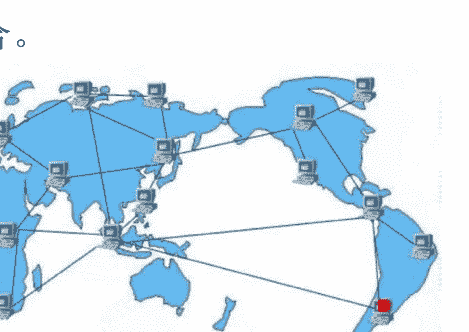

## 小任务：组建计算机网络

- 你家里有一个台式机、一个笔记本电脑、三个手机，需要联网和上网，怎么办？
- 硬件？
- 软件？


## 组建计算机网络需要考虑什么？

- 连入网络的终端设备有哪些？
  - 计算机、智能手机、PDA...
- 采用哪种连接方式？
  - 直接相连 or 需要中转
- 用什么连？
  - 有线 or 无线
- 能连多远？
  - 一个房间、一栋楼、一个校园、一个城市、一个国家、一块大陆、整个地球？

## 计算机及计算机网络的历史

1942:
ABC
阿塔纳索夫-贝瑞计算机

1943-1945:
Colossus
巨人计算机

1946: ENIAC
(by Mauchly+ Eckert )

1960s:
联机系统
（主机带终端）

1969:
APARNet
计算机网络

终端：有键盘和显示器，没有处理能力，不能独立工作

## 计算机及网络应用的发展

| | 1970s | 1980s | 1990s | 2000s | 2010-- |
|---|---|---|---|---|---|
| 网络应用 | E-mail<br>BBS<br>文件下载<br>(文本传输) | WWW<br>(1989)<br>(超媒体) | 电子商务<br>即时消息<br>(ICQ、QQ)<br>BLOG | VoIP<br>IPTV<br>P2P<br>社交网络(Facebook)<br>自媒体(Twitter, 微博)<br>音乐视频分享(Youtube)<br>团购网<br>云计算<br>传感网<br>物联网(IoT) | 移动社交<br>(微信)<br>互联网+<br>共享经济<br>(共享单车/嘀嘀快车)<br>移动支付<br>(线下支付/外卖)<br>大数据<br>短视频 |
| 网络技术 | 数百台主机连接到 ARPANet;<br>TCP/IP协议开发 | NSFNet→Internet,<br>TCP/IP支持异构网,<br>LAN | WiFi | 传感网<br>物联网(IoT) | |
| 主机硬件 | 大型主机 | PC<br>掌上电脑 | 智能手机<br>(IBM,1993)<br>触屏式平板电脑 | | |
| 网络速率<br>(带宽) | 100kbps | 1~10Mbps | 10~100Mbps | 1~10Gbps | 100G~1TBbps |

## 网络应用的发展

### 昨天（过去时）...

- 拨号网络...
- E-Mail...
- 静态文本页面...
- BBS...
- FTP...

...拨号接入互联网，业务单一，需求难以满足

### 今天（完成时）...

- 宽带生活...
- 即时通信...
- 语音电话...
- 快速下载...
- 在线流媒体...
- 3G、4G...

...但是应用类型的快速增长将需要更大量的网络带宽

### 明天（进行时）...

- 在线高清电视 IPTV...
- 高清真视频应用...
- 光纤接入、四网融合...
- Web2.0...
- 云计算
- 物联网
- 大数据

## 本章内容

- 1.1 计算机网络和因特网的概念及其应用
- 1.2 网络边缘
- 1.3 网络核心
- 1.4 衡量网络性能的指标
- 1.5 协议和层次体系结构
- 1.6 计算机网络的安全隐患
- 1.7 计算机网络和因特网的历史及进展

## § 1.1 计算机网络和因特网的概念及其应用

- 三网融合：电信网络(电话网) + 有线电视网络 + 计算机网络
- 并非物理合一，而是业务融合；网络互联互通、资源共享，为用户提供语音、数据和广播电视等多种服务
- 四网融合：+电力网

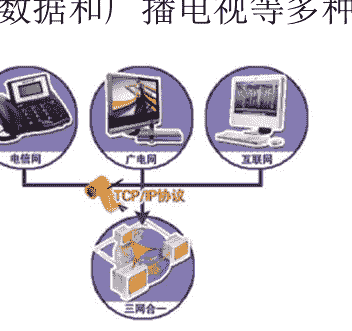

## 电力线通信（PLC: Power Line Communication）应用示例

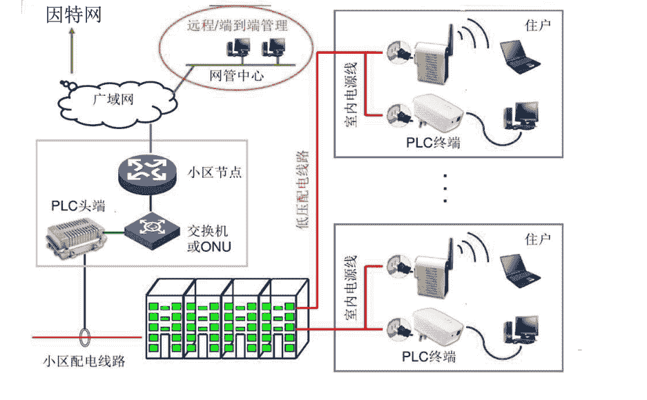

## 一种实用的PLC方案

- 通过现有其他网络接入方式（如ADSL）入户
- 住宅内使用PLC连接


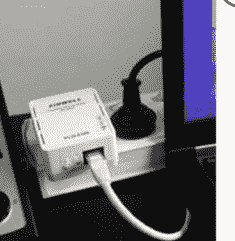

Q: Wifi vs. PLC?

## 什么是计算机网络？

- 计算机网络是通过同一种技术相互连接起来的一组自主计算机的集合，以实现信息交换、资源共享、协同工作等功能
- Internet(因特网)是一种计算机网络，是由许多个网络构成的网络
- WWW（万维网）是运行在因特网之上的一个分布式系统

## 1.1.1 计算机网络和因特网的概念

- 概念
  - 计算机网络
  - 互联网(internet)
  - Internet(因特网)
  - WWW (World Wide Web, 万维网)

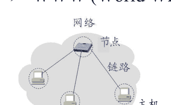

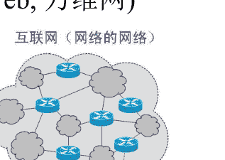

## 1.1.2 计算机网络的应用

- 电子邮件
- 搜索引擎
- 电子商务（淘宝、阿里巴巴）
- 网络游戏
- 即时消息（QQ）
- 社交网络（博客、微博、微信）
- 网络视频（IPTV、视频直播、视频分享）
- 网络新闻、电子政务（首都之窗）
- 移动商务（手机支付、手机网购、外卖、网约车）
- ……

中国互联网发展状况统计报告：
http://www.cnnic.net.cn/hlwfzyj/hlwxzbg/

## 1.1.3 计算机网络的组成

- 从软硬件角度，计算机网络分为三个主要的组成部分：
  - 计算机系统：用户端设备
  - 数据通信系统：传输/交换设备和链路
  - 网络软件


## 1.1.3 计算机网络的组成（硬件）

终端设备：主机（host）
端系统
运行网络应用程序，如浏览器等

通信链路
电缆、光纤、无线、卫星...

传输速率 = 带宽（bandwidth）

交换设备：路由器
转发数据包

- PC
- 服务器
- 便携式电脑
- 智能手机
- 接入点 AP
- 有线链路
- 路由器

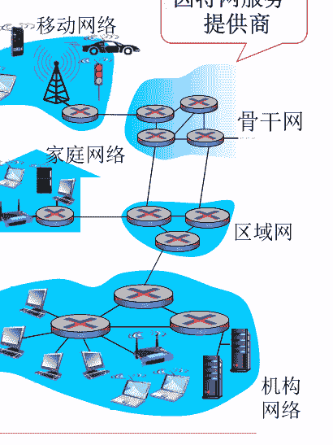

移动网络

因特网服务提供商

骨干网

家庭网络

区域网

机构网络

## 端系统不仅是计算机


智能音箱+电子相框

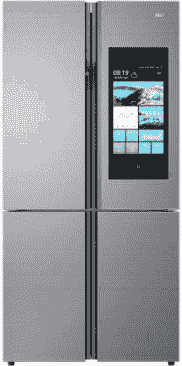

智能冰箱


面包炉+网络天气预报


可穿戴设备：手环


IP 电话机

## 传输/交换设备和链路

### 通信链路

光纤

同轴电缆

双绞线

### 网络接口

以太网卡

无线网卡

### 路由器/交换机

路由器

交换机

## 网络的拓扑结构

计算机网络中的各种设备通过传输介质互相连接，形成的物理布局

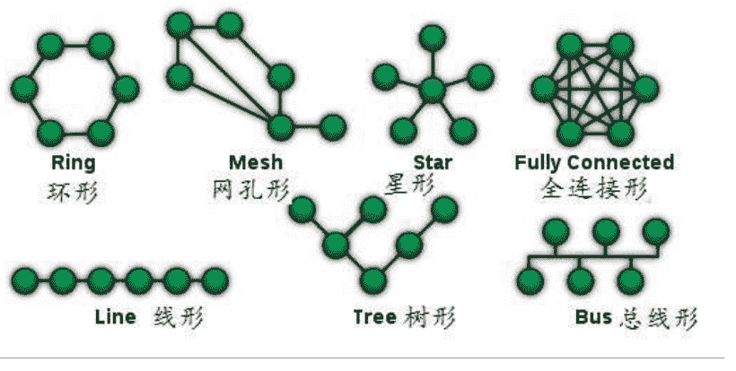

## 1.1.3 计算机网络的组成

- **网络边缘：** 主机和网络应用程序
- **网络接入链路（传输媒体/介质）：** 有线/无线通信链路
- **网络核心：**
  - 路由器互连
  - 网络的网络

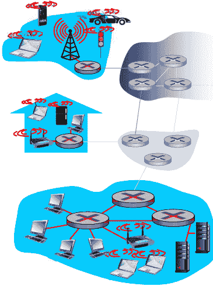

> [Kurose]

## 1.1.3 计算机网络的组成

因特网由网络边缘部分与网络核心部分组成。

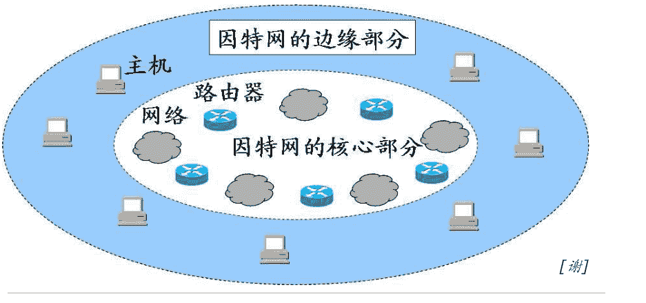

## § 1.2 网络边缘

- 处在因特网边缘的部分就是连接在因特网上的所有的主机。这些主机又称为端系统（End System）。
- 端系统中运行的程序之间的通信方式通常可划分为两大类：
  - 客户/服务器（Client/Server，C/S）方式
  - 对等（Peer-to-Peer，P2P）方式

## 网络边缘：C/S 方式

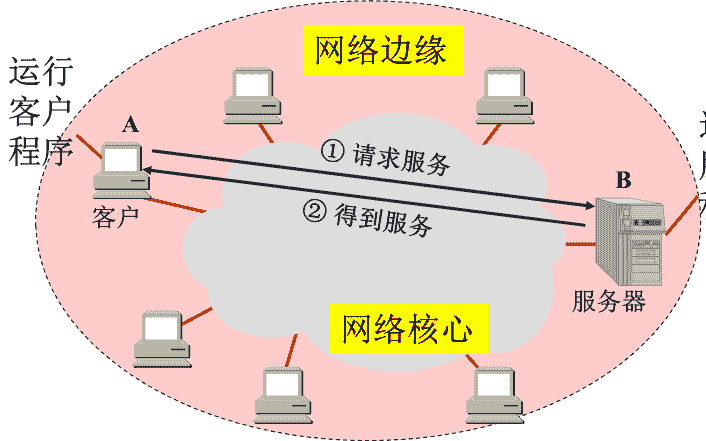

通信由客户 A 发起，向服务器 B 请求服务，而服务器 B 向客户 A 提供服务。

## 网络边缘：P2P 方式

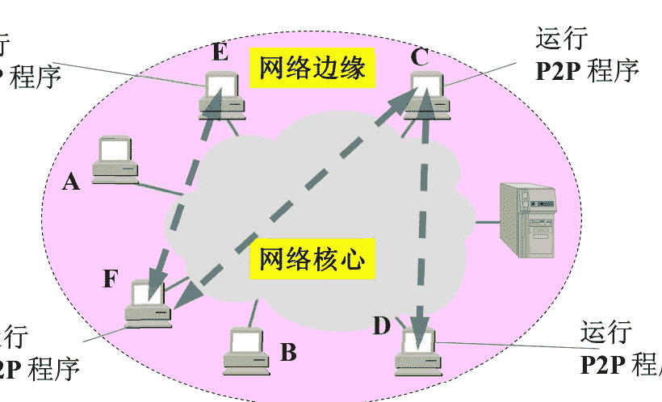

网络边缘

网络核心

运行 P2P 程序

运行 P2P 程序

运行 P2P 程序

运行 P2P 程序

Peer 既是客户，又是服务器

## § 1.2.1 网络边缘：LAN 的概念和特点

- 局域网（Local Area Network，LAN）的覆盖范围一般是几米至 10 公里以内，一般位于一个建筑物或一个单位内，不存在路由选择问题，不包括网络层的应用
- 在计算机数量配置上没有太多的限制，2 台一数百台
- LAN 连接范围窄、用户数少、配置容易、连接速率高，目前速率可达 10Gbps：万兆以太网

## § 1.2.2 网络边缘：网络接入方式

- 通过接入网络用户计算机连接到本地因特网服务提供商（Internet Service Provider，ISP）的系统
- 接入方式可分为适用于窄带业务的接入网技术和适用于宽带业务的接入网技术
- 从用户入网方式，因特网接入技术可以分为有线接入和无线接入两大类，无线接入技术分固定接入技术和移动接入技术

## 网络接入方式：LAN

- LAN 通过路由器连接到因特网，LAN 用户通过双绞线连接到交换机/路由器接口，即可通过 LAN 接入因特网。
- 小区宽带接入：FTTx+LAN，实现千兆光纤到小区（大楼）中心交换机，中心交换机和楼道交换机以百兆光纤或双绞线相连，楼道内采用综合布线，提供 100/1000 Mbps 不同速率的宽带接入

## 网络接入方式：电话拨号

- 经过调制解调器和普通模拟电话线与公用交换电话网（PSTN）连接，即窄带接入方式，速率不超过 56Kbps
- 经过专用终端设备和数字电话线，与 ISDN（综合业务数字网）连接；可以在一条模拟线上实现上网的同时拨打电话、收发传真
- 基本速率接口：两条 64kbps 的信息通路和一条 16kbps 的信令通路

## 电话拨号接入示例

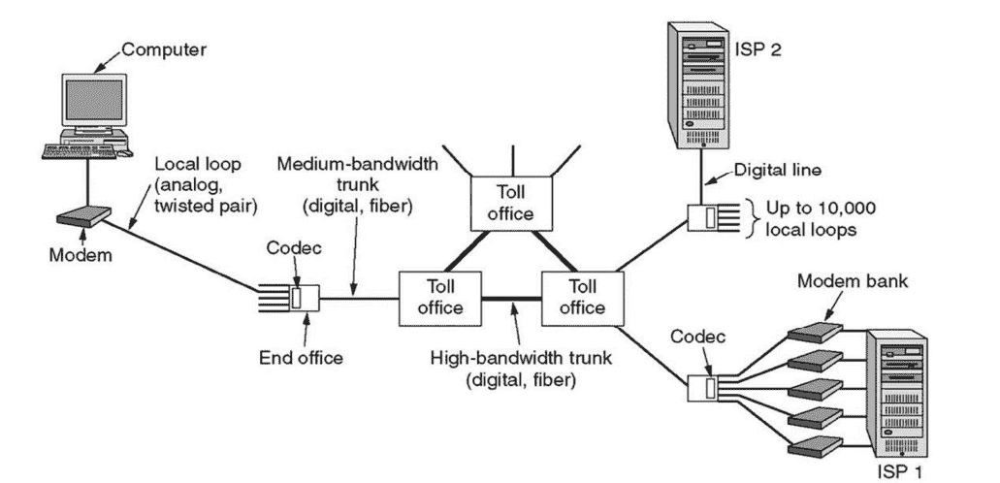

## 网络接入方式：ADSL

- 数字用户线路（Digital Subscriber Line，DSL）接入是基于普通电话线的宽带接入技术，在一对铜线上分别传送数据和语音信号。数字数据信号不通过电话交换机，并且不需要拨号，一直在线，属于专线上网方式
- 非对称数字用户线路（Asymmetric Digital Subscriber Line，ADSL）上行实用速率最高可达 1Mb/s，下行实用速率最高可达 8Mb/s，需在现有电话线上安装 ADSL MODEM

## ADSL 接入示例

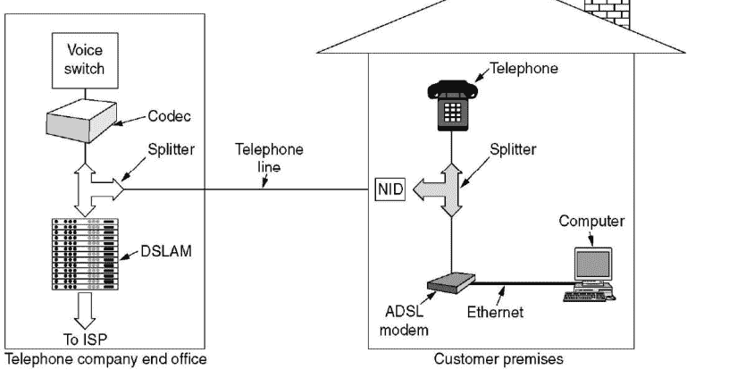

DSLAM：数字用户线接入复用器   NID：网络接口设备

## 网络接入方式：线缆接入

- 基于有线电视的线缆调制解调器（Cable Modem）接入方式可以达到下行 8Mb/s、上行 2Mb/s 的高速率接入

## 线缆接入示例

区域电缆头端

Picking antenna

RCH

Distribution hub

High-bandwidth fiber

Bidirectional amplifier

Switch

Fiber node

Fiber

Coaxial cable

Cable

Tap

Customer residence

Filter

Video

Cable modem

Data

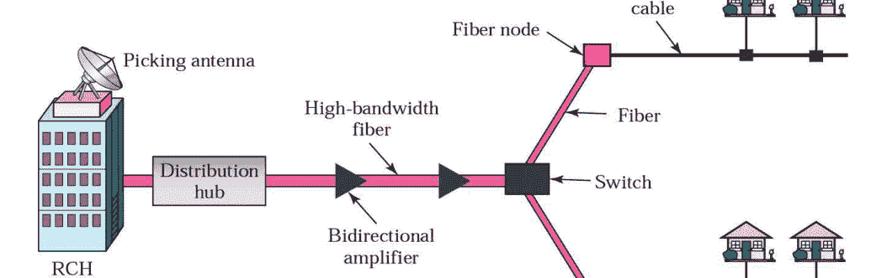

## 网络接入方式：光纤到户

- 光纤接入（OAN：Optical Access Network）
  - 采用光纤传输技术，即本地交换局和用户之间全部或部分采用光纤传输通信系统
  - 光纤具有带宽高、远距离传输能力强、保密性好、抗干扰能力强等优点
  - 光纤到户（Fiber To The Home，FTTH）方式将光网络单元（ONU）安装在用户家里

## 光纤到户（FTTH）示例

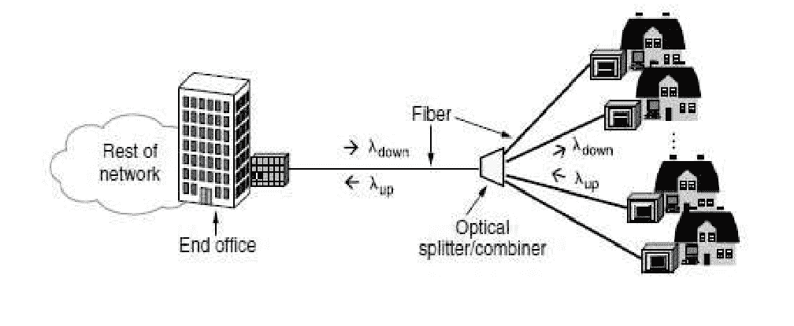

## 网络接入方式：无线局域网（WLAN）

- WLAN 使用无线射频（RF）技术在空中收发数据，无需电缆
- WiFi（Wireless Fidelity）：IEEE 802.11

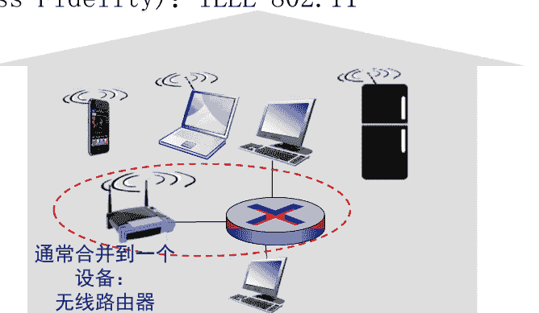

通常合并到一个设备：无线路由器

## 网络接入方式：其它无线接入方式

- 蓝牙（Bluetooth）：短距离（10 米以内）的无线通讯技术
- 移动通信技术

1980年代 1990年代 2000年代 2010年代 2020年代

模拟通信 数字通信

可语音通话 可发短信 可上网 智能手机 智能社会

1G 2G 3G 4G 5G

64k 100k-2M 100M 1Gbps

图片来源：王喜文，5G 为人工智能与智能制造赋能

## 5G 的整体结构

Overall view

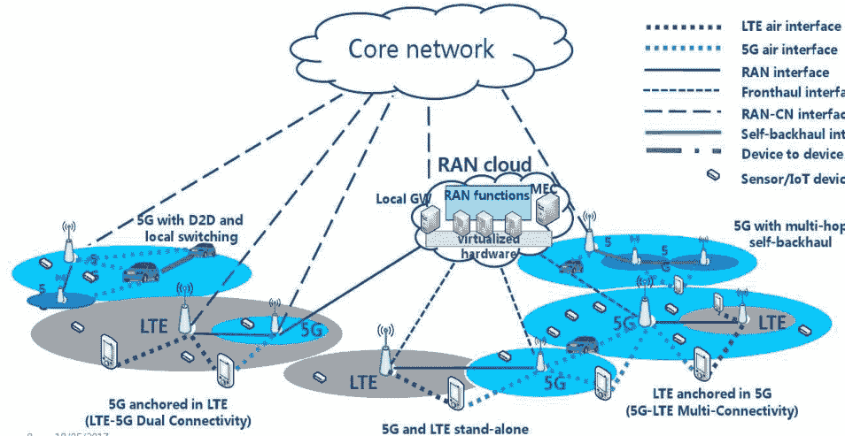

图片来源于网络，原作者未知

## 网络接入方式：卫星

通过卫星 MODEM 和卫星接收天线与卫星通信，速率可以达到数 Mbps

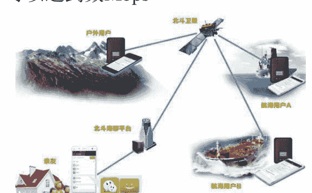


## 网络接入方式小结

| 接入方式 | 速度/bps | 特点 | 成本 | 适用对象 |
|---|---|---|---|---|
| 电话拨号 | 56K | 方便、速度慢 | 低 | 个人用户、临时用户上网访问 |
| ISDN | 128K | 较方便、速度慢 | 低 | 个人用户上网访问 |
| ADSL | 512K-8M | 速度较快 | 较低 | 个人用户、小企业上网访问 |
| Cable modem | 8M-44M | 利用有线电视的同轴电缆来传送数据信息，速度快 | 较低 | 个人用户、小企业上网访问 |
| LAN 接入 | 10M-100M | 附近有 ISP，速度快 | 较低 | 个人用户、小企业上网访问，常称为“宽带接入” |
| 光纤 | ≥100M | 速度快、稳定 | 高 | 大中型企业用户全功能应用 |
| 无线 LAN | 11M-54M | 方便、速度较快 | 较高 | 移动笔记本用户 |
| 无线 GPRS、CDMA、3G | 10K-1M | 速度较慢 | 较低 | 智能手机和 PCMCIA 卡插入笔记本移动用户 |
| 4G | 50M-100M | 速度较快 | 较高 | 智能手机 |

## § 1.3 网络核心

- 因特网中最复杂的部分。
- 功能：向网络边缘中的大量主机提供连通性，使边缘部分中的任何一个主机都能够和其他主机通信（即发送或接收数据）。
- 核心设备：路由器 (Router)。
- 路由器是实现分组交换 (Packet Switching) 的关键构件，其任务是转发收到的分组，这是网络核心部分最重要的功能。
- 由互联的路由器组成的网状结构 (Mesh)。
- 核心功能：如何在网络中和网络之间传输数据？
- 电路交换：电话网为代表，每次呼叫采用固定路径。
- 分组交换：因特网为代表，每个数据包单独选择路由传输。

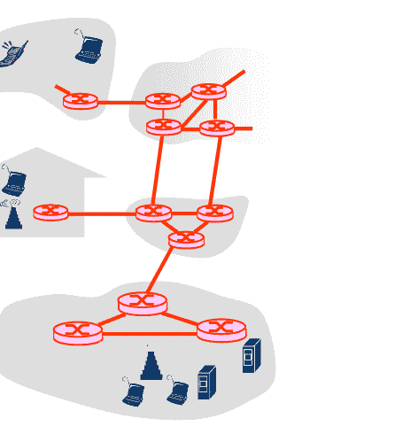

## § 1.3.1 广域网的概念及特点

- 城域网（Metropolitan Area Network, MAN）
- 覆盖一个城市，规模介于 LAN 和 WAN 之间
- 典型示例：有线电视网。

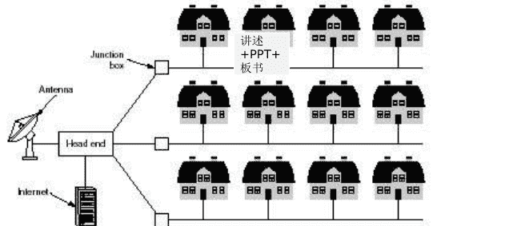

## 广域网：WAN (Wide Area Network)

- 广域网的组成：
  - 主机
  - 通信子网 (交换节点和传输线路)

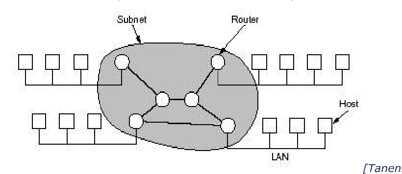

## 广域网的特点

- 广域网的技术特点
  - 广域网也称为远程网；
  - 覆盖地理范围从几十公里到几千公里；
  - 覆盖一个国家、地区，或横跨几个洲，形成国际性的远程网络；
  - 通信子网主要使用分组交换技术；
  - 将分布在不同地区的计算机系统互连起来，达到资源共享的目的。

## WAN vs. MAN

- 局域网和广域网的侧重点不同
  - LAN：共享信道，冲突算法
    解决网络中随时可能产生的冲突，减少冲突，减少错误
  - WAN：网状拓扑，路由算法
    找出一条最佳的路径，从而加快转发速度，减少错误

## § 1.3.2 电路交换和分组交换

- 电话系统
  - 笨终端，聪明的网络
  - 确保每个网络部件都是可靠的
  - 系统可靠性＝部件可靠性
  - 通过局部冗余实现部件的高可靠性
  - 期望每个部件都能正常工作，部件失败的可能性很低
  - 需要人工配置的，高度控制的网络

## 分组交换系统

- 分组交换系统
  - 建立在简单的、不可靠部件上的可靠系统
  - 自适应的系统
  - 聪明的终端，可以修正传输错误
  - 分组交换网络抵御故障的能力较强，重新传输的是出问题的数据包，而不是全部信息；如果数据包遇到计算机发生故障或者线路中断，会另找其他的传输路径。

## 电路交换的主要特点 (1)

- 两部电话机只需要用一对电线就能够互相连接起来
- N 部电话机两两相连，无交换，需 N(N − 1)/2 对电线

## 电路交换的主要特点 (2)

- 使用交换机：当电话机的数量增多时，要使用交换机来完成全网的交换任务

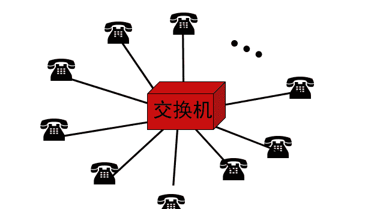

## 什么是交换？

- “交换” (switching) 的含义就是转接——把一条电话线转接到另一条电话线，使它们连通起来。
- 从通信资源的分配角度来看，“交换”就是按照某种方式动态地分配传输线路的资源。

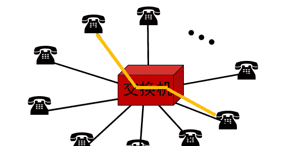

## 电路交换的主要特点

- 电路交换分为三个阶段：建立连接、通信、释放连接

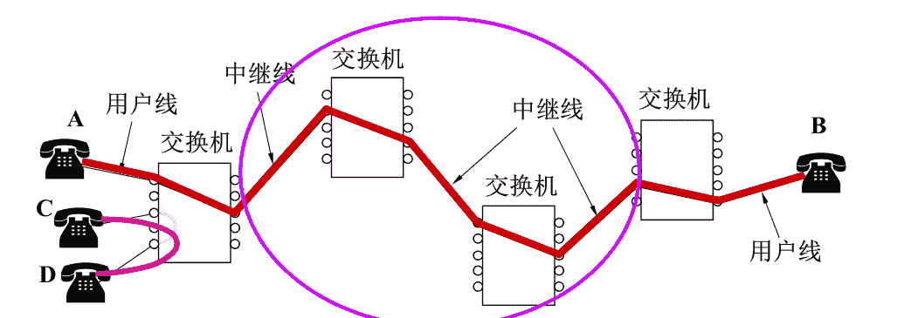

## 分组交换的主要特点

- 在发送端，先把较长的报文划分成较短的、固定长度的数据段（**分组**）；
- 每一个数据段前面添加上首部构成分组；
- 依次把各分组发送到接收端；
- 接收端收到分组后剥去首部还原成报文。

## 分组交换：数据先分成分组后再传输

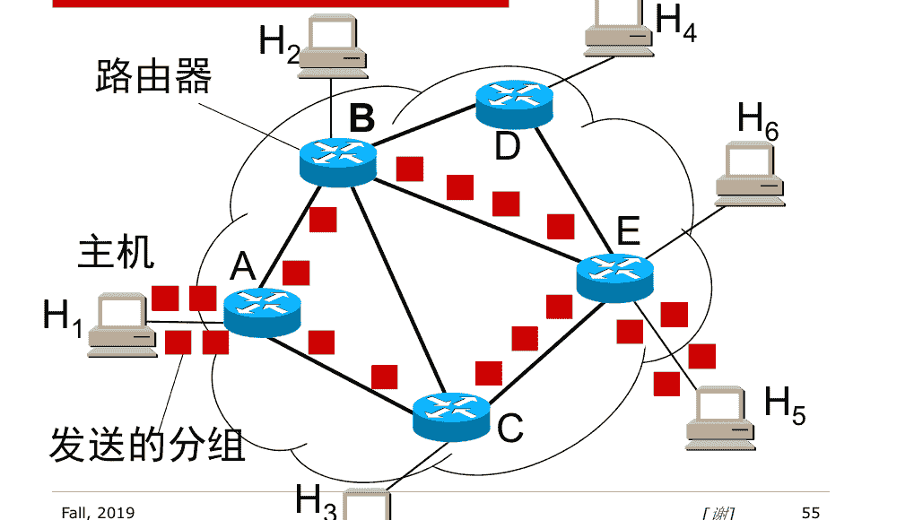

## 分组交换：每个分组单独选路

路由器

主机

注意分组路径的变化！

H₂向 H₆ 发送分组

H₁向 H₅ 发送分组

互联网

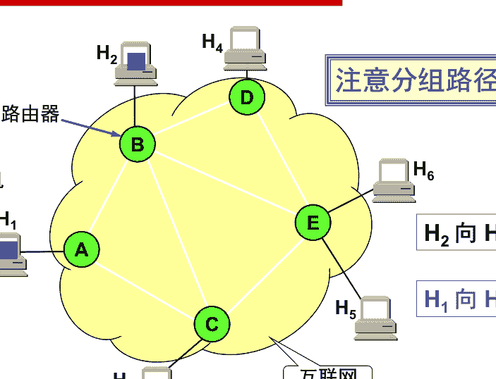

## 分组交换：路由器的处理过程

- 在路由器中的输入和输出端口之间没有直接连线（即没有建立物理连接）。
- 路由器处理分组的过程是：
  - 把收到的分组先放入缓存 (暂时存储)；
  - 查找转发表，找出到某个目的地址应从哪个端口转发；
  - 把分组送到适当的端口转发出去；
  - 存储转发。

## 分组交换：存储转发示例

在路由器 A 暂存
查找转发表
找到转发的端口

注意分组的存储转发过程

H₁向 H₅ 发送分组

互联网

主机

路由

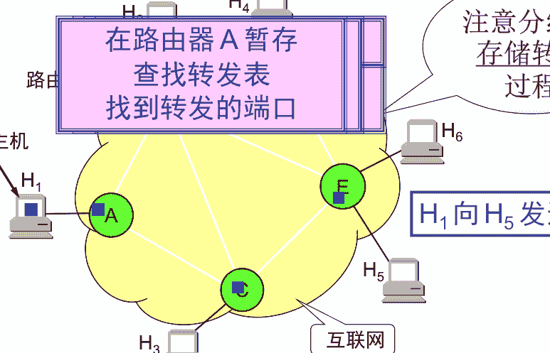

## 主机和路由器的作用不同

- 主机是为用户进行信息处理的，并向网络发送分组，从网络接收分组。
- 路由器对分组进行存储转发，最后把分组交付目的主机。

## 电路交换 vs. 分组交换

电路交换：预先建立专用的物理链路

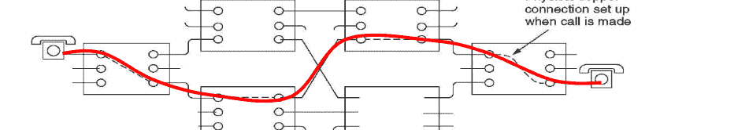

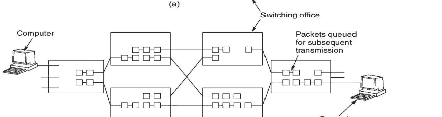

分组交换：数据首先分成多个分组，每个分组单独传送

## 分组交换的优点

- **高效**：动态分配传输带宽，对通信链路是逐段占用
- **灵活**：以分组为传送单位和查找路由
- **迅速**：不必先建立连接就能向其他主机发送分组
- **可靠**：保证可靠性的网络协议；分布式的路由选择协议使网络有很好的生存性

## 分组交换带来的问题

- 分组在各结点存储转发时需要排队，这就会造成一定的时延。
- 分组必须携带的头部 (里面有必不可少的控制信息) 也造成了一定的开销。

## 分组交换和电路交换的时延特性

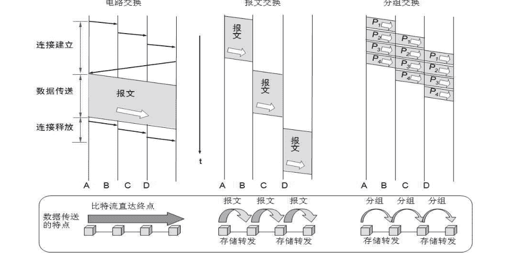

## § 1.3.3 ISP 和骨干网

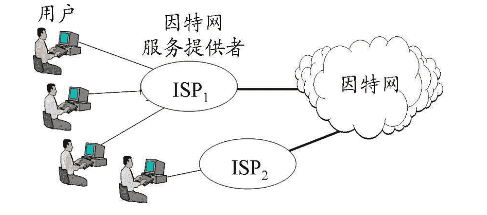

## 1.3.3 ISP 和骨干网

多层次 ISP 结构的因特网

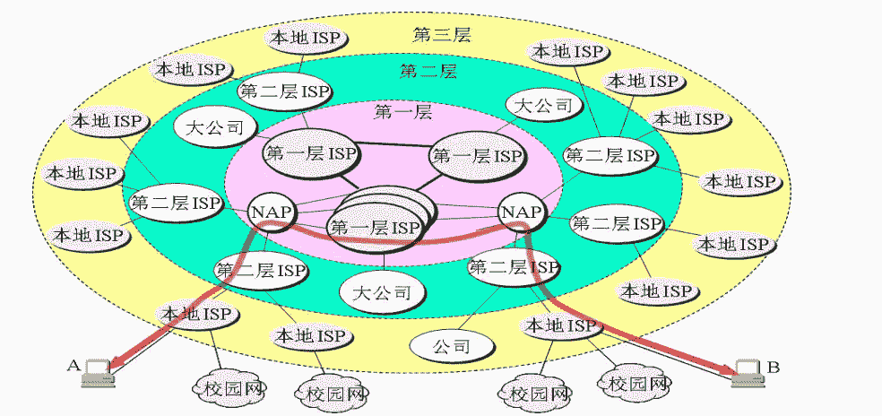

主机A → 本地 ISP → 第二层 ISP → NAP → 第一层 ISP → NAP → 第二层 ISP → 本地 ISP → 主机B

## 1.3.3 ISP 和骨干网

- 把城市之间连接起来的网就叫骨干网
- 直接和国外连接（即有国际出口）
- 其他有接入功能的 ISP 通过骨干网连到国外
- “骨干网”通常是用于描述大型网络结构时经常使用的词语，描述网络结构，而非具体使用的传输方式或协议
- 骨干网一般都是广域网：作用范围几十到几千公里


## 1.3.3 ISP和骨干网

我国曾经拥有九大骨干网：

- 中国公用计算机互联网络(CHINANET)
- 中国金桥信息网(CHINAGBN)
- 中国联通计算机互联网络(UNINET)
- 中国网通公用互联网络(CNCNET)
- 中国移动互联网络(CMNET)
- 中国教育和科研计算机网(CERNET)
- 中国科技网(CSTNET)
- 中国长城网(CGWNET)
- 中国国际经济贸易互联网络(CIETNET)

## 目前的情况（截止2018年12月）

|  | 国际出口带宽数（Mbps） |
|---|---|
| 中国电信 | 4,537,680 |
| 中国联通 | 2,234,738 |
| 中国移动 | 1,997,000 |
| 中国科技网 | 115,712 |
| 中国教育和科研计算机网 | 61,440 |
| 合计 | 8,946,570 |

第43次中国互联网络发展状况统计报告：http://www.cnnic.net.cn/hlwfzyj/hlwxzbg/

## 中国教育和科研计算机网

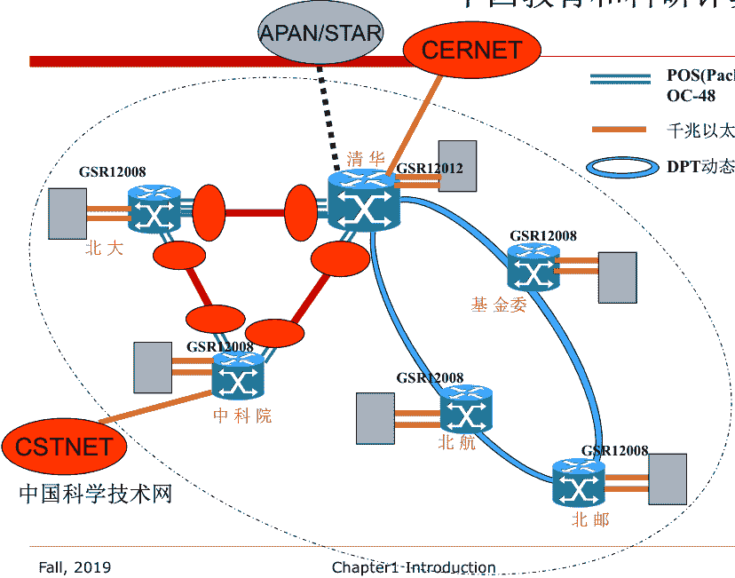

APAN/STAR

CERNET

CSTNET

中国科学院科技网

- POS(Packet Over SDH) OC-48
- 千兆以太网
- DPT动态分组环

GSR12008

北大

清华

CSR14012

GSR12008

基金委

GSR12008

北航

GSR12008

北邮

GSR12008

中科院

## CERNET骨干网

CERNET主干网

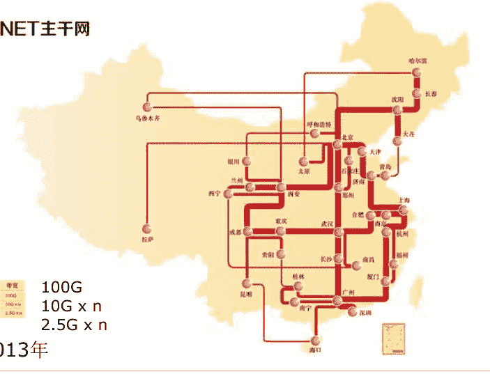

100G

10G x n

2.5G x n

2013年

## CNGI-CERNET2

- CNGI: China Next Generation Internet
- 世界上最大规模的纯IPv6网络

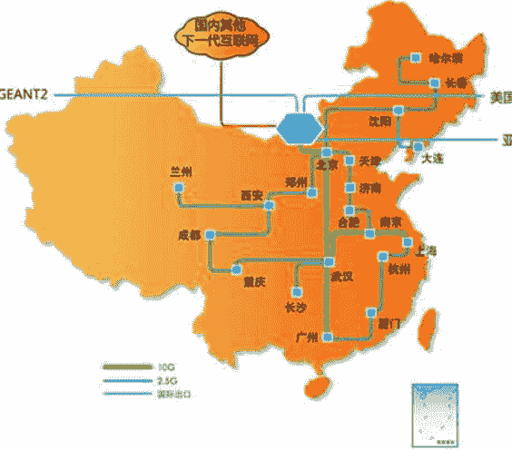

## 网络核心——一种未来网络的规划方案

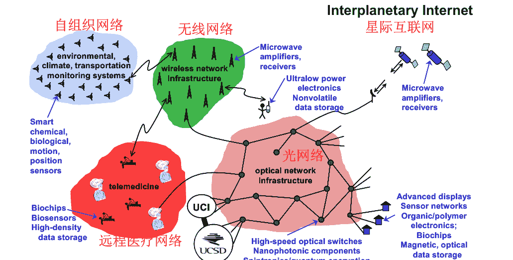

## 星际网络

Titan

Saturn

Neptune

Uranus

Europa

Jupiter

Pluto

Charon

Mars

Mercury

Sun

Backbone Networks

Access Networks

Inter-Spacecraft Links

Proximity Links

## 因特网中主机的通信过程（1）

- 源主机
- 网络应用程序（如IE浏览器）产生待发数据
- 网络通信软件（如TCP/IP）将数据分成“包”

- 通信链路（电缆）将计算机连接到网络
- 网络设备（如路由器）接收数据并转发

- 目的主机
- 网络通信软件将收到的包重装成数据
- 网络应用程序（如www服务器）对数据进行处理

A

B
"www.bupt.edu.cn"
202.137.240.91

## 因特网中主机的通信过程（2）

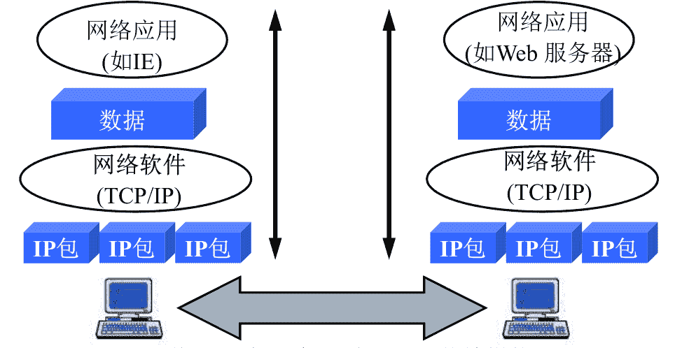

## § 1.5 协议和层次体系结构

- 1.5.1 什么是协议
- 1.5.2 分层的体系结构
- 1.5.3 体系结构实例：OSI参考模型
- 1.5.4 体系结构实例：TCP/IP协议栈

## § 1.5.1 什么是协议

- 协议是通信实体（如网络应用程序）之间通信所必须遵守的规则
- 协议定义了在两个或多个通信实体之间交换的报文格式和次序，以及在报文传输和/或接收或其他事件方面所采取的动作

## 什么是协议？

人际交际的协议

计算机网络的协议

Hi

Hi

Got the time?

2:00

time

TCP 连接请求

TCP 连接响应

Get http://www.bupt.edu.cn

<file>

[Kurose]

## 协议的组成

- 网络协议的组成要素
  - 语法：数据与控制信息的结构或格式
  - 语义：需要发出何种控制信息，完成何种动作以及做出何种响应
  - 同步：事件实现顺序的详细说明


## § 1.5.2 分层的体系结构

网络很复杂！

- 包含很多构件：主机、路由器、链路、应用、协议、硬件、软件……
- 如何能把网络结构进行合理组织，以便于理解、便于实现？
- 相互通信的两个计算机系统必须高度协调工作才行，而这种“协调”相当复杂
- “分层”可将庞大而复杂的问题，转化为若干较小的、比较易于研究和处理的局部问题

## 网络分层：类比邮政系统

| 邮政系统 | 因特网 |
| :--- | :--- |
| 分层 | 分层 |
| 双方公认的语言 | 网络应用（如 HTTP） |
| 信封和回邮地址 | 可靠交付（TCP） |
| 收信人地址 | 源--目的地发送（IP） |
| 邮政信箱、运输工具、邮递员 | 网络硬件（主机、路由器、电缆……） |

## 协议与网络体系结构

- 计算机网络中的数据交换必须遵守事先约定好的规则。
- 这些规则明确规定了所交换的数据的格式以及有关的同步问题（时序）。
- 网络协议（Network Protocol），是为进行网络中的数据交换而建立的规则、标准或约定。
- 体系结构（Network Architecture）：一个系统内的分层及各层协议的集合。

## § 1.5.3 体系结构实例：OSI 参考模型

只要遵循 OSI 标准，一个系统就可以和位于世界上任何地方的、也遵循这同一标准的其他任何系统进行通信。

在市场化方面 OSI 却失败了：

- 专家们在完成 OSI 标准时没有商业驱动力；
- 协议实现起来过分复杂，且运行效率很低；
- 制定周期太长，导致按 OSI 标准生产的设备无法及时进入市场；
- OSI 的层次划分不太合理，有些层过于复杂、有些层过于简单、有些功能在多个层次中重复出现。

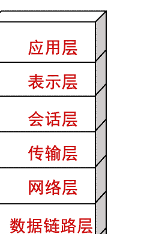

## OSI 参考模型

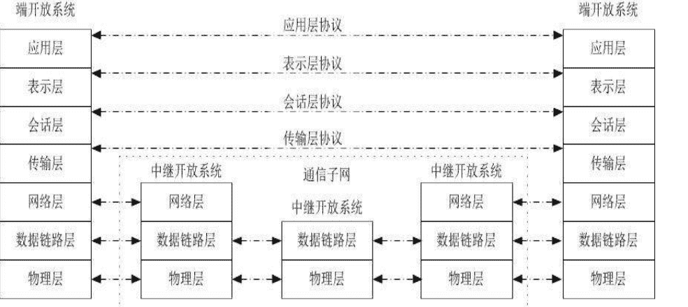

## § 1.5.4 体系结构实例：TCP/IP 协议栈

- 两种国际标准
  - 法律上的国际标准 OSI 并没有得到市场的认可
  - 非国际标准 TCP/IP 现在获得了最广泛的应用
- TCP/IP 常被称为事实上的国际标准

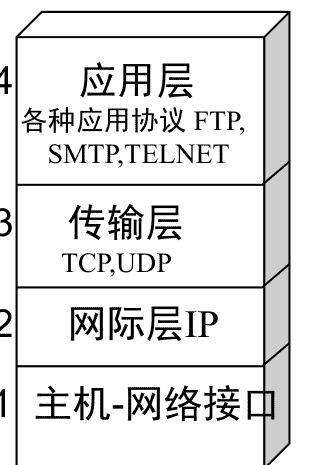

## OSI モデル vs. TCP/IP 协议栈

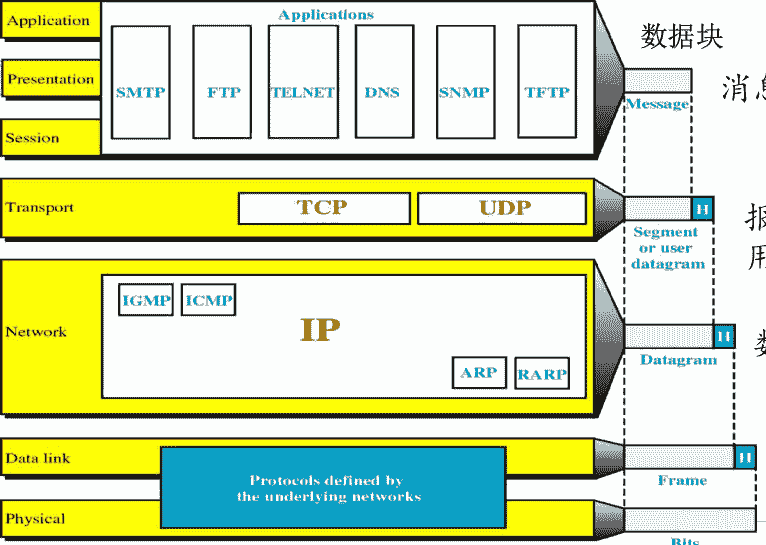

数据块

消息/报文

报文段/用户数据报

数据报

帧

## IP over Everything

## IP 可应用到各式各样的网络上

## IP 可为各式各样的应用程序提供服务

| 应用层 | 传输层 | 网际层 | 主机-网络接口 |
| :--- | :--- | :--- | :--- |
| HTTP | TCP | IP | 以太网 |
| SMTP | UDP | | WIFI |
| DNS | | | 光网络 SDH |
| RTP | | | |

## 分层的原则

- 根据分层模型设计协议，目标协议软件按层次组织。
- 每台计算机上的协议软件被分成许多模块，每个模块对应一层。
- 分层决定了模块间的相互作用，当协议软件发送或接收数据时，每个模块只同它紧邻的上层模块和下层模块通信。因此，送出的数据向下通过每一层，接收的数据向上通过每一层。

## 分层体系结构的基本概念

### 实体、协议、服务和服务访问点

实体（Entity）表示任何可发送或接收信息的硬件或软件进程。

协议是控制两个对等实体（Peer Entity）进行通信的规则的集合。

在协议的控制下，两个对等实体间的通信使得本层能够向上一层提供服务。

要实现本层协议，还需要使用下层所提供的服务。

## 生活中示例：邮政服务

服务用户：发信人

一封信

关注信件内容

收信人

服务提供者：A 邮局

B 邮局

检查信封的收件人地址，信件内容对他们透明

什么是协议？通信的规则，遵守规则才能实现本层的功能，向上层提供服务

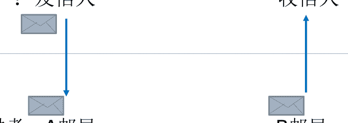

## 协议 vs. 服务

- 本层的服务用户只能看见服务而无法看见下面的协议。
- 下面的协议对上面的服务用户是**透明**的。
- 协议是“**水平的**”，即协议是控制对等实体之间通信的规则。
- 服务是“**垂直的**”，即服务是由下层向上层通过层间接口提供的。
- 同一系统相邻两层的实体进行交互的地方，称为**服务访问点 SAP**（Service Access Point）。

## 协议 vs. 服务

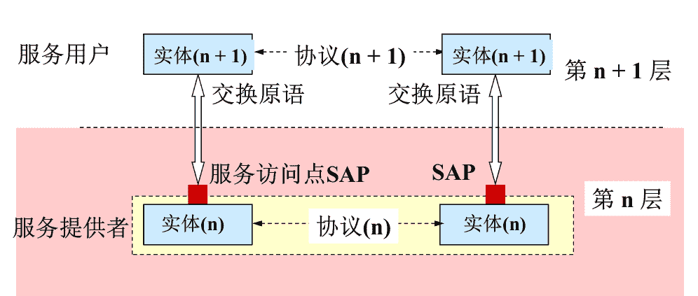

## 封装的概念

下层对于上层数据进行封装

发送的数据向下

接收的数据向上

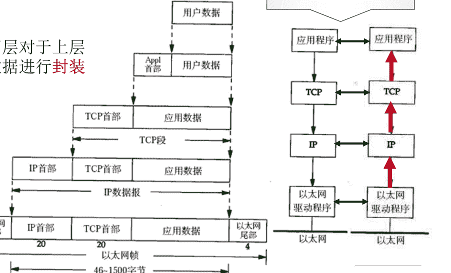

## 示例：我要访问北邮的主页，通信过程是怎样的？

应用层：浏览器 网页请求 Web Server 程序

传输层：TCP 软件 建立连接，发送报文段 TCP 软件

网际层：IP 软件 IP 包 IP 软件

数据链路层：网卡 二进制位串（电平信号） 网卡

物理层：双绞线 双绞线

## 教学中使用的体系结构：混合模型

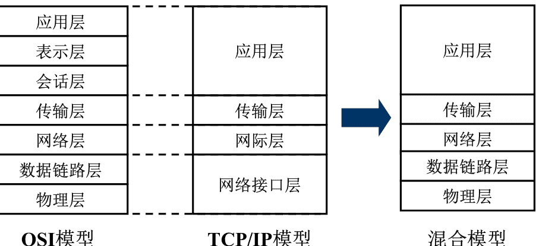

## 数据包的封装

在上层数据之前（后）增加一些控制信息，再传送给对等实体

| 源主机 | | | | |
| :--- | :--- | :--- | :--- | :--- |
| 应用层 | 传输层 | 网络层 | 链路层 | 物理层 |
| 报文 | 报文段 | 数据报 | 帧 | |
| M | Hₜ M | Hₙ Hₜ M | Hₗ Hₙ Hₜ M Tₗ | |

LAN 交换机

链路层

物理层

| 目的主机 | | | | |
| :--- | :--- | :--- | :--- | :--- |
| 应用层 | 传输层 | 网络层 | 链路层 | 物理层 |
| 报文 | 报文段 | 数据报 | 帧 | |
| M | Hₜ M | Hₙ Hₜ M | Hₗ Hₙ Hₜ M Tₗ | |

Hₙ Hₜ M

Hₗ Hₙ Hₜ M Tₗ

网络层

链路层

物理层

路由器

[Kurose]

## § 1.6 网络安全隐患

- Malware can get in host from a virus, worm, or trojan horse. 进入主机的恶意软件有病毒，蠕虫或木马
- Spyware malware can record keystrokes, web sites visited, upload info to collection site. 间谍恶意软件可以记录用户的击键、访问的网站，将信息上传到收集站点

## § 1.6 网络安全隐患

- Infected host can be enrolled in a botnet, used for spam and DDoS attacks. 受感染的主机被加入一个僵尸网络，发送垃圾邮件和 DDoS 攻击
- Malware is often self-replicating: from an infected host, seeks entry into other hosts. 恶意软件往往自我复制：从被感染的主机，寻求进入到其他主机

## 网络安全隐患

- Trojan horse（木马）
  - 伪装成合法程序或隐藏在合法程序中
  - 经常隐藏在网页内（Active-X，插件）

- Worm（蠕虫）
  - 包含在用户收到的对象中，自动执行
  - 能自我复制，传播到其他主机

- Virus（病毒）
  - 包含在用户收到的对象中，如邮件附件，自动执行并感染用户计算机
  - 能自我复制


## 网络安全隐患

拒绝服务（Denial of service, DoS）：通过大量业务流来占用资源，如服务器、带宽等，从而使资源不可用

1. 选择攻击目标
2. 使用僵尸网络（botnet）控制多台计算机
3. 向目标发送大量数据包

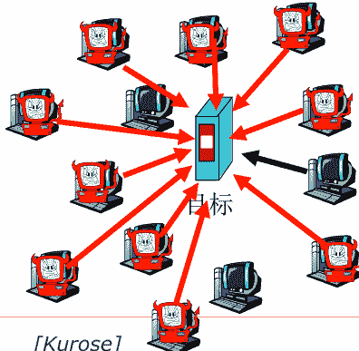

## 网络安全隐患

IP 欺骗（IP spoofing）

以虚假的源地址发送数据包

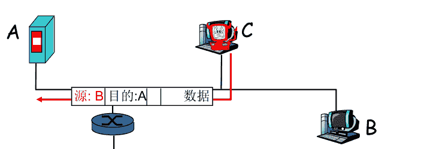

## 网络安全隐患

- **记录和回放**（record-and-playback）：嗅探敏感信息（如密码），留待以后使用
- 从系统的角度来看，密码持有人就是那个合法用户

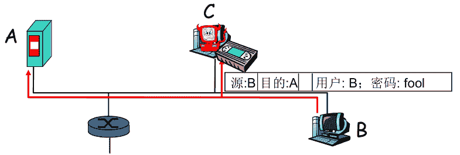

> [Kurose]


## ISO的信息安全体系结构

- ISO 7498-2 规定的“开放系统互连安全体系结构”，（GB-T 9387.2-1995 信息处理系统开放系统互连基本参考模型第2部分：安全体系结构）

- 给出了基于 OSI 参考模型的七层协议之上的信息安全体系结构，它定义了开放系统的五大类安全服务，以及提供这些服务的八大类安全机制及相应的 OSI 安全管理，并可以根据具体系统适当地配置于 OSI 模型的七层协议中。

## 信息安全体系结构


## § 1.7 计算机网络和因特网的历史及进展

### 60年代：面向终端分布的计算机系统


### 计算机网络和因特网的历史

- 60年代中期，当时正处于冷战的最紧张时期，前苏联的任何攻击都会连带损坏美国的整个电话系统，倘若如此，美国将丧失军事通信能力。
- 电话系统是高度集中式的，即使主要系统的一小部分遭到损坏，所有的长途通信也都会被中断。

### 70年代：分组交换数据网(PSDN)出现

以美国国防部高级研究计划局DARPA的 ARPANET为代表，采用崭新的“存储转发--分组交换”原理，它标志着计算机网络的兴起。


IMP：接口报文处理机

### 80年代：LAN和互连网发展、综合业务数字网

ISDN和智能网IN的出现

80年代中，以ISO/OSI七层模型为参照，ISO和国际电报电话咨询委员会CCITT为各个层次制定了一系列协议标准，组成了一个庞大的基本标准集，同时也为OSI的应用和产品的最终实现制定功能标准或轮廓标准ISP（International Standardized profile）。

### 90年代：现代网络技术

- 高速以太网（百兆、千兆网），
- 三层交换技术、
- ATM技术
- VLAN……

## 历年连接到因特网的国家数


## 谁管理因特网？

http://xplanations.com/whorunstheinternet/

### HERE IS HOW IT WORKS.


### THE INTERNET

POLICIES & STANDARDS GUIDE THE WAY IN DECISION MAKING

### MULTI-STAKEHOLDERS

Civil Society & Internet Users, the Private Sector, Governments, National & International Organizations, Research, Academic and Technical Communities all have a say in how the Internet is run.

### OPEN DEBATE

The formal and informal process of debating policy and standard proposals in multi-stakeholder model using any variety of methods; in-person, Internet Drafts, public forums, publishing, and many more.

### POLICIES & STANDARDS

Internet policies are the shared principles, norms, rules, decision-making procedures, and programmes that shape the evolution and use of the Internet. Internet Standards enable interoperability of systems on the Internet by defining protocols, messages formats, schemes and languages.

### OPERATIONS & SERVICES

Internet Operations span all aspects of hardware, software, and infrastructure required to make the Internet work. Services include education, access, web browsing, online commerce, social networking, etc.

Operations & Services support the Internet's global infrastructure.

## 因特网的标准：RFC

- 因特网工程任务组（IETF，Internet Engineering Task Force）
  - 面向近期标准的组织，它分为9个领域（应用、寻径和寻址、安全等等），负责开发成为因特网标准的规范。
- RFC: Request For Comments
  - 因特网的标准文档

## 本章内容总结

- 1.1 计算机网络和因特网的概念及其应用：
  计算机网络、互联网、Internet(因特网)、WWW (万维网)、计算机网络的组成
- 1.2 网络边缘： 局域网、网络接入方式
- 1.3 网络核心： 广域网、电路交换和分组交换、 ISP和骨干网
- 1.4 衡量网络性能的指标： 带宽、时延、吞吐量
- 1.5 协议和层次体系结构： 协议、分层的体系结构、OSI参考模型、TCP/IP协议栈
- 1.6 计算机网络的安全隐患
- 1.7 计算机网络和因特网的历史及进展

## 版权说明

本讲义中部分图片来源于下列教材所附讲义：

- Jim Kurose, Keith Ross, Computer Networking: A Top Down Approach, 7th Edition, Pearson/Addison Wesley, April 2016, 引用时标记为[Kurose];
- Andrew S. Tanenbaum, Computer Networks, Fourth Edition, 清华大学出版社（影印版）, 2004, 引用时标记为[Tanenbaum];
- 谢希仁，计算机网络，第五版，电子工业出版社，2008年1月,引用时标记为[谢];
- Behrouz A. Forouzan, Data Communications and Networking, Fourth Edition, McGraw-Hill Higher Education, 2007年1月, 引用时标记为[Forouzan]

## 本章实验：Windows 网卡配置实验

### 实践思考题

- 1）自动获取IP地址是如何实现的？除了IP地址之外，还可以配置哪些参数？
- 2）ping 命令有哪些选项？命令输出的结果中，各个参数有什么含义？

### 拓展思考题

- 选择一个新兴网络应用，查阅资料，了解该应用的功能和性能指标、需要的技术支持等。

## 本章勘误表

| 页码 | 位置 | 原文 | 更正 |
| --- | --- | --- | --- |
| 5 | 第4段第3行 | 桥接器 | 网桥 |
| 6 | 图1-3名 | 端系统之间的通信方式 | 端系统之间的P2P通信方式 |
| 8 | 倒数第2段第1行 | 数百英尺范围内 | 100米内 |
| 20 | 倒数第4行 | 提示型原理 | 指示型原语 |
| 27 | 图1-19下第4行 | 默认网关：192.168.199.1 | 默认网关：192.168.199.127 |

## 主要内容

- 2.1 网络应用概述
- 2.2 DNS
- 2.3 WWW应用和HTTP
- 2.4 Email应用
- 2.5 FTP
- 2.6 远程登录协议：Telnet
- 2.7 应用层安全隐患


## 教学目标

- 掌握应用层的基本概念
  - 应用层的体系结构
    - C/S模型
    - P2P模型
  - 进程与端口号
- 掌握典型的应用层协议
  - DNS
  - HTTP
  - SMTP、POP3

## 主要内容

- 2.1 网络应用概述
  - 网络应用的发展史
  - 应用层的体系结构：**C/S**和**P2P**
  - 进程通信及端口号
  - 应用对于传输服务的要求
- 2.2 DNS
- 2.3 WWW应用和HTTP
- 2.4 Email应用
- 2.5 FTP
- 2.6 远程登录协议：Telnet
- 2.7 应用层安全隐患

## 网络应用的发展史

| 出现时间 | 应用 | 发明者 | 应用层协议 |
|---|---|---|---|
| 1969 | 远程登录、BBS | 连接ARPANet的4所大学的学生 | Telnet |
| 1971 | Email | Ray Tomlinson | SMTP、POP3 |
| 1971 | 文件传输 | Bhushan, Abhay | FTP |
| 1989 | WWW | Tim Berners Lee | HTTP |
| 1994 | Web Blog | Justin Hall | HTTP |
| 1995 | Amazon（电子商务） | Jeff Bezos | HTTP |
| 1995 | IP电话（VoIP） | VocalTec公司 | SIP、RTP |
| 1995 | 音频/视频点播 | Xing技术公司 | RTP |
| 1996 | OICQ（即时消息） | Yair Goldfinger等 | 私有协议 |
| 1999 | Napster（P2P文件共享） | Shawn Fanning | 私有协议 |

## 网络应用的通信过程

网络应用（如IE）

数据

网络软件（TCP/IP）

IP包 IP包 IP包

网络应用（如Web 服务器）

数据

网络软件（TCP/IP）

IP包 IP包 IP包

物理设施（主机、路由器、传输媒体）

- 应用层
- 传输层
- 网络层
- 链路层
- 物理层

## 如何提供一个网络应用？

- 编写应用程序
- 可在不同的端系统上运行
- 通过网络和其他端系统通信
- 遵守特定的协议
- 示例： web server软件和浏览器软件通信
- 无需修改网络核心软件
- 网络核心设备不运行网络应用程序
- 便于实现快速的应用开发和部署


## 应用层协议的内容

- 消息类型
  - 例如：请求、应答
- 语法（Syntax）
  - 消息中包含哪些字段，每个字段的长度
- 语义 (Semantics)
  - 每个字段信息的含义
- 时序：消息的顺序

HTTP消息示例

```
请求行→GET /somedirectory/page.html HTTP/1.1
消息头
（可选）
Host: www.abc.edu.cn
User-agent: Mozilla/4.0
Accept-language:zh-cn
Connection: Keep-Alive
```

## 应用层协议的特点

- 面向用户，支持特定的网络应用
  - 没有通用的协议，每个应用有专门的协议！
  - 相比其他层，协议数量最多、最复杂


## 网络应用的体系结构

- Client-server(C/S)
- Peer-to-peer (P2P)
- C/S和P2P混合结构

## C/S 体系结构


client/server

非对称

[Kurose]

- □ **服务器**
  - 提供服务，同时处理多个客户请求
  - 一直在线
  - 地址(域名)公开，一般不变
  - 可能有多个服务器(server farms)
  - 一般需要高性能硬件支持

- □ **客户**
  - 与服务器通信，使用服务
  - 临时连接到网络
  - IP地址可能是动态的
  - 客户之间不直接通信

## 几个概念

- 客户和服务器是计算机进程，即运行着的程序（软件）。
- 使用计算机的人是计算机的“用户”(user)，而不是“客户”(client)
- 有些外国文献把运行客户程序的机器称为 client，把运行服务器程序的机器称为 server，需要根据上下文判断。一般我们称为客户端（或客户机）和服务器端。
- 应如何理解“两个计算机进行通信”？

## 采用C/S模型的应用

- WWW
- Email
- DNS
- 文件传输：FTP
- BBS、远程登录
- 网络管理：SNMP
- ……

## 采用P2P模型的应用

- 文件下载（共享）
  - Napster、BT、电驴....
- 流媒体
  - 视频点播：风行
  - IP电视：PPLive
- 网格计算（Grid Computing）
  - GPU、SETI@Home
- 分布式存储
  - OceanStore

## P2P文件下载： Peer之间互相传输文件

BT： 将文件分为256KB的数据块


## C/S和P2P混合结构

- **即时消息QQ**
  - 用户之间聊天：P2P
  - 用户注册、朋友列表、当前状态：C/S
    - 用户到中央服务器注册
    - 用户从中央服务器获得朋友的IP地址

- **Skype**
  - VoIP应用
  - 中央服务器：获得对端用户的地址
  - P2P：用户直接通话

## C/S模式的主机间进程通信

Client端

Server端

Client主机

Server主机

10.2.81.103

202.112.96.2

应用层协议

Client 应用

Server 应用

client 程序

Server程序

Client进程

Server进程


## 不同主机间通信的接口：Sockets

- 套接字
- 应用进程使用socket来发送/接收消息
- 应用编程接口（API）
  - 位于应用层和传输层 之间
  - 帮助应用访问系统内核（TCP/IP协议软件）
  - 设置相关参数（如最大报文段长度MSS等）


## 进程的地址

- Internet 上的每台主机都有一个唯一的IP地址
- *Q:* IP地址能唯一标识进程吗？
- *A:* 当然不行
  一台主机中可能有多个进程在运行

- 进程标识:
  主机IP地址＋进程端口号
- 常用端口号
  - www Server: 80
  - Mail server: 25
  - DNS server: 53
- 进程标识示例:
  - 要访问百度
    www.baidu.com
  - IP地址:
    61.135.169.125
  - 端口号: 80

## 通信关系与端口号


通信关系的标识：
（源主机IP地址，源端口号，目的主机IP地址，目的端口号）


## IP地址与端口号示例


## 网络应用对传输服务的要求：衡量指标

- 可靠性：数据丢失率
  - 可容忍差错，如话音
  - 不能容忍差错，如Email
- 实时性
  - 端到端的时延
- 吞吐量（Throughput）
  - 端到端的带宽
  - 音频数据：5kbps-1Mbps
  - 视频数据：10kbps-5Mbps
- 安全性
  - 是否加密、是否验证用户身份、能否保证数据一致性

## 因特网应用的分类（ITU-T G.1010）

|  |  |  |  |  |
|---|---|---|---|---|
| 可容忍差错 | 可视电话、视频会议 | 多媒体即时消息 | 流媒体 | 传真 |
| 不容忍差错 | 命令/控制类（Telnet，交互式游戏） | 事务类（电子商务、网页浏览、E-mail） | 即时消息类、下载类（FTP、图像传输） | 背景类（Usenet、论坛、SMS） |
| 时延要求 | 交互式（1秒内） | 响应式（2秒左右） | 及时性的（10秒左右） | 时延不敏感的（远超过10秒） |

## 因特网的传输层服务

### TCP 服务

- 面向连接：传输数据之前需要建立连接
- 可靠传输：无差错、按序交付
- 流量控制：可以限制发送速度，不会淹没接收方
- 拥塞控制：在网络过载时可以限制发送速度
- 不保证：实时性、最低吞吐量和安全性

### UDP 服务

- 不可靠传输
  - 无连接
  - 数据可能传错、丢失、重复
  - 可能接收顺序与发送顺序不同
  - 无流量控制
  - 无拥塞控制
  - 不保证实时性、最低吞吐量和安全性

Q：为什么要使用UDP？

## 网络应用对传输层协议的选择


## 主要内容

- 2.1 网络应用概述
- 2.2 DNS
  - DNS的功能和名字空间
  - 递归查询与迭代查询
  - DNS资源记录
  - DNS的消息格式
- 2.3 WWW应用和HTTP
- 2.4 Email应用
- 2.5 FTP
- 2.6 远程登录协议：Telnet
- 2.7 应用层安全隐患

## DNS（域名系统，Domain Name System）：基本功能

因特网上的主机的ID：

- 名字：域名，如www.bupt.edu.cn，供用户识别

Q：如何完成两者之间的转换？

- IP地址：32位，用于传输IP包，由主机和路由器识别

Q：如何完成两者之间的转换？

- MAC地址：48位，用来在局域网中识别主机/路由器


## DNS的基本功能

- IP地址的优点和缺点
  - IP地址更适合计算机处理，包含足够的路由信息
  - IP地址不适合人们记忆
  - 无法通过IP地址猜测主机的用途
    - 如一个主机到底是www服务器还是FTP服务器？
- 如何取长补短——DNS
  - 优点：
    - 使用方便，易于记忆。
    - 一致性好，不会随IP地址的改变而改变。
  - 采用分层结构的分布式数据库，提供主机名和IP地址映射的服务
  - 允许主机查询分布式DNS数据库的应用层协议

## 层次化的名字空间


根，没有名字

顶级域 TLD

二级域

`xx.cs.mit.edu`

`cs.bupt.edu.cn`

通用域

国家域

`200.166.64.59.in-addr.arpa`

## 区（Zone）

- 是域名空间中的一部分（子树），从域名管理的角度来划分的，即DNS服务器的管辖范围是“区”
- 每一个区设置相应的权威服务器，用来保存该区中所有主机的域名到IP地址的映射


## DNS服务器

根据DNS服务器的作用，可分为四类：

- **根域名服务器**（Root Name Server）
  - 为下级域名服务器提供域名解析服务
    - 它需要知道全部顶级域名服务器的地址。
  - 数量很少，由于历史原因，主要分布在北美地区
- **顶级域名服务器**（Top level Name Server）
  - 负责管理该顶级域名服务器注册的所有二级域名
- **权威域名服务器**（Authoritative Name Server）
  - 每台因特网中的主机都应该在所在域的域名服务器中注册，提供注册的域名服务器就是该主机的权威域名服务器。
  - 一般来说，权威域名服务器是主机所在单位的DNS服务器
- **本地域名服务器**（Local Name Server）
  - 即每个组织/企业的DNS服务器

## 根域名服务器

- 全球共有13个（a-m）
- 当本地名字服务器无法完成名字解析时，即访问根名字服务器
- 根名字服务器知道所有顶级名字服务器的IP地址

- 每个名字服务器均知道其下级名字服务器的地址
- 最终能访问到权威名字服务器，完成名字解析


## 权威名字服务器和本地名字服务器

- 顶级域名服务器
  - 负责管理之下注册的所有二级域名
- 权威名字服务器：
  - 企业网/校园网的DNS服务器，提供主机名（如Web服务器、Email服务器的域名）与IP地址的权威映射
  - 由企业网/校园网自己维护或ISP维护
- 本地名字服务器：
  - 用户resolver将DNS请求发送给本地DNS服务器
  - 如果本地DNS服务器找不到对应的映射关系，则将代理resolver去请求其他的名字服务器
  - 本地DNS服务器可能是企业网/校园网的DNS服务器或ISP的DNS服务器

## DNS名字解析：迭代查询

- 目前因特网采用的方式
- 示例：北邮的主机想查找www.mit.edu的IP地址

### 迭代查询过程：

- 在无法完成域名解析时，本地DNS服务器询问根DNS服务器
- 根DNS服务器返回.edu域DNS服务器的地址
- 本地DNS服务器询问.edu域DNS服务器
- 以此类推，最终请求权威DNS服务器


## DNS名字解析：迭代查询示例（2）


## DNS资源记录（RR）（1）

资源记录保存在DNS服务器中

```
RR 格式: (name, TTL, class, type, value)
```

Time-to-live，有效期

- Type=A——地址资源记录
  - Name= 主机的域名，Value= IP地址
  - ns.buptnet.edu.cn 86400 IN A 202.112.10.37

IN，因特网

- Type=NS——权威DNS服务器资源记录
  - Name= 域（如 bupt.edu.cn）
  - value= 此域的权威DNS服务器的域名
  - bupt.edu.cn 86400 IN NS ns.buptnet.edu.cn

## DNS资源记录（RR）（2）

```
RR 格式: (name, TTL, class, type, value)
```

- Type=CNAME——标准名称资源记录
  - Name= canonical name（规范名字）
  - Value= 该规范名
  - www.bupt.edu.cn 86400 IN CNAME vn.bupt.edu.cn

- Type=MX——邮件服务器资源记录
  - Name= 域名
  - Value= 邮件服务器的规范名字
  - bupt.edu.cn 86400 IN MX mx1.bupt.edu.cn


## DNS资源记录（RR）(3)

RR 格式: (name, TTL, , class, type, value)

| Owner name | TTL | Class | RRType | RData |
|---|---|---|---|---|
| bupt.edu.cn | 86400 | IN | NS | ns.buptnet.edu.cn |
| ns.buptnet.edu.cn | 86400 | IN | A | 202.112.10.37 |
| www.bupt.edu.cn | 86400 | IN | CNAME | vn.bupt.edu.cn |
| bupt.edu.cn | 86400 | IN | MX | mx1.bupt.edu.cn |
| www.bupt.edu.cn | 86400 | IN | A | 10.3.9.161 |

查询资源记录的命令：nslookup

```
C>nslookup –query=ns bupt.edu.cn
```

## nslookup示例

```
C:\Users\cheng>nslookup -query=mx bupt.edu.cn
服务器: UnKnown
Address:  10.3.9.4

非权威应答:
bupt.edu.cn      MX preference = 5, mail exchanger = mx3.bupt.edu.cn
bupt.edu.cn      MX preference = 5, mail exchanger = mx2.bupt.edu.cn
bupt.edu.cn      MX preference = 5, mail exchanger = mx1.bupt.edu.cn

C:\Users\cheng>nslookup www.bupt.edu.cn
服务器: UnKnown
Address:  10.3.9.4

DNS request timed out.
    timeout was 2 seconds.
DNS request timed out.
    timeout was 2 seconds.
非权威应答:
名称:  vn.bupt.edu.cn
Addresses:  2001:da8:215:4038::161
          10.3.9.161
Aliases:    www.bupt.edu.cn
```

## DNS协议消息

DNS协议包含请求(query)和应答(reply)两个消息，其消息格式相同。

消息头(12字节)

- 标识（ID）：16位，一对请求和应答消息使用同样的标识
- 标志（Flag）：
  - 消息是请求或应答
  - 是否使用递归查询
  - 递归查询是否可行
  - 应答是否是权威的

| 2字节 | 2字节 |
|---|---|
| 标识 | 标志 |
| 问题个数 | 回答个数 |
| 权威回答个数 | 附加回答个数 |
| 问题段（由Resolver添加在请求消息中） | |
| 回答段（由服务器添加在应答消息中） | |
| 权威回答段（由服务器添加在应答消息中） | |
| 附加回答段（由服务器添加在应答消息中） | |

## 在DNS数据库中增加资源记录

- 示例：一个新创建的公司 "Network Utopia"
- 需要向DNS注册机构（如CNNIC，中国互联网络信息中心）注册域名networkutopia.com.cn
- 应提供域名、公司的权威DNS服务器的IP地址
- 注册机构将在.cn名字服务器中增加两条资源记录：

```
(networkutopia.com.cn, dns1.networkutopia.com.cn, NS)
(dns1.networkutopia.com.cn, 212.212.212.1, A)
```

- 同时需要在该公司的权威DNS服务器中为 www.networkutopia.com.cn 创建类型为A的资源记录；为邮件服务器 mail.networkutopia.com.cn 创建类型为MX的资源记录和类型为A的资源记录

## 小结：DNS概要

- 层次化、分布式的域名系统
- 实现名字解析（域名←→IP地址）的协议，因特网各应用的支撑协议
  - 采用C/S模型
    - Client: Resolver
    - Server: 名字服务器
  - 一般使用UDP，服务器端口号为53
  - 请求/应答消息
  - 迭代查询vs 递归查询
- 资源记录（RR）

## DNS的安全性问题

- 名字服务器易受攻击，名字数据库被非法主机修改
  - DNS伪冒(spoofing)
  - DNS缓存毒化(Cache poisoning)
  - DOS(Denial of Service)、缓存溢出(Buffer overrun)、重放(Replay)攻击...
- 改进策略：DNSSEC
  - RFC 4033
  - 数字签名、公共密钥
    - 对DNS请求/应答消息进行身份认证

## 主要内容

- 2.1 网络应用概述
- 2.2 DNS
- 2.3 WWW应用和HTTP
  - WWW的体系结构
  - URL
  - 网页类型
  - HTTP：操作过程、消息格式
  - 持久连接与非持久连接
  - Cookies和Proxy
- 2.4 Email应用
- 2.5 FTP
- 2.6 远程登录协议：Telnet
- 2.7 应用层安全隐患

## WWW概述（2）

- 如何标识分布在整个因特网上的页面
  - URL(Universal Resource Locater)唯一标识
    - `protocol :// domain_name : port / item_name`
      - 访问协议
      - Web服务器的域名
      - 端口号
      - 网页文件的目录和名字

- 用什么协议实现通过WWW上的各种链接获取信息
  - HTTP( Hyper-Text Transfer Protocol)

- 如何使不同风格的页面在不同主机上显示，并标识超链
  - HTML(Hyper-Text Markup Language)

- 如何使用户能方便找到所需的信息
  - 搜索引擎

## WWW应用的客户端：浏览器(Browser)

- WWW应用的用户接口
- 功能
  - 向Web服务器发送请求消息
  - 接收Web服务器的应答消息
  - 解释网页文档的源代码，将网页呈现给用户
  - 是通用的客户端，支持Email、文件传输、BBS、电子商务等应用
- 不同的浏览器对于同一网页文件的呈现结果不同

## WWW应用的客户端：Web服务器

- 保存Web网页文档
- 接收客户端的请求消息
- 返回响应消息：状态信息和网页数据
- 可选功能
  - 保存访问用户信息
  - 对于访问用户进行身份认证
  - 对于网页数据进行权限管理
  - ……

## WWW应用的编址：URL

- 统一资源定位符，唯一标识一个资源，对资源进行定位和访问
  协议名:// 主机:端口号 /文件路径及文件名
  例如: http://www.abc.com:8080/example/example.html

- 和网页上的链接相关联

- 缺省值:
  - 协议名：http
  - 端口号：80
  - 文件名：index.html
  例如: www.abc.com 等同于 http://www.abc.com:80/index.html

## 静态网页原理


[Forouzan]

## 动态网页原理

a. Request for running a program

b. Running the program and creating the document

c. Response


[Forouzan]


## 活跃网页原理

- 请求程序副本
- 发送程序副本
- 运行程序并创建文档


## HTTP概述 超文本传输协议

- WWW的应用层协议
- 采用C/S模型
  - **客户端浏览器**：发出HTTP请求，接收HTTP响应，向用户呈现网页
  - **Web服务器**：接收HTTP请求，返回HTTP响应（包含请求的网页数据）
- 传输层采用TCP
- 无状态（Stateless）协议
  - 服务器端不保存以前的访问记录，对于每个请求都是独立处理


## HTTP 的操作过程


1. 浏览器分析超链接，如 `http://www.abc.com/example.html`
2. 浏览器使用通过 DNS 获得服务器（`www.abc.com`）的 IP 地址
3. 浏览器建立到服务器的 TCP 连接
4. 浏览器发送 HTTP 请求：`GET /example.html HTTP/1.1`
5. 服务器发送 HTTP 响应
6. 释放 TCP 连接
7. 浏览器显示网页 `example.html`

## 非持久连接（HTTP 1.0）

- 假设用户在浏览器地址栏输入：www.abc.com/example.htm
- 该网页包含文本文件和一个图形


## 非持久连接：响应时间

RTT: Round Trip Time, 往返时间
（两个方向的传播时延之和，与发送时延无关）

响应时间:

- 1 × RTT: 建立TCP连接
- 1 × RTT: 发送HTTP请求、返回HTTP响应
- 网页对象文件发送时延

响应时间 = 2×RTT+发送时延


## HTTP连接比较

### Nonpersistent HTTP (非持久连接)

- 一个连接只传输一个对象
- Server发送响应后，即关闭连接
- 优点：简单
- 缺点：
  - 每个对象都会有2×RTT
  - 建立TCP连接需要OS开销
  - 用户经常需要同时建立多个TCP连接
- HTTP 1.0

### Persistent HTTP (持久连接)

- 一个TCP连接可以传输多个对象
- 优点：发送完响应后，Server不关闭连接，在一个TCP连接上可以传输多个对象
- HTTP 1.1

## 持久连接：示例


## 持久连接：流水线(pipelining)

- Client可以连续发出多个请求，而不必等待前一个请求的响应完成


## HTTP消息：请求

- HTTP有两类消息：请求(request)和响应(response)
- 消息格式：ASCII文本（易读）
- HTTP请求消息

```
GET /somedir/page.html HTTP/1.1
Host: www.abc.edu.cn
User-agent: Mozilla/4.0
Accept-language: zh-cn
Connection: Keep-Alive
```

请求行

消息头（可选）

以回车符+换行符表示一行信息的结束
一个空行（回车符+换行符），表示消息头结束

## HTTP请求消息的格式


回车符和换行符

## HTTP方法 (Methods)

| HTTP方法 | 功能描述 | 支持的版本号 |
|---|---|---|
| GET | 从服务器下载URL对应的网页 | HTTP1.0 |
| PUT | 将网页上传到URL指定的位置 | HTTP1.1 |
| POST | 对URL指定的资源进行操作，如对文档进行注释、提交表格、在数据库中追加信息等 | HTTP1.0 |
| HEAD | 向服务器请求URL对应的网页的消息头，不返回网页内容 | HTTP1.0 |
| DELETE | 请求服务器删除URL对应的网页 | HTTP1.1 |
| TRACE | 请求服务器将请求消息原样返回，用于错误诊断 | HTTP1.1 |

## HTTP 响应消息的格式


## HTTP响应消息示例

```
HTTP/1.1 200 OK
Date: Thu, 03 Mar 2011 06:28:24 GMT
Server: Microsoft-IIS/6.0
Content-Length: 1819
Content-Type: text/html;charset=gb2312
Connection: Keep-Alive

data data data data data ...
```

状态行

消息头（可选）

空行

网页数据

## HTTP 响应：状态码（RFC2616）

| 状态码 | 简短解释 | 含义 |
|---|---|---|
| 200 | OK | 网页请求成功，消息体包含所请求的数据 |
| 204 | No content | 网页请求成功，但无需返回消息体，网页不用刷新，例如对用户提交信息的确认 |
| 301 | Moved Permanently | 请求内容已经移到另一个服务器，响应的消息头中将包含该服务器的域名 |
| 304 | Not Modified | 网页没有修改，用户可以继续使用缓存的网页，此响应中不包含消息体 |
| 403 | Forbidden | 用户没有权限访问请求的网页 |
| 404 | Not found | 没有找到请求网页，可能是由于用户提供的URL错误 |
| 500 | Internal Server Error | 服务器内部故障 |
| 503 | Service Unavailable | 服务器由于临时过载，不能响应用户的请求 |
| 505 | HTTP Version Not Supported | 服务器不支持请求消息中的HTTP版本 |

## HTTP: cookie

Web服务器对于访问用户的标识信息，可用于识别用户、记录用户信息和访问情况

### Cookie涉及下列内容：

1. 在HTTP响应中包含一行set-cookie头信息
2. 在HTTP请求中包含一行cookie头信息
3. Client主机中保存一个cookie文件，由浏览器管理
4. Server端的后台数据库

### 示例：

- 小王访问淘宝网站
- 服务器收到初次访问请求时，将增加小王的相关信息
- 唯一的ID
- 数据库的记录

## Cookie: 用于保持访问状态

client

server

cookie 文件

淘宝 1678

HTTP请求

HTTP 响应
Set-cookie: 1678

淘宝服务器
建立用户ID
1678

建立用户记录

HTTP请求
cookie: 1678

cookie特定的操作

访问

数据库

一周之后：

淘宝 1678

HTTP响应

HTTP请求
cookie: 1678

Cookie特定的操作

访问

HTTP响应

## Cookie的特性

- Cookie的应用：
  - 身份认证
  - 购物车
  - 个性化的推荐信息
  - 用户会话状态（Web e-mail）

- 禁用Cookie？
  - 可以在浏览器中限制Cookie使用

> Cookie 的隐私问题：
> - Cookie 让网站得到用户的很多个人信息
>   - 姓名、联系方式、住址、工作单位…


## Cookie文件内容示例

| 域名 | 路径 | 内容 | 过期时间 | 安全 |
|---|---|---|---|---|
| toms-casino.com | / | CustomerID=497793521 | 15-10-02 17:00 | 是 |
| joes-store.com | / | Cart=1-00501;1-07031;2-13721 | 11-10-02 14:22 | 否 |
| aportal.com | / | Prefs=Stk:SUNW+ORCL;Spt:Jets | 31-12-10 23:59 | 否 |
| sneaky.com | / | UserID=3627239101 | 31-12-12 23:59 | 否 |

## 代理服务器 (Proxy Server)

目的：减轻Web服务器的负担，加快访问速度

- 在浏览器程序中设置
- 通过代理访问
  - 浏览器将所有HTTP请求均发送给代理
    - 如果在代理中找到请求的对象，则由代理返回响应
    - 否则代理将请求转发给要访问的Web Server，由该Server 响应
    - 代理缓存来自Web Server的网页对象


## Proxy(Web caching)

- 客户和原服务器之间的中转设备
- 既是客户端，又是服务器端
- 通常由ISP、公司或学校提供

- Proxy的优点
  - 缩短了网页访问的响应时间
  - 减轻了链路的负载
  - 减轻了服务器的负载

- 浏览器Caching:
  浏览器缓存访问过的网页，进一步减少网络负载

## 缓存的更新：条件GET

- 问题：如果cache中的对象过期了（不是最新版本）怎么办？

- Cache在HTTP请求中包含对象的最后更新时间：
  If-modified-since:
  <date>
  该时间包含在上次访问时Server的HTTP响应中
  Last-Modified: <date>

- Server如果没有更新对象，则返回
  HTTP/1.0 304 Not Modified

cache

server

HTTP 请求:
If-modified-since:
<date>

网页数据未修改

HTTP 响应:
HTTP/1.0
304 Not Modified

HTTP 请求:
If-modified-since:
<date>

网页数据有更新

HTTP 响应:
HTTP/1.0 200 OK
<data>

## HTTP的安全性：HTTPS [RFC 2818]

- 将HTTP与SSL（Secure Socket Layer）协议相结合
- 对HTTP消息加密、对Web服务器/客户进行身份认证
- 在不安全的网络上建立一条安全的通道，防止窃听和途中攻击（MITM, Man-in-the-middle attack）
- HTTP隧道（Tunneling）
  - 隧道：将一个协议数据封装在另一个协议内透明传输的方法
  - HTTP隧道：将SSL数据（加密方式、认证信息等）封装在HTTP消息内，代理对于消息中的数据不作处理，直接转发

## 主要内容

- 2.1 网络应用概述
- 2.2 DNS
- 2.3 WWW应用和HTTP
- 2.4 Email应用
  - 电子邮件系统的构成
  - 邮件地址和邮件格式
  - 邮件发送协议SMTP
  - 邮件访问协议POP3/IMAP
- 2.5 FTP
- 2.6 远程登录协议：Telnet
- 2.7 应用层安全隐患

## Email应用的特性

- 电子邮件
  - 两个计算机上的用户通过网络交换邮件消息（Mail Exchange）
- 异步应用，方便用户
- 提供一对多通信
- 价格低廉
- 谁提供Email服务？
  - ISP，如@163.com，@sina.com
  - 公司、学校、机构组织，如@bupt.edu.cn
  - 和其他应用一起，如@qq.com、@139.com

## 电子邮件系统的构成(1)


## 电子邮件系统的构成(2)

主要包含：

- 用户代理(user agents, UA)
- 邮件服务器(mail servers)
- 邮件传输协议：SMTP
- 邮件访问协议：POP3或IMAP

### 用户代理

- 客户端程序
- 提供编辑、发送、显示邮件和邮件发送情况报告等功能
- 示例：Eudora, Outlook, Foxmail

### 邮件服务器

- 类似“邮局”，接收和转发电子邮件，向发信人报告邮件发送状态
- 邮箱：保存收到的邮件
- 消息队列：暂存待发邮件
- 使用SMTP协议传输邮件
- 采用C/S模式
- 可能是Server，也可能是Client

  - client: 发送邮件时
  - server: 接收邮件时

## 电子邮件的传输过程示例

1) Alice在我邮校园网内用UA（如Foxmail）编辑邮件，收件人是 bob@163.com
2) Foxmail把邮件发送到我的邮件服务器，邮件被放入消息队列
3) 我邮的邮件服务器建立到163.com邮件服务器的TCP连接

4) 我邮的邮件服务器把邮件转发给pop.163.com
5) 163邮件服务器把邮件保存到Bob的邮箱
6) Bob使用UA（如outlook）下载和查看邮件


## 电子邮件地址

- 电子邮件用户必须有一个电子邮件地址
  - 许多网站提供免费电子邮件服务，需要的话可到这些网站上申请一个邮箱（电子邮件地址）。
- 电子邮件地址由两部分组成：
  - 用户名
  - 邮箱所在的邮件服务器的主机域名
  - 全球唯一性
- 用户名和邮件服务器域名之间用“@”隔开
  - 用户名@邮件服务器域名
  - 例如：
    - liujy@bupt.edu.cn

## 传统信件 vs. Email

Behrouz Forouzan
De Anza College
Cupertino, CA 96014
Sophia Fegan
Com-Net
Cupertino, CA 95014

Mail From: forouzan@deanza.edu
RCPT To: fegan@comnet.com

Sophia Fegan
Com-Net
Cupertino, CA 95014
Jan. 5, 2003
Subject: Network

Dear Mrs. Fegan:
We want to inform you that our network is working properly after the last repair.

Yours truly,
Behrouz Forouzan

From: Behrouz Forouzan
To: Sophia Fegan
Date: 1/5/03
Subject: Network

Dear Mrs. Fegan:
We want to inform you that our network is working properly after the last repair.

Yours truly,
Behrouz Forouzan

Envelope

Header

Body

Message

## 邮件消息格式(RFC5322)

```
Date: Tue, 8 Mar 2011 13:15:53 +0800
From: "chengli" chengli@bupt.edu.cn
To: "Alice" <alice@example.com.cn>
Subject: Test
Message-ID: <201103081315536592346@bupt.edu.cn>

This is test message...
```

邮件头

空行

正文

只支持ASCII文本邮件！

## 主要的邮件头

| 邮件头字段分类 | 字段 | 含义描述 |
|---|---|---|
| 发信人相关字段 | From: | 建立邮件的用户Email地址 |
|  | Sender: | 发送邮件的用户Email地址 |
|  | Reply-to: | 回邮地址 |
| 收信地址相关字段 | To: | 一个或多个收信人地址 |
|  | Cc: | 抄送地址 |
|  | Bcc: | 暗送地址 |
| 发信时间 | Date: | 邮件发送的日期和时间 |
| 标识字段 | Message-Id: | 邮件的唯一标识 |
|  | References: | 其他相关标识 |
| 信息字段 | Subject: | 邮件摘要 |
|  | Keywords: | 发信人设置的关键字 |
| 跟踪字段 | Received: | 邮件所经过的邮件服务器列表 |
|  | Return-Path: | 回邮路径 |


## Email的通信协议

- SMTP：发送/转发邮件——PUSH服务
- POP3或IMAP：从邮箱收邮件到本地计算机——PULL服务


## SMTP [RFC 5321]

- 简单邮件传输协议，Simple Mail Transfer Protocol
- 采用C/S模式
- 传输层协议使用TCP，Server端口号是25
- 直接传输：邮件直接从发信人的服务器传输到收信人的服务器，而不由中间服务器转发
- 命令/响应方式交互（类似HTTP）
  - 命令(Command)：ASCII文本
  - 应答(Reply)：状态码和短语
- 只支持7位ASCII文本邮件
  - 格式由RFC5322确定

## SMTP交互示例

Client首先要建立到Server的TCP连接

```
S: 220 AnyMacro Email System
C: EHLO mail.bupt.edu.cn
S: 250-mx4.bupt.edu.cn
C: MAIL FROM: <chengli@bupt.edu.cn>
S: 250 Ok
C: RCPT TO: <liujy@bupt.edu.cn>
S: 250 Ok
C: RCPT TO: <noname@bupt.edu.cn>
S: 550 Recipient address rejected: User unknown in local recipient table
C: Data
S: 354 End data with <CR><LF>.<CR><LF>
C: 邮件数据（消息头+正文）
C: .
S: 250 Ok: queued as E75A2B644B
C: QUIT
S: 221 Bye
```

## SMTP 小结

- SMTP使用持久连接
- SMTP只支持传输ASCII文本消息
- SMTP服务器使用回车换行符.回车换行符(只包含". "的一行)来判断邮件结束

### 与HTTP比较：

- HTTP: pull
- SMTP: push
- 均使用持久连接
- 均采用ASCII命令/响应进行交互，响应均包含状态码

## 邮件访问协议

- 邮件访问协议：从邮件服务器收/读邮件
  - POP：Post Office Protocol [RFC 1939]
    - 对用户进行身份认证、下载邮件到用户计算机
  - IMAP：Internet Mail Access Protocol [RFC 1730]
    - 比POP功能强、复杂
    - 可以在邮件服务器上处理邮件
  - Webmail：使用浏览器读邮件

## POP3 vs. IMAP

### POP3

- 用户使用客户端程序访问邮件服务器
- 用户下载邮件时可以选择
  - 下载后从服务器删除，或
  - 在服务器上保留副本
- 服务器上一个用户只有一个文件夹：inbox
- 会话状态信息不保留

### IMAP

- 用户可以使用客户端或浏览器访问服务器
- 邮件一直保留在服务器
- 用户可以在服务器上创建并管理多个文件夹
- 用户可以只读取邮件头，或部分邮件（如文本）

示例：bupt.edu.cn的邮件服务器，可以选择使用POP3或者IMAP访问邮箱

## POP3 vs. IMAP

| 操作位置 | 操作内容 | IMAP | POP3 |
|---|---|---|---|
| 收件箱 | 阅读、标记、移动、删除邮件等 | 客户端与邮箱更新同步 | 仅客户端内 |
| 发件箱 | 保存到已发送 | 客户端与邮箱更新同步 | 仅客户端内 |
| 创建文件夹 | 新建自定义的文件夹 | 客户端与邮箱更新同步 | 仅客户端内 |
| 草稿 | 保存草稿 | 客户端与邮箱更新同步 | 仅客户端内 |
| 垃圾文件夹 | 接收误移入垃圾文件夹的邮件 | 支持 | 不支持 |
| 广告邮件 | 接收被移入广告邮件夹的邮件 | 支持 | 不支持 |

## Web mail（基于网页的邮件）


- 用户通过浏览器访问邮件服务器
- 用户可以在服务器上创建和管理自己的文件夹


## 邮件格式：多媒体扩展

### SMTP的缺点：

- 不能传送可执行文件或其他二进制对象
- 限于传送7位的ASCII码，不能支持其他编码和语言
- 会拒绝超过一定长度的邮件
- 某些SMTP的实现没有完全按照SMTP的因特网标准

### 通用因特网邮件扩充（MIME）

- 并未改动或取代SMTP
- 定义了传送非ASCII码的规则

## 邮件格式：多媒体扩展

- MIME: multimedia mail extension, RFC 2045, 2056
- 在邮件头增加字段，说明媒体数据的类型

MIME版本
数据编码方法
多媒体数据类型、子类型、相关参数
已编码的数据

```
From: alice@crepes.fr
To: bob@hamburger.edu
Subject: Picture of yummy crepe.
MIME-Version: 1.0
Content-Transfer-Encoding: base64
Content-Type: image/jpeg

base64 encoded data .....
.....................
......base64 encoded data
```

## MIME邮件头字段

| 消息头字段 | 含义描述 |
| --- | --- |
| MIME-Version: | 标识MIME的版本 |
| Content-Id: | 邮件消息内容的唯一标识符 |
| Content-Type: | 邮件中的数据类型 |
| Content-Transfer-Encoding: | 邮件传输的编码方式 |
| Content-Description: | 关于邮件内容的英文描述 |

## MIME支持的数据类型

| 类型 | 子类型 | 含义描述 |
|---|---|---|
| Text | Plain | 无格式文本 |
| Text | Richttext | 有简单格式的文本 |
| Image | Gif | GIF格式静态图像 |
| Image | Jpeg | JPEG格式静态图像 |
| Audio | Basic | 音频 |
| Video | Mpeg | MPEG格式视频 |
| Application | octet-stream | 字节序列 |
| Application | Postscript | PostScript 文档 |
| Message | RFC5322 | RFC 5322格式的消息 |
| Message | Partial | 部分消息（消息被拆分，以便于传输） |
| Message | External-body | 访问外部数据的机制（访问方法、URL等） |
| Multipart | Mixed | 消息的多个独立部分按顺序组织在一起 |
| Multipart | Alternative | 相同消息的另一种格式 |
| Multipart | Parallel | 消息的多个部分必须同步 |
| Multipart | Digest | 每个部分都是完整的RFC 5322消息 |

## Base64编码

- 编码，而不是加密
- 规则：将数据重新编码成7位，通常用于传送二进制文件，也用于SMTP等协议中传输用户名和密码
- 方法：把二进制代码划分为一个个24位长的单元，然后把每个24位单元划分为4个6位组。每个6位组按以下方法转换成ASCII码
- A-Z表示0-25，a-z表示26-51，0-9表示52-61，+表示62，/表示63，==表示最后一组只有8位，=表示最后一组只有16位
- Base64编码后的文字通常是这个样子：
  pGquYaZuoUmn2qxPseepc6dnoUGr3LCqv70ms

## Base64编码示例

24位二进制代码：01001001 00110001 01111001

划分为4个6位组

010010 010011 000101 111001

对应的base64编码 S T F 5

用ASCII码发送：

01010011 01010100 01000110 00110101


## 将邮件文件用Foxmail打开


## Email的安全性问题

- SMTP和POP3对于安全性考虑不足
  - 未强制要求对发信人的身份进行认证
    - 伪造发信人
  - 发信人用户名和密码没有加密（仅用Base64编码）
  - 邮件明文传输

- SSL协议为SMTP和POP3提供了安全的传输通道，所有数据加密后再传输
  - SMTP：服务器端口465
  - POP3：服务器端口995

## 主要内容

- 2.1 网络应用概述
- 2.2 DNS
- 2.3 WWW应用和HTTP
- 2.4 Email应用
- 2.5 FTP
  - FTP的功能
  - 控制连接与数据连接
  - 消息格式
- 2.6 远程登录协议：Telnet
- 2.7 应用层安全隐患

## FTP的特性

- 文件传输协议
  - 用于将文件从一台计算机传输到另一台计算机上
- 最早的应用层协议
  - 1971年4月，RFC114，使用NCP（网络控制协议）传输数据
  - 1980年6月，RFC765，使用TCP/IP传输数据
  - 1985年10月，RFC959，FTP的基本规范

## FTP：文件传输协议


- 和远程主机之间上传/下载文件
- C/S模式
  - client：连接到服务器，发起文件传输
  - server：远程主机，用于保存大量文件
- 传输协议使用TCP

## FTP：两个TCP连接

- 控制连接：
  - FTP client首先与FTP server（端口21）建立控制连接
  - 进行身份验证
  - 传输命令和响应
  - 持久连接：在访问期间，控制连接一直存在

- 数据连接：
  - 当需要传输数据（如显示目录、上传文件、下载文件）时，由Server（或者Client）建立数据连接
  - 数据传输完，连接即关闭
  - 临时连接
  - 如果要传输下一个文件，需要重新建立数据连接
  - FTP server 维护“交互状态”：当前目录、身份验证情况等


## FTP文件传输过程示例

控制进程：传输和处理FTP命令

数据进程：传输数据


## FTP命令和返回码

### 主要FTP命令：

- USER username
- PASS password
- LIST 请求目录和文件列表
- RETR filename 请求下载文件
- STOR filename 请求上传文件
- DELE filename 请求删除文件
- QUIT 请求结束FTP会话
- ...

### 主要的状态码：

- 331 Username OK, password required
- 125 data connection already open transfer starting
- 150 File status okay; about to open data connection
- 250 Requested file action okay, completed.
- 221 Service closing control connection.

## FTP通信示例：显示目录列表


## 主要内容

- 2.1 网络应用概述
- 2.2 DNS
- 2.3 WWW应用和HTTP
- 2.4 Email应用
- 2.5 FTP
- 2.6 远程登录协议：Telnet
  - Telnet的功能和特点
  - NVT和选项协商
- 2.7 应用层安全隐患

## 远程登录应用与TELNET

- 远程登录
  - 从一台计算机通过网络登录到远程另一台计算机上进行操作
  - 应用：远程维护、BBS

- TELNET：终端仿真协议
  - 终端与计算机之间的通信协议
  - 终端：只有输入输出设备，没有CPU、内存


## TELNET的特点

- C/S模型
  - 终端：客户端
  - 远程主机：服务器
- 基于TCP，服务器端口号：23
- 通用、双向、基于8位字符的通信协议

## TELNET的核心之一：NVT

问题：终端和主机数据格式不统一


客户系统的格式

服务器系统的格式

## NVT（网络仿真终端）的功能

- 标准的数据格式
- 实现异构设备的互联


客户系统的格式

服务器系统的格式

NVT格式

TELNET 客户和服务器完成NVT格式和本系统格式之间的转换

## NVT格式

- 8位字符

数据字符：**ASCII**字符

| 0 |   |   |   |   |   |   |   |
|---|---|---|---|---|---|---|---|

命令字符

| 1 |   |   |   |   |   |   |   |
|---|---|---|---|---|---|---|---|

## 主要的NVT控制字符

| 控制字符 | 十进制值 | 含义描述 |
|---|---:|---|
| IAC | 255 | 解释字符，表示随后的字符是命令字符 |
| DONT | 254 | 要求对端不采用某个选项 |
| DO | 253 | 要求对端采用某个选项 |
| WONT | 252 | 本端不采用某个选项 |
| WILL | 251 | 本端采用某个选项 |
| SB | 250 | 开始子选项协商 |
| EL | 248 | 删除一行 |
| EC | 247 | 删除一个字符 |
| SE | 240 | 子选项协商结束 |
| ... |  |  |

## Telnet的核心之二：选项协商

- 最初，NVT只支持最基本的能力
  - 单色显示器、字符终端、ASCII字符集
- 选项协商：
  - 终端和远程主机协商可支持的能力集
  - 便于扩充能力，而不必修改原有协议
- 可协商的选项示例
  - 远程主机是否采用Echo（回传收到的数据）
  - 终端类型，如ANSI、VT100等
  - 窗口大小，如80*25
  - 传送模式：每次发送一个字符，还是一行字符
  - ……

## telnet程序：辅助了解其他应用层协议

- 使用TELNET协议连接到远程主机

- C:> telnet pop.126.com 110

```
+OK Welcome to coremail Mail Pop3 Server <126coms[f7aa0ed0270c139a0807240dd70090 6bs]>
user test0318
+OK core mail
pass 123456
+OK 2 message(s) [14732 byte(s)]
list
+OK 2 14732
1 13403
2 1329
.
retr 2
+OK 1329 octets
Received: from mail.bupt.edu.cn (unknown [211.68.71.7])
    by mx1 <Coremail> with SMTP id H8nowLDbb_JKLoJNh ybVCA--.37S2;
    Thu, 17 Mar 2011 23:52:42 +0800 (CST)
Received: from localhost (localhost.localdomain [127.0.0.1])
    by mx3.bupt.edu.cn <Postfix> with SMTP id F1D5A1BD77
    for <test0318@126.com>; Thu, 17 Mar 2011 23:52:48 +0800 (CST)
```


## TELNET的安全性问题

- 明文传输、易被窃取
- 1995年，替代协议SSH（Secure SHell）
  - 对通信双方进行身份认证
  - 对所有数据加密
  - 基于TCP，服务器端口号22

## 主要内容

- 2.1 网络应用概述
- 2.2 DNS
- 2.3 WWW应用和HTTP
- 2.4 Email应用
- 2.5 FTP
- 2.6 远程登录协议: Telnet
- 2.7 应用层安全隐患

## 对传统应用层协议的攻击（1）

- Sniffing：嗅探
  - 捕获网络上传输的数据
  - 如：Wireshark软件
- Spyware：间谍软件
  - 驻留在用户计算机内，监控用户的操作，收集其个人信息、控制用户计算机（如下载恶意软件）
  - 如：Keyloggers监控键盘和鼠标操作
- Phishing：钓鱼邮件
  - 伪装成银行发送的邮件，让用户访问假冒的银行网站以窃取用户的账户和密码

## 对传统应用层协议的攻击（2）

- DOS(Denial of Service，拒绝服务)
  - 耗尽服务器资源，使服务器不能正常提供服务
  - 如，SYN攻击、缓存溢出攻击
- Virus：病毒
  - 恶意程序，破坏计算机资源
  - 感染+传播
- Trojan：特洛伊木马
  - 隐藏在合法程序内
  - 在满足条件时发作
  - 不复制

## SSL的位置


## 第二章总结

重点：掌握DNS、WWW、Email的应用层协议的要点和原理、FTP和Telnet的功能及主要概念

- 客户和服务器使用请求/应答消息进行交互
  - 客户发送请求
  - 服务器返回响应
- 消息格式
  - 消息头：协议要处理的信息
  - 数据：交付给用户的信息

## 重要概念:

- 集中式/分布式
  - C/S vs P2P
- 传输要求：可靠/不可靠
  - 选择TCP或UDP
- 控制信息vs. 数据信息
  - 是否在同一条连接上传输
- 有状态/无状态

## 本章作业

- Q1-8: 教材p67-68
  - 2-1、2-4、2-6、2-8、2-9、2-15、
  - 2-17、2-18

## 版权说明

本讲义中部分图片来源于下列教材所附讲义：

- Jim Kurose, Keith Ross, Computer Networking: A Top Down Approach, 7th Edition, Pearson/Addison Wesley, April 2016，引用时标记为[Kurose];
- Andrew S. Tanenbaum, Computer Networks, Fourth Edition, 清华大学出版社（影印版），2004，引用时标记为[Tanenbaum];
- 谢希仁，计算机网络，第五版，电子工业出版社，2008年1月,引用时标记为[谢];
- Behrouz A. Forouzan, Data Communications and Networking, Fourth Edition, McGraw-Hill Higher Education, 2007年1月，引用时标记为[Forouzan]


# 计算机网络

## 第三章 传输层

网络空间安全学院

2019年10月

## 为什么需要传输层？

一些应用层协议需要消息传输的可靠性，如 HTTP、SMTP…

网络层IP不可靠，数据可能出错、丢失或乱序

传输层实现端到端的可靠通信！

根据IP地址可以将数据传送给一台主机，主机内可能同时运行多个网络应用进程，主机收到数据后，如何确定该交给哪个进程？

由传输层根据端口号确定

# TCP/IP协议栈


> 传输层是整个网络体系结构中的关键层次
> 提供了面向连接的机制：可靠传输、流量控制、拥塞控制

# 内容提要

- 3.1 传输层的功能及服务
  - 进程-进程的逻辑通信
  - 复用与解复用
  - 端口号
  - 两种服务：TCP与UDP
- 3.2 可靠数据传输的原理
- 3.3 无连接传输协议：UDP
- 3.4 面向连接的传输协议：TCP
- 3.5 拥塞控制的主要原理
- 3.6 传输层的安全隐患

## 传输层服务和协议的要点

传输层为不同主机上的应用进程提供了逻辑通信功能

传输层协议在端系统中实现
- 发送端：将应用层消息封装成报文段 (segments) 或数据报，然后交给网络层
- 接收端：从报文段/数据报中取出消息，交给应用层

多种传输层协议
- 因特网：TCP 和 UDP


## 传输层协议的复杂度

◆ 取决于网络层服务的性能

传输层向应用层提供统一的服务


复杂的传输层

简单的传输层

网络1的服务

网络2的服务

## 传输层 vs. 网络层

- **网络层：**
  - 主机之间的逻辑通信
- **传输层：**
  - 进程之间的逻辑通信
  - 使用网络层的服务，并增强后提供给应用层

> **生活中的实例：**
> 大学生和外地的同学通信
> 
> - 进程：学生
> - 应用层消息：信件
> - 主机：班级信箱
> - 传输层协议：班级通信员
> - 网络层协议：邮政系统

## 传输层：进程-进程通信

应用进程

端口

网络层IP

主机 A

主机 B

路由器 1

路由器 2

LAN₁

WAN

LAN₂

IP 协议的作用范围

传输层协议 TCP 和 UDP 的作用范围


## 传输层：进程-进程的数据交付
(Process-to-process Delivery)


## TCP多路复用示例

客户1
IP地址：
202.112.96.3

Web服务器
IP地址：
123.127.134.10

客户2
IP地址：
116.53.26.25

应用层
传输层
网络层
数据链路层
物理层


| 字段 | 内容 |
|---|---|
| 源IP | 202.112.96.3 |
| 目的IP | 123.127.134.10 |
| 源端口 | 6543 |
| 目的端口 | 80 |
| 数据 | HTTP消息 |

| 字段 | 内容 |
|---|---|
| 源IP | 116.53.26.25 |
| 目的IP | 123.127.134.10 |
| 源端口 | 9876 |
| 目的端口 | 80 |
| 数据 | HTTP消息 |

| 字段 | 内容 |
|---|---|
| 源IP | 116.53.26.25 |
| 目的IP | 123.127.134.10 |
| 源端口 | 7654 |
| 目的端口 | 80 |
| 数据 | HTTP消息 |

## 端口号的规定

- 熟知端口（常用端口，Well-known port）
  - 服务器进程使用
  - 开放、固定值，例如Web服务器端口一般是80，Telnet服务器的端口号是23
  - 值一般小于1024
- 短暂端口（Ephemeral port）
  - 客户进程使用
  - 由操作系统分配，值不固定
  - 值大于5000


## 因特网的传输层服务

- **TCP：**可靠、按顺序交付
  - 建立连接
  - 流量控制
  - 拥塞控制
- **UDP：**不可靠、无序交付
  - 与IP相同的“尽力而为”服务
    - 尽力传输，没有任何保障
- **传输层不提供：**
  - 时延保障
  - 带宽保障

# 内容提要

- 3.1 传输层的功能及服务
- **3.2 可靠数据传输的原理**
  - 信道可靠、无错不丢：V1.0
  - 信道有错不丢：V2.0
  - 实际信道，有错可丢：V3.0，一次只发一个包
  - 实际信道：V4.0，一次可发多个包
  - 实际信道：V5.0，减少重传
- 3.3 无连接传输协议：UDP
- 3.4 面向连接的传输协议：TCP
- 3.5 拥塞控制的主要原理
- 3.6 传输层的安全隐患

## 什么是可靠的传输？

- 数据在传输过程中不会出现差错
  - 接收数据值=发送数据值
- 数据不会丢失
  - 网络不会丢失数据
  - 接收方速度够快（大于发送速度），不会因处理不及而丢失数据
- 数据不会重复
- 数据不会失序
  - 接收顺序=发送顺序

## 可靠数据传输（RDT）协议的演进

- RDT：Reliable Data Transmission
- RDT1.0：基于无差错信道（网络）
- RDT2.0：基于有传输差错的信道
  - 接收数据值≠发送数据值
- RDT3.0：停止等待协议，一次只发送一个数据包
- RDT4.0：Go-back-N协议，可以连续发送多个数据包，提高效率
- RDT5.0：选择重传协议，减少重传开销，进一步提高效率

注：RDT并不是实际协议，只用于本课程的学习

## RDT1.0：下层信道提供可靠传输服务

- 可靠的下层信道
  - 无传输差错
  - 无包丢失
- 协议要点：
  - 无需增加可靠性
  - 发送方将数据连续发送给下层
  - 接收方从下层连续接收数据


## 无差错信道 VS 有差错信道


(a) Error-free transmission

(b) Transmission with losses and errors

数据包丢失

数据包传输差错

- 信道不可能无差错
- 噪声干扰导致数据包传输差错
- 路由器缓存不足，丢弃数据包

> [Tanenbaum]

## RDT2.0：信道可能传输出错
要点（1）

- 前提：包中数据在信道上传输时某些位可能出错
- 如何发现错误？
  - 进行差错校验
  - 发送方在数据包中增加冗余的校验字段
  - 接收方进行校验检查
  - 校验字段计算方法
    - 校验和（Checksum），在传输层采用
    - 循环冗余校验（CRC），在数据链路层采用

## RDT2.0：要点(2)

- ◆ 发现传输错误后如何解决？
  - ➢ 接收方直接纠正错误
    - 数据链路层采用，如汉明码 (Hamming Code)
  - ➢ 更通用的方法：接收方向发送方回送通知
    - 确认 (ACK)：所收到的数据是正确的
    - 否认(NAK)：所收到的数据有错
    - 收到ACK，发送方继续发送下一个数据包；
    - 收到NAK，发送方重发原数据包

➡ ARQ: Automatic Repeat-request
自动重传请求

## RDT2.0：操作示例

RDT2.0增加了

- 差错检测
- 接收方的反馈：ACK 或 NAK

Sender

Receiver

发送方在第一个数据包中增加校验和，并发送

第一个数据包

接收方根据校验和检查，收到的数据包是正确的

ACK

发送方在第二个数据包中增加校验和，并发送

第二个数据包

接收方根据校验和检查，发现收到的数据包是错误的

NAK

发送方重发第二个数据包

第二个数据包

ACK

第三个数据包

## RDT2.0：要点（3）

### ◆ 停止等待协议（简称停等协议）

- Stop-and-wait
- 发送方发送一个数据包后停下来等待，
- 收到接收方的ACK后再发送下一个数据包
- 一次（在收到ACK之前）只能发送一个数据包

## RDT2.1是完美的吗？

- 如果ACK丢失？
  - 发送方超时重传
  - 导致重复数据
  - RDT2.1出错！

- 出错原因：
  - 接收方无法判断重复包
  - 将重发数据当成新的数据


## RDT2.2： 增加序号

- 发送方在数据包中增加一个序号
  *(sequence number)*
- 接收方根据序号判断出重复的数据包并丢弃，并重发ACK
- 数据包的序号=当前正发送包的序号
- ACK的序号=要接收的下一个数据包的序号，即已经收到的包序号+1


## ACK的序号是必要的吗？

- ◆ ACK被延迟的情形
  > 如果ACK没有序号，重发的ACK可能被误判为对丢失的后续数据的确认
  > 无法发现数据丢失！应重发数据包2


## RDT3.0: 完整的停等ARQ协议

- 发送方发出一个数据包后，停下来等待，收到来自接收方的ACK后才能继续发送
- 数据包中有校验字段，发送方/接收方使用该字段来检查传输错误
- 如果接收方发现传输差错，则丢弃收到的数据包
- 如果接收方收到重复包，则重发对上一个数据包的ACK
- 数据包和ACK中均包含1位序号，用于检查重复包
- 发送方维护一个定时器，如果定时器超时而仍未收到ACK，则重发数据包

## 完整的
停等协议


## RDT3.0: 停等协议的性能（1）


传输时延 = 数据包发送时延 + ACK发送时延 + 2 × 传播时延 = T_t + 2T_p

- ◆ 前提：传输无差错，忽略节点的处理时延，忽略ACK的发送时延

## RDT3.0: 停等协议的性能（2）

◆ 信道利用率：发送时间/成功传输需要的总时间

$U = \frac{T_t}{T} = \frac{T_t}{T_t + 2T_p} = \frac{1}{1 + 2\alpha}$

$\alpha = \frac{T_p}{T_t}$，表征传播时延对数据传输的影响

$T_t = \frac{\text{数据包长（位）}}{\text{信道带宽（bps）}}$，$T_p = \frac{\text{信道长度 / 距离（米）}}{\text{信号传播速度（米 / 秒）}}$

## 停等协议中不同 α 的传输情形


归一化：Tₜ = 1, Tₚ = α

## 停等协议：性能

- ◆ 示例: 某卫星信道数据率为 1 Mbps，传播时延为 270 毫秒，数据包长为 1000 字节
  
  $$\alpha = \frac{T_p}{T_t} = \frac{270 \times 10^{-3}}{1000 \times 8 \div 10^6} = 33.75$$

- ➢ 信道利用率：
  
  $$U = \frac{1}{1 + 2\alpha} = 0.015 = 1.5\%$$

- □ 相当于实际的传输速率只有 15Kbps，即约 1.8KB/秒

- □ 停等协议限制了对于物理资源的使用！


## 信道利用率

- 信道有效性的比率
- $= \frac{\text{发送时间}}{\text{成功传输需要的总时间}}$
- 或者 $= \frac{\text{实际数据率}}{\text{带宽（最大数据率）}}$

## 改进：流水线协议

流水线(Pipelining): 在收到ACK之前，发送方可以连续发送多个数据包

- 需要增加序号范围
- 发送方（和接收方）需要缓存数据包


## 流水线协议的性能：信道利用率提高

1 Mbps 的卫星信道，传播时延为 270 毫秒，数据包长为1000字节

- 一次可以发送4个数据包

U = 4Tₜ / T = 4 / (1+2α) = 6%

- 代表协议
- Go-back-N ARQ
- 选择重传ARQ


## RDT4.0：连续ARQ协议

- 发送方在收到ACK之前可以连续发出 N个数据包
  - 缓存已发送但未经确认的数据包
  - 对发送的每个数据报进行计时，重发超时而未收到ACK的数据包
- 接收方一次只能接收一个数据包
  - 只能缓存一个数据包
  - 收到序号不符的数据包，将丢弃

## 连续ARQ：滑动窗口

- 序号：循环使用，n位序号，序号空间[0, 2^n-1]
- 发送窗口大小：N，即收到ACK之前可连续发出的数据包个数
- 接收窗口大小：1
- 示例：n=3, N=6


## 连续ARQ: 数据包丢失示例


一旦出错，发送方需要从出错包开始，重传后续所有包，退回N步
-> Go-back-N

## 连续ARQ：发送窗口的最大值

n位序号，最大发送窗口： N_max = 2^n -1


连续ARQ：如何减少重传？

## RDT5.0：选择重传ARQ协议

- **SR：** Selective Repeat
- 接收方可以缓存不按序到达的数据包
  - 等待缺少的序号在前的数据包都到达后，按序交付上层
  - 接收窗口大小：可以缓存的最大包个数
- 发送方只需重传差错/丢失的数据包

## 选择重传协议：发送窗口和接收窗口


发送窗口 $W_S$，接收窗口 $W_R$，$n$ 位序号

$W_S + W_R \leq 2^n$，

一般取 $W_S = W_R = 2^{(n-1)}$

为什么？参照 Go-Back-N 的最大窗口思考！

## 选择重传：数据包丢失示例


## 可靠的数据传输协议小结（1）

- 什么是可靠的数据传输？
  - 无传输差错：收到的数据=发送的数据
  - 无数据丢失
  - 无数据重复
  - 无失序：接收数据顺序=发送数据顺序

## 可靠的数据传输协议小结（2）

### 停止-等待ARQ协议

- 发送方一次只发送一个数据包
- 数据包中包含校验信息，以检测传输差错
- 对于无误的数据包，接收方发送ACK
- 发送方使用定时器，解决数据包丢失问题
- 数据包和ACK中均包含一位序号，解决重复数据包的问题
- 信道利用率： $U = \frac{T_t}{T} = \frac{T_t}{T_t + 2T_p} = \frac{1}{1 + 2\alpha}$
- 问题：一次只发送一个数据包，导致信道利用率低
- 解决方案：一次发送多个数据包

# 内容提要

- 3.1 传输层的功能及服务
- 3.2 可靠数据传输的原理
- 3.3 无连接传输协议：UDP
  - 使用UDP的应用及常用端口
  - UDP的特点
  - 伪报头及校验和
- 3.4 面向连接的传输协议：TCP
- 3.5 拥塞控制的主要原理
- 3.6 传输层的安全隐患

## UDP：用户数据报协议[RFC 768]

- 简单高效的传输层协议
- 提供“尽力而为(best effort)”服务
  - UDP数据报可能丢失
  - 接收的顺序可能与发送顺序不一致
- 无连接协议
  - 在发送数据之前，发送端和接收端没有握手(handshaking)
  - 每个UDP数据报都是独立的，和其他的数据报无关
- 比IP增强了：
  - 多路复用/多路分解

**为什么要使用UDP?**
- 无需连接建立，时延低
- 简单：无状态
- 报头短，开销低
- 无拥塞控制：不考虑网络状况，UDP数据可以尽快发送

自私！

## 在传输层使用UDP的应用

- 多媒体应用
  - 低时延
  - 高速率
- 少量、频繁的数据传送
  - DNS
  - 网络管理协议(SNMP)
  - 路由表更新
- 如果要在UDP之上增加可靠性，由应用层负责

## UDP的熟知端口（常用端口）

| 端口号 | 应用协议名称 | 功能描述 |
|---|---|---|
| 7 | Echo | 将接收到的数据原样发回发送端 |
| 13 | Daytime | 服务器端返回当前日期和时间 |
| 53 | DNS | 域名服务 |
| 67 | Bootps | DHCP的服务器端口 |
| 68 | Bootpc | DHCP的客户端口 |
| 69 | TFTP | 简单文件传输协议 |
| 111 | RPC | 远程过程调用 |
| 123 | NTP | 网络时间协议 |
| 161 | SNMP | 简单网络管理协议，代理在此端口接收请求消息 |
| 162 | SNMP | 简单网络管理协议，管理者在此端口接收trap（差错报告）消息 |

## UDP面向消息（报文）

- UDP直接在应用层消息前面加上报头
- 保留应用层消息的边界


## UDP的数据报格式

- 报头：固定为8字节
  - 源端口号：16位
  - 目的端口号：16位
  - 数据报长度：16位，以字节为单位，报头+数据，最大长度65535字节
  - 校验和：16位


## UDP校验和(checksum，检查和)

目的：检查数据传输中是否发生错误，默认情况下只校验数据报头，不校验数据

发送端:

- 将UDP数据报按16位为一组分成多个组
- 校验和字段值设为0
- 最后一组不足16位则补0
- 计算出校验和(16位)
- 将校验和值填入校验和字段

接收端:

- 将收到的UDP数据报按16位一组划分，计算校验和
- 检查计算结果是否=0
  - 为0：未检查出错误
  - 不为0：传输有错

## 校验和计算方法

- 将数据按16位一组来分组
- 各组对应位相加
- 最高位的进位累加到结果的最低位
- 对最终结果取反码

1 1 1 0 0 1 1 0 0 1 1 0 0 1 1 0
1 1 0 1 0 1 0 1 0 1 0 1 0 1 0 1
将进位加到最低位
1 1 0 1 1 1 0 1 1 1 0 1 1 1 0 1 1
累加结果：1 0 1 1 1 0 1 1 1 0 1 1 1 1 0 0
校验和：0 1 0 0 0 1 0 0 0 1 0 0 0 0 1 1

## 伪报头(Pseudoheader)

何为“伪”？
只用于校验和的计算，不发送


# UDP 校验和计算示例（非默认情况）

| 153.18.8.105 |
| 171.2.14.10 |
| All 0s | 17 | 15 |
| 1087 | 13 |
| 15 | All 0s |
| T | E | S | T |
| I | N | G | All 0s |

+   10011001 00010010 ⟶ 153.18
+   00001000 01101001 ⟶ 8.105
+   10101011 00000010 ⟶ 171.2
+   00001110 00001010 ⟶ 14.10
+   00000000 00010001 ⟶ 0 and 17
+   00000000 00001111 ⟶ 15
+   00000100 00111111 ⟶ 1087
+   00000000 00001101 ⟶ 13
+   00000000 00001111 ⟶ 15
+   00000000 00000000 ⟶ 0 (checksum)
+   01010100 01000101 ⟶ T and E
+   01010011 01010100 ⟶ S and T
+   01001001 01001110 ⟶ I and N
+   01000111 00000000 ⟶ G and 0 (padding)
+   10010110 11101011 ⟶ Sum
+   01101001 00010100 ⟶ Checksum

> [Forouzan]

# 内容提要

+   - 3.1 传输层的功能及服务
+   - 3.2 可靠数据传输的原理
+   - 3.3 无连接传输协议：UDP

+   - **3.4 面向连接的传输协议：TCP**
+     - TCP的报文段结构
+     - 连接管理
+     - 可靠数据传输
+     - 流量控制

+   - 3.5 拥塞控制的主要原理
+   - 3.6 传输层的安全隐患

# TCP：要点(1)  RFC: 793, 1122, 1323, 2018, 2581

+   ◆ 面向连接
+     ➢ 数据发送之前，发送端和接收端要握手(handshaking)，建立逻辑连接，协商参数，如起始序号、窗口长度等

+   ◆ 全双工数据传输(full duplex):
+     ➢ 在一个连接之上，可以同时进行双向数据传输

+   ◆ 端到端传输
+     ➢ 1-1：单播(unicast)


# TCP要点(2)

+   - 采用连续ARQ协议，流水线方式工作
+     - 发送窗口长度由流量控制和拥塞控制算法决定
+   - 流量控制(Flow Control)
+     - 接收端可以限制发送端发送速度（发送窗口长度）
+   - 拥塞控制(Congestion Control)
+     - 根据网络状况，可以限制发送端的发送速度（发送窗口长度）
+   - 可靠、按序的字节流传输
+     - 窗口长度
+     - 以字节为单位


# TCP的字节流传输示例

TCP不能保证上层消息的边界


# TCP的熟知端口

| 端口号 | 应用协议名称 | 功能描述 |
|---:|---|---|
| 7 | Echo | 将接收到的数据报原样发回发送端 |
| 13 | Daytime | 服务器端返回当前的日期和时间 |
| 20 | FTP | 文件传输协议，数据连接的端口号 |
| 21 | FTP | 文件传输协议，控制连接的端口号 |
| 23 | TELNET | 终端仿真协议 |
| 25 | SMTP | 简单邮件传输协议 |
| 53 | DNS | 域名服务 |
| 80 | HTTP | 超文本传输协议 |
| 110 | POP3 | 邮局协议 |

# TCP的报文段

报文段里数据部分第一个字节的编号

要接收的下一个字节的编号

段头长度，以4字节为单位

能够接收的字节数，用于流量控制

校验和，与UDP校验方法相同，对整个报文段进行校验

|  |  |
|---|---|
| 源端口号 | 目的端口号 |
| 发送序号 |  |
| 接收序号 |  |
| 段头长度 | 未用 | U A P R S F | 接收窗口 |
|  | R C S S Y I |  |
|  | G K H T N N |  |
| 校验和 | 紧急数据指针 |
| 可选项（长度可变） | 填充 |
| 数据（来自应用层） |  |

# 控制字段


置为1有效

紧急数据：要求接收端尽快处理，而不必在接收缓存中排队

Push：要求接收端立刻将现有缓存数据交付应用层，而不必等待后续数据

| 控制位 | 功能 |
| --- | --- |
| URG | 表示报文中携带了紧急数据，“紧急数据指针”包含紧急数据最后一字节的序号 |
| ACK | 表示“接收序号”有效 |
| PSH | 表示报文段中的数据应快速提交给应用层 |
| RST | 表示复位TCP连接 |
| SYN | 表示连接建立的请求或响应 |
| FIN | 表示连接释放的请求或响应 |

# TCP连接管理：连接建立（1）

+   - 在传送数据之前，发送端和接收端之间要先建立连接
+     - 协商起始序号、接收窗口长度等参数
+   - 连接建立：两次握手机制不能保证可靠性
+     - 重复的连接请求导致建立多个连接


# TCP的连接建立

+   ◆ 连接建立：三次握手
+   > 第1步：TCP客户端发送SYN报文段（连接请求）
+     - SYN位=1
+     - 指定客户端的发送序号，无数据
+   > 第2步：TCP服务器端返回SYN/ACK报文段（连接响应）
+     - SYN位=1 ACK位=1
+     - 指定服务器端的发送序号，无数据
+   > 第3步：TCP客户端回应ACK报文段（连接确认）
+     - ACK位=1
+     - 报文段内可能包含数据

# TCP连接建立示例


# 三次握手解决了重复连接请求的问题


# TCP的连接释放：三次握手方式

+   第1步：通信一端发送FIN报文段（释放请求）
+   FIN位=1，无数据

+   第2步：另一端返回FIN/ACK报文段（释放响应）
+   FIN位=1 ACK位=1 无数据

+   第3步：释放请求端回应ACK报文段（释放确认）
+   ACK位=1，无数据


# TCP的连接释放：4步释放

+   - 两个方向分别释放：半关闭连接
+   - 第1步：主机1发送FIN报文段
+   - 第2步：主机2返回ACK报文段，主机1-2方向的连接被关闭，资源被释放
+   - 第3步：主机2发送FIN报文段
+   - 第4步：主机1返回ACK报文段，主机2-1方向的资源被释放，整个连接关闭


# TCP连接管理：状态转移图

主动打开/关闭，通常是客户端操作

被动打开/关闭，通常是服务器端操作

异常转移


# TCP的可靠数据传输：序号管理

主机1
主机2
seq: 发送序号 ack:接收序号
第一个报文段
seq: 1201, 200 字节
第二个报文段
seq: 1401, 200 字节
第三个报文段
seq: 1601, 200 字节
ack: 1601
丢失
超时
第三个报文段
seq: 1601, 200 字节
ack: 1801

累积ACK：一个ACK可以确认多个报文段

# TCP环境下RTO的估计

# RTT的估值

```
RTT估值 = α × RTT估值的历史值 + (1 - α) × RTT的测量值
RTT测量值 = ACK到达时刻 - TCP报文段发送时刻
RTT: gaia.cs.umass.edu to fantasia.eurecom.fr
```

α: 平衡因子，0≤α≤1


# RTO的估值

Jackson算法（了解）

```
Difference = |SampleRTT - EstimatedRTT|
Deviation = α × Deviation + (1 - α) × Difference
RTO = EstimatedRTT + 4 × Deviation
```


## ACK定时器

- TCP优先使用捎带确认方式：在回传的报文段中捎带接收序号
- ACK定时器：500毫秒，若超时，则发送无数据的ACK报文段


## TCP的流量控制

- 流量控制的目的：防止发送方发送过快而导致接收方缓存溢出，造成数据丢失
- 基本方法：接收方反馈，限制发送方的发送数据量
  - 报文段中“接收窗口”字段说明了接收方最多可以接收的数据字节数
  - 发送方在收到下一个ACK之前发送的数据总量不能超过接收窗口值
- 发送窗口与接收窗口


## TCP流量控制：示例

发送端

接收端

从应用层收到 4KB数据

发送序号=0 (0-2047)

空闲缓存 4KB 2KB

接收序号=2048, 接收窗口=2048

已收到序号为 X-1 及以前的数据，可以再接收Y字节

发送序号=2048 (2048-4095)

接收序号=4096, 接收窗口=0

向应用层交付 2KB数据

阻塞，等待窗口更新通知

接收序号=4096, 接收窗口=2048

发送序号=4096 (4096-5119)


## TCP的传输效率问题

- MSS：最大报文段长度，一个报文段中的最大数据长度，在建立连接时协商
  - 通常受底层物理网络的限制，例如在以太网上 MSS=1460字节
- 报文段中的数据量接近MSS，则传输效率高
- 某些应用每次发送的数据量较小
  - 交互类应用，如Telnet，每次只发送1字节数据
  - 传输效率低！

## 提高传输效率：Nagle算法

- 发送端策略
  - 一次尽量发送较大的数据量

```
If 应用层数据长度≥MSS and 接收窗口≥MSS，
    发送数据长度为MSS的报文段
Else
    If 有未确认的数据，
        将数据缓存等待接收端的确认
    Else 立即发送全部数据
```

## 傻瓜窗口问题及Clark算法

接收端频繁发送少量窗口更新通知，导致传输低效

Clark算法：接收端策略

- 只在有较大缓存（至少为1/2 MSS）时，才发送窗口更新通知


## TCP的要点

- 连接管理：三次握手建立连接，4步释放连接
- 采用字节序号、捎带确认
- 动态滑动窗口（发送窗口不超过对端通知的接收窗口值）
- RTT估算：
  $RTT估值 = α × RTT估值的历史值 + (1 - α) × RTT的测量值$
- 提高传输效率
  - Nagle算法：一次尽量发送较大的数据量
  - Clark算法：只在有较大缓存时，才发送窗口更新通知

# 内容提要

- 3.1 传输层的功能及服务
- 3.2 可靠数据传输的原理
- 3.3 无连接传输协议：UDP
- 3.4 面向连接的传输协议：TCP
- 3.5 拥塞控制的主要原理
  - 拥塞的概念
  - 拥塞控制的主要方法
  - TCP的拥塞控制：慢启动、AIMD、快速重传
- 3.6 传输层的安全隐患

## 什么是拥塞？

- Congestion, informally: “too many sources sending too much data too fast for *network* to handle”
- 网络边缘主机发送到网络中的负载超出了网络的承载能力，即导致拥塞
- 网络拥塞的特征
  - 时延增大
    - 由于在路由器缓存中排队而导致
  - 数据包丢失
    - 由于路由器的缓存溢出而导致
- 重传 “治标不治本”，甚至可能使拥塞更加严重！

## 网络拥塞时的性能

- 随着网络负载的增加
  - 传输时延增大
  - 吞吐量下降


## 拥塞控制 vs 流量控制

- 流量控制
  - 局部问题
  - 仅限于发送方和接收方之间

- 拥塞控制
  - 全局问题
  - 涉及全网所有的路由器和主机


> [Tanenbaum]

## 拥塞控制：开环方法

- 通过对于传输协议的精心设计来避免拥塞
- 和拥塞控制相关的策略
  - 重传策略：合理设计超时定时器
  - 滑动窗口协议：选择重传ARQ 比连续ARQ协议更有助于避免拥塞；
  - ACK策略：捎带确认或者累计ACK可以减少网络负载；
  - 丢弃策略：对于某些应用（例如语音业务），适量丢弃数据包；
  - 接纳控制（Admission control）：在建立连接时可以使用接纳控制来限制源主机的发送速率，以避免拥塞。

## 拥塞控制方法：闭环方法

检测拥塞，在可能出现拥塞时，调整主机的发送速率以避免或缓解拥塞

### 端到端的拥塞控制：

- 网络不提供拥塞通知（反馈）
- 端系统(主机)根据包丢失或时延来推断发生了拥塞
- TCP采用此方法

### 网络辅助进行拥塞控制：

- 在发生拥塞时，路由器向端系统提供反馈
- 在数据包中包含1-2位拥塞通知信息（如TCP/IP的ECN/ECE/CWR）

## 网络辅助的拥塞控制示例

TCP Peer A

TCP Peer B

ECN：显式拥塞通知

ECE：对ECN的响应

CWR：对ECE的响应，通知对端拥塞窗口已减小

RFC 3168

注意：

ECN是由路由器设置的（在IP包头）

ECE由接收主机设置（在TCP段头）

CWR由发送主机设置（在TCP段头）


## TCP拥塞控制方法

- 端到端的拥塞控制
  - 发送端检测拥塞，通过减少拥塞窗口长度来降低发送数据率
- 拥塞窗口(cwnd)
  - 由发送端维护的一个变量
  - 表示最多可以向网络中发送的字节数
- 发送端的发送窗口长度
  - Min(接收窗口,拥塞窗口)
- 有效发送窗口长度


## TCP 拥塞控制：细节

- 发送端限制发送速率：
  LastByteSent-LastByteAcked
  ≤ cwnd

- 近似
  发送速率 = cwnd / RTT 字节/秒

- cwnd是动态变化的，取决于网络拥塞状况

### 发送端如何感知拥塞？

- 当定时器超时或收到3个重复ACK时，即认为有数据丢失
- 发送端随即降低发送速率(降低cwnd)

### 3个机制：

- 慢启动(slow start)
- AIMD
- 根据拥塞情况调整策略

## 慢启动(Slow Start)阶段

- 启动速率很低
- TCP连接建立时，拥塞窗口 = 1 MSS
  - 示例: MSS = 1000 字节， RTT = 200 ms
  - 启动速率 = 5k 字节/秒
- 按指数级增加发送速率，直至发现数据丢失
  - 每收到1个ACK，cwnd+1
  - 每一轮发送（窗口内的数据全部发完），cwnd增加为原来的2倍
- 增长到何时？
  - 达到一个预先设定的阈值
  - 或者，出现数据丢失

## 慢启动示例

拥塞窗口按指数级增长


## 拥塞避免（CA）阶段

- 拥塞窗口达到阈值
  - 降低发送速度的增长，按线性增长
  - AI: Additive Increase，按加法增长
  - 每收到一个ACK， cwnd = cwnd + 1 / 本轮开始的 cwnd
  - 一轮结束， cwnd+1
- 增长到何时？
  - 出现数据丢失


## 出现数据丢失：MD

- **MD**：Multiplicative Decrease，按乘法减小
- 出现**重发定时器超时**
  - 阈值=当前拥塞窗口的一半
  - 拥塞窗口减为 1
  - 开始新的“慢启动”
- 收到**3次重复的ACK**
  - 阈值=当前拥塞窗口的一半
  - 拥塞窗口=阈值
  - 开始新的AI，快速恢复

> 依据：
> 
> - 3个重复ACK表示网络还能够传输一些报文段
> - 定时器超时则表示拥塞告警

根据拥塞的不同情况调整策略

## 慢启动及AIMD示例：定时器超时


## 快速重传机制

- 超时重传等待时间过长
  - 传输效率低
- 快速重传：通过收到重复的ACK来发现报文段丢失
  - 在报文段丢失时，发送端往往会收到多个重复的ACK
  - 如果发送端收到3个重复的ACK，则立刻重传对应的报文段，而不必等待定时器超时

## 快速重传示例


## TCP拥塞控制：示例


阈值：检测到数据丢失时，阈值=cwnd/2

## TCP拥塞控制策略小结

- 在拥塞窗口大小cwnd未达到阈值之前，发送端处于**慢启动**阶段，窗口按指数级增长
- 当cwnd达到阈值之后，发送端处于**拥塞避免**阶段，窗口按线性增长
- 当收到**3个重复的ACK**，新阈值=cwnd/2，cwnd=新阈值
- 当**定时器超时**，新阈值=cwnd/2，cwnd=1

## TCP拥塞控制策略


ssthresh:阈值
cwnd:拥塞窗口值
window:当前窗口值

## TCP的公平性

公平性目标: 如果K个TCP连接共享一条带宽为R的链路，每个连接的平均速率应该为 R/K


## 为什么TCP是公平的？

对于两个竞争信道的TCP连接：

- AI：拥塞窗口随着吞吐量的增加，按斜率1递增
- MD：将吞吐量按比例减少
- 发送速率始终在等带宽共享线附近波动


## 公平性和其他协议

### 公平性与UDP

- 多媒体应用一般不采用 TCP
  - 不愿意因拥塞控制而降低发送速率
- 采用UDP
  - 以固定速率发送音频/视频信息，可以容忍一定程度的数据包丢失
- 研究热点：
  - TCP friendly

### 公平性与并行的TCP连接

- 网络应用可能在一对主机之间建立多个并行的TCP连接
- 例如Web浏览器应用
- 示例：
  - 带宽为R的链路已支持9个TCP连接时，
    - 如果一个新应用要求1个TCP连接，得到的速率是R/10
    - 如果一个新应用要求11个TCP连接，得到的速率是R/2，不公平！

# 内容提要

- 3.1 传输层的功能及服务
- 3.2 可靠数据传输的原理
- 3.3 无连接传输协议：UDP
- 3.4 面向连接的传输协议：TCP
- 3.5 拥塞控制的主要原理
- 3.6 传输层的安全隐患

## 对传输层的攻击

- 端口扫描
- 基于TCP序列号预测的攻击
- SYN泛滥攻击
- TCP会话劫持
- LAND攻击
- UDP泛滥攻击

## 端口扫描

依次扫描常用端口或指定端口，尝试进行连接，查看其端口是否开放（活动端口）

- 扫描分类
  > 全TCP连接（容易被发现）
  > 半打开式扫描（SYN扫描）
  > FIN扫描
  > 第三方扫描（代理扫描）

## SYN洪泛DOS攻击

- SYN洪泛：发送大量SYN报文段，耗尽TCP服务器的资源（CPU、内存、网络带宽…）
- DOS：拒绝服务


## TCP会话劫持

- 结合嗅探、欺骗技术，采用中间人攻击方式
- 窃听、复制或修改数据


## LAND攻击

- LAND：LAN拒绝（LAN Denial）
- 伪造源IP地址/端口号为目标主机的IP地址/端口号，发送SYN报文段给目标主机
  - 源IP地址=目的IP地址
- 使用Echo端口（7）或者字符生成器Chargen端口（19）
- 拒绝服务：导致空连接，消耗目标主机资源

## LAND攻击示例

攻击者

服务器

攻击者发起 LAND 攻击 源地址和端口设置为服务器端

攻击包的序列号=1001

侦听连接

服务器通过发送自己的初始序列号并把客户的序列号+1 作为应答

服务器序列号=4999
客户序列号应答=1002

服务器等待客户端发送回服务器的序列号+1 作为应答。这里是 5000 作为应答包的序列号

服务器只看到序列号=1002 应答包。因此重发。

服务器序列号=4999
客户序列号应答=1002

服务器等待客户端发送回服务器的序列号+1 作为应答。这里是 5000 作为应答包的序列号

服务器只看到序列号=1002 应答包。因此重发。

## UDP洪泛攻击

- 随机向目标主机（如域名服务器）的各个UDP端口发送大量数据报
- 耗尽目标主机的CPU或内存，最终导致目标主机瘫痪

## 本章小结

- 传输层服务的主要原理
  - 多路复用/多路分解
  - 可靠的数据传送
  - 流量控制
- 因特网的传输层协议要点
  - UDP：服务、报头结构
  - TCP：服务、报头结构、连接管理、可靠传输原理、流量控制原理
  - 拥塞控制概念及TCP的拥塞控制原理

报头结构不用背，掌握主要字段的功能

## 本章作业

- ◆ p103 3-2、4、13、14、16、18、21、25、27
- ◆ 补充题1：一个卫星信道的数据率是1Mbps，地面到卫星的单程传播时延为270毫秒。若要在信道上采用稍带确认的方式传输多个长度为1000比特的数据包，试计算对于停等协议、3位序号的GoBack-N协议和选择重传ARQ协议，最大的信道利用率分别是多少？
- ◆ 补充题2：一个卫星信道的数据率为64Kbps，地面到卫星的单程传播时延为270毫秒。若要在信道上发送多个512字节的数据包，假设ACK包的长度很短（可以忽略发送时间），试计算要达到最大的信道利用率，序号应该为多少位？

11月14日交

# 本章勘误表(1)

| 页码 | 位置 | 原文 | 更正 |
|---|---|---|---|
| 70 | 3.1标题下第9行 | 发送方 | 发送进程 |
| 72 | 倒数第3行 | 校验和方法 | 16位校验和 |
| 74 | 倒数第2条消息 | ACK(3) | ACK(2) |
| 74 | 倒数第8行 | 其要性 | 其必要性 |
| 79 | 标题4下面第2行 | 即序号出错包之后 | 即序号在出错包之后 |
| 79 | 标题4下面第5行 | 序号在的正确到达的数据包 | 序号超前的正确到达的数据包 |
| 81 | 表中第5行 | 简单邮件传输协议 | 简单文件传输协议 |

# 本章勘误表(2)

| 页码 | 位置 | 原文 | 更正 |
|---|---|---|---|
| 83 | 图3-19 | 数据2: 请问现 | 数据2: ! 请问现 |
| 84 | 图3-20 | SIN | FIN |
| 85 | 倒数第3行 | 如图3-23所示 | 如图3-22所示 |
| 86 | 图3-22 | 连接确认（SYN位=1,ACK位=1,发送序号=X+1,接收序号=Y+1） | 参见本讲义p69图 |
| 86 | 图3-23 | 连接确认 | 连接响应，参见本讲义p70图 |
| 86 | 图3-23 | 确认（SYN位=1,ACK位=1,发送序号=X+1,接收序号=Y+1） | 参见本讲义p70图 |


# 计算机网络

## 第三章 传输层

网络空间安全学院

2019年10月

## 为什么需要传输层？

- 一些应用层协议需要消息传输的可靠性，如 HTTP、SMTP…
- 网络层 IP 不可靠，数据可能出错、丢失或乱序

传输层实现端到端的可靠通信！

- 根据 IP 地址可以将数据传送给一台主机，主机内可能同时运行多个网络应用进程，主机收到数据后，如何确定该交给哪个进程？

由传输层根据端口号确定

# TCP/IP协议栈

> 传输层是整个网络体系结构中的关键层次
> 提供了面向连接的机制：可靠传输、流量控制、拥塞控制

# 内容提要

- 3.1 传输层的功能及服务
  - 进程-进程的逻辑通信
  - 复用与解复用
  - 端口号
  - 两种服务：TCP 与 UDP
- 3.2 可靠数据传输的原理
- 3.3 无连接传输协议：UDP
- 3.4 面向连接的传输协议：TCP
- 3.5 拥塞控制的主要原理
- 3.6 传输层的安全隐患

## 传输层服务和协议的要点

- 传输层为不同主机上的应用进程提供了逻辑通信功能
- 传输层协议在端系统中实现
  - 发送端：将应用层消息封装成报文段（segments）或数据报，然后交给网络层
  - 接收端：从报文段/数据报中取出消息，交给应用层
- 多种传输层协议
  - 因特网：TCP 和 UDP

## 传输层协议的复杂度

- 取决于网络层服务的性能

传输层向应用层提供统一的服务

复杂的传输层

简单的传输层

网络 1 的服务

网络 2 的服务

## 传输层 vs. 网络层

- **网络层：**
  - 主机之间的逻辑通信
- **传输层：**
  - 进程之间的逻辑通信
  - 使用网络层的服务，并增强后提供给应用层

> **生活中的实例：**
> 大学生和外地的同学通信
> 
> - 进程：学生
> - 应用层消息：信件
> - 主机：班级信箱
> - 传输层协议：班级通信员
> - 网络层协议：邮政系统

## 传输层：进程-进程通信

应用进程

端口

网络层 IP

主机 A

主机 B

路由器 1

路由器 2

LAN₁

WAN

LAN₂

IP 协议的作用范围

传输层协议 TCP 和 UDP 的作用范围

## 传输层：进程-进程的数据交付 (Process-to-process Delivery)

## TCP 多路复用示例

客户 1
IP 地址：
202.112.96.3

Web 服务器
IP 地址：
123.127.134.10

客户 2
IP 地址：
116.53.26.25

应用层
传输层
网络层
数据链路层
物理层

| 字段 | 内容 |
| --- | --- |
| 源 IP | 202.112.96.3 |
| 目的 IP | 123.127.134.10 |
| 源端口 | 6543 |
| 目的端口 | 80 |
| 数据 | HTTP 消息 |

| 字段 | 内容 |
| --- | --- |
| 源 IP | 116.53.26.25 |
| 目的 IP | 123.127.134.10 |
| 源端口 | 9876 |
| 目的端口 | 80 |
| 数据 | HTTP 消息 |

| 字段 | 内容 |
| --- | --- |
| 源 IP | 116.53.26.25 |
| 目的 IP | 123.127.134.10 |
| 源端口 | 7654 |
| 目的端口 | 80 |
| 数据 | HTTP 消息 |

## 端口号的规定

- 熟知端口（常用端口，Well-known port）
  - 服务器进程使用
  - 开放、固定值，例如 Web 服务器端口一般是 80，Telnet 服务器的端口号是 23
  - 值一般小于 1024
- 短暂端口（Ephemeral port）
  - 客户进程使用
  - 由操作系统分配，值不固定
  - 值大于 5000

## 因特网的传输层服务

- **TCP：**可靠、按顺序交付
  - 建立连接
  - 流量控制
  - 拥塞控制
- **UDP：**不可靠、无序交付
  - 与 IP 相同的“尽力而为”服务
    - 尽力传输，没有任何保障
- **传输层不提供：**
  - 时延保障
  - 带宽保障

# 内容提要

- 3.1 传输层的功能及服务
- **3.2 可靠数据传输的原理**
  - 信道可靠、无错不丢：V1.0
  - 信道有错不丢：V2.0
  - 实际信道，有错可丢：V3.0，一次只发一个包
  - 实际信道：V4.0，一次可发多个包
  - 实际信道：V5.0，减少重传
- 3.3 无连接传输协议：UDP
- 3.4 面向连接的传输协议：TCP
- 3.5 拥塞控制的主要原理
- 3.6 传输层的安全隐患

## 什么是可靠的传输？

- 数据在传输过程中不会出现差错
  - 接收数据值 = 发送数据值
- 数据不会丢失
  - 网络不会丢失数据
  - 接收方速度够快（大于发送速度），不会因处理不及而丢失数据
- 数据不会重复
- 数据不会失序
  - 接收顺序 = 发送顺序

## 可靠数据传输（RDT）协议的演进

- RDT：Reliable Data Transmission
- RDT1.0：基于无差错信道（网络）
- RDT2.0：基于有传输差错的信道
  - 接收数据值 ≠ 发送数据值
- RDT3.0：停止等待协议，一次只发送一个数据包
- RDT4.0：Go-back-N 协议，可以连续发送多个数据包，提高效率
- RDT5.0：选择重传协议，减少重传开销，进一步提高效率

注：RDT 并不是实际协议，只用于本课程的学习

## RDT1.0：下层信道提供可靠传输服务

- 可靠的下层信道
  - 无传输差错
  - 无包丢失
- 协议要点：
  - 无需增加可靠性
  - 发送方将数据连续发送给下层
  - 接收方从下层连续接收数据

## 无差错信道 VS 有差错信道

(a) Error-free transmission

(b) Transmission with losses and errors

数据包丢失

数据包传输差错

- 信道不可能无差错
- 噪声干扰导致数据包传输差错
- 路由器缓存不足，丢弃数据包

> [Tanenbaum]

## RDT2.0：信道可能传输出错
要点（1）

- 前提：包中数据在信道上传输时某些位可能出错
- 如何发现错误？
  - 进行差错校验
  - 发送方在数据包中增加冗余的校验字段
  - 接收方进行校验检查
  - 校验字段计算方法
    - 校验和（Checksum），在传输层采用
    - 循环冗余校验（CRC），在数据链路层采用

## RDT2.0：要点(2)

- 发现传输错误后如何解决？
  - 接收方直接纠正错误
    - 数据链路层采用，如汉明码（Hamming Code）
  - 更通用的方法：接收方向发送方回送通知
    - 确认（ACK）：所收到的数据是正确的
    - 否认（NAK）：所收到的数据有错
    - 收到 ACK，发送方继续发送下一个数据包；
    - 收到 NAK，发送方重发原数据包

➡ ARQ: Automatic Repeat-request
自动重传请求


# RDT2.0：操作示例

RDT2.0增加了

- 差错检测
- 接收方的反馈：ACK 或 NAK

Sender

Receiver

发送方在第一个数据包中增加校验和，并发送

第一个数据包

接收方根据校验和检查，收到的数据包是正确的

ACK

发送方在第二个数据包中增加校验和，并发送

第二个数据包

接收方根据校验和检查，发现收到的数据包是错误的

NAK

发送方重发第二个数据包

第二个数据包

ACK

第三个数据包

# RDT2.0：要点（3）

## ◆ 停止等待协议（简称停等协议）

- Stop-and-wait
- 发送方发送一个数据包后停下来等待，
- 收到接收方的ACK后再发送下一个数据包
- 一次（在收到ACK之前）只能发送一个数据包

# RDT2.1是完美的吗？

- 如果ACK丢失？
  - 发送方超时重传
  - 导致重复数据
  - RDT2.1出错！

- 出错原因：
  - 接收方无法判断重复包
  - 将重发数据当成新的数据


# RDT2.2：增加序号

- 发送方在数据包中增加一个序号
  *(sequence number)*
- 接收方根据序号判断出重复的数据包并丢弃，并重发ACK
- 数据包的序号=当前正发送包的序号
- ACK的序号=要接收的下一个数据包的序号，即已经收到的包序号+1


# ACK的序号是必要的吗？

- ◆ ACK被延迟的情形
  > 如果ACK没有序号，重发的ACK可能被误判为对丢失的后续数据的确认
  > 无法发现数据丢失！应重发数据包2


# RDT3.0: 完整的停等ARQ协议

- 发送方发出一个数据包后，停下来等待，收到来自接收方的ACK后才能继续发送
- 数据包中有校验字段，发送方/接收方使用该字段来检查传输错误
- 如果接收方发现传输差错，则丢弃收到的数据包
- 如果接收方收到重复包，则重发对上一个数据包的ACK
- 数据包和ACK中均包含1位序号，用于检查重复包
- 发送方维护一个定时器，如果定时器超时而仍未收到ACK，则重发数据包

# 完整的停等协议


# RDT3.0: 停等协议的性能（1）


传输时延 = 数据包发送时延 + ACK发送时延 + 2 × 传播时延 = T_t + 2T_p

- ◆ 前提：传输无差错，忽略节点的处理时延，忽略ACK的发送时延

# RDT3.0: 停等协议的性能（2）

◆ 信道利用率：发送时间/成功传输需要的总时间

$U = \frac{T_t}{T} = \frac{T_t}{T_t + 2T_p} = \frac{1}{1 + 2\alpha}$

$\alpha = \frac{T_p}{T_t}$，表征传播时延对数据传输的影响

$T_t = \frac{\text{数据包长（位）}}{\text{信道带宽（bps）}}$，$T_p = \frac{\text{信道长度 / 距离（米）}}{\text{信号传播速度（米 / 秒）}}$

# 停等协议中不同 α 的传输情形


归一化：Tₜ = 1, Tₚ = α

# 停等协议：性能

- ◆ 示例: 某卫星信道数据率为 1 Mbps，传播时延为 270 毫秒，数据包长为 1000 字节

  $$\alpha = \frac{T_p}{T_t} = \frac{270 \times 10^{-3}}{1000 \times 8 \div 10^6} = 33.75$$

- ➢ 信道利用率：

  $$U = \frac{1}{1 + 2\alpha} = 0.015 = 1.5\%$$

- □ 相当于实际的传输速率只有 15Kbps，即约 1.8KB/秒

- □ 停等协议限制了对于物理资源的使用！

# 信道利用率

- 信道有效性的比率

- $= \frac{\text{发送时间}}{\text{成功传输需要的总时间}}$

- 或者 $= \frac{\text{实际数据率}}{\text{带宽（最大数据率）}}$

# 改进：流水线协议

流水线(Pipelining): 在收到ACK之前，发送方可以连续发送多个数据包

- 需要增加序号范围
- 发送方（和接收方）需要缓存数据包


# 流水线协议的性能：信道利用率提高

1 Mbps 的卫星信道，传播时延为 270 毫秒，数据包长为1000字节

- 一次可以发送4个数据包

U = 4Tₜ / T = 4 / (1+2α) = 6%

- 代表协议

- Go-back-N ARQ

- 选择重传ARQ


# RDT4.0：连续ARQ协议

- 发送方在收到ACK之前可以连续发出 N个数据包
  - 缓存已发送但未经确认的数据包
  - 对发送的每个数据报进行计时，重发超时而未收到ACK的数据包
- 接收方一次只能接收一个数据包
  - 只能缓存一个数据包
  - 收到序号不符的数据包，将丢弃

# 连续ARQ：滑动窗口

- 序号：循环使用，n位序号，序号空间[0, 2^n-1]
- 发送窗口大小：N，即收到ACK之前可连续发出的数据包个数
- 接收窗口大小：1
- 示例：n=3, N=6


# 连续ARQ: 数据包丢失示例


一旦出错，发送方需要从出错包开始，重传后续所有包，退回N步
-> Go-back-N

# 连续ARQ：发送窗口的最大值

n位序号，最大发送窗口： N_max = 2^n -1


连续ARQ：如何减少重传？

# RDT5.0：选择重传ARQ协议

- **SR：** Selective Repeat
- 接收方可以缓存不按序到达的数据包
  - 等待缺少的序号在前的数据包都到达后，按序交付上层
  - 接收窗口大小：可以缓存的最大包个数
- 发送方只需重传差错/丢失的数据包

# 选择重传协议：发送窗口和接收窗口


发送窗口 $W_S$，接收窗口 $W_R$，$n$ 位序号

$W_S + W_R \leq 2^n$，

一般取 $W_S = W_R = 2^{(n-1)}$

为什么？参照 Go-Back-N 的最大窗口思考！

# 选择重传：数据包丢失示例


# 可靠的数据传输协议小结（1）

- ◆ 什么是可靠的数据传输？
  ➢ 无传输差错：收到的数据=发送的数据
  ➢ 无数据丢失
  ➢ 无数据重复
  ➢ 无失序：接收数据顺序=发送数据顺序

# 可靠的数据传输协议小结（2）

## 停止-等待ARQ协议

- > 发送方一次只发送一个数据包
- > 数据包中包含校验信息，以检测传输差错
- > 对于无误的数据包，接收方发送ACK
- > 发送方使用定时器，解决数据包丢失问题
- > 数据包和ACK中均包含一位序号，解决重复数据包的问题
- > 信道利用率： $U = \frac{T_t}{T} = \frac{T_t}{T_t + 2T_p} = \frac{1}{1 + 2\alpha}$
- > 问题：一次只发送一个数据包，导致信道利用率低
- > 解决方案：一次发送多个数据包


# 内容提要

- 3.1 传输层的功能及服务
- 3.2 可靠数据传输的原理
- 3.3 无连接传输协议：UDP
  - 使用UDP的应用及常用端口
  - UDP的特点
  - 伪报头及校验和
- 3.4 面向连接的传输协议：TCP
- 3.5 拥塞控制的主要原理
- 3.6 传输层的安全隐患

## UDP：用户数据报协议[RFC 768]

- 简单高效的传输层协议
- 提供“尽力而为(best effort)”服务
  - UDP数据报可能丢失
  - 接收的顺序可能与发送顺序不一致
- 无连接协议
  - 在发送数据之前，发送端和接收端没有握手(handshaking)
  - 每个UDP数据报都是独立的，和其他的数据报无关
- 比IP增强了：
  - 多路复用/多路分解

### 为什么要使用UDP?

- 无需连接建立，时延低
- 简单：无状态
- 报头短，开销低
- 无拥塞控制：不考虑网络状况，UDP数据可以尽快发送

自私！

## 在传输层使用UDP的应用

- 多媒体应用
  - 低时延
  - 高速率
- 少量、频繁的数据传送
  - DNS
  - 网络管理协议(SNMP)
  - 路由表更新
- 如果要在UDP之上增加可靠性，由应用层负责

## UDP的熟知端口（常用端口）

| 端口号 | 应用协议名称 | 功能描述 |
|---|---|---|
| 7 | Echo | 将接收到的数据原样发回发送端 |
| 13 | Daytime | 服务器端返回当前日期和时间 |
| 53 | DNS | 域名服务 |
| 67 | Bootps | DHCP的服务器端口 |
| 68 | Bootpc | DHCP的客户端口 |
| 69 | TFTP | 简单文件传输协议 |
| 111 | RPC | 远程过程调用 |
| 123 | NTP | 网络时间协议 |
| 161 | SNMP | 简单网络管理协议，代理在此端口接收请求消息 |
| 162 | SNMP | 简单网络管理协议，管理者在此端口接收trap（差错报告）消息 |

## UDP面向消息（报文）

- UDP直接在应用层消息前面加上报头
- 保留应用层消息的边界


## UDP的数据报格式

- 报头：固定为8字节
  - 源端口号：16位
  - 目的端口号：16位
  - 数据报长度：16位，以字节为单位，报头+数据，最大长度65535字节
  - 校验和：16位


## UDP校验和(checksum，检查和)

目的：检查数据传输中是否发生错误

- 发送端：
  - 将UDP数据报按16位为一组分成多个组
    - 校验和字段值设为0
    - 最后一组不足16位则补0
  - 计算出校验和(16位)
  - 将校验和值填入校验和字段

- 接收端：
  - 将收到的UDP数据报按16位一组划分，计算校验和
  - 检查计算结果是否=0
    - 为0：未检查出错误
    - 不为0：传输有错

## 校验和计算方法

- 将数据按16位一组来分组
- 各组对应位相加
- 最高位的进位累加到结果的最低位
- 对最终结果取反码

1 1 1 0 0 1 1 0 0 1 1 0 0 1 1 0  
1 1 0 1 0 1 0 1 0 1 0 1 0 1 0 1  
将进位加到最低位  
1 1 0 1 1 1 0 1 1 1 0 1 1 1 0 1 1  
累加结果：1 0 1 1 1 0 1 1 1 0 1 1 1 1 0 0  
校验和：0 1 0 0 0 1 0 0 0 1 0 0 0 0 1 1  

## 伪报头(Pseudoheader)

何为“伪”？  
只用于校验和的计算，不发送


## UDP 校验和计算示例

| 153.18.8.105 |
| 171.2.14.10 |
| All 0s | 17 | 15 |
| 1087 | 13 |
| 15 | All 0s |
| T | E | S | T |
| I | N | G | All 0s |

10011001 00010010 → 153.18  
00001000 01101001 → 8.105  
10101011 00000010 → 171.2  
00001110 00001010 → 14.10  
00000000 00010001 → 0 and 17  
00000000 00001111 → 15  
00000100 00111111 → 1087  
00000000 00001101 → 13  
00000000 00001111 → 15  
00000000 00000000 → 0 (checksum)  
01010100 01000101 → T and E  
01010011 01010100 → S and T  
01001001 01001110 → I and N  
01000111 00000000 → G and 0 (padding)  
10010110 11101011 → Sum  
01101001 00010100 → Checksum  

[Forouzan]

# 内容提要

- 3.1 传输层的功能及服务
- 3.2 可靠数据传输的原理
- 3.3 无连接传输协议：UDP

- **3.4 面向连接的传输协议：TCP**
  - TCP的报文段结构
  - 连接管理
  - 可靠数据传输
  - 流量控制

- 3.5 拥塞控制的主要原理
- 3.6 传输层的安全隐患

## TCP：要点(1) RFC: 793, 1122, 1323, 2018, 2581

- 面向连接
  - 数据发送之前，发送端和接收端要握手(handshaking)，建立逻辑连接，协商参数，如起始序号、窗口长度等

- 全双工数据传输(full duplex):
  - 在一个连接之上，可以同时进行双向数据传输

- 端到端传输
  - 1-1：单播(unicast)


## TCP要点(2)

- 采用连续ARQ协议，流水线方式工作
  - 发送窗口长度由流量控制和拥塞控制算法决定
- 流量控制(Flow Control)
  - 接收端可以限制发送端发送速度（发送窗口长度）
- 拥塞控制(Congestion Control)
  - 根据网络状况，可以限制发送端的发送速度（发送窗口长度）
- 可靠、按序的字节流传输
  - 窗口长度
  - 以字节为单位


## TCP的字节流传输示例

TCP不能保证上层消息的边界


## TCP的熟知端口

| 端口号 | 应用协议名称 | 功能描述 |
|---|---|---|
| 7 | Echo | 将接收到的数据报原样发回发送端 |
| 13 | Daytime | 服务器端返回当前的日期和时间 |
| 20 | FTP | 文件传输协议，数据连接的端口号 |
| 21 | FTP | 文件传输协议，控制连接的端口号 |
| 23 | TELNET | 终端仿真协议 |
| 25 | SMTP | 简单邮件传输协议 |
| 53 | DNS | 域名服务 |
| 80 | HTTP | 超文本传输协议 |
| 110 | POP3 | 邮局协议 |

## TCP的报文段

报文段里数据部分第一个字节的编号  
要接收的下一个字节的编号  
段头长度，以4字节为单位  
能够接收的字节数，用于流量控制  
校验和，与UDP校验方法相同  


## TCP：发送序号和接收序号

- 发送序号（Seq）
  - 报文段中数据部分第一字节的编号
- 接收序号（Ack）
  - 要从对端接收的下一个字节的编号

客户  
服务器  
用户输入字符‘C’  
Seq=25, Ack=79, 数据: 0x43  
服务器发送响应  
Seq=79, Ack=26, 数据: 0x43  
客户端发送 ACK报文段  
Seq=26, Ack=80  

Telnet应用(BBS)示例


## 控制字段

置为1有效

| 控制位 | 功能 |
| --- | --- |
| URG | 表示报文中携带了紧急数据，“紧急数据指针”包含紧急数据最后一字节的序号 |
| ACK | 表示“接收序号”有效 |
| PSH | 表示报文段中的数据应快速提交给应用层 |
| RST | 表示复位TCP连接 |
| SYN | 表示连接建立的请求或响应 |
| FIN | 表示连接释放的请求或响应 |


## TCP连接管理：连接建立（1）

- 在传送数据之前，发送端和接收端之间要先建立连接
  - 协商起始序号、接收窗口长度等参数
- 连接建立：两次握手机制不能保证可靠性
  - 重复的连接请求导致建立多个连接


## TCP的连接建立

- ◆ 连接建立：三次握手
  - > 第1步：TCP客户端发送SYN报文段（连接请求）
    - SYN位=1
    - 指定客户端的发送序号，无数据
  - > 第2步：TCP服务器端返回SYN/ACK报文段（连接响应）
    - SYN位=1 ACK位=1
    - 指定服务器端的发送序号，无数据
  - > 第3步：TCP客户端回应ACK报文段（连接确认）
    - ACK位=1
    - 报文段内可能包含数据

## 三次握手解决了重复连接请求的问题


## TCP的连接释放：4步释放

- 两个方向分别释放：半关闭连接
- 第1步：主机1发送FIN报文段
- 第2步：主机2返回ACK报文段，主机1-2方向的连接被关闭，资源被释放
- 第3步：主机2发送FIN报文段
- 第4步：主机1返回ACK报文段，主机2-1方向的资源被释放，整个连接关闭

FIN报文段消耗1字节序号


## TCP连接管理：状态转移图

主动打开/关闭，通常是客户端操作

被动打开/关闭，通常是服务器端操作

异常转移

只须了解


## TCP的可靠数据传输：序号管理


累计ACK：一个ACK可以确认多个报文段

## ACK定时器

- TCP优先使用捎带确认方式：在回传的报文段中捎带接收序号
- ACK定时器：500毫秒，若超时，则发送无数据的ACK报文段


## TCP环境下RTO的估计

### RTT的估值

```
RTT估值 = α × RTT估值的历史值 + (1 - α) × RTT的测量值
RTT测量值 = ACK到达时刻 - TCP报文段发送时刻
RTT: gaia.cs.umass.edu to fantasia.eurecom.fr
```

α: 平衡因子，0≤α≤1


### RTO的估值

Jackson算法（了解）

```
Difference = |SampleRTT - EstimatedRTT|
Deviation = α × Deviation + (1 - α) × Difference
RTO = EstimatedRTT + 4 × Deviation
```

## TCP的流量控制

- ◆ 流量控制的目的：防止发送方发送过快而导致接收方缓存溢出，造成数据丢失

- ◆ 基本方法：接收方反馈，限制发送方的发送数据量
  - ➢ 报文中“接收窗口”字段说明了接收方最多可以接收的数据字节数
  - ➢ 发送方在收到下一个ACK之前发送的数据总量不能超过接收窗口值

- ◆ 发送窗口与接收窗口


## TCP流量控制：示例

发送端

接收端

从应用层收到 4KB数据

发送序号=0 (0-2047)

空闲缓存 4KB 2KB

接收序号=2048, 接收窗口=2048

已收到序号为 X-1 及以前的数据，可以再接收 Y 字节

发送序号=2048 (2048-4095)

接收序号=4096, 接收窗口=0

向应用层交付 2KB数据

阻塞，等待窗口更新通知

接收序号=4096, 接收窗口=2048

发送序号=4096 (4096-5119)

1KB

## 提高传输效率：Nagle算法

- 发送端策略
  - 一次尽量发送较大的数据量

```
If 应用层数据长度≥MSS and 接收窗口≥MSS，
    发送数据长度为MSS的报文段
Else
    If 有未确认的数据，
        将数据缓存等待接收端的确认
    Else 立即发送全部数据
```

## 傻瓜窗口问题及Clark算法

接收端频繁发送少量窗口更新通知，导致传输低效

Clark算法：接收端策略

- 只在有较大缓存（至少为1/2 MSS）时，才发送窗口更新通知


## TCP的要点

- 连接管理：三次握手建立连接，4步释放连接
- 采用字节序号、捎带确认
- 动态滑动窗口（发送窗口不超过对端通知的接收窗口值）
- RTT估算：
  $$RTT估值 = \alpha \times RTT估值的历史值 + (1 - \alpha) \times RTT的测量值$$
- 提高传输效率
  - Nagle算法：一次尽量发送较大的数据量
  - Clark算法：只在有较大缓存时，才发送窗口更新通知

# 内容提要

- 3.1 传输层的功能及服务
- 3.2 可靠数据传输的原理
- 3.3 无连接传输协议：UDP
- 3.4 面向连接的传输协议：TCP
- 3.5 拥塞控制的主要原理
  - 拥塞的概念
  - 拥塞控制的主要方法
  - TCP的拥塞控制：慢启动、AIMD、快速重传
- 3.6 传输层的安全隐患

## 什么是拥塞？

- Congestion, informally: “too many sources sending too much data too fast for *network* to handle”
- 网络边缘主机发送到网络中的负载超出了网络的承载能力，即导致拥塞
- 网络拥塞的特征
  - 时延增大
    - 由于在路由器缓存中排队而导致
  - 数据包丢失
    - 由于路由器的缓存溢出而导致
- 重传 “治标不治本”，甚至可能使拥塞更加严重！

## 网络拥塞时的性能

- ◆ 随着网络负载的增加
  - ➢ 传输时延增大
  - ➢ 吞吐量下降


## 拥塞控制 vs 流量控制

- 流量控制
  - 局部问题
  - 仅限于发送方和接收方之间
- 拥塞控制
  - 全局问题
  - 涉及全网所有的路由器和主机


> [Tanenbaum]

## 拥塞控制：开环方法

- 通过对于传输协议的精心设计来避免拥塞
- 和拥塞控制相关的策略
  - 重传策略：合理设计超时定时器
  - 滑动窗口协议：选择重传ARQ 比连续ARQ协议更有助于避免拥塞；
  - ACK策略：捎带确认或者累计ACK可以减少网络负载；
  - 丢弃策略：对于某些应用（例如语音业务），适量丢弃数据包；
  - 接纳控制（Admission control）：在建立连接时可以使用接纳控制来限制源主机的发送速率，以避免拥塞。


## 网络辅助的拥塞控制示例

ECN：显式拥塞通知

ECE：对ECN的响应

CWR：对ECE的响应，通知对端拥塞窗口已减小

RFC 3168

TCP Peer A

TCP Peer B

注意：
ECN是由路由器设置的（在IP包头）
ECE由接收主机设置（在TCP段头）
CWR由发送主机设置（在TCP段头）


## TCP拥塞控制方法

- 端到端的拥塞控制
  - 发送端检测拥塞，通过减少拥塞窗口长度来降低发送数据率
- 拥塞窗口(cwnd)
  - 由发送端维护的一个变量
  - 表示最多可以向网络中发送的字节数
- 发送端的发送窗口长度
  - Min(接收窗口,拥塞窗口)
- 有效发送窗口长度


## TCP 拥塞控制：细节

- 发送端限制发送速率：
  `LastByteSent - LastByteAcked ≤ cwnd`

- 近似
  
  $$\text{发送速率} = \frac{\text{cwnd}}{\text{RTT}}\ \text{字节/秒}$$

- `cwnd` 是动态变化的，取决于网络拥塞状况

## 发送端如何感知拥塞？

- 当定时器超时或收到 3 个重复 ACK 时，即认为有数据丢失
- 发送端随即降低发送速率（降低 `cwnd`）

## 3 个机制：

- 慢启动（slow start）
- AIMD
- 根据拥塞情况调整策略

## 慢启动(Slow Start)阶段

- 启动速率很低
- TCP连接建立时，拥塞窗口 = 1 MSS
  - 示例: MSS = 1000 字节，RTT = 200 ms
  - 启动速率 = 5k 字节/秒
- 按指数级增加发送速率，直至发现数据丢失
  - 每收到1个ACK，cwnd+1
  - 每一轮发送（窗口内的数据全部发完），cwnd增加为原来的2倍
- 增长到何时？
  - 达到一个预先设定的阈值
  - 或者，出现数据丢失

## 慢启动示例

- 拥塞窗口按指数级增长


## 拥塞避免（CA）阶段

- 拥塞窗口达到阈值
  - 降低发送速度的增长，按线性增长
  - AI: Additive Increase，按加法增长
  - 每收到一个ACK， cwnd = cwnd + 1 / 本轮开始的 cwnd
  - 一轮结束， cwnd+1
- 增长到何时？
  - 出现数据丢失

## AI示例


## 快速重传机制

- 超时重传等待时间过长
  - 传输效率低
- 快速重传：通过收到重复的 ACK 来发现报文段丢失
  - 在报文段丢失时，发送端往往会收到多个重复的 ACK
  - 如果发送端收到 3 个重复的 ACK，则立刻重传对应的报文段，而不必等待定时器超时

## 快速重传示例


## TCP拥塞控制：示例


◆ 阈值：检测到数据丢失时，阈值=cwnd/2

## TCP拥塞控制策略小结

- 在拥塞窗口大小cwnd未达到阈值之前，发送端处于慢启动阶段，窗口按指数级增长
- 当cwnd达到阈值之后，发送端处于拥塞避免阶段，窗口按线性增长
- 当收到3个重复的ACK，新阈值=cwnd/2， cwnd=新阈值
- 当定时器超时，新阈值=cwnd/2， cwnd =1

## TCP拥塞控制策略


ssthresh = 1/2 window
cwnd = 1 MSS

ssthresh = 1/2 window
cwnd = ssthresh

ssthresh: 阈值
cwnd: 拥塞窗口值
window: 当前窗口值

# 内容提要

- 3.1 传输层的功能及服务
- 3.2 可靠数据传输的原理
- 3.3 无连接传输协议：UDP
- 3.4 面向连接的传输协议：TCP
- 3.5 拥塞控制的主要原理
- 3.6 传输层的安全隐患

## 对传输层的攻击

- 端口扫描
- 基于TCP序列号预测的攻击
- SYN洪泛攻击
- TCP会话劫持
- LAND攻击
- UDP洪泛攻击

## 端口扫描

- 依次扫描常用端口或指定端口，尝试进行连接，查看其端口是否开放（活动端口）
- 扫描分类
  - 全TCP连接（容易被发现）
  - 半打开式扫描（SYN扫描）
  - FIN扫描
  - 第三方扫描（代理扫描）

## 基于TCP序列号预测的攻击

- 信任主机之间的地址欺骗
  - 攻击者预测TCP连接的初始序列号(ISN)
  - 通过测量来回传输路径，得到进攻主机到目标主机之间数据包传送的RTT
  - 预测下一次连接的ISN
  - 假冒信任主机向目标主机发出TCP连接，攻击者就能伪造有害数据包，使之被目标主机接受。

## SYN洪泛DOS攻击

- SYN洪泛：发送大量SYN报文段，耗尽TCP服务器的资源（CPU、内存、网络带宽…）
- DOS：拒绝服务


## TCP会话劫持

- 结合嗅探、欺骗技术，采用中间人攻击方式
- 窃听、复制或修改数据


## LAND攻击

- LAND：LAN拒绝（LAN Denial）
- 伪造源IP地址/端口号为目标主机的IP地址/端口号，发送SYN报文段给目标主机
  - 源IP地址=目的IP地址
- 使用Echo端口（7）或者字符生成器Chargen端口（19）
- 拒绝服务：导致空连接，消耗目标主机资源

## LAND攻击示例

攻击者

服务器

攻击者发起 LAND 攻击 源地址和端口设置为服务器端

攻击包的序列号=1001

倾听连接

服务器通过发送自己的初始序列号并把客户的序列号+1 作为应答

服务器序列号=4999
客户序列号应答=1002

服务器等待客户端发送回服务器的序列号 +1 作为应答。这里是 5000 作为应答包的序列号

服务器只看到序列号 =1002 应答包。因此重发。

服务器序列号=4999
客户序列号应答=1002

服务器等待客户端发送回服务器的序列号 +1 作为应答。这里是 5000 作为应答包的序列号

服务器只看到序列号 =1002 应答包。因此重发。


## UDP洪泛攻击

- 随机向目标主机（如域名服务器）的各个UDP端口发送大量数据报
- 耗尽目标主机的CPU或内存，最终导致目标主机瘫痪

## 版权说明

本讲义中有部分图片来源于下列教材所附讲义：

- > Jim Kurose, Keith Ross, Computer Networking: A Top Down Approach, 7th Edition, Pearson/Addison Wesley, April 2016, 引用时标记为[Kurose];
- > Andrew S. Tanenbaum, Computer Networks, Fourth Edition, 清华大学出版社（影印版）, 2004, 引用时标记为[Tanenbaum];
- > 谢希仁, 计算机网络, 第五版, 电子工业出版社, 2008年1月, 引用时标记为[谢];
- > Behrouz A. Forouzan, Data Communications and Networking, Fourth Edition, McGraw-Hill Higher Education, 2007年1月, 引用时标记为[Forouzan]
- > “Data and Computer Communications”, William Stallings, 引用时标记为[Stallings]


## 本章作业

- p103 3-2、4、13、14、16、18、21、25、27

- 补充题1：一个卫星信道的数据率是1Mbps，地面到卫星的单程传播时延为270毫秒。若要在信道上采用稍带确认的方式传输多个长度为1000比特的数据包，试计算对于停等协议、3位序号的GoBack-N协议和选择重传ARQ协议，最大的信道利用率分别是多少？

- 补充题2：一个卫星信道的数据率为64Kbps，地面到卫星的单程传播时延为270毫秒。若要在信道上发送多个512字节的数据包，假设ACK包的长度很短（可以忽略发送时间），试计算要达到最大的信道利用率，序号应该为多少位？

11月14日交

# 本章勘误表(1)

| 页码 | 位置 | 原文 | 更正 |
|---|---|---|---|
| 70 | 3.1标题下第9行 | 发送方 | 发送进程 |
| 72 | 倒数第3行 | 校验和方法 | 16位校验和 |
| 74 | 倒数第2条消息 | ACK(3) | ACK(2) |
| 74 | 倒数第8行 | 其要性 | 其必要性 |
| 79 | 标题4下面第2行 | 即序号出错包之后 | 即序号在出错包之后 |
| 79 | 标题4下面第5行 | 序号在的正确到达的数据包 | 序号超前的正确到达的数据包 |
| 81 | 表中第5行 | 简单邮件传输协议 | 简单文件传输协议 |
| 81 | 2 标题下第3行 | 而且在默认情况下，UDP只对数据报头进行校验，不对数据报包含的应用层消息进行校验 | 如果UDP的校验和字段值为0，则表示没有进行校验 |

## 本章勘误表(3)

| 页码 | 位置 | 原文 | 更正 |
|---|---|---|---|
| 86 | 图3-23 | 连接确认 | 连接响应，参见本讲义p70图 |
| 86 | 图3-23 | 确认（SYN位=1,ACK位=1,发送序号=X+1,接收序号=Y+1） | 参见本讲义p70图 |
| 88 | 图3-27 | 原图中虚线和实线分不清 | 参见本讲义p72图 |
| 91 | 第4行 | 表明RTT值对历史值的依赖顺序 | 表明RTT值对历史值的依赖程度 |
| 91 | 倒数第5行 | 因此支持携带应答 | 因此支持捎带确认 |
| 92 | 图3-31 | Ack:14001 | Ack:4001 |
| 97 | 图3-38 | 2³=4 | 2²=4 |

# 计算机网络

## 第四章 网络层

# Network Layer

网络空间安全学院

## 主要内容

- 4.1 网络层概述
- 4.2 路由选择算法
- 4.3 因特网的网络层协议
- 4.4 网络层设备：路由器
- 4.5 IP的新进展：IPv6
- 4.6 网络层的安全隐患

## 教学内容及要求

- 掌握网络层的主要概念、功能和原理
  - 数据报与虚电路
  - 路由选择算法：DVR、LSR
- 学习IP协议的要点
  - 掌握IP地址、子网划分及掩码、CIDR
  - 理解IP包头各字段的功能、掌握分段的原理
  - 理解ICMP协议的功能
  - 掌握RIP、OSPF和BGP的主要概念
- 理解路由器的功能和路由表的结构
- 了解IPv6的要点

## 主要内容

- 4.1 网络层概述
- 4.2 路由选择算法
- 4.3 因特网的网络层协议
- 4.4 网络层设备：路由器
- 4.5 IP的新进展：IPv6
- 4.6 网络层的安全隐患

## 网络层的定位和基本功能

网络层实现了端到端的数据传输


## 网络层的主要功能

- 路由选择
  - 根据数据携带的目的主机地址为数据包选择一条的路径，以到达目的主机
- 主机/路由器编址
  - 每个网络接口有一个唯一的IP地址
- 网络互联
  - 在不同的网络之间转发数据，向传输层提供统一的数据传输
- 分段
  - 当数据包长度超过输出接口所连接的网络的限制时，应拆分成多个数据包

## 网络互联

- 网络互联（internet）的背景
  - 不同类型的局域网的发展
  - Ethernet FDDI 802.11 ATM
  - TCP/IP SNA NCP/IPX AppleTalk

- 网络互联的类型
  - LAN-LAN LAN-WAN
  - WAN-WAN LAN-WAN-LAN

## 网络互联层次

从网络体系结构的层次观点来考察，网络互联可在四个层次上实现：

- 物理层
- 数据链路层
- 网络层
- 网络层以上

## 物理层：中继器 / 集线器

在电缆段之间复制比特流。

没有地址概念，因此从本质上不能算是网络互连。


中继器
集线器

电缆段₁

电缆段₂

## 数据链路层：网桥/交换机

在网段之间转发数据帧。

根据数据帧中的信息（MAC地址）进行转发。


网段1

网段2

## 网络层：路由器

在网络之间转发报文分组。
根据分组中的逻辑地址（IP 地址）进行转发。


## 更高层：网关

连接不同体系结构或协议的网络


## 端到端数据传输的过程

源主机

- 应用层
- 传输层
- 网络层
- 链路层
- 物理层

TCP报文段

IP包

网络1

R1

- 网络层
- 链路层
- 物理层

- 网络层
- 链路层
- 物理层

R2

R3

目的主机

- 应用层
- 传输层
- 网络层
- 链路层
- 物理层

网络2

网络3

## 源主机网络层的主要工作

- 将上层数据IP包
- 查路由表

```
命令提示符
Microsoft Windows [版本 6.1.7601]
版权所有 (c) 2009 Microsoft Corporation。保留所有权利。

C:\Users\liujy>route print

==========================================================================
接口列表
==========================================================================
12...08 11 96 20 04 b8 ......Intel(R) Centrino(R) Advanced-N 6205
11...f0 de f1 89 0b 2f ......Intel(R) 82579LM Gigabit Network Connection
1.....Software Loopback Interface 1
22...00 00 00 00 00 00 e0 Microsoft ISATAP Adapter
13...00 00 00 00 00 00 e0 Teredo Tunneling Pseudo-Interface
33...00 00 00 00 00 00 e0 Microsoft ISATAP Adapter #3
==========================================================================

IPv4 路由表
==========================================================================
活动路由:
网络目标          网络掩码          网关          接口       跃点数
==========================================================================
0.0.0.0          0.0.0.0      192.168.1.112    192.168.1.112    30
127.0.0.0        255.0.0.0    在线路由上       127.0.0.1      306
127.0.0.1        255.255.255.255    在线路由上       127.0.0.1      306
127.255.255.255  255.255.255.255    在线路由上       127.0.0.1      306
192.168.1.0      255.255.255.0    在线路由上       192.168.1.112    286
192.168.1.112    255.255.255.255    在线路由上       192.168.1.112    286
192.168.1.255    255.255.255.255    在线路由上       192.168.1.112    286
224.0.0.0        240.0.0.0    在线路由上       127.0.0.1      306
224.0.0.0        240.0.0.0    在线路由上       192.168.1.112    286
255.255.255.255  255.255.255.255    在线路由上       127.0.0.1      306
255.255.255.255  255.255.255.255    在线路由上       192.168.1.112    286
==========================================================================
永久路由:

```


## 路由器网络层的主要工作

- 查路由表 选择路由
- IP包转换

c. Network layer at a router

## 网络层提供的服务

- 网络层应向传输层提供怎样的服务？
- 可靠交付应由谁负责？网络还是端系统？
- 虚电路网络——面向连接服务
- 数据报网络——无连接服务

## 虚电路网络

- 虚电路网络提供面向连接的服务
- 借鉴了电路交换的优点
- 网络是可靠的
- 数据无丢失、重复和失序
- 示例：分组交换网X.25、ATM

## 虚电路网络

- 面向连接
  - 发送数据之前，源主机和目的主机之间首先要建立一条虚连接，只是逻辑上的连接
  - 整个数据传输过程分为：建立虚连接、传输数据、拆除虚连接三个阶段
  - 虚电路表
    - 输入接口
    - 输入VCI（标识）
    - 输出接口
    - 输出VCI
  - 输入接口和输入VCI唯一标识一条虚电路，后续的数据报只需携带VCI，无需携带完整的目的地址

## 虚电路网络

虚电路

H₁ 发送给 H₂ 的所有分组都沿着同一条虚电路传送

## 虚电路网络：虚电路表示例

### R2的虚电路表

| 输入接口号 | 输入VCI | 输出接口号 | 输出VCI |
|------------|---------|------------|---------|
| 1 | 1 | 2 | 1 |
| 1 | 2 | 3 | 1 |

## 数据报网络

- 无连接
- 路由器对于每个输入的数据包单独进行处理
- 路由表包含了目的地址和输出接口的对应关系
- 每个数据包必须包含完整的目的地址
- 来自相同源节点和目的节点的两个数据报可能被转发到不同的接口，不保证顺序
- 对网络状况和目的主机状况一无所知，可能出现丢失

## 数据报网络的好处

- 由于传输网络不提供端到端的可靠传输服务，这就使网络中的路由器可以做得比较简单，而且价格低廉（与电信网的交换机相比较）。
- 如果主机（即端系统）中的进程之间的通信需要是可靠的，那么就由网络的主机中的传输层负责（包括差错处理、流量控制等）。
- 采用这种设计思路的好处是：网络的造价大大降低，运行方式灵活，能够适应多种应用。
- 因特网能够发展到今日的规模，充分证明了当初采用这种设计思路的正确性。

## 数据报网络

应用层  
运输层  
网络层  
数据链路层  
物理层  

H₁  
IP 数据报  
丢失  
H₂  

应用层  
运输层  
网络层  
数据链路层  
物理层  

H₁ 发送给 H₂ 的分组可能沿着不同路径传送

## 数据报网络：路由表示例

### 路由器R2的路由表

| 目的地 | 输出接口 |
|--------|----------|
| A | 1 |
| B | 1 |
| C | 2 |
| D | 1 |
| E | 1 |
| F | 3 |
| G | 3 |

## 主要内容

- 4.1 网络层概述
- 4.2 路由选择算法
- 4.3 因特网的网络层协议
- 4.4 网络层设备：路由器
- 4.5 IP的新进展：IPv6
- 4.6 网络层的安全隐患

## 什么是路由选择

- 简称“选路”
- 根据数据包中携带的目的地址，为数据包在网络中选择一条路径，以到达目的主机
- 路由器查找路由表，完成选路
- 选路到下一跳（Next Hop，或输出接口），而不是完整路由
- 路由选择与转发
  - 转发：将数据从路由器的输入接口转移到相应的输出接口
  - 路由选择：根据路由表确定应转发到哪个输出接口的过程

## 路由选择算法

- 确定/更新路由表的算法
- 理想的路由算法
  - 算法必须是正确的和完整的。
  - 算法在计算上应简单。
  - 算法应能适应通信量和网络拓扑的变化，这就是说，要有自适应性。
  - 算法应具有稳定性。
  - 算法应是公平的。
  - 算法应是最佳的。
- 不存在一种绝对的最佳路由算法。

## 路由选择算法

- 基于图论
  - 节点：路由器
  - 边：链路
  - 权值：链路开销
    - 路径长度
    - HOP数（跳数）
    - 延迟时间
- 最短路由
  - 总开销最小的路径

## 路由选择算法的分类

- 静态选路算法（非自适应选路算法）
  - 路由表预先设定（不考虑网络当前状况）
  - 路由表基本不变
  - 一般不能保证是最佳路由
- 动态选路算法（自适应选路算法）
  - 根据当前网络的拓扑结构和负载，（周期性）动态更新路由表

## 主要内容

- 4.1 网络层概述
- 4.2 路由选择算法
  - 静态选路算法
  - 动态选路算法：DVR
  - 动态选路算法：LSR
- 4.3 因特网的网络层协议
- 4.4 网络层设备：路由器
- 4.5 IP的新进展：IPv6
- 4.6 网络层的安全隐患

## 静态选路算法

- 固定路由表选路法
  - 根据事先设置的静态路由表，查表选路
- 泛洪法（Flooding）
  - 向除输入接口之外的所有接口转发
- 随机走动选路法
  - 按概率随机选路

## 静态路由表的生成：Dijkstra算法

Dijkstra算法（1959）：通过用边的权值作为距离的度量来计算最短路径，有最少边数的路径不一定是最短路径

如下图：5和4之间的最短路径是523674

## 静态路由表的生成：Dijkstra算法

- 求源节点到其他节点的最短路径和最小开销，即以源节点为根的最短路径树（Shortest Path Tree, SPF）
- 算法原理
  1. 定义一个集合N，包含所有最短路径已确定的节点，在初始时，该集合中只包含一个源节点（设为S）
  2. 如果S和某个节点之间有一条边相连，距离就是该边上的权值；否则，距离值设为无穷大（∞）
  3. 从集合N外的节点中选择一个和S距离最小的节点（设为T）加入集合
  4. 重新计算S到其他集合N外的节点的距离，如果经过T的路径更短，则更新距离值
  5. 重复3-4步，直到所有节点都加入集合N

## Dijkstra算法示例

计算A到其他节点的最小距离

| 步骤 | D(A) | D(B) | D(C) | D(D) | D(E) | D(F) | 集合N |
|------|------|------|------|------|------|------|-------|
| 1 | -- | 2 | 5 | 1 | ∞ | ∞ | {A} |
| 2 | | 2 | 4 | -- | 7 | ∞ | {A,D} |
| 3 | | -- | 4 | | 7 | ∞ | {A,B,D} |
| 4 | | | -- | | 5 | 7 | {A,B,C,D} |
| 5 | | | | | -- | 7 | {A,B,C,D,E} |
| 6 | | | | | | -- | {A,B,C,D,E,F} |


## 最短路径树生成（1）

- 将D加入集合N
- 修改到C和E的距离


## 最短路径树的生成（2）

- 将B加入集合N
- 将C加入集合N，修改到E和F的距离


## 最短路径树的生成（3）

- 将E加入集合N
- 将F加入集合N
- 结束！


## 静态选路算法：泛泛法

- Flooding
- 不计算路径，有路就走
- 路由器收到数据包后，向除了输入接口之外的所有接口转发


## 洪泛法示例：第一步


## 洪泛法示例：第三步

## 洪泛法的特点

- 一个数据包将产生大量的副本（copy）
  - 给网络增加大量负载
  - 如何改进？
- 至少有一个副本将到达目的主机
  - 健壮性强
- 至少有一个副本选择的是最优路由
- 所有的路由器都会收到副本
  - 可用于传播路由信息

缺点：重复数据包多，浪费带宽

优点：可靠性高，路径最短，常用于军事

## 随机走动选路法

- Random Walking
- 路由表中，一个表项有多条候选路由，路由器收到一个数据包时，按照预定的概率随机地选择其中一条路由
- 应用：无线网络

## 路由器A的路由表

| 目的地 | 下一跳 | 概率 | 下一跳 | 概率 | 下一跳 | 概率 |
|---|---|---|---|---|---|---|
| A | -- | -- | -- | -- | -- | -- |
| B | B | 0.5 | C | 0.2 | D | 0.3 |
| C | C | 0.6 | B | 0.3 | D | 0.1 |
| D | D | 0.45 | B | 0.3 | C | 0.25 |
| E | D | 0.4 | C | 0.4 | B | 0.3 |
| F | B | 0.35 | C | 0.35 | D | 0.3 |

## 主要内容

- 4.1 网络层概述
- 4.2 路由选择算法
  - 静态选路算法
  - 动态选路算法：DVR
  - 动态选路算法：LSR
- 4.3 因特网的网络层协议
- 4.4 网络层设备：路由器
- 4.5 IP的新进展：IPv6
- 4.6 网络层的安全隐患

## 动态选路算法（adaptive algorithm）

- 自适应算法是动态的、分布式的算法
- 实现分布式算法的三要素：
  - The measurement process（测量）
  - The update protocol（更新协议）
  - The calculation（计算）

## 距离矢量选路算法

- DVR: Distance Vector Routing
- 距离：两个节点间传输数据的开销
- 前提：每个路由器都知道自己到邻居节点的距离
- 动态选路：路由器通过周期性地与邻居节点交换路由信息
  - 与谁交换：邻居节点
  - 交换什么：路由表中的距离项（目的地、距离）
  - 何时交换：周期性交换
- 各节点根据路径信息更新路由表

## DVR的路由计算示例

前提：到邻居节点的距离已知

eg. AB=2, AC=4, AD=3


*注意：原路由表的信息不予考虑！*

| 目的地 | 来自B的距离信息 | 来自C的距离信息 | 来自D的距离信息 |
|---|---:|---:|---:|
| A | 3 | 4 | 3 |
| B | 0 | 1 | 2 |
| C | 3 | 0 | 4 |
| D | 5 | 3 | 0 |
| E | 7 | 1 | 3 |
| F | 5 | 4 | 3 |

邻居节点提供的路由信息

| 目的地 | 下一跳 | 距离 |
|---|---|---:|
| A | -- | 0 |
| B | B | 2 |
| C | C | 4 |
| D | D | 3 |
| E | C | 5 |
| F | D | 6 |

更新后A的路由表

思考：DVR中，路由器只知距离，不知路径；只知邻居的信息，不知非邻居节点的情况，可能会出现什么问题？

## 无穷计算问题

□ 好消息传播得快，坏消息传播得慢

| A | B | C | D | E |
|---|---|---|---|---|
| ∞ | ∞ | ∞ | ∞ |
| 1 | ∞ | ∞ | ∞ |
| 1 | 2 | ∞ | ∞ |
| 1 | 2 | 3 | ∞ |
| 1 | 2 | 3 | 4 |

初始时
第1次交换后
第2次交换后
第3次交换后
第4次交换后

| A | B | C | D | E |
|---|---|---|---|---|
| 1 | 2 | 3 | 4 |
| 3 | 2 | 3 | 4 |
| 3 | 4 | 3 | 4 |
| 5 | 4 | 5 | 4 |
| 5 | 6 | 5 | 6 |
| 7 | 6 | 7 | 6 |
| 7 | 8 | 7 | 8 |
| … | … | … | … |
| ∞ | ∞ | ∞ | ∞ |

初始时
第1次交换后
第2次交换后
第3次交换后
第4次交换后
第5次交换后
第6次交换后


## DVR算法的缺点

- 交换的路径信息量大
- 路径信息不一致
- 收敛速度慢（坏消息）
- 不适合大型网络

## 主要内容

- 4.1 网络层概述
- 4.2 路由选择算法
  - 静态选路算法
  - 动态选路算法：DVR
  - 动态选路算法：LSR
- 4.3 因特网的网络层协议
- 4.4 网络层设备：路由器
- 4.5 IP的新进展：IPv6
- 4.6 网络层的安全隐患

## 链路状态选路算法

- LSR: Link State Routing
  - 链路状态：链路连通/中断、链路开销
- 又称最短路径优先（SPF）选路
  - 使用Dijkstra算法来计算最短路径
- 路由器发现自己和邻居节点的链路状态及开销
- 路由器之间通过交换路由信息，构造出全网的拓扑结构，并计算出到其他节点的最小路径
  - 与谁交换：网络中的所有节点
  - 交换什么：一个节点到各邻居节点的链路开销
  - 何时交换：网络初启或链路状态变化时

## 链路状态算法（L-S）

基本思想：

- 发现它的邻接节点，并得到其网络地址
- 测量它到各邻接节点的延迟或开销
- 组装一个分组以告知它刚知道的所有信息
- 将这个分组发给所有其他路由器
- 计算到每个其他路由器的最短路径

## 发现邻接节点

- 当一个路由器启动后，向每个点到点线路发送 HELLO分组（携带自己的网络地址），另一端的路由器发送回来一个应答来说明它是谁，即通报其网络地址

## 测量线路开销

- 发送一个ECHO分组要求对方立即响应，通过测量一个来回时间再除以2，发送方就可以得到一个延迟估计值，想要更精确些，可以重复这一过程，取其平均值


## 发布链路状态分组

- 用洪泛法向所有节点发布链路状态分组，保证每个节点都能收到。
- 存在问题：
  - 状态分组的重复到达，路由器使用序号判断哪个 LSP 最新
  - 如果序号循环使用，就会出现重复
  - 如果一个路由器被重起，序号将从 0 开始重新计数，但这些分组会被当成过时分组
  - 如果序号发生错误，则很多分组将被看成过时分组

## 解决办法

- 使用一个 32 位序号，即使每秒钟发送一个分组，137 年才会循环一次
- 在每个分组中加一年龄字段（如初值为 60），每秒钟将年龄减 1，为 0 后该分组将被丢弃，否则不会被认为是过时分组

## L-S 路由算法的优缺点

LSR 的优点

- 路由信息的一致性好，坏消息也一样传播得快
- 状态分组的长度较短，仅包含到邻接点的距离、序号和年龄等，与网络规模关系不大，传输所耗用的网络带宽不大，此外，状态分组的扩散，由于年龄参数的设定，不会无限制扩散，所以可适用于大型网络

LSR 的缺点

- 每个路由器需要有较大的存储空间，用以存储所收到的每一个节点的链路状态分组
- 计算工作量大，每次都必须计算最短路径

## 主要内容

- 4.1 网络层概述
- 4.2 路由选择算法
- 4.3 因特网的网络层协议
- 4.4 网络层设备：路由器
- 4.5 IP 的新进展：IPv6
- 4.6 网络层的安全隐患

## 因特网的网络层协议

应用层  
传输层  
网络层  
数据链路层  
物理层  

DHCP  
BGP  
RIP  
TCP  
UDP  
OSPF  
IGMP  
ICMP  
IP  
ARP/RARP  
Ethernet  
WLAN  
PPP  
ATM  

## 主要内容

- 4.1 网络层概述
- 4.2 路由选择算法
- 4.3 因特网的网络层协议
  - IP 地址
  - IP 包结构
  - 差错处理：ICMP
  - 路由选择协议：RIP、OSPF、BGP
  - IP 组播
- 4.4 网络层设备：路由器
- 4.5 IP 的新进展：IPv6
- 4.6 网络层的安全隐患

## 全球统一的 IP 地址

我们把整个因特网看成为一个单一的、抽象的网络。IP 地址就是给每个连接在因特网上的主机（或路由器）分配一个在全世界范围是唯一的 32 位的标识符。

每个连接到网络的接口（如网卡）都有一个全球唯一的地址标识

笔记本电脑的无线网卡和有线网卡各有一个 IP 地址

## 分类编址

- 每一类地址都由两个固定长度的字段组成，其中一个字段是网络号 net-id，它标志主机（或路由器）所连接到的网络，而另一个字段则是主机号 host-id，它标志该主机（或路由器）。
- 两级的 IP 地址可以记为：
  IP 地址 ::= { <网络号>, <主机号> }
- 地址划分有两类：
  - 分类编址
  - 无类别编址

## IP 地址中的网络号字段和主机号字段

A 类地址：0 | net-id（8 位）| host-id（24 位）

B 类地址：10 | net-id（16 位）| host-id（16 位）

C 类地址：110 | net-id（24 位）| host-id（8 位）

D 类地址：1110 | 多播地址

E 类地址：1111 | 保留为今后使用

## IP 地址中的网络号字段和主机号字段

A 类地址

| 字段 | 位数 |
|------|------|
| 0 | 1 位 |
| net-id | 8 位 |
| host-id | 24 位 |

B 类地址

| 字段 | 位数 |
|------|------|
| 10 | 2 位 |
| net-id | 16 位 |
| host-id | 16 位 |

C 类地址

| 字段 | 位数 |
|------|------|
| 110 | 3 位 |
| net-id | 24 位 |
| host-id | 8 位 |

D 类地址：1110 | 多播地址

E 类地址：1111 | 保留为今后使用

## IP 地址中的网络号字段和主机号字段

A 类地址：0 net-id 8 位 host-id 24 位

B 类地址：10 net-id 16 位 host-id 16 位

C 类地址：110 net-id 24 位 host-id 8 位

D 类地址：C 类地址的主机号字段 host-id 为 1 字节

E 类地址：1111 保留为今后使用

## IP 地址中的网络号字段和主机号字段

A 类地址：0 net-id 8 位 host-id 24 位

B 类地址：10 net-id 16 位 host-id 16 位

C 类地址：110 net-id 24 位 host-id 8 位

D 类地址：1110 多播地址

E 类地址：1111 保留为今后使用

## IP 地址中的网络号字段和主机号字段

A 类地址：0 net-id 8 位 host-id 24 位

B 类地址：10 net-id 16 位 host-id 16 位

C 类地址：110 net-id 24 位 host-id 8 位

D 类地址：1110 多播地址

E 类地址：1111 保留为今后使用

## 点分十进制记法

机器中存放的 IP 地址是 32 位二进制代码：

10000000000010110000001100011111

每隔 8 位插入一个空格，能够提高可读性：

10000000 00001011 00000011 00011111

将每 8 位的二进制数转换为十进制数：

128  
11  
3  
31  

采用点分十进制记法，则进一步提高可读性：

128.11.3.31

## 各类网络的地址空间大小

| 类别 | 网络号 | 主机号 | 地址范围 | 网络数量 | 每个网络主机数 |
|------|--------|--------|----------|----------|----------------|
| A 类 | 7 位 | 24 位 | 1.0.0.0 -- 127.255.255.255 | 127 | 16,777,214 |
| B 类 | 14 位 | 16 位 | 128.0.0.0 -- 191.255.255.255 | 16,384 | 65,534 |
| C 类 | 21 位 | 8 位 | 192.0.0.0 -- 223.255.255.255 | 2,097,152 | 254 |

为什么要减 2？

## 特殊的 IP 地址

| 网络号 | 主机号 | 说明 |
|--------|--------|------|
| 全 0 | 全 0 | 本网络（只用于源地址） |
| 全 0 | Host | 本网中的一台主机 |
| 全 1 | 全 1 | 本网的广播地址 |
| Network | 1 1 1 1 ... 1 1 1 1 | 他网的广播地址 |
| Network | 0 0 0 0 ... 0 0 0 0 | 网络地址 |
| 127 | 任意非全 0 值 | 环回地址 |

## 私有地址

- 问题：IPv4 的地址空间不够
- 方法：使用局部地址（私有地址）
  - 允许不同网络内的主机使用相同的地址，该地址仅在网络内部使用
- 3 段私有地址
  - 10.0.0.0 – 10.255.255.255/8
  - 172.16.0.0 – 172.31.255.255/12
  - 192.168.0.0 – 192.168.255.255/16


## IP 地址的一些重要特点

（1）IP 地址是一种分等级的地址结构。分两个等级的好处是：

- 第一，IP 地址管理机构在分配 IP 地址时只分配网络号，而剩下的主机号则由得到该网络号的单位自行分配。这样就方便了 IP 地址的管理。
  - ICANN 分配给国家网管理机构（如我国的 CNNIC）
  - CNNIC 分配给 ISP

- 第二，路由器仅根据目的主机所连接的网络号来转发分组（而不考虑目的主机号），这样就可以使路由表中的项目数大幅度减少，从而减小了路由表所占的存储空间。

（2）实际上 IP 地址是标志一个主机（或路由器）和一条链路的接口。

- 当一个主机同时连接到两个网络上时，该主机就必须同时具有两个相应的 IP 地址，其网络号 net-id 必须是不同的。这种主机称为多归属主机（multi-homed host）。
- 由于一个路由器至少应当连接到两个网络（这样它才能将 IP 数据报从一个网络转发到另一个网络），因此一个路由器至少应当有两个不同的 IP 地址。

在同一个局域网上的主机或路由器的 IP 地址中的网络号必须是一样的。图中的网络号就是 IP 地址中的 net-id

| 互联网 | | |
|---|---|---|
| LAN₁ | 222.1.1. | |
| LAN₃ | 222.1.3. | |
| LAN₂ | 222.1.2. | |
| R₁ | 222.1.5.1<br>222.1.1.4<br>222.1.6.1 | |
| R₃ | 222.1.5.2<br>222.1.3.2<br>222.1.4.2 | |
| R₂ | 222.1.6.2<br>222.1.4.1<br>222.1.2.5 | |
| N₂ | 222.1.5. | |
| N₁ | 222.1.4. | |
| N₃ | 222.1.6. | |
| | 222.1.3.3<br>222.1.3.1 | |
| | 222.1.2.1<br>222.1.2.2 | |
| | 222.1.2.4<br>222.1.2.3 | |
| B | 1.3 | |

## 互联网中的 IP 地址

在同一个局域网上的主机或路由器的 IP 地址中的网络号必须是一样的。图中的网络号就是 IP 地址中的 net-id

| 互联网 | | |
|---|---|---|
| LAN₁ | 222.1.1. | |
| LAN₃ | 222.1.3. | |
| R₁ | 222.1.1.4 | |
| R₃ | 222.1.3.2<br>222.1.4.2 | |
| N₁ | 222.1.4. | |
| R₂ | 222.1.4.1<br>222.1.2.5 | |
| | 222.1.1.1<br>222.1.1.2<br>222.1.1.3 | |
| | 222.1.3.3<br>222.1.3.1 | |
| | 222.1.2.2 | |
| | 222.1.2.4<br>222.1.2.3 | |

## 路由器总是具有两个或两个以上的 IP 地址。路由器的每一个接口都有一个不同网络号的 IP 地址。


| LAN₁ | 222.1.1. | |
|---|---|---|
| R₁ | 222.1.1.4<br>222.1.5.1<br>222.1.6.1 | |
| LAN₃ | 222.1.3.<br>222.1.3.3<br>222.1.3.1<br>222.1.3.2 | |
| N₂ | 222.1.5.<br>222.1.5.2 | |
| R₃ | | |
| N₁ | 222.1.4.<br>222.1.4.2<br>222.1.4.1 | |
| N₃ | 222.1.6.<br>222.1.6.2 | |
| R₂ | | |
| LAN₂ | 222.1.2.<br>222.1.2.1<br>222.1.2.2<br>222.1.2.5 | |
| B | | |
| | 222.1.2.4<br>222.1.2.3 | |
| 互联网 | | |

## 路由器总是具有两个或两个以上的 IP 地址。路由器的每一个接口都有一个不同网络号的 IP 地址。


## 对分子网

- 在 ARPANET 的早期，IP 地址的设计不够合理。
  - IP 地址空间的利用率比较低
  - 两级 IP 地址不够灵活

- 从 1985 年起在 IP 地址中又增加了一个“子网号字段”，使两级的 IP 地址变成三级的 IP 地址。

- 这种做法叫做划分子网（subnetting）。划分子网已成为因特网的正式标准协议。

## 对分子网的基本思路

- 划分子网纯属一个单位内部的事情。单位对外仍然表现为没有划分子网的网络。

- 从主机号借用若干位作为子网号 subnet-id，而主机号 host-id 也就相应减少了若干位。

```
IP地址 ::= {<网络号>, <子网号>, <主机号>}
```

- 从外网发给本网某个主机的 IP 数据报，仍然根据数据报的目的网络号，先找到连接在本网的路由器。在收到 IP 数据报后，再按目的网络号和子网号找到目的子网。

- 最后就将 IP 数据报直接交付目的主机。

## 一个未对分子网的 B 类网络 145.13.0.0

我的网络地址是 145.13.0.0

| R₂ | | |
|---|---|---|
| R₁ | | |
| R₃ | | |
| 网络 | 145.13.0.0 | |
| | 145.13.3.10 | |
| | 145.13.3.11 | |
| | 145.13.3.101 | |
| | 145.13.7.34 | |
| | 145.13.7.35 | |
| | 145.13.7.56 | |
| | 145.13.21.23 | |
| | 145.13.21.9 | |
| | 145.13.21.8 | |
| | 所有到网络 145.13.0.0 的分组均到达此路由器 | |


## 对分为三个子网后对外仍是一个网络

所有到达网络 145.13.0.0 的分组均到达此路由器

| R₂ | | |
|---|---|---|
| R₃ | | |
| R₁ | | |
| 子网 | 145.13.3.0 | |
| | 145.13.3.10 145.13.3.11 ... 145.13.3.101 | |
| 子网 | 145.13.7.0 | |
| | 145.13.7.34 145.13.7.35 ... 145.13.7.56 | |
| 子网 | 145.13.21.0 | |
| | 145.13.21.23 ... 145.13.21.9 145.13.21.8 | |
| 网络 | 145.13.0.0 | |

## 子网掩码

- 从一个 IP 数据报的首部并无法判断源主机或目的主机所连接的网络是否进行了子网划分。
- 使用子网掩码（subnet mask）可以找出 IP 地址中的子网部分。
- 子网掩码：网络号+子网号部分为全 1，主机号部分为全 0 的特殊 IP 地址
- 网络/子网地址：将网内的任一个 IP 地址与子网掩码进行“与”操作所获得的地址

## IP 地址的各字段和子网掩码

| net-id | host-id |
|---|---|
| 二级 IP 地址 | |
| 145 . 13 . 3 . 10 | |

| net-id | subnet-id | host-id |
|---|---|---|
| 三级 IP 地址 | | |
| 145 . 13 . 3 . 10 | | |

子网号为 3 的网络的网络号

主机号

子网掩码

11111111111111111 11111111 00000000

子网的网络地址

145 . 13 . 3 . 0

## (IP 地址) AND (子网掩码) = 网络地址

| 两级 IP 地址 | |
|---|---|
| 网络号 net-id | |
| 主机号 host-id | |

| 三级 IP 地址 | |
|---|---|
| net-id | |
| subnet-id | |
| host-id | |

逐位进行 AND 运算

子网掩码

1111111111111111 11111111 00000000

子网的网络地址

net-id

subnet-id

0

## 默认子网掩码

| | 网络地址 | |
|---|---|---|
| A 类地址 | net-id | host-id 为全 0 |
| | 默认子网掩码 255.0.0.0 | 11111111 000000000000000000000000 |
| B 类地址 | net-id | host-id 为全 0 |
| | 默认子网掩码 255.255.0.0 | 11111111 11111111 0000000000000000 |
| C 类地址 | net-id | host-id 为全 0 |
| | 默认子网掩码 255.255.255.0 | 11111111 11111111 11111111 00000000 |

## 子网掩码是一个重要属性

- 子网掩码是一个网络或一个子网的重要属性。
- 路由器在和相邻路由器交换路由信息时，必须把自己所在网络（或子网）的子网掩码告诉相邻路由器。
- 路由器的路由表中的每一个项目，除了要给出目的网络地址外，还必须同时给出该网络的子网掩码。
- 若一个路由器连接在两个子网上就拥有两个网络地址和两个子网掩码。


# [例]已知 IP 地址是 141.14.72.24，子网掩码是 255.255.192.0。试求网络地址。

(a) 点分十进制表示的 IP 地址

141.14.72.24

(b) IP 地址的第 3 字节是二进制

141.14.01001000.24

(c) 子网掩码是 255.255.192.0

11111111 11111111 11000000 00000000

(d) IP 地址与子网掩码逐位相与

141.14.01000000.0

(e) 网络地址（点分十进制表示）

141.14.64.0

在上例中，若子网掩码改为 255.255.224.0。试求网络地址，讨论所得结果。

(a) 点分十进制表示的 IP 地址

141.14.72.24

(b) IP 地址的第 3 字节是二进制

141.14.01001000.24

(c) 子网掩码是 255.255.224.0

11111111 11111111 11100000 00000000

(d) IP 地址与子网掩码逐位相与

141.14.01000000.0

(e) 网络地址（点分十进制表示）

141.14.64.0

不同的子网掩码得出相同的网络地址。但不同的掩码的效果是不同的。

# 在对分子网的情况下路由器转发分组的过程

+ (1) 从收到的分组的首部提取目的 IP 地址 D。
+ (2) 对路由器直接相连的网络进行检查，先用各网络的子网掩码和 D 逐位相“与”，看是否和相应的网络地址匹配。若匹配，则将分组直接交付。否则就是间接交付，执行(3)。
+ (3) 若路由表中有目的地址为 D 的特定主机路由，则将分组传送给指明的下一跳路由器；否则，执行(4)。
+ (4) 对路由表中的每一行的子网掩码和 D 逐位相“与”，若其结果与该行的目的网络地址匹配，则将分组传送给该行指明的下一跳路由器；否则，执行(5)。
+ (5) 若路由表中有一个默认路由，则将分组传送给路由表中所指明的默认路由器；否则，执行(6)。
+ (6) 报告转发分组出错。

# 【例】已知互联网和路由器 R₁ 中的路由表。主机 H₁ 向 H₂ 发送分组。试讨论 R₁ 收到 H₁ 向 H₂ 发送的分组后查找路由表的过程。

H₁ 128.30.33.13
子网1：
网络地址 128.30.33.0
子网掩码 255.255.255.128
128.30.33.1
R₁ 0
128.30.33.130 1

子网2：网络地址 128.30.33.128
子网掩码 255.255.255.128
128.30.33.129
R₂ 0
H₂ 128.30.33.138
128.30.36.2 1

子网3：网络地址 128.30.36.0
子网掩码 255.255.255.0
H₃ 128.30.36.12

# R₁ 的路由表（未给出默认路由器）

| 目的网络地址 | 子网掩码 | 下一跳 |
|---|---|---|
| 128.30.33.0 | 255.255.255.128 | 接口 0 |
| 128.30.33.128 | 255.255.255.128 | 接口 1 |
| 128.30.36.0 | 255.255.255.0 | R₂ |

# 主机 H₁ 要发送分组给 H₂

要发送的分组的目的 IP 地址：128.30.33.138

R₁ 的路由表（未给出默认路由器）

| 目的网络地址 | 子网掩码 | 下一跳 |
|---|---|---|
| 128.30.33.0 | 255.255.255.128 | 接口 0 |
| 128.30.33.128 | 255.255.255.128 | 接口 1 |
| 128.30.36.0 | 255.255.255.0 | R₂ |

子网1：
网络地址 128.30.33.0
子网掩码 255.255.255.128

128.30.33.13
H₁

128.30.33.1
0
R₁

128.30.33.130

子网2：网络地址 128.30.33.128
子网掩码 255.255.255.128

0
128.30.33.129
R₂

H₂
128.30.33.138

因此 H₁ 首先检查主机 128.30.33.138 是否连接在本网络上
如果是，则直接交付；
否则，就送交路由器 R₁，并逐项查找路由表。

主机 H₁ 首先将本子网的子网掩码 255.255.255.128 与分组的 IP 地址 128.30.33.138 逐比特 “与” 操作

# 255.255.255.128 AND 128.30.33.138 的计算

255 就是二进制的全 1，因此 255 AND xyz = xyz，这里只需计算最后的 128 AND 138 即可。

128 → 10000000
138 → 10001010

逐比特 AND 操作后：10000000 → 128

逐比特 AND 操作

| | |
|---|---|
| 255.255.255 | 128 |
| 128.30.33 | 138 |
| 128.30.33 | 128 ≠ H₁ 的网络地址 |

# 因此 H₁ 必须把分组传送到路由器 R₁ 然后逐项查找路由表

128.30.33.13
H₁

子网1:
网络地址 128.30.33.0
子网掩码 255.255.255.128

128.30.33.1
0
R₁

128.30.33.130
1

R₁ 的路由表（未给出默认路由器）

| 目的网络地址 | 子网掩码 | 下一跳 |
|---|---|---|
| 128.30.33.0 | 255.255.255.128 | 接口 0 |
| 128.30.33.128 | 255.255.255.128 | 接口 1 |
| 128.30.36.0 | 255.255.255.0 | R₂ |

子网2: 网络地址 128.30.33.128
子网掩码 255.255.255.128

0
128.30.33.129
R₂
1
128.30.36.2

H₂
128.30.33.138

子网3: 网络地址 128.30.36.0
子网掩码 255.255.255.0

H₃
128.30.36.12

# 路由器 R₁ 收到分组后就用路由表中第 1 个项目的子网掩码和 128.30.33.138 逐比特 AND 操作

R₁ 收到的分组的目的 IP 地址：128.30.33.138

# R₁ 的路由表（未给出默认路由器）

| 目的网络地址 | 子网掩码 | 下一跳 |
|---|---|---|
| 128.30.33.0 | 255.255.255.128 | 接口 0 |
| 128.30.33.128 | 255.255.255.128 | 接口 1 |
| 128.30.36.0 | 255.255.255.0 | R₂ |

子网1：
网络地址 128.30.33.0
子网掩码 255.255.255.128

子网2：网络 子网 128 子网 5.128

不一致

255.255.255.128 AND 128.30.33.138 = 128.30.33.128

不匹配！
（因为128.30.33.128 与路由表中的 128.30.33.0 不一致）

# 路由器 R₁ 再用路由表中第 2 个项目的子网掩码和 128.30.33.138 逐比特 AND 操作

R₁ 接收到的分组的目的 IP 地址：128.30.33.138

R₁ 的路由表（未给出默认路由器）

| 目的网络地址 | 子网掩码 | 下一跳 |
|---|---|---|
| 128.30.33.0 | 255.255.255.128 | 接口 0 |
| 128.30.33.128 | 255.255.255.128 | 接口 1 |
| 128.30.36 | 255.255.255.0 | R₂ |

子网1：
网络地址 128.30.33.0
子网掩码 255.255.255.128

128.30.33.13
H₁

128.30.33.10

R₁

128.30.33.130

子网2：网络地址 128.30.33.128
子网掩码 255.255.255.128

R₂
0
128.30.33.129

H₂ 128.30.33.138

一致！

255.255.255.128 AND 128.30.33.138 = 128.30.33.128

匹配！

这表明子网 2 就是接收到的分组所要寻找的目的网络

# 可变长度子网掩码

+ VLSM
+ 划分子网时根据需要灵活划分，不要求每个子网的地址空间都一样大，即不同子网的地址掩码可能不同


# 超网

+ Super network
+ 一个C类网络地址不够时，将几个连续的C类地址块合并，构成一个超网
+ 将网络号低位部分的若干位分离出作为超网号

+ 网络号、超网号、主机号
+ 网络地址：超网号+主机号为0
+ C类地址块个数必须是2ⁿ个
+ C类地址块必须连续
+ 超网的网络地址的第3字节值必须能整除C类地址块个数


## 超网示例

To the rest of the Internet

First class C address

Second class C address

Fourth class C address

Third class C address

X.Y.32.1

X.Y.32.2

X.Y.32.255

X.Y.33.1

X.Y.33.253

X.Y.33.255

X.Y.34.1

X.Y.34.2

X.Y.34.255

X.Y.35.1

X.Y.35.253

X.Y.35.254

Supernetwork
X.Y.32.0

超网掩码：255.255.252.0


## 默认掩码、子网掩码与超网掩码

Subnet Mask Divide 1 network into 8 subnets

11111111 11111111 11111111 111 00000

Subnetting

3 more 1s

Default Mask

11111111 11111111 11111111 000 00000

Supernetting

3 less 1s

Supernet Mask

11111111 11111111 11111 000 000 00000

Combine 8 networks into 1 supernet

## 无类地址

- 分类编址的“三只熊”问题：地址空间浪费！
- CIDR（无类别域间选路）
- 不再对地址分类
- 根据网络规模的需要，将IP地址划分为任意2^n（1<n<32）大小的地址块
- 采用CIDR后，根据CIDR子网掩码来判定网络大小


## CIDR的地址格式

- CIDR使用各种长度的“网络前缀”(network-prefix)来代替分类地址中的网络号和子网号。
- IP地址 ::= 网络前缀，主机号。也可表示为：
- IP地址 ::= 网络地址/x
- x为网络号的位数，即子网掩码中1的个数
- a.b.c.d/x, where x is # bits in network portion of address


- 子网掩码表示法： /x

- /27，即255.255.255.224

## CIDR掩码与传统掩码

| CIDR表示法 | 点分十进制表示法 | CIDR表示法 | 点分十进制表示法 |
|---|---|---|---|
| /1 | 128.0.0.0 | /17 | 255.255.128.0 |
| /2 | 192.0.0.0 | /18 | 255.255.192.0 |
| /3 | 224.0.0.0 | /19 | 255.255.224.0 |
| /4 | 240.0.0.0 | /20 | 255.255.240.0 |
| /5 | 248.0.0.0 | /21 | 255.255.248.0 |
| /6 | 252.0.0.0 | /22 | 255.255.252.0 |
| /7 | 254.0.0.0 | /23 | 255.255.254.0 |
| /8 | 255.0.0.0 | /24 | 255.255.255.0 |
| /9 | 255.128.0.0 | /25 | 255.255.255.128 |
| /10 | 255.192.0.0 | /26 | 255.255.255.192 |
| /11 | 255.224.0.0 | /27 | 255.255.255.224 |
| /12 | 255.240.0.0 | /28 | 255.255.255.240 |
| /13 | 255.248.0.0 | /29 | 255.255.255.248 |
| /14 | 255.252.0.0 | /30 | 255.255.255.252 |
| /15 | 255.254.0.0 | /31 | 255.255.255.254 |
| /16 | 255.255.0.0 | /32 | 255.255.255.255 |

## CIDR地址对分示例


## CIDR：路由聚合

- Route Aggregation
- 将连续划分的子网聚合成为一个网络地址，从而可以显著减小路由表的规模，提高查表选路的效率


路由聚合放大了网络地址空间！

## 最长前缀匹配

- 使用 CIDR 时，路由表中的每个项目由“网络前缀”和“下一跳地址”组成。在查找路由表时可能会得到不止一个匹配结果。

- 应当从匹配结果中选择具有最长网络前缀的路由：最长前缀匹配 (longest-prefix matching)。

- 网络前缀越长，其地址块就越小，因而路由就越具体(more specific)。

- 最长前缀匹配又称为最长匹配或最佳匹配。

## 最长前缀匹配举例

收到的分组的目的地址 D = 206.0.71.128

路由表中的项目：206.0.68.0/22
206.0.71.128/25

查找路由表中的第 1 个项目

第 1 个项目 206.0.68.0/22 的掩码 M 有 22 个连续的 1。

M = 11111111 11111111 11111100 00000000

因此只需把 D 的第 3 个字节转换成二进制。

M = 11111111 11111111 11111100 00000000
AND   D = 206. 0. 01000111. 0
      206. 0. 01000100. 0

与 206.0.68.0/22 匹配

## 最长前缀匹配举例

收到的分组的目的地址 D = 206.0.71.128

路由表中的项目：206.0.68.0/22
206.0.71.128/25

再查找路由表中的第 2 个项目

第 2 个项目 206.0.71.128/25 的掩码 M 有 25 个连续的 1。

M = 11111111 11111111 11111111 10000000

因此只需把 D 的第 4 个字节转换成二进制。

M = 11111111 11111111 11111111 10000000
AND   D = 206. 0. 71. 10000000
206. 0. 71. 10000000

与 206.0.71.128/25 匹配

## 最长前缀匹配

D AND (11111111 11111111 11111100 00000000)
= 206.0.68.0/22      匹配

D AND (11111111 11111111 11111111 10000000)
= 206.0.71.128/25      匹配

- 选择两个匹配的地址中更具体的一个，即选择最长前缀的地址。

## NAT

- 网络地址翻译
  - 完成私有地址和全局地址的转换
  - 由路由器完成


## 地址翻译示例

Translation Table

| Private | External |
|---|---|
| 172.18.3.1 | 25.8.2.10 |
| ... | ... |

Destination: 25.8.2.10
Source: 172.18.3.1

Destination: 25.8.2.10
Source: 200.24.5.8

Destination: 172.18.3.1
Source: 25.8.2.10

Destination: 200.24.5.8
Source: 25.8.2.10

## 如果网内两台主机访问网外的同一台主机，怎么办？

在翻译表中增加端口号

| 方向 | 旧的IP地址和端口号 | 新的IP地址和端口号 |
| --- | --- | --- |
| 出 | 172.18.3.1: 2000 | 200.24.5.8:1400 |
| 出 | 172.18.3.2: 2000 | 200.24.5.8:1401 |
| 入 | 200.24.5.8:1401 | 172.18.3.2: 2000 |
| 入 | 200.24.5.8:1400 | 172.18.3.1: 2000 |

## NAT存在的问题

- NAT违反了IP的体系结构
- IP规定一个IP地址对应一个网络接口，而在NAT中，某个地址可能会对应成千上万个地址

- NAT将Internet的无连接服务变成了有连接服务
- 因为NAT必须包含所有经过它的连接信息

- NAT违反了网络分层原则
- 在第三层用了第四层协议格式中的字段

- 如果IP包的载荷不是TCP或UDP，则NAT无法工作
- 因为在其他协议的信息中不包含源端口号


## IP地址的自动分配：DHCP

- 动态主机配置协议
  - 自动分配IP地址的应用层协议
  - C/S模式，服务器端口号为67，客户端端口号为68
  - 采用UDP传输
  - 可配置其他网络参数：子网掩码、路由器地址、DNS服务器地址等
  - DHCP服务器维护一个IP池，主机向DHCP服务器发出请求，申请IP地址

## DHCP的操作过程

客户广播请求，询问是否有可用的IP地址

DHCP服务器应答，说明可用的IP地址

客户选择DHCP服务器，请求IP地址

DHCP服务器分配IP地址

## 主要内容

- 4.1 网络层概述
- 4.2 路由选择算法
- 4.3 因特网的网络层协议
  - IP地址
  - IP包结构
  - 差错处理：ICMP
  - 路由选择协议：RIP、OSPF、BGP
  - IP组播
- 4.4 网络层设备：路由器
- 4.5 IP的新进展：IPv6
- 4.6 网络层的安全隐患

## IP包结构

单位为4B

表示IP包需要的QoS参数

IP包可以传输的跳数

| 0 | 3 | 7 | 15 | 18 | 31位 |
|---|---|---|---|---|---|
| 版本号 | 包头长度 (5-15) | 服务类型 | 包总长度 (≤65535字节) | | |
| 标识 | | 保留 | DF | MF | 段偏移量 |
| 生命期TTL | 协议 | | 包头校验和 | | |
| 源IP地址 | | | | | |
| 目的IP地址 | | | | | |
| 选项 (≥0) | | | | | |

包头

其他协议数据

## 协议字段


- 表示IP包内的数据属于哪个协议
- TCP=6
- UDP=17
- ICMP=1
- IGMP=2
- OSPF=89

## 包头校验和（由源主机填加，沿途路由器和目的主机都要进行校验）

发送端

接收端

数据报首部
字 1 16 位
字 2 16 位
...
检验和 置为全 0
...
字 n 16 位

反码算术运算求和 16 位
取反码
检验和 16 位

IP 数据报
数据部分
数据部分不参与校验和的计算

字 1 16 位
字 2 16 位
...
检验和 16 位
...
字 n 16 位

反码算术运算求和 16 位
取反码
结果 16 位

若结果为 0，则保留；否则，丢弃该数据报

## IP包头校验和计算示例

| 4 | 5 | 0 | 28 |
| --- | --- | --- | --- |
| 1 | | 0 | 0 |
| 4 | 17 | 0 | |
| 10.12.14.5 | | | |
| 12.6.7.9 | | | |

4, 5, and 0 → 01000101 00000000
28 → 00000000 00011100
1 → 00000000 00000001
0 and 0 → 00000000 00000000
4 and 17 → 00000100 00010001
0 → 00000000 00000000
10.12 → 00001010 00001100
14.5 → 00001110 00000101
12.6 → 00001100 00000110
7.9 → 00000111 00011001
Sum → 01110100 01001110
Checksum → 10001011 10110001
11111111 11111111

## IP包的分段和重装

- 原IP包：IP数据报
- 分段原因：底层网络所允许的最大数据块长度（MTU）不同
- 分段相关字段

| 标识 | 未用 | DF | MF | 偏移量 |
|---|---|---|---|---|
15 16 17 18 19 31位

- 标识：所有属于同一个IP数据报的片段（IP包）都使用相同的标识
- DF：不要分段，DF=1的IP数据报不允许分段
- MF：更多片段，MF=0的IP包是最后一个片段
- 段偏移量：本片段在原IP数据报中的位置，单位为8字节

## IP分段示例

Bytes 0000–3,999

Original datagram

Bytes 0000–1,399

Fragment 1

Bytes 1,400–2,799

Fragment 2

Bytes 2,800–3,999

Fragment 3

Bytes 1,400–2,199

Fragment 2.2

Bytes 2,200–2,799

Fragment 2.1

## IP包头的选项字段

- 用来支持排错、测量以及安全等措施，内容很丰富。长度可变，从 0 个字节到 40 个字节不等，取决于所选择的项目。
- 如果选项字段的长度不是4字节的整数倍，用全0进行填充。
- 增加首部的选项字段是为了增加 IP 数据报的功能，但这同时也使得 IP 数据报的首部长度成为可变的。这就增加了每一个路由器处理数据报的开销。
- 实际上这些选项很少被使用。

## IP包头的选项字段

| 选项字段名 | 功能 |
| --- | --- |
| 宽松源选路 | IP包传输必须经过指定的路由器，但也可以经过未指定的路由器 |
| 严格源选路 | IP包必须按照字段所包含必须经过的IP地址对应的路由器逐跳进行传输 |
| 路由记录 | 记录IP包所经过的路径（全部路由器），可以跟踪路由 |
| 时间戳 | 记录IP包经过每一个路由器时的时间 |

## 主要内容

- 4.1 网络层概述
- 4.2 路由选择算法
- 4.3 因特网的网络层协议
  - IP地址
  - IP包结构
  - 差错处理：ICMP
  - 路由选择协议：RIP、OSPF、BGP
  - IP组播
- 4.4 网络层设备：路由器
- 4.5 IP的新进展：IPv6
- 4.6 网络层的安全隐患

## 因特网的差错处理： ICMP

- 因特网控制报文协议
- IP没有差错处理机制，由ICMP补充
- 提供差错报告机制
  - 只报告，不强制处理
- ICMP 不是高层协议，而是 IP 层的协议。
- ICMP 报文作为 IP 层数据报的数据，加上数据报的首部，组成 IP 数据报发送出去。
  - IP包头的协议字段值=1
- RFC792

## ICMP的主要消息（RFC792）

- 差错报告消息
  - 目的地不可达消息：到目的主机无连接、IP包超长且不能分段
  - 超时消息：IP包TTL=0
  - 参数错误：IP包头参数有问题
- 控制消息
  - 源抑制消息：路由器或者目的主机的缓存不足，请求源主机降低发送速率，用于拥塞控制
  - 重定向消息：要求源主机更换默认路由器，用于路由控制
- 查询消息：源主机请求、路由器和目的主机应答
  - 回声请求/应答：测试路由器或目的主机是否可达
  - 时间戳请求/应答：用于互联网上各个机器进行时钟同步的

## ICMP的应用举例PING (Packet InterNet Groper)

- PING 用来测试两个主机之间的连通性。
- PING 使用了 ICMP 回送请求与回送回答报文。
- PING 是应用层直接使用网络层 ICMP 的例子，它没有通过运输层的 TCP 或UDP。

## PING 的应用举例

```
命令提示符
Microsoft Windows [版本 6.1.7601]
版权所有 (c) 2009 Microsoft Corporation。保留所有权利。

C:\Users\liujy>ping www.sina.com.cn

正在 Ping cernetnews.sina.com.cn [121.194.0.203] 具有 32 字节的数据:
来自 121.194.0.203 的回复: 字节=32 时间=1ms TTL=54
来自 121.194.0.203 的回复: 字节=32 时间=1ms TTL=54
来自 121.194.0.203 的回复: 字节=32 时间=1ms TTL=54
来自 121.194.0.203 的回复: 字节=32 时间=2ms TTL=54

121.194.0.203 的 Ping 统计信息:
    数据包: 已发送 = 4，已接收 = 4，丢失 = 0 (0% 丢失)，
往返行程的估计时间(以毫秒为单位):
    最短 = 1ms，最长 = 2ms，平均 = 1ms

C:\Users\liujy>
```


## ICMP的应用举例 Traceroute

- 用来跟踪一个分组从源点到终点的路径。
- 从源主机向目的主机发送一连串的 IP 数据报，其中封装的是无法交付的 UDP 用户数据报
  - 第一个数据报的 TTL 设为 1，第一个路由器收到后 TTL 变为 0，丢弃，并发送 ICMP 超时消息报文
  - 第二个数据报的 TTL 设为 2，第二个路由器收到后 TTL 变为 0，丢弃，并发送 ICMP 超时消息报文
  - ……
  - 最后一个数据报到达目的主机时，TTL 为 1，因无法交付发送 ICMP 目的地不可达消息

## Traceroute 的应用举例

```
C:\Documents and Settings\XXR>tracert mail.sina.com.cn

Tracing route to mail.sina.com.cn [202.108.43.230]
over a maximum of 30 hops:

  1     24 ms    24 ms    23 ms  222.95.172.1
  2     23 ms    24 ms    22 ms  221.231.204.129
  3     23 ms    22 ms    23 ms  221.231.206.9
  4     24 ms    23 ms    24 ms  202.97.27.37
  5     22 ms    23 ms    24 ms  202.97.41.226
  6     28 ms    28 ms    28 ms  202.97.35.25
  7     50 ms    50 ms    51 ms  202.97.36.86
  8    308 ms   311 ms   310 ms  219.158.32.1
  9    307 ms   305 ms   305 ms  219.158.13.17
 10    164 ms   164 ms   165 ms  202.96.12.154
 11    322 ms   320 ms  2988 ms  61.135.148.50
 12    321 ms   322 ms   320 ms  freemail43-230.sina.com [202.108.43.230]

Trace complete.
```

## 主要内容

- 4.1 网络层概述
- 4.2 路由选择算法
- 4.3 因特网的网络层协议
  - IP 地址
  - IP 包结构
  - 差错处理：ICMP
  - 路由选择协议：RIP、OSPF、BGP
  - IP 组播
- 4.4 网络层设备：路由器
- 4.5 IP 的新进展：IPv6
- 4.6 网络层的安全隐患

## 因特网的选路体系结构

- 因特网的规模非常大。如果让所有的路由器知道所有的网络应怎样到达，则这种路由表将非常大，处理起来也太花时间。而所有这些路由器之间交换路由信息所需的带宽就会使因特网的通信链路饱和。
- 因特网采用分层次的路由选择协议。将整个互联网络化分成很多自治系统 AS。
- 处于一个管理机构控制之下的路由器和网络群组，是一个单独的可管理的网络单元。自治系统内部采用统一的路由选路协议。

## 因特网有两大类路由选择协议

- 内部网关协议 IGP (Interior Gateway Protocol)：即在一个自治系统内部使用的路由选择协议。目前这类路由选择协议使用得最多，如 RIP 和 OSPF 协议。
- 外部网关协议 EGP (External Gateway Protocol)：若源站和目的站处在不同的自治系统中，当数据报传到一个自治系统的边界时，就需要使用一种协议将路由选择信息传递到另一个自治系统中。在外部网关协议中目前使用最多的是 BGP-4。
- IGP 和 EGP 相互独立

## 自治系统和内部网关协议、外部网关协议

自治系统 A

用内部网关协议
（例如，RIP）

R₁

用外部网关协议
（例如，BGP-4）

R₂

自治系统 B

用内部网关协议
（例如，OSPF）


自治系统之间的路由选择也叫做域间路由选择 (interdomain routing)，在自治系统内部的路由选择叫做域内路由选择 (intradomain routing)

## RIP（路由信息协议）

- 基于距离矢量算法
- 距离：跳数


|   | A | B | C | D | E | F |
|---|---|---|---|---|---|---|
| A | 0 | 1 | 1 | 1 | ∞ | ∞ |
| B | 1 | 0 | 1 | 1 | ∞ | ∞ |
| C | 1 | 1 | 0 | 1 | 1 | 1 |
| D | 1 | 1 | 1 | 0 | 1 | ∞ |
| E | ∞ | ∞ | 1 | 1 | 0 | 1 |
| F | ∞ | ∞ | 1 | ∞ | 1 | 0 |

# A 的路由表

| 目的地 | 下一跳 | 距离 |
|---|---|---|
| A | -- | 0 |
| B | B | 1 |
| C | C | 1 |
| D | D | 1 |
| E | D | 2 |
| F | C | 2 |

## RIP 路由通告消息

发送给邻居节点

| 位 | 0 | 8 | 16 | 31 |
|---|---|---|---|---|
| 消息头 | 命令 | 版本号 | 全 0 |
|  | 网络 1 的地址族标识 | 全 0 |
| RIP 表项 1 | 网络 1 的 IP 地址 |
|  | 网络 1 的子网掩码 |
|  | 下一跳路由器地址 |
|  | 到网络 1 的距离 |
|  | 网络 2 的地址族标识 | 全 0 |
| RIP 表项 2 | 网络 2 的子网掩码 |
|  | 下一跳路由器地址 |
|  | 到网络 2 的距离 |
|  | ...... |

- 命令（1-5）：1——请求，2——应答，3-4 废弃，5——保留
- 版本号：1 或 2
- 地址族标识：标识网络层的地址类型，因特网为 2
- 采用 UDP 传输，端口号 520

## 路由器通告消息示例


# R1 的路由通告消息

RIP message
| 2 | 1 | Reserved |
| 2 | All 0s |
| 144.2.7.0 |
| All 0s |
| All 0s |
| -- |
| 2 | All 0s |
| 144.2.9.0 |
| All 0s |
| All 0s |
| -- |
| 2 | All 0s |
| 144.2.12.0 |
| All 0s |
| All 0s |
| 1 |
Network 144.2.7.0
Network 144.2.9.0
Network 144.2.12.0

## 网络拓扑变化时，路由表的更新（1）

网络 1 与 A 之间新增加一条链路


初始路由表

| 目的地 | 路由器 A | | 路由器 B | |
|---|---|---|---|---|
|  | 下一跳 | 距离 | 下一跳 | 距离 |
| Net 1 | -- | 0 | -- | ∞ |
| Net 2 | -- | 0 | -- | 0 |
| Net 3 | B | 1 | -- | 0 |

更新后的路由表

| 目的地 | 路由器 A | | 路由器 B | |
|---|---|---|---|---|
|  | 下一跳 | 距离 | 下一跳 | 距离 |
| Net 1 | -- | 0 | A | 1 |
| Net 2 | -- | 0 | -- | 0 |
| Net 3 | B | 1 | -- | 0 |

好消息传播快！

## 网络拓扑变化时，路由表的更新（2）

网络 1 与 A 之间的链路中断


初始路由表

| 目的地 | 路由器 A | 路由器 A | 路由器 B | 路由器 B |
|---|---|---|---|---|
|  | 下一跳 | 距离 | 下一跳 | 距离 |
| Net 1 | -- | 0 | A | 1 |
| Net 2 | -- | 0 | -- | 0 |
| Net 3 | B | 1 | -- | 0 |

A 收到 B 的第一个通告

| 目的地 | 路由器 A | 路由器 A | 路由器 B | 路由器 B |
|---|---|---|---|---|
|  | 下一跳 | 距离 | 下一跳 | 距离 |
| Net 1 | B | 2 | A | 1 |
| Net 2 | -- | 0 | -- | 0 |
| Net 3 | B | 1 | -- | 0 |

B 收到 A 的第一个通告

| 目的地 | 路由器 A | 路由器 A | 路由器 B | 路由器 B |
|---|---|---|---|---|
|  | 下一跳 | 距离 | 下一跳 | 距离 |
| Net 1 | B | 2 | A | 3 |
| Net 2 | -- | 0 | -- | 0 |
| Net 3 | B | 1 | -- | 0 |


## 网络拓扑变化时，路由表的更新（3）

B收到A的第一个通告

| 目的地 | 路由器A | | 路由器B | |
|---|---|---|---|---|
| | 下一跳 | 距离 | 下一跳 | 距离 |
| Net 1 | B | 2 | A | 3 |
| Net 2 | -- | 0 | -- | 0 |
| Net 3 | B | 1 | -- | 0 |

A收到B的第二个通告

| 目的地 | 路由器A | | 路由器B | |
|---|---|---|---|---|
| | 下一跳 | 距离 | 下一跳 | 距离 |
| Net 1 | B | 4 | A | 3 |
| Net 2 | -- | 0 | -- | 0 |
| Net 3 | B | 1 | -- | 0 |

B收到A的第二个通告

| 目的地 | 路由器A | | 路由器B | |
|---|---|---|---|---|
| | 下一跳 | 距离 | 下一跳 | 距离 |
| Net 1 | B | 4 | A | 5 |
| Net 2 | -- | 0 | -- | 0 |
| Net 3 | B | 1 | -- | 0 |

坏消息传播慢！

## 距离矢量选路的问题：无穷计算

- Count-to-Infinity，又称为无穷环路（Infinite Loop）
- 环消息传播得慢！
- 原因
  - 节点只知距离、不知路径
  - 向邻居提供虚假路由通告
  - 导致路由中出现环路
- 解决方案
  - 限制网络规模：RIP（网络直径<16跳）
  - 在路由通告中增加路径信息：BGP
  - 节点知道网络拓扑：OSPF（LSR）

## OSPF（开放最短路径优先协议）

- 基于链路状态选路算法
- 经过信息交换，每个路由器都知道全网的拓扑结构，因此不会出现无穷计算问题
- 支持分级选路
- 区域：Area，AS内的子网

## OSPF消息

- 间候（Hello）消息：获知其邻居节点的IP地址、检测邻居节点是否可达。
- 链路状态更新消息（LSU）：通告路由器已知的网络拓扑结构信息
- 链路状态确认消息（LSA）：收到LSU消息时，路由器发送此消息进行确认
- 链路状态请求（LSR）消息：向邻居节点询问一条或多条链路的状态信息

## BGP（边界网关协议）

- AS边界路由器使用BGP来交换路由信息，包含完整的路径信息
- 路径矢量算法
- 主要关注的不是最短路由，而是可达性
- AS间的路由选择的可靠性要求较高，采用TCP传输，端口号179

## 主要内容

- 4.1 网络层概述
- 4.2 路由选择算法
- 4.3 因特网的网络层协议
  - IP地址
  - IP包结构
  - 差错处理：ICMP
  - 路由选择协议：RIP、OSPF、BGP
  - IP组播
- 4.4 网络层设备：路由器
- 4.5 IP的新进展：IPv6
- 4.6 网络层的安全隐患

## 为什么要组播？

- 1-M通信：一个发送者、多个接收者
  - 应用：视频点播
  - 游戏、视频会议
- 多次单播策略负载太大！

## 为什么要组播？

视频服务器

不使用多播时需要发送 90 次单播

R₁

90 个

R₂

30 个

R₃

30 个

R₄

30 个

30 个

30 个

30 个

共有 90 个主机接收视频节目

## 组播可明显减少网络中资源的消耗

视频服务器

发送 1 次多播

1 个

R1

复制

1 个

1 个

R2

R3

R4

1 个

1 个

1 个

1 个

多播

多播

多播

多播组成员 共有 90 个

## 网络层组播

- Multicast，也称为多播
- 源主机只发送一次数据，由路由器复制并转发

## 组播地址

- D类地址，每个小组成员使用同一个组地址

- 共2^28个组地址

- 组地址由因特网号码分配权威机构IANA分配

- 组地址只能用于目的地址，不能用于源地址

- 主机发送组播数据时，IP包的目的地址为组播地址

## 组播地址

- 224.0.0.0~224.0.0.255，预留地址
- 224.0.1.0~224.0.1.255，公用组播地址，全网有效
- 224.0.2.0~238.255.255.255，用户可用的组播地址，全网范围内有效
- 239.0.0.0~239.255.255.255，本地管理组播地址，在本地范围内有效
- 224.0.0.1，本子网上所有参加多播的主机和路由器
- 224.0.0.2，本子网上所有参加多播的路由器
- 224.0.0.22，本子网上所有参加多播的路由器

## IGMP

- 因特网组管理协议
- LAN内、路由器获知组播成员的协议
  - 成员资格报告消息、成员资格请求消息、离开小组消息
- IGMP消息封装在IP包中传输，协议字段值为2

## 组播树

## 共享树与源特定树

共享树

源特定树

## 网络层组播的局限性

- 部署成本高
- 路由器的开销大
- 组管理时延开销大
- 组地址可能冲突
- 传输不可靠
- 没有身份认证，不安全
- 修改和升级开销大

没有产品化！

## 应用层组播

- 路由器不参与组播，由主机负责复制和转发组播数据

## 应用层组播

叠加网组播，组成员之间构造一个叠加在物理网络上的逻辑网络

## 移动IP选路

- 目标：主机离开常用网络，仍能使用原来的IP地址
- 相关概念
  - 移动节点（Mobile Node）
  - 归属网络（Home Network），经常连接的网络
  - 归属代理（Home Agent）：将移动节点连接到用户归属网络的路由器
  - 外来网络（Foreign Network）
  - 外来代理（Foreign Agent）：将移动节点连接到外来网络的路由器；
  - 转交地址（Care-of-address）：移动节点在外来网络中用于接收转交的IP包的地址
  - 相关节点（Corresponding Node）：与移动节点通信的对端主机

## 移动主机的通信过程

- （1）相关节点发送的IP包被转发给归属代理
- （2）归属代理将IP包封装到一个新的IP包里，发送给外来代理：隧道方式
- （3）外来代理拆出原IP包，转发给移动节点
- （4）移动节点回复IP包给相关节点


## 主要内容

- 4.1 网络层概述
- 4.2 路由选择算法
- 4.3 因特网的网络层协议
- 4.4 网络层设备：路由器
- 4.5 IP的新进展：IPv6
- 4.6 网络层的安全隐患

## 路由器的功能和层次

计算机网络的核心设备，路由器是一种具有多个输入端口和多个输出端口的专用计算机，其任务是转发分组。也就是说，将路由器某个输入端口收到的分组，按照分组要去的目的地（即目的网络），把该分组从路由器的某个合适的输出端口转发给下一跳路由器。

路由器工作在网络层实现，IP包的缓存、选路和转发。

3——网络层  
2——数据链路层  
1——物理层  

路由选择处理机  
路由选择协议  
路由表  
输入端口  
输出端口  
分组处理  
转发表  
交换结构  
输入端口  
输出端口  
路由选择  
分组转发  

## "转发" 和 "路由选择" 的区别

- "转发" (forwarding) 就是路由器根据转发表将用户的 IP 数据报从合适的端口转发出去。
- "路由选择" (routing) 则是按照分布式算法，根据从各相邻路由器得到的关于网络拓扑的变化情况，动态地改变所选择的路由。
- 路由表是根据路由选择算法得出的。而转发表是从路由表得出的。
- 在讨论路由选择原理时，往往不去区分转发表和路由表的区别。

## 路由器的队列

- 路由器采取存储-转发方式工作
- 每个接口均有两个队列：输入队列和输出队列


## 分组丢弃

- 若路由器处理分组的速率赶不上分组进入队列的速率，则队列的存储空间最终必定减少到零，这就使后面再进入队列的分组由于没有存储空间而只能被丢弃。
- 路由器中的输入或输出队列产生溢出是造成分组丢失的重要原因。

## 队列管调度算法（1）

FIFO队列（First In First Out Queuing，先进先出队列，FQ），按照IP包到达队列的顺序依次处理。

保证公平性，但不支持QoS。


## 队列管调度算法（2）

优先级队列（Priority Queuing, PQ）：处理高优先级的IP包；只有高优先级队列为空时，才处理低优先级的IP包。

提供QoS支持，但是对于低优先级数据不公平。


## 队列管调度算法（3）

加权公平队列（Weighted Fair Queuing, WFQ）：每个优先级一个队列，每个队列预先定义了一个权值，按照权值对各个队列的IP包轮流进行处理。


## 路由表的结构

- 表项内容：目的地址、子网掩码、下一跳地址、接口编号
- 表项排列顺序
  - 1）直达网络，即下一跳是目的主机所在的网络，数据可以直接交付目的主机
  - 2）特定主机选路表项：路由表中的目的地址是主机地址
  - 3）非直达网络，即下一跳是另一个路由器
  - 4）默认路由，即下一跳是默认路由器

## 路由表示例


## R1的路由表

| 子网掩码 | 目的地址 | 下一跳 | 接口 |
|---|---|---|---|
| /8 | 111.0.0.0 | -- | m0 |
| /25 | 200.25.24.0 | -- | m2 |
| /27 | 200.25.24.96 | -- | m1 |
| /32 | 194.17.21.16 | 111.20.18.14 | m0 |
| /24 | 192.16.7.0 | 111.15.17.32 | m0 |
| /24 | 194.17.21.0 | 111.20.18.14 | m0 |
| /0 | 0.0.0.0 | 111.30.31.18 | m0 |

## 主要内容

- 4.1 网络层概述
- 4.2 路由选择算法
- 4.3 因特网的网络层协议
- 4.4 网络层设备：路由器
- 4.5 IP的新进展：IPv6
- 4.6 网络层的安全隐患

## IPv4的不足

- 地址基本耗尽，这是当前最棘手的问题
- 路由表越来越大
- 功能不足，缺少对多媒体信息传输的支持
- 缺少对高速传输的支持
- 缺少对安全的支持
- 缺少对主机漫游的支持

## IPv6的设计目标

- 更大的地址空间：16字节，128位
- 首部的简化：只有7个固定域，撤消了有关分段的域和校验和域，以便更快地处理分组，提高路由器的吞吐量，缩短延时
- 更好地支持选项：选项是有次序的，以便路由器可简单地跳过与它无关的选项，加快分组的处理速度
- 增强了安全性：认证和隐私是关键特征
- 更加关注服务质量：以支持Internet上日益增长的多媒体应用

## IPv6地址

128位，冒分十六进制表示法


## IPv6地址的简化表示

Unabbreviated

```
FDEC : BA98 : 0074 : 3210 : 000F : BBFF : 0000 : FFFF
```

Abbreviated

```
FDEC : BA98 : 74 : 3210 : F : BBFF : 0 : FFFF
```

Abbreviated

```
FDEC : 0 : 0 : 0 : 0 : BBFF : 0 : FFFF
```

More Abbreviated

```
FDEC :: BBFF : 0 : FFFF
```

## 对IPv4包头的修改

目的：简化包头，以加快路由器处理速度


## IPv6 包头格式

| 位0 | 4 | 8 | 16 | 24 | 31 |
|---|---|---|---|---|---|
| 版本号 | 优先级 | | 流标签 | | |
| | 有效净荷长度 | | 下一个包头 | 跳数限制 | |
| | 源IP地址（16字节） | | | | |
| | 目的IP地址（16字节） | | | | |
| | 扩展包头+净荷 | | | | |

## 主要的扩展包头

| 扩展包头名称 | 功能 |
|---|---|
| 逐跳选项 | 包含和路由相关的信息，路由器需要检查和处理此选项 |
| 目的地选项 | 包含和目的主机相关的信息 |
| 路由选择 | 包含路径上应经过的路由器地址列表，功能和IPv4的宽松源选路相同 |
| 分段 | 包含数据包分段/重装的相关信息 |
| 身份认证 | 用于验证发送主机的身份 |
| 加密净荷 | 包含和加密内容相关的信息 |

## IPv6与IPv4的互通：方案一

- 双栈方案
- IPv6引入初期，需要支持双协议栈


## IPv6与IPv4的互通：方案二

- 隧道方案
- IPv6引入初期，IPv6主机通信跨越IPv4网络


## IPv6与IPv4的互通：方案三

- 包头翻译方案
- IPv6广泛应用后，支持IPv4主机


## 主要内容

- 4.1 网络层概述
- 4.2 路由选择算法
- 4.3 因特网的网络层协议
- 4.4 网络层设备：路由器
- 4.5 IP的新进展：IPv6
- 4.6 网络层的安全隐患

## IP的安全性

- 因特网不安全！
  - 开放的网络环境
  - 用户不一定可信
  - 无连接的IP不可靠
  - 由于IP协议不对数据包中的IP地址进行认证，所以攻击者假冒他人IP地址发送数据包，或直接将自身IP修改成他人IP地址。前者可能造成网络通信异常、流量迅速增大；后者可以骗取基于IP的信任。


## IP攻击

### ICMP/PING 攻击原理

早期的路由器对包的最大尺寸都有限制，比如许多操作系统对TCP/IP栈的实现在ICMP包上都是规定64KB，并且在对包的标题头进行读取之后，要根据该标题头里包含的信息来为有效载荷生成缓冲区。当产生畸形的，声称自己的尺寸超过ICMP上限的包也就是加载的尺寸超过64K上限时，就会出现内存分配错误，导致TCP/IP堆栈崩溃，致使接受方死机。如在Linux下输入Ping -t 66510 IP（未打补丁的Win95/98的机器），机器就会瘫痪。

### ping flooding

典型的拒绝服务攻击，在某一时刻多台主机对目标主机使用Ping程序，就有可能耗尽目标主机的网络带宽和处理能力。如果一个网站一秒钟收到数万个ICMP回应请求报文就可能使它过度繁忙而无法提供正常的服务。当然可以编制程序以最快的速度向目标主机发送ICMP回应请求报文，并且使用伪造的IP地址。99年有“爱国主义黑客”发动全国网民在某一时刻开始ping某美国站点，试图ping死远程服务器就是一次典型的ping flooding攻击。

### ICMP/SMURF 攻击原理

ICMP/SMURF攻击利用IP欺骗和ICMP回复方法使大量网络传输充斥目标系统，引起目标系统拒绝为正常系统进行服务。首先向一个具有大量主机和因特网连接的网络的广播地址发送一个欺骗性Ping分组（echo 请求），而欺骗性Ping分组的源地址就是被攻击的机器本身的地址。因而所有接收到此包的主机都将给发包的地址发送一个ICMP回复包。Smurf的原理和ping flooding类似，只不过利用了反弹网络发送ICMP回应应答数据包来耗尽目标主机资源，若反弹网络规模较大，此攻击威力巨大。

## Smurf攻击示意图

第一步：攻击者向被利用网络A的广播地址发送一个ICMP协议的‘echo’请求数据报，该数据报源地址被伪造成10.254.8.9

Step One:
Attacker sends one ICMP echo request packet to Victim A.
The source address of this packet is forged.
10.254.8.9 to 10.1.5.255

Attacker:
Network 10.69.96.0

Victim A:
Network 10.1.6.0

Internet

Victim B:
Network 10.254.8.0

10.69.96.9

10.254.8.9

5/1 5/2 5/3 5/4 5/5 5/6 5/7 5/8

第二步：网络A上的所有主机都向该伪造的源地址返回一个‘echo’响应，造成该主机服务中断。

E:
network sends an ICMP echo reply packet to the presumed "source": 10.254.8.0

## 网络层安全协议

- Everything over IP(TCP/IP, VOIP…)。
- 但是IP不能提供安全性，IP数据报可以被伪造、篡改和窥视。
- 在IP层采取安全机制，能够加强网络基础设施的安全性，不仅可以为已经具有安全机制的应用提供安全服务，也可以为那些没有考虑安全性的应用提供安全服务。
- IP层上的安全应该并且能够包含3个方面的安全服务：鉴别、保密性和密钥管理。

IETF中的IP Security Protocol Working Group工作组负责标准化，目标：
- 该体制不仅适用于IP目前的版本（IPv4），也能在IP的新版本（IPng或IPv6）下工作；
- 可为运行于IP顶部的任何一种协议提供保护；
- 与加密算法无关，即使加密算法改变了或增加新的算法，也不对其其他部分的实现产生影响；
- 必须能实现多种安全策略，但要避免给不使用该体制的人造成不利影响。

IPSec工作组制定了目前的IP层的安全协议IPSec，可以“无缝”地为IP引入安全特性，为数据源提供身份验证、数据完整性和保密性机制。

## IPSec提供的安全机制

- 鉴别
  - 保证收到的数据包的确是由数据包头所标识的数据源发来的，且数据包在传输过程中未被篡改。
- 保密性
  - 保证数据在传输期间不被未授权的第三方窥视。
- 密钥管理
  - 解决密钥的安全交换。

| Services | AH | ESP (encryption only) | ESP (encryption and authentication) |
|---|---|---|---|
| 访问控制 | ✓ | ✓ | ✓ |
| 无连接完整性 | ✓ |  | ✓ |
| 数据源认证 | ✓ |  | ✓ |
| 拒绝重放 | ✓ | ✓ | ✓ |
| 保密性 |  | ✓ | ✓ |
| 受限制的流量保密性 |  | ✓ | ✓ |

## IPSec的工作模式

- 传输模式
  - 传输模式保护的是IP载荷，如TCP段、UDP段、ICMP包等。
  - 只有在要求两个主机的端到端的安全保障时，才使用传输模式。
- 隧道模式
  - 隧道模式保护的是整个IP包。
  - 将一个数据包用一个新的数据包封装。
  - 通常在数据包的始发点或目的地不是安全终点的情况下，需要使用隧道模式。
  - 一般在防火墙或路由器提供IPSec。
- 传输模式对于保护两个支持IPSec的主机间的连接是很合适的，开销小；隧道模式对于那些包含了安全网关的配置是很有用的。

## 传输模式和隧道模式的比较


## IPSec的实施位置—源端主机

优点：
- 可以保障端到端的安全性；
- 能够实现所有的IPSec安全模式；
- 能够针对单个数据流提供安全保障；
- 在建立IPSec的过程中，能够记录用户身份验证的相关数据和情况。

实施方案可分为两类：
- 与主机中的操作系统集成；
- 作为一个单独的部分在协议堆栈的网络层和数据链路层之间实施。

## IPSec的实施位置—路由器

优点：
- 能对两个子网（私有网络）间通过公共网络（如Internet）传输的数据提供安全保护；
- 能通过身份验证控制授权用户从外部进入私有网络，而将非授权用户挡在私有网络的外面。

实施方案也可分为两类：
- IPSec功能集成在路由器软件中；
- IPSec功能在直接物理接入路由器的设备中实现，该设备一般不运行任何路由算法，只用来提供安全功能。

## IPsec

- IPsec 中最主要的两个部分
  - 鉴别首部 AH (Authentication Header)：AH 鉴别源点和检查数据完整性，但不能保密。
  - 封装安全有效载荷 ESP (Encapsulation Security Payload)：ESP 比 AH 复杂得多，它鉴别源点、检查数据完整性和提供保密。

## IPsec

- 鉴别首部协议 AH
- 为IP包提供数据完整性和鉴别功能
- 利用MAC码实现鉴别，双方必须共享一个密钥
- 鉴别算法由SA指定
  - 鉴别的范围：整个包
- 两种鉴别模式：
  - 传输模式：不改变IP地址，插入一个AH
  - 隧道模式：生成一个新的IP头，把AH和原来的整个IP包放到新IP包的载荷数据中

## ESP

- 提供保密功能，包括报文内容的机密性和有限的通信量的机密性，也可以提供鉴别服务（可选）
- 将需要保密的用户数据进行加密后再封装到一个新IP包中，ESP只鉴别ESP头之后的信息
- 加密算法和鉴别算法由SA指定
- 两种模式：传输模式和隧道模式

## IPSec的操作模式（1）

原IP包：

IP包头

其他协议数据

传输模式

IPSec用于保护IP包内的数据部分

原IP包头

IPSec包头

其他协议数据

隧道模式

IPSec用于保护整个IP包

新IP包头

IPSec包头

原IP包头

其他协议数据

## 传输模式的应用

主机-主机


## 隧道模式的应用

- 网络-网络
- 网络-主机


## 本章小结

- 网络层提供了端到端的数据传输服务
- 虚电路网络与数据报网络
- IP的特点
  - 与底层网络无关
  - 全球统一的IP地址
  - 统一的包格式
  - 无连接、“尽力而为”服务
  - 无差错控制、ICMP补充
- 路由选择算法和协议
  - DVR VS LSR
  - RIP、OSPF和BGP

## 作业

- 4-6、4-7、4-10、4-11、4-12、4-14、4-15、4-16
- 4-14，（4）192.4.153.17

# 北京邮电大学

# 计算机网络

## 第五章 数据链路层

计算机学院

2019年12月

# 数据链路层的作用？

两台主机（端到端）之间的通信是依靠相邻的主机/路由器之间的逐步数据传送来实现

因特网

# TCP/IP协议栈

# 教学要求及内容

- 掌握数据链路层的功能和实现的技术要点
  - 数据成帧方法
  - 差错检测方法：CRC校验
  - 编址方法
- 了解数据链路层的协议实例
  - HDLC
  - PPP

# 内容提要

- 5.1 数据链路层的功能及服务
- 5.2 数据链路层的成帧原理
- 5.3 差错检测与纠错技术
- 5.4 数据链路层的编址
- 5.5 数据链路层的协议实例
- 5.6 数据链路层的安全隐患

# 为什么需要数据链路层？

- 物理信道是不可靠的！
  - 噪声的干扰可能导致数据传输差错
    - 需要进行差错检测和纠正
  - 发送方的速率可能大于接收方的速率，从而导致数据丢失
    - 需要进行流量控制
- 数据链路层实现相邻主机/路由器间的可靠的数据传输

# 数据链路层的信道类型

- 点到点信道
  - 一条信道上只有两台设备
  - 独占信道
  - 一对一通信
  - 本章学习
- 广播信道
  - 多个设备共享一条公共信道
  - 一对多通信
  - 需要解决信道竞争
  - LAN采用
  - 在第6章学习

# 网络层：主机-主机通信

# 主机 H₁ 向 H₂ 发送数据

主机 H₁

路由器 R₁

电话网

局域网

路由器 R₂

广域网

路由器 R₃

局域网

主机 H₂

# 从协议层次上看数据的流动

H₁
应用层
传输层
网络层
链路层
物理层

R₁
网络层
链路层
物理层

R₂
网络层
链路层
物理层

R₃
网络层
链路层
物理层

H₂
应用层
传输层
网络层
链路层
物理层

# 数据链路层：点到点通信

# 主机 H₁ 向 H₂ 发送数据

仅从数据链路层观察帧的流动

# 数据链路层的功能

- 流量控制：可以发送多少数据？
- 差错控制：如何发现传输差错并纠正？
- 访问控制：谁能发送？

# 数据链路层的主要功能

- 链路管理
  - 数据链路的建立、维护和释放，以提供面向连接的服务
- 封装成帧
  - 将网络层的数据（如IP包）加上首部和尾部，组成帧
- 差错控制
  - 检查物理层的传输差错，并纠正错误
- 流量控制
  - 防止发送方发送太快而淹没接收方
- 透明传输
  - 允许网络层的数据包含任何比特串
- 链路寻址：给网卡编址（物理地址/硬件地址）

# 数据链路层的服务

- 无确认的无连接服务
  - 只发送不确认
  - 适合于低误码率的信道，如LAN
- 有确认的无连接服务
  - 接收方收到数据后要回送确认
  - 适合于误码率相对较高的不可靠信道，如WLAN
- 面向连接的服务
  - 在发送数据之前首先要建立连接，确保数据传输的可靠性
  - WAN采用

# 链路和数据链路

链路（link）：是一条无源的点到点的物理线路段，中间没有任何其他的交换结点

链路是一条路径的组成部分

数据链路（data link）：链路+数据链路层协议

不同的链路可能采用不同的协议

# 数据链路层协议一般由网卡实现

- 网卡
  - 网络适配器：NIC
  - 一般实现数据链路层协议和物理层协议

# 数据链路和帧

帧：数据链路层处理的数据单元

# 数据链路和帧

- 数据链路层像个数字管道
  在这条数字管道上传输的数据单位是帧

早期的数据通信协议曾叫作通信规程（procedure）。因此在数据链路层，规程和协议是同义词。

# 内容提要

- 5.1 数据链路层的功能及服务
- 5.2 数据链路层的成帧原理
- 5.3 差错检测与纠错技术
- 5.4 数据链路层的编址
- 5.5 数据链路层的协议实例
- 5.6 数据链路层的安全隐患

# 什么是成帧？

在上层数据的前后分别添加首部和尾部，就构成了一个帧

首部和尾部的一个重要作用就是进行帧定界（帧同步），即标记帧的开始和结束

# 成帧方法：字符计数法

在帧中增加一个长度字段，表示帧的总字节数
早期的DDCMP协议使用

问题：一旦帧长度字段出错，无法再恢复同步！

# 成帧方法：字符填充法（1）

- 采用固定的字符作为帧首部和尾部
- 示例：IBM的BISYNC协议
  - 帧首字符：SOH（0x01）
  - 帧尾字符：EOT（0x04）

# 成帧方法：字符填充法（2）

- 透明传输：帧的数据中可以包含任何字符，即可以出现与帧首、帧尾相同的字符
- 字符填充：一旦数据中出现和帧首/尾字符相同的字符，则填充转义字符，以进行区别
- 转义字符：DLE（0x10）

缺点：依赖于字符集

# 成帧方法：零比特填充法

- 帧的长度为任意比特数
- 不依赖于字符集
- 帧首尾标志：0111 1110
- 透明传输：零比特填充
  - 当帧中的数据出现连续5个1时，在其后插入一个0

发送方
01101111111111111110010
01111110 0110111110 11111 0111110 10010 01111110
填充“0”比特

接收方
01111110 011011111 11111 11111 10010 01111110
01101111111111111110010


## 成帧方法：物理层编码违例法

物理层编码有冗余

- 曼彻斯特编码：码元中间的跳变表示0和1
- 中间无跳变的码元即是冗余码元，可以表示帧的开始和结束
- 无需填充！


# 内容提要

- 5.1 数据链路层的功能及服务
- 5.2 数据链路层的成帧原理
- 5.3 差错检测与纠错技术
- 5.4 数据链路层的编址
- 5.5 数据链路层的协议实例
- 5.6 数据链路层的安全隐患

## 什么是差错控制？

- 由于噪声的影响，数据在传输过程中可能会产生比特差错：1->0，0->1，增加、删除1个比特
- 误码率 BER (Bit Error Rate)：在一段时间内，传输错误的比特占所传输比特总数的比率
- 差错种类
  - 单比特差错
  - 突发差错
- 差错控制
  - 差错检测：发现传输差错
  - 差错纠正：恢复正确数据

## 单比特差错与突发差错

单比特差错：只有1个比特错误

0 changed to 1

Received

Sent

突发差错：两个比特或更多比特发生错误

Length of burst error (5 bits)

Sent

Bits corrupted by burst error

Received

## 差错检测方法：奇偶校验

- 检错码：发送方在传输的数据中加入校验信息，接收方通过计算可以发现传输差错
- 奇偶校验码
  - 1个校验比特
    - 奇校验：加入校验位后，1的个数为奇数

| 1 | 0 | 1 | 1 | 1 | 0 | 1 | 0 | 0 |
|---|---|---|---|---|---|---|---|---|
| 0 | 0 | 1 | 1 | 1 | 0 | 1 | 0 | 0 | 1-bit error

3-bit error
| 0 | 0 | 0 | 1 | 0 | 0 | 1 | 0 | 0 |

2-bit error
| 0 | 0 | 1 | 1 | 1 | 1 | 1 | 0 | 0 |

    - 偶校验：加入校验位后，1的个数为偶数

| 1 | 0 | 1 | 1 | 1 | 0 | 1 | 0 | 1 |

    - 检错能力：如果发生错误的比特总数为奇数个，能发现

## 差错检测方法：循环冗余校验

- CRC（Cyclic Redundancy Code），又称为多项式编码
- 把被处理的数据块看做是一个n阶的二进制多项式：a₀x₀ + a₁x₁ + ⋯ + aₙ₋₁xₙ₋₁
  - 如10110101对应的多项式是：x⁷ + x⁵ + x⁴ + x² + 1
- 采用模二除法计算校验码
- 生成多项式G(x)：发送方和接收方约定，作为除数
- 校验码：余数

## CRC的计算方法

- 若生成多项式G(x)为r+1个比特，即最高阶为r，则在待校验数据后面增加r个0
- 采用模二除法，除以G(x)
  - 对应比特异或
  - 不进位、不借位
- 余数即是所求的校验码
- 将余数附在数据之后发送到信道上

## CRC的计算示例

- 待校验数据：101001
- 生成多项式G(x)= x³ + x² +1
- 被除数：101001 000
- 除数：1101
- 余数：001
- 发送的数据：101001001
- 接收方：

用收到的数据比特串除以G(x)，余数=0，则认为传输正确；否则，认为传输有差错


## CRC的检错能力

- 若G(x)为r阶，则可以检测出长度不超过r的突发错误
- 可以检测出任意两个孤立的单比特错误
- 可以检测出错误比特数为奇数的错误
- 对于长度超过r的突发错误
  - 无法检测出差错的概率为2⁻ʳ

## CRC的标准

- CRC-12码：传送6位字符串
- CRC-16码：传送8位字符，美国采用
- CRC-CCITT码：传送8位字符，HDLC采用
- CRC-32码：LAN采用
- 常见的CRC标准生成多项式：
  - CRC-16：X¹⁶+X¹⁵+X²+1
  - CRC(CCITT)：X¹⁶+X¹²+X⁵+1
  - CRC-32：X³²+X²⁶+X²³+X¹⁶+X¹²+X¹¹+X¹⁰+X⁸+X⁷+X⁵+X⁴+X²+X+1

## CRC的硬件实现方法

移位寄存器+异或门电路


1-bit移位寄存器

异或电路

- G(x)=x⁵+x⁴+x²+1
- 初始时移位寄存器C₀~C₄清0
- 10个信息位发送之后，断开A接通B,发送5位校验和，并将C₀~C₄清零，为下次发送做好准备

## 差错纠正方法

- 纠错码
  - 校验码足够长，不但能够检测出差错，而且能够发现差错的位置，直接恢复原始数据
  - 示例：汉明码（Hamming code，海明码），能纠正一比特错误
- 重传（ARQ协议）
  - 发送方发送完一帧数据后，启动一个定时器
  - 接收方发现错误后，去弃收到的数据帧
  - 发送方定时器超时，重发数据帧

## 纠错码示例：汉明码

基本思想：将待校验数据信息按某种规律分成若干组，每组安排一个校验比特，进行奇偶校验，因此能提供多比特检错信息，以发现出错的比特，从而将其纠正

实质上，汉明码是一种多重校验

位置分布：从左至右，对数据比特进行编号，编号为2的幂次的位置保留给校验比特

例如：要校验的数据是 1011

编号：      1 2 3 4 5 6 7
传输的码字: 1 0 1 1 0 1 1

## 汉明码的校验方法（1）

发送方编码：
3=1+2， 5=1+4， 6=2+4， 7=1+2+4

即第1个校验比特是对编号为3、5和7的数据比特校验的值，第2个校验比特对编号为3、6和7的数据比特校验，…

以奇校验为例，数据比特串为1 0 1 1
b3 b5 b6 b7

p1 ⊕ b3 ⊕ b5 ⊕ b7 =1, 求出p1=1

p2 ⊕ b3 ⊕ b6 ⊕ b7 =1, 求出p2=0

p4 ⊕ b5 ⊕ b6 ⊕ b7 =1, 求出p4=1

因此传输的比特串为1011011

## 汉明码的校验方法（2）

接收方纠错
若 b1 ⊕ b3 ⊕ b5 ⊕ b7 = 1，则 k=0；否则 k=1
若 b2 ⊕ b3 ⊕ b6 ⊕ b7 = 1，则 k=0；否则 k=2
若 b4 ⊕ b5 ⊕ b6 ⊕ b7 = 1，则 k=0；否则 k=4
出错比特的编号：出错校验比特编号之和，即 Σk

示例：假设收到的比特串为 1011001
b1 ⊕ b3 ⊕ b5 ⊕ b7 = 1，无错 k=0
b2 ⊕ b3 ⊕ b6 ⊕ b7 = 0，有错 k=2
b4 ⊕ b5 ⊕ b6 ⊕ b7 = 0，有错 k=4
因此出错的比特的编号 = Σk = 2+4=6

## 汉明码的开销

设待校验的数据（有效信息）为 m 比特，校验信息为 r 比特

发送的码字： n=m+r 比特

合法码字有 2^m 个

一个合法码字错1位而产生的非法码字有 n 个

合法码字与非法码字一共 (n + 1)2^m 个

(n + 1)2^m ≤ 2^n

(m + r + 1) ≤ 2^r

例如： m=4, r≥3

# 内容提要

- 5.1 数据链路层的功能及服务
- 5.2 数据链路层的成帧原理
- 5.3 差错检测与纠错技术
- 5.4 数据链路层的编址
- 5.5 数据链路层的协议实例
- 5.6 数据链路层的安全隐患

## 物理地址

数据链路层的地址又称为物理地址或硬件地址

每个网络接口（网卡）一个地址

示例： MAC（媒体访问控制/介质访问控制）地址

LAN内使用

48位，以16进制表示

前24位为生产厂商标识OUI（Organizationally Unique Identifier）

后24位为由厂商设定的内部编号

```
F0-DE-F1-3C-A7-0F
```

Wistron InfoComm Co.

## 地址转换

主机域名
↕ DNS
IP地址
↕ ARP/RARP
MAC地址

- 地址解析协议： ARP(Address Resolution Protocol)
  - 将IP地址转换为MAC地址
- 逆向地址解析协议： RARP（Reverse ARP）
  - 有MAC地址，查找对应的IP地址
  - 无盘工作站启动时，请求IP地址


## ARP缓存表

- LAN的每个站点都有一个ARP缓存表，记录MAC地址与IP地址的映射关系
- 在LAN内发送IP包之前，源节点广播ARP请求，包含目的节点的IP地址
- 目的节点将自己的MAC地址放到ARP响应中，单播发送给源节点
- 源节点将ARP映射关系加入ARP表
- ARP缓存表会定时删除无用的内容

## A 广播ARP请求

我是 192.31.65.16，硬件地址是 00-00-C0-15-AD-18  
我想知道主机 192.31.65.5 的硬件地址

ARP 请求

ARP 请求

ARP 请求

ARP 请求

X

192.31.65.16  
A  
00-00-C0-15-AD-18

Y

192.31.65.5  
B

Z

## B发送ARP响应给 A

我是 192.31.65.5  
硬件地址是 00-06-2B-00-EE-0A

ARP 响应

X

192.31.65.16  
A  
00-00-C0-15-AD-18

Y

192.31.65.5  
B  
00-06-2B-00-EE-0A

Z

## 跨子网的数据传输过程

源主机A和目的主机B不在同一个子网

A-R：源IP 111.111.111.111      目的IP 222.222.222.222  
源MAC 74-29-9C-E8-FF-55  目的MAC E6-E9-00-17-BB-4B

R-B：源IP 111.111.111.111      目的IP 222.222.222.222  
源MAC 1A-23-F9-CD-06-9B  目的MAC 49-BD-D2-C7-56-2A

# 内容提要

- 5.1 数据链路层的功能及服务
- 5.2 数据链路层的成帧原理
- 5.3 差错检测与纠错技术
- 5.4 数据链路层的编址
- 5.5 数据链路层的协议实例
  - HDLC协议
  - PPP协议
- 5.6 数据链路层的安全隐患

## HDLC协议

- 高级数据链路控制规程（High-Level Data Link Control）
- 面向比特的协议，支持全双工传输
- 采用零比特填充方式实现透明传输
- 提供了点对点和点对多点两种连接方式
- 应用场合：
  - 广域网
    - X.25分组交换网（LAPB）
    - ISDN（LAPD）
    - 帧中继（LAPF）
    - PPP
  - LAN: LLC子层协议

## HDLC的站类型

- 主站：控制通信，发送命令，维护数据链路
- 从站：不能主动发起通信，只能响应主站的命令
- 复合站：双方都可以发送命令或响应

## HDLC的数据响应方式

- 正常响应方式（NRM）
  - 应用于非平衡式链路结构

- 异步响应方式（ARM）
  - 应用于非平衡式链路结构；允许从站自行开始传输数据，主站仍然负责链路管理

- 异步平衡方式（ABM）
  - 应用于平衡式链路结构
  - 任何一个复合站均可以开始通信

## HDLC协议规定的帧结构

- 数据帧和控制帧采用统一的帧结构
- 帧首尾标志：0111 1110
- 地址：从站/应答站的地址
- FCS：采用CRC-16计算出的校验信息

| | 0 | N(S) | P/F | N(R) |
|---|---|---|---|---|
| 信息帧 | 0 | N(S) | P/F | N(R) |
| 监控帧 | 1 | 0 | S | P/F | N(R) |
| 无编号帧 | 1 | 1 | M | P/F | N(R) |
| 比特序号 | 1 | 2 | 3 4 | 5 | 6 | 7 | 8 |

## HDLC的帧的类型

- 信息帧（I帧）Information  
  用来传输用户数据；

| 帧标志 | 地址 | 控制 | 数据 | 帧校验 | 帧标志 |

- 监督帧（S帧）Supervisory  
  用来传输控制信息（如流量和差错控制信息）;

| 帧标志 | 地址 | 控制 | 帧校验 | 帧标志 |

- 无编号帧（U帧）Unnumbered  
  用来传输网络管理信息;

| 帧标志 | 地址 | 控制 | 管理信息 | 帧校验 | 帧标志 |

## HDLC帧中的控制字段

标识帧的类型和功能，使对方站执行特定的操作。

| bit | 1 | 3 | 1 | 3 |
|---|---|---|---|---|
| 信息帧 | 0 | N(s) | P/F | N(R) |
| 监督帧 | 1 | 0 | S | P/F | N(R) |
| 无编号帧 | 1 | 1 | M1 | P/F | M2 |

## HDLC帧中的控制字段：信息帧

| bit | 1 | 3 | 1 | 3 |
|---|---|---|---|---|
| 信息帧 | 0 | N(s) | P/F | N(R) |

N(s) - 发送序号  
表示当前发送的信息帧的序号，使用滑动窗口技术，3位序号，发送窗口 Ws=7;

N(r) - 接收序号（确认序号）  
表示本站期望收到的帧的发送序号，而不是最后一个已收到的帧序号；  
它具有捎带确认功能。

## HDLC帧中的控制字段：监督帧

| bit | 1 | 1 | 2 | 1 | 3 |
|---|---|---|---|---|---|
| | 1 | 0 | S | P/F | N(R) |

| S | 帧名 | 功能 |
|---|---|---|
| 00 | RR（接收准备就绪） | 准备接收下一帧  
确认序号为N(R)-1及其以前的各帧 |
| 10 | RNR（接收未就绪） | 暂停接收下一帧  
确认序号为N(R)-1及其以前的各帧 |
| 01 | REJ（拒绝） | 否认从N(R)起以后的所有帧 |
| 11 | SREJ（选择拒绝） | 只否认N(R)帧 |

RR和RNR具有流量控制作用。

REJ用于回退N帧ARQ协议；SREJ用于选择重发协议。

回退N步（Go-back-N）

## HDLC数据传输示例（书p177 图5-15）

A 帧类型标识 N(S) N(R) B

A发送1号帧

0 1 P/F 0

B发送0号帧，确认A发的1号帧

0 0 P/F 2

A发送2号帧

0 2 P/F 1

A发送3号帧

0 3 P/F 1

B发送监督帧SREJ，要求重发2号帧

1 0 11 P/F 2

A重发2号帧

0 2 P/F 1

## A

帧类型标识

N(S)

N(R)

## B

A发送4号帧

B发送1号帧，  
确认A发的4号帧

A发送无编号帧，  
请求断开连接

B发送无编号帧，  
确认断开连接

## HDLC帧中的控制字段：无编号帧

bit 1 1 2 1 3  
1 1 M1 P/F M2

| M1 | M2 | 帧名 | 功能 |
|---|---|---|---|
| 00 | 001 | SNRM（命令） | 设置正常响应模式 |
| 11 | 000 | SARM（命令） | 设置异步响应模式 |
| 11 | 100 | SABM（命令） | 设置异步平衡模式 |
| 00 | 010 | DISC（命令） | 断开连接 |
| 00 | 110 | UA（响应） | 对U帧命令确认 |
| ... | ... | ... ... | ... ... |

连接请求帧

## 无编号帧的应用：连接管理

两次握手建立连接

复合站A

复合站B

设置异步平衡模式

SABM命令

建链

U帧

确认

UA响应

U帧

……

数据

I帧

确认

S帧

……

拆链

DISC命令

U帧

确认

UA响应

U帧

# 内容提要

- 5.1 数据链路层的功能及服务
- 5.2 数据链路层的成帧原理
- 5.3 差错检测与纠错技术
- 5.4 数据链路层的编址
- 5.5 数据链路层的协议实例
  - HDLC协议
  - PPP协议
- 5.6 数据链路层的安全隐患


# PPP协议

- 点对点协议（Point-to-Point Protocol）
- 用户使用电话线接入因特网时使用
  - 用户与ISP之间的通信协议


# PPP协议的特点

- 简单
- 面向连接
- 支持多种网络层协议
- 支持多种类型的物理链路
- 提供了建立数据链路连接、用户认证、帧头压缩协商等多种能力
- PPP取消了HDLC的下列功能：
  - 差错恢复（只检错不纠错）
  - 流量控制
  - 序号
  - 点到多点链路

RFC 1661, 1662, 1663

# PPP的三个子层


PPPoE: PPP over Ethernet

# PPP的帧格式：PPPoE


- 面向字符，即整个帧的长度为字节的整数倍
- 地址：FF表示任意站点
- 控制：03表示无编号帧
- 协议：表示数据部分是哪个协议的数据包，例如LCP、NCP、IP、IPX、AppleTalk……
- FCS：采用CRC-16

# PPPoE的透明传输

- 字符填充
  - 转义字符：0x7D
  - 0x7E → 0x7D 0x5E
  - 0x7D → 0x7D 0x5D
  - 在ASCII码控制字符(≤0x20)前面也要加上 0x7D

# 拨号上网时，PPP的工作过程


# PPP身份认证：PAP 或 CHAP

## PAP: Password Authentication Protocol


- 密码明文传输
- 用户控制尝试登录的次数

## CHAP: Challenge Handshake Authentication Protocol


- ISP 路由器发送 Challenge消息，包含一个由MD5计算出的值
- 用户根据Challenge值产生响应
- 密码加密传输
- 登录次数由ISP控制

# 内容提要

- 5.1 数据链路层的功能及服务
- 5.2 数据链路层的成帧原理
- 5.3 差错检测与纠错技术
- 5.4 数据链路层的编址
- 5.5 数据链路层的协议实例
- 5.6 数据链路层的安全隐患

# ARP欺骗

伪造IP地址和MAC地址，发送虚假的ARP请求/响应报文，导致LAN内的其他主机在ARP缓存表中记录错误的信息，从而将IP包发送给假冒主机


# MAC地址泛滥攻击

- 在LAN交换机中，交换机的端口与所连接设备的MAC地址的映射保存在CAM (Content Addressable Memory, 内容寻址存储器)中
- 收到数据帧时，LAN根据CAM表确定转发的端口
- MAC地址泛洪攻击又称为CAM表溢出攻击
- 攻击者向交换机发送大量虚构的具有不同源MAC地址的数据帧，导致交换机的CAM表填满，交换机进入失效开放（fail open）模式，对收到的数据帧进行泛滥式转发
- 攻击者将截获来自所有其他主机的信息

# 第五章小结

- 数据链路层的功能及服务
- 数据链路层的技术要点
  - 成帧及透明传输：字符填充、比特填充、物理层编码违例法
  - 差错控制：CRC的原理、汉明码的原理
  - MAC地址和ARP的功能
- 数据链路层协议实例
  - HDLC的主要概念
  - PPP的应用场合、分层及主要协议、成帧
- ARP欺骗和MAC泛洪攻击的概念

## 版权说明

本讲义中有部分图片来源于下列教材所附讲义：

- Andrew S. Tanenbaum, Computer Networks, Fourth Edition, 清华大学出版社（影印版），2004，引用时标记为[Tanenbaum];
- 谢希仁，计算机网络，第五版，电子工业出版社，2008年1月，引用时标记为[谢];
- Behrouz A. Forouzan, Data Communications and Networking, Fourth Edition, McGraw-Hill Higher Education, 2007年1月，引用时标记为[Forouzan]
- James F. Kurose, Keith W. Ross著，陈鸣译，计算机网络：自顶向下方法，机械工业出版社，2009，引用时标记为[Kurose];
- 部分图片来源于网络，未找到确切来源，引用时标记为[来源于网络]。

# 本章作业（1）

- Q1-2：教材p182-183: 5-8, 5-9，
  补充题：

- Q3：设要传输的数据是：0001 0000 0111 1110 1110 1111 1111 1100，（1）分别写出采用下列方法构成的帧：
  (a) 字符计数法；
  (b) BISYNC的字符填充法；
  (c) 零比特填充法；
  (d) RS-232 串行传输：每个8比特字符前面增加1个起始比特“0”，后面增加1个停止比特“1”。
  （2）计算上述每种方法的效率（有效数据量/传输总数据量）

# 本章作业（2）

- Q4：若要传输一个ASCII字符m(1101101)，采用汉明码进行校验（假定采用偶校验）
  （1）校验信息至少应该为多少比特？
  （2）请写出完整的传输码字。

- Q5：在本讲义44页的图中，主机A要发送一个IP包给主机B，假设主机A和路由器的ARP缓存表均为空，请写出这个IP包的传输过程。

- Q6: 教材p187 5.9.3

# 本章勘误表(1)

| 页码 | 位置 | 原文 | 更正 |
|---|---|---|---|
| 165 | 标题5.1.2下第4行 | 事后也不用解释逻辑连接 | 事后也不用释放逻辑连接 |
| 166 | 第4行 | 识别比特流信息 | 识别帧首部和帧尾部信息 |
| 169 | 第1行 | 奇偶校验只可检查单个错误 | 奇偶校验只可检查单个比特错误 |
| 169 | 第6行 | D(x)=1x7+0x6+1x5+1x4+0x3+1x2+0x2+0x+1 | D(x)=1x7+0x6+1x5+1x4+0x3+1x2+0x+1 |
| 170 | 标题5.3.2下第9行 | 若行和列同时出现偶数 | 若行和列同时出现偶数个错误 |
| 171 | 第12行 | 1011进行汉明编码（奇数） | 1011进行汉明编码（奇校验） |

# 本章勘误表(2)

| 页码 | 位置 | 原文 | 更正 |
|---|---|---|---|
| 172 | 图5-9下第1行 | 广播地址是48个连续1组成的字符串 | 广播地址是48个连续1组成的比特串 |
| 172 | 标题5.4.2下第2行 | 是获取网络中节点物理地址的一个TCP/IP | 是获取网络中节点物理地址的一个TCP/IP协议 |
| 173 | 第2行 | 每个接收节点都把该帧的ARP分组传递给它的父节点 | 每个接收节点都把该帧的ARP分组传递给网络层 |
| 176 | 第2行 | 并要求采用拉回方式重发 | 并要求采用回退N步（Go-Back-N）方式重发 |
| 176 | 表5-1中，S类型的“应答”列（第3-6行） | RNR<br>RNR<br>REJ<br>SREJ | 删除，S类型帧无应答要求 |


## 本章勘误表(3)

| 页码 | 位置 | 原文 | 更正 |
|---|---|---|---|
| 176 | 表5-1中，第4行的“控制字段各位”列 | 1 0 0 1 P/F N(R) | 1 0 1 0 P/F N(R) |
| 176 | 表5-1中，第5行的“控制字段各位”列 | 1 0 1 0 P/F N(R) | 1 0 0 1 P/F N(R) |
| 177 | 图5-14 | 无符号帧 | 无编号帧 |
| 177 | 图5-15 | | 参见本讲义p59-60 图 |
| 178 | 第10行 | 帧中最大接收单元（MRU）的默认值为1500字节 | 帧中最大传送单元（MTU）的默认值为1500字节 |

## 本章勘误表(4)

| 页码 | 位置 | 原文 | 更正 |
|---|---|---|---|
| 179 | 图5-18下第1行 | 标志字段F为0x7E（0x表示7E） | 标志字段F为0x7E（0x表示十六进制） |
| 182 | 第6行 | PPP是最常用的面向位的数据链路层协议 | PPP是最常用的面向字符的数据链路层协议 |

# 北京邮电大学

# 计算机网络

# 第六章 局域网

# LAN

网络空间安全学院

2019年12月

## 主要内容

- 6.1 局域网参考模型
- 6.2 以太网
- 6.3 无线局域网
- 6.4 数据链路层互连设备

## 局域网（LAN）概述

LAN的特点

- 覆盖范围小
  - 房间、建筑物、园区范围
- 高传输速率
  - 10Mbps～1000Mbps
- 低误码率
  - 10^-8 ～ 10^-11
- 拓扑：总线型、星形、环形
- 传输介质：双绞线、光纤、同轴电缆
- 专用网络：自建、自管、自用


## 局域网参考模型

- 局域网的标准： IEEE802系列
- IEEE802.1～IEEE802.20
- 其体系结构只包含了两个层次： 数据链路层、物理层
- 数据链路层又分为逻辑链路控制和介质访问控制两个子层


> IEEE802描述了最低两层的功能以及为网络层提供的服务和接口

## 局域网的物理层

功能：

- 位流（bit stream，位串）的传输与接收；
- 同步前序列码的产生与识别；
- 确定与传输媒体接口的特性；
- 信号编码和译码。

IEEE802定义了多种物理层，以适应不同的网络介质和不同的介质访问控制方法。

## 局域网的数据链路层

- 按功能划分为两个子层：LLC和MAC
- 功能分解的目的：
  - 将功能中与硬件相关的部分和与硬件无关的部分分开，以适应不同的传输介质。
  - 解决共享信道(如总线)的介质访问控制问题，使帧的传输独立于传输介质和介质访问控制方法。
  - LLC： 与介质、拓扑无关；
  - MAC： 与介质、拓扑相关。

## 局域网的数据链路层

局域网对 LLC 子层是透明的


## LLC子层的功能

- 向高层提供统一的链路访问形式
- 组帧/拆帧
- 建立/释放逻辑连接
- 差错控制
- 帧序号处理
- 提供网络层接口
- 对不同的LAN标准，它们的LLC子层都是一样的，区别仅在MAC子层（和物理层）。

## LLC提供的服务

- LLC1：不确认的无连接服务，适用于广播、组播通信，周期性数据采集
- LLC2：面向连接服务，适用于长文件传输，只支持单播
- LLC3：带确认的无连接服务，适用于传送可靠性和实时性都要求的信息，如告警信息
- LLC4：高速传送服务，适用于MAN

## LAN的数据封装


PA：前同步码

## MAC子层的功能

发送信息时负责把LLC帧组装成带有地址和差错校验段的MAC帧，接收数据时对MAC帧进行拆卸，执行地址识别和差错校验；

实现和维护MAC协议

由于采用不同的MAC协议，MAC帧的确切定义不一样，大致格式如下

| MAC控制 | 目的MAC地址 | 源MAC帧地址 | LLC 帧 | CRC |

## 介质访问控制方法

- 局域网使用广播信道（多点访问、随机访问），多个站点共享同一信道。
  - 各站点如何访问共享信道？
  - 如何解决同时访问造成的冲突（信道争用）？
    → 介质访问控制(MAC)
- 两类信道共享技术：
  - 静态分配（FDM、WDM、TDM、CDM）
    - 不适用于LAN
  - 动态分配（随机接入、受控接入）
    - CSMA/CD、集中控制（如轮询、传递令牌）

## 局域网的拓扑结构

同轴电缆

总线型

双绞线

集线器

星型

令牌环网

环接口

环型

## 主要内容

- 6.1 局域网参考模型
- 6.2 以太网
- 6.3 无线局域网
- 6.4 数据链路层互连设备

## 以太网

- 20世纪70年代中期, 由施乐公司（Bob Metcalfe）提出, 数据率为2.94Mbps, 称为Ethernet（以太网）
  - 最初人们认为电磁波是通过“以太”来传播的
- 经DEC、Intel和Xerox公司改进为10Mbps标准（DIX Ethernet II标准）
- 1985年, IEEE 802.3标准发布, 支持多种传输媒体。
  - “带有冲突检测的载波监听多路访问方法和物理层技术规范”
- Ethernet II和IEEE 802.3二者区别很小
- 目前已发展到万兆以太网, 仍在继续发展 …

## 以太网：CSMA/CD 协议

- 载波监听/冲突检测协议
- 传统以太网：总线拓扑，广播通信


## CSMA/CD 协议

> 广播方式发送
- 总线上每一个工作的计算机都能检测到 B 发送的数据信号
- 在帧的首部写入目的地址，只有计算机 D 的地址与帧首的木器地址一致，因此只有 D 才接收这个数据帧
- 其他的计算机（A, C 和 E）都检测到不是发送给它们的数据帧，就丢弃这个数据帧而不接收
- 在具有广播特性的总线上实现了一对一通信

## 以太网协议要点：CDMA

- 多个站点如何安全地使用共享信道？
  - 载波监听：发送前先检测一下其它站点是否正在发送（即信道是否忙）
    - 若信道空闲，是否可以立即发送？
      - 若有多个站点都在等待发送，必然冲突！
      - 解决：等待一段随机时间后再发（降低了冲突概率）
    - 若信道忙，如何处理？
      - 继续监听，等到信道空闲后立即发送

## 以太网协议要点：CD

- 一旦出现两个站点同时发送的情况，如何处理？
- 冲突检测：边发送边检测是否有冲突
  - 若不冲突，持续发送，直到发完
  - 若冲突，停止发送

## 总结：CSMA/CD协议

- 用于**IEEE802.3**以太网
- 工作原理：
  - 发送前先监听信道是否空闲，若空闲则立即发送；
  - 如果信道忙，则继续监听，一旦空闲就立即发送；
  - 在发送过程中，仍需继续监听。若监听到冲突，则立即停止发送数据，然后发送冲突强化信号**Jam**
    - 发送Jam信号的目的是使所有的站点都能检测到冲突
  - 等待一段随机时间（称为退避）以后，再重新尝试。
- 归结为四句话：
  - 发前先听，空闲即发送，边发边听，冲突时退避。

## CSMA/CD

# 载波监听多点接入/冲突检测

“多点接入”表示许多计算机以多点接入的方式连接在一根总线上。

“载波监听”是指每一个站在发送数据之前先要检测一下总线上是否有其他计算机在发送数据，如果有，则暂时不要发送数据，以免发生冲突。

“冲突检测”就是计算机边发送数据边检测信道上的信号电压大小。当信号电压摆动值超过一定的门限值时，认为总线上至少有两个站同时在发送数据，产生了冲突(碰撞)。立即停止发送，然后等待一段随机时间后再再次发送。


## 为什么会冲突？

既然发送之前已经监听信道为“空闲”，为什么还会出现冲突？

- 当某个站监听到总线是空闲时，总线并非真正是空闲的，因为电磁波以有限速率传播
- A 向 B 发出的信息，要经过一定的时间后才能传送到 B
- B 若在 A 发送的信息到达 B 之前发送自己的帧，则必然要在某个时间和 A 发送的帧发生冲突
- 结果是两个帧都变得无用。

## 传播时延与冲突

传播时延对载波监听的影响


1 km

t = 0

A

B

冲突

B 发送数据

t = τ - δ

t = τ

A 检测到发生冲突

B 检测到发生冲突

单程端到端传播时延记为 τ

t = 2τ - δ

t = 0

A 检测到信道空闲 发送数据

t = τ - δ B 检测到信道空闲 发送数据

t = τ - δ / 2 发生冲突

t = τ B 检测到发生冲突 停止发送

t = 2τ - δ A 检测到发生冲突

STOP

STOP

## CSMA/CD 协议的争用期

- 最先发送数据帧的站，在发送数据帧后至多经过时间 2τ (两倍的端到端往返时延)就可知道发送的数据帧是否遭受了冲突
- 以太网的端到端往返时延 2τ 称为争用期，或冲突窗口
- 经过争用期这段时间还没有检测到冲突，才能肯定这次发送不会发生冲突

## 截断二进制指数退避算法

发生冲突的站在停止发送数据后，要推迟(退避)一个随机时间才能再发送数据，减小再次发生冲突的概率

- (1) 基本退避时间，一般是取为争用期 2τ
- (2) 从整数集合[0,1,..., (2^k −1)]中随机地取出一个数，记为 r。重传所需的时延就是 r 倍的基本退避时间，定义重传次数 k，k ≤ 10，即 k = Min[重传次数, 10]
- (3) 重传 16 次仍不能成功时丢弃该帧，向高层报告。

## CSMA/CD 协议：最短帧长

- 64 字节
  - 以太网取 51.2 µs 为基本退避时间（争用期）
  - 对于传统以太网（10 Mbps），在争用期内可发送 512 bit，即 64 字节
  - 如果发生冲突，一定是在发送的前 64 字节之内
  - 由于一检测到冲突就立即中止发送，已经发送的数据一定小于 64 字节
  - 因此以太网规定最短有效帧长为 64 字节，凡长度小于 64 字节的帧都是由于冲突而异常中止的无效帧

## CSMA/CD 操作的流程图


## 以太网的 MAC 子层

### MAC 帧的格式

常用的以太网 MAC 帧格式有两种标准：

- DIX Ethernet V2 标准（更常用）
- IEEE 的 802.3 标准

IP 数据报
IP 层

字节 6 6 2 46 ~ 1500 4
MAC 帧 目的地址 源地址 类型 数据 FCS MAC 层

插入 8 字节 以太网 MAC 帧 物理层

7 字节 1 字节
10101010101010 ... 1010101010101011
PA: 前同步码 帧开始定界符

## 无效的 MAC 帧

- 帧的长度不是整数个字节
- 用收到的帧检验序列 FCS 查出有差错
- 数据字段的长度不在 46 ~ 1500 字节之间
- 有效 MAC 帧长度不在 64 ~ 1518 字节之间
- 对于检查出的无效 MAC 帧就丢弃。以太网不负责重传丢弃的帧

## 以太网的 MAC 层：帧间最小间隔

- 帧间最小间隔为 9.6 μs，相当于 96 bit 的发送时间
- 一个站在检测到总线开始空闲后，还要等待 9.6 μs 才能再次发送数据
- 目的：使其他站点（尤其是刚发送的站点和刚接收的站点）做好接收帧的准备

## IEEE 802.3 以太网标准（主要的）

- 传统以太网：10 Mbps
  - 802.3 —— 粗同轴电缆
  - 802.3a —— 细同轴电缆
  - 802.3i —— 双绞线
  - 802.3j —— 光纤
- 快速以太网（FE）：100 Mbps
  - 802.3u —— 双绞线，光纤
- 千兆以太网（GbE）：1000 Mbps（1 Gbps）
  - 802.3z —— 屏蔽短双绞线、光纤
  - 802.3ab —— 双绞线
- 万兆以太网：10 Gbps
  - 802.3ae —— 光纤

## 以太网的物理层选项与标识方法

- 速率、信号方式、介质类型

10 Base 5
速率（Mbps）
基带或宽带 Base, Broad
每段最大长度（单位:百米）或介质类型（T, F, X）

| 传统以太网 | 快速以太网和千兆以太网 |
|---|---|
| 10Base5 粗同轴 | 100Base-T UTP |
| 10Base2 细同轴 | 100Base-F MMF/SMF |
| 10Base-T UTP | 1000Base-X STP/MMf/SMF |
| 10Base-F MMF | 1000Base-T UTP |

## 主要内容

- □ 6.1 局域网参考模型
- □ 6.2 以太网
- □ 6.3 无线局域网
- □ 6.4 数据链路层互连设备

## 无线网络

- 为什么需要无线网络？
  - 有线网络的缺点
    - 临时组网不方便
      - 如军事演习、自然灾害
    - 网络互联要跨越公共场合时布线很麻烦
    - 难于解决移动站点问题
  - 无线网络可以很好地解决以上问题，利用电磁波在空中发送和接收数据，是对有线网络的一种补充和扩展。

## 无线局域网 (WLAN) 的组成

### 1. 有固定基础设施的 WLAN

- 预先建立起来的、能够覆盖一定范围的一批固定基站


### 2. 移动自组织网络 (ad hoc network)

- 没有固定基础设施（没有 AP）的无线局域网。
- 由一些处于平等状态的移动站之间相互通信组成的临时网络。


## 802.11 WLAN 的 MAC 子层协议

- □ 与 802.3 协议的 MAC 非常相似，都在共享媒体上支持多个用户共享资源，由发送者在发送数据前先进行网络的可用性检测。但照搬 CSMA/CD

- ■ 在无线局域网的适配器上，接收信号的强度往往会远小于发送信号的强度，因此若要实现冲突检测，在硬件上需要的花费就会过大

- ■ 在无线局域网中，并非所有的站点都能听见对方，而所有站点都能听见对方是实现 CSMA/CD 协议必须的基础

## 隐藏站

□ 无线局域

这种未

叫做隐藏站问题 (hidden station problem)

A 的作用范围

C 的作用范围

当 A 和 C 检测不到无线信号时，都以为 B 是空闲的，因而都向 B 发送数据，结果发生冲突。


## 暴露站问题

其实 B 向 A 发送数据并不影响 C 向 D 发送数据，这就是暴露站问题 (exposed station problem)


B 向 A 发送数据，而 C 又想和 D 通信。
C 检测到媒体上有信号，于是就不敢向 D 发送数据。

## 802.11 WLAN 的 MAC 层协议

- 无线局域网不能使用 CSMA/CD，而只能使用改进的 CSMA 协议。
- 改进的办法是把 CSMA 增加一个冲突避免 (Collision Avoidance) 功能，尽量减少冲突的概率。
- 不是在发送过程中去监听是否发生了冲突，而是发送前设法避免冲突的发生
- “冲突避免”采用了三种机制来实现：预约信道、正向确认和 RTS/CTS

### 预约信道

发送站点向所有其他无线站点通告本站点将要占用信道多长时间，让其它站在这段时间内不要发送数据，避免冲突

### 正向确认

接收站点正确收到数据帧时，就向发送站点发送一个 ACK 帧作为接收成功的肯定回答，否则将不采取任何动作。发送站点根据是否收到 ACK 帧决定重发与否。

用于冲突的恢复。

### RTS/CTS

通过 RTS/CTS 帧预约信道，以避免隐蔽站冲突问题。


## PCF与DCF

MAC 层通过协调功能来确定在基本服务集 BSS 中的移动站在什么时间能发送数据或接收数据。

无争用服务（选用）

AP使用点协调功能 PCF (Point Coordination Function)

MAC 层分布协调功能 DCF (Distributed Coordination Function) (CSMA/CA)

物理层

争用服务（必须实现）

站点使用

## 帧间间隔 IFS (InterFrame Space)

- 为了尽量避免冲突，所有的站在完成发送后，必须再等待一段很短的时间（继续监听）才能发送下一帧→帧间间隔 IFS。
- 帧间间隔长度取决于该站欲发送的帧的类型。
- 高优先级帧需要等待的时间较短，因此可优先获得发送权。
- 若低优先级帧还没来得及发送而其他站的高优先级帧已发送到媒体，则媒体变为忙态因而低优先级帧就只能再推迟发送，因此减少冲突。

## 三种帧间隔


## CAMA/CA协议

发送站点

- 如果监听到信道空闲时间达到 DIFS，则发送数据帧。
- 如果信道忙，则开始退避，退避时间到时发送数据帧。
- 如果 ACK 超时，则增加退避时间。

接收站点

- 如果收到数据帧，则在 SIFS 时间段之后发送 ACK。

其他站点

- 设置网络分配向量 NAV。


## 为什么信道空闲还要再等待？

- 可能有其他的站有高优先级的帧要发送。
- 如有，就要让高优先级帧先发送。
- 假设没有高优先级帧要发送。
- 源站发送了自己的数据帧。
- 目的站若正确收到此帧，则经过时间间隔 SIFS 后，向源站发送确认帧 ACK。
- 若源站在规定时间内没有收到确认帧 ACK（由重传计时器控制这段时间），就必须重传此帧，直到收到确认为止，或者经过若干次的重传失败后放弃发送。

## 虚拟载波监听

- 目的：减少冲突。
- 让源站将它要占用信道的时间（包括目的站发回确认帧所需的时间）通知给所有其他站，以便使其他所有站在这段时间内都停止发送数据。
- 源站在其 MAC 帧首部中的第二个字段“持续时间”中填入了在本帧结束后还要占用信道多少时间（以微秒为单位）。
- “虚拟载波监听”是表示其他站并没有监听信道，而是由于其他站收到了“源站的通知”才不发送数据。

## NAV

- 网络分配向量 NAV (Network Allocation Vector)。
- 当一个站检测到正在信道中传送的 MAC 帧首部的“持续时间”字段时，就调整自己的网络分配向量。
- NAV 指出必须经过多少时间才能完成数据帧的这次传输，才能使信道转入到空闲状态。

## 争用窗口与退避

争用窗口

- 信道从忙态变为空闲时，任何一个站要发送数据帧时，不仅都必须等待一个 DIFS 的间隔，而且还要进入争用窗口，并计算随机退避时间以便再次重新试图接入到信道。
- 在信道从忙态转为空闲时，各站就要执行退避算法，减少了发生冲突的概率。
- 802.11 使用二进制指数退避算法（略）。
  - 扩展退避的时间范围，使得不同站点选择相同退避时间的概率减少。

## 802.11WLAN的退避机制


## 802.11 WLAN的信道预约机制


源站 A 在发送数据帧之前先发送一个短控制帧 RTS (Request To Send)，它包括源地址、目的地址和这次通信（包括相应的确认帧）所需的持续时间。

## 预约机制

A 的作用范围

B 的作用范围

A 收到 CTS 帧后就可发送其数据帧


若信道空闲，则目的站 B 就发送一个响应控制帧 CTS (Clear To Send)，包括这次通信所需的持续时间（从 RTS 帧中将此持续时间复制到 CTS 帧中）。

## RTS/CTS与NAV

源站 时间 DIFS RTS SIFS 数据 SIFS 目的站 时间 CTS ACK 其他站 时间 NAV（RTS） NAV（CTS） NAV（数据） 推迟接入 DIFS 争用窗口

## CSMA/CA的操作过程


## 主要内容

- 6.1 局域网参考模型
- 6.2 以太网
- 6.3 无线局域网
- 6.4 数据链路层互连设备

## 在物理层扩展以太网

- 扩展以太网的地理覆盖范围。
- 设备：中继器、集线器（HUB）。
- 特点：复制信号，再生放大。
- 一个冲突域（共享以太网）。


## 在数据链路层扩展局域网：网桥

- 网桥 (bridge) 根据 MAC 帧的目的地址对收到的帧进行转发。
- 网桥具有过滤帧的功能：网桥收到一个帧时，并不是向所有的接口转发此帧，而是先检查此帧的目的 MAC 地址，然后再根据站表确定将该帧转发到哪一个接口，或者把它过滤。

## 网桥的内部结构

依靠接口管理软件和网桥协议实体完成转发与过滤工作

| 站地址 | 接口 |
|--------|------|
| A      | 1    |
| B      | 1    |
| C      | 1    |
| D      | 2    |
| E      | 2    |
| F      | 2    |

## 网桥的优点

- 过滤通信量，增大吞吐量；分隔冲突域；扩大了物理范围；提高了可靠性。
- 可互连不同物理层、不同 MAC 子层和不同速率（10 Mbps，100 Mbps）的局域网。


## 网桥的缺点

- 要先存储和查找站表（转发表），转发前必须执行 CSMA/CD 算法，增加了时延。
- 在 MAC 子层并没有流量控制功能，当负荷重时，缓存不足会产生帧丢失。
- 对于目的地址为全 1 的广播帧，网桥将进行泛洪转发，会因传播过多的广播信息而产生网络拥塞→广播风暴。

## 常用的网桥：透明网桥

- Transparent Bridge。
- “透明”是指局域网上的站点并不知道所发送的帧将经过哪几个网桥，因为网桥对各站来说是看不见的。
- 即插即用设备，其标准是 IEEE 802.1D。
  - 自动配置：只要把网桥接入网络即可，不需人工配置转发表。

## 建立转发表：逆向学习

### 自学习算法

若从 A 发出的帧从接口 x 进入了某网桥，那么从这个接口出发沿相反方向一定可把一个帧传送到 A。

每收到一个帧，就记下其源地址和进入网桥的接口，作为转发表中的一项。

在建立转发表时是把帧首部中的源地址写在“地址”这一栏的下面。

在转发帧时，根据收到的帧首部中的目的地址来转发的。这时把在“地址”栏下面已经记下的源地址当作目的地址，而把记下的进入接口当作转发接口。

## 转发表的建立过程示例


A → B

F → C

B → A

| 地址 | 接口 |
| --- | --- |
| A | 1 |
| F | 2 |
| B | 1 |
| ... | ... |

A → B

F → C

| 地址 | 接口 |
| --- | --- |
| A | 1 |
| F | 2 |
| ... | ... |

## 网桥的工作过程

- 网桥收到一帧后，先进行自学习，查找转发表中与收到帧的源地址有无匹配项。
  - 如没有，就在转发表中增加一个项目（源地址、进入的接口和时间）。
  - 如有，则把原有的项目进行更新。
- 然后转发帧：查找转发表中与收到帧的目的地址有无匹配项。
  - 如没有，则泛洪转发，即转发到所有其他接口。
  - 如有，则转发到表中的对应接口。
  - 若转发表中的接口就是该帧进入网桥的接口，则丢弃这个帧。


## 多接口网桥：以太网交换机

- 交换式集线器(switching hub)，1990年问世
- 常称为以太网交换机(LAN Switch)或第二层交换机
- 通常有十几个接口，实质上多接口的网桥
- 组成交换式以太网

## LAN交换机的特点

- 每个接口都直接与主机相连，并且工作在全双工方式
- 主机需要通信时，交换机能同时连通多对接口，使每一对相互通信的主机都能像独占通信媒体那样，无冲突地传输数据
- 对于拥有 N 对接口的交换机的总容量为 N×10 Mbps
- 即插即用设备，帧转发表也需要通过自学习算法建立
- 使用了专用的交换结构芯片，交换速率较高

## 用交换机扩展LAN


## MAC地址洪泛攻击

- 在LAN交换机中，交换机的端口与所连接设备的MAC地址的映射保存在CAM (Content Addressable Memory，内容寻址存储器)中
- 收到数据帧时，LAN根据CAM表确定转发的端口
- MAC地址泛洪攻击又称为CAM表溢出攻击
- 攻击者向交换机发送大量虚构的具有不同源MAC地址的数据帧，导致交换机的CAM表填满，交换机进入失效开放（fail open）模式，对收到的数据帧进行泛洪式转发
- 攻击者将截获来自所有其他主机的信息

## 本章小结

- 局域网的体系结构：物理层和数据链路层(及两个子层)
- 局域网的特点以及局域网具有的技术特征
- 以太网的工作原理，CSMA/CD、MAC地址
- 局域网的扩展：在不同层次上实现的优缺点？网桥、逆向学习及转发
- 无线局域网：CSMA/CA、隐蔽站/暴露站

## 作业：6-7，6-10+补充题

下图中，网桥B1和B2均为透明网桥，其初始转发表均为空；主机按照下列次序发送数据。请填写出每一步，B1、B2对帧的处理（转发、丢弃等），并画出B1和B2的最终转发表（站点地址、LAN号）。

1. A发一帧给C
2. E发一帧给A
3. D发一帧给E
4. C发一帧给A
5. B发一帧给C


# 北京邮电大学

# 计算机网络

# 第七章 物理层

# Physical Layer

计算机学院

2019年12月

## 主要内容

- 7.1 物理层概述
- 7.2 数据通信的基础知识
- 7.3 传输介质
- 7.4 调制技术和编码技术
- 7.5 复用技术
- 7.6 物理层互连设备
- 7.7 物理层的安全隐患

## 教学内容及要求

- 掌握物理层的功能和主要概念
- 掌握数据通信的基本概念和理论基础：
  - Nyquest公式和Shannon公式
- 掌握常用的调制、编码和复用的方法要点
- 了解HUB的功能
- 了解物理层的安全隐患

## 物理层的位置和基本功能

- 网络体系结构的最底层，实现真正的数据传输
- 将二进制数据编码或调制成信号，发送到传输介质(传输媒体);
- 从传输介质接收信号，转换成二进制数据


## 物理层的主要功能

- 规定了与传输介质的接口的特性
  - 机械特性：规定接口所用接线器的形状和尺寸、引线数目和排列等
  - 电气特性：规定在接口电缆的各条线上的电压范围
  - 功能特性：规定接口电缆的某条线出现某一电平的含义
  - 规程特性：规定各种可能事件的出现顺序

## 物理层协议示例

- ◆ IEEE802.3，10BaseT

  数据率10Mbps，传输介质为双绞线，拓扑结构为星形

- ◆ 物理接口的特性

  机械特性：RJ45接口

  电气特性：

  □ Manchester编码

  □ 电平：2.5v，-2.5V

  功能特性：

  □ 一对线发送（1,2针）、一对线接收（3,6针）

  □ 全双工通信


## 主要内容

- 7.1 物理层概述
- 7.2 数据通信的基础知识
- 7.3 传输介质
- 7.4 调制技术和编码技术
- 7.5 复用技术
- 7.6 物理层互连设备
- 7.7 物理层的安全隐患

## 数据通信系统的模型


## 数据通信的基本概念

### 信息、数据与信号

> 信息：人类知识的表征，通信的目的就是传输信息。信息的载体包括数字、文字、语音、图形或图像。

> 数据：承载信息的实体，以二进制的形式在计算机系统中处理。

> 信号：数据的电平或电磁波形式表示，在传输介质上传播。

> 码元：基本信号单位
> □ 码元的速率称为波特率(Baud)

## 模拟信号与数字信号

- 模拟信号(Analog Signal)：信号的幅度随时间连续变化。
- 数字信号(Digital Signal)：离散的电平值


## 信道：信号的通道

- 狭义的信道指的是连接两个设备之间的传输介质，即物理链路
- 广义的信道指的是信号传输的整个路径，中间可能经过多个设备，如因特网上位于不同城市的两台计算机之间的通路
- 模拟信道以连续的电磁波形式来传输数据；数字信道以离散的数字脉冲形式传输数据


## 模拟通信与数字通信

- 模拟通信：信道中传输的是模拟信号，如有线电视系统中的通信
  - 信道利用率高，但传输质量差
- 数字通信：信道中传输的是数字信号，如因特网上的通信
  - 衰减低，抗干扰性强
  - 信道利用率较低
- 模拟信道上传输的不一定是模拟数据，反之亦然

## 数据率与带宽

- 带宽：信道传输电磁波信号的频率范围（可通过的最高频率 - 最低频率），单位：Hz
- 数据率：信道的最大传输速率，单位：bps


数据率与带宽有关！

## 最大数据率（信道容量）公式

- ◆ 奈奎斯特（Nyquist）公式：用于无噪声信道

  $C = 2 \times B \times \log_2 L$

  ▸ C：最大数据率，B：带宽，L：信号级数

- ◆ 香农（Shannon）公式：用于噪声信道

  $C = B \times \log_2(1 + \frac{S}{N})$

  ▸ S/N：信噪比
  ▸ 单位为分贝，dB值=10×lg(S/N)

## 主要内容

- 7.1 物理层概述
- 7.2 数据通信的基础知识
- 7.3 传输介质
- 7.4 调制技术和编码技术
- 7.5 复用技术
- 7.6 物理层互连设备
- 7.7 物理层的安全隐患

## 传输介质及分类

- 也称为传输媒体
- 有线介质
  - 双绞线、同轴电缆、光纤
- 无线介质
  - 无线电（RF）、微波、卫星


## 电磁波的频谱


## 双绞线

- 两根互相绝缘的铜线互相缠绕构成
- 可传输模拟信号和数字信号
- 主要应用
  - 固定电话的用户线
  - 计算机的网线

UTP3

UTP5

## 同轴电缆

- 两类同轴电缆
  - 阻抗50Ω，传输数字信号，用于计算机联网
  - 阻抗75Ω，传输模拟信号，有线电视电缆

## 光纤

- 用于传输数字信号
- 高带宽
- 抗干扰
- 低衰减、传输距离长
- 重量轻

## 光纤的模式

多模阶跃光纤 a. Multimode, step-index

纤芯直径50-80μm

多模渐变光纤 b. Multimode, graded-index

纤芯直径50μm

单模光纤 c. Single-mode

纤芯直径8-10μm

## 无线电（RF）

基站覆盖的无线电区域

基站

计算机和手机终端

- 全方位传输
- 可以穿透建筑物
- 可以长距离传输
- 抗干扰能力差

## ISM频段

- Industrial, Scientific, Medical
- 不必申请
- 在WLAN、蓝牙中广泛使用

## 地面微波

- 直线传输
- 长距离传输时需要中继器（Repeater）
- 不能穿透建筑物
- 易受天气影响

## 通信卫星

- 以卫星作中继器
- 支持广播方式
- 传输距离与成本无关
- 传播时延大

## 主要内容

- 7.1 物理层概述
- 7.2 数据通信的基础知识
- 7.3 传输介质
- 7.4 调制技术和编码技术
- 7.5 复用技术
- 7.6 物理层互连设备
- 7.7 物理层的安全隐患

## 模拟信号承载模拟数据和数字数据

Analog Signals: Represent data with continuously varying electromagnetic wave

Analog Data
(voice sound waves)

Analog Signal

Telephone

Digital Data
(binary voltage pulses)

Modem

Analog Signal
(modulated on carrier frequency)

调制/解调

## 模拟信号的特征

- 振幅、频率、相位

## 基本调制方法

## 多级调制方法：正交振幅调制QAM

- 调幅和调相相结合
- 一个码元表示多位数据

4-QAM
1级幅值，4级相位

调制阶数

8-QAM
2级幅值，4级相位

## QAM的多种调制形式

3级幅值，12级相位

16-QAM

4级幅值，8级相位

16-QAM

2级幅值，8级相位

16-QAM

## 数字信号承载模拟数据和数字数据

## 数字数据编码技术

NRZ-L
不归零编码

NRZI
不归零反向编码

Manchester
曼彻斯特编码

Differential manchester
差分曼彻斯特

## 固定电话系统中的信号传输

## 脉冲编码调制PCM

### 将模拟信号转换成数字信号

## PCM的操作过程

Binary data
0001100000100110 ···

Line coding

Digital signal

Quantization

Quantized data
127
34
287

Binary encoding

Analog data

PAM

Sampled analog data

## 奈奎斯特（Nyquist）采样定理

- 采样频率至少为信号频率的2倍，才能保证信号无损数字化

- PCM一路数字话音的速率

- 模拟话音频率300-3400Hz，则采样频率为每秒8000次

- 采用8位编码，速率=8000*8=64kbps

## 主要内容

- 7.1 物理层概述
- 7.2 数据通信的基础知识
- 7.3 传输介质
- 7.4 调制技术和编码技术
- 7.5 复用技术
- 7.6 物理层互连设备
- 7.7 物理层的安全隐患

## 复用的概念

- 多路信号共享一条信道

## 频分复用FDM

- 按照不同的频率划分子信道，用于模拟信号复用

## 波分复用WDM

### 按照波长划分子信道

Fiber 1 spectrum

Fiber 2 spectrum

Fiber 3 spectrum

Fiber 4 spectrum

Spectrum on the shared fiber

Power

Power

Power

Power

Power

λ

λ

λ

λ

λ

Filter

λ₁

λ₂

λ₃

λ₄

Fiber 1

Fiber 2

Fiber 3

Fiber 4

Combiner

Splitter

λ₁+λ₂+λ₃+λ₄

Long-haul shared fiber

λ₂

λ₄

λ₁

λ₃


## 时分复用TDM

- 按照时间片来划分子信道，用于数字信号复用
- 所有用户在不同的时间占用同样的频带宽度


### 同步时分复用

## 同步时分复用示例：E1帧

### 应用于电话骨干网，数字话音传输

Sampling at 8000 samples/s using 8 bits per sample

30路话音

4 kHz

PCM

64,000 bps

PCM

PCM

TDM

E1: 32*64k= 2.048Mbps

32个时隙: 30路话音+2路控制，125μs

ch0

ch1

ch2

ch16

ch31

同步时隙

信令时隙

## E1时分复用帧

第43页

## 同步时分复用的不足

- 计算机数据的突发性易导致信道资源浪费


## 统计时分复用STDM

用户

统计时分复用

A a t ①

B b b t ②

C c c t ③

D d t ④

t #1 #2 #3 3 个 STDM 帧

## 主要内容

- 7.1 物理层概述
- 7.2 数据通信的基础知识
- 7.3 传输介质
- 7.4 调制技术和编码技术
- 7.5 复用技术
- 7.6 物理层互连设备
- 7.7 物理层的安全隐患

## 网络互连设备

| 互联设备 | 地址 |
|---|---|
| 网关 | 端口号等 |
| 路由器 | IPv4/IPv6地址 |
| 网桥/交换机 | MAC 地址 |
| Hub/中继器 | 连接器、接插板 |


## 物理层互连设备：中继器（Repeater）

- 连接两个LAN网段(Segment)
- 将信号再生，以便传输得更远


- 以太网的5-4-3原则
  - 最多有5个网段、4个中继器，其中最多3个网段有主机
- 一个冲突域


[Forouzan]

## 物理层互连设备：HUB（集线器）

- 多端口中继器
- 将主机连接起来组成LAN
- 物理拓扑结构为星形
- 逻辑拓扑结构为总线形
- 将信号放大再生
- 广播信道：从一个端口收到的数据将转发到所有其他端口
- 共享式LAN


## 主要内容

- 7.1 物理层概述
- 7.2 数据通信的基础知识
- 7.3 传输介质
- 7.4 调制技术和编码技术
- 7.5 复用技术
- 7.6 物理层互连设备
- 7.7 物理层的安全隐患

## 数据截获

- 从中继器上截获
- 从网卡截获
- 从交换机截获
- 从电力系统捕获按键产生的电磁脉冲
- 利用光线反射捕获键盘输入

## 物理层小结

- 物理层的功能
- 数据通信的基本概念和理论
- 香农公式和奈奎斯特公式
- 常用的传输介质的特点和应用场合
- 调制、编码、复用的概念
- 中继器和HUB的功能

## 本章作业

- ◆ Q1-3：教材p234 7-9, 7-12； p26 1-19
- ◆ Q4：已知电视频道的带宽是6MHz，假定信道无噪声，若采用16QAM调制技术，最大数据率是多少？
- ◆ Q5. 要在50kHz的信道上传输数据率为1.544Mbps的T1信号，信噪比应该是多少？
- ◆ 自己完成，不用交！

## 版权说明

本讲义中有部分图片来源于下列教材所附讲义：

- Andrew S. Tanenbaum, Computer Networks, Fourth Edition, 清华大学出版社（影印版），2004，引用时标记为[Tanenbaum]；
- 谢希仁，计算机网络，第五版，电子工业出版社，2008年1月，引用时标记为[谢]；
- Behrouz A. Forouzan, Data Communications and Networking, Fourth Edition, McGraw-Hill Higher Education, 2007年1月，引用时标记为[Forouzan]

## 7-9


## 为什么以太网的最短帧长是64字节？

- 如果帧长小于64字节（发送时间短于2τ），发送站点可能无法检测到冲突！


- 对于10Base5以太网，最长跨度为2500米，2τ约为51.2微秒，这段时间内可发送512位，即64字节

