# 北邮算法分析课件（王晓茹）


## Chapter 1 ALGORITHM ANALYSIS 算法分析

主讲教师：王晓茹（Wang, Xiaoru）


### 第一节 先导部分

其实，算法很美


在很多人眼中，算法是一门非常神秘的课程。他们恐惧，他们不自信，他们……

然而，我却说算法其实……

#### 学生的感觉-枯燥、乏味、没兴趣

我听见我忘记

我看见我记住

我做我理解

#### 学生的感受-简单、好玩、能动手

#### 计算机学科中的经典问题

计算机科学中的伟大思想

站得高，看的远

#### 计算中的深层问题

学科中的最基本的科学问题

- P = NP ?
- 什么是可计算的？
- 什么是智能？
- 什么是信息？
- （如何）我们可以简单地构建复杂系统？

#### 1. 《论语·宪问》

子曰：“骥不称其力，称其德也。”

或曰：“以德报怨，何如？”

子曰：“何以报德？以直报怨，以德报德。”

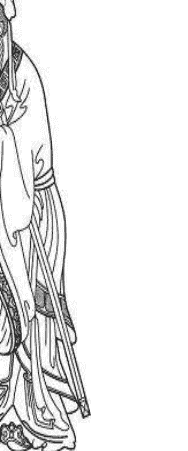

#### 注释

骥：千里马。古代称善跑的马为骥。

#### 译文

孔子说：“千里马值得称赞的不是它的气力，而是称赞它的品德。”

#### 译文

有人说：“用恩德来报答怨恨怎么样？”孔子说：“用什么来报答恩德呢？应该是用正直来报答怨恨，用恩德来报答恩德。”

#### 评析

孔子不同意“以德报怨”的做法，认为应当是“以直报怨”。这是说，不以有旧恶旧怨而改变自己的公平正直，也就是坚持了正直，“以直报怨”对于个人道德修养极为重要，但用在政治领域，有时就不那么适宜了。

#### 1. 《论语·宪问》

子曰：“骥不称其力，称其德也。”

或曰：“以德报怨，何如？”

子曰：“何以报德？以直报怨，以德报德。”

如何证明孔子的说法是正确的？

请计算孔子的说法是正确的

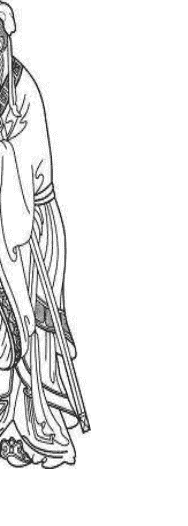

#### 囚徒困境（prisoner's dilemma）


- 两个罪犯准备抢劫银行，但作案前失手被擒。警方怀疑他们意图抢劫，苦于证据只够起诉非法持有枪械，于是将其分开审讯。
- 为离间双方，警方分别对两人说：
  - 若都保持沉默（"合作"），则一同入狱1年；
  - 若是互相检举（互相“背叛”），则一同入狱5年；
  - 若你认罪并检举对方（"背叛"对方），他保持沉默，他入狱10年，你可以获释（反之亦然）。
- 结果两人都选择了招供（最希望的结果）。

#### 情况分析

- 孤立地看，这是最符合个体利益的“理性”选择。以A为例：若B招供，A自己招供获刑5年，不招供获刑10年；若B不招供，自己招供可以免刑，不招供获刑1年。
- 两种情况下，选择招供都更有利，事实上却比两人都不招供的结果糟。
- 由囚徒困境可知，公共生活中，如果每个人都从眼前利益、个人利益出发，结果会对整体的利益（间接对个人的利益）造成伤害。

#### 决策支持和难题的解决

- 为解决“囚徒困境”难题，美国曾组织竞赛，要求参赛者根据“重复囚徒困境”（双方不止一次相遇，“背叛”可能在以后遭到报复）来设计程序。
- 将程序输入计算机反复互相博弈，以最终得分评估优劣（双方合作各得3分；双方背叛各得1分；一方合作一方背叛，合作方得0分，背叛方得5分）；
  - 有些算法采用“随机”对策；
  - 有些采用“永远背叛”对策；
  - 有些采用“永远合作”对策；
- 结果，加拿大多伦多大学的阿纳托尔·拉帕波特教授的“一报还一报”策略夺得了最高分。

#### “一报还一报” 策略

- 我方在第一次相遇时选择“合作”，之后就采取对方上一次的选择。这意味着：
- 在对方每一次背叛后，我方就“以牙还牙”，也背叛一次；
- 对方每一次合作后，我方就“以德报德”一次；
  - 《论语·宪问》中，有人问孔子：“以德报怨，何如?”孔子反问：“何以报德?以直报怨，以德报德。”
- 该策略有别于“善良”的“永远合作”或“邪恶”的“永远背叛”对策，及对方一旦“不忠”，我方就不再给机会，长久对抗的策略。

### 算法分析

- 如果你选择“永远背叛”策略，你或许会在第一局拿到最高分，但之后的各局可能都只能拿到低分，最后虽然可能“战胜”不少对手，但由于总分很低，最终难逃被淘汰出局的命运。
- 所以除非很难与对方再次相遇，不用担心其日后的反应，才可选择对抗与背叛；
- 而在长期互动、博弈的关系中，“一报还一报”是最佳策略：它是善意的，从不首先背叛；它不迂腐，不管过去相处多好，仍然对背叛有反应；它是宽容的，不因一次背叛而选择玉石俱焚。

三字经：人之初，性本善

#### 数字猜测

- 比如小明说他心中想到一个0-100之间的数字，这个数字他要告诉给老师，然后让其他人来提问。
- 提问的人可以问任何问题，但小明只能用YES/NO作答。
- 请问多少次可以猜到？

我比较笨，从0到100逐个问小明。

枚举、穷举、蛮力

#### 好的策略

- 每次提问将消息范围缩小一半。
- 如果范围从0-100扩大到0-1000，不用多花10倍的努力来找到答案——只需要比原来多问三个问题即可。
- 每当范围加倍时只需要多提一个问题即可找到答案。

#### 猜想

- ① 在一个范围内，比如[1, 1,000,000]，秘密地选定一个数字 x
- ② 每一次观众都可以问一个问题，而回答只能是“yes” 或者 “no”。重复进行，最终，观众往往能得到基于 x 的正确答案。
- ③ 为了找出 x，观众需要提问多少次

决策树，二进制搜索

#### 汉诺塔

- 印度有一个古老的传说：在世界中心贝拿勒斯（在印度北部）的圣庙里，一块黄铜板上插着三根宝石针。印度教的主神梵天在创造世界的时候，在其中一根针上从下到上地穿好了由大到小的64片金片，这就是所谓的汉诺塔。不论白天黑夜，总有一个僧侣在按照下面的法则移动这些金片：一次只移动一片，不管在哪根针上，小片必须在大片上面。僧侣们预言，当所有的金片都从梵天穿好的那根针上移到另外一根针上时，世界就将在一声霹雳中消灭，而梵塔、庙宇和众生也都将同归于尽。

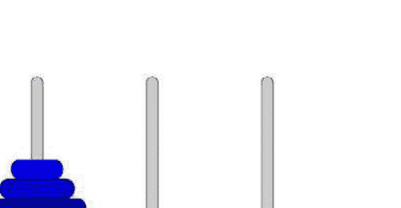

这个难题的主要目的在于把一个柱子上的碟子全部移到另外一个柱子上去，必须遵守以下规则：

- 1. 每次只能移动一个盘子；
- 2. 每次只能把一个柱子上的最上面的一个盘子放到另外一个柱子上去，那个柱子上可能已经放有盘子。
- 3. 大盘在下，小盘在上。

#### Recursive solution

hanoi(#disk, source, buffer, target):

hanoi(n, left, middle,right);=>

```
hanoi(n-1, left, right, middle);
move(1, left, _, right);
hanoi(n-1, middle, left, right);
```

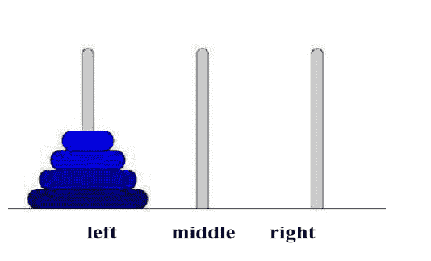

#### 这需要多少次移动呢？

假设有n片，移动次数是f(n).显然f(1)=1,f(2)=3,f(3)=7,且f(k+1)=2*f(k)+1。此后不难证明f(n)=2^n-1。n=64时，

f(64)=2^64-1=18446744073709551615

#### 假如每秒钟移动一次，共需多长时间呢？

一个平年365天有31536000秒，闰年366天有31622400秒，平均每年31556952秒，计算一下：

1844674

这表明...45亿年，太阳系的预期寿命据说也就是数百亿年。真的过了5845亿年，不说太阳系和银河系，至少地球上的一切生命，连同梵塔、庙宇等，都早已经灰飞烟灭。

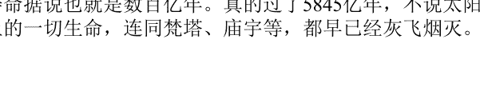

#### Recursion = :^)

递归、条件语句和列表足以给我们一个图灵完备的编程语言！

变量、赋值（=）、if、while 等都是不必要的！


### 国王的婚姻 -- 洪加威

从前一位喜欢数学的国王向一位聪明漂亮的公主求婚。公主向他提出了一个问题：求出48 770 428 433 377 171的一个真因子。如果国王能在一天之内找到答案，她就接受他的求婚。

国王回去后立即开始逐个数地进行计算，他从早到晚，共算了三万多个数，最终还是没有结果。

国王向公主求情，公主将答案相告：223 092 827是它的一个真因子。国王很快就验证了这个数确能除尽48 770 428 433 377 171。

公主说：“我再给你一次机会。如果你仍然没有做到，那么你将是我婚礼上的一位宾客。”

- 国王立即回国，并向时任宰相的大数学家求教，大数学家在仔细地思考后认为这个数为17位，则最小的一个真因子不会超过9位。
- 他给国王出了一个主意：按自然数的顺序给全国的老百姓每人编一个号发下去，等公主给出数目后，立即将它们通报全国，让每个老百姓用自己的编号去除这个数，除尽了立即上报，赏金万两。
- 接着，公主给出了新的17位数。
- 国王采用新方法之后很快找到了正确的答案。

### 并行处理

谢谢，请批评

祝您爱上算法，一切顺利

### 1. 算法及算法复杂度

算法概念

### 站得高，看的远

### 第一章

### 算法分析

【Definition】 一个算法是一组有限的指令，如果遵循这些指令，就能完成特定任务。此外，所有算法必须满足以下标准：

- (1) Input  有零个或多个在外部提供的量。
- (2) Output  至少产生一个量。
- (3) Definiteness (确定性) 每个指令都清晰且无歧义。
- (4) Finiteness (有限性) 如果我们追踪算法的指令，那么对于所有情况，算法在有限步数后终止。
- (5) Effectiveness  每个指令必须足够基础，以至于原则上可以由一个人仅使用铅笔和纸来执行。它不仅要求每个操作是明确的如(3)中所述，而且还必须是可行的。

Note: 一个程序是用某种编程语言编写的，不必是有限的（例如操作系统）。

一个算法可以用人类语言、流程图、某些编程语言或伪代码来描述。

【Example】 选择排序：按递增顺序对 n ≥ 1 个整数的集合进行排序。

从当前未排序的那些整数中，找到最小的并将其放在已排序列表的下一个位置。

```
for ( i = 0; i < n; i++ ) {
    Examine list[i] to list[n-1] and suppose that the smallest integer is at list[min];
    Interchange list[i] and list[min];
}
```

Sort = Find the smallest integer + Interchange it with list[i].

### 本课程中算法的描述方法

- C/C++语言
  - 优点：大家学过，类型丰富，语句精炼，具有面向对象和面向过程的双重特点。
- C/C++语言与自然语言相结合

C/C++

### 算法的分析和评价

- 对于解决同一个问题，往往能够编写出许多不同的算法。
- 进行算法分析和评价的目的，即在于从解决同一问题的不同算法中选择较为合适的一种，也在于知道如何对现有算法进行改进，从而可能设计出更好的算法。

### 如何评价算法？

时间复杂性
和
空间复杂性

正确性

健壮性

复杂性

可读性

简单性

时间复杂性和空间复杂性

### 算法复杂度分析

- 算法复杂度 = 算法运行所需要的计算机资源的量，其中需要时间资源的量称为时间复杂度；需要空间（存储器）资源的量称为空间复杂度。
- C=F(N,I,A)，其中 C=复杂度； N=算法要解决问题的规模； I=算法的输入； A=算法本身
- 时间复杂度 T=T(N,I); 空间复杂度 C=C(N,I)
- 算法的时间复杂度 T(n);
- 算法的空间复杂度 S(n)。
- 其中 n 是问题的规模（输入大小）。

### 本课程所研究的算法复杂性

- 时间复杂性和空间复杂性的量计算方法相似，并且空间复杂性的计算更简单，因此本课程主要以时间复杂性计算为主；

### 时间复杂性 / 复杂度

- 时间复杂性和空间复杂性的量计算方法相似，并且空间复杂性的计算更简单，因此本课程主要以时间复杂度计算为主；

### 时间复杂度 / 复杂度

- 又称计算复杂度，是一个算法运行时间的相对度量。

一个算法的运行时间是指在计算机上从开始到结束运行所花费的时间，它大致等于计算机执行一种简单操作（如赋值、比较、计算、转向、返回、输入、输出等）所需的时间与算法中进行简单操作次数的乘积。

由于执行一种简单操作所需的时间随着机器而异，它是机器本身硬件环境决定的，与算法无关，所以我们只讨论影响运行时间的另一个因素——算法中进行简单操作的次数。


### 时间复杂性 / 复杂度

- 又称计算复杂度，是一个算法运行时间的相对度量。

不管一个算法是简单还是复杂，最终都是被分解成简单操作来具体执行，因此每个算法都对应着一定的简单操作的次数。显然，在一个算法中，进行简单操作的次数越少，其运行时间也就相对地减少；次数越多，其运行时间也就相对地越多。

所以，通常把算法中包含简单操作次数的多少叫做算法的时间复杂度，用它来衡量一个算法的运行时间性能或称计算性能。

### 时间复杂度函数T(n)

### 函数定义

若解决一个问题的规模为n，例如在排序问题中，n表示待排元素的个数；在矩阵计算中，n表示矩阵的阶数；在图的遍历中，n表示途中的顶点数。

T(n)
算法的时间复杂度就是n的一个函数，通常记作：T(n).

### 举例：累加求和

```
int Sum ( int b[], int n )
{
    int s = 0;
    for ( int i =0; i < n; i ++ )
        s += b[i];
    return s;
}
```

T(n) = 4n + 4

```
int i = 0                //1次
mark1: if( i >= n) goto mark 2; //n+1次
    s += b[i];            //n次
    i ++;                 //n次
    goto mark1;           //n次
mark2: return s;
```

### 举例：简单选择排序

```
void SelectSort ( int b[], int n )
{
    int i, j, k, x;
    for ( i=0; i <n-1; i ++)
    {
        k = i;
        for ( j=i+1; j<n; j++)
            if (b[k] > b[j]) k =j;
        x = b[j];
        b[i] = b[k];
        b[k] = x;
    }
}
```


i = 0; //1次
mark1: if(!(i < n-1)) goto mark4; //n次
k = j; //n-1次
j=i+1; //n-1次
mark2: if (!(j<n)) goto mark3; //(n+2)(n-1)/2次
if (b[k] > b[j]) k =j; //n(n-1)/2次
j++; //n(n-1)/2次
goto mark2; //n(n-1)/2次
mark3: x = b[j]; //n-1次
b[i] = b[k]; //n-1次
b[k] = x; //n-1次
i++; //n-1次
goto mark1; //n-1次
mark4:
T(n) =2n²+7n-7

### 2. 算法复杂度分析

要分析的内容

站得高，看的远

#### § 要分析的内容

- > 与机器和编译器相关的运行时间。
- > 时间和空间复杂度：与机器和编译器无关。
- • 假设：
- ① 指令按顺序执行
- ② 每个指令简单，且恰好花费一个时间单位
- ③ 整数大小固定且我们有无限内存
- • 通常分析以下两个函数：

T_avg(N) & T_worst(N) -- 分别作为输入规模 N 的函数，平均和最坏情况下的时间复杂度。

如果有多个输入，这些函数可能有多个参数。

#### 【示例】矩阵加法

```
void add( int a[][ MAX_SIZE ],
            int b[][ MAX_SIZE ],
            int c[][ MAX_SIZE ],
            int rows, int cols )
{
    int i, j;
    for( i = 0; i < rows; i++ )  /* rows + 1 */
        for( j = 0; j < cols; j++ )  /* rows(cols+1) */
            c[i][j] = a[i][j] + b[i][j];  /* rows · cols */
}
```

A: 交换 rows 和 cols。

T(rows, cols) = 2 rows · cols + 2rows + 1

#### 【示例】迭代求和列表数字的函数

$T_{sum}(n) = 2n + 3$

```
float sum ( float list[], int n )
{ /* add a list of numbers */
    float tempsum = 0;  /* count = 1 */
    int i;
    for ( i = 0; i < n; i++ )
        /* count ++ */
        tempsum += list[i]; /* count ++ */
    /* count ++ for last execution of for */
    return tempsum;  /* count ++ */
}
```

#### 【示例】递归求和列表数字的函数

$T_{rsum}(n) = 2n + 2$

但计算每一步需要更多时间。

```
float rsum ( float list[], int n )
{ /* add a list of numbers */
    if ( n ) /* count ++ */
        return rsum(list, n-1) + list[n - 1];
        /* count ++ */
    return 0;  /* count ++ */
}
```

以迭代和递归求和列表的程序为例... 如果它是 3n+2 是

好问题！
让我们问问学生 ...


### 2. 算法复杂度分析
渐进性复杂度分析

*渐近记号*

站得高，看的远

#### §2 Asymptotic Notation ( O, Ω, Θ, o ) 渐进性原理及表示符号


计数步骤的目的是预测随着 N 变化运行时间的增长，从而比较两个程序的时间复杂度。所以我们真正想知道的是 T_p 的渐近行为。

假设 T_p1(N) = c1 N² + c2 N 且 T_p2(N) = c3 N。哪个更快？

无论 c1、c2 和 c3 是什么，都会存在一个 n0，使得对于所有 N > n0，T_p1(N) > T_p2(N)。


我明白了！所以只要我知道 T_p1 大约为 N² 而 T_p2 大约为 N，那么对于足够大的 N，P2 会更快！

#### 算法渐近复杂性

- - 衡量算法复杂性的档次/规模——阶， Rate/Order of growth
- - 对时间复杂度函数T(n)，有可能， T(n)→∞， as n→∞；
- - 例如，
- T(n) = 2n² + 4n + 1，  t(n)= 2n²
- - (T(n) - t(n)) / T(n) →0， as n→∞；
- , t(n)是T(n)的渐近性态，为算法的渐近复杂性。
- - 在数学上， t(n)是T(n)的渐近表达式，是T(n)略去低阶项留下主项。它比T(n)简单。

#### § 2 Asymptotic Notation

【Definition】 T(N) = O(f(N)) if there are positive constants c and n0 such that T(N) ≤ c f(N) for all N ≥ n0. -> 【定义】若存在正的常数 c 和 n0，使得对于所有 N ≥ n0，T(N) ≤ c f(N)，则 T(N) = O(f(N))。

【Definition】 T(N) = Ω(g(N)) if there are positive constants c and n0 such that T(N) ≥ c g(N) for all N ≥ n0. -> 【定义】若存在正的常数 c 和 n0，使得对于所有 N ≥ n0，T(N) ≥ c g(N)，则 T(N) = Ω(g(N))。

【Definition】 T(N) = Θ(h(N)) if and only if T(N) = O(h(N)) and T(N) = Ω(h(N)). -> 【定义】当且仅当 T(N) = O(h(N)) 且 T(N) = Ω(h(N)) 时，T(N) = Θ(h(N))。

【Definition】 T(N) = o(p(N)) if T(N) = O(p(N)) and T(N) ≠ Θ(p(N)). -> 【定义】若 T(N) = O(p(N)) 且 T(N) ≠ Θ(p(N))，则 T(N) = o(p(N))。

Note:

- > 2N + 3 = O(?)
- > 2^N + N^2 = Ω(?)

#### 渐近上界记号O

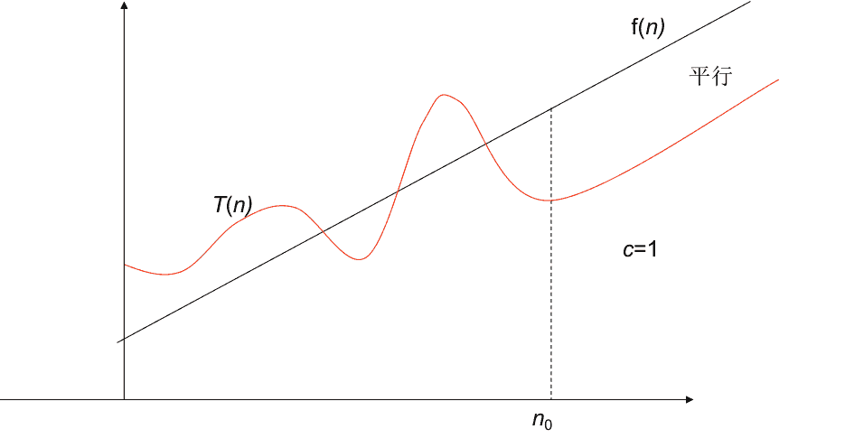

#### 渐近下界记号Ω

T(n)

平行

g(n)

c=1

n₀

#### 非紧上界记号。

p(n)

非平行

T(n)

c=1

n₀

#### 非紧下界记号 ω

f(n)

非平行

T(n)

c=1

n₀


#### 紧渐近界记号 Θ

\(c_2h(n)\)、\(c_1h(n)\)、\(h(n)\)、\(f(n)\)、\(n_0\)

- 【定义】 \(T(N) = O(f(N))\)，如果存在正常数 \(c\) 和 \(n_0\)，使得对于所有 \(N \ge n_0\)，有 \(T(N) \le c f(N)\)。
- 【定义】 \(T(N) = \Omega(g(N))\)，如果存在正常数 \(c\) 和 \(n_0\)，使得对于所有 \(N \ge n_0\)，有 \(T(N) \ge c g(N)\)。
- 【定义】 \(T(N) = \Theta(h(N))\) 当且仅当 \(T(N) = O(h(N))\) 且 \(T(N) = \Omega(h(N))\)。
- 【定义】 \(T(N) = o(p(N))\)，如果 \(T(N) = O(p(N))\) 且 \(T(N) \ne \Theta(p(N))\)。

##### 注意

- \(2N + 3 = O(N) = O(N^{k \ge 1}) = O(2^N) = \dots\)。我们总是取最小的 \(f(N)\)。
- \(2^N + N^2 = \Omega(2^N) = \Omega(N^2) = \Omega(N) = \Omega(1) = \dots\)。我们总是取最大的 \(g(N)\)。

#### 渐近分析中函数比较

- \(f(n) = O(g(n)) \approx a \le b\)；渐近上界
- \(f(n) = \Omega(g(n)) \approx a \ge b\)；渐近下界
- \(f(n) = \Theta(g(n)) \approx a = b\)；紧渐近界
- \(f(n) = o(g(n)) \approx a < b\)；非紧上界
- \(f(n) = \omega(g(n)) \approx a > b\)。非紧下界

#### 渐近分析记号的若干性质

##### (1) 传递性

- \(f(n) = \Theta(g(n)),\ g(n) = \Theta(h(n)) \Rightarrow f(n) = \Theta(h(n))\)
- \(f(n) = O(g(n)),\ g(n) = O(h(n)) \Rightarrow f(n) = O(h(n))\)
- \(f(n) = \Omega(g(n)),\ g(n) = \Omega(h(n)) \Rightarrow f(n) = \Omega(h(n))\)
- \(f(n) = o(g(n)),\ g(n) = o(h(n)) \Rightarrow f(n) = o(h(n))\)
- \(f(n) = \omega(g(n)),\ g(n) = \omega(h(n)) \Rightarrow f(n) = \omega(h(n))\)

##### (2) 反身性 / 自反性

- \(f(n) = \Theta(f(n))\)
- \(f(n) = O(f(n))\)
- \(f(n) = \Omega(f(n))\)

##### (3) 对称性

- \(f(n) = \Theta(g(n)) \Leftrightarrow g(n) = \Theta(f(n))\)

##### (4) 互对称性

- \(f(n) = O(g(n)) \Leftrightarrow g(n) = \Omega(f(n))\)
- \(f(n) = o(g(n)) \Leftrightarrow g(n) = \omega(f(n))\)

##### (5) 算术运算

- \(O(f(n)) + O(g(n)) = O(\max\{f(n), g(n)\})\)（证明见下文）
- \(O(f(n)) + O(g(n)) = O(f(n) + g(n))\)
- \(O(f(n)) * O(g(n)) = O(f(n) * g(n))\)
- \(O(c f(n)) = O(f(n))\)
- \(g(n) = O(f(n)) \Rightarrow O(f(n)) + O(g(n)) = O(f(n))\)

### 规则 \(O(f(n)) + O(g(n)) = O(\max\{f(n), g(n)\})\) 的证明

- 对于任意 \(f_1(n) \in O(f(n))\)，存在正常数 \(c_1\) 和自然数 \(n_1\)，使得对所有 \(n \ge n_1\)，有 \(f_1(n) \le c_1 f(n)\)。
- 类似地，对于任意 \(g_1(n) \in O(g(n))\)，存在正常数 \(c_2\) 和自然数 \(n_2\)，使得对所有 \(n \ge n_2\)，有 \(g_1(n) \le c_2 g(n)\)。
- 令 \(c_3 = \max\{c_1, c_2\}\)，\(n_3 = \max\{n_1, n_2\}\)，\(h(n) = \max\{f(n), g(n)\}\)。
- 则对所有的 \(n \ge n_3\)，有

\[
\begin{aligned}
f_1(n) + g_1(n) &\le c_1 f(n) + c_2 g(n) \\
&\le c_3 f(n) + c_3 g(n) = c_3 (f(n) + g(n)) \\
&\le 2c_3 \max\{f(n), g(n)\} = 2c_3 h(n) = O(\max\{f(n), g(n)\})。
\end{aligned}
\]

#### 渐近记号规则


如果 \(T_1(N) = O(f(N))\) 且 \(T_2(N) = O(g(N))\)，那么

- (a) \(T_1(N) + T_2(N) = \max(O(f(N)), O(g(N)))\)
- (b) \(T_1(N) * T_2(N) = O(f(N) * g(N))\)

如果 \(T(N)\) 是 \(k\) 次多项式，那么 \(T(N) = \Theta(N^k)\)。

对于任意常数 \(k\)，\(\log^k N = O(N)\)。这告诉我们对数增长非常缓慢。

注意：在渐近比较两个程序的复杂度时，请确保 \(N\) 足够大。

例如，假设 \(T_{p1}(N) = 10^6 N\)，\(T_{p2}(N) = N^2\)。哪一个更快？

虽然看起来 \(\Theta(N^2)\) 比 \(\Theta(N)\) 增长更快，但如果 \(N < 10^6\)，P2 仍然比 P1 快。

#### 算法分析中常见的复杂性函数

| 函数 | 名称 |
|---|---|
| \(c\) | 常数 |
| \(\log N\) | 对数 |
| \(\log^2 N\) | 对数平方 |
| \(N\) | 线性 |
| \(N \log N\) | 线性对数 |
| \(N^2\) | 二次 |
| \(N^3\) | 三次 |
| \(2^N\) | 指数 |

输入规模 \(n\)

| 时间 | 名称 | 1 | 2 | 4 | 8 | 16 | 32 |
|---|---:|---:|---:|---:|---:|---:|---:|
| \(1\) | 常数 | 1 | 1 | 1 | 1 | 1 | 1 |
| \(\log n\) | 对数 | 0 | 1 | 2 | 3 | 4 | 5 |
| \(n\) | 线性 | 1 | 2 | 4 | 8 | 16 | 32 |
| \(n \log n\) | 线性对数 | 0 | 2 | 8 | 24 | 64 | 160 |
| \(n^2\) | 二次 | 1 | 4 | 16 | 64 | 256 | 1024 |
| \(n^3\) | 三次 | 1 | 8 | 64 | 512 | 4096 | 32768 |
| \(2^n\) | 指数 | 2 | 4 | 16 | 256 | 65536 | 4294967296 |
| \(n!\) | 阶乘 | 1 | 2 | 24 | 40320 | 20922789888000 | \(2.6313 \times 10^{35}\) |


f

n

2ⁿ

n²

n log n

n

Log n

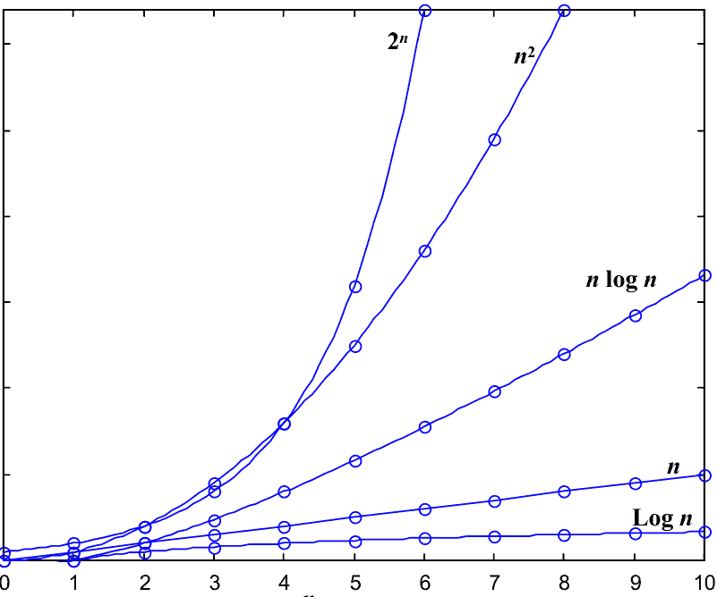

**在每秒 10⁹ 条指令的计算机上执行 f(n) 条指令所需的时间**

| n | f(n)=n | n log₂ n | n² | n³ | n⁴ | n¹⁰ | 2ⁿ |
|---|---|---|---|---|---|---|---|
| 10 | .01µs | .03µs | .1µs | 1µs | 10µs | 10sec | 1µs |
| 20 | .02µs | .09µs | .4µs | 8µs | 160µs | 2.84hr | 1ms |
| 30 | .03µs | .15µs | .9µs | 27µs | 810µs | 6.83d | 1sec |
| 40 | .04µs | .21µs | 1.6µs | 64µs | 2.56ms | 121.36d | 18.3min |
| 50 | .05µs | .28µs | 2.5µs | 125µs | 6.25ms | 3.1yr | 13d |
| 100 | .10µs | .66µs | 10µs | 1ms | 100ms | 3171yr | 4×10^13yr |
| 1,000 | 1.00µs | 9.96µs | 1ms | 1sec | 16.67min | 3.17×10^13yr | 32×10^283yr |
| 10,000 | 10µs | 130.03µs | 100ms | 16.67min | 115.7d | 3.17×10^23yr |  |
| 100,000 | 100µs | 1.66ms | 10sec | 11.57d | 3171yr | 3.17×10^33yr |  |
| 1,000,000 | 1.0ms | 19.92ms | 16.67min | 31.71yr | 3.17×10^7yr | 3.17×10^43yr |  |

- µs = microsecond = 10⁻⁶ seconds
- ms = millisecond = 10⁻³ seconds
- sec = seconds
- min = minutes
- hr = hours
- d = days
- yr = years

#### 【Example】 矩阵加法

```c
void add( int a[][ MAX_SIZE ],
    int b[][ MAX_SIZE ],
    int c[][ MAX_SIZE ],
    int rows, int cols )
{
    int i, j;
    for( i = 0; i < rows; i++ )  /* Θ (rows) */
        for( j = 0; j < cols; j++ )  /* Θ (rows * cols) */
            c[i][j] = a[i][j] + b[i][j];  /* Θ (rows * cols) */
}
```

T(rows, cols) = Θ (rows * cols)


#### General Rules

**FOR LOOPS:** The running time of a for loop is at most the running time of the statements inside the for loop (including tests) times the number of iterations.

**NESTED FOR LOOPS:** The total running time of a statement inside a group of nested loops is the running time of the statements multiplied by the product of the sizes of all the for loops.

**CONSECUTIVE STATEMENTS:** These just add (which means that the maximum is the one that counts).

**IF / ELSE:** For the fragment

```c
if ( Condition ) S1;
else S2;
```

the running time is never more than the running time of the test plus the larger of the running time of S1 and S2.

#### 时间复杂性渐近阶分析的规则（最坏情况）

- 1). 赋值、比较、算术运算、逻辑运算、读写单个变量（常量）只需 1 单位时间。
- 2). 执行条件语句 `if c then S1 else S2` 的时间为 T_C + max(T_S1, T_S2)。
- 3). 选择语句 `case A of a1: s1; a2: s2; ...; am: sm` 需要的时间为 max(T_S1, T_S2, ..., T_Sm)。
- 4). 访问数组的单个分量或记录的单个域需要一个单位时间。
- 5). 执行 for 循环语句的时间 = 执行循环体时间 × 循环次数。
- 6). `while c do s`（repeat s until c）语句时间 = (Tc + Ts) × 循环次数。
- 7). 用 goto 从循环体内跳到循环体末或循环后面的语句时，不需额外时间。
- 8). 过程或函数调用语句：
  - 对非递归调用，根据调用层次由里向外用规则 1-7 进行分析；
  - 对递归调用，可建立关于 T(n) 的递归方程，求解该方程得到 T(n)。

#### RECURSIONS

##### 【Example】 Fibonacci number

Fib(0) = Fib(1) = 1, Fib(n) = Fib(n-1) + Fib(n-2)

```c
long int Fib(int N) /* T(N) */
{
    if (N <= 1) /* O(1) */
        return 1; /* O(1) */
    else
        return Fib(N - 1) + Fib(N - 2);
} /* O(1) */ /* T(N-1) */ /* T(N-2) */
```

Q: Why is it so bad?

T(N) = T(N-1) + T(N-2) + 2 ≥ Fib(N)

(3/2)^N ≤ Fib(N) ≤ (5/3)^N ⇒ T(N) grows exponentially

Proof by induction

### 3. 递归方程渐近阶的求解

站得高，看得远

### 递归方程解的渐近阶的求法

- 1. 代入法：这个方法的基本步骤是先推测递归方程的显式解，然后用数学归纳法证明这一推测的正确性。那么，显式解的渐近阶即所求。
- 2. 迭代法：这个方法的基本步骤是通过反复迭代，将递归方程的右端变成一个级数，然后求级数的和，再估计和的渐近阶；或者，不求级数的和而直接估计级数的渐近阶，从而达到对递归方程解的渐近阶的估计。
- 3. 套用公式法：这个方法针对形如：T(n)=aT(n/b)+f(n) 的递归方程，给出三种情况下方程解的渐近阶的三个相应估计公式供套用。
- 4. 差分方程法：有些递归方程可以看成一个差分方程，因而可以用解差分方程（初值问题）的方法来解递归方程。然后对得到的解作渐近阶的估计。
- 5. 母函数法：这是一个有广泛适用性的方法。它不仅可以用来求解线性常系数高阶齐次和非齐次的递归方程，而且可以用来求解线性变系数高阶齐次和非齐次的递归方程，甚至可以用来求解非线性递归方程。方法的基本思想是设定递归方程解的母函数，努力建立一个关于母函数的可解方程，将其解出，然后返回递归方程的解。

### 代入法

猜测技术：对递推关系式估计一个上限，然后用（数学归纳法）证明它正确。

T(n) = 2T(n/2) + n，证明 T(n) = O(n log n)

- 推测 T(n) = O(n log n)，即推测存在正的常数 C 和自然数 n₀，使得当 n ≥ n₀ 时有
  T(n) ≤ C n log n   (1-1)

- 假设当 2^{k-1} n₀ ≤ n ≤ 2^k n₀，k ≥ 1 时，(1-1) 成立。

- 那么，当 2^k n₀ ≤ n ≤ 2^{k+1} n₀ 时，有：

```text
T(n) = 2T(⌊n/2⌋) + n
≤ 2C⌊n/2⌋·log(⌊n/2⌋) + n
< 2C·n/2·log(n/2) + n
= C n log n - C n + n
= C n log n - (C - 1)n
≤ C n log n
```


### 算法复杂性分析中常见函数

- 这个方法的局限性在于它只适合容易推测出答案的递归方程或善于进行推测的高手。推测递归方程的正确解，没有一般的方法，得靠经验的积累和洞察力。

| FUNCTION | NAME |
|---|---|
| c | 常数 |
| log N | 对数 |
| log²N | 对数平方 |
| N | 线性 |
| N log N | N log N |
| N² | 二次 |
| N³ | 三次 |
| 2^N | 指数 |

### 迭代法

方法的思想是迭代地展开递归方程的右端，使之成为一个非递归的和式，然后通过对和式的估计来达到对方程左端即方程的解的估计。

T(n) = 3T(⌈n/4⌉) + n

T(n) ≤ n + 3(n/4 + 3(n/4² + 3(n/4³ + ⋯ + 3(n/4ⁱ + 3T(0))⋯)))

= n + 3/4 n + 3²/4² n + 3³/4³ n + ⋯ + 3ⁱ/4ⁱ n + 3ⁱ⁺¹·T(0)

< 4n + 3ⁱ⁺¹·T(0)

知 i ≤ log₄ n ，从而

3ⁱ⁺¹ ≤ 3^{log₄ n +1} = 3^{log₃ 3 n log₄ 3 +1} = 3n^{log₄ 3}

代入

T(n) < 4n + 3^{log₄ 3}·T(0)

- 即，T(n)=O(n)

T(n) = { 7          n = 1
          2T(n/2) + 5n²   n > 1 }

T(n) = 2T(n/2) + 5n²
    = 2(2T(n/4) + 5(n/2)²) + 5n²
    = 2(2(2T(n/8) + 5(n/4)²) + 5(n/2)²) + 5n²
    = 2ᵏ T(1) + 2ᵏ⁻¹ 5 (n / 2ᵏ⁻¹)² + … + 2 × 5 (n/2)² + 5n²

T(n) = 7n + 5 Σᵢ₌₀ᵏ⁻¹ (n / 2ⁱ)² = 7n + 5n² (2 - 1 / 2ᵏ⁻¹) = 10n² - 3n ≤ 10n² = O(n²)

T(n) = 2 T(n/2) + n²
表格化的办法：先按横向求出每层结点的值之和，并记录在各相应层右端顶格处，然后从根到叶逐层地将顶格处的结果加起来便是我们要求的结果。照此，我们得到解的渐近阶为θ(n²)。

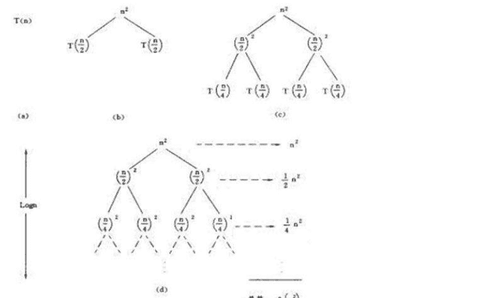

T(n) = T(n/3) + T(2n/3) + n

当我们累积递归树各层的值时，得到每一层的和都等于 n，从根到叶的最长路径是

n → 2/3 n → (2/3)² n → … → 1

设最长路径的长度为 k，则应该有

(2/3)^k n = 1

得

k = log_{3/2} n

于是

T(n) ≤ Σ_{i=0}^{k} n = (k+1)n = n(log_{3/2} n + 1)

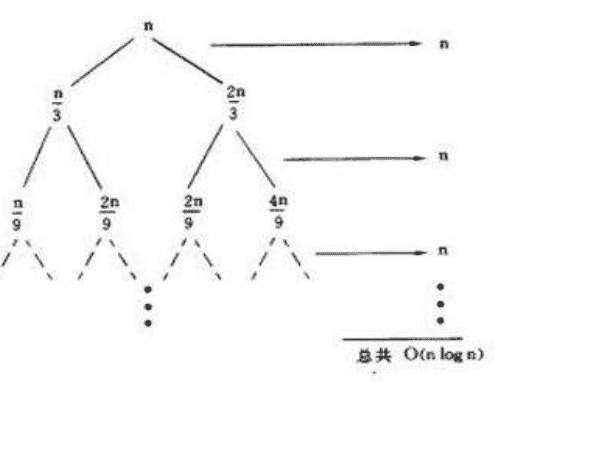

### 套用公式法

大小为$n$的原问题分成若干个大小为$n/b$的子问题，其中$a$个子问题需要求解，而$cn^k$是合并各个子问题的解需要的工作量。

```
$$T(n)=\begin{cases}c & n=1\\ aT(n/b)+cn^k & n>1\end{cases}$$
```

```
$$T(n)=\begin{cases}O\left(n^{\log_b a}\right) & a>b^k\\ O\left(n^k \log_b n\right) & a=b^k\\ O\left(n^k\right) & a<b^k\end{cases}$$
```

### 套用公式法

若递归方程形如：T(n)=aT(n/b)+f(n)，可根据f(n)的不同情况套用公式

- 1) 若∃ε>0，使得 f(n)=O(n^{log_b a - ε})，则 T(n)=Θ(n^{log_b a})
- 2) 若 f(n)=Θ(n^{log_b a})，则 T(n)=Θ(n^{log_b a}·log n)
- 3) 若∃ε>0，使得 f(n)=Ω(n^{log_b a + ε})，且 ∃ c<1，当n充分大时有 a f(n/b) ≤ c f(n)，则 T(n)=Θ(f(n))

### 母函数法

母函数法：设a₀,a₁...aₘ...是任意数列,称 f(x)=a₀+a₁x+...+aₙxⁿ+...为数列的母函数。若取数列为算法的时间复杂度函数{T(n)},则其母函数为： f(x)=T(0)+T(1)x+...+T(n)xⁿ... 若能由T(n)的递归方程求出T(n)的母函数,其展开式第n项系数即为T(n).

### 例1 考虑线性变系数二阶齐次递推方程

(n-1) T(n) = (n-2) T(n-1) + 2 T(n-2) ， n ≥ 2

和初始条件 T(0)=0， T(1)=1。根据初始条件，可计算 T(2)=0， T(3)=T(1)=1。

设 {T(n)} 的母函数为：

A(x) = Σ_{n=0}^{∞} T(n) x^n

由于 T(0)=T(2)=0， T(1)=1，有：

A(x) = x + T(3) x^3 + T(4) x^4 + … + T(n) x^n + …

= x(1 + T(3) x^2 + T(4) x^3 + … + T(n) x^{n-1} + …)

令 B(x) = A(x)/x，即：

B(x) = 1 + T(3) x^2 + T(4) x^3 + … + T(n) x^{n-1} + …

B(x) = 1 + T(3)x² + T(4)x³ + ⋯ + T(n)x^{n-1} + ⋯

那么：

B'(x) = 2T(3)x + 3T(4)x² + ⋯ + (n-1)T(n)x^{n-2} + ⋯
xB'(x) = 2T(3)x² + 3T(4)x³ + ⋯ + (n-1)T(n)x^{n-1} + ⋯
B'(x) - xB'(x) = 2T(3)x + (3T(4) - 2T(3))x² + (4T(5) - 3T(4))x³ + ⋯ + ((n-1)T(n) - (n-2)T(n-1))x^{n-2} + ⋯

代入 T(3) = 1，得

B'(x)(1 - x) = 2T(1)x + 2T(2)x² + 2T(3)x³ + ⋯ + 2T(n - 2)x^{n-2} + ⋯
= 2x(1 + T(3)x² + T(4)x³ + ⋯ + T(n)x^{n-1} + ⋯)
= 2xB(x)

即

B'(x)/B(x) = 2x/(1 - x) = -2 + 2/(1 - x)

两边同时沿[0, x]积分，并注意到B(0)=1，有：

ln B(x) = -2x - 2 ln(1 - x)

B(x) = e^{-2x} / (1 - x)^2

把B(x)展开成幂级数，得

B(x) = Σ_{n=0}^{∞} (-2x)^n / n! Σ_{n=0}^{∞} C(n+1,1) x^n

= Σ_{i=0}^{∞} (-1)^i · 2^i / i! x^i · Σ_{j=0}^{∞} (j+1) · x^j

= Σ_{i=0}^{∞} Σ_{j=0}^{∞} [(-1)^i · 2^i · (j+1) / i!] x^{(i+j)}

= Σ_{n=0}^{∞} ( Σ_{i=0}^{n} [(-1)^i · 2^i · (n - i + 1) / i!] ) · x^n      0 ≤ x < 1

从而

A(x) = Σ_{n=0}^{∞} ( Σ_{i=0}^{n} [(-1)^i · 2^i · (n - i + 1) / i! ] ) · x^{n+1}
= Σ_{n=1}^{∞} ( Σ_{i=0}^{n-1} [(-1)^i · 2^i · (n - i) / i! ] ) · x^{n}      0 ≤ x < 1

最后得

T(n) = Σ_{i=1}^{n-1} [(-1)^i · 2^i · (n - i) / i!]      n ≥ 1

### 4. 实例算法复杂度分析

站得高，看的远

#### § 3 比较算法

【示例】 Given (possibly negative) integers A₁, A₂, ..., Aₙ, find the maximum value of ∑ₖ₌ᵢʲ Aₖ.

给定由n个整数(可能为负整数)组成的序列 a₁,a₂,...,aₙ,求该序列形如 ∑ₖ₌ᵢʲ aₖ 的子段和的最大值。当所有整数均为负整数时定义其最大子段和为 0。依此定义，所求的最优值为： max { 0, max₁≤i≤j≤n ∑ₖ₌ᵢʲ aₖ }

例如当(a₁, a₂, a₃, a₄, a₅, a₆)=(-2, 11, -4, 13, -5, -2)时，最大子段和为 ∑ₖ₌₂⁴ aₖ = 20。


##### 1,-5, 3,4,-2,-3,10

以 1 开始的子数组：

+   1↓
+   1,-5↓
+   1,-5,3↓
+   1,-5,3,4↓
+   1,-5,3,4,-2↓
+   1,-5,3,4,-2,-3↓
+   1,-5,3,4,-2,-3,10↓

以-5 开始的子数组：

+   -5↓
+   -5,3↓
+   -5,3,4↓
+   -5,3,4,-2↓
+   -5,3,4,-2,-3↓
+   -5,3,4,-2,-3,10↓

以 3 开始的子数组：略...↓
以 4 开始的子数组：略...↓
以-2 开始的子数组：略...↓
以-3 开始的子数组：略...↓
以 10 开始的子数组：略...↓

枚举后再对所有的子数组求和，可以得到如下代码

#### § 3 比较算法

【Example】 给定（可能为负的）整数 A₁, A₂, ..., A_N，求 Σ_{k=i}^j A_k 的最大值。

#### Algorithm 1

```
int MaxSubsequenceSum ( const int A[], int N )
{
    int ThisSum, MaxSum, i, j, k;
    MaxSum = 0; /* initialize the maximum sum */
    for( i = 0; i < N; i++ ) /* start from A[ i ] */
        for( j = i; j < N; j++ ) { /* end at A[ j ] */
            ThisSum = 0;
            for( k = i; k <= j; k++ )
                ThisSum += A[ k ]; /* sum A[ i ] to A[ j ] */
            if ( ThisSum > MaxSum )
                MaxSum = ThisSum; /* update the max sum */
        } /* end for-j and for-i */
    return MaxSum;
}
T(N) = O(N³)
```

详细分析是你的第一项作业。

#### Algorithm 1

```
int MaxSubsequenceSum ( const int A[], int N )
{
    int ThisSum, MaxSum, i, j, k;
    MaxSum = 0; /* initialize the maximum sum */
    for( i = 0; i < N; i++ ) /* start from A[ i ] */
        for( j = i; j < N; j++ ) { /* end at A[ j ] */
            ThisSum = 0;
            for( k = i; k <= j; k++ )
                ThisSum += A[ k ]; /* sum A[ i ]..A[ j ] */
            if ( ThisSum > MaxSum )
                MaxSum = ThisSum; /* update max sum */
        } /* end for-j and for-i */
    return MaxSum;
}

T(N) = O(N³)
```

> 详细分析是你的第一项作业。

a1
a1 a2
a1 a2 a3
a1 a2 a3 a4
a1 a2 a3 a4 a5

a2
a2 a3
a2 a3 a4
a2 a3 a4 a5

a3
a3 a4
a3 a4 a5

#### Algorithm 2

```
int MaxSubsequenceSum ( const int A[], int N )
{
    int ThisSum, MaxSum, i, j;
    /* 1*/ MaxSum = 0; /* initialize the maximum sum */
    /* 2*/ for( i = 0; i < N; i++ ) { /* start from A[ i ] */
    /* 3*/     ThisSum = 0;
    /* 4*/     for( j = i; j < N; j++ ) { /* end at A[ j ] */
    /* 5*/         ThisSum += A[j]; /* sum from A[ i ] to A[ j ] */
    /* 6*/         if ( ThisSum > MaxSum )
    /* 7*/             MaxSum = ThisSum; /* update max sum */
    } /* end for-j */
    } /* end for-i */
    /* 8*/ return MaxSum;
}
```

*T(N) = O(N²)*

#### Algorithm 3

### 分治

#### § 3 比较算法

征服

划分

4 -3 5 -2 -1 2 6 -2

4 5 2 6

6 8

11

T(N/2)

O(N)

T(N/2)

T(N) = 2 T(N/2) + c N,    T(1) = O(1)
= 2 [2 T(N/2²) + c N/2] + c N
= 2ᵏ O(1) + c k N    where N/2ᵏ
= O(N log N)

程序将在后面讨论。

#### Algorithm 4
在线算法

```
int MaxSubsequenceSum( const int A[], int N )
{
    int ThisSum, MaxSum, j;
/* 1*/ ThisSum = MaxSum = 0;
/* 2*/ for ( j = 0; j < N; j++ ) {
/* 3*/     ThisSum += A[ j ];
/* 4*/     if ( ThisSum > MaxSum )
/* 5*/         MaxSum = ThisSum;
/* 6*/     else if ( ThisSum < 0 )
/* 7*/         ThisSum = 0;
    } /* end for-j */
/* 8*/ return MaxSum;
}
```

T(N) = O(N)

A[] is scanned once only.

在任何时刻，算法都可以对已读取的数据正确地给出子序列问题的答案。


#### 最大子序列和的几种算法运行时间（秒）

| Algorithm | 1 | 2 | 3 | 4 |
| Time | O(N³) | O(N²) | O(N log N) | O(N) |
| Input Size |  |  |  |  |
| N=10 | 0.00103 | 0.00045 | 0.00066 | 0.00034 |
| N=100 | 0.47015 | 0.01112 | 0.00486 | 0.00063 |
| N=1,000 | 448.77 | 1.1233 | 0.05843 | 0.00333 |
| N=10,000 | NA | 111.13 | 0.68631 | 0.03042 |
| N=100,000 | NA | NA | 8.0113 | 0.29832 |

Note: The time required to read the input is not included.

注意：不包括读取输入所需的时间。

#### § 4 运行时间中的对数

【Example】 二分查找：

Given: A[0] ≤ A[1] ≤ ...... ≤ A[N − 1]; X

Task: Find X

Output: i if X == A[i]
−1 if X is not found

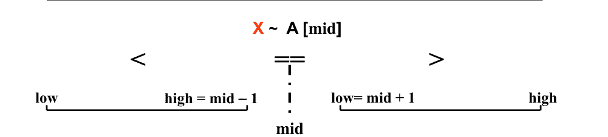

给定：A[0] ≤ A[1] ≤ ...... ≤ A[N − 1]; X

任务：查找 X

输出：若 X == A[i] 则为 i
若 X 未找到则为 −1


int BinarySearch ( const ElementType A[],
                    ElementType X, int N )
{
    int Low, Mid, High;
    /* 1 */ Low = 0; High = N - 1;
    /* 2 */ while ( Low <= High ) {
    /* 3 */     Mid = ( Low + High ) / 2;
    /* 4 */     if ( A[ Mid ] < X )
    /* 5 */         Low = Mid + 1;
    else
    /* 6 */         if ( A[ Mid ] > X )
    /* 7 */             High = Mid - 1;
    else
    /* 8 */         return Mid; /* Found */
    } /* end while */
    /* 9 */ return NotFound; /* NotFound is defined as -1 */
}
    T_worst( N ) = O( log N )

在数据是静态且有序的情况下非常有用（例如从字典中查找单词）。

##### 【Example】 Euclid's Algorithm: computing the greatest common divisor (Gcd).

```
unsigned int Gcd ( unsigned int M, unsigned int N )
{
    unsigned int Rem;
    /* 1*/ while ( N > 0 ) {
    /* 2*/     Rem = M % N;
    /* 3*/     M = N;
    /* 4*/     N = Rem;
    } /* end while */
    /* 5*/ return M;
}
```

T(N) = ?

T(N) < 1 + T( M/2 )
< 2 + T( N/2 )
.....
< k + T( N/2^k )

##### 【Theorem】 If M > N, then ( M mod N ) < M / 2.

T(N) = O( log N )

T_avg(N) = (12 ln 2 ln N) / π² + 1.47

##### § 4 Logarithms in the Running Time

##### 【Example】 Exponentiation: computing X^N.

```
long int Pow( long int X, unsigned int N )
{
    long int P = 1;
    while ( N-- ) P *= X;
    return P;
}
T(N) = O(N)
```

X^N = { (X^2)^(N/2) if N is even or (X^2)^((N-1)/2) × X if N is odd }

```
long int Pow( long int X, unsigned int N )
{
    /* 1*/ if ( N == 0 )
    /* 2*/     return 1;
    /* 5*/ if ( IsEven( N ) )
    /* 6*/     return Pow( X * X, N / 2 );
    else
    /* 7*/     return Pow( X * X, N / 2 ) * X;
}
T(N) = O( log N )
```

return Pow(X, N / 2) * Pow(X, N / 2);

##### § 5 Checking Your Analysis

Method 1

- When T(N) = O(N), check if T(2N)/T(N) ≈ 2
- When T(N) = O(N²), check if T(2N)/T(N) ≈ 4
- When T(N) = O(N³), check if T(2N)/T(N) ≈ 8
- … …

Method 2

When T(N) = O(f(N)), check if
lim_{N→∞} T(N)/f(N) ≈ Constant

Read the example given on p.28 (Figures 2.12 & 2.13).

##### Homework 1

Proof and compute.

- 证明关系
  - $3n^2+4n^3 = O(n^3)$
- 求解线性递归关系：
  - $\begin{cases} x_{n+1} = 3x_n + 10x_{n-1},\ n \ge 1 \\ x_0 = 2,\ x_1 = 3 \end{cases}$

##### Homework 2

分析算法1和4。

Real Programmers
don't comme
If it was
it should be
and ha

I will not read and grade any program which has lines

Don't forget to sign you names and duties at the end of your report.


Thank you for listening


##### Algorithms: Divide and Conquer

Wang, Xiaoru

##### Contents

- 理解递归的概念
- 理解分治法的策略
- 通过例子,学会设计算法，实现算法，评价算法:
  - 二分搜索
  - 大整数乘法
  - Strassen矩阵乘法
  - 合并排序
  - 快速排序
  - 线性时间选择
  - 最接近点对问题
  - 循环赛日程表
- 总结归纳

##### §2.1 递归的概念

- 直接或间接地调用自身的算法称为递归算法。用函数自身给出定义的函数称为递归函数。
- 由分治法产生的子问题往往是原问题的较小模式，这就为使用递归技术提供了方便。在这种情况下，反复应用分治手段，可以使子问题与原问题类型一致而其规模却不断缩小，最终使子问题缩小到很容易直接求出其解。这自然导致递归过程的产生。
- 分治与递归像一对孪生兄弟，经常同时应用在算法设计之中，并由此产生许多高效算法。

##### 递归举例

##### 例1 阶乘函数

阶乘函数可递归地定义为：

n! = { 1      n = 0
      n(n−1)!  n > 0 }

边界条件

递归方程

边界条件与递归方程是递归函数的二个要素，递归函数只有具备了这两个要素，才能在有限次计算后得出结果.

//递归例子：阶乘函数

```
int Factorial( int n )
{
    if (n == 0) return 1;
    return n*Factorial(n-1);
}
```

##### 递归举例

例2 Fibonacci数列

无穷数列1, 1, 2, 3, 5, 8, 13, 21, 34, 55, …, 被称为Fibonacci数列。它可以递归地定义为：

F(n) = { 1    n = 0
          1    n = 1
          F(n-1) + F(n-2)    n > 1 }

边界条件

递归方程

第n个Fibonacci数可递归地计算如下：

```
public static int fibonacci(int n)
{
    if (n <= 1) return 1;
    return fibonacci(n-1)+fibonacci(n-2);
}
```

###### 递归小结

优点：结构清晰，可读性强，而且容易用数学归纳法来证明算法的正确性，因此它为设计算法、调试程序带来很大方便。

缺点：递归算法的运行效率较低，无论是耗费的计算时间还是占用的存储空间都比非递归算法要多。


###### 递归小结

解决方法：在递归算法中消除递归调用，使其转化为非递归算法。

- 1. 采用一个用户定义的栈来模拟系统的递归调用工作栈。该方法通用性强，但本质上还是递归，只不过人工做了本来由编译器做的事情，优化效果不明显。
- 2. 用递推来实现递归函数。
- 3. 通过Cooper变换、反演变换能将一些递归转化为尾递归，从而迭代求出结果。

后两种方法在时空复杂度上均有较大改善，但其适用范围有限。

###### §2.2 分治法

Divide:

将问题（实例）划分为子问题。

Conquer:

通过递归求解来解决子问题。

较小的问题通过递归求解（除基本情况外）。

Combine:

合并子问题的解。

原始问题的解随后由子问题的解构成。

- 学习分治法的策略，合理结合递归求解问题，提高算法效率。

###### 算法总体思想-divide, conquer

- 对这k个子问题分别求解。如果子问题的规模仍然不够小，则再划分为k个子问题，如此递归的进行下去，直到问题规模足够小，很容易求出其解为止。

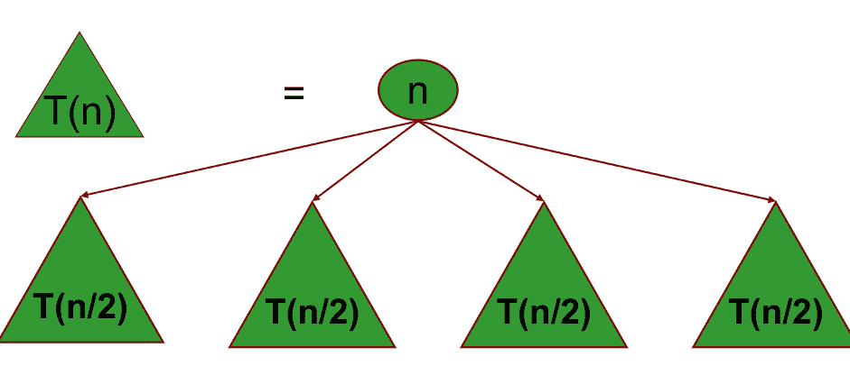

###### 算法总体思想-combine

- 将求出的小规模的问题的解合并为一个更大规模的问题的解，自底向上逐步求出原来问题的解。

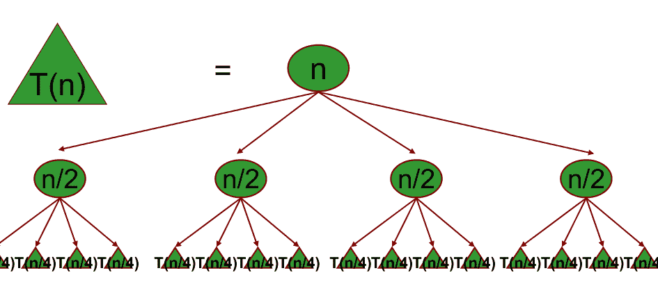

###### 算法总体思想

- 将求出的小规模的问题的解合并为一个更大规模的问题的解，自底向上逐步求出原来问题的解。

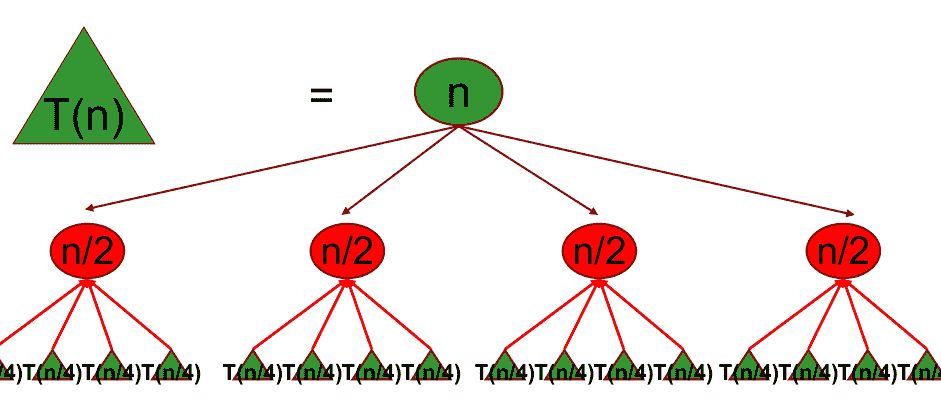

###### 算法总体思想

将求出的小规模的问题的解合并为一个更大规模的问题的解，自底向上逐步求出原来问题的解。

分治法的设计思想是，将一个难以直接解决的大问题，分割成一些规模较小的相同问题，以便各个击破，分而治之。

> 凡治众如治寡，分数是也。
> ----孙子兵法

对程序设计的影响：
多核、多处理机上的多线程编程
——multithread programming

###### //分治法的基本步骤

```
divide-and-conquer(P)    //P为解决问题的规模
{
    if (| P | <= n0) adhoc(P);    //解决小规模的问题，n0表示阈值，即不需要分解
    divide P into smaller subinstances P1,P2,...,Pk; //分解问题，k个
    for (i=1,i<=k,i++)
        yi=divide-and-conquer(Pi);    //递归的解各子问题
    return merge(y1,...,yk);    //将各子问题的解合并为原问题的解
}
```

- 分割原则：
- 人们从大量实践中发现，在用分治法设计算法时，最好使子问题的规模大致相同。即将一个问题分成大小相等的k个子问题的处理方法是行之有效的。这种使子问题规模大致相等的做法是出自一种平衡(balancing)子问题的思想，它几乎总是比子问题规模不等的做法要好。

###### 分治法的复杂性分析

一个分治法将规模为n的问题分成k个规模为n / m的子问题去解。设分解阈值n0=1，且adhoc解规模为1的问题耗时1个单位时间。再设将原问题分解为k个子问题以及用merge将k个子问题的解合并为原问题的解需用f(n)个单位时间。用T(n)表示该分治法解规模为|P|=n的问题所需的计算时间，则有：

T(n) = { O(1)      n = 1
         kT(n / m) + f(n)   n > 1 }

通过迭代法求得方程的解： T(n) = n^{log_m k} + Σ_{j=0}^{log_m n -1} k^{j} f(n / m^{j})

注意：递归方程及其解只给出n等于m的幂幕时T(n)的值，但是如果认为T(n)足够平滑，那么由n等于m的幂幕时T(n)的值可以估计T(n)的增长速度。通常假定T(n)是单调上升的，从而当m^{i} ≤ n < m^{i+1}时，T(m^{i}) ≤ T(n) < T(m^{i+1})。

###### 分治法的适用条件

分治法所能解决的问题一般具有以下几个特征：

- 该问题的规模缩小到一定的程度就可以容易地解决；
- 该问题可以分解为若干个规模较小的相同问题，即该问题具有最优子结构性质
- 利用该问题分解出的子问题的解可以合并为该问题的解；
- 该问题所分解出的各个子问题是相互独立的，即子问题之间不包含公共的子问题。

这条特征涉及到分治法的效率，如果各子问题是不独立的，则分治法要做许多不必要的工作，重复地解公共的子问题，此时虽然也可用分治法，但一般用动态规划较好。

###### 通过例子来理解分治法

二分搜索

减小规模？ == 提高效率？

###### 二分搜索

在已排序的数组中查找一个元素：

*Example:* 查找 9


- 1. *Divide:* 检查中间元素。
- 2. *Conquer:* 递归搜索 1 个子数组。
- 3. *Combine:*  trivial。

###### 二分搜索

在已排序的数组中查找一个元素：

- 1. *Divide:* 检查中间元素。
- 2. *Conquer:* 递归搜索 1 个子数组。
- 3. *Combine:*  trivial。

*Example:* 查找 9


###### 二分搜索

在已排序的数组中查找一个元素：

- 1. *Divide:* 检查中间元素。
- 2. *Conquer:* 递归搜索 1 个子数组。
- 3. *Combine:*  trivial。

*Example:* 查找 9


###### 二分搜索

在已排序的数组中查找一个元素：

- 1. *Divide:* 检查中间元素。
- 2. *Conquer:* 递归搜索 1 个子数组。
- 3. *Combine:*  trivial。

*Example:* 查找 9

3   5   7   8   9   12   15

###### 二分搜索

在已排序的数组中查找一个元素：

- 1. *Divide:* 检查中间元素。
- 2. *Conquer:* 递归搜索 1 个子数组。
- 3. *Combine:*  trivial。

*Example:* 查找 9

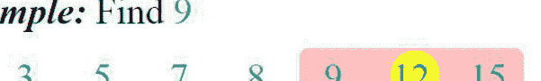

###### 二分搜索

在已排序的数组中查找一个元素：

- 1. *Divide:* 检查中间元素。
- 2. *Conquer:* 递归搜索 1 个子数组。
- 3. *Combine:*  trivial。

*Example:* 查找 9

3   5   7   8   9   12   15

###### 二分搜索

在已排序的数组中查找一个元素：

- 1. *Divide:* 检查中间元素。
- 2. *Conquer:* 递归搜索 1 个子数组。
- 3. *Combine:*  trivial。

*Example:* 查找 9

3   5   7   8   9   12   15


###### Binary search 二分搜索技术

问题：给定已按升序排好序的n个元素a[0:n-1]，现要在这n个元素中找出一个特定元素x。

###### 分析：

- 该问题的规模缩小到一定的程度就可以容易地解决；
- 该问题可以分解为若干个规模较小的相同问题；
- 分解出的子问题的解可以合并为原问题的解；
- 分解出的各个子问题是相互独立的。

分析：很显然此问题分解出的子问题相互独立，即在a[i]的前面或后面查找x是独立的子问题，因此满足分治法的第四个适用条件。

```
//分治法：二分搜索
public static int binarySearch(int [] a, int x, int n)
{
    // 在 a[0] <= a[1] <= ... <= a[n-1] 中搜索 x
    // 找到x时返回其在数组中的位置，否则返回-1
    int left = 0; int right = n - 1;
    while (left <= right)
    {
        int middle = (left + right)/2;
        if (x == a[middle]) return middle;
        if (x > a[middle]) left = middle + 1; //在右半部查找
        else right = middle - 1;             //在左半部查找
    }
    return -1; // 未找到x
}
```

###### 算法复杂度分析：

每执行一次算法的while循环，待搜索数组的大小减少一半。
因此，在最坏情况下，while循环被执行了O(logn)次。循环体内运算需要O(1)时间，因此整个算法在最坏情况下的计算时间复杂度为O(logn)。

###### Recurrence for binary search 二分搜索的递推式

T(n) = 1 T(n/2) + Θ(1)

###### subproblems 子问题

subproblem size 子问题规模

work dividing
and combining 分解和合并的工作

n^{log_b a} = n^{log_2 1} = n^0 = 1 ⇒ CASE 2 (k = 0)

⇒ T(n) = Θ(lg n).

###### 时间复杂度

- O(n)>O(logn)
- 例如： n=10¹⁰

思考题：求数组的最大值和最小值。

思考：利用分治真的比直接求最大值、最小值的效率高吗？

###### 再看分治算法

- 一般，分治算法常与递归方式结合；
- 一般，将问题分成两个子问题更合理，对于递归来说，分得太细对于效率和复杂性并无好处。

###### Powering a number 求幂

**Problem:** 计算 \(a^n\)，其中 \(n \in \mathbb{N}\)。

**Naive algorithm:** \(\Theta(n)\)。

**Divide-and-conquer algorithm:**

\(a^n = \begin{cases} a^{n/2} \cdot a^{n/2} & \text{if } n \text{ is even;} \\ a^{(n-1)/2} \cdot a^{(n-1)/2} \cdot a & \text{if } n \text{ is odd.} \end{cases}\)

\(T(n) = T(n/2) + \Theta(1) \Rightarrow T(n) = \Theta(\lg n).\)

###### 【Example】 Exponentiation: computing X^N. 【示例】幂运算：计算 X^N。

```
long int Pow ( long int X, unsigned int N )
{
    long int P = 1;
    while ( N -- ) P *= X;
    return P;
}
T(N) = O(N)
```

```
long int Pow ( long int X, unsigned int N )
{
/* 1*/    if ( N == 0 )
/* 2*/        return 1;

/* 5*/    if ( IsEven( N ) )
/* 6*/        return Pow( X * X, N / 2 );
    else
/* 7*/        return Pow( X * X, N / 2 ) * X;
}
T(N) = O( log N )
```

###### 通过例子来理解分治法

大整数乘法

提高效率？ 乘法减少？

###### 大整数的乘法

- • 问题： X和Y都是n位的二进制整数，要计算他们的乘积XY。
- • 分治法： 将n位的二进制整数X和Y都分成2段，每段的长为n/2位。
- x= [ A | B ] y = [ C | D ]
- • 所以， X = A2n/2 + B, Y = C2n/2 + D  
  XY = AC 2n + (AD+BC) 2n/2 + BD

####### 算法复杂性分析

- XY = AC 2ⁿ + (AD+BC) 2ⁿ/² + BD
  - 乘法次数：4次n/2位的整数乘法；
  - 加法次数：3次整数加法；
  - 移位次数：2次；
  - 当n>1时，有T(n)=4T(n/2)+O(n)
  - T(n)=O(n²)

算法复杂度：与小学算法没有改变

###### 再接再厉

- XY = AC 2ⁿ + (AD+BC) 2ⁿ/² + BD
- XY = AC 2ⁿ + ((A-B)(D-C)+AC+BD) 2ⁿ/² + BD
  - 乘法次数：3次n/2位的整数乘法；
  - 加法：6次整数加法；
  - 移位：2次
  - 当n>1时，有T(n)=3T(n/2)+O(n)
  - T(n)=O(n^{log3})=O(n^{1.59})

###### 大整数的乘法

请设计一个有效的算法，可以进行两个n位大整数的乘法运算

- ◆ 小学的方法： O(n²)
- ◆ 分治法：

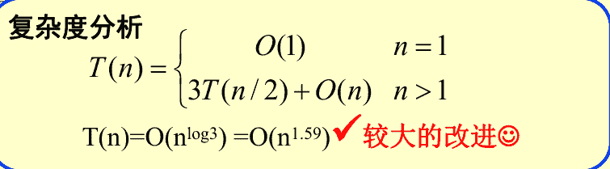

- 1. \( XY = ac \, 2^n + ((a-c)(b-d) + ac + bd) \, 2^{n/2} + bd \)
- 2. \( XY = ac \, 2^n + ((a+c)(b+d) - ac - bd) \, 2^{n/2} + bd \)

细节问题：两个XY的复杂度都是O(nlog³)，但考虑到a+c，b+d可能得到m+1位的结果，使问题的规模变大，故不选择第2种方案。

###### 大整数的乘法

请设计一个有效的算法，可以进行两个n位大整数的乘法运算

- ◆小学的方法： O(n²)
- ◆分治法：O(n^1.59)
- ◆更快的方法??

- ✘效率太低
- ✓较大的改进

➤如果将大整数分成更多段，用更复杂的方式把它们组合起来，将有可能得到更优的算法。

➤最终的，这个思想导致了**快速傅利叶变换**(Fast Fourier Transform)的产生。该方法也可以看作是一个复杂的分治算法，对于大整数乘法，它能在**O(nlogn)**时间内解决。

➤是否能找到线性时间的算法？？？目前为止还没有结果。

###### 通过例子来理解分治法

Strassen矩阵乘法
提高效率？ 乘法减少？

###### Matrix multiplication 矩阵乘法

**Input:** \( A = [a_{ij}], B = [b_{ij}]. \quad \left\} \quad i, j = 1, 2, \dots, n. \)

**Output:** \( C = [c_{ij}] = A \cdot B. \)

\(\begin{bmatrix} c_{11} & c_{12} & \cdots & c_{1n} \\ c_{21} & c_{22} & \cdots & c_{2n} \\ \vdots & \vdots & \ddots & \vdots \\ c_{n1} & c_{n2} & \cdots & c_{nn} \end{bmatrix} = \begin{bmatrix} a_{11} & a_{12} & \cdots & a_{1n} \\ a_{21} & a_{22} & \cdots & a_{2n} \\ \vdots & \vdots & \ddots & \vdots \\ a_{n1} & a_{n2} & \cdots & a_{nn} \end{bmatrix} \cdot \begin{bmatrix} b_{11} & b_{12} & \cdots & b_{1n} \\ b_{21} & b_{22} & \cdots & b_{2n} \\ \vdots & \vdots & \ddots & \vdots \\ b_{n1} & b_{n2} & \cdots & b_{nn} \end{bmatrix}\)

\( c_{ij} = \sum_{k=1}^{n} a_{ik} \cdot b_{kj} \)


###### 标准算法

```
for i ← 1 to n
    do for j ← 1 to n
        do c_ij ← 0
            for k ← 1 to n
                do c_ij ← c_ij + a_ik · b_kj
```

运行时间 = Θ(n³)

###### 分治算法

思路：
$n\times n$ 矩阵 = $(n/2)\times(n/2)$ 子矩阵组成的 $2\times2$ 矩阵：

$\begin{bmatrix} r & s \\ t & u \end{bmatrix} = \begin{bmatrix} a & b \\ c & d \end{bmatrix} \cdot \begin{bmatrix} e & f \\ g & h \end{bmatrix}$

$C = A \cdot B$

$r = ae + bg$
$s = af + bh$
$t = ce + dh$
$u = cf + dg$

8 次 $(n/2)\times(n/2)$ 子矩阵乘法
4 次 $(n/2)\times(n/2)$ 子矩阵加法

###### 分治算法的分析

T(n) = 8 T(n/2) + Θ(n²)

子矩阵大小

子矩阵加法的工作量

n^{log_b a} = n^{log_2 8} = n^3 ⇒ 情形 1 ⇒ T(n) = Θ(n^3).

并不优于普通算法。

###### Strassen 的想法

- • 只用 7 次递归乘法实现 2×2 矩阵相乘。

P₁ = a · (f − h)
P₂ = (a + b) · h
P₃ = (c + d) · e
P₄ = d · (g − e)
P₅ = (a + d) · (e + h)
P₆ = (b − d) · (g + h)
P₇ = (a − c) · (e + f)

r = P₅ + P₄ − P₂ + P₆
s = P₁ + P₂
t = P₃ + P₄
u = P₅ + P₁ − P₃ − P₇

7 次乘法，18 次加法/减法。
注意：不依赖于乘法的交换律！

###### Strassen 的想法

- • 只用 7 次递归乘法实现 2×2 矩阵相乘。

P₁ = a · (f − h)
P₂ = (a + b) · h
P₃ = (c + d) · e
P₄ = d · (g − e)
P₅ = (a + d) · (e + h)
P₆ = (b − d) · (g + h)
P₇ = (a − c) · (e + f )

r = P₅ + P₄ − P₂ + P₆
= (a + d)(e + h)
+ d(g − e) − (a + b)h
+ (b − d)(g + h)
= ae + ah + de + dh
+ dg −de −ah −bh
+ bg + bh −dg −dh
= ae + bg

###### Strassen 算法

- 1. *分解：* 将 *A* 和 *B* 划分为 *(n/2)×(n/2)* 子矩阵。使用 + 和 − 构造要相乘的项。
- 2. *解决：* 递归执行 7 次 *(n/2)×(n/2)* 子矩阵的乘法。
- 3. *合并：* 使用 + 和 − 在 *(n/2)×(n/2)* 子矩阵上构造 *C*。

*T(n) = 7 T(n/2) + Θ(n²)*

###### Strassen 算法分析

Hopcroft和Kerr已经证明\(T(n) \geq 2(n^2) \times 2\) 矩阵的乘积，7次乘法是必要的。因此，要想进一步改进矩阵乘法的时间复杂性，就不能再基于计算\(2 \times 2\)矩阵的7次乘法这样的方法了。或许应当研究 \(3 \times 3\) 或 \(5 \times 5\) 矩阵的更好算法。
2.81 这个数字看起来可能比 3 小不了多少，但因为差别在于指数，对运行时间的影响非常显著。事实上，在当今的机器上，对于 \(n \geq 30\) 左右，Strassen 算法已经优于普通算法了。

迄今为止最好的结果（仅具理论意义）：\(\Theta(n^{2.376 \cdots})\)。

###### 通过例子来理解分治法

合并排序
分治法在排序中的应用！

###### 排序:Sort

设 n 个记录的序列为 { R₁, R₂, R₃, …, Rₙ }

其相应的关键字序列为 { K₁, K₂, K₃, …, Kₙ }

若规定 1, 2, 3, …, n 的一个排列 p₁, p₂, p₃, …, pₙ，使相应的关键字满足如下非递减关系：

Kₚ₁ ≤ Kₚ₂ ≤ Kₚ₃ ≤ … ≤ Kₚₙ

则原序列变为一个按关键字有序的序列：

{ Rₚ₁, Rₚ₂, Rₚ₃, …, Rₚₙ }

此操作过程称为排序。

###### 稳定排序与不稳定排序

假设 Kᵢ = Kⱼ ，且排序前序列中 Rᵢ 领先于 Rⱼ ；

若在排序后的序列中 Rᵢ 仍领先于 Rⱼ ，则称排序方法是稳定的。

若在排序后的序列中 Rⱼ 领先于 Rᵢ ，则称排序方法是不稳定的。

例，序列 3 15 8 8 6 9

若排序后得 3 6 8 8 9 15 稳定的

若排序后得 3 6 8 8 9 15 不稳定的

通俗地讲就是能保证排序前2个相等的数其在序列的前后位置顺序和排序后它们两个的前后位置顺序相同。

###### 内部排序与外部排序

内部排序: 指的是待排序记录存放在计算机随机存储器中进行排序过程。

外部排序: 指的是待排序记录的数量很大，以致内存一次不能容纳全部记录，在排序过程中尚需对外存进行访问的排序过程。

###### 排序的时间复杂度

排序过程主要是对记录的排序码进行比较和记录的移动过程。

因此排序的时间复杂度以算法执行中的数据比较次数及数据移动次数来衡量。

当一种排序方法使排序过程在最坏或平均情况下所进行的比较和移动次数越少，则认为该方法的时间复杂度就越好。

分析一种排序方法，不仅要分析它的时间复杂度，而且要分析它的空间复杂度、稳定性和简单性等。

###### 内部排序

按照排序过程中所依据的原则的不同可以分类为：

- 插入排序
- 合并排序
- 快速排序

###### 插入排序——直接插入排序

思想： 利用有序表的插入操作进行排序

有序表的插入：将一个记录插入到已排好序的有序表中，从而得到一个新的有序表。

例，序列 13 27 38 65 76 97

插入 49

13 27 38 49 65 76 97

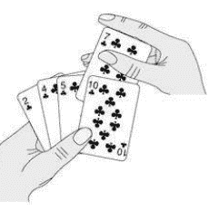

###### 直接插入排序算法描述

初始，令第 1 个元素作为初始有序表；

依次插入第 2 , 3 , ..., k 个元素构造新的有序表；

直至最后一个元素；

例，序列 49 38 65 97 76 13 27

初始，S = { 49 } ；

{ 13 27 38 49 65 76 97 }

直接插入排序算法主要应用比较和移动两种操作。

```
void insertsort(ElemType R[],int n)
//待排序元素用一个数组R表示，数组有n个元素
{ for ( int i=1; i<n; i++) //i表示插入次数，共进行n-1次插入
{ ElemType temp=R[i]; //把待排序元素赋给temp
int j=i-1;
while ((j>=0)&&(temp<R[j]))
{ R[j+1]=R[j]; j--; } //顺序比较和移动
R[j+1]=temp;}
}
```

###### 直接插入排序的效率分析

从空间来看，它只需一个元素的辅助空间，用于元素的位置交换。

从时间分析，首先外层循环要进行n-1次插入，每次插入：

- 最少比较一次（正序），移动两次；
- 最多比较i次，移动i+2次（逆序）（i=1，2，...，n-1）。

C<sub>min</sub>=n-1 M<sub>min</sub>=(n-1)×2;

C<sub>max</sub>=1+2+...+ (n-1) = (n<sup>2</sup>-n) /2

M<sub>max</sub>=3+4+...+ (n+1) = (n<sup>2</sup>+3n-4) /2

C<sub>ave</sub>= (n<sup>2</sup>+n-2) /4

M<sub>ave</sub>= (n<sup>2</sup>+7n-8) /4

因此，直接插入排序的时间复杂度为O（n<sup>2</sup>）。


###### 分析插入排序的稳定性

如果碰见一个和插入元素相等的，那么插入元素把想插入的元素放在相等元素的后面。所以，相等元素的前后顺序没有改变，从原无序序列出去的顺序就是排好序后的顺序，所以插入排序是稳定的。

直接插入算法的元素移动是顺序的，该方法是稳定的。

###### 为什么强调“稳定性”？

###### 插入排序的复杂性分析

- O(n²)
- 在这个算法中，大部分的时间都用在比较和挪动元素中，随着已经排好顺序的数组的增长，比较和被挪动的元素的个数也在增加，而且在整个过程中，很多元素不止挪动一次。

思考：如何用分治的思想解决问题？

###### 基本思想

- 分解（divide）：
  - 将n个元素分成各含n/2个元素的子序列；
- 解决（Conquer）：
  - 递归地用合并排序法对两个子序列排序；
- 合并（Combine）：
  - 合并两个已经排好序的子序列。
  - 在对子序列排序时，其长度为1时递归结束。单个元素被视为是已经排好序的。

###### 输入序列

###### 输出序列

分解

合并

###### MERGE-SORT

```
MERGE-SORT(A, p, r)
{
    if p < r
    {
        q = ((p+r)/2);
        MERGE-SORT(A, p, q);
        MERGE-SORT(A, q+1, r);
        MERGE(A, p, q, r);
    }
}
```

A: [2 4 5 7 1 2 3 6]

L: [2 4 5 7 ∞]

R: [1 2 3 6 ∞]

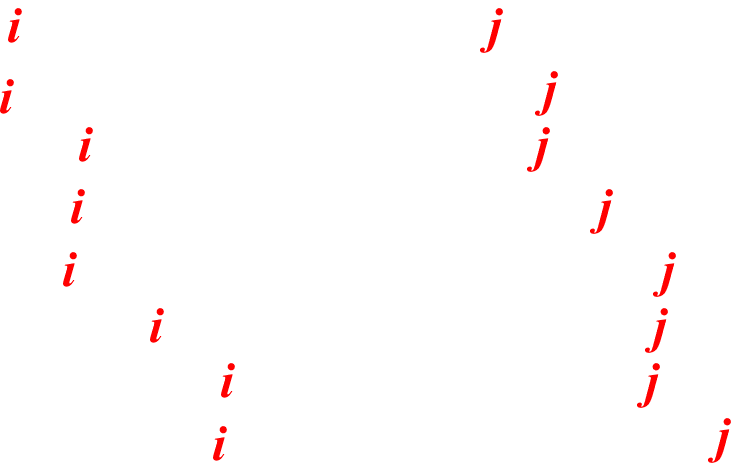

```
MERGE(A, p, q, r)
{
1:    n1 = q-p+1;        //length(L)
2:    n2 = r-q;          //length(R)
3:    creat_arrays L[1...n1+1],R[1...n2+1];
4:    for i=1:n1
5:        do L[i] = A[p+i-1];
6:    for j=1:n2
7:        do R[j] = A[q+j];
8:    L[n1+1] = MAX;
9:    R[n2+1] = MAX;
10:   i = 1;
11:   j = 1;
12:   for k = p:r
13:   {
14:       if L[i] <= R[j]
15:       {
16:           A[k] = L[i];
17:           i = i+1;
18:       }
19:       else
20:       {
21:           A[k] = R[j];
22:           j = j+1;
23:       }
24:   }
}
```

# MERGE(A, p, q, r)

###### 合并排序

**基本思想：** 将待排序元素分成大小大致相同的2个子集合，分别对2个子集合进行排序，最终将排好序的子集合合并成为所要求的排好序的集合。

```java
public static void mergeSort(Comparable a[], int left, int right)
{
    if (left<right) //至少有2个元素
    int i=(left+right)/2; //取中点
    mergeSort(a, left, i);
    mergeSort(a, i+1, right);
    merge(a, b, left, i, right); //合并到数组b
    copy(a, b, left, right);  //复制回数组a
}
}
```

用T(n)表示归并排序所用的时间，
并假定合并过程所用时间： cn，其中c是一个正数，则有

\(T(n) = \begin{cases} a & n = 1 \\ 2T(n/2) + cn & n > 1 \end{cases}\)

其中

**复杂度分析**

\(T(n) = \begin{cases} O(1) & n \leq 1 \\ 2T(n/2) + O(n) & n > 1 \end{cases}\)

T(n)=O(nlogn) 渐进意义下的最优算法

\(= 2^k T(1) + kcn\)

对于一般的整数n，我们可以假定 \(2^k < n \leq 2^{k+1}\)，于是，

\(T(n) \leq T(2^{k+1}), \quad T(n) = O(n \log n)\)

###### 合并排序的灵活革新

基本思想：将待排序元素分成大小大致相同的2个子集合，分别对2个子集合进行排序，最终将排好序的子集合合并成为所要求的排好序的集合。

- 首先将长度为1的n个数组相邻元素两两配对，构成了长度为2的n/2个数组，合并时用比较算法对这每个子数组中元素进行排序；
- 再将这些长度为2的n/2个数组两两合并，构成了长度为4，个数为n/4的子数组，合并时用比较算法对每个子数组元素排序。
- 继续
- 直到形成长度为n，子数组个数=1的整个数组为止。

###### 合并排序

算法mergeSort的递归过程可以消去。

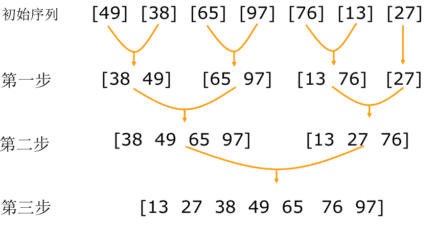

###### 如何将两个有序段合并成一个有序段？

L
m m+1
r
1 3 6 7 2 4 5 8 9
i j

```
//合并算法
void Merge( Type c[], Type d[], int l, int m, int r)
{
    int i = l, j = m+1, k = l;
    while(( i <= m ) && ( j <= r ))
    {
        if ( c[i] <= c [j] ) d[k++] = c[i++];
        else d[k++] = c [j++];
    }
    if ( i > m )
    {
        for (int q = j; q <= r; q++)
            d[k++] = c[q];
    }
    else    for ( int q = i; q <= m; q++ )
        d[k++] = c[q];
}
```

```
//mergepass
void MergePass ( Type x[], Type y[], int s, int n )
{
    int i = 0;
    while ( i <= n - 2 * s )
    {//合并大小为s的相邻2段子数组
        Merge( x, y, i, i+s-1, i+2*s-1 );
        i = i + 2 * s;
    }
    //剩下的元素个数少于2s
    if ( i + s < n ) Merge ( x, y, i, i+s-1, n-1 );
    else for (int j = i; j <= n-1; j++)
        y[j] = x[j];
}
```

###### //合并排序算法

```
void MergeSort ( Type a[], int n )
{
    Type *b = new Type [n];
    int s = 1;
    while ( s < n )
    {
        MergePass( a, b, s, n );
        s += s;
        MergePass( b, a, s, n );
        s += s;
    }
}
```

###### 归并排序（Merge Sort）

- 算法分析
  - 最坏情况：归并排序是一个递归算法，所以很容易得到算法计算量的递推公式
  
  ```
  W(n) = W(⌊n / 2⌋) + W(⌈n / 2⌉)
  W(1) = 0
  ```
  
  所以算法最坏情况的复杂度为
  
  ```
  θ(n log n)
  ```
  
  - 算法需要 θ(n) 的辅助空间

###### 合并排序（Merge Sort）

- 其他策略
  - 上面归并排序每次迭代时将原序列分割为两个基本等长的序列，称为二路归并排序
  - 也可以分割成其他的分，如3，4等等
- 评论：尽管合并排序最坏情况的比较次数比快速排序少，但它需要更多的元素移动，因此，它在实用中不一定比快速排序快。
- 分析合并排序的稳定性？


合并（归并）排序是把序列递归地分成短序列，递归出口是短序列只有1个元素（认为直接有序）或者2个序列（1次比较和交换），然后把各个有序的段序列合并成一个有序的长序列，不断合并直到原序列全部排好序。

可以发现，在1个或2个元素时，1个元素不会交换，2个元素如果大小相等也没有人故意交换，这不会破坏稳定性。

那么，在短的有序序列合并的过程中，稳定是否受到破坏？没有，合并过程中我们可以保证如果两个当前元素相等时，我们把处在前面的序列的元素保存在结果序列的前面，这样就保证了稳定性。

所以，归并排序也是稳定的排序算法。

###### 合并排序
- 最坏时间复杂度： O(nlogn)
- 平均时间复杂度： O(nlogn)
- 稳定性： 稳定

###### 快速排序

###### 快速排序

分治法的应用

###### 为什么需要快速排序？
- 插入排序不好吗？
- 合并排序不是改进了吗？
- 问题是什么？

###### 快速排序
- 由 C.A.R. Hoare 于 1962 年提出。
- 分治算法。
- 就地排序（与插入排序类似，但与归并排序不同）。
- 非常实用（经过调优）。

###### 快速排序的描述
- **分解**：数组A[p ...r]被划分成两个子数组 A[p..q-1]和A[q+1...r],且A[q]为下标（标杆）元素。使得
  - A[p..q-1]都≤A[q]， A[q+1...r] > A[q]


- **解决**：递归地调用快速排序，对子数组 A[p..q-1]和A[q+1...r],排序
- **合并**：因为两个子数组就地排序，将它们的合并不需要操作，整个数组已经排序了。

###### 快速排序的伪代码
```
QUICKSORT(A, p, r)
    if p < r
        then q ← PARTITION(A, p, r)
        QUICKSORT(A, p, q−1)
        QUICKSORT(A, q+1, r)
```

初始调用：QUICKSORT(A, 1, n)

###### 划分示例

6 10 13 5 8 3 2 11

i j

```
x ← A[p]    ▷ pivot = A[p]
i ← p
```

```
do if A[j] ≤ x
then i ← i + 1
exchange A[i] ↔ A[j]
```

x ≤ x ≥ x ?
p i j q

###### 划分示例


若 \( A[j] \leq x \)
则 \( i \leftarrow i + 1 \)
交换 \( A[i] \leftrightarrow A[j] \)

###### 划分示例

若 \( A[j] \le x \)
则 \( i \leftarrow i + 1 \)
交换 \( A[i] \leftrightarrow A[j] \)


###### 划分示例

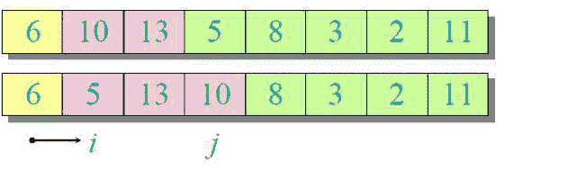

###### 划分示例

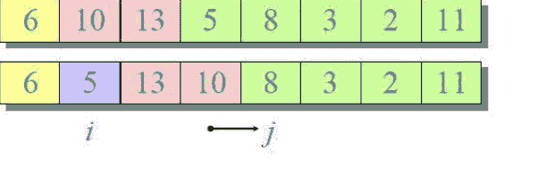

###### 划分示例

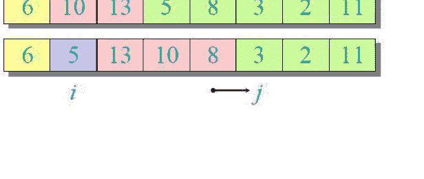

###### 划分示例

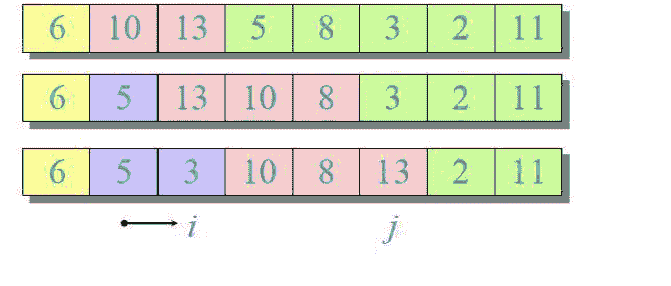

###### 划分示例

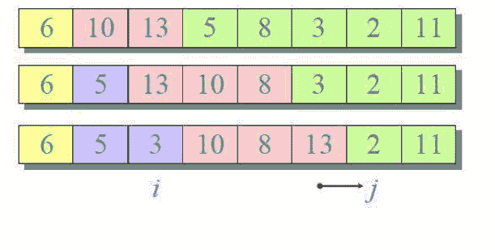

###### 划分示例

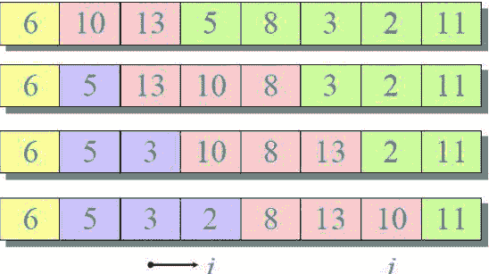

###### 划分示例

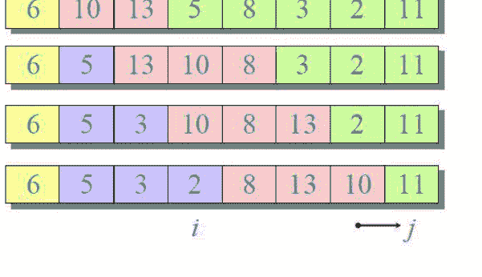

###### 划分示例

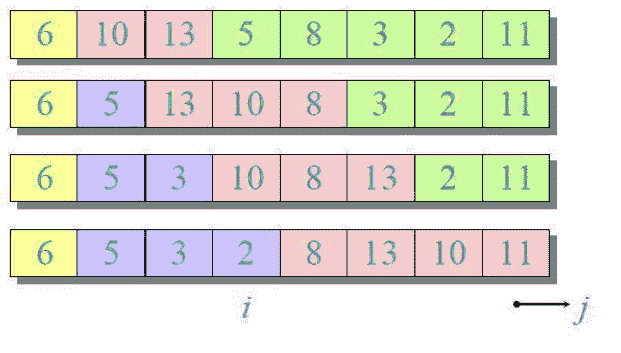

###### 划分示例

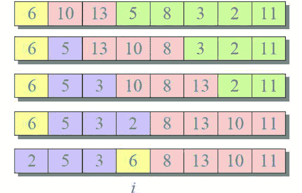

###### 划分子程序
```
PARTITION(A, p, q) ▷ A[p .. q]
 x ← A[p]        ▷ pivot = A[p]
 i ← p
 for j ← p + 1 to q
   do if A[j] ≤ x
      then i ← i + 1
           exchange A[i] ↔ A[j]
 exchange A[p] ↔ A[i]
 return i
```

对于 n 个元素，运行时间为 O(n)。

不变式：

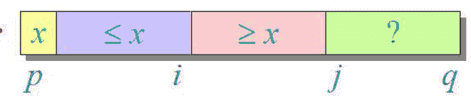

###### 快速排序的伪代码
```
QUICKSORT(A, p, r)
if p < r
then q ← PARTITION(A, p, r)
QUICKSORT(A, p, q−1)
QUICKSORT(A, q+1, r)
```

**初始调用：QUICKSORT(A, 1, n)**

###### 快速排序分析
- 假设所有输入元素互不相同。
- 实际上，对于可能存在重复输入元素的情况，有更好的划分算法。
- 令 \( T(n) \) 表示包含 \( n \) 个元素的数组上的最坏情况运行时间。

###### 快速排序的最坏情况
- 输入已排序或逆序排序。
- 围绕最小或最大元素进行划分。
- 划分后总有一侧没有元素。

T(n) = T(0) + T(n-1) + Θ(n)
= Θ(1) + T(n-1) + Θ(n)
= T(n-1) + Θ(n)
= Θ(n²)   （等差级数）

###### 最坏情况递归树

$T(n) = T(0) + T(n-1) + cn$

###### 最坏情况递归树

$T(n) = T(0) + T(n-1) + cn$

$T(n)$

###### 最坏情况递归树

T(n) = T(0) + T(n−1) + cn

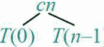

###### 最坏情况递归树

$T(n) = T(0) + T(n-1) + cn$

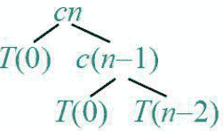

###### 最坏情况递归树

$T(n) = T(0) + T(n-1) + cn$

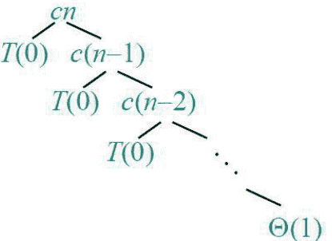


###### 最坏情况递归树

T(n) = T(0) + T(n-1) + cn

cn
T(0) c(n-1)
T(0) c(n-2)
T(0) ...
Θ(1)

Θ(∑k=1n k) = Θ(n2)

T(n) = Θ(n) + Θ(n²)
= Θ(n²)

Θ(∑_{k=1}^n k) = Θ(n²)

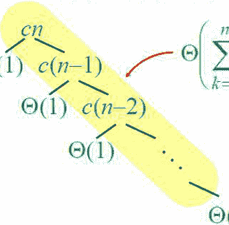

###### 最佳情况分析
####### （仅用于直觉！）

如果我们幸运的话，PARTITION 会将数组均匀地划分：

$T(n) = 2T(n/2) + \Theta(n)$

$= \Theta(n \lg n) \qquad \text{(same as merge sort)}$

如果划分总是 $\frac{1}{10}:\frac{9}{10}$ 呢？

$T(n) = T(\frac{1}{10}n) + T(\frac{9}{10}n) + \Theta(n)$

这个递推式的解是什么？

###### “接近最佳”情况的分析

T(n)

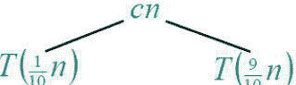

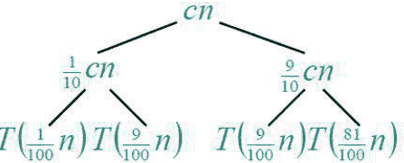

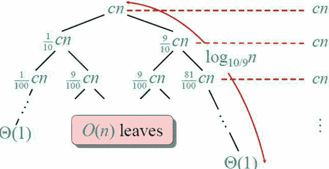

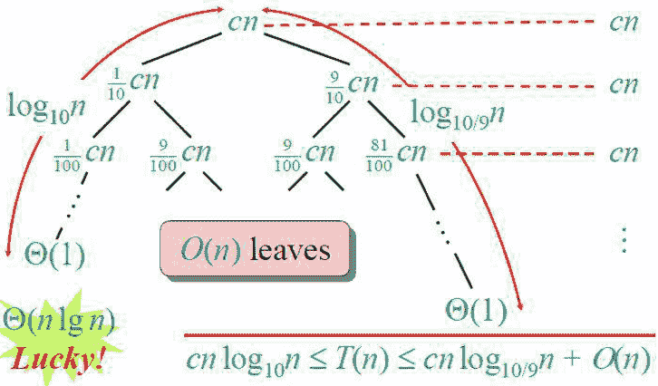

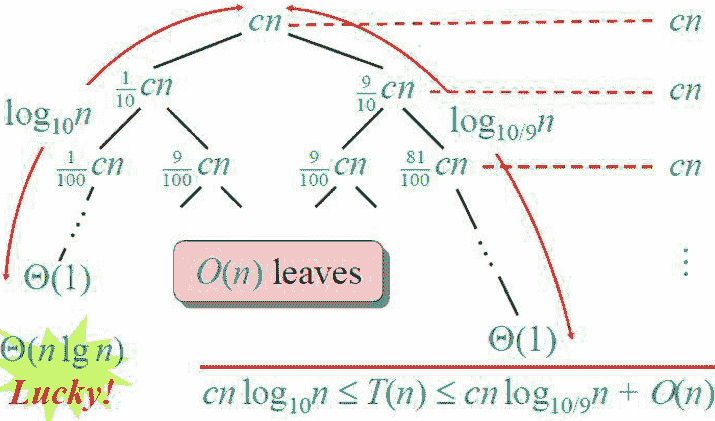

###### 更多直觉

假设我们交替出现幸运、不幸、幸运、不幸、幸运、....

L(n) = 2U(n/2) + Θ(n) lucky
U(n) = L(n − 1) + Θ(n) unlucky

求解：

L(n) = 2(L(n/2 − 1) + Θ(n/2)) + Θ(n)
= 2L(n/2 − 1) + Θ(n)
= Θ(n lg n) Lucky!

我们如何确保通常是幸运的？

###### 快速排序

可以看出： 快速排序算法的性能取决于划分的对称性。
通过修改算法partition， 可以设计出采用随机选择策略

- 最坏时间复杂度： O(n²)
- 平均时间复杂度： O(nlogn)
- 稳定性： 不稳定

```
```java
private static int randomizedPartition (int p, int r)
{
    int i = random(p,r);
    MyMath.swap(a, i, p);
    return partition (p, r);
}
```
```

###### Randomized quicksort

**IDEA**: Partition around a _random_ element.

- Running time is independent of the input order.
- No assumptions need to be made about the input distribution.
- No specific input elicits the worst-case behavior.
- The worst case is determined only by the output of a random-number generator.

###### Randomized quicksort analysis

Let \( T(n) = \) the random variable for the running time of randomized quicksort on an input of size \( n \), assuming random numbers are independent.

For \( k = 0, 1, \dots, n-1 \), define the **indicator random variable**

\( X_k = \begin{cases} 1 & \text{if PARTITION generates a } k : n-k-1 \text{ split,} \\ 0 & \text{otherwise.} \end{cases} \)

\( E[X_k] = \Pr\{X_k = 1\} = 1/n \), since all splits are equally likely, assuming elements are distinct.

###### Analysis (continued)

\( T(n) = \begin{cases} T(0) + T(n-1) + \Theta(n) & \text{if } 0:n-1 \text{ split,} \\ T(1) + T(n-2) + \Theta(n) & \text{if } 1:n-2 \text{ split,} \\ \quad \vdots \\ T(n-1) + T(0) + \Theta(n) & \text{if } n-1:0 \text{ split,} \end{cases} \)

\( = \sum_{k=0}^{n-1} X_k \left( T(k) + T(n-k-1) + \Theta(n) \right). \)

###### Calculating expectation

Take expectations of both sides.

```
\( E[T(n)] = E\left[\sum_{k=0}^{n-1} X_k(T(k) + T(n-k-1) + \Theta(n))\right] \)
```

Linearity of expectation.

```
E[T(n)] = E[\sum_{k=0}^{n-1} X_k(T(k) + T(n-k-1) + \Theta(n))]
= \sum_{k=0}^{n-1} E[X_k(T(k) + T(n-k-1) + \Theta(n))]
```

Independence of \(X_k\) from other random choices.

```
\( E[T(n)] = E \left[ \sum_{k=0}^{n-1} X_k (T(k) + T(n-k-1) + \Theta(n)) \right] \\
= \sum_{k=0}^{n-1} E[X_k(T(k) + T(n-k-1) + \Theta(n))] \\
= \sum_{k=0}^{n-1} E[X_k] \cdot E[T(k) + T(n-k-1) + \Theta(n)] \)
```

\(E[T(n)] = E\left[\sum_{k=0}^{n-1} X_k(T(k) + T(n-k-1) + \Theta(n))\right]\)
\(= \sum_{k=0}^{n-1} E[X_k(T(k) + T(n-k-1) + \Theta(n))]\)
\(= \sum_{k=0}^{n-1} E[X_k] \cdot E[T(k) + T(n-k-1) + \Theta(n)]\)
\(= \frac{1}{n} \sum_{k=0}^{n-1} E[T(k)] + \frac{1}{n} \sum_{k=0}^{n-1} E[T(n-k-1)] + \frac{1}{n} \sum_{k=0}^{n-1} \Theta(n)\)

Linearity of expectation; \(E[X_k] = 1/n\) .


###### 计算期望

求和具有相同的项。

\[
\begin{aligned}
E[T(n)] &= E\left[\sum_{k=0}^{n-1} X_k(T(k) + T(n-k-1) + \Theta(n))\right] \\
&= \sum_{k=0}^{n-1} E[X_k(T(k) + T(n-k-1) + \Theta(n))] \\
&= \sum_{k=0}^{n-1} E[X_k] \cdot E[T(k) + T(n-k-1) + \Theta(n)] \\
&= \frac{1}{n} \sum_{k=0}^{n-1} E[T(k)] + \frac{1}{n} \sum_{k=0}^{n-1} E[T(n-k-1)] + \frac{1}{n} \sum_{k=0}^{n-1} \Theta(n) \\
&= \frac{2}{n} \sum_{k=1}^{n-1} E[T(k)] + \Theta(n)
\end{aligned}
\]

###### 毛茸茸的递推式

\[
E[T(n)] = \frac{2}{n} \sum_{k=2}^{n-1} E[T(k)] + \Theta(n)
\]

（\(k=0, 1\) 项可以吸收到 \(\Theta(n)\) 中。）

**证明：** \(E[T(n)] \leq an \lg n\) 对常数 \(a > 0\) 成立。

- 选择足够大的 \(a\)，使得 \(an \lg n\) 对足够小的 \(n \geq 2\) 主导 \(E[T(n)]\)。

**使用事实：** \(\sum_{k=2}^{n-1} k \lg k \leq \frac{1}{2} n^2 \lg n - \frac{1}{8} n^2\) （练习）。

###### 替换法

代入归纳假设：

\[
E[T(n)] \leq \frac{2}{n} \sum_{k=2}^{n-1} a k \lg k + \Theta(n)
\]

使用事实：

\[
E[T(n)] \leq \frac{2a}{n} \left( \frac{1}{2} n^2 \lg n - \frac{1}{8} n^2 \right) + \Theta(n)
\]

表示为 **期望值 − 残差**：

\[
E[T(n)] = an \lg n - \left( \frac{an}{4} - \Theta(n) \right)
\]

\[
E[T(n)] \leq an \lg n,
\]

如果 \(a\) 选择足够大，使得 \(an/4\) 主导 \(\Theta(n)\)。

###### 实践中的快速排序

- 快速排序是一种很棒的通用排序算法。
- 快速排序通常比归并排序快两倍以上。
- 快速排序可以从 *代码调优* 中获得显著收益。
- 快速排序即使在缓存和虚拟内存下表现也很好。

###### 结论

- 分治法只是算法设计中几种强大技术之一。
- 分治算法可以用递推式和主定理进行分析（所以要练习这部分数学）。
- 可以导致更高效的算法

###### Homework

- 腾挪次数？
  - 插入排序，合并排序，快速排序
- 比较次数？
  - 都有哪些排序方法？ 比较排序有哪些？ 效率如何分析？

###### 分治法的应用

- 最大值和最小值
- 学会利用递推替换的方法解递归方程分析算法复杂性

####### 问题：在含有 n 个不同元素的集合中同时找出它的最大和最小元素

- 利用分治策略进行设计：
  - 同时找出极值情况。
  - 对于奇数 \(n\)，最大/最小值 = 第一个元素，然后成对处理余下元素。（\(3\lfloor n/2 \rfloor\)）
  - 对于偶数 \(n\)，前两个元素做一次比较，然后与奇数处理方式一样。（\(3(n/2)-2\)）

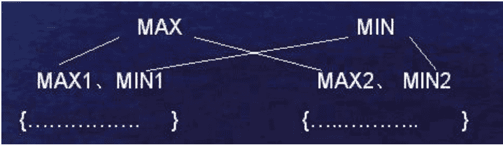

####### 算法复杂性分析

- 从算法描述中可以看出，占据算法的主要执行次数的是比较过程，因此算法的复杂性主要跟比较次数相关。

\[
T(n)=
\begin{cases}
0 & n=1,\\
1 & n=2,\\
T(\lfloor n/2 \rfloor) + T(\lceil n/2 \rceil) + 2 & n>2.
\end{cases}
\]

当 \(n\) 是 2 的幂时，即对于某个正整数 \(k\)，\(n=2^k\)，有

\[
\begin{aligned}
T(n) &= 2T(n/2)+2 \\
&= 2(2T(n/4)+2)+2 \\
&= 4T(n/4)+4+2 \\
&\ \ \vdots \\
&= 2^{k-1}+2^k-2 \\
&= \frac{3n}{2}-2
\end{aligned}
\]

注意，当 \(n\) 是 2 的幂时，\(\frac{3n}{2}-2\) 是最好、平均及最坏情况的比较数。与直接算法的比较数 \(2n-2\) 相比，它少了 25%。

####### 选择问题（线性时间选择）

给定线性序集中 \(n\) 个元素和一个整数 \(k\)，\(1 \le k \le n\)，要求找出这 \(n\) 个元素中第 \(k\) 小的元素。

- 思路1：先采用一种排序算法先将数组按不降的次序排好，然后从排好序的数组中检出第 \(k\) 小的元素。
- 分析算法复杂性：最坏情况下至少是 \(O(n \log n)\)。

####### 3个特殊情况

- 找第 1 小元素
  - 即转换为找最小值元素问题
- 找第 \(n\) 小元素
  - 即转换为找最大值元素问题
- 找中间小元素
  - 找中位数，\(k = (n+1)/2\) 问题

####### Example

选择第 \(k=7\) 小的元素：

6 10 13 5 8 3 2 11   \(k = 7\)

*pivot*

划分：

2 5 3 6 8 13 10 11   \(i = 4\)

递归选择第 \(7-4=3\) 小的元素。

####### RandomizedSelect 算法描述

给定线性序集中 \(n\) 个元素和一个整数 \(k\)，\(1 \le k \le n\)，要求找出这 \(n\) 个元素中第 \(k\) 小的元素。

```
Type RandomizedSelect(Type a[], int p, int r, int k)
{
    极端情况：数组中只有一个元素；
    利用二分法进行划分，分成两个数组，左半部和右半部，左半部小于右半部。
    统计出左半部的元素个数 i，如果 (k <= i) k 一定出现在左半部；
    否则，k 在右半部，则问题变成了在右半部递归查找第 k-i 小元素。
}
```

想想这个算法的最坏情况下是什么样子的？
是否可以借鉴快速排序的思路？


###### 分析直觉

（我们今天的分析都假设所有元素互不相同。）

**幸运情况：**

T(n) = T(9n/10) + Θ(n)
= Θ(n)

**不幸情况：**

T(n) = T(n − 1) + Θ(n)
= Θ(n²)

**比排序更糟糕！**

n^(log₁₀/₉ 1) = n⁰ = 1
情况 3

等差数列

###### 选择问题

给定线性序集中n个元素和一个整数k， 1≤k≤n， 要求找出这n个元素中第k小的元素

```
template<class Type>
Type RandomizedSelect(Type a[], int p, int r, int k)
{
    if(p==r) return a[p];
    int x = RandomizedPartition(a, p, r);
    int i = x-p+1;
    if(k<=i) return RandomizedSelect(a, p, x, k);
    else return RandomizedSelect(a, x+1, r, k-i);
}
```

在最坏情况下，算法randomizedSelect需要O(n²)计算时间但可以证明，算法randomizedSelect可以在O(n)平均时间内找出n个输入元素中的第k小元素。

###### 深入分析选择问题

上述算法的核心步骤是什么？

###### 线性时间选择

如果能在线性时间内找到一个划分基准，使得按这个基准所划分出的2个子数组的长度都至少为原数组长度的ε倍(0<ε<1是某个正常数)，那么就可以**在最坏情况下用O(n)时间完成选择任务，这是线性时间选择问题。**

例如，若ε=9/10，算法递归调用所产生的子数组的长度至少缩短1/10。所以，在最坏情况下，算法所需的计算时间T(n)满足递归式T(n)≤T(9n/10)+O(n)。由此可得T(n)=O(n)。

###### 基准/划分基准的选择：

- 1. 将n个输入元素划分成 n/5 个组，每组5个元素，只可能有一个组不是5个元素。用任意一种排序算法，将每组中的元素排好序，并取出每组的中位数，共 n/5 个。
- 2. 递归调用select来找出这 n/5 个元素的中位数。如果 n/5 是偶数，就找它的2个中位数中较大的一个。
- 3. 以这个元素作为划分基准。

###### 选择基准

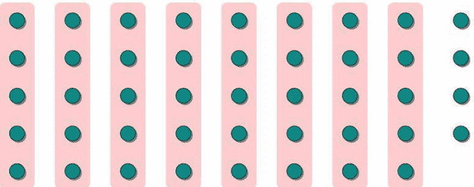

- 1. 将 \( n \) 个元素分成5个一组。
- 1. 将n个输入元素划分成 \( n/5 \) 个组，每组5个元素，只可能有一个组不是5个元素。

###### 选择基准

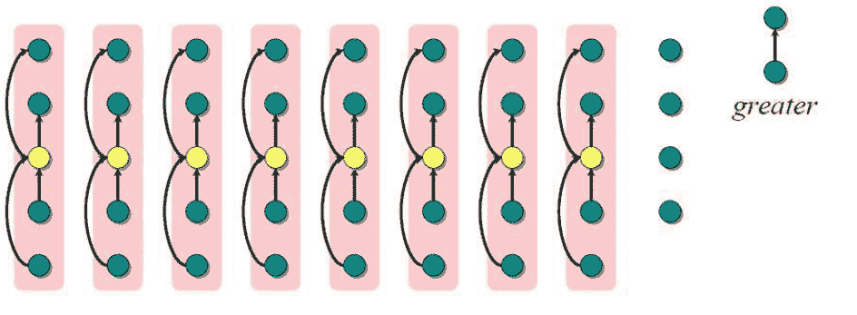

1. 将n个输入元素划分成 n/5 个组，每组5个元素。

用任意一种排序算法，将每组中的元素排好序，并取出每组的中位数，共 n/5 个。

###### 选择基准

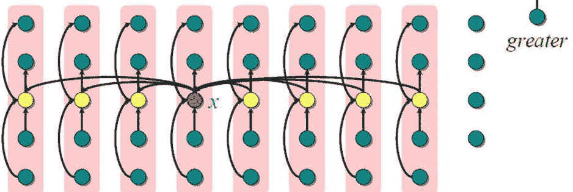

1. 将n个输入元素划分成 n/5 个组，每组5个元素 . 用任意一种排序算法，将每组中的元素排好序，并取出每组的中位数，共 n/5 个。
2. 递归调用select来找出这 n/5 个元素的中位数。如果 n/5 是偶数，就找它的2个中位数中较大的一个。
3. 以这个元素作为划分基准。

###### 分析

至少一半的组中位数 \(\le x\)，即至少有 \(\lfloor\lfloor n/5\rfloor/2\rfloor = \lfloor n/10\rfloor\) 个组中位数。

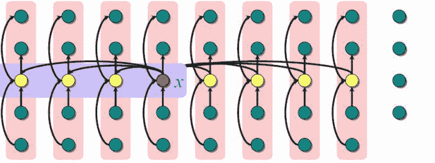

###### 分析（假设所有元素互不相同。）

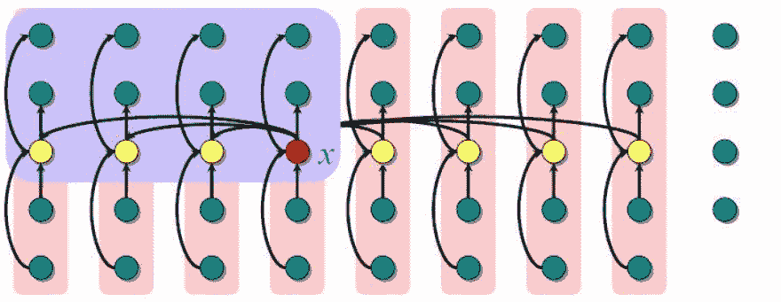

至少一半的组中位数 \(\le x\)，即至少有 \(\lfloor\lfloor n/5\rfloor/2\rfloor=\lfloor n/10\rfloor\) 个组中位数。

- • 因此，至少有 \(3\lfloor n/10\rfloor\) 个元素 \(\le x\)。

###### 分析（假设所有元素互不相同。）

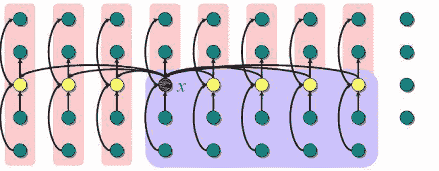

至少一半的组中位数 \(\le x\)，即至少有 \(\lfloor\lfloor n/5\rfloor/2\rfloor = \lfloor n/10\rfloor\) 个组中位数。

- • 因此，至少有 \(3\lfloor n/10\rfloor\) 个元素 \(\le x\)。
- • 类似地，至少有 \(3\lfloor n/10\rfloor\) 个元素 \(\ge x\)。

###### 线性时间选择

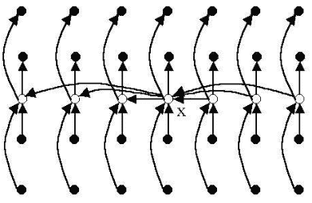

设所有元素互不相同。在这种情况下，找出的基准x至少比3(n-5)/10个元素大，因为在每一组中有2个元素小于本组的中位数，而n/5个中位数中又有(n-5)/10个小于基准x。同理，基准x也至少比3(n-5)/10个元素小。而当n≥75时，3(n-5)/10≥n/4所以按此基准划分所得的2个子数组的长度都至少缩短1/4。

```
Type Select(Type a[], int p, int r, int k)
{
    if(r-p<75){
        用某个简单排序算法对数组a[p:r]排序;
        return a[p+k-1];
    }
    for(int i=0; i<=(r-p-4)/5; i++)
        将a[p+5*i]至a[p+5*i+4]的第3小元素
        与a[p+i]交换位置;
    //找中位数的中位数， r-p-4即上面所说的n-5
    Type x = Select(a, p, p+(r-p-4)/5, (r-p-4)/10);
    int i = Partition(a, p, r, x);
    int j = i-p+1;
    if(k<=j) return Select(a, p, i, k);
    else return Select(a, i+1, r, k-j);
}
```

```
Type Select(Type a[], int p, int r, int k)
{
    if(r-p<75){
        用其余算法直接处理问题，比如
        ret
    {
        for(
            将
            与
        //找中位数的中位数，r-p-4即上面所说的n-5
    {
```

####### 复杂度分析

T(n)≤{C₁n n<75 C₂n+T(n/5)+T(3n/4) n≥75 T(n)=O(n)

上述算法将每一组的大小定为5，并选取75作为是否作递归调用的分界点。这2点保证了T(n)的递归式中2个自变量之和n/5+3n/4=19n/20=εn，0<ε<1。这是使T(n)=O(n)的关键之处。当然，除了5和75之外，还有其他选择。

###### 分治法的应用
###### 最接近点对问题

- ✔ 在应用中，常用诸如点、圆等简单的几何对象代表现实世界中的实体。在涉及这些几何对象的问题中，常需要了解其邻域中其他几何对象的信息。
- ✔ 最接近点对问题的提法是：给定平面上n个点，找其中的一对点，使得在n个点的所有点对中，该点对的距离最小。
- ✔ 严格地说，最接近点对可能多于1对。为了简单起见，这里只限于找其中的一对。

###### 最接近点对问题

- - 问题提出：
  - 在直线上的n个点中，找出其中的一对点，使得在n个点组成的所有点对中，该点对的距离最小！

- - 思路1：
  只要将每一点与其他n-1个点距离算出，找出达到最小距离的两点即可。
  
- - 效率：
  \( O(n^2) \)

- - 思路2：
  在直线上，最近点对问题可以通过1次排序和1维扫描来解决。
  
- - 效率：
  \( O(n \log n) \)

- - 体会分治的策略：缩小问题的规模


###### 最接近点对问题

问题提出：
在二维平面上的n个点中，找出其中的一对点，使得在n个点组成的所有点对中，该点对的距离最小！

思路2：
在直线上，最近点对问题
可以通过1次排序和1维扫描
来解决。

在二维空间中，这个思路
是行不通的。

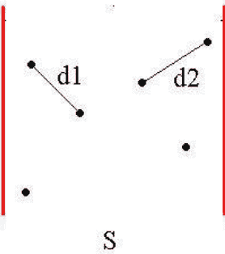

###### 最接近点对问题

问题提出：
在二维平面上的n个点中，找出其中的一对点，使得在n个点组成的所有点对中，该点对的距离最小！

分治法的思路：
① 划分成子规模点集
② 找到极值情况
③ 合并
④ 提高效率（平衡子思想）

###### 一维：最接近点对问题

◆此时，S中的n个点退化为x轴上的n个实数 x1,x2,...,xn。 最接近点对即为这n个实数中相差最小的2个实数。

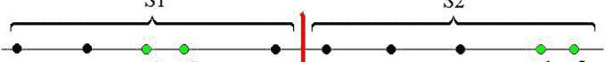

> > 思考：此时找到的距离是全集S的最小距离吗？

+ > 假设我们用x轴上某个点m将S划分为2个子集S1和S2；
+ > 递归地在S1和S2上找出其最接近点对{p1,p2}和{q1,q2}，并设d=min{|p1-p2|,|q1-q2|}，S中的最接近点对或者是{p1,p2}，或者是{q1,q2}
+ > 合并

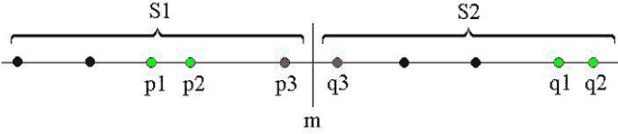

###### 如何找p3,q3?

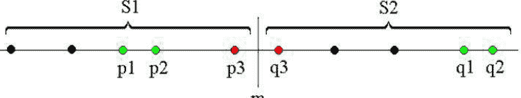

◆如果S的最接近点对是{p3,q3}，即|p3-q3|<d，则p3和q3两者与m的距离不超过d，即p3∈(m-d,m]，q3∈(m,m+d]。
◆由于在S1中，每个长度为d的半闭区间至多包含一个点（否则必有两点距离小于d），并且m是S1和S2的分割点，因此(m-d,m]中至多包含S中的一个点。由图可以看出，如果(m-d,m]中有S中的点，则p3就是S1中最大点。
◆同理，q3就是S2中的最小点。

分治法的思路：
① 划分成子规模点集S1和S2
② 找到S1和S2的最小距离d。
③ 合并S1和S2：并利用d在S1的(m-d,m]和S2的(m,m+d]中找最大点和最小点，即p3和q3。选出最小距离，完成合并

分治法的算法复杂性：
① 划分成子规模点集S1和S2
② 我们用线性时间就能找到区间(m-d,m]和(m,m+d]中所有点，即p3和q3。从而我们用线性时间就可以将S1的解和S2的解合并成为S的解。

###### 算法的最坏情况？

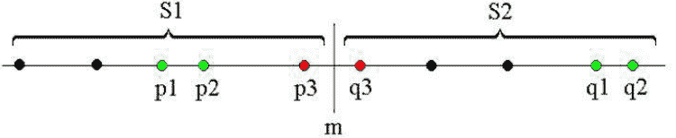

####### 如何选择m？

m = \(\frac{\max(s) + \min(s)}{2}\)

最坏情况：
① 划分成子规模点集S1和S2  
② S1的个数=1，S2的个数=n-1  

效率：  
O(n²)

改进方案：  
基于平衡子问题的思想，用S中各点坐标的中位数来作分割点。  

效率：  
=线性时间选择= O(n)

```
//一维
bool Cpairl( s, d )
{
    n = |s|;
    if (n<2) {d为无穷大; return false;}
    m = s中各个坐标的中位数;
    //构造S1 和 S2
    //S1 = { x<m} s2 = {x > m }
    Cpairl( s1, d1 );
    Cpairl( s2, d2 );
    p = max (s1);
    q = min (s2);
    d = min( d1, d2, q-p);
    return true;
}
```

###### 一维情况下的算法复杂性

复杂度分析

[ T(n) = \begin{cases} 
O(1) & \quad n < 4 \\
2T(n/2) + O(n) & \quad n \geq 4 
\end{cases} ]

[ T(n) = O(n \log n) ]

###### 二维：最接近点对问题

◆下面来考虑二维的情形。

➤选取一垂直直线l：x = m来作为分割直线。 其中m为S中各点x坐标的中位数。 由此将S分割为S1和S2。
➤递归地在S1和S2上找出其最小距离d1和d2， 并设d=min{d1,d2}， S中的最接近点对或者是d， 或者是某个{p,q}， 其中p∈P1且q∈P2。
➤合并： 能否在线性时间内找到p,q， 完成合并？


###### 算法的最坏情况？


最坏情况：
① 设P1中的一个点； 对应p，
在P2中共有n/2个候选点；
② 则对应P1，共需要排查比
较n/2*n/2个对候选点。

改进方案：
缩小排查的规模，降低幂次。

效率：
=在线性时间里查找= O(n)

###### 能否在线性时间内找到p3,q3？

◆考虑P1中任意一点p，它若与P2中的点q构成最接近点对的候选者，则必有distance(p，q)<d。满足这个条件的P2中的点一定落在一个d×2d的矩形R中  
◆由d的意义可知，P2中任何2个S中的点的距离都不小于d。由此可以推出矩形R中最多只有6个S中的点。  
◆因此，在分治法的合并步骤中最多只需要检查n/2×6=3n个候选者


###### 为什么只有6个候选点？？

- 考虑P1中任意一点p，它若与P2中的点q构成最接近点对的候选者，则必有distance(p, q)<d。满足这个条件的P2中的点一定落在一个d×2d的矩形R中
- 由d的意义可知，P2中任何2个S中的点的距离都不小于d。由此可以推出矩形R中最多只有6个S中的点。
- 因此，在分治法的合并步骤中最多只需要检查6×n/2=3n个候选者

证明：将矩形R的长为2d的边3等分，将它的长为d的边2等分，由此导出6个(d/2)×(2d/3)的矩形。若矩形R中有多于6个S中的点，则由鸽舍原理易知至少有一个(d/2)×(2d/3)的小矩形中有2个以上S中的点。设u，v是位于同一小矩形中的2个点，则
[(x(u) - x(v))^2 + (y(u) - y(v))^2 \leq (d / 2)^2 + (2d / 3)^2 = \frac{25}{36} d^2]
distance(u,v)<d。这与d的意义相矛盾。


###### 最接近点对问题

为了确切地知道要检查哪6个点，可以将p和P2中所有S2的点投影到垂直线1上。由于能与p点一起构成最接近点对候选者的S2中点一定在矩形R中，所以它们在直线1上的投影点距p在1上投影点的距离小于d。由上面的分析可知，这种投影点最多只有6个。

因此，若将P1和P2中所有S中点按其y坐标排好序，则对P1中所有点，对排好序的点列作一次扫描，就可以找出所有最接近点对的候选者。对P1中每一点最多只要检查P2中排好序的相继6个点。

###### 最接近点对问题

```
double cpair2(S)
{
    n=|S|;
    if (n < 2) return false;
    1、m=S中各点x间坐标的中位数;
    构造S1和S2;
    //S1={p∈S|x(p)<=m},
    //S2={p∈S|x(p)>m}
    2、d1=cpair2(S1);
    d2=cpair2(S2);
    3、dm=min(d1,d2);
```

```
4、设P1是S1中距垂直分割线l的距离在dm之内的所有点组成的集合;
P2是S2中距分割线l的距离在dm之内所有点组成的集合;
将P1和P2中点依其y坐标值排序;
并设X和Y是相应的已排好序的点列;
5、通过扫描X以及对于X中每个点检查Y中与其距离在dm之内的所有点(最多6个)可以完成合并;
当X中的扫描指针逐次向上移动时，Y中的扫描指针可在宽为2dm的区间内移动;
设dl是按这种扫描方式找到的点对间的最小距离;
6、d=min(dm,dl);
return d;
}
```

###### 最接近点对算法的复杂性分析

###### 那一步是常数时间？？

```
double cpair2(S)
{
    n=|S|;
    if (n < 2) return false;
    1、m=S中各点x间坐标的中位数；
    构造S1和S2；
    //S1={p∈S|x(p)<=m},
    S2={p∈S|x(p)>m}
    2、d1=cpair2(S1);
    d2=cpair2(S2);
    3、dm=min(d1,d2);
}
```

```
4、设P1是S1中距垂直分割线l的距离在dm之内的所
有点组成的集合；
P2是S2中距分割线l的距离在dm之内所有点组成
的集合；
将P1和P2中点依其y坐标值排序；
并设X和Y是相应的已排好序的点列；
5、通过扫描X以及对于X中每个点检查Y中与其距
离在dm之内的所有点(最多6个)可以完成合并；
当X中的扫描指针逐次向上移动时，Y中的扫描
指针可在宽为2dm的区间内移动；
设dl是按这种扫描方式找到的点对间的最小距离；
6、d=min(dm,dl);
return d;
}
```

####### 第3步和第6步是常数时间。


####### 那一步是线性时间？？

```
double cpair2(S)
{
    n=|S|;
    if (n < 2) return false;
    1、m=S中各点x间坐标的中位数;
    构造S1和S2;
    //S1={p∈S|x(p)<=m},
    S2={p∈S|x(p)>m}
    2、d1=cpair2(S1);
    d2=cpair2(S2);
    3、dm=min(d1,d2);
```

```
4、设P1是S1中距垂直分割线l的距离在dm之内的所有点组成的集合;
P2是S2中距分割线l的距离在dm之内所有点组成的集合;
将P1和P2中点依其y坐标值排序;
并设X和Y是相应的已排好序的点列;
5、通过扫描X以及对于X中每个点检查Y中与其距离在dm之内的所有点(最多6个)可以完成合并;
当X中的扫描指针逐次向上移动时，Y中的扫描指针可在宽为2dm的区间内移动;
设dl是按这种扫描方式找到的点对间的最小距离;
6、d=min(dm,dl);
return d;
}
```

####### 第1步和第5步是线性时间。

####### 第2步的时间？？

```c
double cpair2(S)
{
    n=|S|;
    if (n < 2) return  ;
```

+   1、m=S中各点x间坐标的中位数；
+   构造S1和S2；
+   //S1={p∈S|x(p)<=m},
+   S2={p∈S|x(p)>m}

+   2、d1=cpair2(S1);
+   d2=cpair2(S2);

+   3、dm=min(d1,d2);

+   4、设P1是S1中距垂直分割线l的距离在dm之内的所有点组成的集合；
+   P2是S2中距分割线l的距离在dm之内所有点组成的集合；
+   将P1和P2中点依其y坐标值排序；
+   并设X和Y是相应的已排好序的点列；
+   5、通过扫描X以及对于X中每个点检查Y中与其距离在dm之内的所有点(最多6个)可以完成合并；
+   当X中的扫描指针逐次向上移动时，Y中的扫描指针可在宽为2dm的区间内移动；
+   设dl是按这种扫描方式找到的点对间的最小距离；
+   6、d=min(dm,dl);
+   return d;
+   }

####### 第2步时间 = 2T(n/2)。

####### 第4步的时间？？合并的时间？

```c
double cpair2(S)
{
    n=|S|;
    if (n < 2) return  ;
```

+   1、m=S中各点x间坐标的中位数；构造S1和S2；//S1={p∈S|x(p)<=m}，S2={p∈S|x(p)>m}

+   2、d1=cpair2(S1);
+   d2=cpair2(S2);

+   3、dm=min(d1,d2);

+   4、设P1是S中距垂直分割线l的距离在dm之内的所有点组成的集合；P2是S2中距分割线l的距离在dm之内所有点组成的集合；将P1和P2中点依其y坐标值排序；并设X和Y是相应的已排好序的点列；5、通过扫描X以及对于X中每个点检查Y中与其距离在dm之内的所有点(最多6个)可以完成合并；当X中的扫描指针逐次向上移动时，Y中的扫描指针可在宽为2dm的区间内移动；设dl是按这种扫描方式找到的点对间的最小距离；6、d=min(dm,dl);return d;}

####### 第4步时间 = O(nlogn)。

####### 合并时间的线性优化

- 设计算法时常采用的预排序技术，即在使用分治法之前，预先将S中n个点依其y坐标值排好序，设排好序的点列为P*。
- 在执行分治法的第4步时，只要对P*作一次线性扫描，即可抽取出我们所需要的排好序的点列P1*和P2*。
- 在第5步中再对P1*作一次线性扫描，即可求得dl。因此，第4步和第5步的两遍扫描合在一起只要用O(n)时间。

###### 最接近点对问题

```
double cpair2(S)
{
    n=|S|;
    if (n < 4)
    {
        1、m=S[n/2].x;
        构造S1和S2;
        //S1={p∈S|x(p)<=m},
        S2={p∈S|x(p)>m}
    }
    2、d1=cpair2(S1);
    d2=cpair2(S2);
    3、dm=min(d1,d2);
```

####### 复杂度分析

```
T(n) = \begin{cases} O(1) & n < 4 \\ 2T(n/2) + O(n) & n \ge 4 \\ T(n)=O(nlogn) & \end{cases}
```

4、设P1是S1中距垂直分割线l的距离在dm之内的所有点组成的集合；P2是S2中距分割线l的距离在dm之内所有点组成的集合；

指针可在宽为2dm的区间内移动；设dl是按这种扫描方式找到的点对间的最小距离；

```
6、d=min(dm,dl);
   return d;
}
```

###### 分治法的应用

####### 循环赛问题

####### 循环赛日程表

设计一个满足以下要求的比赛日程表：

有n=2^k个运动员

(1) 每个选手必须与其他n-1个选手各赛一次；
(2) 每个选手一天只能赛一次；
(3) 循环赛一共进行n-1天。

####### 循环赛日程表

设计一个满足以下要求的比赛日程表：
(1) 每个选手必须与其他n-1个选手各赛一次；
(2) 每个选手一天只能赛一次；
(3) 循环赛一共进行n-1天。

按分治策略，将所有的选手分为两半，n个选手的比赛日程表就可以通过为n/2个选手设计的比赛日程表来决定。递归地用对选手进行分割，直到只剩下2个选手时，比赛日程表的制定就变得很简单。这时只要让这2个选手进行比赛就可以了。

| 1 | 2 | 3 | 4 | 5 | 6 | 7 | 8 |
|---|---|---|---|---|---|---|---|
| 2 | 1 | 4 | 3 | 6 | 5 | 8 | 7 |
| 3 | 4 | 1 | 2 | 7 | 8 | 5 | 6 |
| 4 | 3 | 2 | 1 | 8 | 7 | 6 | 5 |
| 5 | 6 | 7 | 8 | 1 | 2 | 3 | 4 |
| 6 | 5 | 8 | 7 | 2 | 1 | 4 | 3 |
| 7 | 8 | 5 | 6 | 3 | 4 | 1 | 2 |
| 8 | 7 | 6 | 5 | 4 | 3 | 2 | 1 |

####### 作业：

- 设有n个运动员要进行网球循环赛。设计一个满足下列条件的比赛日程表：
  - 每个选手必须与其他n-1个选手各赛一次；
  - 每个选手一天只能赛一次；
  - 当n是偶数时，循环赛进行n-1天。
  - 当n是奇数时，循环赛进行n天。

####### 归纳总结

####### 分治法的基本思想

- 分治法的设计思想是，将一个难以直接解决的大问题，分割成一些规模较小的相同问题，以便各个击破，分而治之。
- **一对孪生兄弟：**
  - 如果原问题可分割成k个子问题，1<k≤n，且这些子问题都可解，并可利用这些子问题的解求出原问题的解，那么这种分治法就是可行的。  
    由分治法产生的子问题往往是原问题的较小模式，这就为使用递归技术提供了方便。  
  - 在这种情况下，反复应用分治手段，可以使子问题与原问题类型一致而其规模却不断缩小，最终使子问题缩小到很容易直接求出其解。这自然导致递归过程的产生。分治与递归像一对孪生兄弟，经常同时应用在算法设计之中，并由此产生许多高效算法。

####### 分治法的使用条件

- 该问题的规模缩小到一定的程度就可以容易地解决；
- 该问题可以分解为若干个规模较小的相同子问题，即该问题具有最优子结构性质。
- 利用该问题分解出的子问题的解可以合并为该问题的解；
- 该问题所分解出的各个子问题是相互独立的，即子问题之间不包含公共的子问题。

####### 分治法的基本步骤

- 分治法在每一层递归上都有三个步骤：
  - 分解：将原问题分解为若干个规模较小，相互独立，与原问题形式相同的子问题；
  - 解决：若子问题规模较小而容易被解决则直接解，否则递归地解各个子问题；
  - 合并：将各个子问题的解合并为原问题的解。

####### 分治法的算法复杂性和求解

\(T(n) = \begin{cases} O(1) & \quad n = 1 \\ kT(n/m) + f(n) & \quad n > 1 \end{cases}\)

- 利用递推代入的方法

# 第3章 动态规划

# 动态规划

王晓茹

北京邮电大学

计算机学院

# 学习要点

理解动态规划算法的概念。

掌握动态规划算法的基本要素。

- (1) 最优子结构性质
- (2) 重叠子问题性质

掌握设计动态规划算法的步骤。

- (1) 找出最优解的性质，并刻划其结构特征。
- (2) 递归地定义最优值。
- (3) 以自底向上的方式计算出最优值。
- (4) 根据计算最优值时得到的信息，构造最优解。


您提供的文本不是英文，而是中文，因此无法按“英文→中文”进行翻译。目前该内容已经是中文。如需进行其他处理（如中译英、重新排版或译文润色），请明确需求。


## 思考：为何分治法的效率如此低下？

下图是用算法 RecurMatrixChain(1, 4) 计算 A[1:4] 的递归树。


从上图可以看出，许多子问题被重复计算，这是分治法效率低下的根本原因。

该递归算法的计算时间 T(n) 可递归定义如下：

\[
T(n)\ge
\begin{cases}
O(1), & n=1,\\
1+\sum_{k=1}^{n-1}(T(k)+T(n-k)+1), & n>1.
\end{cases}
\]

当 n>1 时，

\[
T(n)\ge 1+(n-1)+\sum_{k=1}^{n-1}T(k)+\sum_{k=1}^{n-1}T(n-k)
=n+2\sum_{k=1}^{n-1}T(k).
\]

以上递归式可用数学归纳法证明：

\[
T(n)\ge 2^{n-1}=\Omega(2^n)
\]

即该算法的计算时间 T(n) 有指数下界。这样对该问题而言，分治法是一个可行方法，但不是一个有效算法。

## 矩阵连乘问题

思考五：该问题可用分治思想解决，并存在大量计算冗余，能否用动态规划求解？

将矩阵连乘积 \(A_i A_{i+1}\cdots A_j\) 简记为 A[i:j]，这里 \(i\le j\)。

考察计算 A[i:j] 的最优计算次序。设这个计算次序在矩阵 \(A_k\) 和 \(A_{k+1}\) 之间将矩阵链断开，\(i\le k<j\)，则其相应完全加括号方式为：

\[
(A_i A_{i+1}\cdots A_k)(A_{k+1} A_{k+2}\cdots A_j)
\]

计算量：A[i:k] 的计算量加上 A[k+1:j] 的计算量，再加上 A[i:k] 和 A[k+1:j] 相乘的计算量。

### 1. 分析最优解的结构

- 特征：计算 A[i:j] 的最优次序所包含的计算矩阵子链 A[i:k] 和 A[k+1:j] 的次序也是最优的。
- 矩阵连乘计算次序问题的最优解包含着其子问题的最优解。这种性质称为**最优子结构性质**。问题的最优子结构性质是该问题可用动态规划算法求解的显著特征。
- 如何证明？——反证法。

### 2. 建立递归关系

- 设计算 A[i:j]（\(1\le i\le j\le n\)）所需要的最少数乘次数 m[i,j]，则原问题的最优值为 m[1,n]。
- 当 i=j 时，A[i:j]=A_i，因此，m[i,i]=0，i=1,2,...,n。
- 当 i<j 时，

\[
m[i,j]=m[i,k]+m[k+1,j]+p_{i-1}p_kp_j
\]

这里 \(A_i\) 的维数为 \(p_{i-1}\times p_i\)。

- 由最优子结构性质，可以递归地定义 m[i,j] 为：

\[
m[i,j]=\begin{cases}
0, & i=j,\\
\min_{i\le k<j}\{m[i,k]+m[k+1,j]+p_{i-1}p_kp_j\}, & i<j.
\end{cases}
\]

\(k\) 的位置只有 \(j-i\) 种可能。

## 使用自底向上的方式解决重复计算问题

- 先解子问题；
- 合并子问题；
- 得到全解。


### 3. 计算最优值

| A₁ | A₂ | A₃ | A₄ | A₅ | A₆ |
| --- | --- | --- | --- | --- | --- |
| 30×35 | 35×15 | 15×5 | 5×10 | 10×20 | 20×25 |

1. 计算 A₁, A₂, A₃, A₄, A₅, A₆。
2. 计算 (A₁A₂), (A₂A₃), (A₃A₄), (A₄A₅), (A₅A₆)。
3. 计算 (A₁A₂A₃) … (A₄A₅A₆)。
4. 计算 A[1:4], A[2:5], A[3:6]。
5. 计算 A[1:5], A[2:6]。
6. 计算 A[1:6]。

|   | 1 | 2 | 3 | 4 | 5 | 6 |
|---|---|---|---|---|---|---|
| 1 | 0 | 15750 | 7875 | 9375 | 11875 | 15125 |
| 2 |   | 0 | 2625 | 4375 | 7125 | 10500 |
| 3 |   |   | 0 | 750 | 2500 | 5375 |
| 4 |   |   |   | 0 | 1000 | 3500 |
| 5 |   |   |   |   | 0 | 5000 |
| 6 |   |   |   |   |   | 0 |

### S[i][j] 的含义？


\[
m[2][5]=\min\left\{
\begin{array}{l}
m[2][2]+m[3][5]+p_1p_2p_5=0+2500+35\times15\times20=13000,\\
m[2][3]+m[4][5]+p_1p_3p_5=2625+1000+35\times5\times20=7125,\\
m[2][4]+m[5][5]+p_1p_4p_5=4375+0+35\times10\times20=11375.
\end{array}
\right.
\]

## 用动态规划法求最优解

```cpp
void MatrixChain(int *p, int n, int **m, int **s)
{
    for (int i = 1; i <= n; i++)
        m[i][i] = 0;
    for (int r = 2; r <= n; r++) { // r 代表了对角线，如图 a
        for (int i = 1; i <= n - r + 1; i++) { // i 代表了对每条对角线的数值
            int j = i + r - 1;
            m[i][j] = m[i+1][j] + p[i-1]*p[i]*p[j];
            s[i][j] = i;
            for (int k = i+1; k < j; k++) {
                int t = m[i][k] + m[k+1][j] + p[i-1]*p[k]*p[j];
                if (t < m[i][j]) {
                    m[i][j] = t;
                    s[i][j] = k;
                }
            }
        }
    }
}
```

| A1 | A2 | A3 | A4 | A5 | A6 |
| --- | --- | --- | --- | --- | --- |
| 30×35 | 35×15 | 15×5 | 5×10 | 10×20 | 20×25 |

\[
m[2][5]=\min\begin{cases}
m[2][2]+m[3][5]+p_1p_2p_5=0+2500+35\times15\times20=13000\\
m[2][3]+m[4][5]+p_1p_3p_5=2625+1000+35\times5\times20=7125\\
m[2][4]+m[5][5]+p_1p_4p_5=4375+0+35\times10\times20=11375.
\end{cases}
\]


## 用动态规划法求最优解

```
void MatrixChain(int* p, int n, int **m, int **s)
{
    for(int i=1; i<=n; i++) m[i][i]=0;
    for(int r=2; r<=n; r++)
    {
        for(int i=1; i<=n-r+1; i++)
        {
            int j=i+r-1;
            m[i][j]=m[i+1][j]+p[i-1]*p[i]*p[j];
            s[i][j]=i;
            for(int k=i+1; k<j; k++)
            {
                int t=m[i][k]+m[k+1][j]+p[i-1]*p[k]*p[j];
                if(t<m[i][j]){m[i][j]=t; s[i][j]=k;}
            }
        }
    }
}
```

| A1 | A2 | A3 | A4 | A5 | A6 |
|---|---|---|---|---|---|
| 30×35 | 35×15 | 15×5 | 5×10 | 10×20 | 20×25 |

###### 算法复杂度分析：

算法matrixChain的主要计算量取决于算法中对r，i和k的3重循环。循环体内的计算量为O(1)，而3重循环的总次数为O(n³)。因此，算法的计算时间上界为O(n³)。算法所占用的空间显然为O(n²)。


## 计算最优值

- 对于\(1 \le i \le j \le n\)不同的有序对\((i,j)\)对应于不同的子问题。因此，不同子问题的个数最多只有
- 
- \(\binom{n}{2} + n = \Theta(n^2)\)

- 由此可见，在递归计算时，许多子问题被重复计算多次。这也是该问题可用动态规划算法求解的又一显著特征。

- 用动态规划算法解此问题，可依据其递归式以自底向上的方式进行计算。在计算过程中，保存已解决的子问题答案。每个子问题只计算一次，而在后面需要时只要简单查一下，从而避免大量的重复计算，最终得到多项式时间的算法

## 4. 构造最优值

- 事实上，matrixChain已记录了构造最优解所需要的全部信息。s[i][j]中的数k表明计算矩阵链A[i:j]的最佳方式应在矩阵Ak和Ak+1之间断开，即最优的加括号方式应为(A[i:k])(A[k+1:j])。

- 因此，从s[1][n]记录的信息可知计算A[1:n]的最优加括号方式为(A[1:s[1][n]])(A[s[1][n]+1:n])。

- 而A[1:s[1][n]]的最优加括号方式为(A[1:s[1][s[1][n]]])(A[s[1][s[1][n]]+1:s[1][s[1][n]]])。同理可以确定A[s[1][n]+1:n]的最优加括号方式在s[s[1][n]+1][n]处断开，……，照此递推下去，最终可以确定A[1:n]的最优完全加括号方式，即构造出问题的一个最优解。

```
void traceback (int i, int j, int * * s)
{
    if (i == j) return;
    traceback(s, i, s[i][j]);
    traceback(s, s[i][j] + 1, j);
    cout<<"Multiply A " <<< i <<< ", " <<< s[i][j];
    cout<<" and A " <<< (s[i][j] + 1) <<< ", " <<< j <<< endl;
}
```

|   j   |   1   |   2   |   3   |   4   |   5   |   6   |
|---|---|---|---|---|---|---|
| i 1   |   0   |   15760 |   7875 |   9375 |   11875 |   15125 |
| 2   |   0   |   2625 |   4375 |   7125 |   10500 |   |
| 3   |   0   |   750 |   2500 |   5375 |   |
| 4   |   0   |   1000 |   3500 |   |
| 5   |   0   |   5000 |   |
| 6   |   0   |   |

|   j   |   1   |   2   |   3   |   4   |   5   |   6   |
|---|---|---|---|---|---|---|
| i 1   |   0   |   1   |   1   |   3   |   3   |   3   |
| 2   |   0   |   2   |   3   |   3   |   3   |   |
| 3   |   0   |   3   |   3   |   3   |   |
| 4   |   0   |   4   |   5   |   |
| 5   |   0   |   5   |   |
| 6   |   0   |   |

要输出A[1:n]的最优计算次序只要调用traceback(1, n, s)即可。对于上面所举的例子，通过调用traceback(1, 6, s)，可输出最优计算次序
((A1(A2A3))((A4A5)A6))

## 动态规划算法的基本要素

### 一、最优子结构

•矩阵连乘计算次序问题的最优解包含着其子问题的最优解。这种性质称为**最优子结构性质**。

•在分析问题的最优子结构性质时，所用的方法具有普遍性：首先假设由问题的最优解导出的子问题的解不是最优的，然后再设法说明在这个假设下可构造出比原问题最优解更好的解，从而导致矛盾。

•利用问题的最优子结构性质，以自底向上的方式递归地从子问题的最优解逐步构造出整个问题的最优解。**最优子结构是问题能用动态规划算法求解的前提。**

同一个问题可以有多种方式刻划它的最优子结构，有些表示方法的求解速度更快（空间占用小，问题的维度低）

想想看：最优化原则，对于计算机网络中的分组转发有什么作用？


如果I，J，K的最佳路由是r1+r2，则当I把分组交给J时，J一定会沿着r2把分组转发出去。

## 比较下面两个算法段

```
void MatrixChain(int *p, int n, int **m, int **s)
{
    For (int i = 1; i <= n; i++)
    {
        m[i][i] = 0;
    }
    for (int r = 2; r <= n; r++)
    {
        For (int i = 1; i <= n - r+1; i++)
        {
            int j=i+r-1;
            m[i][j] = m[i+1][j]+ p[i-1]*p[i]*p[j];
            s[i][j] = i;
            For (int k = i+1; k < j; k++)
            {
                int t = m[i][k] + m[k+1][j] + p[i-1]*p[k]*p[j];
                if (t < m[i][j])
                {
                    m[i][j] = t; s[i][j] = k;
                }
            }
        }
    }
}
```

## 比较下面两个算法段

```
void RecurMatrixChain(int i, int j)
{
    if (i == j) return 0;
    int u = RecurMatrixChain(i, i) + RecurMatrixChain(i*1, j) + p[i-1]*p[i]*p[j];
    s[i][j] = i;
    for (int k = i*1; k<j; k++)
    {
        int t = RecurMatrixChain(i, k) + RecurMatrixChain(k*1, j) + p[i-1]*p[k]*p[j];
        if (t < u)
        {
            u=t; s[i][j] = k;
        }
        return u;
    }
}
```

## 动态规划算法的基本要素

### 二、重叠子问题-自底向上的解决方法

- 递归算法求解问题时，每次产生的子问题并不总是新问题，有些子问题被反复计算多次。这种性质称为**子问题的重叠性质**。
- 动态规划算法，对每一个子问题只解一次，而后将其解保存在一个表格中，当再次需要解此子问题时，只是简单地用常数时间查看一下结果。
- 通常不同的子问题个数随问题的大小呈多项式增长。因此用动态规划算法只需要多项式时间，从而获得较高的解题效率。


# 动态规划算法的基本要素

## 三、备忘录方法

备忘录方法的控制结构与直接递归方法的控制结构相同，区别在于备忘录方法为每个解过的子问题建立了备忘录以备需要时查看，避免了相同子问题的重复求解。

```
int LookupChain(int i, int j)
{
    if (m[i][j] > 0) return m[i][j];
    if (i == j) return 0;
    int u = LookupChain(i, i) + LookupChain(i+1, j) + p[i-1]*p[i]*p[j];
    s[i][j] = i;
    for (int k = i+1; k < j; k++) {
        int t = LookupChain(i, k) + LookupChain(k+1, j) + p[i-1]*p[k]*p[j];
        if (t < u) { u = t; s[i][j] = k;}
    }
    m[i][j] = u;
    return u;
}
```

动态规划法：自底向上  
备忘录方法：自顶向下

# 停下来，深呼吸，让我们，练习一下动态规划的思维方式

- 重点：
- 学习动态规划的状态划分和表示方法


# 实例一、数字三角形问题

## 1. 问题描述

给定一个具有N层的数字三角形，从顶至底有多条路径，每一步可沿左斜线向下或沿右斜线向下，路径所经过的数字之和为路径得分，请求出最小路径得分。


## 2. 解题思路

这道题可以用动态规划成功地解决，但是，如果对问题的最优结构刻画得不恰当（即状态表示不合适），则无法使用动态规划。

2
6   2
1   8   4
1   5   6   8

数字三角形

# 状态表示法一：

用一元组D(X)描述问题，D(X)表示从顶层到达第X层的最小路径得分。因此，此问题就是求出D(N)（若需要，还应求出最优路径）。这是一种很自然的想法和表示方法。遗憾的是，这种描述方式并不能满足最优子结构性质。因为D(X)的最优解（即最优路径）可能不包含子问题例如D(X-1)的最优解。如下图所示：


# 数字三角形

显然，D(4) = 2+6+1+1 = 10，其最优解（路径）为2-6-1-1
而D(3) = 2+2+4 = 8，最优解（路径）为2-2-4。
故D(4) 的最优解不包含子问题D(3) 的最优解。
由于不满足最优子结构性质，
因而无法建立子问题最优值之间的递归关系，
也即无法使用动态规划。

# 状态表示法二：

用二元组D(X, y) 描述问题，D(X, y) 表示从顶层到达第X层第y个位置的最小路径得分。

## 最优子结构性质：

容易看出，D(X, y) 的最优路径 Path(X, y)
一定包含 子问题D(X-1, y) 或D(X-1, y-1)的最优路径。

否则，取D(X-1, y) 和D(X-1, y-1) 的最优路径中得
分小的那条路径加上第X层第y个位置构成的路径得
分必然小于Path(X, y) 的得分，这与Path(X, y) 的最
优性是矛盾的。


如上图所示，D(4, 2)的最优路径为2-6-1-5，它包含D(3, 1)最优路径2-6-1。因此，用二元组D(X, y)描述的计算D(X, y)的问题具有最优子结构性质。

# 递归关系：

D(X, y) = min {D (X-1, y), D (X-1, y-1} +a (X, y) D (1, 1) = a (1, 1)

# 其中， a (X, y) 为第X层第y个位置的数值。

# 原问题的最小路径得分可以通过比较D (N, i) 获得，其中i=1, 2, ..., N。

在上述递归关系中，求D (X, y) 的时候，先计算D (X-1, y) 和D (X-1, y-1)，下一步求D (X, y+1) 时需要D (X-1, y+1) 和D (X-1, y)，但其中D (X-1, y) 在前面已经计算过了。于是，子问题重叠性质成立。

因此，采用状态表示法二描述的问题具备了用动态规划求解的基本要素，可以用动态规划进行求解。

# 状态表示法三：

采用状态表示法二的方法是从顶层开始，逐步向下至底层来求出原问题的解。事实上，还可以从相反的方向考虑。仍用二元组D(X, y) 描述问题，D(X, y) 表示从第X层第y个位置到达底层的最小路径得分。原问题的最小路径得分即为D(1, 1)。

最优子结构性质：显然，D(X, y) 的最优路径 Path(X, y) 一定包含子问题D(X+1, y) 或D(X+1, y+1) 的最优路径，否则，取D(X+1, y) 和D(X+1, y+1) 的最优路径中得分小的那条路径加上第X层第y个位置构成的路径得分必然小于Path(X, y) 的得分，这与Path(X, y) 的最优性矛盾。


如上图所示，D(1, 1)的最优路径为2-6-1-1，它包含D(2, 1)的最优路径6-1-1。因此，这种状态表示描述的计算D(X, y)的问题同样具有最优子结构性质。


# 递归关系：

```
D(X, y) = min{D(X+1, y), D(X+1, y+1)} + a(X, y)
D(N, k) = a(N, k), k=1, ..., N
```

其中，a(X, y) 为第X层第y个位置的数值。

D(X, y) 表示从第X层第y个位置到达底层的最小路径得分。原问题的最小路径得分即为D(1, 1)。

# 实例二、花束摆放问题

## 1. 问题描述

现在有F束不同品种的花束，同时有至少同样数量的花瓶被按顺序摆成一行，其位置固定于架子上，并从1至V按从左到右顺序编号，V是花瓶的数目(F≤V)。花束可以移动，并且每束花用1至F的整数唯一标识。标识花束的整数决定了花束在花瓶中排列的顺序，如果i<j，花束i必须放在花束j左边的花瓶中。每个花瓶只能放一束花。如果花瓶的数目大于花束的数目，则多余的花瓶空置。

# 花束摆放问题

每一个花瓶都具有各自的特点。因此，当各个花瓶中放入不同的花束时，会产生不同的美学效果，并以一美学值(一个整数)来表示，空置花瓶的美学值为零。为取得最佳美学效果，必须在保持花束顺序的前提下，使花束的摆放取得最大的美学值。请求出具有最大美学值的一种摆放方式。

# 二选一作业

- 1. 或完成钻石矿工的算法；
- 2. 或完成花束摆放问题的算法；

- 要求：
- 设计动态规划算法，描述最优子结构，在报告中写出设计思路；
- 编程序实现上述算法，并完成测试；
- 分析算法的时间复杂度，并与分治法进行对比
- 按组实现


# 多阶段图问题

# 多阶段图问题：求从s到t的最小代价路径

- 设G=（V.E）是一个赋权有向图，其顶点集V被划分成k>2个不相交的子集Vi。（1<=i<=k),其中，V1和Vk分别只有一个顶点s(源)和一个顶点t(汇），图中所有边的始点和终点都在相邻的两个子集Vi和Vi+1中。


# 证明最优化原理对多段图成立。

假设s，v2，v3，...，vk-1，t是一条由s到t的最短路径，如图所示。还假定从源点s(初始状态)开始，已作出了到结点vi的决策(初始决策)，因此vi就是初始决策所产生的状态。如果把vi

看成是原问题的一个子问题的初始状态，解这个子问题就是找出一条由vi到t的最短路径。这条最短路径显然是vi，...，vk-1，t。如若不然，设vi，qi+1，...，qk-1，t是一条由vi到t的更短路径，则s，...，vi，qi+1，...，qk-1，t是一条比路径s，...，vi，...，vk-1，t更短的由s到t的路径。

与假设矛盾，故最优性原理成立。

因此它为使用动态规划方法来解多段图问题提供了可能。


## 最长公共子序列

问题：给定两个序列
X={x1, x2, ..., xm}
Y={y1, y2, ..., yn}
找出X和Y的一个最长公共子序列。


## 公共子序列

例如，
序列 X={A, B, C, B, D, A, B}
序列 Z={B, C, D, B}
序列 Z 是序列 X 的子序列
相应的递增下标序列为 {2, 3, 5, 7}。

若给定序列 X={x₁, x₂, ..., xₘ}，
则另一序列 Z={z₁, z₂, ..., zₖ}，是 X 的子序列
是指 存在一个严格递增下标序列 {i₁, i₂, ..., iₖ}
使得对于所有 j=1, 2, ..., k 有：zⱼ = xᵢⱼ。

## 最长公共子序列

- X = { A, B, C, B, D, A, B }
- Y = { B, D, C, A, B, A }
- 其中，序列 { B, C, A } 是长度=3的公共子序列；
- { B, C, B, A } 是长度=4的最长公共子序列

## 最长公共子序列

• 给定2个序列X和Y，当另一序列Z既是X的子序列又是Y的子序列时，称Z是序列X和Y的**公共子序列**。

• 给定2个序列X={x₁, x₂, ..., xₘ}和Y={y₁, y₂, ..., yₙ}，找出X和Y的最长公共子序列。

## 又见穷举

- 对X的所有子序列，
- 检查它是否也是Y的子序列，
- 从而确定它是否为X和Y的公共子序列，并且在检查过程中记录最长的公共子序列。

## 1.最长公共子序列的结构

设序列X={x₁,x₂,...,xₘ}和Y={y₁,y₂,...,yₙ}的最长公共子序列为  
Z={z₁,z₂,...,zₖ} ，则

(1) 若 xₘ = yₙ，则 zₖ = xₘ = yₙ，且 Zₖ₋₁ 是 xₘ₋₁ 和 yₙ₋₁ 的最长公共子序列。

(2) 若 xₘ ≠ yₙ 且 zₖ ≠ xₘ，则 Z 是 xₘ₋₁ 和 Y 的最长公共子序列。

(3) 若 xₘ ≠ yₙ 且 zₖ ≠ yₙ，则 Z 是 X 和 yₙ₋₁ 的最长公共子序列。

由此可见，2个序列的最长公共子序列包含了这2个序列的前缀的最长公共子序列。因此，最长公共子序列问题具有最优子结构性质。

## 2.子问题的递归结构

由最长公共子序列问题的最优子结构性质建立子问题最优值的递归关系。
用c[i][j]记录序列和的最长公共子序列的长度。其中，
Xᵢ={x₁,x₂,...,xᵢ}； Yⱼ={y₁,y₂,...,yⱼ}。
当i=0或j=0时，空序列是Xᵢ和Yⱼ的最长公共子序列。故此时C[i][j]=0。
其它情况下，由最优子结构性质可建立递归关系如下：

\(c[i][j]=\left\{\begin{array}{ll} 0 & i=0,j=0 \\ c[i-1][j-1]+1 & i,j>0;x_i=y_j \\ \max \{c[i][j-1],c[i-1][j]\} & i,j>0;x_i \neq y_j \end{array}\right.\)

## 计算最优值

由于在所考虑的子问题空间中，总共有θ(mn)个不同的子问题，因此，用动态规划算法自底向上地计算最优值能提高算法的效率。

```
void LCSLength(int m, int n, char *x,
char *y, int **c, int **b)
{
    int i, j;
    for (i = 1; i <= m; i++) c[i][0] = 0;
    for (i = 1; i <= n; i++) c[0][i] = 0;
    for (i = 1; i <= m; i++)
    for (j = 1; j <= n; j++) {
    if (x[i]==y[j]) {
    c[i][j]=c[i-1][j-1]+1; b[i][j]=1;}
    else if (c[i-1][j]>=c[i][j-1]) {
    c[i][j]=c[i-1][j]; b[i][j]=2;}
    else { c[i][j]=c[i][j-1]; b[i][j]=3; }
    }
}
```

- 当在b[i][j]遇到：
- 1时，最长公共子序列由Xi-1,Yj-1的最长公共子序列+xi得到；
- 2时，最长公共子序列=X[i-1],Y[j]的最长公共子序列；
- 3时，最长公共子序列=X[i],Y[j-1]的最长公共子序列；

## 计算最优值

由于在所考虑的子问题空间中，总共有θ(mn)个不同的子问题，因此，用动态规划算法自底向上地计算最优值能提高算法的效率。

```
void LCSLength(int m, int n, char *x,
char *y, int **c, int **b)
{
    int i, j;
    for (i = 1; i <= m; i++) c[i][0] = 0;
    for (i = 1; i <= n; i++) c[0][i] = 0;
    for (i = 1; i <= m; i++)
    for (j = 1; j <= n; j++) {
    if (x[i]==y[j]) {
    c[i][j]=c[i-1][j-1]+1; b[i][j]=1;}
    else if (c[i-1][j]>=c[i][j-1]) {
    c[i][j]=c[i-1][j]; b[i][j]=2;}
    else { c[i][j]=c[i][j-1]; b[i][j]=3; }
    }
}
```

### 构造最长公共子序列

```
void LCS(int i, int j, char *x, int **b)
{
    if (i ==0 || j==0) return;
    if (b[i][j]== 1){ LCS(i-1, j-1, x, b); cout<<x[i]; }
    else if (b[i][j]== 2) LCS(i-1, j, x, b);
    else LCS(i, j-1, x, b);
}
```

## 算法的改进

- 在算法lcsLength和lcs中，可进一步将数组b省去。事实上，数组元素c[i][j]的值仅由c[i-1][j-1]，c[i-1][j]和c[i][j-1]这3个数组元素的值所确定。对于给定的数组元素c[i][j]，可以不借助于数组b而仅借助于c本身在O(1)时间内确定c[i][j]的值是由c[i-1][j-1]，c[i-1][j]和c[i][j-1]中哪一个值所确定的。
- 如果只需要计算最长公共子序列的长度，则算法的空间需求可大大减少。事实上，在计算c[i][j]时，只用到数组c的第i行和第i-1行。因此，用2行的数组空间就可以计算出最长公共子序列的长度。进一步的分析还可将空间需求减至O(min(m,n))。

## 最大子段和

- （-2，11，-4，13，-5，-2）的最大子段和为多少？

## 问题描述：最大子段和求解

给定由n个整数(可能为负整数)组成的序列  
a₁,a₂,...,aₙ,求该序列形如 \(\sum_{k=i}^{j} a_k\) 的子段和的最  
大值。当所有整数均为负整数时定义其最大子  
段和为 0。依此定义，所求的最优值为：

\(max \left\{ 0, max_{1 \leq i \leq j \leq n} \sum_{k=i}^{j} a_k \right\}\)

例如当(a₁, a₂, a₃, a₄, a₅, a₆)=(-2, 11, -4, 13, -5, -2)时，  
最大子段和为 \(\sum_{k=2}^{4} a_k = 20\) 。

## 此题的意义

- 程序员面试题精选100题解析之一
- 这题曾被很多公司当做面试题，微软亚洲研究院曾在2006年的笔试题中也出过这道题。
- 做过算法竞赛的同学应该都了解，这是一道典型的动态规划(Dynamic Programming,后面简述为DP)算法题目，最优解法的算法复杂度为O(N)。
- 那么如果我们没有接触过DP，是不是就无法想出最优的解法？答案当然是否定的，下面我就假设你从来没接触过DP，来分析这道题目。


## 解法1：枚举，你一定想得到

+   解法一：
+   假如题目对算法复杂度要求不严格的话，这题目是挺容易的。我看到这题目的第一反应是枚举该数组的所有子数组，分别求和，再取其中最大的子数组和。

+   例如数组：1,-5, 3,4,-2,-3,10的所有子数组

1,-5, 3,4,-2,-3,10

以 1 开始的子数组：
1↓
1,-5↓
1,-5,3↓
1,-5,3,4↓
1,-5,3,4,-2↓
1,-5,3,4,-2,-3↓
1,-5,3,4,-2,-3,10↓

以-5 开始的子数组：
-5↓
-5,3↓
-5,3,4↓
-5,3,4,-2↓
-5,3,4,-2,-3↓
-5,3,4,-2,-3,10↓

以 3 开始的子数组：略...↓
以 4 开始的子数组：略...↓
以-2 开始的子数组：略...↓
以-3 开始的子数组：略...↓
以 10 开始的子数组：略...↓

枚举后再对所有的子数组求和，可以得到如下代码

### 简单算法：

```c
int MaxSum(int n, int *a, int & besti, int & bestj)
{
    int sum=0;
    for (int i=1;i<=n;i++) {
    for (int j=i;j<=n;j++) {
    int thissum=0;
    for (int k=i;k<=j;k++) thissum+=a[k];
    if (thissum>sum) {
    sum=thissum;
    besti=i;
    bestj=j;
    }
    }
    }
    return sum;
}
```

从代码中可以看出，该算法是O(N^3)的复杂度。
枚举子数组的起始点i与结束点j为O(N^2)，求子数组的和为O(N)，最终复杂度为O(N^3)。

```
a1
a1 a2
a1 a2 a3
a1 a2 a3 a4
a1 a2 a3 a4 a5

a2
a2 a3
a2 a3 a4
a2 a3 a4 a5

a3
a3 a4
a3 a4 a5
```

- 最直观的解法往往不是最优秀的解法，从代码中可以看出，我们在求子数组和的时候重复做了很多事，即红色的代码，这段明显可以删去。

- 原因是当求以j为结尾的子数组的和时，以j-1为结尾的子数组的和已经求得，所以sum(j)就是sum(j-1)+a[j]（sum(j)代表以j为结尾的子数组的和）。

```c
int MaxSum(int n, int *a, int & besti, int & bestj)
{
    int sum=0;
    for (int i=1;i<=n;i++) {
    for (int j=i;j<=n;j++) {
    int thissum=0;
    for (int k=i;k<=j;k++) thissum+=a[k];
    if (thissum>sum) {
    sum=thissum;
    besti=i;
    bestj=j;
    }
    }
    }
    return sum;
}
```

### 解法2：技巧改进

```c
int MaxSum(int n, int *a,
int & besti, int & bestj) {
int sum=0;
for (int i=1;i<=n;i++) {
int thissum=0;
for (int j=i;j<=n;j++) {
thissum+=a[j];
if (thissum>sum) {
sum=thissum;
besti=i;
bestj=j;
}
}
}
return sum;
}
```

```c
int MaxSum(int n, int *a, int & besti, int & bestj)
{
int sum=0;
for (int i=1;i<=n;i++) {
for (int j=i;j<=n;j++) {
int thissum=0;
for (int k=i;k<=j;k++) thissum+=a[k];
if (thissum>sum) {
sum=thissum;
besti=i;
bestj=j;
}
}
}
return sum;
}
```

```
a1
a1 a2
a1 a2 a3
a1 a2 a3 a4
a1 a2 a3 a4 a5
```


### 解法3：分治法的解决

如果将所给的序列a[1:n]分为长度相等的2段a[1:n/2]和a[n/2+1:n]，分别求出这2段的最大子段和，则a[1:n]的最大子段和有3种情况：

+   (1) a[1:n]的最大子段和与a[1:n/2]最大子段和相同；
+   (2) a[1:n]的最大子段和与a[n/2+1:n]最大子段和相同；
+   (3) a[1:n]的最大子段和为 \(\sum_{k=i}^{j} a_k\) ，且1 ≤ i ≤ n/2, n/2+1 ≤ j ≤ n。

请想想，此时的情形与分治法的那个例子相似？

### Center = ( left + right )/2

S1= max \( \sum_{k=i}^{n/2} a[k] \)
\( 1 \leq i \leq n/2 \)

S2= max \( \sum_{k=\frac{n}{2}+1}^{i} a[k] \)
\( \frac{n}{2}+1 \leq i \leq n \)

```cpp
int s1 = 0;
int lefts = 0;
for (int i = center; i >= left; i--)
{
    lefts += a[i];
    if(lefts > s1) s1 = lefts;
}
```

```cpp
int sz = 0;
int rights = 0;
for (int i = center + 1; i <= right; i++)
{
    rights += a[i];
    if(rights > s2) s2 = rights;
}
```

sum = s1 + s2;

```
int MaxSubSum(int *a, int left, int right) |
{
    int sum = 0;
    if(left = right) sum = a[left] > 0 ? a[left] : 0;
    else
    {
        int center = (left + right) /2;
        int leftsum = MaxSubSum(a, left, center);
        int rightsum = MaxSubSum(a, center+1, right);

        int s1 = 0;
        int lefts = 0;
        for (int i = center; i >= left; i--)
        {
            lefts+= a[i];
            if(lefts >s1) s1 = lefts;
        }

        int s2 = 0;
        int rights = 0;
        for (int i = center +1; i <= right; i++)
        {
            rights += a[i];
            if(rights > s2) s2 = rights;
        }
        sum = s1 + s2;
        if(sum < leftsum) sum = leftsum;
        if(sum < rightsum) sum = rightsum;
    }
    return sum;
}
```

复杂度分析:
T(n)=O(nlogn)

### 从例子中观察规律

从分支法的合并过程中，找出一般规律。


### 解法4：妙不可言的方法

- 上述解法都是最基本的，下面这种解法的复杂度为O(N)。

- 我们可以想到，当枚举起始点i与结束点j的时候，这里的复杂度就是O(N^2)。那我们可不可以只枚举起始点i，或者只枚举结束点j而最终得到最大子数组的和呢？

- 假如现在我们只枚举数组的结束点j。

### 假如现在我们只枚举数组的结束点j

1,-5, 3, 4,-2,-3, 10

以下标 0 为结束的数组： 1↓

以下标 1 为结束的数组： 1,-5↓

以下标 2 为结束的数组： 1,-5,3↓

以下标 3 为结束的数组： 1,-5,3,4↓

以下标 4 为结束的数组： 1,-5,3,4,-2↓

以下标 5 为结束的数组： 1,-5,3,4,-2,-3↓

以下标 6 为结束的数组： 1,-5,3,4,-2,-3,10.


## 观察枚举的过程：

- 数组b[j]：表示以下标j结束的最大子数组的和的值。
- 以下标0为结束的数组的最大子数组和就是该独立的元素1。即b[0]=1。
- 思考？以下标1为结束的数组：1,-5的最大子数组和是什么？（注意：这里指的最大子数组必须以下标1（或者说j）结束）

以下标 0 为结束的数组：1。
以下标 1 为结束的数组：1,-5。
以下标 2 为结束的数组：1,-5,3。
以下标 3 为结束的数组：1,-5,3,4。
以下标 4 为结束的数组：1,-5,3,4,-2。
以下标 5 为结束的数组：1,-5,3,4,-2,-3。
以下标 6 为结束的数组：1,-5,3,4,-2,-3,10。

## 观察以上枚举的过程：

- 思考？
  - 以下标1为结束的数组：1,-5的最大子数组和是什么？（注意：这里指的最大子数组必须以下标1(或者是j)结束）

- 答案很明确：
  - 如果以下标0结束的最大子数组的和为正数，那么b[1]就是b[0]+a[1]；如果如果以下标0结束的最大子数组的和为负数，那么b[1]就是a[1]。所以b[1]=b[0]+a[1]=-4。
  - 以下标2为结束的数组：1,-5,3的最大子数组和是什么？

- 以下标 0 为结束的数组： 1.
- 以下标 1 为结束的数组： 1,-5.
- 以下标 2 为结束的数组： 1,-5,3.
- 以下标 3 为结束的数组： 1,-5,3,4.
- 以下标 4 为结束的数组： 1,-5,3,4,-2.
- 以下标 5 为结束的数组： 1,-5,3,4,-2,-3.
- 以下标 6 为结束的数组： 1,-5,3,4,-2,-3,10.

## 观察以上枚举的过程：

- 思考？
  - 以下标2为结束的数组：1,-5,3的最大子数组和是什么？

- 答案很明确：
  - 如果b[1]>0，则b[2]=b[1]+a[2]。
  - 否则b[2]=a[2]。
  - 所以b[2]=3。

以下标 0 为结束的数组：1.
以下标 1 为结束的数组：1,-5.
以下标 2 为结束的数组：1,-5,3.
以下标 3 为结束的数组：1,-5,3,4.
以下标 4 为结束的数组：1,-5,3,4,-2.
以下标 5 为结束的数组：1,-5,3,4,-2,-3.
以下标 6 为结束的数组：1,-5,3,4,-2,-3,10.

## 动态规划的求解？

记 \( b[j] = \max_{1 \leq i \leq j} \{\sum_{k=i}^{j} a[k]\} \, 1 \leq j \leq n \)，则所求的最大子段和为

\( \max_{1 \leq i \leq j \leq n} \sum_{k=i}^{j} a[k] = \max_{1 \leq j \leq n} \max_{1 \leq i \leq j} \sum_{k=i}^{j} a[k] = \max_{1 \leq j \leq n} b[j] \)

当 \( b[j-1] > 0 \) 时 \( b[j] = b[j-1] + a[j] \)，否则 \( b[j] = a[j] \)。由此可得计算 \( b[j] \) 的动态规划递归式

\( b[j] = \max\{b[j-1] + a[j], \, a[j]\}, \, 1 \leq j \leq n \)

## 晕？看个例子吧！


## 算法描述和分析

```
int maxSum(int n, int * a)
{
    int sum=0, b=0;
    for (int i=1;i<=n;i++) {
    if (b>0) b+=a[i];
    else b=a[i];
    if (b>sum) sum=b;
    }
    return sum;
}
```

```
-2   11   -4   13   -5   -2
b1=-2   b2=11   b3=7   b4=20   b5=15   b6=13
sum=0   sum=11   sum=11   sum=20   sum=20   sum=20
```

算法显然需要O(n)计算时间

## 你看出上述算法的精妙了吗？


## 妙不可言！

- 今人赞叹的算法复杂性！
  - 从代码中也可以看到，只有一层循环i，用来枚举结束的下标。

- 上面的代码中，也对空间复杂度做了小小的优化， b[] 这个数组没有必要开，原因是b[j]只和b[j-1]有关系，所以用一个变量b即可。从代码中也可以看到，只有一层循环i，用来枚举结束的下标。

## 还有新思路吗？


## 不信？换个例子试试？

1,-5, 3,4,-2,-3,10  
那么最大子数组和即为 12。由 3,4,-2,-3,10 组成。

我们考虑以下标 i 为结尾的数组：

以下标 0 为结束的数组： 1  
以下标 1 为结束的数组： 1,-5  
以下标 2 为结束的数组： 1,-5,3  
以下标 3 为结束的数组： 1,-5,3,4  
以下标 4 为结束的数组： 1,-5,3,4,-2  
以下标 5 为结束的数组： 1,-5,3,4,-2,-3  
以下标 6 为结束的数组： 1,-5,3,4,-2,-3,10

```
int getmax3_N(int a[],int n)
{
    int sum=0,sumMin=0,Max=a[0];
    for(int i=0;i<n;i++)
    {
        if(sumMin>sum)
        sumMin=sum;
        sum=sum+a[i];
        if(Max<sum-sumMin)
        Max=sum-sumMin;
    }
    return Max;
}
```

## 扩展1：如何求最大子数组的位置？

- 就是如何求最大子数组的起点下标、结束点下标

- 求最大子数组的位置时，可能会出现一个数组中有许多和是一样的最大子数组，这里我们可以限定，优先考虑位置最靠前（起点靠前）的最大子数组，当最大子数组的起点也相同时，我们选定结束点靠前的。

- 例如：求2,3,-1,1,-5,4,1的最大子数组的和，并求该子数组的位置：

- 结果为：5 0 1。

- 这里第一个整数5代表最大子数组的和，0代表最大子数组的起点下标，1代表最大子数组的结束点下标。虽然5 5 6也对，但是子数组的起点靠后，5 0 3也对，但是子数组的结束点靠后。

## 起始点与结束点下标如何来记录？

- 由于我要求起始点下标、结束点下标都靠前的子数组，所以我们在动态规划的时候最好**从后向前递推**，这样dp[i]表示的值就是以下标i为开始的最大子数组的值，那么当dp[i]与dp[j]相同时我们选取i,j中较小的下标作为起点。当出现2,3,-1,1这样的情况时，我们需要选择3的下标作为结束点，考虑下面的代码：

```
if(dp[i+1]>0)
{
    dp[i]=dp[i+1]+a[i];
    tmp[i]=tmp[i+1];
}
else
{
    dp[i]=a[i];
    tmp[i]=i;
}
```

- 这里tmp变量记录子数组的结束点，当dp[i+1]==0时，我们要选取i作为此时的子数组结束点。如上面的例子2,3,-1,1；当我们计算dp[1]时，它的结束点就是1，而不是dp[2]的结束点3。

最终最大的dp[i]代表最大子数组的和，最小的i代表子数组的起始点，tmp[i]代表子数组的结束点。

```
void getMax(int a[],int n)
{
    int dp,tmp;
    dp=Max=a[n-1];
    tmp=n-1;
    B=n-1;
    E=n-1;
    for(int i=n-2;i>=0;i--)
    {
        if(dp>0)
        dp=dp+a[i];
        else
        {
        dp=a[i];
        tmp=i;
        }
        if(Max<=dp)
        {
        B=i;
        E=tmp;
        Max=dp; } } }
```

int B,E,Max;//B为子数组的起始点下标,E为子数组的结束点下标
//Max为最大子数组的和。
//getMax求数组a(元素个数为n,以下标0作为起始点)的最大子数组，外加起点下标与//结束点下标。

由于dp[i]只与dp[i+1]有关系，tmp[i]只与tmp[i+1]有关系，所以我们可以省略数组，改为变量dp,tmp。


## 本题后续

- 如果同学有兴趣想完整的测试这道题，可以使用杭州电子科技大学的acm测试平台的1003号题目，链接如下：
- http://acm.hdu.edu.cn/showproblem.php?pid=1003
- 注意hdu1003这道题的下标从1开始。

## 更上一层楼

1. 将问题拓展到两段和，一个数组的两段最大子数组的和。例如1,-2,2,3,-4结果就是6。第一段就是1，第二段就是2,3。
2. 将问题拓展到一个循环数组，就是一个圈，下标为n-1的元素后面的元素下标为0，求这样的数组的最大子数组的和。
3. 加入限制条件m，m代表子数组的最大长度，即求长度不超过m的最大子数组的和。
4. 将问题拓展到二维，求一个矩阵的最大子矩阵的和

## 最大子矩阵推广

### （1）最大子矩阵和问题

给定一个m行n列的整数矩阵a，试求矩阵a的一个子矩阵，使其各元素之和为最大。

记 \( s(i1,i2,j1,j2) = \sum_{i=i1}^{i2} \sum_{j=j1}^{j2} a[i][j] \)

最大子矩阵和问题的最优值为

\( \max_{1 \leq i1 \leq i2 \leq m \atop 1 \leq j1 \leq j2 \leq n} s(i1,i2,j1,j2) \)

### 时间复杂性：

由于解最大子段和问题的动态规划算法需要时间 \( O(n) \)，故算法的双重for循环需要计算时间 \( O(m^2n) \)。

### （2）最大m子段和问题

问题描述：给定由n个整数（可能为负整数）组成的序列a₁, a₂, ..., aₙ，以及一个正整数m，要求确定序列的m个不相交子段，使这m个子段的和达到最大。

解题思路：设b(i, j)表示数组a的前j项中i个子段和的最大值，且第i个子段含a[j](1≤i≤m, i≤j≤n)。则所求的最优值显然为max b(m, j) (m≤j≤n)

与最大子段和问题类似，计算b(i, j)的递归式为b(i, j) = max b(i, j-1) + a[j], max b(i-1, t) + a[j] (1≤i≤m, i≤j≤n)

初始时，b(0, j)=0, (1≤j≤n); b(i, 0)=0, (1≤i≤m)。

### 简单点：

求序列的最大两个子段和


### 求解：

一个数组的两段最大子数组的和

- 例如：
  - 1,-2,2,3,-4结果就是6。第一段就是1，第二段就是2,3。
- 已知整数序列(数组) A={a1, a2,..., an}，定义函数d(A)如：


### 算法分析：

设：dp1[i]代表以下标i结束的最大子数组的值，max1[i]代表dp1[0]~dp1[i]最大的那个值；设dp2[i]代表以下标i开始的最大子数组的值，max2[i]代表dp2[i]~dp2[n-1]中最大的那个值。

例如，max1[6]就是dp1[6]即{2,2,3,-3,4}；max2[7]就是dp2[8]即{5}，所以上面那个例子求出的解就是max1[6]+max2[7]。而为何是max1[6]+max2[7]，是因为在max1[i]+max2[i+1](i=0~n-2)中，它最大。我们只需要枚举这两段的分界点i，0<=i<=n-2，就可以了。

### 最后得出方法：

- 利用标准动态规划求最大子段和的方法，求出dp1[]、dp2[]、max1[]、max2[]；
- 枚举出max1[i]+max2[i+1](i=0~n-2)中，最大的那个数，就是结果。

```c
int max1[MAXN],max2[MAXN];
int getMax(int a[],int n)
{
    int Max,dp;
    max1[0]=dp=a[0];
    max2[n-1]=dp=a[n-1];
    for(int i=1;i<n;i++)
    {
        if(dp<0)
        dp=a[i];
        else
        dp=dp+a[i];
        if(max1[i-1]<dp)
        max1[i]=dp;
        else
        max1[i]=max1[i-1];
    }
    for(int i=n-2;i>=0;i--)
    {
        if(dp<0)
        dp=a[i];
        else
        dp=dp+a[i];
        if(max2[i+1]<dp)
        max2[i]=dp;
        else
        max2[i]=max2[i+1];
    }
    Max=max1[0]+max2[1];
    for(int i=1;i<n-1;i++)
    if(Max<max1[i]+max2[i+1])
    Max=max1[i]+max2[i+1];
    return Max;
}
```

## 凸多边形最优三角剖分

- 用多边形顶点的逆时针序列表示凸多边形，即P={v<sub>0</sub>,v<sub>1</sub>,...,v<sub>n-1</sub>}表示具有n条边的凸多边形。
- 若v<sub>i</sub>与v<sub>j</sub>是多边形上不相邻的2个顶点，则线段v<sub>i</sub>v<sub>j</sub>称为多边形的一条弦。弦将多边形分割成2个多边形{v<sub>i</sub>,v<sub>i+1</sub>,...,v<sub>j</sub>}和{v<sub>j</sub>,v<sub>j+1</sub>,...,v<sub>i</sub>}。
- 多边形的三角剖分是将多边形分割成互不相交的三角形的弦的集合T。
- 给定凸多边形P，以及定义在由多边形的边和弦组成的三角形上的权函数w。要求确定该凸多边形的三角剖分，使得该三角剖分中诸三角形上权之和为最小。


### 三角剖分的结构及其相关问题

- 一个表达式的完全加括号方式相应于一棵完全二叉树，称为表达式的语法树。例如，完全加括号的矩阵连乘积\(((A_1(A_2A_3))(A_4(A_5A_6)))\)所相应的语法树如图(a)所示。
- 凸多边形\(\{v_0,v_1,\dots,v_{n-1}\}\)的三角剖分也可以用语法树表示。例如，图(b)中凸多边形的三角剖分可用图(a)所示的语法树表示。
- 矩阵连乘积中的每个矩阵\(A_i\)对应于凸\((n+1)\)边形中的一条边\(v_{i-1}v_i\)。三角剖分中的一条弦\(v_iv_j\)，\(i<j\)，对应于矩阵连乘积\(A[i+1:j]\)。


### 最优子结构性质

- 凸多边形的最优三角剖分问题有最优子结构性质。
- 事实上，若凸(n+1)边形P={v<sub>0</sub>,v<sub>1</sub>,...,v<sub>n-1</sub>}的最优三角剖分T包含三角形v<sub>0</sub>v<sub>k</sub>v<sub>n</sub>，1≤k≤n-1，则T的权为3个部分权的和：三角形v<sub>0</sub>v<sub>k</sub>v<sub>n</sub>的权、子多边形{v<sub>0</sub>,v<sub>1</sub>,...,v<sub>k</sub>}的权与子多边形{v<sub>k</sub>,v<sub>k+1</sub>,...,v<sub>n</sub>}的权之和。可以断言，由T所确定的这2个子多边形的三角剖分也是最优的。因为若有{v<sub>0</sub>,v<sub>1</sub>,...,v<sub>k</sub>}或{v<sub>k</sub>,v<sub>k+1</sub>,...,v<sub>n</sub>}的更小权的三角剖分将导致T不是最优三角剖分的矛盾。

### 最优三角剖分的递归结构

- 定义t[i][j]（1≤i<j≤n）为凸子多边形{v<sub>i-1</sub>,v<sub>i</sub>,...,v<sub>j</sub>}的最优三角剖分所对应的权函数值，即其最优值。为方便起见，设退化的多边形{v<sub>i-1</sub>,v<sub>i</sub>}具有权值0。据此定义，要计算的凸(n+1)边形P的最优权值为t[1][n]。
- t[i][j]的值可以利用最优子结构性质递归地计算。当j-i≥1时，凸子多边形至少有3个顶点。由最优子结构性质，t[i][j]的值应为t[i][k]的值加上t[k+1][j]的值，再加上三角形v<sub>i-1</sub>v<sub>k</sub>v<sub>j</sub>的权值，其中i≤k≤j-1。由于在计算时还不知道k的确切位置，而k的所有可能位置只有j-i个，因此可以在这j-i个位置中选出使t[i][j]值达到最小的位置。由此，t[i][j]可递归地定义为：

\[
t[i][j] = \begin{cases} 0 & i = j \\ \min_{i \leq k < j} \{t[i][k] + t[k+1][j] + w(v_{i-1}v_kv_j)\} & i < j \end{cases}
\]


## Polygon Game

The polygon game is a single-player game. Initially, there is a polygon with n vertices. Each vertex is assigned an integer value, and each edge is assigned an operator “+” or “*”. All edges are numbered from 1 to n in order.
In the first step of the game, one edge is removed.
Then, in the following n-1 steps, operate as follows:
(1) Choose an edge E and the two vertices V1 and V2 connected by E;
(2) Replace edge E and the two vertices V1 and V2 connected by E with a new vertex. Assign to the new vertex the result obtained by applying the operation on edge E to the integer values of vertices V1 and V2.
Finally, all edges are removed and the game ends. The score of the game is the integer value on the remaining vertex.
Problem: For a given polygon, compute the highest possible score.

## Optimal Substructure Property

- In the given polygon, the clockwise chain p(i, j) starting at vertex i (1≤i≤n) and having length j (the chain contains j vertices) can be expressed as v[i], op[i+1], ..., v[i+j-1].
- If the last merge operation of this chain occurs at op[i+s] (1≤s≤j-1), then the chain can be split at op[i+s] into two subchains p(i, s) and p(i+s, j-s).
- Let m1 be a value obtained by any merging of subchain p(i, s), and let a and b be respectively the minimum and maximum values obtained over all possible merges. Let m2 be a value obtained by any merging of subchain p(i+s, j-s), and let c and d be respectively the minimum and maximum values obtained over all possible merges. By this definition, a≤m1≤b, c≤m2≤d.
  (1) When op[i+s]='+', obviously a+c≤m≤b+d.
  (2) When op[i+s]='*', we have min{ac, ad, bc, bd}≤m≤max{ac, ad, bc, bd}.
- In other words, the maximum and minimum values of the main chain can be obtained from the maximum and minimum values of the subchains.

## Image Compression

The variable-length compression storage format for images partitions the given pixel sequence {p1,p2,...,pn}, 0≤pi≤255, into m consecutive segments S1,S2,...,Sm. In the i-th pixel segment Si (1≤i≤m), there are l[i] pixels, and each pixel in this segment is represented by b[i] bits. Let \( t[i]=\sum_{k=1}^{i-1} l[k] \). Then the i-th pixel segment Si is \( S_i=\{P_{t[i]+1},\cdots,P_{t[i]+l[i]}\} \).

Let \( h_i=\left\lceil\log\left(\max_{t[i]+1≤k≤t[i]+l[i]} p_k+1\right)\right\rceil \). Then hi≤b[i]≤8. Therefore, 3 bits are needed to represent b[i]. If the constraint 1≤l[i]≤255 is imposed, then 8 bits are needed to represent l[i]. Therefore, the storage space required for the i-th pixel segment is l[i]*b[i]+11 bits. Storing the pixel sequence {p1,p2,...,pn} in this format requires \( \sum_{i=1}^{m}[l[i]*b[i]+11m] \) bits of storage space.

The image compression problem requires determining the optimal segmentation of the pixel sequence {p1,p2,...,pn} so that the storage space required by the segmentation is minimized. The length of each segment does not exceed 256 bits.

Let l[i], b[i] be the optimal segmentation of {p1, p2, ⋯, pn}. Obviously, l[1], b[1] is the optimal segmentation of {p1, ⋯, p_{l[1]}}, and l[i], b[i] is the optimal segmentation of {p_{l[1]+1}, ⋯, p_n}. That is, the image compression problem satisfies the optimal substructure property.

Let s[i], 1≤i≤n, be the number of storage bits required for the optimal segmentation of the pixel sequence {p1, ⋯, pn}. From the optimal substructure property, it is easy to know:

\(s[i]=\min_{1\leq k\leq min\{i,256\}}\{s[i-k]+k*bmax(i-k+1,i)\}+11\)

where

\(\text{bmax}(i,j)=\left\lceil\text{log}\left(\text{max}_{i\leq k\leq j}\{p_k\}+1\right)\right\rceil\)

Algorithm complexity analysis:
Since in the algorithm compress the loop over k does not exceed 256 times, for each fixed i, the computation can be completed in time O(1). Therefore, the total computation time required by the entire algorithm is O(n).

## Flow Shop Scheduling

n jobs {1, 2, ..., n} are to be processed on a flow line consisting of 2 machines M1 and M2. The processing sequence of each job is to be processed on M1 first, then on M2. The time required for M1 and M2 to process job i are ai and bi, respectively.

The flow shop scheduling problem requires determining the optimal processing order of these n jobs so that the time from the start of the first job on machine M1 to the completion of the last job on machine M2 is minimized.

### Analysis:
• Intuitively, an optimal schedule should keep machine M1 free of idle time and minimize the idle time of machine M2. In general, machine M2 may experience two situations: machine idle time and job backlog.
• Let the set of all jobs be N={1, 2, ..., n}. S⊆N is a job subset of N. In general, when machine M1 starts processing jobs in S, machine M2 is still processing other jobs and is not available until time t has elapsed. Let T(S,t) denote the shortest time required to complete the jobs in S in this situation. The optimal value of the flow shop scheduling problem is T(N,0).

Let π be an optimal schedule for the given n flow shop jobs, and its required processing time is a<sub>π(1)</sub>+T'. Here T' is the time required to arrange jobs π(2), ..., π(n) when the waiting time of machine M2 is b<sub>π(1)</sub>.

Let S=N-{π(1)}. Then T'=T(S,b<sub>π(1)</sub>).

Proof: In fact, by the definition of T, T'≥T(S,b<sub>π(1)</sub>). If T'>T(S,b<sub>π(1)</sub>), let π' be an optimal schedule of job set S when the waiting time of machine M2 is b<sub>π(1)</sub>. Then π(1), π'(2), ..., π'(n) is a schedule of N, and the time required by this schedule is a<sub>π(1)</sub>+T(S,b<sub>π(1)</sub>)<a<sub>π(1)</sub>+T'. This contradicts the fact that π is an optimal schedule of N. Hence T'≤T(S,b<sub>π(1)</sub>). Therefore T'=T(S,b<sub>π(1)</sub>). This proves that the flow shop scheduling problem has the optimal substructure property.

From the optimal substructure property of the flow shop scheduling problem, we have:

\( T(N,0) = \min_{1 \leq i \leq n} \{a_i + T(N - \{i\}, b_i) \} \)

\( T(S,t) = \min_{i \in S} \{a_i + T(S - \{i\}, b_i + \max \{t - a_i, 0\}) \} \)

## Johnson's Inequality

A deeper analysis of the recurrence shows that the algorithm can be further simplified.

Let π be any optimal schedule of job set S when the waiting time of machine M2 is t. Suppose π(1)=i and π(2)=j. Then from the dynamic programming recurrence we obtain:

T(S,t)=a<sub>i</sub>+T(S-{i},b<sub>i</sub>+max{t-a<sub>i</sub>,0})=a<sub>i</sub>+a<sub>j</sub>+T(S-{i,j},t<sub>i,j</sub>)

where

t<sub>ij</sub>=b<sub>j</sub>+max{b<sub>i</sub>+max{t-a<sub>i</sub>,0}-a<sub>j</sub>,0}
=b<sub>j</sub>+b<sub>i</sub>-a<sub>j</sub>+max{max{t-a<sub>i</sub>,0},a<sub>j</sub>-b<sub>i</sub>}
=b<sub>j</sub>+b<sub>i</sub>-a<sub>j</sub>-a<sub>i</sub>+max{t,a<sub>i</sub>+a<sub>j</sub>-b<sub>i</sub>,a<sub>i</sub>}

If jobs i and j satisfy min{b<sub>i</sub>,a<sub>j</sub>}≥min{b<sub>j</sub>,a<sub>i</sub>}, then jobs i and j are said to satisfy Johnson's inequality.

## Johnson's Rule for Flow Shop Scheduling

\( t_{ij} = b_j + b_i - a_j - a_i + \max \{ t_i, a_i + a_j - b_j, a_i \} \)

Swapping the processing order of jobs i and j gives another schedule of job set S, whose required processing time is \( T'(S,t) = a_i + a_j + T(S-\{i,j\}, t_{ij}) \)

where

\( t_{ji} = b_j + b_i - a_j - a_i + \max \{ t_i, a_i + a_j - b_j, a_j \} \)

When jobs i and j satisfy Johnson's inequality, we have

\( \max \{-b_i, -a_j \} \leq \max \{-b_j, -a_i \} \)

\( a_i + a_j + \max \{-b_i, -a_j \} \leq a_i + a_j + \max \{-b_j, -a_i \} \)

\( \max \{a_i + a_j - b_i, a_i \} \leq \max \{a_i + a_j - b_j, a_j \} \)

\( \max \{t_i, a_i + a_j - b_i, a_i \} \leq \max \{t_i, a_i + a_j - b_j, a_j \} \)

It follows that when jobs i and j do not satisfy Johnson's inequality, swapping their processing order does not increase the processing time. For the flow shop scheduling problem, there must exist an optimal schedule \( \pi \) such that jobs \( \pi(i) \) and \( \pi(i+1) \) satisfy Johnson's inequality. Furthermore, it can be proved that a schedule satisfies Johnson's rule if and only if for any \( i < j \),

\( \min \{ b_{\pi(i)}, a_{\pi(j)} \} \geq \min \{ b_{\pi(j)}, a_{\pi(i)} \} \)

Thus, all schedules satisfying Johnson's rule are optimal schedules.


## 算法描述

流水作业调度问题的Johnson算法

(1) 令 \(N_1 = \{i \mid a_i < b_i\}, N_2 = \{i \mid a_i \geq b_i\}\);

(2) 将 \(N_1\) 中作业依 \(a_i\) 的非减序排序；将 \(N_2\) 中作业依 \(b_i\) 的非增序排序；

(3) \(N_1\) 中作业接 \(N_2\) 中作业构成满足Johnson法则的最优调度。

算法复杂度分析：

算法的主要计算时间花在对作业集的排序。因此，在最坏情况下算法所需的计算时间为 \(O(n \log n)\)。所需的空间为 \(O(n)\)。

## 0-1背包问题


给定 \(n\) 种物品和一背包。物品 \(i\) 的重量是 \(w_i\)，其价值为 \(v_i\)，背包的容量为 \(C\)。问应如何选择装入背包的物品，使得装入背包中物品的总价值最大？

\(n=3, c=6, w=\{4, 3, 2\}, v=\{5, 2, 1\}\)

0-1背包问题是一个特殊的整数规划问题。

\[
\max \sum_{i=1}^n v_i x_i
\]

\[
\begin{cases}
\sum_{i=1}^n w_i x_i \leq C\\
x_i \in \{0,1\}, \quad 1 \leq i \leq n
\end{cases}
\]

### 找寻最优子结构

- 设 \((y_1, y_2, \dots, y_n)\) 是 \(x_1, x_2, \dots, x_n\) 的一个最优解，则可以推断，\((y_2, y_3, \dots, y_n)\) 是一个子问题的最优解。

\[
\max \sum_{i=2}^n v_i y_i
\]

\[
\begin{cases}
\sum_{i=2}^n w_i y_i \leq C - w_1 y_1\\
y_i \in \{0,1\}, \quad 2 \leq i \leq n
\end{cases}
\]

设所给0-1背包问题的子问题

\[
\begin{cases}
\max \sum_{k=i}^n v_k x_k\\
\sum_{k=i}^n w_k x_k \leq j\\
x_k \in \{0,1\}, \quad i \leq k \leq n
\end{cases}
\]

的最优值为 \(m(i, j)\)，即 \(m(i, j)\) 是背包容量为 \(j\)，可选择物品为 \(i, i+1, \dots, n\) 时0-1背包问题的最优值。由0-1背包问题的最优子结构性质，可以建立计算 \(m(i, j)\) 的递归式如下。

\[
m(i, j) = \begin{cases}
\max \{m(i+1, j), m(i+1, j-w_i)+v_i\}, & j \geq w_i\\
m(i+1, j), & 0 \leq j < w_i
\end{cases}
\]

\[
m(n, j) = \begin{cases}
v_n, & j \geq w_n\\
0, & 0 \leq j < w_n
\end{cases}
\]

### 一个例子

```
n=3, c=6, w={4, 3, 2},
v={5, 2, 1}
```

算法复杂度分析：

从 \(m(i,j)\) 的递归式容易看出，算法需要 \(O(nc)\) 计算时间。当背包容量 \(c\) 很大时，算法需要的计算时间较多。例如，当 \(c>2^n\) 时，算法需要 \(\Omega(n2^n)\) 计算时间。

## 算法改进

由 \(m(i,j)\) 的递归式容易证明，在一般情况下，对每一个确定的 \(i\ (1\leq i\leq n)\)，函数 \(m(i,j)\) 是关于变量 \(j\) 的阶梯状单调不减函数。跳跃点是这一类函数的描述特征。在一般情况下，函数 \(m(i,j)\) 由其全部跳跃点唯一确定。如图所示。


对每一个确定的 \(i\ (1\leq i\leq n)\)，用一个表 \(p[i]\) 存储函数 \(m(i,j)\) 的全部跳跃点。表 \(p[i]\) 可依计算 \(m(i,j)\) 的递归式递归地由表 \(p[i+1]\) 计算，初始时 \(p[n+1]=\{(0,0)\}\)。

### 一个例子

\(n=3, c=6, w=\{4, 3, 2\}, v=\{5, 2, 1\}\)。

\[
m(i,j) = \begin{cases}
\max \{m(i+1,j), m(i+1,j-w_i)+v_i\}, & j \geq w_i\\
m(i+1,j), & 0 \leq j < w_i
\end{cases}
\]


函数 \(m(i,j)\) 是由函数 \(m(i+1,j)\) 与函数 \(m(i+1,j-w_i)+v_i\) 作 \(\max\) 运算得到的。因此，函数 \(m(i,j)\) 的全部跳跃点包含于函数 \(m(i+1,j)\) 的跳跃点集 \(p[i+1]\) 与函数 \(m(i+1,j-w_i)+v_i\) 的跳跃点集 \(q[i+1]\) 的**并集**中。易知，\((s,t)\in q[i+1]\) 当且仅当 \(w_i\leq s\leq c\) 且 \((s-w_i,t-v_i)\in p[i+1]\)。因此，容易由 \(p[i+1]\) 确定跳跃点集 \(q[i+1]\) 如下：

\[
q[i+1]=p[i+1]\oplus(w_i,v_i)=\{(j+w_i, m(i+1,j)+v_i) \mid (j,m(i+1,j))\in p[i+1]\}
\]

另一方面，设 \((a,b)\) 和 \((c,d)\) 是 \(p[i+1]\cup q[i+1]\) 中的两个跳跃点，则当 \(c\geq a\) 且 \(d<b\) 时，\((c,d)\) 受控于 \((a,b)\)，从而 \((c,d)\) 不是 \(p[i]\) 中的跳跃点。除受控跳跃点外，\(p[i+1]\cup q[i+1]\) 中的其它跳跃点均为 \(p[i]\) 中的跳跃点。

由此可见，在递归地由表 \(p[i+1]\) 计算表 \(p[i]\) 时，可先由 \(p[i+1]\) 计算出 \(q[i+1]\)，然后合并表 \(p[i+1]\) 和表 \(q[i+1]\)，并清除其中的受控跳跃点得到表 \(p[i]\)。

### 一个例子

\(n=5, c=10, w=\{2,2,6,5,4\}, v=\{6,3,5,4,6\}\)。

初始时 \(p[6]=\{(0,0)\}\)，\((w_5,v_5)=(4,6)\)。因此，\(q[6]=p[6]\oplus(w_5,v_5)=\{(4,6)\}\)。\(p[5]=\{(0,0),(4,6)\}\)。\(q[5]=p[5]\oplus(w_4,v_4)=\{(5,4),(9,10)\}\)。从跳跃点集 \(p[5]\) 与 \(q[5]\) 的并集 \(p[5]\cup q[5]=\{(0,0),(4,6),(5,4),(9,10)\}\) 中看到跳跃点 \((5,4)\) 受控于跳跃点 \((4,6)\)。将受控跳跃点 \((5,4)\) 清除后，得到 \(p[4]=\{(0,0),(4,6),(9,10)\}\)。\(q[4]=p[4]\oplus(6,5)=\{(6,5),(10,11)\}\)。\(p[3]=\{(0,0),(4,6),(9,10),(10,11)\}\)。\(q[3]=p[3]\oplus(2,3)=\{(2,3),(6,9)\}\)。\(p[2]=\{(0,0),(2,3),(4,6),(6,9),(9,10),(10,11)\}\)。\(q[2]=p[2]\oplus(2,6)=\{(2,6),(4,9),(6,12),(8,15)\}\)。\(p[1]=\{(0,0),(2,6),(4,9),(6,12),(8,15)\}\)。\(p[1]\) 的最后的那个跳跃点 \((8,15)\) 给出所求的最优值为


### 算法复杂度分析

上述算法的主要计算量在于计算跳跃点集 \(p[i]\ (1\leq i\leq n)\)。由于 \(q[i+1]=p[i+1]\oplus(w_i,v_i)\)，故计算 \(q[i+1]\) 需要 \(O(|p[i+1]|)\) 计算时间。合并 \(p[i+1]\) 和 \(q[i+1]\) 并清除受控跳跃点也需要 \(O(|p[i+1]|)\) 计算时间。从跳跃点集 \(p[i]\) 的定义可以看出，\(p[i]\) 中的跳跃点相对于 \(x_i,\dots,x_n\) 的0/1赋值。因此，\(p[i]\) 中跳跃点个数不超过 \(2^{n-i+1}\)。由此可见，算法计算跳跃点集所花费的计算时间为

\[
\sum_{i=2}^{n}|p[i]| \in O(2^n)
\]

从而，改进后算法的计算时间复杂性为 \(O(2^n)\)。当所给物品的重量 \(w_i\ (1\leq i\leq n)\) 是整数时，\(|p[i]|\leq c+1\ (1\leq i\leq n)\)。在这种情况下，改进后算法的计算时间复杂性为 \(O(\min\{nc, 2^n\})\)。


## 作业

- 利用动态规划算法解决0-1背包问题：
- 要求：
  - 算出最优解，给出最优组合。
  - 实现基本算法，调试成功；
  - 实现改进算法，调试成功。

## 货郎担问题

\( C = \begin{bmatrix} \infty & 2 & 1 & 3 \\ 1 & \infty & 6 & 1 \\ 3 & 4 & \infty & 4 \\ 7 & 1 & 5 & \infty \end{bmatrix} \)

货郎担问题要从图G的所有周游路线中求取具有最小成本的周游路线，而由始点出发的周游路线一共有(n-1)!条，即等于除始结点外的n-1个结点的排列数，因此货郎担问题是一个排列问题。

n个物体有n!种排列，通过枚举(n-1)!条周游路线，从中找出一条具有最小成本的周游路线的算法，其计算时间显然为O(n!) (n!>O(2^n))。


## 周游路线最优值计算递推式：

不失一般性，假设周游路线是开始于结点1并终止于结点1的一条简单路径。每一条周游路线都由一条边<1, k>和一条由结点k到结点1的路径所组成，其中k∈V-{1}；而这条由结点k到结点1的路径通过V-{1, k}的每个结点各一次。容易看出，如果这条周游路线是最优的，那么这条由k到1的路径必定是通过V-{1, k}中所有结点的由k到1的最短路径，因此最优性原理成立。


从1到k，再经V-{1,k}的顶点各一次回到1的周游路线

- 全解 = 1->k + min (k ->1)
- 枚举k，算出k->1的最小，则全解就完成了。

设g(i, S)是由结点i开始，通过S中的所有结点，在结点1终止的一条最短路径长度。g(1, V-{1})是一条最优的周游路线长度。于是可以得出：

g(1, V-{1}) = min{ c(1,k) + g(k, V - {1,k}) }

g( i, S ) = min{ c(i, j) + g(j, S - {j}) }


## 周游路线最优值计算例：G由矩阵C给出：

\( C = \begin{bmatrix} \infty & 10 & 15 & 20 \\ 5 & \infty & 9 & 10 \\ 6 & 13 & \infty & 12 \\ 8 & 8 & 9 & \infty \end{bmatrix} \)

g(2, {})=C(2,1)=5
g(3, {})=C(3,1)=6
g(4, {})=C(4,1)=8

g(2, {3})=c(2,3)+g(3, {})=15
g(3, {2})=18
g(4, {2})=13

g(2, {4})=18
g(3, {4})=20
g(4, {3})=15

g(2, {3, 4})=min{c(2,3)+g(3, {4}), c(2,4)+g(4, {3})}=25
g(3, {2, 4})=min{c(3,2)+g(2, {4}), c(3,4)+g(4, {2})}=25
g(4, {2, 3})=min{c(4,2)+g(2, {3}), c(4,3)+g(3, {2})}=23

### 最后得：

g(1, {2, 3, 4})=min{c(1,2)+g(2, {3, 4}), c(1,3)+g(3, {2, 4}), c(1,4)+g(4, {2, 3})}=min{35, 40, 43}=35

## 谢谢观看！

## 算法设计与分析

### 第4章 贪心算法

北京邮电大学 王晓茹

## 内容安排

- 理解贪心算法的概念。
- 掌握贪心算法的基本要素
  - （1）最优子结构性质
  - （2）贪心选择性质
- 理解贪心算法与动态规划算法的差异
- 理解贪心算法的一般理论
- 通过应用范例学习贪心设计策略。
  - （1）活动安排问题；
  - （2）哈夫曼编码；
  - （3）单源最短路径；
  - （4）最小生成树；
  - （5）多机调度问题。

## 什么是贪心算法？

顾名思义，贪心算法总是作出在当前看来最好的选择。也就是说贪心算法并不从整体最优考虑，它所作出的选择只是在某种意义上的**局部最优选择**。当然，希望贪心算法得到的最终结果也是整体最优的。虽然贪心算法不能对所有问题都得到整体最优解，但对许多问题它能产生整体最优解。如单源最短路径问题，最小生成树问题等。在一些情况下，即使贪心算法不能得到整体最优解，其最终结果却是最优解的很好近似。

例：用贪心法求解找零钱问题。

假设有面值为5元、2元、1元、5角、2角、1角的货币，需要找给顾客4元6角现金，需使付出的货币的数量最少。

先选出1张面值不超过4元6角的最大面值的货币，即2元，再选出1张面值不超过2元6角的最大面值的货币，即2元，再选出1张面值不超过6角的最大面值的货币，即5角，再选出1张面值不超过1角的最大面值的货币，即1角，总共付出4张货币。

## 算法的设计思想

在找零钱问题每一步的贪心选择中，在不超过应找零钱金额的条件下，只选择面值最大的货币，而不去考虑在后面看来这种选择是否合理，而且它还不会改变决定：一旦选出了一张货币，就永远选定。

找零钱问题的贪心选择策略是尽可能使付出的货币最快地满足支付要求，其目的是使付出的货币张数最慢地增加，这正体现了贪心法的设计思想。

## 贪心法不是万能的：再看一个例子

硬币的面值：1分，5分，和1角1分，要找给顾客的是1角5分钱。

贪心算法：1个1角1分 + 4个1分。 共5个硬币。

最优解：3个5分。共3个硬币。

## 贪心算法实例

### 活动安排问题

活动安排问题就是要在所给的活动集合中选出最大的相容活动子集合，是可以用贪心算法有效求解的很好例子。该问题要求高效地安排一系列争用某一公共资源的活动。贪心算法提供了一个简单、漂亮的方法使得尽可能多的活动能兼容地使用公共资源。

设有n个活动的集合E={1, 2, ..., n}，其中每个活动都要求使用同一资源，如演讲会场等，而在同一时间内只有一个活动能使用这一资源。每个活动i都有一个要求使用该资源的起始时间si和一个结束时间fi，且si < fi 。如果选择了活动i，则它在半开时间区间[si, fi)内占用资源。若区间[si, fi)与区间[sj, fj)不相交，则称活动i与活动j是相容的。也就是说，当si ≥ fj或sj ≥ fi时，活动i与活动j相容。

贪心法求解活动安排问题的关键是如何选择贪心策略，使得按照一定的顺序选择相容活动，并能安排尽量多的活动。至少有两种看似合理的贪心策略：

- （1）最早开始时间：这样可以增大资源的利用率。
- （2）最早结束时间：这样可以使下一个活动尽早开始。

由于活动占用资源的时间没有限制，因此，后一种贪心选择更为合理。

为了在每一次贪心选择时快速查找具有最早结束时间的相容活动，先把 \( n \) 个活动按结束时间非减序排列。这样，贪心选择时取当前活动集合中结束时间最早的活动就归结为取当前活动集合中排在最前面的活动。

例如，设有11个活动等待安排，这些活动按结束时间的非减序排列如下：

| i   | 1   | 2   | 3   | 4   | 5   | 6   | 7   | 8   | 9   | 10  | 11  |
|-----|-----|-----|-----|-----|-----|-----|-----|-----|-----|-----|-----|
| s_i | 1   | 3   | 0   | 5   | 3   | 5   | 6   | 8   | 8   | 2   | 12  |
| f_i | 4   | 5   | 6   | 7   | 8   | 9   | 10  | 11  | 12  | 13  | 14  |


```
void GreedySelector(int n, Type s[], Type f[], bool A[])
{
    A[1]=true;
    int j=1;
    for (int i=2;i<=n;i++) {
        if (s[i]>=f[j]) { A[i]=true; j=i; }
        else A[i]=false;
    }
}
```

> 各活动的起始时间和结束时间存储于数组s和f中且按结束时间的非减序排列


## 贪心总结

由于输入的活动以其完成时间的非减序排列，所以算法greedySelector每次总是选择具有最早完成时间的相容活动加入集合A中。直观上，按这种方法选择相容活动为未安排活动留下尽可能多的时间。也就是说，该算法的贪心选择的意义是使剩余的可安排时间段极大化，以便安排尽可能多的相容活动。

算法greedySelector的效率极高。当输入的活动已按结束时间的非减序排列，算法只需O(n)的时间安排n个活动，使最多的活动能相容地使用公共资源。如果所给出的活动未按非减序排列，可以用O(n log n)的时间重排。

## 对于活动安排问题：

## 如何证明贪心算法是最优解？

## 思路

+ 1. 首先假设存在一个最优解；
+ 2. 证明存在一个以贪心选择开始的最优解；
+ 3. 进一步，在做了贪心选择后，子问题也是通过贪心选择获得的最优解。


## 贪心算法的最优解证明

设E={1, 2, ..., n}是所给定活动集合。
由于E中活动按结束时间的非减序排列，
所以活动1具有最早的结束时间。

首先，我们要证明活动安排问题有一个最优解，这个最优解总是包含了活动1，即以贪心选择开始获得的最优解。

设A是E的活动安排的一个最优解，且A中活动也是按照活动结束时间非减序排序的，A中的第一个活动是活动k。

若K=1,则A就是一个以贪心选择开始的最优解；若k>1，则B = A-{k} +{1}。由于f1<=fk且A中活动是互为相容的，所以B中的活动也是互为相容的。由于B中活动个数与A中活动个数相同，且A是最优的，故B也是最优的。即，B是一个以贪心选择活动1开始的最优活动安排。

总之，总存在以贪心选择开始的最优活动安排。

在做了贪心选择，即选择了活动1后，原问题就简化为对E中所有活动与活动1相容活动进行活动安排的子问题。即若A是原问题的一个最优解，则A1=A - {1}是活动安排问题E1={i属于E， Si ≥ f1}的一个最优解。

## 贪心要素

对于一个具体的问题，怎么知道是否可用贪心算法解此问题，以及能否得到问题的最优解呢？这个问题很难给予肯定的回答。

但是，从许多可以用贪心算法求解的问题中看到这类问题一般具有2个重要的性质：贪心选择性质和最优子结构性质。

## 贪心要素1：

### 1、贪心选择性质

所谓贪心选择性质是指所求问题的**整体最优解**可以通过一系列局部最优的选择，即贪心选择来达到。这是贪心算法可行的第一个基本要素，也是贪心算法与动态规划算法的主要区别。

动态规划算法通常以**自底向上**的方式解各子问题，而贪心算法则通常以**自顶向下**的方式进行，以迭代的方式作出相继的贪心选择，每作一次贪心选择就将所求问题简化为规模更小的子问题。

对于一个具体问题，要确定它是否具有贪心选择性质，必须证明每一步所作的贪心选择最终导致问题的**整体最优解**。

## 贪心要素2：

### 2、最优子结构性质

当一个问题的最优解包含其子问题的最优解时，称此问题具有**最优子结构性质**。问题的最优子结构性质是该问题可用动态规划算法或贪心算法求解的关键特征。

## 贪心算法的一般框架

```
Greedy(C) //C是问题的输入集合即候选集合
{
    S={ }; //初始解集合为空集
    while (not solution(S)) //集合S没有构成问题的一个可行解
    {
    x=select(C); //在候选集合C中做贪心选择
    if constraint(S, x) //判断集合S中加入x后是否满足约束条件
    S=S+{x};
    C=C-{x};
    }
    return S;
}
```

## 贪心算法与动态规划的区别

贪心算法和动态规划算法都要求问题具有最优子结构性质，这是2类算法的一个共同点。但是，对于具有最优子结构的问题应该选用贪心算法还是动态规划算法求解？是否能用动态规划算法求解的问题也能用贪心算法求解？下面研究2个经典的组合优化问题，并以此说明贪心算法与动态规划算法的主要差别。

## 重温0-1背包问题

### 0-1背包问题：

给定n种物品和一个背包。物品i的重量是Wi，
其价值为Vi，背包的容量为C。应如何选择装入背包
的物品，使得装入背包中物品的总价值最大？

在选择装入背包的物品时，对每种物品i只有2种
选择，即装入背包或不装入背包。不能将物品i装入
背包多次，也不能只装入部分的物品i。

0-1背包问题是一个特殊的整数规划问题。

[\max \sum_{i=1}^n v_i x_i]

[\begin{cases} \sum_{i=1}^n w_i x_i \leq C \\ x_i \in \{0,1\}, 1 \leq i \leq n \end{cases}]

## 0-1背包适合贪心算法吗？

## 0-1背包问题不能用贪心算法

对于0-1背包问题，贪心选择之所以不能得到最优解是因为在这种情况下，它无法保证最终能将背包装满，部分闲置的背包空间使每公斤背包空间的价值降低了。事实上，在考虑0-1背包问题时，应比较选择该物品和不选择该物品所导致的最终方案，然后再作出最好选择。由此就导出许多互相重叠的子问题。这正是该问题可用动态规划算法求解的另一重要特征。

实际上也是如此，动态规划算法的确可以有效地解0-1背包问题。


## 区别

这2类问题都具有最优子结构性质，极为相似，但背包问题可以用贪心算法求解，而0-1背包问题却不能用贪心算法求解。

### 背包问题：

与0-1背包问题类似，所不同的是在选择物品i装入背包时，可以选择物品i的一部分，而不一定要全部装入背包，\(1 \leq i \leq n\)。

\(\max \sum_{i=1}^n v_i x_i\)
\(\left\{\begin{array}{l}
\sum_{i=1}^n w_i x_i \leq C \\
0 \leq x_i \leq 1, 1 \leq i \leq n
\end{array}\right.\)

## 背包问题至少有三种看似合理的贪心策略：

（1）选择**价值最大**的物品，因为这可以尽可能快地增加背包的总价值。但是，虽然每一步选择获得了背包价值的极大增长，但背包容量却可能消耗得太快，使得装入背包的物品个数减少，从而不能保证目标函数达到最大。

（2）选择**重量最轻**的物品，因为这可以装入尽可能多的物品，从而增加背包的总价值。但是，虽然每一步选择使背包的容量消耗得慢了，但背包的价值却没能保证迅速增长，从而不能保证目标函数达到最大。

（3）选择**单位重量价值最大**的物品，在背包价值增长和背包容量消耗两者之间寻找平衡。

例如，有3个物品，其重量分别是{20, 30, 10}，价值分别为{60, 120, 50}，背包的容量为50，应用三种贪心策略装入背包的物品和获得的价值如图所示。


应用第三种贪心策略，每次从物品集合中选择单位重量价值最大的物品，如果其重量小于背包容量，就可以把它装入，并将背包容量减去该物品的重量，然后我们就面临了一个最优子问题——它同样是背包问题，只不过背包容量减少了，物品集合减少了。

容易验证：
背包问题具有贪心选择性质和最优子结构性质。

## 用贪心算法解背包问题的基本步骤：

首先计算每种物品单位重量的价值Vi/Wi，然后，依贪心选择策略，将尽可能多的**单位重量价值最高**的物品装入背包。若将这种物品全部装入背包后，背包内的物品总重量未超过C，则选择单位重量价值次高的物品并尽可能多地装入背包。依此策略一直地进行下去，直到背包装满为止。

```
void Knapsack(int n,float M,float v[],float w[],float x[])
{
    Sort(n,v,w);
    int i;
    for (i=1;i<n;i++) x[i]=0;
    float c=M;
    for (i=1;i<n;i++)
    {
        if (w[i]>c) break;
        x[i]=1;
        c-=w[i];
    }
    if (i<=n) x[i]=c/w[i];
}
```

算法
knapsack的主要
计算时间在于将
各种物品依其单
位重量的价值从
大到小排序。因
此，算法的计算
时间上界为
O（nlogn）。

## 贪心算法的实例
最优装载问题

## 最优装载问题

有一批集装箱要装上一艘载重量为c的轮船。其中集装箱i的重量为Wi。最优装载问题要求确定在装载体积不受限制的情况下，将尽可能多的集装箱装上轮船。

```
max \sum_{i=1}^n x_i
\begin{cases}
\sum_{i=1}^n w_i x_i \leq C \\
x_i \in \{0,1\}, 1 \leq i \leq n
\end{cases}
```


## 算法描述

最优装载问题可用贪心算法求解。采用重量最轻者先装的贪心选择策略，可产生最优装载问题的最优解。

```
void Loading(int x[], Type w[], Type c, int n)
{
    int *t = new int [n+1];
    Sort(w, t, n);
    for (int i = 1; i <= n; i++) x[i] = 0;
    for (int i = 1; i <= n && w[t[i]] <= c; i++)
    {
        x[t[i]] = 1;
        c -= w[t[i]];
    }
}
```

算法loading的主要计算量在于将集装箱依其重量从小到大排序，故算法所需的计算时间为 O(nlogn)。

# 是否具有贪心性质？

# 是否具有最优子结构？

## 贪心算法的实例
哈夫曼编码

## Huffman Codes – 用于文件压缩

【Example】 Suppose our text is a string of length 1000 that comprises the characters _a_, _u_, _x_, and _z_. Then it will take 8000 bits to store the string as 1000 one-byte characters.

We may encode the symbols as _a_ = 00, _u_ = 01, _x_ = 10, _z_ = 11. For example, _aaaxuaxz_ is encoded as 0000001001101011. Then the space taken by the string with length 1000 will be 2000 bits + space for 4 distinct characters in that string. /* ⌈log C⌉ bits are needed in a standard encoding where C is the size of the character set */ Hence we need only 2 bits to identify them.

- frequency ::= number of occurrences of a symbol.

In string _aaaxuaxz_ , _f_(_a_) = 4, _f_(_u_) = 1, _f_(_x_) = 2, _f_(_z_) = 1.

The size of the coded string can be reduced using variable-length codes, for example, _a_ = 0, _u_ = 110, _x_ = 10, _z_ = 11. 00010110010111

> Note: If all the characters occur with the same frequency, then there are not likely to be any savings.

# Representation of the original code in a binary tree /* trie */

Now, with
\( a = 0, u = 110, x = 10, z = 111 \)
and the string \( 000110111010111 \)
can


> All nodes either are leaves or have two children.

Any sequence of bits can be decoded unambiguously if the characters are placed only at the leaves of a *full tree* – such kind of code is called *prefix code*.

Find the full binary tree of minimum total cost where all characters are contained in the leaves.

If character \( C_i \) is at depth \( d_i \) and occurs \( f_i \) times, then the cost of the code is \( \sum f_i \cdot d_i \).

## Huffman's Algorithm (1952)

```
void Huffman ( PriorityQueue heap[], int C )
{
    consider the C characters as C single node binary trees,
    and initialize them into a min heap;
    for ( i = 1; i < C; i++ ) {
        create a new node;
        /* be greedy here */
        delete root from min heap and attach it to left_child of node;
        delete root from min heap and attach it to right_child of node;
        weight of node = sum of weights of its children;
        /* weight of a tree = sum of the frequencies of its leaves */
        insert node into min heap;
    }
}
```

\( T = \text{O}( \ C \ \text{log} \ C \ ) \)

# 【Example】

| Cᵢ | a | e | i | s | t | sp | nl |
|---|---|---|---|---|---|---|---|
| fᵢ | 10 | 15 | 12 | 3 | 4 | 13 | 1 |


a : 111
e : 10
i : 00
s : 11011
t : 1100
sp : 01
nl : 11010

Cost = 3×10 + 2×15
+ 2×12 + 5×3
+ 4×4 + 2×13
+ 5×1
= 146

# Huffman codes

- **Data Compression via Huffman Coding**
  - **Motivation**
    » Limited network bandwidth.
    » Limited disk space.
  - Human codes are used for data compression.
    » Reducing time to transmit large files, and
    » Reducing the space required to store them on disk or tape.
  - Huffman codes are a widely used and very effective technique for compressing data, savings of 20% to 90% are typical, depending on the characteristics of the data.


## Example of Huffman codes

f:5 e:9 c:12 b:13 d:16 a:45


## Example of Huffman codes

- * (cont.)


## 哈夫曼编码算法

- 计算最优哈夫曼编码树 \( T \) 的贪心算法如下。
  - 它从代表每个 \( c \in C \) 的单节点树的森林开始，并以贪心的方式合并它们，使用按最小频率排序的优先队列 \( Q \)：

| HUFFMAN CODE |
| --- |
| HUFFMAN() |
| 1 n ← |C| |
| 2 Q ← C |
| 3 for i ← 1 to n -1 |
| 4 do allocate a new node z |
| 5 left-son[z] ← x ← EXTRACT-MIN(Q) |
| 6 right-son[z] ← y ← EXTRACT-MIN(Q) |
| 7 f[z] ← f[x] + f[y] |
| 8 INSERT(Q, z) |
| 9 return EXTRACT-MIN(Q) //Return the root of the tree |

## 哈夫曼编码

哈夫曼编码是广泛地用于数据文件压缩的十分有效的编码方法。其压缩率通常在20% ~ 90%之间。哈夫曼编码算法用字符在文件中出现的频率表来建立一个用0，1串表示各字符的最优表示方式。

某一数据文件中字符出现的频率表如下：

|    | a   | b   | c   | d   | e   | f   |
|---|---|---|---|---|---|---|
| 频率（千次） | 45  | 13  | 12  | 16  | 9   | 5   |
| 定长码    | 000 | 001 | 010 | 011 | 100 | 101 |
| 变长码    | 0   | 101 | 100 | 111 | 1101 | 1100 |

使用定长码：则表示6个不同的字符需要3位：a=000,b=001,...,f=101。用这种方法对整个文件进行编码需要300,000位。
使用变长码：字符a用1位串0表示，而字符f用4位串1100表示。整个文件的总码长为：(45×1+13×3+12×3+16×3+9×4+5×4)×1000=224,000位。它比用定长码方案好，总码长减少约25%。

## 3、哈夫曼算法的正确性

要证明哈夫曼算法的正确性，只要证明最优前缀码问题具有贪心选择性质和最优子结构性质。

- (1) 贪心选择性质
- (2) 最优子结构性质

## 单源最短路径

### 贪心算法应用

## 单源最短路径

给定带权有向图G = (V, E)，其中每条边的权是非负实数。另外，还给定V中的一个顶点，称为源。现在要计算从源到所有其它各顶点的最短路长度。这里路的长度是指路各边权之和。这个问题通常称为单源最短路径问题。


## 贪心算法的求解

其基本思想是，设置顶点集合S并不断地作贪心选择来扩充这个集合。一个顶点属于集合S当且仅当从源到该顶点的最短路径长度已知。

初始时，S中仅含有源。设u是G的某一个顶点，把从源到u且中间只经过S中顶点的路称为从源到u的特殊路径，并用数组dist记录当前每个顶点所对应的最短特殊路径长度。Dijkstra算法每次从V-S中取出具有最短特殊路径长度的顶点u，将u添加到S中，同时对数组dist作必要的修改。一旦S包含了所有V中顶点，dist就记录了从源到所有其它顶点之间的最短路径长度。

例如，对右图中的有向图，应用Dijkstra算法计算从源顶点1到其它顶点间最短路径的过程列在下表中。

Dijkstra算法的迭代过程：

| 迭代 | S | u | dist[2] | dist[3] | dist[4] | dist[5] |
|---|---|---|---|---|---|---|
| 初始 | {1} | - | 10 | maxint | 30 | 100 |


例如，对右图中的有向图，应用Dijkstra算法计算从源顶点1到其它顶点间最短路径的过程列在下表中。

Dijkstra算法的迭代过程：

| 迭代 | S | u | dist[2] | dist[3] | dist[4] | dist[5] |
|---|---|---|---|---|---|---|
| 初始 | {1} | - | 10 | maxint | 30 | 100 |
| 1 | {1, 2} | 2 | 10 | 60 | 30 | 100 |


例如，对右图中的有向图，应用Dijkstra算法计算从源顶点1到其它顶点间最短路径的过程列在下表中。

Dijkstra算法的迭代过程：

| 迭代 | S | u | dist [2] | dist [3] | dist [4] | dist [5] |
|---|---|---|---|---|---|---|
| 初始 | {1} | – | 10 | maxint | 30 | 100 |
| 1 | {1, 2} | 2 | 10 | 60 | 30 | 100 |
| 2 | {1, 2, 4} | 4 | 10 | 50 | 30 | 90 |
| 3 | {1, 2, 4, 3} | 3 | 10 | 50 | 30 | 60 |


例如，对右图中的有向图，应用Dijkstra算法计算从源顶点1到其它顶点间最短路径的过程列在下表中。

Dijkstra算法的迭代过程：

| 迭代 | S | u | dist [2] | dist [3] | dist [4] | dist [5] |
|---|---|---|---|---|---|---|
| 初始 | {1} | – | 10 | maxint | 30 | 100 |
| 1 | {1, 2} | 2 | 10 | 60 | 30 | 100 |
| 2 | {1, 2, 4} | 4 | 10 | 50 | 30 | 90 |
| 3 | {1, 2, 4, 3} | 3 | 10 | 50 | 30 | 60 |
| 4 | {1, 2, 4, 3, 5} | 5 | 10 | 50 | 30 | 60 |

## 算法的正确性：贪心选择性质和最优子结构

- 贪心算法性质
- 每次的贪心选择是从V-S中选择具有最短的特殊路径的顶点U，从而确定从源到U的最短路径长度Dist[u]。
- 证明： 反证法
- 假设从源s->u存在一个更好的路径，这条路径从源s出发，经过x，到达u.即
- D(s,x)+d(x,u) = d(s,u)<dist[u]
- 由于Dist[x]<=d(s,x) 所以dist[x]<dist[u],导致矛盾。
- 最优子结构性质


## 算法的正确性和计算复杂性

- (1) 贪心选择性质
- (2) 最优子结构性质
- (3) 计算复杂性

对于具有n个顶点和e条边的带权有向图，如果用带权邻接矩阵表示这个图，那么Dijkstra算法的主循环体需要 \( O(n) \) 时间。这个循环需要执行n-1次，所以完成循环需要 \( O(n^2) \) 时间。算法的其余部分所需要时间不超过 \( O(n^2) \)。

## 贪心算法的应用最小生成树算法

## 最小生成树

设G = (V, E) 是无向连通带权图，即一个**网络**。E中每条边 (v, w) 的权为c [v] [w]。如果G的子图G'是一棵包含G的所有顶点的树，则称G'为G的生成树。生成树上各边权的总和称为该生成树的**耗费**。在G的所有生成树中，耗费最小的生成树称为G的**最小生成树**。

网络的最小生成树在实际中有广泛应用。**例如**，在设计通信网络时，用图的顶点表示城市，用边 (v, w) 的权 c [v] [w] 表示建立城市v和城市w之间的通信线路所需的费用，则最小生成树就给出了建立通信网络的最经济的方案。

## 1、最小生成树性质

用贪心算法设计策略可以设计出构造最小生成树的有效算法。本节介绍的构造最小生成树的Prim算法和Kruskal算法都可以看作是应用贪心算法设计策略的例子。尽管这2个算法做贪心选择的方式不同，它们都利用了下面的最小生成树性质：

设G= (V, E) 是连通带权图，U是V的真子集。如果(u, v) ∈E， 且u∈U， v∈V-U， 且在所有这样的边中，(u, v) 的权c [u] [v]最小， 那么一定存在G的一棵最小生成树， 它以 (u, v) 为其中一条边。这个性质有时也称为MST性质。


## MST性质证明


假设 G 的任何一棵最小生成树都不含边 \((u,v)\)。将边 \((u,v)\) 添加到 G 的一棵最小生成树 T 上，将产生含有边 \((u,v)\) 的圈，并且在这个圈上有一条不同于 \((u,v)\) 的边 \((u',v')\)，使得 \(u' \in U\)，\(v' \in V-U\)，如图所示。

将边 \((u',v')\) 删去，得到 G 的另一棵生成树 \(T'\)。由于 \(c[u][v] \le c[u'][v']\)，所以 \(T'\) 的耗费 \(\le\) T 的耗费。于是 \(T'\) 是一棵含有边 \((u,v)\) 的最小生成树，这与假设矛盾。

## Prim算法实质：最近顶点策略

### 2、Prim算法

设 \(G=(V,E)\) 是连通带权图，\(V=\{1,2,\dots,n\}\)。

构造 G 的最小生成树的 Prim 算法的基本思想是：首先置 \(S=\{1\}\)，然后，只要 S 是 V 的真子集，就作如下的贪心选择：选取满足条件 \(i \in S\)，\(j \in V-S\)，且 \(c[i][j]\) 最小的边，将顶点 j 添加到 S 中。这个过程一直进行到 \(S=V\) 时为止。

在这个过程中选取到的所有边恰好构成 G 的一棵最小生成树。


### Prim算法取边的过程


### 算法的复杂性分析

在上述 Prim 算法中，还应当考虑如何有效地找出满足条件 \(i \in S\)，\(j \in V-S\)，且权 \(c[i][j]\) 最小的边 \((i,j)\)。实现这个目的的较简单的办法是设置 2 个数组 `closest` 和 `lowcost`。

在 Prim 算法执行过程中，先找出 \(V-S\) 中使 `lowcost` 值最小的顶点 j，然后根据数组 `closest` 选取边 \((j, closest[j])\)，最后将 j 添加到 S 中，并对 `closest` 和 `lowcost` 作必要的修改。

用这个办法实现的 Prim 算法所需的计算时间为 \(O(n^2)\)。

## 3、Kruskal算法

Kruskal 算法构造 G 的最小生成树的基本思想是，首先将 G 的 n 个顶点看成 n 个孤立的连通分支。将所有的边按权从小到大排序。然后从第一条边开始，依边权递增的顺序查看每一条边，并按下述方法连接 2 个不同的连通分支：当查看到第 k 条边 \((v,w)\) 时，如果端点 v 和 w 分别是当前 2 个不同的连通分支 T1 和 T2 中的顶点时，就用边 \((v,w)\) 将 T1 和 T2 连接成一个连通分支，然后继续查看第 \(k+1\) 条边；如果端点 v 和 w 在当前的同一个连通分支中，就直接再查看第 \(k+1\) 条边。这个过程一直进行到只剩下一个连通分支时为止。


## 思考题：Prim VS Kruskal 算法复杂性分析

关于集合的一些基本运算可用于实现 Kruskal 算法。

按权的递增顺序查看等价于对优先队列执行 `DeleteMin` 运算。可以用堆实现这个优先队列。

对一个由连通分支组成的集合不断进行修改，需要用到抽象数据类型并查集 `UnionFind` 所支持的基本运算。

当图的边数为 e 时，Kruskal 算法所需的计算时间是 \(O(e\log e)\)。当 \(e=\Omega(n^2)\) 时，Kruskal 算法比 Prim 算法差，但当 \(e=o(n^2)\) 时，Kruskal 算法却比 Prim 算法好得多。

## 贪心法的应用

### 计算机调度问题

### §1 Greedy Algorithms

**Note**

- 贪心算法仅在局部最优等于全局最优时才有效。
- 贪心算法不保证最优解。然而，它通常会产生值非常接近最优的解（启发式），因此在寻找最优解花费太多时间时在直观上很有吸引力。

### 1. A Simple Scheduling Problem

**The Single Processor Case**

给定 \(N\) 个作业 \(j_1, j_2, \dots, j_N\)，它们的运行时间 \(t_1, t_2, \dots, t_N\)，以及一台处理器。

调度作业以最小化平均完成时间。
/* assume nonpreemptive scheduling 假定为非抢占式调度 */

**Example**

| job | j₁ | j₂ | j₃ | j₄ |
|-----|----|----|----|----|
| time | 15 | 8 | 3 | 10 |

**Schedule 1**


**Schedule**

> 最佳调度是使 \(\{t_{i_k}\}\) 非递减（不减少，递增）。

**In general**


\[
C = \sum_{k=1}^{N} (N-k+1)t_{i_k} = (N+1)\sum_{k=1}^{N} t_{i_k} - \sum_{k=1}^{N} k \cdot t_{i_k}
\]

### The Multiprocessor Case – N jobs on P processors

**Example**

P = 3

| job | j1 | j2 | j3 | j4 | j5 | j6 | j7 | j8 | j9 |
|---|---|---|---|---|---|---|---|---|---|
| time | 3 | 5 | 6 | 10 | 11 | 14 | 15 | 18 | 20 |

**An Optimal Solution**


**Another Optimal Solution**


### Minimizing the Final Completion Time

**An Optimal Solution**


### 多机调度问题

多机调度问题要求给出一种作业调度方案，使所给的 n 个作业在尽可能短的时间内由 m 台机器加工处理完成。

约定：每个作业均可在任何一台机器上加工处理，但未完工前不允许中断处理。作业不能拆分成更小的子作业。

这个问题是 NP 完全问题，到目前为止还没有有效的解法。对于这一类问题，用贪心选择策略有时可以设计出较好的近似算法。

采用最长处理时间作业优先的贪心选择策略可以设计出解多机调度问题的较好的近似算法。

按此策略，当 \(n \le m\) 时，只要将机器 \(i\) 的 \([0, t_i]\) 时间区间分配给作业 \(i\) 即可，算法只需要 \(O(1)\) 时间。

当 \(n > m\) 时，首先将 n 个作业依其所需的处理时间从大到小排序。然后依此顺序将作业分配给空闲的处理机。算法所需的计算时间为 \(O(n\log n)\)。

例如，设 7 个独立作业 \(\{1,2,3,4,5,6,7\}\) 由 3 台机器 M1、M2 和 M3 加工处理。各作业所需的处理时间分别为 \(\{2,14,4,16,6,5,3\}\)。

按算法 `greedy` 产生的作业调度如下图所示，所需的加工时间为 17。


## 流水车间调度 – 一个具有 2 台处理机的简单情形

考虑一个拥有 2 台相同处理机 \(P_1\) 和 \(P_2\) 的机器车间。我们有 \(N\) 个作业 \(J_1, \ldots, J_N\) 需要处理。每个作业 \(J_i\) 由两个操作 \(t_{i1}\) 和 \(t_{i2}\) 组成。

一个使得 \(t_{i1}\) 在 \(t_{i2}\) 之前在两台机器上进行的调度：

- \(J_{ij}\) 安排在机器 \(P_j\) 上
- 没有机器同时处理多于一个作业。
- \(J_{i2}\) 不能在 \(J_{i1}\) 完成之前被安排。

为给定的 \(N\) 个作业构造一个最小完成时间的 2 台机器调度。

令 \(a_i = t_{i1} \neq 0\)，且 \(b_i = t_{i2}\)。

### 【Example】

给定 \(N=4\)，

\[
J=\begin{bmatrix}
3 & 4 & 8 & 10\\
6 & 2 & 9 & 15
\end{bmatrix},\quad T_{1234}=40.
\]


### 【Proposition】

如果对于任意相邻作业 \(J_i\) 和 \(J_j\) 都有 \(\min\{b_i, a_j\} \ge \min\{b_j, a_i\}\)，则存在一个最优调度。具有此性质的所有调度具有相同的完成时间。

### Algorithm

```text
{
    Sort { a_1, ..., a_N, b_1, ..., b_N } into non-decreasing sequence ;
    m = minimum element ;
    do {
        if ( ( m == a_i ) && ( J_i is not in the schedule ) )
            Place J_i at the left-most empty position ;
        else if ( ( m == b_i ) && ( J_i is not in the schedule ) )
            Place J_i at the right-most empty position ;
        m = next minimum element ;
    } while ( m );
}
```

\(T = O(N \log N)\)

### 【Example】

给定 \(N=4\)，

\[
J=\begin{bmatrix}
3 & 4 & 8 & 10\\
6 & 2 & 9 & 15
\end{bmatrix}.
\]

Sorting ⇒ \(\{ b_2, a_1, a_2, b_1, a_3, b_3, a_4, b_4 \}\)

\(T_{1342}=38\)


## 贪心法的应用

### 带有限期的作业排序问题

用贪心设计策略来解决操作系统中单机、无资源约束且每个作业可在等量 \(t\) 的时间内完成的作业调度问题。

即，假定只能在一台机器上处理 \(n\) 个作业，每个作业均可在单位时间内完成，假定作业 \(i\) 有一个截止期限 \(d_i>0\)（整数），当且仅当作业 \(i\) 在它的期限截止以前被完成时，则可获得 \(p_i>0\) 的效益。

这个问题的一个可行解是这 \(n\) 个作业的一个子集合 \(J\)，\(J\) 中的每个作业都能在各自的截止期限之前完成。可行解的效益值是 \(J\) 中这些作业的效益之和，即 \(\sum_{i \in J} p_i\)。具有最大效益值的可行解就是最优解。

例 \(n=4\)，\((p_1, p_2, p_3, p_4)=(100, 10, 15, 20)\) 和 \((d_1, d_2, d_3, d_4)=(2, 1, 2, 1)\)

可行解和它们的效益值如下：

| 可行解 | 处理顺序 | 效益值 |
|--------|----------|--------|
| (1) | 1 | 100 |
| (2) | 1 | 10 |
| (3) | 1 | 15 |
| (4) | 1 | 20 |
| (1, 2) | 2, 1 | 110 |
| (1, 3) | 1, 3 或 3, 1 | 115 |
| (1, 4) | 4, 1 | 120 |
| (2, 3) | 2, 3 | 25 |

解 (7) 是最优的，所允许的处理次序是：先处理作业 4，再处理作业 1。

### 选择下一个作业的量度标准

例 \(n=4\)，\((p_1, p_2, p_3, p_4)=(100, 10, 15, 20)\) 和 \((d_1, d_2, d_3, d_4)=(2, 1, 2, 1)\)

把目标函数 \(\sum p_i\) 作为量度。使用这一量度，下一个要计入的作业将是使得在满足所产生的 \(J\) 是一个可行解的限制条件下让 \(\sum p_i\) 得到最大增加的作业。

这就要求按 \(p\) 的非增次序来考虑这些作业。

则：

开始时 \(J=\varnothing\)，\(\sum_{i \in J} p_i = 0\)

\(J=\{1\}\)，\(p_1=100\)。作业 1 有最大效益。

\(J=\{1,4\}\)，\(p_1+p_4=120\)。作业 4 有第二大效益。作业 3、2 都被舍弃。

### 作业排序算法的概略描述

```text
procedure GREEDY-JOB(D, J, n)
//作业按 p1 ≥ p2 ≥ ... ≥ pn 的次序输入，它们的
期限值 D(i) ≥ 1, 1 ≤ i ≤ n, n ≥ 1。J 是在它们的截止
期限前完成的作业的集合//
1    J ← {1}
2    for i ← 2 to n do
3        if J∪{i} 的所有作业都能在它们的截止期限前完成
             then J ← J∪{i}
4    endif
repeat
end GREEDY-JOB
```

下面对算法的第 3 条语句进一步细化：

```text
if J∪{i} 的所有作业都能在它们的截止期限前完成
    then J ← J∪{i}
```

实现语句 3，一个明显的方法是检验 \(J\) 中作业的所有可能的排列，假定 \(J\) 中有 \(k\) 个作业，这就需要检查 \(k!\) 个排列。事实上，对于 \(J\) 的可行性可以通过只检验 \(J\) 中作业的一种特殊的排列来确定，这个排列是按期限的非降次序来完成的。即将 \(J\) 中的 \(k\) 个作业按 \(d_{i_1} \le d_{i_2} \le \ldots \le d_{i_k}\) 排列，作业 \(i\) 能否加入 \(J\) 的充要条件是，作业 \(i\) 能否加入这个序列。


假设已处理了 \(i-1\) 个作业，其中有 \(k\) 个作业已计入 \(J_{(1)}, J_{(2)}, \ldots, J_{(k)}\) 之中，且有 \(D(J_{(1)}) \le D(J_{(2)}) \le \ldots \le D(J_{(k)})\)，现在处理作业 \(i\)。为了判断 \(J \cup \{i\}\) 是否可行，只需看能否找出按期限的非降次序插入作业 \(i\) 的适当位置 \(r\)，使得作业 \(i\) 在此处插入后有 \(D(J_{(r)}) \ge r\)，\(1 \le r \le k+1\)。


找作业i可能的插入位置可如下进行：将  
D(J(k)), D(J(k-1)), ..., D(J(1))逐个与  
D(i)比较，直到找到位置r，它使得  
D(J(r))≤D(i)且D(J(r))<r，对于这个位置，  
有只要D(i) > r，就可将作业I在位置r+1处插入，从而得到一  
个按期限的非降次序排列的含有k+1个作业的可行解。以上  
过程可反复进行到对第n个作业处理完毕，所得到的贪心解  
是一个最优解。

算法中引进了一个虚构的作业0，它放在J(0)，且  
D(J(0))=0。引入这一虚构作业是为了便于将作业插入位  
置1。


## 算法带有限期和效益的单位时间的作业排序贪心算法

```
procedure JS(D, J, n, k)
//D(1), ..., D(n)是期限值。n>=1。作业已按
p1>=p2>=...pa被排序。J(ri)是最优解中的第r个作业，1<=r<=k。终止时，
D(J(r)<=D(J(r+1)), 1<=r<k//
integer D(0: n), J(0: n), i, k, n, r
D(0)←-J(0)←-0 //初始化//
k←-1; J(1) ←-1 //计入作业1//
for i←-2 to n do
    r←-k
    while D(J(r))>D(i) and D(J(r))<>r do r←-r-1 repeat
    if D(J(r))<=D(i) and D(i)>r then //把插入J//
        for l←-k to r+1 by-l do
            J(l+1) ←-J(l) repeat
            J(r+1)←-i; k←-k+1
    endif
repeat
end JS
```

## 贪心法的最优解的证明

所描述的贪心方法对于作业排序问题总是得到一个最优解。

证明 设(pi, di)，1≤i≤n，是作业排序问题的任一实例；J是由贪心方法所选择的作业的集合；I是一个最优解的作业集合。可证明J和I具有相同的效益值，从而J也是最优的。假定 I≠J，因此，至少存在着这样的两个作业a和b，使得 a∈J且 a∉I，b∈I且 b∉J。由贪心方法可以得出，对于在I中又不在J中的所有作业b，都有pa≥pb。这是因为若pb > pa，则贪心方法会先于作业a考虑作业b并且把b计入到J中去。


下面考虑SJ与SI中的不同作业a,b，设a在[t<sub>a</sub>, t<sub>a+1</sub>]时刻被安排，设作业b在SI中的这一时刻被调度。根据对a的选择，p<sub>a</sub>≥p<sub>b</sub>。在SI去掉作业b而去调度作业a，这就给出了一张关于作业集合I'=I-{b} U {a}可行的调度表。显然I'的效益值不小于I的效益值，并且I'比I少一个与J不同的作业。重复使用上述的转换，将使I能在不减效益值的情况下转换成J，因此J也必定是最优解。证毕。

用J中的作业a替换I中的作业b,得到新的作业集I'。


## 贪心算法的应用
多机调度问题

多机调度问题要求给出一种作业调度方案，使所给的n个作业在尽可能短的时间内由m台机器加工处理完成。

约定：每个作业均可在任何一台机器上加工处理，但未完工前不允许中断处理。作业不能拆分成更小的子作业。

这个问题是NP完全问题，到目前为止还没有有效的解法。对于这一类问题，用贪心选择策略有时可以设计出较好的近似算法。

## 4.8 贪心算法的理论基础

算法greedy的计算时间复杂度为 O(n log n + n f(n))

### 引理4.2(拟阵的贪心选择性质)

设M=(S, I)是具有权函数W的带权拟阵，且S中元素依权值从大到小排列。又设x∈ S是S中第一个使得{x}是独立子集的元素，则存在S的最优子集A使得x∈ A。

算法greedy在以贪心选择构造最优子集A时，首次选入集合A中的元素x是单元素独立集中具有最大权的元素。此时可能已经舍弃了S中部分元素。可以证明这些被舍弃的元素不可能用于构造最优子集。

## 4.8 贪心算法的理论基础

引理4.3：设M=(S, I)是拟阵。若S中元素x不是空集 的可扩展元素，则x也不可能是S中任一独立子集A的可扩展元素。

### 引理4.4(拟阵的最优子结构性质)

设x是求带权拟阵M=(S, I)的最优子集的贪心算法 greedy所选择的S中的第一个元素。那么，原问题可简化为求带权拟阵M'=(S', I')的最优子集问题，其中：
S'={y | y∈ S且{x, y} ∈ I}
I'={B | B⊆ S−{x} 且B∪{x} ∈ I}
M'的权函数是M的权函数在S'上的限制(称M'为M关于元素x的收缩)。

## 4.8 贪心算法的理论基础

具有截止时间和误时惩罚的单位时间任务时间表问题可描述如下。

-   (1) n个单位时间任务的集合 S={1, 2, ..., n}；
-   (2) 任务 i 的截止时间 d_i 1≤i≤n, 1≤ d_i ≤n, 即要求任务 i 在时间 d_i 之前结束；
-   (3) 任务 i 的误时惩罚 w_i 1≤i≤n, 即任务 i 未在时间 d_i 之前结束将招致的惩罚 w_i；若按时完成则无惩罚。

任务时间表问题要求确定 S 的一个时间表（最优时间表）使得总误时惩罚达到最小。

## 4.8 贪心算法的理论基础

这个问题看上去很复杂，然而借助于拟阵，可以用带权拟阵的贪心算法有效求解。

对于一个给定的S的时间表，在截止时间之前完成的任务称为及时任务，在截止时间之后完成的任务称为误时任务。

S的任一时间表可以调整成及时优先形式，即其中所有及时任务先于误时任务，而不影响原时间表中各任务的及时或误时性质。

类似地，还可将S的任一时间表调整成为规范形式，其中及时任务先于误时任务，且及时任务依其截止时间的非减序排列。

## 4.8 贪心算法的理论基础

首先可将时间表调整为及时优先形式，然后再进一步调整及时任务的次序。

任务时间表问题等价于确定最优时间表中及时任务子集A的问题。一旦确定了及时任务子集A，将A中各任务依其截止时间的非减序列出，然后再以任意次序列出误时任务，即S-A中各任务，由此产生S的一个规范的最优时间表。

对时间t=1, 2, ..., n, 设 (A)是任务子集A中所有截止时间是t或更早的任务数。考察任务子集A的独立性。

## 4.8 贪心算法的理论基础

用抽象数据类型并查集UnionFind可对上述算法作进一步改进。如果不计预处理的时间，改进后的算法 fasterJob所需的计算时间为O(n log* n)。

## 课后作业

-   - 分析：4-3，4-4，4-12
-   - 设计：4-2，4-9

## 内容提要

理解
深度优先
搜索策略

掌握
回溯法的
算法策略

学习
应用范例
归纳总结

每一步都非常关键，走好每一步！

## 理解
回溯法的深度优先搜索策略

通用算法、万能算法？


## 回溯法


回溯法—“通用解题法”—“万能算法”。

回溯法可以系统的搜索一个问题的所有解或任一解。

回溯法是一个即带有系统性又带有跳跃性的搜索算法。

（1）它在问题的解空间树中，按深度优先策略，从根节点出发搜索解空间树。

（2）算法搜索至解空间树的任一结点时，先判断该节点是否包含问题的解。

-   - 如果肯定不包含，则跳过对以该节点为根的子树的搜索，逐层向其祖先节点回溯；
-   - 否则，进入该子树，继续按深度优先策略搜索


回溯法有“通用解题法”之称。它在问题的解空间树中，按深度优先策略，从根节点出发搜索解空间树。算法搜索至解空间树的任意节点时，先判断该节点是否包含问题的解。若肯定不包含，则跳过对以该节点为根的子树的搜索，逐层向其祖先节点回溯；否则，进入该子树，继续按深度优先搜索策略搜索。

回溯法求问题的所有解时，要回溯到根，且根节点的所有子树都被搜索遍才结束。在它求问题的一个解时，只要搜索到问题的一个解就结束。这种以深度优先方式系统搜索问题解的算法称为回溯法，它适用于求解组合数较大的问题。


## 生成问题状态的基本方法

- **扩展结点**：一个正在产生子结点的结点称为扩展结点
- **活结点**：一个自身已生成但其子节点还没有全部生成的节点称做活结点
- **死结点**：一个所有子节点已经产生的结点称做死结点
- **深度优先的问题状态生成法**：如果对一个扩展结点R，一旦产生了它的一个子节点C，就把C当做新的扩展结点。在完成对子树C（以C为根的子树）的穷尽搜索之后，将R重新变成扩展结点，继续生成R的下一个子节点（如果存在）
- **宽度优先的问题状态生成法**：在一个扩展结点变成死结点之前，它一直是扩展结点
- **回溯法**：为了避免生成那些不可能产生最佳解的问题状态，要不断地利用限界函数(bounding function)来处死那些实际上不可能产生所需解的活结点，以减少问题的计算量。具有限界函数的深度优先生成法称为回溯法

## 5.1 回溯法的算法框架

- 问题的解空间
- 回溯法的基本思想
- 递归回溯
- 迭代回溯
- 子集树与排列树


### 回溯法的解空间

为了用回溯法求解一个具有n个输入的问题，一般情况下，将其可能的解表示为满足某个约束条件的等长向量
X = (x₁, x₂, ..., xₙ)，
其中分量xᵢ (1≤i≤n)的取值范围是某个有限集合
Sᵢ = {aᵢ₁, aᵢ₂, ..., aᵢrᵢ}，
所以所有可能的解向量构成了问题的解空间。

对于任何一个问题，可能解的表示方式和它相应的解释隐含了解空间及其大小。

例如，对于有n个物品的0/1背包问题，其可能解的表示方式：

（1）可能解由一个不等长向量组成，当物品i(1≤i≤n)装入背包时，解向量中包含分量i，否则，解向量中不包含分量i，当n=3时，其解空间是：

{ (), (1), (2), (3), (1, 2), (1, 3), (2, 3), (1, 2, 3) }

（2）可能解由一个等长向量{x1, x2, ..., xn}组成，其中xi=1(1≤i≤n)表示物品i装入背包，xi=0表示物品i没有装入背包，当n=3时，其解空间是：

{(0, 0, 0), (0, 0, 1), (0, 1, 0), (1, 0, 0), (0, 1, 1), (1, 0, 1), (1, 1, 0), (1, 1, 1)}


### 回溯法的解空间的组织

问题的解空间一般用**解空间树**（Solution Space Trees，也称状态空间树）的方式组织，树的根结点位于第1层，表示搜索的初始状态，第2层的结点表示对解向量的第一个分量做出选择后到达的状态，第1层到第2层的边上标出对第一个分量选择的结果。依此类推，从树的根结点到叶子结点的路径就构成了解空间的一个可能解。

对于n=3的0/1背包问题，其解空间树如下图所示，树中的8个叶子结点分别代表该问题的8个可能解。


对物品1的选择

对物品2的选择

对物品3的选择

### 回溯法的基本思想

回溯法从根结点出发，按照深度优先策略遍历解空间树，搜索满足约束条件的解。在搜索至树中任一结点时，先判断该结点对应的部分解是否满足约束条件，或者是否超出目标函数的界，也就是判断该结点是否包含问题的（最优）解，如果肯定不包含，则跳过对以该结点为根的子树的搜索，即所谓剪枝（Pruning）；否则，进入以该结点为根的子树，继续按照深度优先策略搜索。

### 旅行售货员问题

- 某个售货员要到若干城市去推销商品，已知各城市之间的路程（或旅费）。他要选定一条从驻地城市出发，经过每个城市一遍，最后回到驻地的路线，使总的路程（或总旅费）最小。

### 回溯法的解题基本步骤

(1)针对所给问题，定义问题的解空间；
(2)确定易于搜索的解空间结构；
(3)以深度优先方式搜索解空间，并在搜索过程中用剪枝函数避免无效搜索。

- 用回溯法解题的一个显著特征是在搜索过程中动态产生问题的解空间。
- 在任何时刻，算法只保存从根结点到当前扩展结点的路径。
- 如果解空间树中从根结点到叶结点的最长路径的长度为h(n)，则回溯法所需的计算空间通常为O(h(n))。而显式地存储整个解空间则需要O(2^{h(n)})或O(h(n)!)内存空间。

由于问题的解向量X=(x₁, x₂, ..., xₙ)中的每个分量 xᵢ(1≤i≤n)都属于一个有限集合 Sᵢ={aᵢ₁, aᵢ₂, ..., aᵢrᵢ}，因此，回溯法可以按某种顺序（例如字典序）依次考察笛卡儿积 S₁×S₂×...×Sₙ 中的元素。

初始时，令解向量X为空，然后，从根结点出发，选择 S₁ 的第一个元素作为解向量X的第一个分量，即 x₁ = a₁₁，如果 X=(x₁) 是问题的部分解，则继续扩展解向量X，选择 S₂ 的第一个元素作为解向量X的第2个分量，否则，选择 S₁ 的下一个元素作为解向量X的第一个分量，即 x₁ = a₁₂。依此类推，一般情况下，如果 X=(x₁, x₂, ..., xᵢ) 是问题的部分解，则选择 Sᵢ₊₁ 的第一个元素作为解向量X的第 i+1 个分量时，有下面三种情况：

（1）如果X=(x₁, x₂, …, xᵢ₊₁)是问题的最终解，则输出这个解。如果问题只希望得到一个解，则结束搜索，否则继续搜索其他解；

（2）如果X=(x₁, x₂, …, xᵢ₊₁)是问题的部分解，则继续构造解向量的下一个分量；

（3）如果X=(x₁, x₂, …, xᵢ₊₁)既不是问题的部分解也不是问题的最终解，则存在下面两种情况：

①如果xᵢ₊₁ = aᵢ₊₁,k 不是集合Sᵢ₊₁的最后一个元素，则令xᵢ₊₁ = aᵢ₊₁,k+1，即选择Sᵢ₊₁的下一个元素作为解向量X的第i+1个分量；

②如果xᵢ₊₁ = aᵢ₊₁,k 是集合Sᵢ₊₁的最后一个元素，就回溯到X=(x₁, x₂, …, xᵢ)，选择Sᵢ的下一个元素作为解向量X的第i个分量，假设xᵢ = aᵢk，如果aᵢk不是集合Sᵢ的最后一个元素，则令xᵢ = aᵢ,k+1；否则，就继续回溯到X=(x₁, x₂, …, xᵢ₋₁)；

### 递归回溯

```c
void backtrack (int t)
{
    if (t>n) output(x);
    else
        for (int i=f(n, t); i<=g(n, t); i++) {
            x[t]=h(i);
            if (constraint(t)&&bound(t)) backtrack(t+1);
        }
}
```

回溯法对解空间作深度优先搜索，因此，在一般情况下用递归方法实现回溯法。

### 迭代回溯

```c
void iterativeBacktrack () {
    int t=1;
    while (t>0) {
        if (f(n, t)<=g(n, t))
            for (int i=f(n, t); i<=g(n, t); i++) {
                x[t]=h(i);
                if (constraint(t)&&bound(t)) {
                    if (solution(t)) output(x);
                    else t++;
                }
            }
        else t--;
    }
}
```

采用树的非递归深度优先遍历算法，可将回溯法表示为一个非递归迭代过程。

### 5 子集树与排列树

子集树：当所给的问题是从n个元素的集合S中找出满足某种性质的子集时，相应的解空间称为子集树。

排列树：当所给的问题是确定n个元素满足某种性质的排列时，相应的解空间树称为排列树。


```cpp
void backtrack(int t)
{
    if (t>n) output(x);
    else
        for (int i=0;i<=1;i++) {
            x[t]=i;
            if (constraint(t)&&bound(t))
                backtrack(t+1);
        }
}
```

// 已考虑 t-1 个物品，部分解 <x[1],x[2],...,x[t-1],?,...,?>；
// 本次考虑选定第 t 个物品，例如 t=1，对应于根节点 A、第 1 个物品。

```cpp
for (int i=0;i<=1;i++) {//第t个物品可以“被选(1)”或“不选(0)”，对应A的左右子树

x[t]=i; //考虑第t个物品后，部分解变为
// <x[1],x[2],...,x[t], ?, ?, ..., ?>;
// e.g. <1,?,?>

if (constraint(t)&&bound(t))//所选分支的部分解是否符合问题
```


初始时，X=<1,2,3,...,n>，即 x[i]=i。

```cpp
void backtrack(int t) //已选择前t-1个城市，部分解<x[1],x[2],...x[t-1],?,...?>
{
    if (t>n) output(x);
    else
        for (int i=t;i<=n;i++) {//依次考虑选择后面的t、t+1、..n步
            swap(x[t], x[i]); //初始时，x[i]=i。将第t步设置为x[t]=i。
            if (constraint(t)&&bound(t)) backtrack(t+1);
            //当前部分解合法，搜索第t+1步；
            swap(x[t], x[i]);
        }
}
```

已考虑前 t-1 个城市，部分解<?,?,...,?>；本次考虑选定第 t 个城市，例如 t=2，对应于节点 B、第 2 个城市，当前部分解<1,?,?,?>。

所走城市，例如第 2、3、4 步。

例如 x[2]=i，部分解<1,i,?,?>, i=2,3,4。

例如 C 结点，对应部分解<1,2,?,?>。


排列树有一个特点是：

第 2 层，t=2，swap(x[2], x[3]) 交换 ② 与 ③ 位置，原来 ① ② ③ 变为 ① ③ ② 排列。

第 1 层，t=1，swap(x[1], x[i]) 只会交换 ① 与 ③，① 与 ③ 交换；第 1 层不会影响 ② 与 ④ 交换，同一个节点的孩子之间交换一次即可。

```cpp
void backtrack(int t)//t是当前层数
{
    if(t>=n)//n是限定最大层数
    {
        output(x);
    }
    else
    {
        for(int i=t;i<=n;i++)//排列树的节点所含的孩子个数是递减的，第0层节点含num-0个孩子，第1层节点含num-1个孩子，第二层节点含num-2个孩子...第num层节点为叶节点，不含孩子。即第x层的节点含num-x个孩子，因此第t层的节点，它的循环变量i的起点为t，终点为num，故有num-t+1条分支，需要轮换num-t+1回
        {
            swap(x[t],x[i])//与第i个兄弟交换位置，排列树一条路径上是没有重复节点的，是集合S全元素的一个排列，故与兄弟交换位置就是一个新的排列
            if(constraint(t)&&bound(t))//constraint(t)和bound(t)分别是约束条件和限界函数
            {
                backtrack(t+1);
            }
            swap(x[i],x[t]);
        }
    }
}
```

```cpp
template<class type>
void perm(type list[], int k, int m)
{ if (k==m)
    //输出一个排列
else
    for (int i=k ; i<=m; i++)
    { swap(list[k], list[i]);
      perm(list, k+1, m);
      swap(list[k], list[i]);
    }
}
```

```text
eg: list[]={1, 2, 3, 4}
          ↑
          k

输出结果：
1 2 3 4
1 2 4 3
1 3 2 4
1 3 4 2
......
```

函数调用： perm(list, 0, n-1)。求 n 个元素的排列，应有 n! 种，输出 n! 种排列时间性能 O(n·n!)。

```cpp
template<class type>
void perm(type list[], int k, int m)
1 { if (k==m)
    //输出一个排列
else
4   for (int i=k ; i<=m; i++)
5   { swap(list[k], list[i]);
6       perm(list, k+1, m);
7       swap(list[k], list[i]);}
9 }
```

```text
eg: list[]={1, 2, 3, 4}
perm({1,2,3,4})
/* perm(list,1,4) k=1,m=4

i=1 k=1;  list[1]↔list[1]  {1,2,3,4}
1 perm({2,3,4})  k=k+1=2
i=2  list[2]↔list[2]
2 perm({3,4})  k=k+1=3
i=3 k=3 list[3]↔list[3]
3 perm({4})  k=k+1=4
k=m: 输出； perm({4}) 结束；
退栈； 返回执行7语句
list[3]↔list[3]
i=i+1=4, k=3  list[3]↔list[4]
4 perm({3})  k=k+1=4
k=m: 输出： perm({4}) 结束；
退栈； 返回执行7语句
list[3]↔list[4]
i=i+1=5, i>m for 结束, 即 perm({3,4})结束
list[2]↔list[2]
i=i+1=3  list[2]↔list[3]
3 perm({2,4}) ……
i=i+1=4  list[2]↔list[4]
4 perm({3,2}) ……
i=i+1=2  list[1]↔list[2]  {2,1,3,4}
2 perm({1,3,4})  k=k+1=2
i=k=2  list[2]↔list[2]
1  perm({3,4})  k=k+1=3
.....
list[2]↔list[2]
i=i+1=3  list[2]↔list[3] {2,3,1,4}
3 perm({1,4}) ......
i=i+1=4  list[2]↔list[4] {2,4,1,3}
4 perm({1,3}) ......
.....
i=i+1=3  list[1]↔list[3] {3,2,1,4}
3 perm({2,1,4})
...
i=i+1=4  list[1]↔list[4] {4,2,3,1}
4 perm({2,3,1})
...
```

## 回溯法的应用例子

装载问题、作业调度和0/1背包问题

### 装载问题

有一批共 n 个集装箱要装上 2 艘载重量分别为 c1 和 c2 的轮船，其中集装箱 i 的重量为 w_i，且 $\sum_{i=1}^{n} w_i \le c_1 + c_2$。

装载问题要求确定：是否有一个合理的装载方案可将这 n 个集装箱装上这 2 艘轮船。如果有，找出一种装载方案。

$$\max \sum_{i=1}^{n} w_i x_i$$

$$\text{s.t. } \sum_{i=1}^{n} w_i x_i \le c_1$$

$$x_i \in \{0,1\}, 1 \le i \le n$$


```
n = 3,  c1= c2 = 50
w1 = [10,40,40],
w2 = [20,40,40],
```

有一批共n个集装箱要装上2艘载重量分别为c1和c2的轮船，其中集装箱i的重量为wi，且 $\sum_{i=1}^{n} w_i \le c_1 + c_2$

容易证明，如果一个给定装载问题有解，则采用下面的策略可得到最优装载方案。

- (1) 首先将第一艘轮船尽可能装满；
- (2) 将剩余的集装箱装上第二艘轮船。

将第一艘轮船尽可能装满等价于选取全体集装箱的一个子集，使该子集中集装箱重量之和最接近。由此可知，装载问题等价于以下特殊的0-1背包问题。

max $\sum_{i=1}^{n} w_i x_i$

s.t. $\sum_{i=1}^{n} w_i x_i \le c_1$

$x_i \in \{0,1\}, 1 \le i \le n$

## 类装载

```cpp
{
    friend Type MaxLoading(Type [], Type int);
    //初始化操作
private:
    void Backtrack( int i);//对解空间搜索
    int n; //集装箱数
    Type *w, //集装箱重量数组
         c,  //第一艘轮船的载重量
         cw, //当前载重量
         bestw;//当前最优载重量
};
```

```
template < class Type >
void Loading< Type > :: Backtrack( int i )
{//搜索第i层结点，i从1开始，则完成了整个空间的搜索
    if (i > n)
    {//到达了叶子节点，获得一个可行解
        if (cw > bestw) bestw = cw;
        return;
    }
    //搜索子树
    if ( cw + w[i] <= c)
    {//x[i] = 1; //二叉树的左孩子
        cw+= w[i];
        Backtrack(i+1);
        cw -= w[i]; //回溯
    }
    Backtrack(i+1); //x[i] =0;//二叉树的右孩子
}
```


```
template < class Type >
void Loading< Type > :: Backtrack( int i )
{//搜索第i层结点，i从1开始，则完成了整个空间的搜索
    if (i > n)
    {//到达了叶子节点，获得一个可行解
        if (cw > bestw) bestw = cwl
        return;
    }
    //搜索子树
    if ( cw + w[i] <= c)
    {//x[i] = 1; //二叉树的左孩子
        cw+= w[i];
        Backtrack(i+1);
        cw -= w[i]; //回溯
    }
    Backtrack(i+1); //x[i] =0;//二叉树的右孩子
}
```

约束函数？

当前载重量cw+剩余集装箱的重量r≤当前最优载重量bestw

```
class loading
{
    friend Type MaxLoading(Type [], Type int);
    //初始化操作
    private:
        void Backtrack( int i);//对解空间搜索
        int n; //集装箱数
        Type *w,  //集装箱重量数组
            c,  //第一艘轮船的载重量
            cw, //当前载重量
            bestw;//当前最优载重量
            r;   //剩余集装箱的重量
};
```

上界函数(不选择当前元素):

## 构造最优解

在类Loading中增加两个私有数据成员x和bestx。

- » X记录从根至当前结点的路径,x[i]=0/1;[1 0 1 1 0]
- » Bestx记录当前最优解，算法搜索到达一个叶子结点处，就修正besx的值。

```
class loading
{
    friend Type MaxLoading(Type [], Type int);
    //初始化操作
    private:
        void Backtrack( int i);//对解空间搜索
        int n; //集装箱数
        *x,//当前解,数组
        *bestx//当前最优解,数组
        Type *w, //集装箱重量数组
        c, //第一艘轮船的载重量
        cw,//当前载重量
        bestw;//当前最优载重量
        r;   //剩余集装箱的重量
};
```

```
template < class Type >
void Loading< Type > :: Backtrack( int i )
{
    if (i > n)
    {
        if (cw > bestw)
        {
            for(j =1; j<=n;j++)
                bestx[j] =x[j];
            bestw = cw;
        }
        return;
    }
    //搜索子树
    r -= w[i];
    if ( cw + w[i] <= c)
    {//x[i] = 1; //二叉树的左孩子
        x[i] =1;
        cw+= w[i];
        Backtrack(i+1);
        cw -= w[i]; //回溯
    }
    if( cw+r > bestw)
    {
        x[i] = 0;
        Backtrack(i+1); //x[i] =0;//二叉树的右孩子
    }
    r += w[i];
}
```

复杂度分析
由于bestx可能被更新O(2^n)次，改进后算法的计算时间复杂度为O(n2^n)。

数组x记录了解空间树中从根到当前扩展结点的路径，这些信息已包含了回溯法在回溯时所需信息。因此利用数组x所含信息，可将上述回溯法表示成非递归形式。由此可进一步省去O(n)递归栈空间。

```
public static int maxLoading (int [] w, int c, int [] bestx)
{ // 迭代回溯
    // 返回最优载重量及其相应解
    // 初始化根结点
    int i = 1;   // 当前层
    int n = w.length - 1;
    int [] x = new int [n + 1]; // x[1:i-1] 为当前路径
    int bestw = 0;     // 当前最优载重量
    int cw = 0;        // 当前载重量
    int r = 0;         // 剩余集装箱重量
    for (int j = 1; j <= n; j++)
        r += w[j];
```

```
// 搜索子树
while (true){
while (i <= n && cw + w[i] <= c)
{// 进入左子树
r -= w[i];
cw += w[i];
x[i] = 1;
i++; }
if (i > n)
{// 到达叶结点
for (int j = 1; j <= n; j++)
bestx[j] = x[j];
bestw = cw; }
```

给定n个作业的集合{J₁,J₂,...,Jₙ}。每个作业必须先由机器1处理，然后由机器2处理。作业Jᵢ需要机器的处理时间为tᵢ。对于一个确定的作业调度，设Fᵢ是作业i在机器1上完成处理的时间。所有作业在机器2上完成处理的时间和称为该作业调度的完成时间和。

## 批处理作业调度问题要求对于给定的n个作业，制定最佳作业调度方案，使其完成时间和达到最小。

| tⱼ | 机器1 | 机器2 |
|---|---:|---:|
| 作业1 | 2 | 1 |
| 作业2 | 3 | 1 |
| 作业3 | 2 | 3 |


# 例：三个作业{1, 2, 3}，这三个作业在机器1上所需的处理时间为(2, 3, 2)，在机器2上所需的处理时间为(1, 1, 3)。

机器1 作业1:2 作业2:3 作业3:2
机器2 空闲:2 作业1:1 作业2:1 作业3:3

(a) 调度方案(1, 2, 3)，完成时间和为19

机器1 作业1:2 作业3:2 作业2:3
机器2 空闲:2 作业1:1 作业3:3 作业2:1

(b) 调度方案(1, 3, 2)，完成时间和为18

机器1 作业2:3 作业1:2 作业3:2
机器2 空闲 作业2:1 作业1:1 作业3:3

(c) 调度方案(2, 1, 3)，完成时间和为20

## 批处理作业调度问题

例：三个作业{1, 2, 3}，这三个作业在机器1上所需的处理时间为(2, 3, 2)，在机器2上所需的处理时间为(1, 1, 3)。

机器1
作业2:3
作业3:2
作业1:2

机器2
空闲:3
作业2:1
作业3:3
作业1:1

(d) 调度方案(2, 3, 1)，完成时间和为21

机器1
作业3:2
作业1:2
作业2:3

机器2
空闲:2
作业3:3
作业1:1
作业2:1

(e) 调度方案(3, 1, 2)，完成时间和为19

机器1
作业3:2
作业2:3
作业1:2

机器2
空闲:2
作业3:3
作业2:1
作业2:1

(f) 调度方案(3, 2, 1)，完成时间和为19

## 批处理作业调度问题

显然，批处理作业的一个最优调度应使机器1没有空闲时间，且机器2的空闲时间最小。

可以证明，存在一个最优作业调度，使得在机器1和机器2上作业以相同次序完成。

则最佳调度方案是(1, 3, 2)，其完成时间和为18。

## 解空间？

是一个排列树。

子树随着作业的减少而减少。


```
class Flowshop {
    friend Flow(int**, int, int []);
    private:
        void Backtrack(int i);
        int **M,  // 各作业所需的处理时间
        *x,      // 当前作业调度
        *bestx,  // 当前最优作业调度
        *f2,     // 机器2完成处理时间
        f1,      // 机器1完成处理时间
        f,       // 完成时间和
        bestf,   // 当前最优值
        n; // 作业数};
```

```
void Flowshop::Backtrack(int i)
{
    if (i > n) {
        for (int j = 1; j <= n; j++)
            bestx[j] = x[j];
        bestf = f;
    }
    else
        for (int j = i; j <= n; j++) {
            f1+=M[x[j]][1];
            f2[i]=((f2[i-1]>f1)?f2[i-1]:f1)+M[x[j]][2];
            f+=f2[i];
            if (f < bestf) {
                Swap(x[i], x[j]);
                Backtrack(i+1);
                Swap(x[i], x[j]);
            }
            f1-=M[x[j]][1];
            f-=f2[i];
        }
}
```

| t_ji | 机器1 | 机器2 |
|------|-------|-------|
| 作业1 | 2 | 1 |
| 作业2 | 3 | 1 |
| 作业3 | 2 | 3 |


在n×n格的棋盘上放置彼此不受攻击的n个皇后。按照国际象棋的规则，皇后可以攻击与之处在同一行或同一列或同一斜线上的棋子。n后问题等价于在n×n格的棋盘上放置n个皇后，任何2个皇后不放在同一行或同一列或同一斜线上。


## 4皇后问题


为了简化问题，下面讨论四皇后问题。
四皇后问题的解空间树是一棵完全4叉树，树的根节点表示搜索的初始状态，从根节点到第2层节点对应皇后1在棋盘中第1行的可能摆放位置，从第2层节点到第3层节点对应皇后2在棋盘中第2行的可能摆放位置，依此类推。


## 4皇后问题

```
bool Queen::Place(int k)
{
    for (int j=1;j<k;j++)
        if ( (abs(k-j)==abs(x[j]-x[k])) || (x[j]==x[k]) ) return false;
    return true;
}

void Queen::Backtrack(int t)
{
    if (t>n) sum++;
    else
        for (int i=1;i<=n;i++) {
            x[t]=i;
            if (Place(t)) Backtrack(t+1);
        }
}
```

## 解空间：子集树

## 可行性约束函数


**上界函数：** 计算右子树中解的上界的更好方法是将剩余物品依其单位重量价值排序，然后依次装入物品，直至装不下时，再装入该物品的一部分而装满背包。由此得到的价值是右子树中解的上界。

```cpp
Typep Knapsack(Typep : Bound(int i)
{
    // 计算上界
    Typep cleft = c - cw;  // 剩余容量
    Typep b = cp;
    // 以物品单位重量价值递减序装入物品
    while (i <= n && w[i] <= cleft) {
        cleft -= w[i];
        b += p[i];
        i++;
    }
    // 装满背包
    if (i <= n) b += p[i] / w[i] * cleft;
    return b;
}
```

```
template <class Typew, class Typep>
void Knap < Typew, Typep> :: Backtrack(int i)
{
    if (i > n) //到达叶子节点
    {
        bestp = cp;
        return;
    }
    if ((cw + w[i] <= c)
    {
        cw += w[i];
        cp += p[i];
        Backtrack(i + 1);
        cw -= w[i];
        cp -= p[i];
    }
    if (Bound ( i + 1) > bestp)
        Backtrack(i + 1);
}
```

给定无向连通图G和m种不同的颜色。用这些颜色为图G的各顶点着色，每个顶点着一种颜色。是否有一种着色法使G中每条边的2个顶点着不同颜色。这个问题是图的m可着色判定问题。若一个图最少需要m种颜色才能使图中每条边连接的2个顶点着不同颜色，则称这个数m为该图的色数。求一个图的色数m的问题称为图的m可着色优化问题。


由于用$m$种颜色为无向图$G=(V, E)$着色，其中，$V$的顶点个数为$n$，可以用一个$n$元组$C=(c_1, c_2, ..., c_n)$来描述图的一种可能着色，其中，$c_i \in \{1, 2, ..., m\}$ $(1 \le i \le n)$表示赋予顶点$i$的颜色。

例如，5元组$(1, 2, 2, 3, 1)$表示对具有5个顶点的无向图的一种着色，顶点1着颜色1，顶点2着颜色2，顶点3着颜色2，如此等等。

如果在$n$元组$C$中，所有相邻顶点都不会着相同颜色，就称此$n$元组为可行解，否则为无效解。


回溯法求解图着色问题，首先把所有顶点的颜色初始化为0，然后依次为每个顶点着色。在图着色问题的解空间树中，如果从根结点到当前结点对应一个部分解，也就是所有的颜色指派都没有冲突，则在当前结点处选择第一棵子树继续搜索，也就是为下一个顶点着颜色1，否则，对当前子树的兄弟子树继续搜索，也就是为当前顶点着下一个颜色，如果所有m种颜色都已尝试过并且都发生冲突，则回溯到当前结点的父结点处，上一个顶点的颜色被改变，依此类推。

## 例：判断下图是否是3可着色。


(a) 一个无向图


(b) 回溯法搜索空间

## 图的m着色问题

- 解向量：(x₁, x₂, …, xₙ)，其中 x[i] 表示顶点 i 所着颜色。
- 可行性约束函数：顶点i与已着色的相邻顶点颜色不重复。

```
void Color::Backtrack(int t)
{
    if (t>n) {
        sum++;
        for (int i=1; i<=n; i++)
            cout << x[i] << ' ';
        cout << endl;
    }
    else
        for (int i=1;i<=m;i++) {
            x[t]=i;
            if (Ok(t)) Backtrack(t+1);
        }
}
bool Color::Ok(int k)
{// 检查颜色可用性
    for (int j=1;j<=n;j++)
        if ((a[k][j]==1)&&(x[j]==x[k])) return false;
    return true;
}
```


## 回溯法效率分析

通过前面具体实例的讨论容易看出，回溯算法的效率在很大程度上依赖于以下因素：

- (1) 产生 x[k] 的时间；
- (2) 满足显约束的 x[k] 值的个数；
- (3) 计算约束函数 constraint 的时间；
- (4) 计算上界函数 bound 的时间；
- (5) 满足约束函数和上界函数约束的所有 x[k] 的个数。

好的约束函数能显著地减少所生成的结点数。但这样的约束函数往往计算量较大。因此，在选择约束函数时通常存在生成结点数与约束函数计算量之间的折衷。

### 重排原理

对于许多问题而言，在搜索试探时选取x[i]的值顺序是任意的。在其它条件相当的前提下，让可取值最少的x[i]优先。从图中关于同一问题的2棵不同解空间树，可以体会到这种策略的潜力。


图(a)中，从第1层剪去1棵子树，则从所有应当考虑的3元组中一次消去12个3元组。对于图(b)，虽然同样从第1层剪去1棵子树，却只从应当考虑的3元组中消去8个3元组。前者的效果明显比后者好。

### 用概率方法估计回溯法所产生的结点数

基本思想：假定约束函数是静态的（即在回溯法的执行过程中，约束函数不随算法所获得信息的多少而动态改变），在解空间树上产生一条随机路径，然后沿此路径估算解空间树中满足约束条件的结点总数m。设x是所产生随机路径上的一个结点，且位于解空间树的第i层，对于x的所有孩子结点，计算出满足约束条件的结点数m_i；路径上的下一个结点从x的满足约束条件的m_i个孩子结点中随机选取，这条路径一直延伸，直到叶子结点或者所有孩子结点均不满足约束条件为止。

### 随机路径中含有的结点总数的计算方法：

假设第1层有m₀个满足约束条件的结点，每个结点有m₁个满足约束条件的孩子结点，则第2层上有m₀m₁个满足约束条件的结点，同理，假设第2层上的每个结点均有m₂个满足约束条件的孩子结点，则第3层上有m₀m₁m₂个满足约束条件的结点，依此类推，第n层上有m₀m₁m₂…mₙ₋₁个满足约束条件的结点，因此，这条随机路径上的结点总数为： m₀ + m₀m₁ + m₀m₁m₂ + … + m₀m₁m₂…mₙ₋₁。


- 5.1节提出此问题
- 组合优化领域著名、经典问题。
- 上世纪20年代，由著名数学家、经济学家卡尔·门格尔提出

- 问题描述：
  - 旅行商从驻地出发，经过每个需要访问的城市一次且只有一次，并最终返回出发点。
  - 如何安排路线，使旅行总路程最短？

- 应用：
  - 军事、通信、电路板设计、大规模集成电路、基因排序等领域具有广泛应用

### 1. 问题形式化定义：

n个城市组成的带权无向图G=(V,E)，顶点V对应于城市，边E对应于城市间路径，要求找出一条旅行线路，每个城市只经历一次

### 2. 回溯法求解：

### 排列树问题


旅行回路总费用极小化

```text
min{ Σ_{i=1}^{n-1} w(v_i, v_{i+1}) + w(v_n, v_1) }
```

图中，权w(v_i,v_j)（或：w(i,j)）表示城市i与j间的直接距离，w(v_i,v_j)=∞表示城市i与j间无直接路径。

将图中n个顶点编号为1,2,...,n；

以顶点1为起点，旅行回路描述为：1, x₁, x₂, ..., xₙ, 1；

其中，x₁, x₂, ..., xₙ为顶点2,3,4,...,n的一个排列。

因此，解空间大小为(n-1)！

### 求解过程：

以深度优先的方式，从树根结点开始，依次扩展树结点，直到达到叶结点——搜索过程中动态产生解空间

第1步： 起点城市1

第2步： 可选城市2、3、4

第3步： 可选城市

第4步


### 剪枝条件/约束1：

如果当前正在考虑的顶点j与当前路径中的末端结点i没有边相连，即w[i, j]=∞，则不必搜索j所在分支

例如：当前已有的部分路径为<1,2, ?, ?>，路径末端结点为2；

根据路径组成规则，下一步可考虑将顶点3、4加入到部分路径中。

但是，顶点2与4间无边，w(2,4)=∞，因此在解空间树中，可以不必考虑顶点4所在分支——见下页


第1层结点：x1

第2层结点：x2

第3层结点：x3

第4层结点：x4

此分支可剪枝

令到第i层结点为止，构造的部分解路径为

<1, x[2],x[3],...,x[i-1], x[i], ?, ?, ?>

该路径的权值总和为：

cw(i) = Σ_{j=2}^{i} w(x[j-1],x[j])

其中，x[1]=1;

假设：已经知道直到第i-1层的部分解 <1, x[2],x[3],...,x[i-1], ?, ?,?>

从第i-1层结点选择顶点x[i]，并向该分支往下搜索的界限函数为：

B(i) = cw(i-1) + w(x[i-1],x[i])


### 由此得到剪枝/约束条件2：

如果B(i) ≥ bestw，则停止搜索x[i]分支及其下面的层，其中，bestw代表到目前为止，在前面的搜索中，从其它已经搜索过的路径中，找到的最佳完整回路的权和（总长度）

### 举例

对右图，在树空间中搜索。

1. 开始时，bestw=∞；
2. 深度优先得到第一条路径 <1,2,3,4,1>。

搜索该路径时，bestw不变。

搜索完后，bestw更新为59。

第1步： 起点城市1

第2步： 可选城市2、3、4

第3步： 可选城市

第4步


3.按深度优先，搜索第2条路径<1,2,4,3,1>；
搜索过程中，不断比较、判断部分路径的费用≥bestw=59？决定是否继续搜索下去。
对部分路径<1,2,4,?>，其代价=30+10=40，可以搜索结点G下的分支；
搜索完该分支后，该路径总长度=30+10+20+6=66 ≥bestw=59；
((该路径不如以前找到的第一条路径，bestw不变。


4。该问题最优解：<1,3,2,4,1>，<1,4,2,3,1>，对应的bestw=25.

假设：搜索另一分支<1,3,4,?>，当前路径对应的结点为I，长度=6+20=26≥bestw=25，结点I之下的路径被舍弃

第1步

第2步

第3步

第4步


## TSP问题的递归解法

**BacktrackTSP(i)：** 处理第i层结束点，已经得到的部分解为：
`<1, x[2], ..., x[i-1], ?, ..., ?>`，需要选择第i个城市

e.g. i=3，已经有`<1, x[2], ?, ?>` = `<1,2,?,?>`，需要在选则第3个城市

第1层结点：
`(((((x1`

第2层结点：(((
`(((((x2`

第3层结点:(
`(((((x3`

第4层结点:(
`(((x4`


```
bestx[1:n]：记录最佳路径；cw: 当前部分路径的总长

BacktrackTSP(i)
1. if i=n then  //已经搜索到叶节点，已经选择了最后1个城市
{
2.     if w(x[n-1], x[n]) ≠∞ and w(x[n],1 ) ≠∞
        // 最后1个城市与前一城市相连、与第1个城市相连，
        // 组成1个满足条件的回路
3.     then //比较当前回路与以前最佳回路，看当前回路
        是否更优
4.     if cw + w(x[n-1], x[n]) + w(x[n],1 ) < bestw
5.         then {  //当前回路更优，更新最优搜索结果
6.         bestw = cw + w(x[n-1], x[n]) + w(x[n],1 ) ;
7.         for j=1 to n do bestx[j]=x[j]
}
```

```
1. if i=n then    //已经搜索到叶节点，已经选择了最后1个城市
{
    ....
7.             for j=1 to n do bestx[j]=x[j]
}
8. else  //如果搜索没有到叶节点,当前得到的部份路径
        <1, x[2],..., x[i-1], ?, ..., ?>
{
9.    for j=i to n  do //考察x[i]的各个可能取值
10.   if w(x[i-1], x[j]) ≠∞ and cw + w(x[i-1], x[j])< bestw
    // 向当前部分路径加入新城市x[j]后， x[j]与x[i-1]相
    连，且扩展后的部分路径<1, x[2],..., x[i-1], x[j], ..., ?>
    的成本小于当前最优回路的长度
11.   then //继续扩展、搜索次路径
```

```
9.    for i=1 to n   do  //考察x[1]的各个可能取值
10.       if w(x[i-1], x[j]) ≠∞ and cw + w(x[i-1], x[j]) < bestw
          // 向当前部分路径加入新城市x[j]后，x[j]与x[i-1]相连，且扩展后的部分路径<1, x[2],..., x[i-1], x[j],...>的成本小于当前最优回路的长度
11.       then  //继续扩展、搜索次路径
          {
12.           x[i] = x[j]              //加入第i个城市
13.           cw = cw + w(x[i-1], x[i]) //更新扩展后的路径的代价
14.           BacktrackTSP(i+1)         //递归搜索以x[i]为根的后续子树
15.           cw = cw — w(x[i-1], x[i]) //搜索失败，回溯，回到第9步，为搜索x[i]的另一个取值x[j+1]作准备
16.           x[i] = x[j]
          }
```

## 回溯法解旅行售货员问题

带下界函数：


分析： 5-1； 5-2； 5-3
设计： 5-1； 5-3


## 第6章 分支限界法

## 计算机算法设计与分析

## 内容提要

理解
算法策略

掌握
算法框架

学习
应用范例
归纳总结

每一步都非常关键，走好每一步！

## 理解
分支限界法的算法策略

与回溯法的区别？


## 分支限界法

## 分支限界法与回溯法的区别：

+   1. **求解目标：** 回溯法的求解目标是找出解空间树中满足约束条件的所有解，而分支限界法的求解目标则是找出满足约束条件的一个解，或是在满足约束条件的解中找出在某种意义下的最优解。
+   
+   2. **搜索方式的不同：** 回溯法以深度优先的方式搜索解空间树，而分支限界法则以广度优先或以最小耗费优先的方式搜索解空间树。

分支限界法常以广度优先或以最小耗费（最大效益）优先的方式搜索问题的解空间树。

在分支限界法中，每一个活结点只有一次机会成为扩展结点。活结点一旦成为扩展结点，就一次性产生其所有儿子结点。在这些儿子结点中，导致不可行解或导致非最优解的儿子结点被舍弃，其余儿子结点被加入活结点表中。

此后，从活结点表中取下一结点成为当前扩展结点，并重复上述结点扩展过程。这个过程一直持续到找到所需的解或活结点表为空时为止。

###### 基本思想

## 常见的两种分支限界法

+   (1) 队列式 (FIFO) 分支限界法

按照队列先进先出（FIFO）原则选取下一个节点为扩展节点。

+   (2) 优先队列式分支限界法

按照优先队列中规定的优先级选取优先级最高的节点成为当前扩展节点。

## 问题的解空间：

与回溯法相同，一般用解空间树（Solution Space Trees,也称状态空间树）的方式组织。

例如，对于n=3时的0-1背包问题，可用完全二叉树表示其解空间，如下图所示。


分支限界法首先确定一个合理的限界函数，并根据限界函数确定目标函数的界[down, up]。然后，按照广度优先策略遍历问题的解空间树，在分支结点上，依次搜索该结点的所有孩子结点，分别估算这些孩子结点的目标函数的可能取值，如果某孩子结点的目标函数可能取得的值超出目标函数的界，则将其丢弃，因为从这个结点生成的解不会比目前已经得到的解更好；否则，将其加入待处理结点表（以下简称活结点表）中。依次从活结点表中选取使目标函数的值取得极值的结点成为当前扩展结点，重复上述过程，直到找到最优解。

# 对解空间树的动态搜索过程

随着这个遍历过程的不断深入，活结点表中所估算的目标函数的界越来越接近问题的最优解。当搜索到一个叶子结点时，如果该结点的目标函数值是活结点表中的极值（对于最小化问题，是极小值；对于最大化问题，是极大值），则该叶子结点对应的解就是问题的最优解；否则，根据这个叶子结点调整目标函数的界（对于最小化问题，调整上界；对于最大化问题，调整下界），依次考察活结点表中的结点，将超出目标函数界的结点丢弃，然后从活结点表中选取使目标函数取得极值的结点继续进行扩展。

应用贪心法求得近似解为(1, 0, 0, 0)，获得的价值为40，这可以作为0/1背包问题的下界。

如何求得0/1背包问题的一个合理的上界呢？考虑最好情况，背包中装入的全部是第1个物品且可以将背包装满，则可以得到一个非常简单的上界的计算方法：$ub=W\times(v_1/w_1)=10\times10=100$。于是，得到目标函数的界$[40,100]$。

# 限界函数为：

$ub=v+(W-w)\times(v_{i+1}/w_{i+1})$


4个物品的重量分别为(4, 7, 5, 3)，价值分别为(40, 42, 25, 12)，背包容量W=10。


## 优先队列式分支限界法求解0/1背包问题

优先队列式分支限界法求解0/1背包问题，其搜索空间如下页图所示，具体的搜索过程如下：

+   （1）在根结点1，没有将任何物品装入背包，因此，背包的重量和获得的价值均为0，根据限界函数计算结点1的目标函数值为10×10=100；
+   （2）在结点2，将物品1装入背包，因此，背包的重量为4，获得的价值为40，目标函数值为40＋(10-4)×6=76，将结点2加入待处理结点活结点表中；在结点3，没有将物品1装入背包，因此，背包的重量和获得的价值仍为0，目标函数值为10×6=60，将结点3加入活结点表中；
+   （3）在活结点表中选取目标函数值取得极大的结点2优先进行搜索；
+   （4）在结点4，将物品2装入背包，因此，背包的重量为11，不满足约束条件，将结点4丢弃；在结点5，没有将物品2装入背包，因此，背包的重量和获得的价值与结点2相同，目标函数值为40＋(10-4)×5=70，将结点5加入活结点表中；

（5）在活结点表中选取目标函数值取得极大的结点5优先进行搜索；

（6）在结点6，将物品3装入背包，因此，背包的重量为9，获得的价值为65，目标函数值为$65+(10-9)\times4=69$，将结点6加入活结点表中；在结点7，没有将物品3装入背包，因此，背包的重量和获得的价值与结点5相同，目标函数值为$40+(10-4)\times4=64$，将结点6加入活结点表中；

（7）在活结点表中选取目标函数值取得极大的结点6优先进行搜索；

（8）在结点8，将物品4装入背包，因此，背包的重量为12，不满足约束条件，将结点8丢弃；在结点9，没有将物品4装入背包，因此，背包的重量和获得的价值与结点6相同，目标函数值为65；

（9）由于结点9是叶子结点，同时结点9的目标函数值是活结点表中的极大值，所以，结点9对应的解即是问题的最优解，搜索结束。

+   1. 根据限界函数确定目标函数的界[down, up];
+   2. 将待处理结点活结点表初始化为空;
+   3. 对根结点的每个孩子结点x执行下列操作
+      3.1 估算结点x的目标函数值value;
+      3.2 若(value>=down)，则将结点x加入活结点表中;
+   4. 循环直到某个叶子结点的目标函数值在活结点表中最大
+      4.1 i=活结点表中值最大的结点;
+      4.2 对结点i的每个孩子结点x执行下列操作
+         4.2.1 估算结点x的目标函数值value;
+         4.2.2 若(value>=down)，则将结点x加入活结点表中;
+         4.2.3 若(结点x是叶子结点且结点x的value值在活结点表中最大)，则将结点x对应的解输出，算法结束;
+         4.2.4 若(结点x是叶子结点但结点x的value值在活结点表中不是最大)，则令down=value，并且将活结点表中所有小于value的结点删除;

## 算法的思想

首先，要对输入数据进行预处理，将各物品依其单位重量价值从大到小进行排列。

在下面描述的优先队列分支限界法中，节点的优先级由已装袋的物品价值加上剩下的最大单位重量价值的物品装满剩余容量的价值和。

算法首先检查当前扩展节点的左儿子节点的可行性。如果该左儿子节点是可行节点，则将它加入到子集树和活节点优先队列中。当前扩展节点的右儿子节点一定是可行节点，仅当右儿子节点满足上界约束时才将它加入子集树和活节点优先队列。当扩展到叶节点时为问题的最优值。

## 上界函数

```
while (i <= n && w[i] <= cleft)
{
    cleft -= w[i];       //w[i]表示所占空间
    b += p[i];           //p[i]表示的价值
    i++;
}

if (i <= n) b += p[i] / w[i] * cleft;   //装填剩余容量装满背包
return b;                                //b为上界函数
```

## 应用分支限界法的关键问题

+   (1) 如何确定合适的限界函数
+   (2) 如何组织待处理结点表
+   (3) 如何确定最优解中的各个分量

分支限界法对问题的解空间树中结点的处理是跳跃式的，回溯也不是单纯地沿着双亲结点一层一层向上回溯。因此，当搜索到某个叶子结点且该叶子结点的目标函数值在活结点表中最大时（假设求解最大化问题），获得了问题的最优值，但是，却无法求得该叶子结点对应的最优解中的各个分量。这个问题可以用如下方法①或②解决：

+   ① 对每个扩展结点保存该结点到根结点的路径；
+   
+   ② 在搜索过程中构建搜索经过的树结构，在求得最优解时，从叶子结点不断回溯到根结点，以确定最优解中的各个分量。

## 方法①确定0/1背包问题最优解的各分量

例如，在0/1背包问题中，为了对每个扩展结点保存该结点到根结点的路径，将部分解(x1, ..., xi)和该部分解的目标函数值都存储在待处理结点活结点表中，在搜索过程中活结点表的状态如下图所示。

| (1)76 | (0)60 |  |
|(a) 扩展根结点后活结点表状态|

| (0)60 | (1,0)70 |  |
|(b) 扩展结点2后活结点表状态|

| (0)60 | (1,0,1)69 | (1,0,0)64 |
|(c) 扩展结点5后活结点表状态|

| (0)60 | (1,0,0)64 | (1,0,1,0)65 |
|(d) 扩展结点6后活结点表状态，最优解为(1,0,1,0) 65|

## 方法②确定0/1背包问题最优解的各分量

在0/1背包问题中，为了在搜索过程中构建搜索经过的树结构，设一个表ST，在活结点表中取出最小值结点进行扩充时，将最小值结点存储到表ST中，活结点表和表ST的数据结构为(物品i-1的选择结果，<物品i，物品i的选择结果>ub)，在搜索过程中活结点表和表ST的状态如下图所示。

(a) 扩展根节点后

| PT | (0,<1,1>76) | (0,<1,0>60) |  |
| ST |  |  |  |

(b) 扩展结点2后

| PT | (0,<1,0>60) | (1,<2,0>70) |  |
| ST | (0,<1,1>76) |  |  |

(c) 扩展结点5后

| PT | (0,<1,0>60) | (0,<3,1>69) | (0,<3,0>64) |
| ST | (0,<1,1>76) | (1,<2,0>70) |  |

(d) 扩展结点6后，最优解为(1,0,1,0)65

| PT | (0,<1,0>60) | (0,<3,0>64) | (1,<4,0>65) |
| ST | (0,<1,1>76) | (1,<2,0>70) | (0,<3,1>69) |

## 分支限界法的时间性能

分支限界法和回溯法实际上都属于穷举法，当然不能指望它有很好的最坏时间复杂性，遍历具有指数阶个结点的解空间树，在最坏情况下，时间复杂性肯定为指数阶。

与回溯法不同的是，分支限界法首先扩展解空间树中的上层结点，并采用限界函数，有利于实行大范围剪枝，同时，根据限界函数不断调整搜索方向，选择最可能取得最优解的子树优先进行搜索。所以，如果选择了结点的合理扩展顺序以及设计了一个好的限界函数，分支限界法可以快速得到问题的解。


## (a) 一个无向图

C = 
| ∞ | 3 | 1 | 5 | 8 |
| 3 | ∞ | 6 | 7 | 9 |
| 1 | 6 | ∞ | 4 | 2 |
| 5 | 7 | 4 | ∞ | 3 |
| 8 | 9 | 2 | 3 | ∞ |

## (b) 无向图的代价矩阵

TSP问题是指旅行家要旅行n个城市，要求各个城市经历且仅经历一次然后回到出发城市，并要求所走的路程最短。

## TSP问题

Part 1

### 第一章

这是第一段内容，用于测试文档提取。

这是第二段内容，包含一些说明文字。

+   - 项目1
+   - 项目2
+   - 项目3

| 列1 | 列2 |
| --- | --- |
| 数据1 | 数据2 |
| 数据3 | 数据4 |

> > 这是一条引用内容。

这是最后的段落。

（1）在根结点1，根据限界函数计算目标函数的值为 lb=((1+3)+(3+6)+(1+2)+(3+4)+(2+3))/2=14；
（2）在结点2，从城市1到城市2，路径长度为3，目标函数的值为((1+3)+(3+6)+(1+2)+(3+4)+(2+3))/2=14，将结点2加入待处理结点活结点表中；在结点3，从城市1到城市3，路径长度为1，目标函数的值为((1+3)+(3+6)+(1+2)+(3+4)+(2+3))/2=14，将结点3加入活结点表中；在结点4，从城市1到城市4，路径长度为5，目标函数的值为((1+5)+(3+6)+(1+2)+(3+5)+(2+3))/2=16，将结点4加入活结点表中；在结点5，从城市1到城市5，路径长度为8，目标函数的值为((1+8)+(3+6)+(1+2)+(3+5)+(2+8))/2=19，超出目标函数的界，将结点5丢弃；


具体的搜索过程如下（加黑表示该路径上已经确定的边）：


（3）在活结点表中选取目标函数值极小的结点2优先进行搜索；
（4）在结点6，从城市2到城市3，目标函数值为 ((1+3)+(3+6)+(1+6)+(3+4)+(2+3))/2=16，将结点6加入活结点表中；在结点7，从城市2到城市4，目标函数值为 ((1+3)+(3+7)+(1+2)+(3+7)+(2+3))/2=16，将结点7加入活结点表中；在结点8，从城市2到城市5，目标函数值为 ((1+3)+(3+9)+(1+2)+(3+4)+(2+9))/2=19，超出目标函数的界，将结点8丢弃；
（5）在活结点表中选取目标函数值极小的结点3优先进行搜索；
（6）在结点9，从城市3到城市2，目标函数值为 ((1+3)+(3+6)+(1+6)+(3+4)+(2+3))/2=16，将结点9加入活结点表中；在结点10，从城市3到城市4，目标函数值为 ((1+3)+(3+6)+(1+4)+(3+4)+(2+3))/2=15，将结点10加入活结点表中；在结点11，从城市3到城市5，目标函数值为 ((1+3)+(3+6)+(1+2)+(3+4)+(2+3))/2=14，将结点11加入活结点表中；

（7）在活结点表中选取目标函数值极小的结点11优先进行搜索；

（8）在结点12，从城市5到城市2，目标函数值为((1+3)+(3+9)+(1+2)+(3+4)+(2+9))/2=19，超出目标函数的界，将结点12丢弃；在结点13，从城市5到城市4，目标函数值为((1+3)+(3+6)+(1+2)+(3+4)+(2+3))/2=14，将结点13加入活结点表中；

（9）在活结点表中选取目标函数值极小的结点13优先进行搜索；

（10）在结点14，从城市4到城市2，目标函数值为((1+3)+(3+7)+(1+2)+(3+7)+(2+3))/2=16，最后从城市2回到城市1，目标函数值为((1+3)+(3+7)+(1+2)+(3+7)+(2+3))/2=16，由于结点14为叶子结点，得到一个可行解，其路径长度为16；

（11）在活结点表中选取目标函数值极小的结点10优先进行搜索；

（12）在结点15，从城市4到城市2，目标函数的值为((1+3)+(3+7)+(1+4)+(7+4)+(2+3))/2=18，超出目标函数的界，将结点15丢弃；在结点16，从城市4到城市5，目标函数值为((1+3)+(3+6)+(1+4)+(3+4)+(2+3))/2=15，将结点16加入活结点表中；

（13）在活结点表中选取目标函数值极小的结点16优先进行搜索；

（14）在结点17，从城市5到城市2，目标函数的值为((1+3)+(3+9)+(1+4)+(3+4)+(9+3))/2=20，超出目标函数的界，将结点17丢弃；

（15）活结点表中目标函数值均为16，且有一个是叶子结点14，所以，结点14对应的解1→3→5→4→2→1即是TSP问题的最优解，搜索过程结束。

| (1, 2)14 | (1, 3)14 | (1, 4)16 |
(a) 扩展根节点后的状态

| (1, 3)14 | (1, 4)16 | (1, 2, 3)16 | (1, 2, 4)16 |
(b) 扩展节点2后的状态

| (1, 4)16 | (1, 2, 3)16 | (1, 2, 4)16 | (1, 3, 2)16 | (1, 3, 4)15 | (1, 3, 5)14 |
(c) 扩展节点3后的状态

| (1, 4)16 | (1, 2, 3)16 | (1, 2, 4)16 | (1, 3, 2)16 | (1, 3, 4)15 | (1, 3, 5, 4)14 |
(d) 扩展节点11后的状态

| (1, 4)16 | (1, 2, 3)16 | (1, 2, 4)16 | (1, 3, 2)16 | (1, 3, 4)15 | (1, 3, 5, 4, 2)16 |
(e) 扩展节点13后的状态

| (1, 4)16 | (1, 2, 3)16 | (1, 2, 4)16 | (1, 3, 2)16 | (1, 3, 5, 4, 2)16 | (1, 3, 4, 5)15 |
(f) 扩展节点10后的状态

| (1, 4)16 | (1, 2, 3)16 | (1, 2, 4)16 | (1, 3, 2)16 | (1, 3, 5, 4, 2)16 | (1, 3, 4, 5)15 |
(g) 扩展节点16后的状态，最优解为1→3→5→4→2→1

- 1. 根据限界函数计算目标函数的下界down；采用贪心法得到上界up；
- 2. 将待处理结点活结点表初始化为空；
- 3. for (i=1; i<=n; i++)
  - x[i]=0;
- 4. k=1；x[1]=1；//从顶点1出发求解TSP问题
- 5. while (k>=1)
  - 5.1 i=k+1;
  - 5.2 x[i]=1;
  - 5.3 while (x[i]<=n)
    - 5.3.1 如果路径上顶点不重复，则
      - 5.3.1.1 计算目标函数值lb；
      - 5.3.1.2 if (lb<=up) 将路径上的顶点和lb值存储在活结点表中；
    - 5.3.2 x[i]=x[i]+1；
  - 5.4 若i=n且叶子结点的目标函数值在活结点表中最小，则将该叶子结点对应的最优解输出；
  - 5.5 否则，若i=n，则在活结点表中取叶子结点的目标函数值最小的结点lb，令up=lb，将活结点表中目标函数值lb超出up的结点删除；
  - 5.6 k=活结点表中lb最小的路径上顶点个数；

## 1. 问题描述

下面以一个例子来说明单源最短路径问题：在下图所示的有向图G中，每一条边都有一个非负边权。要求图G的从源顶点s到目标顶点t之间的最短路径。


下图是用优先队列式分支限界法解有向图G的单源最短路径问题产生的解空间树。其中，每一个结点旁边的数字表示该结点所对应的当前路长。


## 2. 算法思想

解释源最短路径问题的优先队列分支限界法用一棵小堆来存储活结点表。其优先级是结点所对应的当前路长。

算法从图G的源顶点s和空优先队列开始。结点s被扩展后，它的儿子结点被依次插入堆中。此后，算法从堆中取出具有最小当前路长的结点作为当前扩展结点，并依次检查与当前扩展结点相邻的所有顶点。如果从当前扩展结点i到顶点j有边可达，且从源出发，途经顶点i再到顶点j的所相应的路径的长度小于当前最优路径长度，则将该顶点j作为活结点插入到活结点优先队列中。这个结点的扩展过程一直继续到活结点优先队列为空时为止。

## 3. 剪枝策略

由于图G中各边的权均非负，所以以结点所对应的的当前路长也是解空间树中以该结点为根的子树中所有结点所对应的路长的一个下界。

在算法中，利用结点间的控制关系进行剪枝。从源顶点s出发，2条不同路径到达图G的同一顶点。由于两条路径的路长不同，因此可以将路长长的路径所对应的树中的结点为根的子树剪去。

例如在上例中，从源顶点s出发，经过边a，e，q（路长为5）和经过边c，h（路长为6）的2条路径到达图G的同一顶点。在该问题的解空间树中，这2条路径相应于解空间树的2个不同的结点A和B。由于结点A所相应的路长小于结点B所相应的路长，因此以结点A为根的子树中所包含的从s到t的路长小于以结点B为根的子树中所包含的从s到t的路长。因而可以将以结点B为根的子树剪去。在这种情况下，称结点A控制了结点B。


```
while (true) {
    for (int j = 1; j <= n; j++)
        if ((c[E.i][j] < inf) && (E.length + c[E.i][j] < dist[j])) {
            // 顶点i到顶点j可达，且满足控制约束
            dist[j] = E.length + c[E.i][j];
            prev[j] = E.i;
            // 加入活结点优先队列
            MinHeapNode<Type> N;
            N.i = j;
            N.length = dist[j];
            H.Insert(N);}
        try {H.DeleteMin(E);}      // 取下一扩展结点
        catch (OutOfBounds) {break;} // 优先队列空
    }
}
```
顶点i和j间有边，且此路径长小于原先从原点到j的路径长


## 1. 问题描述

有一批共n个集装箱要装上2艘载重量分别为C1和C2的轮船，其中集装箱i的重量为Wi，且 ∑_{i=1}^{n} w_i ≤ c_1 + c_2

装载问题要求确定是否有 一个合理的装载方案可将这个集装箱装上这2艘轮船。如果有，找出一种装载方案。

容易证明：如果一个给定装载问题有解，则采用下面的策略可得到最优装载方案。

- (1) 首先将第一艘轮船尽可能装满；
- (2) 将剩余的集装箱装上第二艘轮船。

在算法的while循环中，首先检测当前扩展结点的左儿子结点是否为可行结点。如果是则将其加入到活结点队列中。然后将其右儿子结点加入到活结点队列中（右儿子结点一定是可行结点）。2个儿子结点都产生后，当前扩展结点被舍弃。

活结点队列中的队首元素被取出作为当前扩展结点，由于队列中每一层结点之后都有一个尾部标记-1，故在取队首元素时，活结点队列一定不空。当取出的元素是-1时，再判断当前队列是否为空。如果队列非空，则将尾部标记-1加入活结点队列，算法开始处理下一层的活结点。

## 2. 队列式分支限界法

```
while (true) {
    // 检查左儿子结点
    if (Ew + w[i] <= c) // x[i] = 1
        EnQueue(Q, Ew + w[i], bestw, i, n);
    // 右儿子结点总是可行的
    EnQueue(Q, Ew, bestw, i, n); // x[i] = 0
    Q.Delete(Ew);    // 取下一扩展结点
    if (Ew == -1) {    // 同层结点尾部
        if (Q.IsEmpty()) return bestw;
        Q.Add(-1);    // 同层结点尾部标志
        Q.Delete(Ew); // 取下一扩展结点
        i++;}
        // 进入下一层    } }
```

解装载问题的优先队列式分支限界法用最大优先队列存储活结点表。活结点x在优先队列中的优先级定义为从根结点到结点x的路径所对应的载重量再加上剩余集装箱的重量之和。

优先队列中优先级最大的活结点成为下一个扩展结点。以结点x为根的子树中所有结点相应的路径的载重量不超过它的优先级。子集树中叶结点所相应的载重量与其优先级相同。

在优先队列式分支限界法中，一旦有一个叶结点成为当前扩展结点，则可以断言该叶结点所相应的解即为最优解。此时可终止算法。

```
template < class Type > class HeapNode
class bbnode
{
    friend void AddLiveNode( MaxHeap < HeapNode <int >> &, bbnode *, int, bool, int );
    friend int MaxLoading ( int *, int, int, int *);
    friend class AdjacencyGraph;
    private:
        bbnode *parent;
        bool LChild;
};
```

```
Template < class Type>
class HeapNode
{
    friend void AddLiveNode( MaxHeap <HeapNode < Type >>&, bbnode *, Type, bool, int );
    friend Type MaxLoading( Type *, Type , int, int *);
    public:
        operator Type () const { return uweight; }
    private:
        bbnode *ptr;
        Type uweight;
        int level;
};
```

## 问题描述：

印刷电路板将布线区域划分成n×n个方格。精确的电路布线问题要求确定连接方格a到方格b的最短布线方案。在布线时，电路只能沿着直线或直角布线，也就是不允许线路交叉。


解此问题的队列式分支限界法从起始位置a开始将它作为第一个扩展结点。与该扩展结点相邻并且可达的方格成为可行结点被加入到活结点队列中，并且将这些方格标记为1，即从起始方格a到这些方格的距离为1。

接着，算法从活结点队列中取出队首结点作为下一个扩展结点，并将与当前扩展结点相邻且未标记过的方格标记为2，并存入活结点队列。这个过程一直继续到算法搜索到目标方格b或活结点队列为空时为止。即加入剪枝的广度优先搜索。

## 电路布线问题

start pin

end pin


## 电路布线问题

start pin


end pin


Label all reachable unlabeled squares 4 units from start

## 电路布线问题

start pin

end pin

Label all reachable unlabeled squares 5 units from start.


## 电路布线问题

start pin

end pin

Label all reachable unlabeled squares 6 units from start.

## 电路布线问题

start pin

end pin


## 电路布线问题

start pin

end pin

```
Position offset[4];

offset[0].row = 0; offset[0].col = 1; // 右
offset[1].row = 1; offset[1].col = 0; // 下
offset[2].row = 0; offset[2].col = -1; // 左
offset[3].row = -1; offset[3].col = 0; // 上
```

定义移动方向的相对位移

```
for (int i = 0; i <= m+1; i++)
    grid[0][i] = grid[n+1][i] = 1; // 顶部和底部

for (int i = 0; i <= n+1; i++)
    grid[i][0] = grid[i][m+1] = 1; // 左翼和右翼
```

设置边界的围墙

```
for (int i = 0; i < NumOfNbrs; i++) {
    nbr.row = here.row + offset[i].row;
    nbr.col = here.col + offset[i].col;
    if (grid[nbr.row][nbr.col] == 0) {
        // 该方格未标记
        grid[nbr.row][nbr.col]
            = grid[here.row][here.col] + 1;
        if ((nbr.row == finish.row) &&
            (nbr.col == finish.col)) break; // 完成布线
        Q.Add(nbr);
    }
}
```

找到目标位置后，可以通过回溯方法找到这条最短路径。


考虑任意一个可行解，例如矩阵中的对角线是一个合法的选择，表示将任务1分配给人员a、任务2分配给人员b、任务3分配给人员c、任务4分配给人员d，其成本是9+4+1+4=18；或者应用贪心法求得一个近似解：将任务2分配给人员a、任务3分配给人员b、任务1分配给人员c、任务4分配给人员d，其成本是2+3+5+4=14。显然，14是一个更好的上界。为了获得下界，考虑人员a执行所有任务的最小代价是2，人员b执行所有任务的最小代价是3，人员c执行所有任务的最小代价是1，人员d执行所有任务的最小代价是4。因此，将每一行的最小元素加起来就得到解的下界，其成本是2+3+1+4=10。需要强调的是，这个解并不是一个合法的选择（3和1来自于矩阵的同一列），它仅仅给出了一个参考下界，这样，最优值一定是[10, 14]之间的某个值。

设当前已对人员1~i分配了任务，并且获得了成本v，则限界函数可以定义为：

lb = v + ∑_{k=i+1}^{n} 第k行的最小值


（×表示该结点被丢弃，结点上方的数表示搜索顺序）

## 具体的搜索过程如下：

（1）在根节点1，没有分配任务，根据限界函数估算目标函数值为2+3+1+4=10；

（2）在节点2，将任务1分配给人员a，获得的成本为9，目标函数值为9 + (3+1+4)=17，超出目标函数的界[10, 14]，将节点2丢弃；在节点3，将任务2分配给人员a，获得的成本为2，目标函数值为2 + (3+1+4)=10，将节点3加入待处理节点活节点表中；在节点4，将任务3分配给人员a，获得的成本为7，目标函数值为7 + (3+1+4)=15，超出目标函数的界[10, 14]，将节点4丢弃；在节点5，将任务4分配给人员a，获得的成本为8，目标函数值为8 + (3+1+4)=16，超出目标函数的界[10, 14]，将节点5丢弃；

（3）在活结点表中选取目标函数值极小的结点3优先进行搜索；

（4）在结点6，将任务1分配给人员b，获得的成本为2+6=8，目标函数值为8+(1+4)=13，将结点6加入活结点表中；在结点7，将任务3分配给人员b，获得的成本为2+3=5，目标函数值为5+(1+4)=10，将结点7加入活结点表中；在结点8。将任务4分配给人员b，获得的成本为2+7=9，目标函数值为9+(1+4)=14，将结点8加入活结点表中；

（5）在活结点表中选取目标函数值极小的结点7优先进行搜索；

（6）在结点9，将任务1分配给人员c，获得的成本为5+5=10，目标函数值为10+4=14，将结点9加入活结点表中；在结点10，将任务4分配给人员c，获得的成本为5+8=13，目标函数值为13+4=17，超出目标函数的界[10, 14]，将结点10丢弃；

（7）在活结点表中选取目标函数值极小的结点6优先进行搜索；

（8）在结点11，将任务3分配给人员c，获得的成本为8+1=9，目标函数值为9+4=13，将结点11加入活结点表中；在结点12，将任务4分配给人员c，获得的成本为8+8=16，目标函数值为16+4=20，超出目标函数的界[10, 14]，将结点12丢弃；

（9）在活结点表中选取目标函数值极小的结点11优先进行搜索；

（10）在结点13，将任务4分配给人员d，获得的成本为9+4=13，目标函数值为13，由于结点13是叶子结点，同时结点13的目标函数值是活结点表中的极小值，所以，结点13对应的解即是问题的最优解，搜索结束。

为了在搜索过程中构建搜索经过的树结构，设一个表 ST，在活结点表中取出最小值结点进行扩展时，将最小值结点存储到表ST中，活结点表和表ST的数据结构为(人员i-1分配的任务,<任务k,人员i>lb)

(a) 扩展根结点后的状态

(b) 扩展结点3后的状态

(c) 扩展结点7后的状态

(d) 扩展结点6后的状态

(e) 扩展结点11后的状态，最优解为2→a 1→b 3→c 4→d

回溯过程是：
(3,<4, d>13)→(1,<3, c>13)→(2,<1, b>13)→(0,<2, a>10)。

- 1. 根据限界函数计算目标函数的下界down；采用贪心法得到上界up;
- 2. 将待处理结点活结点表初始化为空;
- 3. for (i=1; i<=n; i++)
  x[i]=0;
- 4. k=1; i=0;    //为第k个人分配任务，i为第k-1个人分配的任务
- 5. while (k>=1)
  5.1 x[k]=1;
  5.2 while (x[k]<=n)
    5.2.1 如果人员k分配任务x[k]不发生冲突，则
      5.2.1.1 计算目标函数值lb;
      5.2.1.2 若lb<=up，则将i,<x[k], k>lb存储在活结点表中;
    5.2.2 x[k]=x[k]+1;
  5.3 如果k==n且叶子结点的lb值在活结点表中最小，则输出该叶子结点对应的最优解;
  5.4 否则，如果k==n且活结点表中的叶子结点的lb值不是最小，则
    5.4.1 up=活结点表中的叶子结点最小的lb值;
    5.4.2 将活结点表中超出目标函数界的结点删除;
  5.5 i=活结点表中lb最小的结点的x[k]值;
  5.6 k=活结点表中lb最小的结点的k值; k++;

给定n个作业的集合J={J₁, J₂, ..., Jₙ}，每个作业都有3项任务分别在3台机器上完成，作业Jᵢ需要机器j的处理时间为tᵢⱼ（1≤i≤n，1≤j≤3），每个作业必须先由机器1处理，再由机器2处理，最后由机器3处理。批处理作业调度问题要求确定这n个作业的最优处理顺序，使得从第1个作业在机器1上处理开始，到最后一个作业在机器3上处理结束所需的时间最少。

显然，批处理作业的一个最优调度应使机器1没有空闲时间，且机器2和机器3的空闲时间最小。可以证明，存在一个最优作业调度使得在机器1、机器2和机器3上作业以相同次序完成。

设J={J1, J2, J3, J4}是4个待处理的作业，每个作业的处理顺序相同，即先在机器1上处理，然后在机器2上处理，最后在机器3上处理，需要的处理时间如下图所示。

|  | 机器1 | 机器2 | 机器3 |
|---|---|---|---|
| J1 | 5 | 7 | 9 |
| J2 | 10 | 5 | 2 |
| J3 | 9 | 9 | 5 |
| J4 | 7 | 8 | 10 |

T =

若处理顺序为(J2, J3, J1, J4)，则从作业2在机器1处理开始到作业4在机器3处理完成的调度方案如下图所示。


1
start
sum1=0, sum2=0

2
J₁, sum1=5
lb=36
sum2=12

3
J₂, sum1=10
lb=44
sum2=12

4
J₃, sum1=9
lb=40
sum2=18

5
J₄, sum1=7
lb=38
sum2=15

6
J₁J₂, sum1=15
lb=42
sum2=20

7
J₁J₃, sum1=14
lb=38
sum2=22

8
J₁J₄, sum1=12
lb=36
sum2=20

9
J₁J₄J₂, sum1=22
lb=41
sum2=27

10
J₁J₄J₃, sum1=21
lb=37
sum2=30

11
J₁J₄J₃J₂, sum1=31
lb=36
sum2=36

T = 
机器1 机器2 机器3
J₁ 5 7 9
J₂ 10 5 2
J₃ 9 9 5
J₄ 7 8 10

## 应用分支限界法求解批处理作业调度问题

具体的搜索过程如下：
（1）在根结点，将sum1[0]和sum2[0]分别初始化为0；

（2）在结点2，以作业J₁开始处理，则sum1[1]=5，目标函数值为5+(7+5+9+8)+2=36，sum2[1]=5+7=12，将结点2加入待处理结点活结点表中；在结点3，以作业J₂开始处理，则sum1[1]=10，目标函数值为10+(7+5+9+8)+5=44，sum2[1]=10+2=12，将结点3加入活结点表中；在结点4，以作业J₃开始处理，则sum1[1]=9，目标函数值为9+(7+5+9+8)+2=40，sum2[1]=9+9=18，将结点4加入活结点表中；在结点5，以作业J₄开始处理，则sum1[1]=7，目标函数值为7+(7+5+9+8)+2=38，sum2[1]=7+8=15，将结点5加入活结点表中；

（3）在活结点表中选取目标函数值极小的结点2优先进行搜索；

（4）在结点6，准备处理作业J2，则sum1[2]=5+10=15，目标函数值为15+(5+9+8)+5=42，sum2[2]=15+5=20，将结点6加入活结点表中；在结点7，准备处理作业J3，则sum1[2]=5+9=14，目标函数值为14+(5+9+8)+2=38，sum2[2]=14+9=22，将结点7加入活结点表中；在结点8，准备处理作业J4，则sum1[2]=5+7=12，目标函数值为12+(5+9+8)+2=36，sum2[2]=12+8=20，将结点8加入活结点表中；

（5）在活结点表中选取目标函数值极小的结点8优先进行搜索；


（6）在结点9，准备处理作业J₂，则sum1[3]=12+10=22，目标函数值为22+(5+9)+5=41，sum2[3]=22+5=27，将结点9加入活结点表中；在结点10，准备处理作业J₃，则sum1[3]=12+9=21，目标函数值为21+(5+9)+2=37，sum2[3]=21+9=30，将结点10加入活结点表中；

（7）在活结点表中选取目标函数值极小的结点10优先进行搜索；

（8）在结点11，准备处理作业J₂，则sum1[4]=21+10=31，目标函数值为31+5=36，sum2[4]=31+5=36，由于结点11是叶子结点，并且目标函数值在活结点表中最小，则结点11代表的解即是问题的最优解，sum2[4]是机器2完成所有4个作业的时间，则机器3完成所有4个作业的时间是sum2[4]+t₂₃=36+2=38。搜索过程结束。

## 算法
复习的那些事

北京邮电大学

## 答疑时间

QQ在线可以随时答疑

## 范围

- 算法复杂性分析和渐进性原理
- 分治法
- 动态规划
- 贪心策略
- 回溯法
- 分支限界

## 说明

一共六道大题，每种算法策略出一道大题

## 第1章的复习（1）

## 1. 算法复杂性的概念

- 时间、空间复杂性
- 5种渐进复杂性定义
  - $O$、$o$、$\Omega$、$\omega$、$\Theta$ 的概念
- 证明
  - $f(n)=?(g(n))$
  - ?：5种渐进复杂性
- 注意：$O$、$\Omega$ 与 $o$、$\omega$ 在定义上的区别：
- 存在正常数 $c$ 和 $n_0$，使得对所有 $n\ge n_0$ 有
- 对于任何正常数 $c>0$，存在正数 $n_0>0$

- $f(n)=O(g(n))\approx a\le b$；渐近上界
- $f(n)=\Omega(g(n))\approx a\ge b$；渐近下界
- $f(n)=\Theta(g(n))\approx a=b$；紧渐近界
- $f(n)=o(g(n))\approx a<b$；非紧上界
- $f(n)=\omega(g(n))\approx a>b$；非紧下界

## 2. 用特征方程解递归方程的通解

## 题型：参见第一次作业

- 证明关系
  > 3n²+4n³ = O(n³)
- 求解线性递回关系：
  > {x_{n+1} = 3x_n + 10x_{n-1}, n ≥ 1
    x_0 = 2, x_1 = 3}

## 第3章 动态规划

- 1. 理解动态规划算法的概念。
- 2. 掌握动态规划算法的基本要素。
  - （1）最优子结构性质
  - （2）重叠子问题性质
- 3. 掌握设计动态规划算法的步骤。
  - （1）找出最优解的性质，并刻划其结构特征。
  - （2）递归地定义最优值。
  - （3）以自底向上的方式计算出最优值。
  - （4）根据计算最优值时得到的信息，构造最优解。

## 4.范例复习：

- ① 矩阵连乘问题及最优三角剖分
- ② 最长公共子序列及其推广
- ③ 最大字段和及其推广问题
- ④ 0/1背包问题

## 5. 要求：

- ① 范例中的算法能够流利写出伪代码；
- ② 算法同时要求实现求最优解和构造最优解；
- ③ 并能分析算法的时间复杂度。

## 第4章 贪心法

- 理解贪心算法的概念
- 掌握贪心算法的基本要素
  - （1）最优子结构性质
  - （2）贪心选择性质
- 理解贪心算法与动态规划算法的差异
- 理解贪心算法的一般理论

- 范例复习：
- 1. 活动安排
- 2. 背包问题
- 3. 哈夫曼编码
- 4. 最小生成树
- 5. 单源最短路径

- 要求：
- 1. 流利写出代码
- 2. 会证明

## 第5章 回溯法

- 理解回溯法的深度优先搜索策略。
- 掌握用回溯法解题的算法框架
- （1）递归回溯
- （2）迭代回溯
- （3）子集树算法框架
- （4）排列树算法框架

范例复习：

- ① 轮船装载问题
- ② 旅行售货员问题
- ③ 作业调度问题
- ④ N皇后问题
- ⑤ 图的着色问题

要求：

- ① 设计出正确有效的剪枝函数；
- ② 能够画出基于深度优先搜索策略和剪枝函数的解空间树；
- ③ 算法能够流利写出伪代码，
- ④ 并能分析算法的时间复杂度。

## 谢谢

