# 北邮软件测试课件（袁玉宇）


## 为什么要学习软件测试？

随着软件逐渐渗透到社会生产和生活的方方面面，软件的质量对于我们的影响越来越大，软件的质量就是软件的生命，为了保证软件的质量，人们在长期的开发过程中积累了许多经验并形成了许多行之有效的方法，这就是软件测试技术。

软件测试是最有效的排除和防止软件缺陷与故障的手段，并由此促进了软件测试理论与技术实践的快速发展。软件测试技术职业也同步完善和健全起来。

## 软件测试职业

- 1. 软件测试职业和职位
- 2. 软件测试职业素质
- 3. 软件测试人才的现状

## 1 软件测试职业和职位

- 软件测试员
- 软件测试工程师
- 高级软件测试工程师
- 软件测试组负责人
- 软件测试/质量保证/项目经理

## 2 软件测试职业素质

软件测试员的目标：
——发现潜在的软件缺陷

软件测试员应具备的素质：

① 具有探索精神
② 具有创造性
③ 坚持不懈精神
④ 故障排除专家
⑤ 判断准确
⑥ 追求完美
⑦ 沟通能力

## 3 软件测试人才的现状

（1）软件测试人员的合理比例

在软件产业发达的国家，软件测试在人员配备和资金投入方面占据相当的比重。

- 微软为打造Windows2000，1700多个开发人员，以及3200个测试人员，开发和测试人员之比约为三比五。
- HP公司的测试人员和开发人员的比例为一比一，这是很多先进软件企业通常的人员配比。

在国内：

- 企业往往忽视软件测试，很多企业都没有软件测试部门，甚至不设置软件测试的岗位，造成产品质量得不到保证。
- 测试人员大都不 到开发人员的5%，随着产业和企业的发展，企业必然需要大量的测试人员。

## 3 软件测试人才的现状（续）

（2）软件测试人才紧缺

软件测试人才需求快速增长，体现在：

① 中国软件产业正在快速增长，需要大量软件相关人才；
② 软件企业的发展要求测试人才达到一个合适的比例。

近一两年软件企业开始认识到软件测试对于提高软件质量的重要性，开始重视软件测试，但由于历史的原因，找不到合适的软件测试人员。

## 3 软件测试人才的现状（续）

（3）三个招聘案

① 慧谷-博为峰软件测试工作室曾经接受企业委托，招聘二十名软件测试工程师，结果收到的简历不到十份，合格的只有三份，最后录用的只有一人；而招聘一名程序员就会收到六十多份简历。
② 上海一位软件企业的副总裁说，他们曾招聘8名基于Unix操作系统的测试工程师，但是半年多招不到合适的人。
③ 微软亚洲工程院院长张宏江博士最近告诉媒体：“过去两三个月，我主要精力都花在雇人上。遗憾的是，1万多名应聘者中，居然找不到足够合适的人。”微软最紧缺的人才包括软件测试人员、软件项目经理、软件架构师，1万多名应聘者中最后合格的只有50多人。

## 课程内容

- 了解什么是软件质量和软件测试
- 如何进行软件测试
- 测试软件的技术
- 如何评价测试工作

## 课程目标

本课程结束以后，可以做到

- 描述软件质量的特性
- 熟悉软件测试的工作内容
- 掌握软件质量测试的技术与方法
- 了解软件测试发展方向

## 参考书

软件测试教程

（贺平 著 电子工业出版社）

软件测试员培训教材

（王建 著 电子工业出版社）

软件测试技术概论

（古乐 史久林编著 清华大学出版社）

## 几个比较好的站点

- http://www.51testing.com 软件测试网
- http://www.testage.net 测试时代
- http://www.sztest.net 中国软件测试社区
- http://www.softtest.cn/ 中国软件测试在线
- http://www.cntesting.com 中国软件测试基地

## 对大家的要求

我们期望：

- 多查资料，尤其是网上资源。
- 实验前积极准备，认真完成实验。
- 按时完成作业。

# 第1章 软件质量的概念

## 内容提要

本章包含三个方面的内容：

- 1.1 软件质量的概念
- 1.2 软件质量模型
- 1.3 软件缺陷

### 1.1 软件质量的概念

本小节包含两个方面的内容：

- 1.1.1 质量的概念
- 1.1.2 软件质量的内涵

### 1.1.1 质量的概念

- 产品或工作的优劣程度。 —— 《辞海》
- 一些东西的本质特征，一种内在的特征，代表着优秀的程度和等级。 ——韦氏字典
- 一个实体（产品和服务）的所有特征，基于这些特征可以满足明显的或隐含的需求。 ——ISO

## 《软件测试与质量保证》课件

## 质量是客观的，还是主观的？

- 质量似乎不是客观的，因为没有什么科学仪器可以直接测出质量来；
- 质量似乎也不是主观的，因为它不仅存在于人们的脑海中。
- 其实，质量应该是客观存在的，但是测度它的方法却是主观的。

### 1.1.2 软件质量的内涵

- 表征计算机系统卓越程度的所有属性的集合。
  —— Fisher和Light
- 软件产品满足明示需求程度的一组属性的集合。
  —— Donald Reifer
- 软件产品满足使用要求的程度。
  —— 袁玉字

### 1.2 软件质量模型

本小节包含三个方面的内容：

- 1.2.1 McCall模型
- 1.2.2 Boehm模型
- 1.2.3 ISO9126模型

### 1.2 软件质量模型

概述： 计算机界对软件质量的属性进行了较多的研究，

得到了一些有效的质量模型，包括McCall模型、 Boehm模型

型、 ISO9126模型。

### 1.2.1 McCall模型

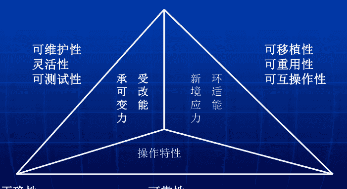

### 1.2.2 Boehm质量模型

- 1、Boehm质量模型见P6图1-2
- 2、Boehm质量模型的特点：
  - Boehm质量模型为分层结构。
  - Boehm质量模型包含了McCall模型中没有的硬件特性。
  - Boehm质量模型从软件的整体效用，并考虑了系统交付后不同类型的用户需求，因此，Boehm模型反映了对软件质量的全过程理解，即软件做了用户要它做的；有效地使用系统资源；易于用户学习和使用；易于测试和维护。

### 1.2.3 ISO/IEC9126质量模型

ISO/IEC9126质量模型分为3个：内部质量模型，外部质量模型和使用质量模型。外部和内部质量模型如下，使用中模型见P7图1-4

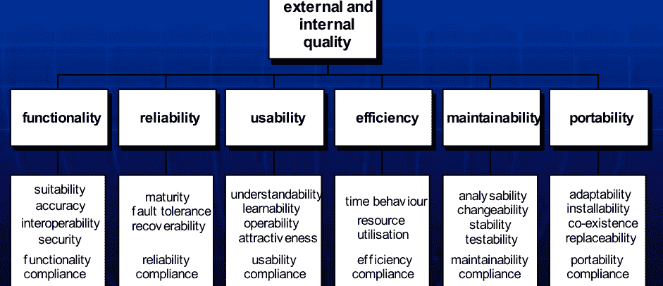

### 1.2.3 ISO/IEC9126质量模型

- 1、内部质量

内部质量是站在开发人员和质量保证人员的角度，从

内部观点出发评判软件产品的质量特性。

内部质量特征主要包括：可维护性、灵活性、可移植

性、可重用性、可读性、可测试性、可理解性。

### 1.2.3 ISO/IEC9126质量模型

## 2、外部质量

外部质量是站在开发人员和质量保证人员的角度，从外部观点出发评判软件产品的质量特性，即在预定的系统环境中运行时可能达到的质量水平。

外部质量特征主要包括：正确性、可用性、效率、可靠性、完整性、适应性、精确性、坚固性。

## 1.3 软件缺陷

本小节包含四个方面的内容：

- 1. 1.3.0 软件缺陷案例
- 2. 1.3.1 软件缺陷的定义
- 3. 1.3.2 软件缺陷产生的原因
- 4. 1.3.3 软件缺陷的分类

### 1.3.0 软件缺陷案例

- 案例1 美国迪斯尼公司的狮子王游戏软件bug
- 案例2 美国航天局火星登陆事故
- 案例3 跨世纪“千年虫”问题
- 案例4 爱国者导弹防御系统炸死自家人
- 案例5 Windows 2000 中文输入法漏洞
- 案例6 金山词霸bug
- 案例7 英特尔奔腾浮点除法缺陷

### 1.3.1 软件缺陷的定义

- 1、IEEE Standard 729 对软件缺陷的定义：见P8
- 2、袁玉宇的定义：见P8


### 1.3.2 软件缺陷产生原因

软件缺陷的产生是不可避免的，通过分析造成软件缺陷的原因可以归纳为如下三个方面：

(1) 技术问题

- 算法错误。
- 语法错误。
- 计算和精度问题。
- 系统结构不合理，造成系统性能问题。
- 接口参数不匹配出现问题。

3)软件本身

- 文档错误、内容不正确或拼写错误。
- 数据考虑不周全引起强度或负载问题。
- 对边界考虑不够周全，漏掉某几个边界条件造成的错误。
- 对一些实时应用系统，保证精确的时间同步，否则容易引起时间上不协调、不一致性带来的问题。
- 没有考虑系统崩溃后在系统安全性、可靠性的隐患。
- 硬件或系统软件上存在的错误。
- 软件开发标准或过程上的错误。

软件缺陷的组成

软件缺陷是由很多原因造成的，规格说明书是软件缺陷出现最多的地方，如下图：

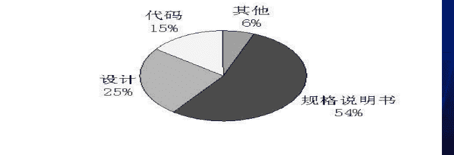

软件产品规格说明书为什么是软件缺陷存在最多的地方，主要原因有以下几种。

- 用户一般是非计算机专业人员，软件开发人员和用户的沟通存在较大困难，对要开发的产品功能理解不一致。
- 由于软件产品还没有设计、开发、完全靠想象去描述系统的实现结果，所以有些特性还不够清晰。
- 需求变化的不一致性。用户的需求总是在不断变化的，这些变化如果没有在产品规格说明书中得到正确的描述，容易引起前后文，上下文的矛盾。
- 对规格说明书不够重视，在规格说明书的设计和写作上投入的人力，时间不足。
- 没有在整个开发队伍中进行充分沟通，有时只有设计师或项目经理得到比较多的信息。

### 1.3.3 软件缺陷的分类

- 1. 软件缺陷的分类标准（6个）：
- ① 以出现相应错误的开发阶段来划分；
- ② 以造成的危害程度来划分；
- ③ 以解决难度来划分；
- ④ 以不解决会产生的风险来划分；
- ⑤ 根据异常出现的频率来划分。
- ⑥ 以产生的技术类型来分。

2、以造成的危害程度来划分： 见P11

3、以产生的技术类型来分： 见P11

# 补充内容：软件缺陷的特征

- “看不到”
  ——软件的特殊性决定了缺陷不易看到
- “看到但是抓不到”
  ——发现了缺陷，但不易找到问题发生的原因所在

# 补充内容：软件测试和缺陷修复的代价

软件在从需求、设计、编码、测试一直到交付用户公开使用后的过程中，都有可能产生和发现缺陷。随着整个开发过程的时间推移，更正缺陷或修复问题的费用呈几何级数增长。

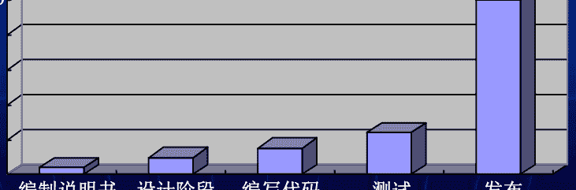

图1-4 软件缺陷在不同阶段发现时修复的费用示意图

# 小结

软件测试是提高软件质量的重要手段，软件测试的概念相对于软件质量而存在。软件质量是软件产品满足使用要求的程度，满足程度是由软件的特征和特征集决定的。软件缺陷是软件在生命周期各个阶段存在的一种不满足给定需求属性的问题。在开发阶段，有三次机会可能引入缺陷，并在开发的其他过程中将这些缺陷传播演变为其他缺陷。在修复缺陷时，是产生缺陷的又一个机会。

软件规格说明为什么是引入软件缺陷最多的地方。对软件缺陷进行分类，确定软件缺陷修复优先级是节约资源的最佳手段。

# （1）迪斯尼的狮子王游戏软件缺陷。

1994年秋天，迪斯尼公司发布了第一个面向儿童的多媒体光盘游戏——狮子王动画故事书（The Lion King Animated Storybook）。尽管已经有许多其他公司在儿童游戏市场上运作多年，但是这次是迪斯尼公司首次进军这个市场，所以进行了大量促销宣传。结果，销售额非常可观，该游戏成为孩子们那年节假日的“必买游戏”。然而后来却飞来横祸。12月26日，圣诞节的后一天，迪斯尼公司的客户支持电话开始响个不停。很快，电话支持技术员们就淹没在来自于愤怒的家长并伴随着玩不成游戏的孩子们哭叫的电话之中。报纸和电视新闻进行了大量的报道。

后来证实，迪斯尼公司未能对市面上投入使用的许多不同类型的PC机型进行广泛的测试。软件在极少数系统中工作正常——例如在迪斯尼程序员用来开发游戏的系统中——但在大多数公众使用的系统中却不能运行。

# （2）爱国者导弹防御系统缺陷

爱国者导弹防御系统是里根总统提出的战略防御计划（即星球大战计划）的缩略版本，它首次应用在海湾战争中对抗伊拉克飞毛腿导弹的防御战中。尽管对系统赞誉的报道不绝于耳，但是它确实在对抗几枚导弹中失利，包括一次在沙特阿拉伯的多哈击毙了28名美国士兵。分析发现症结在于一个软件缺陷，系统时钟的一个很小的计时错误积累起来到14小时后，跟踪系统不再准确。在多哈的这次袭击中，系统已经运行了100多个小时。

# (4) 美国航天局火星登陆探测器倾陷

1999年12月3日，美国航天局的火星极地登陆者号探测器试图在火星表面着陆时失踪。一个故障评估委员会调查了故障，认定出现故障的原因极可能是一个数据位被意外置位。最令人警醒的问题是为什么没有在内部测试时发现呢。

从理论上看，着陆的计划是这样的：当探测器向火星表面降落时，它将打开降落伞减缓探测器的下降速度。降落伞打开几秒钟后，探测器的三条腿将迅速展开，并锁定位置，准备着陆。当探测器离地面1800米时，它将丢弃降落伞，点燃着陆推进器，缓慢地降落到地面。

美国航天局为了省钱，简化了确定何时关闭着陆推进器的装置。为了替代其他太空船上使用的贵重雷达，他们在探测器的脚部装了一个廉价的触点开关，在计算机中设置一个数据位来控制触点开关关闭燃料。很简单，探测器的发动机需要一直点火工作，直到脚“着地”为止。

遗憾的是，故障评估委员会在测试中发现，许多情况下，当探测器的脚迅速撑开准备着陆时，机械震动也会触发着地触点开关，设置致命的错误数据位。设想探测器开始着陆时，计算机极有可能关闭着陆推进器，这样火星极地登陆者号探测器飞船下坠1800米之后冲向地面，撞成碎片。

结果是灾难性的，但背后的原因却很简单。登陆探测器经过了多个小组测试。其中一个小组测试飞船的脚展开过程，另一个小组测试此后的着陆过程。前一个小组不去注意着地数据是否置位——这不是他们负责的范围；后一个小组总是在开始复位之前复位计算机，清除数据位。双方独立工作都做得很好，但合在一起就不是这样了。

# （5）金山词霸缺陷

在国内，“金山词霸”是一个很著名的词典软件，应用范围极大，对使用中文操作的用户帮助很大，但它也存在不少缺陷。例如输入 “cube”，词霸会在示例中显示33=9的错误；又如，如果用鼠标取词 “dynamically”(力学，动力学)，词霸会出现其他不同的单词 “dynamite n.炸药”的显示错误。

# (6) 英特尔奔腾浮点除法缺陷

在计算机的“计算器”程序中输入以下算式：
（4195835/3145727）*3145727-4195835
如果答案是0，就说明计算机没问题。如果得出别的结果，就表示计算机使用的是带有浮点除法软件缺陷的老式英特尔奔腾处理器——这个软件缺陷被烧录在一个计算机芯片中，并在制作过程中反复生产。

1994年10月30日，弗吉利亚州Lynchburg学院的Thomas R .Nicely博士在他的一个实验中，用奔腾PC机解决一个除法问题时，记录了一个想不到的结果，得出了错误的结论。他把发现的问题放到因特网上，随后引发了一场风暴，成千上万的人发现了同样的问题，并且发现在另外一些情形下也会得出错误的结果。万幸的是，这种情况很少见，仅仅在进行精度要求很高的数学、科学和工程计算中才会导致错误。大多数用来进行税务处理和商务应用的用户根本不会遇到此类问题。

# 第2章 软件测试的基本概念

# 内容提要

本章包含三个方面的内容：

- 1. 2.1 软件测试的概念
- 2. 2.2 软件测试的分类
- 3. 2.3 软件测试的最佳实践

## 2.1 软件测试的概念

本小节包含两个方面的内容：

### 2.1.1 软件测试的定义

## 2.1.2 软件测试的目的

### 2.1.1 软件测试的定义

软件测试的研究可以追溯到20世纪60年代，至今已有40多年的历史，但是对于什么是软件测试，至今没有统一的定义，其中比较权威的是IEEE于1983年给出的定义：

软件测试是使用人工和自动手段来运行或测试某个系统的过程，其目的在于检验它是否满足规定的需求或弄清楚预期结果与实际结果之间的差别。——IEEE

### 2.1.1 软件测试的定义

另外一个常用的定义：

软件测试是为了尽快尽早地发现在软件产品中所存在的各种软件缺陷而展开的贯穿整个软件开发生命周期、对软件产品（包括阶段性产品）进行验证和确认的活动过程。

> ——《软件测试技术基础》


## 2.1.2 软件测试的目的

软件测试的目的是以最少的人力、物力和时间找出软件中潜在的各种错误和缺陷，通过修正各种错误和缺陷提高软件质量，回避软件发布后由于潜在的软件缺陷和错误造成的隐患所带来的商业风险。

## 本节结论

返回主目录

## 2.2 软件测试的分类

本小节包含四个方面的内容：

- 2.2.1 按测试技术上分类
- 2.2.2 按测试方式上分类
- 2.2.3 按测试阶段分类
- 2.2.4 按测试实施组织分类

### 2.2.1 按测试技术上分类

按测试技术，软件测试可以分为：

- 白盒测试技术
- 黑盒测试技术

### 1、白盒测试技术

通过对程序内部结构的分析、检测来寻找问题，即检查程序内部操作是否按规定执行，程序各个部分功能是否得到充分使用。白盒测试又称为结构测试或逻辑驱动测试。

### 2、黑盒测试技术

通过软件的外部表现来发现其缺陷和错误，即测试人员完全不考虑程序内部的逻辑结构和内部特性，只依据程序的需求规格说明书和用户手册，检查程序的功能是否符合它的功能说明，以及性能是否满足用户的要求。因此黑盒测试又叫功能测试或数据驱动测试。

### 2.2.2 按测试方式上分类

按测试方式上分类，软件测试分为：

- 静态测试
- 动态测试

### 1、静态测试

不执行被测试软件，而对需求分析说明书、软件设计说明书、源程序做结构检查、流程图分析等找出软件错误。静态测试可以人工进行分析，也可以由静态分析测试工具来自动分析，它将被测试程序的正文作为输入，经静态分析程序分析得出测试结果。

静态测试主要包括

- 代码检查
- 静态结构分析
- 程序复杂度度量

### 静态结构分析

静态结构分析主要是以图形的方式表现程序的内部结构，例如函数调用关系图、函数内部控制流图。其中：

- 函数调用关系图以直观的图形方式描述一个应用程序中各个函数的调用和被调用关系；
- 控制流图显示一个函数的逻辑结构，由许多节点组成，一个节点代表一条语句或数条语句，连接结点的叫边，边表示节点间的控制流向。

### 程序复杂度度量

为什么要对程序复杂度进行度量？

对程序复杂度进行度量的价值在于：

- 把程序复杂度乘以适当常数即可估算出软件中故障的数量及软件开发需要的工作量。
- 度量的结果可以用来比较两个不同设计或不同算法的优劣。
- 程序复杂度可以作为模块规模的精确限度。

### 程序复杂度度量（续）

针对程序复杂度，目前业界主要存在三种度量参数：

Line复杂度、Halstead复杂度和McCabe复杂度。简单介绍如下：

- Line复杂度以代码的行数作为计算的基准。
- Halstead以程序中使用到的运算符与运算元数量作为计数目标，然后可以据以计算出程序容量、工作量等。
- McCabe复杂度 一般称为圈复杂度，它将软件的流程图转化为有向图，然后以图论来衡量软件的质量。

执行被测程序，通过执行结果分析软件可能出现的错误。

即计算机必须真正运行被测试的程序，通过输入测试用例，对其运行情况即输入与输出的对应关系进行分析，以达到检测的目的。

### 2、动态测试

动态测试包括：

- 1. 功能确认与接口测试
- 2. 覆盖率分析
- 3. 性能分析
- 4. 内存分析

### 2.2.3 按测试阶段分类

按测试阶段分，软件测试分为：

- 单元测试
- 集成测试
- 系统测试
- 验收测试

### 1、单元测试

单元测试是对软件设计的最小单元——模块进行正确性检验的测试工作。

单元测试的目的：

主要是测试模块在语法、格式和逻辑上的错误。

### 2、集成测试

集成测试也称为组装测试，集成测试按设计要求把通过单元测试的各个模块组装在一起之后所进行的测试。

集成测试的目的：

检查模块间的接口关系，以便发现与接口有关的各种错误。

### 3、系统测试

系统测试是将已经集成好的软件系统置于实际运行环境中所进行的测试。

系统测试的目的：

根据需求分析时确定的标准检验软件是否满足功能、行为、性能和系统协调性等方面的要求。

### 4、确认测试

确认测试又称验收测试，是软件开发结束后，用户对软件产品投入实际应用前，进行的最后一次质量检验活动。它要回答开发的软件产品是否符合预期的各项要求，以及用户能否接受的问题。

确认测试的目的：

验证软件功能的正确性和需求的符合性。

### 2.2.4 按测试实施组织分类

按测试实施组织，软件测试可分为：

- 开发方测试
- 用户方测试
- 第三方测试

### 1、开发方测试

开发方测试也称内部测试，主要指在软件开发完成后，开发方要对提交的软件进行全面的自我检查与验证，验证软件的实现是否满足软件需求说明的要求。

### 2、用户方测试

用户方测试是在用户的应用环境下，由用户通过运行和使用软件，验证软件实现是否符合自己期望的要求。由用户找出软件的应用中发现的问题与缺陷，并对使用质量进行评价。

### 3、第三方测试

第三方测试又称为独立测试，由在技术、管理 and 财务上和开发方和用户方相对独立的组织进行的测试。软件质量工程强调开展独立的验证和确认工作。

## 补充内容：按测试目的分类

- 功能测试
- 健壮性测试
- 接口测试
- 性能测试
- 强度测试
- 压力测试
- 用户界面测试
- 安全测试
- 可靠性测试
- 安装/反安装测试
- 文档测试
- 恢复测试
- 兼容性测试

## 本节结论

返回主目录

## 2.3 软件测试的最佳实践（经验）

经验1、尽量由独立的测试人员进行测试

程序设计犹如艺术设计，开发者总是喜欢欣赏程序的成功之处，而不愿看到失败之处，让开发者去做“蓄意破坏”的测试，就像杀了自己的孩子一样难以接受，即便开发者非常诚实，但“珍爱程序”的心理让他在测试时不知不觉地带入虚假成分。

### 经验2 关键是注重测试用例的设计

测试工作的核心应该是测试用例的设计工作，而不是测试用例的执行，正如软件开发过程一样，软件开发的关键是软件系统的设计，而不是编码。

经验3 测试中的集群现象应当被充分的重视

经验表明，一段程序中若发现错误的数量越多，则此段

程序中残存的错误数量越多。

经验4、完全的测试是不可能的

原因：软件太复杂，资源不容许，“杀虫剂现象”等等。

措施：需要根据实际情况来决定资源的分配，对测试程度和范围进行有效的控制，只有这样才能投入最少的成本获得最大的回报。

软件缺陷障碍数量

测试工作量

遗漏缺陷数目

优化测试量

测试费用

测试中

测试后

测试工作量和软件缺陷数量之间的关系

经验5、修复缺陷后，一定要进行回归测试。

缺陷关联是是一种常见现象，某个缺陷会因为其他缺陷而出现或消失。

经验6：不能修复所有的软件故障

原因：没有足够的资源进行修复；修复的风险较大；不值得修复。

结论：关键是要进行正确的判断、合理的取舍，根据风险分析决定哪些故障必须修复，哪些故障可以不修复。

其他经验：

- 软件测试的目标在于揭示错误。测试人员要始终站在用户的角度去看问题。
- 软件测试必须基于“质量第一”的思想去开展各项工作。

其他经验：

- 事先定义好产品的质量标准。只有建立了质量标准，才能根据测试的结果，对产品的质量进行分析和评估。
- 软件项目一启动，软件测试也就开始，而不是等程序写完，才开始进行测试。


## 小结

- 软件测试是为了发现缺陷与错误，而且也是对软件质量进行度量和评估，以提高软件的质量。
- 证明、检测和预防已经成为测试的重要目标。
- 测试的分类。
- 软件测试的最佳实践。

## 杀虫剂现象

1990年，Boris Beizer在其编制的《软件测试技术》第2版中提出了“杀虫剂怪事”一词，用于描述软件测试越多，其免疫力越强的现象。这与农药杀虫剂是一样的，害虫最后就有抵抗力了，农药发挥不了效力。

为了克服杀虫剂现象，软件测试员就必须不断编写不同的新测试程序，对程序的不同部分进行测试，以找出更多的软件缺陷。

# 第3章 软件测试风险管理

## 导入

在软件测试中，即使很小的软件系统，也不可能对系统的所有方面进行测试。测试的不彻底导致软件交付潜藏着问题，一旦运行爆发，会带来很大的商业风险，这就是测试风险。

软件测试的风险管理的目的就是在于测试前对可能存在的缺陷或工作中导致测试无法有效执行的可能性进行分析，来合理安排测试资源活动。

## 导入（续）

美国IEEE829.1998《软件测试文档编制》标准中，在测试计划的模板中有一项为“风险与应急措施”。这表明软件测试风险的管理是很重要的工作。

## 内容提要

本章包含四个方面的内容：

- 1. 3.1 测试风险的基本概念
- 2. 3.2 测试风险识别技术
- 3. 3.3 测试风险分析
- 4. 3.4 测试计划风险的应对措施

## 3.1 测试风险的基本概念

本小节包含三个方面的内容：

- 3.1.0 风险与测试风险的概念
- 3.1.1 技术风险
- 3.1.2 管理风险

### 3.1.0 风险与测试风险的概念

什么是风险？

风险是指人们在生产建设和日常生活中遭遇能导致人身伤亡、财产损失的自然灾害、意外事故和不可测事件的可能性。


什么是测试风险？

在软件测试中，即使很小的软件系统，也不可能对系统的所有方面进行测试，即存在用户发现软件缺陷的可能性。

这就是测试风险。

测试风险的两个基本特征：

- 测试风险发生的可能性。
- 测试风险发生后的影响。

上述两个特征决定了对待测试风险的策略。

测试风险分为两类：

- 技术风险
- 管理风险

### 3.1.1 技术风险

软件项目采用的开发技术与开发平台是测试项目风险的重要来源之一，具体表现如下：

- 采用新技术或技术创新；
- 需求的变更及需求描述不清晰、需求的矛盾
- 使用了第三方代码也会存在技术风险。
- 系统的复杂度也是导致测试技术风险的重要原因。

### 3.1.2 管理风险

管理风险包括测试项目执行过程的各方面，如测试项目计划的时间、资源分配、测试项目的质量管理、测试管理流程、规范、工具等的采用以及测试外包商的管理等，具体如下：

- 开发中没有配置管理，软件系统和文件就有被错误覆盖的可能性；
- 缺乏经费和时间的测试；
- 异地开发和测试，缺乏交流；
- 测试员工之间存在矛盾；

## 本节结论

返回主目录

要想对测试风险进行有效的管理和处置，第一步就是需要识别出对测试项目会产生重大影响的测试风险，如何识别测试风险？常用的测试风险识别技术有哪些呢？

## 3.2 测试风险识别技术

本小节包含三个方面的内容：

- 3.2.1 头脑风暴法
- 3.2.2 访谈
- 3.2.3 风险识别法

### 3.2.2 访谈

所谓访谈就是向测试项目组内部和外部的资深专家进行关于风险的面谈有助于找出那些在常规计划中没有被识别的风险。

- 在访谈前，负责风险识别的人员（通常是测试经理）选择合适的访谈人员，事先向他们提供项目的有关背景知识、简要的项目情况介绍和其他一些必要的信息，如测试项目的一些约束条件。
- 在访谈过程中，这些被访谈的人员利用他们的资深背景及丰富的经验，在这些信息的基础上可以挖掘出一些以前没被发现的测试风险。

### 3.2.3 风险检查表

风险检查表就是是一个测试项目可能会遇到的风险列表。表的每一项都列出了可能会遇到的测试风险，风险识别人员对照表的每一项进行判断，逐个进行检查。

风险检查表的特点：

- 这个表最初是由组织中最有经验的人员创建的，表中列出的风险可能来源于过去曾经遭遇过的风险或者所经历过的危机。
- 风险检查表需要不断维护。

风险检查表的优点：简单、快速、容易理解，结果稳定；

风险检查表的缺点：更多的是继承过去，无法预防可能遇到的新的风险。

## 本节结论

返回主目录

## 3.3 测试风险分析

本小节包含五个方面的内容：

- 3.3.1 确定测试范围的功能点和性能属性
- 3.3.2 确定测试风险发生的可能性
- 3.3.3 确定测试风险发生后产生的影响程度
- 3.3.4 计算测试风险优先级
- 3.3.5 确定测试风险优先级

测试风险分析的目标

- 确定测试对象
- 确定测试优先级
- 确定测试深度

风险的分析过程

- 步骤1：确定测试范围的功能点和性能属性；
- 步骤2：确定测试风险发生的可能性；
- 步骤3：确定测试风险发生后产生的影响程度；
- 步骤4：计算测试风险优先级；
- 步骤5：确定测试风险优先级。

#### 3.3.1 确定测试范围的功能点和性能属性

- 1、如何确定测试范围的功能点和性能属性？ 见P23
- 2、以ATM为例，确定其功能点和性能属性： 见P23 表3-1

#### 3.3.2 确定测试风险发生的可能性

- 1、如何确定测试风险发生的可能性？ 见P23
- 2、以ATM为例，确定其功能点和性能属性的失效可能性： 见P24 表3-2

#### 3.3.3 确定测试风险发生后产生的影响程度

- 1、如何确定测试风险发生后产生的影响程度？ 见P24
- 2、以ATM为例，确定其功能点和性能属性的失效影响程度： 见P24 表3-3

#### 3.3.4 计算测试风险优先级

- 1. 如何计算测试风险优先级？ 见P25
- 2. 以ATM为例，计算测试风险优先级： 见P26 表3-4

#### 3.3.5 确定测试风险优先级

- 1、如何确定测试风险优先级？ 见P25
- 2、以ATM为例，确定测试风险优先级： 见P26 表3-5

## 本节结论

返回主目录

## 3.4 测试计划风险的应对措施

- 缩小范围
- 推迟实现
- 增加资源
- 减少质量过程

计划风险和应急措施样例一

计划风险样例

用户在软件生命周期的晚期提出一个重大需求变动。

应急措施样例 # 1

请求用户团体为测试工作提供更多的用户（即，增加更多的资源）。

应急措施样例 # 2

决定在进行后续发布之前不实现较低优先级的特征（即，缩小范围）。

应急措施样例 # 3

决定对在软件风险分析过程中确定的某些风险较低的特征不予测试（或者至少是少测试）（即，减少质量过程）。

计划风险和应急措施样例二

计划风险样例

项目的规模保持增长——这是一个双重打击。不仅因为项目规模的增长需要增加测试资源，而且，随着项目规模的增长，软件开发和测试的生产率一般都会降低。

应急措施样例 # 1

增加资源（比如外包、增加用户、增加开发员、批准加班）。

应急措施样例 # 2

缩小项目的范围。选择对用户进行渐进式交付的策略。

应急措施样例 # 3

减少对某些低风险模块的测试（即减少质量过程）。

应急措施样例 # 4

推迟实现。

## 本章小结

- 在软件测试中，不可能对系统的所有方面进行测试，会存在在用户发现缺陷的可能性，这就称为测试风险。
- 测试风险基本可分为以下两类：技术风险和工作风险。
- 测试风险识别活动是测试风险管理的第一步，通常使用的识别技术有：头脑风暴法、访谈和风险检查表。
- 风险的分析过程通常包括5个步骤：步骤1：确定测试范围的功能点和性能属性；步骤2：确定测试风险发生的可能；步骤3：确定测试风险发生后产生的影响程度；步骤4：计算测试风险优先级；步骤5：确定测试风险优先级。
- 可能存在的计划风险应急措施有：缩小范围；推迟实现；增加资源；减少质量过程。


# 第4章 测试过程概述

## 内容摘要

本章包含六个方面的内容：

- 4.1 常见测试过程模型
- 4.2 软件测试过程的体系结构
- 4.3 测试计划
- 4.4 测试用例的获取
- 4.5 执行测试（自学）
- 4.6 测试有效性的度量（自学）

## 4.1 常见测试过程模型

什么是软件测试过程模型？

软件测试过程模型是对测试过程一种抽象，用于定义软件测试的流程和方法。

软件测试过程模型将测试活动进行了抽象，并与开发活动有机的进行了结合，是测试过程管理的重要参考依据。

常见的软件测试过程模型有：

- V模型
- W模型
- H模型

## V模型

- **V模型的优点：**
  非常明确的标明了测试过程中存在的不同等级，并且清晰的描述了这些测试阶段和开发过程期间各阶段的对应关系。
- **缺点：**
  仅仅把测试作为在编码之后的一个阶段，是针对程序进行的寻找错误活动，而忽视了测试活动对需求分析，系统设计等活动的验证与确认的功能。
- 为了克服V模型的缺点，**Evolutif** 公司提出了W模型

## W模型

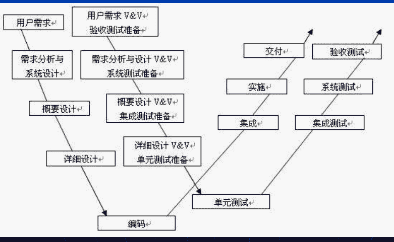

W模型的特点：

- W模型由两个V字型模型组成，分别代表测试与开发过程。
- W模型强调：测试伴随着整个软件开发周期，而且测试的对象不仅仅是程序，需求、设计等同样要测试，也就是说，测试与开发是同步进行的。

W模型局限性：

- W模型和V模型一样都把软件的开发视为需求、设计、编码等一系列串行的活动，而事实上，这些活动在大部分时间内是可以交叉进行的，所以相应的测试之间也不存在严格的次序关系。同时，各层次的测试也存在反复迭代的关系。
- 为了解决上述问题，有专家提出了H模型。

## H模型

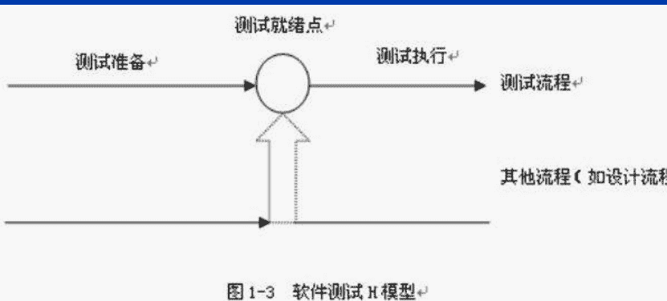

H模型的特点：

- H模型将测试活动完全独立出来，形成了一个完全独立的流程，将测试准备活动和测试执行活动清晰地体现出来。
- H模型揭示了软件测试是一个独立的流程，贯穿产品整个生命周期，与其他流程并发地进行。
- H模型指出软件测试要尽早准备，尽早执行。

## 本节结论

返回主目录

## 4.2 软件测试过程的体系结构

什么是软件测试过程的体系结构？

软件测试过程的体系结构是指软件测试过程的组成部分

及各部分之间的关系。

## 软件测试过程三大元素

| 测试人员 | 测试阶段 | 测试工作产品 |
| --- | --- | --- |
| 测试经理<br>测试分析师<br>测试技术员<br>测试评审员 | 测试计划阶段<br>测试用例获取阶段<br>测试有效性度量阶段 | 相关技术和管理文档<br>被测程序<br>测试数据<br>测试工具 |

本小节包含三个方面的内容：

- 4.2.1 软件测试人员
- 4.2.2 测试过程的分解
- 4.2.3 测试工作的产品

### 4.2.1 软件测试人员

| 角色 | 职责描述 |
| --- | --- |
| 经理 | 沟通、计划和协调 |
| 分析师 | 计划、列出清单、设计和评价 |
| 技术员 | 实现、执行和核查 |
| 评审员 | 检查和评价 |

### 4.2.2 测试过程的活动分解

整个软件测试过程可以分割成不同的等级（子过程）。

简单的项目可能只有一个或两个测试等级，比如单元测试和验收测试，而复杂的项目则可能是由多个等级构成，如：单元测试、子系统测试、系统测试、验收测试等等。

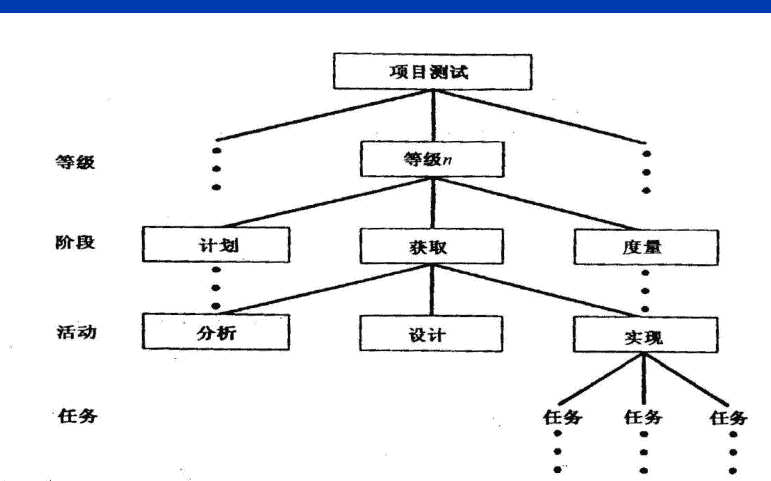

各个等级都包含3个主要阶段：

- 测试计划阶段
- 测试用例获取阶段
- 测试有效性度量阶段

这些阶段又进一步细分为8项主要活动，见P34表4-2

## 测试活动的时间安排

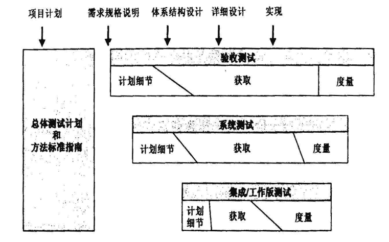

### 4.2.3 测试过程的工作产品

测试过程的主要工作产品有：

- ① 测试计划 重点
- ② 测试设计规格说明
- ③ 测试用例规格说明 重点
- ④ 测试规程规格说明
- ⑤ 测试日志
- ⑥ 测试意外事件报告
- ⑦ 测试总结报告

## 本节结论

返回主目录

## 4.3 测试计划

什么是测试计划？

测试计划就是描述所有要完成的测试工作，包括被测试项目的背景、目标、范围、方式、资源、进度安排、测试组织，以及与测试有关的风险等方面。

测试计划是通往成功软件测试的必经之路。

## 测试计划的重要性

- 测试计划是通往成功软件测试的必经之路。
- 制定测试计划是软件测试中最有挑战性的一个工作。

## 测试计划的种类

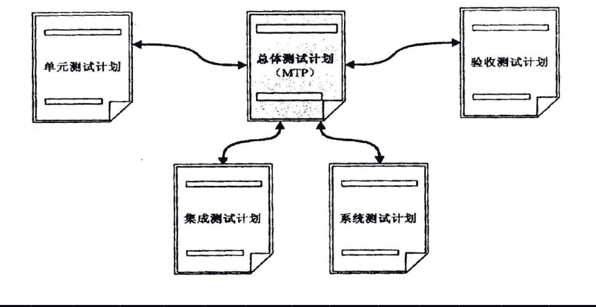

## 测试计划模板

IEEE829—1998软件测试文档编制标准测试计划模板：

见P36

大家将该模板仔细看5分钟，然后教师结合实例进行讲解

## 本节结论

返回主目录

## 4.4 测试用例的获取

本小节包含三个方面的内容：

- 4.4.1 测试设计规格说明
- 4.4.2 测试用例规格说明
- 4.4.3 测试规程规格说明

重点

## 测试设计规格说明与测试计划的关系

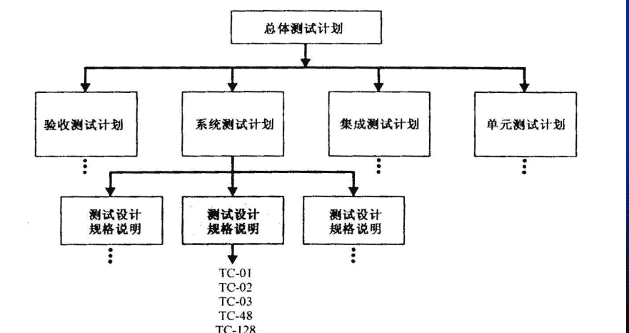

## 测试设计规格说明模板

IEEE 标准 829-1998 软件测试文档编制标准

测试设计规格说明模板

目录

- 1. 测试设计规格说明标识符
- 2. 待测特征
- 3. 方法细化
- 4. 测试标识
- 5. 特征通过/失败准则

## 测试用例规格说明与测试设计规格说明的关系

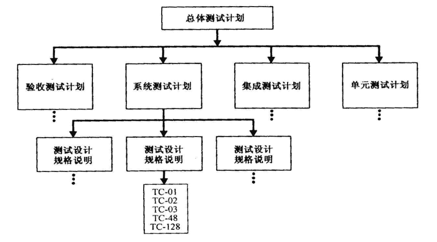

## 测试用例规格说明模板

IEEE 标准 829-1998 软件测试文档编制标准

测试用例规格说明模板

目录

- 1. 测试用例规格说明标识符
- 2. 测试项
- 3. 输入规格说明
- 4. 输出规格说明
- 5. 环境需求
- 6. 特殊规程需求
- 7. 用例间相关性

## 简化的测试用例规格说明

| 测试用例 | 特殊附注 | 输入 |  |  |  |  | 正常结果 |  |  |  |
|---|---|---|---|---|---|---|---|---|---|---|
|  |  | 变量 1 | 变量 2 | 变量 3 | …… |  | 变量 X | 变量 Y | 变量 Z | …… |
| TC0401 |  |  |  |  |  |  |  |  |  |  |
| TC0402 |  |  |  |  |  |  |  |  |  |  |
| TC0501 |  |  |  |  |  |  |  |  |  |  |
| …… |  |  |  |  |  |  |  |  |  |  |

## 本节结论

返回主目录

## 4.5 执行测试（自学）

本小节包含3个方面的内容：

- 4.5.1 测试日志
- 4.5.2 测试意外事件报告
- 4.5.3 测试总结报告

## 4.6 测试有效性的度量（自学）

本小节包含3个方面的内容：

- 4.5.1 客户满意度度量
- 4.5.2 缺陷度量
- 4.5.3 覆盖度量

## 度量测试的有效性

测试有效性的度量分类

客户满意度度量
• 调查
• 服务台接到的电话
• 被推荐，等等

缺陷度量
• 测试中发现缺陷
• 客户发现缺陷
• 严重程度、潜伏期、密度和分布

覆盖度量
• 代码
• 设计
• 需求

### 4.6.1 客户满意度度量

通过调查表调查

分析服务台接到的电话

### 4.6.2 缺陷度量

- 在测试中发现的缺陷量
- 缺陷消除率
- 缺陷潜伏期
- 缺陷损耗
- 缺陷密度


## 缺陷消除率

DRE = 测试期间发现的 bug 数量 / 测试期间发现的 bug 数量 + 未发现的 bug 数量

### 4.6.3 覆盖的度量

- ❖ 需求与设计覆盖
- ❖ 代码覆盖

## 需求与设计覆盖率样例

| 属性 | TC # 1 | TC # 2 | TC # 3 | TC # 4 | TC # 5 |
|---|---|---|---|---|---|
| 需求 1 | √ | √ |  | √ | √ |
| 需求 2 |  | √ |  |  | √ |
| 需求 3 |  |  | √ |  | √ |
| 需求 4 |  |  |  | √ | √ |
| 设计 1 | √ | √ |  | √ | √ |
| 设计 2 |  |  |  | √ | √ |
| 设计 3 |  | √ |  |  | √ |

## 代码覆盖率样例

| 语句 | 运行测试 |  |  | 覆盖与否 |
| --- | --- | --- | --- | --- |
|  | TR#1 | TR#2 | TR#3 |  |
| A | ✓ | ✓ | ✓ | 是 |
| B | ✓ |  | ✓ | 是 |
| C | ✓ |  |  | 是 |
| D |  |  |  | 否 |
| E |  |  | ✓ | 是 |
| 总计 | 60% | 20% | 60% | 80% |

## 本章小结

- ❖ 测试模型：V模型、W模型、H模型等。
- ❖ 软件测试过程包括三大要素：测试人员、测试阶段和测试工作产品。
- ❖ 测试计划编制过程应该是项目组成员的主要交流渠道之一。
- ❖ 测试设计规格说明、测试用例、测试规程规格说明、
- ❖ 测试执行的结果有：测试日志、测试意外事件报告、测试总结报告。
- ❖ 度量测试有效性有：用户满意度度量、缺陷度量和覆盖度量。

# 第5章 黑盒测试用例设计技术

## 内容提要

本小节包含以下六个方面的内容：

- - 5.1 等价类划分法
- - 5.2 边界条件法
- - 5.3 决策表法
- - 5.4 因果图法
- - 5.5 正交表测试法
- - 5.6 黑盒测试的其他方法

## 黑盒测试的概念

黑盒测试是把测试对象看做一个不能打开黑盒子，测试人员完全不考虑程序内部的逻辑结构和内部特性，只依据程序的需求规格说明书，检查程序的功能是否符合它的功能说明。

黑盒测试方法是在程序接口上进行测试。

## 测试用例的概念

测试用例：以发现软件缺陷为目的精心设计的一组测试数据和操作步骤。

例如：要测试下述程序的“求积”功能是否存在缺陷，我们可以设计如下的测试数据：

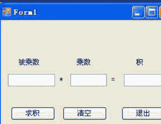

| 被乘数 | 乘数 | 期待的乘积 |
|---|---|---|
| 1 | 2 | 2 |
| 1.1 | 1.1 | 1.21 |
| ... | ... | ... |

这就是一个测试用例

测试用例可以简单的认为是如下元组：（输入，期望输出）

## 黑盒测试能够发现的错误

- - 是否有不正确或遗漏了的功能？
- - 在接口上，输入能否正确地接受？能否输出正确的结果？
- - 是否有外部信息(例如数据库或文件)访问错误？
- - 性能上是否能够满足要求？
- - 是否有初始化或终止性错误？

## 常用的黑盒测试方法

- - 等价类划分法
- - 边界值分析法
- - 因果图法
- - 决策表法
- - 正交表法
- - 场景法
- - 错误推测法
- - 功能图法

## 5.1 等价类划分法

- 等价类划分法是把程序的输入域划分成若干部分，然后从每个部分中选取少数代表性数据当作测试用例。
- 每一类的代表性数据在测试中的作用等价于这一类中的其他值，也就是说，如果某一类中的一个例子发现了错误，这一等价类中的其他例子也能发现同样的错误；反之，如果某一类中的一个例子没有发现错误，则这一类中的其他例子也不会查出错误。
- 使用这一方法设计测试用例，首先必须在分析需求规格说明的基础上划分等价类，列出等价类表。

## 等价类的类型

程序的输入域一般可以划分为两种等价类：

- (1) 有效等价类

——是指对软件规格说明而言，是有意义的、合理的输入数据所组成的集合。利用有效等价类，能够检验程序是否实现了规格说明中预先规定的功能和性能。

- (2) 无效等价类

——是指对软件规格说明而言，是无意义的、不合理的输入数据所构成的集合。利用无效等价类，可以鉴别程序异常处理的情况。

设计测试用例时，要同时考虑这两种等价类。因为软件不仅要能接收合理的数据，也要能经受意外的考验。这样的测试才能确保软件具有更高的可靠性。

## 如何划分等价类？

（1）按照区间划分

在输入条件规定了取值范围的情况下，可以确定一个有效等价类和两个无效等价类。

例：程序输入条件为小于100大于10的整数x，则有效等价类为10<x<100，两个无效等价类为x≤10和x≥100。

## 如何划分等价类？（续）

（2）按照数值划分

在规定了一组输入数据（假设包括 n 个输入值），并且程序要对每一个输入值分别进行处理的情况下，可确定 n 个有效等价类（每个值确定一个有效等价类）和一个无效等价类（所有不允许的输入值的集合）。

例：程序输入 x 取值为一个固定的枚举类型 {1,3,7,15}，且程序中对这 4 个数值分别进行了处理，则有效等价类为 x=1、x=3、x=7、x=15，无效等价类为 x≠1,3,7,15 的值的集合。

## 如何划分等价类？（续）

（3）按照数值集合划分

在输入条件规定了输入值的集合或规定了“必须如何”的条件下，可以确定一个有效等价类和一个无效等价类（该集合有效值之外）。

例：程序输入条件为取值为奇数的整数x，则有效等价类为x的值为奇数的整数，无效等价类为x的值不为奇数的整数。

## 如何划分等价类？（续）

（4）按照限制条件或规则划分

在规定了输入数据必须遵守的规则或限制条件的情况下，可确定一个有效等价类（符合规则）和若干个无效等价类（从不同角度违反规则）。

例：程序输入条件为以字符‘a’开头、长度为8的字符串，并且字符串不包含‘a’~‘z’之外的其它字符，则有效等价类为满足了上述所有条件的字符串，无效等价类为不以‘a’开头的字符串、长度不为8的字符串和包含了‘a’~‘z’之外其它字符的字符串。

## 如何划分等价类？（续）

（5）细分等价类

在确知已划分的等价类中各元素在程序中的处理方式

不同的情况下，则应再将该等价类进一步划分为更小的等价

类，并建立等价类表。

## 常见的等价类测试用例设计法

- 1. 弱一般等价类测试用例设计法
- 2. 强一般等价类测试用例设计法
- 3. 弱健壮等价类测试用例设计法
- 4. 强健壮等价类测试用例设计法
- 5. 等价类覆盖法测试用例设计法

## 案例1

对于函数F（X,Y）,其输入变量X和Y的取值边界定义如下：

X ∈ [a, b) U [b, c) [c, d] ; Y ∈ [e, f) U [f, g]

可得到X,Y的等价类如下表

| 输入变量 | 有效等价类 | 编号 | 无效等价类 | 编号 |
|---|---|---|---|---|
| X | [a, b) | 1 | X<a | 6 |
|  | [b, c) | 2 |  |  |
|  | [c, d] | 3 | X>d | 7 |
| Y | [e, f) | 4 | Y<e | 8 |
|  | [f, g] | 5 | Y>g | 9 |

试用前述几种等价类测试用例设计法设计测试用例

## 1、弱一般等价类测试用例设计法

测试用例从每个有效等价类中选取一个值

| 测试用例 | X | Y | 预期输出 |
|---|---|---|---|
| WR1 | Xab | Yef | F1 |
| WR2 | Xbc | Yfg | F2 |
| WR3 | Xcd | Yef | F3 |

从X的三个有效等价类中分别选一个值

从Y的两个有效等价类中分别选一个值

## 1、弱一般等价类测试用例设计法

用坐标图表示如下：

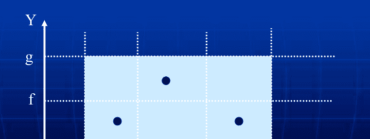

## 2、强一般等价类测试用例设计法

测试用例从有效等价类笛卡儿积中选取

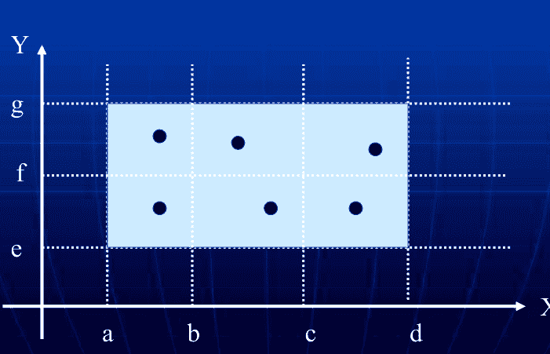

## 3、弱健壮等价类测试用例设计法

- ◆ 对于有效等价类,从每个有效等价类选取一个值。
- ◆ 对于无效等价类,使用一个无效值,并保持其余的值都是有效的

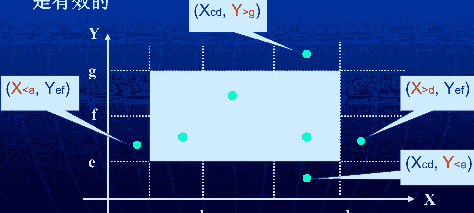


## 4、强健壮等价类测试用例设计法

测试用例从所有等价类(包括有效和无效等价类)笛卡儿乘积中选取

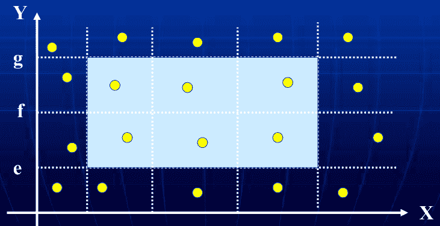

## 5、等价类覆盖法测试用例设计法

等价类覆盖法测试用例设计法设计测试用例的步骤如下：

- （1）首先为等价类表中的每一个等价类分别规定一个唯一的编号。
- （2）设计一个新的测试用例，使它能够尽量覆盖尚未覆盖的有效等价类。重复这个步骤，直到所有的有效等价类均被测试用例所覆盖。
- （3）设计一个新的测试用例，使它仅覆盖一个尚未覆盖的无效等价类。重复这一步骤，直到所有的无效等价类均被测试用例所覆盖。

为什么对有效等价类和无效等价类的覆盖方式不一样呢？

## 原因

- 对于有效等价类，采取尽量覆盖的方式是为了全面考察软件的功能。
- 对于无效等价类，采取每次只覆盖一个的方式是因为通常程序发现一类错误后就不再检查是否还有其他错误，因此，应当使每个测试用例只覆盖一个无效等价类。

## 5、等价类覆盖法测试用例设计法

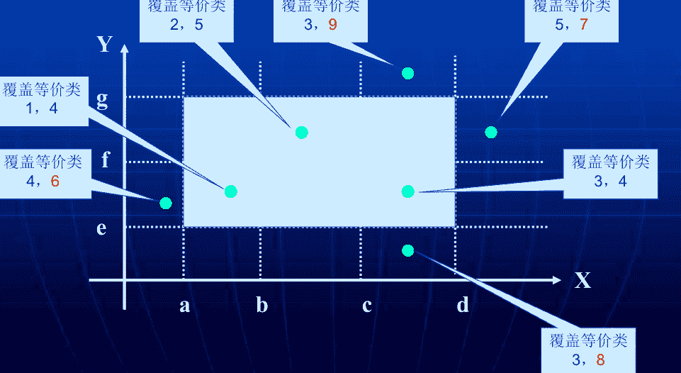

## 案例 2 NextDate问题

NextDate是一个有三个变量（月份、日期和年）的函数。函数返回输入日期后面的那个日期。

变量月份、日期和年都为整数，且满足以下条件：

- C1.1<=月份<=12
- C2.1<=日期<=31
- C3.1912<=年<=2012

试用前述几种等价类测试用例设计法设计测试用例

## 划分等价类

| 输入变量 | 有效等价类 | 编号 | 无效等价类 | 编号 |
|---|---|---|---|---|
| m | 1<=m<=12 | 1 | m<1 | 4 |
|  |  |  | m>12 | 5 |
| d | 1<=d<=31 | 2 | d<1 | 6 |
|  |  |  | d>31 | 7 |
| y | 1912<=y<=2012 | 3 | y<1912 | 8 |
|  |  |  | y>2012 | 9 |

## 1、弱一般等价类测试用例设计法

| 测试用例 | 月份 | 日期 | 年 | 预期输出 |
|---|---|---|---|---|
| T1 | 6 | 15 | 1912 | 1912年6月16日 |

## 2、强一般等价类测试用例设计法

强一般等价类测试用例和弱一般等价类测试用例相同。为什么？

## 3、弱健壮等价类测试用例设计法

| 测试用例 | 月份 | 日期 | 年 | 预期输出 |
|---|---|---|---|---|
| WR1 | 6 | 15 | 1912 | 1912年6月16日 |
| WR2 | -1 | 15 | 1912 | 月份不在有效值内 |
| WR3 | 13 | 15 | 1912 | 月份不在有效值内 |
| WR4 | 6 | -1 | 1912 | 日期不在有效值内 |
| WR5 | 6 | 32 | 1912 | 日期不在有效值内 |
| WR6 | 6 | 15 | 1811 | 年不在有效值内 |
| WR7 | 6 | 15 | 2013 | 年不在有效值内 |

## 4、强健壮等价类测试用例设计法

以下是部分强健壮等价类测试用例：

| 测试用例 | 月份 | 日期 | 年 | 预期输出 |
|---|---|---|---|---|
| SR1 | -1 | 15 | 1912 | 月份不在有效值内 |
| SR2 | 6 | -1 | 1912 | 日期不在有效值内 |
| SR3 | 6 | 15 | 1811 | 年不在有效值内 |
| SR4 | -1 | -1 | 1912 | 月份和日期不在有效值内 |
| SR5 | 6 | -1 | 1811 | 日期和年不在有效值内 |
| SR6 | -1 | 15 | 1811 | 月份和年不在有效值内 |
| SR7 | -1 | -1 | 1811 | 月份, 日期和年不在有效值内 |

## 5、等价类覆盖法测试用例设计法

| 测试用例 | 月份 | 日期 | 年 | 覆盖等价类编号 | 预期输出 |
|---|---|---|---|---|---|
| T1 | 6 | 15 | 1912 | 1, 2, 3 | 1912年6月16日 |
| T2 | -1 | 15 | 1912 | 4, 2, 3 | 月份不在有效值内 |
| T3 | 13 | 15 | 1912 | 5, 2, 3 | 月份不在有效值内 |
| T4 | 6 | -1 | 1912 | 1, 6, 3 | 日期不在有效值内 |
| T5 | 6 | 32 | 1912 | 1, 7, 3 | 日期不在有效值内 |
| T6 | 6 | 15 | 1811 | 1, 2, 8 | 年不在有效值内 |
| T7 | 6 | 15 | 2013 | 1, 2, 9 | 年不在有效值内 |

## 思考


对于NextDate问题还有其他的等价类划分方法吗？

## NextDate问题的另外一种等价类划分

年月日的有效等价类可为：

M1={月份:每月有30天}

M2={月份:每月有31天，12月除外}

M3={月份:此月是12月}

M4={月份:此月是2月}

D1={日期:1<=日期<=27}

D2={日期:日期=28}

D3={日期:日期=29}

D4={日期:日期=30}

D5={日期:日期=31}

Y1={年:年是闰年}

Y2={年:年是平年}

## 案例 3 三角形问题

输入三个整数 a、b、c，分别作为三角形的三条边，现通过程序判断由三条边构成的三角形的类型为等边三角形、等腰三角形、一般三角形，以及构不成三角形。

a、b、c，必须满足以下条件： a, b, c>0

试用前述几种等价类测试用例设计法设计测试用例。

## 划分等价类

(1)先根据输入限制条件粗分等价类

| 输入变量 | 有效等价类 | 无效等价类 |
|---|---|---|
| a | a>0 | a<0 |
| b | b>0 | b<0 |
| c | c>0 | c<0 |

## 划分等价类（续）

(2)再根据输出细分等价类（得到的等价类成为输出等价类）

| 输入变量 | 有效等价类 |  | 编号 | 无效等价类 | 编号 |
|---|---|---|---|---|---|
| a | a>0 | {a|a,b,c组成等边三角形} | 1 | a<0 | 5 |
|  |  | {a|a,b,c组成等腰三角形} | 2 |  |  |
|  |  | {a|a,b,c组成普通三角形} | 3 |  |  |
|  |  | {a|a,b,c不能构成三角形} | 4 |  |  |
| b | b>0 | {b|a,b,c组成等边三角形} | 1 | b<0 | 6 |
|  |  | {b|a,b,c组成等腰三角形} | 2 |  |  |
|  |  | {b|a,b,c组成普通三角形} | 3 |  |  |
|  |  | {b|a,b,c不能构成三角形} | 4 |  |  |
| c | c>0 | {c|a,b,c组成等边三角形} | 1 | c<0 | 7 |
|  |  | {c|a,b,c组成等腰三角形} | 2 |  |  |
|  |  | {c|a,b,c组成普通三角形} | 3 |  |  |
|  |  | {c|a,b,c不能构成三角形} | 4 |  |  |

## 1、弱一般等价类测试用例设计计划

| 测试用例 | a | b | c | 预期输出 |
|----------|---|---|---|---|
| WN1 | 5 | 5 | 5 | 等边三角形 |
| WN2 | 2 | 2 | 3 | 等腰三角形 |
| WN3 | 3 | 4 | 5 | 一般三角形 |
| WN4 | 4 | 1 | 2 | 不构成三角形 |

## 2、强一般等价类测试用例设计法

强一般等价类测试用例和弱一般等价类测试用例相同。为什么？

## 3、弱健壮等价类测试用例设计法

| 测试用例 | a | b | c | 预期输出 |
|---|---|---|---|---|
| WR1 | 5 | 5 | 5 | 等边三角形 |
| WR2 | 2 | 2 | 3 | 等腰三角形 |
| WR3 | 3 | 4 | 5 | 一般三角形 |
| WR4 | 4 | 1 | 2 | 不构成三角形 |

a,b,c取有效值

| 测试用例 | a | b | c | 预期输出 |
|---|---|---|---|---|
| WR5 | -1 | 5 | 5 | a值超出输入值定义域 |
| WR6 | 5 | -1 | 5 | b值超出输入值定义域 |
| WR7 | 5 | 5 | -1 | c值超出输入值定义域 |

注：a,b,c取无效值


## 4、强健壮等价类测试用例设计法

| 测试用例 | a | b | c | 预期输出 |
|---|---|---|---|---|
| SR1 | 5 | 5 | 5 | 等边三角形 |
| SR2 | 2 | 2 | 3 | 等腰三角形 |
| SR3 | 3 | 4 | 5 | 一般三角形 |
| SR4 | 4 | 1 | 2 | 不构成三角形 |

a,b,c取有效值

| 测试用例 | a | b | c | 预期输出 |
|---|---|---|---|---|
| SR5 | -1 | 5 | 5 | a取无效值 |
| SR6 | 5 | -1 | 5 | b取无效值 |
| SR7 | 5 | 5 | -1 | c取无效值 |
| SR8 | -1 | -1 | 5 | a、b取无效值 |
| SR9 | 5 | -1 | -1 | b、c取无效值 |
| SR10 | -1 | 5 | -1 | a、c取无效值 |
| SR11 | -1 | -1 | -1 | a、b、c取无效值 |

a,b,c取无效值

## 5、等价类覆盖法测试用例设计法

| 测试用例 | a | b | c | 覆盖等价类编号 | 预期输出 |
|---|---|---|---|---|---|
| Test1 | 5 | 5 | 5 | 1 | 等边三角形 |
| Test2 | 2 | 2 | 3 | 2 | 等腰三角形 |
| Test3 | 3 | 4 | 5 | 3 | 一般三角形 |
| Test4 | 4 | 1 | 2 | 4 | 不构成三角形 |
| Test5 | -1 | 5 | 5 | 5 | a值超出输入值定义域 |
| Test6 | 5 | -1 | 5 | 6 | b值超出输入值定义域 |
| Test7 | 5 | 5 | -1 | 7 | c值超出输入值定义域 |

## 思考

- 1、对于三角形问题，若规定0<a,b,c<200，如何用前述几种等价类测试用例设计法设计测试用例？
- 2、若把<a,b,c>当作一个整体考虑，如何根据程序输出确定其等价类（输出等价类），并用等价类覆盖法设计其测试用例？

## 案例 4 保险费率确定问题

某保险公司的人寿保险的保费率确定规则如下：保险费率依点数不同而有别，10点及10点以上保险费率为0.6%，10点以下保险费率为0.1%；而点数又是由投保人的年龄、性别、婚姻状况和抚养人数来决定，具体规则如下：

| 年龄 |  |  | 性别 |  | 婚姻 |  | 抚养人数 |
|---|---|---|---|---|---|---|---|
| 20~39 | 40~59 | 其它 | M | F | 已婚 | 未婚 | 1人扣0.5点 最多扣3点（四舍五入取整） |
| 6点 | 4点 | 2点 | 5点 | 3点 | 3点 | 5点 |  |

相关约束条件如下：

- 年龄：一位或两位非零整数，值的有效范围为1~99
- 性别：一位英文字符，只能取值‘M’或’ F’
- 婚姻：字符，只能取值‘已婚’或‘未婚’
- 抚养人数：空白或一位非零整数（1~9）
- 点数：一位或两位非零整数，值的范围为1~99

试用等价类覆盖法设计测试用例。

## 《软件测试与质量保证》课件

| 输入条件 | 有效等价类 | 编号 | 无效等价类 | 编号 |
|---|---|---|---|---|
| 年龄 | 20~39岁 | 1 |  |  |
|  | 40~59岁 | 2 |  |  |
|  | 1~19岁 60~99岁 | 3 | 小于1 | 11 |
|  |  |  | 大于99 | 12 |
| 性别 | 单个英文字符 ‘M’ | 4 | 非英文字符。 | 13 |
|  | 单个英文字符 ‘F’ | 5 | 非单个英文字符。 | 14 |
|  |  |  | 余 ‘M’和 ‘F’之外的其它单个英文字符。 | 15 |
| 婚姻 | 已婚 | 6 | 除 ‘已婚’和 ‘未婚’之外的其它字符 | 16 |
|  | 未婚 | 7 |  |  |
| 抚养人数 | 空白 | 8 | 除空白和数字之外的其它字符 | 17 |
|  | 1~6人 | 9 | 小于1 | 18 |
|  | 6~9人 | 10 | 大于9 | 19 |

## 《软件测试与质量保证》课件

| 测试用例编号 | 输入数据 |  |  |  | 覆盖等价类 | 预期输出 |
|---|---|---|---|---|---|---|
|  | 年龄 | 性别 | 婚姻 | 抚养人数 |  | 保险费率 |
| 1 | 27 | F | 未婚 | 空白 | 1, 5, 7, 8 | 0.6% |
| 2 | 50 | M | 已婚 | 2 | 2, 4, 6, 9 | 0.6% |
| 3 | 70 | F | 已婚 | 7 | 3, 5, 6, 10 | 0.1% |
| 4 | 0 | M | 未婚 | 空白 | 11, 4, 7, 8 | 无法推算 |
| 5 | 100 | F | 已婚 | 3 | 12, 5, 6, 9 | 无法推算 |
| 6 | 99 | 男 | 已婚 | 4 | 3, 13, 6, 9 | 无法推算 |
| 7 | 1 | Child | 未婚 | 空白 | 3, 14, 7, 8 | 无法推算 |
| 8 | 45 | N | 已婚 | 5 | 2, 15, 6, 9 | 无法推算 |
| 9 | 38 | F | 离婚 | 1 | 2, 5, 16, 9 | 无法推算 |
| 10 | 62 | M | 已婚 | 没有 | 3, 4, 6, 17 | 无法推算 |
| 11 | 18 | F | 未婚 | 0 | 3, 5, 7, 18 | 无法推算 |
| 12 | 40 | M | 未婚 | 10 | 2, 4, 7, 19 | 无法推算 |

## 等价类测试小结

- 等价类测试的弱形式不如对应的强形式的测试全面。
- 如果错误条件非常重要，则进行健壮性的测试是合适的。
- 在发现合适的等价类关系之前，可能需要进行多次尝试。

## 本节结论

返回主目录

## 5.2 边界值分析法

## 5.2 边界值分析法

什么是边界值分析法？

边界值分析法就是对输入或输出的边界值进行测试的一种黑盒测试方法。

通常边界值分析法是作为对等价类划分法的补充，这种情况下，其测试用例来自等价类的边界。

## 5.2 边界值分析法

为什么使用边界值分析法？

长期的测试工作经验告诉我们，大量的错误是发生在输入或输出范围的边界上，而不是发生在输入输出范围的内部。

因此针对各种边界情况设计测试用例，可以查出更多的错误。

例如：程序把<=误写成了<

## 如何确定边界值？——边界值分析

1）如果输入条件规定了值的范围，则应取刚达到这个范围的边界值，以及刚刚超越这个范围边界的值作为测试输入数据。

例如，如果程序的规格说明中规定：“重量在10公斤至50公斤范围内的邮件，其邮费计算公式为……” 。作为测试数据，我们应取10及50，还应取10.01、49.99、9.99及50.01等。

## 如何确定边界值？——边界值分析

2) 如果输入条件规定了值的个数,则用最大个数,最小个数,比最小个数少一,比最大个数多一的数作为测试数据。

比如，一个输入文件应包括1~255个记录，则测试数据可取1和255，还应取0及256等。

## 如何确定边界值？——边界值分析

3) 将规则1）和2）应用于输出条件，即设计测试用例使输出值达到边界值及其左右的值。

例如，某程序的规格说明要求计算出"每月保险金扣除额为0至1165.25元"，其测试用例可取0.00及1165.24、还可取一0.01及1165.26等。

再如，一程序属于情报检索系统，要求每次"最少显示1条、最多显示4条情报摘要"，这时我们应考虑的测试用例包括1和4，还应包括0和5等。

## 如何确定边界值？——边界值分析

- 4) 如果程序的规格说明给出的输入域或输出域是有序集合,则应选取集合的第一个元素和最后一个元素作为测试用例。
- 5) 特殊边界值：默认值、空值、空格、零、无效数据等。

## 如何确定边界值？——边界值分析

常见的边界值：

- 对16-bit 的整数而言 32767 和 -32768 是边界
- 屏幕上光标在最左上、最右下位置
- 报表的第一行和最后一行
- 数组元素的第一个和最后一个
- 循环的第 0 次、第 1 次和倒数第 2 次、最后一次

前面这些边界值我们可以从软件的规格说明或常识中得到。那还有没有从软件的规格说明中看不到的边界值呢？

## 另外一类边界值——内部边界值

有些边界值条件在软件内部，用户几乎看不到，但同时确实属于检验范畴内的边界条件，称为内部边界值条件或子边界值条件。

常见的内部边界值条件有下面两种：

- 数值的边界值
- 字符的边界值


## 内部边界值之一：数值的边界值

计算机是基于二进制进行工作的，因此，软件的任何数值运算都有一定范围限制。

## 计算机数值运算的范围

| 项 | 范围或值 |
| --- | --- |
| 位（bit） | 0 或 1 |
| 字节（byte） | 0 ~ 255 |
| 字（word） | 0~65535（单字）或 0~4294967295（双字） |

例如，一个程序有一个输入变量X的范围是（0，10000），但是在程序内部，当X<=255时，用一个字节表示，当X>255时用一个字表示，那么，255就是一个内部边界值。

## 内部边界值之二：字符的边界值

例如，某个文本框只接受字符A~Z，那么，字符“@”

和字符“[”就为内部边界值因为在ASCII表中@在A之前，

[在Z之后。

## 边界值分析小结

在实际的测试用例设计中，需要将基本的软件设计要求

和程序定义的要求结合起来，即结合基本边界值条件和内部

边界值条件来设计有效的测试用例。

## 边界条件测试用例设计法

- 一般边界条件测试用例设计法
- 健壮性边界条件测试用例设计法
- 最坏边界条件测试用例设计法
- 健壮最坏边界条件测试用例设计法

## 案例1

对于函数F（X1,X2）,其输入变量X1和X2的取值边界定义如下：

a≤X1 ≤ b ； c≤X2 ≤ d

边界条件坐标图如下,试用前述几种边界条件测试用例设计法设计测试用例

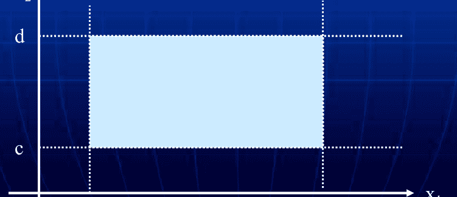

## 1、一般边界条件测试用例设计法

- (1) 每次保留程序中一个变量，让其余的变量取正常值，被保留的变量依次取min、min+、nom、max-和max。
- (2) 对程序中的每个变量重复 (1)

| 测试用例 | X1 | X2 | 预期输出 |
|---|---|---|---|
| T1 | X1nom | X2min | F1 |
| T2 | X1nom | X2min+ | F2 |
| T3 | X1nom | X2nom | F3 |
| T4 | X1nom | X2max- | F4 |
| T5 | X1nom | X2max | F5 |
| T6 | X1min | X2nom | F6 |
| T7 | X1min+ | X2nom | F7 |
| T8 | X1max- | X2nom | F8 |
| T9 | X1max | X2nom | F9 |

X1取正常值

X2依次取各种边界值

X1依次取各种边界值

X2取正常值

## 1、一般边界条件测试用例设计法

用坐标图表示如下：

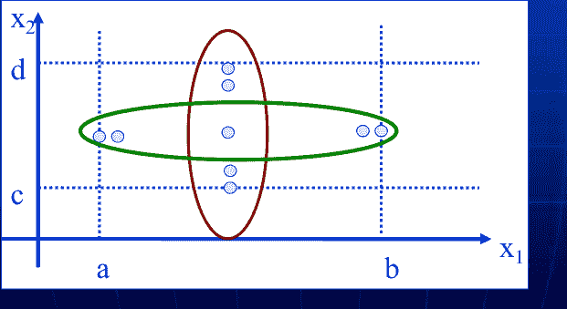

对于一个n变量函数，该方法生成的测试用例数为4n+1个

## 2、健壮性边界条件测试用例设计法

(1)每次保留程序中一个变量，让其余的变量取正常值，被保留的变量依次取min-1、 min、 min+、 nom、 max-、 max和max+1。

(2)对程序中的每个变量重复(1)

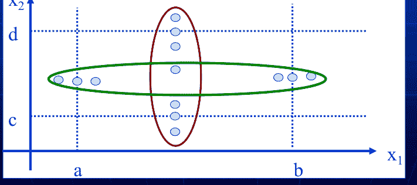

对于一个n变量函数，该方法生成的测试用例数为6n+1个

## 4、健壮最坏边界条件测试用例设计法

(1) 所有变量均可取min-1、min、min+、nom、max-、max和max+1这七个边界值中的任何一个。

(2) 测试用例为七个集合的笛卡儿乘积。

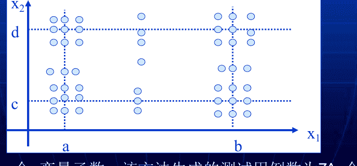

对于一个n变量函数，该方法生成的测试用例数为7^n个。

## 案例 2 三角形问题

假设三角形问题 a、b、c，必须满足以下条件：

1<= a, b, c <=200

试用前述几种边界条件测试用例设计法设计测试用例。

## 1、一般边界条件测试用例设计法

| 用例 | a | b | c | 预期输出 |
|---|---:|---:|---:|---|
| 1 | 100 | 100 | 1 | 等腰三角形 |
| 2 | 100 | 100 | 2 | 等腰三角形 |
| 3 | 100 | 100 | 100 | 等边三角形 |
| 4 | 100 | 100 | 199 | 非三角形 |
| 5 | 100 | 100 | 200 | 等腰三角形 |
| 6 | 100 | 1 | 100 | 等腰三角形 |
| 7 | 100 | 2 | 100 | 等腰三角形 |
| 8 | 100 | 199 | 100 | 等腰三角形 |
| 9 | 100 | 200 | 100 | 非三角形 |
| 10 | 1 | 100 | 100 | 等腰三角形 |
| 11 | 2 | 100 | 100 | 等腰三角形 |
| 12 | 199 | 100 | 100 | 等腰三角形 |
| 13 | 200 | 100 | 100 | 非三角形 |

## 2、健壮性边界条件测试用例设计法

| 用例 | a | b | c | 预期输出 |
|---|---|---|---|---|
| 1 | 100 | 100 | 0 | c超过取值范围 |
| 2 | 100 | 100 | 1 | 等腰三角形 |
| 3 | 100 | 100 | 2 | 等腰三角形 |
| 4 | 100 | 100 | 100 | 等边三角形 |
| 5 | 100 | 100 | 199 | 非三角形 |
| 6 | 100 | 100 | 200 | 等腰三角形 |
| 7 | 100 | 100 | 201 | c超过取值范围 |
| 8 | 100 | 0 | 100 | b超过取值范围 |
| 9 | 100 | 1 | 100 | 等腰三角形 |
| 10 | 100 | 2 | 100 | 等腰三角形 |
| 11 | 100 | 199 | 100 | 等腰三角形 |
| 12 | 100 | 200 | 100 | 非三角形 |
| 13 | 100 | 201 | 100 | b超过取值范围 |

注：a取边界值的测试用例未列入。

## 案例 3 NextDate问题

对于NextDate问题，试用前述几种边界条件测试用例设计法设计测试用例。

结果见P65

## 第1题参考答案

| 测试用例 | x | y | z | 预期输出 |
|---|---|---|---|---|
| TC1 | 1 | 10 | 10 | x值超出范围 |
| TC2 | 2 | 10 | 10 | 200 |
| TC3 | 3 | 10 | 10 | 300 |
| TC4 | 10 | 10 | 10 | 1000 |
| TC5 | 19 | 10 | 10 | 1900 |
| TC6 | 20 | 10 | 10 | 2000 |
| TC7 | 21 | 10 | 10 | x值超出范围 |
| TC8 | 10 | 1 | 10 | y值超出范围 |
| TC9 | 10 | 2 | 10 | 200 |
| TC10 | 10 | 3 | 10 | 300 |
| TC11 | 10 | 19 | 10 | 1900 |
| TC12 | 10 | 20 | 10 | 2000 |
| TC13 | 10 | 21 | 10 | y值超出范围 |
| TC14 | 10 | 10 | 1 | z值超出范围 |
| TC15 | 10 | 10 | 2 | 200 |
| TC16 | 10 | 10 | 3 | 300 |
| TC17 | 10 | 10 | 19 | 1900 |
| TC18 | 10 | 10 | 20 | 2000 |
| TC19 | 10 | 10 | 21 | z值超出范围 |

## 第2题 参考答案

划分等价类：（1）先根据输入限制条件粗分等价类

| 输入变量 | 有效等价类 | 无效等价类 |
| --- | --- | --- |
| <P, R> | 0<P<=100且0<R<=100且P>=R | P<=0
P>100
R<=0
R>100
P<R |

## 第2题 参考答案

划分等价类：（2）根据程序输出细分等价类，得到输出等价类

| 输入变量 | 有效等价类 |  |  | 无效等价类 |
|---|---|---|---|---|
| <P, R> | 0<P<=100 且 0<R<=100 且 P>=R | 50元的张数 | 有1张 | 没有 | P<=0 |
|  |  | 10元的张数 | 有1张到4张 | 没有 | P>100 |
|  |  | 5元的张数 | 有1张 | 没有 | R<=0 |
|  |  | 1元的张数 | 有1张到4张 | 没有 | R>100 |
|  |  |  |  |  | P<R |

分析得到边界值：
P={-1,0,100,101}; R={-1,0,100,101};{P=R, P=R+1,P=R-1}

50元刚好有1张， 50元刚好没有；

10元刚好有4张， 10元刚好有1张， 10元刚好没有；

5元刚好有1张， 5元刚好没有；

1元刚好有4张， 1元刚好有1张， 1元刚好没有；

根据张数的计算方法，可以去掉


## 《软件测试与质量保证》课件

### 测试用例

P的边界值

50元刚好有1张，50元刚好没有

这四个测试用例重复，可只保留两个

| 测试用例 | P | R | 余额 | 预期输出 |
|---|---|---|---|---|
| T1 | -1 | 50 |  | 超出范围 |
| T2 | 0 | 50 |  | 超出范围 |
| T3 | 100 | 50 | 50 | 1 |
| T4 | 101 | 50 |  | 超出范围 |
| T5 | 50 | -1 |  | 超出范围 |
| T6 | 50 | 0 |  | 超出范围 |
| T7 | 50 | 100 |  | 不可能 |
| T8 | 50 | 101 |  | 超出范围 |
| T9 | 50 | 51 |  | 不可能 |
| T10 | 50 | 50 | 0 | 0 |
| T11 | 50 | 49 | 1 | 1 |

| 测试用例 | P | R | 余额 | 预期输出 |
|---|---|---|---|---|
| T12 | 95 | 45 | 50 | 1 |
| T13 | 95 | 46 | 49 | 9 |
| T14 | 95 | 85 | 10 | 1 |
| T15 | 95 | 86 | 9 | 5 |
| T16 | 95 | 90 | 5 | 1 |
| T17 | 95 | 91 | 4 | 4 |
| T18 | 95 | 94 | 1 | 1 |
| T19 | 95 | 95 | 0 | 0 |

### 测试用例

| 测试用例 | P | R | 余额 | 预期输出 |
|---|---|---|---|---|
| T1 | -1 | 50 |  | 超出范围 |
| T2 | 0 | 50 |  | 超出范围 |
| T3 | 100 | 50 | 50 | 1 |
| T4 | 101 | 50 |  | 超出范围 |
| T5 | 50 | -1 |  | 超出范围 |
| T6 | 50 | 0 |  | 超出范围 |
| T7 | 50 | 100 |  | 不可能 |
| T8 | 50 | 101 |  | 超出范围 |
| T9 | 50 | 51 |  | 不可能 |

| 测试用例 | P | R | 余额 | 预期输出 |
|---|---|---|---|---|
| T10 | 95 | 45 | 50 | 1 |
| T11 | 95 | 46 | 49 | 9 |
| T12 | 95 | 85 | 10 | 1 |
| T13 | 95 | 86 | 9 | 5 |
| T14 | 95 | 90 | 5 | 1 |
| T15 | 95 | 91 | 4 | 4 |
| T16 | 95 | 94 | 1 | 1 |
| T17 | 95 | 95 | 0 | 0 |

### 作业

- 第一次作业：P28 3.1~3.4
- 第二次作业：P85 5.1, 5.2, 5.4

### 本节结论

返回主目录

## 5.3 决策表法

### 等价类划分法和边界值分析方法的局限性

等价类划分法和边界值分析方法比较适合输入变量或输入条件相互独立的情况，但是当输入变量或输入条件相互依赖、相互制约的时候，采用等价类划分法和边界值分析方法是难以描述的，测试效果也很难保障。

### 什么是决策表？

- 决策表也称判定表，是分析和表达多逻辑条件下执行不同操作的情况的工具。
- 决策表能够将复杂的问题按照各种可能的情况全部列举出来，简明并避免遗漏，设计出完整的测试用例集合。

### 决策表实例——“阅读指南”决策表

| 规则\选项 | 1 | 2 | 3 | 4 | 5 | 6 | 7 | 8 |
|---|---|---|---|---|---|---|---|---|
| 问题 你觉得疲倦吗？ | Y | Y | Y | Y | N | N | N | N |
| 问题 你对内容感兴趣吗？ | Y | Y | N | N | Y | Y | N | N |
| 问题 书中内容使你糊涂吗？ | Y | N | Y | N | Y | N | Y | N |
| 建议 请回到本章开头重读 |  |  |  |  | √ |  |  |  |
| 建议 继续读下去 |  |  |  |  |  | √ |  |  |
| 建议 跳到下一章去读 |  |  |  |  |  |  | √ | √ |
| 建议 停止阅读，请休息 | √ | √ | √ | √ |  |  |  |  |

### 决策表的组成


- 将任何一个条件组合的特定取值及相应要执行的动作称为一条规则。
- 在决策表中贯穿条件项和动作项的一列就是一条规则。

1. 条件桩——列出问题的所有条件。
2. 条件项——针对条件桩给出的条件，列出所有可能的取值。
3. 动作桩——列出问题规定的可能采取的操作。
4. 动作项——指出在条件项的各组取值情况下应采取的动作。

### 决策表的类型

决策表

- 有限条目决策表
  特点：所有条件都是二值条件（真/假）
- 扩展条目决策表
  特点：条件可以有多个值

### 决策表的简化

决策表的简化主要包含两个方面：规则合并与规则包含。

#### （1）规则合并

如果两条或多条规则的动作项相同，条件项只有一项不同，则可以将该项合并，合并后的条件项用符号“-”表示，说明执行的动作与该条件的取值无关，称为无关条件。

#### 规则合并实例——“阅读指南”决策表

| 规则\选项 | 1 | 2 | 3 | 4 | 5 | 6 | 7 | 8 |
|---|---|---|---|---|---|---|---|---|
| 问题 你觉得疲倦吗？ | Y | Y | Y | Y | N | N | N | N |
| 问题 你对内容感兴趣吗？ | Y | Y | N | N | Y | Y | N | N |
| 问题 书中内容使你糊涂吗？ | Y | N | Y | N | Y | N | Y | N |
| 建议 请回到本章开头重读 |  |  |  |  | √ |  |  |  |
| 建议 继续读下去 |  |  |  |  |  | √ |  |  |
| 建议 跳到下一章去读 |  |  |  |  |  |  | √ | √ |
| 建议 停止阅读，请休息 | √ | √ | √ | √ |  |  |  |  |

#### 规则合并实例——“阅读指南”决策表

| 规则\选项 | 1 | 3 | 5 | 6 | 7 |
|---|---|---|---|---|---|
| 问题 你觉得疲倦吗？ | Y | Y | N | N | N |
| 问题 你对内容感兴趣吗？ | Y | N | Y | Y | N |
| 问题 书中内容使你糊涂吗？ | — | — | Y | N | — |
| 建议 请回到本章开头重读 |  |  | √ |  |  |
| 建议 继续读下去 |  |  |  | √ |  |
| 建议 跳到下一章去读 |  |  |  |  | √ |
| 建议 停止阅读，请休息 | √ | √ |  |  |  |

#### 规则合并实例——“阅读指南”决策表

| 规则\选项 | 1 | 5 | 6 | 7 |
|---|---|---|---|---|
| 问题 你觉得疲倦吗？ | Y | N | N | N |
| 问题 你对内容感兴趣吗？ | — | Y | Y | N |
| 问题 书中内容使你糊涂吗？ | — | Y | N | — |
| 建议 请回到本章开头重读 |  | √ |  |  |
| 建议 继续读下去 |  |  | √ |  |
| 建议 跳到下一章去读 |  |  |  | √ |
| 建议 停止阅读，请休息 | √ |  |  |  |

#### （2）规则包含

见P71（自学）

### 决策表的建立步骤

1. 列出所有的条件桩和动作桩
2. 确定规则的个数
3. 填入条件项
4. 填入动作项
5. 简化决策表

### 案例1——三角形问题

对于三角形问题，设计其决策表，然后根据该决策表设计相应的测试用例。

#### 1. 列出所有的条件桩和动作桩

这一步是关键，如何得到三角形问题的“条件桩”和“动作桩”？

我们可以通过分析三角形问题的处理过程（即“业务逻辑”）得到：

- 当判断出 a=b=c 时，程序输出“等边三角形”。
- 当判断出 a=b 或 b=c 或 a=c 时，程序输出“等腰三角形”。
- 当 a!=b 且 b!=c 且 c!=a 时，程序输出“一般三角形”。

可以看出程序的输出由 a、b、c 之间是否相等的关系确定，即 a=b?、a=c?、b=c?，这样我们可以把 a=b?、a=c?、b=c? 当作条件桩，把程序的输出当作动作桩。


## 《软件测试与质量保证》课件
### 3 填入条件项
### 4 填入动作项

| 规则 | 1 | 2 | 3 | 4 | 5 | 6 | 7 | 8 | 9 | 10 | 11 | 12 | 13 | 14 | 15 | 16 |
|---|---|---|---|---|---|---|---|---|---|---|---|---|---|---|---|---|
| 桩 |  |  |  |  |  |  |  |  |  |  |  |  |  |  |  |  |
| C1:a,b,c构成三角形？ | F | F | F | F | F | F | F | F | T | T | T | T | T | T | T | T |
| C2:a=b？ | F | F | F | F | T | T | T | T | F | F | F | F | T | T | T | T |
| C3:a=c？ | F | F | T | T | F | F | T | T | F | F | T | F | F | F | T | T |
| C4:b=c？ | F | T | F | T | F | T | F | T | F | T | F | T | F | T | F | T |
| A1:非三角形 | √ | √ | √ | √ | √ | √ | √ | √ |  |  |  |  |  |  |  |  |
| A2:一般三角形 |  |  |  |  |  |  |  |  | √ |  |  |  |  |  |  |  |
| A3:等腰三角形 |  |  |  |  |  |  |  |  |  | √ | √ |  | √ |  |  |  |
| A4:等边三角形 |  |  |  |  |  |  |  |  |  |  |  |  |  |  |  | √ |
| A5:不可能 |  |  |  |  |  |  |  |  |  |  |  | √ |  | √ | √ |  |

## 《软件测试与质量保证》课件
### 5 简化决策表

| 规则 | 1 | 2 | 3 | 4 | 5 | 6 | 7 | 8 | 9 | 10 | 11 | 12 | 13 | 14 | 15 | 16 |
|---|---|---|---|---|---|---|---|---|---|---|---|---|---|---|---|---|
| 桩 |  |  |  |  |  |  |  |  |  |  |  |  |  |  |  |  |
| C1:a,b,c构成三角形？ | F | F | F | F | F | F | F | F | T | T | T | T | T | T | T | T |
| C2:a=b？ | F | F | F | F | T | T | T | T | F | F | F | F | T | T | T | T |
| C3:a=c？ | F | F | T | T | F | F | T | T | F | F | T | F | F | F | T | T |
| C4:b=c？ | F | T | F | T | F | T | F | T | F | T | F | T | F | T | F | T |
| A1:非三角形 | √ | √ | √ | √ | √ | √ | √ | √ |  |  |  |  |  |  |  |  |
| A2:一般三角形 |  |  |  |  |  |  |  |  | √ |  |  |  |  |  |  |  |
| A3:等腰三角形 |  |  |  |  |  |  |  |  |  | √ | √ |  | √ |  |  |  |
| A4:等边三角形 |  |  |  |  |  |  |  |  |  |  |  |  |  |  |  | √ |
| A5:不可能 |  |  |  |  |  |  |  |  |  |  |  | √ |  | √ | √ |  |

## 三角问题解决表

| 规则 | 1 | 2 | 3 | 4 | 5 | 6 | 7 | 8 | 9 |
|------|---|---|---|---|---|---|---|---|---|
| C1:a,b,c构成三角形? | F | T | T | T | T | T | T | T | T |
| C2:a=b? | - | F | F | F | F | T | T | T | T |
| C3:a=c? | - | F | F | T | T | F | F | T | T |
| C4:b=c? | - | F | T | F | T | F | T | F | T |
| A1:非三角形 | √ |  |  |  |  |  |  |  |  |
| A2:一般三角形 |  | √ |  |  |  |  |  |  |  |
| A3:等腰三角形 |  |  | √ | √ |  | √ |  |  |  |
| A4:等边三角形 |  |  |  |  |  |  | √ |  |  |
| A5:不可能 |  |  |  | √ | √ | √ |  |  |  |

## 根据决策表设计测试用例
（2）去掉不存在的情况：

| 用例 | a | b | c | 预期输出 |
|---|---|---|---|---|
| 1 | 1 | 2 | 4 | 非三角形 |
| 2 | 3 | 4 | 5 | 一般三角形 |
| 3 | 3 | 4 | 4 | 等腰三角形 |
| 4 | 4 | 3 | 4 | 等腰三角形 |
| 5 | 4 | 4 | 3 | 等腰三角形 |
| 6 | 3 | 3 | 3 | 等边三角形 |

## 案例2——NextDate问题
对于NextDate问题，设计其决策表，然后根据该决策表设计相应的测试用例。

## 列出所有的条件桩和行动桩
### 如何得到NextDate问题的“条件桩”和“行动桩”？
我们可以通过分析NextDate问题的处理过程（即“业务逻辑”）得到：
见下页

为了获得下一个日期，NextDate函数执行如下操作：
- 如果输入日期不是当月最后一天，则把day变量的值加1；
- 如果输入日期是1~11月份中某月的最后一天，则把day变量的值复位为1，month变量的值加1；
- 如果输入日期是12月的最后一天，则day变量和month变量的值都复位为1，year变量的值加1。

关于最后一天的判断：
- 如果是有31天的月份(1,3,5,7,8,10,12)，day=31为最后一天；
- 如果是有30天的月份(4,6,9,11)，day=30为最后一天；
- 如果是有29天的月份(闰年的2月)，day=29为最后一天；
- 如果是有28天的月份(非闰年的2月)，day=28为最后一天。

可见程序的动作主要是d，m，y的加1或复位，而这些操作又与d，m，y的特征有关。这样我们可以把d，m，y的加1或复位作为动作桩，d，m，y的特征作为条件桩。

## # 1列出所有的条件桩和行动桩
- **等价类**
- M1={月份:每月有30天}
- M2={月份:每月有31天,12月除外}
- M3={月份:此月是12月}
- M4={月份:此月是二月}
- D1={日期:1<=日期<=27}
- D2={日期:日期=28}
- D3={日期:日期=29}
- D4={日期:日期=30}
- D5={日期:日期=31}
- Y1={年:是闰年}
- Y2={年:是平年}

- **条件桩:**
- C1:月份在M1中
- C2:月份在M2中
- C3:月份在M3中
- C4:月份在M4中
- C5:日期在D1中
- C6:日期在D2中
- C7:日期在D3中
- C8:日期在D4中
- C9:日期在D5中
- C10:年是闰年
- C11:年是平年

- **动作桩:**
- A1:不可能
- A2:日期增1
- A3:日期复位(置1)
- A4:月份增1
- A5:月份复位(置1)
- A6:年增1

## 2 确定规则的个数
规则数？
2^11=2048
太大！

## 修改条件桩使有限条目决策表成为扩展条目决策表
等价类
M1={月份:每月有30天}
M2={月份:每月有31天,12月除外}
M3={月份:此月是12月}
M4={月份:此月是2月}
D1={日期:1<=日期<=27}
D2={日期:日期=28}
D3={日期:日期=29}
D4={日期:日期=30}
D5={日期:日期=31}
Y1={年:年是闰年}
Y2={年:年是平年}

条件桩：
C1:月份在{M1,M2,M3,M4}中之一
C2:日期在{D1,D2,D3,D4,D5}中之一
C3:年在{Y1,Y2}中之一

动作桩：
A1:不可能
A2:日期增1
A3:日期复位(置1)
A4:月份增1
A5:月份复位(置1)
A6:年增1


## 2 确定规则的个数

## 规则数？

4 × 5 × 2 = 40

## 3 填充条件项

## 4 填充动作项

## 5 简化决策表

| 规则\桩 | 1 | 2 | 3 | 4 | 5 | 6 | 7 | 8 | 9 | 10 |
|---|---|---|---|---|---|---|---|---|---|---|
| C1:月份在 | M1 | M1 | M1 | M1 | M1 | M2 | M2 | M2 | M2 | M2 |
| C2:日在 | D1 | D2 | D3 | D4 | D5 | D1 | D2 | D3 | D4 | D5 |
| C3:年在 | - | - | - | - | - | - | - | - | - | - |
| A1:不可能 |  |  |  |  | √ |  |  |  |  |  |
| A2:日增1 | √ | √ | √ |  |  | √ | √ | √ | √ | √ |
| A3:日复位 |  |  |  | √ |  |  |  |  |  | √ |
| A4:月增1 |  |  |  | √ |  |  |  |  |  | √ |
| A5:月复位 |  |  |  |  |  |  |  |  |  |  |
| A6:年增1 |  |  |  |  |  |  |  |  |  |  |

## 续表

| 规则\桩 | 11 | 12 | 13 | 14 | 15 | 16 | 17 | 18 | 19 | 20 | 21 | 22 |
|---|---|---|---|---|---|---|---|---|---|---|---|---|
| C1:月份在 | M3 | M3 | M3 | M3 | M3 | M4 | M4 | M4 | M4 | M4 | M4 | M4 |
| C2:日在 | D1 | D2 | D3 | D4 | D5 | D1 | D2 | D2 | D3 | D3 | D4 | D5 |
| C3:年在 | - | - | - | - | - | - | Y1 | Y2 | Y1 | Y2 | - | - |
| A1:不可能 |  |  |  |  |  |  |  |  |  | √ | √ | √ |
| A2:日增1 | √ | √ | √ | √ |  | √ | √ |  |  |  |  |  |
| A3:日复位 |  |  |  |  | √ |  |  | √ | √ |  |  |  |
| A4:月增1 |  |  |  |  |  |  |  | √ | √ |  |  |  |
| A5:月复位 |  |  |  |  | √ |  |  |  |  |  |  |  |
| A6:年增1 |  |  |  |  | √ |  |  |  |  |  |  |  |

## 课堂练习一

根据决策表，请写出NextDate函数的前9个测试用例：

| 用例ID | 月份 | 日期 | 年 | 预期输出 |
| --- | --- | --- | --- | --- |
| 1 |  |  |  |  |
| 2 |  |  |  |  |
| 3 |  |  |  |  |
| 4 |  |  |  |  |
| 5 |  |  |  |  |
| 6 |  |  |  |  |
| 7 |  |  |  |  |
| 8 |  |  |  |  |
| 9 |  |  |  |  |

## 根据决策表设计测试用例

| 用例ID | 月份 | 日期 | 年 | 预期输出 |
|---|---|---|---|---|
| 1--3 | 4 | 12/28/29 | 2001 | 2001年4月13/29/30日 |
| 4 | 4 | 30 | 2001 | 2001年5月1日 |
| 5 | 4 | 31 | 2001 | 不可能 |
| 6--9 | 1 | 15/28/29/30 | 2001 | 2001年1月16/29/30/31日 |
| 10 | 1 | 31 | 2001 | 2001年2月1日 |
| 11-14 | 12 | 15/28/29/30 | 2001 | 2001年12月16/29/30/31日 |
| 15 | 12 | 31 | 2001 | 2002年1月1日 |
| 16 | 2 | 15 | 2001 | 2001年2月16日 |
| 17 | 2 | 28 | 2004 | 2004年2月29日 |
| 18 | 2 | 28 | 2001 | 2001年3月1日 |
| 19 | 2 | 29 | 2004 | 2005年3月1日 |
| 20 | 2 | 29 | 2001 | 不可能 |
| 21,22 | 2 | 30/31 | 2001 | 不可能 |

## 课堂练习二

假设一个中国的航空公司规定：

- ❖ 中国去欧美的航线所有座位都有食物供应，每个座位都可以播放电影。
- ❖ 中国去非欧美的国外航线都有食物供应，只有商务仓可以播放电影。
- ❖ 中国国内的航班的商务仓有食物供应，但是不可以播放电影
- ❖ 中国国内的航班的经济仓除非飞行时间大于2小时就有食物供应，但是不可以播放电影。

请用决策表法设计测试用例。

## 1列出所有的条件桩和行动桩

- **条件桩：**
- - C1:航线为国外欧美航线
- - C2:航线为国外非欧美航线
- - C3:航线为国内航线
- - C4:仓位为商务仓
- - C5:仓位为经济仓
- - C6:飞行时间小于2h
- - C7:飞行时间大于等于2h

- **动作桩：**
- - A1:播放电影
- - A2:食物供应

## 2 确定规则的个数

## 规则数？

2^7=128

太大！

## 2 确定规则的个数

## 规则数？

3 × 2 × 2 = 12

## 5 简化决策表

| 规则 | 1 | 2 | 3 | 4 | 5 | 6 | 7 | 8 | 9 | 10 | 11 | 12 |
|---|---|---|---|---|---|---|---|---|---|---|---|---|
| 桩 |  |  |  |  |  |  |  |  |  |  |  |  |
| C1:航线在 | M1 | M1 | M1 | M1 | M2 | M2 | M2 | M2 | M3 | M3 | M3 | M3 |
| C2:仓位在 | D1 | D1 | D2 | D2 | D1 | D1 | D2 | D2 | D1 | D1 | D2 | D2 |
| C3:飞行时间在 | Y1 | Y2 | Y1 | Y2 | Y1 | Y2 | Y1 | Y2 | Y1 | Y2 | Y1 | Y2 |
| A1:播放电影 | √ | √ | √ | √ | √ | √ | √ | √ | √ | √ |  |  |
| A2:食物供应 | √ | √ | √ | √ | √ | √ | √ | √ | √ | √ | √ | √ |

## 简化后的决策表

| 桩 | 规则1 | 规则2 | 规则3 | 规则4 | 规则5 | 规则6 |
|---|---|---|---|---|---|---|
| C1: 航线在 | M1 | M2 | M2 | M3 | M3 | M3 |
| C2: 仓位在 | — | D1 | D2 | D1 | D2 | D2 |
| C3: 飞行时间在 | — | — | — | — | Y1 | Y2 |
| A1: 播放电影 | √ | √ | √ | √ |  |  |
| A2: 食物供应 | √ | √ | √ | √ | √ | √ |

## 基于决策表的测试的小结

- 1、决策表技术适用于具有以下特征的应用程序：
- ❖ If-then-else逻辑很突出。
- ❖ 条件和规则的顺序不影响执行哪些操作。
- ❖ 输入变量之间存在逻辑关系。
- ❖ 输入与输出之间存在因果关系。
- 2、如果使用有限条目决策表规则比较多时，可以转化为扩展条目决策表。
- 3、决策表的设计可能需要多次迭代才能得到满意的决策表。


我们知道，当被测对象的输入变量或输入条件相互依赖、相互制约的时候，适合用决策表法进行测试，那还有没有其他适合的方法呢？

## 5.4 因果图法

## 什么是因果图法？

因果图法是一种利用图解法分析输入的各种组合情况，从而设计测试用例的方法，它适合于检查程序输入条件的各种组合情况。


## 因果图的关系符号

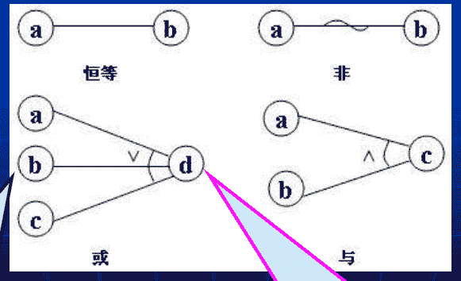

左边的节点表示原因

右边的节点表示结果

恒等、非、或、与的含义见P74


## 因果图的约束符号

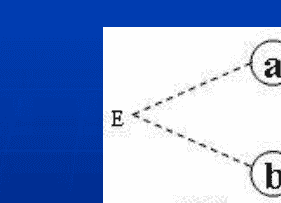

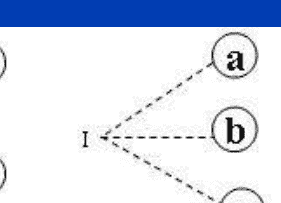

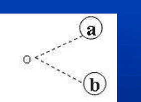


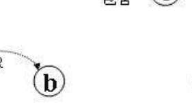

互斥（异）、包含（或）、唯一、要求、屏蔽（强制）的含义见P75

## 因果图法设计测试用例的步骤

利用因果图生成测试用例的基本步骤如下：

- （1）分析软件规格说明中哪些是原因（即输入条件或输入条件的等价类），哪些是结果（即输出条件），并给每个原因和结果赋予一个标识符。
- （2）分析软件规格说明中的语义，找出原因与结果之间、原因与原因之间对应的关系，根据这些关系画出因果图。
- （3）由于语法或环境的限制，有些原因与原因之间、原因与结果之间的组合情况不可能出现。为表明这些特殊情况，在因果图上用一些记号表明约束或限制条件。
- （4）把因果图转换为决策表。
- （5）根据决策表中的每一列设计测试用例。

## 因果图法示意图

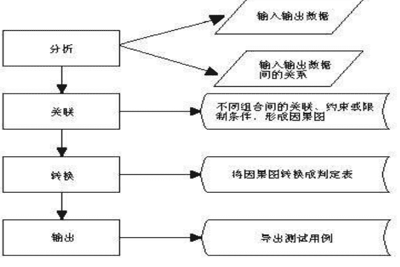

## 案例1

某软件规格说明书包含这样的要求：第一列字符必须是A或B，第二列字符必须是一个数字，在此情况下进行文件的修改，但如果第一列字符不正确，则给出信息N；如果第二列字符不是数字，则给出信息M。

用因果图法测试上述程序。

## 步骤1：分析原因和结果

根据题意，原因和结果如下：

| 原因 | 结果 |
|---|---|
| **c1：** 第一个字符是A | **e1：** 给出信息N |
| **c2：** 第一个字符是B | **e2：** 修改文件 |
| **c3：** 第二个字符是一个数字 | **e3：** 给出信息M |

某软件规格说明书包含这样的要求：第一列字符必须是A或B，第二列字符必须是一个数字，在此情况下进行文件的修改，但如果第一列字符不正确，则给出信息N；如果第二列字符不是数字，则给出信息M。

## 步骤2：画出因果图

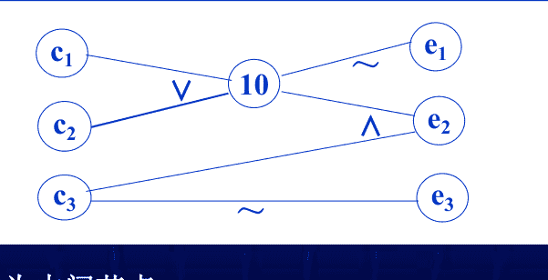

10为中间节点。

## 步骤3：施加相应的约束

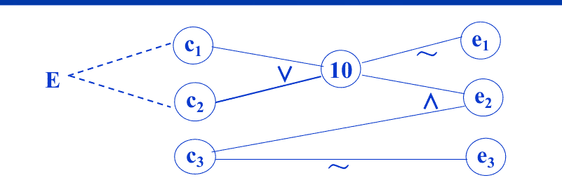

考虑到原因1和原因2不可能同时为1，因此在因果图上施加E约束； 10为中间节点。

## 步骤4 将因果图转换为决策表

|  | 规则 | 1 | 2 | 3 | 4 | 5 | 6 | 7 | 8 |
|---|---|---|---|---|---|---|---|---|---|
| 桩 |  |  |  |  |  |  |  |  | |
| 条件 | C₁ | 1 | 1 | 1 | 1 | 0 | 0 | 0 | 0 |
|  | C₂ | 1 | 1 | 0 | 0 | 1 | 1 | 0 | 0 |
|  | C₃ | 1 | 0 | 1 | 0 | 1 | 0 | 1 | 0 |
|  | 10 |  |  | 1 | 1 | 1 | 1 | 0 | 0 |
| 动作 | e₁ |  |  | 0 | 0 | 0 | 0 | 1 | 1 |
|  | e₂ |  |  | 1 | 0 | 1 | 0 | 0 | 0 |
|  | e₃ |  |  | 0 | 1 | 0 | 1 | 0 | 1 |
|  | 不可能 | 1 | 1 |  |  |  |  |  | |
| 测试用例 |  |  |  | A5 | A# | B9 | B? | X2 | Y% |

## 步骤5：根据决策表设计测试用例

| 编号 | 输入数据 | 预期输出 |
|---|---|---|
| TC1 | A5 | 修改文件 |
| TC 2 | A# | 给出信息M |
| TC 3 | B9 | 修改文件 |
| TC 4 | B? | 给出信息M |
| TC 5 | X2 | 给出信息N |
| TC 6 | Y% | 给出信息N和信息M |

## 案例2

例如，有一个饮料自动售货机（处理单价为5角钱）的控制处理软件，它的软件规格说明如下：

若投入5角钱的硬币，按下“橙汁”或“啤酒”的按钮，则相应的饮料就送出来。若投入1元钱的硬币，同样也是按“橙汁”或“啤酒”的按钮，则自动售货机在送出相应饮料的同时退回5角钱的硬币。

试绘制上述程序的因果图并转化为相应的决策表。

## 步骤1：分析原因和结果

根据题意，原因和结果如下：

| 原因 | 结果 |
| --- | --- |
| 1：投入1元硬币 | 21：退还5角硬币 |
| 2：投入5角硬币 | 22：送出“橙汁” |
| 3：按下“橙汁”按钮 | 23：送出“啤酒” |
| 4：按下“啤酒”按钮 |  |

若投入5角钱的硬币，按下“橙汁”或“啤酒”的按钮，则相应的饮料就送出来。若投入1元钱的硬币，同样也是按“橙汁”或“啤酒”的按钮，则自动售货机在送出相应饮料的同时退回5角钱的硬币。

## 步骤2：画出因果图

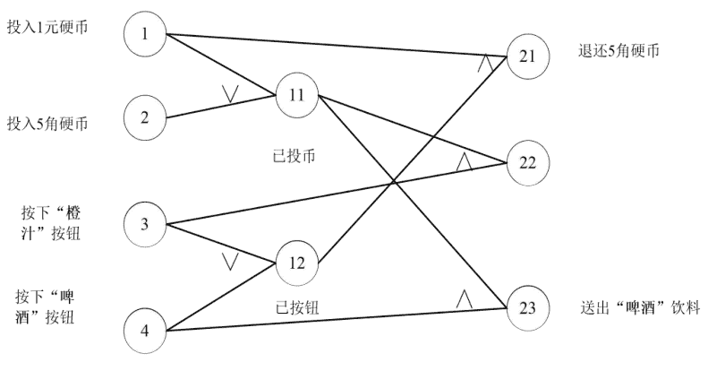

11、12为中间节点。

## 步骤3：施加相应的约束

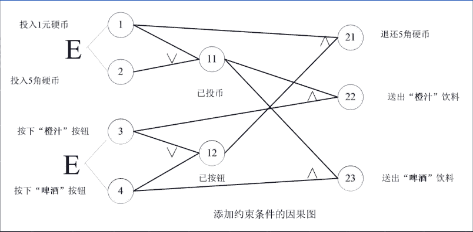

## 步骤4 将因果图转换为决策表

|  |  |  | 1 | 2 | 3 | 4 | 5 | 6 | 7 | 8 |
|---|---|---|---|---|---|---|---|---|---|---|
|  |  |  |  |  |  |  |  |  |  |  |
|  | 投入1元硬币 | 1 | 1 | 1 | 1 | 0 | 0 | 0 | 0 | 0 |
| 输入 | 投入5角硬币 | 2 | 0 | 0 | 0 | 1 | 1 | 1 | 0 | 0 |
|  | 按下橙汁 | 3 | 1 | 0 | 0 | 1 | 0 | 0 | 1 | 0 |
|  | 按下啤酒 | 4 | 0 | 1 | 0 | 0 | 1 | 0 | 0 | 1 |
| 中间节点 | 已按币 | 11 | 1 | 1 | 1 | 1 | 1 | 1 | 0 | 0 |
|  | 已按钮 | 12 | 1 | 1 | 0 | 1 | 1 | 0 | 1 | 1 |
| 输出 | 退还5角硬币 | 21 | 1 | 1 | 0 | 0 | 0 | 0 | 0 | 0 |
|  | 送出橙汁饮料 | 22 | 1 | 0 | 0 | 1 | 0 | 0 | 0 | 0 |
|  | 送出啤酒饮料 | 23 | 0 | 1 | 0 | 0 | 1 | 0 | 0 | 0 |

从因果图导出的判定表

## 案例3 三角问题

绘制三角问题的因果图并转化为相应的决策表。

## 步骤1: 分析原因和结果

根据题意，原因和结果如下：

| 原因 | 结果 |
|------|------|
| 1: A < B+C | 21: 不能构成三角形 |
| 2: B < A+C | 22: 等边三角形 |
| 3: C < A+B | 23: 等腰三角形 |
| 4: A = B | 24: 一般三角形 |
| 5: A = C |  |
| 6: B = C |  |

## 步骤2：画出因果图

| 原因 | 结果 |
| --- | --- |
| 1: A < B+C | 21: 不能构成三角形 |
| 2: B < A+C | 22: 等边三角形 |
| 3: C < A+B | 23: 等腰三角形 |
| 4: A = B | 24: 一般三角形 |
| 5: A = C |  |
| 6: B = C |  |

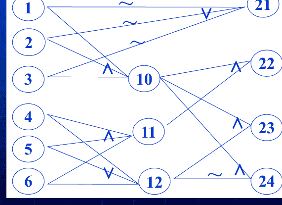

10、11、12为中间节点。

## 步骤3：施加相应的约束

| 原因 | 结果 |
| --- | --- |
| 1： A < B+C | 21： 不能构成三角形 |
| 2： B < A+C | 22： 等边三角形 |
| 3： C < A+B | 23： 等腰三角形 |
| 4： A = B | 24： 一般三角形 |
| 5： A = C |  |
| 6： B = C |  |

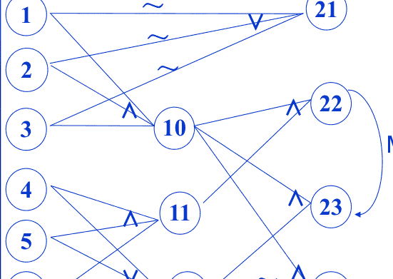

对于条件4：A = B，5：A = C，6：B = C，不可能两个成立，另一个不成立的约束如何添加？


## 重回步骤1：分析原因和结果

根据题意，原因和结果如下：

| 原因 | 结果 |
| --- | --- |
| 1: A < B+C | 21: 不能构成三角形 |
| 2: B < A+C | 22: 等边三角形 |
| 3: C < A+B | 23: 等腰三角形 |
| 4: A = B | 24: 一般三角形 |
| 5: A = C | 25: 不可能 |
| 6: B = C |  |

## 步骤2：画出因果图

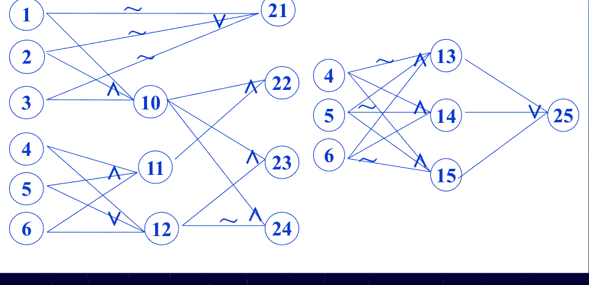

10、11、12、13、14、15为中间节点。

## 步骤3：施加相应的约束

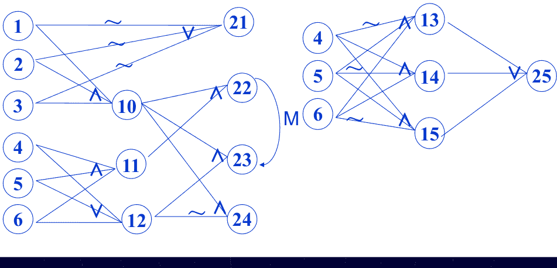

## 步骤4 将因果图转换为决策表

| 1:a<b+c? | F | T | T | T | T | T | T | T | T | T |
| 2:b<a+c? | - | F | T | T | T | T | T | T | T | T |
| 3:c<a+b? | - | - | F | T | T | T | T | T | T | T |
| 4:a=b? | - | - | - | T | T | T | T | F | F | F |
| 5:a=c? | - | - | - | T | T | F | F | T | T | F |
| 6:b=c? | - | - | - | T | F | T | F | T | F | T |
| 21:非三角形 | ✓ | ✓ | ✓ |  |  |  |  |  |  |  |
| 24:一般三角形 |  |  |  |  |  |  |  |  |  | ✓ |
| 23:等腰三角形 |  |  |  |  |  |  | ✓ | ✓ | ✓ |  |
| 22:等边三角形 |  |  |  | ✓ |  |  |  |  |  |  |
| 25:不可能 |  |  |  |  |  |  | ✓ | ✓ | ✓ |  |

## 步骤5 根据决策表设计测试用例

| 用例ID | a | b | c | 预期输出 |
|---|---|---|---|---|
| DT1 | 4 | 1 | 2 | 非三角形 |
| DT2 | 1 | 4 | 2 | 非三角形 |
| DT3 | 1 | 2 | 4 | 非三角形 |
| DT4 | 5 | 5 | 5 | 等边三角形 |
| DT5 | ? | ? | ? | 不可能 |
| DT6 | ? | ? | ? | 不可能 |
| DT7 | 2 | 2 | 3 | 等腰三角形 |
| DT8 | ? | ? | ? | 不可能 |
| DT9 | 2 | 3 | 2 | 等腰三角形 |
| DT10 | 3 | 2 | 2 | 等腰三角形 |
| DT11 | 3 | 4 | 5 | 一般三角形 |

## 课堂练习一

某软件的一个模块的需求规格说明书中描述：

+ （1）年薪制员工：严重过失，扣年终风险金的4%；过失，扣年终风险金的2%。
+ （2）非年薪制员工：严重过失，扣当月薪资的8%；过失，扣当月薪资的4%。
+ 请绘制出因果图和判定表，并给出相应的测试用例。

## 步骤1：分析原因和结果

根据题意，原因和结果如下：

| 原因 | 结果 |
| --- | --- |
| C1：年薪制员工 | A1：扣年终风险金的4% |
| C2：非年薪制员工 | A2：扣年终风险金的2% |
| C3：严重过失 | A3：扣当月薪资的8% |
| C4：过失 | A4：扣当月薪资的4% |

（1）年薪制员工：严重过失，扣年终风险金的4%；过失，扣年终风险金的2%。
（2）非年薪制员工：严重过失，扣当月薪资的8%；过失，扣当月薪资的4%。

## 步骤2：画出因果图

| 原因 | 结果 |
| --- | --- |
| C1：年薪制员工 | A1：扣年终风险金的4% |
| C2：非年薪制员工 | A2：扣年终风险金的2% |
| C3：严重过失 | A3：扣当月薪资的8% |
| C4：过失 | A4：扣当月薪资的4% |

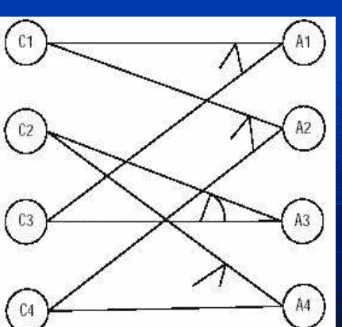

## 步骤3：施加相应的约束

| 原因 | 结果 |
| --- | --- |
| C1：年薪制员工 | A1：扣年终风险金的4% |
| C2：非年薪制员工 | A2：扣年终风险金的2% |
| C3：严重过失 | A3：扣当月薪资的8% |
| C4：过失 | A4：扣当月薪资的4% |

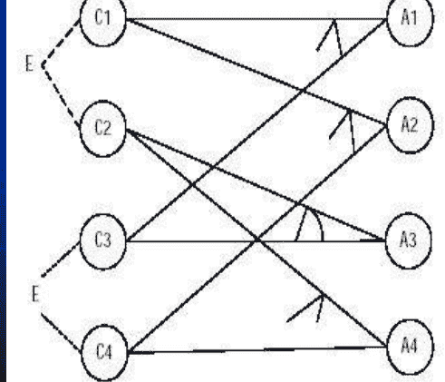

## 步骤4 将因果图转换为决策表

|  | 1 | 2 | 3 | 4 | 5 | 6 | 7 | 8 | 9 | 10 | 11 | 12 | 13 | 14 | 15 | 16 |
|---|---|---|---|---|---|---|---|---|---|---|---|---|---|---|---|---|
| c1:年薪制员工 | F | F | F | F | F | F | F | F | T | T | T | T | T | T | T | T |
| c2:非年薪制员工 | F | F | F | F | T | T | T | T | F | F | F | T | T | T | T | T |
| c3:严重过失 | F | F | T | T | F | T | T | F | F | T | T | F | F | T | T |  |
| c4:过失 | T | F | T | F | T | F | T | F | T | F | T | F | T | F | T | F |
| A1:扣年终风险金的4% |  |  |  |  |  |  |  |  |  |  |  | √ |  |  |  |  |
| A2:扣年终风险金的2% |  |  |  |  |  |  |  | √ |  |  |  |  |  |  |  |  |
| A3:扣当月薪资的8% |  |  |  |  |  |  | √ |  |  |  |  |  |  |  |  |  |
| A4:扣当月薪资的4% |  |  |  |  | √ |  |  |  |  |  |  |  |  |  |  |  |

## 课堂练习二

根据中国象棋中走马的规则绘制因果图，走马的规则如下

+ 1、如果落点在棋盘外，则不移动棋子；
+ 2、如果落点与起点不构成日字型，则不移动棋子；
+ 3、如果落点处有自己方棋子，则不移动棋子；
+ 4、如果在落点方向的邻近交叉点有棋子（绊马腿），则不移动棋子；
+ 5、如果不属于1-4条，且落点处无棋子，则移动棋子；
+ 6、如果不属于1-4条，且落点处为对方棋子(非老将)，则移动棋子并除去对方棋子；
+ 7、如果不属于1-4条，且落点处为对方老将，则移动棋子，并提示战胜对方，游戏结束。

## 步骤1：分析原因和结果

根据题意，原因和结果如下：

+ 原因：
+ 1、落点在棋盘外；
+ 2、落点与起点不构成日字；
+ 3、落点处有自己方棋子；
+ 4、落点方向的邻近交叉点有棋子（绊马腿）；
+ 5、落点处无棋子；
+ 6、落点处为对方棋子（非老将）；
+ 7、落点处为对方老将。

+ 结果：
+ 21、不移动棋子；
+ 22、移动棋子；
+ 23、移动棋子，并除去对方棋子；
+ 24、移动棋子，并提示战胜对方，结束游戏。

## 步骤1：分析原因和结果

+ 1、如果落点在棋盘外①，则不移动棋子（21）；
+ 2、如果落点与起点不构成日字型②，则不移动棋子（21）；
+ 3、如果落点处有自己方棋子③，则不移动棋子（21）；
+ 4、如果在落点方向的邻近交叉点有棋子（绊马腿）④，则不移动棋子（21）；
+ 5、如果不属于1-4条，且落点处无棋子⑤，则移动棋子（22）；
+ 6、如果不属于1-4条，且落点处为对方棋子(非老将)⑥，则移动棋子并除去对方棋子（23）；
+ 7、如果不属于1-4条，且落点处为对方老将⑦，则移动棋子，并提示战胜对方，游戏结束（24）。

## 步骤2：画出因果图

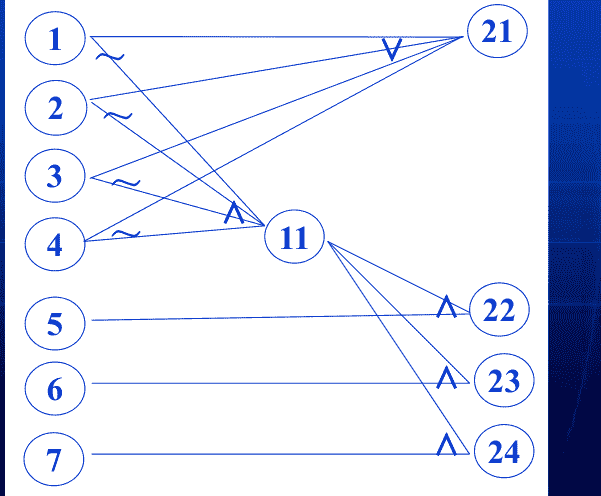

## 步骤3：施加相应的约束

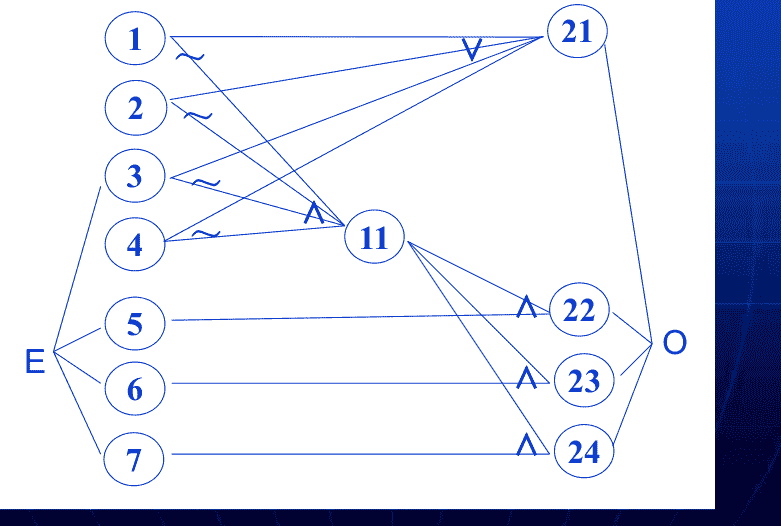

## 步骤4 将因果图转换为决策表

| | 1 | 2 | 3 | 4 | 5 | 6 | 7 | 8 | 9 | 10 | 11 | 12 | 13 | 14 | 15 | 16 |
|---|---|---|---|---|---|---|---|---|---|---|---|---|---|---|---|---|
| 原因 1 | 1 | 1 | 1 | 1 | 1 | 1 | 1 | 1 | 0 | 0 | 0 | 0 | 0 | 0 | 0 | 0 |
| 原因 2 | 1 | 1 | 1 | 1 | 0 | 0 | 0 | 0 | 1 | 1 | 1 | 1 | 0 | 0 | 0 | 0 |
| 原因 3 | 1 | 1 | 0 | 0 | 1 | 1 | 0 | 0 | 1 | 1 | 0 | 0 | 1 | 1 | 0 | 0 |
| 原因 4 | 1 | 0 | 1 | 0 | 1 | 0 | 1 | 0 | 1 | 0 | 1 | 0 | 1 | 0 | 1 | 0 |
| 结果 11 | 0 | 0 | 0 | 0 | 0 | 0 | 0 | 0 | 0 | 0 | 0 | 0 | 0 | 0 | 0 | 1 |
| 结果 21 | 1 | 1 | 1 | 1 | 1 | 1 | 1 | 1 | 1 | 1 | 1 | 1 | 1 | 1 | 1 | 0 |

| | 1 | 2 | 3 | 4 | 5 | 6 | 7 | 8 | 9 | 10 | 11 | 12 | 13 | 14 | 15 | 16 |
|---|---|---|---|---|---|---|---|---|---|---|---|---|---|---|---|---|
| 原因 11 | 1 | 1 | 1 | 1 | 1 | 1 | 1 | 1 | 0 | 0 | 0 | 0 | 0 | 0 | 0 | 0 |
| 原因 5 | 1 | 1 | 1 | 1 | 0 | 0 | 0 | 0 | 1 | 1 | 1 | 1 | 0 | 0 | 0 | 0 |
| 原因 6 | 1 | 1 | 0 | 0 | 1 | 1 | 0 | 0 | 1 | 1 | 0 | 0 | 1 | 1 | 0 | 0 |
| 原因 7 | 1 | 0 | 1 | 0 | 1 | 0 | 1 | 0 | 1 | 0 | 1 | 0 | 1 | 0 | 1 | 0 |
| 结果 22 |  |  |  | 1 |  | 0 | 0 |  |  |  |  | 0 |  | 0 | 0 | 0 |
| 结果 23 |  |  |  | 0 |  | 1 | 0 |  |  |  |  | 0 |  | 0 | 0 | 0 |
| 结果 24 |  |  |  | 0 |  | 0 | 1 |  |  |  |  | 0 |  | 0 | 0 | 0 |

通过中间节点将用例的判定表简化为两个小表。减少工作量。


## 因果图——小结

- 因果图法提供了一种把需求规格说明书转化为决策表的系统化方法。
- 额外的好处，就是可以指出规格说明的不完整性和不明确之处。

## 5.5 正交表测试法

## 正交表测试法的适用范围

正交表测试法适用于输入条件相互独立，并且需要对输入条件的各种组合进行测试的场合。

例如：假定一个Web站点，它部署的环境有以下几种情况：

- Web浏览器（Netscape 6.2、IE6.0、Opera 4.0）
- 插件（RealPlayer、MediaPlayer）
- 应用服务器（IIS、Apache、Netscape Enterprise）
- 操作系统（Windows2000、Windows NT、Linux）

我们要测试在各种环境下能否部署成功，如何测试？

## 什么是正交测试法？

- 正交测试源于正交试验设计方法，是从大量的数据中挑选适量的、有代表性的点，从而合理地安排测试的一种科学的试验设计方法。
- 正交测试法就是使用已经造好了的正交表格来安排试验并进行数据分析的一种方法。
- 它简单易行并且计算表格化，应用性较好。

## 正交表测试法的经典案例

- 1992年，AT&T发表了一篇讲述在测试过程中使用正交表一个案例研究。

- 它描述了对PC(IBM格式)和StarMail(基于局域网的电子邮件软件)做回归测试；最初制定的测试计划是用18周的时间执行1500个测试用例。但是，开发推迟了，测试时间被压缩到仅仅8周时间。测试负责人采取另外一个测试方案和计划，即2个人8周的时间测试1000个测试用例，但是他不敢保证测试的质量，对这些用例检测缺陷的能力不放心。为了减轻这种不确定性的问题，他用正交表法重新设计了测试用例，此时测试用例只有422个。用这422个测试用例去测试发现了41个缺陷，开发人员修复缺陷，然后软件就发布了。在使用的两年时间内，凡被测试到的领域都没有再发现缺陷，因此在发现缺陷这方面，此测试计划是100%有效。据测试负责人估计，如果AT&T采用1000个测试用例的测试计划，可能仅仅只发现这些缺陷中的32个

- 与最初的计划相比，用正交表设计测试用例执行工作量不到50%，但却多发现28%的缺陷，而且测试人员个人的效率也增加了（测试生产力(testing productivity)的因子是2.6，即每人每周发现的缺陷数）

## 什么是正交表？

在介绍正交表之前，现介绍三个重要概念：

- ❖ 什么是因素（Factor）
在一项试验中，凡欲考察的变量称为因素（变量）。
- ❖ 什么是水平（位级）（Level）
在试验范围内，因素被考察的值称为水平（变量的取值）。
- ❖ 什么是正交试验设计
是研究多因素多水平的一种设计方法，它是根据正交性从全面试验中挑选出部分有代表性的点进行试验，这些有代表性的点具备了“均匀分散，齐整可比”的特点，正交试验设计是一种基于正交表的、高效率、快速、经济的试验设计方法

## 什么是正交表？

正交表是一个二维表格，它的构成如下：

- **行数(Runs)**：正交表中的行的个数，即试验的次数。
- **因素数(Factors)**：正交表中列的个数。
- **水平数(Levels)**：任何单个因素能够取得的值的最大个数。正交表中的包含的值为从0到“水平数-1”或从1到“水平数”。
- **正交表的表示形式**：$L_{行数(水平数因素数)}$

## 正交表的一个实例： L8(2⁷)

|  |  | 列号 |  |  |  |  |  |  |
|---|---|---|---|---|---|---|---|---|
|  |  | 1 | 2 | 3 | 4 | 5 | 6 | 7 |
| 行号 | 1 | 1 | 1 | 1 | 1 | 1 | 1 | 1 |
|  | 2 | 1 | 1 | 1 | 0 | 0 | 0 | 0 |
|  | 3 | 1 | 0 | 0 | 1 | 1 | 0 | 0 |
|  | 4 | 1 | 0 | 0 | 0 | 0 | 1 | 1 |
|  | 5 | 0 | 1 | 0 | 1 | 0 | 1 | 0 |
|  | 6 | 0 | 1 | 0 | 0 | 1 | 0 | 1 |
|  | 7 | 0 | 0 | 1 | 1 | 0 | 0 | 1 |
|  | 8 | 0 | 0 | 1 | 0 | 1 | 1 | 0 |

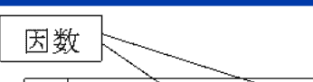

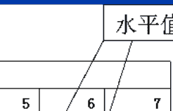

## 正交表的正交性

- 整齐可比性

在同一张正交表中，每个因素的每个水平出现的次数是完全相同的。由于在试验中每个因素的每个水平与其它因素的每个水平参与试验的机率是完全相同的，这就保证在各个水平中最大程度的排除了其它因素水平的干扰。因而，能最有效地进行比较和作出展望，容易找到好的试验条件。

- 均衡分散性

在同一张正交表中，任意两列（两个因素）的水平搭配（横向形成的数字对）是完全相同的。这样就保证了试验条件均衡地分散在因素水平的完全组合之中，因而具有很强的代表性。

## 正交测试用例设计步骤

- (1) 确定测试中有多少个相互独立的变量，这映射到表中的因素数（Factors）。
- (2) 确定每个变量可以取值的个数的最大数，这映射到表中的水平数（Levels）。
- (3) 选择一个次数（Run）数最少的最适合的正交表。一个最合适的正交表是至少满足第一步说明的因素数和第二步说明的水平数。
- (4) 把因素和值映射到表中。
- (5) 为剩下的水平数选取值。
- (6) 把次数中所描述的组合转化成测试用例，再增加一些没有生成的但可疑的测试用例。

## 如何查找正交表

- Technical Support (support.sas.com)
  http://support.sas.com/techsup/technote/ts723_Designs.txt
- 查Dr. Genichi Taguchi设计的正交表，
  http://www.york.ac.uk/depts/maths/tables/orthogonal.htm上面查询
- 数理统计、试验设计等方面的书及附录中
- 常用正交表

## 案例 1

假设一个网页有3个不同的部分（Top、Middle、Bottom），并且每个部分都可以单独显示及隐藏。要测试这三个不同部分的交互。按照前面给出的正交表测试用例设计步骤，设计该系统的正交表测试用例。

## 用例设计步骤

- (1) 确定有3个独立的变量（网页的3个部分）。
- (2) 每个变量能够取两个值（Hidden或Visible）。
- (3) 选择正交表L₄(2³)——变量为三因素，值为二水平，恰好相符。
- (4) 把变量的值映射到表中，其中Hidden=0，Visible=1。

## 正交用例表

L₄(2³)

| | 因素 1 | 因素 2 | 因素 3 |
|---|---|---|---|
| 次数 1 | 0 | 0 | 0 |
| 次数 2 | 0 | 1 | 1 |
| 次数 3 | 1 | 0 | 1 |
| 次数 4 | 1 | 1 | 0 |

## 因素映射之后

| | Top | middle | Bottom |
|---|---|---|---|
| 用例 1 | Hidden | Hidden | Hidden |
| 用例 2 | Hidden | Visible | Visible |
| 用例 3 | Visible | Hidden | Visible |
| 用例 4 | Visible | Visible | Hidden |

## 用例设计步骤（续）

（5）此种情况没有剩余的水平数，也就是说，表中的每一个水平都有一个值被映射过来。

（6）把表中每一行转换成测试用例，可以得到4个测试用例。这是测试3个变量成对交互时需要测试的内容。

## 测试用例描述

A. 隐藏这3部分。

B. 显示除Top部分外的其它部分。

C. 显示除Middle部分外的其它部分。

D. 显示除Bottom部分外的其它部分。

## 案例 2 —— 因素数不相同

单位基本信息查询页面的测试：


查询条件要么不填写，要么填写。

## 分析因素数和水平数

- ❖ 有五个因素（变量）：
- 音形码、拼音码、路名码、行业类别和特征码
- ❖ 每个因素有两个水平（变量值）：
- 音形码：填、不填
- 拼音码：填、不填
- 路名码：填、不填
- 行业类别：填、不填
- 特征码：填、不填


## 选择正交表

- 表中的因素数 >= 5
- 表中至少有五个因素的水平数 >= 2
- 行数取最少的一个
- 结果：L8(2^7)——因素不符，水平数相同。

## L8(2^7)

| 行号 | 1 | 2 | 3 | 4 | 5 | 6 | 7 |
|---|---|---|---|---|---|---|---|
| 1 | 1 | 1 | 1 | 1 | 1 | 1 | 1 |
| 2 | 1 | 1 | 1 | 0 | 0 | 0 | 0 |
| 3 | 1 | 0 | 0 | 1 | 1 | 0 | 0 |
| 4 | 1 | 0 | 0 | 0 | 0 | 1 | 1 |
| 5 | 0 | 1 | 0 | 1 | 0 | 1 | 0 |
| 6 | 0 | 1 | 0 | 0 | 1 | 0 | 1 |
| 7 | 0 | 0 | 1 | 1 | 0 | 0 | 1 |
| 8 | 0 | 0 | 1 | 0 | 1 | 1 | 0 |

## 变量映射

- 音形码：0→不填写，1→填写
- 拼音码：0→不填写，1→填写
- 路名码：0→不填写，1→填写
- 行业类别：0→不填写，1→填写
- 特征码：0→不填写，1→填写

| 行号 | 1 | 2 | 3 | 4 | 5 | 6 | 7 |
|---|---|---|---|---|---|---|---|
| 1 | 1 | 1 | 1 | 1 | 1 | 1 | 1 |
| 2 | 1 | 1 | 1 | 0 | 0 | 0 | 0 |
| 3 | 1 | 0 | 0 | 1 | 1 | 0 | 0 |
| 4 | 1 | 0 | 0 | 0 | 0 | 1 | 1 |
| 5 | 0 | 1 | 0 | 1 | 0 | 1 | 0 |
| 6 | 0 | 1 | 0 | 0 | 1 | 0 | 1 |
| 7 | 0 | 0 | 1 | 1 | 0 | 0 | 1 |
| 8 | 0 | 0 | 1 | 0 | 1 | 1 | 0 |

| 行号 | 音形码 | 拼音码 | 路名码 | 行业类别 | 特征码 |
|---|---|---|---|---|---|
| 1 | 填写 | 填写 | 填写 | 填写 | 填写 |
| 2 | 填写 | 填写 | 填写 | 不填 | 不填 |
| 3 | 填写 | 不填 | 不填 | 填写 | 填写 |
| 4 | 填写 | 不填 | 不填 | 不填 | 不填 |
| 5 | 不填 | 填写 | 不填 | 填写 | 不填 |
| 6 | 不填 | 填写 | 不填 | 不填 | 填写 |
| 7 | 不填 | 不填 | 填写 | 填写 | 不填 |
| 8 | 不填 | 不填 | 填写 | 不填 | 填写 |

## 测试用例描述

- 测试用例如下：
  - 音形码填写、拼音码填写、路名码填写、行业类别填写、特征码填写
  - 音形码填写、拼音码填写、路名码填写、行业类别不填、特征码不填
  - 音形码填写、拼音码不填、路名码不填、行业类别填写、特征码填写
  - 音形码填写、拼音码不填、路名码不填、行业类别不填、特征码不填
  - 音形码不填、拼音码填写、路名码不填、行业类别填写、特征码不填
  - 音形码不填、拼音码填写、路名码不填、行业类别不填、特征码填写
  - 音形码不填、拼音码不填、路名码填写、行业类别填写、特征码不填
  - 音形码不填、拼音码不填、路名码填写、行业类别不填、特征码填写
- 增补测试用例：
  - 音形码不填、拼音码填写、路名码不填、行业类别不填、特征码不填
  - 音形码不填、拼音码不填、路名码填写、行业类别不填、特征码不填
  - 音形码不填、拼音码不填、路名码不填、行业类别填写、特征码不填
  - 音形码不填、拼音码不填、路名码不填、行业类别不填、特征码填写
- 测试用例减少数：32→12

## 案例 3 —— 水平数不相同的情况

假设有一个系统有 5 个独立的变量（A，B，C，D，E）。变量 A 和 B 都有两个取值（A1、A2 和 B1、B2）。变量 C 和 D 都有三个可能的取值（C1、C2、C3 和 D1、D2、D3）。变量 E 有六个可能的取值（E1、E2、E3、E4、E5、E6）。

试用正交表法设计测试用例。

## 分析因素数和水平数

- 有五个因素（变量）：
  - A、B、C、D和E
- 两个因素有两个水平（变量的取值）、两个因素有三个水平，一个因素有六个水平
  - A：A1、A2
  - B：B1、B2
  - C：C1、C2、C3
  - D：D1、D2、D3
  - E：E1、E2、E3、E4、E5、E6

## 选择正交表

- 表中的因素数（变量）>=5
- 表中至少有二个因素的水平数（变量的取值）>=2
  - 至少有另外二个因素的水平数>=3
  - 还至少有另外一个因素的水平数>=6
- 行数取最少的一个（L49(7^8)、L18(3^6 6^1)）
- 结果：L18(3^6 6^1)

## L18(3^6 6^1)

| 行号 | 1 | 2 | 3 | 4 | 5 | 6 | 7 |
|---|---|---|---|---|---|---|---|
| 1 | 0 | 0 | 0 | 0 | 0 | 0 | 0 |
| 2 | 0 | 0 | 1 | 1 | 2 | 2 | 1 |
| 3 | 0 | 1 | 0 | 2 | 2 | 1 | 2 |
| 4 | 0 | 1 | 2 | 0 | 1 | 2 | 3 |
| 5 | 0 | 2 | 1 | 2 | 1 | 0 | 4 |
| 6 | 0 | 2 | 2 | 1 | 0 | 1 | 5 |
| 7 | 1 | 0 | 0 | 2 | 1 | 2 | 5 |
| 8 | 1 | 0 | 2 | 0 | 2 | 1 | 4 |
| 9 | 1 | 1 | 1 | 1 | 1 | 1 | 0 |
| 10 | 1 | 1 | 2 | 2 | 0 | 0 | 1 |
| 11 | 1 | 2 | 0 | 1 | 2 | 0 | 3 |
| 12 | 1 | 2 | 1 | 0 | 0 | 2 | 2 |
| 13 | 2 | 0 | 1 | 2 | 0 | 1 | 3 |
| 14 | 2 | 0 | 2 | 1 | 1 | 0 | 2 |
| 15 | 2 | 1 | 0 | 1 | 0 | 2 | 4 |
| 16 | 2 | 1 | 1 | 0 | 2 | 0 | 5 |
| 17 | 2 | 2 | 0 | 0 | 1 | 1 | 1 |
| 18 | 2 | 2 | 2 | 2 | 2 | 2 | 0 |

## 《软件测试与质量保证》课件

| 行号 | 1 | 2 | 3 | 4 | 5 | 6 | 7 |
|---|---|---|---|---|---|---|---|
| 1 | 0 | 0 | 0 | 0 | 0 | 0 | 0 |
| 2 | 0 | 0 | 1 | 1 | 2 | 2 | 1 |
| 3 | 0 | 1 | 0 | 2 | 2 | 1 | 2 |
| 4 | 0 | 1 | 2 | 0 | 1 | 2 | 3 |
| 5 | 0 | 2 | 1 | 2 | 1 | 0 | 4 |
| 6 | 0 | 2 | 2 | 1 | 0 | 1 | 5 |
| 7 | 1 | 0 | 0 | 2 | 1 | 2 | 5 |
| 8 | 1 | 0 | 2 | 0 | 2 | 1 | 4 |
| 9 | 1 | 1 | 1 | 1 | 1 | 1 | 0 |
| 10 | 1 | 1 | 2 | 2 | 0 | 0 | 1 |
| 11 | 1 | 2 | 0 | 1 | 2 | 0 | 3 |
| 12 | 1 | 2 | 1 | 0 | 0 | 2 | 2 |
| 13 | 2 | 0 | 1 | 2 | 0 | 1 | 3 |
| 14 | 2 | 0 | 2 | 1 | 1 | 0 | 2 |
| 15 | 2 | 1 | 0 | 1 | 0 | 2 | 4 |
| 16 | 2 | 1 | 1 | 0 | 2 | 0 | 5 |
| 17 | 2 | 2 | 0 | 0 | 1 | 1 | 1 |
| 18 | 2 | 2 | 2 | 2 | 2 | 2 | 0 |

| 行号 | A | B | C | D | S | （空） | E |
|---|---|---|---|---|---|---|---|
| 1 | A1 | B1 | C1 | D1 | 0 | 0 | E1 |
| 2 | A1 | B1 | C2 | D2 | 2 | 2 | E2 |
| 3 | A1 | B2 | C1 | D3 | 2 | 1 | E3 |
| 4 | A1 | B2 | C3 | D1 | 1 | 2 | E4 |
| 5 | A1 | B2 | C2 | D3 | 1 | 0 | E5 |
| 6 | A1 | B2 | C3 | D2 | 0 | 1 | E6 |
| 7 | A2 | B1 | C1 | D3 | 1 | 2 | E6 |
| 8 | A2 | B1 | C3 | D1 | 2 | 1 | E5 |
| 9 | A2 | B2 | C2 | D2 | 1 | 1 | E1 |
| 10 | A2 | B2 | C3 | D3 | 0 | 0 | E2 |
| 11 | A2 | B2 | C1 | D2 | 2 | 0 | E4 |
| 12 | A2 | B2 | C2 | D1 | 0 | 2 | E3 |
| 13 | A2 | B1 | C2 | D3 | 0 | 1 | E4 |
| 14 | A2 | B1 | C3 | D2 | 1 | 0 | E3 |
| 15 | A2 | B2 | C1 | D2 | 0 | 2 | E5 |
| 16 | A2 | B2 | C2 | D1 | 2 | 0 | E6 |
| 17 | A2 | B2 | C1 | D1 | 1 | 1 | E2 |
| 18 | A2 | B2 | C3 | D3 | 2 | 2 | E1 |


## 《软件测试与质量保证》课件

|   |   | 列号 |   |   |   |   |   |
|---|---|---|---|---|---|---|---|
|   |   | A | B | C | D | S | C | E |
| 行号 | 1 | A1 | B1 | C1 | D1 | 0 | 0 | E1 |
|   | 2 | A1 | B1 | C2 | D2 | 2 | 2 | E2 |
|   | 3 | A1 | B2 | C1 | D3 | 2 | 1 | E3 |
|   | 4 | A1 | B2 | C3 | D1 | 1 | 2 | E4 |
|   | 5 | A1 | 2 | C2 | D3 | 1 | 0 | E5 |
|   | 6 | A1 | 2 | C3 | D2 | 0 | 1 | E6 |
|   | 7 | A2 | B1 | C1 | D3 | 1 | 2 | E6 |
|   | 8 | A2 | B1 | C3 | D1 | 2 | 1 | E5 |
|   | 9 | A2 | B2 | C2 | D2 | 1 | 1 | E1 |
|   | 10 | A2 | B2 | C3 | D3 | 0 | 0 | E2 |
|   | 11 | A2 | 2 | C1 | D2 | 2 | 0 | E4 |
|   | 12 | A2 | 2 | C2 | D1 | 2 | 2 | E3 |
|   | 13 | 2 | B1 | C2 | D3 | 0 | 1 | E4 |
|   | 14 | 2 | B1 | C3 | D2 | 1 | 0 | E3 |
|   | 15 | 2 | B2 | C1 | D2 | 0 | 2 | E5 |
|   | 16 | 2 | B2 | C2 | D1 | 2 | 0 | E6 |
|   | 17 | 2 | 2 | C1 | D1 | 1 | 1 | E2 |
|   | 18 | 2 | 2 | C3 | D3 | 2 | 2 | E1 |

|   |   | 列号 |   |   |   |   |
|---|---|---|---|---|---|---|
|   |   | A | B | C | D | E |
| 行号 | 1 | A1 | B1 | C1 | D1 | E1 |
|   | 2 | A1 | B1 | C2 | D2 | E2 |
|   | 3 | A1 | B2 | C1 | D3 | E3 |
|   | 4 | A1 | B2 | C3 | D1 | E4 |
|   | 5 | A1 | B1 | C2 | D3 | E5 |
|   | 6 | A1 | B2 | C3 | D2 | E6 |
|   | 7 | A2 | B1 | C1 | D3 | E6 |
|   | 8 | A2 | B1 | C3 | D1 | E5 |
|   | 9 | A2 | B2 | C2 | D2 | E1 |
|   | 10 | A2 | B2 | C3 | D3 | E2 |
|   | 11 | A2 | B1 | C1 | D2 | E4 |
|   | 12 | A2 | B2 | C2 | D1 | E3 |
|   | 13 | A1 | B1 | C2 | D3 | E4 |
|   | 14 | A2 | B1 | C3 | D2 | E3 |
|   | 15 | A1 | B2 | C1 | D2 | E5 |
|   | 16 | A2 | B2 | C2 | D1 | E6 |
|   | 17 | A1 | B1 | C1 | D1 | E2 |
|   | 18 | A2 | B2 | C3 | D3 | E1 |

## 测试用例描述

- 测试用例： 见P83 表5-16
- 测试用例减少数： 216→18
- 加上一些可疑的情况（设为n个）为18+n它比原来也少多了

## 补充内容：正交表的由来

## 拉丁方名称的由来

- 古希腊是一个多民族的国家，国王在检阅臣民时要求每个方队中每行有一个民族代表，每列也要有一个民族的代表。
- 数学家在设计方阵时，以每一个拉丁字母表示一个民族，所以设计的方阵称为拉丁方

## 拉丁方和正交拉丁方的表述

- 什么是n阶拉丁方

用n个不同的拉丁字母排成一个n阶方阵（n<26），如果每行的n个字母均不相同，每列的n个字母均不相同，则称这种方阵为nXn拉丁方，或n阶拉丁方

- 什么是正交拉丁方

设有两个n阶的拉丁方，如果将它们叠合在一起，恰好出现n²个不同的有序数对，则称为这两个拉丁方为互相正交的拉丁方，简称正交拉丁方

## 3阶拉丁方

| A | B | C | A | B | C |
|---|---|---|---|---|---|
| B | C | A | 和 C | A | B |
| C | A | B | B | C | A |

把字母拉丁改为数字

| 1 | 2 | 3 | 1 | 2 | 3 |
|---|---|---|---|---|---|
| 2 | 3 | 1 | 和 3 | 1 | 2 |
| 3 | 1 | 2 | 2 | 3 | 1 |

| (1,1) | (2,2) | (3,3) |
|---|---|---|
| (2,3) | (3,1) | (1,2) |
| (3,2) | (1,3) | (2,1) |

## 正交拉丁方转化为正交表

若存在两个正交的t阶拉丁方，则可以在t²次试验中安排

4因素t水平，使得试验是正交的。做法是：按第一个拉丁方

依行、列、字母的顺序展开得到一个3列正交表，再将第二

拉丁方按字母的顺序展开添加为第四列。

## 课堂练习 一

例如： 假定一个Web站点，它部署的环境有以下几种情况：

- Web浏览器（Netscape 6.2、IE6.0、Opera 4.0）
- 插件（RealPlayer、MediaPlayer）
- 应用服务器（IIS、Apache、Netscape Enterprise）
- 操作系统（Windows2000、Windows NT、Linux）

我们要测试在各种环境下能否部署成功，试用正交表设计测试用例。

## 参考答案

## L₉(3⁴)

| runs | 浏览器 | 插件 | 信息服务器 | 操作系统 |
|---|---|---|---|---|
| 1 | Netscape | RealPlayer | IIS | Win2000 |
| 2 | Netscape | MediaPlayer | Apache | WinNT |
| 3 | Netscape | RealPlayer | Enterprise | Linux |
| 4 | IE | RealPlayer | Apache | Linux |
| 5 | IE | MediaPlayer | Enterprise | Win2000 |
| 6 | IE | MediaPlayer | IIS | WinNT |
| 7 | Opera | RealPlayer | Enterprise | WinNT |
| 8 | Opera | MediaPlayer | IIS | Linux |
| 9 | Opera | RealPlayer | Apache | Win2000 |

## 课堂练习 二

内部邮件系统测试：

收件人...

接收部门...

主题

内容

签名

SYS

- 发送
- 保存
- 返回

附件

选择

浏览...

上传

取消

## 测试时各条件的取值如下：

- 收件方（收件人、收件部门）
- 内容标题（可以填写，可以不填写）
- 邮件内容（可以填写，可以不填写）
- 落款人（可以填写，可以不填写）
- 附件（可以添加附件，可以不添加）

## 参考答案

L₈(2⁷)

## 正交测试法小结

- 节约测试工作工时；
- 可控制生成的测试用例的数量；
- 测试用例具有一定的覆盖率。

## 5.6 黑盒测试的其他方法

## 黑盒测试的其他方法

### 1、特殊值测试

特殊值测试就是指定软件中某些特殊值为测试用例而对软件实施的测试。这些特殊值并不是根据某种方法推导出来的，而是根据测试人员的知识和经验得到的。通常情况下，特殊值测试人员都会从过去发生过的失效的事件，或者总会出现问题的情况，或者对于用户来说十分重要的事件中寻找特殊值。

## 黑盒测试的其他方法

### 2、故障猜测法

根据经验和直觉猜测软件中可能存在的各种故障，从而有针对性地编写测试这些故障的测试用例。

### 3、随机测试

对于给定的被测软件系统和软件系统的定义域，按照定义域中样本取值的概率，随机的选择其样本并作为其测试数据的过程称为随机测试。


## 综合案例 P86

一个假设的保险金计算程序，根据两个因素计算半年保险金：投保人的年龄和驾驶历史纪录：

保险金=基本保险费率×年龄系数−安全驾驶折扣

年龄系数是投保人年龄的函数，如果投保人驾驶执照上的当前点数（根据交通违规次数确定）不高于与年龄有关的门限，则给予安全驾驶折扣。书面保险政策的驾驶人年龄范围为从16-100岁，如果投保人有12点，则驾驶人的执照就会被吊销（因此不需要保险）。基本保险费率不随时间变化，每年500美元。

试用强一般等价类法、最坏边界值法、决策表法、正交表法分别设计测试用例。

## 程序的输入与输出

保险金=500 × 年龄系数 − 安全驾驶折扣

程序输入： 年龄,点数

程序输出： 保险金

- 驾驶人年龄范围为16-100岁
- 点数范围为0-12

## 一、等价类法

## 划分等价类

- 年龄有效等价类:
  - A1={16<=年龄<25}
  - A2={25<=年龄<35}
  - A3={35<=年龄<45}
  - A4={45<=年龄<60}
  - A5={60<=年龄<=100}

- 点数有效等价类:
  - P1={点数=0,1}
  - P2={点数=2,3}
  - P3={点数=4,5}
  - P4={点数=6,7}
  - P5={点数=8,9,10,11,12}

## 弱一般等价类法设计测试用例

- 1、测试用例个数：5 ×5=25
- 2、测试用例表：略

## 二、边界值法

## 输入变量年龄和点数的边界值

| 变量 | 最小值 | 略大于最小值 | 正常值 | 略小于最大值 | 最大值 |
|---|---|---|---|---|---|
| 年龄 | 16 | 17 | 20 | 24 | - |
| 年龄 | 25 | 26 | 30 | 34 | - |
| 年龄 | 35 | 36 | 40 | 44 | - |
| 年龄 | 45 | 46 | 53 | 59 | - |
| 年龄 | 60 | 61 | 75 | 99 | 100 |
| 点数 | 0 | - | - | - | 1 |
| 点数 | 2 | - | - | - | 3 |
| 点数 | 4 | - | - | - | 5 |
| 点数 | 6 | - | - | - | 7 |
| 点数 | 8 | 9 | 10 | 11 | 12 |

## 最坏边界条件法设计测试用例

- 1、测试用例个数：年龄边界值共有21个，点数边界值共有13个，测试用例数为： 21×13=273。
- 2、测试用例表：略

## 三、决策表法

- 1、运用扩展条目决策表。
- 2、条件桩与动作桩如下：

条件桩：
C1:年龄在{A1,A2,A3,A4,A5}中之一
C2:点数在{P1,P2,P3,P4,P5}中之一

动作桩：
A1：年龄系数
A2：安全折扣

- 3、规则数：5 × 5=25

## 得到决策表

| 规则 | 1 | 2 | 3 | 4 | 5 | 6 | 7 | 8 | 9 | 10 | ... |
|---|---|---|---|---|---|---|---|---|---|---|---|
| 桩 C1:年龄在 | A1 | A1 | A1 | A1 | A1 | A2 | A2 | A2 | A2 | A2 | ... |
| C2:点数在 | P1 | P2 | P3 | P4 | P5 | P1 | P2 | P3 | P4 | P5 | ... |
| A1:年龄系数 | 2.8 | 2.8 | 2.8 | 2.8 | 2.8 | 1.8 | 1.8 | 1.8 | 1.8 | 1.8 | ... |
| A2:安全折扣 | 50 | 0 | 0 | 0 | 0 | 50 | 50 | 0 | 0 | 0 | ... |

该决策表可以简化吗？

## 简化后的完整决策表

| C1：年龄在 | 16-25 | 16-25 | 25-35 | 25-35 | 35-45 | 35-45 |
| C2：点数在 | 0-1 | 2-12 | 0-3 | 4-12 | 0-5 | 6-12 |
| A1：年龄系数 | 2.8 | 2.8 | 1.8 | 1.8 | 1 | 1 |
| A2：安全驾驶折扣 | 50 | 0 | 50 | 0 | 100 | 0 |

| C1：年龄在 | 45-60 | 45-60 | 60-100 | 60-100 |
| C2：点数在 | 0-7 | 8-12 | 0-5 | 6-12 |
| A1：年龄系数 | 0.8 | 0.8 | 1.5 | 1.5 |
| A2：安全驾驶折扣 | 150 | 0 | 200 | 0 |

## 四、正交表法

## 分析因素数和水平数

- 有二个因素（变量）：
- 年龄和点数
- 每个因素有五个水平（变量值）：
- 年龄：分别取A1,A2,A3,A4,A5中的一个值。
- 点数：分别取P1,P2,P3,P4,P5中的一个值。

## 选择正交表

- 表中的因素数 >= 2
- 表中至少有2个因素的水平数 >= 5
- 行数取最少的一个
- 结果： L₂₅(5⁶) —— 因素不符，水平数相同。

## 《软件测试与质量保证》课件

L₂₅(5⁶)

| 列号\试验号 | 1号 | 2号 | 3号 | 4号 | 5号 | 6号 |
|---|---|---|---|---|---|---|
| 1号 | 1号 | 1号 | 1号 | 1号 | 1号 | 1号 |
| 2号 | 1号 | 2号 | 2号 | 2号 | 2号 | 2号 |
| 3号 | 1号 | 3号 | 3号 | 3号 | 3号 | 3号 |
| 4号 | 1号 | 4号 | 4号 | 4号 | 4号 | 4号 |
| 5号 | 1号 | 5号 | 5号 | 5号 | 5号 | 5号 |
| 6号 | 2号 | 1号 | 2号 | 3号 | 4号 | 5号 |
| 7号 | 2号 | 2号 | 3号 | 4号 | 5号 | 1号 |
| 8号 | 2号 | 3号 | 4号 | 5号 | 1号 | 2号 |
| 9号 | 2号 | 4号 | 5号 | 1号 | 2号 | 3号 |
| 10号 | 2号 | 5号 | 1号 | 2号 | 3号 | 4号 |
| 11号 | 3号 | 1号 | 3号 | 5号 | 2号 | 4号 |
| 12号 | 3号 | 2号 | 4号 | 1号 | 3号 | 5号 |
| 13号 | 3号 | 3号 | 5号 | 2号 | 4号 | 1号 |
| 14号 | 3号 | 4号 | 1号 | 3号 | 5号 | 2号 |
| 15号 | 3号 | 5号 | 2号 | 4号 | 1号 | 3号 |
| 16号 | 4号 | 1号 | 4号 | 2号 | 5号 | 3号 |
| 17号 | 4号 | 2号 | 5号 | 3号 | 1号 | 4号 |
| 18号 | 4号 | 3号 | 1号 | 4号 | 2号 | 5号 |
| 19号 | 4号 | 4号 | 2号 | 5号 | 3号 | 1号 |
| 20号 | 4号 | 5号 | 3号 | 1号 | 4号 | 2号 |
| 21号 | 5号 | 1号 | 5号 | 4号 | 3号 | 2号 |
| 22号 | 5号 | 2号 | 1号 | 5号 | 4号 | 3号 |
| 23号 | 5号 | 3号 | 2号 | 1号 | 5号 | 4号 |
| 24号 | 5号 | 4号 | 3号 | 2号 | 1号 | 5号 |
| 25号 | 5号 | 5号 | 4号 | 3号 | 2号 | 1号 |

## 变量映射

- 年龄： 1, 2, 3, 4, 5→ A1,A2,A3,A4,A5
- 点数： 1, 2, 3, 4, 5→ P1,P2, P3, P4, P5

## 实战案例

各种黑盒测试方法不是单独存在的，具体到每个测试项目里都会用到多种方法，在实际测试中，往往是综合使用各种方法才能高效率、高质量的完成测试。一个好的测试策略和测试方法必将给整个测试工作带来事半功倍的效果，从而充分利用有限的人力和物力资源。

本节将以成绩管理系统中的登录和成绩录入两个模块为例介绍在实际项目中如何来做黑盒测试。

## 《软件测试与质量保证》课件

## 登录和成绩录入两个模块的界面如下：

选择身份: 教师
用户名:
密码:
登录
重填

选择学院: 请选择...
选择系别: 请选择...
选择班级: 请选择...

选择学院: 信息工程学院
选择系别: 计算机科学与技术
选择班级: 计算机软件9801

## 登录模块中用户名和密码的要求如下：

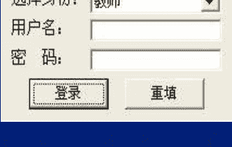

在登录窗口中不考虑身份选择情况，只验证用户名和密码以及登录、重填按钮的正确性。用户名和密码的输入条件均要求为不超过16位，可以使用汉字、英文字母和数字及各种组合。


## 用等价类划分法测试用户名和密码

首先划分等价类：

| 输入条件 | 有效等价类 | 编号 | 无效等价类 | 编号 |
|---|---|---|---|---|
| 用户名 | 1~16位 | 1 | 空值 | 5 |
|  |  |  | 多于16位 | 6 |
|  | 英文字母、数字、汉字组合 | 2 | 组合中含有除英文字母、数字、汉字之外的其他字符 | 7 |
| 密码 | 1~16位 | 3 | 空值 | 8 |
|  |  |  | 多于16位 | 9 |
|  | 英文字母、数字、汉字组合 | 4 | 组合中含有除英文字母、数字、汉字之外的其他字符 | 10 |

## 用等价类覆盖法设计测试用例

测试用例表：略


## 登录模块的测试到此就结束了吗？

## 画出因果图

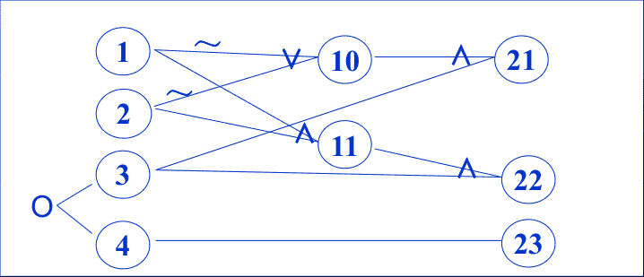

## 转换为决策表

|  | 规则 | 1 | 2 | 3 | 4 | 5 | 6 | 7 |
|---|---|---|---|---|---|---|---|---|
| 选项 | 条件： |  |  |  |  |  |  |  |
| C1：用户名正确？ |  | — | — | — | 1 | 1 | 0 | 0 |
| C2：密码正确？ |  | — | — | — | 1 | 0 | 1 | 0 |
| C3：选择登录按钮 |  | 1 | 0 | 0 | 1 | 1 | 1 | 1 |
| C4：选择重填按钮 |  | 1 | 0 | 1 | 0 | 0 | 0 | 0 |
|  | 动作： |  |  |  |  |  |  |  |
| a1：提示错误 |  |  |  |  |  | √ | √ | √ |
| a2：成功登录 |  |  |  |  | √ |  |  |  |
| a3：重填选项 |  |  | √ | √ |  |  |  |  |
| 不可能 |  | √ | √ |  |  |  |  |  |

## 智能文档识别示例

这是一段示例文本，用于演示文档内容提取。该段落包含普通文本信息，展示了文档的基本布局。

- 项目一：文档标题识别
- 项目二：段落文本提取
- 项目三：表格结构解析

| 列1 | 列2 | 列3 |
| --- | --- | --- |
| 数据1 | 数据2 | 数据3 |
| 数据4 | 数据5 | 数据6 |


> > 这是一条引用内容，用于展示文档中的引用格式。

```
```python
print('Hello World')
```
```

## 对于成绩录入模块该选择何种测试方法？


选择学院： 请选择
选择系部： 请选择
选择班级： 请选择

选择学院： 信息工程学院
选择系部： 计算机科学与技术
选择班级： 计算机软件9601

## 因果图——原因与结果

| 原因 | 结果 |
| --- | --- |
| 1： 选择学院 | 21： 显示被选的学院名称 |
| 2： 选择系部 | 22： 系部列表框不可用 |
| 3： 选择班级 | 23： 系部列表框可用 |
|  | 24： 显示被选的系部名称 |
|  | 25： 班级列表框不可用 |
|  | 26： 班级列表框可用 |
|  | 27： 显示被选的班级名称 |

## 画出因果图

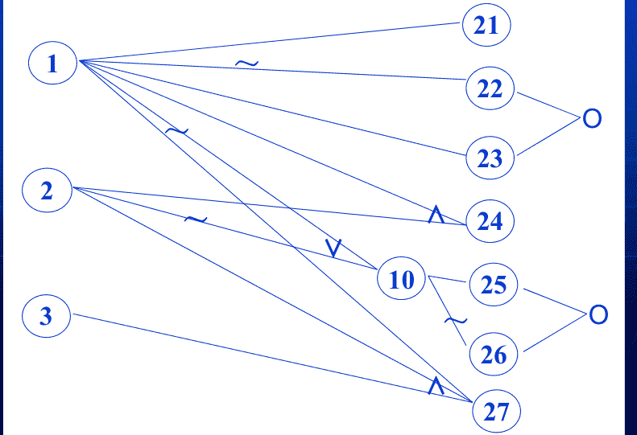

## 转化为决策表

转化为相应的决策表：略

## 得到成绩录入模块的测试用例表

成绩录入模块测试用例表.png

## 测试方法的选择

通常，在确定测试方法时，应遵循以下原则：

- 根据程序的重要性和一旦发生故障将造成的损失来确定测试等级和测试重点。
- 认真选择测试策略，以便能尽可能少的使用测试用例，发现尽可能多的程序错误。因为一次完整的软件测试过后，如果程序中遗留的错误过多并且严重，则表明该次测试是不足的，而测试不足则意味着让用户承担隐藏错误带来的危险，但测试过度又会带来资源的浪费。因此测试需要找到一个平衡点。

## 测试方法的选择（续）

以下是各种测试方法选择的综合策略，可在实际应用过程中参考。

- 首先进行等价类划分，包括输入条件和输出条件的等价划分，将无限测试变成有限测试，这是减少工作量和提高测试效率的最有效方法。
- 在任何情况下都必须使用边界值分析方法。经验表明用这种方法设计出测试用例发现程序错误的能力最强。
- 对照程序逻辑，检查已设计出的测试用例的逻辑覆盖程度。如果没有达到要求的覆盖标准，应当再补充足够的测试用例。
- 如果程序的功能说明中含有输入条件的组合情况，则应在开始就选用因果图法。

## 黑盒测试技术小结

- 黑盒测试技术就是根据功能需求来设计测试用例，验证软件是否按照预期要求工作。
- 黑盒测试技术主要有等价类划分法、边界条件法、因果图、决策表、正交试验设计法。
- 等价类划分法测试技术是依据软件系统输入集合、输出集合或操作集合实现功能的相同性为依据，对其进行的子集划分，并对每个子集产生一个测试用例。
- 边界条件分析法是对大量错误发生在边界条件上的测试。
- 决策表法适用于以下情况： if-then-else逻辑很突出；输入变量之间存在逻辑关系；输入与输出之间存在因果关系；
- 因果图法提供了一种把需求规格说明书转化为决策表的系统化方法。因果图方法最终生成的就是判定表，它适合于检查程序输入条件的各种情况。
- 正交表测试法也是一种成对测试交互系统的有效方法，它提供能对所有变量对的组合进行典型覆盖（均匀分布）的方法。

## 例3 电话号码

城市的电话号码由两部分组成。这两部分的名称和内容分别是：
地区码：以0开头的三位或者四位数字（包括0）；
电话号码：以非0、非1开头的七位或者八位数字。
假定被调试的程序能接受一切符合上述规定的电话号码，拒绝所有不符合规定的号码，就可用等价分类法来设计它的调试用例。

## 划分等价类并编号

| 输入数据 | 有效等价类 | 无效等价类 |
|---|---|---|
| 地区码 | 1. 以0开头的3位串<br>2. 以0开头的4位数串 | 3. 以0开头的含有非数字字符的串<br>4. 以0开头的小于3位的串<br>5. 以0开头的大于4位的串<br>6. 以非0开头的串 |
| 电话号码 | 7. 以非0、非1开头的7位数串<br>8. 以非0、非1开头的8位数串 | 9. 以0开头的串<br>10. 以1开头的串<br>11. 以非0、非1开头的含有非法字符7或者8位数串<br>12. 以非0、非1开头的小于7位数串<br>13. 以非0、非1开头的大于8位数串 |

## 为有效等价类设计测试用例

| 测试数据 | 期望结果 | 覆盖范围 |
|---|---|---|
| 010 23145678 | 显示有效输入 | 1、8 |
| 023 2234567 | 显示有效输入 | 1、7 |
| 0851 3456789 | 显示有效输入 | 2、7 |
| 0851 23145678 | 显示有效输入 | 2、8 |

## 三角问题输入等价类

- D1={a=b=c}
- D2={a=b,a!=c}
- D3={a=c,a!=b}
- D4={b=c,b!=a}
- D5={a!=b,a!=c,b!=c}
- D6={a>=b+c}
- D7={b>=a+c}
- D8={c>=a+b}

注意:上述输入等价类划分情况还不够完整,请同学们进一步完善.

