# 北邮项目管理案例课件（ZhangLei）

## 问题的提出

- IT公司在经营什么？
- 利用项目管理知识可以解决了那些问题，哪些问题不能解决？
- 企业面临的主要问题是什么？

## 问题的提出

我们以经营项目的方式，经营着我们的企业；
经营项目的方式不能等同于项目管理的方式，其方法对每个企业来说是不同的、是唯一的。

### 方法的探索

我们去学习方法，企业安排了专门的人

- PMBOK2000
- CMM/CMMI
- ISO9000
- 6SIGMA
- PM3
- OPM3
- ……

### 方法的探索

我们在起草文件，企业投入了资源：

- 企业项目管理体系
- 企业ISO9000质量保证体系
- 企业CMM/CMMI体系
- 企业6 SIGMA体系
- ……

### 方法的探索

- 我们在企业中强制推行，我们通过各种认证,比如 ISO9000, CMM, CMMI等等。
- 问题：企业的问题解决了么？在多大程度上解决了？如果体系是体系，问题是问题，这又是什么问题？

## 实践的提炼

- 我们项目组在做什么？
- 我们可以提炼什么？
- 我们的企业在做什么？
- 我们可以提炼什么？

## 某IT企业的组织变革历程

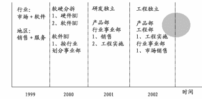

## 需要变革么

- 我们现在不是每天都在正常运转么？
- 加强一下意识是不是就可以了？
- 真的需要建立一套体系么？
- 一个良好体系的重要性
  > 人类社会实际上是组织的社会，而人类社会的变迁在一定程度上可以视作是组织类型的变迁。
- 项目管理体系包含的内容

## 企业在项目管理方面需要变革么？？？

- 项目管理体系的建立涉及项目管理流程与规范，也涉及组织机构设置、角色与职责。项目管理体系就是项目过程、管理过程与组织结构（组织文化）相结合的产物。
- 项目管理体系在组织中真实存在着，无论你是否认知它、是否将其显性化并进行优化与改进。
  战略与执行是现代企业的两大主题。
  如何将公司的战略蓝图变为现实是检验一家公司成熟与否的试金石。对于以提供定制服务和产品为主的中国IT业，项目管理体系是企业执行力的根本基石。

## 项目管理体系是什么？

- 项目管理方法论应用到具体的企业管理中
- 是企业的业务流程设计、组织设计和实施
- 包括销售管理、资源管理、财务管理、部门和个人绩效考核等

## 企业的项目管理体系的作用1

让企业的各个层面的人员，特别是管理层面，在一个共同认可的框架上：

- 讨论问题
- 分析问题
- 解决问题
- 进行决策

## 企业的项目管理体系的作用2

项目管理体系的实施，帮助企业的管理上精细化、透明化。

## 企业的项目管理体系的作用3

项目管理体系的实施，帮助企业的管理走向简单。这样的实施过程是先复杂，后简单，穿过复杂，走向简单。

## 项目管理体系是公司的战略决策

- 在高层，明确统一认识，这是一项关于运营的战略决策
- 明确决定公司是否实施这项战略决策，来增强企业的运营能力
- 作为一个战略性的项目来实施，就要有明确的项目计划、战略性的时间和资源的安排

## 议程

- **第一天：**
- ➢ 第一单元--项目管理概述
- ➢ 第二单元--项目启动
- ➢ 第三单元--计划过程
- ➢ 第四单元--计划过程--WBS
- ➢ 第五单元--计划过程--风险管理
- ➢ 第六单元--计划过程--资源和预算
- ➢ 第七单元--计划过程--进度安排

## 议程(续)

第二天：

- ➢ 第八单元--项目执行、控制过程
- ➢ 第九单元--执行、控制过程---成本管理
- ➢ 第十单元--执行、控制过程---变更和质量管理
- ➢ 第十一单元--执行、控制过程---采购管理
- ➢ 第十二单元--执行、控制过程---日常工作
- ➢ 第十三单元--结束过程
- ➢ 第十四单元---项目团队建设

## 本课程目标

完成本课程学习后，您应该能够：

- ✓ 了解、掌握当前的项目管理知识体系和理论
- ✓ 了解项目管理的最佳实践
- ✓ 明确项目要求
- ✓ 制定、评估开发工作分解结构(WBS)
- ✓ 制定、评估项目资源、成本和工程进度
- ✓ 审核项目总体计划
- ✓ 管理总体变更控制
- ✓ 控制项目执行
- ✓ 结束项目
- ✓ 执行项目经理的职责
- ✓ 组建有效的项目小组

## 项目管理的活动的5个流程

- 项目管理活动包括：
- • 启动 (Initialing): 明确项目或阶段的开始，并承诺执行计划；
- • 计划 (Planning): 制定和维护可执行的计划；
- • 执行 (Executing): 协调组织人员和其他资源执行项目计划；
- • 控制 (Controlling): 通过监控项目进程，并在必要时采取正确的行动，以确保达成或达成项目的目标；
- • 结束 (Closing): 结束或阶段的正常验收，以产生一个有序的结束。

- 启动流程
- 计划流程
- 执行流程
- 控制流程
- 结束流程

## 单一联结点

- 您的管理层
- 供应商
- 采购
- 项目组
- 财务
- 系统设计师
- 项目保证
- 合同经理
- 法律事务
- 产品安全性
- 客户
- 项目经理

## 9个PMI知识领域

Project Management Institute (PMI)确定并记录了一套核心项目管理知识，其中包括：

- 集成管理
- 范围管理
- 时间管理
- 成本管理
- 质量管理
- 人力资源管理
- 沟通管理
- 风险管理
- 采购管理

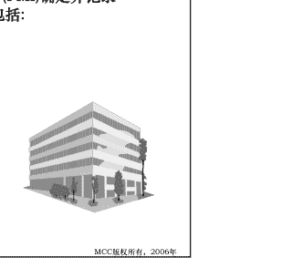

## 项目管理概述

## 目标

在完成该单元后，您应能够：

- 描述项目生命周期
- 描述项目经理的角色和职责
- 陈述项目经理的价值
- 确定优秀项目经理的特征
- 定义项目组的组建

## 项目定义

| 术语 | 定义 |
| --- | --- |
| 项目 (project) | 项目是为创建一种特定的产品或服务而进行的临时性工作 |
| 大项目 (programm) | 大项目是协调管理的一组相关项目。 |
| 项目管理 (project management) | 项目管理是将知识、技能、和技术应用于项目活动的过程，以满足或超出股东对项目的 要求和期望。 |

## 项目与作业的比较

| 项目 | 作业 |
| --- | --- |
| 独特一无二的 | 重复的 |
| 有限时间 | 无限时间（相对） |
| 革命性的改变 | 渐进性的改变 |
| 不均衡 | 均衡 |
| 目标之间不均衡 | 均衡 |
| 多变的资源需求 | 稳定的资源需求 |
| 柔性的组织 | 稳定的组织 |
| 效果型 | 效率型 |
| 以完成目标：目的为宗旨 | 以完成任务、指标为宗旨 |
| 风险和确定型 | 轻缓型 |

## 项目经理的定义

项目经理是项目的单一联系点。

项目经理负责：

- 工作的计划和组织
- 管理项目的日常活动
- 为客户提供项目的交付件

## 项目管理9大领域 (PMBOK)

- 项目整体管理
  - 项目计划制定
  - 项目计划执行
  - 整体变更控制

- 项目范围管理
  - 范围规划
  - 范围界定
  - 范围核实
  - 范围变更控制

- 项目时间管理
  - 活动定义
  - 活动排序
  - 活动日程安排
  - 活动进度控制

- 项目成本管理
  - 资源计划编制
  - 成本预算
  - 成本控制

- 项目质量管理
  - 质量规划
  - 质量保证
  - 质量控制

- 项目人力资源管理
  - 组织规划
  - 人员招聘
  - 项目团队建设

- 项目沟通管理
  - 沟通规划
  - 信息发布
  - 进度报告
  - 进度绩效报告

- 项目风险管理
  - 风险规划
  - 风险识别
  - 风险应对计划编制
  - 风险应对控制

- 项目采购管理
  - 采购规划
  - 招标
  - 选择供应商
  - 合同管理

## 项目管理的39个过程-1

| 过程类别知识领域 | 启动 | 计划 | 执行 | 控制 | 结束 |
| --- | --- | --- | --- | --- | --- |
| 整体 |  | 项目计划制订 | 项目计划执行 | 整体变更控制 |  |
| 范围 | 启动 | 范围规划定义 |  | 范围审核 范围变更控制 |  |
| 时间 |  | 活动定义与排序、活动周期间隔、进度估计 |  | 进度控制 |  |
| 成本 |  | 资源计划编制 成本计划 成本估计 预期 |  | 成本控制 |  |
| 质量 |  | 质量计划 | 质量保证 | 质量控制 |  |

## 项目管理的39个过程-2

| 过程类别/知识领域 | 启动 | 计划 | 执行 | 控制 | 结束 |
|---|---|---|---|---|---|
| 人力资源 |  | 组织计划、人员获取 | 团队建设 |  |  |
| 沟通 |  | 沟通计划 | 信息传递 | 绩效汇报 | 项目关闭 |
| 风险 |  | 风险管理计划、风险识别、定性风险分析、定量风险分析 |  | 风险控制 |  |
| 采购 |  | 采购计划、合同计划 | 招标、投标等 采购谈判、合同管理 |  | 合同关闭 |

## 项目经理的价值

项目经理提高了项目在以下方面的可能性：

- 提供高质量的产品
- 保证进度
- 按预算完成项目
- 使客户满意
- 引导客户的新项目
- 专注项目的成功

## 优秀项目经理的特征

- 沟通者
- 组织者
- 计划者
- 负责任
- 管理异常事件
- 问题分析者
- 创造性地解决问题
- 灵活性
- 小组组建者
- 协调者
- 促进者
- 以人为本
- 情绪激发者
- 幽默感
- 技能评估者
- 以目标为导向
- 风险承担者
- 优秀的商人
- 以利润为动力

## 一般项目组（通常跨部门）

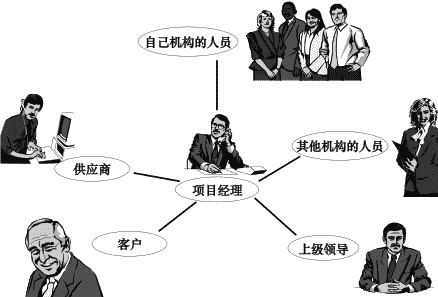

## 组建项目组

组建项目组是一个流程：

- 为实现共同目标而分配的、与共同行为相关的一组人员。
- 促进有效的合作和项目组成员的满意。
- 组建有效的项目组，通过适当的人员和积极的团队精神，以实现理想结果。
- 有助于根据项目需求来组建并改组项目组。

### 如何组建项目组

| 阶段 | 内容 |
|---|---|
| 计划 | 要组建什么样的项目组？ 如何规划项目的建设？ 如何组建项目组？ 为项目选择哪些人？ 项目的目标是什么？ |
| 选择适当的项目组人员 | 审视 技术能力——知识、经验和能力 个人特征——个性，以及领导与指导、合作精神 |
| 组建项目组 | 把项目人员分成小组 分配职责和任务 明确确定各自的角色和职责 |
| 建立沟通渠道 | 确保交换有效的信息 保持信息及时交流 定期举行进度状态会议，分享会议纪要 |
| 确保项目的投入 | 领导层的支持是最重要的资源，确保项目组对项目的投入 |

## 启动过程

### 启动流程的各项工作

收集数据，确定需求。

- 制定目标：
  - 基本目标
  - 可行性
- 评估资源
- 确定备选方案
- 提出建议
- 获得批准

### 启动流程目标

- 创建和定义项目目标：
  - 具体
  - 可衡量
  - 时间明确
- 明确定义项目范围和交付件：
  - 项目范围
  - 成本
  - 工期
- 了解并验证客户需求和期望值

### 客户需求

客户的需要通常通过需求建议书(RFP)来阐述。

在需求确定期间，项目经理通过提问来确定项目参与人员，获得项目需求、期望值或问题的详细信息。

### 确定客户需求

当确定客户需求时，要提问的问题包括：

- 交付件是什么？
- 有哪些相关人员？
- 成本是多少？
- 开发流程的期限有多长？
- 现有的基础设施能够支持吗？
- 需要哪些外部支持？
- 如何定义成功？
- 如何推广？
- 如何索赔？
- 它将持续多久？
- 正在开发或运行的设备中是否有类似产品？

### 确定和验证需求

- 项目开始或最初建议书时确定需求。
- 使用项目管理计划(PMP)。
- 验证需求时应该实现一致性。
- 清楚陈述需求。
- 使用非语言显示方式(图形、模型)阐明需求。
- 把需求分为非需求项和排除项两大类。
- 获得问题细节的详细说明。
- 让客户和项目负责人在需求文档上签字。
- 预计和管理变更。

### 需求基准

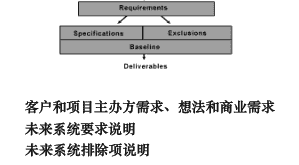

- 要求：客户和项目主办方需求、想法和商业需求
- 需求：未来系统要求说明
- 排除项：未来系统排除项说明
- 参考规格：未来系统需求项说明
- 基线级：最初计划加上或减去许可的变更

### 基准的作用

- 基准提供：
  - 项目执行、控制阶段的范围指南
  - 有助于就需求达成一致的排除项详细表
  - 确定当前排除项，生成未来项目需求的方法

### 如何建立基准

- 在把需求项纳入基准之前对它们进行评审或批准。
- 记录承诺项，避免口头承诺项。

### 项目开工会议（kickoff meeting）

举行一系列会议来重申项目的范围、目标、假设，以及与客户、供应商、项目组和管理层的相关性。

使项目组成员确认：

- 项目角色和责任
- 项目流程和程序
- 项目成员表现管理方法
- 项目范围和目标

会议的次数取决于项目的规模、位置、与客户参与的数量以及待解决的技术问题。

### 项目管理计划 (PMP)

- 使用PMP：
  - 使项目经理能够全面地确定项目需求
  - 确保在开始详细计划之前明确项目范围
  - 在解决客户问题之前确定关键问题，避免工作小组徒劳无益
  - 随着项目深入，确保PMP的评测标准用于控制项目的变更

### PMP内容

- 介绍和汇总项目
- 项目目标
- 项目交付件
- 主要阶段性工作
- 假设
- 风险
- 资源需求
- 局限性
- 相关项目
- 验收标准
- 签署文件
- 评审
- 交流计划
- 变更管理计划
- 财务分析
- 参考信息

### 制订PMP时要提问的问题

- 项目介绍问题：
- 项目目标问题：
- 项目交付件问题：
- 主要阶段性工作问题：
- 假设问题：
- 风险问题：
- 验收标准问题：
- 文件签署问题：
- 沟通计划问题：
- 变更管理计划问题：

### 总结

- 项目章程使项目经理能够在项目工作中使用组织机构资源。
- 项目经理需要充分利用所使用的任何组织机构的优势，激励项目工作小组充分发挥其全部潜能。
- 精确的项目定义、项目范围和切实可行的目标有助于确保项目的成功。
- 客户满意度是评测项目成功的关键。

## 计划过程

### 计划阶段的活动

- 制定主方案：
  - 开发WBS
  - 风险评估
  - 预算、成本
  - 估计和假设
  - 进度表
  - 问题
- 验证其合理性

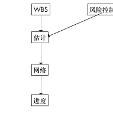

### 项目计划流程

1. 拟定项目目标文件
2. 构建工作细分结构（WBS）
3. 风险管理
4. 估计成本和工作量
5. 开发网络
6. 制定进度表
7. 必要时进行重复

### 总结

- 各公司用于制定项目方案的流程有所不同。
- 所有项目方案都包括共同的要素。
- 项目计划流程包括：
  - 拟定项目目标文件
  - 构建工作细分结构(WBS)
  - 估计成本和工作量
  - 制定进度表

## 计划过程：制定 WBS

### 目标

完成本单元后，您应该能够：

- 定义并描述工作细分结构(WBS)
- 解释 WBS的价值
- 描述常用的WBS格式
- 根据基本流程制定WBS

### 工作细分结构(WBS)

工作细分结构(WBS)是面向交付的项目要素组合，它们组织并定义总的工作范围。

WBS是：

- 以工作、资源和成本来表示的工作范围的具体体现
- 开发新系统所需工作（任务）的分级体系分解

注意：WBS是项目经理计划的核心。

### WBS 关系

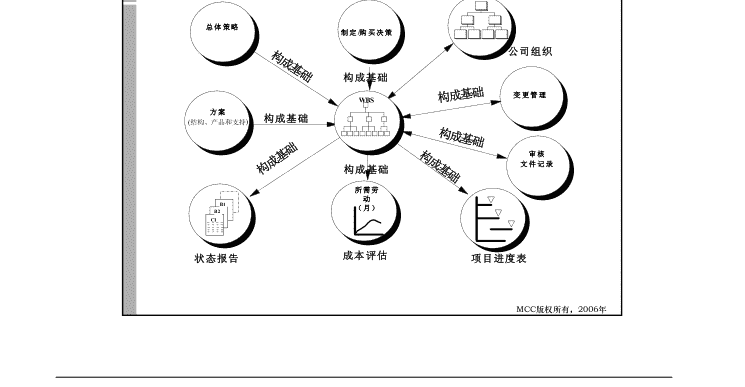

### WBS的价值

WBS通常用作其它项目的模板且常用来帮助了解项目范围。它提供：

- 用于项目工作要素的单一信息库
- 帮助明确划分工作职责、资源及成本
- 帮助确定风险领域
- 用于对所有工作单元进行分类的逻辑结构
- 可用来开发类似项目、促进方案制定并允许在项目完成后进行对比的标准架构

### 工作包

- 提供内部或外部交付件
- 提供可识别的独特产品或结果
- 具备可验证的最终完成标准
- 使其总的直接活动与WBS分级体系下一级别细分中的活动相等
- 可被明确分配给每个小组、每个部门或个人的单独责任

## WBS格式

| 缩行表 | 树型结构 |
|---|---|
| 1.1 xxxxxxxxxxxx 1.1.1 xxxxxxxx 1.1.2 xxxxxxxx 1.1.3 xxxxxxxx 1.1.4 xxxxxxxx 1.1.5 xxxxxxxx 1.2 xxxxxxxxxxxx 1.2.1 xxxxxxxx 1.2.2 xxxxxxxx 1.3 xxxxxxxxxxxx 1.4 xxxxxxxxxxxx 1.4.1 xxxxxxxx | 项目层级关系示意图 |

## WBS 开发指南

- 开始先收集当前所有基准材料及与项目相关的信息，如：
  - 项目管理计划
  - 要求陈述
  - 技术建议书
  - 供应商建议书
- 与主要人员召开研讨会。
- 只将精力集中在WBS的第2或第3级别。
- 将责任具体到负责某各工作包的人员。
- 在开展活动前记录每项工作活动，包括其完成标准。

## 审核/验证WBS

- 与主要工作组成员一起审核结果并确保听取各方意见。
- 确保WBS覆盖所有工作包。
- 审核项目开展期间如何使用并维护WBS。
- 同时使用从上到下及从下到上的方法来审核结果。

| 从上到下 | 从下到上 |
|---|---|
| • 是否有任何级别存在10项以上活动？ • 活动的时间和强度是否相似？ • 责任是否被分配到相应的活动？ • 是否提交了所有交付件？ • 项目管理活动完成了吗 | • 贵可可以分配到个人吗？ • 是否定义了完成标准？ • 是否在5天左右（最多不超过十天）完成某项工作？ |

## 总结

- 作为可行项目计划的基础，WBS用作任务分析和项目控制的重要工具。
- WBS确定完成项目需要完成的所有任务。
- 构建WBS时，限制具体程度以提高级别控制。
- 应针对不同任务、任务估算及交付件规定具体的级别。
- 随着项目进展，使用WBS来修改并更新项目方案。

## 计划过程：风险管理

## 目标

完成本单元后，您能够：

- 定义风险、风险事件、风险可能性及风险事件的影响
- 描述风险管理中的流程
- 列出用来确定风险的工具和技术陈述评估风险时考虑因素
- 描述降低风险的策略
- 描述如何监控风险

## 风险定义

风险可被定义成不希望出现但可能发生的意外事件，它们会导致项目无法实现预期目标。

风险包括：

- 风险事件（可能发生什么）
- 风险事件发生时产生风险的可能性（风险事件发生时产生风险的几率）
- 风险事件的影响--可能的损失（风险事件发生时造成的危害程度）

## 主要风险类型

商业风险是开展业务的正常风险，包括各种赢利或亏损的机会。

纯粹风险是指：

- 显示出最终导致亏损的商业机会
- 应引起密切关注的风险
- 可通过以下方式转移到另一方的风险：
  - 签定合同
  - 使用保证限制
  - 保险

## 风险管理

风险管理包括确定、分析和对项目风险作出反应相关的流程。
它包括最大限度地提高风险事件的正面影响并最大限度地降低不良事件的影响。

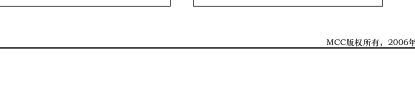

## 风险管理的优点

风险管理：

- 项目成本、进度及范围
- 最大限度地提高正面事件的影响
- 最大限度地降低负面事件的影响
- 防止意外发生
- 强调一开始就作出正确决策
- 根据风险的大小进行管理
- 防止问题发生且在问题发生时防止其升级

## 何时使用风险管理

风险管理贯穿整个项目的生命周期。

| 生命周期的阶段 | 流程 |
|---|---|
| 启动流程 | 风险确定 |
| 计划流程 | 制定风险监控流程 |
|  | 风险确定/重新确定 |
|  | 风险评估 |
|  | 风险降低 |
| 执行和控制流程 | 风险监控 |
| 结束流程 | 获得经验教训 |

## 风险确定- 第1步

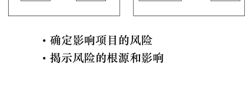

- 确定影响项目的风险
- 揭示风险的根源和影响

## 风险确定方法

用于确定风险的主要工具和技术包括：

- 召开风险确定研讨会(涉及所有主要项目有关人员)
- 审核研讨会上制定的项目评估检查表
- 与项目工作组的主要成员进行访谈
- 检查项目源：
  - WBS
  - 成本和持续时间估计
  - 人力配置方案
  - 采购管理方案
- 学习从以前项目中获得的经验教训

## 风险评估 - 第2步

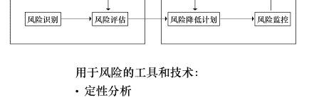

用于风险的工具和技术：

- 定性分析
- 定量分析

## 风险评估

- 分析项目风险时应考虑：
  - 风险事件发生的可能性
  - 每个确定的风险事件带来的损失或影响
  - 风险的严重程度 (严重程度 = 可能性x影响)
  - 评估因素包括：
    - 优先顺序(此类风险以前是否发生过？)
    - 操作的熟悉程度(以前是否开展过相关工作？)
    - 资源和技能
    - 时间、成本和质量
    - 可能性 (风险发生的几率有多大？)
    - 影响(对项目业务产生什么影响？)

## 定性分析

根据对项目的必要程度和复杂性对风险进行定性分析。

- 风险的定性评定应从以下方面进行：
  - 风险对项目的影响
  - 风险出现及不出现的几率

## 可能性测量

三种最常用的可能性类型包括：

- 低：中断项目正常开展的可能性极低，增加成本或降低绩效
- 中：有可能中断项目的正常开展、增加成本或降低绩效
- 高：很可能严重影响项目的正常开展、增加成本或降低绩效

## 影响分析

风险影响应根据相关项目成本测量：

- 低
- 中
- 高

影响分析的流程步骤包括：

1. 确定问题
2. 确定风险事项
3. 推测此类活动产生的总风险结果
4. 报告结果

## 风险严重程度

风险的严重程度要依风险的影响及可能性的综合。
图表是显示影响及可能性综合结果的工具。
实例：

| | 影响 | | |
| | 低 | 中 | 高 |
| 可能性 | 高 | 中 | 高 | 无法接受 |
| | 中 | 低 | 高 | 高 |
| | 低 | 低 | 中 | 中 |

## 划分风险优先级

划分风险优先级以决定是否应对某类风险事件加以重视。
对风险进行定性和定量分析后最后确定风险的优先级。
确定十大主要风险。

## 降低风险 - 第3步

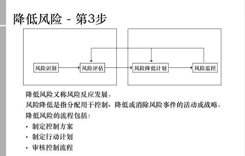

降低风险又称风险反应发展。

风险降低是指分配用于控制、降低或消除风险事件的活动或战略。

- 降低风险的流程包括：
  - 制定控制方案
  - 制定行动计划
  - 制定行动计划
  - 审核控制流程

## 制定风险管理行动方案

- 行动计划的说明
- 行动计划的负责人
- 行动计划的日期
- 行动计划的费用
- 行动计划的影响（费用/日程）

## 风险降低措施

避免：
您认识到风险并采取不需要费的行为来消除风险。

忽略或接受：
您认识到风险但不采取任何行动，且表示愿意接受风险发生时产生的可能后果。

控制：
您认识到风险并采取特定行动来最大限度地降低风险事件的发生及其影响。

转移：
您认识到风险并将其全部或部分转移至另一方。

设立预留会：
您预留部分资金用于风险发生时及随后的风险控制中。

## 风险记录

创建可供多个项目使用的标准文件记录格式。

文件记录：

- 项目风险
- 风险的可能性
- 风险的影响
- 控制方案
- 风险行动方案
- 纠正行动

更新WBS。

必要时修改进度表。

更新风险管理方案。

## 风险监控 - 第4步

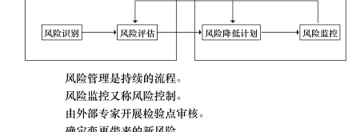

风险管理是持续的流程。

风险监控又称风险控制。

由外部专家开展检验点审核。

确定变更带来的新风险。

在风险发生时执行、控制阶段风险管理方案。

## 项目经理在风险管理中的任务

在风险管理中，项目经理的任务是：

- 确定并了解风险事件
- 制定处理风险事件的方案
- 将风险管理纳入项目管理流程
- 定期监控并管理风险事件
- 在每个风险事件发生后重新评估风险发生的可能性、影响及新风险事件
- 适当调整风险管理方案
- 制定替换方案及应急方案
- 采取行动！

## 计划过程：估算

## 定义估算

估算：

> 是决定WBS中各单元的工作及持续时间的流程
> 是确定每个工作包所需的资源的流程
> 综合考虑以下重要因素：

- 战略
- 方法
- 假设
- 资源
- WBS

## 估算什么

- 活动持续时间
> 成本
  - 直接
  - 间接
> 资源
  - 人
  - 设备
- 材料

## 关键术语

- 资源：项目中直接使用或涉及到的任何必要物品。
- 可提供性 (availability)：人员能够/希望开始工作的时间。
- 工作效率(productivity)：以时间为单位对工作进行的相关测量。

## 估算等式

- 成本=工作/工作效率x单位成本
- 期限=(工作/工作效率)/可提供性
- 成本 = Effort/Productivity x Unit Cost
- 期限 = (Effort/Productivity)/Availability

## 进行估算的原因

估算使项目经理能够：

- 在执行、控制阶段前估计项目的可能成本
- 为基于活动的成本计算和其它方法来跟踪和管理项目开销奠定基础
- 建立可管理的基准，根据这些基准来管理开销
- 提高评估日常项目决策的准确性
- 确定需要的资源及相应的进度表

## 何时估算

估算不是一次性工作；它需要在整个项目生命周期中重复进行。

- 在WBS开发后
- 决定是否投标时
- 按管理项目以验证建议书估算时
- 开始项目的下一步工作时
- 假设证明无效时
- WBS改变以确定工作及与改变相关的费用时
- 资源、材料或服务得到批准进行改变时

## 估算流程

估算目标：

- 为什么要制定目标？
- 需要准确到什么程度？
- 谁是可能的用户？
- 何时需要估算？

估算项目详情：

- 确定准备估算所需的信息。

选择适当模式：

制定估算战略和方案：

- 确定估算人员。
- 制定估算方案来整合估算信息。
- 决定使用的估算验证类型。
- 回顾类似项目的历史记录。

## 估算流程：开展

从下到上估算：

- 估算技术工作
  - 反复生成具体的估算信息
- 估算项目管理工作
  - 通常占项目技术工作总量的10到20%

从上到下的估算：

- 使用方案中确定的模式

## 估算类型

不同条件下的不同项目需要使用不同的具体估算法。据PMI称，估算通常分为三种类型：大致的数量级 (ROM, Rough Order of Magnitude),预算性估算及决定性估算。

| 准确性 | 变化 | 时间(阶段) | 方法 |
|---|---|---|---|
| ROM | -25%~75% | 最初、概念 | 类比、参数、最佳猜测 |
| 预算 | -10%~25% | 概念、决策、应答建议书 | 类比、参数、专家判断 |
| 决定性 | -5%~+10% | 方案、建议书 | 类比、参数、专家判断、供应商 |

## 估算类型说明

ROM和预算是自上而下的方法：

- 基于类比/对比、参量或专家判断的高级别估算
- 估算基于类似活动的以往经验以及往数据
- 成本低、准确性低

决定性是自下而上（逐个任务）的方法：

- 以小时数估算一个工作项目
- 项目总数是累计每个工作的总和
- 每个工作规模决定成本和准确性

## 估算方法

最常见的估算方法是：

- 类比/对比
- 参量建模
- 最佳猜测
- 专家判断
- 供应商投标

## 自下而上方法的实例

这个自下而上的估算实例来自于上面的工作单元，集中反映了总项目成本。

| WBS Name | Effort (hours) | Duration (hours) | Cost ($in 1,000s) |
|---|---|---|---|
| 1 Developing a training course |  |  | 120 |
| 1.1 Phase I:Planning and Design |  | 130 |  |
| 1.1.1 A:Gathering requirements | 30 |  |  |
| 1.1.2 B:Analyze tasks | 35 |  |  |
| 1.1.3 C:Define objectives | 20 |  |  |
| 1.1.4 D:Write high-level plan | 40 |  |  |
| 1.2 Phase II:Developing the Course |  | 302 |  |
| 1.2.1 A:Write content | 80 |  |  |
| 1.2.2 B:Create media | 40 |  |  |
| 1.2.3 C:Review content |  |  |  |
| 1.2.4 D:Edit content | 35 |  |  |
| 1.2.5 E:Produce the course | 20 |  |  |
| 1.2.5.1 F:Format the course | 15 |  |  |
| 1.2.5.2 G:Produce Student Materials |  |  |  |
| 1.2.5.3 H:Produce Instructor Guide | 30 |  |  |
| 1.3 Phase III:Test the Course |  | 80 |  |
| 1.3.1 A:Conduct the pilot | 15 |  |  |
| 1.3.2 B:Evaluate the course |  |  |  |
| 1.3.3 C:Finalize the course | 40 |  |  |

## 估算规则

当您估算项目时：

- 应使用最适当、最准确的方法
- 说明最理想的准确性级别
- 应在估算时采纳项目工作组的意见
- 使用历史记录作为估算基础
- 应用现行标准
- 不要夸大估算
- 接受估算需要时间这一事实
- 记录作为估算基础的假设
- 记录您的估算、方法、假设以及用数字表示的价值

## 关于估算人员的问题

谁进行估算？

- 由个人对自己工作成果进行估算吗？
  - 更好的估算
  - 采纳别人的意见

估算人员是否经验丰富？

- 熟悉客户环境
- 熟悉项目
- 熟悉项目使用的工具：
  - 项目管理工具
  - 技术工具
- 估算员的估算历史如何？
- 估算员是按任务还是按人进行估算？

## 估算流程：检查、审核

为了验证估算：

- 回顾项目定义
- 使用与最初估算相同的信息和假设
- 强调数据源
- 对类似项目的标准
- 审核估算方法以查看其是否适当
- 决定估算是否满足目标
- 使用不同方法来验证估算
- 确保估算包括所有降低风险的任务

## 应急准备金

应急准备金包括用于意外领域或估算不准确领域的基金。

它用作：

- 某些领域（任务不属于应急方案的一部分）中的风险牵制
- 进度延期的缓冲

注意：通常会用掉5%的成本。

## 计划过程:进度

## 目标

完成本单元后，您能够：

- 设明项目进度的目的
- 定义基本的进度术语
- 识别制作网络图所用的不同类型的网络技巧
- 解释WBS与网络图之间的关系
- 解释如何构建网络图
- 定义主要路径方法中所用的术语和词汇
- 描述进度前置、落后，如何识别关键路径
- 说明如何审查项目进度，并使之与项目目标相一致
- 采用网络逻辑和进度安排的方法制定进度表

## 项目进度的目的

项目的进度主要用来：

- 跟踪项目的进展，将计划的与实际的操作相比较
- 确定会影响项目的潜在变更
- 向所有各方报告项目的进展状态，说明以下问题：
  - 所进行的任务和活动是否会使项目成功完成
  - 项目需要哪些资源
  - 主要里程碑及时间
  - 关键路径

## 进度安排的基本术语

| 术语 | 定义 |
|---|---|
| 活动 | 在项目期间进行的一项工作。活动一般需要一段时间、需要发生成本、耗费资源。活动再细分为若干个任务。 |
| 事件 | 时间中的特定点，在时间表中一般以带圆圈的数字表示。 |
| 里程碑事件 | 项目中重要的事件，一般指完成一个重要交付项。 |

## 时间安排的基本术语（续）

| 术语 | 定义 |
|---|---|
| 路径 | 按顺序连在一起的一组活动。 |
| 关键路径 | 决定项目完成的最早时间的一系列活动。临界路径一般定义为最长任意或等于某一给定值（通常为0）的活动。这是网络中最长的路径。 |

## 时间安排的基本术语（续）

| 网络 | 以图形方式表示活动之间的逻辑关系的图 |
| 逻辑关系 | 两个项目活动之间的依赖性 |

## 显示项目信息的一般方式

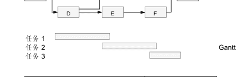

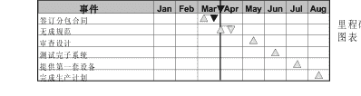

| 事项 | Jan | Feb | Mar | Apr | May | Jun | Jul | Aug |
| 正式启动会议 |  |  | ▲ |  |  |  |  |  |
| 正式授权 |  |  |  | ▼ ▼ |  |  |  |  |
| 正式设计 |  |  |  |  |  | ▲ |  |  |
| 确定范围基准 |  |  |  |  |  |  | ▲ |  |
| 批准范围-变更请求 |  |  |  |  |  |  |  | ▲ |
| 正式批准交付物 |  |  |  |  |  |  |  |  | ▲ |
里程碑图表

## 网络逻辑图

项目网络图指用图表的方式显示项目的活动及这些活动的逻辑关系。

- 它显示所有工作活动及其相互关系。
- 它在逻辑流中安排了一系列项目活动。
- 它采用方框和箭头显示到项目完成为止的工作流程。
- 它清晰地显示了相互依赖的关系。

## 网络逻辑编图方法

制定时间表时所用的网络编图方法的主要类型包括：

- 按前导图法 (PDM)
- 亦称为 Activity-on-Node [AON]
- 箭头编图方法
- 亦称为Activity-on-Arrow [AOA]
- 条件编图方法
- 系统动态模式

## 前导图法(PDM)

前导图法 (PDM)是采用节点显示活动，并通过箭头将其链接在一起，以此来反映它们相互关系的一种网络技巧。

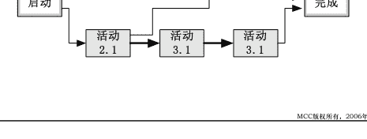

## 网络与 WBS的转换关系

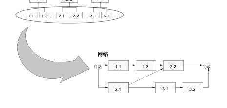

## 构建网络图

用箭头显示流的方向

例如从左到右，节点1指示“启动”事件。

- 网络图以任务、活动或里程碑作为开始和结束。
- 所有活动都有先后顺序
- 没有环路。

找到关键的活动。

给出活动最早和最晚启动时间，及每个活动的时间宽松度。

## 估计活动时间段

活动时间段估计指估计完成各活动所需要工作时间数。

## 前导图法的依赖关系

完成到开始 (FS)

开始到开始 (SS)

完成到完成 (FF)

开始到完成 (SF)

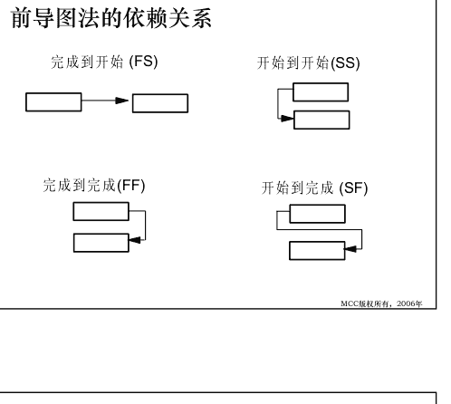

## 前导图法的依赖关系（续）

滞后时间 (Lag)

前置时间 (Lead)

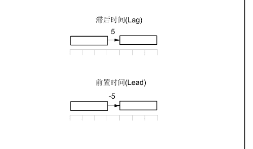

## 关键路径法中的进度表制定术语

1. 最早开始时间(ES)：一项活动可以开始的最早时间。
2. 最晚开始时间(LS)：一项活动可以延后、且不影响后续活动的最晚时间。
3. 最早完成时间(EF)：一项活动可能完成的最早时间。
4. 最晚完成时间(LF)：一项活动可以完成、且不影响后续活动的最晚时间。
5. 自由时差：一项活动可以延后、且不影响紧跟其后的活动的最早开始时间的时段。
6. 总时差：一项活动从最早开始时间起可以延后、且不影响项目完成日期的时段。
7. 临界路径：通过网络的最长路径。它也是完成项目的最短时间

## 关键路径方法 (CPM)

关键路径方法(CPM)是预计项目时长的一种网络分析方法，主要是分析哪一列活动（哪一个路径）在时间安排方面波动最少（时差最小）。

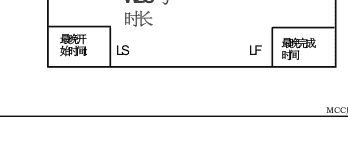

## 关键路径

## 进度表的用法

## 在最终确定进度计划前，请检验：

- **角色**
  - 每个任务都有一个角色来完成？
  - 行动：在需要的地方增加角色
- **人物**
  - 谁要求填充这些角色？
  - 行动：分配相应的人员
- **技能**
  - 分配的人员是否有相应的技能？
  - 行动：在规定的时间范围内，增加或替换或重新估计任务时间
- **可能性**
  - 这些人仍可能可以参与项目？
  - 行动：重新安排时间
  - 行动：改变利用时间率，调整任务完成期限
  - 行动：增加更多的人员

## 调整进度

若想确保日程计划达到预定的时间和目标，须考虑时间压缩方法：

- 利用“Fast Tracking”手段来改变任务间的关系来缩短关键路径。
- 将串行的任务并行完成
- 改变工作方法来建立任务间新的关系来缩短关键路径（可能改变WBS）
- 改变日期的限制，以使关键路径上的任务开始或结束的更早一些
- 增加成本，人员，压缩时间

## 总结

制现实的进度是一个很耗时的 工作。
由于以下原因，99% 的进度需要重新安排：

- 资源过度分配
- 时间表比要求更长

调整进度可能需要：

- 改变任务资源、任务开始时间或任务时长
- 将任务增加到 WBS，重新将认为必要的步骤制定成流程

重新计划步骤，直到产生有效的计划表，它对项目的成功至关重要。

## 总结 (续)

市场上许多商用的针对进度的项目管理工具。

项目管理工具可用来帮助你识别关键路径，但是：

- 不可盲目地使用工具
- 不是工具而是你管理项目
- 你对项目的成功负责，而不是工具。

项目启动有助项目达成目标，有助于团队一起工作，使工作在预算之内按时完成。

## 执行和控制过程

## 目标

在完成这一部分之后，您应该能够：

- 了解执行和控制流程的所有工作
- 阐述项目控制的重要性和目的
- 列出项目控制的各个阶段
- 解释项目控制书及其内容
- 列出项目控制指南

## 执行和控制流程的各项工作

- **执行工作包括：**
  - 管理和激励工作小组
  - 建立沟通渠道
  - 验证技术要求
  - 建立控制体系
  - 购买商品和服务
  - 执行工作计划

- **控制工作包括：**
  - 范围
  - 质量
  - 时间
  - 成本

## 解决问题

## 项目控制概述

项目控制是在项目生命周期内重复执行的流程。

项目控制的目的是通过以下方面确保项目按期、在预算内完成，并符合规范：

- 验证为项目制订的基准
- 监视、分析和比较计划和实际的项目预测结果为核心
- 确定项目延期完成造成的偏差
- 及时调整计划，采取预防措施

## 关于项目控制书

项目控制书(PCB)提供以下信息：

- 项目中使用的流程
- 包括流程结果的动态文件，如：工作安排和变更日志，PCB提供：
  - 评估是否符合标准的基础
  - 评审和审核项目管理系统的基础
  - 项目进度和流程参考文件的最新信息

## PCB的内容

项目控制书包括项目管理计划和结果。例如：

| 计划和流程 | 项目控制书内容 |
|---|---|
| 进度跟踪流程 | 更新的工作安排 时间报告 |
| 进度报告流程 | 合同状态报告 偏差分析 |
| 财务报告 | 费用报告 财务对账报告 |

## 使用标准指标来控制项目

- 标准指标允许项目经理监督、通告和跟踪项目进度和发展趋势。
- 目前没有适用于所有项目的标准指标
- 为项目选择最适当的标准指标

## 执行、控制过程：成本管理

## 目标

在完成这一部分之后，您应该能够：

- 解释成本控制要做的工作
- 定义挣值法
- 确定挣值法的三个基本值
- 定义挣值法术语
- 列出出现偏差的原因
- 计算挣值

## 挣值法定义

挣值法是衡量项目执行的方法。它对预计的工作量和实际完成的工作量进行比较，以确定成本和进度的执行是否与计划的相一致。

## 为什么考虑挣值

- 对各种偏差可以进行目标评估
- 可以对与项目相关的真实发生的项目的工作有共同的理解
- 与当前的大量的项目管理软件相配合
- 对所有的项目经理人员保持一致
- 允许在项目执行过程中的任意一点进行分析
- 可以对未来的项目执行、控制阶段进行预测分析
- 可以在不同的层次完成：工作任务、项目阶段总结、项目总体

## 挣值分析

挣值(EV)分析是最常见的执行结果测量方法。
EV基于三个基本值：BCWS、BCWP和ACWP

EV解决以下问题：

- 项目与进度关联点在哪？(BCWS)
- 已经完成多少工作量？(BCWP)
- 可以申请多少预算？(BCWP)
- 已经花费了多少工作成本？(ACWP)
- 完成项目还需要多少成本？(ETC)
- 最终成本是多少？(EAC)
- 项目的基本成本是多少？(BAC)

## 使用三个基本值

计划工程预算成本 (BCWS):

- 应该完成多少工作量？
- BCWS自基线计划的调整得出。

完成工作预算成本(BCWP):

- 已经完成了多少工作量？
- BCWP代表实际的工作带来的价值。

完成工作实际成本ACWP):

- 已完成的工作的成本是多少？
- ACWP指完成这些工作的实际成本

## EV工具：执行结果管理

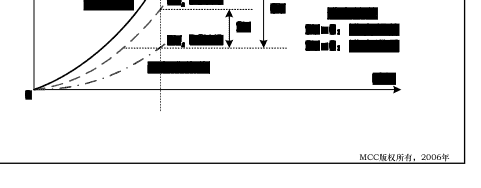

## 预测最终结果使用的公式

| 术语 | 公式 | 测量 |
|---|---|---|
| 剩余完成的估算 | ETC=EAC-ACWP | 底部的劳动成本（美元） |
| 完成时的估算 | EAC= BAC/CPI | 总项目成本 |
| 完成时的预算 | BAC | 项目基准 |
| 进度偏差 | SV= BCWP-BCWS | 计划和实际完成的工作之间的差异 |
| 成本偏差 | CV= BCWP-ACWP | 工作创造的价值和实际花费的成本之间的差异 |
| 成本绩效指数 | CPI= BCWP/ACWP | 效率指数 |
| 完成前的值绩效指数 | TCPI= BAC-BCWP / BAC-ACWP | 如果EAC保持一致，它将需要多少成本 |
| 进度绩效指数 | SPI= BCWP/BCWS | 已完成的工作和计划的工作之间的比率 |
| 完成百分比 | PC= BCWP/BAC | 已完成的工作创造的真正价值 |
| 开销百分比 | PS=ACWP/BAC | 花费的实际成本比例 |

## 关键EV实例

| 问题 | 术语 | 公式 |
|---|---|---|
| 项目总预算是多少？ | BAC | 完成时的预算 |
| 您计划到开销是多少？ | BCWS | 计划工作预算成本 |
| 到目前为止实际开销是多少？ | ACWP | 完成工作实际成本 |
| 已给完成？哪些项目，估计这些项目的价值是多少？ | BCWP | 完成工作预算成本 |
| 从财务角度来看，工作效率是多少？ | CPI | CPI=BCWP/ACWP |
| 需要完成剩工作的工作计划成本有多远？ | CV | CV=BCWP-ACWP |
| 从财务角度度，预算成本有多远？ | SV | SV=BCWP-BCWS |
| 到目前为止，在完成时预算是多少？ | 开销百分比 | 开销百分比 = ACWP/BAC |

## 总结

- 使用基准文件，加上或减去公认的变更(基线) 来控制项目的执行。
- 使用适当的方式，与项目中涉及的个人或团体沟通。
- 使用挣值作为一种手段来跟踪或控制项目。

## 执行、控制过程：变更管理

## 目标

完成本单元后，您应能够：

- 定义变更及变更管理
- 陈述为何需要变更管理
- 列出变更管理步骤
- 确定变更管理申请表中的要素陈述项目经理在变更管理中所起的作用
- 定义项目质量管理并陈述如何实现项目质量
- 描述主要质量管理流程
- 应用变更管理原则

## 定义变更

变更：

- 是与先前定义的基准的任何偏差
- 影响项目的三种限制因素：
  - 进度
  - 成本
  - 资源
- 由于基准文件没有全面定义的范围的而扩展引起
- 与工作内容或项目管理相关联

## 变更起源

- 内部
- 设计
- 实施
- 配置
- 成本

- 外部
- T和IC
- 工作范围
- 要求
- 进度
- 成本

问题 风险

变化流程

通常是内部 通常希望图内

通常是外部 通常希望图外

项目工作组双方必须致力于相同的工 作说明书和交付件。

## 变更管理定义

变更管理是确保所有变化对项目产生最小影响的流程。

变更管理系统旨在通过跟踪和控制变化来降低执行、控制阶段的影响。

变更管理步骤如下：

- 确认并捕获每个变更请求
- 评估变更
- 描述是否接受、拒绝或延迟变更
- 执行、控制阶段接受的变更

## 为什么说变更管理非常重要

- 变更控制的重要性表现在：
- 管理基准以控制范围内的变更，而不仅仅是防止它们
- 最大限度地避免范围扩展
- 减少因范围扩展而带来的项目故障次数

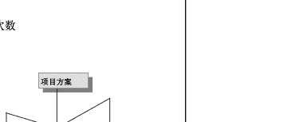

## 变更管理流程

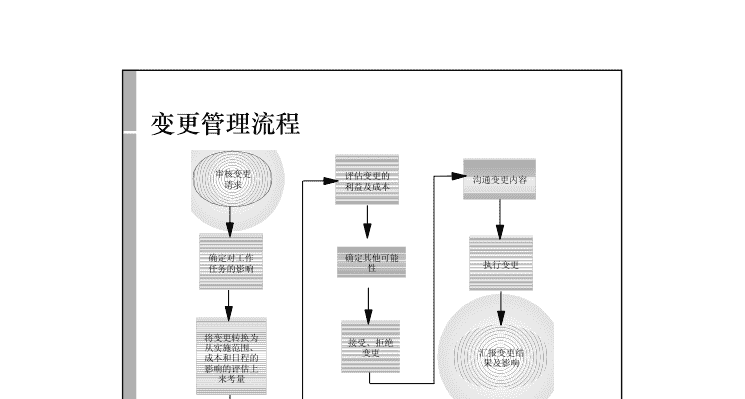

## 变更申请表要素

变更请求包括：

- 变更请求号
- 变更请求日期
- 请求变更的人员姓名
- 说明变更
- 评估调查的代价
- 说明变更对项目的影响
- 列出受变更影响的任务和人员

## 变更申请表要素（续）

- 估计变更成本
- 授权代表签字
- 执行、控制阶段变更请求的时间限制
- 调查的时间限制
- 授权开始改变
  - 调查
  - 执行、控制阶段
- 对相关项目的影响

## 用于变更控制的后继活动

| 变化的状态 | 项目范围内的变化 | 项目范围外的变化 |
|---|---|---|
| 如果被接受 | • 计划合并到系统中。 • 制定新基准。 • 修改进度表并分配资源。 | • 为客户/项目赞助者准备建议书，包括成本。 • 避免实施，直到签定合同。 • 修订合同。 |
| 如果被拒绝 | 传递并记录决策。 | 传递并记录决策。 |
| 如果被延迟 | 指导项目工作组。 • 进行进一步分析 • 考虑替代方案 • 等待直到规定的时间 | 指导项目工作组。 • 进行进一步分析 • 考虑替代方案 • 等待直到规定的时间 |

## 项目经理在变更管理中的作用

在变更管理中，项目经理应：

- 分析变更请求
- 管理范围
- 修订基准

## 总结

- 全面变更控制是项目经理的职责，项目经理需要评估贯穿项目生命周期的变更的重要性、作决策并通知需要开展的工作。
- 变更控制流程的重点是三种限制因素：成本、进度和范围。
- 在评估变更时，必须考虑对这三个限制因素的影响。

## 执行、控制过程：质量管理

## 项目质量管理定义

项目质量管理是项目管理的子集，包括确保项目实现预期目标的流程。

它包括：

> “整个管理职能部门决定质量策略、目标、职责并在质量系统中通过质量计划、质量控制、质量保证及质量改进来执行、控制阶段它们的所有活动。”
> --项目管理协会--

## 项目的质量管理

- 定义交付物标准来明确定义
- 对项目的过程的要求（执行的规范和标准）
- 质量管理
  - 监控项目的交付物：确保它们符合相关标准
  - 执行过程：确保不合格项可以按照一定的方法排除
- 把要做的写下来，把写下来的做出来，把做的过程记下来
- 质量保证：在项目过程中，有计划，有系统的活动，确保项目满足有关的标准，评审和审计；
- 质量控制：采用适当的方法监控项目结果，确保结果符合质量标准

## 如何实现质量目标

质量目标在以下情况下可以实现：

- 建立包括质量计划、质量保证和质量控制等流程在内的项目质量管理体系
- 项目管理和项目产品都得到满足
- 谨慎管理并审核客户要求以便达到客户满意并与项目进度相一致
- 进行项目审核

## 主要质量管理流程

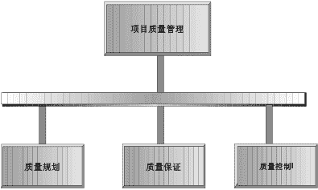

## 质量计划

输入

- 质量策略
- 范围陈述
- 产品说明
- 标准和规章制度
- 其他流程输出

方法

- 优势/成本分析
- 基准制定
- 流程图编制

输出

- 质量管理方案
- 运行定义
- 检查表
- 输入到其它流程

## 制定质量计划

- 遵循质量审核组为该项目创建的流程和程序
- 联合确定在项目生命周期中进行质量保证项目审核
- 与质量审核组一起更新项目质量计划

## 质量保证

- 质量管理方案
- 质量控制的测量结果

输入

技术

- 质量计划工具和技术
- 质量统计

输出

- 质量改进

## 质量保证目标

- 项目经理与质量审核组一起工作以确保遵从定义的 管理流程和程序。
- 项目经理及其项目小组分享并讨论质量管理审核结果，并与高级项目管理人员定期审核质量管理审核结果。
- 项目经理与质量审核组应联合从高级管理人员处就所有未解决的与标准有偏差的部分获得决策和指导。

## 项目审核确保质量

项目审核是帮助项目经理确定与项目相关的问题并就如何解决这些问题提供建议的流程。

质量保证进行一次或多次项目审核来确保遵从为所有项目定义的管理流程和程序。

项目审核包括:
- 方案审核
- 标书审核
- 商务审核
- 项目开工审核
- 项目定期审核
- 项目结束审核

## 典型的项目审核流程

- 1. 召开会议，以介绍项目的概况和状态。
- 2. 记录会议结果，包括任何问题。
- 3. 做出任何必要的纠正并分发报告。
- 4. 根据质量保证方案来安排项目审核时间。
- 5. 审核项目控制手册及其它项目文件。
- 6. 适当时与项目工作组成员进行访谈。
- 7. 审核批准的例外情况对项目产生可能影响。
- 8. 安排与项目经理和项目审核组会面以提交审核结果。

## 项目审核总结

| A类： | 可控 |
|---|---|
|  | 可能存在小问题，但项目经理有备妥有效的方案来解决它，未发现现或潜在的大问题。 |
| B类： | 目前可控 |
|  | 必须解决现有或潜在问题以避免恶化。 |
| C类： | 主要问题 |
|  | 需要立即采取纠正方案，可能超过估计或预算值。强硬的管理活动是新获得控制的关键。 |
| D类： | 重要问题 |
|  | 严重负面影响，严重损害项目。激发客户或生产可接受负面影响时；需要进行彻底的管理评估，需要负责任地通知客户。 |

## 质量控制概述

质量控制包括：

- 监控特定的项目结果并决定它是否遵从相关的质量标准
- 确定消除不满意表现根源的方式

质量控制贯穿整个项目生命周期。

## 质量控制

输入

- 工作成果
- 质量管理方案
- 检查表

方法

- 检查
- 控制图表
- 统计数据采集
- 直程图绘制
- 趋势分析

输出

- 质量改进
- 接受决策
- 重做
- 完整的检查表

## 总结

总的来说，项目经理负责解决85%（或更多）影响产品质量的因素。

对工具的使用是执行质量程序的关键；这些工具帮助并支持项目经理确定所开展的工作与标准间的偏差。

## 执行、控制过程：采购管理

## 目标

在完成该单元后，您应能够：

- 定义合同
- 陈述合同管理的要求
- 描述合同管理的原则
- 描述项目经理在合同控制中的责任

## 合同管理

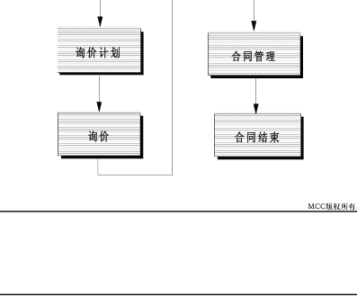

## 合同管理流程

输入

- 合同
- 工作结果
- 变更申请
- 供应商发票

方法

- 合同控制系统
- 绩效报告
- 支付系统

输出

- 工作结果
- 合同变更
- 付款要求

## 合同的定义

合同是双方达成的一种协议，规定再销商提供指定产品和服务的责任，并规定买方的支付责任。

合同是一种法律关系，只能根据有关法律进行修改。

## 合同主要类型

- 固定总价合同（FFP）
- 固定价格加激励费用（FPIF）
- 成本加固定费用（CPPF）
- 成本加激励费用（CPIF）
- 工时和材料费（T&M）
- 投入水平（LOE）

## 主要的合约支付方法

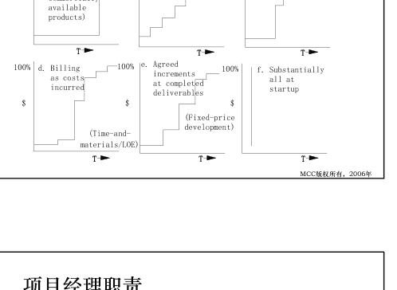

## 项目经理职责

在项目期间，必须确保：

- 项目符合合同规定的范围、进度、以及成本。
- 修改合同，以便支持反映新要求的项目改变。
- 当在无法预料的情况下，要求供应商增加人员，以便满足原始要求时，要对合同进行增补。
- 管理客户和供应商合同中的所有条款和条件（Ts & Cs）。

## 管理合同的原则

- 确认收到的改变请求是否要求对合同进行改动
- 建立并管理合同改变流程
- 和客户以及供应商一起协商合同改变
- 根据达成一致的职责，监督客户和供应商的表现，如果没有满足已经达成一致的日期、资源、承诺和交付事项要求，要通知所有相关各方
- 通过记录和管理项目成本，保持项目财务进度的记录
- 确保客户正式批准合同中已经达成一致的验收测试
- 协调根据合同提供的交付事项
- 协调供应商的帐单和付款
- 确保供应商收到所有应付款

## 总结

- 确保客户承认：项目已经完成，供应商已经提供了合同规定的所有产品和服务。
- 确保将项目期间其他地方提供的所有资产归还给供应商。
- 应建立一种合同系统，以支持合同管理。
- 合同管理流程可以很广泛、很长，并包含整个项目。

## 执行、控制过程：跟踪项目

## 目标

在完成这一部分之后，您应该能够：

- 定义流程跟踪
- 描述执行和控制流程中的项目跟踪活动
- 描述项目跟踪流程
- 描述财务跟踪流程

## 项目跟踪活动

项目跟踪活动包括：

- 跟踪项目状态
- 控制变更
- 修订方案
- 召开状态会议
- 跟踪主要事件和质量
- 制作跟踪报告

## 用于跟踪的信息

用于跟踪的主要信息范围包括：

- 时间：主要日期，如里程碑式事件的日期等
- 资源：使用的人力以及对剩余所有工作的估计
- 工作：完成或正在开展
- 成本：资源和服务
- 即将完成的工作产品及其流程
- 问题、风险和变更

## 信息流

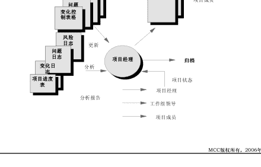

## 项目跟踪流程

- 数据收集
- 分析
- 报告
- 行动方案

## 总结

- 确保项目工作组定期报告其时间和流程
- 使用适当的上升问题的路径
- 寻找适当方式，通过降低成本来增加利润

## 结束流程

## 项目结束的原因

- 项目成功
  项目已经达到了其成本、进度和技术性能目标并融入到客户的组织中，并为客户的企业使命作了贡献
- 项目失败
  项目没有达到其成本、进度和技术性能目标，或者它不能适合组织的未来。失败是一个相对的因素

## 为什么结束

- 当项目进入其生命周期，项目的真正的成本、时间和性能参数变得更加清楚的时候，高级经理必须考虑决定是否要结束项目。
- 项目结束不应当被看作是一个失败，更应当被看作项目不能或者可能不支持组织战略所执行、控制阶段的战略决策。
- 组织如果在适当的时机不作出常是困难但也是必要的决策来结束一个项目，就可能使成本过高。
- 结束决策通常不是在某个具体的时间点一下子作出的，而是在项目生命周期的中慢慢发展的，根据项目审查中得到的有关键项目的情报作出的。

## 项目结束定义

- 项目结束是执行项目的一个流程，一组工作和任务。
- 项目结束应在项目开始时开始。
- 项目结束计划应包括在项目控制书中。
- 应对项目结束流程进行计划、预算成本和安排进度。

## 项目结束安排

## 组织的形式

- 组织形式
  - 职能型组织（Functional organization）
  - 弱矩阵型组织（Weak Matrix organization）
  - 平衡矩阵型组织（Balanced Matrix organization）
  - 强矩阵型组织（Strong Matrix organization）
  - 项目型组织（Projectized organization）

## 职能性组织

- 职能型组织 (Functional organization)

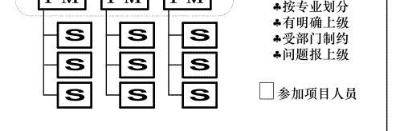

## 弱矩阵型组织

• 弱矩阵型组织（Weak Matrix organization）

## 特点

- 按专业划分
- 上级不明确
- 受部门制约
- 项目协调员
- 解决小问题

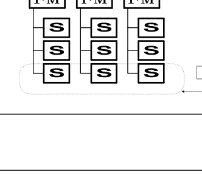

## 平衡矩阵型组织

• 平衡矩阵型组织（Balanced Matrix organization）

## 特点

- 按专业划分
- 上级不明确
- 受部门制约
- 设项目经理
- 定日常问题

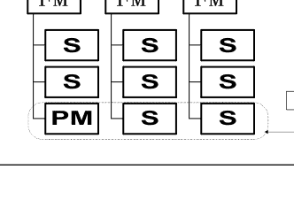

## 强矩阵型组织

- 强矩阵型组织 (Strong Matrix organization )

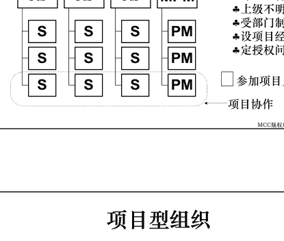

### 特点

- 专业、管理
- 上级不明确
- 受部门制约
- 设项目经理
- 定授权问题

参加项目人员

项目协作

## 项目型组织

- 项目型组织 (Projectized organization )

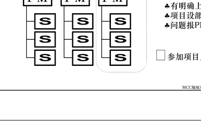

### 特点

- 按项目划分
- 有明确上级
- 项目没部门
- 问题报PM

参加项目人员

项目协作

## 主要的组织结构形式对比

| 项目特点 | 组织类型 | 职能型 | 矩阵型 |  |  | 项目型 |
|---|---|---|---|---|---|---|
|  |  |  | 弱 | 平衡 | 强 |  |
| 项目经理权限 | 很少或没有 | 有限 | 小到中等 | 中等到大 | 很高，甚至全权 |
| 组织内全时在项目上工作的员工% | 几乎没有 | 0~25 | 15~60 | 50~95 | 85~100 |
| 项目经理在项目上的投入时间 | 半时 | 半时 | 全时 | 全时 | 全时 |
| 项目经理的常用头衔 | 项目协调员 | 项目协调员 | 项目经理 | 项目经理 | 项目经理 |
| 项目管理行政人员投入项目的时 间 | 少量 | 少量 | 半时 | 全时 | 全时 |

## 项目团队

由一组个体成员为实现项目目标而组建的协同工作的队伍。

特性：

- 有很高的目的性
- 是临时性组织
- 成员有时需接受双重领导
- 团队有渐进性和灵活性
- 项目团队强调团队精神和团队合作
- 项目团队建设是项目获得成功的组织保障。

## 项目团队的创建与发展

塔克曼 (B.W.Tuckman)团队发展四个阶段模型

### 形成阶段

- 成员对工作和人际关系：高度焦虑状态
- 成员的情绪特点：
- 激动、希望、怀疑、焦急、犹豫
- 在心理上：极不稳定的阶段

应对措施：

- 明确整个团队的方向、目标和任务
- 为每个人确定职责和角色

### 震荡阶段

- 成员对工作和人际关系：剧烈动荡状态
- 成员的情绪特点：
- 紧张、挫折、不满、对立、抵制

应对措施：

- 应付和解决出现的各种问题和矛盾
- 引导成员对自己的角色及职责进行调整
- 邀请团队成员积极参与解决问题和做出决策

### 规范阶段

- 成员对工作：积极、努力
- 人际关系：已确立，大部分矛盾已解决
- 成员的情绪特点：
- 信任、合作、忠诚、友谊、满意

应对措施：

- 积极放权，使成员进行自我管理和自我激励
- 对成员取得进步予以表扬
- 积极支持团队成员的各种建议和参与
- 努力规范整个团队的行为

### 辉煌阶段

- 成员对工作：积极、努力
- 人际关系：融洽
- 成员的情绪特点：
- 开放、坦诚、依赖、集体感、荣誉感

应对措施：

- 给予团队足够的授权，使团队做到自我管理和自我激励
- 及时公布项目进程，表彰先进
- 集中精力控制好进展计划和项目变更，指导项目团队改进作业方法

## 团队精神和工作绩效

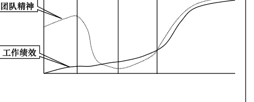

## 团队精神的内涵

- 高度的相互信任
- 相互依赖性
- 统一的共同目标
- 全面的互助合作
- 平等的关系和积极的参与
- 自我激励和自我约束

## 影响团队绩效的因素

- 领导不力
- 目标不明
- 职责不清
- 缺乏沟通
- 激励不足
- 规章不全
- 约束无力

## 项目管理框架图

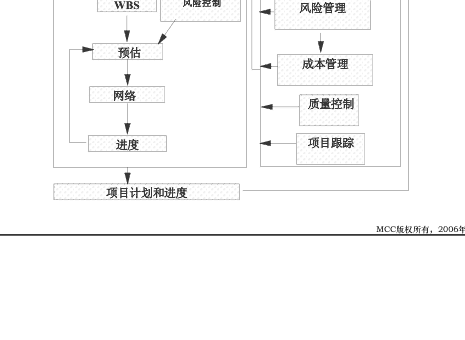

