# 吉林大学C语言课件（陈娟）


## 联系方式

- chenjuan@jlu.edu.cn
- 85166480
- http://softlab.jlu.edu.cn

## 课程组成

- 课堂讲授——闭卷考试（百分制）
  - 十二章 64学时
- 上机实验——上机考试（五级制）
  - 八个实验 32学时
- 课程设计——综合评测（五级制）
  - 短学期进行

## 课程特点

- 不同于 “解释程序设计语言”
- 强调 “程序设计”， “编程能力” 培养
  - 例题多
  - 习题多
  - 实践性强

## 讲授内容

- 所用教材
  - 《C程序设计》张长海、陈娟 高教出版社 2004
- 知识结构
  - 基础知识
  - 程序设计
  - 数据组织

### 基础知识

### 第一章 基本知识
介绍程序设计基本概念、BNF、PAD 图

### 第二章 数据信息
介绍C 基本符号、单词、数据及其类型

### 第三章 简单程序
介绍常量、变量、表达式、简单程序、赋值、I/O

### 程序设计

- 第四章 函数
  - 简单介绍模块化程序设计思想，引进子程序和函数概念
- 第五章流程控制
  - 讲述结构化程序设计的顺序、分支、循环三种程序逻辑
- 第八章再论函数
  - 进一步介绍函数，讲述参数、递归程序设计
- 第九章程序开发和结构化程序设计
  - 程序风格、自顶向下逐步求精的程序设计技术、程序的文档，以及穷举法和试探法；

### 数据组织

- 第六章 数组
- 第七章 指针
- 第十章 文件及其操作
- 第十一章 结构体和共用体
- 第十二章 动态数据结构

### 第一章 基本知识

- 程序设计语言
- C语言简况
- 程序设计语言形式化描述
- C程序结构
- 算法及其描述工具PAD
- 本章小结
- 作业

#### 程序设计语言（1）

Y = { X + 1 5 若 X < Y X − 1 5 若 X ≥ Y

##### 机器语言

1010 1001 0001 0110 0000 0001 0011 1100 0001 1000 0000 0001 ... ... ... ... ... ... ... ... 0000 0000 0000 0000 0000 0000 0000 0000

#### 程序设计语言（2）

汇编语言

```
MOV AX ,X
CMP AX ,Y
JL  S1
SUB AX ,15
JMP S2
S1: ADD AX ,15
S2: MOV Y ,AX
... ... ... ... ... ...
X DW ?
Y DW ?
```

##### 程序设计语言（3）

###### 高级语言

```
if (X<Y)
Y=X+15;
else
Y=X-15;
```

#### 注意

高级语言并不单单指C语言，如VC,BASIC 等语言也属于高级语言范畴。

#### 程序设计语言（4）— 程序的执行

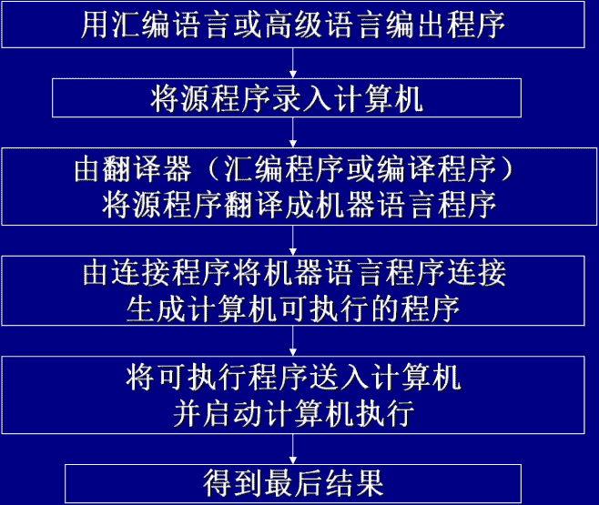

## C语言的历史背景

- 70年代初，C 语言在美国贝尔实验室诞生。它的前身可以追溯到ALGOL60、CPL、BCPL、B。
- 1982年C标准化工作开始。
- 1989年ISO公布ISO/IEC 9899:1990，简称“C89”。
- 1995年对C89作修改和补充，称为“C95”。
- 1999对C进行更大的修订后，公布 ISO/IEC 9899:1999，简称“C99”。
- 我国于1994年12月4日公布了“中华人民共和国国家标准 GB/T 15272-94 程序设计语言 C”。

## C语言的缺点

1. 语法不严格
2. 类型机制不严密，比如字符类型与整数类型没有区别、不检查下标超界
3. 程序设计自由度太大，不利于保证程序的正确性
4. 若程序与计算机硬件联系太密切，则可移植性不好
5. 有些语言成分太复杂，比如运算符
6. 语言本身不能保证程序设计的结构化。

## 程序设计语言形式化描述

- 组成
  - 语法——规则
    - 巴克斯-脑尔范式(BNF)
  - 语义——意义
    - if (X<Y)
      Y=X+15;
    - else
      Y=X-15;

## BNF

- 自然语言
  - 字 → 单词 → 句子 → 语言
- 计算机语言
  - 字符 → 词法单位(token) → 程序 → 语言

词法　　　　　　　　　文法

- BNF
  - 一种形式化描述语法的工具，一种表示方法

### <英语句子>

<主语> <谓语> <宾语>

<冠词> <形容词> <名词> <动词> <冠词> <名词>

the big elephant ate the peanut

G: <英语句子> :: = <主语><谓语><宾语>
<主 语> :: = <冠词><形容词><名词>
<冠 词> :: = the
<形容词> :: = big
<谓 语> :: = <动词>
<动 词> :: = ate
<宾 语> :: = <冠词><名词>
<名 词> :: = peanut
<名 词> :: = elephant

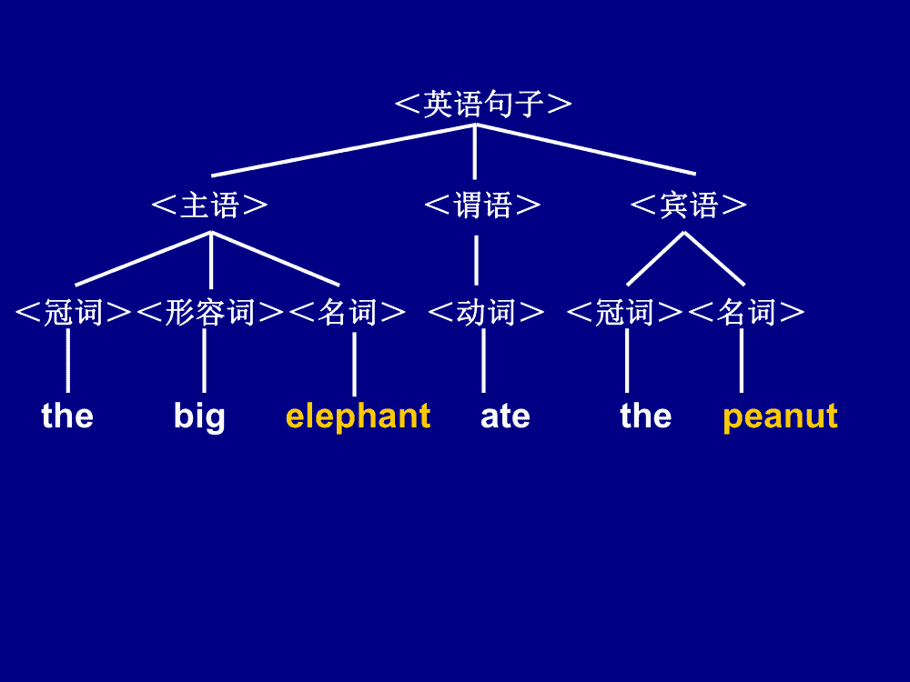

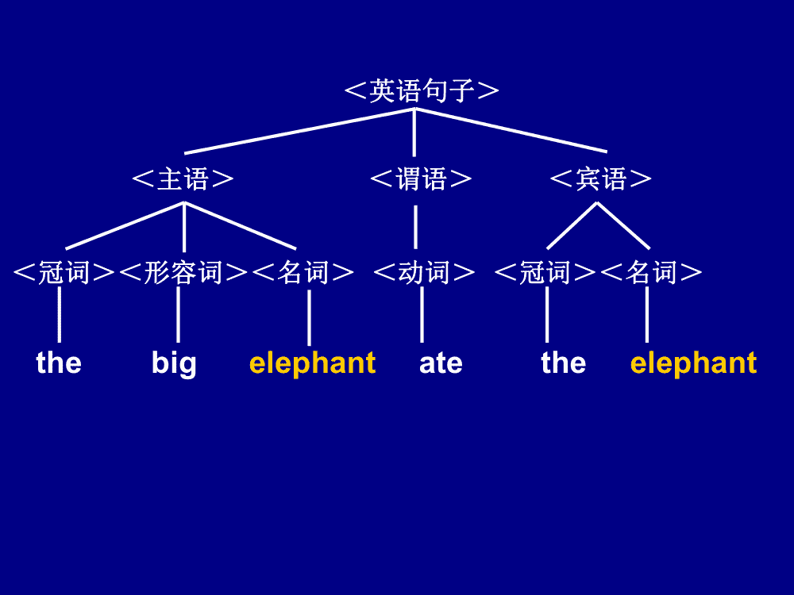

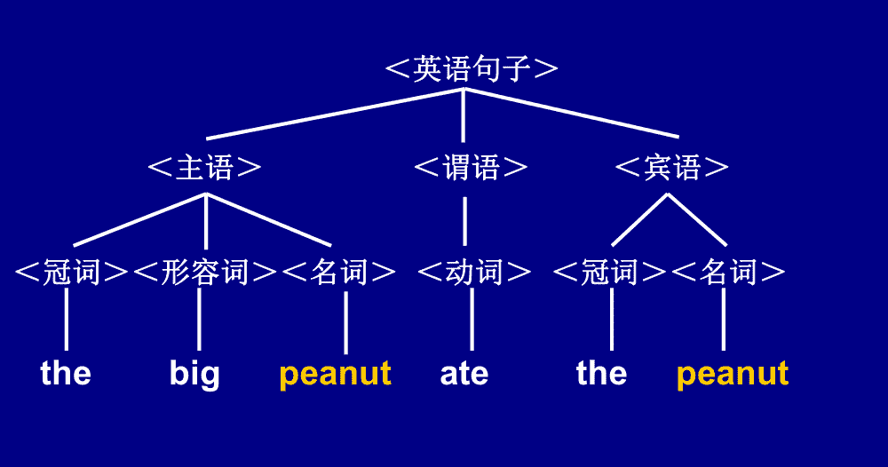

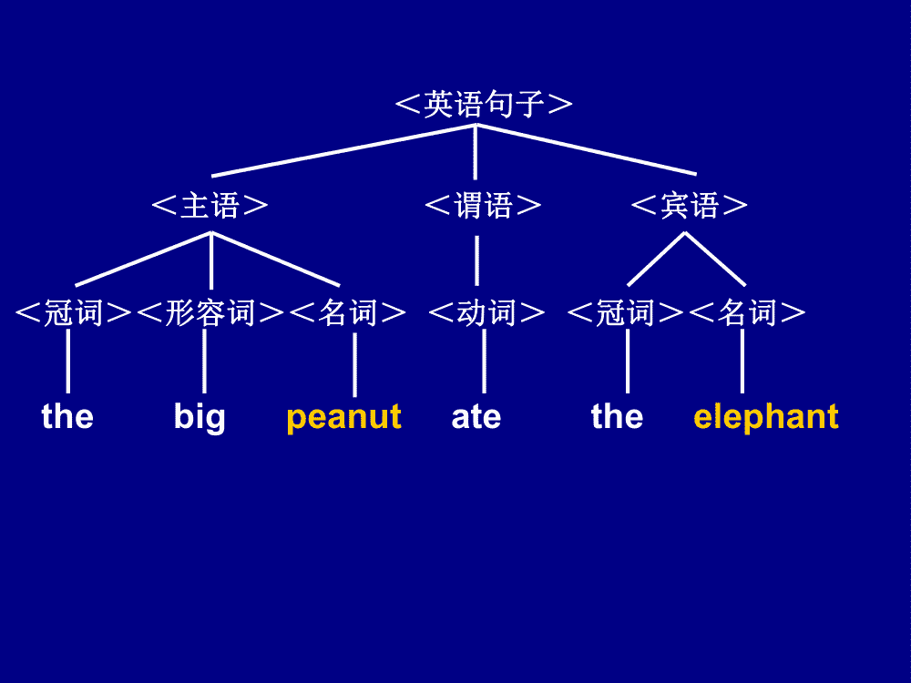

文法G对应的句子有：

The big elephant ate the peanut

The big peanut ate the elephant

The big peanut ate the peanut

The big elephant ate the elephant

L(G)={
The big elephant ate the peanut
The big peanut ate the elephant
The big peanut ate the peanut
The big elephant ate the elephant
}

G: <英语句子> :: = <主语><谓语><宾语>
<主 语> :: = <冠词><形容词><名词>
<冠 词> :: = the
<形容词> :: = big
<谓 语> :: = <动词>
<动 词> :: = ate
<宾 语> :: = <冠词><名词>
<名 词> :: = peanut
<名 词> :: = elephant

文法的组成
文法开始符 规则 / 产生式
非终极符 终极符

## 例1.1—无符号整数集合

G: N ::= D   N ::= ND
D ::= 0   D ::= 5
D ::= 1   D ::= 6
D ::= 2   D ::= 7
D ::= 3   D ::= 8
D ::= 4   D ::= 9

符号“|”表示“或者”文法可简写成：

```
G: N ::= D | ND
D ::= 0 | 1 | 2 | 3 | 4 | 5 | 6 | 7 | 8 | 9
```

## 例 1.2

- 集合 `{0^n1^n | n≥0}` 对应的文法 G1
  
  `G1: S ::= 01 | 0S1`
  
- 将符号 `::=` 用 `→` 代替
  
  `G1: S → 01 | 0S1`

## 例1.3—标识符

- 标识符
  由字母或开头,后跟任意多个字母或数字组成的字符串
- <标识符> → <字母>
  | <标识符><字母>
  | <标识符><数字>

## 例1.4—标识符表

- 标识符表
  - 一个标识符是标识符表
  - 标识符表后边跟一个逗号 “ ,” 和一个标识符还是标识符表

- <标识符表> → <标识符>
  | <标识符表> , <标识符>


### C程序结构

＜程序＞→＜编译单元表＞

＜编译单元表＞→＜编译单元＞

＜编译单元＞＜编译单元表＞

＜编译单元＞→＜顶层声明表＞

＜顶层声明表＞→＜顶层声明＞

＜顶层声明表＞＜顶层声明＞

＜顶层声明＞→＜声明＞
＜函数定义＞

＜函数定义＞→＜函数定义说明符＞＜复合语句＞

### C程序实例

```
文件hello.c
#include <stdio.h>
void hello(void){
    printf("Hello!\n");
}
```

```
文件startup.c
extern void hello(void)
int main(void) {
    hello();
    return 0
}
```

程序执行过程

hello.c → hello.obj

startup.c → startup.obj

startup.exe

### 软件开发一般过程

- 可行性研究
- 需求分析
- 设计
  - 概要设计
  - 详细设计
    - 建立数学模型
    - 找出计算方法
    - 进行算法分析
- 实现
  - 写出程序
  - 调试程序
- 测试
  - 组装测试
  - 确认测试
- 使用
- 维护

### 求玉米产量


### 分析步骤

- 第一步
  - 计算该地块面积
  - 折合成亩（每亩1000平方米）
  - 求总产量
- 第二步
  - 计算三角形ABD的面积，设为S1；
  - 计算三角形BCD的面积，设为S2；
  - S1+S2

### 第三步——选择计算三角形面积公式

\( S = \sqrt{s(s-a)(s-b)(s-c)} \)

- \( S \) 是三角形面积，\( a, b, c \) 三角形三边边长
- \( s = (a+b+c)/2 \)

### 第四步—— 计算△ABD(△ BCD)面积

- 求边AB长度，记为ab;
- 求边BD长度，记为bd;
- 求边AD长度，记为ad;
- 计算s
- 计算S

### 第五步——求三角形边长

L = √[(x₁ − x₂)² + (y₁ − y₂)²]

### 计算过程

- 1. 按公式求出AB边长度 ab
- 2. 用同样公式计算边BD长度bd
- 3. 用同样公式计算边AD长度ad
- 4. 按公式计算出s
- 5. 按公式计算出△ABD的面积S1
- 6. 重复上述1、2、3、4、5步计算△BCD的面积S2
- 7. 计算总面积S=S1+S2
- 8. 把面积S折合成亩SS=S/1000
- 9. 计算总产量M=SS×950

### 程序设计过程

- 1. 建立数学模型—把实际问题转化为数学问题
- 2. 找出计算方法—为数学问题的求解找出方法
- 3. 进行算法分析—为实现计算方法给出具体算法
- 4. 选择程序设计语言，编出计算机程序—写程序
- 5. 调试程序—保证程序的正确性
- 6. 运行，测试程序的正确性—组装测试、确认测试
- 7. 交付使用并维护

### 算法

- 什么是算法
  - 一个计算过程，包含具体明确的操作
  - 描述了解决问题的方法和途径
  - 是程序设计的基础和精髓
- 有效算法的特点
  - 有穷性
  - 确定性
  - 有效性

### 算法的组成

- 基本操作
  - 表达式以及给变量赋值
  - 读（输入）
  - 写（输出）
- 基本控制结构
  - 顺序控制结构
  - 分支控制结构
  - 循环控制结构
  - 函数调用
  - 函数返回

### PAD (Problem Analysis Diagram)

操 作

- 1. 操作1
- 2. 操作2
- ...
- n. 操作n

基本操作

顺序控制结构

按公式 计算边AB边长度ab;

用同样公式计算边BD长度bd;

用同样公式计算边AD长度ad;

按公式 计算s

按公式 计算△ABD的面积S1

计算另一个△形BCD面积S2

求总面积S=S1+S2

折合成亩

计算总产量

打印输出

### 具体程序

```
#include <stdio.h>
#include <math.h>
```

头文件

```
#define xa 547
#define ya 411
#define xb 804
#define yb 77
#define xc 39
#define yc 208
#define xd 116
#define yd 332
```

常量定义

```
float ab, bd, ad, bc, cd;
float s, s1 ,s2,ss,m;
```

变量声明

```
```c
void main(void) {
    // 主函数
    // 计算一个三角形面积
    ab=sqrt( (xa-xb)*(xa-xb)+(ya-yb)*(ya-yb) );//边ab长
    bd=sqrt( (xb-xd)*(xb-xd)+(yb-yd)*(yb-yd) );//边bd长
    ad=sqrt( (xa-xd)*(xa-xd)+(ya-yd)*(ya-yd) );//边ad长
    s=(ab+bd+ad)/2;    //s
    s1=sqrt( s*(s-ab)*(s-bd)*(s-ad) );                 //面积
    // 计算另一个三角形面积
    bc=sqrt( (xb-xc)*(xb-xc)+(yb-yc)*(yb-yc) );//边BC长
    cd=sqrt( (xc-xd)*(xc-xd)+(yc-yd)*(yc-yd) );//边CD长
    s=(bc+bd+cd)/2;             //边BD长bd前边已经计算
    s2=sqrt( s*(s-bc)*(s-bd)*(s-cd) );
    ss=s1+s2;                   // 总面积S=S1+S2
    ss=ss/1000;                 // 折合成亩
    m=ss*950;                   // 计算总产量
    printf("m=%10.3f\\n",m);   // 打印输出
}
```
```

### PAD—分支结构

Y = { X + 15   若   X < Y
      X - 15   若   X ≥ Y }

- 双分支结构
  - 如果条件为真，执行操作1
  - 否则执行操作2

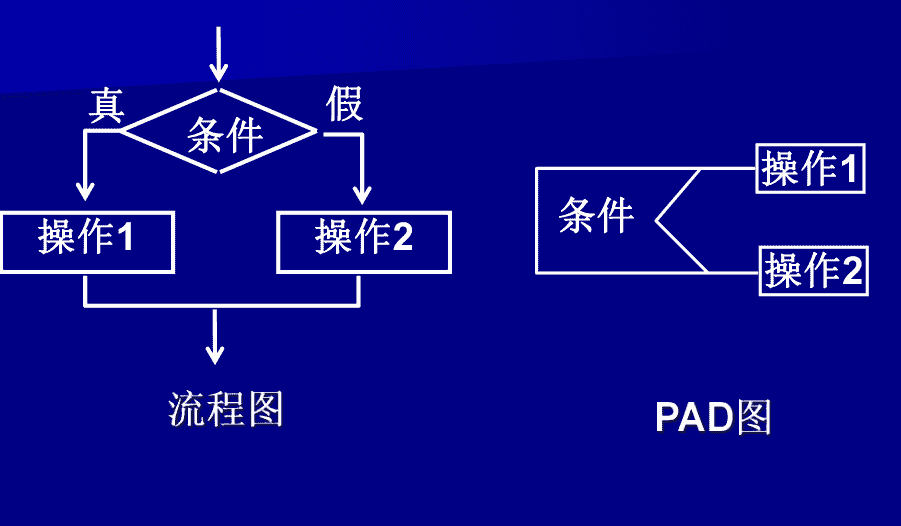

Y = { X + 15   若   X < Y
      X − 15   若   X ≥ Y }

X<Y

Y=X+15

Y=X-15

- Y≠0时 X=Z÷Y
- 单分支
  - 如果条件为真，执行操作

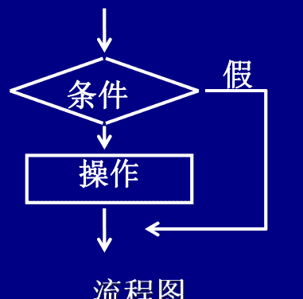

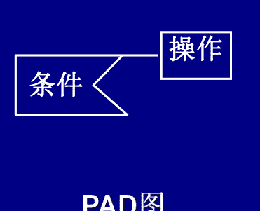

+   Y≠0时 X=Z÷Y

Y ≠0

X=Z÷Y

# 本章小结

- 程序设计语言
- C语言简况
- 程序设计语言形式化描述
- C程序结构
- 算法及其描述工具PAD图

# 作业

- ① 1.1
- ② 1.2
- ③ 1.4
- ④ 1.5
- ⑤ 1.12

### 思考

- 无符号十进制偶整数
- 可被2整除的二进制无符号整数
- 将A、B两瓶分别盛放的物质互换
- 流程图到PAD图的转换

### 无符号十进制偶整数

S→T | NT

T→0 | 2 | 4 | 6 | 8

N → D | ND

D → 0 | 1 | 2 | 3 | 4 | 5 | 6 | 7 | 8 | 9

### 可被2整除的二进制无符号整数

S → 0 | A0
A → A0 | A1 | 1


### 流程图到PAD图的转换

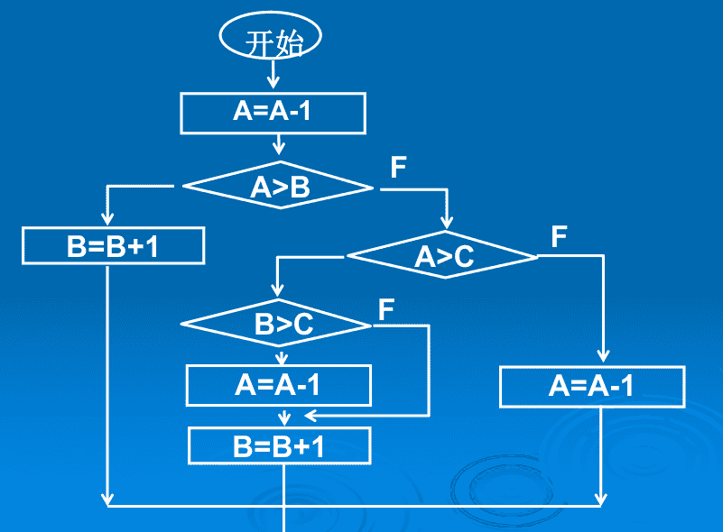

```
A=A-1

A=A+1

B>C

B=B+1

A>B

A>C

B=B+1

A=A-1
```

### 第二章 数据信息

- 自然语言
  - 字→单词→句子→语言
- C语言
  - 字符→词法单位(token)→程序→语言
    - ↑ 词法
    - ↑ 文法

- 基本符号
- 数据
- 混合运算
- 关系运算

#### 字符集

- 任何计算机系统都使用一个可被本系统识别的字符集。
- 字符形态
  - 可视形态
  - 存储形态——ASCII
- C语言的字符集
  - 字母
  - 数字
  - 诸如句号、逗号、括号之类的特殊字符
- ASCII（The American Standard Code for Information Interchange）（附录一）
  - 可视字符
    - 字母：a~z A~Z
    - 数字：0~9
    - 特殊字符：+ - * / % ^ 等
  - 不可视字符
    - 文本控制符
    - 介质控制符
    - 等等

#### C语言中使用的字符集只是ASCII的一个子集

```
<字母> → A | B | C | D | E | F | G | H | I | J | K | L | M | N | O | P | Q | R | S | T | U | V | W | X | Y | Z | a | b | c | d | e | f | g | h | i | j | k | l | m | n | o | p | q | r | s | t | u | v | w | x | y | z

<数字> → 0 | 1 | 2 | 3 | 4 | 5 | 6 | 7 | 8 | 9

<特殊字符> → ! | # | % | ^ | & | * | ( | _ | ) | - | + | = | ~ | [ | ] | ' | | | \ | ; | : | " | { | } | , | . | < | > | / | ?
```

#### 标识符

- 标识符（identifier）
  - 用来表示程序中出现的任何对象，如：类型、变量、函数名字。
- 语法

```
<标识符> → <非数字字符>
         | <标识符><非数字字符>
         | <标识符><数字>
<非数字字符> → <字母> | _
```

## 例子

- `Abc_34`  `_age`  `the_total`  `WG4`
- ~~2forthemoney~~
- ~~Case on hand~~
- ~~Over&&under~~

#### C标识符分成两大类

- 标准标识符
  - 标准库中使用的标识符。
  - 这些标识符的含义已经由C预先定义好了，也称预定义标识符。
  - 不允许程序员在程序中使用它们。
- 用户自定义标识符
  - 用户依据需要给自己使用的类型、变量、函数等对象起的名字，它类似于数学中的符号名。

- 任何标识符只有声明后才有意义。
- C规定不允许使用无定义的标识符。
- 因此程序中出现的一切标识符都必须给以声明，指出该标识符的具体意义。
- 所有标识符必须先声明再使用。

#### 保留字

```
<保留字> → auto │ bool │ break │ case │ char │ _Complex │ const │ continue │ default │ restrict │ do │ double │ else │ enum │ extern │ float │ for │ goto │ if │ _Imaginary │ inline │ int │ long │ register │ return │ short │ signed │ sizeof │ static │ struct │ switch │ typedef │ union │ unsigned │ void │ volatile │ while
```

#### 在使用自定义标识符时需要注意以下几点

- ① 不能与保留字重名
- ② 必须声明且必须先声明后使用
- ③ 不允许重复声明
- ④ 拼写完全一致的两个标识符是相同的
- ⑤ 字母是区分大小写的
- ⑥ 尽量与它所代表对象的含义相符

#### 分隔符

```
<分隔符> → # | ( ) | [ ] | ' | | ; | : | " | { } | , | \
```

#### 运算符

```
<运算符> → ! % ^ & * - + = ~ | . < > / ? += -= *= /= %= <<= >>= &= ^= |= -> ++ -- << >> <= >= == != && ||
```

- 由两个字符组成的运算符中间不允许夹有任何其它符号（包括空格）
  - `<=`  `++`  `&=`
  - `< =`  `+ +`  `& =`
- 保留字、分隔符和运算符都是一些有特殊意义的记号，在C程序中起关键作用，定义程序各部分及整个程序的含义。
- `"="` 表示赋值
  - `X=2` 表示为变量X赋值成整数2
- `"=="` 表示判断是否相等
  - `x==y` 表示判断x与y的值是否相等；
  - `7==2` 表示判断7与2的值是否相等，结果为false；
- `"/"` 表示除法
  - `7/2` 表示整数7除2，结果为3；
  - `7.0/2` 表示浮点数7.0除整数2，结果为3.5；
- `"%"` 是整数求余（求模）
  - `7 % 2` 表示求7整除2后的余数，结果为1；
  - ~~7.0%2~~
- `for` 表示循环语句的开始；
- `int` 是整数类型说明符；
- `“{”、“}”` 分别表示复合语句的开始和结束。

#### 常量

- C程序处理的数据
- 作为词法单位存在的C常量是指字面常量。
- 语法

```
<常量> → <整数类型常量>
       | <浮点类型常量>
       | <字符类型常量>
       | <字符串类型常量>
```

- 每种常量都具有值和类型。

##### 整数类型常量

- 一个数字序列
- 可用十进制、八进制、十六进制表示
  - 如果整数类型常量以0x或0X开头则是十六进制表示
  - 如果整数类型常量以0开头则是八进制表示
  - 否则是十进制表示
- 例子
  - `17409`  `014`  `0xC` 或 `0XC`
  - ~~17,409~~

##### 浮点类型常量

- 带小数点
- 带指数
- 同时包含两者

**例子**

```
12.34    0.25    71.0
7777.    .8888
```

###### 浮点类型常量的两种形式

**定点表示法**

- 数字序列，后跟一个小数点。
- 数字序列，前加一个小数点。
- 数字序列，后跟一个小数点，再跟一个数字序列。

**浮点表示法（指数表示法，科学表示法）**

- `<尾数>E<指数>`
- `<尾数>e<指数>`
- 对应的值：`<尾数>×10^<指数>`

###### 合法的定点表示法的浮点数

```
12.34    0.25    71.0
7777.    .8888
```

###### 非法的定点表示法的浮点数

- `5,204.65`（不应有逗号）

###### 合法的浮点表示的浮点类型常量

- `34.789E4` 表示 34.789×10⁴
- `.29e-5` 表示 0.29×10⁻⁵
- `534E+5` 表示 534×10⁵
- `4.7E-3` 表示 4.7×10⁻³
- `0.0E0` 表示 0×10⁰
- `755.E4` 表示 755×10⁴

###### 非法的浮点表示的浮点数

- `E5`（E前无数字序列）
- `234E`（E后无指数部分）

##### 字符型常量

由单引号（撇号）括起来的一串字符，如 `'T'`、`'r'`、`'This is a character'`。

##### 字符串型常量

由双引号括起来的一串字符，如 `“This is a string”`、`“”`、`"Total expenditures:"`。


#### 字符转义符

- 源程序中无法或很难直接输入的字符，如回车符，空白符等。
- 可在字符型和字符串型常量中使用**字符转义符**
- 形式
- 反斜杠后跟一个八进制或十六进制整数，表示的字符是ASCII码值为相应整数的字符
- 反斜杠后跟一个特殊字符，代表特殊意义

##### 反斜杠后跟一个八进制或十六进制整数，表示的字符是：ASCII码值为相应整数的字符。例如

| 看作字符 | * |
|---|---|
| \101 | 看作字符 A |
| \141 | 看作字符 a |
| \x41 | 看作字符 A |
| \x61 | 看作字符 a |
| \0 | 看作字符 null |

##### 反斜杠后跟一个特殊字符，代表的符号含义

| 转义符 | ASCII码值（十进制） | 含义 |
|---|---|---|
| \\a | 7 | 警报，如铃声， |
| \\b | 8 | 退格符 |
| \\t | 9 | 水平制表符 |
| \\n | 10 | 换行符 |
| \\v | 11 | 垂直制表符 |
| \\f | 12 | 换页符 |
| \\r | 13 | 回车符 |
| \\" | 34 | 双引号 |
| \\' | 39 | 单引号 |
| \\? | 63 | 问号 |
| \\\\ | 92 | 反斜杠 |

#### 间隔符

任何由标识符、保留字、字面常量组成的两个相邻词法单位之间至少应有一个间隔符。多个间隔符一起连用相当于一个。

- 空格
- 行结束符
- 水平制表符
- 垂直制表符
- 换页符

317 写成 3 1 7
<= 写成 < =

#### 注释

##### 分类

- 由 “/**”和 “*/”，括起来的任意一串字符
- 由 “//”开始，直到该对斜线所在文本行结束

##### 功能

注释是给程序加注解用的，对程序的实际意义没有任何影响，只增加程序的可读性

#### 意义

适当利用间隔符和注释组织程序的印刷格式，使得一个程序在行文上看清晰，易读。是良好的程序设计习惯。

```
/********************************************************************
函数int MAX(int x, int y)
形参x, y分别是整数类型
返回值是整数类型
函数MAX用来求参数x, y中的最大值
********************************************************************/
int MAX(int x, int y){
    if (x>y)
        return x;    //x较大，返回x
    else
        return y;    //否则y较大，返回y
}
```

```
#include <stdio.h>
int i;
void main () {
    i = 25+38;
    printf ( "25+38=%od" , i );
}
```

这不是一个好习惯。读者在书写程序以及向计算机录入程序时，应尽量使程序看起来结构清晰，层次分明。

```
#include
<stdio.h>
int i;main (
)
{
    i = 25+38;    printf
"25+38=%od" ,
    i );
}
```

#### 数据

- 数据是计算机处理的对象，类型是数据的一种属性
- 数据类型的含义
- 确定一个值集合，该类型的数据能够取值的范围
- 确定一个运算集合，能够施于该类型数据上进行的运算

#### 数据类型

- 标量类型
  - 算术类型
    - 浮点类型
      - 整型
      - 字符型
    - 整数类型
      - 布尔型
      - 枚举型
  - 指针类型
- 组合类型
  - 数组类型
  - 结构体类型
- 共用体类型
- 函数类型
- void类型

##### 浮点类型

- C中浮点类型包括：
  - 各种长度的浮点类型（float, double, long double）
  - 各种长度的复数类型（float _complex, double _complex）
  - 各种长度的虚数类型（float _imaginary）
- 含义
  - 抽象 float 类型对应实数
  - 实际 float 类型 是实数的一个子集

###### 封闭于浮点类型的运算包括：

- * / 等

#### 注意

- 两个几乎相等的值相减，会引起很大的误差。
- 若除数的绝对值很小，结果很可能引起溢出。
- 在比较X、Y两个浮点值是否相等使用|X-Y|<ε

##### 整数类型

- 在C中整数类型包括各种长度的带符号与不带符号的整数类型（short、int、long、unsigned、signed等以及它们的组合）。
- 封闭于整数类型的运算（运算分量和结果都是整数类型）包括：
  - * / %

##### 字符类型

- 字符类型就是单个字符
- 在C中把字符类型看成整数类型，其整数值是在计算机系统字符集中的编码，也就是我们所说的相应字符存储形态的编码值。
- 由于C把字符类型看成整数类型，还定义了带符号和不带符号的字符类型。
- 在C中，所有关于在整数类型的运算定义，自然也都适用于字符类型。

##### 布尔类型(bool)

###### bool类型

- false（假）、true（真）
- C中把bool类型看成整数类型分别用0，1表示false 和 true

#### 运算

!（非） &&（与） ||（或）

| b₁ | b₂ | ! b₁ | b₁ && b₂ | b₁ || b₂ |
|---|---|---|---|---|
| false | false | true | false | false |
| false | true |  | false | true |
| true | false | false | false | true |
| true | true |  | true | true |

##### 枚举类型

- 更直观的表示一些分类
  - 一周有七天
  - 一年有十二个月
  - 一个学期有哪些课程
- 枚举类型通过枚举表记值的标识符确定一个类型的值的有序集合

###### 最基本的枚举类型说明符形式是：

– enum { id , id , id , ... , id }
– enum id_tag { id , id , id , ... , id }

其中每个id是一个标识符，也是相应枚举类型中的一个值，称枚举常量。

全部标识符集合构成相应枚举类型的值域

enum { Sun, Mon, Tue, Wed, Thu, Fri, Sat}

enum month { Jan, Feb, Mar, Apr, May,
Jun, Jul, Aug, Sep, Oct, Nov, Dec}

enum color { red, green, blue } // 红、绿、蓝

##### 枚举类型与整数类型

- 在C中仍然把枚举类型看成整数类型，每个枚举常量对应一个整数值。一般情况下，枚举表的第一个标识符对应整数值**0**，其它标识符对应前一个标识符整数值**+1**。上述例子中

red 对应 0
green 对应 1
blue 对应 2

- 还可以在在声明枚举类型时，在枚举常量标识符后标识上该常量对应的整数值，例如：

```
enum color { red = 10, yellow = red+2, green = 15, blue }
```

###### 表示

| red | 对应 | 10 |
| --- | --- | --- |
| yellow | 对应 | red+2 即 12 |
| green | 对应 | 15 |
| blue | 对应 | green+1 即 16 。|

在C中，所有关于在整数类型的运算定义，自然也都适用于枚举类型。

###### 使用枚举类型应注意：

- 括在花括号中的枚举常量表中的标识符都是常量
- 枚举常量表中的标识符不可重复

```
enum{ab,cd,ab,if};
```

- 枚举常量表中的标识符不能与其它标识符重复

```
int x;
enum {x,y,z,c};
```

- 不能用保留字作枚举常量

```
enum{while,I,j};
```

- 尽管C把枚举类型看作整数类型，枚举常量也与整数对应，
但我们还是建议读者区别开枚举常量和整数。


#### 混合运算

+   C中只有两种简单类型：浮点类型和整数类型

+   字符类型、布尔类型、枚举类型都是整数类型的不同表现形式。

+   通常称浮点类型和整数类型为算术型，称可施于算术型上的运算为算术运算。相应运算符称为算术运算符。

+   在日常习惯上，人们往往不区分算术型中的浮点类型和整数类型。为了照顾这种习惯，C允许在浮点类型和整数类型之间进行混合运算，混合运算后结果为浮点类型。

#### 算术运算符、分量类型、结果类型

| 运算符 | 运算 | 运算分量类型 | 结果类型 |
|---|---|---|---|
| + | 单目恒等 | 浮点类型 或 整数类型 | 同运算分量类型 |
| - | 单目取负 |  | 若两个分量类型都是整数类型则为整数类型；否则为浮点类型。 |
| + | 加 |  |  |
| - | 减 |  |  |
| * | 乘 |  |  |
| / | 除 |  |  |
| % | 求余数 | 整数类型 | 整数类型 |

#### 关系运算

+   - 浮点类型、整数类型、char 类型、bool类型、枚举类型都属于简单类型，即它们的值是可比的。
+   - 关系运算
+     - 对两个值进行大小关系的比较，称为进行关系运算，产生 bool类型结果。
+     - 运算符有
+       - < （小于） > （大于）
+       - <= （小于等于） >= （大于等于）
+       - == （等于） != （不等于）

# 本章小结

+   - 基本符号集合

+   - 词法单位

+   - 简单数据类型及运算

# 作业

+   1. 2.1
+   2. 2.4
+   3. 2.6
+   4. 2.9
+   5. 2.14

### 第三章 简单程序

+   一. 当量

+   二. 变量

+   三. 表达式

+   四. 语句组成

+   五. 表达式语句

+   六. 赋值

+   七. 类型转换

+   八. 输入/输出

### 具体程序

```
#include <stdio.h>
#include <math.h>
```

头文件

```
#define xa 547
#define ya 411
#define xb 804
#define yb 77
#define xc 39
#define yc 208
#define xd 116
#define yd 332
```

常量定义

```
float ab, bd, ad, bc, cd;
float s, s1 ,s2,ss,m;
```

变量声明

```
void main(void) {
    ab=sqrt( (xa-xb)* (xa-xb)+(ya-yb)* (ya-yb) ); //边ab长
    bd=sqrt( (xb-xd)* (xb-xd)+(yb-yd)* (yb-yd) ); //边bd长
    ad=sqrt( (xa-xd)* (xa-xd)+(ya-yd)* (ya-yd) ); //边ad长
    s=(ab+bd+ad)/2; //s
    s1=sqrt( s*(s-ab)*(s-bd)*(s-ad) );

    bc=sqrt( (xb-xc)* (xb-xc)+(yb-yc)* (yb-yc) ); //边BC长
    cd=sqrt( (xc-xd)* (xc-xd)+(yc-yd)* (yc-yd) ); //边CD长
    s=(bc+bd+cd)/2; //边BD长bd前边已经计算
    s2=sqrt( s*(s-bc)*(s-bd)*(s-cd) );
    ss=s1+s2; // 总面积S=S1+S2
    ss=ss/1000; // 折合成亩
    m=ss*950; // 计算总产量
    printf("m=%10.3f\n",m); // 打印输出
}
```

### 常量(constant)

+   在程序执行期间不变的数据称为常量

+   如 圆周率π的近似值3.14165926

+   自然对数底 e 的近似值2.7183 等

+   可以直接书写在程序中的常量， 称为字面常量。

```
#include <stdio.h>
void main() {
    printf("%f \n", 2.7183);
}
打印出 2.7183
```

### 常量标识符

#### 为什么

+   - 一个常量多次用到

+   - 方便修改常量

#### 如何声明

+   - 枚举常量表中的标识符就是常量标识符

+   - `#define` 标识符 常量

#### 如何使用

```
#define SPEED 55
```

```
#define pai 3.14
#define R 10
void main(){
    float x,y;
    x=2*pai*R;
    y=pai*R*R
}
```

```
#define pai 3.14
#define R 10
void main(){
    float x,y;
    x=2*3.14*10;
    y=3.14*10*10
}
```

```
#define pai 3.14,
#define R 10;
void main(){
float x,y;
x=2*pai*R;
y=pai*R*R
}
```

```
#define pai 3.14;
#define R 10;
void main(){
float x,y;
x=2* 3.14; * 10 ;;
y= 3.14; * 10 ; * 10 ;
}
```

### 变量(variable)

+   - 相对于常量，变量是程序执行期间值可变的数据对象

+   - 两个方面

+   - 变量值：程序运行某一时刻，变量所具有的值

+   - 变量属性：

+   - 名字

+   - 数据类型

+   - 作用域

+   - 存储空间

+   - 存储地址 等

编译程序在把高级语言程序翻译成机器语言时

+   - 给每个变量都分配一块适当的存储空间，以便随时保存变量的值。这块存储区就是**变量的存储区**

+   - **变量的地址**就是这块存储区的**首地址**

+   - **变量的值**就是这块存储区中现行保存的数据。

+   - 变量v 被分配在内存地址为0F000开始的存储区域，当前值为5。


### 变量声明

+   - 声明变量的意义：
+     - 引进新变量
+     - 规定所引变量的属性

+   - 语法
+     - `<变量声明> → <类型> <变量项表> ;`
+     - `<变量项表> → <变量项>`
+       - `| <变量项>, <变量项表>`
+     - `<变量项> → <标识符>`
+       - `| <标识符> = <初值>`

不考虑初值的一般形式

T id , id , ... , id ;

+   - 变量类型

+   - 变量名字

+   - 变量的作用域

例子

```
int i , j , k ;
char c ;
int t ;
float amount , total ;
bool flag ;
enum { red,blue,green } color ;
```

```
void main(){
int x,y;
z=x*2;
char z;
x=x+y;
z=x+y;
W=z+x;
}
```

### 变量出现形态

+   - 声明出现

+   - 赋值出现

+   - 引用出现

```
int n, x;
n=1;
n=3;
n=n*5+7
x=n;
```

```
x: 22
n: 22
```

声明出现时，分配变量域空间的存储单元（类型的大小由变量当前值状态数据决定的数量赋值到该变量中，使了变量必须是有值定义的’前值有定义的有值的，不会改变变量的值。这时称该变量为‘值无定义的变量本身引用变量：

+   - 多出现在参数结合中

+   - 可是“值无定义的”

+   - 可能会改变变量的值

#### 变量地址

#### 变量地址

变量在内存中的所在位置，即内存地址。

#### 求地址

将单目运算符“&”，缀在变量前，求相应变量地址。

## 例子

+   - 被分配在内存地址为0F000开始的存储区域的变量V

+   - &V 的值就是 0F000，也称为V的指针

### 变量初始化

#### 形式

id = 初值

## 例子

int i=0 , j=1 , k=100*2, m=k*i*j;
char   c='A' ;
enum   { red,blue,green } color = red ;

变量在声明时被赋以初值，则在程序开始运行时，它便取得了相应值，它是**值有定义的**。


```
enum set {a,b,c,d} var_set;

enum set {a,b,c,d} var_set=d;

enum set {a,b,c,d};
enum set var_set=d;

enum {a,b,c,d} var_set=d;
```

### 变量使用注意事项
- 程序中使用的一切变量都必须声明。
- 在同一作用域内，任何两个变量不许重名，也不许与其它类标识符重名。
- 从程序的静态行文顺序看，变量的声明必须出现在所有使用之前。
- 从程序的静态行文顺序看，在变量声明中给变量赋初值处，相应表达式必须是可计算的。
- 从程序的动态执行顺序看，为变量赋值的出现必须在所有使用值之前。

### 表达式
表达式(expression) 是 C 程序完成各类运算的主要部分，由运算符和运算分量组成。

语法
<表达式> → <基本表达式>
│ <后缀表达式>│ <一元表达式>
│ <二元表达式>│ <条件表达式>
│ <逻辑表达式>│ <赋值表达式>
│ <顺序表达式>
<基本表达式> → <标识符>
│ <字面常量>
│ （<表达式>）

### 基本表达式是C表达式的最底层，包括：
- 标识符
- 字面常量
- 括号表达式

### 标识符包括变量标识符和常量标识符，它们的类型由相应声明给出，当表达式计算时，变量应该是值有定义的。

### 字面常量

### 括号括表达式

3*6
u>0
r=(x+y)*5<=(r-s)/8

- 3、6、u、r、x、y、5、s、8 都是基本表达式
- 经与运算符组合后的 x+y 、r-s 是表达式；
- 用括号括上的表达式 (x+y)、(r-s) 又变成基本表达式
- 最终若干基本表达式与运算符组合得到的 r=(x+y)*5<=(r-s)/8 仍是表达式。

### 运算符优先级

| 记号 | 运算符 | 类别 | 结合关系 | 优先级 |
|---|---|---|---|---|
| 标识符、字面常量、(...) | 简单记号 | 基本表达式 | 无 | \multirow{7}{*}{16} |
| a[k] | 下标 | \multirow{6}{*}{后缀} | \multirow{6}{*}{从左到右} | |
| F(...) | 函数调用 | | | |
| . | 直接选择 | | | |
| -> | 间接选择 | | | |
| ++ -- | 自增 自减 | | | |
| (类型名){初始化列表} | 复合字面值 | | | |

| 记号 | 运算符 | 类别 | 结合关系 | 优先级 |
|---|---|---|---|---|
| ++ -- | 自增、自减 | 前缀 | \multirow{8}{*}{从右到左} | \multirow{7}{*}{15} |
| sizeof | 长度 | \multirow{7}{*}{一元} | | |
| ~ | 按位取反 | | | |
| ! | 逻辑非 | | | |
| - + | 算术负、正 | | | |
| & | 地址 | | | |
| * | 间接访问 | | | |
| (类型名) | 类型转换 | | | 14 |

| * / % | 算术乘、除、求余数 | 二元 | 从左到右 | 13 |
| --- | --- | --- | --- | --- |
| + - | 算术加、减 |  |  | 12 |
| << >> | 左移、右移 |  |  | 11 |
| < > <= >= | 关系运算 |  |  | 10 |
| == != | 判等运算 |  |  | 9 |
| & | 按位与 |  |  | 8 |
| ^ | 按位异或 |  |  | 7 |
| | | 按位或 |  |  | 6 |
| && | 逻辑与 |  |  | 5 |
| || | 逻辑或 |  |  | 4 |
| ? : | 条件表达式 | 三元 |  | 3 |
| = += -= *= /= %= <<= >>= &= ^= |= | 赋值 | 二元 | 从右到左 | 2 |
| , | 顺序表达式 |  | 从左到右 | 1 |

### C 表达式与通常数学表达式的书写区别：

#### 1. 所有字符必须写在一条水平线上。不允许出现上、下角标、分数线等。

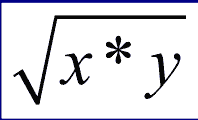

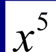

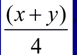

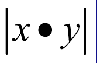

sqrt(x*y)

x*x*x*x*x

(x+y)/5

fabs(x*y)

#### 2. a乘b
ab a b a×b a*b

#### 3. 除了下标使用方括号以外，所有括号必须用圆括号。
{a*[b+c*(a+b)]} (a*(b+c*(a+b)))

#### 4. 数学中连续的关系运算，
a < y < b
应该写成
(a < y) && (y < b)

#### 5. 由两个或两个以上字符构成的运算符其各字符中间不许夹有空格等间隔符。
&& || >= <= ++ ==

#### 6. 适当加括号是好习惯
x>y||y==2&&y<z||x+y>2
(x>y)||(y==2)&&(y<z)||(x+y>2)
((x>y)||(y==2))&&((y<z)||(x+y>2))

### 表达式计算规则
- 括号内的表达式先计算
- 运算符分16个优先级，不同级运算符相邻，先计算优先级高的运算
- 同级运算符相邻，按结合律的规定从左向右或从右向左进行计算
- 二元运算符和三元运算符的各个运算分量的计算次序是依赖于实现的。

```
int x=3, y=4, r=1, s=9 ;
r = ( x + y ) * 5 <= ( r - s ) / 8
```

```
#include stdio.h
int x,y ;
int f ( int z ){
x=x+1 ;
return (z*z);
}
void main ( )
x=0 ;
printf ( "%d\n", x+f(2) );
}
```

/* 1 */
/* 2 */
/* 3 */
/* 4 */
/* 5 */
/* 6 */
/* 7 */
/* 8 */
/* 9 */
/* 10 */

- 计算顺序
  - 从左至右 结果为4
  - 从右至左 结果为5

### 设u=20、 v=30、 w=40、 x=20、 y=50则
- w==0 || u+20>v || x<y || v+w/3>x
false || true
- x<y && w==0 && v+w/3>x
true && false

### 语句（statement）
- 程序的一个侧面是描述对数据的操作，操作由一个个动作组成。
- 在程序设计语言中，表示动作的是语句，语句的执行——执行相关动作。

### 语句分类
- 语句
  ├── 简单语句
  │   ├── 空语句
  │   ├── 表达式语句
  │   ├── 返回语句
  │   ├── break语句
  │   ├── continue语句
  │   └── goto语句
  └── 结构语句
      ├── 复合语句
      ├── 分支语句
  │   ├── if语句
  │   └── switch 语句
      └── 重复性语句
          ├── do语句
          ├── while语句
          └── for语句

### 表达式语句
#### 语法
<表达式语句> → <表达式> ;

## 例子
- 3+5;
- b = a*c-3 > x+y && c+d < 0;

### 赋值语句
#### 一般形式
```
v = e;
```
- v 是一个左值（现在看就是一个变量），作为赋值运算符左端的运算分量。
- = 是赋值运算符，由一个赋值号组成。
- e 是一个表达式，作为赋值运算符右端的运算分量，e能计算出一个值。

days = 2+5 ;
执行结果是将值 7 赋给变量 days 。
- 若 days 原来是值无定义的现在它变成值有定义的，并取值 7；
- 若 days 原来是值有定义的，则不论 days 原来值是什么，都将被 7 所取代 days 仍是值有定义的，值是 7 。
- 最后整个表达式值也为7。


在赋值表达式中，赋值运算符 “=”
- 右端是计算值的表达式，
- 左端回答 “该值交给什么对象”

因此下述语句都是正确的。

```
firstnumber=1;
circumference=2*pi*radius
```

甚至数学上显然不成立的，也是正确的。

```
nextnumber=nextnumber+1
```

其执行结果是将变量 nextnumber 的值加1，得到一个新值，再送入变量 nextnumber 中去。

### 下述形式是错误的，因为左端不是变量(左值)

1=firstnumber

length*width=area

### 例3-1 设 v1，v2，v 是同一类型的三个变量，且 v1，v2 都是值有定义的，则下述语句列将使 v1 与 v2 的值互相交换

```
v=v1;
v1=v2;
v2=v;
```

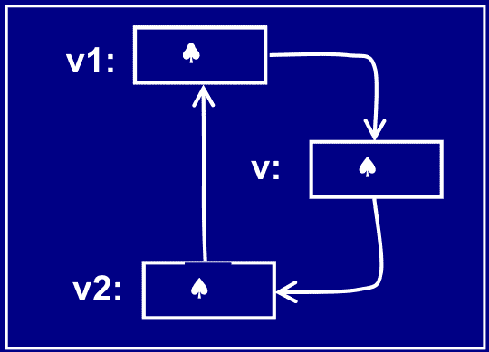

### 例3-2 做一个长 50cm ，宽 30cm，面积 500cm² 的各边等宽矩形的木框，计算该木框多宽。

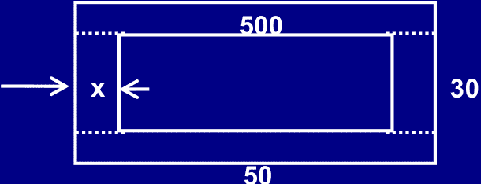

area=2*(length*x+(width-2x)*x)

即： 4x*x - 2(length+width)x + area = 0

4x*x - 2(length+width)x + 500 = 0

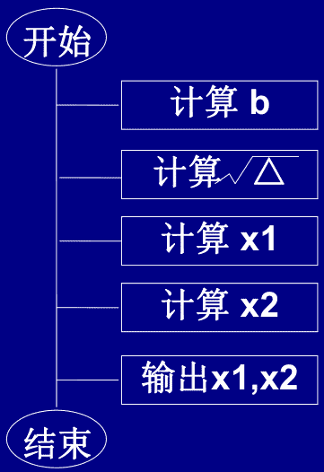

```
```c
#include "stdio.h"
#include "math.h"
#define length 50.0
#define width 30.0
#define area 500.0
void main(){
    float x1,x2,b,d;
    b=-2.0*(length+width);
    d=sqrt(b*b-4.0*4.0*area);
    x1=(-b+d)/(2*4);
    x2=(-b-d)/(2*4);
    printf("x1=%.2f x2=%.2f \n",
    x1,x2);
}
```
```

该程序运行后将输出：
X1=36.58   X2=3.42

### 左值

- 实质是内存某个存储区的地址
- 通俗的讲，左值是允许在赋值运算符左端出现的表达式。
- 最基本的左值

| 表达式 | 附加条件 |
|---|---|
| 标识符 | 应为变量名 |
| e[k] | 无 |
| (e) | e应为左值 |
| e->名称 | e应为左值 |
| e.名称 | 无 |
| *e | 无 |
| 字符串型常量 | 无 |

### ++和--

| 表达式 | 类别 | 运算后v的值 | 运算后表达式值 |
|---|---|---|---|
| v++ | 后缀 | \multirow{2}{*}{v₀ + 1} | v₀ |
| ++v | 一元 | | v₀ + 1 |
| v-- | 后缀 | \multirow{2}{*}{v₀ - 1} | v₀ |
| --v | 一元 | | v₀ - 1 |

### 类型转换

#### 为什么要进行类型转换

- 对 C 而言， 各种不同类型及其数据是有区别的
- C对参与运算的运算分量类型 在参数结合时对参数的类型都有一定的限制或进行一些必要的转换

```
void main(){
bool x=true,y=true,z=true;
int w=x+y+z;
bool u=x+y+z;
}
```

### 隐式类型转换

- 对象
  - 各种浮点类型
  - 各种整数类型
- 转换的原因
  - 每一类型数据存储长度，表示形式不同

### 隐式转换规则

- 单目运算（一元运算、后缀运算）转换规则
  - 所有浮点类型不转换
  - 长度大于int类型的整数类型不转换
  - 长度小于int类型的带符号整数类型转换成int类型
  - 长度小于int类型的无符号整数类型
    - 值可以用int类型表示，转换成int类型
    - 值不能用int类型表示，转换成unsigned int类型

### 双目运算和三目运算

- 向类型高的运算分量转换
- 把短类型转换成长类型
- 把整数类型转换成浮点类型
- 把有符号类型转换成无符号类型

long double
↑
double
↑
float
↑
~~unsigned long long~~
↑
~~long long~~
↑
unsigned long
↑
long
↑
unsigned int ← unsigned char 、 unsigned short
↑
int ← char 、 short

### 强制类型转换

#### 形式

（类型名）

## 例子

(char)('A'+'0') 结果为char类型小写的’q’

(int)5.2/2 结果为int类型的2

(float)5/2 5/(float) 2 结果为float类型的2.5

#### 注意

- 类型名必须用括号括上，该运算符就是这种形式；
- 用括号把它的运算分量括上是一种好的习惯
  - (char)('A'+'0') 结果为char类型小写的’q’
  - (char)'A'+'0' 结果为int类型的113。

### 赋值运算过程

- 1. 计算赋值运算符右端表达式e的值
- 2. 若e与v赋值兼容，把e的值按赋值转换规则转换成赋值运算符左端v的类型
- 3. 把转换后的值送入v中
- 例子

```
```c
float v;
int i=3;
v=i+3;
```
```

```
```c
float v=3.0;
int i;
i=v+3;
```
```

### 赋值兼容

#### v = e 中要求e的类型与v的类型兼容

| 左端操作数类型 | 右端操作数类型 |
|---|---|
| 算术类型 | 算术类型 |
| 结构体类型 | 兼容的结构体类型 |
| 联合体类型 | 兼容的联合体类型 |
| T的指针 | T' 的指针，其中T' 与T兼容 |
| void *类型 | T的指针 |
| T的指针 | void *类型 |
| 任何类型 | null指针常量 |

### 算术赋值转换规则

| v的类型 | e的类型 | 转换规则 |
|---|---|---|
| 整数类型 | 整数类型 | ●适应v的长度，按补码方式直接转换e的值为v类型。●若v的长度>e的长度，则e扩展到v的长度●若v的长度<e的长度，从e的尾部截取合适的长度数据，保持数值e的符号，送入v中 |
| 整数类型 | 浮点类型 | 把e的值截尾取整，转换成整数类型；在按照v和e都是整数类型的规则进行转换。 |
| 浮点类型 | 整数类型 | 把e的值直接转换成v的浮点类型，送入v中。 |
| 浮点类型 | 浮点类型 | 适应v的长度（精度）把e的值转换成v的类型 |

### 冯·诺依曼体系结构

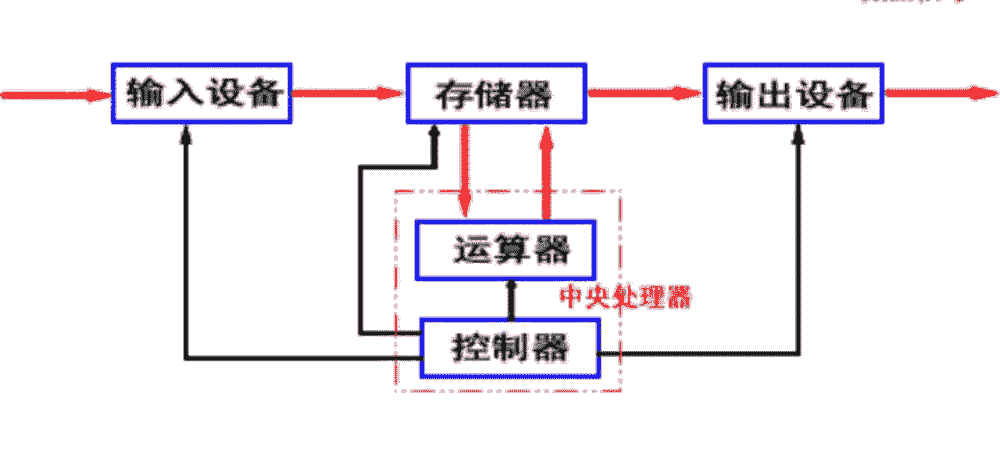

### 输入/输出 (I/O)

- 输入  
  把数据从外部设备（磁盘、键盘、磁带、传感器、... ）上读入计算机内。
- 输出  
  指把计算机内部的数据送到外部设备（磁盘、显示器、打印机、... ）。
- C语言中的处理方式  
  - 一切外部设备全部定义为文件  
  - C的 I/O 全部是针对文件的  
  - 通过标准函数库中若干标准函数实现I/O。

### 程序文件分类

- 头文件(.h)
- 代码文件(.cpp或 .c)

### 标准库函数

- #include 命令
- 意义
- 将源文件包含到当前源程序文件中
- 形式
- #include <文件名>
- #include “文件名”
- 标准I/O函数头文件stdio.h

### 单个字符输入

- 输入函数 getchar()
- 从标准输入设备（键盘）上读入一个字符，作为函数值
- 使用

```
char ch;
ch=getchar();
```

### 单个字符输出

- 输出函数 putchar (int型表达式 )
- int型表达式计算出的值转换成字符类型值输出到标准输出设备（显示器）上。
- 函数值
- 如果正确，输出的int型整数作为函数值
- 如果错误，则EOF（-1）作为函数值
- 使用

```
char ch='c';
putchar(ch+3);
```

### 格式输入函数

#### 形式

scanf ( <格式控制> , <输入列表> )

#### 意义

其操作是从标准输入设备上读入一系列数据，按格式控制的要求进行转换并送入输入列表所列的诸变量中

### 函数值

- 如果输入操作正确，函数值为输入的数据个数
- 否则，函数值为 EOF

#### 输入列表

&v1 , &v2 , &v3 , ... , &vn

#### 格式控制

含有各种以百分号开始的格式控制符的常量字符串

- 如下是一个格式控制：

  "%d %c %f %d"

| 输入数据类型 | 输入要求 | 格式控制符 |
|---|---|---|
| 整数 | 带符号10进制整数 | %d |
|  | 无符号10进制整数 | %u |
| 单个字符 |  | %c |
| 字符串 |  | %s |
| 浮点数 | 以小数或指数形式 | %f |
|  |  | %e |
|  |  | %g |

设i 为 int 型变量、ch 为char型变量、v为 float型变量、k 为 int型变量

scanf( "%d%c%f%d" , &i , &ch , &v , &k )

从键盘上输入数据

1234□123e+2□987 ↙

变量 i 得到整数数据1234

变量 ch 得到字符型数据空格

v 得到浮点型数据12300

k 得到整数数据987

### 格式输出

#### 形式

printf ( <格式控制> , <输出列表> )

#### 意义

其操作是按照格式控制的要求，把输出列表上的数据转换成字符串，送入标准输出设备上输出。

### 函数值

- 输出的字符个数（如果输出操作正确）
- EOF（否则）

#### 输出列表

e1 , e2 , e3 , ... , en

#### 格式控制

| 格式符 | 使用形式 | m缺省值 | n缺省值 | 说明 |
|---|---|---|---|---|
| d | %d |  |  | 以带符号10进制形式输出整数（正数不输出符号） |
|  | %md |  |  |  |
|  | %-md |  |  |  |
| u | %u |  |  | 以无符号10进制形式输出整数 |
|  | %mu |  |  |  |
|  | %-mu |  |  |  |
| c | %c | 1 |  | 以字符形式输出一个字符：c |

| 格式符 | 使用形式 | m缺省值 | n缺省值 | 说明 |
|---|---|---|---|---|
| s | %s | 字符串长度 |  | 输出字符串： cc...c |
|  | %ms |  |  |  |
|  | %-ms |  |  |  |
| f | %f |  | 6 | 以小数形式输出实数： ±xx...x.xx...x |
|  | %m.nf |  |  |  |
|  | %-m.nf |  |  |  |
| e | %e |  | 6 | 以指数形式输出实数： ±x.xx...xe±xxx |
|  | %m.ne |  |  |  |
|  | %-m.ne |  |  |  |

```c
printf(" num1=%2d flag='%c'\n area=%10.3f num2=%5d \n",
 25 , 'A' , 123.0/2 , 987 );
```

```text
||||num1= 25 ||flag='A'
|| ||area=||||||61.500 ||num2=||987
||
```

#### 例3-3 修改例3-2使之适用于任意长、宽、面积；并产生一个较好的输出格式。

```c
#include "stdio.h"
#include "math.h"
void main(){
float x1,x2,b,d;
float length, width,area;
printf("please input length,width,area:\n");
scanf("%f%f%f",&length,&width,&area);
b = -2.0*(length+width);
d = sqrt(b*b-4.0*4.0*area);
x1=(-b+d)/(2*4);
x2=(-b-d)/(2*4);
printf("x1=%.1f x2=%.1f \n",x1,x2);
}
```

首先将在终端屏幕上显示一行提示：

```
Please input: length, width, area:
```

这时计算机处于等待输入状态。

操作员应顺次从键盘键入矩形方框的长、宽和面积。

设键入值为：

```
50□30□500✓
```

键入结束后，计算机继续向下运行，产生如下输出：

```
||x1=36.6□□□x2=□□3.4
||■
```

到此程序执行结束。

# 本章小结

- 常量
- 变量
- 表达式
- 语句组成
- 表达式语句
- 赋值
- 类型转换
- 输入/输出

# 作业

- ① 3.1
- ② 3.2
- ③ 3.3
- ④ 3.6
- ⑤ 3.9
- ⑥ 3.13
- ⑦ 3.14——1、3、5、7
- ⑧ 3.27

## 第四章 函数

- 一. 带子程序的C程序
- 二. 函数
- 三. 程序设计实例

### 求玉米产量

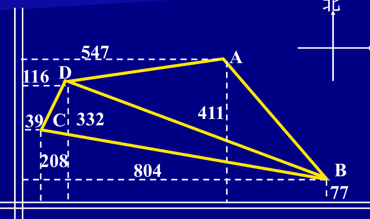

### 具体程序

```c
#include <stdio.h>
#include <math.h>

#define xa 547
#define ya 411
#define xb 804
#define yb 77
#define xc 39
#define yc 208
#define xd 116
#define yd 332

float ab, bd, ad, bc, cd ;
float s, s1 ,s2,ss,m;
```

```c
void main(void) {
    // 主函数
    // 计算一个三角形面积
    ab=sqrt( (xa-xb)*(xa-xb)+(ya-yb)*(ya-yb) ); //边ab长
    bd=sqrt( (xb-xd)*(xb-xd)+(yb-yd)*(yb-yd) ); //边bd长
    ad=sqrt( (xa-xd)*(xa-xd)+(ya-yd)*(ya-yd) ); //边ad长
    s=(ab+bd+ad)/2;
    s1=sqrt( s*(s-ab)*(s-bd)*(s-ad) ); // △ABD面积

    bc=sqrt( (xb-xc)* (xb-xc)+(yb-yc)* (yb-yc) ); //边BC长
    cd=sqrt( (xc-xd)* (xc-xd)+(yc-yd)* (yc-yd) ); //边CD长
    s=(bc+bd+cd)/2;
    s2=sqrt( s*(s-bc)*(s-bd)*(s-cd) ); // △BCD面积

    ss=s1+s2; // 总面积S=S1+S2
    ss=ss/1000; // 折合成亩
    m=ss*950; // 计算总产量
    printf("m=%10.3f\n",m); // 打印输出
}
```

### 重写程序

```c
#include <stdio.h> //1
#include <math.h> //2

float xa,ya,xb,yb,xc,yc,xd,yd; //3
float s1,s2,ss,m; //4

/* 计算r、s两点距离： 参数： r点x、y坐标， s点x、y坐标 */
float liners( float xr,float yr,float xs,float ys ){ //5
    return sqrt( (xr-xs)*(xr-xs)+(yr-ys)*(yr-ys) ); //6
} //7

/* 计算三角形uvw面积， 参数： u点x、y坐标， v点x、y坐标， w点x、y坐标 */
float areauvw(float xu,float yu,
    float xv,float yv,
    float xw,float yw ){
    // 8
    float uv , uw , vw ;    // 三条边长    //9
    float s ;                //10
    uv = liners ( xu, yu, xv, yv );    //边uv长    //11
    uw = liners ( xu, yu, xw, yw );    //边uw长    //12
    vw = liners ( xv, yv, xw, yw );    //边vw长    //13
    s=(uv+uw+vw)/2;            //s    //14
    return sqrt( s*(s-uv)*(s-uw)*(s-vw) );    //面积    //15
}
```


```c
void main(void) {
    printf("please input xa,ya,xb,yb,\n    xc,yc,xd,yd:\n");
    scanf("%f%f%f%f%f%f %f%f ",&xa,&ya,
    &xb,&yb,&xc,&yc,&xd,&yd);

    s1 = areauvw (xa, ya, xb, yb, xd, yd );
    s2 = areauvw (xb, yb, xc, yc, xd, yd );

    ss=s1+s2;
    ss=ss/1000;    // 折合成亩
    m=ss*950;    // 计算总产量
    printf("m=%10.3f\n",m); // 打印输出
}
```

### 程序执行的主要步骤

- 从第18行主函数开始，执行
  printf("please input xa,ya,xb,yb,xc,yc,xd,yd:\n");
  输出一行提示信息：
  please input xa,ya,xb,yb,xc,yc,xd,yd :
- 执行第19行函数调用
  scanf("%f%f%f%f%f%f%f%f", &xa, &ya, &xb, &yb, &xc, &yc, &xd, &yd);
  等待操作员键入数值。设操作员键入
  547 411 804 77 39 208 116 332
  当操作员键入并回车之后，变量xa、ya、xb、yb、xc、yc、xd、yd分别取得相应值。

#### 第20行以xa、ya、xb、yb、xd、yd为实参调用函数areauvw

- 分别计算xa，ya，xb，yb，xd，yd的值，得547、411、804、77、116、332
- 将547、411、804、77、116、332分别送入areauvw的形参xu、yu、xv、yv、xw、yw中
- 进入函数areauvw，执行areauvw的操作部分
- 第11行，以xu，yu，xv，yv为实在参数调用函数liners，计算边uv长
- 分别计算xu，yu，xv，yv得547、411、804、77；
- 将547、411、804、77顺序送入liners形参xr，yr，xs，ys中
- 第6行返回语句

  ```c
  return sqrt( (xr-xs)* (xr-xs)+(yr-ys)* (yr-ys) );
  ```

- 计算出表达式的值为 421.432
- 带着函数值421.432返回调用处
- areauvw中第11行，给uv赋值。uv的值为421.432
- 第12行，以xu，yu，xw，yw为实参调用函数liners，计算边uw长uw。uw值为： 438.18
- 第13行，以xv，yv，xw，yw为实参调用函数liners，计算边vw长vw。vw值为： 733.736
- 第14行，计算出s=796.674
- 15行返回语句。计算表达式的值为82128.5，也就是函数areauvw的值。
- 带着函数值82128.5返回调用处主程序第20行
- 第21行，计算三角形BCD的面积，s2=52473.5
- 第22行，计算总面积，ss=134602
- 第23行，折合成亩，ss=134.602
- 第24行，计算总产量，m=127871.9
- 第25行，输出函数printf在屏幕显示：
  m=127871.90

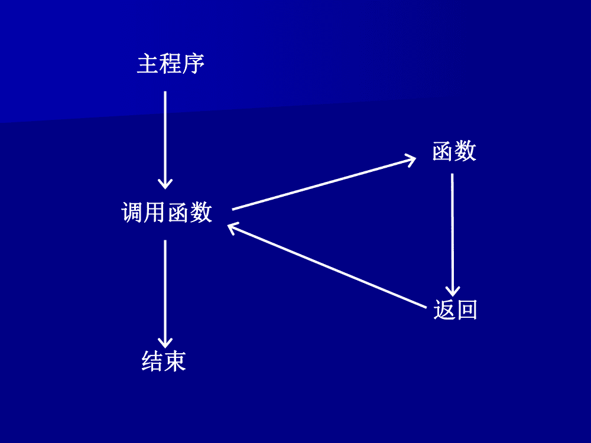

#### 使用子程序技术分离了“做什么”与“怎么做”

- 程序逻辑结构清晰，易写，易读，易懂。
- 程序的设计，调试，维护变得容易。

### 函数

#### 数学中函数

\( f(x, y) = x^y \)

#### 函数概念的组成

- 函数定义
- 函数调用

#### 使用函数注意事项

- 先定义该函数（标准库函数除外）
  ——类似于数学中的函数定义。
- 再在表达式中调用该函数
  ——数学中计算某函数的一个特定值。

### 函数调用(function-designator)

#### 调用过程
- 形参实参结合
- 进入函数执行复合语句

#### 一般形式
- F (e, e, ..., e)
- F ( )

## 例子
- p (x+5)
- f (u*0.3,x+u)

### 函数定义(function-declaration)

- 除标准库函数外，程序中使用函数必须**先定义**，然后再用“函数调用”调用它。
- 标准函数是系统已经定义好的函数，不必定义即可直接调用。
- 在程序example401A中：

```c
float f(float v,float w ){
    return (w+v)/(7*v);
}
float p(float u){
    return ( f(u*0.3,x+u)+(u/2))/(2*x) );
}
```

由上述语法可知，一个函数定义的形式是：

类型说明符 标识符 （ 参数列表 ）
复合语句

```c
float f (float u)
{
    return (f(u*0.3,x+u)+(u/2))/(2*x);
}
```

### 函数定义说明符

上述形式的第一行称“函数定义说明符”，形式如下

#### TT F（参数列表）

具体指明以下点：

- 函数的结果类型  ——由“类型说明符”（TT）标明；
- 函数的名字  ——由类型说明符后的“标识符”（F）标明；
- 函数的形式参数个数和每个形式参数的特性  ——由“参数列表”标明。

### 函数类型（返回值的类型）

- 不能是数组或函数
- 没有返回值的函数类型是void

### 函数返回

- 返回方式：
- return ;
- return 表达式；
- 函数运行到复合语句末尾（最后那个闭花括号“}”）后。

```c
int f(int x){
    return x*x;
}

int y=9;
void f(int x){
    if (x<0)
        return;
    y=y+x;
}
```

### 参数列表(parameter-list)

- 组成：
  - 每个参数声明具体说明形式：
    类型说明符 标识符
  - 参数列表形式
    T id , T id , ... , T id
- C允许使用无参函数，无参函数的参数列表为空，或使用“空类型”的类型说明符“void”
  TT F()
  TT F(void)

```c
int f(int x, int y, float z)
```

```c
int f(int x,y , float z)
```

```c
int f(int x,y , float z)
```

#### 根据参数出现的位置

- 形式参数——函数声明(局部于函数的变量)

```c
int f(int x,int y){
    return x+y;
}
```

- 实际参数——函数调用

```c
void main(){
    int a=2,b=3;
    f(a+b, b);
    f(2+b,3);
}
```

#### 根据参数值的传递规则

- 值参：当调用函数时，把**实参的值**传入形参变量
- 变参：当调用函数时，把**实参的地址值**传入形参变量

**C语言中的参数都是**<span style="color:red">值参</span>

```c
int f (int x, int y){
return x*y;
}
void main(){
int a=3, b=2,x=9;
int c;
c=f(a+b,a+x);
printf("%d\n", c);
printf("%d\n", x);
}
```

程序输出为：

- 60
- 9

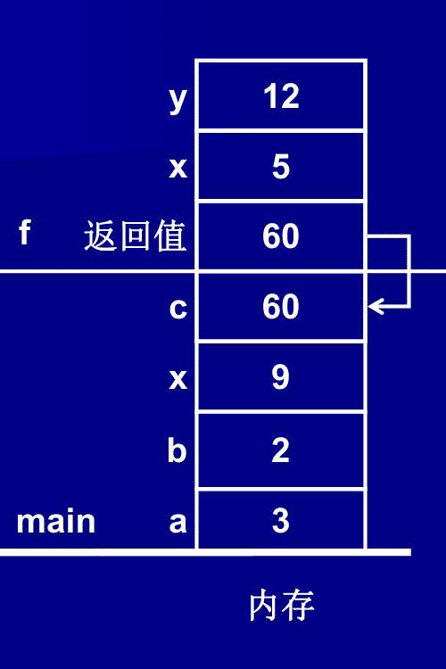

- 复合语句（compound-statement）由声明和语句列表组成
- 声明部分具体的说明本函数内使用的其它量；
- 语句部分规定在本函数中要执行的操作。
- 函数定义的形式：

```c
TT F ( T id，T id，…，T id ){
    …
}
```


### 由右至左

```
#include "stdio.h"
int x,y;
int f( int z){
    x=x+1;
    return (z*z);
}
int g( int u , int v){
    ....
}
void main(){
    x=0;
    g(x,f(2));
}
```

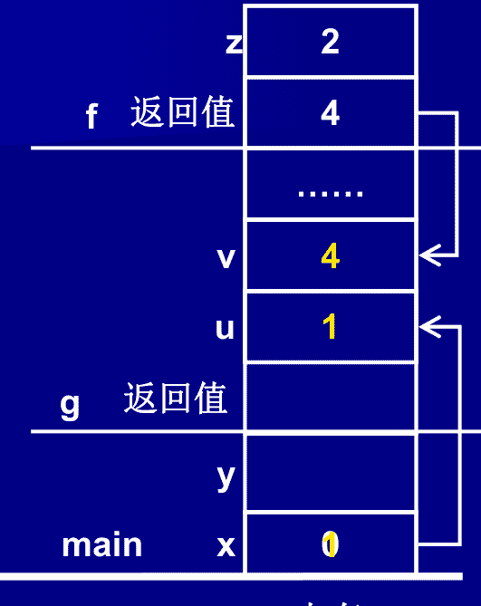

### 并行计算----不知道结果

```c
#include "stdio.h"

int x,y ;
int f( int z ){
    x=x+1 ;
    return (z*z);
}
int g( int u , int v ){
    ... ...
}
void main(){
    x=0 ;
    g(x,f(2)) ;
}
```

### 函数值

- 有返回类型的函数

```
int f (int x, int y){
    if (x>=y)
        return x;
    else
        return y;
}
```

- 无返回类型的函数

```
void g( int w){
    if (w==1)
        return;
    else
        x=3;
}
```

### 有返回类型函数的函数值

- 使用 return e; 向调用函数的主程序传递函数值

- return e ; 的执行过程是：

- 计算表达式e的值

- 把表达式值按赋值转换规则，转换成函数的结果类型；

- 返回语句中表达式的类型与函数的结果类型必须赋值兼容。

- 用类型转换后的值作为函数值，并带着它返回到调用该函数处

### 无返回类型函数的函数值

```
void g( int w){
    if (w==1)
        return;
    else
        x=3;
}
```

在函数调用处，所调函数无值可以带回。

- 对于无类型函数，在函数调用处不需要函数值，这种返回是正常的；
- 对于有类型函数，在函数调用处极可能需要函数值参加下一步运算，这将带来不可预料的结果

### 函数原型

- 为什么使用函数原型
  - 任何标识符都必须声明，而且必须先声明后使用
  - 在声明定义函数时必须保证函数声明位置在使用前出现
    - 从程序行文顺序上控制 —— 一般比较难实现
    - 函数原型 —— 方便灵活

- 一般形式
  - TT F(T , T , ... , T);
  - TT F(T id , T id , ... , T id);

- 例子
  - float f ( int, float, int, char );
  - float f ( int z, float u, int v, char w );

### 函数原型的功能

- 满足了C标识符先定义后使用的要求
- 并向编译系统提供所调用函数的信息
  - 函数返回类型
  - 函数的参数个数
  - 函数参数特性等信息

- 程序设计风格
  - 最好把所有函数原型集中，放在主函数之前

```
float x,y ;
float f(float ,float );
float p(float );
void main(){
    printf ("please input x: ");
    scanf("%f",&x);
    y=(p(x)*p(x)+(5*x))/(p(x+5)-sqrt(x))*p(x+2);
    printf ("y(x)=%8.4\n",y)
}
float f(float v,float w){
    return (w+v)/(7*v);
}
float p(float u){
    return ( f(u*0.3,x+u)+(u/2))/(2*x) );
}
```

### 例4-3 生成伪随机数

- 生成伪随机数公式

rₖ = ( multiplier * rₖ₋₁ + increment ) % modulus

如下给定三个常数值, 产生 65536个随机数

- multiplier = 25173
- increment = 13849
- modulus = 2¹⁶ = 65536

```
#define multiplier 25173
#define increment 13849
#define modulus 65536
int seed=0 ;
int random ( void ) {
    seed = ( multiplier * seed + increment ) % modulus ;
    return seed ;
}
```

- 模拟掷骰子，函数修改成：

```c
int random(void){
    seed = (multiplier * seed + increment) % modulus;
    return seed % 6 + 1;
}
```

- 产生 0 与 1 之间的实数型随机数序列，函数修改成：

```c
float random(void){
    seed = (multiplier * seed + increment) % modulus;
    return (float)seed / modulus;
}
```

### 例4-4 验证 Pascal 定理

圆内接六边形三双对边延线的交点在一条直线上

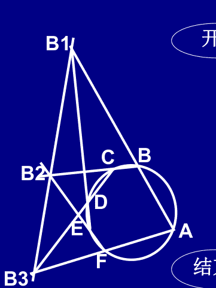

开始

读入六个极角的值

求六个顶点A, B, C, D, E, F 在直角坐标系中的坐标

求三双对边交点B1, B2, B3 坐标

验证B1, B2, B3 是否在一条直线上

结束

### 将6个点的极坐标转换成立直角坐标

### 已知极角theta,矢径r,求一点的直角坐标(px, py)

trans_abcdef

转换a → xa , ya

转换b → xb , yb

转换c → xc , yc

转换d → xd , yd

转换e → xe , ye

转换f → xf , yf

return

coordinate

```
px=r*cos(theta);
```

```
py=r*sin(theta);
```

return

### 求交点B1,B2,B3的坐标

### 已知四点r, s, t, u
求两条直线交点B

three_inter

求AB、DE交点B1

求BC、EF交点B2

求CD、FA交点B3

return

intersection

求r, s ; t, u
直线方程l1, l2

求l1、l2交点B

return

- 已知四点，s, t, u
  求两条直线 l1, l2 的方程

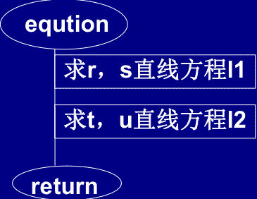

- 已知两点坐标 px, py, qx, qy,
  求直线的斜率 a 和截距 b

```
a=(py-qy)/(px-qx)

b=(py*qx-qy*px)/(qx-px)
```

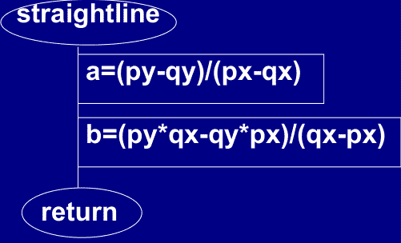

已知两条直线方程斜率分别为ma, na; 截距mb, nb; 求直线交点(wx, wy)

验证B1, B2, B3 是否在一条直线上

inter

```
wx=(nb-mb)/(ma-na);
wy=ma*px+mb;
```

return

test

求过B1, B2直线方程L

判断B3是否在直线L上

return

```
/*PROGRAM Pascal theorem*/
#include "math.h"
#include "stdio.h"
#define PI 3.1415927
#define eps 1e-5
float radius;  /* 圆的半径 */
float theta1, theta2, theta3, theta4, theta5, theta6;                /* 六个极角的度数 */
*/
float xa, ya, xb, yb, xc, yc, xd, yd, xe, ye, xf, yf;                /* 六个顶点的直角坐标 */
float b1_x, b1_y, b2_x, b2_y, b3_x, b3_y;                /* 三个交点的直角坐标 */
float b12_a, b12_b;                /*B1和B2构成直线的斜率和截距*/
```

/*主程序之前这段为“函数原型”以及各个函数返回结果所用变量*/
void trans_abcdef();
float px, py;          /* 用来保存coordinate()转换的直角坐标 */
void coordinate (float, float);
void three_inter();
void intersection (float, float, float, float, float, float, float, float);
float l1_a, l1_b, l2_a, l2_b;          /* 两条直线的斜率和截距 */
void equation (float, float, float, float, float, float, float, float);
float a, b;          /* 直线方程的斜率和截距 */
void straightline(float, float, float, float);
float wx, wy;          /* 直线交点的直角坐标 */
void inter (float, float, float, float);
int test (float, float, float, float, float, float);

/*主函数*/
void main(){
    /*读入圆形的半径*/
    printf("please input the radius of the circle:");
    scanf("%f", &radius);
    /*读入六个角*/
    printf("please input six angle:");
    scanf("%f %f %f %f %f %f", &theta1, &theta2, &theta3,
                              &theta4, &theta5, &theta6);
    trans_abcdef();                 /*计算六个定点坐标*/
    three_inter();                  /*求三个交点*/
    if( test(b1_x, b1_y, b2_x, b2_y, b3_x, b3_y) )    /*验证*/
        printf("ok");
    else{
        printf("There is an error when:\n");
        printf("theta1=%f theta2=%f\n", theta1, theta2);
        printf("theta3=%f theta4=%f\n", theta3, theta4);
        printf("theta5=%f theta6=%f\n", theta5, theta6);
    }
}

/*计算六个顶点坐标*/
void trans_abcdef(){
    coordinate(radius, theta1);
    xa=px;  ya=py;
    coordinate(radius, theta2);
    xb=px;  yb=py;
    coordinate(radius, theta3);
    xc=px;  yc=py;
    coordinate(radius, theta4);
    xd=px;  yd=py;
    coordinate(radius, theta5);
    xe=px;  ye=py;
    coordinate(radius, theta6);
    xf=px;  yf=py;
}

/*计算一个顶点坐标*/
void coordinate(float r, float theta) {
    /* 先把“角度”转换成“弧度”，再转换成直角坐标 */
    px=r*cos(PI*theta/180);
    py=r*sin(PI*theta/180);
}

/*求三个交点*/
void three_inter(){
    intersection(xa, ya, xb, yb, xd, yd, xe, ye);
    b1_x=wx;  b1_y=wy;
    intersection(xb, yb, xc, yc, xe, ye, xf, yf);
    b2_x=wx;  b2_y=wy;
    intersection(xc, yc, xd, yd, xf, yf, xa, ya);
    b3_x=wx;  b3_y=wy;
}

/*已知四点，求两条直线交点*/
void intersection(float rx, float ry, float sx, float sy, float tx, float ty, float ux, float uy){
    equation (rx, ry, sx, sy, tx, ty, ux, uy);
    inter (l1_a, l1_b, l2_a, l2_b);
}

/*已知四点，求两条直线方程*/
void equation ( float rx,  float ry,  float sx,  float sy,
                float tx,  float ty,  float ux,  float uy){
    straightline(rx,  ry,  sx,  sy);
    l1_a=a;   l1_b=b;
    straightline(tx,  ty,  ux,  uy);
    l2_a=a;   l2_b=b;
}

/*计算由两点确定直线方程的斜率（a）和截距（b）*/
void straightline(float ex, float ey, float fx, float fy){
    a=(fy-ey)/(fx-ex); /* 斜率 */
    b=ey-a*ex;    /* 截距 */
}

/*已知两个直线方程的斜率和截距，求它们交点*/
void inter ( float ma, float mb, float na, float nb){
    wx=(nb-mb)/(ma-na);
    wy=ma*wx+mb;
}

/* 检验 */
bool test ( float b1_x, float b1_y,
    float b2_x, float b2_y,
    float b3_x, float b3_y) {
straightline(b1_x, b1_y, b2_x, b2_y);
if(fabs(b3_y-(a*b3_x+b))<eps)
    return true;
else
    return false;
}

# 本章小结

- 函数的定义
- 函数的调用

# 作业

- ① 4.1
- ② 4.8
- ③ 4.12

## 第四章 循环程序设计

- 计算平均成绩—循环程序
- 打印99表—多重循环
- 程序设计实例
- 本章小结
- 作业

### 计算平均成绩—循环程序

- 某评估单位要对学生的学习情况进行评估，需要计算每个学生的平均学习成绩
- 编程序，从终端依次输入一个学生n门课程的成绩，计算并输出他的平均成绩。

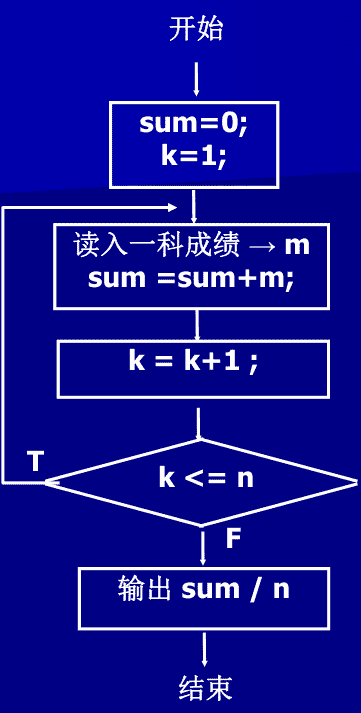

```
#include <stdio.h>
#define n 40
void main(void){
    float sum;
    int k, m;
    k=1;
    sum=0;
    do {
        printf("please input a achievement :");
        scanf("%d",&m );
        sum = sum + m;
        k = k + 1;
    } while ( k <= n );
    printf("average achievement : %5.2f\n", sum/n );
}
```

开始

sum=0;
k=1;

k <= n

F

T

读入一科成绩 → m
sum =sum+m;

输出 sum / n

k = k+1;

结束

- C 的三种不同的重复性语句，它们是
  - **while** 语句——先判断条件的循环;
  - **do** 语句——后判断条件的循环;
  - **for** 语句——先判断条件的循环。

- 需要弄清楚的
  - 循环控制方式是什么？
  - 控制条件是什么？
  - 重复执行部分（称为“循环体”）是什么？


### 后判断条件的循环

- 一般形式

```
do
  S
while ( e );
```

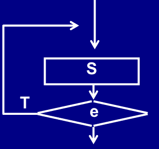


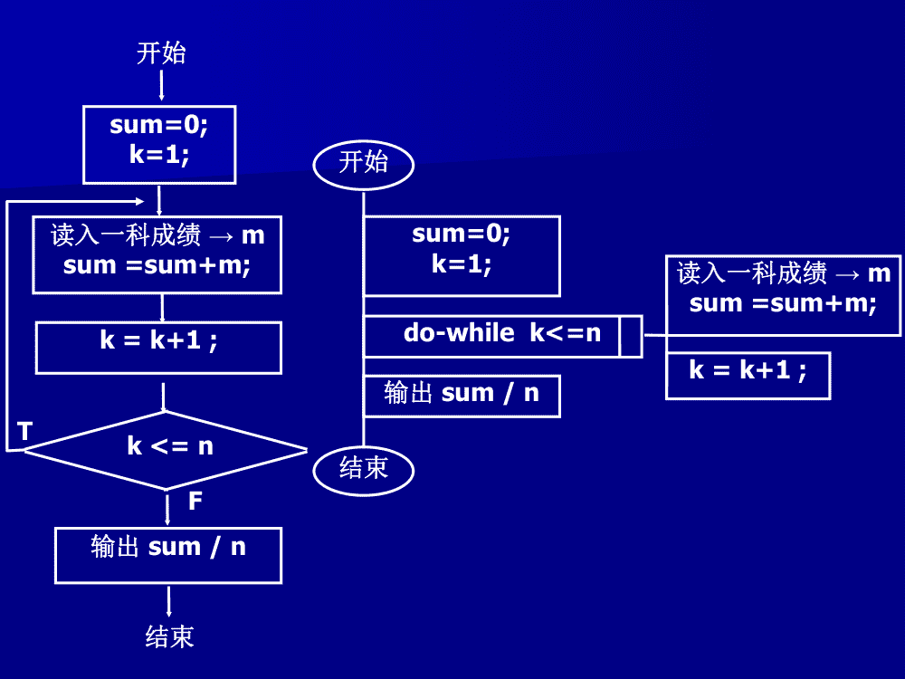

开始

```
sum=0;
k=1;
```

```
读入一科成绩 → m
sum = sum + m;
```

```
k = k + 1;
```

```
k <= n
```

```
输出 sum / n
```

结束

开始

```
sum=0;
k=1;
```

```
do-while k <= n
```

```
读入一科成绩 → m
sum = sum + m;
```

```
k = k + 1;
```

```
输出 sum / n
```

结束

```c
void main (){
    int n, k;
    float sum;
    printf ("please input n :");
    scanf("%d",&n);
    sum = 0 ;
    k = 1 ;
    do {
        sum += 1.0/(k*(k+1));
        k++ ;
    } while ( k<=n );
    printf("average achievement:%f\n",sum);
}
```

| sum | k | n |
|---|---|---|
| 0.0 | 1 | 3 |
| 0+0.5 | 2 | 3 |
| 0.5+0.1667 | 3 | 3 |
| 0.6667+0.0833 | 4 | 3 |

### 编程序，输入一个年份，求该年以后的 n 个闰年

- 某年（yy）是闰年的条件
- (( yy % 4 == 0 ) && ( yy % 100 != 0 )) || ( yy % 400 == 0 )

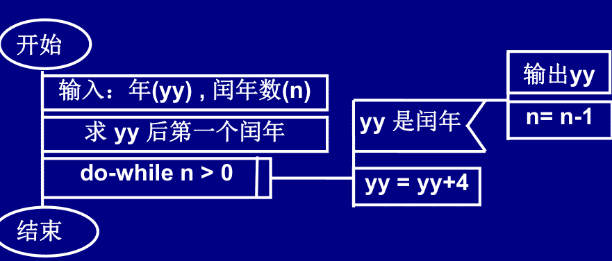

## 运行结果演示

```c
/*PROGRAM find leap year*/
#include "stdio.h"
void main(){
 int yy,n;
 printf("please input begin year:");
 scanf("%d",&yy);
 printf("please input the number of the leap year:");
 scanf("%d",&n);
 yy=(yy/4+1)*4;
 do{
  if( (yy%4==0)&&(yy%100!=0)||(yy%400==0) ){
   printf("year %d\t",yy);
   n--;
  }
  yy=yy+4;
 }
 while(n>0);
}
```

### 简单迭代法解方程

- 编程，解方程 2X³+0.5X²-X+0.093=0
- 变换X = 2X³ + 0.5X² + 0.093
- 若某个 X 代入右端后，计算结果正好是 X ，则这个 X 值就是方程的根

#### 简单迭代法

#### 等价变换

g(x) = 0 ⇄ x = f(x)

采用迭代法方法求解x=f(x)方程的根

1. 选定一个 x的初值 x0 ;
2. 以 x0 代入右端计算出一个值 x1=f(x0)
3. 若 x1 等于 x0 ，显然 x0 为根，转向 5
4. 否则若 x1≠x0 则令 x0=x1 ，转向 2
5. 结束，停止计算

### 可以使用简单迭代的情况

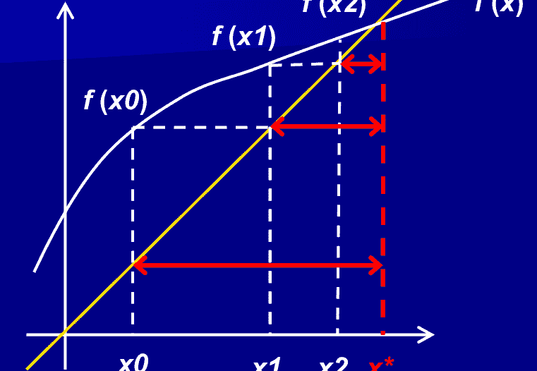

### 不可以简单迭代的情况

```
f(x)
y=x
f(x0)
f(x1)
f(x2)
x2
x1
x0
x*
```

#### 简单迭代方法使用条件

对于方程x=f(x)，当任意x∈(a, b)
存在0< L< 1， 使
|f'(x)|≤L<1
则方程x = f(x)在(a, b)上有唯一的根x*
且对任意初始值x0∈ (a, b)时
迭代序列xk+1=f (xk) (k = 0, 1, ...)收敛于x*

■ 在实际工作中，绝大部分计算都是近似计算， 只要求 X1≈X0 即 |X1 - X0| <ε使用条件

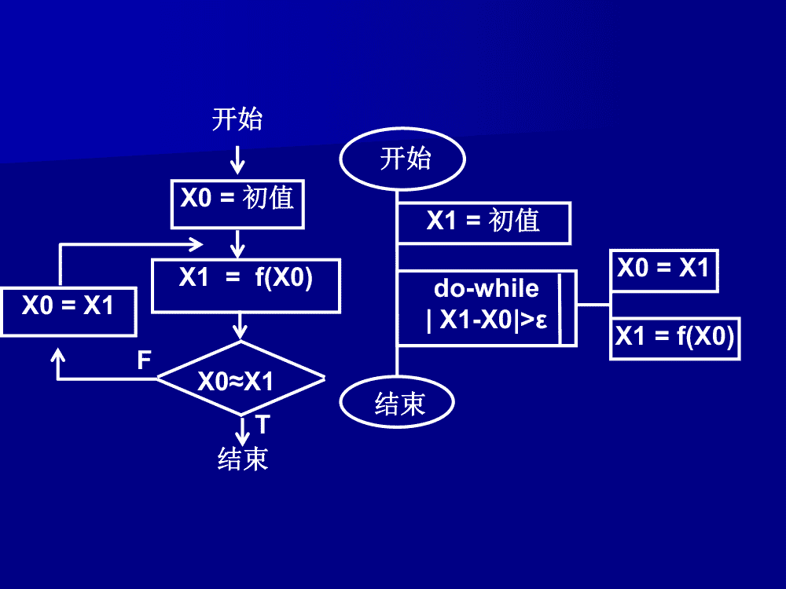

## 运行结果演示

```c
#include "stdio.h"
#include "math.h"
#define eps 1e-6
void main(){
    float x0,x1;
    x0=0.0;
    x1=0.0;
    do{
        x0=x1;
        x1=2*x0*x0*x0 +0.5*x0*x0 +0.093;
    }while(fabs(x1-x0)>eps);
    printf("x=%f\n",x0);
}
```

### 计算数列 $a_k=rac{1}{k(k+1)}$ 的前 n 项和。

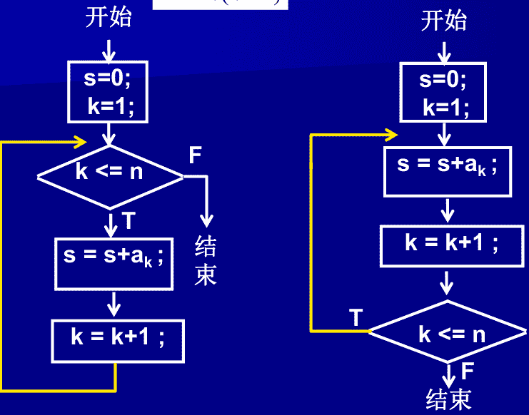

### 先判断条件的循环

- 一般形式

```
while ( e )
    S
```

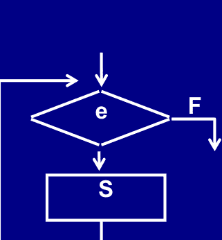

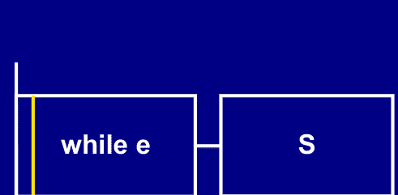

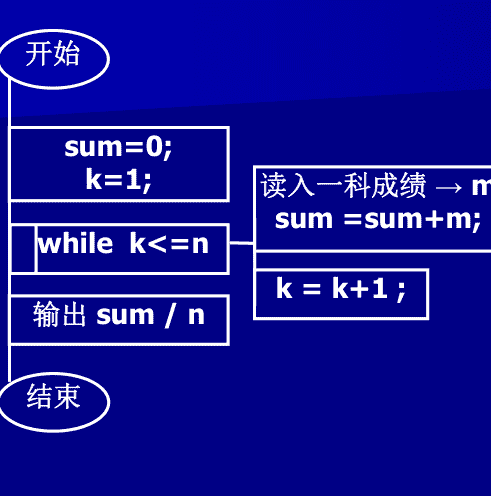

```c
#include <stdio.h>
#define n 40
void main(void){
    float sum;
    int k, m;
    k=1;
    sum=0;
    while ( k<=n ) {
        printf("please input a achievement:");
        scanf("%d",&m );
        sum = sum + m;
        k = k+1 ;
    }
    printf("average achievement:\n%5.2f\n" , sum/n );
}
```

### 编程序，按公式求自然对数底 e 的近似值

$$e = 1 + \sum_{i=1}^{\infty} \frac{1}{i!}$$

- 由于不能进行无穷项的计算，所以只能进行近似计算，当余项

$$r = \frac{1}{n!} < \varepsilon$$

- 余项计算可利用前后项之间的递推关系

$$r_n = r_{n-1} * \frac{1}{n}$$

开始

```
e=1;
n=1;
r=1;
```

```
r > eps
```

F

结束

T

```
e = e+r;
```

```
n = n+1;
```

```
r=r*1/n;
```

开始

```
e=1 ; n=1; r=1 ;
```

```
while r > eps
```

结束

```
e=e+r ;
```

```
n=n+1;
```

```
r=r*1/n ;
```

```c
#include "stdio.h"
#define eps 1e-5
void main( ) {
int n ;
float e,r ;
e=1.0;
n=1;
r=1.0;
while ( r>eps ) {
e=e+r;
n=n+1;
r=r/n;
}
printf (" e=%f\n",e ) ;
}
```

### 编程序，统计以100为结束符的整数输入流中 -1、0、+1 的出现次数并输出

开始

```
i=0; j=0; k=0;
```

```
输入一个数 → num
```

```
while num != 100
```

```
输出 i,j,k
```

结束

```
num
-1
i++
0
j++
1
k++
输入一个数 → num
```

## 运行结果演示

```c
#include <stdio.h>
#define n 100
void main(void){
    int i , j , k , num ;
    i=0; j=0; k=0;
    printf("please input a integer :");
    scanf("%d",&num );
    while ( num != n ){
        switch(num) {
            case -1 : i++; break;
            case 0 : j++; break;
            case 1 : k++;
        }
        printf("please input a integer :");
        scanf("%d",&num );
    }
    printf("number of -1 : %d\n" , i );
    printf("number of 0 : %d\n" , j );
    printf("number of 1 : %d\n" , k );
}
```


### ++和--

| 表达式 | 类别 | 运算后v的 值 | 运算后表达式值 |
|--------|------|--------------|-----------------|
| v++    | 后缀 | v₀ + 1       | v₀              |
| ++v    | 一元 | v₀ + 1       | v₀ + 1          |
| v--    | 后缀 | v₀ - 1       | v₀              |
| --v    | 一元 | v₀ - 1       | v₀ - 1          |

### for 语句

```
e=1.0;
n=1;
r=1.0;
while ( r>eps ) {
    e=e+r;
    n=n+1;
    r=r/n;
}
```

```
e=1.0;
n=1;
for ( r=1.0; r>eps; r=r/n ){
    e=e+r;
    n=n+1;
}
```

#### for语句最经常被用于描述循环次数已知循环

```
sum = 0;
k = 1;
while( k<=n ) {
    sum = sum + 1.0/(k*(k+1));
    k++ ;
}
```

```
sum = 0;
for ( k=1; k<=n; k++ )
    sum = sum + 1.0/(k*(k+1));
```

#### 一般形式

```
for ( e1; e2 ; e3)
```

S

- e1——初值表达式：用于设置该循环开始的一些初值
- e2——终值表达式：用于控制循环结束
- e3——增量表达式：用于每次循环体执行后对控制条件的修正

### 执行与PAD图

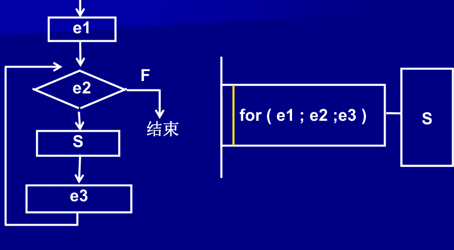

#### 编程求向量内积。由终端输入两个n维向量X,Y. 计算其内积XY 。

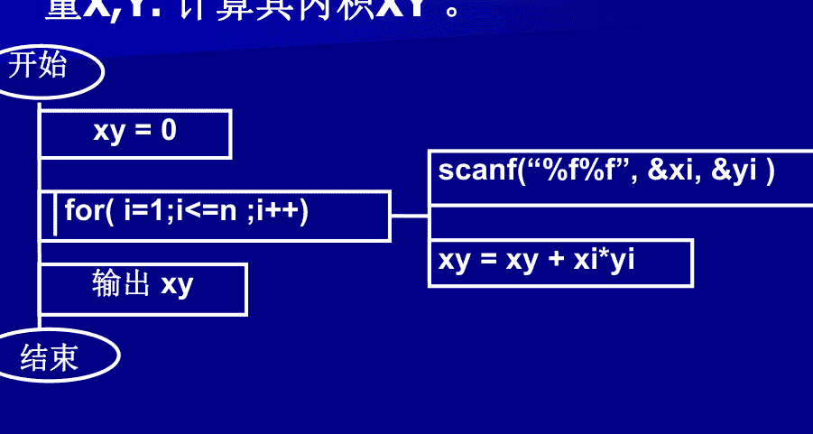

```
#include "stdio.h"
void main (){
    int n,i;
    float xy,xi,yi;
    printf("please input n:\n");
    scanf("%d",&n);
    xy = 0;
    for (i=1;i<=n;i++ ) {
        printf("please input xi、yi : \n");
        scanf("%f%f", &xi, &yi );
        xy = xy + xi * yi ;
    }
    printf("xy=%f\n", xy);
}
```

## 运行结果演示

#### 编程，画函数 y=f(x)=e^{-x} sin(2πX) 在 [0,2]区间上的图形

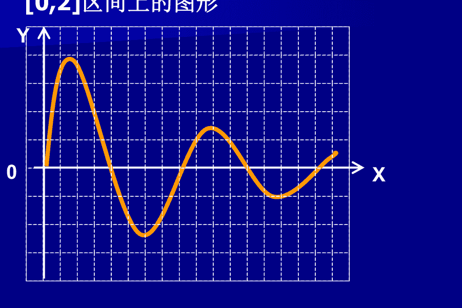


```
开始
x = 0;
for (i=1; i<=40; i++) {
    计算 y = f(i*0.05)
    确定 y 坐标，在相应位置印 *
}
结束
```

## 运行结果演示

```
#define dx 0.05
#define dy 0.05
#define pi 3.14159265
#define y0 40
#define endx 40
void main() {
    int n , i , j ;
    float x , y ;
    x = 0 ;
    for ( i=0; i<=endx; i++ ) {
        y = exp(-x) * sin( 2 * pi * x );
        n = y0+ (int)( y / dy ) ;
        for (j=0;j<=n;j++)
            printf(" ");
        printf("*\n");
        x = x + dx ;
    }
}
```

### 比较两种while语句

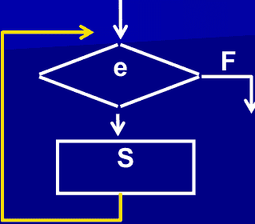

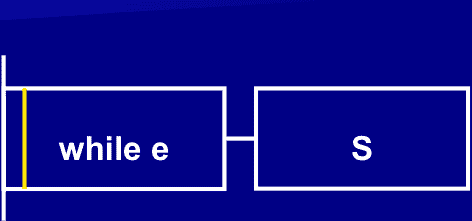

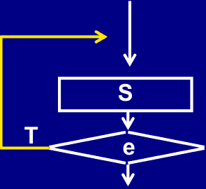

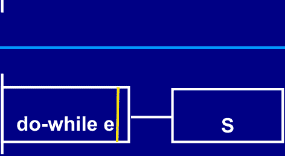

### 打印99表—多重循环

```
1 1
2 2 4
3 3 6 9
4 4 8 12 16
5 5 10 15 20 25
6 6 12 18 24 30 36
7 7 14 21 28 35 42 49
8 8 16 24 32 40 48 56 64
9 9 18 27 36 45 54 63 72 81
* 1 2 3 4 5 6 7 8 9

开始
打印前 9 行
打印底行
结束
```

### 打印前9行

```
打印前9行
for (i=1; i<=9; i++)
    打印第 i 行
结束
```

```
1 1
2 2 4
3 3 6 9
4 4 8 12 16
5 5 10 15 20 25
6 6 12 18 24 30 36
7 7 14 21 28 35 42 49
8 8 16 24 32 40 48 56 64
9 9 18 27 36 45 54 63 72 81
```

### 打印第i行

```
| 6 | 6 | 12 | 18 | 24 | 30 | 36 |
| 9 | 9 | 18 | 27 | 36 | 45 | 54 | 63 | 72 | 81 |
```

```
行号
本行数值
打印第i行
打印行标 i
for (j=1; j<=i; j++)
    打印 i*j
结束
```

### 打印100以内素数

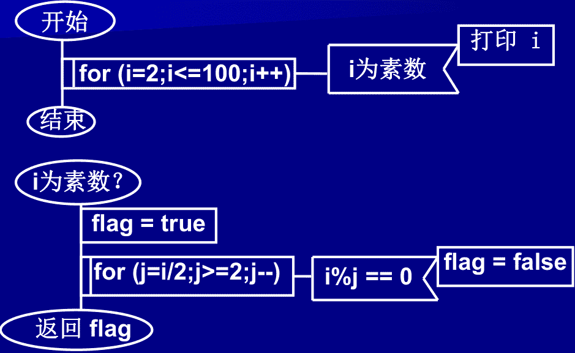

```
开始
for (i=2; i<=100; i++) {
    flag = true
    for (j=i/2; j>=2; j--) {
        if (i % j == 0)
            flag = false
    }
    if (flag)
        打印 i
}
结束
```

```
#include "stdio.h"
void main() {
int i, j;
bool flag;
for (i = 2; i <= 100; i++) {
flag=true;
for (j = i / 2; j > 2; j--)
if (i % j == 0)
flag=false;
if (flag)
printf("%5d\n", i);
}
}
```

## 运行结果演示

### 多重循环程序编写要点

— 内外循环控制条件不要互相冲突

```
for ( i = 2 ; i <= 100 ; i++ ) {
    flag=true;
    for ( i = i / 2 ; i >= 2 ; i-- )
        if ( i % j == 0 )
            flag=false ;
    if ( flag )
    printf("%5d\n" , i );
}
```

## 程序设计实例

- 打印数列
- 求两数最大公因数
- 阶乘求和
- “百钱百鸡”问题
- 打印字符方阵

## 打印数列

- 编程序，输出如下序列的前 50 项。
  - 该序列的第一项为 0
  - 第二项为 1
  - 以后的奇数项为其前两项之和
  - 偶数项为其前两项之差。

| 项数 | 1 | 2 | 3 | 4 | 5 | 6 | 7 | 8 | 9 |
|------|---|---|---|---|---|---|---|---|---|

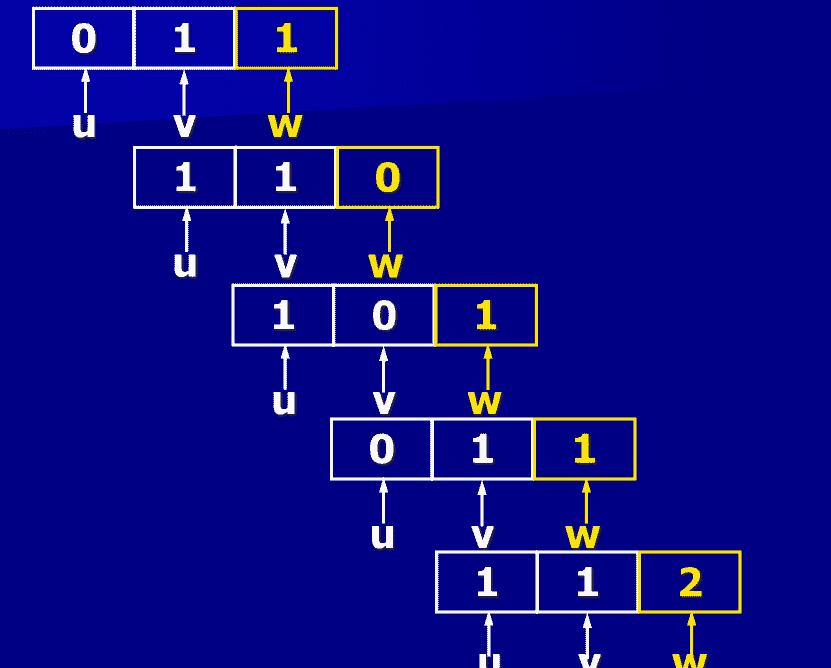

```
开始
u=0
v=1
输出 u, v
k=3
while (k<=50) {
    if (k为偶数)
        w=v-u
    else
        w=v+u
    输出 w
    u=v
    v=w
    k=k+1
}
结束
```

```
#include "stdio.h"
void main( ) {
    int u,v,w,k;
    u=0;
    v=1;
    printf ( "%5d\n%5d\n",u,v);
    k=3;
    do {
        if ( k%2 == 0 )
            w=v-u;
        else
            w=v+u;
        printf ( "%12d\n",w);
        u=v;
        v=w;
        k=k+1;
    }while ( k<=50 );
}
```

## 运行结果演示


开始

u=0

v=1

输出 u,v

k=3

flag = -1

k<=50

w=v+flag*u

flag = -flag

输出w

u=v

v=w

k=k+1

结束

## 运行结果演示

```
#include "stdio.h"
void main( ) {
    int u,v,w,k;
    int flag;
    u=0;
    v=1;
    printf ( "%5d\n%5d\n",u,v);
    k=3;
    flag = -1;
    do {
        w = v + flag*u;
        flag = -flag;
        printf ( "%5d\n",w);
        u=v;
        v=w;
        k=k+1;
    }while ( k<=50 );
}
```

### 求两数最大公因数

- 编程，输入两个正整数u 、v ，用欧几里德辗转相除法求它们的最大公因数并输出
- 欧几里德辗转相除法
  - u % v → R₁
  - v % R₁ → R₂
  - R₁ % R₂ → R₃
  - R₂ % R₃ → R₄
  - … … …
  - R_{n-1} % R_n → R_{n+1}=0
  - R_n 为正整数u 、v的最大公因数


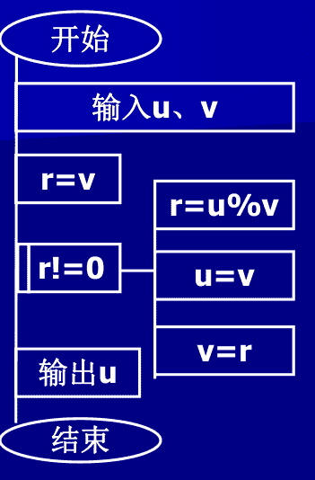

```
#include "stdio.h"
void main() {
int u,v,r;
printf("please input u 、 v:");
scanf("%d%d",&u,&v);
r=v;
while ( r!=0 ){
r = u%v;
u = v;
v = r;
}
printf ( "gcd(u,v) = %5d\n",u );
}
```

运行结果演示

### 阶乘求和

- - 编程序，输入正整数N
- - 计算 r₁!+r₂!+...+rₙ! 并输出， N=r₁r₂...rₙ
- - 例如
  - N=1234
  - 求1!+2!+3!+4!

开始

输入N

S=0

N!=0

输出S

结束

r=N%10
N=N/10

S=S+r!

### r! =1*2*3* ...... *r

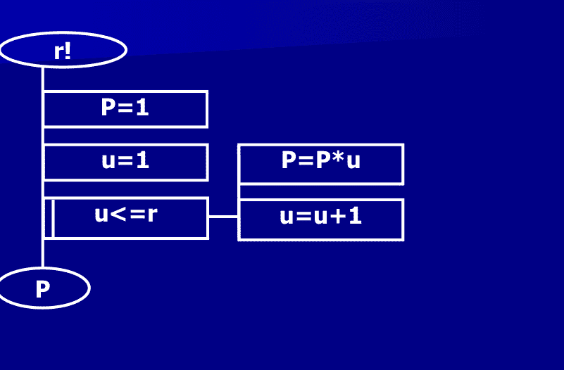

开始

输入N

S=0

N!=0

输出S

结束

r=N%10
N=N/10

P=1

u=1

u<=r

P=P*u

u=u+1

### "百钱百鸡" 问题

- - 鸡翁一，值钱五；鸡母一，值钱三；鸡雏三，值钱一
- - 百钱买百鸡；问鸡翁、母、雏各几何
- - 设买x只公鸡，买y只母鸡，买z只鸡雏

-5x + 3y + z/3 = 100    /* 百钱 */
- x + y + z = 100    /* 百鸡 */

开始

```
for ( x=1;
 x<=20;
 x++)
```

```
for ( y=1;
 y<=33;
 y++)
```

```
for ( z=3;
 z<=99;
 z=z+3)
```

x , y , z
满足方程

输出
x,y,z

结束

```
```c
#include "stdio.h"
int x, y, z;
void main( ) {
    for ( x = 1 ; x <= 20 ; x++ )
        for ( y = 1 ; y <= 33 ; y++ )
            for ( z = 3 ; z <= 99 ; z=z+3 )
                if ( x+y+z == 100 &&
                     5*x+3*y+z/3 == 100 )
                    printf("result = %5d %5d
%5d\n", x,y,z );
}
```
```

## 运行结果演示

```
```c
#include "stdio.h"
int x,y,z;
void main() {
    for (x = 1; x <= 20; x++)
        for (y = 1; y <= 33; y++){
            z = 100-x-y;    // 求鸡雉数z，百鸡
            if (5*x+3*y+z/3 == 100 &&
                z%3 == 0)    // 百钱
                printf("result = %5d %5d %5d\n",
                       x,y,z);
        }
}
```
```

## 运行结果演示


### 打印字符方阵

x→ABCDEFGHI
BCDEFGHIA
CDEFGHIAB
DEFGHIABC
EFGHIABCD
FGHIABCDE
EFGHIABCD
DEFGHIABC
CDEFGHIAB
BCDEFGHIA
ABCDEFGHI

A
B B B
C C C C C
D D D D D D D
E E E E E E E E E E
F F F F F F F F F F
E E E E E E E E E E
D D D D D D D
C C C C C
B B B
A

BCDEFGHIA
CDEFGHIAB
DEFGHIABC
EFGHIABCD
FGHIABCDE
GHIABCDEF
FGHIABCDE
EFGHIABCD
DEFGHIABC
CDEFGHIAB
BCDEFGHIA

```
for(x='A';x<='F';x++) 打印一行
for(x=5行;x>='A';x--) 打印一行
```

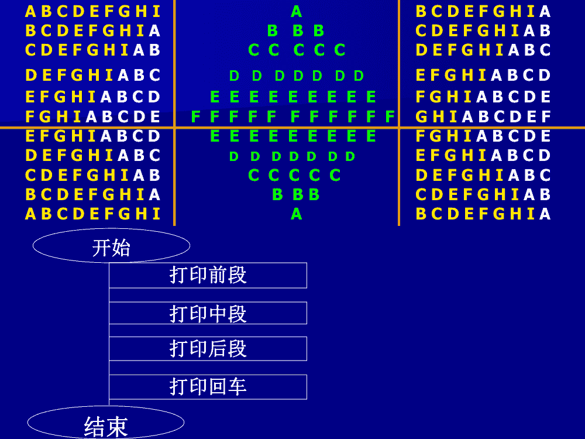

左侧黄色/白色字母按行排列：
ABC...I
BC...IA
C...IAB
DEFGHIABC
EFGHIABCD
FGHIABCDE
EFGHIABCD
DEFGHIABC
CDEFGHIAB
BCDEFGHIA
ABCDEFGHI

中间绿色字母呈对称排列：
A
B B B
C C C C C
D D D D D D D
E E E E E E E E E E
F F F F F F F F F F F F
E E E E E E E E E E
D D D D D D D
C C C C C
B B B
A

右侧黄色/白色字母按行排列：
BCDEFGHIA
CDEFGHIAB
DEFGHIABC
EFGHIABCD
FGHIABCDE
GHIABCDEF
FGHIABCDE
EFGHIABCD
DEFGHIABC
CDEFGHIAB
BCDEFGHIA

## 开始

- 1. 打印前段
- 2. 打印中段
- 3. 打印后段
- 4. 打印回车

## 结束

y
x→ C D E F G H I A B
D E F G H I A B C
E F G H I A B C D

```
for(y=x;y<='I';y++)
```

打印 ‘ □y’

```
for(y='A';y<x;y++)
```

打印 ‘ □y’

X

A

B B B

C C C C C

D D D D D D D

开始

打印：(5-(x-'A')) *2个空格

打印：2*(x-'A')+1个□x

打印：(5-(x-'A')) *2个空格

结束

y
x→ C D E F G H I A B
D E F G H I A B C
E F G H I A B C D

```
for(y=x+1;y<='I';y++)
```

打印 ' □ y'

```
for(y='A';y<=x;y++)
```

打印 ' □ y'

开始

```
for ( x='A';
    x<='F';
    x++)
```

```
for ( y=x;
    y<='I';y++)
```

打印：□y

```
for ( y='A';
    y<=x-1;y++)
```

打印：□y

打印：（5-(x-'A')）*2个空格

打印：2*(x-'A')+1个□x

打印：（5-(x-'A')）*2个空格

打印回车

```
for ( x='E';
 x>='A';
 x--)
```

```
for ( y=x;
 y<='I';y++)
```

打印：□y

```
for ( y='A';
 y<=x-1;y++)
```

打印：□y

打印：(5-(x-'A'))*2个空格

打印：2*(x-'A')+1个□x

打印：(5-(x-'A'))*2个空格

打印回车

结束


#include "stdio.h"
char x,y;
int i;
void main(){
    for (x='A';x<='F';x++){
        // 前六行
        for (y=x;y<='I';y++) printf(" %c",y);
        for (y='A';y<x;y++) printf(" %c",y);
        for(i=1;i<=(5-(x-'A'))*2;i++) printf(" ");
        for(i=1;i<=2*(x-'A')+1;i++) printf(" %c",x);
        for(i=1;i<=(5-(x-'A'))*2;i++) printf(" ");
        for (y=x+1;y<='T';y++) printf(" %c",y);
        for (y='A';y<=x;y++) printf(" %c",y);
        printf("\n");
    }
}

```c
for ( x='E';x>='A';x--){
for ( y=x; y<='I';y++) printf ( " %c", y);
for ( y='A'; y<=x-1;y++)printf ( " %c", y);
for( i=1;i<= ( 5-(x-'A') ) *2; i++) printf ( " ");
for(i=1;i<=2*(x-'A')+1;i++) printf ( " %c", x);
for( i=1;i<= ( 5-(x-'A') ) *2; i++) printf ( " ");
for ( y=x+1; y<='I';y++) printf ( " %c", y);
for ( y='A'; y<=x;y++) printf ( " %c", y);
printf ( "\n");
}
}
```

## 运行结果演示

# 本章小结

- 后判断条件循环
  - do while 语句
- 先判断条件循环
  - while语句
  - for语句
- 重点
  - 使用编写循环结构程序解决实际问题

# 作业

- ① 4.5
- ② 4.13
- ③ 4.18
- ④ 4.20
- ⑤ 4.28

## 第五章 流程控制

- 顺序结构
- 分支结构
- 循环结构
- 程序设计实例
- 本章小结

### 顺序结构

#### 属性

- 某部分若执行，则语句顺序全部被执行
- 若不执行，则全部语句一个也不执行

#### 形式

```
{
    DS
    DS
    ……
    DS
}
```

### 逻辑分支结构

- 语法
  - <if语句> → if ( <表达式> ) <语句>
  - if ( <表达式> ) <语句> else <语句>

- 形式
  - if (e) S1 else S2
  - if (e) S

### 执行过程与PAD图

```
if (e)
S1
else
S2
```

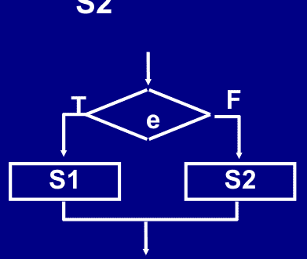

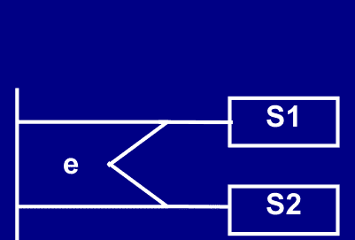

### ■ 形式二

`if (e)`

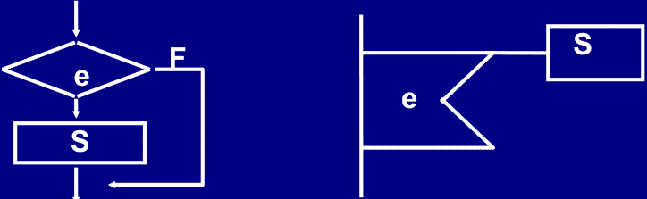

### if语句应注意的问题

- 布尔表达式
- 可以嵌套
- else归属问题
  if (a>b) if (b>c) x=0; else x=1;

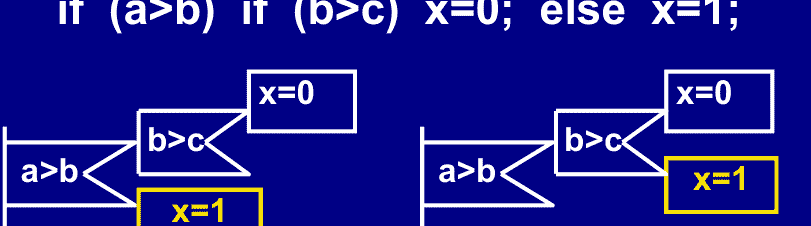

else 属于最前边的 if，则

if (a>b) if (b>c) x=0; else x=1;相当于

```
if (a>b) {
    if ( b>c )
    x = 0;
}else
    x = 1;
```


前述的问题的答案是：

- ① 若 a<=b 执行 x = 1;
- ② 若 a>b 且 b<=c 什么也不执行

else 属于第二个 if，则
if (a>b) if (b>c) x=0; else x=1;相当于

```
if ( a>b ) {
    if (b>c)
        x = 0;
    else
        x = 1;
}
```


上述的问题的答案是
① 若 a<=b 什么也不执行；
② 若 a>b 且 b<=c 执行 x = 1。

### 两义性

- C标准规定：
  else部分与前面最邻近的一个没有配对的 if 配对
- 第二种方案解释。
- 若想描述第一种方案的结构只好用 {、} 将中间的 “if() 语句” 括起来，构成复合语句。


### 例5.3 求方程 ax² + bx + c = 0 的根

```
x = (-b ± √(b² - 4ac)) / 2a
```

- ① 是一元二次方程(a≠0)
  - 有实根(Δ≥0)
    - 两个不同的实根(Δ>0)
    - 两个相同的实根(Δ=0)
  - 有虚根(Δ<0)
- ② 是一元一次方程(a=0, b≠0)
- ③ 是恒等式(a=0, b=0)
  - 恒等式成立(c=0)
  - 恒等式不成立(c≠0)

解二次方程

读入 a,b,c

计算Δ

二次方程
Δ>0

二实根:x1,x2

两实根:x1=x2

Δ=零则

两虚根:x1,x2

求解 x1, x2

一次方程
b≠0

x为c加程

常数0方程

退化0=0

矛盾c=0

输出 x1,x2

结束

```
if(a!=0){
    delta=b*b-4*a*c;
    if(delta>0)
        printf("x1=%g ,x2=%g\n", (-b+sqrt(delta))/(2*a),(-b-sqrt(delta))/(2*a));
    else
        if(delta==0)
            printf("x1=x2=%f\n",-b/(2*a));
        else
            printf("x1=%g+%gi , x2=%g-%gi\n", -b/(2*a),sqrt(-delta)/(2*a),
                -b/(2*a),sqrt(-delta)/(2*a) );
}else{ // 以下处理a==0的情况
    if(b!=0)
        printf("x=%g\n",-c/b);
    else
        if(c==0)
            printf("0=0!\n");
        else
            printf("%g=0\n",c);
}
```

### 演示例5.3程序

### 算术值控制多分支结构

```
switch ( e ) {
case C1 : S1
    break;
case C2 : S2
    break ;
... ... ...
case Cn : Sn
    break ;
default : S0
}
```

第一种形式多分支

```
switch ( e ) {
case C1 : S1
case C2 : S2
... ... ...
case Cn : Sn
default : S0
}
```

第二种形式多分支

```
switch ( e ) {
case C1 : S1
    break;
case C2 : S2
    break;
... ... ...
case Cn : Sn
    break;
default : S0
}
```


```
switch ( e) {
    case C1：S1
    case C2：S2
    ... ... ...
    case Cn：Sn
    default：S0
}
```

### 计算 e 值


### 例5.4 高速公路每公里的收费标准按不同种类汽车如下：

- 小汽车（ car ） 0.50 元
- 卡车（ truck ） 1.00 元
- 大客车（ bus ） 1.50 元

编程序，为某高速公路收费站计算各种车辆的收费额。


```
#include "stdio.h"
enum tsort { car , truck , bus } sort ;  // 车种说明
int i ;
float mileage, price ;              // 里程、费用
void main ( ) {                      // 输入车种
    printf ( "please choose ( 1.car 2.truck 3.bus ):" );
    scanf ("%d", & i ) ;
    switch ( i ) {
        case 1 : sort = car ;  break ;
        case 2 : sort = truck ; break ;
        case 3 : sort = bus;
    }
    printf ( "please input mileage : " );        // 输入里程
    scanf ( "%f",&mileage ) ;
    switch ( sort ) {               // 计算
        case car :  price = 0.50 ;  break ;
        case truck : price = 1.00 ;  break ;
        case bus :  price = 1.50;
    }
    printf ( " cost= %.2f\n", price*mileage );// 输出
}
```

演示例5.4程序

### 计算数列 $a_k=rac{1}{k(k+1)}$ 的前 n 项和。


### 循环结构

- 循环
  - 指程序的某部分被反复的重复执行多次

- 循环程序设计
  - 编写重复执行的程序

- 循环体
  - 被重复执行的部分

- C 的三种不同的重复性语句，它们是
  - while 语句——先判断条件的循环；
  - do 语句——后判断条件的循环；
  - for 语句——也是先判断条件的循环。

- 需要弄清楚的
  - 循环控制方式是什么？
  - 控制条件是什么？
  - 重复执行部分（称为“循环体”）是什么？

### 先判断条件的循环结构

- 语法
  < while 语句 > → while (<表达式>) <语句>

- 一般形式
  while ( e )
  S


### 计算数列

a_k = \frac{1}{k(k+1)}


```
void main ( ) {
    int n , k=1;
    float s=0;
    printf("please input n:\n");
    scanf("%d",&n);
    while ( k<=n ) {
        s+=1.0/(k*(k+1)) ;
        k+=1;
    }
    printf("%g",s);
}
```

|  | s | k | n |
|---|---|---|---|
|  | s=0.0 | k=1; | n=3 |
| ① | s=0+0.5; | k=2; | n=3 |
| ② | s=0.5+0.1667; | k=3; | n=3 |
| ③ | s=0.6667+0.0833; | k=4; | n=3 |

### 例5.5 编一个函数，求自然对数底 e 的近似值。

e的计算公式

e = 1 + Σ (from i=1 to ∞) 1 / i!

由于不能进行无穷项的计算，所以只能进行近似计算，当余项

r = 1 / n! < ε

余项计算可利用前后项之间的递推关系

rₙ = rₙ₋₁ * 1 / n

开始

e=1;
n=1;
r=1;

r > eps

F

结束

T

e = e+r;

n = n+1 ;

r= r/n ;

开始

e=1 ; n=1; r=1 ;

while r > eps

结束

e=e+r ;

n=n+1;

r=r*1/n ;

```
float logari( float eps ) {
    int n;
    float e,r;
    e=1.0;
    n=1;
    r=1.0;
    while ( r>eps ) {
        e=e+r;
        n=n+1;
        r=r/n;
    }
    return e ;
}
```

|  | e | n | r |
|---|---|---|---|
|  | e=1.0 | n=1 | r=1.0 |
| ① | e=2.0 | n=2 | r=0.5 |
| ② | e=2.5 | n=3 | r=0.1667 |
| ③ | e=2.6667 | n=4 | r=0.0417 |
| ④ | ...... |  |  |

### 后判断条件的循环结构

- 语法
  <do 语句> → do <语句> while ( <表达式> );

- 一般形式
  do
  S
  while ( e );


### 例5.6 考虑本节开始的问题，编一个函数 s(n)，计算数列的 a_k 的前 n 项和

a_k = 1 / [k(k + 1)]

开始

sum=0;
k=1;

sum+= a_k;

k = k+1;

k <= n

T

F

结束

s(n)

sum = 0;
k = 1;

do-while
k<= n

sum += 1/(k*(k+1));

k = k+1

return sum

返回

```
float s ( int n ){
int k ;
float sum ;
sum = 0 ;
k = 1 ;
do {
    sum += 1.0/(k*(k+1));
    k++ ;
}while( k <=n );
return sum ;
}
```

- sum=0.0; k=1; n=3
- sum=0+0.5; k=2; n=3
- sum=0.5+0.1667; k=3; n=3
- sum=0.6667+0.0833; k=4; n=3

### 例5.7 编程序，输入一个年份，求该年以后的 n 个闰年。

某年（ yy ）是闰年的条件是：

```
( yy % 4 == 0 ) && ( yy % 100 != 0 ) || ( yy % 400 == 0 )
```

开始

输入： 年(yy)，闰年数(n)

求 yy 后第一个闰年

do-while n > 0

结束

yy 是闰年

输出 yy

n= n-1

yy = yy+4

```
/*PROGRAM find leap year*/
#include "stdio.h"
void main(){
    int yy,n;
    printf("please input begin year:");
    scanf("%d",&yy);
    printf("please input the number of the leap year:");
    scanf("%d",&n);
    yy=(yy/4+1)*4;
    do{
        if( (yy%4==0)&&(yy%100!=0)||(yy%400==0) ){
            printf("year %d\t",yy);
            n--;
        }
        yy=yy+4;
    }while(n>0);
}
```

演示例5.7程序


### 例5.8 简单迭代法

等价变换

g(x) = 0 ↔ x = f(x)

采用迭代法方法求解x=f(x)方程的根

- ① 选定一个 x 的初值 x0；
- ② 以 x0 代入右端计算出一个值 x1=f(x0)
- ③ 若 x1 等于 x0，显然 x0 为根，转向 5
- ④ 否则若 x1≠x0 则令 x0=x1，转向 2
- ⑤ 结束，停止计算

### 可以使用简单迭代的情况


### 不可以简单迭代的情况

f(x)

y=x

f(x0)

f(x1)

f(x2)

x2

x1

x0

x*

### ■ 简单迭代方法使用条件

对于方程x=f(x)，当任意x∈(a, b)
存在0< L< 1， 使
|f'(x)|≤L<1
则方程x = f(x)在(a, b)上有唯一的根x*
且对任意初始值x0∈ (a, b)时
迭代序列xk+1=f (xk) (k = 0, 1, ...)收敛于x*

- ■ 在实际工作中，决大部分计算都是近似计算， 只要求 X1≈X0 即 |X1 - X0| <ε使用条件

g(x)=2x³+0.5x² -x+0.093=0

f(x)=2x³+0.5x²+0.093=x

开始

X0 = 初值

X1 = f(X0)

X0 = X1

X0≈X1

结束

开始

X1 = 初值

do-while |X1-X0|>ε

结束

X0 = X1

X1 = f(X0)

```
#include "stdio.h"
#include "math.h"
#define eps 1e-6
void main(){
    float x0,x1;
    x0=0.0;
    x1=0.0;
    do{
        x0=x1;
        x1=2*x0*x0*x0 +0.5*x0*x0 +0.093;
    }while(fabs(x1-x0)>eps);
    printf("x=%f\n",x0);
}
```

演示例5.8程序

### 比较两种while语句


### for 语句

一般形式 for ( e1; e2 ; e3 )

S

- e1——初值表达式
  用于设置该循环开始的一些初值

- e2——终值表达式
  用于控制循环结束

- e3——增量表达式
  用于每次循环体执行后对控制条件的修正

### 执行与PAD图


### for与while 语句

```
e=1.0;
n=1;
r=1.0;
while ( r>eps ) {
    e=e+r;
    n=n+1;
    r=r/n;
}
```

```
e=1.0;
n=1;
for ( r=1.0; r>eps; r=r/n ) {
    e=e+r;
    n=n+1;
}
```

```
sum=0;
k=1;
r=1.0;
while ( k<=n ) {
    sum=sum+1.0/(k*(k+1));
    k++;
}
```

```
sum=0;
for ( k=1; k<=n;k++ )
    sum=sum+1.0/(k*(k+1));
```

### 例5.9 编程序求向量内积。由终端输入两个n维向量X, Y。计算其内积XY。

s(n)

xy = 0

for( i=1;i<=n ;i++)

return xy

返回

```
scanf("%f%f", &xi, &yi)
```

```
xy = xy + xi*yi
```

```
float S (int n){
int i ;
float xy,xi,yi ;
xy = 0;
for (i=1;i<=n;i=i+1 ) {
scanf(" %f%f", &xi, &yi );
xy = xy + xi * yi ;
}
return xy;
}
```


开始

```
x = 0;
```

```
for(i=1 ;i<=40; i++)
```

```
计算 y = f(i*0.05)
```

```
确定 y 坐标，在相应位置印 *
```

结束

```
```c
#define dx 0.05
#define dy 0.05
#define pi 3.14159265
#define y0 40
#define endx 40
void main() {
    int n,i,j;
    float x,y;
    x = 0;
    for (i=0; i<=endx; i++) {
        y = exp(-x) * sin( 2 * pi * x );
        n = y0+ (int)( y/dy );
        for (j=0;j<=n;j++)
            printf(" ");
        printf("*\n");
        x = x + dx;
    }
}
```
```

### 演示例5.10程序

## 程序设计实例

- 根据数字打印月份名称
- 打印99表
- 打印100以内素数
- 打印孪生素数
- 模拟计算器
- 十六进制数翻译

### 根据数字打印月份名称

- 编写程序，当输入数值月份时，显示相应英文月份名称
  
  例如：
  
  输入1
  显示 Jan

main
scanf("%d",&x)
1 printf("JAN")
2 printf("FEB")
3 printf("MAR")
4 printf("APR")
...
... ...
12 printf("DEC")
default printf("WRONG!")
x=?
结束

```
void main(){
    int x;
    printf("Please input the number:");      scanf("%d",&x);
    switch(x){
        case 1:printf("JAN\n");      break;
        case 2:printf("FEB\n");      break;
        case 3:printf("MAR\n");      break;
        case 4:printf("APR\n");      break;
        case 5:printf("MAY\n");      break;
        case 6:printf("JUN\n");      break;
        case 7:printf("JUL\n");      break;
        case 8:printf("AUG\n");      break;
        case 9:printf("SEP\n");      break;
        case 10:printf("OCT\n");     break;
        case 11:printf("NOV\n");     break;
        case 12:printf("DEC\n");     break;
        default: printf("Wrong number!\n");
    }
}
```

### 打印99表

1 1
2 2 4
3 3 6 9
4 4 8 12 16
5 5 10 15 20 25
6 6 12 18 24 30 36
7 7 14 21 28 35 42 49
8 8 16 24 32 40 48 56 64
9 9 18 27 36 45 54 63 72 81
* 1 2 3 4 5 6 7 8 9

开始
打印前 9 行
打印底行
结束

### 打印前9行

### 打印前9行

```
for (i=1;i<=9;i++)
```

打印第 i 行

结束

1 1
2 2 4
3 3 6 9
4 4 8 12 16
5 5 10 15 20 25
6 6 12 18 24 30 36
7 7 14 21 28 35 42 49
8 8 16 24 32 40 48 56 64
9 9 18 27 36 45 54 63 72 81


### 打印第i行

| 6 | 6 | 12 | 18 | 24 | 30 | 36 |
| 9 | 9 | 18 | 27 | 36 | 45 | 54 | 63 | 72 | 81 |

行号

本行数值

打印第i行

打印行标 i

```
for(j=1;j<=i;j++)
```

打印 i*j

结束

```
/*PROGRAM print table9*9 */
#include "stdio.h"
void main(){
    int i,j;
    for(i=1;i<10;i++){
        printf("%4d",i);
        for(j=1;j<=i;j++)
            printf("%4d",i*j);
        printf("\n");
    }
    printf("%4c",'*');
    for(i=1;i<10;i++)
        printf("%4d",i);
}
```

### 打印100以内素数

```
开始
for (i=2;i<=100;i++)
prime(i)?
打印 i
结束
```

```
prime(i)
flag = true
for (j=i/2;j>=2;j--)
i%j == 0
flag = false
return flag
```

```
bool prime( int );
void main() {
    int i;
    for ( i = 2 ; i <= 100 ; i++ )
        if ( prime(i) )
            printf("%5d\t" , i );
}
bool prime((int n)){
    int j;
    bool flag;
    for ( j = n / 2 ; j >= 2 ; j-- )
        if ( n % j == 0 )
            flag = true;
    for ( i = n / 2 ; i >= 2 ; j-- )
        if ( n % j == 0 )
            flag = false ;
    return flag ;
}
```

```
bool prime( int);
void main( ) {
    int i ,x;
    printf("input x:"); scanf("%d",&x);
    for ( i = 2 ;i <= x ; i++ )
        if ( prime(i) )
            printf("%5d\t" , i );
}
bool prime( int n ) {
    int j;
    for ( j = n / 2 ; j >= 2 ; j-- )
        if ( n%j == 0 )
            return false ;
    return true ;
}
```

### 打印孪生素数

- 编程序，打印前 10 对孪生素数。若两个素数之差为2，则称孪生素数，例如（3、5），（11、13）等等

### main

```
n=0; u=3;v=u+2
```

n<10

u为素数 &&
v为素数&&

打印 u,v

```
n++
```

```
u++; v++;
```

## 结束

```c
/* PROGRAM writeprime */
#include "stdio.h"
bool prime( int m ) {
    int j ;
    for ( j = m / 2 ; j >= 2 ; j--)
        if ( m%j == 0 )
            return false ;
    return true ;
}
int u,v,n;
void main() {
    n=0;  u=3;   v=u+2;
    while(n<10){
        if ( prime(u)&&prime(v)){
            printf("%5d %5d\n", u, v );
            n++;
        }
        u++; v++;
    }
}
```

### 模拟计算器

假设该计算器只能进行加、减、乘、除运算，且运算符不带优先级，也没括号。例3*7-3/9*2=4


### 十六进制数翻译

- 编一个函数 **convert**，从终端读入一个十六进制数，把它翻译成十进制。
- 若翻译正确，则 **convert** 返回 **true**
- 否则若翻译错误，则 **convert** 返回 **false**

### 十六进制数的形式

- AB.1f
- . ef
- 12f
- 12f.


### 主程序中

- 若convert()返回真值，则说明翻译成功
  - 若intflag为真，打印整数值（n中保存）
  - 否则，打印实数数值（f中保存）
  - 打印 “successful!”
- 否则打印 “fail”

若convert()返回真值，则说明翻译成功

- 若intflag为真，打印整数值（n中保存）
- 否则，打印实数数值（f中保存）
- 打印 “successful!”

否则打印 “fail”

### main

convert()

intflag

打印整数

打印浮点数

打印“成功”

打印“失败”

## 结束

### 判断字符是否是十六进制数字对应的字符

```
bool isdigit(char ch){
    return (ch>='0')&&(ch<='9') ||
           (ch>='A')&&(ch<='F') ||
           (ch>='a')&&(ch<='f');
}
```

### 十六进制数字对应的十进制值

```
int value(char ch){
    if((ch>='0')&&(ch<='9'))
        return (int)ch-'0';
    else
        if((ch>='A')&&(ch<='F'))
            return (int)ch-'A'+10;
        else
            return (int)ch-'a'+10;
}
```

### convert()

读(ch)

ch非...空白，并读(ch)一个数字=>ch

n = 0

n = n*16+value(ch)

翻译整数部分

ch是数字

读(ch)

翻译小数部分 f=0; g = 1.0

ch== '.'

读(ch)

g = g/16

f=n+f

ch是数字

f=f+g*value(ch)

读(ch)

合并整数，小数部分，返回操作

ch== 'r'或'\n'

返回假

# 返回

```
/*PROGRAM convert hexadecimal number to decimal number*/
#include "stdio.h"
#define radix 16//确定是哪种进制
int n;//全局保存整数
float f;//全局保存实数
bool intflag;//标志是否是整数
int calculate_char(char ch);//进算十六进制字符对应的数值
bool isdigit(char ch);//判断字符是否是十六进制字符
bool convert();//翻译函数
void main(){
    if(convert()){
        if(intflag)
            printf("%d \n",n);
        else
            printf("%f \n",f);
        printf("Successful!\n");
    }
    else
        printf("Fail!\n");
}
```

```
/*翻译函数*/
bool convert(){
    char ch;
    float g;
    intflag=true;
    ch=getchar();
    /*滤掉前导空白字符*/
    while(ch==' ')
        ch=getchar();
    /*翻译整数部分*/
    n=0;
    while( isdigit(ch) ){
        n=n*radix + calculate_char(ch);
        ch=getchar();
    }
}
```

```c
if(ch=='.'){
    intflag=false;
    /*翻译小数部分*/
    f=0.0;
    g=1.0;
    ch=getchar();
    while( isdigit(ch) ){
        g=g/radix;
        f=f+g* calculate_char(ch);
        ch=getchar();
    }
    /*整数部分与小数部分合并*/
    f=f+n;
}
if(ch=='\r'||ch=='\n')
    return true;
else
    return false;
}
```

### 解法二 状态图(矩阵)方法

- 前导空白字符部分;
- 整数部分;
- 小数点;
- 小数部分;


#### 状态矩阵

| | 数字 sort=0 | 小数点 sort=1 | 空白字符 sort=2 | 其他字符 sort=3 |
|---|---|---|---|---|
| S0 | 拼整数/S1 | /S2 | /S0 | Err1/S4 |
| S1 | 拼整数/S1 | /S2 | 整数 结束/S4 | Err2/S4 |
| S2 | 拼小数/S3 | Err3/S4 | 实数 结束/S4 | Err4/S4 |
| S3 | 拼小数/S3 | Err3/S4 | 合并 结束/S4 | Err4/S4 |

- 处理前导字符状态(S0);
- 处理整数部分状态(S1);
- 处理小数点部分状态(S2);
- 处理小数部分状态(S3);
- 处理错误状态和结束状态 (S4)

```text
开始

初始化：
s = 0;
n = 0;
f = 1.0 ;
g = 1;

s<4

结束

读(ch)

形成 sort

s

sort
0
1
2
3

0 拼整数; s = 1
1 s = 2
2 ;
3 错误(1); s = 4

sort
0
1
2
3

0 拼整数; s = 1
1 s = 2
2 s=4
3 错误(2); s = 4

sort
0
1
2
3

0 拼小数; s = 3
1 错误(3); s = 4
2 s=4
3 错误(4); s = 4

sort
0
1
2
3

0 拼小数; s = 3
1 错误(3); s = 4
2 合并整数、小数; s=4
3 错误(4); s = 4
```

```c
/* 十六进制翻译函数2 */
#include "stdio.h"
#define radix 16
int n;      /* 整数部分 */
float f;    /* 小数部分 */
bool intflag, errflag;          /* 整数标志、错误标志 */
char ch;                    /* 当前读入字符 */
int num;                    /* ch 对应的数值 */
float g;                    /* 翻译小数部分权值 */
int s , sort;               /* 状态、字符类 */
void com_integer(void); /*翻译整数部分 */
void com_real(void);     /*翻译小数部分 */
int sort_char(char );    /*字符分类、形成 sort */
int calculate_char(char); /*计算合法字符的数值*/
void com_error(int );     /*错误处理*/

void com_integer(void){ /*翻译整数部分*/
    n = n*radix+num;
}
void com_real(void){ /*翻译小数部分*/
    g = g/radix;
    f = f+num*g;
}

bool convert2() {    /* 状态矩阵方法翻译函数 */
intflag = true;   /* 首先假设翻译的是整数 */
errflag = true;   /* 首先假设翻译正确 */
s = 0;            /* 状态初值 */
g = 1.0;          /* 小数部分的权值 */
n = 0;            /* 整数单元 */
f = 0;            /* 实数单元 */
while ( s<4 ){
    ch=getchar();      //读入字符
    sort=sort_char(ch);//为字符分类
    if(sort==0)
        num=calculate_char(ch);//字符对应的数值

    switch ( s ){                 //状态操作
        case 0: switch (sort){
            case 0: com_integer();  //遇到数字翻译整数
                  s = 1;
                  break;
            case 1: s = 2;          //遇到小数点
                  break;
            case 2: break;          //前导字符
            case 3: com_error(1);
        }
        break;
        case 1: switch (sort){
            case 0: com_integer(); // 翻译整数
                break ;
            case 1: s = 2;   //翻译整数时遇到小数点
                break ;
            case 2: s = 4; //翻译整数时遇到空白字符
                break ;
            case 3: com_error(2); //翻译整数遇其它字符
        }
        break;
        case 2: switch ( sort ){
            case 0: com_real(); //翻译小数
                s = 3 ;
                break ;
            case 2: s = 4; //翻译整数时遇到空白字符
                intflag = false ;
                break ;
            case 1: com_error(3); //存在两个以上小数点
                break;
            case 3: com_error(4); //遇到非法字符
        }
        break;
        case 3: switch ( sort ){
            case 0: com_real();  //翻译小数
                break ;
            case 2: s = 4; //翻译整数时遇到空白字符
                intflag = false ;
                f = n+f ;
                break ;
            case 1: com_error(3); //存在两个以上小数点
                break ;
            case 3: com_error(4); //翻译小数遇非法字符
        }
        break;
    }/* switch( s ) */
}/* while( s<4 ) */
return  errflag ;
}/* bool convert2 */

/*字符分类、形成 sort */
int sort_char(char ch){
if( isdigit(ch) ){ //数字字符
    return 0;
}else{
    if(ch=='.') //小数点
        return 1;
    else
        if(ch==' '||ch=='\t'||ch=='\n')
            return 2;      //空白字符
    else
        return 3;      //非法字符
}
}

void com_error(int errnum){
    errflag = false ;
    s=4;
    switch(errnum){
        case 1: printf("#error1:数开始符非法!\n");
            break;
        case 2: printf("#error2:整数部分输入非法字符!\n");
            break;
        case 3: printf("#error3:输入两个或以上小数点!\n");
            break;
        case 4: printf("#error4:小数部分输入非法字符!\n");
            break;
    }
}
```


### 程序化简

| 状态 | 数字<br>sort=0 | 小数点<br>sort=1 | 空白字符<br>sort=2 | 其他字符<br>sort=3 |
|---|---|---|---|---|
| S0 | 拼整数 / S1 | /S2 | /S0 | Err1/S4 |
| S1 | 拼整数 / S1 | /S2 | 整数 结束 / S4 | Err2/S4 |
| S2 | 拼小数 / S3 | Err3/S4 | 实数 结束 / S4 | Err4/S4 |
| S3 | 拼小数 / S3 | Err3/S4 | 合并 结束 / S4 | Err4/S4 |

| 状态 | 数字<br>sort=0 | 小数点<br>sort=1 | 空白字符<br>sort=2 | 其他字符<br>sort=3 |
|---|---|---|---|---|
| S0 | 拼整数/S1 | /S2 | /S0 | Err1/S3 |
| S1 | 拼整数/S1 | /S2 | 整数 结束/S3 | Err2/S3 |
| S2 | 拼小数/S3 | Err3/S3 | 实数 结束/S3 | Err4/S3 |

处理前导字符状态(S0);

处理整数部分状态(S1);

处理小数部分状态(S2);

处理错误状态和结束状态 (S3)

### 化简后的状态图


# 本章小结

- 结构化的标准流程控制。包括
  - 顺序结构
  - 分支结构
  - 重复结构
- 重点
  - 使用这些控制结构编写程序解决实际问题

# 作业

- ① 5.1
- ② 5.5
- ③ 5.7
- ④ 5.10
- ⑤ 5.11
- ⑥ 5.15
- ⑦ 5.22
- ⑧ 5.31
- ⑨ 5.48
- ⑩ 5.69

### PAD实例

#### 例1.6


#### 第1部分

KA[i] = 0;

循环体 i=0;

i=i+1;

read(IMA);

i <= 2

T

KA[i] = 0; NO[i] = 0

i=i+1

#### 第3部分

MAE=IMA;

NO[IMA]=NO[IMA+1];

KA[IMA]=KA[IMA]+1

IMA=IMA+1

循环体 IMA<MAE

IMA=IMA+1

read(IMA)

确定计数(A)

```text
NO[IMA]=NO[IMA+1]
IMA≠MAE
IMA<MAE
KA[IMA]=KA[IMA]+1; IMA=IMA+1
IMA=IMA+1
read(IMA)
IMA='9'
```

### 习题5.18

```text
F(n)
r=0
while( n>0 )
return r
结束
r += (m%100)!
s=1
while(t>0)
s=s*t
t=t-1
r+=s
n=n/10
```

### 习题8.29

```text
H(int x,int n)
n== 0
return 1
n== 1
return 2*x
h0=1; h1=2*x
计算Hn(x)
for(i=2;i<=n;i++)
返回Hn(x)的值
return h2
结束
h2=2*x*h1-2*(i-1)*h0
h0=h1
h1=h2
```

```c
int H(int x,int n){
    int h0,h1,h2;
    if(n==0)
        return 0;
    if(n==1)
        return 2*x;
    h0=1;
    h1=2*x;
    for(int i=2;i<=n;i++){
        h2=2*x*h1-2*(i-1)*h0;
        h0=h1;
        h1=h2;
    }
    return h2;
}
```

### 习题5.34

```text
want()
x=0;y=0;z=0;
ch!='\r'&& ch!='\n'
ch=getchar()
x=?
x++
x--
y++
y--
z++
z++
return false
x,y,z 某个 不是零
return true
结束
```

```c
bool want(){
    int x=0,y=0,z=0; char ch;
    do{    ch=getchar();
        switch(ch){
            case'{':x++;break;
            case'}':x--;break;
            case'[':y++;break;
            case']':y--;break;
            case'(' :z++;break;
            case')':z--;  break;
        }
    }while(ch!='\r'&&ch!='\n');
    if(x!=0||y!=0||z!=0){
        if(x!=0)printf("{ is wrong!\n");
        if(y!=0)printf("[ is wrong!\n");
        if(z!=0)printf("( is wrong!\n"); return false;
    }else  return true;
}
```

### 习题5.50


```text
main
for(big=0;big<=SUM/B;big++)
for(mid=0;mid<=SUM/M;mid++)
big*B + mid*M + sm*S == SUM
打印
结束
```

```c
#include "stdio.h"
#define SUM 100
#define B 3
#define M 2
#define S 0.5
void main(){
    int big,mid,sm;
    for(big=0;big<=SUM/B;big++)
        for(mid=0;mid<=SUM/M;mid++){
            sm=SUM-big-mid;
            if(big*B+mid*M+sm*S==SUM)
                printf("big=%d,mid=%d,small=%d\n", big,mid,sm);
        }
}
```

### 习题5.1

1) if (i=1) r=1;

i=1是赋值表达式，不是布尔表达式

6) switch (j) {
  case 1.0 : r=1 ;
  case 2.0 : s=1;
 }

case 后的常量必须是整型

13) for (j=1;j<10;j++){
  k=k+j;
  for (j=10;j<20;j++)
  r=k;
 }

r=k语句后缺分号

### 习题5.5

```c
int fact ( int n ; int ans )
ans=1;
WHILE n<>1 DO
  ans=n*ans;
  n=n-1
}
}
```

参数声明之间用逗号分隔

循环语句错误

函数没有返回语句

```c
int fact ( int n)
{
int ans=1;
while(n>0){
ans=ans*n;
n=n-1
}
return ans;
}
```

### 习题5.11

i ↓

| i | 左侧 | 中间 | 右侧 |
|---|---|---|---|
| 1 | A B C D E F G | A | B C D E F G A |
| 2 | B C D E F G A | B B B | C D E F G A B |
| 3 | C D E F G A B | C C C C C | D E F G A B C |
| 4 | D E F G A B C | D D D D D D D | E F G A B C D |
| 5 | E F G A B C D | C C C C C | F G A B C D E |
| 6 | F G A B C D E | B B B | G A B C D E F |
| 7 | G A B C D E F | A | A B C D E F G |

```text
for(i=1;i<5;i++)
打印上半部分

for(i=5;i<8;i++)
打印下半部分
```


## 上半部分

## Pattern Rows

| Row | Pattern |
|-----|---------|
| 1 | A B C D E F G |
| 2 | B C D E F G A |
| 3 | C D E F G A B |
| 4 | D E F G A B C |
| 5 | E F G A B C D |
| 6 | F G A B C D E |
| 7 | G A B C D E F |

```
for(j=i; i<=7; j++)
打印字符 'A'+j-
1
for(i=1; j<i; j++)
打印字符 'A'+j-
1
for(k=1; k<6-i; k++)
打印空格
for(k=1; k<2*i; k++)
打印字符 'A'+i-
1
for(k=1; k<6-i; k++)
打印空格
for(l=i+1; l<=7; l++)
打印字符 'A'+l-
1
for(l=1; l<=i; l++)
打印字符 'A'+l-
```

1 A B C D E F G   A   B C D E F G A
2 B C D E F G A   B B B   C D E F G A B
3 C D E F G A B   C C C C C   D E F G A B C
4 D E F G A B C   D D D D D D D   E F G A B C D
5 E F G A B C D   C C C C C   F G A B C D E
6 F G A B C D E   B B B   G A B C D E F
7 G A B C D E F   A   A B C D E F G

下半部分

```
for(j=i;i<=7;j++)
```

打印字符 'A'+j-

```
for(i=1;j<i;j++)
```

打印字符 'A'+j-

```
for(k=1;k<i-2;k++)
```

打印空格

```
for(k=1;k<2*(8-i);k++)
```

打印字符 'A'+7-

```
for(k=1;k<i-2;k++)
```

打印空格

```
for(l=i+1;l<=7;l++)
```

打印字符 'A'+l-

```
for(l=1;l<=i;l++)
```

打印字符 'A'+l-

## # 习题5.22

+   - 欧几里德辗转相除法

+   - u % v → R₁
+   - v % R₁ → R₂
+   - R₁ % R₂ → R₃
+   - R₂ % R₃ → R₄
+   - ⋯ ⋯ ⋯ ⋯
+   - R_{n-1} % R_n → R_{n+1}=0
+   - R_n 为正整数u 、 v的最大公因数


## bool gcd( int u, int v)

```
r=v
while r!=0:
    r=u%v
    u=v
    v=r
if u==1:
    return true
else:
    return false
```

结束

```
bool gcd( int u , int v ) {
    int r ;
    r=v;
    while ( r!=0 ) {
        r = u % v ;
        u = v ;
        v = r ;
    }
    if(u==1)
        return true;
    else
        return false;
}
```

## 打印数列

+   - 编程序，输出如下序列的前 50 项。
+     - 该序列的第一项为 0
+     - 第二项为 1
+     - 以后的奇数项为其前两项之和
+     - 偶数项为其前两项之差。

|项数|1|2|3|4|5|6|7|8|9|


开始

u=0
v=1

输出 u ,v

k=3

k<=50

结束

k为偶数

w=v-u

w=v+u

输出 w

u=v
v=w

k=k+1

```
#include "stdio.h"
void main( ) {
    int u,v,w,k;
    u=0;
    v=1;
    printf ( "%5d\n%5d\n",u,v);
    k=3;
    do {
        if ( k%2 == 0 )
            w=v-u;
        else
            w=v+u;
        printf ( "%12d\n",w);
        u=v;
        v=w;
        k=k+1;
    }while ( k<=50 );
}
```

## 运行结果演示

## 第六章 数组

+   - 构造型数据类型
+   - 数组类型
+   - 多维数组
+   - 程序设计实例
+   - 数组初值
+   - 字符数组
+   - 类型定义
+   - 本章小结

## 构造型数据类型

+   - 类型值域内的每个值都是**单值**
+   - 一个值内不包含其他值

+   - N维向量
+   - m×n的矩阵
+   - 个人自然情况表
+   - 学生名单

## 构造型数据类型（structured-type）

一个数据类型值域之内的一个值是由若干其它类型的值构成的

C中提供的3种构造数据类型

+   - 数组
+   - 结构体
+   - 共用体

## 学习使用要回答的三个问题

+   ① 它的基础类型是什么？
+   该构造型类型是以什么类型为基点出发构造新类型的。
+   ② 构造的方法是什么？
+   不同的构造方法形成了不同的构造型数据类型。
+   ③ 一个成分的存取方式和使用方法
+   不同的类型使用不同形式。

## 数组类型（array-type）

+   - 一种数据结构
+   - 变量的一个有序结合
+   - 所有变量具有同一类型
+   - 例子
+     - 一句话 由 若干个 字符 组成的一个数组
+     - 一个向量 由 若干个 实数 组成的一个数组
+     - 一个矩阵 由 若干个 向量 组成的一个数组

## 回答前面的三个问题

+   - 基础类型（成分类型）
+     - 任意类型
+   - 构造方法
+     - 把固定数目的同一成分类型的数据顺序排成一个表。
+     - 每个数据是成分类型的一个值。
+     - 所有成分顺序排成的总值表是数组类型的一个值。
+   - 成分的存取和使用
+     - 每个成分都有唯一的一个下标
+     - 下标从0开始顺序增加
+       - 第一个成分 下标为0
+       - 第二个成分 下标为1
+     - 下标表达式

## 数组声明

+   一般形式
+   T id[e];
+   T id[e], id[e],...,id[e];
+   - id是要声明的数组（数组变量）的名字
+   - e暂时看作常量表达式 它是要声明的数组的尺寸，也就是相应数组由多少个成分组成
+   - id[e] 称为数组声明符

## 例子

+   - int m, n, v[10];
+   - float vector [ 10000 ];
+   - int t1[10],t0[10],w[10];
+   - float t2[2];
+   - bool t3 [ 26 ];
+   - char t4 [ 8 ];

## 下标表达式

+   - **干什么？**
+     - 具体标明（访问）数组变量的某一个成分

+   - **什么样？**
+     - `<下标表达式> → <后缀表达式>[<表达式>]`
+     - 后缀表达式最终表现为一个数组变量，指出访问哪个数组的成分；
+     - 方括号中的表达式的类型必须是**整数类型**，它具体指明访问的是数组的哪一个成分

## 例子

+   - vector[255]
+     vector 的编号为 255 (第256个)的成分，为 float 型变量
+   - v[2+3]
+     v 的编号为 5 (第6个)的成分，为 int 型变量
+   - t3[i+j*k]：
+     - 若 i+j*k 落在 0..25 之内
+       则是 t3 的编号为 i+j*k (第 i+j*k+1 个)的成分，是一个 bool 型变量；
+     - 否则 i+j*k 落在 0..25 之外，
+       则引起错误
+   - t4[0]
+     t4 的下标为 0 (第1个)的成分，为 char 型变量


- 下标表达式实际是一个变量。
- 它是相应数组成分类型的一个变量。
- 程序中，下标表达式的地位、作用与相应数组成分类型的一般变量的地位、作用完全相同。
- 即凡是可使用数组成分类型变量的地方都可以使用下标表达式，有时也称下标表达式为“下标变量”。

### 需要注意的问题

#### 运算

C 没有定义施于数组类型上的运算。数组类型的运算都是通过其成分实现。

例子：求整型数组 `t0`、`t1` 的差送入整型数组 `w` 中，应如下：

```c
for (m = 0; m <= 9; m++)
    w[m] = t0[m] - t1[m];
```

而不能写成：

```c
w = t0 - t1;
```

### 多维数组

#### 二维数组声明符形式

`<标识符>[<赋值表达式>][<赋值表达式>]`

例子：`float a[10][5];`

#### 多维数组声明符形式

数组标识符 `[赋值表达式1] ... [赋值表达式n]`

#### 下标表达式形式

数组变量 `[表达式1][表达式2] ... [表达式k]`

```c
int a[2][2][2];
```

声明 `a` 是一个 3 维数组。它的成分类型是 `int` 型。

- 第维有 3 个成分
- 第二维有 3 个成分
- 第三维有 3 个成分

下标表达式：

- `a[0][1][1]` 是 `a` 的一个下标变量，类型是 `int` 型。

按语法，下标表达式中的表达式可写若干，则下标表达式：

- `a[0][1]` 类型是一个一维数组。
- `a[0]` 类型是一个二维数组。

## 程序设计实例

- 求两向量内积
- 求两矩阵乘积
- 打印杨辉三角
- 主元排序
- 冒泡排序
- 逐步增加递增子序列排序
- 顺序检索
- 对半检索
- 栈
- 队列
- Gauss 消去法
- 星形线图形
- 最长递增子序列的长度

### 例6-1 求两向量内积

设有向量 \(a_n\)、\(b_n\)，则其内积为：

\[
\sum_{i=0}^{n-1} a_i \cdot b_i
\]


#### 程序片断

```c
#define n 100
float a[n], b[n];

float innerproduct(void) {
    float e;
    int i;
    e = 0;
    for (i = 0; i < n; i++)
        e = e + a[i] * b[i];
    return e;
}
```

### 例6-2 求两矩阵乘积

设有矩阵 \(A_{mp}\)、\(B_{pn}\)，则其乘积矩阵 \(C_{mn}\) 的元素 \(C_{ij}\) 为：

\[
\sum_{k=0}^{p-1} A_{ik} \cdot B_{kj}
\]

若矩阵 A、B 分别放在二维数组 `a`、`b` 中，则求乘积矩阵 `c` 的算法如下：

```c
for (i = 0; i < m; i++)
    for (j = 0; j < n; j++) {
        e = 0;
        for (k = 0; k < p; k++)
            e = e + a[i][k] * b[k][j];
        c[i][j] = e;
    }
```

#### 程序片段如下

```c
#define m 10
#define n 20
#define p 30
float a[m][p], b[p][n], c[m][n];

void matrixproduct(void) {
    float e;
    int i, j, k;
    for (i = 0; i < m; i++)
        for (j = 0; j < n; j++) {
            e = 0;
            for (k = 0; k < p; k++)
                e = e + a[i][k] * b[k][j];
            c[i][j] = e;
        }
}
```

### 例6-3 打印杨辉三角形前10行

```text
1
1 1
1 2 1
1 3 3 1
1 4 6 4 1
1 5 10 10 5 1
... ... ...
```

打印杨辉三角形：

```text
for (i = 0; i < 10; i++)
    生成第 i 行
    打印第 i 行
结束
打印
```

### 生成第 i 行，用多项式定理计算组合数

\[
C_n^m = \frac{n!}{m!(n-m)!}
\]

n 稍大一点，运算量极大。

利用杨辉三角形的特性：

```text
1
1 1
1 2 1
1 3 3 1
1 4 6 4 1
1 5 10 10 5 1
... ... ...
```

| 下标 | 0 | 1 | 2 | 3 | 4 | 5 | 6 | 7 | 8 | 9 | 10 |
|---|---|---|---|---|---|---|---|---|---|---|---|
| 第4行 b | 1 | 4 | 6 | 4 | 1 | | | | | | |
| 第5行 b | 1 | 5 | 10 | 10 | 5 | 1 | | | | | |
| 第6行 a | 1 | 6 | 15 | 20 | 15 | 6 | 1 | | | | |

| 下标 | 0 | 1 | 2 | 3 | 4 | 5 | 6 | 7 | 8 | 9 | 10 |
|---|---|---|---|---|---|---|---|---|---|---|---|
| 第4行 b | 1 | 4 | 6 | 4 | 1 | | | | | | |
| 第 i 行 a | 1 | 5 | 10 | 10 | 5 | 1 | | | | | |

打印杨辉三角形：

```c
for (i = 0; i < 10; i++) {
    生成第 i 行
    for (j = 1; j < i; j++)
        a[j] = b[j - 1] + b[j];
    a[i] = 1;
    for (j = 0; j <= i; j++)
        b[j] = a[j];

    打印第 i 行
}
结束
打印
```

### 打印杨辉三角形

```c
for (i = 0; i < 10; i++) {
    for (j = 1; j < i; j++)
        a[j] = b[j - 1] + b[j];
    a[i] = 1;

    for (j = 0; j <= i; j++)
        b[j] = a[j];

    for (j = 0; j <= 40 - i * (wideword / 2); j++)
        printf("%c", ' ');

    for (j = 0; j <= i; j++)
        printf("%8d", a[j]);

    printf("\n");
}
```

假设把第 0 行的 1 输出在屏幕的第 40 列。各行数据中每个数占 8 位；第 i 行应从 \(40 - i \times 4\) 处开始显示。


```c
#define n 10
#define wideword 8

void main() {
    int a[11], b[11], i, j;
    for (i = 0; i < n; i++) {
        for (j = 1; j < i; j++)        // 生成第 i 行 ①
            a[j] = b[j - 1] + b[j];
        a[i] = 1;
        for (j = 0; j <= i; j++)       // 形成下一次的第 i 行 ②
            b[j] = a[j];
        for (j = 0; j <= 40 - i * (wideword / 2); j++) // 打印第 i 行 ③
            printf("%c", ' ');
        for (j = 0; j <= i; j++)       // ④
            printf("%8d", a[j]);
        printf("\n");
    }
}
```

| 下标 | 0 | 1 | 2 | 3 | 4 | 5 | 6 | 7 | 8 | 9 | 10 |
|---|---|---|---|---|---|---|---|---|---|---|---|
| b | 1 | | | | | | | | | | |
| a | 1 | | | | | | | | | | |

#### 1. i=0

- ① 不执行循环，`a[0] = 1`
- ② `b[0] = a[0] = 1`
- ③ 打印 40 个空格
- ④ 打印 `a[0] = 1`，打印回车


| 下标 | 0 | 1 | 2 | 3 | 4 | 5 | 6 | 7 | 8 | 9 | 10 |
|---|---|---|---|---|---|---|---|---|---|---|---|
| b | 1 | 1 | | | | | | | | | |
| a | 1 | 1 | | | | | | | | | |

#### 2. i=1

- ① 不执行循环，`a[1] = 1`
- ② `b[0] = a[0] = 1`，`b[1] = a[1] = 1`
- ③ 打印 36 个空格
- ④ 打印 `a[0]`、`a[1] = 1`，打印回车


| 下标 | 0 | 1 | 2 | 3 | 4 | 5 | 6 | 7 | 8 | 9 | 10 |
|---|---|---|---|---|---|---|---|---|---|---|---|
| b | 1 | 2 | 1 | | | | | | | | |
| a | 1 | 2 | 1 | | | | | | | | |

#### 3. i=2

- ① `j = 1 < 2`，`a[1] = b[0] + b[1] = 2`，`a[2] = 1`
- ② `b[0] = a[0] = 1`，`b[1] = a[1] = 2`，`b[2] = a[2] = 1`
- ③ 打印 32 个空格
- ④ 打印 `a[0]`、`a[1]`、`a[2]`，打印回车


下标 0 1 2 3 4 5 6 7 8 9 10

b 1 3 3 1

a 1 3 3 1

4. i=3

+   ① j=1<3
+   a[1]=b[0]+b[1]=3
+   a[2]=b[1]+b[2]=3
+   a[3]=1

+   ② b[0]=a[0]=1
+   b[1]=a[1]=3
+   b[2]=a[2]=3
+   b[3]=a[3]=1

+   ③ 打印28个空格

+   ④ 打印a[0], a[1],a[2],a[3]打印回车


还可以不使用数组B，只用一个数组A来生成和打印该杨辉三角形，这个算法不但比上述算法节省存储空间，而且运行速度也快。

```
void main(){
    int a[11],i,j;
    for(i=0;i<n;i++){      //生成第i行①
        a[i]=1;
        for(j=i-1;j>0;j--)  //②
            a[j]=a[j-1]+a[j];
        //打印第i行
        ... ... ... ... ...
    }
}
```

下标 0 1 2 3 4 5 6 7 8 9 10

a 1

+   1. i=0
+   ① a[0]=1
+   ② j=-1>0,不执行循环

下标 0 1 2 3 4 5 6 7 8 9 10

| a |  |  |  |  |  |  |  |  |  |  |  |
|---|---|---|---|---|---|---|---|---|---|---|---|
|  | 1 | 1 |  |  |  |  |  |  |  |  |  |

2. i=1

+   ① a[1]=1
+   ② j=0>0,不执行循环

下标 0 1 2 3 4 5 6 7 8 9 10

a 1 2 1

3. i=2

+   ① a[2]=1
+   ② j=1>0
+   a[1]=a[1]+a[0]=2

下标 0 1 2 3 4 5 6 7 8 9 10

| a |  |  |  |  |  |  |  |  |  |  |  |
|---|---|---|---|---|---|---|---|---|---|---|---|
|   | 1 | 3 | 3 | 1 |   |   |   |   |   |   |   |

4. i=3

+   ① a[3]=1
+   ② j=2>0
+   a[2]=a[2]+a[1]=3
+   a[1]=a[1]+a[0]=3

下标 0 1 2 3 4 5 6 7 8 9 10

a 1 4 6 4 1

5. i=4

+   ① a[4]=1

+   ② j=3>0

a[3]=a[3]+a[2]=4

a[2]=a[2]+a[1]=6

a[1]=a[1]+a[0]=4

### 打印第i行时

- j从大到小变化
- for(j=i-1;j>0;j--)
- a[j]=a[j-1]+a[j];

下标 0 1 2 3 4 5 6 7 8 9 10
a 1 3 3 1

- j从小到大变化
- for(j=1;j<=i-1;j--)
- a[j]=a[j-1]+a[j];

下标 0 1 2 3 4 5 6 7 8 9 10
a 1 4 7 8

### 例6-4 对整数数组 A 进行主元排序

- 排序 亦称 “分类”，是计算机科学中研究的一类重要课题，现在已经有很多有效的算法。
- 以整数数组 A 为背景介绍三种较常见算法
  - 数组 A 的说明如下:
    ```
    #define n 100
    int a [ n ];
    ```

### 排序思想

- 未排序

- 在a[0]、a[1]、...、a[n-1]中选一最小a[j]，a[j]与a[0]交换 a[0]排序

- 在a[1]、a[2]、...、a[n-1]中选一最小a[j]，a[j]与a[1]交换 a[0]、a[1]排序

- 在a[2]、a[3]、...、a[n-1]中选一最小a[j]，a[j]与a[2]交换 a[0]、a[1]、a[2]排序

…… …… …… …… …… …… …… …… …… ……

- 在a[n-2]、a[n-1]中选一个最小a[j]，把a[j]与a[n-2]交换 a[0]、a[1]、a[2]、...、a[n-2]、a[n-1]排序

- 排序结束


### 排序思想

- 未排序
- 在a[0]、a[1]、...、a[n-1]中选一最小a[j]，a[j]与a[0]交换
- a[0]排好序
- 在a[1]、a[2]、...、a[n-1]中选一最小a[j]，a[j]与a[1]交换
- a[0]、a[1]排好序
- 在a[2]、a[3]、...、a[n-1]中选一最小a[j]，a[j]与a[2]交换
- a[0]、a[1]、a[2]排好序
- ... ... ... ... ... ... ... ...
- a[0]、a[1]、a[2]、...、a[n-3]排好序
- 在a[n-2]、a[n-1]中选一个最小a[j]，把a[j]与a[n-2]交换
- a[0]、a[1]、a[2]、...、a[n-2]、a[n-1]排好序
- 排序结束

### 程序设计

- 第一层循环确定排第几小的元素

- 循环次数 0..n-2，用i标识

- a[ 0 ]...a[ i-1 ] 已经排好序

- 第二层循环确定a[ i ]...a[ n-1 ]中最小元素a[j]

- a[j]是序列的第i小的元素

- 在a[ i ]...a[ n-1 ]找最小，j标识所找最小元素的下标

- 以a[i]为基准，j=i，令k: i+1...n-1

- 若某个a[ k ]<a[ j ] j=k

- 交换a[ i ]和a[ j ]的值

- a[ 0 ]...a[ i-1 ]、a[ i ] 已经排好序

#### 主元排序

结束

```
for (i=0;i<n-1;
i++)
```

在a[i]~a[n-1]之间找最小元素a[j]

j=k

```
for(k=i+1;
k排第i+1元素
```

```
a[k]<a[j]
```

交换 a[i]、 a[j]

### 函数 sort 如下：

```
void sort ( int n, int a[] ) {
    int i, j, k, r ;
    for ( i=0 ; i<n-1 ; i++ ) {
        j=i ;
        for ( k=i+1 ; k<n ; k++ )
            if ( a[k] < a[j] )
                j=k ;
        r = a[i] ;
        a[i] = a[j] ;
        a[j] = r ;
    }
}
```

### 例6-5 对整数组 A 进行 冒泡法排序

### 排序思想

- 从头至尾扫描被排序数组A (i 从 0 到 n-2)，比较A数组的所有相邻元素 a[i]、a[i+1]
  若a[i]>a[i+1]则交换a[i]、a[i+1]

- 如此反复进行，直到某一次扫描，没有数据交换为止，便完成了对数组A的排序

- 至多扫描 n 次就可以使数组A完成排序，所以该算法能够终止。

### 第一轮：

下标 0 1 2 3 4

### 第二轮：

### 第三轮：

### 用bool型变量flag标志一次扫描过程中是否有数据交换

- 判断是否需要进行下一轮扫描步骤
  - 每次扫描开始令 flag=false ，假设没有数据交换
  - 然后，当有数据交换时令 flag=true
  - 最后在一遍扫描结束后:
    - 若 flag==true 则说明本次扫描有数据交换，还应进行下一次扫描
    - 否则扫描终止

#### 冒泡排序

flag=true

flag

结束

flag=false

```
for(i=0;i<n-1; i++)
```

a[i]>a[i+1]

交换
a[i],a[i+1]
flag=true

```
void sortofup ( int n, int a[ ] ) {
    int i,r ;
    bool flag ;
    flag = true ;
    while ( flag ) {
        flag = false ;
        for ( i=0 ; i<n-1 ; i++ )
            if ( a[i] > a[i+1] ){
                r = a[i] ;
                a[i] = a[i+1] ;
                a[i+1] = r ;
                flag=true;
            }
    }
}
```


### 例6-6 用“逐步增加递增子序列”法对整数数组 A 进行排序

- 排序思想
  - 把数组A看成一个序列
    a[0]、a[1]、...、a[i-1]、a[i]、...、a[n-1]
  - 假设下面子序列已经是递增
    a[0]、a[1]、...、a[i-1]
  - 给上述子序列再加一个元素a[i]
    若有办法使子序列
    a[0]、a[1]、...、a[i-1]、a[i]
    仍是递增的便可以完成对A的排序。

- 当子序列只有一个元素a[0]时，它自然递增
- 这样，一个个向该子序列加元素，每加一个元素后，都使新的子序列仍保持递增；
- 直到将最后一个元素a[n-1]加入子序列为止，便完成了对序列A的排序

开始
```
for(i=1;i<n;i++)
```
使 a[0]、...、a[i] 递增
结束

- 使 a[0]、a[1]、...、a[i-1]、a[i] 递增
- a[0]、a[1]、...、a[i-1]递增
- 需要在其中找到一个适当位置来放a[i]
- 则应该首先找到一个j，使 a[j]<=a[i]<a[j+1]
- 然后，把a[i]插到序列 a[0]、...、a[j]、a[i]、a[j+1]、...、a[i-1]


### 为a[i] 寻找适当位置使a[j]<=a[i]<a[j+1]

只要从a[i-1]开始向前，用a[i]与序列上的元素逐一进行比较，直到找到满足条件的位置为止（当然j不能超过序列A的第一个位置）

开始
结束
```
for(i=1;i<n;i++)
```
j=i-1
(a[j]>a[i])&&(j>=0)
j=j-1
把 a[i] 插到 a[j] 和 a[j+1] 之间

把 a[j] 插到 a[j] 和 a[j+1] 之间”：
a[j+1]、a[j+2]、...、a[i-1] 顺序向后串
分别送入 a[j+2]、a[j+3]、...、a[i] 中
然后把 a[i] 送入 a[j+1] 中即可
为了向后串，必须先记录 a[i]


```
void sort ( int n, int a[ ] ) {
    int i, j,k,r ;
    for ( i=1 ; i<n ; i++ ) {
        j = i-1 ;
        while ( (a[j]>a[i])&&(j>=0) )
            j=j-1 ;
        r=a[i];
        for ( k=i-1 ; k>=j+1 ; k-- )
            a[k+1] = a[k] ;
        a[j+1]=r;
    }
}
```

### 例6-7 顺序检索

- “检索”与“分类”是互相联系在一起的，也是计算机科学中研究的一类重要课题。
- 我们仍以整数数组 A 为背景介绍两种较常见的算法
- A 已经按递增排序。

### 检索思想

顺次用欲检索的关键字值key与数组A中元素 a[0]、a[1]、...、a[n-1]逐一进行比较。

- 找到一个j使key==a[j]:
  位置为j，函数search带着j返回；
- 直到结束，没有使key==a[j]的存在:
  未找到，函数search带回值 -1。

### 顺序检索

```
for (j=0;j<n;j++)
key==a[j]
位置为j
return j;
return -1;
结束
```

```
int search (int n, int a[], int key) {  // key为关键字
    int j; //位置为j

    for (j=0; j<n; j++)
        if (key==a[j])
            return j;
    return -1 ;
}
```

### 例6-8 对半检索

“对半检索”亦称“两分法检索”。在检索过程中用到三个变量：
lower：记录检索区间下界，初值是0；
upper：记录检索区间上界，初值是n-1；
j: 标记当前检索位置。

### 检索思想 j=(lower+upper)/2

- key==a[j]: 找到，位置为 j；函数search返回j
- key<a[j]: key在a[lower]与a[j]之间
  检索区间缩小一半,upper=j-1
- key>a[j]: key在a[j]与a[upper]之间,
  检索区间缩小一半,lower=j+1

重复上述过程。重复的终止条件为 upper-lower < 0，表示未找到，返回 -1。


### 以关键字key值为60为例的检索过程

- j=(lower+upper)/2
- key<a[j]: upper=j-1
- j=(lower+upper)/2
- key>a[j]: lower=j+1
- j=(lower+upper)/2
- key==a[j]: return j


### 以关键字key值为58为例的检索过程

- j=(lower+upper)/2
- key<a[j]: upper=j-1
- j=(lower+upper)/2
- key>a[j]: lower=j+1
- j=(lower+upper)/2
- key<a[j]: upper=j-1, upper==lower
- j=(lower+upper)/2
- key>a[j]: lower=j+1
- upper-lower<0 : return -1


### 对半检索

```
lower=0；upper=n-1；
```
```
upper-lower>=0
```
```
j=(lower+upper) / 2
```
```
return -1
```
```
key==a[j]
```
```
return j
```
```
key>a[j]
```
```
lower=j+1
```
```
upper=j-1
```
## 结束

```
编出函数如下：
int half_search (int n, int a[], int key){ /* key为检索关键字 */
    int lower,upper,j;
    lower = 0 ;
    upper = n-1 ;
    while ( upper-lower>=0 ){
        j = ( lower+upper ) / 2 ;  /* 两分 */
        if ( key==a[j] )
            return j ;          /* 已经找到，位置为 j */
        else
            if ( key > a[j] )
                lower=j+1 ;      /* key在a[j+1]与a[upper]之间 */
            else
                upper=j-1 ;      /* key在a[lower]与a[j-1]之间 */
    }
    return -1 ;
}
```

### 例6-9 栈

栈和队列都是线性表，是两种重要的数据结构，应用中经常使用数组实现这两种线性表。下边分别介绍这两种数据结构。

- 在数据管理上，栈的特点是“后进先出”
  - 即最后进入栈的数据元素应最先取出使用。
  - 数据的进入（称“压入”）退出（称“弹出”）均在栈顶进行。

### 设栈中每个数据元素的类型为typeofelement并有如下说明

```
#define size ...
/* 栈的尺寸 */
typeofelement stack [ size ]; /* 栈 */
int top; /* 栈顶指针 */
```

top初值是0; 始终指向栈顶第一个空单元。

- 栈的操作有：
  - 压入：将一个 typeofelement 类型的数据送入栈中
  - 弹出：从栈中取一个数据，并将该数据从栈中移掉


### 设栈元素为int类型

- 压入 10
- 压入 15
- 压入 25
- 压入 5
- 弹出
- 弹出
- 压入 55
- 弹出
- 压入 20
- 弹出
- 弹出
- 弹出


### 压入、弹出两种操作的 C 函数：

```
压入
bool push( type of element x ){
    if ( top > size-1 )
        return false ;
    else {
        stack[ top ] = x ;
        top = top+1 ;
        return true ;
    }
}
```

```
弹出
type of element x ;
bool pop ( void ) {
    if (top <=0)
        return false ;
    else {
        top = top-1 ;
        x = stack[ top ] ;
        return true ;
    }
}
```

### 计算 3+5×7÷6+3

operand

operator


### 例6-10 队列

- 在数据管理上，队列的特点是 “先进先出”
  - 最后进入队列的数据元素最后取出使用
  - 而最先进入队列的数据元素也最先取出使用
  - 数据的进入在队尾进行（排在队尾）；而取出在队头进行。
- 队列经常用于组织各种缓冲区（如打印缓冲区）。
  - 由于数据总是不断产生送入缓冲区，并不断地被取出使用，所以经常把缓冲区组织成一个环形，即把缓冲区的首尾接起来

- 送入数据时
  - 当已经到达缓冲区末尾时，下一个数据便送到缓冲区首部第一个位置上
- 取出数据时
  - 当已经到达缓冲区末尾时，下一个数据便从缓冲区首部第一个位置上取出。
- 显然
  - 当送入数据时，缓冲区应有空位置才能送入
  - 当取出数据时，缓冲区应有数据才能取出

#### 管理环形缓冲区应有如下几个计数器：

- 缓冲区尺寸 (size): 常量, 记录缓冲区的长度。
- 缓冲区中现存数据个数(count): 初值 0；始终记录队列中现存数据个数。
- 送入指针(inpointer): 初值是 0；始终指向队列中第一个空单元。
- 取出指针(outpointer): 初值 0；始终指向队列中第一个可取出的数据。

队列中元素的类型为 type of element 并有如下说明：

```
#define size ...                 /* 队列的尺寸 */
type of element queue[size];     /* 队列 */
int inpointer,                   /* 送入指针 */
    outpointer,                  /* 取出指针 */
    count;                       /* 队列中现存数据数计数器 */
```

有关队列的操作有：

- 入队
  - 将一个 type of element 类型的数据送入队列的队尾
- 出队
  - 从队头取出一个数据使用，并将该数据从队列移掉

环形缓冲区的初始参数：

| size | count | outpointer | inpointer | X | Y | 首 | 尾 |
|---|---|---|---|---|---|---|---|
| 6 | 0 | 0 | 0 | 56 | 32 | 0 | 5 (n-1) |

队列各存储单元的初值：

| 队列单元 | 0 | 1 | 2 | 3 | 4 | 5 |
|---|---|---|---|---|---|---|
| 初值 | 186 | 5 | 55 | 50 | 22 | 40 |

操作序列：

- 初始化
- 10入队
- 15入队
- 5入队
- 出队→X
- 出队→X
- 55入队
- 出队→Y
- 50入队
- 出队→X
- 出队→Y
- 22入队
- 44入队
- 66入队
- 出队→Y
- 出队→Y

#### 入队

```
bool putx ( type of element x ) {
    if ( count >= size )
        return false ;
    else {
        queue[ inpointer ] = x ;
        inpointer = (inpointer+1)%size ;
        count = count+1 ;
        return true ;
    }
}
```

#### 出队

```
type of element x ;
bool getx ( void ) {
    if ( count < 1 )
        return false;
    else {
        x = queue[ outpointer ] ;
        outpointer = (outpointer+1)%size ;
        count = count-1 ;
        return true ;
    }
}
```

### 例6-11 Gauss 消去法解线性方程组

#### 问题描述

A * X = b

| a00 | a01 | a02 | ... | ... | a0n-1 | a0n |
|---|---|---|---|---|---|---|
| a10 | a11 | a12 | ... | ... | a1n-1 | a1n |
| a20 | a21 | a22 | ... | ... | a2n-1 | a2n |
| ... | ... | ... | ... | ... | ... | ... |
| ... | ... | ... | ... | ... | ... | ... |
| an-10 | an-11 | an-12 |  |  | an-1n-1 | an-1n |

Gauss 消去法的步骤是：先把矩阵化成如下形式：

| a00 | a01 | a02 | ... | ... | a0n-1 | a0n |
|---|---|---|---|---|---|---|
|     | a11 | a12 | ... | ... | a1n-1 | a1n |
|     |     | a22 | ... | ... | a2n-1 | a2n |
|     |     |     | ... | ... | ... | ... |
| 0   |     |     |     |     | ... | ... |
|     |     |     |     |     | an-1n-1 | an-1n |

开始 → 消去A的下三角部分 → 回代，求出全部根 → 结束

#### 矩阵

| a00 | a01 | a02 | ... | a0n-2 | a0n-1 | a0n |
|---|---|---|---|---|---|---|
| a10 | a11 | a12 | ... | a1n-2 | a1n-1 | a1n |
| a20 | a21 | a22 | ... | a2n-2 | a2n-1 | a2n |
| ... | ... | ... | ... | ... | ... | ... |
| ... | ... | ... | ... | ... | ... | ... |
| an-10 | an-11 | an-12 | ... | an-1n-2 | an-1n-1 | an-1n |

消去 0..n-2 列，对于第 i 列消去 i 行下面的元素。

开始

```
for( i=0; i<n-1; i++)
```

消去第 i 列主对角线以下部分

回代，求出全部根

结束

i

i


消去 i+1...n-1 行，用 j 标识第几个方程。

开始

```
for (i=0; i<n-1; i++)
  for (j=i+1; j<n; j++)
    消去 a[j][i]
```

回代，求出全部根

结束

i

j

i

下边考虑消去 $a_{ij}$。根据线性方程组的性质，消去 $a_{ij}$ 应该把第 $j$ 个方程减去第 $i$ 个方程的 $a_{ij}/a_{ii}$ 倍。


$i..n$ 个元素都需要发生改变，用 $k$ 来标识第几列的元素。


## 开始

```
for(i=0; i<n-1; i++)
```

```
for (j=i+1; j< n; j++)
```

```
r=a[j][i]/a[i][i]
```

```
for(k=i; k<=n; k++) a[j][k]=a[j][k]-a[i][k]*r
```

回代, 求出全部根

## 结束

a00 x0   a01 x1   a02 x2   ...   ...   a0n-1 xn-1   a0n
      a11 x1   a12 x2   ...   ...   a1n-1 xn-1   a1n
            a22 x2   ...   ...   a2n-1 xn-1   a2n
                         ...   ...   ...   ...
0                                 ...   ...   ...
                                    a n-1 n-1 xn-1   a n-1 n

从后往前依次迭代求解x n-1..0，用i标识

开始

```
for(i=0;
i<n-1;
i++)
```

```
for (j=i+1;
j < n;
j++)
```

```
r=a[j][i]/a[i][i]
```

```
for(k=i;
k<=n;
k++)
```

```
a[j][k]=a[j][k]-a[i][k]*r
```

```
for(i=n-1;
i>=0;
i--)
```

求 x[i]

结束


求x_i
已知： x_{i+1},...,x_{n-1}
需求： i+1..n-1的和，用j标识

考虑矩阵的第i维界，x[i+1]...n的边界情况n-1递归求解和循环方程是：0。最下边的公式正好变成 a[i][i]*x[i]+a[i][i+1]*x[i+1]+...+a[i][n-1]*x[n-1]=a[i][n]

线性方程的解应该是：

```
x[i]=( a[i][n]-( a[i][i+1]*x[i+1] + ... + a[i][n-1]*x[n-1] ) )/a[i][i]
```


```
#define n 10
#define n1 11
float a[n][n1],x[n] ;        /* 注意数组从0开始编下标 */
void gaoss ( void ){
float r;
int i,j,k;
for ( i=0 ; i<n-1 ; i++ )        /* 列控制： 0到n-2列 */
    for ( j=i+1 ; j<n ; j++ ){ /* 行控制： i+1到n-1行(最后一行) */
        r = a[j][i] / a[i][i] ;
        for ( k=i ; k<=n ; k++ )        /* 第j行运算，直到第n列 */
            a[j][k] = a[j][k] - a[i][k] * r ;
    }
for ( i=n-1 ; i>=0 ; i-- ){    /* 从最后一个方程（第n-1行）开始 */
    r = 0 ;
    for ( j=i+1 ; j<=n-1 ; j++ )   /* 从第i+1列到第n-1列求和 */
        r = r + a[i][j] * x[j] ;
    x[i] = ( a[i][n] - r ) / a[i][i] ;
}
}
```

## 例6-12 打印星形线图形

x^(2/3) + y^(2/3) = a^(2/3)


由于该函数不是单调的，因此不能计算一点打印一点。本程序用一个 25 行 79 列的两维字符数组 char grid [25][79] 表示屏幕。

计算过程中，把函数值的坐标信息保存在该数组内。待全部计算结束后，再打印该数组。为了计算方便，把该函数表示成参数方程的形式

x = a cos³ t
y = a sin³ t

把整个圆周 0—2π分割成360个等分点，计算函数值，并把这些值转存在数组中。

设坐标原点在数组的第13行第39列上，数组列标表示X坐标，行标表示Y坐标。考虑屏幕的行列比例，计算函数值时X坐标与Y坐标的比例应设为 2:1，即横方向的两个字符代表的数值应与竖方向一行代表的数值一样。最后，定 a = 12，程序如下：

```
/* PROGRAM rose /* 本页为声明部分 */
#include <stdio.h>
#include <math.h>
#define pi 3.1415926
#define aspectratio 2
#define a 12
float t ;
int x , y , i;
char grid [ 25 ][ 79 ];
```

```
void main() {
    for ( y=0 ; y<25 ; y++ )
    for ( x=0 ; x<79 ; x++ )
        grid[y][x] = ' ';
    for ( x=0 ; x<79 ; x++ ) grid[13][x] = '-';
    for ( y=0 ; y<25 ; y++ ) grid[y][39] = '|';
    grid[13][39] = '+';
    for ( i=0 ; i<360 ; i++ ) {
        t = i*pi/180 ;        /* i * (2π/360) */
        x = 39+(int)( a * cos(t) *cos(t) *cos(t) * aspectratio );
        y = 13+(int)( a * sin(t)*sin(t) *sin(t) );
        grid[y][x] = '*'
    }
    for ( y=0 ; y<25 ; y++ ){
        for ( x=0 ; x<79 ; x++ )
            printf("%c", grid[y][x] );
        printf("\n");
    }
}
```

演示例6.12

为了叙述方便，我们使用数组a[n+1]的元素a[1]～a[n]保存n长的整数序列，而空余a[0]不用。该题可以有如下两种思路

+   - 枚举出所有可能从 a 中抽取的递增子序列，其中那个最长者的长度即为所求。

+   - 令i从1变到n
+     - 对每个 i，逐个考察 a 中元素
+     - 求从a[1]～a[i]中抽取的最长的递增子序列的长度k
+     - i=n时，从a[1]～a[i]中抽取的最长的递增子序列的长度k即为所求。

## 第二个算法的思想：

+   - 设已考察了 i-1 长的序列，并求得从它中抽取的最长的递增子序列的长度为 k
+     a[1]~a[i-1]

+   - 向上面的序列再加一个元素 a[i] 后。若有办法重新确定 k，使 k 为从 i 长的序列 a[1]~a[i-1]、a[i] 中抽取的最长的递增子序列的长度，则该问题可解。

+   - 当i=2时, i-1=1长的序列只有一项a[1],当然从它中抽取的最长的递增子序列就是a[1],其长度k=1。

+   - 这样从i=2开始, 逐步增加 i 值, 作 i++
+     - 每当 i 增加时都重新确定 k 值;
+     - 最后当 i=n 时, 所求得的k值就是所求的从n长的序列中,抽取的最长的递增子序列的长度 a[1]~a[n]

开始

k=1

```
for(i=2;
i<=n;
i++)
```

重新确定k

输出 k

结束

+   ■ 下边考虑重新确定 k：
+   设从i-1长的序列
+   **a[1]~a[i-1]**
+   中抽取的最长的递增子序列的长度为k。

+   ■ 现考虑，当再加一个元素a[i]后，如何重新确定k
+   使k为从 i 长的序列
+   **a[1]~a[i-1]、a[i]**
+   中抽取的最长的递增子序列的长度。

+   ■ 加入a[i]后，新序列对k值的各种影响情况是
+   **a[1]~a[i-1]、a[i]**
+   - 引起k值变化，使k=k+1；
+   - k值不变。

① 加入 a[i] 可能引起 k 值变化, 使 k=k+1。
引起 k 变化的条件是 a[i] 大于
 a[1]~a[i-1]
中的长度为 k 的某递增子序列的末元素

+   在 a[1]~a[i-1] 中，长度为 k 的递增子序列可能不止一个

+   只要 a[i] 大于所有这些递增子序列中末元素最小的那个递增子序列的末元素, 就可以使 k 变化。


- 为了判断a[i]是否大于这个末元素，就必须保存它。
  所以必须引进变量bₖ，保存
  a[1]~a[i-1]
  中长度为k的递增子序列中末元素最小者
- 由此可见，当向序列
  a[1]~a[i-1]
  加入a[i]，得到序列
  a[1]~ a[i-1]、a[i]
  后, 引起k变化而作k=k+1的条件是a[i]>=bₖ。

### ② k 值不变

a[i]<bₖ

说明从 i 长的序列

a[1]~a[i]

中抽取的最长递增子序列的长度仍为 k，这是确定无疑的。

+ 所有长度为 k 的递增子序列中末元素最小者的末元素是否还是

bₖ

就不一定了。

- a[i]大于某一个抽取的(k-1)长的递增子序列x的末元素，则
  ( x, a[i] )
  就是一个长度为k的递增子序列，并且
  a[i]<bₖ

所以，从 i 长的序列

a[1]~a[i]

中抽取的长度为k的递增子序列中末元素最小者的末元素应为 a[i] 而不应该是原来的 bₖ

为了以后加入a[i+1]等后继元素的需要，必须以 a[i]替换bₖ，而做

bₖ=a[i]。

■ 问题是如何判断 a[i] 大于等于某个 (k-1) 长的递增子序列 α 的末元素？

即如何确定这件事情的事实的存在。 与前述分析一样

a[1]∼a[i-1]

中长度为(k-1)的递增子序列仍可能有多个，当然只要判断 a[i] 是否大于所有这些子序列中末元素最小者的末元素即可。

由此，就必须保存这个末元素最小的递增子序列的末元素，也就是必须再引入一个变量 b_{k-1}，保存(k-1)长的末元素最小的递增子序列的末元素。当

a[i]>=b_{k-1}

时，则以a[i]替换 b_k 做

b_k=a[i]

- 再进一步，若
  $a[i] < b_{k-1}$
  那么$a[i]$是否可以成为某个抽取的长度为$k-1$的递增子序列的末元素，而取代$b_{k-1}$呢？

- 这就要依赖于长度为$k-2$的子序列，从而又要保存抽取的长度为$k-2$的递增子序列中末元素最小者的末元素。

如此等等，依此类推。抽取的长度为
1,2 ,..., k-2,k-1,k
的这一系列递增子序列中的末元素最小者的末元素都要保存。

引进数组b，使 b[j] 保存抽取的长度为 j 的递增子序列中末元素最小者的末元素。

显然b数组有性质：

b[1] <= b[2] <= b[3] <= ... <= b[k-1] <= b[k]

由以上分析得如下第二步算法：
- 若 a[i]>=b[k] 则
  k=k+1;
  b[k]=a[i]
- 若 a[i]在某b[j-1]与b[j]之间，即
  b[j-1] <= a[i] < b[j]
  则 b[j]=a[i]。

第二种情况表明：
- a[i]加上以b[j-1]为末元素的抽取的长度为 j-1 的递增子序列后，就是抽取的长度为 j 的递增子序列
- 并且 a[i]<b[j] 即 a[i] 应为抽取的长度为 j 的递增子序列中末元素最小者的末元素。所以 b[j]=a[i]

当 j=1 时，若 a[i]<b[1]，则应该用a[i]替换b[1]，

b[1]=a[i]

可以引进 b[0]，并令

b[0]= 最小整数（设为 MINNUM）

这种边界情况可以由上述条件统一控制。

开始

```
`k=1; b[0]=-maxint ; b[1]=a[1]`
```

```
```c
for(i=2; i<=n; i++)
```
```

```
重新确定k
```c
 a[i]>=b[k]
```
```

```
k=k+1 ; b[k]=a[i]
```

```
```c
for(j=k-1; j>0; j--)
```
```

```
```c
if(j+1<=n && a[i]<b[j])
```
```

```
b[j]=a[i]
```

输出 k

结束

```
#define MINNUM -2147483648
#define m 1000
#define n m-1
int a[m];
int  lenth ( void ) {
    int  b[m] , i , j , k ;
    b[0] = MINNUM ;
    b[1] = a[1] ;
    k = 1 ;
    for ( i=2 ; i<=n ; i++ )
        if ( a[i]>=b[k] ) {
            k=k+1 ;
            b[k]=a[i]
        } else
        for ( j=k ; j>0 ; j-- )
            if ( ( b[j-1]<=a[i] )&&( a[i]<b[j] ) )
            b[j]=a[i] ;
    return  k ;
}
```

### 数组初值

- 数组声明符还有如下形式：
  标识符[常量表达式]...[常量表达式]=初始化算子
- 与变量赋初值一样，被赋以初值的数组在程序开始执行时(准确的说，是在相应数组生存期开始时)，便取得了初值。

### 一维数组初值

一维数组初始化算子形式是由一对花括号 “{”、“}”括起来的常量表达式表，各常量表达式间用逗号分隔。例如

```
int a[5]={ 0,1,2,3,4 };
```

声明5个元素的int类型数组a，并且a中各个元素的初值分别是

0、1、2、3、4。

### 多维数组初值

二维数组初始化算子形式是由一对花括号“{”、“}”括起来的一维数组初始化算子表。各个一维数组初始化算子间用逗号分隔。例如，如下数组声明，声明3行5列的int类型二维数组a

a中各个元素的初值如右表：

```
int a[3][5]={{ 0,1,2,3,4 }
,{ 1,2,3,4,5 }
,{ 2,3,4,5,6 }};
```

|   | 零 | 一 | 二 | 三 | 四 |
|---|---|---|---|---|---|
| 零 | 0 | 1 | 2 | 3 | 4 |
| 一 | 1 | 2 | 3 | 4 | 5 |
| 二 | 2 | 3 | 4 | 5 | 6 |

### 数据个数与数组长度不一致

- 若数据个数小于数组长度，则数组中剩余元素填0：
  int a[5]={1,2};
  数组a中各个元素的初值分别是 1、2、0、0、0。

- 若数据个数大于数组长度，则剩余数据丢掉：
  int a[5]={1,2,3,4,5,6,7,8,9};
  数组a各元素初值分别是 1、2、3、4、5,剩余数据6、7、8、9被丢掉。

注意第二种情况在VC环境下认为是错误

### 数组长度为0

- 数组声明的最前一维可以不指明本维元素个数，而由初始化算子中元素个数决定。例如：

```
```c
int a[] = {0,1,2};
```
```

声明一维数组a，a有三个元素（虽然在声明中没有指出a的长度），初值分别是0、1、2。

```
int b[][4]={ { 0,1,2,3 }
, { 1,2,3,4 }
, { 2,3,4,5 }
, { 3,4,5,6 }
, { 4,5,6,7 } };
```

声明二维数组b，b有五行（虽然在声明中没有指出b数组有几行），每行四个元素。

注意：多维数组声明中，若省缺长度，只能是最左边的一维，也就是最外层一维，下述写法都是错误的。

```
int a[3][]= ...
int b[][1][4]= ...
int c[2][][5]= ...
```

### 一个字符数组声明

```
char st[10];
```

相应数组st的一些下标表达式

- st[0] 、 st[i+j] 、 st[9]

### 初始化

– 可以使用上节讲的一般方法对字符数组初始化，例如：

```
char st[]={'t','h','i','s',' ','i','s',' ','a',' ','s','t','r','i','n','g','\0'}
```

定义17个元素的字符数组st，并且赋以初值

this is a string\0

其中 “\0” 是代码值为0的字符

该字符为字符串结束符。

也可以直接使用字符串为字符数组赋初值，如下声明与上述声明等价。
- char st[] = “this is a string”;
- 也定义17个元素的字符数组st，并且赋以同样的初值
- 其中字符串结束符 “\0” 是自动加的。
事实上，在C中，把字符串作为字符数组来处理，反之字符数组也被当作字符串来看。可以认为，
字符串是常量，字符数组是字符串变量


### I/O

- C用格式符 %s 控制字符串的输入输出。
- 例如

```c
scanf("%s",st);
```

执行该语句时，键盘输入

china

则st数组得到值

| st: | c | h | i | n | a | \0 | 0 | 0 | 0 | 0 | 0 | 0 | 0 | 0 | 0 | 0 | 0 |
|-----|---|---|---|---|---|----|----|----|----|----|----|----|----|----|----|----|

- `printf("%s",st);`

在终端屏幕显示

china

### 运算 string.h

- 两个字符串比较大小或比较是否相等，按字典顺序进行。
  - 调用方式 `i=strcmp(st1,st2);`
  - 返回值
    - 1 说明st1的值大于st2
    - 0 说明st1的值等于st2
    - -1说明st1的值小于st2
  - 例子
    - `strcmp(st, “chin”)` 得1
    - `strcmp(st, “china”)` 得0
    - `strcmp(st, “0123456789”)` 得1
    - `strcmp(“this is a string”, “this’s a string”)`得-1
  - 直接用运算符`<,==,>`比较字符串，则是在比较地址值

字符串的赋值运算是把一个字符串值赋值给一个字符型数组（即一个字符串变量）。

- 函数名 `strcpy`
- 调用方式

`strcpy(st1,st2);`

将st2的值复制到st1中

- 例如

`strcpy(st, "beijiing");`

| st: | b | e | i | j | i | n | g | \0 | 0 | 0 | 0 | 0 | 0 | 0 | 0 | 0 | 0 |
|-----|---|---|---|---|---|---|----|----|----|----|----|----|----|----|----|----|----|

- 绝对不能直接使用赋值运算符 =

### 类型定义

- C提供了丰富的数据类型，包括简单数据类型、构造型数据类型等。这些数据类型有些是基本数据类型，有些是用户自定义的数据类型。
- 到目前为止，对用户自定义的数据类型，都是直接定义它的结构，并直接说明相应类型的变量。
- 类型定义可以给用户自定义类型定义名字，或给已经有名字的类型定义别名。
- 类型定义以保留字 typedef 为引导，C 把 typedef 归于存储类说明符。

### 给已有名字起别名

给已经有的类型名（不管是C原有的，还是用户自定义的）定义一个别名，形式是：

```c
typedef 类型名 标识符;
```

- 例

```c
typedef int INTEGER ;
typedef float REAL ;
```

为类型 int 和 float 定义别名 INTEGER 和 REAL

```c
INTEGER m , n ; 相当于 int m , n ;
```

```c
REAL u , v , w ; 相当于 float u , v , w ;
```

### 定义数组类型名使用形式：

```c
typedef 数组说明符;
```

该形式中，数组说明符中的标识符就是给相应数组类型起的名字，例

```c
typedef int ta [10];
```

声明了类型 ta ，它是一个10个元素的int类型的数组类型，如下声明

```c
ta a; 相当于 int a[10];
```

- 定义枚举类型名有两种形式

```c
typedef enum 名 { ... }标识符;
```

```c
typedef enum { ... } 标识符 ;
```

都定义标识符为一个枚举类型名。

- 如下两个类型定义是等价的，

```c
typedef enum color { red , yellow , blue } tcolor;
```

```c
typedef enum { red , yellow , blue } tcolor ;
```

都定义tcolor为一个枚举类型类型名。

如下四个声明是等价的。

```c
tcolor c ;
enum color c ;
enum { red , yellow , blue } c ;
enum color { red , yellow , blue } c ;
```

都是说明一个枚举类型变量c。

### 请读者注意：一定要把类型名与变量名区别开。

- 一个类型可以有名字，它只是表示一种数据结构的一个框架，而不存在一个实体，不给它分配存储空间。
- 只有变量才是实体，它具有一块存储空间，并且该块存储空间的结构是相应数据类型的。任何一个类型可以有多个变量，每个变量都具有一块存储空间。
- 类型定义只定义一个标识符是某类型的名字，只定义了相应框架的一个同义词。即所定义的标识符具有相应类型表示的框架结构。但它没有一个实体，没有一块存储空间，亦即没有具体表示一个变量。
- 变量在变量声明中声明。

# 本章小结

本章讲述数组，开始接触构造型数据类型。包括

- 数组声明
- 下标表达式
- 多维数组
- 数组初值
- 字符串

# 作业

- 必做
  - ① 6.1
  - ② 6.9
  - ③ 6.18
  - ④ 6.25
  - ⑤ 6.27
  - ⑥ 6.35
  - ⑦ 6.42
  - ⑧ 6.67
- 选做
  - ① 6.34
  - ② 6.50

### 习题6.3

```c
subMax(int a[m][n])

max=a[0][0]
sub=-eps
for(i=0; i<m; i++)
    for (j=0; j<n; j++)
        a[i][j] > max
        sub=max;
        max=a[i][j];
        a[i][j]<max && a[i][j]>sub
        sub=a[i][j];
return sub;
```


```c
int subMax(int a[m][n]){
    int max=a[0][0],sub=-eps;
    for(int i=0;i<m;i++)
        for(int j=0;j<n;j++){
            if(a[i][j]>max){
                sub=max;
                max=a[i][j];
            }else{
                if(a[i][j]<max&&a[i][j]>sub)
                    sub=a[i][j];
            }
        }
    return sub;
}
```

### 习题6.7

isDiaSym(int a[m][m])

for(i=0;
i<m;
i++)

for (j=0;
j < i;
j++)

a[i][j]
!=
a[j][i]

return false;

return true;

结束

```c
#define m 3
bool isDiaSym(int a[m][m]){
    for(int i=0;i<m;i++)
        for(int j=0;j<i;j++)
            if(a[i][j] != a[j][i])
                return false;
    return true;
}
```

### 习题6.15

delSamEle(int n, int a[])

count=0;

处理相同的元素

return count;

结束

### delSamEle(int n, int a[])

```c
count=0;
```

```c
i=0;
i<n-count;
i--)
```

寻找与a[i]相同元素

```c
a[i] == a[j]
```

```c
count++;
```

处理a[j]，及其后面元素

```c
return count;
```

结束

i=0; count=0
j=1..4(0<j≤5)

0 1 2 3 4 5
1 3 3 3 1 5

0 1 2 3 4 5
1 3 5 0 0 0

i=0; count=1
j=4(j≤4)

1 3 3 3 5 0

i=1; count=1
j=2 (1<j≤4)

1 3 3 3 5 0

i=1; count=2
j=3 (j≤3)

1 3 3 5 0 0

i=2; count=2
j=3 (j≤3)

1 3 3 5 0 0

i=3; count=2
(3<j≤3)

1 3 3 5 0 0

0 1 2 3 4 5
1 3 3 5 0 0


### delSamEle(int n, int a[])


```
i=0; count=0
j=4 (5≥j>0)
数组：[1, 3, 3, 3, 1, 5] → [1, 3, 5, 0, 0, 0]

i=0; count=1
j=4..1 (j>0)
数组：[1, 3, 3, 3, 5, 0]

i=1; count=1
j=3 (4≥j>1)
数组：[1, 3, 3, 3, 5, 0]

i=1; count=2
j=2 (j>1)
数组：[1, 3, 3, 5, 0, 0]

i=1; count=3
j=2 (j>1)
数组：[1, 3, 5, 0, 0, 0]

i=2; count=3
j=2 (2≥j>2)
数组：[1, 3, 5, 0, 0, 0] → [1, 3, 3, 5, 0, 0]
```

```
count=0;
for (i=0; i<n-count; i++) {
    for (j=n-1-count; j>i; j--) {
        if (a[i] == a[j]) {
            处理a[j]及其后面元素;
            count++;
        }
    }
}
return count;
结束
```

```
count=0;
for (i=0; i<n-count; i++) {
    for (j=n-1-count; j>i; j--) {
        if (a[i] == a[j]) {
            for (k=j; k<n-1-count; k++)
                a[k] = a[k+1];
            a[n-1-count] = SPE;
            count++;
        }
    }
}
return count;
结束
```

```c
int delSamEle(int n, int a[]){
    int count=0;
    int i=0,j=0,k=0;
    for(i=0;i<n-count;i++){
        for(j=n-1-count;j>i;j--){
            if(a[i]==a[j]){
                for(k=j;k<n-1-count;k++){
                    a[k]=a[k+1];
                }
                a[n-1-count]=SPE;
                count++;
            }
        }
    }
    return count;
}
```

### 习题6.23

```
main()
    确定初始字符数组x，数组长度n
    scanf("%s", x);
    n = 0;
    while (x[n] != '\0')
        n++;
    for (i = n-1; i >= 0; i--) {
        打印第i行;
        生成第i-1行;
    }
结束
```

```c
#define L 100
void main(){
    char x[L];
    int i,j,k;
    int n=0;
    scanf("%s",x);
    while(x[n]!='\0')  n++;
    for(i=n-1;i>=0;i--){
        printf("%s\n",x);
        for(j=0;j<i;j++){
            if(x[j]==x[j+1])  x[j]='+';
            else x[j]='-';
        }
        for(k=i;k<n;k++) x[k]=' ';
    }
}
```

### 习题6.26

#### add(int n, float x[], float y[])

```
i=0; i<n; i++
    c[i] = x[i] + y[i]
结束
```

#### sub(int n, float x[], float y[])

```
i=0; i<n; i++
    c[i] = x[i] - y[i]
结束
```

#### mul(int n, float x[], float y[])

```
i=0; i<n; i++
    c[i] = 0
i=0; i<n; i++
    j=0; j<n; j++
        c[i+j] += x[i] * y[j]
结束
```

```c
void add(int n, float x[], float y[]){
    for(int i=0;i<n;i++)
        c[i]=x[i]+y[i];
}
void sub(int n,float x[], float y[]){
    for(int i=0;i<n;i++)
        c[i]=x[i]-y[i];
}
void mul(int n,float x[], float y[]){
    for(int i=0;i<n;i++)
        c[i]=0;
    for(i=0;i<n;i++){
        for(int j=0;j<n;j++)
            c[i+j]+=x[i]*y[j];
    }
}
```

### 习题6.29

#### add(int a[], int b[], int c[], int n)

```
sign=0;
tmp=0;
for (i=0; i<n; i++) {
    tmp = a[i] + b[i] + sign;
    c[i] = tmp % 10;
    sign = tmp / 10;
}
c[n] = sign;
结束
```

```c
/*计算长度为n的两个长整数的加法结果放在c中*/
void add(int a[], int b[], int c[], int n){
    int sign=0;//进位标志
    int tmp=0;
    for(int i=0;i<n;i++){
        tmp=a[i]+b[i]+sign;
        c[i]=tmp%10;
        sign=tmp/10;
    }
    c[n]=sign;
}
```

#### mul(int a[], int b[], int c[], int n)

```
初始化中间变量m和结果变量c
for (i=0; i<n; i++) {
    m = 计算 a × b[i];
    m = m × 10^i;
    c = c + m;
}
结束
```

```
for (i=0; i<2*n; i++) {
    c[i]=0;
    m[i]=0;
}
for (i=0; i<n; i++) {
    m = 计算 a × b[i];
    m = m × 10^i;
    c = c + m;
}
结束
```

```
for (i=0; i<2*n; i++) {
    c[i]=0;
    m[i]=0;
}
for (i=0; i<n; i++) {
    sign=0; pos=0;
    for (j=0; j<n; j++) {
        tmp = b[i] * a[j] + sign;
        m[pos] = tmp % 10;
        sign = tmp / 10;
        pos++;
    }
    m[pos] = sign;
    m = m × 10^i;
    c = c + m;
}
结束
```

```
for (i=0; i<2*n; i++) {
    c[i]=0;
    m[i]=0;
}
for (i=0; i<n; i++) {
    sign=0; pos=0;
    for (j=0; j<n; j++) {
        tmp = b[i] * a[j] + sign;
        m[pos] = tmp % 10;
        sign = tmp / 10;
        pos++;
    }
    m[pos] = sign;
    for (k=pos; k>=0; k--)
        m[k+i] = m[k];
    for (k=0; k<i; k++)
        m[k] = 0;
    c = c + m;
}
结束
```

```c
void mul(int a[],int b[],int c[],int n){
    int m[2*L];
    int i,j,k,l,pos,sign,tmp;
    for(i=0;i<2*L;i++){
        c[i]=0; m[i]=0;
    }
    for(i=0;i<n;i++){
        pos=0; sign=0;
        for(j=0;j<n;j++){
            tmp=b[i]*a[j]+sign;
            m[pos]=tmp%10;
            sign=tmp/10;
            pos++;
        }
        m[pos]=sign;

}
```


```c
for(k=pos;k>=0;k--){
    m[k+i]=m[k];
}
for(k=0;k<i;k++){
    m[k]=0;
}
sign=0;
for(l=0;l<2*n;l++){
    tmp=m[l]+sign+c[l];
    c[l]=tmp%10;
    sign=tmp/10;
}
}
```

### 习题6.41

```c
code( int n, int A[] )

i=0;
i<n;
i++

确定A[i]的编号t

C[i]=t

结束
```

```c
code( int n, int A[ ] )

i=0;
i<n;
i++

t=1

j=0;
j<n;
j++

if (A[i]>A[j] && 没有和A[j]重复的)
    t++;

C[i]=t

结束
```

i=0, j=0...6

j=0..4,t = 4

j=5, t = 4

k=0..4

j=6, t = 4

k=0..5

0 1 2 3 4 5 6

7 3 6 4 8 3 6

7 3 6 4 8 3 6

7 3 6 4 8 3 6

```c
code( int n, int A[ ] )

i=0;
i<n;
i++

t=1

j=0;
j<n;
j++

flag=false

k=0;
k<j;
k++

if (A[k]==A[j])
    flag=true

if (A[i]>A[j] && !flag)
    t++;

C[i]=t

结束
```

```c
void code(int n, int A[]){
    int i,j,k,t;
    bool flag;
    for(i=0;i<n;i++){
        t=1;
        for(j=0;j<n;j++){
            flag=false;
            for(k=0;k<j;k++)
                if(A[k]==A[j])
                    flag=true;
            if(A[i]>A[j]&&!flag)
                t++;
        }
        c[i]=t;
    }
}
```

### 习题6.36

- 函数原型
  - `void sort(int col, int row, int*p);`
- 函数调用
  - `sort(3,4,&a[0][0]);`
  - `sort(3,4,a[0]);`
  - `sort(3,4,*a);`

| a成分 | 地址 | 内存 |
|---|---|---|
| a[2][3] | A016 |  |
| a[2][2] | A014 |  |
| a[2][1] | A012 |  |
| a[2][0] | A010 |  |
| a[1][3] | A00E |  |
| a[1][2] | A00C |  |
| a[1][1] | A00A |  |
| a[1][0] | A008 |  |
| a[0][3] | A006 |  |
| a[0][2] | A004 |  |
| a[0][1] | A002 |  |
| a[0][0] | A000 |  |

#### 主元排序

```c
i=0;
i<col*row-1;
i++

j=i

k=i+1;
k<col*row;
k++

if (*(p+k) < *(p+j))
    j=k

交换 *(p+i)、 *(p+j)

结束
```

```c
void sort(int col,int row,int *p){
    int i,j,k,r;
    for(i=0;i<col*row-1;i++){
        j=i;
        for(k=i+1;k<col*row;k++)
            if(*(p+k)<*(p+j))
                j=k;
        r=*(p+i);
        *(p+i)=*(p+j);
        *(p+j)=r;
    }
}
```

#### 冒泡排序

```c
flag=true

while (flag) {
    flag=false

    for (i=0; i<col*row-1; i++)
        if (*(p+i) > *(p+i+1)) {
            交换 *(p+i)、 *(p+i+1)
            flag=true
        }
}

结束
```

```c
void sort(int col,int row,int *p){
    int i,r ;
    bool flag ;
    flag = true ;
    while ( flag ) {
        flag = false ;
        for ( i=0 ; i<col*row-1 ; i++ )
            if (*(p+i) > *(p+i+1)){
                r = *(p+i) ;
                *(p+i) = *(p+i+1) ;
                *(p+i+1) = r ;
                flag=true;
            }
    }
}
```

```c
void sort(int col,int row,int *p){
    int i, j,k,r ;
    for ( i=1 ; i<col*row ; i++ ) {
        j = i-1 ;
        while ( j>=0 && (*(p+j)>*(p+i)) )
            j=j-1 ;
        r=*(p+i);
        for ( k=i-1 ; k>=j+1 ; k-- )
            *(p+k+1) = *(p+k) ;
        *(p+j+1)=r;
    }
}
```

## 第七章 指针

- 基本概念
- 指针运算
- 指针与数组
- 指针与字符串
- 指向指针的指针
- 命令行参数
- 本章小结

### 基本概念

- 指针是高级程序设计语言中一个重要的概念
- 正确灵活运用指针
  - 可有效地表示和使用复杂的数据结构
  - 可动态分配内存空间，节省程序运行空间，提高运行效率
- 不正确理解和使用指针，指针将是程序中最危险的成分，由此带来的后果可能是无法估量的。

### 数据在内存中的存储和访问方式

- 每个变量
  - 在计算机内存占用一块存储区
  - 该存储区的地址就是相应变量的地址
  - 变量可能有值
  - 该存储区保存的内容就是相应变量的值


例如有变量声明
char c='S';
int v=27,u=32;
int *p = &v;
则编译程序分别给变量
c、v、u、p
分配存储空间如图所示

| 变量名 | 地址 | 内存 |
|---|---|---|
| 变量p | B904 | B900 |
| 变量u | B902 | 32 |
| 变量v | B900 | 27 |
| 变量c | B8FF | 'S' |

### 访问变量

- 直接访问：直接使用变量v的名字

  ```c
  int v=10;
  v=v*10;
  ```

- 间接访问：使用指向相应变量的指针

  比如访问变量 v 可以用下面方式来实现：

  `*p`

  算式 (*p)*10 同样得到值100。它通过指向 v 的指针变量 p，采用间接访问的方式实现对变量 v 的访问，取出变量 v 的值参与运算。

  地址与指针是同义语。变量的指针就是变量的地址，存放变量地址（指针）的变量是指针变量。

### 指针类型

- 指针类型和基类型
  - 在C++中，任何一个类型都伴随着一个指向本类型变量的指针类型
  - 表现形式：设有类型T，则指向T类型变量的指针类型用：

    ```
    T *
    ```

    表示，T称为该指针类型的基类型。

### 指针变量

意义

- 指针变量简称指针
- 是一种特殊的变量
- 它里面存储的“值”被解释成为一个变量的地址，确切的说是计算机内存的一个地址。

声明指针变量

说明指向T类型变量的指针变量使用形式：

```c
T    *p, *p, ... *p;
```

其中，每个p都是标识符，是被说明的指针类型的变量，确切的说是“指向T类型变量的指针变量”。


## 指针所指向的类型可以是

- 基本数据类型
- 构造型数据类型
- 指针类型
- 函数

## 经常简称 “指向T类型变量的指针变量v”

- “v指向T类型”
- “T类型的指针v”

## 例如

```
int *iptr1, *iptr2; /* 说明指向int类型变量的指针变量 iptr1和iptr2 */
char * cptr;     // 说明指向char类型变量的指针变量cptr
int x , y;
char ch = 'a';
```

- 指针变量的值是内存地址（宏观上讲是变量的地址）
- 求取不同类型变量或常量地址的表达方式不同：
  - 基本类型变量、数组成员、结构体变量、公用体变量等，用求地址运算符“&”获取变量的地址；
  - 数组的地址与其第一个元素（成员）的地址相同，用数组名字本身表示；
  - 函数的地址为函数的入口地址，用函数名字表示

```
int *iptr1, *iptr2;
char * cptr;
int x , y;
char ch = 'a';
```

在此基础上，有操作：

```
iptr1 = &x;
iptr2 = &y;
cptr = &ch;
x = 5;
y = 8;
```

如果再执行
iptr1=iptr2;

| 变量 | 地址 | 内存单元 |
|---|---|---|
| char型变量 ch | E9A0 | 'a' |
| int型变量 y | E99E | 8 |
| int型变量 x | E99C | 5 |
| 指针cptr | E998 | E9A0 |
| 指针iptr2 | E994 | E99E |
| 指针iptr1 | E990 | E99E |

## 指针与数组的关系

- 数组名（数组变量）本身就是一个指针，可以认为它是一个常量指针
- 可以定义指向数组的指针和指针数组等等
- 例子
  ```
  int w[5];
  int *pw=w ;  // pw表示数组w 或者说指向变量w[0]
  int *q=&w[2]; // q指向变量w[2]
  ```

```
int rr[10][5],(*pr)[5];  // pr是指向一维数组的指针，
// 该一维数组有5个元素，每
// 个元素是一个整数
```

```
pr=rr;          // pr指向一维数组rr[0],
//该rr[0]有5个元素
```

```
int *qr[5];  // qr是指针数组，有5个元素，
// 每个元素是一个指向int类变量的指针
```

```
int *(tr[5]); //同qr。 tr是指针数组，有5个元素，
//每个元素是一个指向int类变量的指针
```

```
qr[1]=&y;  // qr[1]指向变量 y
```

## 指针所指变量

- 指针变量和指针所指变量是两个不同的概念
  - 指针变量即指针，它本身存储某个内存地址（某个变量的地址）。
  - 指针所指变量为指针变量中所保存的内存地址对应的变量。

程序片段

```
int * iptr;
int i=3 , j;
iptr = &i;
```

地址

内存

变量 j EAB6

3

变量 i EAB4

3

变量 iptr EAB0

EAB4

运算符 “ * ”访问指针所指变量的内容，称为间接引用运算符。
语句：
j = *iptr

## 例7-1 指针变量与指针所指变量

该程序运行过程为：

- 程序第7行输出提示信息
- 在键盘输入23
- 程序第9行输出提示信息
- 在键盘输入45
- 程序第11行输出提示信息
- 在键盘输入r
- 程序第16行输出
- 程序第17行输出

> ```text
> Input an integer：
>               23
> 
> Input another integer：
>               45
> 
> Input a char：
>               r
> 
> i=23   j=45   ch=r
> *pi=23   *pj=45   *pch=r
> ```

变量i，j，ch在内存中存储的内容，分别通过对指针pi，pj，pch的间接引用获得。

```
void main(){
    /* 2 */
    int i,j;          /* 3 */
    char ch;          /* 4 */
    int *pi,*pj;      /* 5 */
    char *pch;        /* 6 */
    printf("Input an integer:");  /* 7 */
    scanf("%d",&i);                  /* 8 */
    printf("Input an other integer:");      /* 9 */
    scanf("%d",&j);                  /* 10 */
    printf("Input a char:");            /* 11 */
    scanf("\n%c",&ch);                /* 12 */
    pi=&i;                            /* 13 */
    pj=&j;                            /* 14 */
    pch=&ch;                          /* 15 */
    printf("i=%d j=%d ch=%c\n",i,j,ch);    /* 16 */
    printf("*pi=%d *pj=%d *pch=%c\n",*pi,*pj,*pch);  /* 17 */
}
/* 18 */
```

## 例7-2 用指针变量实现：输入两个整数，按从大到小顺序输出

假设输入25、38，该程序运行到第10行结束时

当程序执行完第12行
p=pmax;

当程序执行完第13行
pmax=pmin;

当程序执行完第14行
pmin=p;


```
void main(){
    int i,j;                    /* 2 */
    int *pmax,*pmin, *p;        /* 3 */
    printf("Input an integer:"); /* 4 */
    scanf("%d",&i);             /* 5 */
    printf("Input an other integer:"); /* 6 */
    scanf("%d",&j);             /* 7 */
    pmax=&i;                     /* 8 */
    pmin=&j;                     /* 9 */
    if (i<j){                    /* 10 */
        p=pmax;                  /* 11 */
        pmax=pmin;               /* 12 */
        pmin=p;                  /* 13 */
    }                            /* 14 */
    printf("max=%d , min=%d \n",*pmax,*pmin ); /* 15 */
}                                /* 16 */
```

## 注意符号 “*” 的用法：

- “*” 放在表达式中的指针变量之前
  “对指针所指变量的访问”，称为间接引用操作符。
  例7-1第17行打印语句中的 “*pi”, “*pj”, “*pch”。

- “*” 放在指针定义中时，表示指针类型，
  指针定义符，用来说明指针变量。
  例7-1第5行的 “int *pi,*pj; ”，说明指向int类型的指针变量pi、pj；
  第6行的 “char *pch； ”，说明指向char类型的指针变量pch。

## 空指针与无效指针

- NULL是C指针类型的一个特殊值，称为“空”
- 表示指针变量的值为空，不指向任何变量或函数。
- NULL值属于所有指针类型。判断指针变量iptr的值是否为空可以使用
  `iptr != NULL` 或 `iptr == NULL`
- 保证指针在没有指向有效对象时取值为NULL是一种良好的编程风格。


## 有时可能不小心生成无效指针 invalid pointer

- 无效指针是指一个指针变量无值，它既没有指向确定的变量或函数，也不是NULL。
- 程序中存在无效指针，不是好的程序设计风格
- 产生无效指针的原因很多，例如
  - 说明指针变量后还没有给它赋值；
  - 把整型变量转换成指针；
  - 回收为指针所指对象分配存储空间；
  - 指针运算超出数组范围。

## 通用指针

- 通用指针类型的值是一个指针值，但是该值不属于任何类型。
- 具体讲，通用指针所指向的内存空间没有被作为任何一个数据类型 的变量。
- 实际应用当中，对事先无法确定类型的空间，可以先使用通用指针标识，然后在具体使用之前，对其进行强制类型转换，得到相应类型的变量，再对其进行操作。
- 通用指针所指向的空间可以转换成任何类型的变量

- 通用指针说明符是：
  void *
- 通用指针变量可以通过类型强制转换后赋值给任何一个指针类型的值
- 任何类型指针变量也可以被赋值通用指针值。
  void * general_ptr;    /* 声明通用指针变量 */
  int * int_ptr;         /* 声明int类型指针变量 */
  char * char_ptr;       /* 声明char类型指针变量 */
  general_ptr=int_ptr;   /*OK*/
  int_ptr=(int*)general_ptr; /*OK*/
  general_ptr=char_ptr;  /*OK*/
  char_ptr=(char*)general_ptr; /*OK*/
  int_ptr=char_ptr;      /*错误，类型不一致*/
  char_ptr=int_ptr;      /*错误，类型不一致*/
  int_ptr=(int *)char_ptr; /*OK*/

## 例7-3 分析下述程序片段的执行结果

```
int *p,*q,u,v;
q = &u;
*q = 3;
p = &v;
*p = *q;
*p = 5;
p = q;
*p = 7;
p = NULL ;
*p = 3 ;
```


*p=3发生错误，因为p不指向任何变量

## 指针运算

- 求地址 &
  “&”运算符用来求被操作对象的地址。
- 例子
  &x表示变量x在内存中的存放地址
  若x的地址为ABD0，则&x的值为ABD0,
  “&”的优先级为15。

- 取内容 *
  “*”与“&”互为逆运算
  “*”运算访问地址表达式所指变量。
- 例子：
  “x=*p”是将指针p所指变量的值送入变量x中；
  “*p=5”是将5送入指针p所指变量中。
  “*”的优先级也为15。

## 赋值 =

可以把一个指针值赋值给某个指针变量。所谓指针值是指向某变量指针（变量的地址）或函数的指针。

# 例子：

```
int *px , x;
px=&x;      /* 指针px指向变量x*/
px=NULL;    /* 为px赋空指针*/
px=(int*)4800;    /* 将地址4800赋给px,
而不是整数类型4800 */
```

- 加 + （++）
  如果指针值指向数组的一个成分，C允许对相应指针值加上一个整数表达式。
- 设指针p指向数组变量a的一个成分
- 把指针p与一个整数k相加，得到的结果值仍然是个指针值；
- 该值指向的是“数组a从p原来所指成分开始，向数组尾部移动k个成分后的成分”。

例如：

```
int *p , *q , *r , a[100];
```

```
p=&(a[10]);
```

则

```
p+3
```

指向的实际地址是

```
&(a[10])+3*sizeof(int)
```

即a[13]的地址，若有

```
q=p+3;
```

将使得q指向a[13]。

与前文一样 “p++”表示 “p=p+1”。

## 减 - ( - - )

指针的减法运算包括：

- 指针值减去一个整数表达式
- 两个相容的指针值相减。

如果指针值指向数组的一个成分，C允许对相应指针值减去一个整数表达式。

设指针p指向数组变量a的一个成分，把指针p与一个整数k相减，得到的结果值仍然是一个指针值；

该值指向的是“数组a从p原来所指成分开始，向数组首部移动k个成分后的成分”。

例如：
int *p , *q , *r , a[100];
p=&(a[10]);
则
p-3
指向的实际地址是
&(a[10])-3*sizeof(int)
即a[7]的地址，若有
q=p-3;
将使得q指向a[7]。
与前文一样 “p--”表示 “p=p-1”。

- 指针值相容，即所指的对象是同一个类型
- 两个相容的指针则可以进行相减运算，所得结果是整型值，即两指针值间的距离。
- 例如
  ```
  int *p ,*q ,*r ,a[100];
  p=&(a[10]);
  q=&(a[15]);
  ```
  则
  ```
  p-q得-5;
  ```
  而
  ```
  q-p得5。
  ```

## 指针加减运算限制：

- 若指针p指向的不是数组成分，或p+k、p-k后超出数组定义范围，则其行为是未定义的，将产生不可预料的结果
- 不能对函数指针、`void *`类型指针进行加减运算
- 不允许两个指针间进行加法运算。

## 判等运算和关系运算

C中可以针对兼容类型的指针进行判等运算和关系运算，得到的结果是bool类型。

## 关系运算包括：

- 判断两个指针值是否相等或不相等 ==、!=；
- 比较两个指针值的大小关系 >、>=、<、<=

## 例子

- px<py 判断px所指向的存储单元地址是否小于py所指向的存储单元地址。
- px==py 判断px与py是否指向同一个存储单元
- px==0、px!=0、px==NULL、px!=NULL 都是判断px是否为空指针。

一定要注意，参与关系运算的指针值是否是兼容类型的，如果p指向一个int类型变量，而q指向一个 float 类型变量，进行p与q的比较是错误的。

## 例7-4 指针运算实例

```
#include <stdio.h>
void main(){
    char str[255], *p;
    int v;
    scanf("%s",str);
    p=str;
    while( *p!='\0' )
        p++ ;
    printf("The string length is %d \n", p-str);
}
```

程序运行若输入：
abcdef
则输出结果为
The string length is 6

## 指针与数组

- 密切的关系
  - 数组名是数组的首地址，即a[0]的地址；
  - 指针值也是一个地址如果一个指针p指向数组a的首地址即指向a[0]，则p与a表示的是同一个对象。
- 事实上，在C中把指针和数组当作同一个概念看待，数组名是指针，指针也是数组。
- 可以认为数组名是常量指针。

## 用指针标识数组

- 例如

```
int a[5];
int *iptr
iptr=a;  // 也可以使用 iptr=&(a[0])
```

如下操作等价

- a[i]
- *(a+i)
- iptr[i]
- *(iptr+i)


## 例7-5 展示指针与数组间关系

```
void main(){
    int a[5];
    int i ,*p;
    for(i=0;i<5;i++){
        printf("a[%d]= ",i);
        scanf ( "%d",&(a[i]) );
    }
    for(i=0;i<5;i++)
        printf("%2d",a[i]);
    printf("\n");
    for(i=0;i<5;i++)
        printf("%2d",*(a+i));
    printf("\n");
    for(p=a;p<a+5;p++)
        printf("%2d",*p);
    printf("\n");
}
```

假设分别输入
1、2、3、4、5
在输出阶段：
执行第一个for语句输出结果：
执行第二个for语句输出结果：
执行第三个for语句输出结果：

a[0]= 1
a[1]= 2
a[2]= 3
a[3]= 4
a[4]= 5
1 2 3 4 5
1 2 3 4 5
1 2 3 4 5


## 数组名是指针常量

- ▪ 指针变量可以参与运算，比如例7-5中有语句：

```
for(p=a;p<a+5;p++)
printf("%2d",*p);
```

该语句中，对指针变量p不断进行增1运算。

- ▪ 虽然数组名也是指针，但对数组名却不能这样，因为数组名是指针常量

- ▪ 对数组变量a的增1运算“a++”是非法的。

```
for(a=a;a<a+5;a++)
printf("%2d",*a);
```


## 指针变量的当前值

- - 经常用指针变量表示数组。如有
  ```c
  int a[10], *iptr;
  iptr=a;
  ```

- - 若访问a数组的第i个元素，如下写法是等价
  ```c
  a[i]
  *(a+i)
  iptr[i]
  *(iptr+i)
  ```

- - 但是不任何时刻这四种写法都等价，要看当前指针的值

比如若有语句

```
iptr=&(a[2])
```

被执行后，则上述iptr[]、*(iptr+i)访问的是数组元素a[i+2]，而不是a[i]，它们与a[i+2]、*(a+i+2)等价。

写程序时要特别注意指针变量的当前值，有时由于忽略指针变量的当前值，会使程序产生严重错误，而且这种错误还十分难于查找。

- - 例7-6说明该问题。该程序原想输入10个整数，再把它们打印出来，但是程序运行结果却不然。

## 例7-6 指针变量错误使用实例

```c
#include "stdio.h"
void main(){
	int i, *p, a[10];
	p=a;
	for (i=0; i<10; i++)
		scanf("%d", p++);
	for (i=0; i<10; i++){
		printf("%d\n", *p);
		p++;
	}
}
```

错误在: 当执行完输入语句后,p 已经指向数组的最后一个元素, 执行输出时从a[9]开始的单元输出十个元素.

使用指针形式访问数组元素, 是从指针变量当前所指的位置开始 “向前” 或 “向后” 计算. 而不是当初给指针变量赋的初值。

写程序时要特别注意指针变量的当前值, 有时由于忽略指针变量的当前值, 会使程序产生严重错误, 而且这种错误还十分难于查找。

## 数组超界

- - 数组超界是指访问不存在的数组元素。比如有如下声明：
  `int a[10], *aptr;`
  声明数组a有10个元素，下标分别为0、1、...、9。但是如果要访问a[-5]或者a[10]显然是错误的。

- - 这种明显的错误任何人都不容易犯

问题是有时错误是十分隐藏的，尤其涉及指针运算时。如下操作序列：

aptr = a+5;

... ...

... *(aptr+v) ...

当v的值大于4时，就会出错。程序员有时意识不到会出现这种错误，这种错误也是最隐藏、最难于查找的。

C系统根本不检查数组超界，比如目前变量v的值为20，则C系统会针对 “* (aptr+v)”，去访问下标变量a[25]，尽管前边声明a只有10个元素。这种访问会得到什么结果，当然不得而之。

## 指针变量的运算

- - 指针的应用， 给程序员带来极大的灵活性和方便， 同时也带来极大的错误隐患， 尤其是使用指针参与运算时。 “++”和“--”运算又是指针运算中最常用和最容易出错的运算， 下边解释几个有关 “++”和“--”运算的应用模式

## 设有如下声明和运算：

```
int a[10], *ptr, v, *q, u;
v=5;
ptr = &(a[v]);
a[4]=40;
a[5]=50;
a[6]=60;
```

## 讨论如下运算的意义

+ ① ptr++
+ ② *(ptr++)
+ ③ (*ptr)++
+ ④ *ptr++
+ ⑤ ++ptr
+ ⑥ *(++ptr)
+ ⑦ *++ptr

⑥ 按刚才的叙述，“++ptr”的值是 a[6] 的地址，则

⑦ 由于运算符 “*” 和 “++” 优先级相同，结合方向是从右向左，因此该表达式相当于
    *(++ptr)

有关的运算与刚才讲述完全一致，最后 u 的值为 60。

## 多维数组与指针

- - 二维数组元素的地址

二维数组 a[m][n] 可以看作是由 m 个一维数组 a[0]、a[1]、...、a[m-2]、a[m-1] 构成。每个一维数组有 n 个元素，即每个 a[i] 都是由 n 个变量 a[i][0]、a[i][1]、...、a[i][n-1] 组成的数组。

## 如图所示，按数组与指针的关系：

进一步，a[i]是a数组第i个元素。

+ 如果a是一维数组，则a[i]是一个变量并且可以有值，C系统会给它分配相应的存储空间，它实实在在占用计算机内存

+ 如果a是二维数组，则a[i]代表一维数组，它是一个指针常量，C系统不给它分配存储区，它不占用内存空间，仅仅是一个地址。

指针常量 指针常量 这些是数组a的成分，全部是变量


```
#include "stdio.h"
void main(){
    int a[3][4]={1,3,5,7,9,11,13,15,17,19,21,23};
    int *p;
    for(p=a[0];p<a[0]+12;p++){
        if((p-a[0])%4==0)
            printf("\n");
        printf("%4d",*p);
    }
}
```

程序的运行结果为

1  3  5  7
9 11 13 15
17 19 21 23

这里注意指针 p++ 的运算


## 指向二维数组元素的指针变量

- - 用指针变量表示二维数组的元素
  - 使用成分类型指针
  - 可以直接使用数组成分类型的指针变量访问数组的成分
  - 使用行指针(自学)

## C数组的存储分配方式

在C中，按“行优先”原则分配数组元素的存储空间。也就是说，对数组a来说，它的各个成分被分配的内存空间的顺序是：

+ 首先分配第0行元素；
+ 然后分配第1行元素；
+ ...；
+ 最后再分配第n-1行元素，如此等等。
+ 每行元素按下标值从小到大进行。

- - int a[3][4];
- - 假设从首地址A000开始分配内存空间
- - 每个元素占2个字节
- - 数组a的存储分配图

| 成分 | 地址 | 内存 |
|------|------|------|
| a[2][3] | A016 | |
| a[2][2] | A014 | |
| a[2][1] | A012 | |
| a[2][0] | A010 | |
| a[1][3] | A00E | |
| a[1][2] | A00C | |
| a[1][1] | A00A | |
| a[1][0] | A008 | |
| a[0][3] | A006 | |
| a[0][2] | A004 | |
| a[0][1] | A002 | |
| a[0][0] | A000 | |

## 使用成分类型指针

设有声明：

```
int *aptr, a[m][n] ,x ;
```

则可以直接用aptr访问a的成分。使用方法是：

+ 首先使aptr指向a的某个成分a[i][j]，

+ 然后以该成分的地址为基点，计算所要访问的数组成分的相对地址，并进行访问。

+ 最常用的地址基点是a数组的第一个成分a[0][0]，例如
  aptr = &(a[0][0])

+ 由于a[0]指向a[0][0]，所以这个运算还可以写成
  aptr = a[0]

- - 在上述赋值运算的前提下，a的成分a[u][v]的地址为 aptr+u*n+v
- - 若想把a[u][v]的值送入变量x中，可以使用赋值运算： x = *(aptr+u*n+v)
- - 这个运算等价于 x = a[u][v]
- - 若想把某表达式e的值送入数组a的成分a[u][v]中，可以使用赋值运算： *(aptr+u*n+v) = e
- - 这个运算等价于 a[u][v] = e

地址计算公式 “aptr+u*n+v”
基点 + 行数 * 每行元素个数
+ 剩余行的零头元素个数

例如， a[2][1]的地址是：
aptr+2*4+1

| a成分 | 地址 | 内存 |
|---|---|---|
| a[2][3] | A016 |  |
| a[2][2] | A014 |  |
| a[2][1] | A012 |  |
| a[2][0] | A010 |  |
| a[1][3] | A00E |  |
| a[1][2] | A00C |  |
| a[1][1] | A00A |  |
| a[1][0] | A008 |  |
| a[0][3] | A006 |  |
| a[0][2] | A004 |  |
| a[0][1] | A002 |  |
| a[0][0] | A000 |  |

当然，在用户程序中只要写地址计算公式 “aptr+u*n+v”即可。

没有必要也不允许考虑每个元素占用的存储空间尺寸。

没有必要，也不允许，更不可能写出具体的地址计算算式 “A000 + (2*4+1)*2”。

| a成分 | 地址 | 内存 |
|---|---|---|
| a[2][3] | A016 |  |
| a[2][2] | A014 |  |
| a[2][1] | A012 |  |
| a[2][0] | A010 |  |
| a[1][3] | A00E |  |
| a[1][2] | A00C |  |
| a[1][1] | A00A |  |
| a[1][0] | A008 |  |
| a[0][3] | A006 |  |
| a[0][2] | A004 |  |
| a[0][1] | A002 |  |
| a[0][0] | A000 |  |

## 例7-7 编函数，求m*n个元素的给定float型数组各个元素之乘积。

```
float arrmul(int m , int n , float *arr){
    int u, v;
    float mul;
    mul = 0;
    for( u=0; u<m; u++)
        for( v=0; v<n; v++)
            mul = mul * (*(arr+u*n+v));
    return  mul ;
```

设有声明
float a[10][15];
则可以用如下任何一种形式调用该函数：
arrmul(10,15,&(a[0][0])
arrmul(10,15,a[0])
arrmul(10,15,*a)

在本例中，形式参数是一个指向float类型的指针变量，实在参数把a数组第一个元素a[0][0]的指针（地址）送入形式参数arr之中。&(a[0][0])、a[0]、*a都是a[0][0]的地址。实际上本例是把二维数组作为一维数组对待的，地址计算是采用一维方式进行的。


## 指针数组

一维指针数组的声明形式是

```
T *p[n]
```

其中

- T 是类型
- p 是标识符，是被声明的数组变量
- n 是数组尺寸

因运算符 “*” 的优先级低于运算符 “[ ]” 所以该声明相当于声明

指针数组没什么特殊的，是由指针构成的数组。数组中每个元素都是指针。下例定义了指针数组n，n 包含5个元素，其中每个元素都是int型指针。 int * p[5];

一个指针数组p，如图所示 n个元素指针数组


## 例7-9指向指针的指针、指针数组与数组的关系

```
void main(){
    int a[5]={23,24,25,26,27};
    int * n[5] , i;
    int **p=n;
    for( i=0; i<5; i++)
        n[i]=&(a[i]);
    for( i=0; i<5; i++,p++)
        printf("%4d",**p);
}
```

“指向指针的指针变量p”

“指针数组n”与“数组a”关系图


程序运行结果将输出：
23 24 25 26 27

## “二维数组a”，“指针数组 pa”和“指针p”之间关系图


```
for( i=0; i<3; i++)
    printf("%d%d%d\n"
        , a[i][2+i], *(a[i]), *(*(a+i)+i) );
for( i=0; i<4; i++)
    printf("%d %d \n"
        ,*(pa[i]) , p[i] );
}
```

程序运行结果将输出：
3    1    1
14   11   12
31   21   23
1    1
11   2
21   3
31   4

## 例7-11 把若干给定的字符串按字母顺序排序并输出

```
void sort_string(char *arr_str[],int n);
void out_string(char *arr_str[],int n);
int str_cmp( char *str1 , char *str2 );
char *name[]={"basic","programming"
,"great wall","language","computer"};
void main(){
    sort_string(name,5);
    out_string(name,5);
}
```

## 运行结束产生如下输出：

- basic
- computer
- great wall
- language
- programming

常量字符串保存在内存的常量区


```
本程序没有使用标准函数比较两字符串大小，自编函数
int str_cmp( char *str1 , char *str2){
    while(*str1!='\0' && *str2!='\0'){
        if ( *str1 > *str2 )            // 比较当前字符
            return 1;
        else
            if ( *str1 < *str2 )
                return -1;
        str1++;     str2++;
    }; // 注意此处"++"运算的作用
    if ( *str1=='\0' && *str2=='\0' ) // 两串全部结束，长度相同
        return 0;
    else
        if ( *str1 != '\0' )            // str1长
            return 1;
        else
            return -1;                  // str2长
}
```

```
void sort_string(char *arr_str[],int n){
    char *temp;
    int i,j,k;
    for ( i=0; i<n-1; i++){
        k = i;
        for ( j=i+1; j<n; j++)
            if ( str_cmp(arr_str[k] , arr_str[j] ) > 0 )
                k=j;
        temp= arr_str[i];
        arr_str[i]= arr_str[k];
        arr_str[k]=temp;
    }
}
void out_string(char *arr_str[],int n){
    int j;
    for ( j=0;j<n;j++)
        printf( "%s\n" , arr_str[j] );
}
```

## 指针与数组总结

- 注意有关数组声明的几种形式，以及它们的区别。
- 其中T是类型符，设 T 为 int，n=5，下面说明这几种形式的意义。

① T a[n]

声明 “int a[5]”表示a是5个元素的int类型数组，如图所示。

| a: | int\n类型变量 | int\n类型变量 | int\n类型变量 | int\n类型变量 | int\n类型变量 |


## ② T *p[n]

- “int *p[5]” 相当于 “int *(p[5])”。
- “p[5]”表示p是5个元素的数组，元素类型为int*，即指向int类型变量的指针类型。这个声明，声明了一个指针数组p，如图所示。
- 下标变量p[2]是数组p的编号为2（第三个）的成分，它是一个指针，可以指向一个int类型变量。

## 5个元素指针数组


## ④ T *(p[n])

- 声明 “int *(p[5])” 与 “int *p[5]”等价。
- p是5个元素的指针数组，p本身是一个指针常量。

## 指针与字符串

- 字符串实质上是常量字符数组，同时还可以使用字符数组变量保存字符串。
- 指针与数组有着密切的关系，数组名是指针，指针也可以指向数组。
- 显然指针与字符串有着密切的关系。
- 在C中，除了用字符数组保存并标识字符串外，还可以使用字符类型指针指向一个字符串，
- 从而使用指针访问它所指的字符串。该字符串既可能是字符数组，也可能是字符串常量。

```
char *sp = "I love china", *sv;
char string[] = "I am a student";
```

- 定义两个字符指针变量sp、sv 以及一个字符数组变量string；
- 并对变量作初始化，使sp指向字符串 “I love china”，
- 而string初始化为 “I am a student”。
- 设变量从A000开始分配内存空间，常量从AA00开始分配内存空间，这个声明产生下图的内存分配结果。

## 从使用角度看：

- 不论字符串指针还是字符数组，访问整个字符串要十分小心，有些操作是正确的，有些操作是错误的。
- 举例如下，请从中深刻体会字符串指针和字符数组的各种用法。

```
(1) char str[20]="I am a teacher";
// 正确，初始化数组str
```

```
(2) char str0[20], str[20]="I am a teacher";
str0=str;
// 错误，给指针常量赋值，数组不能整体赋值
```

```
(3) char str[20];
str="I am a teacher";
// 错误，给指针常量赋值，数组不能整体赋值
```

```
(4) char str[20];
str[]="I am a teacher";
// 错误，给指针常量赋值；
// "str[]"出现在 "="左端，意义不明确。
```

```
```c
(5) char *str;
    str="I am a teacher";
    // 正确，给指针变量赋值，str指向常量字符串
```
```

```
```c
(6) char str[20];
    scanf("%s",str);
    // 正确，输入字符串
```
```

```
```c
(7) char *str;
    scanf("%s",str);
    // 错误，str不指向任何变量，输入字符串无处放
```
```

```
(8) char *str , str0[20];
str=str0;
scanf ( “%s”,str);
// 正确，输入字符串数据从str0[0]开始存放
```

```
(9) char *str , str0[20];
str=str0+5;
scanf ( “%s”,str);
// 正确，输入数据将从str0[5]开始存放
```

```
(10) char str[20]= “I am a teacher”;
printf ( “%s”,str);
// 正确，打印： I am a teacher
```

```
(1) char *str="I am a teacher";
    printf ( "%s", str);
    // 正确，打印： I am a teacher
```

```
(2) char *str="I am a teacher";
    str = str+5;
    printf ( "%s", str);
    // 正确，打印： a teacher
```

```
(3) char *str= "x=%d y=%f\n";
    printf (str , x , y );
    // 正确，相当于: printf ("x=%d y=%f\n" , x , y );
```

- 不论字符串指针还是字符数组，都可以用相同的方法访问其分量。设有说明
- char *sp = "I love china", sv[20], *p, *q;
- int v;

- 如下三个语句列功能相同，都是把 sp 所指字符串复制到字符数组 sv 之中。

```
① v = -1;
do {
    v++;
    sv[v]=sp[v];
}while( sp[v]!=0);
```

第一个语句列完全使用数组和下标表达式形式

```
p=sp-1; q=sv-1;
do {
    p++ ; q++;
    *q = *p;
}while(*p!=0);
```

第三个语句列使用两个指针变量 p、q，开始 p、q 分别指向源字符串和目标字符数组首位，在循环过程中 p、q 不断移动，也使用间接寻址达到赋值目的。

## 表7-2 字符数组与字符指针变量的对比

|  | 字符数组 | 字符指针变量 |
|---|---|---|
| 存储空间 | 分配数组空间  sizeof(char)*数组长度字节 | 分配指针空间  4个字节 |
| 初始化 | 可以用字符串初始化。如 char a[]="string";数组变量 a 有七个元素，把 string\0 这七个字符顺序分别放入数组 a 各元素中 | 可以用字符串初始化。char *p="string" 这时"string"是常量，p指向该常量首地址。 |
| 赋值 | 可以对数组元素单个赋值 a[2]='y' 不允许对数组名赋值，因为数组名是指针常量，下述运算是错误的。 | 可以让指针变量指向任意字符串。设有说明“char a[10]”，如下赋值运算都正确 p="Hello"; p=a; |

| | 字符数组 | 字符指针变量 |
|---|---|---|
| 地址值 | 数组名是指针常量，总是指向数组首地址。 | 是指针变量，可以指向任意字符串。 |
| 可变性 | 数组名是指针常量，值不可变，常用如下形式访问分量： a[v] 下标变量 *(a+v) 基址+位移 | 指针变量值可变，可以通过各种运算改变值。例如： p=... 赋值 p=p+i 与整数运算 |
| 联系 | 指针变量可以指向数组。 | 指针变量可以指向数组。 |
| 函数参数 | 数组名作实在参数，其对应形式参数必须是指针或数组名。参数结合时传递实在参数数组首地址。不能把整个数组全部传入函数。 | 指针变量作实在参数，把指针变量值送入形式参数变量中。其对应形式参数可以是指针或数组名。 |

## 指向指针的指针

如果一个指针变量指向的变量仍然是一个指针变量，就构成指向指针变量的指针变量，简称指向指针的指针。如图所示，变量 p 指向一个变量，该变量仍然是指针类型的，它指向一个 int 类型变量。


## P的声明形式是：

```
int **p, *s, v;
p = &s;
s = &v;
v=300;
```

其中声明符 “**p” 声明了指向指针变量的指针变量p。使用s访问v内容的形式是

```
*s
```


## 使用p访问v内容的形式是

```
**p
v = 300;
```

这个间接寻址运算的意义是：

- ● 可以使指针变量s实现的值也
- ● 可以使用指针“指向int的指针的指针变量”p实现，下述三个语句等价。
- ● **p的内容，得到一个指针值；该指针值“指向int类型变量”
- ● **p即“*(*p)”再取上述“*p”的内容，得到一个int类型的值。

如下操作都访问c3的第8个元素，得到字符值“u”。

```
c3[7]、 *(c3+7)
aptr[2][7] 、 ptr1[2][7] 、 ptr2[2][7]
*(aptr[2]+7) 、 *(ptr1[2]+7) 、 *(ptr2[2]+7)
(*(aptr+2))[7] 、 (*(ptr1+2))[7] 、 (*(ptr2+2))[7]
*(*(aptr+2)+7) 、 *(*(ptr1+2)+7) 、 *(*(ptr2+2)+7
```

```
*ptr1 = c1;
*(ptr1+1) = c2;
aptr[2] = c3;
ptr1[3] = c4;
ptr2 = &(aptr[0]);
```

下图描述了上述程序片段产生的结果，

- 数组aptr是一个指针数组，它的每个元素值是一个指针，指向一个char型变量，数组名aptr是一个指向指针的指针（指针常量）；
- 变量ptr1,ptr2 也是指向指针的指针（指针变量）；


## 命令行参数

- 到目前为止，我们编的一切程序都没有涉及与操作系统之间的联系。考虑问题：编程序实现操作系统的copy命令。命令格式是：
- copy 文件名1 文件名2

- copy命令把一个文件的内容拷贝到另一个文件中，当然要针对一切可能的文件名。比如：
- copy jilin.dat changchun.dat

- 把文件jilin.dat的内容复制到文件changchun.dat中，问题是如何把两个文件名传入我们的程序。
- 使用命令行参数可以解决该问题。

C程序从主函数main开始执行，当操作系统启动C程序执行时，一定把三个信息传入程序。这三个信息是

- 命令行中字符串个数
- 命令行中每个字符串内容
- 表示程序运行环境的各个字符串内容

- 第一个信息是一个整数;
- 第二个信息由一个个字符串组成，用一个指针数组保存这些字符串的首指针，操作系统传递给程序的是相应指针数组的首地址
- 第三个信息不常用，我们不涉及它。

为了与操作系统联系，传递上述信息，一般 main 函数有两个形式参数：

- 第一个对应操作系统传递过来的“命令行中字符串个数”，经常用 argc 表示；

- 第二个对应操作系统传递过来的“指针数组的首地址”，经常用 argv 表示。

带参数的 main 函数的常用形式为：

```
int main( int argc , char * argv[] )
```

- int 型参数 argc 标识数组 argv 的元素个数，

- 字符指针数组 argv 的各个元素分别指向命令行中可执行文件名和各个参数的字符串， argv[0] 总是指向可执行文件名。

## 命令行

copy jilin.dat changchun.dat

产生如下信息。


带参数的主程序非常有用，几乎所有实用程序都涉及程序参数。C程序在DOS操作系统下，执行命令的形式是：

可执行文件名 参数1 参数2 ...... 参数n

# 本章小结

- ● 本章主要介绍指针的概念与操作，并对指针与数组关系进行详细介绍。重点掌握
- ● 指针变量与指针所指变量之间的关系，
- ● 指针与数组之间的关系。

只有掌握好这两种关系才能够正确理解指针概念以及操作，从而正确使用指针。

# 作业

- ■ 必做
- ① 7.5
- ② 7.10
- ③ 7.13
- ④ 7.16
- ⑤ 7.18
- ⑥ 7.30

- ■ 选做
- ① 7.19
- ② 7.24

## 习题7.6

- int * p; 整型指针p
- int ** p; 整型的指针的指针p
- int a[]; 作为函数的形参可以
- int a[5]; 整型数组，其中a为整型常量指针
- int *p[]; 作为函数的形参可以

- int *(p[]); 作为函数的形参可以
- int (*p)[]; 行指针，作为函数的形参可以
- int *p[5]; 指针数组
- int *(p[5]); 指针数组
- int (*p)[5] 行指针

## 习题7.7

```c
char s[6]="pascal";
```
声明字符数组并赋值“pascal”,但编译时出现数组溢出错误。

```c
char s[]="pascal";
```
声明字符数组并赋值“pascal”

```c
char *s="pascal";
```
声明字符指针并使其指向常量字符串“pascal”

```c
char s[]={'p','a','s','c','a','l','0'};
```
同二

```c
char* s[2]={"pascal","fortran"};
```
声明字符指针数组,并使其分别指向常量字符串“pascal”和“fortran”

## 习题7.8

已知 int a[10][20],i=2;

- ① a+i 指针的指针，值为 &a[2]
- ② a[i] 行指针 值为 &a[2][0]
- ③ *(a+i) 等价于 a[i]
- ④ &a[i] 行指针的地址 等价于 a+i
- ⑤ &a[i][0] 值为 &a[2][0]


已知 int a[10][20],i=2;

- ⑥ a[3][2] 访问数组a中的一个元素

- ⑦ *(*(a+2)+1) 访问a[2][1]

- ⑧ *(*(a+4)) 访问a[4][0]

- ⑨ (a[3]+2) 值是&a[3][2]


## 习题7.11


## 回顾

- 基本概念
- 指针≡变量地址
- 指针及其所指变量
- NULL

- 运算
- &
- *
- =
- 指针+整数
- 指针-整数
- 指针-指针
- ===、! =、>、<、>=、<=

## 指针与数组

- 数组名——常量指针 相当于 数组首元素地址

- 一维数组

- int a[10], *p=a, i=6;
  a[i]      p[i]
  *(a+i)    *(p+i)

- 注意指针当前值

- 多维数组

- 分配方式——先行后列顺序分配

- 成分类型指针

```
int x[A][B],*p=x, u=3,v=4;
x[u][v]    *(p+u*B+v)
```

- 二维数组地址


- 指针数组 int *p[10];

- 几种声明

- int a[10];

- int *a[10];

- int (*a)[10];

int*(a[10]);

- 指针的指针

- int v=3, *pv=&v;**ppv=&pv;

## 指针与字符串

- 字符串角度
- 常量字符串 常量区 字符指针标识
- 变量字符串 变量区 字符数组可用字符指针标识
- 指针角度
- 字符指针
- 常量字符串
- 变量字符串 对应 一维字符数组

- *iptr=&ival;
  赋值不兼容
- iptr=&ival;
  可以
- fptr=iptr;
  指针赋值不兼容
- fptr=*iptr;
  赋值不兼容

## 习题7.10


- `*** (p+1)` 'm'
- `**p[0]` 'a'
- `(*(*(p+1)+1))[4]` 'w'
- `*(p[1][2]+2)` 'z'
- `**(p+1)` "mnopqr"

## 习题7.19


## char* reverse(char *str)

确定tail 和 head的指针位置

交换*tail和*head的值

```
return str;
```

## char* reverse(char *str)

```
head=tail=str;
```

```
*tail!='\0'
```

```
tail++;
```

```
tail--;
```

```
tmp=*tail;
```

```
*tail=*head
```

```
*head=tmp;
```

```
head++; tail--;
```

```
tail>head
```

```
return str;
```

```
char* reverse(char str[]){
    char *head,*tail,tmp;
    head=tail=str;
    while(*tail!='\0')
        tail++;
    tail--;
    while(tail>head){
        tmp=*tail;
        *tail=*head;
        *head=tmp;
        tail--; head++;
    }
    return str;
}
```

```
void main(){
    char sp[]="abcde";
    reverse(sp);
}
```

```
void main(){
    char sp[]="abcde";
    char *string=sp;
    reverse(string);
}
```

```
void main(){
    char *sp="abcde";
    reverse(sp);
}
```

```
char* reverse(char *str){
    char *head,*tail,tmp;
    head=tail=str;
    while(*tail!='\0')
        tail++;
    tail--;
    while(tail>head){
        tmp=*tail;
        *tail=*head;
        *head=tmp;
        tail--; head++;
    }
    return str;
}
```

```
void main(){
    char sp[]="abcde";
    reverse(sp);
}
```

```
void main(){
    char sp[]="abcde";
    char *string=sp;
    reverse(string);
}
```

```
void main(){
    char *sp="abcde";
    reverse(sp);
}
```

## 习题7.24

void main()

读入字符串→str

初始化整型数组

解析整数

打印解析后的整数

结束

## void main()

```
s=str-1;
```

```
s++
```

```
*s!='\n'
```

```
*s=getchar();
```

```
*s='\0';
```

```
i=0;i<intLen; i++
```

```
arr[i]=0;
```

```
s=str; pos=0;
```

```
arr[pos]=(*s-'0')+arr[pos]*10;
```

```
*s!='\0'
```

```
*s∈['0','9']
```

```
*(s-1)∈['0','9']&& *s∉['0','9']
```

```
pos++;
```

```
i=0;i<pos; i++
```

```
打印array[i];
```

## 结束

```
void main(){
char str[charLen],*s;
int array[intLen],pos=0,i;
s=str-1;
do{
    s++; *s=getchar();
}while(*s!='\n'); *s='\0';
for(i=0;i<intLen;i++)  array[i]=0;
s=str;
while(*s!='\0'){
    if (*s<='9'&&*s>='0') {
        array[pos]=(*s-'0')+array[pos]*10;
    }else {
        if((*s>='9'||*s<='0')&&(* (s-1)<='9'&&*(s-1)>='0'))
            pos++;
    }
    s++;
}
for(i=0;i<pos;i++)  printf("%d\n",array[i]);
}
```

## 第八章 再论函数

- 参数
- 返回指针的函数
- 作用域
- 递归
- 本章小结
- 作业

### C参数传递规则

```
int u,v;

void p( int x , int y) {
    y = x+y;
    printf("%d %d\n”, x,y );
}

void main(void) {
    u = 3;
    v = 4;
    p( u , v );
    printf("%d %d\n”, u , v);
    p( 6, u+v );
    printf("%d %d %d\n”,
           u, v, u+v);
}
```


程序输出：

3 7
3 4
6 13
3 4 7

### 指针作参数

- 一般意义上，函数的形参是指针类型
- 对应调用时，相应实参也应是指针类型表达式
- 例子

```
void f(int * x){
    ..........
}
void main(void){
    int * v;
    ......
    ... f(v)...
    ......
}
```


- 但是真正应用指针参数，其作用是相当大的
  - 由于在函数内部，指针参数变量可以指向它的调用处（外层程序）的其它变量
  - 它起到了其它程序设计语言中变量参数的作用。

- 如下例程序的功能是对任意输入的两个整数，按由大到小的顺序输出。
  - 函数swap的功能是交换两个整数变量的值。

```
void swap(int *xx, int *yy){
    int temp;
    temp=*xx;
    *xx=*yy;
    *yy=temp;
}
void main(){
    int x,y;
    int *px,*py;
    scanf("%d %d", &x,&y);
    px=&x;
    py=&y;
    if(x<y)
        swap(px,py);
    printf("\n%d\t%d\n",x,y);
}
```


```
void swap(int *xx, int *yy){
    int temp;
    temp=*xx;
    *xx=*yy;
    *yy=temp;
}
void main(){
    int x,y;
    scanf("%d %d", &x,&y);
    if(x<y)
    swap(&x,&y);
    printf("\n%d\t%d\n",x,y);
}
```

234E temp 3
程序输出：6 3
234A yy 2342
2346 xx 2340
swap 2344 返回值
main 2342 y 3
2340 x 6

第四章验证PASCAL定理例题4.4的程序，传递信息时让人感到十分别扭，函数不能把多个计算结果带回调 用处。使用指针参数可以解决这个问题，例题4.4的程序可以改写。

例8-3 改写例4.4。验证 Pascal 定理，圆的内接六边形三双对边延线的交点在一条直线上。

```
/*PROGRAM Pascal theorem*/
#include "math.h"
#include "stdio.h"
#define PI 3.1415927
#define eps 1e-5
float radius;    /* 圆的半径 */
float theta1,theta2,theta3,theta4,theta5,theta6;  /* 六个极角的度数 */
float xa,ya,xb,yb,xc,yc,xd,yd,xe,ye,xf,yf;        /* 六个顶点的直角坐标 */
float b1_x,b1_y,b2_x,b2_y,b3_x,b3_y;               /* 三个交点的直角坐标 */
```

/*主程序之前这段为“函数原型”以及各个函数返回结果所用变量*/

void trans_abcdef();                         /*计算六个顶点直角坐标*/
void coordinate(float ,float,  float *,float *); /*计算一个顶点直角坐标*/
void three_inter();                         /*求三个交点*/
void intersection(float,float,float,float,float,float,float,float
    ,float*,float*);                        /*已知四点，求两条直线交点*/
void equation(float,float,float,float,float,float,float,float
    ,float*,float*,float*,float*); /*已知四点求两条直线方程*/
void straightline(float,float,float,float ,
    float*,float*);
    /*已知两点求直线方程斜率(a)和截距(b)*/ 
void inter(float,float,float,float,
    float*,float*);
    /*已知两个直线方程的斜率和截距 求交点*/
int test(float,float,float,float,float,float);    /* 检验 */

/*主函数*/
void main(){
    /*读入圆形的半径*/
    printf("please input the radius of the circle:");
    scanf("%f",&radius);
    /*读入六个角*/
    printf("please input six angle:");
    scanf("%f%f%f%f%f%f",
        &theta1,&theta2,&theta3,&theta4,&theta5,&theta6);
    trans_abcdef();                /*计算六个顶点坐标*/
    three_inter();                 /*求三个交点*/
    if( test(b1_x,b1_y,b2_x,b2_y,b3_x,b3_y) )      /*验证*/
        printf("ok");
    else{
        printf("There is an error when: radius=%f \n", radius );
        printf("theta1=%f  theta2=%f\n",theta1,theta2);
        printf("theta3=%f  theta4=%f\n",theta3,theta4);
        printf("theta5=%f  theta6=%f\n",theta5,theta6);
    }
}

/*计算六个顶点直角坐标*/
void trans_abcdef(){
	coordinate(radius,theta1,&xa,&ya);
	coordinate(radius,theta2,&xb,&yb);
	coordinate(radius,theta3,&xc,&yc);
	coordinate(radius,theta4,&xd,&yd);
	coordinate(radius,theta5,&xe,&ye);
	coordinate(radius,theta6,&xf,&yf );
}

/*计算一个顶点直角坐标*/
void coordinate(float r,float theta, float *px,float *py ) {
	*px=r*cos(PI*theta/180); /*先把“角度”转换成“弧度”，再转换成直角坐标*/
	*py=r*sin(PI*theta/180);
}

/*求三个交点*/
void three_inter(){
    intersection(xa,ya,xb,yb,xd,yd,xe,ye,
        &b1_x,&b1_y);
    intersection(xb,yb,xc,yc,xe,ye,xf,yf,
        &b2_x,&b2_y);
    intersection(xc,yc,xd,yd,xf,yf,xa,ya,
        &b3_x,&b3_y);
}

/*已知四点，求两条直线交点*/
void intersection(float rx,float ry,float sx,float sy ,
    float tx,float ty,float ux,float uy ,
    float *hx, float *hy){
float l1_a,l1_b,l2_a,l2_b;/* 两条直线的斜率和截距 */
equation(rx,ry,sx,sy,tx,ty,ux,uy ,
    &l1_a,&l1_b,&l2_a,&l2_b);
inter(l1_a,l1_b,l2_a,l2_b,hx,hy);
}

/*已知两个直线方程的斜率和截距，求它们交点*/
void inter( float ma,float mb,float na,float nb,
    float *wx,float *wy){
    *wx=(nb-mb)/(ma-na);
    *wy=ma*wx+mb;
}

/*计算由两点确定直线方程的斜率(a)和截距(b)*/
void straightline(float ex,float ey,float fx,float fy,
    float *a, float *b){
    *a=(fy-ey)/(fx-ex);    /* 斜率 */
    *b=ey-a*ex;            /* 截距 */
}

/* 检验 */
bool test(float b1_x,float b1_y,
float b2_x,float b2_y,
float b3_x,float b3_y) {
float pa,pb; /* B1、B2连线方程系数 */
straightline(b1_x,b1_y,b2_x,b2_y,&pa,&pb);
if(fabs( b3_y - (pa * b3_x + pb ) )<eps)
return true;
else
return false;
}

### 单独变量作实参：

- 非指针类型变量做
- 一般非指针类型形参的实参
- 一般非指针类型变量做
- 指针类型形参的实参
- 指针变量做
- 指针类型形参的实参
- 指针变量做
- 一般非指针类型形参的实参

### 单独形参变量作实参：

- 一般非指针类型形参变量做
- 一般非指针类型形参的实参
- 一般非指针类型形参变量做
- 指针类型形参的实参
- 指针类型形参变量做
- 一般非指针类型形参的实参
- 指针类型形参变量做
- 指针类型形参的实参

### 数组作参数

- 数组名实际是一个指针
- 数组名做实参传送给
- 形参信息实质上是一个指针值
- 相应形参应是指针类型

#### 数组做函数参数的形式一般是：

- 形参用数组声明符说明
- int f( float x [10] )

- 实参用数组名对应形参数组
- float a[10];
- f(a);

### 数组与指针

- 数组作参数，传递给形参值是实参数组首地址
- 即把实参数组名的值送入形参中
- 在函数内，形参数组实际是使用实参数组名字开始的那片存储区
- 事实上C是把数组参数当作指针来处理的.

```
void f(int a[10]){ ... }
void main(){
    int x[11];
    f(x);
}
```

### 数组作参数，形参是一指针类型变量

- 实参数组名实际也是一个指针值
- 参数结合时，把实参指针值送入形参
- 实际是把数组首地址送入指针变量中，然后形参指向实参数组第一个元素

```
void f(int * a){ ... }
void main(){
    int x[11];
    f(x); // f(&x[0]);
}
```

### C参数都值参

- 数组参数传递给函数形参不是整个数组的值，而是数组名的值，也就是实参数组首地址

- 在函数内不给形参开辟数组存储空间，只给它开辟一个指针空间

- 参数传递的是实参数组名字的指针值。


#### ② 声明时形参用指针形式

- int f ( float *x ) {...}
- float c[20] , b[15] ;
- f(c); f(&c[0]);
- f(b); f(&b[0]);

#### ③ 调用时指针作实参

```
float a[15],b[20];
float *p;
int f(float x[]){ ... ... ... }
int q(...){
    ... ... ...
    p = a;        /* 赋值后，指针p就是数组a */
    ... f(p) ...  /* 以p作实参，函数f内x表记数组a */
    /*
    p = b;        /* 赋值后，指针p就是数组b */
    ... f(p) ...  /* 以p作实参，函数f内x表记数组b */
}
```

#### ④ 形参和实参都使用指针

```
float a[15],b[20];
float *p;
int f( float *x){
    ... x[i] ...
}
int q( ...){
    p = a;    /*赋值后，指针p就是数组a */
    ... f(p)... /*以p作实在参数，函数f内x表记数组a */
    p = b;    /*赋值后，指针p就是数组b */
    ... f(p)... /*以p作实在参数，函数f内x表记数组b */
}
```

第六章的许多例题，都是使用全局量传递计算结果数组，显得很别扭。使用数组参数可以解决该问题。

### 例8-5 给定数组中的n个整数反序存放

```
void inv(int x[],int n){
    int temp,i,j;
    for(i=0;
        i<=(n-1)/2; i++){
        j=n-1-i;
        temp=x[i];
        x[i]=x[j];
        x[j]=temp;
    }
}
```

```
void main(){
    int a[10];
    inv(a,10);
}
void main(){
    int a[10];
    int *ptr=a;
    inv(ptr,10);
}
```

```
void inv(int *x,int n){
    int temp,*i,*j;
    for(i=x,j=x+n-1;
        i<=x+(n-1)/2;
        i++,j--){
        temp = *i;
        *i = *j;
        *j = temp;
    }
}
```

```
void main(){
    int  a[10];
    inv(a,10);
}
void main(){
    int a[10];
    int *ptr=a;
    inv(ptr,10);
}
```

#### 返回指针的函数

- 函数返回类型不许是数组类型和函数类型
- 除此之外允许一切类型
- 当然允许指针类型
- 带回指针值的函数的函数定义说明符形式是：
- 类型名 *函数名( 形式参数表 )

```
float *f ( int x , int y )
```

返回语句中的表达式类型应该是float *
float u , *v ;

正确

return &u;

return v;

错误

return u;

return *v

### 例8-10 读入月份数，输出该月份英文名称

```
char *month_name(int);
char *name[]={"illegal month",
    "Jan", "Feb", "Mar",
    "Apr", "May", "Jun",
    "Jul", "Aug", "Sep",
    "Oct", "Nov", "Dec"};
```

### 例8-11 用4*3指针数组保存每个月份名称

```c
char * mp( char *[4][3] ,int );
int main(void){
    char * name[][3]={
        {"Jan", "Feb", "Mar"},
        {"Apr", "May", "Jun"},
        {"Jul", "Aug", "Sep"},
        {"Oct", "Nov", "Dec"} }
    char *p ;
    int m ;
    printf("input a number of month:"); /* 读入月份 */
    scanf("%d",&m);
    p=mp( name, m );          /* 求月份字符串指针 */
    printf ("the %dth month is%s\n", m , p);  /* 输出 */
}
```

```c
char *mp(char *cp[4][3],int n) {
    int row,col;
    row =(n-1)/3;          /* 行标 */
    col =(n-1)%3;          /* 列标 */
    return *((cp+row)+col);  /* 返回月份字符串指针 */
}
```

- C指针函数只允许返回全局变量指针、静态变量指针、堆内空间地址
- 不允许把函数内部声明的局部变量指针（地址）作为返回值。
- 在例8-10中，如果把字符串数组name放在函数mp内声明就错了。
  - 因为函数内部声明的局部变量在栈区分配空间
  - 函数调用结束时，释放栈区中函数运行空间
  - 会造成返回指针所指存储空间已不存在

#### 作用域

- 作用域
  - 是程序中声明的标识符有定义的区域。
  - 在一个标识符的作用域内，使用它是合法的；
  - 且所使用的就是相应声明的标识符。

- 作用域是一个静态概念
  - 描述从程序静态行文上看，程序中一个被声明的标识符起作用的范围（一段程序行文）
  - 本节所涉及的内容都是从程序的静态行文上看

### 声明点

- C 程序中出现的每一个标识符都有一个声明点，
- 标识符的声明点就是“包含相应标识符词法记号的声明符的结尾处”。

```
int x      /* 此处为x的声明点 */
int u[10][20] /* 此处为u的声明点 */;
```

### 作用域规则

- 每个声明点都有作为程序正文的一部分的一个区域，称为声明的作用域。
- 声明的作用域是“相应声明有效的程序文本区域”，下表列出各种C标识符的作用域

### C 标识符作用域

| 类别 | 声明的作用域 |
| --- | --- |
| 顶层标识符 | 从声明点到本源程序编译单位文本结束 |
| 函数定义中的形参 | 从声明点到函数体结束 |
| 函数原型中的形参 | 从声明点到函数原型结束 |
| 复合语句中声明的标识符 | 从复合语句中声明点到复合语句结束 |
| 语句标号 | 相应标号声明所在的整个函数体 |
| 预处理器的宏 | 从相应宏定义的#define命令到本源程序编译单位文本结束，或第一个取消相应宏定义的#undef命令 |

C中，每个源程序编译单位，每个函数定义、函数原型、复合语句都各自构成一个作用域区域。
- 在嵌套结构中，若里层区域的一个标识符与外层区域的某标识符同名，则外层标识符的作用域不包括里层那个同名标识符的作用域区域。
- 程序中使用的任意一个标识符必须声明；并且必须先声明后使用；在同一区域内任何标识符不得重复声明。

### 例8-12 错误应用

| 标识符 k 没有声明 | 标识符 x 在同一作用域中重复声明 |
|---|---|
| int i,j; int f(void) { ... ... k=i+j; } | float f( int x ) { int x ; ... ... } |
| 标识符 c 同一作用域中重复声明 | 标识符 index , t2 先使用后声明 |
|---|---|
| #define c 2.0 typedef int t ; t c,d,e; ... ... | #define c 2.0 t2 y [ index ] ; typedef t2 float ; #define index 10 |


### 生存期

- 生存期是一个动态概念
- 描述当程序运行起来后，一个对象（标识符）是否有效存在
- 所谓对象主要是指变量和函数
- 对于类型不同的变量和函数在程序运行时要分配存储空间，也就是具有存在性。
- 对象的生存期是保持所分配存储空间的那段程序的运行期间。
- 如果变量有一个初始化语句，则每次进入它的生存期创建它的同时，对它重新初始化。

### 静态生存期

如果所分配的存储空间在程序执行前开始，并保持到程序执行终止，则称此对象具有静态生存期。C语言中

- 所有函数都具有静态生存期；
- 所有顶层声明的变量都具有静态生存期；
- 复合语句中声明的变量是否具有静态生存期，取决于存储类别；
- 函数形式参数是否具有静态生存期，取决于具体声明的存储类别

具有静态生存期的对象（变量、函数）在程序的整个运行期间全都存在。

程序开始运行，它的生存期开始，并创建它；直到程序运行结束，它的生存期结束并删除它。

### 本地生存期

如果对象在进入复合语句或函数时生成，在退出复合语句或函数时删除，则称为具有本地生存期。

具有本地生存期的对象

- 当程序运行进入复合语句或函数时创建它，并且它的生存期开始
- 当程序运行退出复合语句或函数时删除它，并且它的生存期结束
- C语言中把具有本地生存期的变量称为自动变量。

复合语句中声明的变量是否具有本地生存期，取决于具体声明的存储类别；

函数形式参数是否具有本地生存期，取决于具体声明的存储类别。

### 动态生存期

- C中的数据对象还可以具有动态生存期
- 可以随意显式地创建和删除。
- 动态对象的创建和释放，通过动态存储分配函数 (malloc、free等)显式实现。
- 复合语句中声明的变量、函数形式参数具有本地生存期还是具有静态生存期依赖于它的存储类别。

有关存储类别的概念我们不在这里介绍，有兴趣的读者可以查阅第14章或有关资料。目前我们使用它们的省略存储类别。

- 所有复合语句中声明的变量、函数形式参数全部具有本地生存期，全部为自动变量；
- 所有顶层声明的变量具有静态生存期，全部为静态变量；
- 所有函数都具有静态生存期。

### 局部量和全局量

- 由作用域规则可知
  - 一个函数或复合语句引入的标识符只在本函数或复合语句内有效，
  - 在本函数或复合语句外，便失去了它的意义
  - 称它们是局部于声明它们的函数或复合语句
  - 或称该标识符相对于声明它们的函数或复合语句来讲是局部量。

- 任何顶层声明的标识符在所有函数内部以及复合语句都可以使用，条件是在函数内部和复合语句中没有与它同名的其它声明
  - int x=1;
  - void f(int v){ int x=v;}
  - void g(int x){x=3;}
  - void h(int v){int  x=4;}

称顶层声明的标识符相对于函数和复合语句来讲是全局量

若一个复合语句嵌套在一个函数或另一个复合语句之内

- 且某一个标识符在函数或其外层复合语句中声明
- 而且在内层复合语句中没有与相应标识符同名的声明
- 则函数或外层复合语句中关于这个标识符的声明在内层复合语句中仍然有效
- 即在内层复合语句中仍可使用这个标识符

称在函数或外层复合语句中声明的标识符相对于其内层复合语句来讲是全局量

- 全局量和局部量是一个相对概念。
  - 某标识符相对于某复合语句是局部的，相对于其内层复合语句却是全局的；
  - 反之某标识符相对于里层某复合语句是全局的，但是相对于声明它本身的那个复合语句来讲却是局部的。

- 全局量在内层具有外层同样的意义
  - 在内层对全局量的操作直接反应在外层程序中

### 指针做参数总结

```
void h(int x, int *y){...}
void g(int m,int *n){
    int a, *b;
    h(a,b);
    h(*b,&a);
    h(m,n);
    h(*n,&m);
}
```

### 数组做参数

- 声明
  - void f(int a[]){...}
  - void g(int *a ) {...}
- 调用
  - int x[10];*px=&x[1];
  - f(x); f(px);
  - g(x); g(px);

### 返回指针函数的总结

- T* id (T X1,...,T Xn){ }
- 必须有返回语句
  - T a,*b;
  - return &a;
  - return b;

- 作用域：静态行文
- 生存期：动态执行
- 全局量，局部量：相对的概念

### 例8-13 计算调和级数前N项和

Hₙ = 1/1 + 1/2 + 1/3 + ... + 1/n


```
int a,b,n;                  /* 2 */
void add ( int *e , int *f , int ii ){  /* 3 */
    *e = (*e) * ii + (*f) ;            /* 4 */
    *f = (*f) * ii ;                  /* 5 */
}                                   /* 6 */
```

```
int gcd( int u , int v ) {      /* 7 */
    int r ;                     /* 8 */
    r=v;                        /* 9 */
    while ( r!=0 ) {            /* 10 */
        r = u % v ;             /* 11 */
        u = v ;                 /* 12 */
        v = r ;                 /* 13 */
    }                           /* 14 */
    return u ;                  /* 15 */
}
void reduce ( int *x , int *y ){  /* 17 */
    int g ;                     /* 18 */
    g = gcd( *x , *y );         /* 19 */
    *x = (*x) / g ;             /* 20 */
    *y = (*y) / g ;             /* 21 */
}                               /* 22 */
```

```
int main(void) {
    int i;
    printf("please input the value of n:");
    scanf("%d",&n);
    a=0;
    b=1;
    for (i=1 ; i<=n ; i++) {
        add(&a , &b , i);
        reduce(&a , &b );
    }
    printf("      %d\n" , a );
    printf("  Hn =  ——\n");
    printf("      %d\n" , b );
}
```

/* 23 */
/* 24 */
/* 25 */
/* 26 */
/* 27 */
/* 28 */
/* 29 */
/* 30 */
/* 31 */
/* 32 */
/* 33 */
/* 34 */
/* 35 */
/* 36 */

### 递归——递归程序

例8-14 编一个函数 factorial 计算阶乘 n！

按过去程序设计思想，该函数应该写成：

```
int factorial ( int n ) {
    int i,p;
    p=1;
    for ( i=1 ; i<=n ; i=i+1 )
        p=p*i;
    return p ;
}
```

现在换一个角度考虑问题， n! 不仅是 1*2*3* ... *n 还可以定义成

n! = { 1 当 n=0
n*(n-1)! 当 n>0 }

按照该定义，可以编出如下函数：

```
int factorial ( int n ) {
    if ( n==0 )
        return 1;
    else
        return n*factorial(n-1);
}
```


### 问题：在函数 factorial 内又调用函数 factorial 本身，行吗？

- 1. 首先按作用域规则，在函数 factorial 内又调用函数 factorial 本身是合法的；其次 C 系统保证上述调用过程执行的正确性，这就是递归。
- 2. 从静态行文看，在定义一个函数时，若在定义它的内部，又出现对它本身的调用，则称该函数是递归的，或递归定义的。
- 3. 从动态执行角度看，当调用一个函数时，在进入相应函数，还没退出（返回）之前，又再一次的调用它本身，而再一次进入相应函数，则称之为递归，或称之为对相应函数的递归调用。
- 4. 称递归定义的函数为递归函数。

上述函数 factorial 就是递归函数。若计算 5! ，使用函数调用 factorial(5) ，观察其计算过程：

```
int factorial ( int n ) {
    if ( n==0 )
        return 1;
    else
        return n*factorial(n-1);
}
void main(){
    printf("%%d\n",f(5));
}
```

f(5)
return 5*f(4)
120
f(4)
return 4*f(3)
24
f(3)
return 3*f(2)
6
f(2)
return 2*f(1)
2
f(1)
return 1*f(0)
1
f(0)
return 1
1

### 递归程序设计

例8-15 X 的 n 次幂，可以定义为

x^n = { 1 当 n = 0
 x * x^(n-1) 当 n > 0 }

```
float power ( float x, int n ) {
    if ( n==0 )
        return 1 ;
    else
        return x * power(x,n-1) ;
}
```

### 例8-16 n 次勒让德多项式

pₙ(x) = { 1 当 n = 0
x 当 n = 1
((2n-1)x pₙ₋₁(x) - (n-1) pₙ₋₂(x))/n 当 n > 1 }

```
float r(int n,float x){
    if(n==0) return 1;
    if(n==1) return x;
    float f0=1,f1=x,f=f1;
    while(n>1){
        f=((2*n-1)*x*f1-(n-1)*f0)/n;
        f0=f1;
        f1=f;
        n--;
    }
    return f;
}
```

### 例8-16 n 次勒让德多项式

```
p_n(x) = \begin{cases} 1 & \text{当 n=0} \\ x & \text{当 n=1} \\ \frac{((2n-1)x p_{n-1}(x) - (n-1)p_{n-2}(x))}{n} & \text{当 n>1} \end{cases}
```

计算它的递归函数是：

```
float p (int n, float x) {
 if ( n==0 )
 return 1 ;
 else
 if (n==1)
 return x ;
 else
 return ( (2*n-1)*x*p(n-1,x) - (n-1)*p(n-2,x) )/n ;
}
```

### 递归程序设计的思想体现在：

- 用逐步求精原则，先把一个问题分解成若干子问题
- 这些子问题中有问题的与原始问题具有相同的特征属性，至多不过是某些参数不同，规模比原来小了
- 此时，就 可以对这些子问题实施与原始问题同样的分析算法，直到规模小到问题容易解决或已经解决时为止。
- 也就是说，若将整个问题的算法设计成一个函数，则解决这个子问题的算法就表现为对相应函数的递归调用。

这里讲的只是一般规律和程序设计思想。实际使用时，设计递归函数要复杂得多。编写递归程序要注意：

- 递归程序漂亮、好看、好读、风格优美，但执行效率低。
- 计算 n！的函数即可以写成循环形式，也可以写成递归形式。但是有些循环程序写成递归很困难。反之，有些递归程序写成循环也很困难，甚至是不可能的。
- 终结条件。程序一定要能终止，不能无限递归下去。
- 使用全局量要特别小心。用不好，单元发生冲突，将导致程序出错。

### 例8-17 汉诺（Hanoi）塔游戏

该问题又称世界末日问题。相传，古印度布拉玛婆罗门神庙的僧侣们，当时作一种被称为 Hanoi塔的游戏。该游戏是：

请编程，打印金片的移动顺序。

的金片的上面；

- 移动过程中，三根钻石针都可以利用，但是金片不许放在除钻石针以外的任何地方。

不论白天黑夜都有一个僧侣在移动。据说当64片金片全部从一根钻石针移到另一根钻石针上那天，就是世界的末日。到那时他们的虔诚信徒可以升天，而其他人则要下地狱。

解：不妨设三根钻石针顺次编号为 a、b、c；开始所有 64 片金片全部在 a 针上；现在要把它们移动到 b 针上；移动过程中 c 针可以利用。如图所示


1. 试想，若能够把 a 针上的 64 片金片全部移动到 b 针上，必须能够怎样把除最上面的 63 片金片移到 c 针上。

2. 既然遇到把... 设最... 63 片... 下的 63 片金片... 重新观察上述过程：


按这个想法，移动 64 片金片的问题可以被分解成：

- 1. 把 a 针上 63 片金片，从 a 针移到 c 针上，移动过程中 b 针可用；
- 2. 把 a 针上 一片金片移到 b 针上；
- 3. 把 c 针上 63 片金片，从 c 针移到 b 针上，移动过程中 a 针可用。

设若有一函数
move( n , x , y , z )
能够完成： “把 x 针上的 n 片金片，移动到 y 针上，移动过程中可以利用 z 针。” ，
则上述原始问题可以描述成对 move 的调用：

```
move( 64 , a , b , c )
move( 63 , a , c , b )
move( 63 , c , b , a )
```

### 考虑move函数：

按分解移动 64 片金片问题的思路，问题：
“把x针上的n片金片，移动到y针上，移动过程中z针可用”可被分解成：

- 1. 把 x 针上 n-1 片金片，从 x 针移到 z 针，
  移动过程中 y 针可用

- 2. 把 x 针上一片金片移到 y 针上；

- 3. 把 z 针上 n-1 片金片，从 z 针移到 y 针，
  移动过程中 x 针可用

按该分解算法，并考虑递归出口 (显然，当移动金片的片数为 0 时，便不用移动了)，最后得到完整的 Hanoi 塔解法程序如下

```
void moveone ( char u , char v ) {
    printf ( "%c -> %c\n" , u , v );
}
void move ( int n, char x, char y, char z ) {
    if ( n>0 ) {
        move( n-1 , x,z,y );
        moveone( x,y );
        move( n-1 , z,y,x )
    }
}
int main(void) {
    int  n ;
    printf( "pleace input n:");
    scanf( "%d" , &n );
    move ( n ,'a' , 'b' , 'c' )
}
```

执行 hanoi 程序时不要输入太大的 n，我们执行该程序。

### 执行主程序：

- 1、输出提示信息；
- 2、要求输入金片个数 n，设输入 “3”；
- 3、调用move函数：进入move； n=3>0，参数替换后，实际

```
printf( “pleace input n:”);
scanf( “%d” , &n );
move ( n , 'a' , 'b' , 'c' )
```

```
move( 2 , a , c , b );
moveone( a , b );
move( 2 , c , b , a )
```

执行调用move(2, a, c, b):

调用move函数：进入move； n=2>0，执行

参数替换后，实际是执行：

```
printf("pleace input n:");
scanf("%d", &n);
move(n,'a','b','c')
```

move(2, a, c, b);
moveone(a, b);
move(2, c, b, a);

move(1, a, b, c);
moveone(a, c);
move(1, b, c, a);


执行调用move（1，a，b，c）：

调用move函数，进入move；n=1>0，执行

参数替换后，实际是执行：

```
printf（“please input n:”）;
scanf（“%d”，&n）;
move（n，'a'，'b'，'c'）
```

```
move(2, a, c, b);
moveone(a, b);
move(2, c, b, a);
```

```
move(1, a, b, c);
moveone(a, c);
move(1, b, c, a);
```

```
move(0, a, c, b);
moveone(a, b);
move(0, c, b, a);
move(n-1, z, y, x)
```


执行move( 0 , a , c , b ):
调用move函数，进入move；n=0，返回。
调用moveone，打印 “a->b”
调用move函数，进入move；n=0，返回。
move函数执行结束，返回。

```
printf( "please input n:");
scanf( "%d" , &n );
move ( n , 'a' , 'b' , 'c' )
```

```
move( 2 , a , c , b );
moveone( a , b );
move( 2 , c , b , a )
```

```
move( 1 , a , b , c );
moveone( a , c );
move( 1 , b , c , a )
```

```
move( 0 , a , c , b );
moveone( a , b );
move( 0 , c , b , a );
```


调用moveone，打印 “a->c”
调用move函数，进入move； n=1>0，执行
参数替换后，实际执行

```
printf("please input n:");
scanf("%d", &n);
move(n,'a','b','c')
```

```
move(2, a, c, b);
moveone(a, b);
move(2, c, b, a);
```

```
move(1, a, b, c);
moveone(a, c);
move(1, b, c, a);
```

```
move(0, b, a, c);
moveone(b, c);
move(0, a, c, b);
```

a->b
a->c

调用move函数，进入move ; n=0， 返回。
调用moveone ， 打印 “b->c”
调用move函数，进入move ; n=0， 返回。
move函数执行结束， 返回。
move函数执行结束， 返回。
调用moveone ， 打印 “a->b”

执行move( 2 , c , b , a )

```
printf( “please input n:”);
scanf( “%d”, &n );
move ( n ,'a','b','c' )
```


```
move( 2, a, c, b);
moveone(a, b);
move( 2, c, b, a);
move( 1, a, b, c);
moveone(a, c);
move( 1, b, c, a);
```

```
move(0, b, a, c);
moveone(b, c);
move( 0, a, c, b);
```

调用move(2, c, b, a)，进入move 实际执行

调用move(1, c, a, b)，进入move 实际执行

调用move函数，进入move；n=0，返回。

调用moveone，打印 “c->a”

调用move函数，进入move；n=0，返回。

move函数执行结束，返回。

```
printf("please input n:");
scanf("%d", &n);
move(n, 'a', 'b', 'c')
```

```
move(2, a, c, b);
moveone(a, b);
move(2, c, b, a)
```

```
move(1, c, a, b);
moveone(c, b);
move(1, a, b, c)
```

```
move(0, c, b, a);
moveone(c, a);
move(0, b, a, b)
```

a->b
a->c
a->c
a->b
c->a

调用moveone，打印“c->b”
调用move(1,a,b,c)，进入move；实际执行
调用move函数，进入move；n=0，返回。
调用moveone，打印“a->b”
调用move函数，进入move；n=0，返回。
move函数执行结束，返回。
move函数执行结束，返回。
程序执行结束。

```
printf("please input n:");
scanf("%d",&n);
move(n,'a','b','c')
```

```
move(2,a,c,b);
moveone(a,b);
move(2,c,b,a)
```

```
move(1,c,a,b);
moveone(c,b);
move(1,a,b,c)
```

```
move(0,a,c,b);
moveone(a,b);
move(0,c,b,a)
move(n-1,z,y,x)
```

+   a->b
+   a->c
+   b->c
+   a->b
+   c->a
+   c->b
+   a->b

按程序输出的移动顺序，实际移动。


+   - a->b
+   - a->c
+   - b->c
+   - a->b
+   - c->a
+   - c->b
+   - a->b

### 间接递归

+   - 前边讲的递归程序，都是在函数本身的函数体内调用自己。
+   - 而递归的动态含义是在调用函数进入函数后，没有退出之前，又再一次调用本函数。
+   - 可能存在下图所示情况，这显然也是进入 P 后，没退出 P 之前又再一次调用 P，这种情况称“间接递归”。
+   - 相应前边讲的“在 P 中直接调用 P”称“直接递归”。


显然，在间接递归情况下，各函数之间的位置关系不论怎样排列都有违背C的标识符必须先声明后使用的原则。例下述左端程序片段，不论怎样排列 p 与 q 的位置，都解决不了问题。
为了解决这个问题必须使用函数原型，对一个函数进行提前声明。
下述右端程序片段，第一行说明函数标识符 q 及其特性，但具体有关 q 的算法部分在后边给出。解决了该问题。

```
int p(...) {
    ...
    ... q(...) ...
    ...
}
int q(...) {
    ...
    ... p(...) ...
    ...
}
```

```
int q(...) ;
int p(...) {
    ...
    ... q(...) ...
    ...
}
int q(...) {
    ...
    ... p(...) ...
    ...
}
```

### 例 8-18

编程程序，从终端读入表达式，计算表达式的值。表达式遵守先乘除后加减的运算规则，并允许有括号。

E → T+E | T-E | T

T → F*T | F/T | F

F → <数字> | (E)

<数字> → 0 | 1 | 2 | 3 | 4 | 5 | 6 | 7 | 8 | 9

每个非终极符处理编成一个函数，全局量w保存当前字符，构造算法如下

+   E → T+E | T-E | T

+   E 的构成

+   - T 组成;

+   - T 开始，后跟 +或-，再跟 E 组成

+   算法

+   - 处理 T

+   - 保留 T 后运算符

+   - 处理 E

+   - 根据记录的运算符符号进行计算

e(*ve)

t(&v1)

w1=w

读(w)

e(&v2)

w1=='+'

*ve=v1+v2

*ve=v1-v2

w==±

*ve=v1

返回

+   - T → F*T | F/T | F
+   - T 的构成
+     - F 组成；
+     - F 开始，后跟 * 或 /，再跟 T 组成
+   - 算法
+     - 处理 F
+     - 保留 F 后运算符
+     - 处理 T
+     - 根据记录的运算符符号进行计算


t(*vt)

f(&u1)

w1=w

读(w)

t(&u2)

w == * /

w1=='*'

*vt=u1*u2

*vt=u1/u2

*vt=u1

返回

- F → <数字> | (E)
- F 的组成
  - F 由数字组成
  - 括号括起来的 E 组成
- 算法
  - 若当前字符是 ‘(’
    - 读入后继字符
    - 处理E
    - 读入后继字符
  - 否则
    - 处理数字

f(*vf)

读(w)

e(vf)

读(w)

w='('

*vf=w

读(w)

返回

### 主程序


```
char w ;                 /* 2 */
float v ;                /* 3 */
void t( float *vt );     /* 4 */
void f( float *vf );     /* 5 */
void e( float *ve ) {    /* 6 */
    float v2 , v1 ;      /* 7 */
    char w1 ;            /* 8 */
    t(&v1);              /* 9 */
    if ( w==' +' ) || ( w=='-' ) ) {  /* 10 */
        w1=w ;           /* 11 */
        scanf( "%c",&w);/* 12 */
        e(&v2);          /* 13 */
        if (w1==' +')    /* 14 */
            *ve=v1+v2 ;  /* 15 */
        else             /* 16 */
            *ve=v1-v2 ;  /* 17 */
    }                    /* 18 */
    else *ve=v1 ;        /* 19 */
}                        /* 20 */
```

```
void t( float *vt ) {        /* 21 */
    float u1,u2 ;               /* 22 */
    char w1 ;                   /* 23 */
    f(&u1);                     /* 24 */
    if ( (w=='*')||(w=='/') ) { /* 25 */
        w1=w;                   /* 26 */
        scanf("%%c",&w);       /* 27 */
        t(&u2);                 /* 28 */
        if (w1=='*')            /* 29 */
            *vt=u1*u2;          /* 30 */
        else                    /* 31 */
            *vt=u1/u2 ;         /* 32 */
    }                           /* 33 */
    else *vt=u1                 /* 34 */
}                               /* 35 */
```

```c
void f(float *vf) {              /* 36 */
    if (w=='(') {                /* 37 */
        scanf("%c",&w);         /* 38 */
        e(vf);                   /* 39 */
        scanf("%c",&w);         /* 40 */
    } else {                     /* 41 */
        *vf=(int)w -(int)'0';     /* 42 */
        scanf("%c",&w);          /* 43 */
    }                            /* 44 */
}                                /* 45 */
int main(void) {                 /* 46 */
    scanf ("%c",&w);            /* 47 */
    e(&v);                       /* 48 */
    printf("\n = %f \n", v );   /* 49 */
}                                /* 50 */
```

### 2*(3+4)的语法树


|  |  |  |
|---|---|---|
| f | vf | &u1 |
|  | w1 |  |
|  | u1 | 2 |
|  | u2 |  |
| t | vt | &v1 |
|  | w1 |  |
|  | v1 |  |
|  | v2 |  |
| e | ve | &v |
| main | v |  |
|  | w | * |

| f | vf | &u1 |
|   | w1 |     |
|   | u1 |     |
|   | u2 |     |
| t | vt | &u2 |
|   | w1 | *   |
|   | u1 | 2   |
|   | u2 |     |
| t | vt | &v1 |
|   | w1 |     |
|   | v1 |     |
|   | v2 |     |
| e | ve | &v  |
| main | v |     |
|   | w | 4   |

| f | vf | &u1 |
|   | w1 |     |
|   | u1 | 3   |
|   | u2 |     |
| t | vt | &v1 |
|   | w1 | +   |
|   | v1 | 3   |
|   | v2 |     |
| e | ve | &u1 |

| f | vf | &u1 |
|   | w1 |     |
|   | u1 | 7   |
|   | u2 |     |
| t | vt | &u2 |
|   | w1 | *   |
|   | u1 | 2   |
|   | u2 | 7   |
| t | vt | &v1 |
|   | w1 |     |
|   | v1 | 14  |
|   | v2 |     |
| e | ve | &v  |
| main | v | 14 |
|   | w | \n |

| f | vf | &u1 |
|   | w1 |     |
|   | u1 | 4   |
|   | u2 |     |
| t | vt | &v1 |
|   | w1 |     |
|   | v1 | 4   |
|   | v2 |     |
| e | ve | &v2 |
|   | w1 | +   |
|   | v1 | 3   |
|   | v2 | 4   |
| e | ve | &u1 |

### 例8-19 画 n 次希尔伯特曲线

1次

2次

3次


可以看出 2 次曲线是由四个不同方向的 1 次曲线用三条线段连接而成的(粗线部分就是连接线段); 3 次曲线又是由四个不同方向的 2 次曲线用三条线段连接而成的; 若定义 0 次曲线为空, 则 1 次曲线也是由四个不同方向的0次曲线用三条线段连接而成的。把四个方向分别定义为 A、B、C、D，

下图分别是四个不同方向的 2 次曲线。


把画连接线段的函数记为指向相应方向的箭头，则

- ● A方向按顺序 “┌→” 画出，由 j-1 次曲线生成 j 次曲线的过程是：
- D←A↓A→B；

- ● B方向按顺序 “┌↓” 画出，由 j-1 次曲线生成 j 次曲线的过程是：
- C↑B→B↓A；

- ● C方向按顺序 “←┐” 画出，由 j-1 次曲线生成 j 次曲线的过程是：
- B→C↑C←D；

- ● D方向按顺序 “↑┘” 画出，由 j-1 次曲线生成 j 次曲线的过程是：
- A↓D←D↑C；


假设（这个假设是Turbo C图形函数库中的函数）：

+   ① 标准函数 initgraph 设置终端显示器为图形方式, 屏幕由1024*768 个点组成, 左下角为 ( 0,0 ), 右上角为 ( 1024,768 );
+   ② 标准函数 closegraph 关闭终端显示器的图形方式, 重新设置它为常规的字符方式;
+   ③ 标准函数 moveto( x,y ) 把画笔从当前点移动到(x,y), 不画线
+   ④ 标准函数 lineto( x,y ) 把画笔从当前点移动到点(x,y), 并画一条线段;
+   ⑤ 设每条线段的长度为 len 个点;
+   ⑥ 曲线画在屏幕中间;
+   ⑦ 用 x,y 记录当前画笔所在位置。

利用递归技术很容易写出画每个方向j次曲线的函数。最后画前n次希尔伯特曲线的程序如下：

```
/*PROGRAM Hilbert*/
#include "graphics.h"
#include "stdlib.h"
#include "stdio.h"
#define L 400
int x,y,len;
/* 函数原型 */
void A(int);
void B(int);
void C(int);
void D(int);
void start();
void set(int,int);
//开启绘图仪
//设置画笔初始位置
```

```
/* 函数 */
void A(int i){
    if(i>0){
        D(i-1);x-=len;lineto(x,y);
        A(i-1);y-=len;lineto(x,y);
        A(i-1);x+=len;lineto(x,y);
        B(i-1);
    }
}
void B(int i){
    if(i>0){
        C(i-1);y+=len;lineto(x,y);
        B(i-1);x+=len;lineto(x,y);
        B(i-1);y-=len;lineto(x,y);
        A(i-1);
    }
}
```

```
void C(int i){
    if(i>0){
        B(i-1);x+=len;lineto(x,y);
        C(i-1);y+=len;lineto(x,y);
        C(i-1);x-=len;lineto(x,y);
        D(i-1);
    }
}
void D(int i){
    if(i>0){
        A(i-1);y-=len;lineto(x,y);
        D(i-1);x-=len;lineto(x,y);
        D(i-1);y+=len;lineto(x,y);
        C(i-1);
    }
}
```

```
void start(){
    //开启绘图仪
    int driver=DETECT,mod,errcode;
    initgraph(&driver,&mod,"F:\\tc30\\bgi"); //初始化绘图仪
    errcode=graphresult();
    if(errcode!=grOk){ //绘图仪无法正确打开，则退出程序
    printf("Graphics error:%s\n",grapherrormsg(errcode));
        exit(1);
    }
    setcolor(WHITE); //正确打开绘图后，设置画笔颜色为白色
    setbkcolor(BLACK); //设置背景颜色为黑色
}
void set(int cx,int cy){    //设置画笔初始位置
    x=cx;y=cy;
    moveto(x,y);            //画笔移动到点(x,y)，不画线
}
```

```
void main(){
    //主函数
    int i,cx,cy,n;
    printf("please input the n(1-7):");
    scanf("%d",&n);
    if(n>7||n<=0)
        exit(0);
    startplot();
    //开绘图仪
    i=0;
    len=L; cx= len/2; cy=cx;
    do{
        i++;
        len=len/2;cx+=len/2;cy+=len/2;
        set(cx,cy);
        A(i);
    }while(i!=n);    //分别画出第i次希尔伯特曲线
    getchar();getchar();
    closegraph();
}
```

```
void main(){
    //主函数
    int i,nx,ny;
    int n;
    printf("please input the n(1-7):");
    scanf("%d",&n);
    if(n>7||n<=0)
        exit(0);
    startplot();    //开绘图仪
    i=0;
    len=L; nx= len/2; ny=nx;
    do{
        i++;
        len=len/2;nx+=len/2;ny+=len/2;
    }while(i!=n);
    set (nx,ny);
    A(n);
    getchar(); getchar();
    closegraph();
}
```

希尔伯特曲线可以用来作美工设计，把前n次曲线迭加在一起，各次曲线的中心点相同，并且让 j 次曲线的线段长度取j-1次曲线的线段长度的一半，则可以做出很好看的图案。下图分别是由五次和前五次希尔伯特曲线叠加构成的图案：


五次希尔伯特曲线


五次希尔伯特曲线叠加

### 递归程序执行过程

开辟新的运行环境

保存现场

参数结合

执行
分程序

恢复现场

释放本函数的运行环境

返回

### 例 8-20

- 从前 n 个自然数 1, 2, 3, ..., n 中取 r 个数作组合，打印全部所有组合。
- 例如，n=5、r=3，便有如下10种组合。

|  |  |  |  |
|---|---|---|---|
| ① | 1 | 2 | 3 |
| ② | 1 | 2 | 4 |
| ③ | 1 | 2 | 5 |
| ④ | 1 | 3 | 4 |
| ⑤ | 1 | 3 | 5 |
| ⑥ | 1 | 4 | 5 |
| ⑦ | 2 | 3 | 4 |
| ⑧ | 2 | 3 | 5 |
| ⑨ | 2 | 4 | 5 |
| ⑩ | 3 | 4 | 5 |

解本题的一般想法是使用 r 重循环

```
for ( i1 = 1 ; i1 <=n-r+1 ; i1 ++ )
    for ( i2 = i1+1 ; i2 <= n-r+2 ; i2 ++ )
        ...
        ...
        for ( ir = ir-1+1 ; ir <= n ; ir ++ )
            印( i1 , ... , ir )
```

但是，由于 r 是可变的，所以循环嵌套层数是可变的，因此不知道应该用多少个 i。好从另一个角度上想问题，自然想到递归。

从前 n 个自然数
1, 2, 3, ..., n
中取 r 个数作组合的问题可以分解成：

+   1. 先分别取这 n 个数中的一个数 i，只需要在前 n-r+1 个数中取 i；
+   2. 然后从该 i 后边的 n-i 个数中取 r-1 个数作组合 i+1, i+2, ..., n
+   3. 最后把每组 r-1 个数的组合与前边的 i 合并，从而构成 r 个数的组合。

当然，从 i 后取 r-1 个数作组合的问题还可以用同样的方法来分解。

我们设想，若有一个函数

combination ( s , j )

能够完成从自然数序列中，取 j 个数作组合

s , s+1 , s+2 , ... , n

则我们的原始问题可以写成函数调用：

combination ( 1 , r )

而我们的分析算法则可以写成：

```
for i = 1 TO n-r+1 DO
```

```
combination ( i+1 , r-1 )
```

把该算法抽象化，并考虑递归出口（当j=1时，不必再继续递归，只需打印已经形成的组合），得到函数：

```
void combination ( int s, int j ){
    int i ;
    for ( i=s ; i<=n-j+1 ; i++ )
        if ( j>1 )
            combination( i+1 , j-1 )
    else 打印每层递归进入本函数时的 i
}
```


主程序中说明变量 n、r；输入 n、r 后，以语句 combination(1,r) 调用该函数，就是我们的分析算法，也就得到前边的 r 重循环程序。该程序无法在第 r 层递归调用时，访问（打印）前边诸层调用时的局部量 i。

显然每层的 i 必须：

- 或者在本层调用时打印；
- 或者用一全局数组变量，每层保存它，最后打印。

用全局数组变量 a 保存每层的 i，最后打印。解该问题的完整程序如下：

```c
#include "stdio.h"
#define nn 10
int n, r;
int a[ nn ], k;
void combination( int s, int j ) {
    int i;                         /* △ */
    for ( i=s; i<=n-j+1; i++ ) {
        a[r-j]=i;      /* r-j不能用s */   /* ◇ */
        if ( j>1 )
            combination( i+1 , j-1 ); /* ☆ */
        else {
            for (k=0;k<r;k++)
                printf("%6d", a[k]);
            printf("\n");
        }/* □ */
    }/* $ */
}
int main(void) {          /* ◎ */
    printf("Enter n,r:");
    scanf("%d%d", &n, &r ); /* ◎ */
    combination( 1,r );   /* ※ */
}
```

| i | j | s | 返回地址 |
|---|---|---|---|
| 5 | 1 | 3 | ☆ |
| 2 | 2 | 2 | ☆ |
| 1 | 3 | 1 | ※ |

| a | k | r | n | 返回地址 |
|---|---|---|---|---|
| 1 2 5 | 2 | 3 | 5 | 操作系统 |

```text
1 2 3
1 2 4
1 2 5
```

| i | j | s | 返回地址 |
|---|---|---|---|
| 5 | 1 | 5 | ☆ |
| 4 | 2 | 2 | ☆ |
| 1 | 3 | 1 | ※ |

| a | k | r | n | 返回地址 |
|---|---|---|---|---|
| 1 4 5 | 2 | 3 | 5 | 操作系统 |

```text
1 2 3
1 2 4
1 2 5
1 3 4
1 3 5
1 4 5
```

```text
1 2 3
1 2 4
1 2 5
1 3 4
1 3 5
1 4 5
```

| i | j | s | 返回地址 |
|---|---|---|---|
| 4 | 2 | 2 | ★ |
| 1 | 3 | 1 | ※ |

| a | k | r | n | 返回地址 |
|---|---|---|---|---|
| 1 4 5 | 2 | 3 | 5 | 操作系统 |

```text
1 2 3
1 2 4
1 2 5
1 3 4
1 3 5
1 4 5
```

| 标签 | 值 |
|------|----|
| i | 1 |
| j | 3 |
| s | 1 |
| 返回地址 | ※ |
| a | 1 4 5 |
| k | 2 |
| r | 3 |
| n | 5 |
| 返回地址 | 操作系统 |

| i | j | s | 返回地址 |
|---|---|---|---|
| 5 | 1 | 4 | ☆ |
| 3 | 2 | 3 | ☆ |
| 2 | 3 | 1 | ※ |

| a | k | r | n | 返回地址 |
|---|---|---|---|---|
| 2 3 5 | 2 | 3 | 5 | 操作系统 |

```text
1 2 3
1 2 4
1 2 5
1 3 4
1 3 5
1 4 5
2 3 4
2 3 5
```

| i | j | s | 返回地址 |
|---|---|---|---|
| 5 | 1 | 5 | ☆ |
| 4 | 2 | 3 | ☆ |
| 2 | 3 | 1 | ※ |

| a | k | r | n | 返回地址 |
|---|---|---|---|---|
| 2 4 5 | 2 | 3 | 5 | 操作系统 |

```text
1 2 3
1 2 4
1 2 5
1 3 4
1 3 5
1 4 5
2 3 4
2 3 5
2 4 5
```

| i | j | s | 返回地址 |
|---|---|---|---|
| 4 | 2 | 3 | ☆ |
| 2 | 3 | 1 | ※ |

| a | k | r | n | 返回地址 |
|---|---|---|---|---|
| 2 4 5 | 2 | 3 | 5 | 操作系统 |

```text
1 2 3
1 2 4
1 2 5
1 3 4
1 3 5
1 4 5
2 3 4
2 3 5
2 4 5
```

| i | j | s | 返回地址 |
|---|---|---|---|
| 5 | 1 | 5 | ☆ |
| 4 | 2 | 4 | ☆ |
| 3 | 3 | 1 | ※ |

| a | k | r | n | 返回地址 |
|---|---|---|---|---|
| 3 4 5 | 2 | 3 | 5 | 操作系统 |

```text
1 2 3
1 2 4
1 2 5
1 3 4
1 3 5
1 4 5
2 3 4
2 3 5
2 4 5
3 4 5
```

```text
1 2 3
1 2 4
1 2 5
1 3 4
1 3 5
1 4 5
2 3 4
2 3 5
2 4 5
3 4 5
```

| i | j | s | 返回地址 |
|---|---|---|---|
| 4 | 2 | 4 | ☆ |
| 3 | 3 | 1 | ※ |

| a | k | r | n | 返回地址 |
|---|---|---|---|---|
| 3 4 5 | 3 | 3 | 5 | 操作系统 |

| i | j | s | 返回地址 |
|---|---|---|---|
| 3 | 3 | 1 | ※ |

| a | k | r | n | 返回地址 |
|---|---|---|---|---|
| 3 4 5 | 3 | 3 | 5 | 操作系统 |

```text
1 2 3
1 2 4
1 2 5
1 3 4
1 3 5
1 4 5
2 3 4
2 3 5
2 4 5
3 4 5
```

```text
1 2 3
1 2 4
1 2 5
1 3 4
1 3 5
1 4 5
2 3 4
2 3 5
2 4 5
3 4 5
```

| 标签 | 值 |
|------|----|
| a | 3 4 5 |
| k | 2 |
| r | 3 |
| n | 5 |
| 返回地址 | 操作系统 |

|   |   |   |
|---|---|---|
| 1 | 2 | 3 |
| 1 | 2 | 4 |
| 1 | 2 | 5 |
| 1 | 3 | 4 |
| 1 | 3 | 5 |
| 1 | 4 | 5 |
| 2 | 3 | 4 |
| 2 | 3 | 5 |
| 2 | 4 | 5 |
| 3 | 4 | 5 |

# 本章小结

- 参数
- 返回指针的函数
- 作用域
- 递归

#### 参数

- C中参数传递规则
- 指针做参数
- 数组做参数

#### 返回指针的函数

- return 语句

#### 作用域

- 作用域
- 生存期
- 局部量和全局量

#### 递归

- 递归方式
  - 直接
  - 间接
- 递归出口

# 作业

1. 8.1
2. 8.29
3. 8.42
4. 8.52
5. 8.53

### 第九章 程序开发和结构化程序设计

- goto和标号
- 空语句
- 结构化程序设计原则
- 程序风格
- 程序的正确性
- 可移植性
- 文档
- 自顶向下逐步求精的程序设计技术
- 受限排列组合——穷举法与试探法
- 本章小结


### goto和标号

- goto 语句是强制改变程序正常执行顺序的手段。但是我们事先声明
    - 频繁使用goto语句不是好的程序设计习惯，不符合结构化程序设计原则
    - 除有特殊需要外，尽量不要使用goto语句和标号

- 标号的语句
    - 标号：语句
    - label1: statement;

### goto 语句

### goto 标号

```
goto label1;
```

- 标号就是带标号语句中用的标号，是一个标识符；

- goto 是保留字，表示转向。

goto 语句的意义是中断正常的程序执行顺序，转到本函数内标号标出的语句处，并从其开始继续向下执行

goto 语句与带标号语句配合使用，达到改变程序正常执行顺序的目的。

### 【例9-1】前述第5章例5-8中迭代法求解方程根的问题，不改造流程图，可以用如下右端的程序片段表示


```
x0=0.9;                 /* 1 */
r1:x1=f(x0);             /* 2 */
if ( abs(x1-x0)<1e-5 ) /* 3 */
goto r2 ;               /* 4 */
x0=x1;                  /* 5 */
goto r1;                /* 6 */
r2: ;                   /* 7 */
*/
```

虽然C允许使用 goto 语句转向本函数内任何语句，但是下述转向是极其不好的程序设计习惯。它使程序逻辑混乱，同时也给编译优化带来麻烦。

- 从if语句外转入if语句的 “then”或 “else”子句之中；
- 在if语句的 “then”或 “else”子句之间转向；
- 从switch语句之外转入switch语句之内；
- 从循环语句之外转入循环语句之内；
- 从复合语句之外转入复合语句之内。

### 空语句

空语句（empty-statement）只由一个分号“；”组成，表示没有任何操作动作。其语法是：

```
<空语句> → ;
```

空语句也是一种语句。只不过在程序正文上看它只有一个分号。在语义上看它没有任何操作动作，其作用只是占据一个语句的位置。

空语句有时起很大作用，例：

```
for ( ... ) {
    ...
    goto r0 ;
    ...
    r0: ;
}
```

### 结构化程序设计原则

- 由于计算机硬件技术的不断发展，以及计算机的广泛应用，计算机软件系统也日益发展
- 软件在计算机系统中所占比重也越来越大
- 使得作为软件主要组成部分的程序系统越来越庞大，复杂度越来越高，造价也越来越昂贵，同时出错率也不断增加，系统的可靠性越来越难以保证，维护也越来越困难。
- 最后终于在20世纪60年代中期引起了一场所谓的软件危机。在该背景下，1968 年 Dijkstra 提出了结构化程序设计思想。这种思想的基点是：

    > “清晰，易懂地书写程序逻辑，使程序结构表现得简单、明快”

从这点出发，人们经过艰苦实践，总结出了一套结构化程序设计原则。这套原则要求程序员写出的程序应该是结构良好的，即：

- 易于保证和验证程序的正确性
- 易于阅读、维护和调试。

这种良好结构的程序具体体现在：对任意程序段来讲

- 仅有一个入口，一个出口
- 没有死循环
- 没有死码区。

为了达到上述目的，强调程序员在写程序时应该：

- 利用自顶向下、逐步求精的技术设计程序
- 具有良好的程序设计风格
- 尽量利用标准的顺序、分支、重复控制结构。保证程序仅有一个入口、一个出口。
- 限制使用 GOTO 语句。可能一个坏程序的缺点都是由 GOTO 语句引起的。

结构化程序设计的发展，使程序设计从技艺走向工程，为软件工程学发展奠定了有力基础。使软件生产由个体作坊式的艺术创作方式发展成为千千万万人参加的工程方式，达到了“系列化、产品化、工程化、标准化”。“软件工程”也从这一时期开始逐步发展起来。

能够反映结构化程序设计要求，便于书写结构化程序的程序设计语言，称结构化程序设计语言。可以认为C是结构化程序设计语言。

结构化程序设计方法是20世纪60年代末70年代初逐渐发展起来的，目前程序设计领域的热点是“面向对象程序设计”和“基于构件的程序设计”等。但是它们的主要特长在于程序的组织、信息封装、软件重用等，而最终对于足够小程序模块的编码，它们没有给人们带来益处。

结构化程序设计方法针对每个小模块的设计起着十分关键的作用。所以尽管目前面向对象程序设计技术和基于构件的程序开发技术受到人们广泛关注与重视，但是结构化程序设计技术仍然是十分重要和不可缺少的。可以说结构化程序设计是一切程序设计技术的基础，是任何软件工作者必须掌握的技术。

### 程序风格

- 程序风格是指程序的书写格式等与易读性、清晰性、相互交流有关的，而与程序执行无关或关系不大的一些问题。
- 写程序不仅仅是为了与计算机进行交流，而且也是为了与人进行交流，进一步还为了给自己或别人阅读，同时程序员自己也需要不断地查阅自己编出的程序，更何况程序的维护很可能由别人来做。
- 在写程序时要考虑到：程序既是为了在计算机上运行，也是为了今后的交流和阅读，同时还是为了留下有用的参考文件。
- 为此，程序必须是宜于阅读的，也就是必须是结构良好或风格优美的。
- 程序设计风格不好不利于产生正确、高效、易读、易维护的程序。风格不好的程序会使程序维护费用与时间增加，甚至导致整个编程过程失败。
- 程序设计风格是程序员必须的修养。良好的程序设计风格是程序员在长期的编程实践中逐步发展，积累和提炼出来的。它是产生正确、高效、易读、易维护程序的一种重要的手段。
- 程序风格主要涉及程序的行文格式、注释和空白的合适用法、尽量使用合适的助记名来命名标识符、明白地表示出程序结构和数据结构等。

### 良好的行文格式

- 程序的行文格式不好直接影响程序的可读性、清晰性和外观。如下完全相同的程序写成 **A** 和 **B** 的格式显然都没有写成 **C** 的格式好。因为**C**的格式层次分明，格式清晰，意义明确。

```
/* A */
#include <stdio.h>
int i;main (){i=25+38;printf("25+38=%d",i);}
```

```
/* B */
#include <stdio.h>
int i;main ()
{
    i = 25+38;        printf (
    "25+38=%d",      
    i                 );
}
```

```
/* C */
#include <stdio.h>
int i;                     /* 声明整型变量i */
int main (void) {          /* 主函数 */
    i = 25+38;             /* 求和运算 */
    printf ( "25+38=%d" , i );   /* 打印 */
}
```

### 下面给出“适当使用空行、空格”一般方法的建议：

- 在 #编译预处理命令、typedef类型定义、变量声明之前加一个空行，并把这些部分分别集中写在一起；
- 在运算符的两边、赋值运算符“=”的两边，可以各加一个空格。
- 在函数定义之前加两个或更多的空行。
- 每个常量定义占一行。
- 每个类型声明均另起一新行。
- 每个变量声明均另起一新行。并注意一个变量声明中的每个变量说明符之间的排列。
- 在结构和联合声明中，各成员声明向右缩进几列。
- 复合语句的
    - 左花括号 “{” 放在函数定义说明符、 if、 else、 switch、 while、 for、 do、 struct、 union 的起始行末尾；
    - 右花括号 “}” 与相应语句或声明引导词的第一个字符对齐，并以注释标明，例： “/* if */”；
    - 各成分语句或声明向右缩进几列并对齐
- 函数定义中，函数定义说明符另起一行，函数体部分各个语句和声明向右缩进几列。呈图1格式。
- IF语句把if、else对齐，并且内含的子语句向右缩进几列。呈图2格式。
- SWITCH语句内部各个case标号分别占一行，" : "互相相对齐，并比switch缩进几列；" : "后的语句开始符对齐。呈图3格式。

```
int main ( void ) {
    DS
    DS
    ...
} /* main */
```

```
if ( b )
        S₁
else
        S₂
```

```
switch ( expr ) {
    case a₁: S;
    case a₂: S₂
    ...
    case aₙ: sₙ
} /* switch */
```

图1 函数定义

图2 IF语句

图3 SWITCH语句


- **WHILE**语句把while、条件b写在一行上，而把循环体S另起一行并相对于while缩进几列。呈图4格式。
- **FOR**语句把循环描述部分的for表达式写在一行上，而把循环体S另起一行，并相对于for缩进几列。呈图5格式。
- **DO**语句把do和while对齐，循环体中的各个成分语句向右缩进几列并对齐。呈图6格式。

```
while ( b ) {
    S
} /* while */
```


```
for(expr1;expr2;expr3) {
    S
} /* for */
```


```
do{
    S
}while (b)
```


### 用合适的助记名来命名标识符

- 标识符是程序员给自己引进的常量、类型、变量、函数等起的名字。程序设计语言对如何命名标识符没有限制，标识符也没有固定的含义。
- 但是从使用角度看，标识符表记的每个对象都有具体的含义。为了提高可读性和有助于记忆，应该使标识符在拼写上尽量和它所标记对象的物理、数学等含义相一致，并且要避免与系统预定义的标准标识符重名。

### 例如，

- 表示圆周率π用 pai 就比用一个一般的 a 要好
- 表示面积用 area 就比用 s 要好
- 表示长度用 length 就比用 l 要好
- 表示某一角度 a 的正弦值用 sin_of_a 就比用 sin 要好

...

### 所有函数都从注释开始，该注释至少应该包含如下一些信息：

- 函数的名称
- 每个形式参数的名称、作用、特性、及其对实在参数的要求
- 编写和调试人员的姓名
- 版本编号
- 完成时间或最后一次修改时间
- 该函数功能，用到的主要算法
- 该函数产生的结果、及该结果对主程序的影响
- 使用注意事项

… …

- 可以对一个程序段、一个语句、一个声明等加注释，以注明某程序段的功能、一个语句的作用、一个常量或变量的意义等。

- 当修改有注释的程序时，若程序内容被修改，则相应的注释也必须作修改。错误的注释往往比没有注释效果更坏。

### 对程序说明的建议

- 程序中使用的全部常量都要引入一个常量标识符，在程序中不应该出现除了0、1等极其简单的常量以外的其它字面常量。并且常量应该是全程的。在程序一开始用宏定义把本程序中用的全部常量定义，并加注释标明每个常量的意义、使用位置等。而在每个函数中一般不应该再包含常量定义。

- 大多数情况下，**类型名**也应该是全程的。但是，对类型的要求要比对常量宽，也可以把类型说明成局部的。

- 应该按照作用和用途来选择**变量**的说明位置，并且应该尽量把变量说明成局部的。

- **函数**一般应该只访问它的形式参数和局部量。如果必须访问全局量，应该加必要的注释。

### 错误种类

一个程序没有产生正确的结果，可能存在有各式各样的原因。这些错误可大致分成如下三类：

- 语法错误

- 写出的程序不符合C语言的语法，称有语法错误。比如标识符未说明、语句结构不对、标识符重复说明、... 等等。

- 避免这类错误的一个根本办法是精确掌握C语言的严格语法定义（BNF表示式），严格的按语法写程序

### 语义错误

- 解释程序语义时发现的错误称语义错误。比如：以零作除数、运算分量类型不匹配、死循环、形式参数与实在参数不匹配、变量没赋值之前就使用其值... 等等。

- 这类错误中的一部分可由编译程序查出来，有一部分错误编译程序检查不出来。

### 逻辑错误

- 逻辑错误是程序没有真实反映算法、或算法本身就有错误没有反映所求的问题。例如：错误的应用全局量、错写运算符、... 等等。

- 这类错误是最大量出现也是最难对付的。程序的调试和查错主要是查这

### 程序测试和验证

- 语义错误的一部分以及逻辑错误都要靠本节介绍的方法来排除。计算机程序在投入使用之前，一定要保证它正确。看程序是否正确有两条途径：
- 证明 —— 若能证明一个程序正确，是最理想的。目前在软件领域内有一个研究分支“程序正确性证明”，专门研究程序正确性证明的理论和方法。不过这已超出本课的范围，我们不涉及它。
- 测试 —— 给定一切可能的数据运行程序，看结果是否正确，若结果正确，则说明相应程序是正确的

给出一切可能的数据运行程序，事实上是不可能的。有效并实用的方法是：选取若干组有代表性的数据进行测试。这些数据的组合，能代表整个数据的全貌。

所谓有代表性的若干组数据，大致应考虑如下情况：
- 正确的数据，应能得到正确的结果；
- 错误的数据，应能报告数据出错，或得到错误结果；
- 边界上的数据，也能按数据特性，取得合理的结果。

若从程序逻辑上看，选取的数据组应能遍历程序的一切分支和循环。应能达到PAD图最右端的一切可执行框。

不论验证还是测试，只能发现错误，不能证明或说明程序正确没有错误。

- 自顶向下的方法是从程序的最顶层开始，先假设底层模块正确，调试顶层的整体逻辑，使之正确；然后下到低一层次的各模块，再假设更低层次中的模块正确，调试本层各模块，每一模块都保证达到其上层的要求；然后再调试更底一层的模块；…如此等等。直到最底层的每个模块都调试正确为止。

- 自顶向下方法可以有效的定位错误，不致因为底层错误而影响整个程序逻辑，比较合理。而且这种方法与算法分析及程序设计时采用的自顶向下、逐步求精技术有紧密的对应关系。所以应该使用这种方法来调试程序。

- 当然这不是绝对的，事实上经常使用的也比较有效的手段是两种方法互相结合。

### 可移植性

- 如果一个程序在任何计算机上以及在任何编译系统中都能运行，则说这个程序是可移植的。
- 如果有可能应该尽量使用不依赖于具体计算机和具体编译系统的方式写程序。
- 不幸的是标准C中有若干处“由实现定义的”和“依赖于实现的”地方；
  - 各个编译系统也在不同程度上对C进行了扩充；
  - 有些编译系统又在不同程度上对标准C进行了一些限制。

### 为了使程序具有可移植性，建议编程时注意以下诸点（但它们并不能完全保证可移植性）：

- 尽量避免“依赖于实现的”和“由实现定义的”部分造成的影响；

- 不要依赖字符集合的各种性质，可靠的特性只有 ‘a’<'b'< ... <'z' 和 ‘0’<'1'< ... <'9'；

- 不论何时输出整数和浮点类型值时，一定包括宽度和精度参数；

- 不要为浮点类型计算假设不现实的精度；

- 尽量不使用具体编译系统对标准C进行的扩充部分；

- 同样尽量不使用那些可能被某编译系统限制的部分；

- 用文件仔细说明程序中可能依赖于机器的部分。

### 文档

程序文档详细记录程序的一切资料。按照我国国家标准，软件产品文档应包括：

- 可行性报告：一般应该在项目开始前，进行可行性论证时提出。
- 开发计划：一般应该在项目开始实施前，做工作计划时提出。
- 需求说明书：一般应该在项目刚开始进行，做需求分析后提出。

- 数据要求说明书：给出本系统对数据的要求。
- 概要设计说明书：给出本系统的总体设计。
- 详细设计说明书：给出本系统的详细设计说明，包括每个程序的功能、输入输出、算法、流程逻辑（流程图、 PAD 图等）、... 等。
- 数据设计说明：给出本系统使用的数据结构。
- 用户手册：包括本系统的功能、支撑环境、支持软件、安装及初始化、使用方法步骤、输入输出数据说明、操作说明、出错处理、... 等。
- 操作手册：包括本系统的运行说明、操作说明、操作步骤等。

- 模块开发卷宗：每个模块的标题、功能说明、设计说明、测试说明等。
- 测试计划：包括测试内容、测试条件、测试数据、应得结果等。
- 测试分析报告：包括测试概要、测试结果、测试结论等。
- 总结报告。

文档是操作人员的“指南”，维护人员的“参考手册”，必须严格正确，当修改程序时，必须随着修改相应文档。一个与程序不匹配的文档比没有文档更坏。

编程并不难，只要有算法，会程序设计语言，任何人都可以编出程序，但是不同人编出的程序却大不相同。针对同一个问题：

- 有人编的程序风格好、易读、易维护、易重用、可靠性高、运行得既快又节省存储空间；
- 有人编的程序风格差、晦涩难懂、难于维护、冗长、正确性和可靠性极低、运行起来既慢又占用空间。

### 编程易，编好程序难

- 要想编出一个风格优美、正确可靠、各方面均优秀的好程序，必须按照现代软件工程的规范进行
- 同时也必须遵循好的程序设计原则和使用好的程序设计方法。
- 本章介绍程序开发、结构化程序设计。


### 自顶向下逐步求精的程序设计技术

+   自顶向下、逐步求精

若想让计算机解题必须用清晰而无两义性的方式给它提供算法。要求：

+   - 找出一个算法，它能提供所解问题的从输入到输出的所需的映射。
+   - 选择一种程序语言写出程序，用计算机能接受的方式表述算法。

关键是如何找出算法。因为写出程序，只是表述算法，应该没有困难。

+   - 向下再一个个的具体考虑下一层的各个子问题，针对每个子问题，仍采用对待整体问题解的思路，继续对其进行分解（求精），得到该子问题解法的分解步骤，即更低一层次的子问题。
+   - 如此下去，直到最低层的每个子问题都能够用计算机语言的一个语句表示出来或都能明显写出解法为止。便找到解决整体问题的解题算法了。

上述的求精过程中的每一步，主要用到如下四种求精技术：

+   - 顺序连接的求精
+   - 分支、选择的求精
+   - 循环的求精
+   - 递归的求精

+   - 当问题的子解具有前后关系时，采用第一种顺序连接的求精技术，将问题分解成互不相交的几个子问题的顺序执行。
+   - 当问题是分别不同情况而应该进行不同处理时，采用第二种分支、选择的求精技术，构造分支。这时要注意分支的条件一定要正确

+   - 当问题的子解具有特性：如果有向解的方向前进一步的方法，且不断重复该步骤，即能解决问题，最终达到完全解。则应该采用循环的求精技术。这时要弄清循环的初始条件、结束条件和有限进展的一步都是什么。
+   - 当问题的某步解法与前边高层次的某步解法具有相同性质，只是某些参数不同时，可采用递归的求精技术。这时应注意递归的参数变化规律以及递归出口。

所谓自顶向下，逐步求精的分析技术实质上是下图所示过程的反复。


## 采用自顶向下、逐步求精方法构造程序有如下优点：

+   - 程序的层次分明、结构清晰。
+   - 便于集体开发程序。对于大型程序来讲，可以每组负责一个模块（一个子部分），在一个组内又可以每个人负责一个子模块（更小的子部分）等等。而各个模块之间以及各个子模块之间相对独立，互相之间没有制约，各个模块的负责人员可以独立的进行程序设计。
+   - 便于调试。若程序有错误，可以很容易的将错误局部于某一子部分，找出错误，同时每一部分的错误是独立的，也不至于影响其它的部分。

## 求精过程的表示

有各种方法表示上述求精过程，比较常见的是

+   - 传统的流程图方法：把每步求精过程用流程图表示。优点是直观，以二维图表示程序的流程；缺点是不能体现结构化程序设计思想。
+   - 函数方法：在求精过程中，每个子问题都以一个函数调用表示，然后再具体求精相应的函数本身。不画框图，而直接书写程序。优点是：直接写出程序，程序的层次分明，能体现结构化程序设计思想。缺点是：以一维方式表示逻辑结构，逻辑结构和算法不直观。

## **PAD 方法：** 用二维树形结构图描述程序的逻辑，直观、清楚。具有上述两种方法的共同优点，同时又摒弃了上述两种方法的缺点。

+   - 处理的概括性：与一条纵线相连的处理可以作为一个概括。在流程图和程序中，没有特别的表示处理概括的记法。
+   - 执行顺序的表示：从上至下用纵线连接处理顺序。在流程图中用箭头表示处理流向；在程序中则没有表示处理顺序的方法。
+   - 嵌套层次的表示：PAD的树结构可以清楚地表示嵌套层次。流程图没有表示嵌套的记号；程序则是靠的是语句嵌套；都没有PAD清晰、明了。

### 求精实例

+   - 测定字母偶的出现频率
+   - 三个齿轮啮合问题
+   - 验证三角形外心定理

### 编程序，测定字母偶的出现频率

测定小写字符串中相邻字母偶出现频率。
例如，针对
the cat
对
th、he、ca、at
计数。设有说明：
int conmat[26][26];
字母偶 he 的出现次数存入下标变量
conmat['h'-'a']['e'-'a']

首先把该问题分解成如下几步：

1) 初始化计数器数组conmat ;
2) 统计每个字母偶的出现频率;
3) 输出统计结果。


求精上述PAD中的每一个步骤：
初始化数组conmat ,显然应该一行一行的初始化；
对于每行又应该一个元素一个元素的初始化。

initial 初始化
def
for( i=0;
i<26;
i++ )
for( j=0;
j<26;
j++ ) 初始化第i行
conmat[i][j] = 0
结束

### 考虑统计部分：

假设被统计的字符串是从终端输入的，则显然我们应该把该字符串全部读入，并在读入的过程中边读边统计。用下图表示。


再考虑具体统计算法，为统计字母偶的出现频率，显然在读入字符字符串的过程中应该始终保存两个字符 prevchar、thischar，并且当该两个字符都是字母时，相应计数单元加1；最后在读入下一个字符之前还应该把保存的两个字符向前串。

统计一次
thischar, prevchar 都是字母
conmat[ prevchar][ thischar ] ++
prevchar = thischar
结束

最后考虑输出部分，我们把结果输出成两个 26×13 的表，每个表元素是相应字母偶的出现次数：

* a b c d e ... m
a
b
...
z

* n o p q r ... z
a
b
...
z

out 输出
def
outone('a','m') 输出a..m部分
outone('n','z') 输出n..z部分
结束

打印一个表（第一个表），显然应该先打印表头再打印下边各行


打印表头可以求精成先输出一个“*”；再顺序输出各个字符。
顺序输出各个字符是一个循环。

outone

beginch ,endch

输出字符表头

for( c1=beginch;
顺序输出各个字符;
c1++)

输出(c1)

输出("\n")

打印表体

结束

打印表体应该一行一行的打印，
每行应该先打印行头，再打印本行各个元素；
打印本行各个元素，应该一个元素一个元素的打印，是一个循环

outone

beginch ,endch

输出('*')

for( c1=beginch;
c1<=endch;
c1++)

输出(c1)

输出("\n")

for( c1=cha;
c1<=chz;
c1++)

打印表体

输出(c1)

for(c2=beginch;
c2<=endch;
c2++)

输出
conmat[c1][c2]

输出("\n")

结束

### 三个齿轮啮合问题

设有三个齿轮互相啮接，求当三个齿轮的某两对齿互相啮接后到下一次这两对齿再互相啮接，每个齿轮最少各转多少圈。

解:这是求最小公倍数的问题。每个齿轮需转圈数是三个齿轮齿数的最小公倍数除以自己的齿数。设

+   - 三个齿轮的齿数分别为:na、 nb、 nc ；
+   - 啮合最小圈数分别为:ma、 mb、 mc ；
+   - 三齿轮齿数的最小公倍数为k3 。

### 计算步骤表示为：

开始

读入三齿轮齿数

求三齿数的最小公倍数 k3

分别计算啮合的最小圈数

输出结果

结束

读入三齿轮齿数和输出结果，分别只是一次调用读或写函数，不必求精。

求精计算三齿数的最小公倍数k3。可以把该问题分解成

先求两个齿数na与nb的最小公倍数k2，

然后再求k2与第三个齿数 nc 的最小公倍数k3，

k3即为na、 nb、 nc三个齿轮齿数的最小公倍数。

设已经有求两个数的最小公倍数的函数

```
int lowestcm( int x, int y )
```

则该求精过程可表示成。

求三齿数的最小公倍数

```
k3=lowestcm( lowestcm(na,nb), nc )
```

结束

### 采用展转相除法求两个数的最大公约数，函数
int gcd(int x, int y)

定义如下

gcd(x, y) = { x                     y = 0
               gcd(y, x%y)          y ≠ 0 }

函数gcd是一个递归函数，先采用分支求精过程、再采用递归求精过程，可以求精成下图


最后，分别计算嗨合的最小圈数可以被求精确成下图。


#### 验证三角形外心定理

三角形三条边的垂直平分线交于一点，该点是三角形外接圆的圆心。

解：不失一般性，假设三角形的任意一条边都不平行于任意一个坐标轴。依据平面几何知识，该问题的验证步骤应该是：

- 读入三点a,b,c的坐标(x1,y1)、(x2,y2)、(x3,y3);
- 检验三点是否构成一个三角形;
- 若三点构成三角形，则验证外心定理。

开始

读入三点a,b,c坐标

是三角形

验证外心定理

结束

读入三点坐标只是一个读语句，不必求精，下边求精检验是否三角形和验证外心定理。

检验三点是否构成三角形使用一个bool型函数 isTriange，可以求精成：
求两点p1,p2确定的直线方程L12；
判断若p3在L12上，
则 isTriange 为false，
否则isTriange为true。

isTriange

求p1,p2两点直线方程L12:
y=a * x + b

w在L12上

return false

return true

结束

求两点间直线方程可以写一个函数
line(x1,y1,x2,y2, *a,*b )
并求精成下图。

line

x1,y1,x2,y2： 两点坐标
*a, *b： 直线方程系数

*a = (y2-y1)/(x2-x1)

*b = y1-a*x1

结束

验证外心定理可以如下进行：
求每条边的垂直平分线；
验证该三条直线是否交于一点；
若交于一点，则验证该点到三角形各顶点距离是否相等
否则 错误命题。

### 验证外心定理

求每条边的垂直平分线方程

三条直线
交于一点

该点到三角形
各顶点距离相等

印 O.K

印 false

错误命题

## 结束

求每条边的垂直平分线方程可以写一个求一条线段的垂直平分线方程的函数，然后分别三次调用该函数。

每条边的垂直平分线方程

求边L12的垂直平分线：
vline(ax,ay,bx,by,&a_a,&a_b)

求边L23的垂直平分线：
vline(bx,by,cx,cy,&b_a,&b_b)

求边L13的垂直平分线：
vline(cx,cy,ax,ay,&c_a,&c_b)

结束

求一条边的垂直平分线方程可以先调用前述函数 line，
求该边的直线方程;再求该边的中点,然后求过该中点的与该边垂直的直线方程，得下图

vline

x1,y1,x2,y2： 两点
*a,*b： 垂线方程

直线方程: line(x1,y1,x2,y2,&ta,&tb)

中点: x = (x1+x2)/2 ; y = (y1+y2)/2

垂直平分线方程:
*a = -1/ta ; *b = y - (*ta)*x

结束

### 验证该三条直线是否交于一点编成一个函数 isOnePoint ，可以

先求两条直线的交点，
然后再判断第三条直线是否过该点。

##### 三条直线交于一点

```
求L12与L23交点:*x = (b1-b2)/(a1-a2) ;
*y = a1*( *x)+b1
```

```
fabs( a3*( *x ) +b3-y )
<eps
```

- return false
- return true

结束

设有一个函数

##### distance (x1,y1,x2,y2)

可以计算两点间距离，验证三条垂直平分线的交点到三角形各顶点距离是否相等，是一个布尔表达式。

distance

x1,y1,x2,y2: 两点坐标

```
return
sqrt( (x2-x1)²+(y2-y1)² )
```

结束

### 受限排列组合——穷举法与试探法

有这样一类问题，从若干元素的所有排列（或组合）中选取符合某种条件的一些排列（或组合）。

- 八皇后问题
- Debruijn 问题

### 八皇后问题

这是一个古老而有趣的游戏。高斯(C.F.Gauss)最早在1850年提出并研究过这个问题，但是没有完全解决。该问题是：

在一个8*8格的国际象棋棋盘上放置八个皇后，使任意两个皇后都不能互相攻击。

按国际象棋规则，两个皇后可以互相攻击。若

- 在同一行上，
- 或在同一列上，
- 或在同一条斜线上（包括左高右低、右高左低）

如图所示放置的八个皇后便不能互相攻击。编程序，求出所有符合要求的布局。
共有92种满足条件的布局，若除去对称的等类同布局，完全不同者有12种。这里不考虑剔除类同布局，求出全部92种布局。


解这类问题有两条途径：

- 1. 穷举法；
- 2. 试探法。

下边以八皇后问题为例，分别介绍这两种方法。

在具体介绍这两种方法之前，先考虑八皇后问题的表示方法。用一个一维数组表示棋盘。A[i]表示棋盘的第i列，若A[i]中存放有数k表示第i列中第k行上放置了皇后。例：

A[3]=6

表示在棋盘的第3列第6行上放置一个皇后。A[0]是根据下边算法的需要，多设的一个元素。


### 八皇后 穷举法

本方法思路是，按某种顺序枚举出全部排列或组合。每当枚举出一种排列或组合之后，便用给定条件判断该种排列或组合是否符合条件。

- 若符合条件，则本种排列或组合被选中，可以输出或记录下来。
- 若不符合条件，则把本种排列或组合舍掉。

八个皇后的排列问题，最简单的方法是八重循环，可以编出如下穷举法程序。

在下述算法中，用到检验函数check与输出函数out。为简单起见，先省略它们的具体实现细节。

```
int main(void){
    int a[9] ,  i1,i2,i3,i4,i5,i6,i7,i8 ;
    for ( i1=1; i1<=8; i1++ )
        for ( i2=1; i2<=8; i2++ )
            for ( i3=1; i3<=8; i3++ )
                for ( i4=1; i4<=8; i4++ )
                    for ( i5=1; i5<=8; i5++ )
                        for ( i6=1; i6<=8; i6++ )
                            for ( i7=1; i7<=8; i7++ )
                                for ( i8=1; i8<=8; i8++ ) {
                                    a[1] = i1 ;   a[2] = i2 ;
                                    a[3] = i3 ;   a[4] = i4 ;
                                    a[5] = i5 ;   a[6] = i6 ;
                                    a[7] = i7 ;   a[8] = i8 ;
                                    if ( check() ) out();
                                }
}
```

### 八皇后 试探法

本方法的思路是，按一定规律，从某一满足条件的初始状态（初始排列）出发，逐步生成满足条件的子排列，不断增加子排列长度。在增加子排列长度过程中，每增加一位，生成一个子排列后，便检验它是否满足条件。若该子排列不满足条件，则换一个子排列(即修改当前位置——在当前位置上换一个元素)；若该子排列满足条件，则延长子排列，增加子排列长度。直到子排列的长度满足问题的要求长度为止，便找到一个解。

若要求找到一个解即可，这时便可以结束。若要求找到所有解，这时可以输出或记录本解，然后按前述思路，继续修改排列，继续试探，找下一个解。

### 在上述试探过程中, 修改当前位置时要考虑:

- 若当前位置上还有没被试探过的元素, 则应该取下一个没被试探过的元素进行试探。
- 若当前位置上所有元素都被试探过了(例如八皇后问题中, 某一列的八个位置都已经考虑过了), 则在当前位置上没办法再修改了。这说明前边的某个位置有问题, 放置的元素不对, 显然应该向回退一位(即回溯到上一个位置上)。回溯后, 原来的上一个位置变成了当前位置, 则又变成修改当前位置的问题了。这时, 同样还应该考虑取下一个没被试探过的元素进行试探, 以及是否所有元素在当前位置上都被试探过了并回溯的问题。


如图所示，设要生成一个 n 位的串 A；在每个位置上可选择的符号有 K 个；A 应该满足条件 r；m 表示当前试探位置。试探法的算法描述为：

+   1. 初始时，从第一个位置开始试探，令 m=1；
+   2. 然后在第 m 位依次取可选符号：B[1],B[2],..., B[k]。对某一个 B[i] 有两种可能：


① 若B[i]使A[1],A[2],...,A[m]满足r,则进入A的下一个位置。
m=m+1

②若B[i]不能使A[1],A[2],...,A[m]满足r,则还有两种情况：
i<k，取B中下一个符号继续试探,即作 i=i+1。
i=k，说明在当前位置上所有符号都已经被试探过；
应该回溯到上一个位置,作 m=m-1；然后再继续试探

3. 直到找到解；或 m==0，全部情况都已经被试探过为止。


### 以八皇后问题为例，考察试探过程：


经过863步试探，得到一组解如下：


### 上述试探法思想描述成如下PAD：


修正当前位置

def

本位置已经没有
没被试探过的元素

回溯

取下一个没被试探过的元素

结束

延长

下一个位置变成当前位置
( m=m+1 )

当前位置赋值第一个元素

返回

### 程序如下：

```
int A[9], m ;
bool check( int m ) ; /*检查某格局是否合格的函数 */
void out() ; /* 输出函数 */
void change(void) { /* 修正 */
 while ( A[m]==8 )
  m=m-1 ;
  A[m]=A[m]+1 ;
 }
void extend(void) { /* 延长 */
 m = m+1 ;
 A[m] = 1 ;
 }
}
```

```
int main(void) {          /* 主程序 */
    A[0] = 0 ;
    A[1] = 1 ;
    m = 1 ;
    while ( m > 0 )
        if ( check(m) ) {
            if ( m==8 ) {
                out() ;
                change() ;
            } else extend() ;
        } else change();
}
```

### 从上例可以看出,穷举法与试探法的着眼点及主要区别在于：

穷举法是举出全部可能的格局，对每种格局进行检验，使合格者入选，不合格者淘汰。

试探法是从初始满足条件的格局开始，逐步前进。每前进一步都判断子格局是否合适。

若当前子格局合适则进入下一级；

若当前子格局不合适则选同一级的下一个子格局；

但是若同级子格局已全部试探完毕，则回溯到上一级

直到当前子格局够长为止。

显然穷举法的运算量比试探法要大的多。因为它要考虑一切情况的排列，而试探法可以在中间丢掉大量的不合格排列。

事实上许多问题的穷举法是不适用的, 八皇后问题穷举法有 种排列，把每一种情况都排出来，并检验其是否合格显然是不可能的。

在上述算法中, 不论是穷举法还是试探法, 都是用循环迭代的方式给出的解法。循环程序可以用递归来表示。

不论穷举法还是试探法都可以写成递归形式:

### 八皇后 穷举法的递归实现

+   用穷举法实现八皇后问题，可以抽象的描述为：在数组A的8个位置上分别排列一个1到8的整数。设想，如果有一个函数
+   
+   queen(r)
+   
+   能够完成
+   
+   “在数组A后部的r个位置（从第8-r+1到8）上，分别排列一个1到8的整数”。
+   
+   则八皇后问题便是
+   
+   queen(8)

+   “在数组A后部的r个位置上, 分别排列一个1到8的整数” 可以分解成：
+   - 先在第8-r+1位上分别排列一个1到8的整数；
+   - 然后再在剩余的后部的r-1个位置上分别排列一个1到8的整数。

+   步骤2便是对queen的递归调用 queen(r-1)。

+   最后考虑递归出口, 显然应该在 r=0 时检验输出并退出递归。

+   由此得递归实现八皇后问题的穷举算法及递归程序

### 八皇后穷举法

queen(8)

结束

queen(r)

for (i=1; i<=8; i++)

A[8-r+1]=i;

queen(r-1)

r>0

检验

输出

结束

```
```c
int A[9];
bool check(); /* 检查某格局是否合格的函数, 分程序略 */
void out(); /* 输出函数, 分程序略 */
void queen( int r ) {
int i;
for ( i=1; i<=8; i++ ) {
A[8-r+1]=i;
if ( r>0 )
queen(r-1);
else if ( check() )
out();
}
}
int main(void) {
queen(8)
}
```
```

### 八皇后 试探法的递归实现

试探方法的思路是，按一定规律，从某一满足条件的初始状态出发，逐步试探生成满足条件的子排列，不断增加子排列长度，直到子排列的长度满足问题的要求长度n为止，便找到一个解。设想，如果有一个函数
queen(r)
能够
“合理的排列数组A后部的r个（从第n-r+1到n）元素”
并保证序列满足给定条件，则八皇后问题便是对queen的调用
queen(8)

在该算法中,试探法的
“延长”体现在继续递归调用上;
“修正本位”体现在从 1 到 8 作 i 的循环上;
“回溯”则体现在递归出口的返回上。


```
/* PROGRAM eightqueen4 */
int A[ 9 ];
bool check( int m );        /*检查某格局是否合格的函数*/
void out(void);             /* 输出函数 */
void queen( int r ) {       /* 试探法 */
    int i;
    for ( i=1; i<=8; i++ ) {
        A[8-r+1] = i;
        if ( check(8-r+1) )
            if ( r>0 ) queen(r-1);
            else out();
    }
}
int main(void){             /* 主程序 */
    queen(8)
}
```

### 分析检验条件：

+   - 纵向, 每列只有一个皇后: 由数据结构保证每列只能放一个皇后。
+   - 横向, 每行放置一个皇后: 显然要求数组 A 中不能有重复的数值。设当前为第 m 步, 由于前 m-1 步是合格的, 所以只要检验 A[m] 不等于所有的 A[1]、...、A[m-1]。
+   - 左高右低对角线(共有 2*n-1 即 15 条): 这样对角线上不同位置的行列号之差相等。设当前为第 m 步, 由于前 m-1 步是合格的, 所以只要对一切 i<m 检验: A[m]-m ≠ A[i]-i。
+   - 左高右低对角线: 与左高右低对角线类似。只不过这里该检查 A[m]+m ≠ A[i]+i。

试探法检验函数 check 如下，
穷举法的检验函数应该多加一层循环。

```
bool check ( int m ) {
    int i ;
    for ( i=1; i<m; i++ ){
        if ( A[m]==A[i] ) return false ;
        if ( A[m]-m == A[i]-i ) return false ;
        if ( A[m]+m == A[i]+i ) return false ;
    }
    return true;
}
```

### Debruijn 问题

如图由 8 个二进制数字0、1组成一个环。使 8 个3位的二进制数：

| 000 | 0 | 001 | 1 |
| 010 | 2 | 011 | 3 |
| 100 | 4 | 101 | 5 |
| 110 | 6 | 111 | 7 |


正好在环中各出现一次。本例目前的顺序是：0、1、2、5、3、7、6、4。设计生成这样环的程序。环由 2^n 个二进制数字组成，恰好包含 2^n 个互不相同的 n 位二进制数。


解：
还是分别用试探法和穷举法来解该题。
先考虑环的表示，
对任意n，环上有2^n个0、1。
用一维数组A保存环上的数据。
A的长度nn=2^n。
并且认为A[nn-1]与A[0]相接构成环。

### Debruijn 问题 递归实现穷举法

Debruijn1

输入n

计算2ⁿ =>nn

穷举(0)

结束

枚举(m)

for(i=0;i<=1;i++)

A[m]=i;
枚举(m+1)

m<nn

check(nn-1)

输出

返回

```
int nn;                         // 记录环的长度
int A[ 256 ];                   /* 保存环,限制输入 n 最大为 8 */
bool check( int u );            /* 检查A[0]~A[u]的个n位整数是否不同，略 */
void  out();                    /* 输出A数组，略 */
int power(int w );              /* 求 nn，略 */
void  next( int m ){            /* 枚举 */
    int i;
    if( m < nn )
        for( i=0; i<=1; i++ ){
            A[m] = i;
            next( m+1 );
        }
    else if( check(nn-1) )      // 检验合格
        out();
}
int main(void){                 /* 主程序 */
    int n ;
    printf("\n pleace input n="); scanf( "%d", &n );  /* 输入n<=8 */
    nn=power(n);                /* 求nn */
    next(0);
}
```

### Debruijn 问题 试探法迭代实现

环上一定有n个连续0组成的n位二进制数0。作为初值把n个0放在最前边，从第m=n-1位开始试探。找到一个解输出后，令m=0，使循环终止。算法如图：


### 修正当前位置(*m)

```
def
```

```
A[*m]==1
```

```
(*m)--
```

```
A[*m]=1
```

返回

# 延长(*m)

```
(*m)++
```

```
A[*m]=0
```

返回

```
/* PROGRAM Debruijn2 */    /* 声明部分同前，略 */
void extend(int *m){
    /* 延长函数 */
    (*m)++;
    A[*m]=0;
}

void back(int *m){
    /* 修正本位函数 */
    while(A[*m]==1) (*m)--;    /* 回溯 */
    A[*m]=1;                  /* 修正本位 */
}
```

```
int main(void) {
    int n,i;
    int m;   // m 记录当前处理位置。注意m是局部量，
             // 为了在子程序中修正它，使用指针参数。
    printf("\n please input n=");
    scanf("%%d", &n);  /* 输入n <=8 */
    nn=power(n);                       /* 求nn */
    for ( i=0; i<n; i++ )   A[i]=0;
        m=n-1;                          /* 以上试探初值 */
    while ( m >= n-1 )
        if ( check(m) )
            if ( m == nn-1 ) {   //若A[0]到A[m]正确，且长度够
                out();           // 输出
                m=0 ;            // 退出程序标记
            } else  extend(&m);        /* 延长 */
        else
            back(&m);
}
```

### Debruijn 问题 试探法递归实现

初始状态仍用前 n 个 0。从第 n+1 位开始递归试探。

Debruijn
试探法

输入 n; 计算 nn

for(i=0;i<n;i++)

A[i]=0;

flag=true ;
next(n)

结束

next(m)

flag

结束

m < nn

a[m]=0

check(m)

next(m+1)

a[m]=1

check(m)

next(m+1)

out ;
flag=false

```
/* PROGRAM Debruijn3 */
/* 声明部分同前，略 */
void next( int m ) {
    if ( flag ) {                /* 试探结束 */
        if ( m<nn ) {
            A[m]=0;
            if ( check(m) )
                next(m+1);          /* 延长 */
            A[m]=1;                 /* 修正本位 */
            if ( check(m) )
                next(m+1);          /* 延长 */
        } else {
            out();
            flag=false;
        }
    }
}
```

```
int main(void) {
    printf("\n pleace input n=") ;
    scanf( "%d", &n ) ;        /* 输入n<=8 */
    nn=power(n);               /* 求nn=* */
    for ( i=0; i<n; i++ )
        A[i]=0;                /* 以上试探初值 */
    flag=true;
    next(n);
}
```

### 检验函数 check

为了检验环上已存在哪些n位二进制数，用一个数组 B，保存已检验过的互不相同的n位二进制数。check 的参数u为当前放入数组A中的“0、1”个数。在穷举法中用nn作实在参数对应该u，在试探法中用每步试探时的序列长度m为实在参数对应该u。

### check(u)

```
v=0
```

```
for( i=n-1;
 i<=u;
 i++ )
```

```
A[i-n+1]~A[i]翻译成10进制 => k;
```

```
B中有k
```

```
return false
```

```
B[v]=k;
v++
```

```
u == nn
```

```
for( i= u-n+2;
 i<=u;
 i++ )
```

```
A[i]~A[u]后边补上
n-(u-i+1)个0
翻译成10进制 => k;
```

```
B中有k
```

```
return false
```

```
B[v]=k;
v++
```

```
return true
```

## 结束

```
bool check( int u) {
    int i,j,k;
    int b[256],v;
    v=0 ;
    for ( i=n; i<=u; i++ ) {
        k=trans(i-n+1 , i);        /* A[i-n+1]~A[i]翻译成10进制=>k */
        if test_b( k , b , v )        /* 检验B中有k */
            return false ;
        b[v] = k ;
        v++;
    }
    if ( u==nn ) {
        /* 以下处理A[i]~A[u]+后边n-(u-i+1)个0 */
        for ( i=u-n+2; i<=u; i++ ) {    /* 初始位置是u-n+2而不是u-n+1 */
            k= trans( i , u );          /* 翻译A[i]~A[u]部分 */
            for (j=1;j<=n-(u-i+1);j++)  /* 后边补n-(u-i+1)个0 */
                k = k*2;
            if test_b( k , b , v )      /* 检验B中有k */
                return false ;
            b[v] = k ;
            v++;
        }
    }
    return true;                    /* 检验结果值 */
}
```

int trans( int e , int f ){      /* A[e]~A[f] 翻译成10进制整数 */
    int kk , j ;
    kk=0;
    for ( j=e; j<=f; j++ )
        kk = kk*2 + A[j] ;
    return kk;
}
bool test_b( int kk, int b[], int v ){  /* 检验b[0] ~b[v]中有kk */
    int j ;
    for ( j=0; j<v; j++ )
    if ( k==b[v] )
        return false ;
    return true;
}

# 本章小结

- 本章讲述不太重要的两种 C 语句以及极其重要的结构化程序设计思想，最后讲述一类问题的程序设计方法。
- 重点掌握自顶向下逐步求精的程序设计技术。穷举法和试探法。

### 第九章 程序开发和结构化程序设计

- 良好的行文格式
- 自顶向下逐步求精的程序设计技术
- 受限排列组合——穷举法与试探法
- 本章小结
- 作业

### 良好的行文格式

- 程序的行文格式不好直接影响程序的可读性、清晰性和外观。

```
/* A */
#include <stdio.h>
int i;main (){i=25+38;printf("25+38=%d",i);}
```

```
/* B */
#include <stdio.h>
int i;main ()
{
    i = 25+38;
    printf (
"25+38=%d",
    i
    );}
```

```
/* C */
#include <stdio.h>
int i;                     /* 声明整型变量i */
int main (void) {          /* 主函数 */
    i = 25+38;             /* 求和运算 */
    printf ( "25+38=%d", i );   /* 打印 */
}
```

```
int main () {
  DS
  DS
  ...
} /* main */
```

图1 函数定义

```
if ( b ){
  S₁
}else{
  S₂
}
```

图2 IF语句

```
switch ( expr ) {
  case a₁: S₁
  case a₂: S₂
  ...
  case aₙ: sₙ
} /* switch */
```

图3 SWITCH语句

```
while ( b ) {
  S
} /* while */
```

图4 WHILE语句

```
for(expr1;expr2;expe3){
  S
} /* for */
```

图5 FOR语句

```
do{
  S
}while (b)
```

图6 DO语句

### 用合适的助记名来命名标识符

注释

### 自顶向下逐步求精的程序设计技术

- 自顶向下、逐步求精

若想让计算机解题必须用清晰而无两义性的方式给它提供算法。要求：

- 找出一个算法，它能提供所解问题的从输入到输出的所需的映射。

- 选择一种程序语言写出程序，用计算机能接受的方式表述算法。

关键是如何找出算法。因为写出程序，只是表述算法，应该没有困难。


### 求精实例

- 测定字母偶的出现频率
- 三个齿轮啮合问题
- 验证三角形外心定理

### 编程序，测定字母偶的出现频率

测定小写字符串中相邻字母偶出现频率。
例如，针对
the cat
对
th、he、ca、at
计数。设有说明：
int conmat[26][26];
字母偶 he 的出现次数存入下标变量
conmat['h'-'a']['e'-'a']

首先把该问题分解成如下几步：

1) 初始化计数器数组conmat ;

2) 统计每个字母偶的出现频率;

3) 输出统计结果。


求精上述PAD中的每一个步骤：
初始化数组conmat ,显然应该一行一行的初始化；
对于每行又应该一个元素一个元素的初始化。

initial 初始化
def
for( i=0;
i<26;
i++ )
for( j=0;
j<26;
j++ ) 初始化第i行
conmat[i][j] = 0
结束

### 考虑统计部分：

假设被统计的字符串是从终端输入的，则显然我们应该把该字符串全部读入，并在读入的过程中边读边统计。用下图表示。


再考虑具体统计算法，为统计字母偶的出现频率，显然在读入字符字符串的过程中应该始终保存两个字符 prevchar、thischar，并且当该两个字符都是字母时，相应计数单元加1；最后在读入下一个字符之前还应该把保存的两个字符向前串。

统计一次
thischar, prevchar 都是字母
conmat [prevchar-'a'] [ thischar-'a' ] ++
prevchar = thischar
结束

最后考虑输出部分，我们把结果输出成两个 26×13 的表，每个表元素是相应字母偶的出现次数：

* a b c d e ... m
a
b
...
z
* n o p q r ... z
a
b
...
z

out 输出
def
outone('a', 'm') 输出a..m部分
outone('n', 'z') 输出n..z部分
结束

打印一个表（第一个表），显然应该先打印表头再打印下边各行


outone

beginch ,endch

打印表头

打印表体

结束

打印表头可以求精成先输出一个“*”；再顺次输出各个字符。
顺次输出各个字符是一个循环。

outone

beginch ,endch

输出打印表头

for( c1=beginch;
顺次输出各个字符;
c1++)

输出(c1)

输出("\n")

打印表体

结束

打印表体应该一行一行的打印，
每行应该先打印行头，再打印本行各个元素；
打印本行各个元素，应该一个元素一个元素的打印，是一个循环

```
outone
beginch ,endch
输出('*')
for( c1=beginch; c1<=endch; c1++)
输出(c1)
输出("\n")
for( c1='a'; c1<='z'; c1++)
打印表体
输出(c1)
for(c2=beginch; c2<=endch; c2++)
输出各行各个元素
输出conmat [c1-'a'][c2-'a']
输出("\n")
结束
```

### 三个齿轮啮合问题

设有三个齿轮互相啮接，求当三个齿轮的某两对齿互相啮接后到下一次这两对齿再互相啮接，每个齿轮最少各转多少圈。

解:这是求最小公倍数的问题。每个齿轮需转圈数是三个齿轮齿数的最小公倍数除以自己的齿数。设

- 三个齿轮的齿数分别为:na、 nb、 nc ；
- 啮合最小圈数分别为:ma、 mb、 mc ；
- 三齿轮齿数的最小公倍数为k3 。

### 计算步骤表示为：

开始

读入三齿轮齿数

求三齿数的最小公倍数 k3

分别计算啮合的最小圈数

输出结果

结束

读入三齿轮齿数和输出结果，分别只是一次调用读或写函数，不必求精。

求精计算三齿数的最小公倍数k3。可以把该问题分解成先求两个齿数na与nb的最小公倍数k2，然后再求k2与第三个齿数 nc 的最小公倍数k3，k3即为na、nb、nc三个齿轮齿数的最小公倍数。

设已经有求两个数的最小公倍数的函数
int lowestcm( int x, int y )

则该求精过程可表示成。

求三齿数的最小公倍数

```
k3=lowestcm( lowestcm(na,nb), nc )
```

结束

求精求两个数的最小公倍数的函lowestcm。

x、y的最小公倍数是x、y 的积除以x、y 的最大公约数。设已经有求两个数的最大公约数的函数

int gcd(int x, int y)

则该求精过程可表示成：

```
int lowestcm(int x , int y)
```

```
def
return x*y / gcd(x,y)
```

结束


### 欧几里德辗转相除法

- u % v → R₁
- v % R₁ → R₂
- R₁ % R₂ → R₃
- R₂ % R₃ → R₄
- ... ... ... ...
- Rₙ₋₂ % Rₙ₋₁ → Rₙ=0
- Rₙ₋₁ % Rₙ →
- Rₙ 为正整数u、v的最大公因数

### 采用展转相除法求两个数的最大公约数，函数
int gcd(int x, int y)

定义如下

gcd(x, y) = { x                     y = 0
               gcd(y, x%y)          y ≠ 0 }

函数gcd是一个递归函数，先采用分支求精过程、再采用递归求精过程，可以求精成下图


最后，分别计算啮合的最小圈数可以被求精成下图。


#### 验证三角形外心定理

三角形三条边的垂直平分线交于一点，该点是三角形外接圆的圆心。

解：不失一般性，假设三角形的任意一条边都不平行于任意一个坐标轴。依据平面几何知识，该问题的验证步骤应该是：

- 读入三点a,b,c的坐标(x1,y1)、(x2,y2)、(x3,y3);
- 检验三点是否构成一个三角形;
- 若三点构成三角形，则验证外心定理。

开始

读入三点a,b,c坐标

是三角形

验证外心定理

结束

读入三点坐标只是一个读语句，不必求精，下边求精检验是否三角形和验证外心定理。

检验三点是否构成三角形使用一个bool型函数 isTriange，可以求精成：
求两点p1,p2确定的直线方程L12；
判断若p3在L12上，
则 isTriange 为false，
否则isTriange为true。

isTriange

求p1,p2两点直线方程L12:
y=a * x + b

w在L12上

return false

return true

结束

求两点间直线方程可以写一个函数
line(x1,y1,x2,y2,*a,*b)
并求精成下图。

line

x1,y1,x2,y2： 两点坐标
*a,*b： 直线方程系数

*a = (y2-y1)/(x2-x1)

*b = y1-*a*x1

结束

验证外心定理可以如下进行：
求每条边的垂直平分线；
验证该三条直线是否交于一点；
若交于一点，则验证该点到三角形各顶点距离是否相等
否则 错误命题。

验证外心定理

求每条边的垂直平分线方程

三条直线交于一点

该点到三角形各顶点距离相等

印 OK

印 false

结束

求每条边的垂直平分线方程可以写一个求一条线段的垂直平分线方程的函数，然后分别三次调用该函数。

每条边的垂直平分线方程

求边L12的垂直平分线：
vline(ax,ay,bx,by,&a_a,&a_b)

求边L23的垂直平分线：
vline(bx,by,cx,cy,&b_a,&b_b)

求边L13的垂直平分线：
vline(cx,cy,ax,ay,&c_a,&c_b)

结束

求一条边的垂直平分线方程可以先调用前述函数 line，
求该边的直线方程;再求该边的中点,然后求过该中点的与该边垂直的直线方程，得下图

vline

x1,y1,x2,y2： 两点
*a,*b： 垂线方程

```
直线方程: line(x1,y1,x2,y2,&ta,&tb)
```

```
中点: x = (x1+x2)/2 ; y = (y1+y2)/2
```

```
垂直平分线方程:
*a = -1/ta ; *b=y-(*ta)*x
```

结束

验证该三条直线是否交于一点编成一个函数 isOnePoint，可以
先求两条直线的交点，
然后再判断第三条直线是否过该点。

##### 三条直线交于一点

```
求L12与L23交点:*x = (b1-b2)/(a1-a2) ;
*y = a1*(*x)+b1
```

```
fabs( a3*(*x) +b3-y )
<eps
```

```
return false
```

```
return true
```

结束

设有一个函数

##### distance (x1,y1,x2,y2)

可以计算两点间距离，验证三条垂直平分线的交点到三角形各顶点距离是否相等，是一个布尔表达式。

```
distance
x1,y1,x2,y2: 两点坐标
return
sqrt( (x2-x1)²+(y2-y1)² )
```

结束

### 受限排列组合——穷举法与试探法

有这样一类问题，从若干元素的所有排列（或组合）中选取符合某种条件的一些排列（或组合）。

- 八皇后问题
- Debruijn 问题

### 八皇后问题

这是一个古老而有趣的游戏。高斯(C.F.Gauss)最早在1850年提出并研究过这个问题，但是没有完全解决。该问题是：

在一个8*8格的国际象棋棋盘上放置八个皇后，使任意两个皇后都不能互相攻击。

按国际象棋规则，两个皇后可以互相攻击。若

- 在同一行上，
- 或在同一列上，
- 或在同一条斜线上（包括左高右低、右高左低）

如图放置的八个皇后便不能互相攻击。编程序，求出所有符合要求的布局。

共有92种满足条件的布局，若除去对称的等雷同布局，完全不同者有12种。这里不考虑剔除雷同布局，求出全部92种布局。


解这类问题有两条途径：

- 1. 穷举法；
- 2. 试探法。

下边以八皇后问题为例，分别介绍这两种方法。

在具体介绍这两种方法之前，先考虑八皇后问题的表示方法。用一个一维数组表示棋盘。A[i]表示棋盘的第i列，若A[i]中存放有数k表示第i列中第k行上放置了皇后。例：

A[3]=6

表示在棋盘的第3列第6行上放置一个皇后。A[0]是根据下边算法的需要，多设的一个元素。


8 7 6 5 4 3 2 1
0 1 2 3 4 5 6 7 8
A: 6 3 7 4 1 8 2 5

### 八皇后 穷举法

本方法思路是，按某种顺序枚举出全部排列或组合。每当枚举出一种排列或组合之后，便用给定条件判断该种排列或组合是否符合条件。

- ● 若符合条件，则本种排列或组合被选中，可以输出或记录下来。
- ● 若不符合条件，则把本种排列或组合舍掉。

八个皇后的排列问题，最简单的方法是八重循环，可以编出如下穷举法程序。

在下述算法中，用到检验函数check与输出函数out。为简单起见，先省略它们的具体实现细节。

```
int main(void){
    int a[9] ,  i1,i2,i3,i4,i5,i6,i7,i8 ;
    for ( i1=1; i1<=8; i1++ )
        for ( i2=1; i2<=8; i2++ )
            for ( i3=1; i3<=8; i3++ )
                for ( i4=1; i4<=8; i4++ )
                    for ( i5=1; i5<=8; i5++ )
                        for ( i6=1; i6<=8; i6++ )
                            for ( i7=1; i7<=8; i7++ )
                                for ( i8=1; i8<=8; i8++ ) {
                                    a[1] = i1 ;   a[2] = i2 ;
                                    a[3] = i3 ;   a[4] = i4 ;
                                    a[5] = i5 ;   a[6] = i6 ;
                                    a[7] = i7 ;   a[8] = i8 ;
                                    if ( check() ) out();
                                }
}
```

### 八皇后 试探法

- 按规律，从一满足条件的初始状态出发，逐步生成满足条件的子排列，不断增加子排列长度。
- 增加子排列长度过程中，每增加一位，生成一个子排列后，便检验它是否满足条件。
  - 不满足条件，则换一个子排列—即修改当前位置
  - 满足条件，则延长子排列，增加子排列长度。
- 子排列的长度满足要求长度，便找到一个解。
- 若要求找一个解即可，这时便可以结束。
- 若要求找所有解，这时可以输出或记录本解，然后按前述思路，继续修改排列，继续试探，找下个解


### 以四皇后问题为例，考察试探过程：

|   | 1 | 2 | 3 | 4 |
|---|---|---|---|---|
| 4 |   | * | * | * |
| 3 |   | * | * | * |
| 2 | * | * | * | * |
| 1 | * | * | * | * |

### 在上述试探过程中，修改当前位置时：

- 若当前位置上还有没被试探过的元素，则应该取下一个没被试探过的元素进行试探
- 若当前位置上所有元素都被试探过了，则在当前位置上没办法再修改了
- 这说明前边的某个位置有问题，放置的元素不对，显然应该向回退一位。
- 回溯后，原来的上一个位置变成了当前位置，则又变成修改当前位置的问题了。
- 这时，同样还应该考虑取下一个没被试探过的元素进行试探，以及是否所有元素在当前位置上都被试探过了并回溯的问题。

如图所示，设要生成一个 n 位的串 A；在每个位置上可选择的符号有 K 个；A 应该满足条件 r；m 表示当前试探位置。试探法的算法描述为：

- 1. 初始时，从第一个位置开始试探，令 m=1；
- 2. 然后在第 m 位依次取可选符号：B[1],B[2],..., B[k]。对某一个 B[i] 有两种可能：


若B[i]使A[1],A[2],...,A[m]满足r,则进入A的下一个位置。
m=m+1
A: 0 1 2 ... m m+1 n
B: 1 2 ... k

若B[i]不能使A[1],A[2],...,A[m]满足r,则有两种情况:
- i<k,


若B[i]不能使A[1],A[2],...,A[m]满足r,则有两种情况：

- i<k，取B中下一个符号继续试探

```
i=i+1
```


### 若 i=k

说明在当前位置上所有符号都已经被试探过


### 若 i=k

- 说明在当前位置上所有符号都已经被试探过
- 应该回溯到上一个位置, 作 m=m-1 后继续试探

0 1 2 ... m-2 m-1 m n

A: B[i1] B[i2] ... B[w+1]

B: 1 ... w w+1 ... k

直到找到解、 m=0结束

### 以四皇后问题为例，考察试探过程：

|   | 1 | 2 | 3 | 4 |
|---|---|---|---|---|
| 4 |   | * | * | * |
| 3 |   | * | * | * |
| 2 | * | * | * | * |
| 1 | * | * | * | * |

### 上述试探法思想描述成如下PAD：


修正当前位置

def

本位置已经没有
没被试探过的元素

回溯

取下一个没被试探过的元素

结束

延长

下一个位置变成当前位置
( m=m+1 )

当前位置赋值第一个元素

返回

### 程序如下：

```
int A[9], m ;
bool check( int m ) ; /*检查某格局是否合格的函数 */
void out() ; /* 输出函数 */
void change(void) { /* 修正 */
 while ( A[m]==8 )
  m=m-1 ;
  A[m]=A[m]+1 ;
 }
void extend(void) { /* 延长 */
 m = m+1 ;
 A[m] = 1 ;
 }
}
```

```
int main(void) {          /* 主程序 */
    A[0] = 0 ;
    A[1] = 1 ;
    m = 1 ;
    while ( m > 0 )
        if ( check(m) ) {
            if ( m==8 ) {
                out() ;
                change() ;
            } else
                extend() ;
        } else
            change();
}
```

从上例可以看出,穷举法与试探法的着眼点及主要区别在于：

穷举法是举出全部可能的格局，对每种格局进行检验，使合格者入选，不合格者淘汰。

试探法是从初始满足条件的格局开始，逐步前进。每前进一步都判断子格局是否合适。

若当前子格局合适则进入下一级；

若当前子格局不合适则选同一级的下一个子格局；但是若同级子格局已全部试探完毕，则回溯到上一级

直到当前子格局够长为止。

显然穷举法的运算量比试探法要大的多。因为它要考虑一切情况的排列，而试探法可以在中间丢掉大量的不合格排列。

事实上许多问题的穷举法是不适用的, 八皇后问题穷举法有8^8种排列, 把每一种情况都排出来, 并检验其是否合格显然是不可能的。

在上述算法中, 不论是穷举法还是试探法, 都是用循环迭代的方式给出的解法。循环程序可以用递归来表示。

不论穷举法还是试探法都可以写成递归形式:

### 八皇后 穷举法的递归实现

- 用穷举法实现八皇后问题，可以抽象的描述为：在数组A的8个位置上分别排列一个1到8的整数。设想，如果有一个函数
- queen(r)
- 能够完成
- “在数组A后部的r个位置（从第8-r+1到8）上，分别排列一个1到8的整数”。
- 则八皇后问题便是
- queen(8)

- “在数组A后部r个位置上, 分别排列一个1到8的整数” 可以分解成:
  - 先在第8-r+1位上分别排列一个1到8的整数;
  - 然后再在剩余的后部的r-1个位置上分别排列一个1到8的整数。
- 步骤2便是对queen的递归调用 queen(r-1)。
- 最后考虑递归出口, 显然应该在 r=1 时检验输出并退出递归。
- 由此得递归实现八皇后问题的穷举算法及递归程序

### 八皇后穷举法

queen(8)

结束

queen(r)

for (i=1; i<=8; i++)

结束

A[8-r+1]=i;

r>1

queen(r-1)

检验

输出

```
#define n 8
int A[n+1];
bool check();    /* 检查某格局是否合格的函数, 分程序略 */
void out();      /* 输出函数, 分程序略 */
void queen( int r ) {
    int i;
    for ( i=1; i<=n; i++ ) {
        A[n-r+1]=i;
        if ( r>1 ) queen(r-1);
        else if ( cheek() )
            out();
    }
}
int main(void) {
    queen(n);
}
```

“合理的排列数组A后部的r个（从第n-r+1到n）元素”可以分解成：

- 首先在第n-r+1位上排列一个合格的元素,
- 然后在合理的排列从n-(r-1)+1开始的后部的r-1个元素。

步骤1 “在第n-r+1位上排列一个合格的元素”，即是把8个元素顺次的排列在第n-r+1位上,并对每个元素检验是否合格,使合格者入选。

步骤2 “合理的排列后部的r-1个元素” 显然与 “合理的排列后部的r个元素” 具有相同的特征属性,只是排列的元素个数减少了,也就是说它表现为对queen的递归调用。


在该算法中,试探法的
“延长”体现在继续递归调用上;
“修正本位”体现在从1到8作i的循环上;
“回溯”则体现在递归出口的返回上。

```
#define n 8
int A[ n+1 ];
bool check( int m );      /*检查某格局是否合格的函数*/
void out(void);          /*输出函数*/
void queen( int r ) {    /*试探法*/
    int i;
    for ( i=1; i<=n; i++ ) {
        A[n-r+1] = i;
        if ( check(n-r+1) )
            if ( r>1 ) queen(r-1); //☆
            else out();
    }
}
int main(void){          /*主程序*/
    queen(n) //◇
}
```


|  |  |
|---|---|
| i: | 3 |
| r: | 3 |
| 返回: | ★ |
| i: | 1 |
| r: | 4 |
| 返回: | ◆ |
| A: | 1   3 |
| n: | 4 |
| 返回: | 操作系统 |

|  |  |
|---|---|
| i: | 3 |
| r: | 3 |
| 返回地址: | ☆ |
| i: | 1 |
| r: | 4 |
| 返回地址: | ◇ |
| A: | 1  3  4 |
| n: | 4 |
| 返回地址: | 操作系统 |

|  |  |
|---|---|
| i: | 4 |
| r: | 2 |
| 返回地址: | ☆ |

| i | 4 |
| r | 3 |
| 返回地址 | ★ |

| i | 1 |
| r | 4 |
| 返回地址 | ◇ |

| A | 1 4 2 |
| n | 4 |
| 返回地址 | 操作系统 |

| i | 2 |
| r | 2 |
| 返回地址 | ★ |

|  |  |
|---|---|
| i: | 4 |
| r: | 3 |
| 返回地址: | ☆ |
| i: | 1 |
| r: | 4 |
| 返回地址: | ◇ |
| A: | 1  4  2  4 |
| n: | 4 |
| 返回地址: | 操作系统 |

|  |  |
|---|---|
| i: | 4 |
| r: | 1 |
| 返回地址: | ☆ |
| i: | 2 |
| r: | 2 |
| 返回地址: | ☆ |

i: 4
r: 3
返回地址: ☆
---
i: 1
r: 4
返回地址: ◇
---
A: 1 4 4 4
n: 4
返回地址: 操作系统

i: 4
r: 1
返回地址: ☆
---
i: 4
r: 2
返回地址: ☆

out: 2 4 1 3

| | |
|---|---| 
| i: | 4 | 
| r: | 3 | 
| 返回址: | ☆ | 
| i: | 2 | 
| r: | 4 | 
| 返回址: | ◇ | 
| A: | 2 4 4 4 | 
| n: | 4 | 
| 返回址: | 操作系统 |

| | |
|---|---| 
| i: | 4 | 
| r: | 1 | 
| 返回址: | ☆ | 
| i: | 4 | 
| r: | 2 | 
| 返回址: | ☆ |

out: 2 4 1 3
out: 3 1 4 2
i: 4
r: 3
返址: ☆
i: 3
r: 4
返址: ◇
A: 3 4 4 4
n: 4
返址: 操作系统
i: 4
r: 1
返址: ☆
i: 4
r: 2
返址: ☆

out: 2 4 1 3

out: 3 1 4 2

i: 2

r: 3

返址: ☆

i: 4

r: 4

返址: ◇

A: 4 2 4 4

n: 4

返址: 操作系统

i: 4

r: 1

返址: ☆

i: 4

r: 2

返址: ☆

out: 2 4 1 3

out: 3 1 4 2

|  |  |
|---|---| 
| i: | 4 |
| r: | 3 |
| 返回址: | ☆ |
| i: | 4 |
| r: | 4 |
| 返回址: | ◇ |
| A: | 4 4 4 4 |
| n: | 4 |
| 返回址: | 操作系统 |

### 以四皇后问题为例，考察试探过程：

|   | 1 | 2 | 3 | 4 |
|---|---|---|---|---|
| 4 |   | * | * | * |
| 3 |   | * | * | * |
| 2 | * | * | * | * |
| 1 | * | * | * | * |

### 分析检验条件：

- - 纵向, 每列只有一个皇后: 由数据结构保证每列只能放一个皇后。
- - 横向, 每行放置一个皇后: 显然要求数组 A 中不能有重复的数值。设当前为第 m 步, 由于前 m-1 步是合格的, 所以只要检验 A[m] 不等于所有的 A[1]、...、A[m-1]。
- - 右高左低对角线(共有 2*n-1 即 15 条): 这样对角线上不同位置的行列号之差相等。设当前为第 m 步, 由于前 m-1 步是合格的, 所以只要对一切 i<m 检验: A[m]-A[i]≠m-i。
- - 左高右低对角线: 与左高右低对角线类似。只不过这里该检查 A[i]-A[m]≠m-i。

试探法检验函数 check 如下，

```
bool check ( int m ) {
    int i ;
    for ( i=1; i<m; i++ ){
        if ( A[m]==A[i] ) return false ;
        if (A[m]-A[i]==m-i ) return false ;
        if (A[i]-A[m]==m-i ) return false ;
    }
    return true;
}
```

穷举法的检验函数应该多加一层循环。

```
bool check () {
    int i ,j;
    for ( i=1; i<8; i++ ){
        for(j=i+1;j<=8;j++){
            if ( A[j]==A[i] ) return  false ;
            if ( A[j]-j == A[i]-i ) return  false ;
            if ( A[j]+j == A[i]+i ) return  false ;
        }
    }
    return true;
}
```

### Debruijn 问题

如图由 8 个二进制数字0、1组成一个环。使 8 个3位的二进制数：

000  0   001  1
010  2   011  3
100  4   101  5
110  6   111  7


正好在环中各出现一次。本例目前的顺序是：0、1、2、5、3、7、6、4。设计生成这样环的程序。环由 2ⁿ个二进制数字组成，恰好包含2ⁿ个互不相同的n位二进制数。

解：
还是分别用试探法和穷举法来解该题。
先考虑环的表示，
对任意n，环上有2^n个0、1。
用一维数组A保存环上的数据。
A的长度nn=2^n。
并且认为A[nn-1]与A[0]相接构成环。

### Debruijn 问题 递归实现穷举法

Debruijn1

输入n

计算2ⁿ =>nn

穷举(0)

结束

枚举(m)

for(i=0;i<=1;i++)

A[m]=i;
枚举(m+1);

m<nn

check(nn-1)
&&outnum==0

输出
outnum++;

返回

```
int nn,outnum=0;            // 记录环的长度
int A[256];                 /* 保存环,限制输入 n 最大为 8 */
void next(int m) {          /* 枚举 */
    int i;
    if ( m < nn )
        for ( i=0; i<=1; i++ ) {
            A[m] = i;
            next( m+1 );
        }
    else if ( check(nn-1) && outnum==0){
        out();
        outnum++;
    }
}
int main(void) {            /* 主程序 */
    int n ;
    printf("\n pleace input n=");
    scanf("%d", &n );  /* 输入n<=8 */
    nn=power(n);                /* 求nn */
    next(0);
}
```

### 修正当前位置(*m)

def

A[*m]==1

(*m)--

A[*m]=1

# 返回

# 延长(*m)

(*m)++

A[*m]=0

# 返回

```
/* PROGRAM Debruijn2 */  /* 声明部分同前，略 */
void extend(int *m){
    /* 延长函数 */
    (*m)++;
    A[*m]=0;
}

void back(int *m){
    /* 修正本位函数 */
    while(A[*m]==1)
        (*m)-- ;
    /* 回溯 */
    A[*m]=1;
    /* 修正本位 */
}
```


```c
int main(void) {
    int n,i;
    int m;  // m 记录当前处理位置。注意m是局部量，
            // 为了在子程序中修正它，使用指针参数。
    printf("\n please input n=");
    scanf("%d", &n);  /* 输入n <=8 */
    nn=power(n);                       /* 求nn */
    for ( i=0; i<n; i++ )  A[i]=0;
    m=n;                               /* 以上试探初值 */
    while ( m >n-1 )
        if ( check(m) )
            if ( m == nn-1 ) {  //若A[0]到A[m]正确，且长度够
                out();          // 输出
                m=0 ;           // 退出程序标记
            } else  extend(&m);         /* 延长 */
        else
            back(&m);
}
```

### Debruijn 问题 试探法递归实现

初始状态仍用前 n 个 0（第0位到第n−1位）。从第 n 位开始递归试探。


next(m)

结束

flag

m < nn

a[m]=0

check(m)

next(m+1)

a[m]=1

check(m)

next(m+1)

out();
flag=false

```c
/* PROGRAM Debruijn3 */
void next( int m ) {
    if ( flag ) {                /* 试探结束 */
        if ( m<nn ) {
            A[m]=0;
            if ( check(m) )
                next(m+1);          /* 延长 */
            A[m]=1;                 /* 修正本位 */
            if ( check(m) )
                next(m+1);          /* 延长 */
        } else {
            out();
            flag=false;
        }
    }
}
```

```c
int main(void) {
    printf("\n please input n=") ;
    scanf( "%d", &n ) ;        /* 输入n<=8 */
    nn=power(n);               /* 求nn=* */
    for ( i=0; i<n; i++ )
        A[i]=0;                /* 以上试探初值 */
    flag=true;
    next(n);
}
```

### 检验函数 check

为了检验环上已存在哪些n位二进制数，用一个数组 B，保存已检验过的互不相同的n位二进制数。check 的参数u为当前放入数组A中的“0、1”个数。在穷举法中用nn作实在参数对应该u，在试探法中用每步试探时的序列长度m为实在参数对应该u。

### check函数的两种情况

- 当前所生成环长度小于条件
  - u<nn-1
  - A[1]...... A[u]
  - 不能构成环

- 当前所生成环长度满足条件
  - u=nn-1
  - A[1]...... A[nn-1]
  - 没有扣圈
  - 扣圈

A[0]

A[1]

A[2]

下标是
n-1

A[7]

u=6

A[6]

b[4]

A[5]

b[3]

A[4]

b[2]

b[1]

b[0]

A[3]

u=nn-1
A[0]下标是(u+1)%nn
A[1] 下标是 (u+n-1)%nn
A[7]
b[7]
b[6]
b[0]
b[1]
b[5]
b[4]
b[2]
A[6]
A[5]
b[3]
A[4]
A[3]
A[2] 下标是 n-1

### check(u)

```
v=0
```

```
for( i=n-1;
 i<=u;
 i++ )
```

```
A[i-n+1]~A[i]翻译成 10 进制 => k ;
```

B中有k

```
return false
```

```
B[v]=k;
 v++
```

u ==
nn-1

```
for( i=u+1;
 i<=u+n-1;
 i++ )
```

```
A[(i-n+1)%nn]~A[i%nn]
翻译成 10 进制 => k ;
```

B中有k

```
return false
```

```
B[v]=k;
 v++
```

```
return true
```

## 结束

```c
bool check( int u) {
    int i,j,k;
    int b[256],v;
    v=0 ;
    for ( i=n; i<=u; i++ ) {
        k=trans(i-n+1 , i);
        if test_b( k , b , v )  return  false ;
        b[v] = k ;      v++;
    }
    if ( u==nn-1 ) {
        for ( i=u+1; i<=u+n-1; i++ ){
            k= trans( i -n+1 , i);
            if test_b( k , b , v )      return  false ;
            b[v] = k ;      v++;
        }
    }
    return true;      /* 检验结果值 */
}
```

# 本章小结

- 本章讲述不太重要的两种 C 语句以及极其重要的结构化程序设计思想，最后讲述一类问题的程序设计方法。
- 重点掌握自顶向下逐步求精的程序设计技术。穷举法和试探法。

# 作业

- ① 9.1
- ② 9.20

## 第十章 文件

- 文件概述
- 文件操作
- 文件操作实例
- 本章小结

### 文件概述

- 文件是为了某种目的系统的把数据组织起来而构成的数据集合体
- 从实现角度看：文件往往与外部设备、磁盘上的文件联系在一起，也就是与计算机操作系统的文件联系在一起
- 人们往往需要加工处理各式各样的数据，连接各种各样的外部设备。这些数据和设备是千差万别的。
- 为了处理的统一与概念的简化，操作系统把这些外部数据、外部设备一律作为文件来管理。
- 程序设计语言中管理的文件，就是计算机操作系统中的文件。

### 文件分类

文件是程序设计中的一个重要概念，从不同的角度看文件可以分成不同的

- 从操作角度看
  - 顺序文件
  - 随机文件
- 从用户角度看
  - 普通文件
  - 设备文件
- 从文件内部编码方式看
  - ASCII文件
  - 二进制文件

- 文件名
  文件名是文件的唯一标识，它的结构是
  主文件名.扩展名
  其中的扩展名可以省略，但通常都保留。

- 因为通过扩展名，可以判断文件类型。例如.

- .c  C语言的源程序文件
- .txt  文本文件
- .doc  word文档文件

### 文件名分为

- 绝对文件名
  从磁盘盘符开始描述的文件名
- 相对文件名
  从计算机操作系统中文件系统的某个节点开始描述的文件名

# 例如：

E:\doc\programing\test.c
表示绝对文件名

test.c
表示相对于节 E:\doc\programing 的相对文件名

### 顺序文件和随机文件

- 顺序文件的特点：文件分成两种模式
  - 读模式    写模式
- 在任意时刻，一个顺序文件只能处于两种模式之一。当一个顺序文件处于读模式时，只能从该文件读数据。
- 反之，当一个顺序文件处于写模式时，只能向该文件写数据。
- 从操作角度看，顺序文件只能顺序操作。
- 对于读来讲，顺序文件只能从文件第一成分开始顺序的，一个成分接一个成分的读数据。
- 对于写来讲，顺序文件只能在文件尾一个成分接一个成分的向文件里写数据，每次写进的成分都放在文件末尾


• 随机文件的特点是：对文件的操作是随机的

• 在同一时刻，即可以向文件中写，也可以从文件中读（文件没有读写模式之分）。

• 读写操作可以针对文件中的任意成分进行。

• 例如
  - 第一次读了第100个成分
  - 然后再读第3个成分
  - 然后再用一个新的数据修改第50个成分
  - 将其写入第50个成分中
  - 然后又读第200个成分..., 等等。
  - 这是允许的，并且是正确的。

### 普通文件和设备文件

- 普通文件是指驻留在磁盘或其它外部介质上的一个有序数据集，可以是源程序文件、目标程序文件、可执行程序文件；也可以是一组待输入处理的原始数据，或者是一组输出的结果。
- 设备文件是指与主机相联的各种外部设备，如显示器、打印机、键盘等。
- 在操作系统中，把外部设备也作为文件来进行管理，把它们的输入、输出等同于对磁盘文件的读和写。通常显示器定义为标准输出文件，键盘是标准输入文件

### ASCII文件和二进制文件

ASCII文件就是ASCII码文件，也称为文本文件、TEXT文件。这种文件每个字符对应一个字节，用于存放相应字符的ASCII码，也就是存放字符的存储形态的编码。

字符1、2、3、4的ASCII码分别为49、50、51、52（十六进制的31、32、33、34），字符串“1234”的存储形式为：


共占用4个字节。ASCII文件可以在屏幕上按字符显示，例如源程序文件就是ASCII文件，用DOS命令TYPE可以显示文件的内容。由于是按字符显示，因此能读懂文件内容。

- 二进制文件就是二进制码文件，它把数据按二进制编码方式存放到文件中。例如，数1234的存储形式为：
  
  0000010011010010
  
  只占二个字节。

- 用TYPE命令显示二进制文件是无意义的，其内容无法读懂。

### 流式文件

- C系统的文件操作，不区分文件类别。不论顺序文件还是随机文件、普通文件还是设备文件、ASCII文件还是二进制文件。
- C把文件一律都看成是“字节流”，以字节（每个字节可能是一个字符，也可能是一个二进制代码）为单位进行操作处理。
- 对字节流的操作；输入输出的开始和结束都由程序控制，不受物理符号(如回车符)的影响。把这种文件操作方式称作“流式文件”。

### 文件指针

- C 系统为了处理文件，为每个文件在内存中开辟一个区域，用来存放文件的有关信息，如文件名、文件状态以及文件当前位置等。
- 这个区域被作成一个称为 FILE 类型的结构体。FILE 的类型由系统定义，保存在头文件 stdio.h 中，它的具体结构我们暂时不用关心。
- C 程序中用指向 FILE 类型变量的指针变量(简称“文件指针”)来标识具体文件。变量声明
  
  FILE *fp ;

- 声明了一个文件指针变量 fp，以后 fp 可以用来标识具体文件。

### 标记

C文件是一个流式文件，在该字节流上有一个隐含的暗标记，该标记总是指向文件中正要操作的字节，即下一个字节，称该标记为文件读写位置指针。

例如：

> □□□ ... □ ...  指向文件首，即指向第一个字节
> ↑
> □□□ ... □ ...  指向第四个字节；
> ↑
> □□□ ... □□ .  指向文件尾；
> ↑

### 几个常量

C系统引进几个常量标志文件处理状态。最常用的是 **EOF** 和 **NULL**，它们是 `stdio.h` 中预定义的常量。

- **EOF**：值为 “-1”
  - 习惯上表示文件结束，或文件操作出错；
- **NULL**：值为 “0”
  - 习惯上表示打开文件失败等。

### 文件操作

- C没有文件操作语句，C文件操作全部通过系统定义的库函数来实现。
- “库函数”是指系统已经定义好的，存放在“函数库”文件内的，可以被用户直接调用的函数。这些库函数根据其功能的不同，存放在不同的函数库中。
- 库函数本身并不属于语言，它是系统根据需要提供给用户使用的函数。C标准定义了常用的函数库和每个函数库中常用的库函数。但是不同的编译系统提供的函数库不同，不同编译系统在每个函数库中提供的库函数也不同。为了提高程序的可移植性，用户应该只使用C标准定义的函数库和库函数。

- 对应每个函数库，有一个头文件，在头文件中包含相应函数库中所有函数的函数原型。用户使用库函数时，需要把相应的头文件用 `#include` 命令插入到自己的程序文件中。
- 文件操作函数库的头文件是 **“stdio.h”**，在用户程序中只要涉及文件操作，即只要涉及输入输出就应该把该文件包括入程序中，使用的程序行是：

```
#include "stdio.h"
```

- 这就是为什么前述各个章节的程序都含有这一行的原因。

任何高级语言，对文件操作都应该遵循：
打开文件 → 操作文件 → 关闭文件
这样的过程。
下面就遵循这个规则对文件的操作进行说明

### 打开文件

- 函数原型
  `FILE* fopen ( const char* filename, const char* mode );`
- 调用方式
  `fp = fopen( filename , mode );`
- **filename** 是一个字符串，具体给出要打开的文件的文件名；
- **mode** 也是一个字符串，具体给出文件的打开模式，表12-1列出各种打开模式；
- **fp** 是文件指针变量，以后程序中使用该指针变量标识由文件名给出的文件。

fopen 根据 mode 指定的模式，打开由 filename 指定的文件。

返回值 = { 指向文件 filename 的文件指针   操作成功
NULL   出错 }

例如：

```
fp = fopen( "c:\user\file.txt" , "r" );
```

以“只读”方式，打开 c 盘 user 节点下的 file.txt 文件。如果成功则 fp 就是文件 file.txt 的文件指针变量，并且只允许对文件进行读操作；否则 fp 的值是 NULL。

### 下表给出文件打开模式 mode 及其含义。

| 序号 | mode | 含义 |
| --- | --- | --- |
| 1 | “r” | 以只读方式打开一个ASCII文件 |
| 2 | “w” | 以只写方式打开或新建一个ASCII文件，原有文件内容全部删除 |
| 3 | “a” | 同 “w”，但是不删除原有文件内容 |
| 4 | “r+” | 以可读可写方式打开一个ASCII文件 |
| 5 | “w+” | 以可读可写方式打开或新建一个ASCII文件，原有文件内容全部删除 |
| 6 | “a+” | 同 “w+”，但是不删除原有文件内容 |
| 7 | "rb" | 以只读方式打开一个二进制文件 |
| 8 | "wb" | 以只写方式打开或新建一个二进制文件，原有文件内容全部删除 |
| 9 | "ab" | 同 "wb"，但是不删除原有文件内容 |
| 10 | "rb+" | 以可读可写方式打开一个二进制文件 |
| 11 | "wb+" | 以可读可写方式打开或新建一个二进制文件，原有文件内容全部删除 |
| 12 | "ab+" | 同 "wb+"，但是不删除原有文件内容 |

### 关闭文件

- 函数原型
  `int fclose( FILE * stream );`
- 调用方式
  `fclose( fp );`

返回值 = { 0 操作成功
EOF 出错 }

### 写字符

- 函数原型
  `int fputc( int ch, FILE * fp );`
- 功能
  把字符ch写入fp指向的文件，同时将读写位置指针向前移动1个字节。

返回值 = { 所写字符的ASCII码   操作成功
  EOF                     出错 }

### 读字符串

函数原型：

```
char *fgets( char *str, int num, FILE * fpointer );
```

| 返回值 = { | str所指的字符数组首地址 | 操作成功 |
| | NULL | 否则 |

- 字符串的自然结束符是 “换行符” 和 “文件结束符”。
- 若读到 num-1 个字符后还没遇到结束符，则也强制结束，这时把 num-1 个读入的字符送入数组 str 中。
- 读入结束后，在数组 str的字符串末尾加字符串终止字符 NULL;
- 并将文件读写位置指针向前移动实际读取的字节个数


### 写字符串

- 函数原型

```c
int fputs(char *str, FILE *fpointer);
```

- 功能：

把str所指字符串（不包括字符串结束符NULL）写入fpointer指向的文件，同时将读写位置指针向前移动num（字符串长度）个字节。

- 返回值 = { 非负值 操作成功  
EOF 否则 }

### 读数据块

- 函数原型

```c
int fread(void *buf, int size, int count, FILE *fp);
```

- 功能：
  - 从fp所指的文件中读取count个字段，
  - 每个字段为size个字节，把它们送到buf所指的缓冲数组中，
  - 同时，将读写位置指针向前移动size*count个字节。
  - 一般来讲，数组buf每个元素的尺寸为size，每个字段正好对应数组buf的一个元素；即读入count个字段送入数组buf的count个元素中。

- 返回值：

| 返回值 | 说明 |
|--------|------|
| 实际读取的字段个数 | 操作成功 |
| EOF | 错误或文件结束 |

### 写数据块

- 函数原型

```c
int fwrite(void *buf, int size, int count, FILE *fp);
```

- 功能：
  - 从buf所指的数组中，把count个字段写到fp所指的文件中，每个字段为size个字节，
  - 同时，将读写位置指针向前移动size*count个字节。
  - 一般来讲，数组buf每个元素的尺寸为size，每个字段正好对应数组buf的一个元素；即把数组buf的count个元素写到文件中。

- 返回值 = { 实际写入的字段个数 操作成功  
其它 操作错误 }

### 格式化读写

- 读/写多个含格式的数据时选用fscanf()和fprintf()函数。
- 函数fscanf()和fprintf()与函数scanf()和printf()的功能相似，
- 区别在于函数fscanf()和fprintf()操作对象是一般文件，而scanf()和printf()操作对象是标准输入输出文件。
- 格式化读写是把数据按fscanf()和fprintf()函数中格式控制字符串中控制字符的要求进行转换，然后再进行读/写。
- 格式转换在第三章的3.8节已经介绍过，这里不再赘述

### 格式化输入

- 函数原型：

```c
int fscanf(FILE *fp, char *format, arg_list);
```

- 功能：

从fp所指文件，按format规定的格式进行转换，读取arg_list对应的数据

- 返回值：

| 返回值 | 说明 |
|--------|------|
| 实际读取的参数个数 | 操作成功 |
| 一个负数 | 否则 |

### 格式化输出

- 函数原型

```c
int fprintf(FILE *fp, char *format, arg_list);
```

- 功能

将arg_list内的各参数值按format格式进行转换，输出到fp所指的文件。

- 返回值 = { 实际写入的参数个数 操作成功  
一个负数 否则 }

### 文件定位

C文件是一个流式文件，在该字节流上有一个隐含的暗标记（文件读写位置指针），该标记总是指向文件中正要操作的字节。

- 当以读模式（"r"）打开文件时，文件读写位置指针指向文件开始；
- 当以写模式（"w"）打开文件时，文件读写位置指针指向文件开始；
- 当以追加写模式（"a"）打开文件时，文件读写位置指针指向文件尾；
- 当以各种随机模式（"r+"、"w+"、"a+"）打开文件时，文件读写位置指针指向文件开始。

- 在对文件进行任何读写操作时，位置指针都自动向下移动相应个数的字节。如果要打破这种规律，就必须使用定位函数对位置指针重新定位。
- 函数**rewind**和**fseek**用于位置指针定位
- 函数**ftell**和**feof**用于测试文件位置指针当前所处位置。

### rewind()函数

- 原型：`void rewind(FILE *fp);`
- 功能：使fp所指文件的位置指针重新指向文件开始
- 返回值：无

### ftell()函数

- 原型：`long int ftell(FILE *fp);`
- 功能：给出fp所指文件的位置指针当前所处位置。
- 返回值 = { 位置指针值 操作成功  
-1(EOF) 否则 }

### fseek()函数

- 原型：`int fseek(FILE *fp, long offset, int origin);`
- 功能：使fp所指文件的指针指向origin+offset的位置

- 返回值 = { 0 操作成功  
非0 否则 }

### 表示起始位置的宏

| 起始位置 (origin) | 宏定义 | 数字代表 |
|---|---|---|
| 文件开始 | SEEK_SET | 0 |
| 文件当前位置 | SEEK_CUR | 1 |
| 文件结尾 | SEEK_END | 2 |

### feof()函数

- 原型：`int feof(FILE *fp);`
- 功能：fp是输入流，标志是否"读"到fp所指文件末尾，即文件是否结束。
- 返回值 = { 非0（EOF） 若读操作后，文件暗标记（文件读写位置指针）到达文件尾  
0 否则 }

### 例10-1 实现文本文件复制的功能

```c
void main(int argc, char *argv[]){
    FILE *output;    /* 目标文件指针 */
    char ch;
    if(argc!=3){                /*参数个数不对*/
        printf("the number of arguments not correct\n");
        printf("\n Usage: 可执行文件名 source-file dest-file");
        exit(0); /*退出*/
    }
    if ((input=fopen(argv[1],"r"))==NULL){  /*打开源文件失败*/
        printf("can not open source file\n");
        exit(0);
    }
    if ((output=fopen(argv[2],"w"))==NULL){ /*创建失败*/
        printf("can not create destination file\n");
        exit(0);
    }
    while ((ch=fgetc(input))!=EOF){ /*复制源文件到目标文件中*/
        fputc(ch,output);
    }
    fclose(input); /*关闭源文件*/
    fclose(output); /*关闭目标文件*/
}
```

### 例10-2 创建某文本文件的副本，副本文件要有行号

```c
int line=1;
/* 复制 */
    fprintf( output, "%5d", line );   /*写入第一行行号*/
    while((ch=fgetc(input))!=EOF){
        fputc( ch,output );      /* 写入当前字符 */
        if ( ch=='\n' || ch=='\r' )
            fprintf( output, "%5d", line++ ); /* 行号增1*/
    }
```

还可以fgets和fputs字符串I/O函数，编出更简洁的程序。编出程序如下

```c
#define SIZE 256
void main(int argc, char *argv[]){
    char buf[SIZE];
    ... ... ... ...
    while(fgets(buf,SIZE,input)!=NULL){
        fprintf( output, "%5d", line++ );
        fputs(buf,output);
    }
    ... ... ... ...
}
```

### 例10-3 合并两个已按递增排序的整数文件成一个按递增排序文件

开始  
打开文件：f1、f2、f3 读f1、f2→v1、v2  
文件 f1 与 f2 均未结束  
v1<v2  
v1写入f3；读f1  
v2写入f3；读f2  
文件 f1 未结束  
v1写入f3；读f1  
文件 f2 未结束  
v2写入f3；读f2  
结束


```c
fread( &v1 , sizeof(int) , 1 , f1 );
fread( &v2 , sizeof(int) , 1 , f2 );
while( !feof(f1) && !feof(f2) ) {
    if (v1 < v2) {          /* 取较小元素存入f3文件 */
        fwrite( &v1 , sizeof(int) , 1 , f3 );
        fread( &v1 , sizeof(int) , 1 , f1 );
    }else {
        fwrite( &v2 , sizeof(int) , 1 , f3 );
        fread( &v2 , sizeof(int) , 1 , f2 );
    }
}
while( !feof(f1) ) {          /* 处理f1文件尾部 */
    fwrite( &v1 , sizeof(int) , 1 , f3 );
    fread( &v1 , sizeof(int) , 1 , f1 );
}
while( !feof(f2) ) {          /* 处理f2文件尾部 */
    fwrite( &v2 , sizeof(int) , 1 , f3 );
    fread( &v2 , sizeof(int) , 1 , f2 );
}
```

#### 例 10-4

在磁盘中建立一个正弦函数表文件 “sin.tab” 格式如下：

```
# THE LIST OF SIN(X)
a   SIN(a)   a   SIN(a)   a   SIN(a)   a   SIN(a)   a   SIN(a)
0  0.0000  1  0.0175  2  0.0349  3  0.0523  4  0.0698
5  0.0872  6  0.1045  7  0.1219  8  0.1392  9  0.1564
... ...
```

到 359° 为止

```c
void main(){
    int u,v;
    FILE *f;
    if (( f=fopen("sin.tab","w"))==NULL){  /*打开文件*/
        printf("can not open file \"sin.tab\"\n");
        exit(0);
    }
    fprintf( f , "%40c THE LIST OF SIN(X)\n" , ',' ); /* 表头 */
    fprintf( f , "a   SIN(a)   a   SIN(a)   a   SIN(a)" );
    fprintf( f , "  a   SIN(a)   a   SIN(a)\n" );
    for ( v=0; v<=71; v++ ) {                  /* 表体 */
        for ( u=0; u<=4; u++ )
            fprintf(f,"%5d %.4f",v*5+u,sin((v*5+u)*PAI/180));
        fprintf(f,"\n");
    }
    fclose(f);
}
```

#### 例10-5

设磁盘上有两个 text 文件，

- NAME.DAT 上为一个人员名单；
- ADDRESS.DAT 上是对应 NAME.DAT 文件上每个人的家庭地址。
- 编一个程序，在磁盘上生成一个姓名、地址、电话号码表文件 NAMEADDR.TAB，其中每个人的电话号码在终端上随机录入。

该程序总体上一个人一个人的处理。对每个人来讲：

- 1. 先从NAME.DAT上读入一个姓名；然后从 ADDRESS.DAT上读入相应家庭地址；
- 2. 然后在终端屏幕上显示正处理的人员姓名，要求操作员键入其电话号码，并读入该电话号码；
- 3. 最后把姓名、地址、电话号码作为一行送入文件 NAMEADDR.TAB上。

```
开始

初始化文件

NAME未结束

结束

读 NAME => name0 ; ADDRESS => addr

显示 name0

读入电话号码>tel

name0、addr、tel写入文件 NAMEADDR.TAB
```

```c
void main(){
    FILE *name;    /*名字源文件指针*/
    FILE *address; /*地址源文件指针*/
    FILE *nameaddr;  /*目标文件指针 */
    char name0[8],addr[30],tel[10];
    if ((name=fopen("NAME.DAT","r"))==NULL){
        printf("can not open source file 'NAME.DAT'\n");
        exit(0);
    }
    if ((address=fopen("ADDRESS.DAT","r"))==NULL){
        printf("can not open source file 'ADDRESS.DAT'\n");
        exit(0);
    }
}
```

# 本章小结

- 本章主要介绍了文件的概念及其操作。
- 重点掌握文件打开、关闭、读写等操作。

# 作业

① 10.8

## 第十一章 结构体

- 结构体
- 结构体与函数
- 本章小结
- 作业

| 名字 | 年龄 | 出生时间 | 年 | 月 | 日 | 性别 |
|---|---|---|---|---|---|---|

| 名字 | 发射时间 | 年 | 月 | 日 |
| 重量 | 直径 | 轨道半径 | 与赤道夹角 |  |

- 数组可描述由同类型子数据项组成的数据。
- 结构体可描述由不同类型子数据项组成的数据

### 结构体

- 结构体类型
  - 结构体类型是分量的集合
  - 分量也称成员、成分、域

| 结构体类型定义形式A | 结构体类型定义形式B |
|---|---|
| `struct {`<br>`  t id, ...,id;`<br>`  ...`<br>`  t id, ...,id;`<br>`}` | `struct sid {`<br>`  t id, ...,id;`<br>`  ...`<br>`  t id, ...,id;`<br>`}` |

### 例11-1 一个人的自然情况表
卫星数据类型

```c
enum sex { male , female };
struct date {
    int year ,  month ,  day ;
};
struct person {
    char name[10] ;
    int  age ;
    enum sex sex ;
    struct date birthdate ;
};
```

```c
struct mansatellite {
    char name[10] ;
    struct date
        launchdate ;
    float weight,
        diameter,
        orbitrad,
        angle ;
};
```

- date是一个结构体类型，包含三个成分
  - 成分year为int类型
  - 成分month为int类型
  - 成分day为int类型


person是一个结构体类型，包含四个成分

- 成分name为数组类型
- 成分age为int类型
- 成分sex为枚举类型
- 成分birthdate仍为一个结构体类型

| name: |  |  |
|---|---|---|
| age: |  |  |
| sex: |  |  |
| birthdate: | year: |  |
|  | month: |  |
|  | day: |  |

### mansatellite是一个结构体类型，包含六个成分

| name: |  |  |
|---|---|---|
| launchdate: | year: |  |
|  | month: |  |
|  | day: |  |
| weight: |  |  |
| diameter: |  |  |
| orbitrad: |  |  |
| angle: |  |  |

### 结构体类型引用

在struct后跟以结构体标签，称为“结构体类型引用”。在例11-1的结构体类型定义的意义下：

```c
struct date
struct person
struct mansatellite
```

都是结构体类型引用，使用它们将分别标记相应结构体定义。


- 结构体类型说明符：
  结构体类型定义和结构体类型引用统称“结构体类型说明符”

- 使用结构体类型说明符可以
  - 定义结构体类型的类型名
  - 声明结构体类型变量

## 结构体类型名

- 使用 typedef 可以定义结构体 类型名
  typedef 结构体类型说明符 标识符
- 例子
  - typedef struct {int y,m,d} datatype;
  - struct date {int y,m,d} ;
    typedef struct date datatype;

## 例11-2 定义结构体类型名

```
typedef struct date {
    int year, month, day;
} datatype;
typedef char tstring10[10];
typedef struct {
    tstring10 name;
    int age;
    enum sext sex;
    datatype birthdate;
} presontype;
typedef struct mansatellite mansatellitetype
```

## 例11-3 结构体变量声明

```
struct preson zhang;
```

变量zhang用结构体类型引用声明

是struct preson类型，具有如图结构


## 例11-3 结构体变量声明

变量programming使用不带结构体标签的结构体类型定义声明，包含3个成分，分别为字符数组类型的author、datatype类型的publish_date、int类型的page_number，结构如图所示；

```
struct {
char author[10] ;
datatype publish_date ;
int page_number ;
} programming ;
```

author:
year:
month:
day:
publish_date:
year:
month:
day:
page_number:

## 例11-3 结构体变量声明

变量first_east使用typedef定义的类标识符mansatellitetype声明，具有如图结构

```
mansatellitetype first_east ;
```

- 类型定义不分配存储空间，只说明一个数据类型的框架结构。
- 变量声明时才给变量分配存储空间，并且使得被声明的变量具有相应类型的结构。
- 到目前为止声明的四个变量zhang、dateofbirth、programming、first_east具有实体，被分配存储空间。
- 类型标识符datatype、mansatellite type只是定义了一个数据类型的框架，不占用存储空间，只给相应类型起一个名字。

## 指向结构体变量的指针

- C可以定义指向任何类型的指针类型，并声明相应指针类型的变量，结构体类型当然不例外。

## 例11-4 指向结构体类型变量的指针变量

变量p_east为指向结构体类型mansatellite type变量的指针变量。 p_east 可以指向相应结构体类型的变量。比如

```
p_east = &first_east ;
```

## 结构体变量的成分

- 访问结构体变量的一个成分，使用成员选择表达式
  - `<成员选择表达式> → <直接成员选择>`
  - `<间接成员选择>`
  - `<直接成员选择> → <后缀表达式>．<标识符>`
  - `<间接成员选择> → <后缀表达式> -> <标识符>`

## 直接成员选择

直接成员选择表达式针对一般的结构体变量。
形式是：

```
r.w
```

r 是后缀表达式，最终计算出一个结构体变量；

w 是 r 所属结构体类型中的一个成员名字

下述成员选择表达式是合法的：

```
zhang.name
```

```
programming_pascal.author
```

## 间接成员选择

间接成员选择表达式针对指向结构体变量的指针变量
形式是

```
p->w
```

- p 是后缀表达式，最终计算出一个指向结构体变量的指针变量；
- w 是 p 所指向结构体变量所属类型中的一个成员名字
- 下述成员选择表达式是合法的：

```
pointer_preson -> name
p_east -> weight
p_east -> launchdate
```

- 也可首先对指针变量进行求地址运算
- 然后使用直接成员选择
- 比如上述三个选择表达式还可以写成如下形式。
  由于优先级的原 因，这里的括号是必须的
  - (*pointer_preson).name
  - (*p_east).weight
  - (*p_east).launchdate

- 由于成员选择表达式本身也是一个变量访问，它是相应成分类型的一个变量，它与成分类型的其它变量一样
- 凡是可以用来使用那些变量的地方都可以使用成员选择表达式。
- 对于嵌套结构体，可以认为“成员选择表达式”仍然是一个“后缀表达式”，所以可以继续应用“成员选择表达式”的规则访问里层的成分。
  - zhang.birthdate.month
  - p_east -> launchdate.year

## 例11-5 设计表示复数的结构体类型，给出复数加法和乘法函数

解： /* 复数类型 */

```
typedef struct complex {
    float real_part, imaginary_part;
} complex_type
```

```
/* 复数加法 */
complex_type complex_add(complex_type x, complex_type y){
    complex_type add;
    add.real_part=x.real_part+y.real_part;
    add.imaginary_part=x.imaginary_part+y.imaginary_part;
    return add;
}
```

```
/* 复数乘法 */
complex_type complex_mul ( complex_type x,
complex_type y ) {
complex_type product ;
product.real_part = x.real_part * y.real_part
+ x.imaginary_part * y.imaginary_part ;
product.imaginary_part = x.real_part * y.imaginary_part
+ x.imaginary_part * y.real_part ;
return product ;
}
```

## 【例11-6】

已知图书检索卡的结构如图所示，建立该卡片的数据结构，并编出根据书号检索相应书名、作者名、语种、摘要的函数。

| 书名: |  |
| 作者: | 语种 |  |
| 出版日期: | 年 | 月 | 日 |
| 书号: | 类号 | 序号 |  |
| 摘要: |  |

解：显然应该用结构体类型来描述该卡片。设每个结构体变量为一张卡片,全部卡片存放在文件 card.dat 中。函数先读入书号；对欲检索的书号采用顺序检索方式检索；检索到后输出书名、作者名、语种、摘要；最后输出提示信息 “search end!”。

假设主程序中有下列一系列声明

```
FILE * cardpointer ;                 /* 文件指针 */
struct bookno {                     // 书号结构体
    char catalogue ;
    char order[8] ;
};
struct date {                       // 日期结构体
    int year, month, day ;
};
struct bookcard {                   // 检索卡结构体
    char name[32], author[16], languge[16] ;
    struct date publishingdate ;
    struct bookno no ;
    char abstract[256];
};
```


并且在主函数中已经用

```c
cardpointer=fopen("card.dat", "r");
```

打开了文件card.dat，则

检索函数 searchbook

输出检索结果的函数out_anser

如下：

```c
/* 检索函数 */
void searchbook( void ) {
    char catalogue0 ;
    char order0[8] ;
    struct bookcard card;
    /* 输入欲检索的类别, 书号 */
    printf ('please input catalogue , order :' ) ;
    scanf( "%c" , &catalogue0 ) ;
    scanf( "%s" , order0 );
    /* 检索 */
    rewind(cardpointer);
    while ( !feof(cardpointer) ) {
        fread( &card , sizeof(struct bookcard)
        ,1, cardpointer);
        if ( ( card.no.catalogue == catalogue0 )
            && ( card.no.order == order0 ) )
            out_anser(card) ;
    }
    printf("search end!\n");
}
```

## 结构体与函数

- 结构体与函数的关系
  - 返回结构体值的函数
  - 函数的结构体参数
- 在C中允许函数类型为结构体类型，即函数可以返回一个结构体值；
- 还允许结构体作为函数的参数，用参数的方式向函数传递结构体类型的值。

## 返回结构体值的函数

函数的计算结果可能是一个结构体值。在C中，有两种途径能够把该结构体值通过函数调用带回调用函数的主程序。

- 使用指针
  - 函数的结果类型是指向结构体类型变量的指针类型

- 直接使用结构体类型
  - 函数的结果类型是结构体类型，直接把一个结构体值带回调用函数的主程序

- 第一种方式就是返回指针的函数，只不过相应指针是指向结构体类型变量的指针。与其它类型返回指针的函数没有任何区别，本书在第八章8.2节已经介绍过，此处不再赘述。
- 本章的例11-5已经使用了第二种方式，下边再举例介绍这种方式。

## 例11-9

- 一个人事档案管理系统中，职工登记卡包含姓名、性别、出生时间等信息。为该人事档案管理系统编写输入一个职工卡片的函数，供主管理系统使用。

解：职工登记卡的类型定义如下。

```
typedef enum { male , female } sextype ;
typedef struct {
    int year,  month,  day ;
} datatype;
typedef struct cardperson{
    char  name[8] ;          /* 姓名 */
    datatype birthdate ;    /* 出生时间 */
    sextype sex;            /* 性别 */
} typecardperson ;
```

在主程序中，将使用函数readcard带回的card值。例如主程序中具有功能：输入所有职工卡片、填加一张职工卡片等，这些功能的实现都将调用该函数。如果用数组保存所有卡片并且设不超过100个职工，并有声明：

```
#define n 100
int v,flag;
typecardperson card_arr[n];
```

可以设计实现输入功能的程序片段如下：

```
v=0;
flag=1;
while (flag){
    card_arr[v] = read_card();
    v++;
    printf("please choose 0_end 1_continue :");
    scanf("%d", &flag);
}
```

其中语句 “card_arr[v] = read_card();”调用函数 read_card 函数带回的值是结构体值，直接送入数组成分变量card_arr[v]中

## 结构体作函数参数

- 在函数之间，通过参数传送结构体值也有两种方法
  - 用指向结构体变量的指针作函数参数
  - 直接用结构体变量作函数参数

第一种方式就是指针作函数参数，只不过相应指针是指向结构体类型变量的指针。与指向其它类型变量的指针没有任何区别。

本章的例11-6已经使用了第二种方式，下边再举例介绍这种方式。

## 例11-10

- 人事档案管理问题。为该人事档案管理系统编一个查询函数，供主管理系统使用。该函数带入被检索人员的全部信息，在档案库中检索，若找到返回相应卡片的序号，否则返回 “-1”。

- 解：有关职工登记卡的类型定义和卡片档案的数据类型及其变量说明同例11-9，本例不再重复。编出检索函数如下。

```
int search_card( typecardperson current_card ){
    int r=0;
    while ( r<n ){
        if (current_card.name==
            card_arr[r].name&&
            current_card.birthdate.year==
            card_arr[r].birthdate.year&&
            current_card.birthdate.month==
            card_arr[r].birthdate.month&&
            current_card.birthdate.day==
            card_arr[r].birthdate.day&&
            current_card.sex==card_arr[r].sex )
            return r ;
        r++;
    }
    return -1 ;
}
```

在主程序中可能有如下程序片段：

```
typecardperson card;
int i ;

... ... ... ...
card.name = ...
card.birthdate.year = ...
card.birthdate.month = ...
card.birthdate.day = ...
card.sex = ...
if ( i=search_card(card) )
    printf("exist! the position is %d\n" , i );
else
    printf("not exist!\n" );
```

其中 if 语句的条件表达式 “i=search_card(card)” 以结构体类型变量card的值作实在参数调用函数search_card 。函数内形式参数变量current_card将取得该值，用该值参与进一步运算，进行检索。

# 本章小结

- 本章讲述构造数据类型
  - 结构体类型
  - 结构体变量
  - 结构体成分变量——成分选择表达式
  - 结构体作为函数的返回类型
  - 结构体作为函数的参数
- 重点掌握结构体应用

# 作业

① 11.5

## 第十二章 动态数据结构

- 管理动态变量
- 动态数据结构
  - 栈 —— stack
  - 队列 —— queue
  - 链表 —— linkage table
  - 树 —— tree
  - 图 —— graph
- 程序设计实例
- 本章小结
- 作业

考虑上一章的职工卡片问题，用计算机管理这些卡片，要把卡片保存在计算机内。

首先，用什么数据结构存储：一张卡片是一个结构体，所有卡片自然用结构体数组。

第三，操作问题：
- 若增加一个人，应该在数组中加一个元素，会产生数组不够大的可能。
- 若增加一张卡片在数组中间，应该把加入位置以后的其它元素依次向后移动。
- 若在中间删除一张卡片，会在数组中间留下一个“洞”，应该把“洞”以后的元素依次向前移动

使用数组带来的问题是：
- 操作不方便；
- 数组尺寸不好确定。第二，数组多大：为保存全部卡片，并且人数不固定，就应该给一个足够大的数组。

最好把这些卡片存储成动态的，
- 需要多大存储量（有多少张卡片）就用多大。
- 中间加一张卡片时不要向后串别的卡片，
- 删除一张卡片时不要留下“洞”。


如图的链式结构可以满足要求：

- 当增加一张卡片时，只需要向计算机系统申请一块空间，联到链的适当位置上。例如，要增加一张卡片 50 插入到 2、3 之间，则只需要如下修改指针：
- 若删除一节，只需要将其从链上摘下来即可。例删除2节得链上已经没有2节了，删掉的节所占的存储空间还可以还回计算机系统，以便作其它用途。


这就是一种动态数据结构中的——链表。动态数据结构上的一个项是一个动态变量，指针是标识动态变量的有力手段。动态变量与静态变量的区别在于：

静态变量是程序中由程序员“显式”说明的变量。它有一个名字，在编译时，编译程序已经给它分配存储空间。这块存储空间用变量的名字来标识。

- 动态变量在程序中没有“显式”说明，它没有名字
- 在编译时编译程序不知道有该变量，不给（也不可能给）它分配空间。
- 动态变量是在程序运行时
  - 随程序存储数据的需要，申请空间函数（例如 malloc，当然也是由程序员安排的）随机的动态的申请来的空间。它没有名字，一般动态变量都由指针标识。
  - 当使用完毕后，由释放空间函数（例如 free）释放，还回计算机存储管理系统，以备它用。

- 注意：这里所说的静态变量不是C语言中由静态存储类别static声明的变量；动态变量也不是C语言中由自动存储类别auto声明的变量。而是一般程序设计概念中的静态变量、动态变量

## 管理动态变量

动态变量在程序运行时，随程序存储数据的需要，向计算机系统申请；使用完后返回计算机系统。

- 本节介绍
- 申请计算机存储空间函数malloc
- 释放存储空间函数free

## 内存

程序运行时，涉及用户程序的内存存储结构如右图所示，首先是目标代码区；然后是静态存储区，用于存放那些可用绝对地址标识的，主要是具有静态存储类别的数据和变量；接着是目标代码运行时用到的库程序代码区；最后剩余空间是栈区和堆区，栈区和堆区从剩余空间的两端，动态的向中间增长。栈区用来存储程序中声明的函数的局部变量等具有自动存储类别的数据和变量；堆区用来存储经过动态申请空间函数申请的变量。


## sizeof 运算符

- 单目运算符 sizeof 的
- 操作数是类型。
- 运算结果是求得相应类型的尺寸，即存储相应类型数据所需要的字节数。
- sizeof(int) /* 结果是2 */
- sizeof(char) /* 结果是1 */
- sizeof(struct date) /* 若 struct date 是第十一章定义的日期类型，结果是6 */

## malloc 函数：

- 原型
  `void *malloc(unsigned long size);`
- 功能
  申请足够大内存区域用来存储长度为size的数据对象，返回该区域的首指针，并保证该区域符合任何数据类型对存储区域开始地址和对齐的要求。
  返回指针是void类型的，调用者必须使用显示强制类型转换，把该指针转换成所需要类型的指针。

## 例：

```
float *p ;
p = (float*)malloc( sizeof(float) );
struct date *pdate;
pdate=(struct date*)malloc(sizeof(struct date));
```

## free函数

- 动态申请的内存如果不再使用，应当适时释放这样可以提高程序运行效率。free函数用来释放经过malloc申请的动态空间。free的函数
- 原型
  `void free ( void *ptr );`
- 功能
  释放由malloc申请的内存区域。free的参数ptr是一个指针，指向以前由malloc申请的一个内存区域。

## 例

- 申请
  ```c
  float *p;
  p = (float*)malloc( sizeof(float) );
  struct date *pdate;
  pdate=(struct date*)malloc(sizeof(struct date));
  ```
- 释放
  ```c
  free(p);
  free(pdate);
  ```

## 实用问题：

- 若指针变量指向的用malloc申请来的动态变量，是孤立的不能与其它变量相联系，显然作用不大。
- 引入动态变量的目的是构造动态数据结构。
- 例如象本章开始介绍的那样，构造一个链表等。
- 这就要求一个数据项上除基本的数据信息外，还应包含与其它数据项相联系的信息，也就是包含指针。
- 该结构必须用结构体类型描述，链表上一节的类型定义形式。

1

2

3

n

...

基本数据部分

指针部分

一个数据项

```
struct t {

基本数据部分;

struct t *next ;
}
```

类型定义形式

## 栈 — stack

在第六章已经用数组实现过栈和队列，但是，数组有一定的局限性。如图可以用单向链表实现栈，指针变量top指向栈顶。栈的操作有：

- ① 初始化： stackintial
- ② 压栈： stackpush
- ③ 弹栈： stackpop

设有声明：

```
typedef ... items ;
typedef struct stackcell {
    items data ;
    struct stackcell *predocessor ;
} stackcelltype ;
typedef stackcelltype *pstacktype ;
pstacktype top ;
```

top:


栈

如下实现栈的操作：

```
void stackinitial(void) {
    top = NULL ;
}
void stackpush ( items x ) {
    pstacktype  p ;
    p = (pstacktype)malloc(sizeof(stackcelltype));
    p->data = x ;
    p->prodocessor = top ;
    top = p ;
}
void stackpop ( items *x ) {
    pstacktype p ;
    if ( top != NULL ) {
        *x = top->data ;
        p = top ;
        top = top->predecessor ;
        free(p);
    } else printf( "栈下溢\n" );
}
```

### 看一下这三个操作：

- 1. 初始化后(调用stackinitail)得。
- 2. 调用一次 stackpush(1) 得。
- 3. 再调用一次stackpush(2)得。
- 4. 调用一次stackpop(&b)得。


## 队列

如图可用单向链表实现队列，现在要用两个指针变量，一个指向队头（front），一个指向队尾（rear）。队列的操作有

- ① 初始化（queueinitial）
- ② 进队——排在队尾（inqueue）
- ③ 出队——从队头删一项（outqueue）


# 设有如下说明：

```
typedef ... items ;
typedef struct queue {
	items data
	struct queue *next ;
} queuetype ;
typedef queuetype *pqueuetype ;
pqueuetype front,rear ;
```

操作：

```
void queueinitial(void) {
	front = NULL ;
	rear = NULL ;
}
```

```
void inqueue (item x) {
    pqueuetype p;
    p = (pqueuetype)malloc(sizeof(queuetype));
    p-> data = x ;
    p-> next = NULL ;
    if ( rear==NULL ) {
        rear = p ;
        front = p ;
    } else {
        rear-> next = p ;
        rear = p ;
    }
}
```

```c
void outqueue(item *x) {
    pqueuetype p;
    if (front == NULL)
        printf("队空\n");
    else {
        *x = front->data;
        p = front;
        front = front->next;
        if (front == NULL)
            rear = NULL;
        free(p);
    }
}
```

看一下这三个操作：

- 1. 调用初始化后（调用一次 queueinitail）得；
- 2. 调用一次 enqueue(1) 得；
  再调用一次 enqueue(2) 得；
  再调用一次 enqueue(3) 得；
- 3. 调用一次 outqueue(&a) 得；
  再调用一次 outqueue(&b) 得；
  再调用一次 outqueue(&a) 得。

a: 3

b: 2

rear: NULL

front: NULL

p:


### 链表——linked list

base:

单向链

base:

双向链


base:

环形链

base:

双向环形链

实际上前边讲的栈、队列都是单向链表，但是栈和队列只是单向链表的两种特殊应用——操作只在头尾进行。下边介绍单向链表的一般操作：

### 创建单向链表

创建单向链表，是指用一项一项的数据逐步建立、形成一个链表。可以分成向链头加入数据和向链尾加入数据两种方式。

创建单向链表可以分成向链头加入数据和向链尾加入数据两种方式。新项加入链头就是压栈的算法；新项加入链尾就是队列中入队的算法。只要反复调用那里的函数或将函数体放在循环语句中即可，这里不赘述。

### 遍历单向链表

遍历是指从头到尾将链表上数据全部加工一遍。

可用如下左端的算法。但实用中，经常用如下右端的算法来遍历单向链表。

```c
p = base;
while (p != NULL) {
    加工 p ->
    p = p->next;
}
```

```c
p0 = NULL;
p = base;
while (p != NULL) {
    加工 p ->
    p0 = p;
    p = p->next;
}
```

### 在单向链表上检索

检索是指在单向链表上查找关键字等于某给定值的节点，若找到则带回相应节点的指针；否则带回 NULL。设关键字域名为 key；欲检索的关键字值为 key0。如下算法实现检索：

```c
p0 = NULL;
p = base;
while (p != NULL && p->key != key0) {
    p0 = p;
    p = p->next;
}
```

### 向单向链表插入一项

设有下图的链表，现在要把 r 所指示的数据项插入到 p0、p 所指两项之间。操作是：

```c
r->next = p;
p0->next = r;
p0 = r;    /* 使 p0 仍为 p 的前一项 */
```


### 从单向链表上删除一项

设有下图的链表，现在要删除 p 所指项。删除算法是：

```c
q = p;
p = p->next;
p0->next = p;
free(q);
```


### 交换单向链表上两项

设有如图所示链表。现在要把 p 所指的项与 q 所指的项交换。为了表示操作方便，我们把该链表分两段画出。


```c
/* 交换 p->next、q->next */
g = p->next;          /* 1 */
p->next = q->next;    /* 2 */
q->next = g;          /* 3 */

/* 交换 p0->next、q0->next */
p0->next = q;         /* 4 */
q0->next = p;         /* 5 */

/* 交换 p、q */
p = p0->next;         /* 6 */
q = q0->next;         /* 7 */
```


## 树——tree

二叉树的每个数据项附带两个指针，分别指向它的两个分支。二叉树的定义：

- 空是树；
- 一个结点连接两个不相交的树，仍为树；
- 所有结点具有相同的数据类型。

(a + b / c) * (d - e * f)


设 ti 为二叉树的一个结点，一般 ti 由两部分组成：

- 基本数据部分——保存本结点上的基本数据；
- 指针部分——连接本结点以下的其它结点。

结点 ti 的指针连接的结点称为 ti 的子结点，相应 ti 称为其子结点的父结点。

ti 的指针部分有两个指针：左指针、右指针。

称 ti 的左指针连接的部分为 ti 的左子树，ti 的右指针连接的部分为 ti 的右子树。

若左、右子树均空，则称 ti 为叶结点。


为了检索操作方便，一般把二叉树组织成二叉检索树。二叉检索树的定义是：

- 设树中每个节点的数据部分有一个数据项 key，是有序的，称该数据项为关键字。
- 一个二叉树称为检索树，
- 如果对每个节点 ti，它的左子树中所有节点的 key 值都小于 ti 的 key 值；
- ti 的右子树中所有节点的 key 值都大于 ti 的 key 值。


### 二叉检索树的操作

- 遍历
- 检索
- 插入一个结点
- 删除一个结点

由于树是递归定义的，所以树的操作用递归算法十分简洁。

```c
设有说明部分：
typedef ... keytype;
typedef ... datatype;
typedef struct tree {
    keytype key;
    datatype data;
    struct tree *left;
    struct tree *right;
} treetype;
typedef treetype *treepointer;
treepointer root;
```

## 遍历

遍历二叉树是指按一定规律走遍树的每个结点，使每一结点被访问一次，而且只被访问一次。在访问一个结点时，可以做任何信息加工工作。下例打印结点的 data 域，并设该域为 char 型的。

#### 遍历算法可分为前序、中序、后序遍历三种

- 前序遍历：对任意一个结点 ti 来讲，先访问及处理该结点的数据域；然后遍历左子树；最后遍历右子树。
- 中序遍历：对任意一个结点 ti 来讲，先遍历左子树；然后访问及处理该结点的数据域；最后遍历右子树。
- 后序遍历：对任意一个结点 ti 来讲，先遍历左子树；然后遍历右子树；最后访问及处理该结点的数据域。

### 【例12-1】

设有下图所示树，这是由表达式 (a+b/c)*(d-e*f) 生成的树，这棵树反映了表达式的结构，同时也反映了表达式的运算顺序。

- 前序遍历过程是：得到表达式的波兰表示式（运算符在两个运算分量前）。
- 前序遍历算法是：

```c
void preorder(treepointer p) {
    if (p != NULL) {
        printf("%c", p->data);
        preorder(p->left);
        preorder(p->right);
    }
}
```


* + a / b c - d * e f


中序遍历过程是：
得到表达式的原形式，只是没有括号。
中序遍历算法是：

```
void inorder (treepointer p) { /*中序遍历*/
    if ( p!=NULL ) {
        inorder( p-> left );
        printf("%c" , p-> data );
        inorder( p-> right )
    }
}
```


a + b / c * d - e * f

## 后序遍历过程是：

得到表达式的表达式的逆波兰表示式（运算符在两个运算分量之后）。

后序遍历算法是：

```
void postorder (treepointer p){ /*后序遍历*/
    if ( p!=NULL ) {
        postorder( p-> left );
        postorder( p-> right )
        printf("%c" , p-> data );
    }
}
```


a b c / + d e f * - *

## 检索

检索是按给定关键字值 c 在树上找一个结点 ti，且 ti 的关键字值 key 恰好等于 c。若检索到，函数将带回相应结点指针；否则若没检索到，函数将带回 NULL。下述检索算法的前提条件是，p 是检索树。

```
treepointer search( typekey c , treepointer p ) {
    if ( ( p-> key == c ) || ( p == NULL ) )
        return p ;
    else if ( c < p-> key )
        return search( c , p-> left ) ;
    else
        return search( c , p-> right ) ;
}
```

## ■ 插入一个结点

插入是指将一个数据项插入到树中某一恰当位置，使树仍保持检索树的性质。显然，首先要按key值查询出应该插入的位置，然后再插入。

```
void insert(keytype c, datatype d, treepointer *p) {
 if (*p == NULL) {
 *p = (treepointer)malloc(sizeof(struct tree));
 (*p)->key = c;
 (*p)->data = d;
 (*p)->left = NULL;
 (*p)->right = NULL;
 }else if (c < (*p)->key)
 insert(c, d, &((*p)->left));
 else insert(c, d, &((*p)->right));
 }
```

由于 insert 的参数 p 是指向指针的指针类型，在 insert 内 p 指向指针类型的实在参数。所以在执行
*p=(treepointer)malloc(sizeof(struct tree))
时，将使实在参数指针变量指向新申请来的结点。

2) 若调用insert时，root非空，在中间某一个节点查到空指针，如图；设查到该节点后，应该继续向右查，以

&((*p)->right)

作实参递归调用insert，即执行

insert(c,d, &((*p)->right) )

insert 的形式参数 p 指向本步的 (*p)-> right，而 (*p)-> right 值为 NULL。

转插入功能，执行 *p=(treepointer)malloc(sizeof(struct tree))

再执行后边的几个赋值语句，得：


### 删除一结点

设欲删除结点为 r，则可能有如下几种情况。针对不同情况删除算法不同。

r 是叶结点:简单删掉 r 结点，并把 r 的父结点连接处改成NULL 即可。


r 只有一个子树: 把 r 以下部分接入 r 的父结点连接 r 处。然后删掉r结点 。


r 两个方向都有子树: 在 r 的左子树上找到关键字 key 值最大的结点 s，把 s 结点的数据 data 及关键字 key 复制到 r 结点上，然后删除掉 s 结点。


当然也可以在r的右子树上找到关键字key值最小的结点s，把s结点的数据data及关键字key复制到r结点上，然后删除掉s结点。


图3的情况 r 两个方向都有子树: 在 r 的左子树上找到关键字 key 值最大的结点 s, 把 s 结点的数据 data 及关键字 key 复制到 r 结点上, 然后删除掉 s 结点。

使用在左子树上找最大结点的方法, 按如下步骤进行:

- ① 沿 r 左子树的右方向, 向下找一个没有右子树的结点 s, 图中结点 (9)。
- ② 把该结点 s 的值复制到结点 r (即欲删除的结点。
- ③ 把 s 的左子树连在 s 的父结点 (图中为结点(5)) 的右链上, 在图中即连到(5)结点的右链上。
- ④ 删除 s 结点, 即图中的(9)结点。


综合上述三种情况，下述函数deletenode 完成删除一个结点。deletenode的调用形式是：

```
deletenode( valueofkey , &root )
```

其中

- value_of_key是欲删除结点的关键字值；
- root是指针类型（treepointer）变量，指向树根。这里用指向指针的指针作参数。

```
treepointer del( treepointer * , treepointer * ); /* 处理第三种情况的函数的函数原型 */
void deletenode( keytype c , treepointer *p ) { /* 删除关键字值等于 c 的结点 */
    treepointer r;
    if ( *p == NULL )
        printf( "not found:%d\n" , c );
    else if ( c < (*p) -> key )
        /* c< 当前结点的 key 值，被删结点在左子树上 */
        deletenode( c , &((*p) -> left) );
    else if ( c > (*p) -> key )
        /* c> 当前结点的 key 值，被删结点在右子树上 */
        deletenode( c , &((*p) -> right) );
```

```
else{
    r = *p;
    if ( r->right == NULL )
        *p = r-> left
            /* 右子树空，接左分支 */
    else  if ( r->left == NULL )
        *p = r-> right ;
            /* 左子树空，接右分支 */
    else
        r=del( &(r->left),p ) ;
            /* 左右均非空 */
    free( r ) ;
            /* 释放 r */
}
};
```

deletenode( 4 , &root )

root:

p:

r:

r 只有一个左子树

图3的情况 p 两个方向都有子树：在 p 的左子树上找到关键字 key 值最大的结点 s，把 s 结点的数据 data 及关键字 key 复制到 r 结点上，然后删除掉 s 结点。

使用在左子树上找最大结点的方法，按如下步骤进行：

- ①沿 p 左子树的右方向，向下找一个没有右子树的结点 s，图中结点（9）。
- ②把该结点 s 的值复制到结点 r（即欲删除的结点。
- ③把 s 的左子树连在 s 的父结点（图中为结点(5)）的右链上，在图中即连到(5)结点的右链上。
- ④删除s结点，即图中的(9)结点。


```c
treepointer del( treepointer *s, treepointer *p ) {
    /* 处理第三种情况，仅第三种情况调用 */
    treepointer r;
    if ((*s)->right != NULL )          /* 右分支非空？ */
        r=del( &((*s)->right),p );     //右分支非空,在右方向以下继续查找
    else {
        /* 找到右分支为空的结点 *s */
        (*p)->key  =(*s)-> key ;
        /* 复制 *s的关键字、数据到 *p结点 */
        (*p)->data =(*s)-> data ;
        r = *s ;                      /* r记载该 *s结点，为free做准备 */
        *s =(*s)-> left ;
        /* 删除 *s所指结点。由于s参数是指向指针的变量 */
        /* 本语句把 *s 左分支接到 *s 的父结点上，*/
        /* 从而在树上摘下了 *s 所指向的结点。*/
    }
    return r;         // 把将释放的变量指针带回主程序
}
```

## 图——graph

图G=(V, E)。其中，

- V=(v1, v2, ..., vn) 为图G的结点集合
- vi为图G中结点
- E={ (vi, vj) | vi, vj ∈ V} 是图中边的集合
- (vi, vj)表示连接结点vi到结点vj的边。


## （一）邻接表方法

设图G有k个结点，使用一个k*k的int型矩阵g表示图G，矩阵g的第i行顺序列出与结点i直接相连的结点编号，最后以“-1”结尾。则图G表示成右图的邻接表。


|   | 1 | 2 | -1 |   |   |   |   |   |
|---|---|---|---|---|---|---|---|---|
| 0 | 1 | 2 | -1 |   |   |   |   |   |
| 1 | 0 | 3 | 4 | -1 |   |   |   |   |
| 2 | 0 | 4 | 5 | -1 |   |   |   |   |
| 3 | 1 | 4 | -1 |   |   |   |   |   |
| 4 | 1 | 2 | 3 | 6 | 7 | -1 |   |   |
| 5 | 2 | 6 | 7 | -1 |   |   |   |   |
| 6 | 4 | 5 | -1 |   |   |   |   |   |
| 7 | 4 | 5 | -1 |   |   |   |   |   |

## （二）邻接矩阵方法

设图G有k个结点，使用一个k*k的bool类型矩阵g表示图G

矩阵元素

g[i, j] = { true 表示从结点 i 到结点 j 有直接路; false 表示从结点 i 到结点 j 没有直接路; }

利用这种表示法，左图的网表示成右图 8*8 的 bool 矩阵。


## 例12-5 找路径

已知一个网g=(v,e)。其中，

- v=(v1, v2, ..., vn) 为网g的结点集合,
- vi为网中结点。
- e={ (vi, vj) } 是网中边的集合,
- (vi, vj)表示连接结点vi到结点vj的边。

找路径是指求从结点m到结点n的所有路径。


解：这样想该问题，

1. 从m点出发沿所有可能的路向前走一步；
2. 然后再站在新的点上，再向前走一步；……

如此重复，直到走到结点n为止。
在走的过程中，保证不走重复点，可以得到下图的算法：

```text
route

m:开始点； n:终结点； r:路迹数组p尾标

p[r] = m

m==n

输出p[0~r]

结束

m点的所有后继结点 i

i∈p[0~r]

route(i,n,r+1)
```

在该算法中，关键在于找出m点的所有后继点。

#### （一）邻接链表方法


设有如下声明：

```c
#define h 10
struct node {
    int no;
    struct node *link;
};
int p[h];                 /* 踪迹数组 */
struct node *g[h];        /* 网的邻接链表 */
void printp( int,int );   // 函数原型：输出
bool iinp( int,int,int ); // 函数原型：判断
//点i是否已经走过（在P中）

void route ( int m, int n, int r ) {
    // 开始结点、终结点、路迹数组p的尾
    struct node *hh;
    int i;
    p[r]=m;
    if ( m==n )
        printp(0,r);
    else {
        hh = g[m];
        while ( hh!=NULL ) {
            i = hh->no;
            if ( !iinp(i,0,r) )
                route(i,n,r+1);
            hh = hh->link;
        }
    }
}

bool iinp( int ii,int u,int v ) {
    int j;
    for ( j=u; j<=v; j++ )
        if ( ii==p[j] )
            return true;
    return false ;
}
void printp( int e,int f ) {
    int j;
    for (j=e; j<=f; j++)
        printf("%4d", p[j] );
    printf("\n");
}
```

## 程序设计实例

- 一个排序算法
- 法雷序列
- 多项式加法

## 例12-2 排序算法

数组排序已经很熟悉，而且有各种各样的算法。下面用逐步增加递增子序列的方法实现链表排序。设有说明：

```c
typedef ... datatype ;
struct item {
    datatype data ;
    int key ;
    struct item *next ;
};
typedef struct item *pt ;
```

以base为链首的链表如下图所示。该算法的思想是：

1. 开始假设空序列是递增的
2. 若i个元素的子序列已经递增，则加一个元素，把它插入到序列中一个适当位置使i+1个元素的子序列也递增
3. 直到i=n为止


```text
开始

p = base

p!=NULL

使base~p递增

p0 = p;
p = p->next

return base

结束

使base~p递增

寻找p应该插入的位置r0,r

p插入到r0、r之间

结束
```

```text
寻找位置

def

r = base

r->key<p->key
∧ r!=p

r0 = r;
r = r->next

结束

p插入到
r0、r之间

def

r≠p

把p独立出来=>q ;
p指向p0

r ==
base

插入到链头:
q->next = base ; base = q

插入到r0,r之间:
q->next = r ; r0->next = q

结束
```

考察程序运行中各个参数、变量、链表的变化状态。如图所示：
设从base到p0之间的子链表已经递增，现在加入p所指示的结点；
在base~p0之间查找合适位置，设应该把p所指的结点插入到r0, r之间；
把p独立出来=>q， p指向p0：
    q = p ;
    p0->next = p->next ;
    p = p0 ;
把p（现在由q指示）插入到r0,r之间：
    q->next = r ;
    r0->next = q;
现在链表结构是：


pt sort(pt base ) {        /* 链表排序，base 为链首 */
    pt p ,p0 ,r ,r0 ,q ;
    p0 = NULL ;
    p = base ;
    while ( p!=NULL ) {  /* 逐项处理，把p加入到子序列中，并保持 “base--p”递增 */
        r = base ;      /* 寻找位置 */
        while ( ( r->key < p->key ) && ( r!=p ) ) {
            r0 = r ;
            r = r-> next ;
        }
        if (r!=p) {  /* p插入到r0、r之间 */ /* 若 r==p ，在链尾，则不用插入 */
            q = p ;      /* 把 p 独立出来，令 q 指向它 */
            p0->next = p->next ;
            p = p0 ;
            if ( r == base ) {      /* 插入 */      /* 插在链首 */
                q->next = base ;
                base = q ;
            } else {      /* 插在链中r0、r之间 */
                q->next = r ;
                r0 -> next = q ;
            }
        }
        p0 = p ;      /* 前进一项 */
        p = p->next ;
    }
    return base ;
} /* sort */

# 例12-3 法雷序列

对任意给定的自然数 n，把所有如下形式的不可约分数
\(\frac{j}{i}\)  \(\left(0 < i <= n ; 0 <= j <= i\right)\)

按递增顺序排列起来，称该序列为 n 级法雷序列 Fn。
例如F8 为：

0/1, 1/8, 1/7, 1/6, 1/5, 1/4, 1/7, 2/3, 1/8, 3/5, 2/7, 3/2, 1/4, 3/7, 5/8, 2/3, 5/7, 3/4, 5/5, 6/7, 7/8, 1/1

编函数，对任意给定的正整数 n，求 n 级法雷序列，并带回 n 级法雷序列链指针。

# 分析：

法雷序列的每项是个分数，不能用实数精确的表示，而且这些数的排列顺序是不规则的。用下图形式的链表来表示它。


struct farlei_item {
	int numerator , denominator ;
	struct farlei_item *next ;
};

typedef struct farlei_item *farleipointer ;

int gcd(int x, int y) { /* 求最大公约数 */
	if ( y==0 )
		return x ;
	else return gcd(y , x % y ) ;
}

/*构造法雷序列,并返回序列头指针*/
farleipointer farlei(int n) {
    int i,j;
    farleipointer fn , r , r0 , p;
    if( n<1 )                //如果n<=0,则没有法雷序列
        return NULL;
    /* 0/1 , 1/1 送入序列， fn指向链首 */
    fn = (farleipointer)malloc(sizeof(struct farlei_item));
                            //构造0/1
    fn->numerator = 0;
    fn->denominator = 1;
    fn->next = (farleipointer)
                malloc(sizeof(struct farlei_item)); //构造1/1
    fn->next->numerator = 1;
    fn->next->denominator = 1;
    fn->next->next = NULL;

/* 生成序列 */
for ( i=2; i<=n; i++ )
    for (j=1; j<i; j++)
        if ( gcd(i,j) == 1 ) { /* 查 j/i 位置 r0,r */
            r = fn ;
            while ( j*r->denominator > i*r->numerator ) {
                r0 = r ;
                r = r->next ;
            }
            /* j/i 插入到 r0,r 之间 */
            p = (farleipointer)malloc(sizeof(struct farlei_item));
            p->numerator = j ;
            p->denominator = i ;
            r0->next = p ;
            p->next = r ;
        }
    return fn ;
}

# 例12-4 多项式加法

p(x) = 6.5X⁵ + 3.4X² + X + 0.5

多项式可以用如下形式的链表来存储；


# 例如多项式

p(x) = 6.5 X^5 + 3.4 X^2 + X + 0.5

可以表示成如下形式：


编一个函数，实现多项式加法: p(X)+q(X) => s(X) 。

设有类型说明：

```
struct item {
    float coef;
    int exp;
    struct item *next;
};
typedef struct item *polynome;
```

解:在本程序的算法中，在链表上利用了一个哨兵项。所谓哨兵是在链表的链首多加一节，该节不存储有效的链表项的值，而保存一个边界值或空值，本程序的哨兵项是空值。由于利用了哨兵变量，所以处理统一了。多项式加法的算法如下图：

开始

(p!=NULL)
&&
(q!=NULL)

p ->exp
>
q ->exp

p => s ; p = p->next

p->exp
<
q->exp

q=>s; q = q->next

p+q=>s;
q = q->next;
p = p->next

p!=NULL

p=>s; p = p->next

q!=NULL

q=>s; q = q->next

结束

程序如下：

```
void adds( int exp0 , float coef0 , polynome r ) {
    /* 向s加入一项 */
    polynome r0;
    r0 = ( polynome)malloc( sizeof(struct item) );
    r0->exp = exp0;
    r0->coef = coef0;
    r0->next = NULL;
    r->next=r0;
}
```

```c
polynome addpolynome(polynome p, polynome q) {
polynome s , r

// s为结果多项式链首; r 起始指向结果多项式s的最低次幂项。
/* 申请一个哨兵变量，以便算法统一 */
s = (polynome)malloc( sizeof(struct item) );
r = s;
while ( (p!=NULL)&&(q!=NULL) ) /* 相加 */
if ( p->exp > q->exp ) {
    adds( p->exp , p->coef , r);
    p = p->next;
}else if ( p->exp < q->exp ) {
    adds( q->exp , q->coef , r);
    q = q->next;
}else{
    adds( p->exp , p->coef+q->coef , r);
    q = q->next; p = p->next;
}
}
r=r->next;
}
```


```
/* p 多项式尾 */
while (p!=NULL) {
    adds( p->exp , p->coef , r );
    p = p->next;
    r=r->next;
}
/* q 多项式尾 */
while (q!=NULL) {
    adds( q->exp , q->coef , r );
    q = q->next;
    r=r->next;
}
/* 释放哨兵变量 */
r = s;
s = s->next;
free(r);
return s ;
}

# 本章小结

- 本章讲述十分重要的动态数据结构
  - 动态数据结构概念
  - 各种简单的动态数据结构
    - 栈
    - 队列
    - 链表
    - 树
    - 图

重点掌握动态数据结构的操作

# 作业

- ① 12.1
- ② 12.2
- ③ 12.3
- ④ 12.9
- ⑤ 12.45

## 第十二章 动态数据结构

- 管理动态变量
- 动态数据结构
  - 栈 —— stack
  - 队列 —— queue
  - 链表 —— linkage table
  - 树 —— tree
  - 图 —— graph
- 程序设计实例
- 本章小结
- 作业

考虑上一章的职工卡片问题，用计算机管理这些卡片，要把卡片保存在计算机内。

首先，用什么数据结构存储：一张卡片是一个结构体，所有卡片自然用结构体数组。

第三，操作问题：
- 若增加一个人，应该在数组中加一个元素，会产生数组不够大的可能。
- 若增加一张卡片在数组中间，应该把加入位置以后的其它元素依次向后移动。
- 若在中间删除一张卡片，会在数组中间留下一个“洞”，应该把“洞”以后的元素依次向前移动

使用数组带来的问题是：
- 操作不方便；
- 数组尺寸不好确定。第二，数组多大：为保存全部卡片，并且人数不固定，就应该给一个足够大的数组。

最好把这些卡片存储成动态的，
- 需要多大存储量（有多少张卡片）就用多大。
- 中间加一张卡片时不要向后串别的卡片，
- 删除一张卡片时不要留下“洞”。

如图的链式结构可以满足要求：

- 当增加一张卡片时，只需要向计算机系统申请一块空间，联到链的适当位置上。例如，要增加一张卡片 50 插入到 2、3 之间，则只需要如下修改指针：
- 若删除一节，只需要将其从链上摘下来即可。例删除2节得链上已经没有2节了，删掉的节所占的存储空间还可以还回计算机系统，以便作其它用途。


这就是一种动态数据结构中的——链表。动态数据结构上的一个项是一个动态变量，指针是标识动态变量的有力手段。动态变量与静态变量的区别在于：

静态变量是程序中由程序员“显式”说明的变量。它有一个名字，在编译时，编译程序已经给它分配存储空间。这块存储空间用变量的名字来标识。

- 动态变量在程序中没有“显式”说明，它没有名字
- 在编译时编译程序不知道有该变量，不给（也不可能给）它分配空间。
- 动态变量是在程序运行时
  - 随程序存储数据的需要，申请空间函数（例如 malloc，当然也是由程序员安排的）随机的动态的申请来的空间。它没有名字，一般动态变量都由指针标识。
  - 当使用完毕后，由释放空间函数（例如 free）释放，还回计算机存储管理系统，以备它用。

- 注意：这里所说的静态变量不是C语言中由静态存储类别static声明的变量；动态变量也不是C语言中由自动存储类别auto声明的变量。而是一般程序设计概念中的静态变量、动态变量

## 管理动态变量

动态变量在程序运行时，随程序存储数据的需要，向计算机系统申请；使用完后返回计算机系统。

- 本节介绍
- 申请计算机存储空间函数malloc
- 释放存储空间函数free

## 内存

程序运行时，涉及用户程序的内存存储结构如右图所示，首先是目标代码区；然后是静态存储区，用于存放那些可用绝对地址标识的，主要是具有静态存储类别的数据和变量；接着是目标代码运行时用到的库程序代码区；最后剩余空间是栈区和堆区，栈区和堆区从剩余空间的两端，动态的向中间增长。栈区用来存储程序中声明的函数的局部变量等具有自动存储类别的数据和变量；堆区用来存储经过动态申请空间函数申请的变量。


## sizeof 运算符

- 单目运算符 sizeof 的
- 操作数是类型。
- 运算结果是求得相应类型的尺寸，即存储相应类型数据所需要的字节数。
- sizeof(int) /* 结果是2 */
- sizeof(char) /* 结果是1 */
- sizeof(struct date) /* 若 struct date 是第十一章定义的日期类型，结果是6 */

## malloc 函数：

- 原型
  `void *malloc(unsigned long size);`
- 功能
  申请足够大内存区域用来存储长度为size的数据对象，返回该区域的首指针，并保证该区域符合任何数据类型对存储区域开始地址和对齐的要求。
  返回指针是void类型的，调用者必须使用显示强制类型转换，把该指针转换成所需要类型的指针。

## 例：

```
float *p ;
p = (float*)malloc( sizeof(float) );
struct date *pdate;
pdate=(struct date*)malloc(sizeof(struct date));
```

## free函数

- 动态申请的内存如果不再使用，应当适时释放这样可以提高程序运行效率。free函数用来释放经过malloc申请的动态空间。free的函数
- 原型
  `void free ( void *ptr );`
- 功能
  释放由malloc申请的内存区域。free的参数ptr是一个指针，指向以前由malloc申请的一个内存区域。

## 例

- 申请
  ```c
  float *p;
  p = (float*)malloc( sizeof(float) );
  struct date *pdate;
  pdate=(struct date*)malloc(sizeof(struct date));
  ```
- 释放
  ```c
  free(p);
  free(pdate);
  ```

## 实用问题：

- 若指针变量指向的用malloc申请来的动态变量，是孤立的不能与其它变量相联系，显然作用不大。
- 引入动态变量的目的是构造动态数据结构。
- 例如象本章开始介绍的那样，构造一个链表等。
- 这就要求一个数据项上除基本的数据信息外，还应包含与其它数据项相联系的信息，也就是包含指针。
- 该结构必须用结构体类型描述，链表上一节的类型定义形式。

1

2

3

n

...

基本数据部分

指针部分

一个数据项

```
struct t {

基本数据部分;

struct t *next ;
}
```

类型定义形式

## 栈 — stack

在第六章已经用数组实现过栈和队列，但是，数组有一定的局限性。如图可以用单向链表实现栈，指针变量top指向栈顶。栈的操作有：

- ① 初始化： stackintial
- ② 压栈： stackpush
- ③ 弹栈： stackpop

设有声明：

```
typedef ... items ;
typedef struct stackcell {
    items data ;
    struct stackcell *predocessor ;
} stackcelltype ;
typedef stackcelltype *pstacktype ;
pstacktype top ;
```

top:


栈

如下实现栈的操作：

```c
void stackinitial(void) {
    top = NULL ;
}
void stackpush ( items x ) {
    pstacktype  p ;
    p = (pstacktype)malloc(sizeof(stackcelltype));
    p->data = x ;
    p->predecessor = top ;
    top = p ;
}
void stackpop ( items *x ) {
    pstacktype p ;
    if ( top != NULL ) {
        *x = top->data ;
        p = top ;
        top = top->predecessor ;
        free(p);
    } else printf( "栈下溢\n" );
}
```

### 看一下这三个操作：

- 1. 初始化后（调用 stackinitial）得。
- 2. 调用一次 stackpush(1) 得。
- 3. 再调用一次 stackpush(2) 得。
- 4. 调用一次 stackpop(&b) 得。


## 队列

如图可用单向链表实现队列，现在要用两个指针变量，一个指向队头（front），一个指向队尾（rear）。队列的操作有

- ① 初始化（queueinitial）
- ② 进队——排在队尾（inqueue）
- ③ 出队——从队头删一项（outqueue）


设有如下说明：

```c
typedef ... items ;
typedef struct queue {
	items data ;
	struct queue *next ;
} queuetype ;
typedef queuetype *pqueuetype ;
pqueuetype front,rear ;
```

操作：

```c
void queueinitial(void) {
	front = NULL ;
	rear = NULL ;
}

void inqueue (item x) {
    pqueuetype p;
    p = (pqueuetype)malloc(sizeof(queuetype));
    p-> data = x ;
    p-> next = NULL ;
    if ( rear==NULL ) {
        rear = p ;
        front = p ;
    } else {
        rear-> next = p ;
        rear = p ;
    }
}

void outqueue ( item *x ) {
    pqueuetype p;
    if ( front==NULL )
        printf( "队空\n" );
    else {
        *x = front-> data ;
        p = front ;
        front = front-> next;
        if ( front==NULL )
            rear = NULL ;
        free( p );
    }
}
```

### 看一下这三个操作：

- 1. 调用初始化后（调用一次 queueinitial）得；
- 2. 调用一次 inqueue(1)得；再调用一次 inqueue(2)得；再调用一次 inqueue(3)得；
- 3. 调用一次 outqueue(&a) 得；再调用一次 outqueue(&b) 得；再调用一次 outqueue(&a) 得。

a: 3

b: 2

rear: NULL

front: NULL

p:


## 链表——linkage table

base: 单向链

base: 双向链


base: 环形链

base: 双向环形链

### 创建单向链表：

创建单向链表，是指用一项一项的数据逐步建立、形成一个链表。可以分成向链头加入数据和向链尾加入数据两种方式。

创建单向链表可以分成向链头加入数据和向链尾加入数据两种方式。新项加入链头就是压栈的算法；新项加入链尾就是队列中入队的算法。只要反复调用那里的函数或将函数体放在循环语句中即可，这里不赘述。

### 遍历单向链表:

遍历是指从头到尾将链表上数据全部加工一遍。
可用如下左端的算法。但实用中，经常用如下右端的算法来遍历单向链表。

```c
p = base ;
while (p != NULL ) {
加工 p ->
p = p-> next;
}
```

```c
p0 = NULL;
p = base ;
while (p != NULL ) {
加工 p ->
p0 = p ;
p = p-> next;
}
```

### 在单向链表上检索：

检索是指在单向链表上查找关键字等于某给定值的节点，若找到则带回相应节点的指针；否则带回NULL。设关键字域名为key；欲检索的关键字值为key0。如下算法实现检索：

```c
p0 = NULL;
p = base ;
while (p != NULL && p->key !=key0 ) {
    p0 = p;
    p = p-> next;
}
```

### 向单向链表插入一项：

设有下图的链表，现在要把 r 所指示的数据项插入到 p0、p 所指两项之间。操作是：

```c
r-> next = p;
p0-> next = r;
p0 = r    /*使 p0 仍为 p 的前一项*/
```


### 从单向链表上删除一项：

设有下图的链表，现在要删除 p 所指项。删除算法是：

```c
q = p;
p = p-> next ;
p0-> next = p ;
free(q);
```


### 交换单向链表上两项:

设有如图所示链表。现在要把 p 所指的项与 q 所指的项交换。
为了表示操作方便，我们把该链表分两段画出。


```c
/*交换 p-> next 、 q-> next */
    g = p-> next;          /* 1 */
    p-> next = q-> next;   /* 2 */
    q-> next = g;          /* 3 */
/*交换 p0-> next 、 q0-> next */
    p0-> next = q;         /* 4 */
    q0-> next = p;         /* 5 */
/*交换 p 、 q */
    p = p0-> next ;        /* 6 */
    q = q0-> next ;        /* 7 */
```


## 树——tree

二叉树，二叉树的每个数据项附带两个指针，分别指向它的两个分支。二叉树的定义：

- 空树是树；
- 一个结点连接两个不相交的树，仍为树；
- 所有结点具有相同的数据类型。

( a + b / c ) * ( d - e * f )


设 ti 为二叉树的一个结点，一般 ti 由两部分组成：

- ● 基本数据部分------保存本结点上的基本数据；
- ● 指针部分------连接本结点以下的其它结点。

结点 ti 的指针连接的结点称为 ti 的子结点，相应 ti 称为其子结点的父结点。

ti 的指针部分有两个指针：左指针、右指针。

称 ti 的左指针连接的部分为 ti 的左子树，ti 的右指针连接的部分为 ti 的右子树。

若左、右子树均空，则称 ti 为叶结点。


为了检索操作方便，一般把二叉树组织成二叉检索树。两叉检索树的定义是：

- 设树中每个结点的数据部分有一个数据项 key 是有序的，称该数据项为关键字。
- 一个二叉树称为检索树，
- 如果对每个结点 ti ，它的左子树中所有结点的 key 值都小于 ti 的 key 值；
- ti 的右子树中所有结点的 key 值都大于 ti 的 key 值。


## 二叉检索树的操做：

- 遍历
- 检索
- 插入一个结点
- 删除一个结点

由于树是递归定义的，所以树的操作用递归算法十分简洁。

```
设有说明部分:
typedef ... keytype ;
typedef ... datatype ;
typedef struct tree {
    keytype key ;
    datatype data ;
    struct tree *left ;
    struct tree *right ;
}treetype;
typedef treetype * tree pointer ;
tree pointer root ;
```

## 遍历

遍历二叉树是指按一定规律走遍树的每个结点，使每一结点被访问一次，而且只被访问一次。在访问一个结点时，可以做任何信息加工工作。下例打印结点的data域，并设该域为char型的。

遍历算法可分为前序，中序，后序遍历三种。

- 前序遍历：对任意一个结点 ti 来讲，先访问及处理该结点的数据域；然后遍历左子树；最后遍历右子树。
- 中序遍历：对任意一个结点 ti 来讲，先遍历左子树；然后访问及处理该结点的数据域；最后遍历右子树。
- 后序遍历：对任意一个结点 ti 来讲，先遍历左子树；然后遍历右子树；最后访问及处理该结点的数据域。

## 【例12-1】设有下图所示树,这是由表达式 (a+b/c)*(d-e*f) 生成的树，这棵树反映了表达式的结构，同时也反映了表达式的运算顺序。

- 前序遍历过程是：得到表达式的波兰表示式（运算符在两个运算分量前）。
- 前序遍历算法是：

```
void preorder (treepointer p) {
    if ( p!=NULL ) {
        printf("%c", p-> data );
        preorder( p-> left );
        preorder( p-> right )
    }
}
```


* + a / b c - d * e f

中序遍历过程是：
得到表达式的原形式，只是没有括号。
中序遍历算法是：

```
void inorder (treepointer p) { /*中序遍历*/
    if ( p!=NULL ) {
        inorder( p-> left );
        printf("%c" , p-> data );
        inorder( p-> right )
    }
}
```


a + b / c * d - e * f

## 后序遍历过程是：

得到表达式的表达式的逆波兰表示式（运算符在两个运算分量之后）。

后序遍历算法是：

```
void postorder (treepointer p){ /*后序遍历*/
    if ( p!=NULL ) {
        postorder( p-> left );
        postorder( p-> right )
        printf("%c" , p-> data );
    }
}
```


a b c / + d e f * - *

## 检索

检索是按给定关键字值 c 在树上找一个结点 ti，且 ti 的关键字值 key 恰好等于 c。若检索到，函数将带回相应结点指针；否则若没检索到，函数将带回 NULL。下述检索算法的前提条件是，p 是检索树。

```
treepointer search( typekey c , treepointer p ) {
    if ( ( p-> key == c ) || ( p == NULL ) )
        return p ;
    else if ( c < p-> key )
        return search( c , p-> left ) ;
    else
        return search( c , p-> right ) ;
}
```

1. 主函数中调用 search( 2 , root )
形参 c: 2
形参 p: 指向数据项5
c<p->key  return search(c, p->left)


2. 形参 c: 2
形参 p: 指向数据项 4
c<p->key return search(c, p->left);


3. 形参 c: 2
形参 p: 指向数据项 2
c=p->key return p;


## ■ 插入一个结点

插入是指将一个数据项插入到树中某一恰当位置，使树仍保持检索树的性质。显然，首先要按key值查询出应该插入的位置，然后再插入。

```
void insert(keytype c, datatype d, treepointer *p) {
 if (*p == NULL) {
 *p = (treepointer)malloc(sizeof(struct tree));
 (*p)->key = c;
 (*p)->data = d;
 (*p)->left = NULL;
 (*p)->right = NULL;
 }else if (c < (*p)->key)
 insert(c, d, &((*p)->left));
 else insert(c, d, &((*p)->right));
 }
```

1）若调用 insert 时，如图 root 为空树。
以 &root 作实在参数调用 insert，即

insert(c,d,&root)

insert 的形式参数 p 指向 root，而 root 值为 NULL。
转插入功能，执行

```
*p=(treepointer)malloc(sizeof(struct tree))
```

得：
再执行后边的几个赋值语句，得：


## 2.1) 若调用 insert 时，如图 root 非空。

主函数调用insert(8,&root)

形参p(指针的指针): &root

c<(*p)->key 递归调用 insert(8,&((*p)->left))

root:

p:


## 2.2) 形参p(指针的指针): 数据项9的左指针的地址
c>(*p)->key, 递归调用 insert(8,&((*p)->right))

root:

p:


## 2.3) 形参p(指针的指针): 数据项5的右指针的地址
c>(*p)->key，递归调用 insert(8,&((*p)->right))


## 2.4）形参p(指针的指针)：数据项7的右指针的地址
*p==NULL，申请空间并插入数据项8


## 图——graph

图G=(V, E)。其中，

- V=(v1 ,v2 , ... ,vn) 为图G的结点集合
- vi为图G中结点
- E={ (vi , vj ) |vi, vj∈V} 是图中边的集合
- (vi ,vj)表示连接结点vi到结点vj的边。


## （一）邻接表方法

设图G有k个结点，使用一个k*k的int型矩阵g表示图G，矩阵g的第i行顺序列出与结点i直接相连的结点编号，最后以“-1”结尾。则图G表示成右图的邻接表。


|   | 1 | 2 | -1 |   |   |   |   |   |
|---|---|---|---|---|---|---|---|---|
| 0 | 1 | 2 | -1 |   |   |   |   |   |
| 1 | 0 | 3 | 4 | -1 |   |   |   |   |
| 2 | 0 | 4 | 5 | -1 |   |   |   |   |
| 3 | 1 | 4 | -1 |   |   |   |   |   |
| 4 | 1 | 2 | 3 | 6 | 7 | -1 |   |   |
| 5 | 2 | 6 | 7 | -1 |   |   |   |   |
| 6 | 4 | 5 | -1 |   |   |   |   |   |
| 7 | 4 | 5 | -1 |   |   |   |   |   |

## （二）邻接矩阵方法

设图G有k个结点，使用一个k*k的bool类型矩阵g表示图G
矩阵元素

g[i, j] = { true 表示从结点 i 到结点 j 有直接路; false 表示从结点 i 到结点 j 没有直接路; }

利用这种表示法，左图的网表示成右图 8*8 的 bool 矩阵。


## 例12-5 找路径

已知一个网g=(v,e)。其中，

- v=(v1 ,v2 , ... ,vn) 为网g的结点集合,
- vi为网中结点。
- e={ (vi , vj)} 是网中边的集合,
- (vi ,vj)表示连接结点vi到结点vj的边。

找路径是指求从结点m到结点n的所有路径。


解:这样想该问题,

- 1. 从m点出发沿所有可能的路向前走一步;
- 2. 然后再站在新的点上，再向前走一步; ...

如此重复，直到走到结点n为止。
在走的过程中，保证不走重复点，可以得到下图的算法:

route

m:开始点； n:终结点； r:路迹数组p尾标

p[r] = m

m==n

输出p[0~r]

结束

m点的所有后继结点 i

i∈p[0~r]

route(i,n,r+1)

在该算法中，关键在于找出m点的所有后继点。

### (一) 邻接链表方法


设有如下声明：

```
#define h 10
struct node {
    int no;
    struct node *link;
};
int p[h];                 /* 踪迹数组 */
struct node *g[h];        /* 网的邻接链表 */
void printp( int,int );   // 函数原型：输出
bool iinp( int,int,int ); // 函数原型：判断
//点i是否已经走过（在P中）
```

```
void route ( int m, int n, int r ) {
 // 开始结点、终结点、路迹数组p的尾
struct node *hh;
int i;
p[r]=m;
if ( m==n )
printp(0,r);
else {
hh = g[m];
while ( hh!=NULL ) {
i = hh->no;
if ( !iinp(i,0,r) )
route(i,n,r+1);
hh = hh->link;
}
}
}
```

```
bool iinp( int ii,int u,int v ) {
    int j;
    for ( j=u; j<=v; j++ )
        if ( ii==p[j] )
            return true;
    return false ;
}
void printp( int e,int f ) {
    int j;
    for (j=e; j<=f; j++)
        printf("%4d", p[j] );
    printf("\n");
}
```

## 程序设计实例

- 一个排序算法
- 法雷序列
- 多项式加法

## 例12-2 排序算法

数组排序已经很熟悉，而且有各种各样的算法。下面用逐步增加递增子序列的方法实现链表排序。设有说明：

```
typedef ... datatype ;
struct item {
    datatype data ;
    int key ;
    struct item *next ;
};
typedef struct item *pt
```

以base为链首的链表如下图所示。该算法的思想是：

- 1. 开始假设空序列是递增的
- 2. 若i个元素子序列已经递增，则加一个元素，把插入到序列中一个适当位置使i+1个元素的子序列也递增
- 3. 直到i=n为止


## 开始

p = base

p!=NULL

使base~p递增

```
p0 = p；
p = p->next
```

return base

## 结束

## 使base~p递增

寻找p应该插入的位置r0,r

p插入到r0、r之间

## 结束

## 寻找位置

def

```
r = base
```

```
r->key<p->key
∧ r!=p
```

```
r0 = r;
r = r->next
```

## 结束

## p插入到
r0、r之间

def

```
r≠p
```

```
把p独立出来=>q ;
p指向p0
```

```
r ==
base
```

```
插入到链头:
q->next = base ; base = q
```

```
插入到r0,r之间:
q->next = r ; r0->next = q
```

## 结束

考察程序运行中各个参数、变量、链表的变化状态。如图所示：
设从base到p0之间的子链表已经递增，现在加入p所指示的节；
在base~p0之间查找合适位置，设应该把p所指的节插入到r0,r所之间；
把p独立出来=>q， p指向p0：
    q = p ;
    p0->next = p->next ;
    p = p0 ;
把p（现在由q指示）插入到r0,r之间：
    q->next = r ;
    r0->next = q;
现在链表结构是：


```
pt sort(pt base ) {        /* 链表排序，base 为链首 */
    pt p ,p0 ,r ,r0 ,q ;
    p0 = NULL ;
    p = base ;
    while ( p!=NULL ) {  /* 逐项处理，把p加入到子序列中，并保持 “base--p”递增 */
        r = base ;      /* 寻找位置 */
        while ( ( r->key < p->key ) && ( r!=p ) ) {
            r0 = r ;
            r = r-> next ;
        }
        if (r!=p) {  /* p插入到r0、r之间 */ /* 若 r==p ，在链尾，则不用插入 */
            q = p ;      /* 把 p 独立出来，令 q 指向它 */
            p0->next = p->next ;
            p = p0 ;
            if ( r == base ) {      /* 插入 */      /* 插在链首 */
                q->next = base ;
                base = q ;
            } else {      /* 插在链中r0、r之间 */
                q->next = r ;
                r0 -> next = q ;
            }
        }
        p0 = p ;      /* 前进一项 */
        p = p->next ;
    }
    return base ;
} /* sort */
```

# 例12-3 法雷序列

对任意给定的自然数 n，把所有如下形式的不可约分数
\(\frac{j}{i}\)  \(\left(0 < i <= n ; 0 <= j <= i\right)\)

按递增顺序排列起来，称该序列为 n 级法雷序列 Fn。
例如F8 为：

0/1, 1/8, 1/7, 1/6, 1/5, 1/4, 1/7, 2/3, 1/8, 3/5, 2/7, 3/2, 1/4, 3/7, 5/8, 2/3, 5/7, 3/4, 5/5, 6/7, 7/8, 1/1

编函数，对任意给定的正整数 n，求 n 级法雷序列，并带回 n 级法雷序列链指针。

# 分析：

法雷序列的每项是个分数，不能用实数精确的表示，而且这些数的排列顺序是不规则的。用下图形式的链表来表示它。


```
struct farlei_item {
	int numerator , denominator ;
	struct farlei_item *next ;
};

typedef struct farlei_item *farleipointer ;

int gcd(int x, int y) { /* 求最大公约数 */
	if ( y==0 )
		return x ;
	else return gcd(y , x % y ) ;
}
```

```
/*构造法雷序列,并返回序列头指针*/
farleipointer farlei(int n) {
    int i,j;
    farleipointer fn , r , r0 , p;
    if( n<1 )                //如果n<=0,则没有法雷序列
        return NULL;
    /* 0/1 , 1/1 送入序列， fn指向链首 */
    fn = (farleipointer)malloc(sizeof(struct farlei_item));
                            //构造0/1
    fn->numerator = 0;
    fn->denominator = 1;
    fn->next = (farleipointer)
                malloc(sizeof(struct farlei_item)); //构造1/1
    fn->next->numerator = 1;
    fn->next->denominator = 1;
    fn->next->next = NULL;
```

```
/* 生成序列 */
for ( i=2; i<=n; i++ )
    for (j=1; j<i; j++)
        if ( gcd(i,j) == 1 ) { /* 查 j/i 位置 r0,r */
            r = fn ;
            while ( j*r->denominator > i*r->numerator ) {
                r0 = r ;
                r = r->next ;
            }
            /* j/i 插入到 r0,r 之间 */
            p = (farleipointer)malloc(sizeof(struct farlei_item));
            p->numerator = j ;
            p->denominator = i ;
            r0->next = p ;
            p->next = r ;
        }
    return fn ;
}
```

# 例12-4 多项式加法

p(x) = 6.5X⁵ + 3.4X² + X + 0.5

多项式可以用如下形式的链表来存储；


# 例如多项式

p(x) = 6.5 X^5 + 3.4 X^2 + X + 0.5

可以表示成如下形式：


编一个函数，实现多项式加法: p(X)+q(X) => s(X) 。

设有类型说明：

```
struct item {
    float coef;
    int exp;
    struct item *next;
};
typedef struct item *polynome;
```

解:在本程序的算法中，在链表上利用了一个哨兵项。所谓哨兵是在链表的链首多加一节，该节不存储有效的链表项的值，而保存一个边界值或空值，本程序的哨兵项是空值。由于利用了哨兵变量，所以处理统一了。多项式加法的算法如下图：

开始

(p!=NULL)
&&
(q!=NULL)

p ->exp
>
q ->exp

p => s ; p = p->next

p->exp
<
q->exp

q=>s; q = q->next

p+q=>s;
q = q->next;
p = p->next

p!=NULL

p=>s; p = p->next

q!=NULL

q=>s; q = q->next

结束

程序如下：

```
void adds( int exp0 , float coef0 , polynome r ) {
    /* 向s加入一项 */
    polynome r0;
    r0 = ( polynome)malloc( sizeof(struct item) );
    r0->exp = exp0;
    r0->coef = coef0;
    r0->next = NULL;
    r->next=r0;
}
```

```
polynome addpolynome(polynome p, polynome q) {
polynome s , r

// s为结果多项式链首; r 起始指向结果多项式s的最低次幂项。
/* 申请一个哨兵变量，以便算法统一 */
s = (polynome)malloc( sizeof(struct item) );
r = s;
while ( (p!=NULL)&&(q!=NULL) ) /* 相加 */
if ( p->exp > q->exp ) {
	adds( p->exp , p->coef , r);
	p = p->next;
}else if ( p->exp < q->exp ) {
	adds( q->exp , q->coef , r);
	q = q->next;
}else{
	adds( p->exp , p->coef+q->coef , r);
	q = q->next; p = p->next;
}
}
r=r->next;
}
```

```
/* p 多项式尾 */
while (p!=NULL) {
    adds( p->exp , p->coef , r );
    p = p->next;
    r=r->next;
}
/* q 多项式尾 */
while (q!=NULL) {
    adds( q->exp , q->coef , r );
    q = q->next;
    r=r->next;
}
/* 释放哨兵变量 */
r = s;
s = s->next;
free(r);
return s ;
}
```

# 本章小结

+   - 本章讲述十分重要的动态数据结构
+     - 动态数据结构概念
+     - 各种简单的动态数据结构
+       - 栈
+       - 队列
+       - 链表
+       - 树
+       - 图

重点掌握动态数据结构的操作

# 作业

+   ① 12.1
+   ② 12.2
+   ③ 12.3
+   ④ 12.9
+   ⑤ 12.45
